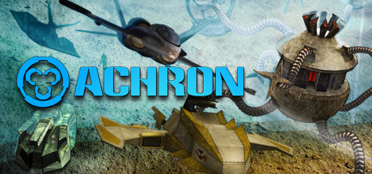
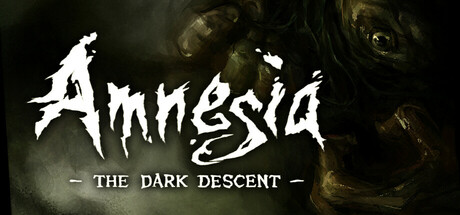
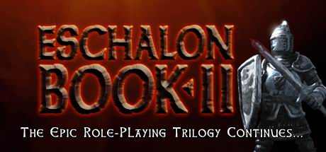
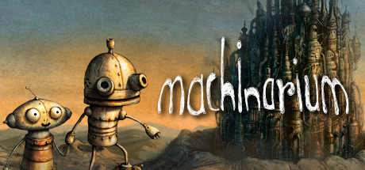
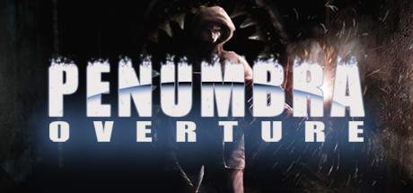
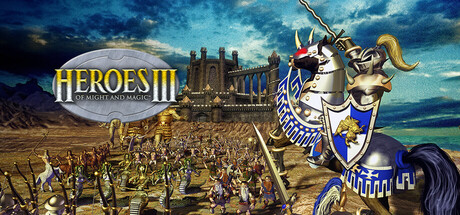
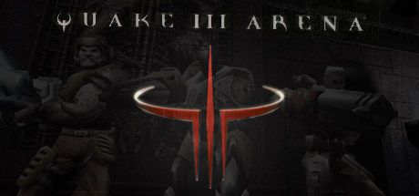

# Linux

[← Back to index](../README.md)

37 titles across 14 years in this archive.

## 2024

[Full 2024 page](../years/2024.md)

### Caves of Qud

**Platforms:** Windows, macOS, Linux &nbsp;|&nbsp; **Developer:** Freehold Games &nbsp;|&nbsp; **Publisher:** Kitfox Games &nbsp;|&nbsp; **Genre:** Adventure, Indie, RPG, Strategy &nbsp;|&nbsp; **Released:** December 5, 2024

> Inhabit a deeply-simulated science fantasy world and chisel through layers of thousand-year-old civilizations. Build a character from over a hundred mutations and cybernetics. The award-winning sandbox roguelike &amp; RPG full of robots, deep lore, and sentient plants.
>
> _Synopsis source: Steam_

[Wikipedia](https://en.wikipedia.org/wiki/Caves_of_Qud) · [Steam](https://store.steampowered.com/app/333640)

---

### Slay the Princess — The Pristine Cut

**Platforms:** Linux, macOS, Nintendo Switch, PlayStation 4, PlayStation 5, Windows, Xbox One, Xbox Series X/S &nbsp;|&nbsp; **Developer:** Black Tabby Games &nbsp;|&nbsp; **Publisher:** Serenity Forge &nbsp;|&nbsp; **Released:** October 24, 2024

[Wikipedia](https://en.wikipedia.org/wiki/Slay_the_Princess_%E2%80%94_The_Pristine_Cut)

---

## 2023

[Full 2023 page](../years/2023.md)

### Slay the Princess

**Platforms:** Linux, macOS, Nintendo Switch, PlayStation 4, PlayStation 5, Xbox One, Xbox Series X/S &nbsp;|&nbsp; **Developer:** Black Tabby Games &nbsp;|&nbsp; **Publisher:** Black Tabby Games &nbsp;|&nbsp; **Released:** October 23, 2023

[Wikipedia](https://en.wikipedia.org/wiki/Slay_the_Princess)

---

### Videoverse

**Platforms:** Linux, macOS, Windows &nbsp;|&nbsp; **Developer:** Kinmoku &nbsp;|&nbsp; **Publisher:** Kinmoku &nbsp;|&nbsp; **Genre:** Adventure, Casual, Indie, Simulation &nbsp;|&nbsp; **Released:** August 7, 2023

> Relive the days of the early internet and dive into this fictional video game era, where the 'Kinmoku Shark’ gaming system and its online social network 'Videoverse' were still popular…
>
> _Synopsis source: Steam_

[Wikipedia](https://en.wikipedia.org/wiki/Videoverse) · [Steam](https://store.steampowered.com/app/2079180)

---

## 2020

[Full 2020 page](../years/2020.md)

### Crusader Kings III

**Platforms:** Windows, Linux &nbsp;|&nbsp; **Developer:** Paradox Development Studio &nbsp;|&nbsp; **Publisher:** Paradox Interactive &nbsp;|&nbsp; **Genre:** RPG, Simulation, Strategy &nbsp;|&nbsp; **Released:** September 1, 2020

> Love, fight, scheme, and claim greatness. Determine your noble house’s legacy in the sprawling grand strategy of Crusader Kings III. Death is only the beginning as you guide your dynasty’s bloodline in the rich and larger-than-life simulation of the Middle Ages.
>
> _Synopsis source: Steam_

[Wikipedia](https://en.wikipedia.org/wiki/Crusader_Kings_III) · [Steam](https://store.steampowered.com/app/1158310)

---

### Half-Life: Alyx

**Platforms:** Windows, Linux &nbsp;|&nbsp; **Developer:** Valve &nbsp;|&nbsp; **Publisher:** Valve &nbsp;|&nbsp; **Genre:** Action, Adventure &nbsp;|&nbsp; **Released:** March 23, 2020

> Half-Life: Alyx is Valve’s VR return to the Half-Life series. It’s the story of an impossible fight against a vicious alien race known as the Combine, set between the events of Half-Life and Half-Life 2. Playing as Alyx Vance, you are humanity’s only chance for survival.
>
> _Synopsis source: Steam_

[Steam](https://store.steampowered.com/app/546560)

---

## 2011

[Full 2011 page](../years/2011.md)

### Achron

**Platforms:** Windows, macOS, Linux &nbsp;|&nbsp; **Genre:** Indie, Strategy &nbsp;|&nbsp; **Released:** August 29

> As one of the survivors and humankind's first “Achronal” being, you must piece together what happened and unravel the mysteries surrounding the alien invasion.
>
> _Synopsis source: Steam_

[Wikipedia](https://en.wikipedia.org/wiki/Achron) · [Steam](https://store.steampowered.com/app/109700)

---

### Minecraft

**Platforms:** iOS, Windows, Linux, macOS &nbsp;|&nbsp; **Released:** November 17

[Wikipedia](https://en.wikipedia.org/wiki/Minecraft)

---

## 2010

[Full 2010 page](../years/2010.md)

### Amnesia: The Dark Descent

**Platforms:** Windows, macOS, Linux &nbsp;|&nbsp; **Genre:** Action, Adventure, Indie &nbsp;|&nbsp; **Released:** September 8

> Amnesia: The Dark Descent, a first person survival horror. A game about immersion, discovery and living through a nightmare. An experience that will chill you to the core.
>
> _Synopsis source: Steam_

[Steam](https://store.steampowered.com/app/57300)

---

### Eschalon: Book II

**Platforms:** Windows, macOS, Linux &nbsp;|&nbsp; **Genre:** Indie, RPG &nbsp;|&nbsp; **Released:** May 12

> Return to the world of Eschalon in the sequel to 2007's award-winning RPG. The blight of war now threatens all of Eschalon and the only hope for peace lies in the secret of your past. Don't miss this second chapter in the epic Eschalon trilogy given &quot;5 Stars&quot; by RPGWatch and called &quot;immensely appealing&quot; by The...
>
> _Synopsis source: Steam_

[Steam](https://store.steampowered.com/app/25620)

---

### Heroes of Newerth

**Platforms:** Windows, macOS, Linux &nbsp;|&nbsp; **Released:** May 12

[Wikipedia](https://en.wikipedia.org/wiki/Heroes_of_Newerth)

---

## 2009

[Full 2009 page](../years/2009.md)

### Jets'n'Guns

**Platforms:** Linux &nbsp;|&nbsp; **Released:** January 30

[Wikipedia](https://en.wikipedia.org/wiki/Jets%27n%27Guns)

---

### Machinarium

**Platforms:** Windows, macOS, Linux &nbsp;|&nbsp; **Genre:** Adventure, Indie &nbsp;|&nbsp; **Released:** October 16

> Machinarium is the award-winning independent adventure game developed by the makers of Samorost series, Botanicula and CHUCHEL. Help Josef the robot save his girlfriend Berta kidnapped by the Black Cap Brotherhood gang!
>
> _Synopsis source: Steam_

[Wikipedia](https://en.wikipedia.org/wiki/Machinarium) · [Steam](https://store.steampowered.com/app/40700)

---

### Shadowgrounds

**Platforms:** Linux &nbsp;|&nbsp; **Released:** September 16

[Wikipedia](https://en.wikipedia.org/wiki/Shadowgrounds)

---

### Shadowgrounds Survivor

**Platforms:** Linux &nbsp;|&nbsp; **Released:** September 18

[Wikipedia](https://en.wikipedia.org/wiki/Shadowgrounds_Survivor)

---

### The Polynomial: Space of the Music

**Platforms:** Windows, macOS, Linux &nbsp;|&nbsp; **Genre:** Action, Casual, Indie &nbsp;|&nbsp; **Released:** May 28

> Experience the music in a new way. Feel it pulse around you. The Polynomial is a 3D space shooter with unique, fractal based scenery that animates to the music.
>
> _Synopsis source: Steam_

[Steam](https://store.steampowered.com/app/67000)

---

### The Whispered World

**Platforms:** Windows, iOS, macOS, Linux &nbsp;|&nbsp; **Released:** August 28

[Wikipedia](https://en.wikipedia.org/wiki/The_Whispered_World)

---

## 2008

[Full 2008 page](../years/2008.md)

### Penny Arcade Adventures: On the Rain-Slick Precipice of Darkness

**Platforms:** Linux, macOS, Windows, Xbox 360 &nbsp;|&nbsp; **Released:** May 21

---

### Penny Arcade Adventures: On the Rain-Slick Precipice of Darkness – Episode 2

**Platforms:** Linux, macOS, Windows, Xbox 360 &nbsp;|&nbsp; **Released:** October 29

---

### Penumbra: Black Plague

**Platforms:** Linux, Windows &nbsp;|&nbsp; **Genre:** Action, Adventure, Indie &nbsp;|&nbsp; **Released:** February 12

> Surrounded by enemies and assaulted by terror from all sides, Philip must collect clues and solve vexing puzzles while combating the gnawing psychological terrors that assail his mind and threaten to strip him of his sanity.
>
> _Synopsis source: Steam_

[Steam](https://store.steampowered.com/app/22120)

---

### Prey

**Platforms:** Linux &nbsp;|&nbsp; **Released:** December 7

[Wikipedia](https://en.wikipedia.org/wiki/Prey_(2006_video_game))

---

### X3: Reunion

**Platforms:** Linux &nbsp;|&nbsp; **Released:** December 5

---

## 2007

[Full 2007 page](../years/2007.md)

### Ballistics

**Platforms:** Linux &nbsp;|&nbsp; **Released:** June 7

[Wikipedia](https://en.wikipedia.org/wiki/Ballistics_(video_game))

---

### Enemy Territory: Quake Wars

**Platforms:** Windows, Linux &nbsp;|&nbsp; **Released:** October 2

---

### Knights and Merchants: The Shattered Kingdom

**Platforms:** Linux &nbsp;|&nbsp; **Released:** March 13

---

### Penumbra: Overture

**Platforms:** Windows, Linux &nbsp;|&nbsp; **Genre:** Action, Adventure, Indie &nbsp;|&nbsp; **Released:** March 30

> Penumbra: Overture is a first person survival horror game, emphasizing on survival and problem solving instead of mindless violence and gore.
>
> _Synopsis source: Steam_

[Steam](https://store.steampowered.com/app/22180)

---

## 2006

[Full 2006 page](../years/2006.md)

### Cold War

**Platforms:** Linux &nbsp;|&nbsp; **Released:** August 4

[Wikipedia](https://en.wikipedia.org/wiki/Cold_War_(computer_game))

---

### Gorky 17

**Platforms:** Linux &nbsp;|&nbsp; **Released:** June 15

[Wikipedia](https://en.wikipedia.org/wiki/Gorky_17)

---

### X2: The Threat

**Platforms:** Linux &nbsp;|&nbsp; **Released:** May 30

---

## 2005

[Full 2005 page](../years/2005.md)

### Postal²: Share the Pain

**Platforms:** Linux &nbsp;|&nbsp; **Released:** February 4

[Wikipedia](https://en.wikipedia.org/wiki/Postal%C2%B2)

---

### Software Tycoon

**Platforms:** Linux &nbsp;|&nbsp; **Released:** January 10

---

### Soul Ride

**Platforms:** Linux &nbsp;|&nbsp; **Released:** June 24

---

## 2002

[Full 2002 page](../years/2002.md)

### Vendetta Online

**Platforms:** Windows, macOS, Linux &nbsp;|&nbsp; **Released:** April 20

[Wikipedia](https://en.wikipedia.org/wiki/Vendetta_Online)

---

## 2000

[Full 2000 page](../years/2000.md)

### Rune

**Platforms:** Windows, macOS, Linux, PlayStation 2 &nbsp;|&nbsp; **Released:** October 27

[Wikipedia](https://en.wikipedia.org/wiki/Rune_(video_game))

---

## 1999

[Full 1999 page](../years/1999.md)

### Heroes of Might and Magic III

**Platforms:** Windows, macOS, Linux &nbsp;|&nbsp; **Genre:** Strategy &nbsp;|&nbsp; **Released:** March 3

> This is the original version of the game from 1999. The pack includes the original Heroes of Might and Magic III and its two expansions: Armageddon's Blade and The Shadow of Death.
>
> _Synopsis source: Steam_

[Wikipedia](https://en.wikipedia.org/wiki/Heroes_of_Might_and_Magic_III) · [Steam](https://store.steampowered.com/app/4921760)

---

### Quake III Arena

**Platforms:** Windows, Linux, Dreamcast &nbsp;|&nbsp; **Genre:** Action &nbsp;|&nbsp; **Released:** December 2

> The greatest warriors of all time and space have been summoned to battle for the amusement of an ancient alien race. Wield a variety of guns and power-ups as you fight for glory against ruthless combatants in this fast-paced single-player and multiplayer FPS.
>
> _Synopsis source: Steam_

[Wikipedia](https://en.wikipedia.org/wiki/Quake_III_Arena) · [Steam](https://store.steampowered.com/app/2200)

---

## 1994

[Full 1994 page](../years/1994.md)

### Doom

**Platforms:** Linux &nbsp;|&nbsp; **Developer/Publisher:** Dave D. Taylor /id Software &nbsp;|&nbsp; **Publisher:** Id Software &nbsp;|&nbsp; **Genre:** FPS &nbsp;|&nbsp; **Released:** April

[Wikipedia](https://en.wikipedia.org/wiki/Doom_(1993_video_game))

---
