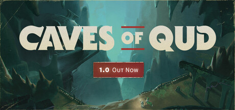

# Linux — 2024

[← All Linux years](../linux.md) · [Full 2024 page](../../years/2024.md)

45 Linux titles in 2024.

### 7 Days to Die

**Platforms:** Windows, macOS, Linux, PlayStation 5, Xbox Series X/S &nbsp;|&nbsp; **Developer:** The Fun Pimps &nbsp;|&nbsp; **Publisher:** The Fun Pimps &nbsp;|&nbsp; **Genre:** Survival horror &nbsp;|&nbsp; **Released:** July 25

> Set in a brutally unforgiving post-apocalyptic world overrun by the undead, 7 Days to Die is an open-world game that is a unique combination of first person shooter, survival horror, tower defense, and role-playing games. It presents combat, crafting, looting, mining, exploration, and character growth, in a way that has seen a rapturous response from fans worldwide. Play the definitive zombie survival sandbox RPG that came first. Navezgane awaits!
>
> _Synopsis source: IGDB_

[Wikipedia](https://en.wikipedia.org/wiki/7_Days_to_Die) · [IGDB](https://www.igdb.com/games/7-days-to-die)

---

### A Date with Death - Beyond the Bet

**Platforms:** Windows, macOS, Linux &nbsp;|&nbsp; **Developer:** Two and a Half Studios &nbsp;|&nbsp; **Publisher:** Two and a Half Studios &nbsp;|&nbsp; **Genre:** Visual novel, Dating sim &nbsp;|&nbsp; **Type:** Expansion &nbsp;|&nbsp; **Released:** December 9

[Wikipedia](https://en.wikipedia.org/wiki/A_Date_with_Death#Beyond_the_Bet)

---

### Anomaly Agent

**Platforms:** Xbox Series X/S, PlayStation 4, Xbox One, Windows, macOS, Nintendo Switch, PlayStation 5, Linux &nbsp;|&nbsp; **Developer:** Phew Phew Games &nbsp;|&nbsp; **Publisher:** GameDev.ist, NAISU, Phew Phew Games &nbsp;|&nbsp; **Genre:** Fighting, Platform, Adventure, Indie, Arcade &nbsp;|&nbsp; **Released:** January 24, 2024

> Anomaly Agent is a cyberpunk action-platformer featuring fluid combat, a time-bending story, quirky characters and a catchy synthwave soundtrack! Punch or shoot through mobs of enemies, impact the story with your choices and stop the anomalies before the world plunges into chaos!
>
> _Synopsis source: IGDB_

[IGDB](https://www.igdb.com/games/anomaly-agent)

---

### Anthology of the Killer

**Platforms:** Windows, macOS, Linux &nbsp;|&nbsp; **Developer:** thecatamites &nbsp;|&nbsp; **Publisher:** thecatamites &nbsp;|&nbsp; **Genre:** Horror &nbsp;|&nbsp; **Released:** May 28

[Wikipedia](https://en.wikipedia.org/wiki/Anthology_of_the_Killer)

---

### Arctic Eggs

**Platforms:** Windows, macOS, Linux &nbsp;|&nbsp; **Developer:** The Water Museum, cockydoody, abmarnie, Cameron Ginex &nbsp;|&nbsp; **Publisher:** The Water Museum &nbsp;|&nbsp; **Genre:** Cooking &nbsp;|&nbsp; **Released:** May 16

[Wikipedia](https://en.wikipedia.org/wiki/Arctic_Eggs)

---

### Awaria

**Platforms:** Windows, macOS, Linux &nbsp;|&nbsp; **Developer:** Łukasz Piskorz &nbsp;|&nbsp; **Publisher:** Łukasz Piskorz &nbsp;|&nbsp; **Genre:** Bullet hell, rogue-like &nbsp;|&nbsp; **Released:** December 16, 2024

> Welcome to the tunnel maintenance crew. If the generators fail, it's your job to fix them. Check what's wrong, craft all the needed parts and deliver them. It's simple. Just stay clear of anything that randomly cracks bolts of electricity, spews fire, throws sharp pieces of scrap at high-velocity or radiates with ominous green light.
>
> _Synopsis source: IGDB_

[Wikipedia](https://en.wikipedia.org/wiki/Awaria) · [IGDB](https://www.igdb.com/games/awaria)

---

### Backpack Battles

**Platforms:** Linux, Windows &nbsp;|&nbsp; **Developer:** PlayWithFurcifer &nbsp;|&nbsp; **Publisher:** PlayWithFurcifer, IndieArk &nbsp;|&nbsp; **Genre:** Auto battler &nbsp;|&nbsp; **Released:** March 8, 2024

> The inventory management auto battler! Buy rare and legendary items to build powerful setups. Then battle other players with it.
>
> _Synopsis source: IGDB_

[Wikipedia](https://en.wikipedia.org/wiki/Backpack_Battles) · [IGDB](https://www.igdb.com/games/backpack-battles)

---

### Broken Sword - Shadow of the Templars: Reforged

**Platforms:** Windows, macOS, Linux, Nintendo Switch, PlayStation 5, Xbox Series X/S &nbsp;|&nbsp; **Developer:** Revolution Software &nbsp;|&nbsp; **Publisher:** Revolution Software &nbsp;|&nbsp; **Genre:** PCA &nbsp;|&nbsp; **Type:** Remaster &nbsp;|&nbsp; **Released:** September 19

> The classic multi-award winning adventure "Broken Sword - the Shadow of the Templars" returns with glorious 4K visuals and iconic remastered audio, pitching intrepid American George Stobbart and fearless journalist Nico Collard into a journey of perilous adventures and ancient conspiracies.
>
> _Synopsis source: IGDB_

[IGDB](https://www.igdb.com/games/broken-sword-shadow-of-the-templars-reforged)

---

### Caves of Qud

**Platforms:** Windows, macOS, Linux &nbsp;|&nbsp; **Developer:** Freehold Games &nbsp;|&nbsp; **Publisher:** Kitfox Games &nbsp;|&nbsp; **Genre:** Roguelike, RPG &nbsp;|&nbsp; **Released:** December 5, 2024

> Inhabit a deeply-simulated science fantasy world and chisel through layers of thousand-year-old civilizations. Build a character from over a hundred mutations and cybernetics. The award-winning sandbox roguelike &amp; RPG full of robots, deep lore, and sentient plants.
>
> _Synopsis source: Steam_

[Wikipedia](https://en.wikipedia.org/wiki/Caves_of_Qud) · [Steam](https://store.steampowered.com/app/333640) · [IGDB](https://www.igdb.com/games/caves-of-qud)

---

### Celeste 64: Fragments of the Mountain

**Platforms:** Windows, macOS, Linux &nbsp;|&nbsp; **Developer:** Extremely OK Games &nbsp;|&nbsp; **Publisher:** Extremely OK Games &nbsp;|&nbsp; **Genre:** Adventure, Platformer &nbsp;|&nbsp; **Released:** January 29

---

### Core Keeper

**Platforms:** Windows, Linux, PlayStation 5, Xbox Series X/S, Nintendo Switch, PlayStation 4, Xbox One &nbsp;|&nbsp; **Developer:** Pugstorm &nbsp;|&nbsp; **Publisher:** Fireshine Games &nbsp;|&nbsp; **Genre:** Sandbox, Survival, Adventure &nbsp;|&nbsp; **Released:** August 27

> Explore an endless cavern of creatures, relics and resources in a mining sandbox adventure for 1-8 players. Mine, build, fight, craft and farm to unravel the mystery of the ancient Core.
>
> _Synopsis source: IGDB_

[Wikipedia](https://en.wikipedia.org/wiki/Core_Keeper) · [IGDB](https://www.igdb.com/games/core-keeper)

---

### Drova: Forsaken Kin

**Platforms:** Windows, Linux, Nintendo Switch, PlayStation 4, PlayStation 5, Xbox One, Xbox Series X/S &nbsp;|&nbsp; **Developer:** Just2D &nbsp;|&nbsp; **Publisher:** Deck13 &nbsp;|&nbsp; **Genre:** Action RPG &nbsp;|&nbsp; **Released:** October 15

> Drova is a pixel art role-playing game inspired by classic role-playing games. We want to create a challenging and interesting world and offer a well-rounded and consistent gaming experience.
>
> _Synopsis source: IGDB_

[IGDB](https://www.igdb.com/games/drova-forsaken-kin)

---

### Duck Detective: The Secret Salami

**Platforms:** Windows, macOS, Linux, Nintendo Switch &nbsp;|&nbsp; **Developer:** Happy Broccoli Games &nbsp;|&nbsp; **Publisher:** Happy Broccoli Games &nbsp;|&nbsp; **Genre:** Adventure &nbsp;|&nbsp; **Released:** May 23

> Solving crime is no walk in the pond. You are a down-on-his-luck detective who also happens to be a duck. Use your powers of de-duck-tion to inspect evidence, fill in the blanks, and bust the case wide open, in a narrative mystery adventure where nothing is quite as it seems.
>
> _Synopsis source: IGDB_

[IGDB](https://www.igdb.com/games/duck-detective-the-secret-salami)

---

### Dungeons & Degenerate Gamblers

**Platforms:** Windows, macOS, Linux &nbsp;|&nbsp; **Developer:** Purple Moss Collectors &nbsp;|&nbsp; **Publisher:** Yogscast Games &nbsp;|&nbsp; **Genre:** Roguelike, Deck building &nbsp;|&nbsp; **Released:** August 8

[Wikipedia](https://en.wikipedia.org/wiki/Dungeons_%26_Degenerate_Gamblers)

---

### Fear the Spotlight

**Platforms:** Windows, macOS, Linux, Nintendo Switch, PlayStation 4, PlayStation 5, Xbox One, Xbox Series X/S &nbsp;|&nbsp; **Developer:** Cozy Game Pals &nbsp;|&nbsp; **Publisher:** Blumhouse Games &nbsp;|&nbsp; **Genre:** Horror, Puzzle, Action &nbsp;|&nbsp; **Released:** October 22

[Wikipedia](https://en.wikipedia.org/wiki/Fear_the_Spotlight)

---

### Five Hearts Under One Roof

**Platforms:** Windows, macOS, Linux &nbsp;|&nbsp; **Developer:** StoryTaco.inc &nbsp;|&nbsp; **Publisher:** StoryTaco.inc &nbsp;|&nbsp; **Genre:** Role-playing (RPG), Simulator, Strategy, Adventure, Visual Novel &nbsp;|&nbsp; **Released:** October 2, 2024

> Yuman’s, the player, once solitary home and routine are now invaded by five beautiful women! Each has her unique charm – the 'childhood friend of 20 years,' the 'first love and former idol,' the 'demanding boss,' the 'bold younger girl,' and the 'shy recluse.' Who will you choose?
>
> _Synopsis source: IGDB_

[IGDB](https://www.igdb.com/games/five-hearts-under-one-roof)

---

### Fountains

**Platforms:** Windows, macOS, Linux &nbsp;|&nbsp; **Developer:** John Pywell &nbsp;|&nbsp; **Publisher:** Crunching Koalas &nbsp;|&nbsp; **Genre:** Soulslike &nbsp;|&nbsp; **Released:** December 20

---

### Frogun Encore

**Platforms:** Windows, Linux, Nintendo Switch, PlayStation 4, PlayStation 5, Xbox One, Xbox Series X/S &nbsp;|&nbsp; **Developer:** Molegato &nbsp;|&nbsp; **Publisher:** Top Hat Studios &nbsp;|&nbsp; **Genre:** Platformer &nbsp;|&nbsp; **Released:** June 25

[Wikipedia](https://en.wikipedia.org/wiki/Frogun)

---

### Gimmick! 2

**Platforms:** Windows, Linux, Nintendo Switch, PlayStation 4, PlayStation 5, Xbox One, Xbox Series X/S &nbsp;|&nbsp; **Developer:** Bitwave Games &nbsp;|&nbsp; **Publisher:** Sunsoft , Clear River Games &nbsp;|&nbsp; **Genre:** Platformer &nbsp;|&nbsp; **Released:** September 5 (JP)

[Wikipedia](https://en.wikipedia.org/wiki/Gimmick!_2)

---

### Glyphica: Typing Survival

**Platforms:** Windows, Linux &nbsp;|&nbsp; **Developer:** aliasBLACK &nbsp;|&nbsp; **Publisher:** Squeaky Wheel &nbsp;|&nbsp; **Genre:** Typing &nbsp;|&nbsp; **Released:** October 9, 2024

> Glyphica is a typing-roguelike that blends survival and strategy. Type to shoot. Test your keyboard mastery, unlock powerful upgrades, and craft overpowered builds to destroy hordes of enemies.
>
> _Synopsis source: IGDB_

[Wikipedia](https://en.wikipedia.org/wiki/Glyphica:_Typing_Survival) · [IGDB](https://www.igdb.com/games/glyphica-typing-survival)

---

### Halls of Torment

**Platforms:** Windows, Linux &nbsp;|&nbsp; **Developer:** Chasing Carrots &nbsp;|&nbsp; **Publisher:** Chasing Carrots &nbsp;|&nbsp; **Genre:** Action, Roguelike, Bullet heaven &nbsp;|&nbsp; **Released:** September 24

> Slay hordes of terrifying monsters in this casual roguelite action rpg. Descend into the Halls of Torment where the lords of the underworld await you. Treasures, magic trinkets, and a growing cast of heroes will grant you the power to vanquish the horrors from beyond. How long can you survive?
>
> _Synopsis source: IGDB_

[Wikipedia](https://en.wikipedia.org/wiki/Halls_of_Torment) · [IGDB](https://www.igdb.com/games/halls-of-torment)

---

### Just a To the Moon Series Beach Episode

**Platforms:** Windows, macOS, Linux &nbsp;|&nbsp; **Developer:** Freebird Games &nbsp;|&nbsp; **Publisher:** Freebird Games &nbsp;|&nbsp; **Genre:** Adventure &nbsp;|&nbsp; **Released:** September 20

[Wikipedia](https://en.wikipedia.org/wiki/Just_a_To_the_Moon_Series_Beach_Episode)

---

### Kind Words 2 (lofi city pop)

**Platforms:** Windows, macOS, Linux &nbsp;|&nbsp; **Developer:** Popcannibal &nbsp;|&nbsp; **Publisher:** Popcannibal &nbsp;|&nbsp; **Genre:** Casual , Social sim &nbsp;|&nbsp; **Released:** October 7

[Wikipedia](https://en.wikipedia.org/wiki/Kind_Words_2_(lofi_city_pop))

---

### Kitsune Tails

**Platforms:** Windows, Linux &nbsp;|&nbsp; **Developer:** Kitsune Games &nbsp;|&nbsp; **Publisher:** Midboss &nbsp;|&nbsp; **Genre:** Platformer &nbsp;|&nbsp; **Released:** August 1

[Wikipedia](https://en.wikipedia.org/wiki/Kitsune_Tails)

---

### LOK Digital

**Platforms:** Windows, macOS, Linux &nbsp;|&nbsp; **Developer:** Letibus Design, Icedrop Games &nbsp;|&nbsp; **Publisher:** Draknek & Friends &nbsp;|&nbsp; **Genre:** Puzzle, Adventure, Indie, Arcade &nbsp;|&nbsp; **Released:** December 11, 2024

> Lok are a fresh new kind of living beings that spawned in the middle of a vast, incomprehensible world. Help them through mind-bending word-search puzzles and guide them towards expansion of their civilisation.
>
> _Synopsis source: IGDB_

[Wikipedia](https://en.wikipedia.org/wiki/LOK_Digital) · [IGDB](https://www.igdb.com/games/lok-digital)

---

### Miniatures

**Platforms:** Windows, macOS, Linux, Nintendo Switch, iOS &nbsp;|&nbsp; **Developer:** Other Tales Interactive &nbsp;|&nbsp; **Publisher:** Other Tales Interactive &nbsp;|&nbsp; **Genre:** PCA &nbsp;|&nbsp; **Released:** November 14

[Wikipedia](https://en.wikipedia.org/wiki/Miniatures_(video_game))

---

### OneShot: World Machine Edition

**Platforms:** Windows, Linux &nbsp;|&nbsp; **Developer:** Future Cat &nbsp;|&nbsp; **Publisher:** Komodo &nbsp;|&nbsp; **Genre:** Adventure, Puzzle &nbsp;|&nbsp; **Type:** Remaster &nbsp;|&nbsp; **Released:** September 30

---

### Paper Lily: Chapter 1

**Platforms:** Linux, macOS, Windows &nbsp;|&nbsp; **Developer:** Leef 6010 &nbsp;|&nbsp; **Publisher:** Leef 6010 &nbsp;|&nbsp; **Genre:** Puzzle, Role-playing (RPG), Adventure, Indie &nbsp;|&nbsp; **Released:** January 26, 2024

> Something terrible has happened. You can’t bear to think about it - but you can’t live like this anymore. You stopped attending school, you haven’t left your house in months, you have no reason to get out of bed anymore. There are no choices left.  No choice except... that strange golden letter.  It’s time to get your life back together.  One last try.
>
> _Synopsis source: IGDB_

[IGDB](https://www.igdb.com/games/paper-lily-chapter-1)

---

### Phoenix Springs

**Platforms:** Windows, macOS, Linux &nbsp;|&nbsp; **Developer:** Calligram Studio &nbsp;|&nbsp; **Publisher:** Calligram Studio &nbsp;|&nbsp; **Genre:** PCA &nbsp;|&nbsp; **Released:** October 7

[Wikipedia](https://en.wikipedia.org/wiki/Phoenix_Springs)

---

### Portal Revolution

**Platforms:** Windows, Linux &nbsp;|&nbsp; **Developer:** Second Face Software &nbsp;|&nbsp; **Publisher:** Second Face Software &nbsp;|&nbsp; **Genre:** Puzzle-platform &nbsp;|&nbsp; **Released:** January 6, 2024

[Wikipedia](https://en.wikipedia.org/wiki/Portal_Revolution)

---

### Read Only Memories: Neurodiver

**Platforms:** Linux, macOS, Nintendo Switch, PlayStation 4, PlayStation 5, Windows, Xbox One, Xbox Series X/S &nbsp;|&nbsp; **Developer:** MidBoss &nbsp;|&nbsp; **Publisher:** Chorus Worldwide &nbsp;|&nbsp; **Genre:** Adventure, visual novel &nbsp;|&nbsp; **Released:** May 16, 2024

> Return to the vibrant cyberpunk world of Neo-San Francisco from 2064: Read Only Memories, filled with friendly and familiar faces. Neurodiver will introduce new characters, locations, and mechanics, including the ability to dive into and change other characters' memories, as well as overhauled art and an unsolved case to crack with multiple endings.
>
> _Synopsis source: IGDB_

[Wikipedia](https://en.wikipedia.org/wiki/Read_Only_Memories:_Neurodiver) · [IGDB](https://www.igdb.com/games/read-only-memories-neurodiver)

---

### SCHiM

**Platforms:** Windows, macOS, Linux, Nintendo Switch, PlayStation 4, PlayStation 5, Xbox One, Xbox Series X/S &nbsp;|&nbsp; **Developer:** Ewoud van der Werf, Nils Slijkerman &nbsp;|&nbsp; **Publisher:** Extra Nice, Playism &nbsp;|&nbsp; **Genre:** Adventure, Puzzle, Platformer &nbsp;|&nbsp; **Released:** July 18

[Wikipedia](https://en.wikipedia.org/wiki/SCHiM)

---

### Shogun Showdown

**Platforms:** Windows, macOS, Linux, Nintendo Switch, PlayStation 4, PlayStation 5, Xbox One, Xbox Series X/S &nbsp;|&nbsp; **Developer:** Roboatino &nbsp;|&nbsp; **Publisher:** Goblinz Studio, Gamera Games &nbsp;|&nbsp; **Genre:** Roguelike, TBT &nbsp;|&nbsp; **Released:** September 5

> Shogun Showdown is a turn-based combat game with rogue-like and deck-building elements. Position yourself and attack at the right time, upgrade your tiles and combo them to get ready to face the Shogun!
>
> _Synopsis source: IGDB_

[Wikipedia](https://en.wikipedia.org/wiki/Shogun_Showdown) · [IGDB](https://www.igdb.com/games/shogun-showdown)

---

### Slay the Princess — The Pristine Cut

**Platforms:** Linux, macOS, Nintendo Switch, PlayStation 4, PlayStation 5, Windows, Xbox One, Xbox Series X/S &nbsp;|&nbsp; **Developer:** Black Tabby Games &nbsp;|&nbsp; **Publisher:** Serenity Forge &nbsp;|&nbsp; **Genre:** Visual novel, Horror (psych), Dating sim &nbsp;|&nbsp; **Type:** Port, Expansion &nbsp;|&nbsp; **Released:** October 24, 2024

> Slay the Princess is a choice-driven psychological horror visual novel with dramatic branching, light RPG elements, and hand-penciled art.  The Pristine Cut is the definitive version of the game. It features expanded content including 3 new chapters, never-before-seen Princesses, expansions to familiar routes, a new ending, over 1,200 new hand-penciled frames, over 2,500 new lines of dialogue, and over 35% more content overall.
>
> _Synopsis source: IGDB_

[Wikipedia](https://en.wikipedia.org/wiki/Slay_the_Princess_%E2%80%94_The_Pristine_Cut) · [IGDB](https://www.igdb.com/games/slay-the-princess-the-pristine-cut)

---

### Straftat

**Platforms:** Windows, Linux, macOS &nbsp;|&nbsp; **Developer:** Sirius Lemaitre, Leonard Lemaitre &nbsp;|&nbsp; **Publisher:** Lemaitre Bros &nbsp;|&nbsp; **Genre:** First-person shooter &nbsp;|&nbsp; **Released:** October 24, 2024

> Straftat is a 1v1/2v2 online first person shooter with quick rounds in over 350 maps. Including all weapons, proximity chat and 4 players FFA.
>
> _Synopsis source: IGDB_

[Wikipedia](https://en.wikipedia.org/wiki/Straftat) · [IGDB](https://www.igdb.com/games/straftat)

---

### Super Mario 64 Coop Deluxe

**Platforms:** Windows, Linux, macOS, Android, iOS &nbsp;|&nbsp; **Developer:** Community Project &nbsp;|&nbsp; **Publisher:** Community Project &nbsp;|&nbsp; **Released:** July 1, 2024

[Wikipedia](https://en.wikipedia.org/wiki/Super_Mario_64_Coop_Deluxe)

---

### That's Not My Neighbor

**Platforms:** Linux, macOS, Windows &nbsp;|&nbsp; **Developer:** Nacho Sama &nbsp;|&nbsp; **Publisher:** Nacho Sama &nbsp;|&nbsp; **Genre:** Simulator, Adventure, Indie &nbsp;|&nbsp; **Released:** March 11, 2024

> 'That's not my Neighbor' is a 2D Indie horror game based on the job simulator genre with an unique twist created by Ignacio Alvarado Monge AKA NachoSama.
>
> _Synopsis source: IGDB_

[IGDB](https://www.igdb.com/games/thats-not-my-neighbor)

---

### The Children of Clay

**Platforms:** Windows, Linux &nbsp;|&nbsp; **Developer:** Balazs Ronyai &nbsp;|&nbsp; **Publisher:** Balazs Ronyai &nbsp;|&nbsp; **Genre:** Horror, PCA &nbsp;|&nbsp; **Released:** October 24

[Wikipedia](https://en.wikipedia.org/wiki/The_Children_of_Clay)

---

### The Dark Queen of Mortholme

**Platforms:** macOS, Linux, Windows &nbsp;|&nbsp; **Developer:** Mosu &nbsp;|&nbsp; **Publisher:** Monster Theater &nbsp;|&nbsp; **Genre:** Role-playing (RPG), Indie &nbsp;|&nbsp; **Released:** December 6, 2024

> You are the Dark Queen—the most powerful being of your entire universe. Your lair is breached by an aspiring hero—a pitiful thing, easily crushed.  Except they keep coming back.  A 20 minute anti-game about an unconventional relationship and the capacity for change.
>
> _Synopsis source: IGDB_

[IGDB](https://www.igdb.com/games/the-dark-queen-of-mortholme)

---

### The Operator

**Platforms:** Windows, macOS, Linux &nbsp;|&nbsp; **Developer:** Bastienre4 &nbsp;|&nbsp; **Publisher:** indienova, Bastienre4 &nbsp;|&nbsp; **Genre:** Point-and-click, Puzzle, Simulator, Adventure, Indie &nbsp;|&nbsp; **Released:** July 22, 2024

> As an Operator, you will assist FDI's field agents by analyzing evidence on your computer and making deductions. Help them solve impossible cases in this immersive interface game, full of plot twists and mysteries. Everything will be explained, you just have to ████ ██ ██████.
>
> _Synopsis source: IGDB_

[IGDB](https://www.igdb.com/games/the-operator--1)

---

### The Phantom Fellows

**Platforms:** Windows, macOS, Linux &nbsp;|&nbsp; **Developer:** Strummer Games &nbsp;|&nbsp; **Publisher:** Strummer Games &nbsp;|&nbsp; **Genre:** Adventure game &nbsp;|&nbsp; **Released:** September 27, 2024

> The Phantom Fellows is about two best friends who start a paranormal investigation business together, since one of them is already dead.
>
> _Synopsis source: IGDB_

[Wikipedia](https://en.wikipedia.org/wiki/The_Phantom_Fellows) · [IGDB](https://www.igdb.com/games/the-phantom-fellows)

---

### The Universim

**Platforms:** Windows, macOS, Linux &nbsp;|&nbsp; **Developer:** Crytivo &nbsp;|&nbsp; **Publisher:** Crytivo &nbsp;|&nbsp; **Genre:** God game , Simulation &nbsp;|&nbsp; **Released:** January 22

> The Universim aims to revive the glory days of the god-game genre and bring it into the next generation with fresh ideas and ambitious gameplay. With the powers of a god, you are unleashed upon the universe to begin forging your galactic empire in the stars. From dust to the cosmos beyond, your civilization will rise through the ages under your guidance. Yet this is not the same static world you may be accustomed to, this is a dynamic, living world that is just as unpredictable as it is beautiful. Everything in The Universim revolves around dynamic gameplay, including the civilization AI. You may have unparalleled power, but you cannot control the AI directly as you would in a typical strategy game. The AI will make its own decisions and always seek to better the civilization in some way, but at times their decisions may end badly without your intervention.
>
> _Synopsis source: IGDB_

[Wikipedia](https://en.wikipedia.org/wiki/The_Universim) · [IGDB](https://www.igdb.com/games/the-universim)

---

### Tiny Glade

**Platforms:** Windows, Linux, macOS &nbsp;|&nbsp; **Developer:** Pounce Light &nbsp;|&nbsp; **Publisher:** Pounce Light &nbsp;|&nbsp; **Genre:** City-builder, cosy, sandbox &nbsp;|&nbsp; **Released:** September 23, 2024

> Tiny Glade is a small relaxing game about doodling castles. Explore gridless building chemistry, and watch the game carefully assemble every brick, pebble and plank. There's no management, combat, or wrong answers - just kick back and turn forgotten meadows into lovable dioramas.
>
> _Synopsis source: IGDB_

[Wikipedia](https://en.wikipedia.org/wiki/Tiny_Glade) · [IGDB](https://www.igdb.com/games/tiny-glade)

---

### Vampire Therapist

**Platforms:** Windows, macOS, Linux &nbsp;|&nbsp; **Developer:** Little Bat Games &nbsp;|&nbsp; **Publisher:** Little Bat Games &nbsp;|&nbsp; **Genre:** Visual novel, Adventure, Simulation &nbsp;|&nbsp; **Released:** July 18, 2024

> Guide vampires through centuries of emotional baggage, decades of delusions and the odd bout of self-loathing with real cognitive behavioral therapy concepts and become a Vampire Therapist! Even vampires need a shoulder to cry on when a neck to bite just won’t do.
>
> _Synopsis source: IGDB_

[Wikipedia](https://en.wikipedia.org/wiki/Vampire_Therapist) · [IGDB](https://www.igdb.com/games/vampire-therapist)

---

### Zoria: Age of Shattering

**Platforms:** Windows, Linux &nbsp;|&nbsp; **Developer:** Tiny Trinket Games &nbsp;|&nbsp; **Publisher:** Anshar Publishing, Surefire Games &nbsp;|&nbsp; **Genre:** Role-playing &nbsp;|&nbsp; **Released:** March 7, 2024

> A squad-based tactical RPG with fluid turn-based combat, outpost, and follower management, set in the expansive Fantasy world of Zoria. Lead a team of four heroes with their unique skills and perks. Every team member contributes to undertaken battles.
>
> _Synopsis source: IGDB_

[Wikipedia](https://en.wikipedia.org/wiki/Zoria:_Age_of_Shattering) · [IGDB](https://www.igdb.com/games/zoria-age-of-shattering)

---
