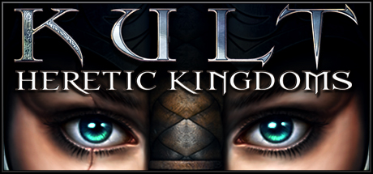

# macOS — 2004

[← All macOS years](../macos.md) · [Full 2004 page](../../years/2004.md)

26 macOS titles in 2004.

### Alida

**Platforms:** Windows, macOS &nbsp;|&nbsp; **Developer:** Dejavu Worlds &nbsp;|&nbsp; **Publisher:** Got Game Entertainment &nbsp;|&nbsp; **Genre:** Adventure

> Your adventure begins when you’re secretly dropped off on the island of Alida. The story centers around four young men in the band Alida who attained phenomenal success with their first CD release. Loads of money coupled with wild imagination resulted in the band’s construction of a guitar-shaped island theme park. Alida was abandoned when money woes and paranoia set in and the band split up. Now, several years later, the band’s manager suggests a reunion on the island. Soon thereafter band member Arin leaves for the island and is not heard from again. His wife Julia sends you to Alida to find Arin and bring him home.
>
> _Synopsis source: IGDB_

[Wikipedia](https://en.wikipedia.org/wiki/Alida_(video_game)) · [IGDB](https://www.igdb.com/games/alida)

---

### Alien Arena

**Platforms:** Windows, macOS, Linux &nbsp;|&nbsp; **Developer:** COR Entertainment, LLC &nbsp;|&nbsp; **Genre:** First-person shooter &nbsp;|&nbsp; **Released:** October 2004

[Wikipedia](https://en.wikipedia.org/wiki/Alien_Arena)

---

### Ben's Game

**Platforms:** Windows, macOS &nbsp;|&nbsp; **Developer:** Eric Johnston &nbsp;|&nbsp; **Publisher:** Make-A-Wish Foundation &nbsp;|&nbsp; **Genre:** Action &nbsp;|&nbsp; **Released:** May 2004

> This is a game about fighting cancer. In this game, you play the role of a hero on a hovering surfboard with ultra-high-tech weapons. You are the cure!
>
> _Synopsis source: IGDB_

[Wikipedia](https://en.wikipedia.org/wiki/Ben's_Game) · [IGDB](https://www.igdb.com/games/bens-game)

---

### Care Bears: Let's Have a Ball!

**Platforms:** macOS, Windows &nbsp;|&nbsp; **Genre:** Arcade

> Care Bears: Let's Have a Ball! is based on characters from a popular children's television show and feature films, originally developed by American Greetings in 1981.  The player is taken directly to the home screen among the clouds where he can select a Care Bear to play any of the eight arcade-style games they represent. Each game is prefaced with a description and instructions, and all the other games can also be accessed from here by clicking on the bears that line the bottom of the screen. The games have five levels that become progressively more difficult as the player reaches them. Actions are performed by moving items or Care Bears with the mouse and keyboard.
>
> _Synopsis source: IGDB_

[Wikipedia](https://en.wikipedia.org/wiki/Care_Bears:_Let's_Have_a_Ball!) · [IGDB](https://www.igdb.com/games/care-bears-lets-have-a-ball)

---

### City of Heroes

**Platforms:** Windows, macOS &nbsp;|&nbsp; **Released:** April 28

[Wikipedia](https://en.wikipedia.org/wiki/City_of_Heroes)

---

### Cube 2: Sauerbraten

**Platforms:** Windows, Linux, macOS &nbsp;|&nbsp; **Developer:** Wouter van Oortmerssen, Lee Salzman, Mike Dysart &nbsp;|&nbsp; **Genre:** First-person shooter &nbsp;|&nbsp; **Released:** May 6, 2004

> Cube 2: Sauerbraten (German for "sour roast", also known as Sauer) is a cross-platform, Quake-like first-person shooter that runs on Microsoft Windows, Linux, FreeBSD and Mac OS X using OpenGL and SDL. The game features single-player and multiplayer gameplay and contains an in-game level editor. The game engine is free and open-source software, under the zlib License, with commercial support available from the developer's own business counterpart, Dot3 Labs. The game media is released under various non-free licenses. The aim of the project is not to produce the most features and highest-quality graphics possible, but rather to allow map-editing to be done in real-time within the game, while keeping the engine source code small and elegant.
>
> _Synopsis source: IGDB_

[Wikipedia](https://en.wikipedia.org/wiki/Cube_2:_Sauerbraten) · [IGDB](https://www.igdb.com/games/cube-2-sauerbraten)

---

### Dofus

**Platforms:** Browser, Windows, macOS, Linux &nbsp;|&nbsp; **Developer:** Ankama Games &nbsp;|&nbsp; **Genre:** Massively multiplayer online role-playing game &nbsp;|&nbsp; **Released:** September 2004

> Dofus is a tactical turn-oriented massively multiplayer online role-playing game (MMORPG) developed and published by Ankama Games. It is primarily a pay-to-play game, though it still offers a limited amount of free content.
>
> _Synopsis source: IGDB_

[Wikipedia](https://en.wikipedia.org/wiki/Dofus) · [IGDB](https://www.igdb.com/games/dofus)

---

### Gish

**Platforms:** Windows, Linux, macOS &nbsp;|&nbsp; **Developer:** Chronic Logic &nbsp;|&nbsp; **Publisher:** Chronic Logic &nbsp;|&nbsp; **Genre:** Platform &nbsp;|&nbsp; **Released:** May 4, 2004

> Gish isn't your average hero. In fact, he's not your average anything...you see, Gish is a ball of tar. A Sunday stroll with his lady friend, Brea, goes awry when a shadowy figure emerges from an open manhole and pulls Brea below ground. Following Brea's calls for help, Gish suddenly finds himself in the subterranean sewers of Dross, a long forgotten city filled with twisting corridors, evil traps, and some of the most demented creatures imaginable.  With his gelatinous structure as his only means of defense, Gish must follow the echoing cries of his damsel in distress deep within the earth below. What freakish creatures dwell in this subterranean land? Who is Brea's captor? And just how far down does the rabbit hole go?  Life isn't easy when you're a 12 pound ball of tar...
>
> _Synopsis source: IGDB_

[Wikipedia](https://en.wikipedia.org/wiki/Gish_(video_game)) · [IGDB](https://www.igdb.com/games/gish)

---

### GL-117

**Platforms:** macOS, Windows, Linux &nbsp;|&nbsp; **Developer:** Thomas Drexl, Jean-Marc Le Peuvedic, Eugene Andreeschev, Eric Cheung &nbsp;|&nbsp; **Genre:** Combat flight simulator

[Wikipedia](https://en.wikipedia.org/wiki/GL-117)

---

### In the Groove

**Platforms:** Arcade, macOS, PlayStation 2, Windows &nbsp;|&nbsp; **Developer:** Roxor Games &nbsp;|&nbsp; **Publisher:** Roxor Games, RedOctane &nbsp;|&nbsp; **Genre:** Music, Exercise &nbsp;|&nbsp; **Released:** August 30, 2004

> In the Groove (abbreviated ITG) is the first game in the In the Groove franchise, published by RedOctane and developed by Roxor Games, and first released in video arcades around August 30, 2004.
>
> _Synopsis source: IGDB_

[Wikipedia](https://en.wikipedia.org/wiki/In_the_Groove_(video_game)) · [IGDB](https://www.igdb.com/games/in-the-groove)

---

### Jets'n'Guns

**Platforms:** Windows, macOS, Linux &nbsp;|&nbsp; **Developer:** Rake in Grass &nbsp;|&nbsp; **Publisher:** Rake in Grass, Reflexive Entertainment and Stardock, Soft-World, Linux Game Publishing &nbsp;|&nbsp; **Genre:** Scrolling shooter &nbsp;|&nbsp; **Released:** November 17, 2004

> You take the role of a freelance pilot who has to save the Universe from evil warlord Xoxx, who has stolen a gigantic space gun with the power to destroy the entire Universe. Buckle up because it's going to be a blast!
>
> _Synopsis source: IGDB_

[Wikipedia](https://en.wikipedia.org/wiki/Jets'n'Guns) · [IGDB](https://www.igdb.com/games/jetsnguns)

---

### Jewel Quest

**Platforms:** Windows, macOS &nbsp;|&nbsp; **Developer:** iWin &nbsp;|&nbsp; **Publisher:** iWin &nbsp;|&nbsp; **Genre:** Puzzle &nbsp;|&nbsp; **Released:** October 29, 2004

[Wikipedia](https://en.wikipedia.org/wiki/Jewel_Quest)

---

### Kult: Heretic Kingdoms

**Platforms:** Windows, macOS &nbsp;|&nbsp; **Genre:** Action, Adventure, Indie, RPG &nbsp;|&nbsp; **Released:** October 1

> Kult is prequel to Shadows: Heretic Kingdoms originally released in 2005. It is isometric RPG with action combat, engaging storyline and unique RPG system. Kult has been very positively acclaimed by players and called as a sleeper hit by many...
>
> _Synopsis source: Steam_

[Steam](https://store.steampowered.com/app/277650)

---

### Lemonade Tycoon 2

**Platforms:** Windows, macOS &nbsp;|&nbsp; **Developer:** Jamdat Mobile &nbsp;|&nbsp; **Publisher:** MumboJumbo &nbsp;|&nbsp; **Genre:** Business simulation game &nbsp;|&nbsp; **Released:** August 2004

[Wikipedia](https://en.wikipedia.org/wiki/Lemonade_Tycoon_2)

---

### Nanosaur 2: Hatchling

**Platforms:** macOS, Windows &nbsp;|&nbsp; **Developer:** Pangea Software &nbsp;|&nbsp; **Publisher:** Pangea Software &nbsp;|&nbsp; **Genre:** Third-person shooter

> As a genetically-engineered pterodactyl, players fight against insurgent dinosaur forces in order to save Earth.
>
> _Synopsis source: IGDB_

[Wikipedia](https://en.wikipedia.org/wiki/Nanosaur_2:_Hatchling) · [IGDB](https://www.igdb.com/games/nanosaur-ii-hatchling)

---

### Oolite

**Platforms:** Windows, Linux, macOS &nbsp;|&nbsp; **Developer:** Giles Williams, Jens Ayton &nbsp;|&nbsp; **Publisher:** Giles Williams, Jens Ayton &nbsp;|&nbsp; **Genre:** Space trading and combat simulator &nbsp;|&nbsp; **Released:** July 2004

> Oolite is a space sim game, inspired by Elite, powered by Objective-C and OpenGL, and designed as a small game that is easy for users to pick up, modify and expand upon. Almost every aspect of the game can be changed by using simple, free graphics packages and text editors.
>
> _Synopsis source: IGDB_

[Wikipedia](https://en.wikipedia.org/wiki/Oolite_(video_game)) · [IGDB](https://www.igdb.com/games/oolite)

---

### OpenTTD

**Platforms:** Windows, macOS, Linux &nbsp;|&nbsp; **Genre:** Simulator, Strategy, Indie

> OpenTTD is a business simulation game initially developed by Ludvig Strigeus in which players earn money by transporting passengers and cargo via road, rail, water, and air. It is an open-source remake and expansion of the 1995 Chris Sawyer video game Transport Tycoon Deluxe.  Connect industries and cities on procedurally-generated maps of up to 4096 x 4096 tiles by building a network of roads, railways, docks, and airports. Navigate dense city streets, cross oceans and rivers, and conquer high mountains in one of four climates.  Work alone or with friends to complete production chains and transport finished goods to towns. Assemble a fleet of hundreds of vehicles, transferring cargo as needed in an interconnected, multimodal network with optional cargo destinations.  Keep up with technological improvements through the years as towns grow; new modes of transport are invented; and industries appear, change production, or fail. Expand stations and build network capacity to keep up with demand and avoid delays.  Customize your OpenTTD experience via community-made mods downloaded through an in-game content service, including real-world vehicles, new industry sets, custom scenarios, and more.  OpenTTD is free and open-source software, licensed under the GNU General Public License version 2.0. OpenTTD is under ongoing development. OpenTTD is not an abbreviation of anything.
>
> _Synopsis source: IGDB_

[Wikipedia](https://en.wikipedia.org/wiki/OpenTTD) · [IGDB](https://www.igdb.com/games/openttd)

---

### Ryzom

**Platforms:** Windows, macOS, Linux &nbsp;|&nbsp; **Developer:** Nevrax, community contributors &nbsp;|&nbsp; **Genre:** Massively multiplayer online role-playing game &nbsp;|&nbsp; **Released:** September 16, 2004

> Ryzom, also known as The Saga of Ryzom, is a free and open source massively multiplayer online role-playing game developed by Nevrax for Microsoft Windows, OS X, and Linux.
>
> _Synopsis source: IGDB_

[Wikipedia](https://en.wikipedia.org/wiki/Ryzom) · [IGDB](https://www.igdb.com/games/ryzom)

---

### Shrek 2

**Platforms:** GameCube, PlayStation 2, Xbox, Game Boy Advance, Windows, macOS, Mobile phone &nbsp;|&nbsp; **Developer:** Luxoflux, KnowWonder, Beenox, Aspyr &nbsp;|&nbsp; **Publisher:** Activision, Aspyr &nbsp;|&nbsp; **Genre:** Action-adventure, beat 'em up, platform &nbsp;|&nbsp; **Released:** May 4, 2004

> Game based on the second movie, developed by the makers of Vigilante 8. Shrek is on a journey to meet his in-laws, so Shrek 2 follows his adventure to Far Away Land and the chaos that ensues once Fiona's parents learn that their precious daughter is an ogre -- and is married to the crudest of them all. Shrek 2 features a mixture of puzzle solving and enemy bashing. Players are able to control one of four characters at any given time -- swapping between them at will. Each character has a set of basic attack moves and a special ability. Donkey has a "Burro Blast" that can knock down large objects, Shrek can pick up and throw heavy objects, and Fiona -- in a nod to her fight scene in the first movie -- can slow down time, Matrix-style.
>
> _Synopsis source: IGDB_

[Wikipedia](https://en.wikipedia.org/wiki/Shrek_2_(video_game)) · [IGDB](https://www.igdb.com/games/shrek-2)

---

### Snail Mail

**Platforms:** Windows, macOS &nbsp;|&nbsp; **Publisher:** Sandlot Games &nbsp;|&nbsp; **Genre:** Racing &nbsp;|&nbsp; **Released:** December 3, 2004

> Guide Turbo the Snail as he rushes to deliver Intergalactic Mail throughout the furthest reaches of the universe in Snail Mail, a fast-paced racing adventure from Sandlot Games for the WiiWare service.
>
> _Synopsis source: IGDB_

[Wikipedia](https://en.wikipedia.org/wiki/Snail_Mail_(video_game)) · [IGDB](https://www.igdb.com/games/snail-mail)

---

### Steer Madness

**Platforms:** Windows, macOS &nbsp;|&nbsp; **Developer:** Johnathan Skinner &nbsp;|&nbsp; **Publisher:** Johnathan Skinner &nbsp;|&nbsp; **Genre:** Adventure &nbsp;|&nbsp; **Released:** December 2004

[Wikipedia](https://en.wikipedia.org/wiki/Steer_Madness)

---

### Super DX-Ball

**Platforms:** Windows, macOS &nbsp;|&nbsp; **Developer:** Michael P. Welch &nbsp;|&nbsp; **Publisher:** BlitWise Productions &nbsp;|&nbsp; **Genre:** Breakout clone &nbsp;|&nbsp; **Released:** November 10, 2004

> Super DX-Ball delivers a vibrant and colorful brick-breaking game that the whole family can enjoy. Created by Michael P. Welch, the original author of DX-Ball, this game brings together the amazing world of tessellation and repeating patterns with the classic game play of DX-Ball. Hand-crafted by an old pro, Super DX-Ball is the quintessential brick-breaking game that you've been searching for.
>
> _Synopsis source: IGDB_

[Wikipedia](https://en.wikipedia.org/wiki/Super_DX-Ball) · [IGDB](https://www.igdb.com/games/super-dx-ball)

---

### SuperTux

**Platforms:** Windows, Linux, macOS &nbsp;|&nbsp; **Genre:** Platform, Arcade

> Classic 2D jump'n'run sidescroller featuring Tux the penguin. Run and jump through multiple worlds, fighting off enemies by jumping on them, bumping them from below or tossing objects at them, grabbing power-ups and other stuff on the way.
>
> _Synopsis source: IGDB_

[Wikipedia](https://en.wikipedia.org/wiki/SuperTux) · [IGDB](https://www.igdb.com/games/supertux)

---

### The Dreamhold

**Platforms:** Linux, macOS, Windows &nbsp;|&nbsp; **Genre:** Adventure

> Fantasy Interactive Fiction created by Andrew Plotkin, as both a game and an introduction to the genre.
>
> _Synopsis source: IGDB_

[Wikipedia](https://en.wikipedia.org/wiki/The_Dreamhold) · [IGDB](https://www.igdb.com/games/the-dreamhold)

---

### Ticket to Ride

**Platforms:** Steam, Windows, macOS, Xbox, PlayStation &nbsp;|&nbsp; **Developer:** Next Level Games, Marmalade Game Studio, Days of Wonder, Asmodee &nbsp;|&nbsp; **Publisher:** Valve Corporation, Discord, Epic Games, Microsoft Game Studios &nbsp;|&nbsp; **Genre:** Turn-based strategy &nbsp;|&nbsp; **Released:** November 15, 2004

[Wikipedia](https://en.wikipedia.org/wiki/Ticket_to_Ride_(video_game))

---

### Vendetta Online

**Platforms:** Windows, macOS, Linux &nbsp;|&nbsp; **Developer:** Guild Software &nbsp;|&nbsp; **Publisher:** Strategy First, Guild Software &nbsp;|&nbsp; **Genre:** Massively multiplayer online role-playing, space trading and combat simulator &nbsp;|&nbsp; **Released:** November 4, 2004

> Vendetta Online is a 3D space combat MMORPG for Windows, Mac, Linux, Android and iOS, as well as the Oculus Rift. This MMO permits thousands of players to interact as the pilots of spaceships in a vast universe. Users may build their characters in any direction they desire, becoming rich captains of industry, military heroes, or outlaws. A fast-paced, realtime "twitch" style combat model gives intense action, coupled with the backdrop of RPG gameplay in a massive online galaxy. Three major player factions form a delicate balance of power, with several NPC sub-factions creating situations of economic struggle, political intrigue and conflict. The completely persistent universe and detailed storyline add to the depth of immersion, resulting in a unique online experience.
>
> _Synopsis source: IGDB_

[Wikipedia](https://en.wikipedia.org/wiki/Vendetta_Online) · [IGDB](https://www.igdb.com/games/vendetta-online)

---
