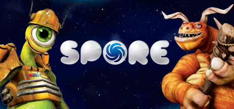
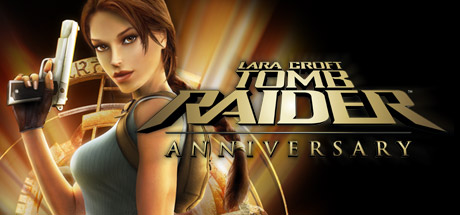

# Mobile phone

[← Back to index](../README.md)

8 titles across 3 years in this archive.

## 2008

[Full 2008 page](../years/2008.md)

### Boom Blox

**Platforms:** Mobile phone, Wii &nbsp;|&nbsp; **Released:** May 6

[Wikipedia](https://en.wikipedia.org/wiki/Boom_Blox)

---

### FIFA 09

**Platforms:** Mobile phone, Nintendo DS, PlayStation 2, PlayStation 3, PlayStation Portable, Wii, Windows, Xbox 360 &nbsp;|&nbsp; **Released:** October 14

[Wikipedia](https://en.wikipedia.org/wiki/FIFA_09)

---

### Need for Speed: Undercover

**Platforms:** Mobile phone, PlayStation 2, PlayStation 3, PlayStation Portable, Wii, Windows, Xbox 360 &nbsp;|&nbsp; **Released:** November 18

---

### Spore

**Platforms:** macOS, Mobile phone, Nintendo DS, Windows &nbsp;|&nbsp; **Genre:** Action, Adventure, Casual, RPG, Simulation, Strategy &nbsp;|&nbsp; **Released:** September 5

> Be the architect of your own universe with Spore, an exciting single-player adventure. From Single Cell to Galactic God, evolve your creature in a universe of your own creations.
>
> _Synopsis source: Steam_

[Wikipedia](https://en.wikipedia.org/wiki/Spore_(2008_video_game)) · [Steam](https://store.steampowered.com/app/17390)

---

### WWE SmackDown vs. Raw 2009

**Platforms:** Mobile phone, Nintendo DS, PlayStation 2, PlayStation 3, PlayStation Portable, Wii, Xbox 360 &nbsp;|&nbsp; **Released:** November 11

[Wikipedia](https://en.wikipedia.org/wiki/WWE_SmackDown_vs._Raw_2009)

---

## 2007

[Full 2007 page](../years/2007.md)

### Tomb Raider: Anniversary

**Platforms:** PlayStation 2, Windows, PlayStation Portable, Xbox 360, Wii, Mobile phone &nbsp;|&nbsp; **Genre:** Action, Adventure &nbsp;|&nbsp; **Released:** June 5

> Tomb Raider: Anniversary retraces Lara Croft's original genre-defining adventure — globe-trotting 3rd person action-adventure in pursuit of the legendary Scion artifact. Using an enhanced 'Tomb Raider: Legend' game engine, the graphics, technology and physics bring Lara's adventure and pursuit of a mystical artifact known only as the...
>
> _Synopsis source: Steam_

[Steam](https://store.steampowered.com/app/8000)

---

## 2005

[Full 2005 page](../years/2005.md)

### FIFA 06

**Platforms:** Windows, PlayStation 2, Xbox, GameCube, Nintendo DS, Mobile phone, PlayStation Portable, Game Boy Advance &nbsp;|&nbsp; **Released:** October 4

[Wikipedia](https://en.wikipedia.org/wiki/FIFA_06)

---

### Star Wars Episode III: Revenge of the Sith

**Platforms:** PlayStation 2, Xbox, Game Boy Advance, Nintendo DS, Mobile phone &nbsp;|&nbsp; **Released:** May 5

---
