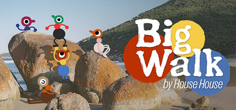
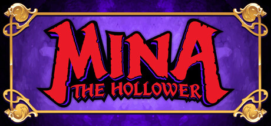
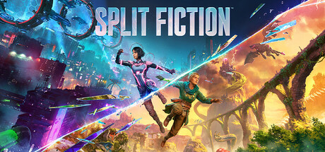

# Nintendo Switch 2

[← Back to index](../README.md)

607 titles across 5 years in this archive.

## 2028

[Full 2028 page](../years/2028.md)

### Precognition

**Platforms:** Windows, PlayStation 5, Xbox Series X/S, Nintendo Switch 2 &nbsp;|&nbsp; **Developer:** Sam Barlow, Half Mermaid &nbsp;|&nbsp; **Publisher:** Kinetic Publishing &nbsp;|&nbsp; **Genre:** Adventure, Indie &nbsp;|&nbsp; **Expected:** June 30, 2028

> PRECOGNITION follows in the footsteps of Sam Barlow’s previous game, IMMORTALITY, combining cinematic live-action sequences with non-linear storytelling and a focus on player freedom and agency. Players take on the role of Diana, a woman who discovers she can receive visions of the future after an experimental implant is embedded into her brain.
>
> _Synopsis source: IGDB_

[IGDB](https://www.igdb.com/games/precognition)

---

### Wonderful Neoran Valley

**Platforms:** Nintendo Switch 2, Windows, PlayStation 5 &nbsp;|&nbsp; **Developer:** Nara Studio &nbsp;|&nbsp; **Genre:** Turn-based strategy (TBS), Adventure, Indie &nbsp;|&nbsp; **Expected:** 2028 (date TBA)

> Wonderful Neoran Valley is a Monster Collector Roguelite experience, in which you will have to convince the creatures you meet to follow you and fight by your side, on your way to uncovering the dark secret that plagues the Neoran Valley. Yes, you read that correctly: Roguelite!
>
> _Synopsis source: IGDB_

[IGDB](https://www.igdb.com/games/wonderful-neoran-valley)

---

## 2027

[Full 2027 page](../years/2027.md)

### 007 First Light

**Platforms:** Nintendo Switch 2 &nbsp;|&nbsp; **Developer:** IO Interactive &nbsp;|&nbsp; **Publisher:** IO Interactive &nbsp;|&nbsp; **Genre:** Action-adventure &nbsp;|&nbsp; **Released:** March 18

[Wikipedia](https://en.wikipedia.org/wiki/007_First_Light)

---

### 13Z: The Zodiac Trials

**Platforms:** Nintendo Switch 2, PlayStation 5 &nbsp;|&nbsp; **Developer:** Mixed Realms &nbsp;|&nbsp; **Publisher:** Clouded Leopard Entertainment &nbsp;|&nbsp; **Genre:** Action, Roguelike &nbsp;|&nbsp; **Released:** January 14

---

### 171

**Platforms:** Windows, Nintendo Switch, Nintendo Switch 2, PlayStation 4, PlayStation 5, Xbox One, Xbox Series X/S &nbsp;|&nbsp; **Developer:** Betagames Group &nbsp;|&nbsp; **Publisher:** Betagames Group, QUByte Interactive &nbsp;|&nbsp; **Genre:** Action-adventure

[Wikipedia](https://en.wikipedia.org/wiki/171_(video_game))

---

### Among Us Story: On Guard

**Platforms:** Windows, macOS, Nintendo Switch 2, iOS, Android &nbsp;|&nbsp; **Developer:** Innersloth &nbsp;|&nbsp; **Publisher:** Innersloth &nbsp;|&nbsp; **Genre:** Adventure &nbsp;|&nbsp; **Released:** February 17

---

### Arizona Sunshine

**Platforms:** Windows, Nintendo Switch 2, PlayStation 5, Xbox Series X/S &nbsp;|&nbsp; **Developer:** Vertigo Games &nbsp;|&nbsp; **Publisher:** Vertigo Games &nbsp;|&nbsp; **Genre:** TPS &nbsp;|&nbsp; **Released:** January 21

[Wikipedia](https://en.wikipedia.org/wiki/Arizona_Sunshine)

---

### Armatus

**Platforms:** Windows, Nintendo Switch 2, PlayStation 5, Xbox Series X/S &nbsp;|&nbsp; **Developer:** Counterplay Games &nbsp;|&nbsp; **Publisher:** Fictions &nbsp;|&nbsp; **Genre:** Roguelike, TPS &nbsp;|&nbsp; **Released:** January 7

> ARMATUS is a third-person roguelite shooter set in the demon-infested ruins of Paris. As the last supernatural warrior of an ancient order, armed with powerful firearms and incredible celestial powers, scour the city in search of a lost gateway to heaven - the Sunless Gate.
>
> _Synopsis source: IGDB_

[IGDB](https://www.igdb.com/games/armatus)

---

### Astonishia Story

**Platforms:** Windows, Nintendo Switch, Nintendo Switch 2, PlayStation 5 &nbsp;|&nbsp; **Developer:** Netmarble Neo , Waycoder &nbsp;|&nbsp; **Publisher:** NIS America &nbsp;|&nbsp; **Genre:** RPG &nbsp;|&nbsp; **Released:** February 11 (WW)

[Wikipedia](https://en.wikipedia.org/wiki/Astonishia_Story)

---

### Atelier Karia: The Night Kingdom & the Guide of Memories

**Platforms:** Windows, Nintendo Switch 2, PlayStation 5, Xbox Series X/S &nbsp;|&nbsp; **Developer:** Gust &nbsp;|&nbsp; **Publisher:** Koei Tecmo &nbsp;|&nbsp; **Genre:** RPG &nbsp;|&nbsp; **Released:** February 25

---

### Becrowned

**Platforms:** macOS, Windows, Xbox Series X/S, Nintendo Switch 2, PlayStation 5 &nbsp;|&nbsp; **Developer:** 13th Street Studio &nbsp;|&nbsp; **Publisher:** Top Hat Studios &nbsp;|&nbsp; **Genre:** Adventure, Indie &nbsp;|&nbsp; **Expected:** March 31, 2027

> Surreal survival horror in a world standing between reality and dreams. Unravel all the mysteries of the dark world, escape from your own fears, and explore the terrifying world where fire no longer burns.
>
> _Synopsis source: IGDB_

[IGDB](https://www.igdb.com/games/becrowned)

---

### Blighted

**Platforms:** Windows, Nintendo Switch 2 &nbsp;|&nbsp; **Developer:** DrinkBox Studios &nbsp;|&nbsp; **Publisher:** DrinkBox Studios &nbsp;|&nbsp; **Genre:** Action role-playing

> Battle your way through a psychedelic western nightmare to reclaim the memories of your people in this action RPG from the creators of Guacamelee! Harness the power of the deadly, reality-altering Blight and unravel the mysteries of a twisted world.
>
> _Synopsis source: IGDB_

[Wikipedia](https://en.wikipedia.org/wiki/Blighted_(video_game)) · [IGDB](https://www.igdb.com/games/blighted)

---

### Cassette Beasts 2002

**Platforms:** Windows, Linux, Nintendo Switch 2, PlayStation 5, Xbox Series X/S &nbsp;|&nbsp; **Developer:** Bytten Studio &nbsp;|&nbsp; **Publisher:** Raw Fury &nbsp;|&nbsp; **Genre:** RPG &nbsp;|&nbsp; **Released:** March

[Wikipedia](https://en.wikipedia.org/wiki/Cassette_Beasts)

---

### Crazy Taxi: World Tour

**Platforms:** Nintendo Switch 2, PlayStation 5, Windows, Xbox Series X/S &nbsp;|&nbsp; **Developer:** Sega &nbsp;|&nbsp; **Publisher:** Sega &nbsp;|&nbsp; **Genre:** Racing

> It's time for crazy driving, crazy adventure, and crazy money! Crazy Taxi is back and going global!  In this new high-octane adventure, follow Axel as he chases down the mysterious masked villains who stole his beloved taxi. Tackle extreme missions around the world all while earning some CRAZY money!
>
> _Synopsis source: IGDB_

[Wikipedia](https://en.wikipedia.org/wiki/Crazy_Taxi:_World_Tour) · [IGDB](https://www.igdb.com/games/crazy-taxi-world-tour)

---

### Danganronpa 2x2

**Platforms:** Nintendo Switch, Nintendo Switch 2, Windows, PlayStation 5, Xbox Series X/S &nbsp;|&nbsp; **Developer:** Gemdrops, Inc. &nbsp;|&nbsp; **Publisher:** Spike Chunsoft &nbsp;|&nbsp; **Genre:** Adventure, Visual Novel &nbsp;|&nbsp; **Expected:** January 14, 2027

> A new killing game begins in the same setting and with the same characters as Danganronpa 2: Goodbye Despair. A brand-new scenario with different victims, culprits, and tricks! Reveal the truth by shooting down contradictions in a Class Trial and uncover the culprit of a murder.  The original scenario from Danganronpa 2: Goodbye Despair, with revamped visuals and presentation for modern consoles, is also included.
>
> _Synopsis source: IGDB_

[IGDB](https://www.igdb.com/games/danganronpa-2x2)

---

### Danganronpa 2×2

**Platforms:** Windows, Nintendo Switch, Nintendo Switch 2, PlayStation 5, Xbox Series X/S &nbsp;|&nbsp; **Developer:** Gemdrops, Too Kyo Games &nbsp;|&nbsp; **Publisher:** Spike Chunsoft &nbsp;|&nbsp; **Genre:** Visual novel, Adventure &nbsp;|&nbsp; **Released:** January 14

[Wikipedia](https://en.wikipedia.org/wiki/Danganronpa_2%C3%972)

---

### Deltarune

**Platforms:** macOS, Windows, Nintendo Switch, PlayStation 4, Nintendo Switch 2, PlayStation 5 &nbsp;|&nbsp; **Publisher:** Toby Fox, 8-4 &nbsp;|&nbsp; **Genre:** Role-playing

[Wikipedia](https://en.wikipedia.org/wiki/Deltarune)

---

### Demi and the Fractured Dream

**Platforms:** Windows, Nintendo Switch, Nintendo Switch 2, PlayStation 5, Xbox Series X/S &nbsp;|&nbsp; **Developer:** Yarn Owl &nbsp;|&nbsp; **Publisher:** Annapurna Interactive &nbsp;|&nbsp; **Genre:** Action-adventure &nbsp;|&nbsp; **Released:** February

---

### Earth Defense Force 6

**Platforms:** Nintendo Switch 2 &nbsp;|&nbsp; **Developer:** Sandlot &nbsp;|&nbsp; **Publisher:** D3 Publisher &nbsp;|&nbsp; **Genre:** TPS &nbsp;|&nbsp; **Released:** January 28

[Wikipedia](https://en.wikipedia.org/wiki/Earth_Defense_Force_6)

---

### Eternal Anima

**Platforms:** Windows, Nintendo Switch 2, PlayStation 5, Xbox Series X/S &nbsp;|&nbsp; **Developer:** Marvelous &nbsp;|&nbsp; **Publisher:** Marvelous &nbsp;|&nbsp; **Genre:** RPG &nbsp;|&nbsp; **Released:** March 4

---

### Fate/Extra Record

**Platforms:** Windows, Nintendo Switch, Nintendo Switch 2, PlayStation 4, PlayStation 5 &nbsp;|&nbsp; **Developer:** Type-Moon Studio BB, Meteorise &nbsp;|&nbsp; **Publisher:** Aniplex &nbsp;|&nbsp; **Genre:** RPG &nbsp;|&nbsp; **Released:** January 28

[Wikipedia](https://en.wikipedia.org/wiki/Fate/Extra_Record)

---

### Final Fantasy VII Revelation

**Platforms:** Windows, Nintendo Switch 2, PlayStation 5, Xbox Series X/S &nbsp;|&nbsp; **Developer:** Square Enix &nbsp;|&nbsp; **Publisher:** Square Enix &nbsp;|&nbsp; **Genre:** Action RPG &nbsp;|&nbsp; **Released:** April 8

> As the world teeters on the brink of annihilation, the final battle against Sephiroth begins. A meteor mars the sky, monstrous planetary guardians wreak havoc across the globe, and the fires of war rage. Now, Cloud and his companions must stand against this chaos to not only decide the planet's fate, but bring a legendary conflict to its conclusion.  In the final chapter of the FINAL FANTASY VII remake project, the scale has never been larger and the stakes have never been higher. Take to the skies and explore a boundless world, fight alongside a fully assembled party, master strategic and dynamic combat, and prepare yourself for the climactic finale.  A vast planet awaits. Everything leads here.
>
> _Synopsis source: IGDB_

[Wikipedia](https://en.wikipedia.org/wiki/Final_Fantasy_VII_Revelation) · [IGDB](https://www.igdb.com/games/final-fantasy-vii-revelation)

---

### Final Fantasy XIV: Evercold

**Platforms:** Windows, macOS, Nintendo Switch 2, PlayStation 4, PlayStation 5, Xbox Series X/S &nbsp;|&nbsp; **Developer:** Square Enix &nbsp;|&nbsp; **Publisher:** Square Enix &nbsp;|&nbsp; **Genre:** MMORPG &nbsp;|&nbsp; **Released:** January

---

### Fitness Boxing : Touken Ranbu – Shutsujin! Exercise Honmaru

**Platforms:** Nintendo Switch, Nintendo Switch 2 &nbsp;|&nbsp; **Developer:** Imagineer &nbsp;|&nbsp; **Publisher:** Imagineer &nbsp;|&nbsp; **Genre:** Fitness, Rhythm, Sports &nbsp;|&nbsp; **Released:** January 15 (JP)

[Wikipedia](https://en.wikipedia.org/wiki/Fitness_Boxing)

---

### Gal Guardians: Servants of the Dark

**Platforms:** Nintendo Switch 2 &nbsp;|&nbsp; **Developer:** Inti Creates &nbsp;|&nbsp; **Publisher:** Inti Creates &nbsp;|&nbsp; **Genre:** Metroidvania, Action-adventure &nbsp;|&nbsp; **Released:** January 28

---

### Hatsune Miku: Starry Party

**Platforms:** Nintendo Switch 2, Windows &nbsp;|&nbsp; **Developer:** Crypton Future Media, Good Smile Company &nbsp;|&nbsp; **Genre:** Party video game

[Wikipedia](https://en.wikipedia.org/wiki/Hatsune_Miku:_Starry_Party)

---

### Hyrule Warriors: Age of Calamity – Definitive Edition

**Platforms:** Nintendo Switch 2 &nbsp;|&nbsp; **Developer:** Omega Force &nbsp;|&nbsp; **Publisher:** Koei Tecmo &nbsp;|&nbsp; **Genre:** Hack and slash &nbsp;|&nbsp; **Released:** February 25

---

### Into the Dead: Our Darkest Days

**Platforms:** Windows, macOS, Nintendo Switch 2, PlayStation 5, Xbox Series X/S &nbsp;|&nbsp; **Developer:** PikPok &nbsp;|&nbsp; **Publisher:** PikPok &nbsp;|&nbsp; **Genre:** Survival &nbsp;|&nbsp; **Released:** March

---

### Kingdom Hearts IV

**Platforms:** Nintendo Switch 2, PlayStation 5, Windows, Xbox Series X/S &nbsp;|&nbsp; **Developer:** Square Enix Creative Studio 1 &nbsp;|&nbsp; **Publisher:** Square Enix &nbsp;|&nbsp; **Genre:** Action role-playing

> Kingdom Hearts IV follows protagonist Sora and some familiar characters as they journey through the mysterious city of Quadratum. Sora will once again journey to various worlds, where new figures cross his path and new powers awaken in this next chapter.
>
> _Synopsis source: IGDB_

[Wikipedia](https://en.wikipedia.org/wiki/Kingdom_Hearts_IV) · [IGDB](https://www.igdb.com/games/kingdom-hearts-iv)

---

### Kirby and the World Beyond

**Platforms:** Nintendo Switch 2 &nbsp;|&nbsp; **Developer:** HAL Laboratory &nbsp;|&nbsp; **Publisher:** Nintendo &nbsp;|&nbsp; **Genre:** Platform, Adventure

> Get ready to freely explore the World Beyond using Copy Abilities in Kirby and the World Beyond, the latest 3D Kirby adventure, coming to Nintendo Switch 2 in spring 2027!
>
> _Synopsis source: IGDB_

[Wikipedia](https://en.wikipedia.org/wiki/Kirby_and_the_World_Beyond) · [IGDB](https://www.igdb.com/games/kirby-and-the-world-beyond)

---

### LEGO Skylines

**Platforms:** Nintendo Switch 2 &nbsp;|&nbsp; **Developer:** Iceflake Studios &nbsp;|&nbsp; **Publisher:** Paradox Interactive &nbsp;|&nbsp; **Genre:** Simulator, Strategy &nbsp;|&nbsp; **Expected:** 2027 (date TBA)

> Build what only you can in LEGO Skylines. In this cozy, customizable city-builder, your choices bring a living, breathing metropolis to life. Go big or obsess over the details. No instructions. Unlimited space. And there’s just one rule. Make it yours.
>
> _Synopsis source: IGDB_

[IGDB](https://www.igdb.com/games/lego-skylines)

---

### Lelu

**Platforms:** Windows, Nintendo Switch 2, Xbox Series X/S &nbsp;|&nbsp; **Developer:** jamierowan &nbsp;|&nbsp; **Publisher:** Electronic Sheep Games, Super Rare Originals &nbsp;|&nbsp; **Genre:** Metroidvania &nbsp;|&nbsp; **Released:** January 21

---

### Lords of the Fallen II

**Platforms:** Nintendo Switch 2, PlayStation 5, Windows, Xbox Series X/S &nbsp;|&nbsp; **Developer:** Hexworks &nbsp;|&nbsp; **Publisher:** CI Games &nbsp;|&nbsp; **Genre:** Action role-playing

> Lords of the Fallen 2, the highly anticipated sequel to the game released in 2023, is set to arrive in 2026. The team at Hexworks aims to create a sequel incorporating more commercial elements, particularly in visual design, to attract a broader audience of players.
>
> _Synopsis source: IGDB_

[Wikipedia](https://en.wikipedia.org/wiki/Lords_of_the_Fallen_II) · [IGDB](https://www.igdb.com/games/lords-of-the-fallen-ii)

---

### Mega Man: Dual Override

**Platforms:** Nintendo Switch, Nintendo Switch 2, PlayStation 4, PlayStation 5, Windows, Xbox One, Xbox Series X/S &nbsp;|&nbsp; **Developer:** Capcom &nbsp;|&nbsp; **Publisher:** Capcom &nbsp;|&nbsp; **Genre:** Platform

> Mega Man returns in 2027 with a brand-new entry in the classic action platforming series! Override challenges and blast down legions of robots while springboarding across a new array of futuristic frontiers!
>
> _Synopsis source: IGDB_

[Wikipedia](https://en.wikipedia.org/wiki/Mega_Man:_Dual_Override) · [IGDB](https://www.igdb.com/games/mega-man-dual-override)

---

### Melty Blood: Twi-Lumina

**Platforms:** Windows, Nintendo Switch, Nintendo Switch 2, PlayStation 4, PlayStation 5, Xbox One &nbsp;|&nbsp; **Developer:** French-Bread &nbsp;|&nbsp; **Publisher:** Aniplex &nbsp;|&nbsp; **Genre:** Fighting &nbsp;|&nbsp; **Released:** April 22

---

### Metroid Ravenous

**Platforms:** Nintendo Switch 2 &nbsp;|&nbsp; **Developer:** MercurySteam , Nintendo EPD &nbsp;|&nbsp; **Publisher:** Nintendo &nbsp;|&nbsp; **Genre:** Action-adventure &nbsp;|&nbsp; **Released:** January 28

> It’s eat or be eaten! Take control of Samus Aran, a renowned bounty hunter ambushed by unknown attackers and marooned on an unfamiliar moon. Gather your arsenal, navigate a maze of corridors, hunt down powerful bosses, and use your newly awakened Metroid instincts to devour your foes. You’ll need to strike quickly and aggressively with beams, missiles, and more—lest you become the enemy’s next meal.
>
> _Synopsis source: IGDB_

[Wikipedia](https://en.wikipedia.org/wiki/Metroid_Ravenous) · [IGDB](https://www.igdb.com/games/metroid-ravenous)

---

### Muramasa: Revenant Blades

**Platforms:** Windows, Nintendo Switch, Nintendo Switch 2, PlayStation 5 &nbsp;|&nbsp; **Developer:** Vanillaware &nbsp;|&nbsp; **Publisher:** Marvelous Entertainment &nbsp;|&nbsp; **Genre:** Action RPG &nbsp;|&nbsp; **Released:** February 4

> Vanillaware x Marvelous present an action RPG for the ages. Hack and slash your way through a world of restless spirits and Demon Blades. The tales of six fabled protagonists of Japan's Genroku era, each with their own unique fighting style, are about to unfold.
>
> _Synopsis source: IGDB_

[IGDB](https://www.igdb.com/games/muramasa-revenant-blades)

---

### My Time at Evershine

**Platforms:** Nintendo Switch 2, PlayStation 5, Windows, Xbox Series X/S &nbsp;|&nbsp; **Developer:** Pathea Games &nbsp;|&nbsp; **Publisher:** Pathea Games &nbsp;|&nbsp; **Genre:** Simulation, role-playing

> Be the Governor of a brand-new settlement on the fringes of the Free Cities, facing the almighty Duvos Empire. Recruit settlers, build infrastructure, tame the wilds, and lead your people to become a new cornerstone for the Alliance in this adventure-packed simulation RPG!
>
> _Synopsis source: IGDB_

[Wikipedia](https://en.wikipedia.org/wiki/My_Time_at_Evershine) · [IGDB](https://www.igdb.com/games/my-time-at-evershine)

---

### Onyx: The Dark Grip

**Platforms:** Nintendo Switch 2 &nbsp;|&nbsp; **Developer:** Bloober Team &nbsp;|&nbsp; **Publisher:** Broken Mirror Games &nbsp;|&nbsp; **Genre:** Survival horror

> Set in an isolated town trapped in an endless winter, ONYX: The Dark Grip challenges players to survive through two deeply intertwined roles. As The Vessel, players explore a bleak, frozen world, fight for survival, manage scarce resources and confront the dangers hiding within the town and beneath its snow. But human strength can only go so far. When The Vessel cannot survive alone, players become The God, reaching directly into his world to manipulate reality, protect their host and change what happens beyond the limits of an ordinary human being. Survival depends on knowing when to act as The Vessel and when to intervene as The God.
>
> _Synopsis source: IGDB_

[Wikipedia](https://en.wikipedia.org/wiki/Onyx:_The_Dark_Grip) · [IGDB](https://www.igdb.com/games/onyx-the-dark-grip)

---

### Out of Words

**Platforms:** Nintendo Switch 2, PlayStation 5, Windows, Xbox Series X/S &nbsp;|&nbsp; **Developer:** Kong Orange, WiredFly &nbsp;|&nbsp; **Publisher:** Epic Games Publishing &nbsp;|&nbsp; **Genre:** Platform, adventure

> Find your lost voices in a co-op platformer adventure. Together with a friend, via online cross-platform or couch co-op, explore the wild, colorful realm of Vokabulantis as Kurt and Karla in a story about the first time they held hands — where everything you see is crafted by hand.
>
> _Synopsis source: IGDB_

[Wikipedia](https://en.wikipedia.org/wiki/Out_of_Words) · [IGDB](https://www.igdb.com/games/out-of-words)

---

### Persona 4 Revival

**Platforms:** Windows, PlayStation 5, Xbox Series X/S, Nintendo Switch 2 &nbsp;|&nbsp; **Developer:** P-Studio &nbsp;|&nbsp; **Publisher:** Atlus &nbsp;|&nbsp; **Genre:** RPG, Social sim &nbsp;|&nbsp; **Released:** February 18

> Who’s on Air? Legend has it that a mysterious broadcast known as the "Midnight Channel" appears only on rainy nights. The day after it airs, a corpse is found in Inaba, a quiet and peaceful town in rural Japan suddenly thrown into turmoil. To uncover the truth behind these chilling mysteries, you and your friends form an investigation team to unravel the secrets of the Midnight Channel and the bizarre murders. As your adventure unfolds, you face off against "Shadows," eerie manifestations of individuals' darker selves. Together, you awaken a hidden power called "Persona" and embark on a journey to prevent more tragedies while uncovering the truth behind the chaos.
>
> _Synopsis source: IGDB_

[Wikipedia](https://en.wikipedia.org/wiki/Persona_4_Revival) · [IGDB](https://www.igdb.com/games/persona-4-revival)

---

### Pikuniku 2

**Platforms:** Windows, Nintendo Switch 2 &nbsp;|&nbsp; **Genre:** Platform, Puzzle, Adventure

> Absurd puzzle-exploration adventure Pikuniku 2 brings the whimsy! Wander, solve, and gossip your way through a weird and wonderful world where not everything is as happy as it seems. Protect the potato!
>
> _Synopsis source: IGDB_

[Wikipedia](https://en.wikipedia.org/wiki/Pikuniku_2) · [IGDB](https://www.igdb.com/games/pikuniku-2)

---

### Pokémon Winds

**Platforms:** Nintendo Switch 2 &nbsp;|&nbsp; **Developer:** Game Freak &nbsp;|&nbsp; **Publisher:** The Pokémon Company, Nintendo &nbsp;|&nbsp; **Genre:** Role-playing (RPG) &nbsp;|&nbsp; **Expected:** 2027 (date TBA)

> Pokémon Winds and Pokémon Waves are upcoming role-playing video games developed by Game Freak and published by Nintendo and The Pokémon Company for the Nintendo Switch 2. Announced on 27 February 2026, on the franchise's 30th anniversary, they are the first installments in the tenth generation of the Pokémon video game series and the first to be exclusively available on the Switch 2. They are set to release in 2027.
>
> _Synopsis source: IGDB_

[IGDB](https://www.igdb.com/games/pokemon-winds)

---

### Pokémon Winds and Waves

**Platforms:** Nintendo Switch 2 &nbsp;|&nbsp; **Developer:** Game Freak &nbsp;|&nbsp; **Publisher:** The Pokémon Company, Nintendo &nbsp;|&nbsp; **Genre:** Role-playing

[Wikipedia](https://en.wikipedia.org/wiki/Pok%C3%A9mon_Winds_and_Waves)

---

### Psikyo Memories

**Platforms:** Nintendo Switch 2, PlayStation 5 &nbsp;|&nbsp; **Developer:** Edia &nbsp;|&nbsp; **Publisher:** Edia &nbsp;|&nbsp; **Genre:** Shoot 'em up &nbsp;|&nbsp; **Released:** February 18

[Wikipedia](https://en.wikipedia.org/wiki/Psikyo#Compilations)

---

### Resident Evil Veronica

**Platforms:** Nintendo Switch 2, PlayStation 5, Windows, Xbox Series X/S &nbsp;|&nbsp; **Developer:** Capcom &nbsp;|&nbsp; **Publisher:** Capcom &nbsp;|&nbsp; **Genre:** Survival horror

> Claire Redfield returns to the forefront in this remake of the title originally released on the Dreamcast in 2000 and the following year on PlayStation 2. This new version preserves the essence of the original game while introducing modernized gameplay, a reimagined storyline, and vividly detailed graphics.
>
> _Synopsis source: IGDB_

[Wikipedia](https://en.wikipedia.org/wiki/Resident_Evil_Veronica) · [IGDB](https://www.igdb.com/games/resident-evil-veronica)

---

### Romancing SaGa 3: Destinies United

**Platforms:** Windows, Nintendo Switch, Nintendo Switch 2, PlayStation 5, Xbox Series X/S &nbsp;|&nbsp; **Developer:** Square Enix &nbsp;|&nbsp; **Publisher:** Square Enix &nbsp;|&nbsp; **Genre:** RPG &nbsp;|&nbsp; **Released:** February 16

---

### Shin-chan: Me and the Professor on Summer Vacation

**Platforms:** Nintendo Switch 2 &nbsp;|&nbsp; **Developer:** Millennium Kitchen &nbsp;|&nbsp; **Publisher:** Neos &nbsp;|&nbsp; **Genre:** Adventure &nbsp;|&nbsp; **Released:** March 4

---

### Shin-chan: Shiro and the Coal Town

**Platforms:** Nintendo Switch 2 &nbsp;|&nbsp; **Developer:** Millennium Kitchen &nbsp;|&nbsp; **Publisher:** Neos &nbsp;|&nbsp; **Genre:** Adventure &nbsp;|&nbsp; **Released:** March 4

[Wikipedia](https://en.wikipedia.org/wiki/Crayon_Shin-chan#Video_games)

---

### Shironeko Project Infinity

**Platforms:** Nintendo Switch, Nintendo Switch 2 &nbsp;|&nbsp; **Genre:** Role-playing (RPG), Hack and slash/Beat 'em up

> Shironeko New Project is a co-op action RPG based on the mobile game Shironeko Project but will have a new story with new characters.
>
> _Synopsis source: IGDB_

[Wikipedia](https://en.wikipedia.org/wiki/Shironeko_Project_Infinity) · [IGDB](https://www.igdb.com/games/shironeko-project-infinity)

---

### Spine

**Platforms:** Nintendo Switch 2, PlayStation 5, Windows, Xbox Series X/S &nbsp;|&nbsp; **Developer:** Nekki &nbsp;|&nbsp; **Publisher:** Nekki &nbsp;|&nbsp; **Genre:** Action-adventure, beat 'em up

> Experience Gun Fu like never before with SPINE, an immersive and highly cinematic action game set in a cyberpunk world. Explore the realistic vision of a near-future with a rebellious street artist Redline and her sentient combat implant, Spine, as they challenge a totalitarian AI regime in search of Redline’s captured brother. Participate in epic gunfights against charismatic opponents, while performing spectacular choreography with firearms!
>
> _Synopsis source: IGDB_

[Wikipedia](https://en.wikipedia.org/wiki/Spine_(video_game)) · [IGDB](https://www.igdb.com/games/spine)

---

### Spyder: Agent 8

**Platforms:** Windows, Nintendo Switch, Nintendo Switch 2, PlayStation 5, Xbox Series X/S &nbsp;|&nbsp; **Developer:** Sumo Digital &nbsp;|&nbsp; **Publisher:** PQube &nbsp;|&nbsp; **Genre:** Adventure, Stealth &nbsp;|&nbsp; **Released:** February 11

---

### Spyro: A Realm Beyond

**Platforms:** Nintendo Switch 2, PlayStation 5, Windows, Xbox Series X/S &nbsp;|&nbsp; **Developer:** Toys for Bob &nbsp;|&nbsp; **Publisher:** Activision &nbsp;|&nbsp; **Genre:** Platformer

> Take flight in a brand-new journey through a strange and wondrous realm. When Spyro finds himself stranded, his journey to discover a way home is interrupted by the arrival of a vicious invading force known as the Scavs.
>
> _Synopsis source: IGDB_

[Wikipedia](https://en.wikipedia.org/wiki/Spyro:_A_Realm_Beyond) · [IGDB](https://www.igdb.com/games/spyro-a-realm-beyond)

---

### Stage Fright

**Platforms:** Windows, Nintendo Switch, Nintendo Switch 2 &nbsp;|&nbsp; **Developer:** Ghost Town Games &nbsp;|&nbsp; **Publisher:** Hello Games &nbsp;|&nbsp; **Genre:** Puzzle, Adventure &nbsp;|&nbsp; **Expected:** 2027 (date TBA)

> From the makers of OVERCOOKED! comes an all new co-operative experience. Take your friend on an amazing adventure as you explore, solve escape rooms, overcome fiendish obstacles and unravel an ancient mystery.
>
> _Synopsis source: IGDB_

[IGDB](https://www.igdb.com/games/stage-fright--1)

---

### Terranigma

**Platforms:** Windows, Nintendo Switch, Nintendo Switch 2, PlayStation 4, PlayStation 5, Xbox Series X/S &nbsp;|&nbsp; **Developer:** Clear River Games &nbsp;|&nbsp; **Publisher:** Clear River Games &nbsp;|&nbsp; **Genre:** Action RPG &nbsp;|&nbsp; **Released:** January 14

[Wikipedia](https://en.wikipedia.org/wiki/Terranigma)

---

### The Apothecary Diaries: The False Imperial Brother

**Platforms:** PlayStation 5, Windows, Nintendo Switch, Nintendo Switch 2 &nbsp;|&nbsp; **Genre:** Puzzle, Adventure

> Investigate mysteries, craft medicine, and uncover the truth in this brand-new story from The Apothecary Diaries. Explore the rear palace and capital to gather evidence and question witnesses, then assemble what you've learned into theories and deductions to solve thrilling mysteries in this sprawling adventure game.
>
> _Synopsis source: IGDB_

[Wikipedia](https://en.wikipedia.org/wiki/The_Apothecary_Diaries:_The_False_Imperial_Brother) · [IGDB](https://www.igdb.com/games/the-apothecary-diaries-the-false-imperial-brother)

---

### The Escapists 3

**Platforms:** Windows, Nintendo Switch 2, Xbox Series X/S, PlayStation 5 &nbsp;|&nbsp; **Genre:** Puzzle, Role-playing (RPG), Simulator, Strategy, Indie

> Plan ridiculous prison breaks, outsmart the guards and escape your way in The Escapists 3. Craft, sneak, fight and improvise through a new 3D prison sandbox, alone or with friends. Just remember to make roll call.
>
> _Synopsis source: IGDB_

[Wikipedia](https://en.wikipedia.org/wiki/The_Escapists_3) · [IGDB](https://www.igdb.com/games/the-escapists-3)

---

### The Witcher 3: Wild Hunt – Songs of the Past

**Platforms:** Nintendo Switch 2, PlayStation 5, Windows, Xbox Series X/S &nbsp;|&nbsp; **Developer:** CD Projekt Red, Fool's Theory &nbsp;|&nbsp; **Publisher:** CD Projekt &nbsp;|&nbsp; **Genre:** Action role-playing

[Wikipedia](https://en.wikipedia.org/wiki/The_Witcher_3:_Wild_Hunt_%E2%80%93_Songs_of_the_Past)

---

### The Wolf Among Us 2

**Platforms:** Nintendo Switch, Nintendo Switch 2, PlayStation 5, Windows, Xbox One, Xbox Series X/S &nbsp;|&nbsp; **Developer:** Telltale Games, Trick Studios &nbsp;|&nbsp; **Publisher:** Telltale Games, PM Studios &nbsp;|&nbsp; **Genre:** Graphic adventure, Interactive film

> The Wolf Among Us 2 is an episodic graphic adventure game. It is a sequel to The Wolf Among Us and takes place six months following the events of the first game. Follow Bigby Wolf in a new story filled with not-so-colorful characters from famous fairy tales.
>
> _Synopsis source: IGDB_

[Wikipedia](https://en.wikipedia.org/wiki/The_Wolf_Among_Us_2) · [IGDB](https://www.igdb.com/games/the-wolf-among-us-2)

---

### Tomb Raider: Legacy of Atlantis

**Platforms:** Windows, Nintendo Switch 2, PlayStation 5, Xbox Series X/S &nbsp;|&nbsp; **Developer:** Crystal Dynamics , Flying Wild Hog &nbsp;|&nbsp; **Publisher:** Amazon Game Studios &nbsp;|&nbsp; **Genre:** Action-adventure &nbsp;|&nbsp; **Released:** February 12

> Tomb Raider: Legacy of Atlantis is a reimagining of Lara Croft’s 1996 genre-defining game with visuals powered by Unreal Engine 5, modern gameplay, and new surprises that honor the spirit of the original.
>
> _Synopsis source: IGDB_

[IGDB](https://www.igdb.com/games/tomb-raider-legacy-of-atlantis)

---

### Trine 6: Together in Time

**Platforms:** Windows, Nintendo Switch, Nintendo Switch 2, PlayStation 5, Xbox Series X/S &nbsp;|&nbsp; **Developer:** Frozenbyte &nbsp;|&nbsp; **Publisher:** Cooldown Games &nbsp;|&nbsp; **Genre:** Puzzle-platformer &nbsp;|&nbsp; **Released:** March 4

> Trine 6: Together in Time is a co-op puzzle platformer for 1-4 players. Wit, timing, and teamwork collide as you solve perplexing puzzles, engage cunning creatures, and traverse perilous paths in the next adventure through Trines iconic fantasy world.
>
> _Synopsis source: IGDB_

[Wikipedia](https://en.wikipedia.org/wiki/Trine_(video_game)) · [IGDB](https://www.igdb.com/games/trine-6-together-in-time)

---

### Tropico 7

**Platforms:** Windows, Nintendo Switch 2, PlayStation 5, Xbox Series X/S &nbsp;|&nbsp; **Developer:** Gaming Minds Studios &nbsp;|&nbsp; **Publisher:** Kalypso Media &nbsp;|&nbsp; **Genre:** CMS, Government sim &nbsp;|&nbsp; **Released:** January 28

[Wikipedia](https://en.wikipedia.org/wiki/Tropico_7)

---

### Turok: Origins

**Platforms:** Windows, Nintendo Switch 2, PlayStation 5, Xbox Series X/S &nbsp;|&nbsp; **Developer:** Saber Interactive &nbsp;|&nbsp; **Publisher:** Saber Interactive &nbsp;|&nbsp; **Genre:** Action-adventure

> Play as the legendary Turok warriors to face off against ferocious dinosaurs and a terrifying alien threat that seeks to destroy all human life across the galaxy.
>
> _Synopsis source: IGDB_

[Wikipedia](https://en.wikipedia.org/wiki/Turok:_Origins) · [IGDB](https://www.igdb.com/games/turok-origins)

---

### Wandering Sword

**Platforms:** Nintendo Switch, Nintendo Switch 2, PlayStation 5, Xbox Series X/S &nbsp;|&nbsp; **Developer:** The Swordman Studio &nbsp;|&nbsp; **Publisher:** Clouded Leopard Entertainment, Spiral Up Games &nbsp;|&nbsp; **Genre:** RPG &nbsp;|&nbsp; **Released:** January 21

---

### Wo Long 2: Wings of Ember

**Platforms:** Windows, Nintendo Switch 2, PlayStation 5, Xbox Series X/S &nbsp;|&nbsp; **Developer:** Team Ninja &nbsp;|&nbsp; **Publisher:** Koei Tecmo &nbsp;|&nbsp; **Genre:** Action RPG, Hack and slash &nbsp;|&nbsp; **Released:** March 4

> Born from war's flames, a Phoenix ascends. In this dark fantasy Three Kingdoms action RPG from Team NINJA, players use offensive and defensive Chinese martial arts to fight back against mighty demons on the battlefields of the Three Kingdoms.
>
> _Synopsis source: IGDB_

[IGDB](https://www.igdb.com/games/wo-long-2-wings-of-ember)

---

### Xenoblade Genesis

**Platforms:** Nintendo Switch 2 &nbsp;|&nbsp; **Genre:** Role-playing (RPG)

> A new beginning for the Xenoblade series is coming to Nintendo Switch 2 in 2027.
>
> _Synopsis source: IGDB_

[Wikipedia](https://en.wikipedia.org/wiki/Xenoblade_Genesis) · [IGDB](https://www.igdb.com/games/xenoblade-genesis)

---

### Yu-Gi-Oh! Tag Force GX

**Platforms:** Windows, Nintendo Switch, Nintendo Switch 2 &nbsp;|&nbsp; **Developer:** Matrix Software &nbsp;|&nbsp; **Publisher:** Konami &nbsp;|&nbsp; **Genre:** DCCG, RPG &nbsp;|&nbsp; **Released:** February 16

[Wikipedia](https://en.wikipedia.org/wiki/List_of_Yu-Gi-Oh!_video_games#2020s)

---

## 2026

[Full 2026 page](../years/2026.md)

### 1000xResist – Nintendo Switch 2 Edition

**Platforms:** Nintendo Switch 2 &nbsp;|&nbsp; **Developer:** Sunset Visitor &nbsp;|&nbsp; **Publisher:** Fellow Traveller &nbsp;|&nbsp; **Genre:** Adventure &nbsp;|&nbsp; **Released:** August 20

[Wikipedia](https://en.wikipedia.org/wiki/1000xResist)

---

### 3D Tetris

**Platforms:** Nintendo Switch, Nintendo Switch 2 &nbsp;|&nbsp; **Developer:** T&E Soft &nbsp;|&nbsp; **Publisher:** D4 Enterprise, Nintendo &nbsp;|&nbsp; **Genre:** Puzzle &nbsp;|&nbsp; **Released:** February 17

[Wikipedia](https://en.wikipedia.org/wiki/3D_Tetris)

---

### A-Train 9 Evolution

**Platforms:** Nintendo Switch 2 &nbsp;|&nbsp; **Developer:** Artdink &nbsp;|&nbsp; **Publisher:** Artdink &nbsp;|&nbsp; **Genre:** Business sim &nbsp;|&nbsp; **Released:** June 4 (JP)

[Wikipedia](https://en.wikipedia.org/wiki/A-Train_9_Evolution)

---

### Absolum

**Platforms:** Xbox Series X/S, Nintendo Switch 2, iOS, Android &nbsp;|&nbsp; **Developer:** Guard Crush Games, Supamonks &nbsp;|&nbsp; **Publisher:** Dotemu &nbsp;|&nbsp; **Genre:** Brawler &nbsp;|&nbsp; **Released:** March 25

[Wikipedia](https://en.wikipedia.org/wiki/Absolum)

---

### Akiba Lost

**Platforms:** Windows, Nintendo Switch, Nintendo Switch 2, PlayStation 5 &nbsp;|&nbsp; **Developer:** IzanagiGames &nbsp;|&nbsp; **Publisher:** IzanagiGames &nbsp;|&nbsp; **Genre:** Interactive film, Adventure &nbsp;|&nbsp; **Released:** September 17

---

### Aliens: Fireteam Elite 2

**Platforms:** Windows, PlayStation 5, Xbox Series X/S, Nintendo Switch 2 &nbsp;|&nbsp; **Developer:** Cold Iron Studios &nbsp;|&nbsp; **Publisher:** Daybreak Game Company &nbsp;|&nbsp; **Genre:** TPS &nbsp;|&nbsp; **Released:** August 25

---

### Amanda the Adventurer 3

**Platforms:** Nintendo Switch, Nintendo Switch 2, PlayStation 4, PlayStation 5, Xbox One, Xbox Series X/S &nbsp;|&nbsp; **Developer:** MANGLEDmaw Games &nbsp;|&nbsp; **Publisher:** DreadXP &nbsp;|&nbsp; **Genre:** Horror &nbsp;|&nbsp; **Released:** May 28

[Wikipedia](https://en.wikipedia.org/wiki/Amanda_the_Adventurer#Amanda_the_Adventurer_3_(2025))

---

### Amnesia: Rebirth

**Platforms:** Nintendo Switch 2 &nbsp;|&nbsp; **Developer:** Abylight Studios &nbsp;|&nbsp; **Publisher:** Frictional Games &nbsp;|&nbsp; **Genre:** Survival horror &nbsp;|&nbsp; **Released:** April 30

---

### Ancestors: The Humankind Odyssey

**Platforms:** Nintendo Switch 2, PlayStation 5, Xbox Series X/S &nbsp;|&nbsp; **Developer:** Panache Digital Games &nbsp;|&nbsp; **Publisher:** Fictions &nbsp;|&nbsp; **Genre:** Survival &nbsp;|&nbsp; **Released:** December 8

---

### and Roger

**Platforms:** Nintendo Switch 2, iOS, Android &nbsp;|&nbsp; **Developer:** TearyHand Studio &nbsp;|&nbsp; **Publisher:** Kodansha &nbsp;|&nbsp; **Genre:** Adventure, Visual novel &nbsp;|&nbsp; **Released:** June 18

[Wikipedia](https://en.wikipedia.org/wiki/And_Roger)

---

### Animal Crossing: New Horizons – Nintendo Switch 2 Edition

**Platforms:** Nintendo Switch 2 &nbsp;|&nbsp; **Developer:** Nintendo EPD &nbsp;|&nbsp; **Publisher:** Nintendo &nbsp;|&nbsp; **Genre:** Social sim &nbsp;|&nbsp; **Released:** January 15

---

### Anomalith

**Platforms:** Windows, Nintendo Switch 2, PlayStation 5 &nbsp;|&nbsp; **Developer:** Winning Entertainment Group &nbsp;|&nbsp; **Publisher:** FuRyu &nbsp;|&nbsp; **Genre:** TPS, Survival horror &nbsp;|&nbsp; **Released:** October 29

---

### Another Crab's Treasure – Nintendo Switch 2 Edition

**Platforms:** Nintendo Switch 2 &nbsp;|&nbsp; **Developer:** Aggro Crab &nbsp;|&nbsp; **Publisher:** Aggro Crab &nbsp;|&nbsp; **Genre:** Action-adventure &nbsp;|&nbsp; **Released:** August 20

[Wikipedia](https://en.wikipedia.org/wiki/Another_Crab%27s_Treasure)

---

### Another Eden Begins

**Platforms:** Windows, Nintendo Switch, Nintendo Switch 2 &nbsp;|&nbsp; **Developer:** WFS , Studio Prisma &nbsp;|&nbsp; **Publisher:** WFS &nbsp;|&nbsp; **Genre:** RPG &nbsp;|&nbsp; **Released:** September 17

[Wikipedia](https://en.wikipedia.org/wiki/Another_Eden_Begins)

---

### Atelier Yumia: The Alchemist of Memories & the Envisioned Land – Nintendo Switch 2 Edition

**Platforms:** Nintendo Switch 2 &nbsp;|&nbsp; **Developer:** Gust &nbsp;|&nbsp; **Publisher:** Koei Tecmo &nbsp;|&nbsp; **Genre:** Action RPG &nbsp;|&nbsp; **Released:** June 9

---

### Attack on Titan 3

**Platforms:** Windows, Nintendo Switch 2, PlayStation 5, Xbox Series X/S &nbsp;|&nbsp; **Developer:** Omega Force &nbsp;|&nbsp; **Publisher:** Koei Tecmo &nbsp;|&nbsp; **Genre:** Hack and slash &nbsp;|&nbsp; **Released:** December 10

> Experience the story from beginning to end in the ultimate culmination of the Attack on Titan game series. The ODM action has been further refined, delivering the most exhilarating and stylish combat the series has ever seen.
>
> _Synopsis source: IGDB_

[Wikipedia](https://en.wikipedia.org/wiki/Attack_on_Titan_3) · [IGDB](https://www.igdb.com/games/attack-on-titan-3)

---

### Avatar Legends: The Fighting Game

**Platforms:** Windows, Nintendo Switch, Nintendo Switch 2, PlayStation 5, Xbox Series X/S &nbsp;|&nbsp; **Developer:** Gameplay Group &nbsp;|&nbsp; **Publisher:** PM Studios &nbsp;|&nbsp; **Genre:** Fighting &nbsp;|&nbsp; **Released:** July 23

> Avatar Legends: The Fighting Game is a fast-paced 1v1 fighter where you battle as your favorite characters from the Avatar franchise. Featuring hand-drawn 2D animation true to the series’ roots, proprietary rollback netcode, and full cross-play for smooth, competitive gameplay.
>
> _Synopsis source: IGDB_

[IGDB](https://www.igdb.com/games/avatar-legends-the-fighting-game)

---

### Azure Striker Gunvolt Trilogy Enhanced – Nintendo Switch 2 Edition

**Platforms:** Nintendo Switch 2 &nbsp;|&nbsp; **Developer:** Inti Creates &nbsp;|&nbsp; **Publisher:** Inti Creates &nbsp;|&nbsp; **Genre:** Action, Platformer &nbsp;|&nbsp; **Released:** October 22

[Wikipedia](https://en.wikipedia.org/wiki/Azure_Striker_Gunvolt_3#Future)

---

### Back to the Dawn

**Platforms:** Nintendo Switch, Nintendo Switch 2, PlayStation 5 &nbsp;|&nbsp; **Developer:** Metal Head Games &nbsp;|&nbsp; **Publisher:** Clouded Leopard Entertainment, Spiral Up Games &nbsp;|&nbsp; **Genre:** RPG &nbsp;|&nbsp; **Released:** March 5

[Wikipedia](https://en.wikipedia.org/wiki/Back_to_the_Dawn)

---

### Balloon Kid

**Platforms:** Nintendo Switch, Nintendo Switch 2 &nbsp;|&nbsp; **Developer:** Nintendo R&D1 &nbsp;|&nbsp; **Publisher:** Nintendo &nbsp;|&nbsp; **Genre:** Platformer &nbsp;|&nbsp; **Released:** February 4

[Wikipedia](https://en.wikipedia.org/wiki/Balloon_Kid)

---

### Banchou Tactics: Lion Heart

**Platforms:** Nintendo Switch 2, PlayStation 5, Xbox Series X/S &nbsp;|&nbsp; **Developer:** Corecell Technology, ITSARAAMATA &nbsp;|&nbsp; **Publisher:** Corecell Technology &nbsp;|&nbsp; **Genre:** Action, Tactical RPG &nbsp;|&nbsp; **Released:** September 9

---

### Barbie Rewind

**Platforms:** Windows, Nintendo Switch, Nintendo Switch 2, PlayStation 4, PlayStation 5, Xbox One, Xbox Series X/S &nbsp;|&nbsp; **Developer:** Digital Eclipse &nbsp;|&nbsp; **Publisher:** Atari &nbsp;|&nbsp; **Genre:** — N/a &nbsp;|&nbsp; **Released:** November 12

[Wikipedia](https://en.wikipedia.org/wiki/Barbie_Rewind)

---

### Beyond the Dark: Nightwatch

**Platforms:** Nintendo Switch 2 &nbsp;|&nbsp; **Developer:** Atlantis Studio &nbsp;|&nbsp; **Publisher:** Atlantis Studio &nbsp;|&nbsp; **Genre:** Horror &nbsp;|&nbsp; **Released:** October 22

---

### Big Walk

**Platforms:** Windows, macOS, Nintendo Switch 2, PlayStation 5 &nbsp;|&nbsp; **Developer:** House House &nbsp;|&nbsp; **Publisher:** Panic &nbsp;|&nbsp; **Genre:** Adventure &nbsp;|&nbsp; **Released:** August 4, 2026

> Hang out and get lost with close friends in a big world. A cooperative online walker-talker from the creators of Untitled Goose Game.
>
> _Synopsis source: Steam_

[Wikipedia](https://en.wikipedia.org/wiki/Big_Walk) · [Steam](https://store.steampowered.com/app/1478500) · [IGDB](https://www.igdb.com/games/big-walk)

---

### BioEden

**Platforms:** Windows, Nintendo Switch 2, PlayStation 5, Xbox Series X/S &nbsp;|&nbsp; **Developer:** Broken Arms Games &nbsp;|&nbsp; **Publisher:** Focus Entertainment &nbsp;|&nbsp; **Genre:** CMS &nbsp;|&nbsp; **Released:** September 3

---

### BlazBlue Entropy Effect X – Nintendo Switch 2 Edition

**Platforms:** Nintendo Switch 2 &nbsp;|&nbsp; **Developer:** 91Act &nbsp;|&nbsp; **Publisher:** Astrolabe Games &nbsp;|&nbsp; **Genre:** Action, Roguelike &nbsp;|&nbsp; **Released:** August 13

[Wikipedia](https://en.wikipedia.org/wiki/BlazBlue_Entropy_Effect)

---

### Blood Dungeon

**Platforms:** Windows, macOS, Nintendo Switch, Nintendo Switch 2, PlayStation 5, Xbox Series X/S &nbsp;|&nbsp; **Developer:** Messhof &nbsp;|&nbsp; **Publisher:** Messhof &nbsp;|&nbsp; **Genre:** Platformer, Survival &nbsp;|&nbsp; **Released:** August 25

---

### Blue Prince

**Platforms:** Nintendo Switch 2 &nbsp;|&nbsp; **Developer:** Dogubomb &nbsp;|&nbsp; **Publisher:** Raw Fury &nbsp;|&nbsp; **Genre:** Puzzle, Adventure &nbsp;|&nbsp; **Released:** March 3

[Wikipedia](https://en.wikipedia.org/wiki/Blue_Prince)

---

### Blue Reflection Quartet

**Platforms:** Windows, Nintendo Switch, Nintendo Switch 2, PlayStation 5 &nbsp;|&nbsp; **Developer:** Gust &nbsp;|&nbsp; **Publisher:** Koei Tecmo &nbsp;|&nbsp; **Genre:** RPG &nbsp;|&nbsp; **Released:** July 30

[Wikipedia](https://en.wikipedia.org/wiki/Blue_Reflection)

---

### Bluey's Happy Snaps

**Platforms:** Windows, Nintendo Switch, Nintendo Switch 2, PlayStation 4, PlayStation 5, Xbox One, Xbox Series X/S &nbsp;|&nbsp; **Developer:** Gameloft Brisbane &nbsp;|&nbsp; **Publisher:** Gameloft &nbsp;|&nbsp; **Genre:** Adventure &nbsp;|&nbsp; **Released:** October 15

[Wikipedia](https://en.wikipedia.org/wiki/Bluey%27s_Happy_Snaps)

---

### Bluey's Quest for the Gold Pen

**Platforms:** Windows, Nintendo Switch, Nintendo Switch 2, PlayStation 4, PlayStation 5, Xbox Series X/S &nbsp;|&nbsp; **Developer:** Halfbrick Studios &nbsp;|&nbsp; **Publisher:** PM Studios &nbsp;|&nbsp; **Genre:** Adventure &nbsp;|&nbsp; **Released:** May 28

[Wikipedia](https://en.wikipedia.org/wiki/Bluey%27s_Quest_for_the_Gold_Pen)

---

### Boku to Tsuri Nikki

**Platforms:** Nintendo Switch, Nintendo Switch 2 &nbsp;|&nbsp; **Developer:** Toybox &nbsp;|&nbsp; **Publisher:** Imagineer &nbsp;|&nbsp; **Genre:** Action &nbsp;|&nbsp; **Released:** October 8 (JP)

---

### Bokura

**Platforms:** Nintendo Switch 2 &nbsp;|&nbsp; **Developer:** Tokoronyori, Action-adventure &nbsp;|&nbsp; **Publisher:** Kodansha &nbsp;|&nbsp; **Genre:** Puzzle &nbsp;|&nbsp; **Released:** July 29

---

### Brigandine: Abyss

**Platforms:** Windows, Nintendo Switch 2, PlayStation 5, Xbox Series X/S &nbsp;|&nbsp; **Developer:** Happinet &nbsp;|&nbsp; **Publisher:** Happinet, NIS America &nbsp;|&nbsp; **Genre:** Tactical RPG &nbsp;|&nbsp; **Released:** August 26

---

### Bubsy 4D

**Platforms:** Windows, Nintendo Switch, Nintendo Switch 2, PlayStation 4, PlayStation 5, Xbox One, Xbox Series X/S &nbsp;|&nbsp; **Developer:** Fabraz &nbsp;|&nbsp; **Publisher:** Atari &nbsp;|&nbsp; **Genre:** Platformer &nbsp;|&nbsp; **Released:** May 22

[Wikipedia](https://en.wikipedia.org/wiki/Bubsy_4D)

---

### Call of Duty: Modern Warfare 4

**Platforms:** Windows, Nintendo Switch 2, PlayStation 5, Xbox Series X/S &nbsp;|&nbsp; **Developer:** Infinity Ward &nbsp;|&nbsp; **Publisher:** Activision &nbsp;|&nbsp; **Genre:** FPS &nbsp;|&nbsp; **Released:** October 23

> Call of Duty: Modern Warfare 4 is a first-person shooter and the follow-up to Modern Warfare III (2023), continuing the rebooted Modern Warfare storyline. The campaign is set during a North Korean invasion of South Korea and features dual perspectives: a young South Korean soldier named Private Park facing his first combat deployment, and Captain Price operating outside official channels on a personal mission. The game also includes multiplayer with 6v6 core maps, large-scale vehicle combat maps, and a dynamic map system called Kill Block that reshapes layouts between rounds. A DMZ extraction mode is also featured. The game is released exclusively on current-generation platforms and PC.
>
> _Synopsis source: IGDB_

[IGDB](https://www.igdb.com/games/call-of-duty-modern-warfare-4)

---

### Call of the Elder Gods

**Platforms:** Windows, Nintendo Switch 2, PlayStation 5, Xbox Series X/S &nbsp;|&nbsp; **Developer:** Out of the Blue Games &nbsp;|&nbsp; **Publisher:** Kwalee &nbsp;|&nbsp; **Genre:** Puzzle, Adventure &nbsp;|&nbsp; **Released:** May 12

> Journey to the far corners of the Earth and unearth ancient horrors in this Lovecraftian narrative puzzle adventure and sequel to 2020’s critically acclaimed Call of the Sea.
>
> _Synopsis source: IGDB_

[Wikipedia](https://en.wikipedia.org/wiki/Call_of_the_Elder_Gods) · [IGDB](https://www.igdb.com/games/call-of-the-elder-gods)

---

### Card & Casino

**Platforms:** Nintendo Switch 2 &nbsp;|&nbsp; **Developer:** D3 Publisher &nbsp;|&nbsp; **Publisher:** D3 Publisher &nbsp;|&nbsp; **Genre:** Digital tabletop &nbsp;|&nbsp; **Released:** April 23

[Wikipedia](https://en.wikipedia.org/wiki/Card_%26_Casino)

---

### Card-en-Ciel – Nintendo Switch 2 Edition

**Platforms:** Nintendo Switch 2 &nbsp;|&nbsp; **Developer:** Inti Creates &nbsp;|&nbsp; **Publisher:** Inti Creates &nbsp;|&nbsp; **Genre:** Deck building, RPG &nbsp;|&nbsp; **Released:** January 29

---

### Carmageddon : Rogue Shift

**Platforms:** Windows, Nintendo Switch 2, PlayStation 5, Xbox Series X/S &nbsp;|&nbsp; **Developer:** 34BigThings &nbsp;|&nbsp; **Publisher:** 34BigThings &nbsp;|&nbsp; **Genre:** Vehicular combat, Racing &nbsp;|&nbsp; **Released:** February 6

> Carmageddon smashes back with brutal roguelite vehicular‑combat mayhem. Adapt, upgrade, and unleash destruction on post‑apocalyptic zombie hordes. The legacy lives on, reinvented and unforgiving.
>
> _Synopsis source: IGDB_

[Wikipedia](https://en.wikipedia.org/wiki/Carmageddon) · [IGDB](https://www.igdb.com/games/carmageddon-rogue-shift)

---

### Chit Chat Party!

**Platforms:** Nintendo Switch 2 &nbsp;|&nbsp; **Developer:** Alim &nbsp;|&nbsp; **Publisher:** GungHo Online Entertainment &nbsp;|&nbsp; **Genre:** Party &nbsp;|&nbsp; **Released:** September 16

---

### Chivalware

**Platforms:** Windows, Nintendo Switch 2 &nbsp;|&nbsp; **Developer:** Regal Pigeon &nbsp;|&nbsp; **Publisher:** The Arcade Crew , Imperfect Games &nbsp;|&nbsp; **Genre:** Action, Roguelite &nbsp;|&nbsp; **Released:** November 5

---

### ChromaGun 2: Dye Hard

**Platforms:** Windows, Nintendo Switch 2, PlayStation 5, Xbox Series X/S &nbsp;|&nbsp; **Developer:** Pixel Maniacs &nbsp;|&nbsp; **Publisher:** PM Studios &nbsp;|&nbsp; **Genre:** Puzzle, FPS &nbsp;|&nbsp; **Released:** February 12

---

### Cities: Skylines – Expanded Edition

**Platforms:** Nintendo Switch 2 &nbsp;|&nbsp; **Developer:** Tantalus Media &nbsp;|&nbsp; **Publisher:** Paradox Interactive &nbsp;|&nbsp; **Genre:** City builder, CMS &nbsp;|&nbsp; **Released:** October 28

---

### Citizen Sleeper

**Platforms:** Nintendo Switch 2 &nbsp;|&nbsp; **Developer:** Jump Over the Age &nbsp;|&nbsp; **Publisher:** Fellow Traveller &nbsp;|&nbsp; **Genre:** RPG &nbsp;|&nbsp; **Released:** June 25

[Wikipedia](https://en.wikipedia.org/wiki/Citizen_Sleeper)

---

### Citizen Sleeper 2: Starward Vector

**Platforms:** Nintendo Switch 2 &nbsp;|&nbsp; **Developer:** Jump Over the Age &nbsp;|&nbsp; **Publisher:** Fellow Traveller &nbsp;|&nbsp; **Genre:** RPG &nbsp;|&nbsp; **Released:** June 25

---

### City Hunter

**Platforms:** Windows, Nintendo Switch, Nintendo Switch 2, PlayStation 5, Xbox Series X/S &nbsp;|&nbsp; **Developer:** Sunsoft , Red Art Studios &nbsp;|&nbsp; **Publisher:** Sunsoft, Clouded Leopard Entertainment &nbsp;|&nbsp; **Genre:** Action &nbsp;|&nbsp; **Released:** February 26

[Wikipedia](https://en.wikipedia.org/wiki/City_Hunter#Video_games)

---

### Clive Barker's Hellraiser: Revival

**Platforms:** Windows, Nintendo Switch 2, PlayStation 5, Xbox Series X/S &nbsp;|&nbsp; **Developer:** Saber Interactive &nbsp;|&nbsp; **Publisher:** Saber Interactive &nbsp;|&nbsp; **Genre:** Survival horror, Action &nbsp;|&nbsp; **Released:** October 8

> Experience a new chapter in the legendary horror series like never before. Clive Barker's Hellraiser: Revival takes first-person action horror survival to the next level. Wield the powers of the Genesis Configuration puzzle box to survive your bargain with the infamous Pinhead.
>
> _Synopsis source: IGDB_

[IGDB](https://www.igdb.com/games/clive-barkers-hellraiser-revival)

---

### CloverPit

**Platforms:** Nintendo Switch, Nintendo Switch 2, PlayStation 4, PlayStation 5 &nbsp;|&nbsp; **Developer:** Panik Arcade &nbsp;|&nbsp; **Publisher:** Future Friends Games &nbsp;|&nbsp; **Genre:** Roguelike, Horror (psych) &nbsp;|&nbsp; **Released:** August 13

[Wikipedia](https://en.wikipedia.org/wiki/CloverPit)

---

### Coffee Talk Tokyo

**Platforms:** Windows, Nintendo Switch, Nintendo Switch 2, PlayStation 5, Xbox Series X/S &nbsp;|&nbsp; **Developer:** Toge Productions, Chorus Worldwide &nbsp;|&nbsp; **Publisher:** Chorus Worldwide &nbsp;|&nbsp; **Genre:** Visual novel &nbsp;|&nbsp; **Released:** May 21

[Wikipedia](https://en.wikipedia.org/wiki/Coffee_Talk_Tokyo)

---

### Colorbound

**Platforms:** Windows, Nintendo Switch, Nintendo Switch 2, PlayStation 4, PlayStation 5, Xbox One, Xbox Series X/S &nbsp;|&nbsp; **Developer:** Panpipe Studios &nbsp;|&nbsp; **Publisher:** Whitethorn Games &nbsp;|&nbsp; **Genre:** Puzzle-platformer &nbsp;|&nbsp; **Released:** October 12

---

### Constance

**Platforms:** Nintendo Switch, PlayStation 5, Xbox Series X/S, Nintendo Switch 2 &nbsp;|&nbsp; **Developer:** btf &nbsp;|&nbsp; **Publisher:** btf, ByteRockers' Games, Parco Games &nbsp;|&nbsp; **Genre:** Metroidvania &nbsp;|&nbsp; **Released:** May 1

[Wikipedia](https://en.wikipedia.org/wiki/Constance_(video_game))

---

### Content Warning

**Platforms:** Nintendo Switch, Nintendo Switch 2, PlayStation 5, Xbox One, Xbox Series X/S &nbsp;|&nbsp; **Developer:** Landfall &nbsp;|&nbsp; **Publisher:** Landfall &nbsp;|&nbsp; **Genre:** Survival horror &nbsp;|&nbsp; **Released:** April 1

[Wikipedia](https://en.wikipedia.org/wiki/Content_Warning)

---

### Core Keeper – Nintendo Switch 2 Edition

**Platforms:** Nintendo Switch 2 &nbsp;|&nbsp; **Developer:** Pugstorm &nbsp;|&nbsp; **Publisher:** Fireshine Games &nbsp;|&nbsp; **Genre:** Sandbox, Survival &nbsp;|&nbsp; **Released:** January 28

[Wikipedia](https://en.wikipedia.org/wiki/Core_Keeper_%E2%80%93_Nintendo_Switch_2_Edition)

---

### Cotton Reboot!

**Platforms:** Nintendo Switch 2, PlayStation 5 &nbsp;|&nbsp; **Developer:** Rocket-Engine Co., Ltd &nbsp;|&nbsp; **Publisher:** Clear River Games &nbsp;|&nbsp; **Genre:** Shoot 'em up &nbsp;|&nbsp; **Released:** October 22

[Wikipedia](https://en.wikipedia.org/wiki/Cotton_Reboot!)

---

### Cotton Rock with You: Oriental Night Dreams

**Platforms:** Windows, Nintendo Switch 2, PlayStation 5 &nbsp;|&nbsp; **Developer:** Success &nbsp;|&nbsp; **Publisher:** Success &nbsp;|&nbsp; **Genre:** Shooter &nbsp;|&nbsp; **Released:** August 6 (JP)

---

### Cozy Grove : Camp Spirit

**Platforms:** Windows, Nintendo Switch, Nintendo Switch 2, PlayStation 4, PlayStation 5, Xbox One, Xbox Series X/S &nbsp;|&nbsp; **Developer:** Spry Fox &nbsp;|&nbsp; **Publisher:** Spry Fox &nbsp;|&nbsp; **Genre:** Life sim &nbsp;|&nbsp; **Released:** July 15

[Wikipedia](https://en.wikipedia.org/wiki/Cozy_Grove)

---

### Crisis Core: Final Fantasy VII Reunion

**Platforms:** Nintendo Switch 2 &nbsp;|&nbsp; **Developer:** Square Enix &nbsp;|&nbsp; **Publisher:** Square Enix &nbsp;|&nbsp; **Genre:** Action RPG &nbsp;|&nbsp; **Released:** September 9

---

### Crymelight

**Platforms:** Windows, Nintendo Switch 2, PlayStation 5 &nbsp;|&nbsp; **Developer:** FuRyu &nbsp;|&nbsp; **Publisher:** FuRyu &nbsp;|&nbsp; **Genre:** Roguelike, Action &nbsp;|&nbsp; **Released:** November 5

---

### Culdcept Begins

**Platforms:** Windows, Nintendo Switch, Nintendo Switch 2 &nbsp;|&nbsp; **Developer:** Neos &nbsp;|&nbsp; **Publisher:** Neos &nbsp;|&nbsp; **Genre:** TBS, DCCG &nbsp;|&nbsp; **Released:** July 16

[Wikipedia](https://en.wikipedia.org/wiki/Culdcept#Culdcept_Begins)

---

### Cult of the Lamb

**Platforms:** Nintendo Switch 2 &nbsp;|&nbsp; **Developer:** Massive Monster &nbsp;|&nbsp; **Publisher:** Devolver Digital &nbsp;|&nbsp; **Genre:** Roguelike, CMS &nbsp;|&nbsp; **Released:** October 22

[Wikipedia](https://en.wikipedia.org/wiki/Cult_of_the_Lamb)

---

### Cult of the Lamb: Woolhaven

**Platforms:** Windows, macOS, Nintendo Switch, PlayStation 4, PlayStation 5, Xbox One, Xbox Series X/S, Nintendo Switch 2, iOS &nbsp;|&nbsp; **Developer:** Massive Monster &nbsp;|&nbsp; **Publisher:** Devolver Digital &nbsp;|&nbsp; **Genre:** Roguelike, CMS &nbsp;|&nbsp; **Released:** January 22

---

### Cultic

**Platforms:** Nintendo Switch 2, PlayStation 5, Xbox Series X/S &nbsp;|&nbsp; **Developer:** Jasozz Games &nbsp;|&nbsp; **Publisher:** 3D Realms &nbsp;|&nbsp; **Genre:** Horror, FPS &nbsp;|&nbsp; **Released:** July 23

[Wikipedia](https://en.wikipedia.org/wiki/Cultic_(video_game))

---

### D-topia

**Platforms:** Windows, Nintendo Switch, Nintendo Switch 2, PlayStation 5, Xbox Series X/S &nbsp;|&nbsp; **Developer:** Marumittu Games &nbsp;|&nbsp; **Publisher:** Annapurna Interactive &nbsp;|&nbsp; **Genre:** Puzzle, Adventure &nbsp;|&nbsp; **Released:** July 14

---

### Daisenryaku SSB2

**Platforms:** Windows, Nintendo Switch, Nintendo Switch 2, PlayStation 5 &nbsp;|&nbsp; **Developer:** SystemSoft Beta &nbsp;|&nbsp; **Publisher:** SystemSoft Beta &nbsp;|&nbsp; **Genre:** Strategy &nbsp;|&nbsp; **Released:** February 26 (JP)

[Wikipedia](https://en.wikipedia.org/wiki/Daisenryaku)

---

### Darwin's Paradox!

**Platforms:** Windows, Nintendo Switch 2, PlayStation 5, Xbox Series X/S &nbsp;|&nbsp; **Developer:** ZeDrimeTim &nbsp;|&nbsp; **Publisher:** Konami Digital Entertainment &nbsp;|&nbsp; **Genre:** Action-adventure, Platformer &nbsp;|&nbsp; **Released:** April 2

> Dive into the adventure with Darwin, an octopus as endearing as he is ingenious, torn from the ocean and trapped in a vast and mysterious industrial complex. Harness his unique talents and abilities to help him overcome the many dangers and traps in this captivating platformer and adventure game.
>
> _Synopsis source: IGDB_

[Wikipedia](https://en.wikipedia.org/wiki/Darwin%27s_Paradox!) · [IGDB](https://www.igdb.com/games/darwins-paradox)

---

### DayZ Cool Edition

**Platforms:** Nintendo Switch 2 &nbsp;|&nbsp; **Developer:** Bohemia Interactive &nbsp;|&nbsp; **Publisher:** Bohemia Interactive &nbsp;|&nbsp; **Genre:** Survival &nbsp;|&nbsp; **Released:** August 20

[Wikipedia](https://en.wikipedia.org/wiki/DayZ_(video_game))

---

### Deck of Haunts

**Platforms:** Nintendo Switch, Nintendo Switch 2, PlayStation 5, Xbox One, Xbox Series X/S &nbsp;|&nbsp; **Developer:** Mantis Games &nbsp;|&nbsp; **Publisher:** Dangen Entertainment &nbsp;|&nbsp; **Genre:** Deck building, Roguelike &nbsp;|&nbsp; **Released:** October 8

---

### Deep Rock Galactic: Survivor

**Platforms:** Nintendo Switch, Nintendo Switch 2, PlayStation 5 &nbsp;|&nbsp; **Developer:** Funday Games &nbsp;|&nbsp; **Publisher:** Ghost Ship Publishing &nbsp;|&nbsp; **Genre:** Bullet heaven &nbsp;|&nbsp; **Released:** October 7

---

### Deltarune: Chapter 5

**Platforms:** Windows, macOS, Nintendo Switch, Nintendo Switch 2, PlayStation 4, PlayStation 5 &nbsp;|&nbsp; **Developer:** Toby Fox , 8-4 (Consoles) &nbsp;|&nbsp; **Publisher:** Toby Fox , 8-4 (Consoles) &nbsp;|&nbsp; **Genre:** RPG, Adventure &nbsp;|&nbsp; **Released:** June 24

[Wikipedia](https://en.wikipedia.org/wiki/Deltarune#Chapter_5_–_Festival_Day)

---

### Demeo x Dungeons & Dragons : Battlemarked

**Platforms:** Nintendo Switch 2, Xbox Series X/S &nbsp;|&nbsp; **Developer:** Resolution Games &nbsp;|&nbsp; **Publisher:** Resolution Games &nbsp;|&nbsp; **Genre:** Strategy, Adventure, RPG &nbsp;|&nbsp; **Released:** June 16

[Wikipedia](https://en.wikipedia.org/wiki/Demeo)

---

### Demon Slayer: Kimetsu no Yaiba – The Hinokami Chronicles 2 – Nintendo Switch 2 Edition

**Platforms:** Nintendo Switch 2 &nbsp;|&nbsp; **Developer:** CyberConnect2 &nbsp;|&nbsp; **Publisher:** Aniplex &nbsp;|&nbsp; **Genre:** Fighting, Action-adventure &nbsp;|&nbsp; **Released:** October 29 (JP)

---

### Denshattack!

**Platforms:** Windows, Nintendo Switch 2, PlayStation 5, Xbox Series X/S &nbsp;|&nbsp; **Developer:** Undercoders &nbsp;|&nbsp; **Publisher:** Fireshine Games &nbsp;|&nbsp; **Genre:** Platformer &nbsp;|&nbsp; **Released:** July 15

> Flip, trick and grind your train in a fast-paced, off-the-rails ride through a colourful Japanese dystopia. Outmatch rival gangs, wreck a shady megacorp, and take back the tracks with nothing but skill, speed, and style.
>
> _Synopsis source: IGDB_

[Wikipedia](https://en.wikipedia.org/wiki/Denshattack!) · [IGDB](https://www.igdb.com/games/denshattack)

---

### Derby Stallion 2

**Platforms:** Nintendo Switch 2 &nbsp;|&nbsp; **Developer:** Game Addict, ParityBit &nbsp;|&nbsp; **Publisher:** Game Addict &nbsp;|&nbsp; **Genre:** Business sim, Racing (horse) &nbsp;|&nbsp; **Released:** September 24 (JP)

[Wikipedia](https://en.wikipedia.org/wiki/Derby_Stallion)

---

### Destroy All Humans!

**Platforms:** Nintendo Switch 2 &nbsp;|&nbsp; **Developer:** Black Forest Games &nbsp;|&nbsp; **Publisher:** THQ Nordic &nbsp;|&nbsp; **Genre:** Action-adventure &nbsp;|&nbsp; **Released:** June 23

[Wikipedia](https://en.wikipedia.org/wiki/Destroy_All_Humans!_(2020_video_game))

---

### Destroy All Humans! 2: Reprobed

**Platforms:** Nintendo Switch 2 &nbsp;|&nbsp; **Developer:** Black Forest Games &nbsp;|&nbsp; **Publisher:** THQ Nordic &nbsp;|&nbsp; **Genre:** Action-adventure &nbsp;|&nbsp; **Released:** September 15

---

### Devil May Cry 5: Devil Hunter Edition

**Platforms:** Nintendo Switch 2 &nbsp;|&nbsp; **Developer:** Capcom &nbsp;|&nbsp; **Publisher:** Capcom &nbsp;|&nbsp; **Genre:** Action-adventure, Hack and slash &nbsp;|&nbsp; **Released:** June 23

---

### Diablo IV : Age of Hatred Collection

**Platforms:** Nintendo Switch 2 &nbsp;|&nbsp; **Developer:** Blizzard Entertainment &nbsp;|&nbsp; **Publisher:** Blizzard Entertainment &nbsp;|&nbsp; **Genre:** Action RPG, Hack and slash &nbsp;|&nbsp; **Released:** September 15

[Wikipedia](https://en.wikipedia.org/wiki/Diablo_IV)

---

### Digimon Story: Time Stranger

**Platforms:** Nintendo Switch, Nintendo Switch 2 &nbsp;|&nbsp; **Developer:** Media.Vision &nbsp;|&nbsp; **Publisher:** Bandai Namco Entertainment &nbsp;|&nbsp; **Genre:** RPG &nbsp;|&nbsp; **Released:** July 9 (JP/WW)

---

### Disgaea Mayhem

**Platforms:** Nintendo Switch, Nintendo Switch 2, PlayStation 5, Windows &nbsp;|&nbsp; **Developer:** Nippon Ichi Software &nbsp;|&nbsp; **Publisher:** Nippon Ichi Software &nbsp;|&nbsp; **Genre:** Action RPG &nbsp;|&nbsp; **Released:** January 29 (JP/WW)

[Wikipedia](https://en.wikipedia.org/wiki/Disgaea_Mayhem)

---

### Disney Dreamlight Valley – Nintendo Switch 2 Edition

**Platforms:** Nintendo Switch 2 &nbsp;|&nbsp; **Developer:** Gameloft Montreal &nbsp;|&nbsp; **Publisher:** Gameloft &nbsp;|&nbsp; **Genre:** Life sim, Adventure &nbsp;|&nbsp; **Released:** March 25

[Wikipedia](https://en.wikipedia.org/wiki/Disney_Dreamlight_Valley)

---

### Disney Epic Mickey: Rebrushed

**Platforms:** Android, iOS, Nintendo Switch 2 &nbsp;|&nbsp; **Developer:** Purple Lamp , Snapshot Games &nbsp;|&nbsp; **Publisher:** THQ Nordic Mobile &nbsp;|&nbsp; **Genre:** Platformer &nbsp;|&nbsp; **Released:** September 16

---

### Dispatch

**Platforms:** Nintendo Switch, Nintendo Switch 2, Xbox Series X/S &nbsp;|&nbsp; **Developer:** AdHoc Studio &nbsp;|&nbsp; **Publisher:** AdHoc Studio &nbsp;|&nbsp; **Genre:** Adventure &nbsp;|&nbsp; **Released:** January 28

[Wikipedia](https://en.wikipedia.org/wiki/Dispatch_(video_game))

---

### Dogpile

**Platforms:** iOS, Android, Nintendo Switch, Nintendo Switch 2 &nbsp;|&nbsp; **Developer:** Studio Folly, Toot Games &nbsp;|&nbsp; **Publisher:** WINGS &nbsp;|&nbsp; **Genre:** Deck building, Roguelite &nbsp;|&nbsp; **Released:** August 20

---

### Donkey Kong 64

**Platforms:** Nintendo Switch, Nintendo Switch 2 &nbsp;|&nbsp; **Developer:** Rare &nbsp;|&nbsp; **Publisher:** Nintendo &nbsp;|&nbsp; **Genre:** Platformer &nbsp;|&nbsp; **Released:** June 4

[Wikipedia](https://en.wikipedia.org/wiki/Donkey_Kong_64)

---

### Dosa Divas: One Last Meal

**Platforms:** Windows, Nintendo Switch, Nintendo Switch 2, PlayStation 5, Xbox Series X/S &nbsp;|&nbsp; **Developer:** Outerloop Games &nbsp;|&nbsp; **Publisher:** Outerloop Games &nbsp;|&nbsp; **Genre:** RPG &nbsp;|&nbsp; **Released:** April 14

---

### Dr. Mario & Puzzle League

**Platforms:** Nintendo Switch, Nintendo Switch 2 &nbsp;|&nbsp; **Developer:** Nintendo R&D1 &nbsp;|&nbsp; **Publisher:** Nintendo &nbsp;|&nbsp; **Genre:** Puzzle &nbsp;|&nbsp; **Released:** July 7

[Wikipedia](https://en.wikipedia.org/wiki/Dr._Mario_%26_Puzzle_League)

---

### Dragon Hopper

**Platforms:** Nintendo Switch, Nintendo Switch 2 &nbsp;|&nbsp; **Developer:** Intelligent Systems &nbsp;|&nbsp; **Publisher:** Nintendo &nbsp;|&nbsp; **Genre:** Action-adventure &nbsp;|&nbsp; **Released:** August 4

[Wikipedia](https://en.wikipedia.org/wiki/Dragon_Hopper)

---

### Dragon Quest Heroes: Torneko's Mystery Dungeon – Classic HD

**Platforms:** Windows, Nintendo Switch, Nintendo Switch 2, PlayStation 5, Xbox Series X/S, iOS, Android &nbsp;|&nbsp; **Developer:** Square Enix &nbsp;|&nbsp; **Publisher:** Square Enix &nbsp;|&nbsp; **Genre:** Roguelike, Role-playing &nbsp;|&nbsp; **Released:** September 9

[Wikipedia](https://en.wikipedia.org/wiki/Torneko%27s_Great_Adventure)

---

### Dragon Quest Monsters: The Withered World

**Platforms:** Windows, Nintendo Switch, Nintendo Switch 2, PlayStation 5, Xbox Series X/S &nbsp;|&nbsp; **Developer:** Tose &nbsp;|&nbsp; **Publisher:** Square Enix &nbsp;|&nbsp; **Genre:** RPG &nbsp;|&nbsp; **Released:** December 3

> In this RPG, you befriend monsters from the Dragon Quest series, raise them up, synthesize new creatures, and pit them against other monsters in battle. Join fledgling monster wranglers Bianca and Nera as they set off on the adventure of a lifetime.
>
> _Synopsis source: IGDB_

[IGDB](https://www.igdb.com/games/dragon-quest-monsters-the-withered-world)

---

### Dragon Quest VII Reimagined

**Platforms:** Windows, Nintendo Switch, Nintendo Switch 2, PlayStation 5, Xbox Series X/S &nbsp;|&nbsp; **Developer:** Square Enix &nbsp;|&nbsp; **Publisher:** Square Enix &nbsp;|&nbsp; **Genre:** RPG &nbsp;|&nbsp; **Released:** February 5

> DRAGON QUEST VII Reimagined is a modern remake of DRAGON QUEST VII, which originally launched on PlayStation in 2000. In this new reimagined version of the game, the core concept of the original title remains, but the battle mechanics, graphics and story have all been updated and improved, providing players with a more streamlined and focused experience. In particular, the graphics in the game were completely overhauled from the original, using real-life doll figures for the characters and monsters that were scanned into the game to create stunning hand-crafted visuals. This definitive version of the game is perfect for fans who want to revisit the beloved story or newcomers who are diving into the world for the first time.
>
> _Synopsis source: IGDB_

[Wikipedia](https://en.wikipedia.org/wiki/Dragon_Quest_VII_Reimagined) · [IGDB](https://www.igdb.com/games/dragon-quest-vii-reimagined)

---

### Dragon Quest XI S: Echoes of an Elusive Age – Definitive Edition

**Platforms:** Nintendo Switch 2 &nbsp;|&nbsp; **Developer:** Square Enix , Orca &nbsp;|&nbsp; **Publisher:** Square Enix &nbsp;|&nbsp; **Genre:** RPG &nbsp;|&nbsp; **Released:** September 24

---

### Dragon's Dogma 2 : Dark Arisen

**Platforms:** Windows, Nintendo Switch 2, PlayStation 5, Xbox Series X/S &nbsp;|&nbsp; **Developer:** Capcom &nbsp;|&nbsp; **Publisher:** Capcom &nbsp;|&nbsp; **Genre:** Action RPG &nbsp;|&nbsp; **Released:** October 9

[Wikipedia](https://en.wikipedia.org/wiki/Dragon%27s_Dogma_2)

---

### Dread Delusion

**Platforms:** Nintendo Switch 2, PlayStation 4, PlayStation 5, Xbox One, Xbox Series X/S &nbsp;|&nbsp; **Developer:** Lovely Hellplace &nbsp;|&nbsp; **Publisher:** DreadXP &nbsp;|&nbsp; **Genre:** RPG &nbsp;|&nbsp; **Released:** March 17

[Wikipedia](https://en.wikipedia.org/wiki/Dread_Delusion)

---

### Duskfade

**Platforms:** Windows, Nintendo Switch 2, PlayStation 5, Xbox Series X/S &nbsp;|&nbsp; **Developer:** Weird Beluga Studio &nbsp;|&nbsp; **Publisher:** Fireshine Games &nbsp;|&nbsp; **Genre:** Action, Platformer &nbsp;|&nbsp; **Released:** August 13

> Duskfade is a colorful adventure in a world where the torments of the past haunt you. Battle against your memories in a dizzying dance to fade the shadows of the dusk.
>
> _Synopsis source: IGDB_

[IGDB](https://www.igdb.com/games/duskfade--1)

---

### Dynasty Warriors 3: Complete Edition Remastered

**Platforms:** Windows, Nintendo Switch 2, PlayStation 5, Xbox Series X/S &nbsp;|&nbsp; **Developer:** Omega Force &nbsp;|&nbsp; **Publisher:** Koei Tecmo &nbsp;|&nbsp; **Genre:** Hack and slash &nbsp;|&nbsp; **Released:** October 1

---

### Dynasty Warriors: Origins

**Platforms:** Nintendo Switch 2 &nbsp;|&nbsp; **Developer:** Omega Force &nbsp;|&nbsp; **Publisher:** Koei Tecmo &nbsp;|&nbsp; **Genre:** Hack and slash &nbsp;|&nbsp; **Released:** January 22

---

### EA Sports FC 27

**Platforms:** Windows, Nintendo Switch, Nintendo Switch 2, PlayStation 4, PlayStation 5, Xbox One, Xbox Series X/S &nbsp;|&nbsp; **Developer:** EA Vancouver , EA Romania &nbsp;|&nbsp; **Publisher:** Electronic Arts &nbsp;|&nbsp; **Genre:** Sports &nbsp;|&nbsp; **Released:** September 25

> Welcome to The World’s Game in EA Sports FC 27. Step into The Grounds to experience a football playground where the streets meet the stadium, and feel greater control in every mode as community-driven innovations deliver more true-to-football gameplay.
>
> _Synopsis source: IGDB_

[Wikipedia](https://en.wikipedia.org/wiki/EA_Sports_FC_27) · [IGDB](https://www.igdb.com/games/ea-sports-fc-27)

---

### Earth Defense Force 5

**Platforms:** Nintendo Switch 2 &nbsp;|&nbsp; **Developer:** Sandlot &nbsp;|&nbsp; **Publisher:** D3 Publisher &nbsp;|&nbsp; **Genre:** TPS &nbsp;|&nbsp; **Released:** October 8

[Wikipedia](https://en.wikipedia.org/wiki/Earth_Defense_Force_5)

---

### Echo Weaver

**Platforms:** Windows, macOS, Nintendo Switch 2, PlayStation 5, Xbox Series X/S &nbsp;|&nbsp; **Developer:** Moonlight Kids &nbsp;|&nbsp; **Publisher:** Akupara Games &nbsp;|&nbsp; **Genre:** Metroidvania &nbsp;|&nbsp; **Released:** October 8

---

### eFootball Kick-Off!

**Platforms:** Nintendo Switch 2 &nbsp;|&nbsp; **Developer:** Konami Digital Entertainment &nbsp;|&nbsp; **Publisher:** Konami Digital Entertainment &nbsp;|&nbsp; **Genre:** Sports (Soccer) &nbsp;|&nbsp; **Released:** June 3

[Wikipedia](https://en.wikipedia.org/wiki/EFootball)

---

### Elden Ring Tarnished Edition

**Platforms:** Nintendo Switch 2 &nbsp;|&nbsp; **Developer:** FromSoftware &nbsp;|&nbsp; **Publisher:** Bandai Namco Entertainment &nbsp;|&nbsp; **Genre:** Action RPG &nbsp;|&nbsp; **Released:** August 28

[Wikipedia](https://en.wikipedia.org/wiki/Elden_Ring#Development_and_release)

---

### Eriksholm: The Stolen Dream

**Platforms:** Nintendo Switch 2 &nbsp;|&nbsp; **Developer:** River End Games &nbsp;|&nbsp; **Publisher:** Nordcurrent &nbsp;|&nbsp; **Genre:** Adventure, Stealth &nbsp;|&nbsp; **Released:** December 3

---

### Escape the Backrooms

**Platforms:** PlayStation 5, Xbox Series X/S, Nintendo Switch 2 &nbsp;|&nbsp; **Developer:** Fancy Games, Blackbird Interactive &nbsp;|&nbsp; **Publisher:** Secret Mode &nbsp;|&nbsp; **Genre:** Horror, Adventure &nbsp;|&nbsp; **Released:** May 28

[Wikipedia](https://en.wikipedia.org/wiki/Escape_the_Backrooms)

---

### Everspace 2 : Galactic Edition

**Platforms:** Nintendo Switch 2 &nbsp;|&nbsp; **Developer:** Rockfish Games &nbsp;|&nbsp; **Publisher:** Rockfish Games &nbsp;|&nbsp; **Genre:** Action RPG &nbsp;|&nbsp; **Released:** August 12

[Wikipedia](https://en.wikipedia.org/wiki/Everspace_2)

---

### Exstetra

**Platforms:** Windows, Nintendo Switch, Nintendo Switch 2, PlayStation 5 &nbsp;|&nbsp; **Developer:** FuRyu , Studio Saizensen &nbsp;|&nbsp; **Publisher:** FuRyu &nbsp;|&nbsp; **Genre:** RPG &nbsp;|&nbsp; **Released:** July 30 (WW)

[Wikipedia](https://en.wikipedia.org/wiki/Exstetra)

---

### Fading Echo

**Platforms:** Windows, Nintendo Switch 2, PlayStation 5, Xbox Series X/S &nbsp;|&nbsp; **Developer:** Emeteria &nbsp;|&nbsp; **Publisher:** New Tales &nbsp;|&nbsp; **Genre:** Action-adventure &nbsp;|&nbsp; **Released:** July 21

---

### Fall Up

**Platforms:** Windows, Nintendo Switch, Nintendo Switch 2, PlayStation 4, PlayStation 5, Xbox Series X/S &nbsp;|&nbsp; **Developer:** Unicellular Games &nbsp;|&nbsp; **Publisher:** Astrolabe Games &nbsp;|&nbsp; **Genre:** Platformer &nbsp;|&nbsp; **Released:** December 3

---

### Fallout 4: Anniversary Edition

**Platforms:** Nintendo Switch 2 &nbsp;|&nbsp; **Developer:** Bethesda Game Studios &nbsp;|&nbsp; **Publisher:** Bethesda Softworks &nbsp;|&nbsp; **Genre:** Action RPG &nbsp;|&nbsp; **Released:** February 24

---

### Fangtopia

**Platforms:** Windows, Nintendo Switch 2, PlayStation 5 &nbsp;|&nbsp; **Developer:** Absolutely Games &nbsp;|&nbsp; **Publisher:** Secret Mode &nbsp;|&nbsp; **Genre:** Cozy, Puzzle &nbsp;|&nbsp; **Released:** October 26

---

### Faraway

**Platforms:** Windows, Nintendo Switch, Nintendo Switch 2, PlayStation 5, Xbox Series X/S &nbsp;|&nbsp; **Developer:** Steph Thirion &nbsp;|&nbsp; **Publisher:** Annapurna Interactive &nbsp;|&nbsp; **Genre:** Puzzle &nbsp;|&nbsp; **Released:** November 5

---

### Fatal Frame II: Crimson Butterfly Remake

**Platforms:** Windows, Nintendo Switch 2, PlayStation 5, Xbox Series X/S &nbsp;|&nbsp; **Developer:** Team Ninja &nbsp;|&nbsp; **Publisher:** Koei Tecmo &nbsp;|&nbsp; **Genre:** Survival horror &nbsp;|&nbsp; **Released:** March 12

> The full remake of FATAL FRAME / PROJECT ZERO II: Crimson Butterfly. This Japanese-style horror adventure game follows twin sisters lost in an abandoned village haunted by evil spirits. Using the Camera Obscura, they fight ghosts as the story unfolds.
>
> _Synopsis source: IGDB_

[IGDB](https://www.igdb.com/games/fatal-frame-ii-crimson-butterfly-remake)

---

### FIFA Heroes

**Platforms:** Android, iOS, Windows, Nintendo Switch, Nintendo Switch 2, PlayStation 4, PlayStation 5, Xbox One, Xbox Series X/S, Mobile phone &nbsp;|&nbsp; **Developer:** ENVER &nbsp;|&nbsp; **Publisher:** Solace Games &nbsp;|&nbsp; **Genre:** Sports &nbsp;|&nbsp; **Released:** June 24, 2026

> FIFA Heroes game will bring together FIFA's official mascots and recognizable fictional characters alongside football's biggest icons. This is arcade football reimagined with matches that are quick, explosive and full of surprises. Players will be able to master superpowers such as teleport dribble, flaming power shot, or magnetic tackle to turn matches upside down. Build your squad, master their skills, and dominate the competition in a brand-new way to play the world's favourite sport. Solace partnered with leading NYC game studio Enver to publish and develop FIFA Heroes. Founded in 2021 and based in New York City, Enver is a media-first gaming company creating culture-shaping worlds.
>
> _Synopsis source: IGDB_

[Wikipedia](https://en.wikipedia.org/wiki/FIFA_Heroes) · [IGDB](https://www.igdb.com/games/fifa-heroes)

---

### Final Fantasy Resonance

**Platforms:** Windows, Nintendo Switch 2, Nintendo Switch, PlayStation 5, Xbox Series X/S &nbsp;|&nbsp; **Developer:** Square Enix &nbsp;|&nbsp; **Publisher:** Square Enix &nbsp;|&nbsp; **Genre:** TBS, RPG &nbsp;|&nbsp; **Released:** October 22

> Return to the pixelart world of FINAL FANTASY, evolved from its classic roots. Travel with companions bound by fate and call on Visions to aid you in battle to uncover the truth behind a force that threatens to bring everything to ruin.
>
> _Synopsis source: IGDB_

[Wikipedia](https://en.wikipedia.org/wiki/Final_Fantasy_Resonance) · [IGDB](https://www.igdb.com/games/final-fantasy-resonance)

---

### Final Fantasy VII Rebirth

**Platforms:** Nintendo Switch 2, Xbox Series X/S &nbsp;|&nbsp; **Developer:** Square Enix &nbsp;|&nbsp; **Publisher:** Square Enix &nbsp;|&nbsp; **Genre:** Action RPG &nbsp;|&nbsp; **Released:** June 3

[Wikipedia](https://en.wikipedia.org/wiki/Final_Fantasy_VII_Rebirth)

---

### Final Fantasy VII Remake Intergrade

**Platforms:** Nintendo Switch 2, Xbox Series X/S &nbsp;|&nbsp; **Developer:** Square Enix &nbsp;|&nbsp; **Publisher:** Square Enix &nbsp;|&nbsp; **Genre:** Action RPG &nbsp;|&nbsp; **Released:** January 22

[Wikipedia](https://en.wikipedia.org/wiki/Final_Fantasy_VII_Remake_Intergrade)

---

### Final Fantasy X/X-2 HD Remaster

**Platforms:** Nintendo Switch 2 &nbsp;|&nbsp; **Developer:** Square Enix &nbsp;|&nbsp; **Publisher:** Square Enix &nbsp;|&nbsp; **Genre:** RPG &nbsp;|&nbsp; **Released:** July 23

[Wikipedia](https://en.wikipedia.org/wiki/Final_Fantasy_X/X-2_HD_Remaster)

---

### Final Fantasy XIV

**Platforms:** Nintendo Switch 2 &nbsp;|&nbsp; **Developer:** Square Enix &nbsp;|&nbsp; **Publisher:** Square Enix &nbsp;|&nbsp; **Genre:** MMORPG &nbsp;|&nbsp; **Released:** August 4

[Wikipedia](https://en.wikipedia.org/wiki/Final_Fantasy_XIV)

---

### Fire Emblem: Fortune's Weave

**Platforms:** Nintendo Switch 2 &nbsp;|&nbsp; **Developer:** Intelligent Systems &nbsp;|&nbsp; **Publisher:** Nintendo &nbsp;|&nbsp; **Genre:** Tactical RPG &nbsp;|&nbsp; **Released:** September 17

---

### Fire Emblem: Path of Radiance

**Platforms:** Nintendo Switch 2 &nbsp;|&nbsp; **Developer:** Intelligent Systems , Nintendo SPD &nbsp;|&nbsp; **Publisher:** Nintendo &nbsp;|&nbsp; **Genre:** Tactical RPG &nbsp;|&nbsp; **Released:** January 9

---

### Forever Ago

**Platforms:** Windows, Nintendo Switch 2, PlayStation 5, Xbox Series X/S &nbsp;|&nbsp; **Developer:** Third Shift &nbsp;|&nbsp; **Publisher:** Annapurna Interactive &nbsp;|&nbsp; **Genre:** Adventure &nbsp;|&nbsp; **Released:** October 8

[Wikipedia](https://en.wikipedia.org/wiki/Forever_Ago)

---

### Fortified Zone

**Platforms:** Nintendo Switch, Nintendo Switch 2 &nbsp;|&nbsp; **Developer:** Jaleco &nbsp;|&nbsp; **Publisher:** Jaleco &nbsp;|&nbsp; **Genre:** Action &nbsp;|&nbsp; **Released:** July 7

[Wikipedia](https://en.wikipedia.org/wiki/Fortified_Zone)

---

### Funi Raccoon Game

**Platforms:** Linux, Windows, Nintendo Switch, Nintendo Switch 2 &nbsp;|&nbsp; **Developer:** The Crayon Eating Company &nbsp;|&nbsp; **Publisher:** The Crayon Eating Company &nbsp;|&nbsp; **Genre:** 3D platformer, adventure &nbsp;|&nbsp; **Released:** March 13, 2026

> Explore a series of whimsical, interconnected worlds to steal everything not nailed down. Make a garbage bin a garbage home :)
>
> _Synopsis source: IGDB_

[Wikipedia](https://en.wikipedia.org/wiki/Funi_Raccoon_Game) · [IGDB](https://www.igdb.com/games/funi-raccoon-game--1)

---

### FZ: Formation Z

**Platforms:** Windows, Nintendo Switch 2, PlayStation 5, Xbox Series X/S &nbsp;|&nbsp; **Developer:** Granzella &nbsp;|&nbsp; **Publisher:** City Connection &nbsp;|&nbsp; **Genre:** Shoot 'em up &nbsp;|&nbsp; **Released:** May 21

[Wikipedia](https://en.wikipedia.org/wiki/Formation_Z)

---

### Galactic Pinball

**Platforms:** Nintendo Switch, Nintendo Switch 2 &nbsp;|&nbsp; **Developer:** Intelligent Systems &nbsp;|&nbsp; **Publisher:** Nintendo &nbsp;|&nbsp; **Genre:** Pinball &nbsp;|&nbsp; **Released:** February 17

[Wikipedia](https://en.wikipedia.org/wiki/Galactic_Pinball)

---

### Gear.Club Unlimited 3

**Platforms:** Nintendo Switch 2, Windows, PlayStation 5, Xbox Series X/S &nbsp;|&nbsp; **Developer:** Eden Games &nbsp;|&nbsp; **Publisher:** Nacon &nbsp;|&nbsp; **Genre:** Racing &nbsp;|&nbsp; **Released:** February 19

[Wikipedia](https://en.wikipedia.org/wiki/Gear.Club_Unlimited_3)

---

### Gecko Gods

**Platforms:** Windows, Nintendo Switch, PlayStation 5, Nintendo Switch 2 &nbsp;|&nbsp; **Developer:** Inresin &nbsp;|&nbsp; **Publisher:** Super Rare Originals &nbsp;|&nbsp; **Genre:** Puzzle-platformer &nbsp;|&nbsp; **Released:** April 16

---

### Glaciered

**Platforms:** Windows, Nintendo Switch 2 &nbsp;|&nbsp; **Developer:** Studio Snowblind &nbsp;|&nbsp; **Publisher:** Playism &nbsp;|&nbsp; **Genre:** Action-adventure

> Glaciered is an action-adventure indie game that takes place on a glacier-covered Earth 65 million years in the future. Play as a Tuai, a species evolved from birds, to soar through the seas and fight against the threats to this new golden age of life.
>
> _Synopsis source: IGDB_

[Wikipedia](https://en.wikipedia.org/wiki/Glaciered) · [IGDB](https://www.igdb.com/games/glaciered)

---

### Go-Go Town!

**Platforms:** Windows, Nintendo Switch, Nintendo Switch 2 &nbsp;|&nbsp; **Developer:** Prideful Sloth &nbsp;|&nbsp; **Publisher:** CULT Games &nbsp;|&nbsp; **Genre:** City builder &nbsp;|&nbsp; **Released:** July 16

> Step into the role of a hands-on mayor and build your town from the ground up. Plan neighborhoods, automate logistics, and grow your community—all while juggling workers, infrastructure, and day-to-day chaos to create your dream town. Play solo for total control, or bring friends for co-op mayhem.
>
> _Synopsis source: IGDB_

[IGDB](https://www.igdb.com/games/go-go-town)

---

### Goat Simulator 3

**Platforms:** Nintendo Switch 2 &nbsp;|&nbsp; **Developer:** Coffee Stain North &nbsp;|&nbsp; **Publisher:** Coffee Stain Publishing &nbsp;|&nbsp; **Genre:** Action, Simulation &nbsp;|&nbsp; **Released:** April 1

[Wikipedia](https://en.wikipedia.org/wiki/Goat_Simulator_3)

---

### Gobble

**Platforms:** Windows, Nintendo Switch, Nintendo Switch 2, PlayStation 5 &nbsp;|&nbsp; **Developer:** Nippon Ichi Software &nbsp;|&nbsp; **Publisher:** Nippon Ichi Software &nbsp;|&nbsp; **Genre:** Action &nbsp;|&nbsp; **Released:** September 24 (JP)

---

### Gobliiins Collection

**Platforms:** Nintendo Switch, PlayStation 5, Xbox Series X/S, Nintendo Switch 2 &nbsp;|&nbsp; **Developer:** Red Art Games &nbsp;|&nbsp; **Publisher:** Red Art Studios &nbsp;|&nbsp; **Genre:** PCA &nbsp;|&nbsp; **Released:** May 27

[Wikipedia](https://en.wikipedia.org/wiki/Gobliiins)

---

### Godzilla: Destroy All Monsters Melee Remastered

**Platforms:** Windows, Nintendo Switch 2, PlayStation 5, Xbox Series X/S &nbsp;|&nbsp; **Developer:** Pipeworks Software &nbsp;|&nbsp; **Publisher:** Atari &nbsp;|&nbsp; **Genre:** Fighting &nbsp;|&nbsp; **Released:** November 3

---

### Golf (Virtual Boy)

**Platforms:** Nintendo Switch, Nintendo Switch 2 &nbsp;|&nbsp; **Developer:** T&E Soft &nbsp;|&nbsp; **Publisher:** D4 Enterprise, Nintendo &nbsp;|&nbsp; **Genre:** Sports &nbsp;|&nbsp; **Released:** February 17

[Wikipedia](https://en.wikipedia.org/wiki/Golf_(1995_video_game))

---

### Golf With Your Friends 2

**Platforms:** Nintendo Switch 2, PlayStation 5, Windows, Xbox Series X/S &nbsp;|&nbsp; **Developer:** Radical Forge &nbsp;|&nbsp; **Publisher:** Team17 &nbsp;|&nbsp; **Genre:** Casual, golf video game

> Tee off in Golf With Your Friends 2! Dive into 12-player chaos, wild new course mechanics, a revamped level editor, and nonstop fun—play together no matter how and where your friends play!
>
> _Synopsis source: IGDB_

[Wikipedia](https://en.wikipedia.org/wiki/Golf_With_Your_Friends_2) · [IGDB](https://www.igdb.com/games/golf-with-your-friends-2)

---

### Granblue Fantasy Versus: Rising

**Platforms:** Nintendo Switch 2 &nbsp;|&nbsp; **Developer:** Arc System Works &nbsp;|&nbsp; **Publisher:** Cygames &nbsp;|&nbsp; **Genre:** Fighting &nbsp;|&nbsp; **Released:** September 17

---

### Granblue Fantasy: Relink – Endless Ragnarok

**Platforms:** Windows, Nintendo Switch 2, PlayStation 4, PlayStation 5 &nbsp;|&nbsp; **Developer:** Cygames Osaka &nbsp;|&nbsp; **Publisher:** Cygames &nbsp;|&nbsp; **Genre:** Action RPG &nbsp;|&nbsp; **Released:** July 9

---

### Graveyard Keeper II

**Platforms:** Windows, Nintendo Switch, Nintendo Switch 2, PlayStation 5, Xbox Series X/S &nbsp;|&nbsp; **Developer:** Lazy Bear Games &nbsp;|&nbsp; **Publisher:** tinyBuild &nbsp;|&nbsp; **Genre:** Life sim, CMS &nbsp;|&nbsp; **Released:** September 22

[Wikipedia](https://en.wikipedia.org/wiki/Graveyard_Keeper)

---

### Gunvolt Chronicles: Luminous Avenger iX 1+2 Dual Collection

**Platforms:** Windows, Nintendo Switch, Nintendo Switch 2, PlayStation 5 &nbsp;|&nbsp; **Developer:** Inti Creates &nbsp;|&nbsp; **Publisher:** Inti Creates &nbsp;|&nbsp; **Genre:** Action, Platformer &nbsp;|&nbsp; **Released:** July 9

---

### Harold Halibut

**Platforms:** Nintendo Switch 2 &nbsp;|&nbsp; **Developer:** Slow Bros. &nbsp;|&nbsp; **Publisher:** Slow Bros. &nbsp;|&nbsp; **Genre:** Adventure &nbsp;|&nbsp; **Released:** November 12

[Wikipedia](https://en.wikipedia.org/wiki/Harold_Halibut)

---

### Harvest Moon: Echoes of Teradea

**Platforms:** Windows, Nintendo Switch, Nintendo Switch 2, PlayStation 5, Xbox Series X/S &nbsp;|&nbsp; **Developer:** Imagica Geeq &nbsp;|&nbsp; **Publisher:** Natsume Inc. &nbsp;|&nbsp; **Genre:** Farming &nbsp;|&nbsp; **Released:** October 15

---

### Hasbro Games Junior Collection

**Platforms:** Windows, Nintendo Switch, Nintendo Switch 2, PlayStation 4, PlayStation 5, Xbox Series X/S &nbsp;|&nbsp; **Developer:** Casual Brothers &nbsp;|&nbsp; **Publisher:** Outright Games &nbsp;|&nbsp; **Genre:** Digital tabletop, Party &nbsp;|&nbsp; **Released:** November 6

[Wikipedia](https://en.wikipedia.org/wiki/Hasbro)

---

### Heartworm

**Platforms:** Nintendo Switch, Nintendo Switch 2, PlayStation 4, PlayStation 5, Xbox One, Xbox Series X/S &nbsp;|&nbsp; **Developer:** Vincent Adinolfi &nbsp;|&nbsp; **Publisher:** DreadXP &nbsp;|&nbsp; **Genre:** Survival horror &nbsp;|&nbsp; **Released:** October 1

---

### Heave Ho 2

**Platforms:** Windows, Nintendo Switch, Nintendo Switch 2 &nbsp;|&nbsp; **Developer:** Le Cartel &nbsp;|&nbsp; **Publisher:** Devolver Digital &nbsp;|&nbsp; **Genre:** Party &nbsp;|&nbsp; **Released:** July 16

[Wikipedia](https://en.wikipedia.org/wiki/Heave_Ho)

---

### Hela: of Mice and Magic

**Platforms:** Windows, Nintendo Switch 2, PlayStation 5, Xbox Series X/S &nbsp;|&nbsp; **Developer:** Windup Games &nbsp;|&nbsp; **Publisher:** Knights Peak &nbsp;|&nbsp; **Genre:** Adventure &nbsp;|&nbsp; **Released:** December 1

> See the world through the eyes of a brave little mouse in this enchanting 3D co-op adventure. Explore breathtaking landscapes inspired by Northern Sweden, solve puzzles, and be a force for good in a land where heartwarming storytelling and the beauty of nature intertwine.
>
> _Synopsis source: IGDB_

[IGDB](https://www.igdb.com/games/hela-of-mice-and-magic)

---

### Hell Is Us

**Platforms:** Nintendo Switch 2 &nbsp;|&nbsp; **Developer:** Rogue Factor &nbsp;|&nbsp; **Publisher:** Nacon &nbsp;|&nbsp; **Genre:** Action-adventure &nbsp;|&nbsp; **Released:** October 8

[Wikipedia](https://en.wikipedia.org/wiki/Hell_Is_Us)

---

### Hello Kitty and Friends: Freeze Tag Party

**Platforms:** Nintendo Switch 2 &nbsp;|&nbsp; **Developer:** Imagineer &nbsp;|&nbsp; **Publisher:** Imagineer &nbsp;|&nbsp; **Genre:** Action &nbsp;|&nbsp; **Released:** November 26 (JP)

---

### Hello Kitty Party Land

**Platforms:** Nintendo Switch, Nintendo Switch 2 &nbsp;|&nbsp; **Developer:** G-STYLE &nbsp;|&nbsp; **Publisher:** Sanrio Games , Bandai Namco Entertainment &nbsp;|&nbsp; **Genre:** Party &nbsp;|&nbsp; **Released:** October 29

[Wikipedia](https://en.wikipedia.org/wiki/Hello_Kitty_Party_Land)

---

### High on Life 2

**Platforms:** Windows, Nintendo Switch 2, PlayStation 5, Xbox Series X/S &nbsp;|&nbsp; **Developer:** Squanch Games &nbsp;|&nbsp; **Publisher:** Squanch Games &nbsp;|&nbsp; **Genre:** FPS &nbsp;|&nbsp; **Released:** February 13

> An intergalactic conspiracy threatens the fate of humanity! Team up with a wide cast of talking alien guns as you shoot, stab, and skate your way through the exotic locales to take down the bad guys and save your favorite species (humans)!
>
> _Synopsis source: IGDB_

[Wikipedia](https://en.wikipedia.org/wiki/High_on_Life_2) · [IGDB](https://www.igdb.com/games/high-on-life-2)

---

### High Times

**Platforms:** Windows, Nintendo Switch, Nintendo Switch 2, PlayStation 5, Xbox Series X/S &nbsp;|&nbsp; **Developer:** Yangyang Mobile &nbsp;|&nbsp; **Publisher:** Yangyang Mobile &nbsp;|&nbsp; **Genre:** Visual novel, dating sim, simulation &nbsp;|&nbsp; **Released:** July 23, 2026

> Sit back and relax as you play the role of a donut therapist in this cozy dating/cooking sim. Feeling nervous? Need some happiness in your life? Here at High Times, there's a donut for every mood.
>
> _Synopsis source: IGDB_

[Wikipedia](https://en.wikipedia.org/wiki/High_Times_(video_game)) · [IGDB](https://www.igdb.com/games/high-times)

---

### Hitman: Absolution – Nintendo Switch 2 Edition

**Platforms:** Nintendo Switch 2 &nbsp;|&nbsp; **Developer:** IO Interactive &nbsp;|&nbsp; **Publisher:** Feral Interactive &nbsp;|&nbsp; **Genre:** Stealth, Action &nbsp;|&nbsp; **Released:** October 22

---

### Hollow Knight

**Platforms:** Nintendo Switch 2, PlayStation 5, Xbox Series X/S &nbsp;|&nbsp; **Developer:** Team Cherry &nbsp;|&nbsp; **Publisher:** Team Cherry &nbsp;|&nbsp; **Genre:** Metroidvania &nbsp;|&nbsp; **Released:** February 5

[Wikipedia](https://en.wikipedia.org/wiki/Hollow_Knight)

---

### HoloVillage: Our Cozy Days

**Platforms:** Windows, Nintendo Switch 2 &nbsp;|&nbsp; **Developer:** Roboqlo &nbsp;|&nbsp; **Publisher:** Holo Indie &nbsp;|&nbsp; **Genre:** Life sim &nbsp;|&nbsp; **Released:** April 24

---

### Hot Wheels Infinite Rush

**Platforms:** Windows, Nintendo Switch 2, PlayStation 5, Xbox Series X/S &nbsp;|&nbsp; **Developer:** Milestone &nbsp;|&nbsp; **Publisher:** Milestone &nbsp;|&nbsp; **Genre:** Racing &nbsp;|&nbsp; **Released:** September 10

[Wikipedia](https://en.wikipedia.org/wiki/Hot_Wheels_Infinite_Rush)

---

### Human: Fall Flat – Nintendo Switch 2 Edition

**Platforms:** Nintendo Switch 2 &nbsp;|&nbsp; **Developer:** No Brakes Games &nbsp;|&nbsp; **Publisher:** Curve Games &nbsp;|&nbsp; **Genre:** Puzzle-platformer &nbsp;|&nbsp; **Released:** March 19

---

### I Am Your Beast

**Platforms:** Nintendo Switch, Nintendo Switch 2 &nbsp;|&nbsp; **Developer:** Strange Scaffold &nbsp;|&nbsp; **Publisher:** Strange Scaffold &nbsp;|&nbsp; **Genre:** FPS &nbsp;|&nbsp; **Released:** October 20

[Wikipedia](https://en.wikipedia.org/wiki/I_Am_Your_Beast)

---

### Inazuma Eleven Re

**Platforms:** Windows, PlayStation 5, Nintendo Switch, Nintendo Switch 2 &nbsp;|&nbsp; **Developer:** LEVEL-5 &nbsp;|&nbsp; **Publisher:** LEVEL-5 &nbsp;|&nbsp; **Genre:** Role-playing (RPG), Sport &nbsp;|&nbsp; **Expected:** 2026 (date TBA)

> The story that started Inazuma Eleven will be revived in a remake!
>
> _Synopsis source: IGDB_

[IGDB](https://www.igdb.com/games/inazuma-eleven-re)

---

### Indiana Jones and the Great Circle

**Platforms:** Nintendo Switch 2 &nbsp;|&nbsp; **Developer:** MachineGames &nbsp;|&nbsp; **Publisher:** Bethesda Softworks &nbsp;|&nbsp; **Genre:** Action-adventure &nbsp;|&nbsp; **Released:** May 12

[Wikipedia](https://en.wikipedia.org/wiki/Indiana_Jones_and_the_Great_Circle)

---

### inKONBINI: One Store. Many Stories

**Platforms:** Windows, macOS, Nintendo Switch, Nintendo Switch 2, PlayStation 5, Xbox Series X/S &nbsp;|&nbsp; **Developer:** Nagai Industries &nbsp;|&nbsp; **Publisher:** Beep Japan &nbsp;|&nbsp; **Genre:** Narrative adventure, Simulation &nbsp;|&nbsp; **Released:** April 30

> Inkonbini: One Store. Many Stories is a cozy slice-of-life game about running a small-town convenience store, inspired by early 1990s Japan. Meet regulars, stock shelves, and watch quiet, everyday moments turn into meaningful stories.
>
> _Synopsis source: IGDB_

[IGDB](https://www.igdb.com/games/inkonbini-one-store-many-stories)

---

### Ira

**Platforms:** Nintendo Switch 2 &nbsp;|&nbsp; **Developer:** ABShot &nbsp;|&nbsp; **Publisher:** Nicalis , Pikii &nbsp;|&nbsp; **Genre:** Roguelike, Shoot 'em up &nbsp;|&nbsp; **Released:** July 30

---

### It Takes Two

**Platforms:** Nintendo Switch 2 &nbsp;|&nbsp; **Developer:** Hazelight Studios &nbsp;|&nbsp; **Publisher:** Electronic Arts &nbsp;|&nbsp; **Genre:** Action-adventure &nbsp;|&nbsp; **Released:** October 15

[Wikipedia](https://en.wikipedia.org/wiki/It_Takes_Two_(video_game))

---

### Jack Bros.

**Platforms:** Nintendo Switch, Nintendo Switch 2 &nbsp;|&nbsp; **Developer:** Atlus &nbsp;|&nbsp; **Publisher:** Atlus &nbsp;|&nbsp; **Genre:** Maze &nbsp;|&nbsp; **Released:** May 14

[Wikipedia](https://en.wikipedia.org/wiki/Jack_Bros.)

---

### Joe & Mac Retro Collection

**Platforms:** Windows, Nintendo Switch, Nintendo Switch 2, PlayStation 5, Xbox Series X/S &nbsp;|&nbsp; **Developer:** Red Art Games &nbsp;|&nbsp; **Publisher:** Red Art Games &nbsp;|&nbsp; **Genre:** Platformer &nbsp;|&nbsp; **Released:** October 29

[Wikipedia](https://en.wikipedia.org/wiki/Joe_%26_Mac)

---

### Junkster

**Platforms:** Windows, Nintendo Switch 2, PlayStation 5, Xbox Series X/S &nbsp;|&nbsp; **Developer:** Stormcloud Games &nbsp;|&nbsp; **Publisher:** Stormcloud Games &nbsp;|&nbsp; **Genre:** Action, Platformer &nbsp;|&nbsp; **Released:** June 16

---

### Jurassic World Evolution 2 : Complete Edition

**Platforms:** Nintendo Switch 2 &nbsp;|&nbsp; **Developer:** Frontier Developments &nbsp;|&nbsp; **Publisher:** Frontier Developments &nbsp;|&nbsp; **Genre:** CMS &nbsp;|&nbsp; **Released:** July 30

[Wikipedia](https://en.wikipedia.org/wiki/Jurassic_World_Evolution_2)

---

### Just Dance: Decades of Hits

**Platforms:** Nintendo Switch, Nintendo Switch 2, PlayStation 5, Xbox Series X/S &nbsp;|&nbsp; **Developer:** Ubisoft Paris, Ubisoft Pune, Ubisoft Shanghai, Ubisoft Kyiv &nbsp;|&nbsp; **Publisher:** Ubisoft &nbsp;|&nbsp; **Genre:** Rhythm &nbsp;|&nbsp; **Released:** October 13, 2026

[Wikipedia](https://en.wikipedia.org/wiki/Just_Dance:_Decades_of_Hits) · [IGDB](https://www.igdb.com/games/just-dance-decades-of-hits)

---

### Kena: Bridge of Spirits

**Platforms:** Nintendo Switch 2 &nbsp;|&nbsp; **Developer:** Ember Lab &nbsp;|&nbsp; **Publisher:** Ember Lab &nbsp;|&nbsp; **Genre:** Action-adventure &nbsp;|&nbsp; **Released:** March 26

---

### Kernel Hearts

**Platforms:** Windows, Nintendo Switch 2, PlayStation 5, Xbox Series X/S &nbsp;|&nbsp; **Developer:** Ephemera Games &nbsp;|&nbsp; **Publisher:** Whitethorn Games &nbsp;|&nbsp; **Genre:** Action RPG, Roguelike &nbsp;|&nbsp; **Released:** September 17

---

### Kingdom Hearts Collection [I ~ III]

**Platforms:** Nintendo Switch 2, PlayStation 5, Xbox Series X/S &nbsp;|&nbsp; **Developer:** Square Enix &nbsp;|&nbsp; **Publisher:** Square Enix &nbsp;|&nbsp; **Genre:** Action RPG &nbsp;|&nbsp; **Released:** October 8

[Wikipedia](https://en.wikipedia.org/wiki/Kingdom_Hearts#Collections_and_bundles)

---

### Kingdom's Return: Time-Eating Fruit and the Ancient Monster

**Platforms:** Windows, Nintendo Switch, Nintendo Switch 2, PlayStation 5, Xbox Series X/S &nbsp;|&nbsp; **Developer:** Inti Creates &nbsp;|&nbsp; **Publisher:** Inti Creates &nbsp;|&nbsp; **Genre:** Action, Strategy &nbsp;|&nbsp; **Released:** April 23

---

### Kinki Spiritual Affairs Bureau

**Platforms:** Nintendo Switch 2 &nbsp;|&nbsp; **Developer:** Noto Muteki &nbsp;|&nbsp; **Publisher:** AMATA Games &nbsp;|&nbsp; **Genre:** Horror, Action &nbsp;|&nbsp; **Released:** July 30

---

### Kururin Paradise

**Platforms:** Nintendo Switch, Nintendo Switch 2 &nbsp;|&nbsp; **Developer:** Eighting &nbsp;|&nbsp; **Publisher:** Nintendo &nbsp;|&nbsp; **Genre:** Puzzle &nbsp;|&nbsp; **Released:** October 14 (WW)

[Wikipedia](https://en.wikipedia.org/wiki/Kururin_Paradise)

---

### Kyoto Xanadu

**Platforms:** Windows, Nintendo Switch, Nintendo Switch 2, PlayStation 5 &nbsp;|&nbsp; **Developer:** Nihon Falcom &nbsp;|&nbsp; **Publisher:** Nihon Falcom &nbsp;|&nbsp; **Genre:** Action RPG &nbsp;|&nbsp; **Released:** July 16 (JP/AS)

[Wikipedia](https://en.wikipedia.org/wiki/Kyoto_Xanadu)

---

### Legacy of Kain: Ascendance

**Platforms:** Windows, Nintendo Switch, Nintendo Switch 2, PlayStation 5, Xbox Series X/S &nbsp;|&nbsp; **Developer:** Bit Bot Media &nbsp;|&nbsp; **Publisher:** Crystal Dynamics &nbsp;|&nbsp; **Genre:** Action-adventure, Platformer &nbsp;|&nbsp; **Released:** March 31

---

### Legacy of Kain: Defiance Remastered

**Platforms:** Windows, Nintendo Switch, Nintendo Switch 2, PlayStation 4, PlayStation 5, Xbox One, Xbox Series X/S &nbsp;|&nbsp; **Developer:** Crystal Dynamics &nbsp;|&nbsp; **Publisher:** Crystal Dynamics &nbsp;|&nbsp; **Genre:** Action-adventure &nbsp;|&nbsp; **Released:** March 3

---

### Lego Batman: Legacy of the Dark Knight

**Platforms:** Windows, PlayStation 5, Xbox Series X/S, Nintendo Switch 2 &nbsp;|&nbsp; **Developer:** Traveller's Tales &nbsp;|&nbsp; **Publisher:** Warner Bros. Games &nbsp;|&nbsp; **Genre:** Action-adventure &nbsp;|&nbsp; **Released:** May 22

> Rise as the Dark Knight and experience the essential Batman story in a bold, action-packed adventure with hard-hitting combat, an open-world Gotham City, and the signature LEGO charm that fans know and love.
>
> _Synopsis source: IGDB_

[IGDB](https://www.igdb.com/games/lego-batman-legacy-of-the-dark-knight)

---

### Lego Harry Potter Collection

**Platforms:** Nintendo Switch 2 &nbsp;|&nbsp; **Developer:** Cast Iron Games, Double Eleven , TT Games &nbsp;|&nbsp; **Publisher:** Warner Bros. Games &nbsp;|&nbsp; **Genre:** Action-adventure &nbsp;|&nbsp; **Released:** October 16

[Wikipedia](https://en.wikipedia.org/wiki/Lego_Harry_Potter_Collection)

---

### Lies of P : Complete Edition

**Platforms:** Nintendo Switch 2 &nbsp;|&nbsp; **Developer:** Neowiz , Round8 Studio &nbsp;|&nbsp; **Publisher:** Neowiz &nbsp;|&nbsp; **Genre:** Soulslike &nbsp;|&nbsp; **Released:** August 6

[Wikipedia](https://en.wikipedia.org/wiki/Lies_of_P)

---

### Lifted

**Platforms:** Windows, Nintendo Switch 2, PlayStation 5 &nbsp;|&nbsp; **Developer:** Adventure Works &nbsp;|&nbsp; **Publisher:** Adventure Works &nbsp;|&nbsp; **Genre:** Platformer, Puzzle &nbsp;|&nbsp; **Released:** July 22

---

### Little Nightmares II Enhanced Edition

**Platforms:** Nintendo Switch 2 &nbsp;|&nbsp; **Developer:** Supermassive Games , Tarsier Studios &nbsp;|&nbsp; **Publisher:** Bandai Namco Entertainment &nbsp;|&nbsp; **Genre:** Puzzle-platformer, Survival horror, Adventure &nbsp;|&nbsp; **Released:** May 29

[Wikipedia](https://en.wikipedia.org/wiki/Little_Nightmares_II)

---

### Lollipop Chainsaw RePOP – Nintendo Switch 2 Edition

**Platforms:** Nintendo Switch 2 &nbsp;|&nbsp; **Developer:** Dragami Games &nbsp;|&nbsp; **Publisher:** Dragami Games &nbsp;|&nbsp; **Genre:** Action-adventure, Hack and slash &nbsp;|&nbsp; **Released:** May 28 (JP)

[Wikipedia](https://en.wikipedia.org/wiki/Lollipop_Chainsaw_RePOP_%E2%80%93_Nintendo_Switch_2_Edition)

---

### Lorelei and the Laser Eyes – Nintendo Switch 2 Edition

**Platforms:** Nintendo Switch 2 &nbsp;|&nbsp; **Developer:** Simogo &nbsp;|&nbsp; **Publisher:** Annapurna Interactive &nbsp;|&nbsp; **Genre:** Puzzle &nbsp;|&nbsp; **Released:** April 23

[Wikipedia](https://en.wikipedia.org/wiki/Lorelei_and_the_Laser_Eyes_%E2%80%93_Nintendo_Switch_2_Edition)

---

### Lou's Lagoon

**Platforms:** Windows, Nintendo Switch, Nintendo Switch 2, PlayStation 5, Xbox Series X/S &nbsp;|&nbsp; **Developer:** Tiny Roar &nbsp;|&nbsp; **Publisher:** Megabit, rokaplay &nbsp;|&nbsp; **Genre:** Adventure &nbsp;|&nbsp; **Released:** August 27

---

### Madden NFL 27

**Platforms:** iOS, macOS, tvOS, visionOS, Nintendo Switch 2, PlayStation 5, Windows, Xbox Series X/S &nbsp;|&nbsp; **Developer:** EA Orlando &nbsp;|&nbsp; **Publisher:** EA Sports &nbsp;|&nbsp; **Genre:** Sports &nbsp;|&nbsp; **Released:** August 4, 2026

> Run the league one decision at a time in EA Sports Madden NFL 27, powered by the all-new Persona Engine.
>
> _Synopsis source: IGDB_

[Wikipedia](https://en.wikipedia.org/wiki/Madden_NFL_27) · [IGDB](https://www.igdb.com/games/madden-nfl-27)

---

### Mamon King

**Platforms:** PlayStation 5, Nintendo Switch 2 &nbsp;|&nbsp; **Developer:** LiTMUS &nbsp;|&nbsp; **Publisher:** LiTMUS &nbsp;|&nbsp; **Genre:** Raising sim &nbsp;|&nbsp; **Released:** March 20

---

### Mario Clash

**Platforms:** Nintendo Switch, Nintendo Switch 2 &nbsp;|&nbsp; **Developer:** Nintendo R&D1 &nbsp;|&nbsp; **Publisher:** Nintendo &nbsp;|&nbsp; **Genre:** Action, Platformer &nbsp;|&nbsp; **Released:** March 10

[Wikipedia](https://en.wikipedia.org/wiki/Mario_Clash)

---

### Mario Tennis Fever

**Platforms:** Nintendo Switch 2 &nbsp;|&nbsp; **Developer:** Nintendo &nbsp;|&nbsp; **Publisher:** Nintendo &nbsp;|&nbsp; **Genre:** Sports &nbsp;|&nbsp; **Released:** February 12

[Wikipedia](https://en.wikipedia.org/wiki/Mario_Tennis_Fever)

---

### Mario vs. Donkey Kong

**Platforms:** Nintendo Switch, Nintendo Switch 2 &nbsp;|&nbsp; **Developer:** Nintendo Software Technology &nbsp;|&nbsp; **Publisher:** Nintendo &nbsp;|&nbsp; **Genre:** Puzzle-platformer &nbsp;|&nbsp; **Released:** March 10

[Wikipedia](https://en.wikipedia.org/wiki/Mario_vs._Donkey_Kong)

---

### Mario's Tennis

**Platforms:** Nintendo Switch, Nintendo Switch 2 &nbsp;|&nbsp; **Developer:** Nintendo R&D1 , Tose &nbsp;|&nbsp; **Publisher:** Nintendo &nbsp;|&nbsp; **Genre:** Sports &nbsp;|&nbsp; **Released:** March 10

[Wikipedia](https://en.wikipedia.org/wiki/Mario%27s_Tennis)

---

### Marvel's Guardians of the Galaxy Encore Edition

**Platforms:** Nintendo Switch 2 &nbsp;|&nbsp; **Developer:** Eidos-Montréal &nbsp;|&nbsp; **Publisher:** Square Enix &nbsp;|&nbsp; **Genre:** Action-adventure &nbsp;|&nbsp; **Released:** November 5

[Wikipedia](https://en.wikipedia.org/wiki/Marvel%27s_Guardians_of_the_Galaxy)

---

### Meccha Chameleon

**Platforms:** Windows, Nintendo Switch 2 &nbsp;|&nbsp; **Developer:** Lemorion 1224 &nbsp;|&nbsp; **Publisher:** Lemorion 1224 &nbsp;|&nbsp; **Genre:** Casual &nbsp;|&nbsp; **Released:** June 10

> Paint yourself to blend in! "Meccha Chameleon" is a new-sensation hide-and-seek game where you paint your white body to mimic the stage. Spot, pose, and "artistic skill" are keys to survival. Deceive Seekers with techniques that put chameleons to shame! Supports public matches and streaming.
>
> _Synopsis source: IGDB_

[Wikipedia](https://en.wikipedia.org/wiki/Meccha_Chameleon) · [IGDB](https://www.igdb.com/games/meccha-chameleon--1)

---

### Metal Gear Solid: Master Collection

**Platforms:** PlayStation 4, PlayStation 5, Windows, Xbox Series X/S, Nintendo Switch, Nintendo Switch 2 &nbsp;|&nbsp; **Developer:** Konami, Rocket Studio, M2, Virtuos &nbsp;|&nbsp; **Publisher:** Konami &nbsp;|&nbsp; **Genre:** Action-adventure, stealth &nbsp;|&nbsp; **Released:** August 27, 2026

[Wikipedia](https://en.wikipedia.org/wiki/Metal_Gear_Solid:_Master_Collection)

---

### Metal Gear Solid: Master Collection Vol. 2

**Platforms:** Windows, Nintendo Switch, Nintendo Switch 2, PlayStation 5, Xbox Series X/S &nbsp;|&nbsp; **Developer:** Konami Digital Entertainment &nbsp;|&nbsp; **Publisher:** Konami Digital Entertainment &nbsp;|&nbsp; **Genre:** Action-adventure, Stealth &nbsp;|&nbsp; **Released:** August 27

---

### Metal Slug Advance

**Platforms:** Nintendo Switch, Nintendo Switch 2 &nbsp;|&nbsp; **Developer:** Noise Factory &nbsp;|&nbsp; **Publisher:** SNK Playmore &nbsp;|&nbsp; **Genre:** Run and gun &nbsp;|&nbsp; **Released:** October 14

[Wikipedia](https://en.wikipedia.org/wiki/Metal_Slug_Advance)

---

### Metaphor: ReFantazio

**Platforms:** Nintendo Switch 2 &nbsp;|&nbsp; **Developer:** Studio Zero &nbsp;|&nbsp; **Publisher:** Atlus, Sega &nbsp;|&nbsp; **Genre:** RPG &nbsp;|&nbsp; **Released:** November 12

---

### Mewgenics

**Platforms:** Windows, Nintendo Switch 2, PlayStation 5, Xbox Series X/S &nbsp;|&nbsp; **Developer:** Edmund McMillen , Tyler Glaiel &nbsp;|&nbsp; **Publisher:** Edmund McMillen , Tyler Glaiel &nbsp;|&nbsp; **Genre:** Tactical RPG, Roguelike, Life sim &nbsp;|&nbsp; **Released:** February 10

> From the creator of The Binding of Isaac, Super Meat Boy and The End is Nigh comes... Mewgenics! A game where you hoard, breed, train and set cats out on epic adventures through a sprawling world of complete chaos. Level up your team as you venture further and further from your home, collect unique items, defeat epic bosses, gain mutations, and return home so you can breed and further your bloodline in this turn based legacy roguelike draft sim about cats!
>
> _Synopsis source: IGDB_

[Wikipedia](https://en.wikipedia.org/wiki/Mewgenics) · [IGDB](https://www.igdb.com/games/mewgenics)

---

### Middle-earth: Shadow Bundle

**Platforms:** Nintendo Switch 2 &nbsp;|&nbsp; **Developer:** Monolith Productions , Aspyr &nbsp;|&nbsp; **Publisher:** Aspyr &nbsp;|&nbsp; **Genre:** Action-adventure &nbsp;|&nbsp; **Released:** September 30

---

### Mina the Hollower

**Platforms:** Windows, Nintendo Switch, Nintendo Switch 2, PlayStation 4, PlayStation 5, Xbox One, Xbox Series X/S &nbsp;|&nbsp; **Developer:** Yacht Club Games &nbsp;|&nbsp; **Publisher:** Yacht Club Games &nbsp;|&nbsp; **Genre:** Action-adventure &nbsp;|&nbsp; **Released:** May 29, 2026

> Take control of Mina, a renowned Hollower hurtled into a desperate mission to rescue a cursed island. Whip foes, burrow through the ground, and explore a pixel-perfect world in Mina the Hollower, a brand new game from the developers who brought you Shovel Knight!
>
> _Synopsis source: Steam_

[Wikipedia](https://en.wikipedia.org/wiki/Mina_the_Hollower) · [Steam](https://store.steampowered.com/app/1875580) · [IGDB](https://www.igdb.com/games/mina-the-hollower)

---

### Mind Diver

**Platforms:** Nintendo Switch 2, PlayStation 5 &nbsp;|&nbsp; **Developer:** Indoor Sunglasses &nbsp;|&nbsp; **Publisher:** Playism &nbsp;|&nbsp; **Genre:** Adventure &nbsp;|&nbsp; **Released:** August 27

---

### Minecraft Dungeons II

**Platforms:** Windows, Nintendo Switch, Nintendo Switch 2, PlayStation 5, Xbox Series X/S &nbsp;|&nbsp; **Developer:** Mojang Studios , Double Eleven &nbsp;|&nbsp; **Publisher:** Xbox Game Studios &nbsp;|&nbsp; **Genre:** Dungeon crawl &nbsp;|&nbsp; **Released:** September 29

> Drop the pickaxe, grab a sword, and charge into a thrilling new adventure in Minecraft Dungeons II. Journey through unexplored lands and mysterious locations, in a quest to stop a new evil from causing chaos in not one, but two worlds! Clash with menacing foes in explosive encounters and fight your way through hordes of mobs that will do everything in their power to stop you from saving the day.
>
> _Synopsis source: IGDB_

[Wikipedia](https://en.wikipedia.org/wiki/Minecraft_Dungeons_II) · [IGDB](https://www.igdb.com/games/minecraft-dungeons-ii)

---

### Minecraft: Bedrock Edition

**Platforms:** Nintendo Switch 2 &nbsp;|&nbsp; **Developer:** Mojang Studios &nbsp;|&nbsp; **Publisher:** Mojang Studios &nbsp;|&nbsp; **Genre:** Sandbox, Survival &nbsp;|&nbsp; **Released:** October 27

---

### Mio: Memories in Orbit

**Platforms:** Windows, Nintendo Switch 2, PlayStation 5, Xbox Series X/S &nbsp;|&nbsp; **Developer:** Douze Dixièmes &nbsp;|&nbsp; **Publisher:** Focus Entertainment &nbsp;|&nbsp; **Genre:** Metroidvania &nbsp;|&nbsp; **Released:** January 20

> MIO: Memories in Orbit is a 2.5D side-scrolling metroidvania platformer. Players control a robot named Mio who explores a vast spaceship called the Vessel, gaining new abilities such as wall climbing, dodging, grappling, and gliding while fighting machines that have gone rogue. Combat emphasizes aerial fighting, and players can equip modifiers that adjust their abilities at the cost of modifier slots. Currency called Nacre is used to purchase upgrades and is lost on death, and fast-travel devices serve as save points across the ship.
>
> _Synopsis source: IGDB_

[IGDB](https://www.igdb.com/games/mio-memories-in-orbit)

---

### Mixtape

**Platforms:** Windows, Nintendo Switch 2, PlayStation 5, Xbox Series X/S &nbsp;|&nbsp; **Developer:** Beethoven & Dinosaur &nbsp;|&nbsp; **Publisher:** Annapurna Interactive &nbsp;|&nbsp; **Genre:** Adventure &nbsp;|&nbsp; **Released:** May 7

> Mixtape is a narrative adventure game developed by Beethoven & Dinosaur and published by Annapurna Interactive. Set during the last night of high school, it follows three friends as they revisit memories connected to music, youth and leaving home. The game combines story scenes with playable vignettes, including skating, parties, and other moments, all framed by a licensed soundtrack.
>
> _Synopsis source: IGDB_

[Wikipedia](https://en.wikipedia.org/wiki/Mixtape_(video_game)) · [IGDB](https://www.igdb.com/games/mixtape--1)

---

### Model Debut4

**Platforms:** Windows, Nintendo Switch 2 &nbsp;|&nbsp; **Developer:** Racjin &nbsp;|&nbsp; **Publisher:** FuRyu &nbsp;|&nbsp; **Genre:** Simulation &nbsp;|&nbsp; **Released:** August 27

---

### Momento

**Platforms:** Windows, macOS, Nintendo Switch, Nintendo Switch 2, PlayStation 5, Xbox Series X/S &nbsp;|&nbsp; **Developer:** Fat Alien Cat, Nomo Studio &nbsp;|&nbsp; **Publisher:** Fat Alien Cat, Nomo Studio &nbsp;|&nbsp; **Genre:** Adventure &nbsp;|&nbsp; **Released:** June 6

---

### Monochrome Mobius: Rights and Wrongs Forgotten

**Platforms:** Nintendo Switch 2 &nbsp;|&nbsp; **Developer:** Aquaplus &nbsp;|&nbsp; **Publisher:** Aquaplus &nbsp;|&nbsp; **Genre:** RPG &nbsp;|&nbsp; **Released:** May 28

---

### Monopoly : Star Wars Heroes vs. Villains

**Platforms:** Windows, Nintendo Switch, Nintendo Switch 2, PlayStation 5, Xbox Series X/S &nbsp;|&nbsp; **Developer:** Behaviour Interactive &nbsp;|&nbsp; **Publisher:** Ubisoft &nbsp;|&nbsp; **Genre:** Digital tabletop &nbsp;|&nbsp; **Released:** June 30

[Wikipedia](https://en.wikipedia.org/wiki/Monopoly_video_games)

---

### Monster Crown : Sin Eater

**Platforms:** Windows, Nintendo Switch 2, PlayStation 5, Xbox Series X/S &nbsp;|&nbsp; **Developer:** Studio Aurum, Red Art Studios &nbsp;|&nbsp; **Publisher:** Studio Aurum &nbsp;|&nbsp; **Genre:** Monster tamer, RPG &nbsp;|&nbsp; **Released:** April 30

[Wikipedia](https://en.wikipedia.org/wiki/Monster_Crown)

---

### Monster Hunter Stories 3: Twisted Reflection

**Platforms:** Windows, Nintendo Switch 2, PlayStation 5, Xbox Series X/S &nbsp;|&nbsp; **Developer:** Capcom &nbsp;|&nbsp; **Publisher:** Capcom &nbsp;|&nbsp; **Genre:** RPG &nbsp;|&nbsp; **Released:** March 13

> Twin Rathalos, born in a twist of fate. Two centuries after a conflict that divided neighboring kingdoms, the drums of war are reignited as twin Rathalos—long thought extinct—hatch from a single egg: an omen of destruction. Is there hope beyond the northern border?
>
> _Synopsis source: IGDB_

[IGDB](https://www.igdb.com/games/monster-hunter-stories-3-twisted-reflection)

---

### Monster Hunter Wilds

**Platforms:** Nintendo Switch 2 &nbsp;|&nbsp; **Developer:** Capcom &nbsp;|&nbsp; **Publisher:** Capcom &nbsp;|&nbsp; **Genre:** Action RPG &nbsp;|&nbsp; **Released:** December 4

[Wikipedia](https://en.wikipedia.org/wiki/Monster_Hunter_Wilds)

---

### Monster Rancher Advance

**Platforms:** Nintendo Switch, Nintendo Switch 2 &nbsp;|&nbsp; **Developer:** Tecmo &nbsp;|&nbsp; **Publisher:** Tecmo &nbsp;|&nbsp; **Genre:** Life sim &nbsp;|&nbsp; **Released:** October 14

[Wikipedia](https://en.wikipedia.org/wiki/Monster_Rancher_Advance)

---

### Montabi

**Platforms:** Windows, macOS, Nintendo Switch, Nintendo Switch 2, Xbox One, Xbox Series X/S &nbsp;|&nbsp; **Developer:** Mankibo &nbsp;|&nbsp; **Publisher:** Akupara Games &nbsp;|&nbsp; **Genre:** Deck building, Roguelike &nbsp;|&nbsp; **Released:** August 6

---

### Moomin : Midsummer Madness

**Platforms:** Windows, Nintendo Switch, Nintendo Switch 2 &nbsp;|&nbsp; **Developer:** Crossbridge Game Studios &nbsp;|&nbsp; **Publisher:** Shochiku &nbsp;|&nbsp; **Genre:** PCA &nbsp;|&nbsp; **Released:** November 12

[Wikipedia](https://en.wikipedia.org/wiki/Moomins#Video_games)

---

### Moomintroll: Winter's Warmth

**Platforms:** Windows, macOS, Nintendo Switch, Nintendo Switch 2, PlayStation 5 &nbsp;|&nbsp; **Developer:** Hyper Games &nbsp;|&nbsp; **Publisher:** Hyper Games, Kakehashi Games &nbsp;|&nbsp; **Genre:** Adventure &nbsp;|&nbsp; **Released:** April 27

---

### Moonlight Peaks

**Platforms:** Windows, Nintendo Switch, Nintendo Switch 2 &nbsp;|&nbsp; **Developer:** Little Chicken Game Company &nbsp;|&nbsp; **Publisher:** Xseed Games , Marvelous Europe &nbsp;|&nbsp; **Genre:** Life sim &nbsp;|&nbsp; **Released:** July 7

---

### Moonlighter 2: The Endless Vault

**Platforms:** Windows, Nintendo Switch 2, PlayStation 5, Xbox Series X/S &nbsp;|&nbsp; **Developer:** Digital Sun &nbsp;|&nbsp; **Publisher:** 11 Bit Studios &nbsp;|&nbsp; **Genre:** Roguelike, Action RPG &nbsp;|&nbsp; **Released:** September 2

---

### Moros Protocol

**Platforms:** Nintendo Switch 2, PlayStation 5 &nbsp;|&nbsp; **Developer:** Pixel Reign &nbsp;|&nbsp; **Publisher:** Super Rare Originals &nbsp;|&nbsp; **Genre:** Roguelike, FPS &nbsp;|&nbsp; **Released:** October 1

---

### Moss: The Forgotten Relic

**Platforms:** Windows, Nintendo Switch, Nintendo Switch 2, PlayStation 5, Xbox Series X/S &nbsp;|&nbsp; **Developer:** Polyarc &nbsp;|&nbsp; **Publisher:** Polyarc &nbsp;|&nbsp; **Genre:** Puzzle, Adventure &nbsp;|&nbsp; **Released:** July 16

[Wikipedia](https://en.wikipedia.org/wiki/Moss_(video_game))

---

### MotoGP 26

**Platforms:** Windows, Nintendo Switch, Nintendo Switch 2, PlayStation 5, Xbox Series X/S &nbsp;|&nbsp; **Developer:** Milestone &nbsp;|&nbsp; **Publisher:** Milestone &nbsp;|&nbsp; **Genre:** Racing &nbsp;|&nbsp; **Released:** April 29

[Wikipedia](https://en.wikipedia.org/wiki/MotoGP_26)

---

### Mouse: P.I. for Hire

**Platforms:** Windows, Nintendo Switch 2, PlayStation 5, Xbox Series X/S &nbsp;|&nbsp; **Developer:** Fumi Games &nbsp;|&nbsp; **Publisher:** PlaySide Publishing &nbsp;|&nbsp; **Genre:** FPS &nbsp;|&nbsp; **Released:** April 16

> Join private investigator Jack Pepper on a guns blazing, jazz-fueled adventure in MOUSE: P.I. For Hire. MOUSE combines the charm of hand-drawn rubber hose animation inspired by the classic cartoons of the 1930’s with the adrenaline and action of an explosive first person shooter.
>
> _Synopsis source: IGDB_

[IGDB](https://www.igdb.com/games/mouse-pi-for-hire--1)

---

### My Friendly Neighborhood

**Platforms:** Nintendo Switch 2 &nbsp;|&nbsp; **Developer:** John Szymanski, Evan Szymanski &nbsp;|&nbsp; **Publisher:** DreadXP &nbsp;|&nbsp; **Genre:** Survival horror &nbsp;|&nbsp; **Released:** October 22

[Wikipedia](https://en.wikipedia.org/wiki/My_Friendly_Neighborhood)

---

### My Hero Academia: All's Justice

**Platforms:** Windows, PlayStation 5, Xbox Series X/S, Nintendo Switch 2 &nbsp;|&nbsp; **Developer:** Byking &nbsp;|&nbsp; **Publisher:** Bandai Namco Entertainment &nbsp;|&nbsp; **Genre:** Fighting, Action &nbsp;|&nbsp; **Released:** February 6 (JP/WW)

---

### Namco Legendary Mountains

**Platforms:** Windows, macOS, Nintendo Switch, Nintendo Switch 2, iOS, Android &nbsp;|&nbsp; **Developer:** BeXide &nbsp;|&nbsp; **Publisher:** BeXide &nbsp;|&nbsp; **Genre:** Puzzle &nbsp;|&nbsp; **Released:** June 25

[Wikipedia](https://en.wikipedia.org/wiki/Namco)

---

### NBA 2K27

**Platforms:** Windows, Nintendo Switch 2, PlayStation 5, Xbox Series X/S &nbsp;|&nbsp; **Developer:** Visual Concepts &nbsp;|&nbsp; **Publisher:** 2K &nbsp;|&nbsp; **Genre:** Sports &nbsp;|&nbsp; **Released:** September 4

[Wikipedia](https://en.wikipedia.org/wiki/NBA_2K27)

---

### Neptunia Unlimited

**Platforms:** Nintendo Switch, Nintendo Switch 2, PlayStation 4, PlayStation 5 &nbsp;|&nbsp; **Developer:** Compile Heart , Idea Factory &nbsp;|&nbsp; **Publisher:** Compile Heart , Idea Factory &nbsp;|&nbsp; **Genre:** RPG &nbsp;|&nbsp; **Released:** August 27 (JP)

[Wikipedia](https://en.wikipedia.org/wiki/Hyperdimension_Neptunia)

---

### Ninja Baseball League-Man: Bases Loaded

**Platforms:** Windows, Nintendo Switch 2, PlayStation 5, Xbox Series X/S &nbsp;|&nbsp; **Developer:** City Connection , Irem &nbsp;|&nbsp; **Publisher:** City Connection &nbsp;|&nbsp; **Genre:** Brawler &nbsp;|&nbsp; **Released:** December 10

[Wikipedia](https://en.wikipedia.org/wiki/Ninja_Baseball_Bat_Man)

---

### Nintendo Switch Sports Resort

**Platforms:** Nintendo Switch 2 &nbsp;|&nbsp; **Developer:** Nintendo &nbsp;|&nbsp; **Publisher:** Nintendo &nbsp;|&nbsp; **Genre:** Sports &nbsp;|&nbsp; **Released:** October 22

> Get up and move in 12 motion-control sports! Gently swing your racket, pull back and aim like an archer, and more in 12 sports with intuitive motion controls. Move together in sports like Bowling and Basketball, duke it out in Boxing, and even battle with one thumb in Thumb Wrestling - there are lots of ways to compete and have fun together!
>
> _Synopsis source: IGDB_

[Wikipedia](https://en.wikipedia.org/wiki/Nintendo_Switch_Sports_Resort) · [IGDB](https://www.igdb.com/games/nintendo-switch-sports-resort)

---

### Obakeidoro 2: Chase & Seek

**Platforms:** Nintendo Switch, Nintendo Switch 2 &nbsp;|&nbsp; **Developer:** Free Style &nbsp;|&nbsp; **Publisher:** Free Style &nbsp;|&nbsp; **Genre:** Action &nbsp;|&nbsp; **Released:** August 6 (WW)

---

### Observer: System Redux

**Platforms:** Nintendo Switch 2 &nbsp;|&nbsp; **Developer:** Bloober Team &nbsp;|&nbsp; **Publisher:** Bloober Team &nbsp;|&nbsp; **Genre:** Horror &nbsp;|&nbsp; **Released:** June 18

---

### Octopath Traveler

**Platforms:** Nintendo Switch 2 &nbsp;|&nbsp; **Developer:** Acquire , Square Enix &nbsp;|&nbsp; **Publisher:** Square Enix &nbsp;|&nbsp; **Genre:** RPG &nbsp;|&nbsp; **Released:** July 13 (JP/WW)

[Wikipedia](https://en.wikipedia.org/wiki/Octopath_Traveler)

---

### Octopath Traveler II

**Platforms:** Nintendo Switch 2 &nbsp;|&nbsp; **Developer:** Acquire , Square Enix &nbsp;|&nbsp; **Publisher:** Square Enix &nbsp;|&nbsp; **Genre:** RPG &nbsp;|&nbsp; **Released:** July 13 (JP/WW)

[Wikipedia](https://en.wikipedia.org/wiki/Octopath_Traveler_II)

---

### Once Upon a Katamari

**Platforms:** Nintendo Switch 2 &nbsp;|&nbsp; **Developer:** RENGAME &nbsp;|&nbsp; **Publisher:** Bandai Namco Entertainment &nbsp;|&nbsp; **Genre:** Puzzle, Action &nbsp;|&nbsp; **Released:** October 8

[Wikipedia](https://en.wikipedia.org/wiki/Once_Upon_a_Katamari)

---

### One Piece: Grand Gourmet

**Platforms:** Windows, Nintendo Switch, Nintendo Switch 2, iOS, Android &nbsp;|&nbsp; **Developer:** Kairosoft &nbsp;|&nbsp; **Publisher:** Bandai Namco Entertainment &nbsp;|&nbsp; **Genre:** CMS &nbsp;|&nbsp; **Released:** October 23

---

### Onimusha: Way of the Sword

**Platforms:** Windows, Nintendo Switch 2, PlayStation 5, Xbox Series X/S &nbsp;|&nbsp; **Developer:** Capcom &nbsp;|&nbsp; **Publisher:** Capcom &nbsp;|&nbsp; **Genre:** Action-adventure &nbsp;|&nbsp; **Released:** September 4

> Fight through bloodstained battlefields of intense swordplay action. Explore the historic Japanese capital of Edo-era Kyoto, twisted by malevolent clouds of Malice. With every stage cloaked in mystery, danger and intrigue. Battle against monstrosities from the underworld known as Genma in a tale of dark fantasy. Follow the tale of a samurai who wields the Oni Gauntlet, a mystical artifact that grants its bearer the power to slay Genma. Through gritty, blood-soaked brawls, he searches for his reason to fight. What fate awaits at the end of his path?
>
> _Synopsis source: IGDB_

[IGDB](https://www.igdb.com/games/onimusha-way-of-the-sword)

---

### Opus : Prism Peak

**Platforms:** Windows, macOS, Nintendo Switch, Nintendo Switch 2 &nbsp;|&nbsp; **Developer:** Sigono &nbsp;|&nbsp; **Publisher:** Shueisha Games &nbsp;|&nbsp; **Genre:** Adventure &nbsp;|&nbsp; **Released:** April 16

---

### Orbitals

**Platforms:** Nintendo Switch 2 &nbsp;|&nbsp; **Developer:** Shapefarm &nbsp;|&nbsp; **Publisher:** Kepler Interactive &nbsp;|&nbsp; **Genre:** Adventure &nbsp;|&nbsp; **Released:** September 3

> Team up as Maki and Omura, two inseparable explorers with a whole lot more determination than experience. You’ll brave the perils of space in search of help for their crumbling station home, now trapped within a supernatural cosmic storm.  Orbitals captures the warmth and style of classic Japanese anime, brought to life with hand-crafted cinematic cutscenes from Studio Massket, full Japanese and English voice acting, and an original soundtrack that channels the magic of the era.  Built from the ground up for asymmetric 2-player co-op, either in local split-screen or online, Orbitals rewards smart teamwork and clear communication. Use each character’s unique tools to open the path forward, overcome danger, and meet out-of-this-world creatures and characters on a bombastic adventure.
>
> _Synopsis source: IGDB_

[Wikipedia](https://en.wikipedia.org/wiki/Orbitals_(video_game)) · [IGDB](https://www.igdb.com/games/orbitals--1)

---

### Order of the Sinking Star

**Platforms:** Windows, Nintendo Switch 2, PlayStation 5 &nbsp;|&nbsp; **Developer:** Thekla &nbsp;|&nbsp; **Publisher:** Arc Games &nbsp;|&nbsp; **Genre:** Puzzle, Adventure &nbsp;|&nbsp; **Released:** October 8

[Wikipedia](https://en.wikipedia.org/wiki/Order_of_the_Sinking_Star)

---

### Outbound

**Platforms:** Windows, Nintendo Switch, Nintendo Switch 2, PlayStation 5, Xbox Series X/S &nbsp;|&nbsp; **Developer:** Square Glade Games &nbsp;|&nbsp; **Publisher:** Silver Lining Games &nbsp;|&nbsp; **Genre:** Adventure &nbsp;|&nbsp; **Released:** May 14

> Explore a colorful world and build your own cozy home on wheels. Craft workstations, and source energy from the sun, wind, or water. Upgrade and customize your vehicle, grow crops, and live sustainably off-grid with up to 4 players.
>
> _Synopsis source: IGDB_

[Wikipedia](https://en.wikipedia.org/wiki/Outbound_(video_game)) · [IGDB](https://www.igdb.com/games/outbound)

---

### Overwatch

**Platforms:** Nintendo Switch 2 &nbsp;|&nbsp; **Developer:** Blizzard Entertainment &nbsp;|&nbsp; **Publisher:** Blizzard Entertainment &nbsp;|&nbsp; **Genre:** Hero shooter, FPS &nbsp;|&nbsp; **Released:** April 14

[Wikipedia](https://en.wikipedia.org/wiki/Overwatch_2)

---

### Palia – Nintendo Switch 2 Edition

**Platforms:** Nintendo Switch 2 &nbsp;|&nbsp; **Developer:** Singularity 6 &nbsp;|&nbsp; **Publisher:** Singularity 6 &nbsp;|&nbsp; **Genre:** Life sim, MMO &nbsp;|&nbsp; **Released:** December

[Wikipedia](https://en.wikipedia.org/wiki/Palia)

---

### Parkasaurus : Dinoluxe Edition

**Platforms:** Nintendo Switch 2, PlayStation 5, Xbox Series X/S &nbsp;|&nbsp; **Developer:** Washbear Studio &nbsp;|&nbsp; **Publisher:** Washbear Studio &nbsp;|&nbsp; **Genre:** Business sim, CMS &nbsp;|&nbsp; **Released:** August 5

[Wikipedia](https://en.wikipedia.org/wiki/Parkasaurus)

---

### Path of Mystery 2: The Mermaid Legend Murder Case

**Platforms:** Nintendo Switch, Nintendo Switch 2 &nbsp;|&nbsp; **Developer:** Toybox &nbsp;|&nbsp; **Publisher:** Imagineer &nbsp;|&nbsp; **Genre:** Visual novel &nbsp;|&nbsp; **Released:** September 17 (JP)

---

### Peak

**Platforms:** Nintendo Switch 2, PlayStation 5, Xbox Series X/S &nbsp;|&nbsp; **Developer:** Aggro Crab , Landfall &nbsp;|&nbsp; **Publisher:** Aggro Crab , Landfall &nbsp;|&nbsp; **Genre:** Action-adventure &nbsp;|&nbsp; **Released:** October 22

[Wikipedia](https://en.wikipedia.org/wiki/Peak_(video_game))

---

### People of Note

**Platforms:** Windows, Nintendo Switch 2, PlayStation 5, Xbox Series X/S &nbsp;|&nbsp; **Developer:** Iridium Studios &nbsp;|&nbsp; **Publisher:** Annapurna Interactive &nbsp;|&nbsp; **Genre:** RPG &nbsp;|&nbsp; **Released:** April 7

---

### PGA Tour 2K25

**Platforms:** Nintendo Switch 2 &nbsp;|&nbsp; **Developer:** HB Studios &nbsp;|&nbsp; **Publisher:** 2K &nbsp;|&nbsp; **Genre:** Sports &nbsp;|&nbsp; **Released:** February 6

[Wikipedia](https://en.wikipedia.org/wiki/PGA_Tour_2K25)

---

### Picross S Climax

**Platforms:** Nintendo Switch, Nintendo Switch 2 &nbsp;|&nbsp; **Developer:** Jupiter Corporation &nbsp;|&nbsp; **Publisher:** Jupiter Corporation &nbsp;|&nbsp; **Genre:** Puzzle &nbsp;|&nbsp; **Released:** December 10 (JP)

[Wikipedia](https://en.wikipedia.org/wiki/Picross_S)

---

### Pikmin 4 – Nintendo Switch 2 Edition + Dandori Academy

**Platforms:** Nintendo Switch 2 &nbsp;|&nbsp; **Developer:** Nintendo EPD , Eighting &nbsp;|&nbsp; **Publisher:** Nintendo &nbsp;|&nbsp; **Genre:** Puzzle, RTS &nbsp;|&nbsp; **Released:** November 12

[Wikipedia](https://en.wikipedia.org/wiki/Pikmin_4)

---

### Pipistrello and the Cursed Yoyo

**Platforms:** Nintendo Switch 2 &nbsp;|&nbsp; **Developer:** Pocket Trap &nbsp;|&nbsp; **Publisher:** PM Studios &nbsp;|&nbsp; **Genre:** Platformer, Adventure &nbsp;|&nbsp; **Released:** August 20

[Wikipedia](https://en.wikipedia.org/wiki/Pipistrello_and_the_Cursed_Yoyo)

---

### Planet of Lana II

**Platforms:** Nintendo Switch, Nintendo Switch 2, PlayStation 4, PlayStation 5, Windows, Xbox One, Xbox Series X/S &nbsp;|&nbsp; **Developer:** Wishfully &nbsp;|&nbsp; **Publisher:** Thunderful Publishing &nbsp;|&nbsp; **Genre:** Puzzle-platform &nbsp;|&nbsp; **Released:** March 5, 2026

[Wikipedia](https://en.wikipedia.org/wiki/Planet_of_Lana_II)

---

### Planet of Lana II: Children of the Leaf

**Platforms:** Windows, Nintendo Switch, Nintendo Switch 2, PlayStation 4, PlayStation 5, Xbox One, Xbox Series X/S &nbsp;|&nbsp; **Developer:** Wishfully &nbsp;|&nbsp; **Publisher:** Thunderful Publishing &nbsp;|&nbsp; **Genre:** Puzzle, Adventure, Cinematic platformer &nbsp;|&nbsp; **Released:** March 5

> Embark on an unforgettable cinematic puzzle journey with Lana and her loyal companion Mui. Whether you're a returning hero or a new adventurer, step into a world where a new, ancient mystery emerges from Novo's hidden depths. But as they scour these depths, a new threat will put their unbreakable bond to the ultimate test, guiding Lana to confront her destiny amidst encroaching shadows.
>
> _Synopsis source: IGDB_

[IGDB](https://www.igdb.com/games/planet-of-lana-ii-children-of-the-leaf)

---

### Pokémon Pokopia

**Platforms:** Nintendo Switch 2 &nbsp;|&nbsp; **Developer:** Game Freak , Omega Force &nbsp;|&nbsp; **Publisher:** The Pokémon Company, Nintendo &nbsp;|&nbsp; **Genre:** Social sim, Sandbox &nbsp;|&nbsp; **Released:** March 5

> Pokémon and people once lived happily together, but the world has withered and the humans are gone. The only remaining resident appears to be a lone Tangrowth. After waking from a long slumber, a peculiar Ditto decides to restore the desolate land using its transformation skills and its surprising new crafting abilities. Play as a Ditto and build a charming world alongside your Pokémon friends. After a satisfying day of crafting, building, and gardening, relax in your very own paradise or invite Pokémon and your friends to visit. As you restore your world and cultivate its natural beauty, you'll encounter more Pokémon who will teach you useful moves! Your Pokémon neighbors are excited to play together, as well as help you build houses to welcome even more friends! Pokémon might even ask for your help – work with them to build a cozy utopia.
>
> _Synopsis source: IGDB_

[Wikipedia](https://en.wikipedia.org/wiki/Pok%C3%A9mon_Pokopia) · [IGDB](https://www.igdb.com/games/pokemon-pokopia)

---

### Pokémon XD: Gale of Darkness

**Platforms:** Nintendo Switch 2 &nbsp;|&nbsp; **Developer:** Genius Sonority &nbsp;|&nbsp; **Publisher:** The Pokémon Company, Nintendo &nbsp;|&nbsp; **Genre:** Monster tamer &nbsp;|&nbsp; **Released:** March 17

---

### Pool Room Billiard

**Platforms:** Nintendo Switch 2 &nbsp;|&nbsp; **Genre:** Simulator, Sport, Card & Board Game

> Enjoy moody gameplay with motion controls using two Joy-Con 2 controllers.A full-fledged 3D billiards game where you can battle players worldwide online!
>
> _Synopsis source: IGDB_

[Wikipedia](https://en.wikipedia.org/wiki/Pool_Room_Billiard) · [IGDB](https://www.igdb.com/games/pool-room-billiard)

---

### Possessor(s)

**Platforms:** Nintendo Switch 2 &nbsp;|&nbsp; **Developer:** Heart Machine &nbsp;|&nbsp; **Publisher:** Devolver Digital &nbsp;|&nbsp; **Genre:** Action-adventure &nbsp;|&nbsp; **Released:** April 29

---

### Pragmata

**Platforms:** Windows, Nintendo Switch 2, PlayStation 5, Xbox Series X/S &nbsp;|&nbsp; **Developer:** Capcom &nbsp;|&nbsp; **Publisher:** Capcom &nbsp;|&nbsp; **Genre:** Action-adventure &nbsp;|&nbsp; **Released:** April 17

> Pragmata is a sci-fi action-adventure game set in the near future. The story follows Hugh and his android companion Diana as they navigate a Lunar research station. Gameplay incorporates action elements alongside mechanics involving interaction with systems within the environment.
>
> _Synopsis source: IGDB_

[Wikipedia](https://en.wikipedia.org/wiki/Pragmata) · [IGDB](https://www.igdb.com/games/pragmata)

---

### Prinny Party: Going Overboard!

**Platforms:** Windows, Nintendo Switch, Nintendo Switch 2, PlayStation 5 &nbsp;|&nbsp; **Developer:** Nippon Ichi Software &nbsp;|&nbsp; **Publisher:** Nippon Ichi Software &nbsp;|&nbsp; **Genre:** Party &nbsp;|&nbsp; **Released:** November 12 (JP)

[Wikipedia](https://en.wikipedia.org/wiki/Prinny)

---

### Pro Jank Footy

**Platforms:** Windows, Nintendo Switch 2, PlayStation 5, Xbox Series X/S &nbsp;|&nbsp; **Developer:** Powerbomb Games, Tinker Town &nbsp;|&nbsp; **Publisher:** Powerbomb Games, Umbrella Gaming &nbsp;|&nbsp; **Genre:** Sports &nbsp;|&nbsp; **Released:** August 12

[Wikipedia](https://en.wikipedia.org/wiki/Pro_Jank_Footy)

---

### Professor Layton and the New World of Steam

**Platforms:** Windows, Nintendo Switch, Nintendo Switch 2, PlayStation 5 &nbsp;|&nbsp; **Developer:** Level-5 Osaka Office &nbsp;|&nbsp; **Publisher:** Level-5 &nbsp;|&nbsp; **Genre:** Puzzle, Adventure &nbsp;|&nbsp; **Released:** December 10

> Professor Layton and the New World of Steam depicts the world one year after the events of "Professor Layton and the Unwound Future".  Due to a mysterious incident in Steam Bison, a new adventure for Layton and Luke begins!
>
> _Synopsis source: IGDB_

[Wikipedia](https://en.wikipedia.org/wiki/Professor_Layton_and_the_New_World_of_Steam) · [IGDB](https://www.igdb.com/games/professor-layton-and-the-new-world-of-steam)

---

### Psyvariar 3

**Platforms:** Windows, Nintendo Switch, Nintendo Switch 2, PlayStation 5, Xbox Series X/S &nbsp;|&nbsp; **Developer:** Red Art Studios, Banana Bytes &nbsp;|&nbsp; **Publisher:** Success , Red Art Games &nbsp;|&nbsp; **Genre:** Shoot 'em up &nbsp;|&nbsp; **Released:** May 21

[Wikipedia](https://en.wikipedia.org/wiki/Psyvariar_3)

---

### Queen's Domain

**Platforms:** Windows, Nintendo Switch 2, PlayStation 5, Xbox Series X/S &nbsp;|&nbsp; **Developer:** Freshly Baked Games &nbsp;|&nbsp; **Publisher:** Future Friends Games &nbsp;|&nbsp; **Genre:** Action RPG &nbsp;|&nbsp; **Released:** October 30

> A retro-fantasy action RPG with brutal combat and traversal-focused exploration. Embark on a quest to find your father who disappeared on the mysterious Isle of Neasied, where sinister forces gather, secrets hide everywhere, and the sleeping Queen has begun to stir…
>
> _Synopsis source: IGDB_

[IGDB](https://www.igdb.com/games/queens-domain)

---

### R-Type Dimensions III

**Platforms:** Windows, Nintendo Switch, Nintendo Switch 2, PlayStation 5, Xbox Series X/S &nbsp;|&nbsp; **Developer:** Kritzelkratz 3000 &nbsp;|&nbsp; **Publisher:** ININ Games, Tozai Games &nbsp;|&nbsp; **Genre:** Shoot 'em up &nbsp;|&nbsp; **Released:** May 19

---

### R-Type Tactics I • II Cosmos

**Platforms:** Windows, Nintendo Switch, Nintendo Switch 2, PlayStation 4, PlayStation 5, Xbox Series X/S &nbsp;|&nbsp; **Developer:** Granzella Game Studios &nbsp;|&nbsp; **Publisher:** Granzella &nbsp;|&nbsp; **Genre:** TBS, Tactical RPG, Shoot 'em up &nbsp;|&nbsp; **Released:** March 12 (JP/WW)

[Wikipedia](https://en.wikipedia.org/wiki/List_of_R-Type_video_games#Compilations)

---

### Ratatan

**Platforms:** Windows, Nintendo Switch 2, PlayStation 4, PlayStation 5, Xbox One, Xbox Series X/S &nbsp;|&nbsp; **Developer:** TVT, Ratata Arts &nbsp;|&nbsp; **Publisher:** Game Source Entertainment &nbsp;|&nbsp; **Genre:** Rhythm, Action, Roguelike &nbsp;|&nbsp; **Released:** October 15

[Wikipedia](https://en.wikipedia.org/wiki/Ratatan)

---

### Rayman Legends Retold

**Platforms:** Windows, Nintendo Switch 2, PlayStation 5, Xbox Series X/S &nbsp;|&nbsp; **Developer:** Ubisoft Montpellier , Ubisoft Milan &nbsp;|&nbsp; **Publisher:** Ubisoft &nbsp;|&nbsp; **Genre:** Platformer &nbsp;|&nbsp; **Released:** December 3

> Embark on a bold reimagining of the beloved platformer, with new visuals and a retold story. Play solo or up to 4‑player couch co‑op, explore a mysterious new realm, jam through new musical stages, and more!
>
> _Synopsis source: IGDB_

[Wikipedia](https://en.wikipedia.org/wiki/Rayman_Legends_Retold) · [IGDB](https://www.igdb.com/games/rayman-legends-retold)

---

### Rayman Origins: Enhanced Edition

**Platforms:** Nintendo Switch 2, Windows, PlayStation 5, Xbox Series X/S &nbsp;|&nbsp; **Developer:** Ubisoft Montpellier &nbsp;|&nbsp; **Publisher:** Ubisoft Entertainment &nbsp;|&nbsp; **Genre:** Platform, Adventure &nbsp;|&nbsp; **Expected:** December 3, 2026

> When the Glade of Dreams is overrun by “nefurrious” Darktoons, the Fairy Council summons Rayman to save the day. Joined by his best friend, Globox, and two crafty wizards, the Teensies, this unlikely team must restore balance before their world fades away like a bad dream.  Enjoy Rayman Origins like never before with 4K resolution, 60 FPS, and modern enhancements, including new quality-of-life features. Discover 60 hidden Relics across the adventure and track your progress in the Snoring Tree.
>
> _Synopsis source: IGDB_

[IGDB](https://www.igdb.com/games/rayman-origins-enhanced-edition)

---

### Reanimal

**Platforms:** Windows, Nintendo Switch 2, PlayStation 5, Xbox Series X/S &nbsp;|&nbsp; **Developer:** Tarsier Studios &nbsp;|&nbsp; **Publisher:** THQ Nordic &nbsp;|&nbsp; **Genre:** Horror, Adventure &nbsp;|&nbsp; **Released:** February 13

> The creators of Little Nightmares I & II have returned to take you on a darker, more terrifying journey than ever before. In this horror adventure game, a brother & sister go through hell to rescue their missing friends and escape the island that they used to call home.
>
> _Synopsis source: IGDB_

[Wikipedia](https://en.wikipedia.org/wiki/Reanimal) · [IGDB](https://www.igdb.com/games/reanimal)

---

### Red Alarm

**Platforms:** Nintendo Switch, Nintendo Switch 2 &nbsp;|&nbsp; **Developer:** T&E Soft &nbsp;|&nbsp; **Publisher:** D4 Enterprise, Nintendo &nbsp;|&nbsp; **Genre:** Shoot 'em up &nbsp;|&nbsp; **Released:** February 17

[Wikipedia](https://en.wikipedia.org/wiki/Red_Alarm)

---

### Remothered : Red Nun's Legacy

**Platforms:** Windows, Nintendo Switch 2, PlayStation 5, Xbox Series X/S &nbsp;|&nbsp; **Developer:** Stormind Games &nbsp;|&nbsp; **Publisher:** Stormind Games, Soft Source Publishing &nbsp;|&nbsp; **Genre:** Survival horror &nbsp;|&nbsp; **Released:** October 27

> A kidnapping, a desperate mother, and a shadow from the past. The final chapter of the trilogy reveals every secret behind the series most unsettling icon: the Red Nun.
>
> _Synopsis source: IGDB_

[Wikipedia](https://en.wikipedia.org/wiki/Remothered) · [IGDB](https://www.igdb.com/games/remothered-red-nuns-legacy)

---

### Resident Evil 2 Deluxe Edition

**Platforms:** Nintendo Switch 2 &nbsp;|&nbsp; **Developer:** Capcom &nbsp;|&nbsp; **Publisher:** Capcom &nbsp;|&nbsp; **Genre:** Survival horror &nbsp;|&nbsp; **Released:** October 16

[Wikipedia](https://en.wikipedia.org/wiki/Resident_Evil_2_(2019_video_game))

---

### Resident Evil 3

**Platforms:** Nintendo Switch 2 &nbsp;|&nbsp; **Developer:** Capcom &nbsp;|&nbsp; **Publisher:** Capcom &nbsp;|&nbsp; **Genre:** Survival horror &nbsp;|&nbsp; **Released:** October 16

[Wikipedia](https://en.wikipedia.org/wiki/Resident_Evil_3_(2020_video_game))

---

### Resident Evil 4 Gold Edition

**Platforms:** Nintendo Switch 2 &nbsp;|&nbsp; **Developer:** Capcom &nbsp;|&nbsp; **Publisher:** Capcom &nbsp;|&nbsp; **Genre:** Survival horror &nbsp;|&nbsp; **Released:** October 16

[Wikipedia](https://en.wikipedia.org/wiki/Resident_Evil_4_(2023_video_game))

---

### Resident Evil 7: Biohazard Gold Edition

**Platforms:** Nintendo Switch 2 &nbsp;|&nbsp; **Developer:** Capcom &nbsp;|&nbsp; **Publisher:** Capcom &nbsp;|&nbsp; **Genre:** Survival horror &nbsp;|&nbsp; **Released:** February 27

---

### Resident Evil Requiem

**Platforms:** Windows, Nintendo Switch 2, PlayStation 5, Xbox Series X/S &nbsp;|&nbsp; **Developer:** Capcom &nbsp;|&nbsp; **Publisher:** Capcom &nbsp;|&nbsp; **Genre:** Survival horror &nbsp;|&nbsp; **Released:** February 27

> Resident Evil Requiem is the ninth entry in the Resident Evil series. Experience terrifying survival horror with FBI analyst Grace Ashcroft, and dive into pulse-pounding action with legendary agent Leon S. Kennedy. Both of their journeys and unique gameplay styles intertwine into a heart-stopping, emotional experience that will chill you to your core.
>
> _Synopsis source: IGDB_

[Wikipedia](https://en.wikipedia.org/wiki/Resident_Evil_Requiem) · [IGDB](https://www.igdb.com/games/resident-evil-requiem)

---

### Resident Evil Village Gold Edition

**Platforms:** Nintendo Switch 2 &nbsp;|&nbsp; **Developer:** Capcom &nbsp;|&nbsp; **Publisher:** Capcom &nbsp;|&nbsp; **Genre:** Survival horror &nbsp;|&nbsp; **Released:** February 27

[Wikipedia](https://en.wikipedia.org/wiki/Resident_Evil_Village)

---

### RetroSpace

**Platforms:** Windows, Nintendo Switch 2, PlayStation 5, Xbox Series X/S &nbsp;|&nbsp; **Developer:** The Wild Gentlemen &nbsp;|&nbsp; **Publisher:** Kwalee &nbsp;|&nbsp; **Genre:** FPS, Horror &nbsp;|&nbsp; **Released:** October 1

---

### Reverie in the Moonlight

**Platforms:** Nintendo Switch, Nintendo Switch 2 &nbsp;|&nbsp; **Developer:** Room6 Inc. &nbsp;|&nbsp; **Publisher:** Room6 Inc. &nbsp;|&nbsp; **Genre:** Action, Rougelike &nbsp;|&nbsp; **Released:** November 19

---

### Rise of the Tomb Raider: 20 Year Celebration

**Platforms:** Nintendo Switch 2 &nbsp;|&nbsp; **Developer:** Crystal Dynamics &nbsp;|&nbsp; **Publisher:** Aspyr &nbsp;|&nbsp; **Genre:** Action-adventure &nbsp;|&nbsp; **Released:** June 9

---

### RollerCoaster Tycoon Classic

**Platforms:** PlayStation 5, Xbox Series X/S, Nintendo Switch 2, PlayStation 4, Xbox One &nbsp;|&nbsp; **Developer:** Origin8 Technologies, Graphite Lab &nbsp;|&nbsp; **Publisher:** Atari &nbsp;|&nbsp; **Genre:** CMS &nbsp;|&nbsp; **Released:** March 27

[Wikipedia](https://en.wikipedia.org/wiki/RollerCoaster_Tycoon_Classic)

---

### Rotwood

**Platforms:** Windows, Nintendo Switch 2 &nbsp;|&nbsp; **Developer:** Klei Entertainment &nbsp;|&nbsp; **Publisher:** Klei Entertainment &nbsp;|&nbsp; **Genre:** Roguelike, Hack and slash &nbsp;|&nbsp; **Released:** March 3

[Wikipedia](https://en.wikipedia.org/wiki/Rotwood)

---

### RuneScape: Dragonwilds

**Platforms:** Windows, Nintendo Switch 2, PlayStation 5, Xbox Series X/S &nbsp;|&nbsp; **Developer:** Jagex &nbsp;|&nbsp; **Publisher:** Jagex &nbsp;|&nbsp; **Genre:** Survival &nbsp;|&nbsp; **Released:** September 15

> On RuneScape’s forgotten continent of Ashenfall, dragons have awoken. Gather, build, skill and craft to survive in this co-operative (1-4) survival crafting game. Only by mastering survival and uncovering ancient secrets can they hope to slay the Dragon Queen—alone or with allies.
>
> _Synopsis source: IGDB_

[IGDB](https://www.igdb.com/games/runescape-dragonwilds)

---

### Sayonara Wild Hearts – Nintendo Switch 2 Edition

**Platforms:** Nintendo Switch 2 &nbsp;|&nbsp; **Developer:** Simogo &nbsp;|&nbsp; **Publisher:** Annapurna Interactive &nbsp;|&nbsp; **Genre:** Rhythm &nbsp;|&nbsp; **Released:** April 23

[Wikipedia](https://en.wikipedia.org/wiki/Sayonara_Wild_Hearts_%E2%80%93_Nintendo_Switch_2_Edition)

---

### Scritchy Scratchy

**Platforms:** Nintendo Switch 2, macOS, Windows, iOS, Android &nbsp;|&nbsp; **Developer:** Lunch Money Games &nbsp;|&nbsp; **Publisher:** Lunch Money Games &nbsp;|&nbsp; **Genre:** Simulator, Indie, Arcade &nbsp;|&nbsp; **Released:** March 18, 2026

> Scritchy Scratchy is a satisfying scratch card incremental game. Buy tons of scratch-off's, buy an auto scratcher to do all the hard work and win jackpots! Will you risk it all for the big reward or play it safe?
>
> _Synopsis source: IGDB_

[IGDB](https://www.igdb.com/games/scritchy-scratchy)

---

### Sea of Stars

**Platforms:** iOS, Android, Nintendo Switch 2 &nbsp;|&nbsp; **Developer:** Sabotage Studio &nbsp;|&nbsp; **Publisher:** Sabotage Studio &nbsp;|&nbsp; **Genre:** RPG &nbsp;|&nbsp; **Released:** April 7

[Wikipedia](https://en.wikipedia.org/wiki/Sea_of_Stars)

---

### Shadow Tactics: Blades of the Shogun

**Platforms:** Nintendo Switch 2 &nbsp;|&nbsp; **Developer:** Mimimi Games &nbsp;|&nbsp; **Publisher:** Daedalic Entertainment &nbsp;|&nbsp; **Genre:** RTT &nbsp;|&nbsp; **Released:** March 18

---

### Shinobi: Art of Vengeance

**Platforms:** Nintendo Switch 2 &nbsp;|&nbsp; **Developer:** Lizardcube &nbsp;|&nbsp; **Publisher:** Sega &nbsp;|&nbsp; **Genre:** Platformer, Action-adventure &nbsp;|&nbsp; **Released:** September 24

---

### Silver Pines

**Platforms:** Windows, Nintendo Switch, Nintendo Switch 2, PlayStation 5, Xbox Series X/S &nbsp;|&nbsp; **Developer:** Wych Elm &nbsp;|&nbsp; **Publisher:** Team17 &nbsp;|&nbsp; **Genre:** Survival horror, Metroidvania &nbsp;|&nbsp; **Released:** October 8

[Wikipedia](https://en.wikipedia.org/wiki/Silver_Pines)

---

### SiN: Reloaded

**Platforms:** Windows, Nintendo Switch, Nintendo Switch 2, PlayStation 4, PlayStation 5, Xbox One, Xbox Series X/S &nbsp;|&nbsp; **Developer:** Nightdive Studios , Slipgate Ironworks , Ritual Entertainment &nbsp;|&nbsp; **Publisher:** Nightdive Studios, Atari , 3D Realms &nbsp;|&nbsp; **Genre:** FPS &nbsp;|&nbsp; **Released:** September 24

---

### Skatesterre

**Platforms:** Windows, Nintendo Switch 2, PlayStation 5, Xbox Series X/S &nbsp;|&nbsp; **Developer:** Goon Squad &nbsp;|&nbsp; **Publisher:** Headup Games &nbsp;|&nbsp; **Genre:** Sports &nbsp;|&nbsp; **Released:** August 13

---

### SnowRunner

**Platforms:** Nintendo Switch 2 &nbsp;|&nbsp; **Developer:** Saber Interactive &nbsp;|&nbsp; **Publisher:** Focus Entertainment &nbsp;|&nbsp; **Genre:** Simulation &nbsp;|&nbsp; **Released:** June 9

[Wikipedia](https://en.wikipedia.org/wiki/SnowRunner)

---

### SNØ: Ultimate Freeriding

**Platforms:** Nintendo Switch 2, PlayStation 5, Xbox Series X/S &nbsp;|&nbsp; **Developer:** Studio Gauntlet &nbsp;|&nbsp; **Publisher:** AMATA Games &nbsp;|&nbsp; **Genre:** Sports (ski) &nbsp;|&nbsp; **Released:** October 28

---

### Solarpunk

**Platforms:** Windows, PlayStation 5, Xbox Series X/S, Nintendo Switch 2 &nbsp;|&nbsp; **Developer:** Cyberwave &nbsp;|&nbsp; **Publisher:** rokaplay, Metaroot &nbsp;|&nbsp; **Genre:** Simulator, Adventure, Indie &nbsp;|&nbsp; **Released:** June 8, 2026

> Solarpunk is a survival game in a technically advanced world of floating islands. Alone or together with your friends, you can construct buildings, grow food, craft gadgets and explore distant islands with your own airship.  Use sunlight, wind and water to create an energy system and automate your processes like gathering ressoureces, watering your plants or catching fish.
>
> _Synopsis source: IGDB_

[IGDB](https://www.igdb.com/games/solarpunk)

---

### Sonic Frontiers: Definitive Edition

**Platforms:** Nintendo Switch 2 &nbsp;|&nbsp; **Developer:** Sonic Team &nbsp;|&nbsp; **Publisher:** Sega &nbsp;|&nbsp; **Genre:** Platformer, Action-adventure &nbsp;|&nbsp; **Released:** June 23

[Wikipedia](https://en.wikipedia.org/wiki/Sonic_Frontiers#Definitive_Edition)

---

### Sonic Pico Park

**Platforms:** Windows, macOS, Nintendo Switch, Nintendo Switch 2, PlayStation 5, Xbox Series X/S &nbsp;|&nbsp; **Developer:** TECOPARK &nbsp;|&nbsp; **Publisher:** TECOPARK &nbsp;|&nbsp; **Genre:** Puzzle &nbsp;|&nbsp; **Released:** November 12

[Wikipedia](https://en.wikipedia.org/wiki/Sonic_Pico_Park)

---

### South of Midnight

**Platforms:** Nintendo Switch 2, PlayStation 5 &nbsp;|&nbsp; **Developer:** Compulsion Games &nbsp;|&nbsp; **Publisher:** Xbox Game Studios &nbsp;|&nbsp; **Genre:** Action-adventure &nbsp;|&nbsp; **Released:** March 31

[Wikipedia](https://en.wikipedia.org/wiki/South_of_Midnight)

---

### Space Invaders Virtual Collection

**Platforms:** Nintendo Switch, Nintendo Switch 2 &nbsp;|&nbsp; **Developer:** Taito &nbsp;|&nbsp; **Publisher:** Taito &nbsp;|&nbsp; **Genre:** Fixed Shooter &nbsp;|&nbsp; **Released:** May 14

[Wikipedia](https://en.wikipedia.org/wiki/Space_Invaders_Virtual_Collection)

---

### Space Warlord Baby Trading Simulator

**Platforms:** Windows, Xbox Series X/S, Nintendo Switch, Nintendo Switch 2 &nbsp;|&nbsp; **Developer:** Strange Scaffold &nbsp;|&nbsp; **Publisher:** Strange Scaffold, Frosty Pop &nbsp;|&nbsp; **Genre:** Business sim &nbsp;|&nbsp; **Released:** January 29

[Wikipedia](https://en.wikipedia.org/wiki/Space_Warlord_Baby_Trading_Simulator)

---

### Splatoon Raiders

**Platforms:** Nintendo Switch 2 &nbsp;|&nbsp; **Developer:** Nintendo EPD &nbsp;|&nbsp; **Publisher:** Nintendo &nbsp;|&nbsp; **Genre:** TPS &nbsp;|&nbsp; **Released:** July 23

> Splat scores of enemies and hunt for treasure in this single-player focused action shooter.  Play as a mechanic working with Deep Cut – a trio of swashbuckling musicians – and venture out into the mysterious Spirhalite Islands! Customize your character, kit yourself out with mechanical gadgets and ink-splattering weapons, and take on waves of foes called Salmonids as you raid the islands for salvage.  This is mainly a single-player adventure, but you won’t be alone: one member of Deep Cut will raid alongside you in a powerful bot. You can also join with up to three other players online or via local wireless.
>
> _Synopsis source: IGDB_

[Wikipedia](https://en.wikipedia.org/wiki/Splatoon_Raiders) · [IGDB](https://www.igdb.com/games/splatoon-raiders)

---

### Sprawl Zero

**Platforms:** Windows, Nintendo Switch 2, PlayStation 5, Xbox Series X/S &nbsp;|&nbsp; **Developer:** Maeth &nbsp;|&nbsp; **Publisher:** Kwalee &nbsp;|&nbsp; **Genre:** FPS &nbsp;|&nbsp; **Released:** September 8

---

### Stage Tour

**Platforms:** Windows, Nintendo Switch 2, PlayStation 5, Xbox Series X/S &nbsp;|&nbsp; **Developer:** RedOctane Games &nbsp;|&nbsp; **Publisher:** RedOctane Games &nbsp;|&nbsp; **Genre:** Rhythm &nbsp;|&nbsp; **Released:** December 10

> Stage Tour is a rhythm-action game that blends familiar, accessible note-highway gameplay with exciting modern twists. It’s poised to rekindle the flame of plastic-instrument rhythm gaming with new features and modes, diverse bandmates and instruments, competitive depth, and seasonal events.
>
> _Synopsis source: IGDB_

[Wikipedia](https://en.wikipedia.org/wiki/Stage_Tour) · [IGDB](https://www.igdb.com/games/stage-tour)

---

### Star Fox

**Platforms:** Nintendo Switch 2 &nbsp;|&nbsp; **Developer:** Velan Studios &nbsp;|&nbsp; **Publisher:** Nintendo &nbsp;|&nbsp; **Genre:** Shoot 'em up (rail) &nbsp;|&nbsp; **Released:** June 25

> Star Fox is an action-packed adventure based on Star Fox 64, featuring newly overhauled character designs, freshly revamped looks for each stage, plus detailed cutscenes, fully voiced dialogue and a sweeping orchestral soundtrack. The game also includes Joy-Con 2 mouse controls and a brand-new GameChat feature that puts you in the cockpit as your favorite characters from the Star Fox universe.
>
> _Synopsis source: IGDB_

[Wikipedia](https://en.wikipedia.org/wiki/Star_Fox_(2026_video_game)) · [IGDB](https://www.igdb.com/games/star-fox--5)

---

### Star Fox Adventures

**Platforms:** Nintendo Switch 2 &nbsp;|&nbsp; **Developer:** Rare &nbsp;|&nbsp; **Publisher:** Nintendo &nbsp;|&nbsp; **Genre:** Action-adventure &nbsp;|&nbsp; **Released:** September 9

[Wikipedia](https://en.wikipedia.org/wiki/Star_Fox_Adventures)

---

### Star Ocean: The Second Story R

**Platforms:** Nintendo Switch 2 &nbsp;|&nbsp; **Developer:** Gemdrops &nbsp;|&nbsp; **Publisher:** Square Enix &nbsp;|&nbsp; **Genre:** Action RPG &nbsp;|&nbsp; **Released:** July 15

---

### Star Trek: Voyager – Across the Unknown

**Platforms:** Windows, Nintendo Switch 2, PlayStation 5, Xbox Series X/S &nbsp;|&nbsp; **Developer:** Gamexcite &nbsp;|&nbsp; **Publisher:** Daedalic Entertainment &nbsp;|&nbsp; **Genre:** Roguelike, Survival, Strategy &nbsp;|&nbsp; **Released:** February 18

---

### Starbites

**Platforms:** Windows, Nintendo Switch, PlayStation 5, Xbox Series X/S, Nintendo Switch 2 &nbsp;|&nbsp; **Developer:** Ikinagames &nbsp;|&nbsp; **Publisher:** NIS America &nbsp;|&nbsp; **Genre:** RPG &nbsp;|&nbsp; **Released:** May 21 (WW)

[Wikipedia](https://en.wikipedia.org/wiki/Starbites)

---

### Starsand Island

**Platforms:** Windows, Nintendo Switch 2, PlayStation 5, Xbox Series X/S &nbsp;|&nbsp; **Developer:** Seed Sparkle Lab &nbsp;|&nbsp; **Publisher:** Seed Sparkle Lab &nbsp;|&nbsp; **Genre:** Life sim &nbsp;|&nbsp; **Released:** August 18

[Wikipedia](https://en.wikipedia.org/wiki/Starsand_Island)

---

### Starseeker: Astroneer Expeditions

**Platforms:** Windows, Nintendo Switch 2, PlayStation 5, Xbox Series X/S &nbsp;|&nbsp; **Developer:** System Era Softworks &nbsp;|&nbsp; **Publisher:** Devolver Digital &nbsp;|&nbsp; **Genre:** Adventure &nbsp;|&nbsp; **Released:** June 11

---

### Starship Troopers: Ultimate Bug War!

**Platforms:** Windows, Nintendo Switch 2, PlayStation 5, Xbox Series X/S &nbsp;|&nbsp; **Developer:** Auroch Digital &nbsp;|&nbsp; **Publisher:** Dotemu &nbsp;|&nbsp; **Genre:** FPS &nbsp;|&nbsp; **Released:** March 16

> Lock and load into the Starship Troopers universe and join the Mobile Infantry in the most realistic depiction of war ever made ! Experience an original story in this action-packed, first-person retro shooter. Would you like to know more?
>
> _Synopsis source: IGDB_

[IGDB](https://www.igdb.com/games/starship-troopers-ultimate-bug-war)

---

### Steins;Gate Re:Boot

**Platforms:** Nintendo Switch, Nintendo Switch 2, PlayStation 4, PlayStation 5, Windows, Xbox Series X/S &nbsp;|&nbsp; **Developer:** Mages &nbsp;|&nbsp; **Publisher:** Mages, Spike Chunsoft &nbsp;|&nbsp; **Genre:** Visual novel &nbsp;|&nbsp; **Released:** August 20 (WW)

---

### Stellar Blade Complete Edition

**Platforms:** Nintendo Switch 2 &nbsp;|&nbsp; **Developer:** Shift Up &nbsp;|&nbsp; **Publisher:** Shift Up &nbsp;|&nbsp; **Genre:** Action-adventure &nbsp;|&nbsp; **Released:** November 6

[Wikipedia](https://en.wikipedia.org/wiki/Stellar_Blade)

---

### Stray

**Platforms:** Nintendo Switch 2 &nbsp;|&nbsp; **Developer:** BlueTwelve Studio &nbsp;|&nbsp; **Publisher:** Annapurna Interactive &nbsp;|&nbsp; **Genre:** Adventure &nbsp;|&nbsp; **Released:** May 28

[Wikipedia](https://en.wikipedia.org/wiki/Stray_(video_game))

---

### Subnautica – Nintendo Switch 2 Edition

**Platforms:** Nintendo Switch 2 &nbsp;|&nbsp; **Developer:** Unknown Worlds Entertainment &nbsp;|&nbsp; **Publisher:** Unknown Worlds Entertainment &nbsp;|&nbsp; **Genre:** Survival, Action-adventure &nbsp;|&nbsp; **Released:** February 17

[Wikipedia](https://en.wikipedia.org/wiki/Subnautica)

---

### Subnautica: Below Zero – Nintendo Switch 2 Edition

**Platforms:** Nintendo Switch 2 &nbsp;|&nbsp; **Developer:** Unknown Worlds Entertainment &nbsp;|&nbsp; **Publisher:** Unknown Worlds Entertainment &nbsp;|&nbsp; **Genre:** Survival, Action-adventure &nbsp;|&nbsp; **Released:** February 17

---

### Suika Game Planet

**Platforms:** Nintendo Switch, Nintendo Switch 2, iOS, Android, Windows, PlayStation 5 &nbsp;|&nbsp; **Developer:** Aladdin X &nbsp;|&nbsp; **Publisher:** Aladdin X &nbsp;|&nbsp; **Genre:** Puzzle &nbsp;|&nbsp; **Released:** January 5 (WW)

[Wikipedia](https://en.wikipedia.org/wiki/Suika_Game_Planet)

---

### Sulfur

**Platforms:** Windows, Nintendo Switch, Nintendo Switch 2, PlayStation 4, PlayStation 5, Xbox One, Xbox Series X/S &nbsp;|&nbsp; **Developer:** Perfect Random &nbsp;|&nbsp; **Publisher:** Perfect Random &nbsp;|&nbsp; **Genre:** FPS, Roguelike &nbsp;|&nbsp; **Released:** October 28

---

### Super Battle Golf

**Platforms:** Windows, Nintendo Switch 2, PlayStation 5, Xbox Series X/S &nbsp;|&nbsp; **Developer:** Brimstone &nbsp;|&nbsp; **Publisher:** Oro Interactive &nbsp;|&nbsp; **Genre:** Sports &nbsp;|&nbsp; **Released:** February 19, 2026

> An online 1-8 player golf game where everyone plays at the same time. Swing, shoot, sabotage, and finish first by any means necessary in a free-for-all rush to the hole.
>
> _Synopsis source: IGDB_

[Wikipedia](https://en.wikipedia.org/wiki/Super_Battle_Golf) · [IGDB](https://www.igdb.com/games/super-battle-golf)

---

### Super Bomberman Collection

**Platforms:** Windows, Nintendo Switch, Nintendo Switch 2, PlayStation 5, Xbox Series X/S &nbsp;|&nbsp; **Developer:** Red Art Games &nbsp;|&nbsp; **Publisher:** Konami Digital Entertainment &nbsp;|&nbsp; **Genre:** Action, Puzzle, Maze &nbsp;|&nbsp; **Released:** February 5

[Wikipedia](https://en.wikipedia.org/wiki/Super_Bomberman_Collection)

---

### Super Mario Bros. Wonder – Nintendo Switch 2 Edition + Meetup in Bellabel Park

**Platforms:** Nintendo Switch 2 &nbsp;|&nbsp; **Developer:** Nintendo EPD &nbsp;|&nbsp; **Publisher:** Nintendo &nbsp;|&nbsp; **Genre:** Platformer &nbsp;|&nbsp; **Released:** March 26

[Wikipedia](https://en.wikipedia.org/wiki/Super_Mario_Bros._Wonder_%E2%80%93_Nintendo_Switch_2_Edition_%2B_Meetup_in_Bellabel_Park)

---

### Super Mario Sunshine

**Platforms:** Nintendo Switch 2 &nbsp;|&nbsp; **Developer:** Nintendo EAD &nbsp;|&nbsp; **Publisher:** Nintendo &nbsp;|&nbsp; **Genre:** Platformer, Action-adventure &nbsp;|&nbsp; **Released:** August 13

[Wikipedia](https://en.wikipedia.org/wiki/Super_Mario_Sunshine)

---

### Super Meat Boy 3D

**Platforms:** Windows, Nintendo Switch 2, PlayStation 5, Xbox Series X/S &nbsp;|&nbsp; **Developer:** Sluggerfly , Team Meat &nbsp;|&nbsp; **Publisher:** Headup Games &nbsp;|&nbsp; **Genre:** Platformer &nbsp;|&nbsp; **Released:** March 31

> Super Meat Boy 3D is a tough as nails platformer where you play as an animated cube of meat who's trying to save his girlfriend (who happens to be made of bandages) from an evil fetus in a jar wearing a tux – IN 3D!
>
> _Synopsis source: IGDB_

[Wikipedia](https://en.wikipedia.org/wiki/Super_Meat_Boy_3D) · [IGDB](https://www.igdb.com/games/super-meat-boy-3d)

---

### Super Yanoman Collection

**Platforms:** Windows, Nintendo Switch, Nintendo Switch 2, PlayStation 5 &nbsp;|&nbsp; **Developer:** Edia &nbsp;|&nbsp; **Publisher:** Edia &nbsp;|&nbsp; **Genre:** — N/a &nbsp;|&nbsp; **Released:** December 10 (JP)

---

### System Shock 2: 25th Anniversary Remaster – Nintendo Switch 2 Edition

**Platforms:** Nintendo Switch 2 &nbsp;|&nbsp; **Developer:** Nightdive Studios &nbsp;|&nbsp; **Publisher:** Nightdive Studios &nbsp;|&nbsp; **Genre:** FPS, Action RPG &nbsp;|&nbsp; **Released:** June 3

---

### Tales of Arise: Beyond the Dawn Edition

**Platforms:** Nintendo Switch 2 &nbsp;|&nbsp; **Developer:** Bandai Namco Studios &nbsp;|&nbsp; **Publisher:** Bandai Namco Entertainment &nbsp;|&nbsp; **Genre:** Action RPG &nbsp;|&nbsp; **Released:** May 21 (JP/WW)

[Wikipedia](https://en.wikipedia.org/wiki/Tales_of_Arise)

---

### Tales of Eternia Remastered

**Platforms:** Windows, Nintendo Switch, Nintendo Switch 2, PlayStation 4, PlayStation 5, Xbox Series X/S &nbsp;|&nbsp; **Developer:** Tose &nbsp;|&nbsp; **Publisher:** Bandai Namco Entertainment &nbsp;|&nbsp; **Genre:** Action RPG &nbsp;|&nbsp; **Released:** October 16

[Wikipedia](https://en.wikipedia.org/wiki/Tales_of_Eternia#Remastered_version)

---

### TCG Card Shop Simulator

**Platforms:** Windows, Nintendo Switch, Nintendo Switch 2, PlayStation 5, Xbox One, Xbox Series X/S &nbsp;|&nbsp; **Developer:** OPNeon Games &nbsp;|&nbsp; **Publisher:** OPNeon Games &nbsp;|&nbsp; **Genre:** Simulation &nbsp;|&nbsp; **Released:** September 15

> Open your own local game store. Stock shelves with the latest booster packs, or crack them and collect the cards for yourself. Set your own prices, hire staff, host events, and expand your card shop.  TCG Card Shop Simulator is a trading card shop simulation where you sell card booster packs to earn money and build your card shop business.
>
> _Synopsis source: IGDB_

[IGDB](https://www.igdb.com/games/tcg-card-shop-simulator)

---

### Teenage Mutant Ninja Turtles Arcade: Wrath of the Mutants – Ninja Edition

**Platforms:** Nintendo Switch 2 &nbsp;|&nbsp; **Developer:** Cradle Games, Raw Thrills &nbsp;|&nbsp; **Publisher:** GameMill Entertainment &nbsp;|&nbsp; **Genre:** Brawler &nbsp;|&nbsp; **Released:** September 4

---

### Teeto

**Platforms:** Windows, Nintendo Switch, Nintendo Switch 2, PlayStation 5 &nbsp;|&nbsp; **Developer:** Eat Pant Games &nbsp;|&nbsp; **Publisher:** Super Rare Originals &nbsp;|&nbsp; **Genre:** Platformer &nbsp;|&nbsp; **Released:** July 15

---

### Teleroboxer

**Platforms:** Nintendo Switch, Nintendo Switch 2 &nbsp;|&nbsp; **Developer:** Nintendo R&D1 &nbsp;|&nbsp; **Publisher:** Nintendo &nbsp;|&nbsp; **Genre:** Fighting &nbsp;|&nbsp; **Released:** February 17

[Wikipedia](https://en.wikipedia.org/wiki/Teleroboxer)

---

### Tenebris Somnia

**Platforms:** Windows, Nintendo Switch, Nintendo Switch 2, PlayStation 5, Xbox Series X/S &nbsp;|&nbsp; **Developer:** Andrés Borghi, Saibot Studios &nbsp;|&nbsp; **Publisher:** New Blood Interactive &nbsp;|&nbsp; **Genre:** Survival horror, Adventure &nbsp;|&nbsp; **Released:** October 16

[Wikipedia](https://en.wikipedia.org/wiki/Tenebris_Somnia)

---

### The Adventures of Elliot: The Millennium Tales

**Platforms:** Windows, Nintendo Switch 2, PlayStation 5, Xbox Series X/S &nbsp;|&nbsp; **Developer:** Square Enix , Claytechworks &nbsp;|&nbsp; **Publisher:** Square Enix &nbsp;|&nbsp; **Genre:** Action RPG &nbsp;|&nbsp; **Released:** June 18

> The Adventures of Elliot: The Millennium Tales is an action RPG set in the world of Philabieldia - a beautiful but savage land dominated by warring beast tribes. Humanity’s last bastion is the Kingdom of Huther, protected by its tall walls and Princess Heuria’s powerful magic.  When a mysterious set of ruins is discovered, a young adventurer named Elliot and his fairy companion Faie are sent off on a journey to investigate. What seems like a simple, if dangerous, mission soon becomes a grand saga that will be woven across time and space.
>
> _Synopsis source: IGDB_

[IGDB](https://www.igdb.com/games/the-adventures-of-elliot-the-millennium-tales)

---

### The Angel Next Door Spoils Me Rotten : Memorial Vacation

**Platforms:** Nintendo Switch, Nintendo Switch 2 &nbsp;|&nbsp; **Developer:** Mages &nbsp;|&nbsp; **Publisher:** Mages &nbsp;|&nbsp; **Genre:** Visual novel &nbsp;|&nbsp; **Released:** July 23 (JP)

[Wikipedia](https://en.wikipedia.org/wiki/The_Angel_Next_Door_Spoils_Me_Rotten)

---

### The Ascent Ultimate Edition

**Platforms:** Nintendo Switch 2 &nbsp;|&nbsp; **Developer:** Neon Giant &nbsp;|&nbsp; **Publisher:** Krafton &nbsp;|&nbsp; **Genre:** Action RPG &nbsp;|&nbsp; **Released:** December 2

[Wikipedia](https://en.wikipedia.org/wiki/The_Ascent_(video_game))

---

### The Binding of Isaac: Repentance+

**Platforms:** Nintendo Switch 2 &nbsp;|&nbsp; **Developer:** Edmund McMillen &nbsp;|&nbsp; **Publisher:** Nicalis &nbsp;|&nbsp; **Genre:** Roguelike, Action-adventure &nbsp;|&nbsp; **Released:** November 19

---

### The Crew Motorfest

**Platforms:** Nintendo Switch 2 &nbsp;|&nbsp; **Developer:** Ubisoft Ivory Tower &nbsp;|&nbsp; **Publisher:** Ubisoft &nbsp;|&nbsp; **Genre:** Racing &nbsp;|&nbsp; **Released:** October 8

[Wikipedia](https://en.wikipedia.org/wiki/The_Crew_Motorfest)

---

### The Disney Afternoon Collection

**Platforms:** Nintendo Switch, Nintendo Switch 2 &nbsp;|&nbsp; **Developer:** Digital Eclipse , Capcom &nbsp;|&nbsp; **Publisher:** Atari &nbsp;|&nbsp; **Genre:** Action, Platformer &nbsp;|&nbsp; **Released:** February 26

[Wikipedia](https://en.wikipedia.org/wiki/The_Disney_Afternoon_Collection)

---

### The Duskbloods

**Platforms:** Nintendo Switch 2 &nbsp;|&nbsp; **Developer:** FromSoftware &nbsp;|&nbsp; **Publisher:** FromSoftware, Nintendo &nbsp;|&nbsp; **Genre:** Action game

> An online multiplayer PvPvE game where players vie for supremacy among themselves and against challenging foes. Play as the "Bloodsworn"; a group that has transcended human strength thanks to their special blood, and throw yourself into a violent fray for "First Blood" as the twilight of humanity approaches. The moontears will flow for one and one alone.
>
> _Synopsis source: IGDB_

[Wikipedia](https://en.wikipedia.org/wiki/The_Duskbloods) · [IGDB](https://www.igdb.com/games/the-duskbloods)

---

### The Elder Scrolls IV: Oblivion Remastered

**Platforms:** Nintendo Switch 2 &nbsp;|&nbsp; **Developer:** Virtuos , Bethesda Game Studios &nbsp;|&nbsp; **Publisher:** Bethesda Softworks &nbsp;|&nbsp; **Genre:** Action RPG &nbsp;|&nbsp; **Released:** August 11

---

### The Grimm Reapress and the Drearytale Monster

**Platforms:** Nintendo Switch, Nintendo Switch 2, PlayStation 5 &nbsp;|&nbsp; **Developer:** Nippon Ichi Software &nbsp;|&nbsp; **Publisher:** Clouded Leopard Entertainment, Nippon Ichi Software &nbsp;|&nbsp; **Genre:** Action-adventure &nbsp;|&nbsp; **Released:** April 30 (JP/AS)

---

### The Immortal John Triptych

**Platforms:** Windows, Nintendo Switch, Nintendo Switch 2, PlayStation 5, Xbox One, Xbox Series X/S &nbsp;|&nbsp; **Developer:** Joe Richardson &nbsp;|&nbsp; **Publisher:** Akupara Games &nbsp;|&nbsp; **Genre:** PCA &nbsp;|&nbsp; **Released:** August 27

---

### The Legend of Heroes: Trails Beyond the Horizon

**Platforms:** Nintendo Switch, Nintendo Switch 2, Windows, PlayStation 4, PlayStation 5 &nbsp;|&nbsp; **Developer:** Nihon Falcom &nbsp;|&nbsp; **Publisher:** NIS America &nbsp;|&nbsp; **Genre:** RPG &nbsp;|&nbsp; **Released:** January 15 (WW)

---

### The Legend of Heroes: Trails from Zero

**Platforms:** Nintendo Switch 2, PlayStation 5 &nbsp;|&nbsp; **Developer:** Nihon Falcom &nbsp;|&nbsp; **Publisher:** NIS America &nbsp;|&nbsp; **Genre:** RPG &nbsp;|&nbsp; **Released:** September 10

---

### The Legend of Heroes: Trails to Azure

**Platforms:** Nintendo Switch 2, PlayStation 5 &nbsp;|&nbsp; **Developer:** Nihon Falcom &nbsp;|&nbsp; **Publisher:** NIS America &nbsp;|&nbsp; **Genre:** RPG &nbsp;|&nbsp; **Released:** September 10

---

### The Legend of Zelda: Ocarina of Time

**Platforms:** Nintendo Switch 2 &nbsp;|&nbsp; **Developer:** Nintendo EPD &nbsp;|&nbsp; **Publisher:** Nintendo &nbsp;|&nbsp; **Genre:** Action-adventure &nbsp;|&nbsp; **Released:** November 5

> The evil Ganondorf is scheming to steal the mythical Triforce from the Sacred Realm and take over the world. Now Link must become the hero of time and save the kingdom in this classic tale, built from the ground up for the Nintendo Switch 2 system.
>
> _Synopsis source: IGDB_

[IGDB](https://www.igdb.com/games/the-legend-of-zelda-ocarina-of-time--1)

---

### The Lord of the Rings: War in the North – Legacy Edition

**Platforms:** Windows, Nintendo Switch, Nintendo Switch 2, PlayStation 5, Xbox Series X/S &nbsp;|&nbsp; **Developer:** Aspyr &nbsp;|&nbsp; **Publisher:** Aspyr &nbsp;|&nbsp; **Genre:** Action RPG, Hack and slash &nbsp;|&nbsp; **Released:** August 11

---

### The Mansion of Innsmouth

**Platforms:** Nintendo Switch, Nintendo Switch 2 &nbsp;|&nbsp; **Developer:** Be Top &nbsp;|&nbsp; **Publisher:** I'MAX &nbsp;|&nbsp; **Genre:** Action-Adventure &nbsp;|&nbsp; **Released:** February 17

[Wikipedia](https://en.wikipedia.org/wiki/The_Mansion_of_Innsmouth)

---

### The Mermaid Mask

**Platforms:** Windows, macOS, Nintendo Switch, Nintendo Switch 2, PlayStation 5 &nbsp;|&nbsp; **Developer:** SFB Games &nbsp;|&nbsp; **Publisher:** SFB Games &nbsp;|&nbsp; **Genre:** PCA &nbsp;|&nbsp; **Released:** July 16

> Magnus Mortuga has been killed. The captain of the world's strangest submarine, he was found in a locked room with an ancient stone cauldron - unsealed and opened for the first time. How did he die? Was it a curse? Perhaps one of his eccentric crew? Or does the bizarre truth run even deeper...
>
> _Synopsis source: IGDB_

[Wikipedia](https://en.wikipedia.org/wiki/Detective_Grimoire#The_Mermaid_Mask_(2026)) · [IGDB](https://www.igdb.com/games/the-mermaid-mask--1)

---

### The Midnight Walk

**Platforms:** Nintendo Switch 2 &nbsp;|&nbsp; **Developer:** MoonHood &nbsp;|&nbsp; **Publisher:** Fast Travel Games &nbsp;|&nbsp; **Genre:** Adventure &nbsp;|&nbsp; **Released:** March 26

[Wikipedia](https://en.wikipedia.org/wiki/The_Midnight_Walk)

---

### The Necromancer's Tale

**Platforms:** Nintendo Switch 2, PlayStation 5, Xbox Series X/S &nbsp;|&nbsp; **Developer:** Psychic Software &nbsp;|&nbsp; **Publisher:** Silver Lining Interactive &nbsp;|&nbsp; **Genre:** RPG &nbsp;|&nbsp; **Released:** June 24

---

### The New Denpa Men

**Platforms:** Nintendo Switch 2 &nbsp;|&nbsp; **Developer:** Genius Sonority &nbsp;|&nbsp; **Publisher:** Genius Sonority &nbsp;|&nbsp; **Genre:** RPG &nbsp;|&nbsp; **Released:** April 6

[Wikipedia](https://en.wikipedia.org/wiki/The_New_Denpa_Men)

---

### The Relic: First Guardian

**Platforms:** Windows, PlayStation 5, Xbox Series X/S, Nintendo Switch 2 &nbsp;|&nbsp; **Developer:** Project Cloud Games &nbsp;|&nbsp; **Publisher:** Perp Games &nbsp;|&nbsp; **Genre:** Action RPG &nbsp;|&nbsp; **Released:** July 31

---

### The Road of Dust and Sorrow

**Platforms:** Windows, Nintendo Switch, Nintendo Switch 2, PlayStation 5, Xbox Series X/S &nbsp;|&nbsp; **Developer:** Painted Black Games &nbsp;|&nbsp; **Publisher:** Silver Lining Interactive &nbsp;|&nbsp; **Genre:** Adventure, Survival horror &nbsp;|&nbsp; **Released:** December 3

> A story-driven, atmospheric thriller with pixel-art graphics and survival-horror elements. Short, intense, and unforgettable.
>
> _Synopsis source: IGDB_

[IGDB](https://www.igdb.com/games/the-road-of-dust-and-sorrow)

---

### The Rumble Fish 2 – Nintendo Switch 2 Edition

**Platforms:** Nintendo Switch 2 &nbsp;|&nbsp; **Developer:** Dimps &nbsp;|&nbsp; **Publisher:** 3goo &nbsp;|&nbsp; **Genre:** Fighting &nbsp;|&nbsp; **Released:** January 22

[Wikipedia](https://en.wikipedia.org/wiki/The_Rumble_Fish_2_%E2%80%93_Nintendo_Switch_2_Edition)

---

### The Sword of Hope

**Platforms:** Nintendo Switch, Nintendo Switch 2 &nbsp;|&nbsp; **Developer:** Kemco &nbsp;|&nbsp; **Publisher:** Kemco, Seika Corporation &nbsp;|&nbsp; **Genre:** RPG &nbsp;|&nbsp; **Released:** July 7

[Wikipedia](https://en.wikipedia.org/wiki/The_Sword_of_Hope)

---

### The Séance of Blake Manor

**Platforms:** Nintendo Switch 2, PlayStation 5, Xbox Series X/S &nbsp;|&nbsp; **Developer:** Spooky Doorway &nbsp;|&nbsp; **Publisher:** Raw Fury &nbsp;|&nbsp; **Genre:** Adventure, Puzzle &nbsp;|&nbsp; **Released:** October 27

[Wikipedia](https://en.wikipedia.org/wiki/The_S%C3%A9ance_of_Blake_Manor)

---

### The Walking Dead: Streets of Survival

**Platforms:** Windows, Nintendo Switch, Nintendo Switch 2, PlayStation 5, Xbox Series X/S &nbsp;|&nbsp; **Developer:** Odaclick Game Studio &nbsp;|&nbsp; **Publisher:** Trailmark Games &nbsp;|&nbsp; **Genre:** Brawler &nbsp;|&nbsp; **Released:** September 18

---

### The Witch's Bakery

**Platforms:** Windows, Nintendo Switch, Nintendo Switch 2, PlayStation 5, Xbox Series X/S &nbsp;|&nbsp; **Developer:** Sunny Lab &nbsp;|&nbsp; **Publisher:** Silver Lining Interactive &nbsp;|&nbsp; **Genre:** Adventure, RPG &nbsp;|&nbsp; **Released:** October 14

---

### The Witcher 3: Wild Hunt - Remastered

**Platforms:** Windows, Nintendo Switch 2, PlayStation 5, Xbox Series X/S &nbsp;|&nbsp; **Developer:** CD Projekt Red &nbsp;|&nbsp; **Publisher:** CD Projekt Red &nbsp;|&nbsp; **Genre:** Action RPG &nbsp;|&nbsp; **Released:** September 29, 2026

---

### Titanium Court

**Platforms:** Windows, macOS, Nintendo Switch, Nintendo Switch 2, PlayStation 5, iOS, Android &nbsp;|&nbsp; **Developer:** AP Thomson &nbsp;|&nbsp; **Publisher:** Fellow Traveller &nbsp;|&nbsp; **Genre:** Tile matching, Roguelike, Tower defense &nbsp;|&nbsp; **Released:** April 23

[Wikipedia](https://en.wikipedia.org/wiki/Titanium_Court)

---

### to a T

**Platforms:** Nintendo Switch 2 &nbsp;|&nbsp; **Developer:** uvula &nbsp;|&nbsp; **Publisher:** Annapurna Interactive &nbsp;|&nbsp; **Genre:** Puzzle, Adventure &nbsp;|&nbsp; **Released:** June 11

[Wikipedia](https://en.wikipedia.org/wiki/To_a_T_(video_game))

---

### Toem 2

**Platforms:** Windows, macOS, Linux, Nintendo Switch, Nintendo Switch 2, PlayStation 5 &nbsp;|&nbsp; **Developer:** Something We Made &nbsp;|&nbsp; **Publisher:** Something We Made &nbsp;|&nbsp; **Genre:** Photography , Adventure &nbsp;|&nbsp; **Released:** September 29

[Wikipedia](https://en.wikipedia.org/wiki/Toem_2)

---

### Tokyo Scramble

**Platforms:** Nintendo Switch 2 &nbsp;|&nbsp; **Developer:** Adglobe &nbsp;|&nbsp; **Publisher:** Binary Haze Interactive &nbsp;|&nbsp; **Genre:** Survival, Action, Puzzle &nbsp;|&nbsp; **Released:** February 11

[Wikipedia](https://en.wikipedia.org/wiki/Tokyo_Scramble)

---

### Tomb Raider I–III Remastered

**Platforms:** Nintendo Switch 2, iOS, Android &nbsp;|&nbsp; **Developer:** Aspyr &nbsp;|&nbsp; **Publisher:** Aspyr &nbsp;|&nbsp; **Genre:** Action-adventure &nbsp;|&nbsp; **Released:** March 12

[Wikipedia](https://en.wikipedia.org/wiki/Tomb_Raider_I%E2%80%93III_Remastered)

---

### Tormented Souls II

**Platforms:** Nintendo Switch 2 &nbsp;|&nbsp; **Developer:** Dual Effect &nbsp;|&nbsp; **Publisher:** PQube &nbsp;|&nbsp; **Genre:** Survival horror &nbsp;|&nbsp; **Released:** October 15

[Wikipedia](https://en.wikipedia.org/wiki/Tormented_Souls_II)

---

### Touhou Koumakyou: New Classic ~ The Embodiment of Scarlet Devil

**Platforms:** Windows, Nintendo Switch, Nintendo Switch 2, PlayStation 5 &nbsp;|&nbsp; **Developer:** Shanghai Alice Reprise &nbsp;|&nbsp; **Publisher:** Alliance Arts &nbsp;|&nbsp; **Genre:** Bullet hell &nbsp;|&nbsp; **Released:** September 10

---

### Touhou Yukkuri Mountain

**Platforms:** Windows, Nintendo Switch, Nintendo Switch 2 &nbsp;|&nbsp; **Developer:** BeXide &nbsp;|&nbsp; **Publisher:** BeXide &nbsp;|&nbsp; **Genre:** Puzzle &nbsp;|&nbsp; **Released:** May 28

---

### Toy Story 3: Complete Edition

**Platforms:** Windows, Nintendo Switch, Nintendo Switch 2, PlayStation 4, PlayStation 5, Xbox One, Xbox Series X/S &nbsp;|&nbsp; **Developer:** Digital Eclipse &nbsp;|&nbsp; **Publisher:** Atari &nbsp;|&nbsp; **Genre:** Platformer &nbsp;|&nbsp; **Released:** October 15

---

### Toy Story: Retro Roundup!

**Platforms:** Windows, Nintendo Switch, Nintendo Switch 2, PlayStation 4, PlayStation 5, Xbox One, Xbox Series X/S &nbsp;|&nbsp; **Developer:** Digital Eclipse &nbsp;|&nbsp; **Publisher:** Atari &nbsp;|&nbsp; **Genre:** — N/a &nbsp;|&nbsp; **Released:** October 15

---

### Trails in the Sky 2nd Chapter

**Platforms:** Windows, Nintendo Switch, Nintendo Switch 2, PlayStation 5 &nbsp;|&nbsp; **Developer:** Nihon Falcom &nbsp;|&nbsp; **Publisher:** GungHo Online Entertainment &nbsp;|&nbsp; **Genre:** RPG &nbsp;|&nbsp; **Released:** September 17, 2026

[Wikipedia](https://en.wikipedia.org/wiki/Trails_in_the_Sky_2nd_Chapter)

---

### Trinity Trigger DX

**Platforms:** Nintendo Switch 2 &nbsp;|&nbsp; **Developer:** Three Rings &nbsp;|&nbsp; **Publisher:** FuRyu, Xseed Games &nbsp;|&nbsp; **Genre:** Action RPG &nbsp;|&nbsp; **Released:** September 15

[Wikipedia](https://en.wikipedia.org/wiki/Trinity_Trigger)

---

### Truck-kun is Supporting Me from Another World?!

**Platforms:** Windows, Xbox Series X/S, Nintendo Switch 2 &nbsp;|&nbsp; **Developer:** Strange Scaffold &nbsp;|&nbsp; **Publisher:** Frosty Pop &nbsp;|&nbsp; **Genre:** Vehicular combat &nbsp;|&nbsp; **Released:** July 29

[Wikipedia](https://en.wikipedia.org/wiki/Truck-kun_is_Supporting_Me_from_Another_World%3F!)

---

### Truxton Extreme

**Platforms:** Windows, Nintendo Switch 2, PlayStation 5, Xbox Series X/S &nbsp;|&nbsp; **Developer:** Tatsujin &nbsp;|&nbsp; **Publisher:** Clear River Games &nbsp;|&nbsp; **Genre:** Shoot 'em up &nbsp;|&nbsp; **Released:** July 30

[Wikipedia](https://en.wikipedia.org/wiki/Truxton_Extreme)

---

### Turnip Mountain

**Platforms:** Windows, Nintendo Switch, Nintendo Switch 2, PlayStation 4, PlayStation 5, Xbox Series X/S &nbsp;|&nbsp; **Developer:** Luke Sanderson &nbsp;|&nbsp; **Publisher:** JanduSoft &nbsp;|&nbsp; **Genre:** Adventure &nbsp;|&nbsp; **Released:** July 30

---

### Two Point Hospital: Full Health Collection

**Platforms:** Nintendo Switch 2, PlayStation 5, Xbox Series X/S &nbsp;|&nbsp; **Developer:** Two Point Studios &nbsp;|&nbsp; **Publisher:** Sega &nbsp;|&nbsp; **Genre:** Business sim &nbsp;|&nbsp; **Released:** September 16

[Wikipedia](https://en.wikipedia.org/wiki/Two_Point_Hospital#Full_Health_Collection)

---

### Unbeatable

**Platforms:** Nintendo Switch 2 &nbsp;|&nbsp; **Developer:** D-Cell Games &nbsp;|&nbsp; **Publisher:** Playstack &nbsp;|&nbsp; **Genre:** Rhythm, Adventure &nbsp;|&nbsp; **Released:** July 27

[Wikipedia](https://en.wikipedia.org/wiki/Unbeatable)

---

### Under Par Golf Architect

**Platforms:** Windows, Nintendo Switch 2, PlayStation 5, Xbox Series X/S &nbsp;|&nbsp; **Developer:** Broken Arms Games &nbsp;|&nbsp; **Publisher:** Broken Arms Games &nbsp;|&nbsp; **Genre:** CMS &nbsp;|&nbsp; **Released:** April 16

---

### Unrailed 2: Back on Track

**Platforms:** Windows, macOS, Nintendo Switch, Nintendo Switch 2, PlayStation 5 &nbsp;|&nbsp; **Developer:** Indoor Astronaut &nbsp;|&nbsp; **Publisher:** Indoor Astronaut, Kepler Ghost &nbsp;|&nbsp; **Genre:** Action &nbsp;|&nbsp; **Released:** June 11

> Unrailed is back on track with more co-op railroad construction chaos! Choose your path in a new world packed with bold biomes and bosses. Permanently upgrade your character and engines, even create and share your own levels - just don‘t let your train derail!
>
> _Synopsis source: IGDB_

[Wikipedia](https://en.wikipedia.org/wiki/Unrailed!) · [IGDB](https://www.igdb.com/games/unrailed-2-back-on-track)

---

### Utawarerumono : Past and Present Rediscovered

**Platforms:** Nintendo Switch 2, PlayStation 5, Windows &nbsp;|&nbsp; **Developer:** Aquaplus &nbsp;|&nbsp; **Publisher:** Aquaplus, DMM Games , Shiravune &nbsp;|&nbsp; **Genre:** Tactical RPG &nbsp;|&nbsp; **Released:** May 28

[Wikipedia](https://en.wikipedia.org/wiki/Utawarerumono)

---

### V-Tetris

**Platforms:** Nintendo Switch, Nintendo Switch 2 &nbsp;|&nbsp; **Developer:** Locomotive &nbsp;|&nbsp; **Publisher:** Blue Planet Software &nbsp;|&nbsp; **Genre:** Puzzle &nbsp;|&nbsp; **Released:** May 14

[Wikipedia](https://en.wikipedia.org/wiki/V-Tetris)

---

### Valheim

**Platforms:** Windows, macOS, Linux, Nintendo Switch 2, PlayStation 5, Xbox One, Xbox Series X/S &nbsp;|&nbsp; **Developer:** Iron Gate Studio &nbsp;|&nbsp; **Publisher:** Coffee Stain Publishing &nbsp;|&nbsp; **Genre:** Sandbox, Survival &nbsp;|&nbsp; **Released:** September 9

> Valheim is an open-world survival and exploration game set in a procedurally generated world inspired by Norse mythology. Playing alone or with up to nine other players, you explore dangerous biomes, gather resources, craft weapons and armour, build Viking settlements and longships, and battle powerful creatures and bosses in order to prove yourself worthy of Odin.  Progression is tied to exploration and defeating the Forsaken, with each biome introducing new enemies, resources, crafting possibilities and challenges. From the peaceful Meadows to the frozen Deep North, players can build, farm, sail, fight and explore the tenth world at their own pace.
>
> _Synopsis source: IGDB_

[Wikipedia](https://en.wikipedia.org/wiki/Valheim) · [IGDB](https://www.igdb.com/games/valheim)

---

### Vertical Force

**Platforms:** Nintendo Switch, Nintendo Switch 2 &nbsp;|&nbsp; **Developer:** Hudson Soft &nbsp;|&nbsp; **Publisher:** Nintendo , Hudson Soft &nbsp;|&nbsp; **Genre:** Scrolling shooter (vertical) &nbsp;|&nbsp; **Released:** May 14

[Wikipedia](https://en.wikipedia.org/wiki/Vertical_Force)

---

### Village in the Shade

**Platforms:** Windows, Nintendo Switch, Nintendo Switch 2, PlayStation 5 &nbsp;|&nbsp; **Developer:** Nippon Ichi Software &nbsp;|&nbsp; **Publisher:** Nippon Ichi Software &nbsp;|&nbsp; **Genre:** Life sim, Adventure &nbsp;|&nbsp; **Released:** July 30 (JP/WW)

---

### Villion: Code

**Platforms:** Nintendo Switch, Nintendo Switch 2, PlayStation 4, PlayStation 5 &nbsp;|&nbsp; **Developer:** Compile Heart &nbsp;|&nbsp; **Publisher:** Compile Heart &nbsp;|&nbsp; **Genre:** RPG &nbsp;|&nbsp; **Released:** June 25 (JP)

---

### Viractal

**Platforms:** Windows, Nintendo Switch, Nintendo Switch 2 &nbsp;|&nbsp; **Developer:** Sting &nbsp;|&nbsp; **Publisher:** Sting &nbsp;|&nbsp; **Genre:** RPG &nbsp;|&nbsp; **Released:** January 26 (WW/JP)

---

### Viractal: Will You Trust Your Party?

**Platforms:** Windows, Nintendo Switch, Nintendo Switch 2 &nbsp;|&nbsp; **Developer:** Sting &nbsp;|&nbsp; **Publisher:** Sting &nbsp;|&nbsp; **Genre:** Digital tabletop, role-playing &nbsp;|&nbsp; **Released:** January 26, 2026

> A strategic board game-style RPG where dice rolls guide your journey! Build your deck, explore changing maps, and face events shaped by your choices and luck. Play solo or online with friends—every adventure is a new experience!
>
> _Synopsis source: IGDB_

[Wikipedia](https://en.wikipedia.org/wiki/Viractal:_Will_You_Trust_Your_Party%3F) · [IGDB](https://www.igdb.com/games/viractal-will-you-trust-your-party)

---

### Virtua Fighter 5 R.E.V.O. World Stage

**Platforms:** Nintendo Switch 2 &nbsp;|&nbsp; **Developer:** Ryu Ga Gotoku Studio &nbsp;|&nbsp; **Publisher:** Sega &nbsp;|&nbsp; **Genre:** Fighting &nbsp;|&nbsp; **Released:** March 26

[Wikipedia](https://en.wikipedia.org/wiki/Virtua_Fighter_5_R.E.V.O._World_Stage)

---

### Virtual Bowling

**Platforms:** Nintendo Switch, Nintendo Switch 2 &nbsp;|&nbsp; **Developer:** Athena &nbsp;|&nbsp; **Publisher:** Athena &nbsp;|&nbsp; **Genre:** Sports &nbsp;|&nbsp; **Released:** May 14

[Wikipedia](https://en.wikipedia.org/wiki/Virtual_Bowling)

---

### Virtual Boy Wario Land

**Platforms:** Nintendo Switch, Nintendo Switch 2 &nbsp;|&nbsp; **Developer:** Nintendo R&D1 &nbsp;|&nbsp; **Publisher:** Nintendo &nbsp;|&nbsp; **Genre:** Platformer &nbsp;|&nbsp; **Released:** February 17

[Wikipedia](https://en.wikipedia.org/wiki/Virtual_Boy_Wario_Land)

---

### Virtual Fishing

**Platforms:** Nintendo Switch, Nintendo Switch 2 &nbsp;|&nbsp; **Developer:** Locomotive Corporation &nbsp;|&nbsp; **Publisher:** Pack-In-Video &nbsp;|&nbsp; **Genre:** Fishing &nbsp;|&nbsp; **Released:** May 14 (JP)

[Wikipedia](https://en.wikipedia.org/wiki/Virtual_Fishing)

---

### Waltz and Jam

**Platforms:** Windows, Nintendo Switch 2, PlayStation 5 &nbsp;|&nbsp; **Developer:** Flyway Games &nbsp;|&nbsp; **Publisher:** Flyway Games, Krafton &nbsp;|&nbsp; **Genre:** Action-adventure, Puzzle &nbsp;|&nbsp; **Released:** December 3

---

### Wanderstop

**Platforms:** Nintendo Switch, Nintendo Switch 2 &nbsp;|&nbsp; **Developer:** Ivy Road &nbsp;|&nbsp; **Publisher:** Annapurna Interactive &nbsp;|&nbsp; **Genre:** Life sim, Adventure &nbsp;|&nbsp; **Released:** June 23

[Wikipedia](https://en.wikipedia.org/wiki/Wanderstop)

---

### Warhammer Survivors

**Platforms:** Windows, Nintendo Switch, Nintendo Switch 2, PlayStation 5, Xbox Series X/S &nbsp;|&nbsp; **Developer:** Auroch Digital &nbsp;|&nbsp; **Publisher:** Auroch Digital &nbsp;|&nbsp; **Genre:** Bullet heaven &nbsp;|&nbsp; **Released:** November 10

> Thrust into a universe of relentless war, become the embodiment of bullet hell in Warhammer Survivors, a fast-paced roguelite survivors game. Play as characters from the Warhammer 40,000 and Warhammer: Age of Sigmar universes, collect and evolve iconic weapons and destroy endless swarms of enemies.
>
> _Synopsis source: IGDB_

[Wikipedia](https://en.wikipedia.org/wiki/List_of_Games_Workshop_video_games) · [IGDB](https://www.igdb.com/games/warhammer-survivors)

---

### Wario Land: Super Mario Land 3

**Platforms:** Nintendo Switch, Nintendo Switch 2 &nbsp;|&nbsp; **Developer:** Nintendo R&D1 &nbsp;|&nbsp; **Publisher:** Nintendo &nbsp;|&nbsp; **Genre:** Platformer &nbsp;|&nbsp; **Released:** July 7

---

### Warrior Cats: Clans of the Forest

**Platforms:** Windows, Nintendo Switch, Nintendo Switch 2, PlayStation 5, Xbox Series X/S &nbsp;|&nbsp; **Developer:** Bamtang Games &nbsp;|&nbsp; **Publisher:** Trailmark Games &nbsp;|&nbsp; **Genre:** RPG &nbsp;|&nbsp; **Released:** October 23

---

### Well Dweller

**Platforms:** Windows, Nintendo Switch, Nintendo Switch 2, PlayStation 5, Xbox Series X/S &nbsp;|&nbsp; **Developer:** Kyle Thompson &nbsp;|&nbsp; **Publisher:** Top Hat Studios &nbsp;|&nbsp; **Genre:** Metroidvania &nbsp;|&nbsp; **Released:** September 22

> Well Dweller is a dark fairy-tale metroidvania full of charming characters living in a wretched kingdom. Play as Glimmer- a tiny bird armed with a matchstick- who must burn the wicked queen to save his family.
>
> _Synopsis source: IGDB_

[IGDB](https://www.igdb.com/games/well-dweller)

---

### Where The Seeds Fall

**Platforms:** Windows, Nintendo Switch 2, PlayStation 5 &nbsp;|&nbsp; **Developer:** CygamesEdge , Zereo &nbsp;|&nbsp; **Publisher:** Cygames &nbsp;|&nbsp; **Genre:** Adventure, Platformer &nbsp;|&nbsp; **Released:** November 5

---

### Winning Post 10 2026

**Platforms:** Windows, Nintendo Switch, Nintendo Switch 2, PlayStation 4, PlayStation 5 &nbsp;|&nbsp; **Developer:** Koei Tecmo &nbsp;|&nbsp; **Publisher:** Koei Tecmo &nbsp;|&nbsp; **Genre:** Sports, Simulation &nbsp;|&nbsp; **Released:** March 26 (JP)

[Wikipedia](https://en.wikipedia.org/wiki/Winning_Post)

---

### Witchbrook

**Platforms:** Nintendo Switch, Nintendo Switch 2, Windows, Xbox One, Xbox Series X/S &nbsp;|&nbsp; **Genre:** Role-playing (RPG), Simulator, Indie

> Experience the thrills and pitfalls of school-life in Witchbrook! Discover a spellbinding isometric pixel art world full of charm and intrigue in this richly detailed magical school and town life simulator.
>
> _Synopsis source: IGDB_

[Wikipedia](https://en.wikipedia.org/wiki/Witchbrook) · [IGDB](https://www.igdb.com/games/witchbrook)

---

### Wo Long: Fallen Dynasty Complete Edition

**Platforms:** Nintendo Switch 2 &nbsp;|&nbsp; **Developer:** Team Ninja &nbsp;|&nbsp; **Publisher:** Koei Tecmo &nbsp;|&nbsp; **Genre:** Action RPG, Hack and slash &nbsp;|&nbsp; **Released:** September 3

---

### Wobbly Life

**Platforms:** Nintendo Switch 2, iOS, Android &nbsp;|&nbsp; **Developer:** RubberBandGames &nbsp;|&nbsp; **Publisher:** Curve Games &nbsp;|&nbsp; **Genre:** Simulation &nbsp;|&nbsp; **Released:** August 20

---

### Woodo

**Platforms:** Windows, Nintendo Switch, Nintendo Switch 2, PlayStation 5, Xbox Series X/S &nbsp;|&nbsp; **Developer:** Tiny Monks Tales &nbsp;|&nbsp; **Publisher:** Daedalic Entertainment &nbsp;|&nbsp; **Genre:** Puzzle &nbsp;|&nbsp; **Released:** September 16

---

### WWE 2K26

**Platforms:** Windows, Nintendo Switch 2, PlayStation 5, Xbox Series X/S &nbsp;|&nbsp; **Developer:** Visual Concepts &nbsp;|&nbsp; **Publisher:** 2K Games &nbsp;|&nbsp; **Genre:** Sports (wrestling) &nbsp;|&nbsp; **Released:** March 13

[Wikipedia](https://en.wikipedia.org/wiki/WWE_2K26)

---

### Xenoblade Chronicles 2 – Nintendo Switch 2 Edition

**Platforms:** Nintendo Switch 2 &nbsp;|&nbsp; **Developer:** Monolith Soft &nbsp;|&nbsp; **Publisher:** Nintendo &nbsp;|&nbsp; **Genre:** Action RPG &nbsp;|&nbsp; **Released:** July 30

[Wikipedia](https://en.wikipedia.org/wiki/Xenoblade_Chronicles_2_%E2%80%93_Nintendo_Switch_2_Edition)

---

### Xenoblade Chronicles 3 – Nintendo Switch 2 Edition

**Platforms:** Nintendo Switch 2 &nbsp;|&nbsp; **Developer:** Monolith Soft &nbsp;|&nbsp; **Publisher:** Nintendo &nbsp;|&nbsp; **Genre:** Action RPG &nbsp;|&nbsp; **Released:** December 3

[Wikipedia](https://en.wikipedia.org/wiki/Xenoblade_Chronicles_3_%E2%80%93_Nintendo_Switch_2_Edition)

---

### Xenoblade Chronicles X: Definitive Edition – Nintendo Switch 2 Edition

**Platforms:** Nintendo Switch 2 &nbsp;|&nbsp; **Developer:** Monolith Soft &nbsp;|&nbsp; **Publisher:** Nintendo &nbsp;|&nbsp; **Genre:** Action RPG &nbsp;|&nbsp; **Released:** February 19

---

### Xenoblade Chronicles: Definitive Edition – Nintendo Switch 2 Edition

**Platforms:** Nintendo Switch 2 &nbsp;|&nbsp; **Developer:** Monolith Soft &nbsp;|&nbsp; **Publisher:** Nintendo &nbsp;|&nbsp; **Genre:** Action RPG &nbsp;|&nbsp; **Released:** June 9

---

### Yakuza Kiwami 3 & Dark Ties

**Platforms:** Windows, Nintendo Switch 2, PlayStation 4, PlayStation 5, Xbox Series X/S &nbsp;|&nbsp; **Developer:** Ryu Ga Gotoku Studio &nbsp;|&nbsp; **Publisher:** Sega &nbsp;|&nbsp; **Genre:** Action-adventure &nbsp;|&nbsp; **Released:** February 12

[Wikipedia](https://en.wikipedia.org/wiki/Yakuza_Kiwami_3_%26_Dark_Ties)

---

### Yoshi and the Mysterious Book

**Platforms:** Nintendo Switch 2 &nbsp;|&nbsp; **Developer:** Nintendo &nbsp;|&nbsp; **Publisher:** Nintendo &nbsp;|&nbsp; **Genre:** Platformer &nbsp;|&nbsp; **Released:** May 21

> Join Yoshi for a new adventure in Yoshi and the Mysterious Book, launching on Nintendo Switch 2 in spring 2026.  One day, on the island where Yoshi and his friends live, a peculiar talking book named Mr. E suddenly falls from the sky. This peculiar book’s pages contain information about unusual creatures, so Yoshi decides to jump in and help investigate!  As Yoshi wanders through the book, you'll make all sorts of discoveries about the creatures you find and those discoveries will be written down. You'll find lots of unusual creatures residing within the book – a page-turning adventure awaits!
>
> _Synopsis source: IGDB_

[Wikipedia](https://en.wikipedia.org/wiki/Yoshi_and_the_Mysterious_Book) · [IGDB](https://www.igdb.com/games/yoshi-and-the-mysterious-book)

---

### Yoshi/Mario & Yoshi (Game Boy)

**Platforms:** Nintendo Switch, Nintendo Switch 2 &nbsp;|&nbsp; **Developer:** Game Freak &nbsp;|&nbsp; **Publisher:** Nintendo &nbsp;|&nbsp; **Genre:** Puzzle &nbsp;|&nbsp; **Released:** February 4

[Wikipedia](https://en.wikipedia.org/wiki/Yoshi_(video_game))

---

### Ys X: Proud Nordics

**Platforms:** PlayStation 5, Windows, Nintendo Switch 2 &nbsp;|&nbsp; **Developer:** Nihon Falcom &nbsp;|&nbsp; **Publisher:** Nihon Falcom &nbsp;|&nbsp; **Genre:** Action RPG &nbsp;|&nbsp; **Released:** February 19 (JP/WW)

---

### Zero Parades: Director's Cut

**Platforms:** Nintendo Switch 2, PlayStation 5 &nbsp;|&nbsp; **Developer:** ZA/UM &nbsp;|&nbsp; **Publisher:** ZA/UM &nbsp;|&nbsp; **Genre:** RPG &nbsp;|&nbsp; **Released:** November 3

---

### Zero Racers

**Platforms:** Nintendo Switch, Nintendo Switch 2 &nbsp;|&nbsp; **Developer:** Nintendo &nbsp;|&nbsp; **Publisher:** Nintendo &nbsp;|&nbsp; **Genre:** Racing &nbsp;|&nbsp; **Released:** August 4

[Wikipedia](https://en.wikipedia.org/wiki/Zero_Racers)

---

## 2025

[Full 2025 page](../years/2025.md)

### A-Train: All Aboard! Tourism – Nintendo Switch 2 Edition

**Platforms:** Nintendo Switch 2 &nbsp;|&nbsp; **Developer:** Artdink &nbsp;|&nbsp; **Publisher:** Artdink &nbsp;|&nbsp; **Genre:** Business sim &nbsp;|&nbsp; **Type:** Port &nbsp;|&nbsp; **Released:** December 18 (JP)

---

### Apex Legends

**Platforms:** Nintendo Switch 2 &nbsp;|&nbsp; **Developer:** Respawn Entertainment &nbsp;|&nbsp; **Publisher:** Electronic Arts &nbsp;|&nbsp; **Genre:** Battle royale, Hero shooter &nbsp;|&nbsp; **Type:** Port &nbsp;|&nbsp; **Released:** August 5

[Wikipedia](https://en.wikipedia.org/wiki/Apex_Legends)

---

### Arcade Archives 2 Ridge Racer

**Platforms:** Nintendo Switch 2, PlayStation 5, Xbox Series X/S &nbsp;|&nbsp; **Developer:** Hamster Corporation , Namco &nbsp;|&nbsp; **Publisher:** Hamster Corporation &nbsp;|&nbsp; **Genre:** Racing &nbsp;|&nbsp; **Released:** June 5

[Wikipedia](https://en.wikipedia.org/wiki/Arcade_Archives)

---

### Assassin's Creed Shadows

**Platforms:** Windows, macOS, PlayStation 5, Xbox Series X/S, Nintendo Switch 2 &nbsp;|&nbsp; **Developer:** Ubisoft Quebec &nbsp;|&nbsp; **Publisher:** Ubisoft &nbsp;|&nbsp; **Genre:** Action-adventure, Stealth &nbsp;|&nbsp; **Released:** March 20

> Experience an epic historical action-adventure story set in feudal Japan! Become a lethal shinobi Assassin and a powerful legendary samurai as you explore a beautiful open world in a time of chaos. Switch seamlessly between two unlikely allies as you discover their common destiny. Master complementary playstyles, create your shinobi league, customize your hideout, and usher in a new era for Japan.
>
> _Synopsis source: IGDB_

[Wikipedia](https://en.wikipedia.org/wiki/Assassin%27s_Creed_Shadows) · [IGDB](https://www.igdb.com/games/assassins-creed-shadows)

---

### Atelier Ryza Secret Trilogy Deluxe Pack

**Platforms:** Windows, Nintendo Switch, Nintendo Switch 2, PlayStation 4, PlayStation 5 &nbsp;|&nbsp; **Developer:** Gust &nbsp;|&nbsp; **Publisher:** Koei Tecmo &nbsp;|&nbsp; **Genre:** RPG &nbsp;|&nbsp; **Released:** November 13

[Wikipedia](https://en.wikipedia.org/wiki/Atelier_(video_game_series)#Remakes_and_ports)

---

### Ball x Pit

**Platforms:** Windows, macOS, Nintendo Switch, PlayStation 5, Xbox Series X/S, Nintendo Switch 2 &nbsp;|&nbsp; **Developer:** Kenny Sun &nbsp;|&nbsp; **Publisher:** Devolver Digital &nbsp;|&nbsp; **Genre:** Survival, Roguelike &nbsp;|&nbsp; **Released:** October 15

> BALL x PIT is a brick-breaking, ball-fusing, base-building survival roguelite where you battle hordes of monstrous enemies with your arsenal of ricocheting balls.
>
> _Synopsis source: IGDB_

[Wikipedia](https://en.wikipedia.org/wiki/Ball_x_Pit) · [IGDB](https://www.igdb.com/games/ball-x-pit)

---

### Battletoads (NES)

**Platforms:** Nintendo Switch, Nintendo Switch 2 &nbsp;|&nbsp; **Developer:** Rare &nbsp;|&nbsp; **Publisher:** NA / EU : Tradewest, Masaya &nbsp;|&nbsp; **Genre:** Brawler, Platformer &nbsp;|&nbsp; **Type:** Port &nbsp;|&nbsp; **Released:** November 26

[Wikipedia](https://en.wikipedia.org/wiki/Battletoads_(1991_video_game))

---

### Beyblade X : Evobattle – Nintendo Switch 2 Edition

**Platforms:** Nintendo Switch 2 &nbsp;|&nbsp; **Developer:** Groove Box Japan &nbsp;|&nbsp; **Publisher:** FuRyu &nbsp;|&nbsp; **Genre:** Action &nbsp;|&nbsp; **Type:** Port &nbsp;|&nbsp; **Released:** December 18

[Wikipedia](https://en.wikipedia.org/wiki/Beyblade_X)

---

### Bionic Commando

**Platforms:** Nintendo Switch, Nintendo Switch 2 &nbsp;|&nbsp; **Developer:** Minakuchi Engineering &nbsp;|&nbsp; **Publisher:** Capcom &nbsp;|&nbsp; **Genre:** Platformer &nbsp;|&nbsp; **Type:** Port &nbsp;|&nbsp; **Released:** November 26

[Wikipedia](https://en.wikipedia.org/wiki/Bionic_Commando_(1992_video_game))

---

### Bravely Default: Flying Fairy HD Remaster

**Platforms:** Nintendo Switch 2 &nbsp;|&nbsp; **Developer:** Cattle Call &nbsp;|&nbsp; **Publisher:** Square Enix &nbsp;|&nbsp; **Genre:** RPG &nbsp;|&nbsp; **Type:** Remaster &nbsp;|&nbsp; **Released:** June 5

---

### Cast n Chill

**Platforms:** Windows, macOS, Nintendo Switch 2 &nbsp;|&nbsp; **Developer:** Wombat Brawler &nbsp;|&nbsp; **Genre:** Cozy, Fishing &nbsp;|&nbsp; **Released:** June 16, 2025

> Cast n Chill is a cozy idle (and active) fishing game where you explore serene lakes, rivers, and oceans. Catch rare fish, upgrade your gear and reel in legendary catches - all with your loyal companion by your side.
>
> _Synopsis source: IGDB_

[Wikipedia](https://en.wikipedia.org/wiki/Cast_n_Chill) · [IGDB](https://www.igdb.com/games/cast-n-chill)

---

### Chillin' by the Fire

**Platforms:** Nintendo Switch 2 &nbsp;|&nbsp; **Developer:** Oink Games &nbsp;|&nbsp; **Publisher:** Oink Games &nbsp;|&nbsp; **Genre:** Simulation &nbsp;|&nbsp; **Released:** July 31

[Wikipedia](https://en.wikipedia.org/wiki/Chillin%27_by_the_Fire)

---

### Civilization VII

**Platforms:** Windows, macOS, Linux, Nintendo Switch, PlayStation 4, PlayStation 5, Xbox One, Xbox Series X/S, Nintendo Switch 2 &nbsp;|&nbsp; **Developer:** Firaxis Games &nbsp;|&nbsp; **Publisher:** 2K &nbsp;|&nbsp; **Genre:** TBS, 4X &nbsp;|&nbsp; **Released:** February 11

[Wikipedia](https://en.wikipedia.org/wiki/Civilization_VII)

---

### Cronos: The New Dawn

**Platforms:** Windows, macOS, Nintendo Switch 2, PlayStation 5, Xbox Series X/S &nbsp;|&nbsp; **Developer:** Bloober Team &nbsp;|&nbsp; **Publisher:** Bloober Team &nbsp;|&nbsp; **Genre:** Survival horror &nbsp;|&nbsp; **Released:** September 5

> Cronos: The New Dawn is a pulse-pounding, third-person survival horror game that throws you into the heart of a deadly struggle against overwhelming foes, all while uncovering the mysteries of a twisted time travel story.
>
> _Synopsis source: IGDB_

[IGDB](https://www.igdb.com/games/cronos-the-new-dawn)

---

### Cyberpunk 2077: Ultimate Edition

**Platforms:** Nintendo Switch 2 &nbsp;|&nbsp; **Developer:** CD Projekt Red &nbsp;|&nbsp; **Publisher:** CD Projekt &nbsp;|&nbsp; **Genre:** Action RPG &nbsp;|&nbsp; **Type:** Port &nbsp;|&nbsp; **Released:** June 5

---

### Daemon X Machina: Titanic Scion

**Platforms:** Windows, Nintendo Switch 2, PlayStation 5, Xbox Series X/S &nbsp;|&nbsp; **Developer:** Marvelous First Studio &nbsp;|&nbsp; **Publisher:** Marvelous &nbsp;|&nbsp; **Genre:** Action &nbsp;|&nbsp; **Released:** September 5

---

### Dave the Diver – Nintendo Switch 2 Edition

**Platforms:** Nintendo Switch 2 &nbsp;|&nbsp; **Developer:** Mintrocket &nbsp;|&nbsp; **Publisher:** Mintrocket &nbsp;|&nbsp; **Genre:** Fishing , Adventure &nbsp;|&nbsp; **Type:** Port &nbsp;|&nbsp; **Released:** November 6

[Wikipedia](https://en.wikipedia.org/wiki/Dave_the_Diver_%E2%80%93_Nintendo_Switch_2_Edition)

---

### Dear me, I was...

**Platforms:** Nintendo Switch 2 &nbsp;|&nbsp; **Developer:** Arc System Works &nbsp;|&nbsp; **Publisher:** Arc System Works &nbsp;|&nbsp; **Genre:** Adventure &nbsp;|&nbsp; **Released:** July 31

[Wikipedia](https://en.wikipedia.org/wiki/Dear_me,_I_was...)

---

### Deltarune

**Platforms:** PlayStation 5, Windows, PlayStation 4, macOS, Nintendo Switch, Nintendo Switch 2 &nbsp;|&nbsp; **Developer:** tobyfox &nbsp;|&nbsp; **Publisher:** tobyfox, 8-4 &nbsp;|&nbsp; **Genre:** Music, Puzzle, Role-playing (RPG), Turn-based strategy (TBS), Adventure, Indie &nbsp;|&nbsp; **Released:** June 4, 2025

> Dive into the parallel story to UNDERTALE! Fight or spare your way through action-packed battles as you explore a mysterious world alongside an endearing cast of new and familiar characters.
>
> _Synopsis source: IGDB_

[IGDB](https://www.igdb.com/games/deltarune)

---

### Deltarune : Chapters 1 + 2 + 3 + 4

**Platforms:** Nintendo Switch 2 &nbsp;|&nbsp; **Developer:** Toby Fox , 8-4 &nbsp;|&nbsp; **Publisher:** 8-4 &nbsp;|&nbsp; **Genre:** RPG, Adventure &nbsp;|&nbsp; **Type:** Port &nbsp;|&nbsp; **Released:** June 5

[Wikipedia](https://en.wikipedia.org/wiki/Deltarune)

---

### Disgaea 7 Complete

**Platforms:** Nintendo Switch 2 &nbsp;|&nbsp; **Developer:** Nippon Ichi Software &nbsp;|&nbsp; **Publisher:** NIS America &nbsp;|&nbsp; **Genre:** Tactical RPG &nbsp;|&nbsp; **Released:** October 10 (WW)

[Wikipedia](https://en.wikipedia.org/wiki/Disgaea_7)

---

### Divinity: Original Sin II – Definitive Edition

**Platforms:** Nintendo Switch 2, PlayStation 5, Xbox Series X/S &nbsp;|&nbsp; **Developer:** Larian Studios &nbsp;|&nbsp; **Publisher:** Larian Studios &nbsp;|&nbsp; **Genre:** RPG &nbsp;|&nbsp; **Type:** Port &nbsp;|&nbsp; **Released:** December 15

---

### Donkey Kong Bananza

**Platforms:** Nintendo Switch 2 &nbsp;|&nbsp; **Developer:** Nintendo EPD &nbsp;|&nbsp; **Publisher:** Nintendo &nbsp;|&nbsp; **Genre:** Platformer, Adventure &nbsp;|&nbsp; **Released:** July 17, 2025

> Donkey Kong Bananza is exclusively on Nintendo Switch 2! Explore a vast underground world—by smashing your way through it! Bash, throw, and climb through just about anything in DK’s brand-new 3D platforming action-adventure game!
>
> _Synopsis source: IGDB_

[Wikipedia](https://en.wikipedia.org/wiki/Donkey_Kong_Bananza) · [IGDB](https://www.igdb.com/games/donkey-kong-bananza)

---

### Drag x Drive

**Platforms:** Nintendo Switch 2 &nbsp;|&nbsp; **Developer:** Nintendo &nbsp;|&nbsp; **Publisher:** Nintendo &nbsp;|&nbsp; **Genre:** Sports &nbsp;|&nbsp; **Released:** August 14

[Wikipedia](https://en.wikipedia.org/wiki/Drag_x_Drive)

---

### Dragon Ball: Sparking! Zero

**Platforms:** Nintendo Switch, Nintendo Switch 2 &nbsp;|&nbsp; **Developer:** Spike Chunsoft &nbsp;|&nbsp; **Publisher:** Bandai Namco Entertainment &nbsp;|&nbsp; **Genre:** Fighting &nbsp;|&nbsp; **Type:** Port &nbsp;|&nbsp; **Released:** November 13 (JP/WW)

---

### Dragon Quest I & II HD-2D Remake

**Platforms:** Windows, Nintendo Switch, Nintendo Switch 2, PlayStation 5, Xbox Series X/S &nbsp;|&nbsp; **Developer:** Artdink , Square Enix &nbsp;|&nbsp; **Publisher:** Square Enix &nbsp;|&nbsp; **Genre:** RPG &nbsp;|&nbsp; **Type:** Remake, Compilation &nbsp;|&nbsp; **Released:** October 30

[Wikipedia](https://en.wikipedia.org/wiki/Dragon_Quest_I_%26_II_HD-2D_Remake)

---

### EA Sports FC 26

**Platforms:** Windows, Nintendo Switch, Nintendo Switch 2, PlayStation 4, PlayStation 5, Xbox One, Xbox Series X/S &nbsp;|&nbsp; **Developer:** EA Vancouver , EA Romania &nbsp;|&nbsp; **Publisher:** Electronic Arts &nbsp;|&nbsp; **Genre:** Sports &nbsp;|&nbsp; **Released:** September 26

> EA Sports FC 26 is a football simulation game and the third entry in the EA Sports FC series, following the franchise's rebranding from FIFA. The game features various modes including career mode with narrative-driven Manager Live Challenges, and introduces Archetypes, a system that defines player playstyles based on real footballers. It is the successor to EA Sports FC 25.
>
> _Synopsis source: IGDB_

[Wikipedia](https://en.wikipedia.org/wiki/EA_Sports_FC_26) · [IGDB](https://www.igdb.com/games/ea-sports-fc-26)

---

### Fantasy Life i: The Girl Who Steals Time

**Platforms:** Windows, Nintendo Switch, PlayStation 4, PlayStation 5, Xbox Series X/S, Nintendo Switch 2 &nbsp;|&nbsp; **Developer:** Level-5 Osaka Office &nbsp;|&nbsp; **Publisher:** Level-5 &nbsp;|&nbsp; **Genre:** RPG &nbsp;|&nbsp; **Type:** Port &nbsp;|&nbsp; **Released:** May 21

> Fantasy Life i: The Girl Who Steals Time is an RPG life-sim game and the long-awaited sequel to the 3DS classic Fantasy Life. This game will expand on what the original did, blending simulation with traditional action RPG combat mechanics.
>
> _Synopsis source: IGDB_

[IGDB](https://www.igdb.com/games/fantasy-life-i-the-girl-who-steals-time)

---

### Farming Simulator: Signature Edition

**Platforms:** Nintendo Switch 2 &nbsp;|&nbsp; **Developer:** GIANTS Software &nbsp;|&nbsp; **Publisher:** GIANTS Software &nbsp;|&nbsp; **Genre:** Simulation &nbsp;|&nbsp; **Released:** December 9

---

### Fast Fusion

**Platforms:** Nintendo Switch 2 &nbsp;|&nbsp; **Developer:** Shin'en Multimedia &nbsp;|&nbsp; **Publisher:** Shin'en Multimedia &nbsp;|&nbsp; **Genre:** Racing &nbsp;|&nbsp; **Released:** June 5

[Wikipedia](https://en.wikipedia.org/wiki/Fast_Fusion)

---

### Final Fantasy Tactics: The Ivalice Chronicles

**Platforms:** Windows, Nintendo Switch, Nintendo Switch 2, PlayStation 4, PlayStation 5, Xbox Series X/S &nbsp;|&nbsp; **Developer:** Square Enix &nbsp;|&nbsp; **Publisher:** Square Enix &nbsp;|&nbsp; **Genre:** Tactical RPG &nbsp;|&nbsp; **Type:** Remaster &nbsp;|&nbsp; **Released:** September 30

> This dramatic tale of ambition, betrayal, and honor comes to life again with an updated and enriched script with fully voiced dialogue, alongside improved graphics that bring a new level of immersion and playability to the battlefield. Additionally, the enhanced version brings quality-of-life updates like new difficulties, a revamped UI, auto save, and more that make the game more accessible to newcomers.
>
> _Synopsis source: IGDB_

[IGDB](https://www.igdb.com/games/final-fantasy-tactics-the-ivalice-chronicles)

---

### Forsaken 64

**Platforms:** Nintendo Switch, Nintendo Switch 2 &nbsp;|&nbsp; **Developer:** Iguana UK &nbsp;|&nbsp; **Publisher:** Acclaim Entertainment &nbsp;|&nbsp; **Genre:** Shooter &nbsp;|&nbsp; **Type:** Port &nbsp;|&nbsp; **Released:** September 4

[Wikipedia](https://en.wikipedia.org/wiki/Forsaken_(video_game))

---

### Fortnite

**Platforms:** Nintendo Switch 2 &nbsp;|&nbsp; **Developer:** Epic Games &nbsp;|&nbsp; **Publisher:** Epic Games &nbsp;|&nbsp; **Genre:** Survival, Battle royale, Sandbox &nbsp;|&nbsp; **Type:** Port &nbsp;|&nbsp; **Released:** June 5

[Wikipedia](https://en.wikipedia.org/wiki/Fortnite)

---

### Full Metal Schoolgirl

**Platforms:** Windows, Nintendo Switch 2, PlayStation 5 &nbsp;|&nbsp; **Developer:** Yuke's &nbsp;|&nbsp; **Publisher:** D3 Publisher &nbsp;|&nbsp; **Genre:** Action, TPS &nbsp;|&nbsp; **Released:** October 23

---

### Goodnight Universe

**Platforms:** Windows, Nintendo Switch, Nintendo Switch 2, PlayStation 5, Xbox Series X/S &nbsp;|&nbsp; **Developer:** Nice Dream &nbsp;|&nbsp; **Publisher:** Skybound Games &nbsp;|&nbsp; **Genre:** Adventure &nbsp;|&nbsp; **Released:** November 11

[Wikipedia](https://en.wikipedia.org/wiki/Goodnight_Universe)

---

### Hades II

**Platforms:** Windows, Nintendo Switch, Nintendo Switch 2, macOS &nbsp;|&nbsp; **Developer:** Supergiant Games &nbsp;|&nbsp; **Publisher:** Supergiant Games &nbsp;|&nbsp; **Genre:** Roguelike, Action RPG &nbsp;|&nbsp; **Released:** September 25, 2025

> Battle beyond the Underworld using dark sorcery to take on the Titan of Time in this bewitching sequel to the award-winning rogue-like dungeon crawler.
>
> _Synopsis source: Steam_

[Wikipedia](https://en.wikipedia.org/wiki/Hades_II) · [Steam](https://store.steampowered.com/app/1145350) · [IGDB](https://www.igdb.com/games/hades-ii)

---

### Hello Kitty Island Adventure – Nintendo Switch 2 Edition

**Platforms:** Nintendo Switch 2 &nbsp;|&nbsp; **Developer:** Sunblink &nbsp;|&nbsp; **Publisher:** Sunblink &nbsp;|&nbsp; **Genre:** Adventure &nbsp;|&nbsp; **Type:** Port &nbsp;|&nbsp; **Released:** November 13

[Wikipedia](https://en.wikipedia.org/wiki/Hello_Kitty_Island_Adventure)

---

### Herdling

**Platforms:** Windows, Nintendo Switch 2, PlayStation 5, Xbox Series X/S &nbsp;|&nbsp; **Developer:** Okomotive &nbsp;|&nbsp; **Publisher:** Panic &nbsp;|&nbsp; **Genre:** Adventure &nbsp;|&nbsp; **Released:** August 21

> Guide a herd of mysterious creatures on a stirring and beautiful journey into the mountains… and beyond.
>
> _Synopsis source: IGDB_

[IGDB](https://www.igdb.com/games/herdling)

---

### High on Life – Nintendo Switch 2 Edition

**Platforms:** Nintendo Switch 2 &nbsp;|&nbsp; **Developer:** Squanch Games &nbsp;|&nbsp; **Publisher:** Squanch Games &nbsp;|&nbsp; **Genre:** FPS &nbsp;|&nbsp; **Type:** Port &nbsp;|&nbsp; **Released:** August 28

[Wikipedia](https://en.wikipedia.org/wiki/High_on_Life_(video_game))

---

### Hitman: World of Assassination – Signature Edition

**Platforms:** Nintendo Switch 2 &nbsp;|&nbsp; **Developer:** IO Interactive &nbsp;|&nbsp; **Publisher:** IO Interactive &nbsp;|&nbsp; **Genre:** Stealth &nbsp;|&nbsp; **Type:** Port &nbsp;|&nbsp; **Released:** June 5

---

### Hogwarts Legacy

**Platforms:** Nintendo Switch 2 &nbsp;|&nbsp; **Developer:** Avalanche Software &nbsp;|&nbsp; **Publisher:** Portkey Games &nbsp;|&nbsp; **Genre:** Action RPG &nbsp;|&nbsp; **Type:** Port &nbsp;|&nbsp; **Released:** June 5

[Wikipedia](https://en.wikipedia.org/wiki/Hogwarts_Legacy)

---

### Hollow Knight: Silksong

**Platforms:** Windows, PlayStation 4, PlayStation 5, Xbox One, Xbox Series X/S, Nintendo Switch, Nintendo Switch 2, macOS, Linux &nbsp;|&nbsp; **Developer:** Team Cherry &nbsp;|&nbsp; **Publisher:** Team Cherry &nbsp;|&nbsp; **Genre:** Metroidvania &nbsp;|&nbsp; **Released:** September 4, 2025

> Discover a vast, haunted kingdom in Hollow Knight: Silksong! Explore, fight and survive as you ascend to the peak of a land ruled by silk and song.
>
> _Synopsis source: Steam_

[Steam](https://store.steampowered.com/app/1030300) · [IGDB](https://www.igdb.com/games/hollow-knight-silksong)

---

### Hyrule Warriors: Age of Imprisonment

**Platforms:** Nintendo Switch 2 &nbsp;|&nbsp; **Developer:** AAA Games Studio &nbsp;|&nbsp; **Publisher:** Nintendo &nbsp;|&nbsp; **Genre:** Hack and slash &nbsp;|&nbsp; **Released:** November 6

---

### Inazuma Eleven: Victory Road

**Platforms:** Windows, Nintendo Switch, Nintendo Switch 2, PlayStation 4, PlayStation 5, Xbox Series X/S &nbsp;|&nbsp; **Developer:** Level-5 &nbsp;|&nbsp; **Publisher:** Level-5 &nbsp;|&nbsp; **Genre:** Sports, RPG &nbsp;|&nbsp; **Released:** November 13

> The latest entry in the character collection and football simulation RPG series, "Inazuma Eleven!" With an original story featuring new main characters, over 4,500 players from across the series' history to collect and train, as well as exciting online tournaments, you can play the game your way!
>
> _Synopsis source: IGDB_

[IGDB](https://www.igdb.com/games/inazuma-eleven-victory-road)

---

### Kid Icarus: Of Myths and Monsters

**Platforms:** Nintendo Switch, Nintendo Switch 2 &nbsp;|&nbsp; **Developer:** Nintendo R&D1 , Tose &nbsp;|&nbsp; **Publisher:** Nintendo &nbsp;|&nbsp; **Genre:** Action, Platformer &nbsp;|&nbsp; **Type:** Port &nbsp;|&nbsp; **Released:** November 26

---

### Kirby Air Riders

**Platforms:** Nintendo Switch 2 &nbsp;|&nbsp; **Developer:** Bandai Namco Studios , Sora Ltd. &nbsp;|&nbsp; **Publisher:** Nintendo &nbsp;|&nbsp; **Genre:** Racing &nbsp;|&nbsp; **Released:** November 20

> Kirby Air Riders is the long-awaited sequel to Kirby Air Ride on the Gamecube.  Pick your rider, pick your machine, and mount up for competition! Take on your rivals in frantic arena battles or fast-paced races on the ground and in the air. Use the Boost Charge button to brake and control your turns as your machine automatically fights for top speed. Fill your Boost Charge Gauge as you drift around the bend and release it to trigger an explosive dash!
>
> _Synopsis source: IGDB_

[Wikipedia](https://en.wikipedia.org/wiki/Kirby_Air_Riders) · [IGDB](https://www.igdb.com/games/kirby-air-riders)

---

### Kirby and the Forgotten Land – Nintendo Switch 2 Edition + Star-Crossed World

**Platforms:** Nintendo Switch 2 &nbsp;|&nbsp; **Developer:** HAL Laboratory &nbsp;|&nbsp; **Publisher:** Nintendo &nbsp;|&nbsp; **Genre:** Platformer, Action-adventure &nbsp;|&nbsp; **Type:** Remaster, Expansion &nbsp;|&nbsp; **Released:** August 28

[Wikipedia](https://en.wikipedia.org/wiki/Kirby_and_the_Forgotten_Land_%E2%80%93_Nintendo_Switch_2_Edition_%2B_Star-Crossed_World)

---

### Klonoa: Empire of Dreams

**Platforms:** Nintendo Switch, Nintendo Switch 2 &nbsp;|&nbsp; **Developer:** Now Production &nbsp;|&nbsp; **Publisher:** Namco, Namco Hometek, EU / AU : Infogrames &nbsp;|&nbsp; **Genre:** Puzzle-platformer &nbsp;|&nbsp; **Type:** Port &nbsp;|&nbsp; **Released:** September 25

---

### Kunitsu-Gami: Path of the Goddess

**Platforms:** Nintendo Switch 2 &nbsp;|&nbsp; **Developer:** Capcom &nbsp;|&nbsp; **Publisher:** Capcom &nbsp;|&nbsp; **Genre:** Action, Strategy &nbsp;|&nbsp; **Type:** Port &nbsp;|&nbsp; **Released:** June 5

---

### Layers of Fear: The Final Masterpiece Edition

**Platforms:** Nintendo Switch 2 &nbsp;|&nbsp; **Developer:** Bloober Team &nbsp;|&nbsp; **Publisher:** Bloober Team &nbsp;|&nbsp; **Genre:** Horror (psych) &nbsp;|&nbsp; **Type:** Port &nbsp;|&nbsp; **Released:** December 19

[Wikipedia](https://en.wikipedia.org/wiki/Layers_of_Fear_(2023_video_game))

---

### Lego Voyagers

**Platforms:** Windows, Nintendo Switch, Nintendo Switch 2, PlayStation 4, PlayStation 5, Xbox Series X/S &nbsp;|&nbsp; **Developer:** Light Brick Studio &nbsp;|&nbsp; **Publisher:** Annapurna Interactive &nbsp;|&nbsp; **Genre:** Puzzle-platformer &nbsp;|&nbsp; **Released:** September 15

> From the makers of LEGO Builder's Journey comes a new 2-player co-op adventure about friendship and play. When two friends make it their mission to rescue an abandoned spaceship, they embark on a journey beyond their wildest dreams.
>
> _Synopsis source: IGDB_

[Wikipedia](https://en.wikipedia.org/wiki/Lego_Voyagers) · [IGDB](https://www.igdb.com/games/lego-voyagers)

---

### Little Nightmares Enhanced Edition

**Platforms:** Windows, Nintendo Switch 2, PlayStation 5, Xbox Series X/S &nbsp;|&nbsp; **Developer:** Tarsier Studios , Engine Software &nbsp;|&nbsp; **Publisher:** Tarsier Studios , Engine Software &nbsp;|&nbsp; **Genre:** Puzzle-platformer, Survival horror &nbsp;|&nbsp; **Type:** Remaster &nbsp;|&nbsp; **Released:** October 10

[Wikipedia](https://en.wikipedia.org/wiki/Little_Nightmares)

---

### Little Nightmares III

**Platforms:** Windows, Nintendo Switch, Nintendo Switch 2, PlayStation 4, PlayStation 5, Xbox One, Xbox Series X/S &nbsp;|&nbsp; **Developer:** Supermassive Games &nbsp;|&nbsp; **Publisher:** Bandai Namco Entertainment &nbsp;|&nbsp; **Genre:** Puzzle-platformer, Survival horror &nbsp;|&nbsp; **Released:** October 10

> Embark on a new adventure in the unique world of Little Nightmares.  In Little Nightmares III, you follow the journey of Low & Alone, as they search for a path that could lead them out of the Nowhere.  Trapped within the Spiral, a cluster of disturbing places, the two friends will have to work together to survive in a dangerous world full of delusions and escape the grasp of an even greater threat lurking in the shadows.  For the first time in the franchise, face your childhood fears together with a friend using online co-op, or solo with an AI companion.
>
> _Synopsis source: IGDB_

[Wikipedia](https://en.wikipedia.org/wiki/Little_Nightmares_III) · [IGDB](https://www.igdb.com/games/little-nightmares-iii--1)

---

### Little Rocket Lab

**Platforms:** Windows, Xbox One, Xbox Series X/S, Nintendo Switch, Nintendo Switch 2 &nbsp;|&nbsp; **Developer:** Teenage Astronauts &nbsp;|&nbsp; **Publisher:** No More Robots &nbsp;|&nbsp; **Genre:** Simulation &nbsp;|&nbsp; **Released:** October 7

---

### Madden NFL 26

**Platforms:** Windows, Nintendo Switch 2, PlayStation 5, Xbox Series X/S &nbsp;|&nbsp; **Developer:** EA Orlando &nbsp;|&nbsp; **Publisher:** Electronic Arts &nbsp;|&nbsp; **Genre:** Sports &nbsp;|&nbsp; **Released:** August 14

> Dominate the league in EA SPORTS Madden NFL 26.
>
> _Synopsis source: IGDB_

[Wikipedia](https://en.wikipedia.org/wiki/Madden_NFL_26) · [IGDB](https://www.igdb.com/games/madden-nfl-26)

---

### Magical Vacation

**Platforms:** Nintendo Switch, Nintendo Switch 2 &nbsp;|&nbsp; **Developer:** Brownie Brown &nbsp;|&nbsp; **Publisher:** Nintendo &nbsp;|&nbsp; **Genre:** RPG &nbsp;|&nbsp; **Released:** September 4 (JP)

[Wikipedia](https://en.wikipedia.org/wiki/Magical_Vacation)

---

### Majogami

**Platforms:** Windows, Nintendo Switch, Nintendo Switch 2 &nbsp;|&nbsp; **Developer:** Inti Creates &nbsp;|&nbsp; **Publisher:** Inti Creates &nbsp;|&nbsp; **Genre:** Platformer, Action-adventure &nbsp;|&nbsp; **Released:** October 30

---

### Mario Kart World

**Platforms:** Nintendo Switch 2 &nbsp;|&nbsp; **Developer:** Nintendo EPD &nbsp;|&nbsp; **Publisher:** Nintendo &nbsp;|&nbsp; **Genre:** Racing (kart) &nbsp;|&nbsp; **Released:** June 5

> Mario Kart World is a kart racing game for the Nintendo Switch 2, featuring characters from the Mario franchise. It introduces an open-world design to the series, allowing players to drive freely between courses rather than selecting them from a menu. Races support up to 24 players and include new mechanics such as off-roading, boat racing, rail grinding, and wall riding. The game features a Knockout Tour elimination mode where racers compete across connected courses with periodic eliminations at checkpoints, as well as a Free Roam mode for open exploration and collectible-finding.
>
> _Synopsis source: IGDB_

[Wikipedia](https://en.wikipedia.org/wiki/Mario_Kart_World) · [IGDB](https://www.igdb.com/games/mario-kart-world)

---

### Marvel Cosmic Invasion

**Platforms:** Windows, Nintendo Switch, Nintendo Switch 2, PlayStation 4, PlayStation 5, Xbox One, Xbox Series X/S &nbsp;|&nbsp; **Developer:** Tribute Games &nbsp;|&nbsp; **Publisher:** Dotemu &nbsp;|&nbsp; **Genre:** Brawler &nbsp;|&nbsp; **Released:** December 1

> Marvel Cosmic Invasion is a side-scrolling beat 'em up featuring 15 playable Marvel heroes. Designed in the style of classic 1990s arcade brawlers, the game allows players to switch between two characters mid-battle using the Cosmic Swap mechanic. Each hero brings unique abilities and team-up attacks, with additional upgrades and rewards becoming available as players progress.
>
> _Synopsis source: IGDB_

[Wikipedia](https://en.wikipedia.org/wiki/Marvel_Cosmic_Invasion) · [IGDB](https://www.igdb.com/games/marvel-cosmic-invasion)

---

### Metroid Prime 4: Beyond

**Platforms:** Nintendo Switch, Nintendo Switch 2 &nbsp;|&nbsp; **Developer:** Retro Studios &nbsp;|&nbsp; **Publisher:** Nintendo &nbsp;|&nbsp; **Genre:** Action-adventure &nbsp;|&nbsp; **Released:** December 4

> Deadly sharpshooter Sylux has finally caught up with renowned bounty hunter Samus Aran! After an unexpected accident in the wake of their clash, Samus finds herself transported to Viewros— a mysterious planet once inhabited by an ancient race. Now she must explore this planet, all while battling the strange creatures that inhabit it, to find her way home.  Scan your surroundings for clues, make the most of your equipment and weapons, and use Samus's newfound psychic abilities— and her technologically advanced bike, the Vi-O-La— to traverse and explore the environment. Operate mechanisms, control your charge beam, and more— you'll need every tool at your disposal to survive and escape Viewros!
>
> _Synopsis source: IGDB_

[IGDB](https://www.igdb.com/games/metroid-prime-4-beyond)

---

### Milano's Odd Job Collection

**Platforms:** Windows, Nintendo Switch, Nintendo Switch 2, PlayStation 4, PlayStation 5, Xbox One, Xbox Series X/S &nbsp;|&nbsp; **Developer:** Implicit Conversions, Westone &nbsp;|&nbsp; **Publisher:** Xseed Games &nbsp;|&nbsp; **Genre:** Adventure &nbsp;|&nbsp; **Released:** December 9 (WW)

[Wikipedia](https://en.wikipedia.org/wiki/Westone_Bit_Entertainment#Games)

---

### Momotaro Dentetsu 2: Anata no Machi mo Kitto Aru

**Platforms:** Nintendo Switch, Nintendo Switch 2 &nbsp;|&nbsp; **Developer:** Konami Digital Entertainment &nbsp;|&nbsp; **Publisher:** Konami Digital Entertainment &nbsp;|&nbsp; **Genre:** Digital tabletop &nbsp;|&nbsp; **Released:** November 13 (JP)

[Wikipedia](https://en.wikipedia.org/wiki/Momotaro_Dentetsu)

---

### Mortal Kombat: Legacy Kollection

**Platforms:** Windows, Nintendo Switch, Nintendo Switch 2, PlayStation 4, PlayStation 5, Xbox One, Xbox Series X/S &nbsp;|&nbsp; **Developer:** Digital Eclipse &nbsp;|&nbsp; **Publisher:** Atari &nbsp;|&nbsp; **Genre:** Fighting &nbsp;|&nbsp; **Type:** Compilation &nbsp;|&nbsp; **Released:** October 30

---

### Mr. Driller 2

**Platforms:** Nintendo Switch, Nintendo Switch 2 &nbsp;|&nbsp; **Developer:** Namco &nbsp;|&nbsp; **Publisher:** Namco, Namco Hometek, EU / AU : Infogrames &nbsp;|&nbsp; **Genre:** Puzzle &nbsp;|&nbsp; **Released:** September 25

[Wikipedia](https://en.wikipedia.org/wiki/Mr._Driller_2)

---

### NBA 2K26

**Platforms:** Windows, Nintendo Switch, Nintendo Switch 2, PlayStation 4, PlayStation 5, Xbox One, Xbox Series X/S &nbsp;|&nbsp; **Developer:** Visual Concepts &nbsp;|&nbsp; **Publisher:** 2K &nbsp;|&nbsp; **Genre:** Sports &nbsp;|&nbsp; **Released:** September 5

> Bragging rights are on the line in MyCAREER, MyTEAM, MyNBA, The W, and Play Now. Showcase your bag of moves with hyper realism, Powered by ProPLAY, and challenge your friends, or rivals, in NBA 2K26’s competitive modes—and leave no doubt that you wear the crown.
>
> _Synopsis source: IGDB_

[Wikipedia](https://en.wikipedia.org/wiki/NBA_2K26) · [IGDB](https://www.igdb.com/games/nba-2k26)

---

### Nicktoons & The Dice of Destiny

**Platforms:** Windows, Nintendo Switch, PlayStation 5, Xbox Series X/S, Nintendo Switch 2 &nbsp;|&nbsp; **Developer:** Fair Play Labs, Petit Fabrik &nbsp;|&nbsp; **Publisher:** GameMill Entertainment &nbsp;|&nbsp; **Genre:** Action RPG &nbsp;|&nbsp; **Released:** September 30

[Wikipedia](https://en.wikipedia.org/wiki/Nicktoons_%26_The_Dice_of_Destiny)

---

### Ninja Gaiden II: The Dark Sword of Chaos

**Platforms:** Nintendo Switch, Nintendo Switch 2 &nbsp;|&nbsp; **Developer:** Tecmo &nbsp;|&nbsp; **Publisher:** Tecmo &nbsp;|&nbsp; **Genre:** Hack and slash, Platformer &nbsp;|&nbsp; **Type:** Port &nbsp;|&nbsp; **Released:** November 26

---

### Nintendo Switch 2 Welcome Tour

**Platforms:** Nintendo Switch 2 &nbsp;|&nbsp; **Developer:** Nintendo &nbsp;|&nbsp; **Publisher:** Nintendo &nbsp;|&nbsp; **Genre:** Simulation &nbsp;|&nbsp; **Released:** June 5

[Wikipedia](https://en.wikipedia.org/wiki/Nintendo_Switch_2_Welcome_Tour)

---

### No Sleep for Kaname Date – From AI: The Somnium Files

**Platforms:** Windows, Nintendo Switch, Nintendo Switch 2 &nbsp;|&nbsp; **Developer:** Spike Chunsoft &nbsp;|&nbsp; **Publisher:** Spike Chunsoft &nbsp;|&nbsp; **Genre:** Adventure, Visual novel &nbsp;|&nbsp; **Released:** July 25

---

### Nobunaga's Ambition : Awakening Complete Edition

**Platforms:** Nintendo Switch 2, PlayStation 5 &nbsp;|&nbsp; **Developer:** Kou Shibusawa &nbsp;|&nbsp; **Publisher:** Koei Tecmo &nbsp;|&nbsp; **Genre:** TBS &nbsp;|&nbsp; **Type:** Port &nbsp;|&nbsp; **Released:** June 5

[Wikipedia](https://en.wikipedia.org/wiki/Nobunaga%27s_Ambition)

---

### Obakeidoro 2: Chase & Seek

**Platforms:** Nintendo Switch 2 &nbsp;|&nbsp; **Developer:** Free Style &nbsp;|&nbsp; **Publisher:** Free Style &nbsp;|&nbsp; **Genre:** Action &nbsp;|&nbsp; **Released:** October 9

[Wikipedia](https://en.wikipedia.org/wiki/Bail_or_Jail)

---

### Octopath Traveler 0

**Platforms:** Windows, Nintendo Switch, Nintendo Switch 2, PlayStation 4, PlayStation 5, Xbox Series X/S &nbsp;|&nbsp; **Developer:** Square Enix , Dokidoki Grooveworks &nbsp;|&nbsp; **Publisher:** Square Enix &nbsp;|&nbsp; **Genre:** RPG &nbsp;|&nbsp; **Released:** December 4

[Wikipedia](https://en.wikipedia.org/wiki/Octopath_Traveler_0)

---

### One Piece: Pirate Warriors 4

**Platforms:** Nintendo Switch 2, PlayStation 5, Xbox Series X/S &nbsp;|&nbsp; **Developer:** Omega Force &nbsp;|&nbsp; **Publisher:** Bandai Namco Entertainment &nbsp;|&nbsp; **Genre:** Hack and slash &nbsp;|&nbsp; **Released:** November 21

---

### Overcooked! 2 – Nintendo Switch 2 Edition

**Platforms:** Nintendo Switch 2 &nbsp;|&nbsp; **Developer:** Ghost Town Games &nbsp;|&nbsp; **Publisher:** Team17 &nbsp;|&nbsp; **Genre:** Simulation &nbsp;|&nbsp; **Type:** Port &nbsp;|&nbsp; **Released:** November 6

[Wikipedia](https://en.wikipedia.org/wiki/Overcooked!_2_%E2%80%93_Nintendo_Switch_2_Edition)

---

### Pac-Man World 2 Re-Pac

**Platforms:** Windows, Nintendo Switch, Nintendo Switch 2, PlayStation 4, PlayStation 5, Xbox One, Xbox Series X/S &nbsp;|&nbsp; **Developer:** Now Production &nbsp;|&nbsp; **Publisher:** Bandai Namco Entertainment &nbsp;|&nbsp; **Genre:** Platformer &nbsp;|&nbsp; **Type:** Remake &nbsp;|&nbsp; **Released:** September 26

> PAC-MAN WORLD 2 Re-PAC modernizes, updates, and enhances the fan favorite 3D Platforming adventure in nearly every way! Venture across PAC-LAND to reclaim the golden fruit and put a stop to the ghosts and their dastardly boss, Spooky!
>
> _Synopsis source: IGDB_

[Wikipedia](https://en.wikipedia.org/wiki/Pac-Man_World_2_Re-Pac) · [IGDB](https://www.igdb.com/games/pac-man-world-2-re-pac)

---

### Persona 3 Reload

**Platforms:** Nintendo Switch 2 &nbsp;|&nbsp; **Developer:** P-Studio &nbsp;|&nbsp; **Publisher:** Atlus &nbsp;|&nbsp; **Genre:** RPG &nbsp;|&nbsp; **Type:** Port &nbsp;|&nbsp; **Released:** October 23

[Wikipedia](https://en.wikipedia.org/wiki/Persona_3_Reload)

---

### Plants vs. Zombies: Replanted

**Platforms:** Windows, Nintendo Switch, Nintendo Switch 2, PlayStation 4, PlayStation 5, Xbox One, Xbox Series X/S &nbsp;|&nbsp; **Developer:** PopCap Games &nbsp;|&nbsp; **Publisher:** Electronic Arts &nbsp;|&nbsp; **Genre:** Tower defense &nbsp;|&nbsp; **Type:** Remaster &nbsp;|&nbsp; **Released:** October 23

> The classic Plants vs. Zombies returns in glorious HD! DANG! After years in Crazy Dave’s attic, the original battle between Plants and Zombies is back — bigger, brighter, and crazier than ever before! Experience the game that started it all, now remastered with upscaled HD graphics and packed with new secrets to uncover.  Revisit the epic backyard standoffs you remember, this time with new levels, fresh twists, and 15 years of never-before-seen franchise history at your fingertips. Relive the glory days of peashooters, sunflowers, and brain-hungry chaos! Rejoin the ultimate garden defense and experience the backyard brawl that started a phenomenon — now back for a new era!
>
> _Synopsis source: IGDB_

[IGDB](https://www.igdb.com/games/plants-vs-zombies-replanted)

---

### Pokémon Legends: Z-A

**Platforms:** Nintendo Switch, Nintendo Switch 2 &nbsp;|&nbsp; **Developer:** Game Freak &nbsp;|&nbsp; **Publisher:** The Pokémon Company, Nintendo &nbsp;|&nbsp; **Genre:** Action RPG, Monster tamer &nbsp;|&nbsp; **Released:** October 16

> A new adventure awaits within Lumiose City, where an urban redevelopment plan is underway to shape the city into a place that belongs to both people and Pokémon. Please look forward to seeing it for yourself.​​
>
> _Synopsis source: IGDB_

[IGDB](https://www.igdb.com/games/pokemon-legends-z-a)

---

### PowerWash Simulator 2

**Platforms:** Windows, Nintendo Switch 2, PlayStation 5, Xbox Series X/S &nbsp;|&nbsp; **Developer:** FuturLab &nbsp;|&nbsp; **Publisher:** FuturLab &nbsp;|&nbsp; **Genre:** Simulation &nbsp;|&nbsp; **Released:** October 23

> PowerWash Simulator is back, bubbling with fresh locations, soap-erior equipment and splashy features. Effortlessly transform soiled surroundings into clean, serene scenes, solo or with pals. Satisfaction is a spray away!
>
> _Synopsis source: IGDB_

[Wikipedia](https://en.wikipedia.org/wiki/PowerWash_Simulator_2) · [IGDB](https://www.igdb.com/games/powerwash-simulator-2)

---

### Puyo Puyo Tetris 2S

**Platforms:** Nintendo Switch 2 &nbsp;|&nbsp; **Developer:** Sega &nbsp;|&nbsp; **Publisher:** Sega &nbsp;|&nbsp; **Genre:** Puzzle &nbsp;|&nbsp; **Released:** June 5

[Wikipedia](https://en.wikipedia.org/wiki/Puyo_Puyo_Tetris_2S)

---

### Raidou Remastered: The Mystery of the Soulless Army

**Platforms:** Windows, Nintendo Switch, Nintendo Switch 2, PlayStation 4, PlayStation 5, Xbox One, Xbox Series X/S &nbsp;|&nbsp; **Developer:** Atlus &nbsp;|&nbsp; **Publisher:** Atlus &nbsp;|&nbsp; **Genre:** Action RPG &nbsp;|&nbsp; **Type:** Remaster &nbsp;|&nbsp; **Released:** June 19

---

### Rayman 2: The Great Escape

**Platforms:** Nintendo Switch, Nintendo Switch 2 &nbsp;|&nbsp; **Developer:** Ubi Pictures &nbsp;|&nbsp; **Publisher:** Ubisoft &nbsp;|&nbsp; **Genre:** Platformer, Action-adventure &nbsp;|&nbsp; **Type:** Port &nbsp;|&nbsp; **Released:** December 17

---

### Red Dead Redemption

**Platforms:** Nintendo Switch 2, PlayStation 5, Xbox Series X/S, iOS, Android &nbsp;|&nbsp; **Developer:** Rockstar San Diego , Double Eleven , Cast Iron Games &nbsp;|&nbsp; **Publisher:** Rockstar Games &nbsp;|&nbsp; **Genre:** Action-adventure &nbsp;|&nbsp; **Type:** Port &nbsp;|&nbsp; **Released:** December 2

[Wikipedia](https://en.wikipedia.org/wiki/Red_Dead_Redemption)

---

### Ripple Island : Kyle and Cal's Restaurant

**Platforms:** Windows, Nintendo Switch 2 &nbsp;|&nbsp; **Developer:** Sunsoft &nbsp;|&nbsp; **Publisher:** Sunsoft &nbsp;|&nbsp; **Genre:** Action &nbsp;|&nbsp; **Released:** November 27

[Wikipedia](https://en.wikipedia.org/wiki/Ripple_Island_(video_game))

---

### Run for Money : Hunters vs. Runners! Can You Win as Either?

**Platforms:** Nintendo Switch, Nintendo Switch 2 &nbsp;|&nbsp; **Developer:** D3 Publisher &nbsp;|&nbsp; **Publisher:** D3 Publisher &nbsp;|&nbsp; **Genre:** Action &nbsp;|&nbsp; **Released:** December 4 (JP)

[Wikipedia](https://en.wikipedia.org/wiki/Fuji_Television#Game_shows)

---

### Rune Factory: Guardians of Azuma

**Platforms:** Windows, Nintendo Switch, Nintendo Switch 2 &nbsp;|&nbsp; **Developer:** Marvelous &nbsp;|&nbsp; **Publisher:** Marvelous &nbsp;|&nbsp; **Genre:** Action RPG, Simulation &nbsp;|&nbsp; **Released:** June 5

---

### Shadow Labyrinth

**Platforms:** Windows, Nintendo Switch, Nintendo Switch 2, PlayStation 5, Xbox Series X/S &nbsp;|&nbsp; **Developer:** Bandai Namco Studios &nbsp;|&nbsp; **Publisher:** Bandai Namco Entertainment &nbsp;|&nbsp; **Genre:** Platformer, Action-adventure &nbsp;|&nbsp; **Released:** July 18

[Wikipedia](https://en.wikipedia.org/wiki/Shadow_Labyrinth)

---

### Shine Post: Be Your Idol!

**Platforms:** Nintendo Switch 2 &nbsp;|&nbsp; **Developer:** Konami Digital Entertainment &nbsp;|&nbsp; **Publisher:** Konami Digital Entertainment &nbsp;|&nbsp; **Genre:** Raising sim , Simulation &nbsp;|&nbsp; **Released:** June 5 (JP)

---

### Shuten Order – Nintendo Switch 2 Edition

**Platforms:** Nintendo Switch 2 &nbsp;|&nbsp; **Developer:** Too Kyo Games , Neilo &nbsp;|&nbsp; **Publisher:** DMM Games &nbsp;|&nbsp; **Genre:** Adventure &nbsp;|&nbsp; **Released:** November 27

---

### Sid Meier's Civilization VII

**Platforms:** Nintendo Switch 2, macOS, Windows, Xbox One, Linux, Nintendo Switch, PlayStation 5, PlayStation 4, Xbox Series X/S &nbsp;|&nbsp; **Developer:** Firaxis Games &nbsp;|&nbsp; **Publisher:** 2K &nbsp;|&nbsp; **Genre:** Simulator, Strategy, Turn-based strategy (TBS), Tactical &nbsp;|&nbsp; **Released:** February 11, 2025

> Rule as one of many legendary leaders from throughout history. Establish your civilization, construct cities and architectural wonders to expand your territory, conquer or cooperate with rival civilizations in pursuit of prosperity, and explore the far reaches of the unknown world. Will you build an empire that stands the test of time?
>
> _Synopsis source: IGDB_

[IGDB](https://www.igdb.com/games/sid-meiers-civilization-vii)

---

### Simogo Legacy Collection

**Platforms:** Windows, Linux, Nintendo Switch, Nintendo Switch 2 &nbsp;|&nbsp; **Developer:** Simogo &nbsp;|&nbsp; **Publisher:** Simogo &nbsp;|&nbsp; **Type:** Compilation &nbsp;|&nbsp; **Released:** December 2

[Wikipedia](https://en.wikipedia.org/wiki/Simogo)

---

### Skate Story

**Platforms:** Windows, macOS, Nintendo Switch 2, PlayStation 5 &nbsp;|&nbsp; **Developer:** Sam Eng &nbsp;|&nbsp; **Publisher:** Devolver Digital &nbsp;|&nbsp; **Genre:** Adventure, Sports &nbsp;|&nbsp; **Released:** December 8

> Ollie, kickflip, and grind your way through the ash and smoke of the Underworld as you take on a seemingly impossible quest. Skate fast to destroy demons and save other tortured souls on your journey from a fragile beginner to a hardened skater.
>
> _Synopsis source: IGDB_

[Wikipedia](https://en.wikipedia.org/wiki/Skate_Story) · [IGDB](https://www.igdb.com/games/skate-story)

---

### Sonic Racing: CrossWorlds

**Platforms:** Windows, Nintendo Switch, PlayStation 4, PlayStation 5, Xbox One, Xbox Series X/S, Nintendo Switch 2 &nbsp;|&nbsp; **Developer:** Sonic Team &nbsp;|&nbsp; **Publisher:** Sega &nbsp;|&nbsp; **Genre:** Racing (kart) &nbsp;|&nbsp; **Released:** September 25

> Race across land, sea, air, space, and time in Sonic Racing: CrossWorlds! Warp through Travel Rings into new dimensions where something new awaits around every twist and turn.
>
> _Synopsis source: IGDB_

[IGDB](https://www.igdb.com/games/sonic-racing-crossworlds)

---

### Sonic X Shadow Generations

**Platforms:** Nintendo Switch 2 &nbsp;|&nbsp; **Developer:** Sonic Team &nbsp;|&nbsp; **Publisher:** Sega &nbsp;|&nbsp; **Genre:** Platformer &nbsp;|&nbsp; **Type:** Port &nbsp;|&nbsp; **Released:** June 5

[Wikipedia](https://en.wikipedia.org/wiki/Sonic_X_Shadow_Generations)

---

### Split Fiction

**Platforms:** Windows, PlayStation 5, Xbox Series X/S, Nintendo Switch 2 &nbsp;|&nbsp; **Developer:** Hazelight Studios &nbsp;|&nbsp; **Publisher:** Electronic Arts &nbsp;|&nbsp; **Genre:** Action-adventure &nbsp;|&nbsp; **Released:** March 6, 2025

> Embrace mind-blowing moments as you’re pulled deep into the many worlds of Split Fiction, a boundary-pushing co-op adventure.
>
> _Synopsis source: Steam_

[Wikipedia](https://en.wikipedia.org/wiki/Split_Fiction) · [Steam](https://store.steampowered.com/app/2001120) · [IGDB](https://www.igdb.com/games/split-fiction)

---

### SpongeBob SquarePants: Titans of the Tide

**Platforms:** Windows, Nintendo Switch 2, PlayStation 5, Xbox Series X/S &nbsp;|&nbsp; **Developer:** Purple Lamp &nbsp;|&nbsp; **Publisher:** THQ Nordic &nbsp;|&nbsp; **Genre:** Platformer, Adventure &nbsp;|&nbsp; **Released:** November 18

> Prepare to be scared! A clash between the Flying Dutchman and King Neptune has unleashed ghostly mayhem all over Bikini Bottom. Switch seamlessly between SpongeBob and Patrick, combine their unique skills and save Bikini Bottom from total ghostification!
>
> _Synopsis source: IGDB_

[IGDB](https://www.igdb.com/games/spongebob-squarepants-titans-of-the-tide)

---

### Squirrel with a Gun

**Platforms:** Nintendo Switch 2 &nbsp;|&nbsp; **Developer:** Dee Dee Creations &nbsp;|&nbsp; **Publisher:** Maximum Entertainment &nbsp;|&nbsp; **Genre:** Action-adventure &nbsp;|&nbsp; **Type:** Port &nbsp;|&nbsp; **Released:** November 18

[Wikipedia](https://en.wikipedia.org/wiki/Squirrel_with_a_Gun)

---

### Star Wars Outlaws

**Platforms:** Nintendo Switch 2 &nbsp;|&nbsp; **Developer:** Massive Entertainment &nbsp;|&nbsp; **Publisher:** Ubisoft &nbsp;|&nbsp; **Genre:** Action-adventure &nbsp;|&nbsp; **Type:** Port &nbsp;|&nbsp; **Released:** September 4

[Wikipedia](https://en.wikipedia.org/wiki/Star_Wars_Outlaws)

---

### Stardew Valley – Nintendo Switch 2 Edition

**Platforms:** Nintendo Switch 2 &nbsp;|&nbsp; **Developer:** ConcernedApe &nbsp;|&nbsp; **Publisher:** ConcernedApe &nbsp;|&nbsp; **Genre:** Farming &nbsp;|&nbsp; **Type:** Port &nbsp;|&nbsp; **Released:** December 25

[Wikipedia](https://en.wikipedia.org/wiki/Stardew_Valley)

---

### Story of Seasons: Grand Bazaar

**Platforms:** Windows, Nintendo Switch, Nintendo Switch 2 &nbsp;|&nbsp; **Developer:** Marvelous &nbsp;|&nbsp; **Publisher:** Marvelous &nbsp;|&nbsp; **Genre:** Farming &nbsp;|&nbsp; **Released:** August 27

---

### Street Fighter 6

**Platforms:** Nintendo Switch 2 &nbsp;|&nbsp; **Developer:** Capcom &nbsp;|&nbsp; **Publisher:** Capcom &nbsp;|&nbsp; **Genre:** Fighting &nbsp;|&nbsp; **Type:** Port &nbsp;|&nbsp; **Released:** June 5

[Wikipedia](https://en.wikipedia.org/wiki/Street_Fighter_6)

---

### Suika Game Planet

**Platforms:** Nintendo Switch, Nintendo Switch 2 &nbsp;|&nbsp; **Developer:** Aladdin X &nbsp;|&nbsp; **Publisher:** Aladdin X &nbsp;|&nbsp; **Genre:** Puzzle &nbsp;|&nbsp; **Released:** December 18 (JP)

[Wikipedia](https://en.wikipedia.org/wiki/Suika_Game_Planet)

---

### Suikoden I & II HD Remaster: Gate Rune and Dunan Unification Wars

**Platforms:** Windows, Nintendo Switch, PlayStation 4, PlayStation 5, Xbox One, Xbox Series X/S, Nintendo Switch 2 &nbsp;|&nbsp; **Developer:** Konami Digital Entertainment &nbsp;|&nbsp; **Publisher:** Konami Digital Entertainment &nbsp;|&nbsp; **Genre:** Tactical RPG &nbsp;|&nbsp; **Type:** Remaster, Compilation &nbsp;|&nbsp; **Released:** March 6

---

### Super Mario Party Jamboree – Nintendo Switch 2 Edition + Jamboree TV

**Platforms:** Nintendo Switch 2 &nbsp;|&nbsp; **Developer:** Nintendo Cube &nbsp;|&nbsp; **Publisher:** Nintendo &nbsp;|&nbsp; **Genre:** Party &nbsp;|&nbsp; **Type:** Port, Expansion &nbsp;|&nbsp; **Released:** July 24

[Wikipedia](https://en.wikipedia.org/wiki/Super_Mario_Party_Jamboree_%E2%80%93_Nintendo_Switch_2_Edition_%2B_Jamboree_TV)

---

### Survival Kids

**Platforms:** Nintendo Switch 2 &nbsp;|&nbsp; **Developer:** Konami Digital Entertainment &nbsp;|&nbsp; **Publisher:** Konami Digital Entertainment &nbsp;|&nbsp; **Genre:** Survival, Adventure &nbsp;|&nbsp; **Released:** June 5

[Wikipedia](https://en.wikipedia.org/wiki/Survival_Kids_(2025_video_game))

---

### System Shock

**Platforms:** Nintendo Switch, Nintendo Switch 2 &nbsp;|&nbsp; **Developer:** Nightdive Studios &nbsp;|&nbsp; **Publisher:** Atari &nbsp;|&nbsp; **Genre:** Action-adventure &nbsp;|&nbsp; **Type:** Port &nbsp;|&nbsp; **Released:** December 18

[Wikipedia](https://en.wikipedia.org/wiki/System_Shock_(2023_video_game))

---

### Tamagotchi Plaza

**Platforms:** Nintendo Switch, Nintendo Switch 2 &nbsp;|&nbsp; **Developer:** HYDE &nbsp;|&nbsp; **Publisher:** Bandai Namco Entertainment &nbsp;|&nbsp; **Genre:** Adventure &nbsp;|&nbsp; **Released:** June 27

[Wikipedia](https://en.wikipedia.org/wiki/Tamagotchi_Plaza)

---

### Teenage Mutant Ninja Turtles: Splintered Fate – Nintendo Switch 2 Edition

**Platforms:** Nintendo Switch 2 &nbsp;|&nbsp; **Developer:** Super Evil Megacorp &nbsp;|&nbsp; **Publisher:** Super Evil Megacorp &nbsp;|&nbsp; **Genre:** Roguelike &nbsp;|&nbsp; **Type:** Port &nbsp;|&nbsp; **Released:** December 16

---

### The Elder Scrolls V: Skyrim Anniversary Edition

**Platforms:** Nintendo Switch 2 &nbsp;|&nbsp; **Developer:** Bethesda Game Studios &nbsp;|&nbsp; **Publisher:** Bethesda Softworks &nbsp;|&nbsp; **Genre:** Action RPG &nbsp;|&nbsp; **Type:** Port &nbsp;|&nbsp; **Released:** December 9

---

### The Exit 8

**Platforms:** Xbox Series X/S, Nintendo Switch 2 &nbsp;|&nbsp; **Developer:** Kotake Create &nbsp;|&nbsp; **Publisher:** Playism &nbsp;|&nbsp; **Genre:** Walking sim, Horror &nbsp;|&nbsp; **Type:** Port &nbsp;|&nbsp; **Released:** January 8

[Wikipedia](https://en.wikipedia.org/wiki/The_Exit_8)

---

### The Legend of Zelda: Breath of the Wild – Nintendo Switch 2 Edition

**Platforms:** Nintendo Switch 2 &nbsp;|&nbsp; **Developer:** Nintendo EPD &nbsp;|&nbsp; **Publisher:** Nintendo &nbsp;|&nbsp; **Genre:** Action-adventure &nbsp;|&nbsp; **Type:** Remaster &nbsp;|&nbsp; **Released:** June 5

---

### The Legend of Zelda: Tears of the Kingdom – Nintendo Switch 2 Edition

**Platforms:** Nintendo Switch 2 &nbsp;|&nbsp; **Developer:** Nintendo EPD &nbsp;|&nbsp; **Publisher:** Nintendo &nbsp;|&nbsp; **Genre:** Action-adventure &nbsp;|&nbsp; **Type:** Remaster &nbsp;|&nbsp; **Released:** June 5

> In this sequel to The Legend of Zelda: Breath of the Wild, you’ll decide your own path through the sprawling landscapes of Hyrule and the mysterious islands floating in the vast skies above. Can you harness the power of Link’s new abilities to fight back against the malevolent forces that threaten the kingdom?  Now with 240 additional voice memories in the Zelda Notes mobile app, you can experience the game with additional lore!
>
> _Synopsis source: IGDB_

[IGDB](https://www.igdb.com/games/the-legend-of-zelda-tears-of-the-kingdom-nintendo-switch-2-edition)

---

### The Rogue Prince of Persia

**Platforms:** Windows, PlayStation 5, Xbox Series X/S, Nintendo Switch, Nintendo Switch 2 &nbsp;|&nbsp; **Developer:** Evil Empire &nbsp;|&nbsp; **Publisher:** Ubisoft &nbsp;|&nbsp; **Genre:** Roguelike, Platformer &nbsp;|&nbsp; **Released:** August 20

> The Rogue Prince of Persia is a 2D action-platformer developed by Evil Empire in collaboration with Ubisoft. The game combines fast-paced parkour movement with roguelite combat and progression systems. Players control the Prince as he battles enemies and explores procedurally generated levels filled with traps and hazards. Each run offers new weapons, upgrades, and choices that influence gameplay and replayability.
>
> _Synopsis source: IGDB_

[Wikipedia](https://en.wikipedia.org/wiki/The_Rogue_Prince_of_Persia) · [IGDB](https://www.igdb.com/games/the-rogue-prince-of-persia)

---

### The Touryst: Deluxe

**Platforms:** Nintendo Switch 2 &nbsp;|&nbsp; **Developer:** Shin'en Multimedia &nbsp;|&nbsp; **Publisher:** Shin'en Multimedia &nbsp;|&nbsp; **Genre:** Action-adventure &nbsp;|&nbsp; **Released:** September 25

---

### Tomb Raider: Definitive Edition

**Platforms:** Nintendo Switch, Nintendo Switch 2 &nbsp;|&nbsp; **Developer:** Crystal Dynamics &nbsp;|&nbsp; **Publisher:** Aspyr &nbsp;|&nbsp; **Genre:** Action-adventure &nbsp;|&nbsp; **Type:** Port &nbsp;|&nbsp; **Released:** November 18

---

### Tomba! 2: The Evil Swine Return Special Edition

**Platforms:** Windows, Nintendo Switch, Nintendo Switch 2, PlayStation 5 &nbsp;|&nbsp; **Developer:** Whoopee Camp , Limited Run Games &nbsp;|&nbsp; **Publisher:** Limited Run Games &nbsp;|&nbsp; **Genre:** Platformer &nbsp;|&nbsp; **Type:** Remaster &nbsp;|&nbsp; **Released:** December 15

---

### Tonic Trouble

**Platforms:** Nintendo Switch, Nintendo Switch 2 &nbsp;|&nbsp; **Developer:** Ubi Soft Montreal &nbsp;|&nbsp; **Publisher:** Ubisoft &nbsp;|&nbsp; **Genre:** Platformer, Action-adventure &nbsp;|&nbsp; **Type:** Port &nbsp;|&nbsp; **Released:** December 17

[Wikipedia](https://en.wikipedia.org/wiki/Tonic_Trouble)

---

### Tony Hawk's Pro Skater 3 + 4

**Platforms:** Windows, Nintendo Switch, Nintendo Switch 2, PlayStation 4, PlayStation 5, Xbox One, Xbox Series X/S &nbsp;|&nbsp; **Developer:** Iron Galaxy &nbsp;|&nbsp; **Publisher:** Activision &nbsp;|&nbsp; **Genre:** Sports &nbsp;|&nbsp; **Type:** Remake, Compilation &nbsp;|&nbsp; **Released:** July 11

[Wikipedia](https://en.wikipedia.org/wiki/Tony_Hawk%27s_Pro_Skater_3_%2B_4)

---

### Trails in the Sky 1st Chapter

**Platforms:** Windows, Nintendo Switch, Nintendo Switch 2, PlayStation 5 &nbsp;|&nbsp; **Developer:** Nihon Falcom &nbsp;|&nbsp; **Publisher:** Nihon Falcom, GungHo Online Entertainment &nbsp;|&nbsp; **Genre:** RPG &nbsp;|&nbsp; **Type:** Remake &nbsp;|&nbsp; **Released:** September 19

> A remake of the first installment in the main Trails series, serving as the beginning to the Liberl arc and the series as a whole. The game follows protagonists Estelle Bright and her adopted brother Joshua, who journey through the country of Liberl to train to become senior Bracers, members of a non-government multinational organization that acts to keep the peace and protect civilians.
>
> _Synopsis source: IGDB_

[Wikipedia](https://en.wikipedia.org/wiki/Trails_in_the_Sky_1st_Chapter) · [IGDB](https://www.igdb.com/games/trails-in-the-sky-1st-chapter)

---

### Two Point Museum

**Platforms:** Windows, macOS, Linux, PlayStation 5, Xbox Series X/S, Nintendo Switch 2 &nbsp;|&nbsp; **Developer:** Two Point Studios &nbsp;|&nbsp; **Publisher:** Sega &nbsp;|&nbsp; **Genre:** Business sim &nbsp;|&nbsp; **Released:** March 4

> Curate and manage incredible museums! Explore to discover amazing artifacts. Design and refine the layout, keep staff happy, guests entertained, donations plentiful… and children off the exhibits.
>
> _Synopsis source: IGDB_

[Wikipedia](https://en.wikipedia.org/wiki/Two_Point_Museum) · [IGDB](https://www.igdb.com/games/two-point-museum)

---

### Ultimate Sheep Raccoon

**Platforms:** Windows, Nintendo Switch, Nintendo Switch 2, PlayStation 4, PlayStation 5, Xbox One, Xbox Series X/S &nbsp;|&nbsp; **Developer:** Clever Endeavour Games &nbsp;|&nbsp; **Publisher:** Clever Endeavour Games &nbsp;|&nbsp; **Genre:** Party, Racing &nbsp;|&nbsp; **Released:** December 9

[Wikipedia](https://en.wikipedia.org/wiki/Ultimate_Chicken_Horse)

---

### Warhammer 40,000: Rogue Trader

**Platforms:** Nintendo Switch 2 &nbsp;|&nbsp; **Developer:** Owlcat Games &nbsp;|&nbsp; **Publisher:** Owlcat Games &nbsp;|&nbsp; **Genre:** RPG &nbsp;|&nbsp; **Type:** Port &nbsp;|&nbsp; **Released:** December 11

---

### Wild Hearts S

**Platforms:** Nintendo Switch 2 &nbsp;|&nbsp; **Developer:** Omega Force &nbsp;|&nbsp; **Publisher:** Koei Tecmo &nbsp;|&nbsp; **Genre:** Action RPG &nbsp;|&nbsp; **Type:** Port &nbsp;|&nbsp; **Released:** July 25

[Wikipedia](https://en.wikipedia.org/wiki/Wild_Hearts_S)

---

### WWE 2K25

**Platforms:** Windows, PlayStation 4, PlayStation 5, Xbox One, Xbox Series X/S, Nintendo Switch 2 &nbsp;|&nbsp; **Developer:** Visual Concepts &nbsp;|&nbsp; **Publisher:** 2K &nbsp;|&nbsp; **Genre:** Sports &nbsp;|&nbsp; **Released:** March 14

> Celebrate The Bloodline in Showcase. Compete online in MyGM. Expanded gameplay includes intergender wrestling, chain wrestling, barricade diving, the return of Promos + much more!
>
> _Synopsis source: IGDB_

[Wikipedia](https://en.wikipedia.org/wiki/WWE_2K25) · [IGDB](https://www.igdb.com/games/wwe-2k25)

---

### Yakuza 0 Director's Cut

**Platforms:** Nintendo Switch 2, Windows, PlayStation 5, Xbox Series X/S &nbsp;|&nbsp; **Developer:** Ryu Ga Gotoku Studio &nbsp;|&nbsp; **Publisher:** Sega &nbsp;|&nbsp; **Genre:** Action-adventure &nbsp;|&nbsp; **Type:** Remaster &nbsp;|&nbsp; **Released:** June 5

[Wikipedia](https://en.wikipedia.org/wiki/Yakuza_0_Director%27s_Cut)

---

### Yakuza Kiwami

**Platforms:** Nintendo Switch 2, PlayStation 5, Xbox Series X/S &nbsp;|&nbsp; **Developer:** Ryu Ga Gotoku Studio &nbsp;|&nbsp; **Publisher:** Sega &nbsp;|&nbsp; **Genre:** Action-adventure &nbsp;|&nbsp; **Type:** Port &nbsp;|&nbsp; **Released:** November 13

[Wikipedia](https://en.wikipedia.org/wiki/Yakuza_Kiwami)

---

### Yakuza Kiwami 2

**Platforms:** Nintendo Switch 2, PlayStation 5, Xbox Series X/S &nbsp;|&nbsp; **Developer:** Ryu Ga Gotoku Studio &nbsp;|&nbsp; **Publisher:** Sega &nbsp;|&nbsp; **Genre:** Action-adventure &nbsp;|&nbsp; **Type:** Port &nbsp;|&nbsp; **Released:** November 13

[Wikipedia](https://en.wikipedia.org/wiki/Yakuza_Kiwami_2)

---

### Yooka-Replaylee

**Platforms:** Windows, Nintendo Switch 2, PlayStation 5, Xbox Series X/S &nbsp;|&nbsp; **Developer:** Playtonic Games &nbsp;|&nbsp; **Publisher:** Playtonic Friends , PM Studios &nbsp;|&nbsp; **Genre:** Platformer &nbsp;|&nbsp; **Type:** Remake &nbsp;|&nbsp; **Released:** October 9

[Wikipedia](https://en.wikipedia.org/wiki/Yooka-Replaylee)

---

### Ys X: Proud Nordics

**Platforms:** Nintendo Switch 2 &nbsp;|&nbsp; **Developer:** Nihon Falcom &nbsp;|&nbsp; **Publisher:** Nihon Falcom &nbsp;|&nbsp; **Genre:** Action RPG &nbsp;|&nbsp; **Released:** July 31 (JP)

---

## 2024

[Full 2024 page](../years/2024.md)

### Maestro

**Platforms:** Meta Quest, Nintendo Switch, Nintendo Switch 2, PICO 4, PlayStation 5, PlayStation VR2 &nbsp;|&nbsp; **Developer:** Double Jack &nbsp;|&nbsp; **Publisher:** Double Jack &nbsp;|&nbsp; **Genre:** Rhythm &nbsp;|&nbsp; **Released:** October 17, 2024

> Step into a gorgeous opera house with Maestro, the VR orchestra conducting rhythm game that's the essence of elegance, control, and high-society french sophistication.
>
> _Synopsis source: IGDB_

[Wikipedia](https://en.wikipedia.org/wiki/Maestro_(2024_video_game)) · [IGDB](https://www.igdb.com/games/maestro--1)

---
