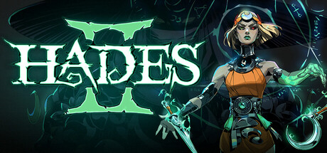

# Nintendo Switch — 2025

[← All Nintendo Switch years](../nintendo-switch.md) · [Full 2025 page](../../years/2025.md)

476 Nintendo Switch titles in 2025.

### 7'scarlet

**Platforms:** Nintendo Switch &nbsp;|&nbsp; **Developer:** Otomate , Toybox &nbsp;|&nbsp; **Publisher:** Aksys Games &nbsp;|&nbsp; **Genre:** Otome, Visual novel &nbsp;|&nbsp; **Released:** May 15 (WW)

[Wikipedia](https://en.wikipedia.org/wiki/7%27scarlet)

---

### 9 R.I.P. sequel

**Platforms:** Nintendo Switch &nbsp;|&nbsp; **Developer:** Otomate &nbsp;|&nbsp; **Publisher:** Idea Factory &nbsp;|&nbsp; **Genre:** Otome, Visual novel &nbsp;|&nbsp; **Released:** September 25 (JP)

[Wikipedia](https://en.wikipedia.org/wiki/9_R.I.P.)

---

### A Game About Digging a Hole

**Platforms:** Windows, iOS, Android, Nintendo Switch &nbsp;|&nbsp; **Developer:** Cyberwave &nbsp;|&nbsp; **Publisher:** rokaplay Bou·tique, Drillhounds &nbsp;|&nbsp; **Genre:** Simulation video game &nbsp;|&nbsp; **Released:** February 7, 2025

> A minimalist game about digging a hole in the garden of a newly purchased house. Collect resources, sell them, upgrade your equipment and discover a mysterious secret. Costs you only one coffee!
>
> _Synopsis source: IGDB_

[Wikipedia](https://en.wikipedia.org/wiki/A_Game_About_Digging_a_Hole) · [IGDB](https://www.igdb.com/games/a-game-about-digging-a-hole)

---

### A Wild Last Boss Appeared! Black-Winged Survivor

**Platforms:** Windows, Nintendo Switch, PlayStation 4, PlayStation 5 &nbsp;|&nbsp; **Developer:** Rocket Studio &nbsp;|&nbsp; **Publisher:** Sunsoft &nbsp;|&nbsp; **Genre:** Roguelike, Arena shooter &nbsp;|&nbsp; **Released:** October 5

[Wikipedia](https://en.wikipedia.org/wiki/A_Wild_Last_Boss_Appeared!)

---

### Absolum

**Platforms:** Windows, Nintendo Switch, PlayStation 4, PlayStation 5 &nbsp;|&nbsp; **Developer:** Guard Crush Games, Supamonks &nbsp;|&nbsp; **Publisher:** Dotemu &nbsp;|&nbsp; **Genre:** Brawler &nbsp;|&nbsp; **Released:** October 9

> Crafted with passion by the dream team that redefined side-scrolling beat 'em ups, Absolum mixes top-of-the-class combat action with modern roguelite elements, bringing all the vibes of the fantasy arcade hits of the past into an immersive adventure set in the original world of Talamh.
>
> _Synopsis source: IGDB_

[Wikipedia](https://en.wikipedia.org/wiki/Absolum) · [IGDB](https://www.igdb.com/games/absolum)

---

### ACA NeoGeo Selection Vol. 3

**Platforms:** Nintendo Switch &nbsp;|&nbsp; **Developer:** Hamster Corporation , SNK &nbsp;|&nbsp; **Publisher:** SNK &nbsp;|&nbsp; **Genre:** — N/a &nbsp;|&nbsp; **Type:** Compilation &nbsp;|&nbsp; **Released:** April 10 (JP)

[Wikipedia](https://en.wikipedia.org/wiki/Arcade_Archives#Embedded_compilations)

---

### ACA NeoGeo Selection Vol. 4

**Platforms:** Nintendo Switch &nbsp;|&nbsp; **Developer:** Hamster Corporation , SNK &nbsp;|&nbsp; **Publisher:** SNK &nbsp;|&nbsp; **Genre:** — N/a &nbsp;|&nbsp; **Type:** Compilation &nbsp;|&nbsp; **Released:** April 10 (JP)

[Wikipedia](https://en.wikipedia.org/wiki/Arcade_Archives#Embedded_compilations)

---

### ACA NeoGeo Selection Vol. 5

**Platforms:** Nintendo Switch &nbsp;|&nbsp; **Developer:** Hamster Corporation , SNK &nbsp;|&nbsp; **Publisher:** SNK &nbsp;|&nbsp; **Genre:** — N/a &nbsp;|&nbsp; **Type:** Compilation &nbsp;|&nbsp; **Released:** August 7 (JP)

[Wikipedia](https://en.wikipedia.org/wiki/Arcade_Archives#Embedded_compilations)

---

### ACA NeoGeo Selection Vol. 6

**Platforms:** Nintendo Switch &nbsp;|&nbsp; **Developer:** Hamster Corporation , SNK &nbsp;|&nbsp; **Publisher:** SNK &nbsp;|&nbsp; **Genre:** — N/a &nbsp;|&nbsp; **Type:** Compilation &nbsp;|&nbsp; **Released:** August 7 (JP)

[Wikipedia](https://en.wikipedia.org/wiki/Arcade_Archives#Embedded_compilations)

---

### ACA NeoGeo Selection Vol. 7

**Platforms:** Nintendo Switch &nbsp;|&nbsp; **Developer:** Hamster Corporation , SNK &nbsp;|&nbsp; **Publisher:** SNK &nbsp;|&nbsp; **Genre:** — N/a &nbsp;|&nbsp; **Type:** Compilation &nbsp;|&nbsp; **Released:** November 6 (JP)

[Wikipedia](https://en.wikipedia.org/wiki/Arcade_Archives#Embedded_compilations)

---

### ACA NeoGeo Selection Vol. 8

**Platforms:** Nintendo Switch &nbsp;|&nbsp; **Developer:** Hamster Corporation , SNK &nbsp;|&nbsp; **Publisher:** SNK &nbsp;|&nbsp; **Genre:** — N/a &nbsp;|&nbsp; **Type:** Compilation &nbsp;|&nbsp; **Released:** November 6 (JP)

[Wikipedia](https://en.wikipedia.org/wiki/Arcade_Archives#Embedded_compilations)

---

### Accolade Sports Collection

**Platforms:** Windows, Nintendo Switch, PlayStation 4, PlayStation 5, Xbox One, Xbox Series X/S &nbsp;|&nbsp; **Developer:** QUByte Interactive &nbsp;|&nbsp; **Publisher:** QUByte Interactive, Atari &nbsp;|&nbsp; **Genre:** Sports &nbsp;|&nbsp; **Type:** Compilation &nbsp;|&nbsp; **Released:** January 30

[Wikipedia](https://en.wikipedia.org/wiki/List_of_Accolade_games)

---

### Achilles: Legends Untold

**Platforms:** Nintendo Switch &nbsp;|&nbsp; **Developer:** Dark Point Games &nbsp;|&nbsp; **Publisher:** Dark Point Games &nbsp;|&nbsp; **Genre:** Action RPG &nbsp;|&nbsp; **Released:** January 23

---

### Adventure of Samsara

**Platforms:** Windows, macOS, Linux, Nintendo Switch, PlayStation 4, PlayStation 5, Xbox One, Xbox Series X/S &nbsp;|&nbsp; **Developer:** Ilex Games &nbsp;|&nbsp; **Publisher:** Atari &nbsp;|&nbsp; **Genre:** Metroidvania, Action-adventure &nbsp;|&nbsp; **Released:** September 4

---

### Afterlove EP

**Platforms:** Nintendo Switch, PlayStation 5, Windows, Xbox Series X/S &nbsp;|&nbsp; **Developer:** Pikselnesia &nbsp;|&nbsp; **Publisher:** Fellow Traveller Games &nbsp;|&nbsp; **Genre:** Visual novel &nbsp;|&nbsp; **Released:** February 14, 2025

[Wikipedia](https://en.wikipedia.org/wiki/Afterlove_EP)

---

### Against the Storm

**Platforms:** Nintendo Switch, PlayStation 4, PlayStation 5, Xbox One, Xbox Series X/S &nbsp;|&nbsp; **Developer:** Eremite Games &nbsp;|&nbsp; **Publisher:** Hooded Horse &nbsp;|&nbsp; **Genre:** City builder &nbsp;|&nbsp; **Released:** June 26

[Wikipedia](https://en.wikipedia.org/wiki/Against_the_Storm_(video_game))

---

### All in Abyss: Judge the Fake

**Platforms:** Windows, Nintendo Switch, PlayStation 5 &nbsp;|&nbsp; **Developer:** Acquire , WSS Playground &nbsp;|&nbsp; **Publisher:** Alliance Arts &nbsp;|&nbsp; **Genre:** Adventure, RPG &nbsp;|&nbsp; **Released:** April 10

---

### Amanda the Adventurer 2

**Platforms:** Nintendo Switch, PlayStation 4, PlayStation 5, Xbox One, Xbox Series X/S &nbsp;|&nbsp; **Developer:** MANGLEDmaw Games &nbsp;|&nbsp; **Publisher:** DreadXP &nbsp;|&nbsp; **Genre:** Horror &nbsp;|&nbsp; **Type:** Port &nbsp;|&nbsp; **Released:** October 16

[Wikipedia](https://en.wikipedia.org/wiki/Amanda_the_Adventurer_2)

---

### Amber Isle

**Platforms:** Nintendo Switch &nbsp;|&nbsp; **Developer:** Ambertail Games &nbsp;|&nbsp; **Publisher:** Team17 &nbsp;|&nbsp; **Genre:** Business sim, Social sim &nbsp;|&nbsp; **Released:** February 13

[Wikipedia](https://en.wikipedia.org/wiki/Amber_Isle)

---

### American Arcadia

**Platforms:** Nintendo Switch, PlayStation 4, PlayStation 5, Xbox One, Xbox Series X/S &nbsp;|&nbsp; **Developer:** Out of the Blue Games &nbsp;|&nbsp; **Publisher:** Raw Fury &nbsp;|&nbsp; **Genre:** Puzzle-platformer &nbsp;|&nbsp; **Released:** May 15

[Wikipedia](https://en.wikipedia.org/wiki/American_Arcadia)

---

### and Roger

**Platforms:** Windows, macOS, Nintendo Switch &nbsp;|&nbsp; **Developer:** TearyHand Studio &nbsp;|&nbsp; **Publisher:** Kodansha &nbsp;|&nbsp; **Genre:** Adventure, Visual novel &nbsp;|&nbsp; **Released:** July 24

> It was a morning like all others, until she realized her dad wasn't home. In his place, a stranger who speaks nonsense and insists she "takes her medicine". Who is he? Where is dad?
>
> _Synopsis source: IGDB_

[Wikipedia](https://en.wikipedia.org/wiki/And_Roger) · [IGDB](https://www.igdb.com/games/and-roger)

---

### Angry Video Game Nerd 8-bit

**Platforms:** Windows, Nintendo Switch, PlayStation 4, PlayStation 5, Xbox One, Xbox Series X/S, Nintendo Entertainment System &nbsp;|&nbsp; **Developer:** Mega Cat Studios &nbsp;|&nbsp; **Publisher:** Retroware &nbsp;|&nbsp; **Genre:** Platformer, Action-adventure &nbsp;|&nbsp; **Released:** October 23

[Wikipedia](https://en.wikipedia.org/wiki/Angry_Video_Game_Nerd#Video_games)

---

### Anomaly Collapse

**Platforms:** Nintendo Switch &nbsp;|&nbsp; **Developer:** RocketPunch Games &nbsp;|&nbsp; **Publisher:** Spiral Up Games &nbsp;|&nbsp; **Genre:** TBS, Roguelike &nbsp;|&nbsp; **Released:** July 17

[Wikipedia](https://en.wikipedia.org/wiki/Anomaly_Collapse)

---

### Ao Oni : The Horror of Blueberry Onsen

**Platforms:** Nintendo Switch, Windows &nbsp;|&nbsp; **Developer:** Game Studio &nbsp;|&nbsp; **Publisher:** Game Studio &nbsp;|&nbsp; **Genre:** Horror, Puzzle, Action-adventure &nbsp;|&nbsp; **Released:** April 25

[Wikipedia](https://en.wikipedia.org/wiki/Ao_Oni)

---

### Artdink Game Log: Tail of the Sun

**Platforms:** Windows, Nintendo Switch &nbsp;|&nbsp; **Developer:** Artdink &nbsp;|&nbsp; **Publisher:** Artdink &nbsp;|&nbsp; **Genre:** Action RPG &nbsp;|&nbsp; **Released:** December 16 (JP)

[Wikipedia](https://en.wikipedia.org/wiki/Tail_of_the_Sun)

---

### Asterix & Obelix : Mission Babylon

**Platforms:** Windows, Nintendo Switch, PlayStation 5, Xbox Series X/S &nbsp;|&nbsp; **Developer:** Microids &nbsp;|&nbsp; **Publisher:** Microids &nbsp;|&nbsp; **Genre:** Adventure, Platformer &nbsp;|&nbsp; **Released:** October 30

[Wikipedia](https://en.wikipedia.org/wiki/Asterix_%26_Obelix)

---

### Astonishia Story

**Platforms:** Windows, Nintendo Switch &nbsp;|&nbsp; **Developer:** Netmarble Neo , Waycoder &nbsp;|&nbsp; **Publisher:** Daewon Media &nbsp;|&nbsp; **Genre:** RPG &nbsp;|&nbsp; **Type:** Remake &nbsp;|&nbsp; **Released:** December 18 (KR)

[Wikipedia](https://en.wikipedia.org/wiki/Astonishia_Story)

---

### Atelier Resleriana: The Red Alchemist & the White Guardian

**Platforms:** Windows, Nintendo Switch, PlayStation 4, PlayStation 5 &nbsp;|&nbsp; **Developer:** Gust &nbsp;|&nbsp; **Publisher:** Koei Tecmo &nbsp;|&nbsp; **Genre:** RPG &nbsp;|&nbsp; **Released:** September 26

---

### Atelier Ryza Secret Trilogy Deluxe Pack

**Platforms:** Windows, Nintendo Switch, Nintendo Switch 2, PlayStation 4, PlayStation 5 &nbsp;|&nbsp; **Developer:** Gust &nbsp;|&nbsp; **Publisher:** Koei Tecmo &nbsp;|&nbsp; **Genre:** RPG &nbsp;|&nbsp; **Released:** November 13

[Wikipedia](https://en.wikipedia.org/wiki/Atelier_(video_game_series)#Remakes_and_ports)

---

### Atelier Yumia: The Alchemist of Memories & the Envisioned Land

**Platforms:** Windows, Nintendo Switch, PlayStation 4, PlayStation 5, Xbox One, Xbox Series X/S &nbsp;|&nbsp; **Developer:** Gust &nbsp;|&nbsp; **Publisher:** Koei Tecmo &nbsp;|&nbsp; **Genre:** Action RPG &nbsp;|&nbsp; **Released:** March 21

---

### Ayakashi Gohan: Oomori! for S

**Platforms:** Nintendo Switch &nbsp;|&nbsp; **Developer:** Honeybee &nbsp;|&nbsp; **Publisher:** Edia, arithmetic &nbsp;|&nbsp; **Genre:** Visual novel &nbsp;|&nbsp; **Released:** May 22 (JP)

---

### Azure Striker Gunvolt Trilogy Enhanced

**Platforms:** Nintendo Switch, PlayStation 5 &nbsp;|&nbsp; **Developer:** Inti Creates &nbsp;|&nbsp; **Publisher:** Inti Creates &nbsp;|&nbsp; **Genre:** Platformer, Action-adventure &nbsp;|&nbsp; **Type:** Remaster, Compilation &nbsp;|&nbsp; **Released:** July 24

[Wikipedia](https://en.wikipedia.org/wiki/Azure_Striker_Gunvolt)

---

### Backyard Baseball '97

**Platforms:** iOS, Android, Nintendo Switch, PlayStation 5 &nbsp;|&nbsp; **Developer:** Mega Cat Studios &nbsp;|&nbsp; **Publisher:** Playground Productions &nbsp;|&nbsp; **Genre:** Sports &nbsp;|&nbsp; **Type:** Port &nbsp;|&nbsp; **Released:** March 27

[Wikipedia](https://en.wikipedia.org/wiki/Backyard_Baseball_%2797)

---

### Bad Cheese

**Platforms:** Windows, Nintendo Switch, PlayStation 4, PlayStation 5, Xbox One, Xbox Series X/S &nbsp;|&nbsp; **Developer:** Lukasik.art &nbsp;|&nbsp; **Publisher:** Feardemic &nbsp;|&nbsp; **Genre:** Horror (psych) &nbsp;|&nbsp; **Released:** September 1

---

### Bad End Theater

**Platforms:** Nintendo Switch, PlayStation 4, PlayStation 5, Xbox One, Xbox Series X/S &nbsp;|&nbsp; **Developer:** NomnomNami &nbsp;|&nbsp; **Publisher:** Serenity Forge &nbsp;|&nbsp; **Genre:** Visual novel &nbsp;|&nbsp; **Released:** July 10

[Wikipedia](https://en.wikipedia.org/wiki/Bad_End_Theater)

---

### Badboy Brother

**Platforms:** Windows, Nintendo Switch &nbsp;|&nbsp; **Developer:** ZOC &nbsp;|&nbsp; **Publisher:** D3 Publisher &nbsp;|&nbsp; **Genre:** Brawler &nbsp;|&nbsp; **Released:** November 27

---

### Ball x Pit

**Platforms:** Windows, macOS, Nintendo Switch, PlayStation 5, Xbox Series X/S, Nintendo Switch 2 &nbsp;|&nbsp; **Developer:** Kenny Sun &nbsp;|&nbsp; **Publisher:** Devolver Digital &nbsp;|&nbsp; **Genre:** Survival, Roguelike &nbsp;|&nbsp; **Released:** October 15

> BALL x PIT is a brick-breaking, ball-fusing, base-building survival roguelite where you battle hordes of monstrous enemies with your arsenal of ricocheting balls.
>
> _Synopsis source: IGDB_

[Wikipedia](https://en.wikipedia.org/wiki/Ball_x_Pit) · [IGDB](https://www.igdb.com/games/ball-x-pit)

---

### Battle Suit Aces

**Platforms:** Windows, macOS, Nintendo Switch, PlayStation 5 &nbsp;|&nbsp; **Developer:** Trinket Studios &nbsp;|&nbsp; **Publisher:** Trinket Studios, Outersloth &nbsp;|&nbsp; **Genre:** DCCG, RPG &nbsp;|&nbsp; **Released:** October 7

---

### Battle Train

**Platforms:** Nintendo Switch, Windows &nbsp;|&nbsp; **Developer:** Terrible Posture Games, Nerd Ninjas &nbsp;|&nbsp; **Publisher:** Bandai Namco Entertainment &nbsp;|&nbsp; **Genre:** Deck-building &nbsp;|&nbsp; **Released:** June 18, 2025

[Wikipedia](https://en.wikipedia.org/wiki/Battle_Train)

---

### Battlefield Waltz

**Platforms:** Nintendo Switch &nbsp;|&nbsp; **Developer:** Otomate &nbsp;|&nbsp; **Publisher:** Idea Factory International &nbsp;|&nbsp; **Genre:** Otome, Visual novel &nbsp;|&nbsp; **Released:** April 8 (WW)

[Wikipedia](https://en.wikipedia.org/wiki/Battlefield_Waltz)

---

### Battletoads (NES)

**Platforms:** Nintendo Switch, Nintendo Switch 2 &nbsp;|&nbsp; **Developer:** Rare &nbsp;|&nbsp; **Publisher:** NA / EU : Tradewest, Masaya &nbsp;|&nbsp; **Genre:** Brawler, Platformer &nbsp;|&nbsp; **Type:** Port &nbsp;|&nbsp; **Released:** November 26

[Wikipedia](https://en.wikipedia.org/wiki/Battletoads_(1991_video_game))

---

### BEAST: Bio Exo Arena Suit Team

**Platforms:** Nintendo Switch &nbsp;|&nbsp; **Developer:** Oh BiBi &nbsp;|&nbsp; **Publisher:** Oh BiBi &nbsp;|&nbsp; **Genre:** Third-person hero shooter &nbsp;|&nbsp; **Released:** March 13

---

### Bendy and the Dark Revival

**Platforms:** Nintendo Switch, PlayStation 5, Xbox Series X/S &nbsp;|&nbsp; **Developer:** Joey Drew Studios &nbsp;|&nbsp; **Publisher:** Joey Drew Studios &nbsp;|&nbsp; **Genre:** Survival horror &nbsp;|&nbsp; **Released:** July 11

[Wikipedia](https://en.wikipedia.org/wiki/Bendy_and_the_Dark_Revival)

---

### Bendy: Lone Wolf

**Platforms:** Windows, Nintendo Switch, PlayStation 4, PlayStation 5, Xbox One, Xbox Series X/S &nbsp;|&nbsp; **Developer:** Joey Drew Studios &nbsp;|&nbsp; **Publisher:** Joey Drew Studios &nbsp;|&nbsp; **Genre:** Survival horror &nbsp;|&nbsp; **Released:** August 15

[Wikipedia](https://en.wikipedia.org/wiki/Bendy_(franchise))

---

### Beyblade X : Evobattle

**Platforms:** Windows, Nintendo Switch &nbsp;|&nbsp; **Developer:** Groove Box Japan &nbsp;|&nbsp; **Publisher:** FuRyu &nbsp;|&nbsp; **Genre:** Action &nbsp;|&nbsp; **Released:** November 13

[Wikipedia](https://en.wikipedia.org/wiki/Beyblade_X)

---

### Beyond the Ice Palace II

**Platforms:** Windows, Nintendo Switch, PlayStation 4, PlayStation 5, Xbox One, Xbox Series X/S &nbsp;|&nbsp; **Developer:** Storybird Studio &nbsp;|&nbsp; **Publisher:** PQube, PixelHeart &nbsp;|&nbsp; **Genre:** Action, Platformer &nbsp;|&nbsp; **Released:** March 13

[Wikipedia](https://en.wikipedia.org/wiki/Beyond_the_Ice_Palace_II)

---

### Big Helmet Heroes

**Platforms:** Windows, Nintendo Switch, PlayStation 5, Xbox Series X/S &nbsp;|&nbsp; **Developer:** Exalted Studio &nbsp;|&nbsp; **Publisher:** Dear Villagers &nbsp;|&nbsp; **Genre:** Action-adventure, Brawler &nbsp;|&nbsp; **Released:** February 6

---

### Bionic Commando

**Platforms:** Nintendo Switch, Nintendo Switch 2 &nbsp;|&nbsp; **Developer:** Minakuchi Engineering &nbsp;|&nbsp; **Publisher:** Capcom &nbsp;|&nbsp; **Genre:** Platformer &nbsp;|&nbsp; **Type:** Port &nbsp;|&nbsp; **Released:** November 26

[Wikipedia](https://en.wikipedia.org/wiki/Bionic_Commando_(1992_video_game))

---

### Biped 2

**Platforms:** Windows, Nintendo Switch, PlayStation 4, PlayStation 5, Xbox One, Xbox Series X/S &nbsp;|&nbsp; **Developer:** NExT Studios &nbsp;|&nbsp; **Publisher:** META Publishing &nbsp;|&nbsp; **Genre:** Puzzle &nbsp;|&nbsp; **Released:** November 5

---

### Blade Chimera

**Platforms:** Windows, Nintendo Switch &nbsp;|&nbsp; **Developer:** WSS Playground, Team Ladybug &nbsp;|&nbsp; **Publisher:** WSS Playground, Playism &nbsp;|&nbsp; **Genre:** Metroidvania &nbsp;|&nbsp; **Released:** January 16

> In this exploration-heavy 2D action game, use your demon sword to interfere with the past, create platforms, and shield yourself from danger to explore a dystopian cyberpunk world depicted in gorgeously animated pixel art.
>
> _Synopsis source: IGDB_

[Wikipedia](https://en.wikipedia.org/wiki/Blade_Chimera) · [IGDB](https://www.igdb.com/games/blade-chimera)

---

### Blippo+

**Platforms:** Windows, Nintendo Switch &nbsp;|&nbsp; **Developer:** Noble Robot &nbsp;|&nbsp; **Publisher:** Panic &nbsp;|&nbsp; **Genre:** Simulation, Interactive film &nbsp;|&nbsp; **Released:** September 23

[Wikipedia](https://en.wikipedia.org/wiki/Blippo%2B)

---

### Blood: Refreshed Supply

**Platforms:** Windows, Nintendo Switch, PlayStation 4, PlayStation 5, Xbox One, Xbox Series X/S &nbsp;|&nbsp; **Developer:** Monolith Productions , Nightdive Studios &nbsp;|&nbsp; **Publisher:** Warner Bros. Games , Atari &nbsp;|&nbsp; **Genre:** FPS &nbsp;|&nbsp; **Type:** Remaster &nbsp;|&nbsp; **Released:** December 4

---

### Bloodshed

**Platforms:** Windows, Nintendo Switch, PlayStation 4, PlayStation 5, Xbox One, Xbox Series X/S &nbsp;|&nbsp; **Developer:** com8com1 Software &nbsp;|&nbsp; **Publisher:** Headup Games &nbsp;|&nbsp; **Genre:** Roguelike, FPS &nbsp;|&nbsp; **Released:** May 22

---

### Blue Wednesday

**Platforms:** Nintendo Switch, PlayStation 4, PlayStation 5, Xbox One, Xbox Series X/S &nbsp;|&nbsp; **Developer:** Buff Studio &nbsp;|&nbsp; **Publisher:** Forever Entertainment &nbsp;|&nbsp; **Genre:** Adventure &nbsp;|&nbsp; **Released:** March 27

---

### Bounty Sisters

**Platforms:** Nintendo Switch &nbsp;|&nbsp; **Developer:** PiXEL &nbsp;|&nbsp; **Publisher:** PiXEL &nbsp;|&nbsp; **Genre:** Shoot 'em up &nbsp;|&nbsp; **Released:** December 18 (JP)

---

### Breakout Beyond

**Platforms:** Windows, Nintendo Switch, PlayStation 4, PlayStation 5, Xbox One, Xbox Series X/S, Atari VCS &nbsp;|&nbsp; **Developer:** Choice Provisions &nbsp;|&nbsp; **Publisher:** Atari &nbsp;|&nbsp; **Genre:** Action &nbsp;|&nbsp; **Released:** March 25

[Wikipedia](https://en.wikipedia.org/wiki/Breakout_(video_game)#Re-releases_and_enhanced_versions)

---

### Bridge Constructor Studio

**Platforms:** Windows, macOS, Linux, Nintendo Switch, PlayStation 4, PlayStation 5, Xbox One, Xbox Series X/S, iOS, Android &nbsp;|&nbsp; **Developer:** ClockStone Studio &nbsp;|&nbsp; **Publisher:** Headup Games &nbsp;|&nbsp; **Genre:** Puzzle, Simulation &nbsp;|&nbsp; **Released:** July 17

[Wikipedia](https://en.wikipedia.org/wiki/Bridge_Constructor)

---

### BROK: The Brawl Bar

**Platforms:** Nintendo Switch, PlayStation 4, PlayStation 5, Xbox One &nbsp;|&nbsp; **Developer:** COWCAT &nbsp;|&nbsp; **Publisher:** COWCAT &nbsp;|&nbsp; **Genre:** PCA, Brawler &nbsp;|&nbsp; **Released:** December 2

[Wikipedia](https://en.wikipedia.org/wiki/BROK_the_InvestiGator)

---

### Bubble Bobble Sugar Dungeons

**Platforms:** Windows, Nintendo Switch, PlayStation 5 &nbsp;|&nbsp; **Developer:** Taito &nbsp;|&nbsp; **Publisher:** Arc System Works &nbsp;|&nbsp; **Genre:** Platformer, Action-adventure &nbsp;|&nbsp; **Released:** November 27 (WW)

[Wikipedia](https://en.wikipedia.org/wiki/Bubble_Bobble)

---

### Bubble Ghost Remake

**Platforms:** Windows, Nintendo Switch, PlayStation 5 &nbsp;|&nbsp; **Developer:** Nakama Game Studio &nbsp;|&nbsp; **Publisher:** Selecta Play &nbsp;|&nbsp; **Genre:** Puzzle-platformer, Action-adventure &nbsp;|&nbsp; **Type:** Remake &nbsp;|&nbsp; **Released:** March 27

[Wikipedia](https://en.wikipedia.org/wiki/Bubble_Ghost_Remake)

---

### Bubsy in: The Purrfect Collection

**Platforms:** Windows, Nintendo Switch, PlayStation 5, Xbox Series X/S &nbsp;|&nbsp; **Developer:** Limited Run Games &nbsp;|&nbsp; **Publisher:** Atari &nbsp;|&nbsp; **Genre:** Platformer &nbsp;|&nbsp; **Released:** September 9

---

### BYAKKO: Shijin Butai Enrenki

**Platforms:** Nintendo Switch &nbsp;|&nbsp; **Developer:** Otomate &nbsp;|&nbsp; **Publisher:** Idea Factory &nbsp;|&nbsp; **Genre:** Otome, Visual novel &nbsp;|&nbsp; **Released:** May 29 (JP)

---

### Bye Sweet Carole

**Platforms:** Windows, Nintendo Switch, PlayStation 5, Xbox Series X/S &nbsp;|&nbsp; **Developer:** Little Sewing Machine &nbsp;|&nbsp; **Publisher:** Maximum Entertainment &nbsp;|&nbsp; **Genre:** Horror, Adventure &nbsp;|&nbsp; **Released:** October 9

> Bye Sweet Carole is a horrific thriller game inspired by the greatest animation movies and created by Chris Darril. (Remothered series) Be ready to jump into the world of Corolla and meet the rabbits that has infested it.
>
> _Synopsis source: IGDB_

[Wikipedia](https://en.wikipedia.org/wiki/Bye_Sweet_Carole) · [IGDB](https://www.igdb.com/games/bye-sweet-carole)

---

### Cabernet

**Platforms:** Windows, Nintendo Switch, PlayStation 4, PlayStation 5, Xbox One, Xbox Series X/S &nbsp;|&nbsp; **Developer:** Party for Introverts &nbsp;|&nbsp; **Publisher:** Akupara Games &nbsp;|&nbsp; **Genre:** RPG &nbsp;|&nbsp; **Released:** February 20

[Wikipedia](https://en.wikipedia.org/wiki/Cabernet_(video_game))

---

### Calamity Angels: Special Delivery

**Platforms:** Nintendo Switch, PlayStation 4, PlayStation 5 &nbsp;|&nbsp; **Developer:** Compile Heart &nbsp;|&nbsp; **Publisher:** Compile Heart &nbsp;|&nbsp; **Genre:** RPG &nbsp;|&nbsp; **Released:** June 26 (JP)

---

### Call of the Sea

**Platforms:** Nintendo Switch &nbsp;|&nbsp; **Developer:** Out of the Blue &nbsp;|&nbsp; **Publisher:** Raw Fury &nbsp;|&nbsp; **Genre:** Adventure &nbsp;|&nbsp; **Released:** September 9

[Wikipedia](https://en.wikipedia.org/wiki/Call_of_the_Sea)

---

### Candy Rangers

**Platforms:** Windows, Nintendo Switch, PlayStation 4, PlayStation 5, Xbox One, Xbox Series X/S &nbsp;|&nbsp; **Developer:** Mechano &nbsp;|&nbsp; **Publisher:** JanduSoft &nbsp;|&nbsp; **Genre:** Shoot 'em up (rail) &nbsp;|&nbsp; **Released:** October 2

---

### Capcom Fighting Collection 2

**Platforms:** Windows, Nintendo Switch, PlayStation 4, Xbox One &nbsp;|&nbsp; **Developer:** Capcom &nbsp;|&nbsp; **Publisher:** Capcom &nbsp;|&nbsp; **Genre:** Fighting &nbsp;|&nbsp; **Type:** Compilation &nbsp;|&nbsp; **Released:** May 16

[Wikipedia](https://en.wikipedia.org/wiki/Capcom_Fighting_Collection_2)

---

### Captain Blood

**Platforms:** Windows, Nintendo Switch, PlayStation 4, PlayStation 5, Xbox One, Xbox Series X/S &nbsp;|&nbsp; **Developer:** Seawolf Studio, General Arcade &nbsp;|&nbsp; **Publisher:** SNEG &nbsp;|&nbsp; **Genre:** Action &nbsp;|&nbsp; **Released:** May 6

[Wikipedia](https://en.wikipedia.org/wiki/Captain_Blood_(2025_video_game))

---

### Cardfight!! Vanguard Dear Days 2

**Platforms:** Windows, Nintendo Switch &nbsp;|&nbsp; **Developer:** FuRyu &nbsp;|&nbsp; **Publisher:** Bushiroad Games &nbsp;|&nbsp; **Genre:** DCCG &nbsp;|&nbsp; **Released:** January 30

[Wikipedia](https://en.wikipedia.org/wiki/Cardfight!!_Vanguard#Video_games)

---

### Carmen Sandiego

**Platforms:** Windows, Nintendo Switch, PlayStation 4, PlayStation 5, Xbox One, Xbox Series X/S, iOS, Android &nbsp;|&nbsp; **Developer:** Gameloft &nbsp;|&nbsp; **Publisher:** Gameloft &nbsp;|&nbsp; **Genre:** Puzzle, Adventure &nbsp;|&nbsp; **Released:** March 4

[Wikipedia](https://en.wikipedia.org/wiki/Carmen_Sandiego_(video_game_series)#Carmen_Sandiego_(2025))

---

### Castle of Heart: Retold

**Platforms:** Windows, Nintendo Switch, PlayStation 5, Xbox Series X/S &nbsp;|&nbsp; **Developer:** 7Levels &nbsp;|&nbsp; **Publisher:** 7Levels &nbsp;|&nbsp; **Genre:** Action-adventure &nbsp;|&nbsp; **Released:** October 3

[Wikipedia](https://en.wikipedia.org/wiki/Castle_of_Heart)

---

### Cats Away

**Platforms:** Windows, Nintendo Switch, PlayStation 5 &nbsp;|&nbsp; **Developer:** Studio Saizensen &nbsp;|&nbsp; **Publisher:** Nicalis &nbsp;|&nbsp; **Genre:** Tower defense &nbsp;|&nbsp; **Released:** July 10 (WW)

---

### Centum

**Platforms:** Windows, macOS, Nintendo Switch, PlayStation 4, PlayStation 5, Xbox One, Xbox Series X/S &nbsp;|&nbsp; **Developer:** Hack The Publisher &nbsp;|&nbsp; **Publisher:** Serenity Forge &nbsp;|&nbsp; **Genre:** PCA &nbsp;|&nbsp; **Released:** March 11

[Wikipedia](https://en.wikipedia.org/wiki/Centum_(video_game))

---

### Chaos;Head / Chaos;Child Love Chu Chu!! Double Pack

**Platforms:** Nintendo Switch &nbsp;|&nbsp; **Developer:** Mages &nbsp;|&nbsp; **Publisher:** Mages &nbsp;|&nbsp; **Genre:** Visual novel &nbsp;|&nbsp; **Released:** November 27 (JP)

[Wikipedia](https://en.wikipedia.org/wiki/Chaos;Head_Love_Chu_Chu!)

---

### Chicken Police: Into the HIVE!

**Platforms:** Nintendo Switch &nbsp;|&nbsp; **Developer:** The Wild Gentlemen &nbsp;|&nbsp; **Publisher:** Joystick Ventures &nbsp;|&nbsp; **Genre:** PCA &nbsp;|&nbsp; **Released:** November 6

---

### Chicken Run : Eggstraction

**Platforms:** Windows, Nintendo Switch, PlayStation 4, PlayStation 5, Xbox One, Xbox Series X/S &nbsp;|&nbsp; **Developer:** Aardman Animations &nbsp;|&nbsp; **Publisher:** Outright Games &nbsp;|&nbsp; **Genre:** Action-adventure &nbsp;|&nbsp; **Released:** October 24

[Wikipedia](https://en.wikipedia.org/wiki/Chicken_Run)

---

### Chickenhare and the Treasure of Spiking Beard

**Platforms:** Windows, Nintendo Switch, PlayStation 4, PlayStation 5, Xbox Series X/S &nbsp;|&nbsp; **Developer:** N-Zone &nbsp;|&nbsp; **Publisher:** N-Zone &nbsp;|&nbsp; **Genre:** Action-adventure, Platformer &nbsp;|&nbsp; **Released:** October 14

[Wikipedia](https://en.wikipedia.org/wiki/Chickenhare_and_the_Hamster_of_Darkness#Video_game)

---

### Cho Aniki: Bakuretsu Ranto-hen

**Platforms:** Nintendo Switch &nbsp;|&nbsp; **Developer:** Masaya Games, Edia &nbsp;|&nbsp; **Publisher:** Edia &nbsp;|&nbsp; **Genre:** Fighting &nbsp;|&nbsp; **Released:** June 19 (JP)

[Wikipedia](https://en.wikipedia.org/wiki/Cho_Aniki#Cho_Aniki_Bakuretsu_Ranto-hen)

---

### Citizen Sleeper 2: Starward Vector

**Platforms:** Windows, macOS, Nintendo Switch, PlayStation 5, Xbox Series X/S &nbsp;|&nbsp; **Developer:** Jump Over the Age &nbsp;|&nbsp; **Publisher:** Fellow Traveller &nbsp;|&nbsp; **Genre:** RPG &nbsp;|&nbsp; **Released:** January 31

> Citizen Sleeper 2: Starward Vector is a narrative-driven science-fiction RPG in which players take on the role of a Sleeper, an artificial human. Using a tabletop-inspired dice system, players manage resources, make difficult choices, and build relationships while seeking a new life among the settlements of the Starward Belt. Expanding on the original game, the sequel introduces a customizable ship, recruitable crew members, and high-risk contracts that require planning and adaptation. Player choices, character classes, and skill-based interactions shape both the story and the path forward.
>
> _Synopsis source: IGDB_

[IGDB](https://www.igdb.com/games/citizen-sleeper-2-starward-vector)

---

### Civilization VII

**Platforms:** Windows, macOS, Linux, Nintendo Switch, PlayStation 4, PlayStation 5, Xbox One, Xbox Series X/S, Nintendo Switch 2 &nbsp;|&nbsp; **Developer:** Firaxis Games &nbsp;|&nbsp; **Publisher:** 2K &nbsp;|&nbsp; **Genre:** TBS, 4X &nbsp;|&nbsp; **Released:** February 11

[Wikipedia](https://en.wikipedia.org/wiki/Civilization_VII)

---

### Cladun X3

**Platforms:** Nintendo Switch, PlayStation 4, PlayStation 5, Windows &nbsp;|&nbsp; **Developer:** Nippon Ichi Software &nbsp;|&nbsp; **Publisher:** Nippon Ichi Software &nbsp;|&nbsp; **Genre:** Action RPG &nbsp;|&nbsp; **Released:** February 27 (JP/WW)

---

### Class of Heroes 3 Remaster

**Platforms:** Windows, Nintendo Switch, PlayStation 5 &nbsp;|&nbsp; **Developer:** Acquire &nbsp;|&nbsp; **Publisher:** Acquire, PQube &nbsp;|&nbsp; **Genre:** RPG, Dungeon crawl &nbsp;|&nbsp; **Type:** Remaster &nbsp;|&nbsp; **Released:** September 18

[Wikipedia](https://en.wikipedia.org/wiki/Class_of_Heroes_3)

---

### Coneru: Dimension Girl

**Platforms:** Windows, Nintendo Switch &nbsp;|&nbsp; **Developer:** Hike, Eallin Japan &nbsp;|&nbsp; **Publisher:** Hike &nbsp;|&nbsp; **Genre:** Action, Platformer &nbsp;|&nbsp; **Released:** May 29

---

### Cooking Companions

**Platforms:** Nintendo Switch, PlayStation 4, PlayStation 5, Xbox One, Xbox Series X/S &nbsp;|&nbsp; **Developer:** Deer Dream Studios &nbsp;|&nbsp; **Publisher:** Serenity Forge &nbsp;|&nbsp; **Genre:** Horror (psych), Visual novel &nbsp;|&nbsp; **Released:** April 29

---

### Corpse Party Tetralogy Pack

**Platforms:** Nintendo Switch &nbsp;|&nbsp; **Developer:** Team GrisGris &nbsp;|&nbsp; **Publisher:** Mages &nbsp;|&nbsp; **Genre:** Horror &nbsp;|&nbsp; **Type:** Compilation &nbsp;|&nbsp; **Released:** August 7 (JP)

[Wikipedia](https://en.wikipedia.org/wiki/Corpse_Party)

---

### Cotton Reboot! High Tension!

**Platforms:** Nintendo Switch, PlayStation 4, PlayStation 5 &nbsp;|&nbsp; **Developer:** Beep &nbsp;|&nbsp; **Publisher:** Beep &nbsp;|&nbsp; **Genre:** Shoot 'em up &nbsp;|&nbsp; **Released:** July 31 (JP)

[Wikipedia](https://en.wikipedia.org/wiki/Cotton_Reboot!)

---

### Croc: Legend of the Gobbos

**Platforms:** Windows, Nintendo Switch, PlayStation 4, PlayStation 5, Xbox One, Xbox Series X/S &nbsp;|&nbsp; **Developer:** Argonaut Games &nbsp;|&nbsp; **Publisher:** Argonaut Games &nbsp;|&nbsp; **Genre:** Platformer &nbsp;|&nbsp; **Type:** Remaster &nbsp;|&nbsp; **Released:** April 2

---

### Cthulhu Mythos ADV Lunatic Whispers & The Isle Of Ubohoth

**Platforms:** Nintendo Switch, PlayStation 4, PlayStation 5 &nbsp;|&nbsp; **Developer:** Gotcha Gotcha Games &nbsp;|&nbsp; **Publisher:** Gotcha Gotcha Games &nbsp;|&nbsp; **Genre:** Visual novel, RPG &nbsp;|&nbsp; **Type:** Compilation &nbsp;|&nbsp; **Released:** October 9 (JP)

---

### Cuisineer

**Platforms:** Nintendo Switch, PlayStation 5, Xbox Series X/S &nbsp;|&nbsp; **Developer:** BattleBrew Productions &nbsp;|&nbsp; **Publisher:** Xseed Games, Marvelous Europe &nbsp;|&nbsp; **Genre:** Action, Roguelike &nbsp;|&nbsp; **Type:** Port &nbsp;|&nbsp; **Released:** January 28

---

### Da Capo Re:tune

**Platforms:** Windows, Nintendo Switch &nbsp;|&nbsp; **Developer:** Circus &nbsp;|&nbsp; **Publisher:** Bushiroad Games &nbsp;|&nbsp; **Genre:** Visual novel &nbsp;|&nbsp; **Released:** October 30

[Wikipedia](https://en.wikipedia.org/wiki/Da_Capo_(video_game))

---

### Dark Deity 2

**Platforms:** Windows, macOS, Nintendo Switch, PlayStation 5, Xbox Series X/S &nbsp;|&nbsp; **Developer:** Sword & Axe &nbsp;|&nbsp; **Publisher:** indie.io &nbsp;|&nbsp; **Genre:** Tactical RPG &nbsp;|&nbsp; **Type:** Port &nbsp;|&nbsp; **Released:** March 24

[Wikipedia](https://en.wikipedia.org/wiki/Dark_Deity_2)

---

### Date Everything!

**Platforms:** Windows, Nintendo Switch, PlayStation 5, Xbox Series X/S &nbsp;|&nbsp; **Developer:** Sassy Chap Games &nbsp;|&nbsp; **Publisher:** Team17 &nbsp;|&nbsp; **Genre:** Dating sim &nbsp;|&nbsp; **Released:** June 17

> Date Everything is a sandbox dating simulator set in the comfort of your own home, featuring 100 fully voice acted datable characters! Let the romance flow between your bed, smoke alarm and… Overwhelming Sense of Existential Dread? Are you ready to Date Everything?
>
> _Synopsis source: IGDB_

[Wikipedia](https://en.wikipedia.org/wiki/Date_Everything!) · [IGDB](https://www.igdb.com/games/date-everything)

---

### Dead Reset

**Platforms:** Android, iOS, macOS, Nintendo Switch, PlayStation 4, PlayStation 5, Windows, Xbox One, Xbox Series X/S &nbsp;|&nbsp; **Developer:** Dark Rift Horror, Wales Interactive &nbsp;|&nbsp; **Publisher:** Wales Interactive &nbsp;|&nbsp; **Genre:** Adventure game &nbsp;|&nbsp; **Released:** September 11, 2025

[Wikipedia](https://en.wikipedia.org/wiki/Dead_Reset)

---

### Deltarune

**Platforms:** PlayStation 5, Windows, PlayStation 4, macOS, Nintendo Switch, Nintendo Switch 2 &nbsp;|&nbsp; **Developer:** tobyfox &nbsp;|&nbsp; **Publisher:** tobyfox, 8-4 &nbsp;|&nbsp; **Genre:** Music, Puzzle, Role-playing (RPG), Turn-based strategy (TBS), Adventure, Indie &nbsp;|&nbsp; **Released:** June 4, 2025

> Dive into the parallel story to UNDERTALE! Fight or spare your way through action-packed battles as you explore a mysterious world alongside an endearing cast of new and familiar characters.
>
> _Synopsis source: IGDB_

[IGDB](https://www.igdb.com/games/deltarune)

---

### Deltarune : Chapters 3 + 4

**Platforms:** Windows, macOS, Nintendo Switch, PlayStation 4, PlayStation 5 &nbsp;|&nbsp; **Developer:** Toby Fox , 8-4 (consoles) &nbsp;|&nbsp; **Publisher:** Toby Fox , 8-4 (consoles) &nbsp;|&nbsp; **Genre:** RPG, Adventure &nbsp;|&nbsp; **Type:** Episode &nbsp;|&nbsp; **Released:** June 4

[Wikipedia](https://en.wikipedia.org/wiki/Deltarune)

---

### Demon Slayer: Kimetsu no Yaiba – The Hinokami Chronicles 2

**Platforms:** Windows, Nintendo Switch, PlayStation 4, PlayStation 5, Xbox One, Xbox Series X/S &nbsp;|&nbsp; **Developer:** CyberConnect2 &nbsp;|&nbsp; **Publisher:** Aniplex, Sega &nbsp;|&nbsp; **Genre:** Fighting, Action-adventure &nbsp;|&nbsp; **Released:** August 1 (JP/WW)

---

### Demonschool

**Platforms:** Windows, macOS, Linux, Nintendo Switch, PlayStation 4, PlayStation 5, Xbox One, Xbox Series X/S &nbsp;|&nbsp; **Developer:** Necrosoft Games &nbsp;|&nbsp; **Publisher:** Ysbyrd Games &nbsp;|&nbsp; **Genre:** Tactical RPG &nbsp;|&nbsp; **Released:** November 19

[Wikipedia](https://en.wikipedia.org/wiki/Demonschool)

---

### Despera Drops

**Platforms:** Nintendo Switch, Windows &nbsp;|&nbsp; **Developer:** D3 Publisher , Red Entertainment &nbsp;|&nbsp; **Publisher:** Aksys Games &nbsp;|&nbsp; **Genre:** Visual novel &nbsp;|&nbsp; **Released:** March 6 (WW)

[Wikipedia](https://en.wikipedia.org/wiki/Despera_Drops)

---

### Detective Instinct: Farewell, My Beloved

**Platforms:** Windows, Nintendo Switch &nbsp;|&nbsp; **Developer:** Armonica &nbsp;|&nbsp; **Publisher:** Armonica &nbsp;|&nbsp; **Genre:** Visual novel, Adventure &nbsp;|&nbsp; **Released:** November 26

---

### Dig-Rock: Documentary of Youthful Sounds

**Platforms:** Nintendo Switch &nbsp;|&nbsp; **Developer:** Design Factory &nbsp;|&nbsp; **Publisher:** Idea Factory , Altergear &nbsp;|&nbsp; **Genre:** Visual novel &nbsp;|&nbsp; **Released:** August 28 (JP)

---

### Dinkum

**Platforms:** Nintendo Switch &nbsp;|&nbsp; **Developer:** James Bendon &nbsp;|&nbsp; **Publisher:** Krafton &nbsp;|&nbsp; **Genre:** Survival, Life sim &nbsp;|&nbsp; **Released:** November 6

> G’Day! Get ready to start a new fair Dinkum life and build your new home out in the bush. Explore tropical eucalyptus forests, scorching deserts and cool billabongs on an Island inspired by the wild Australian outback. Take care of giant wombats, play with friends and get ready for a ripper time!
>
> _Synopsis source: IGDB_

[Wikipedia](https://en.wikipedia.org/wiki/Dinkum_(video_game)) · [IGDB](https://www.igdb.com/games/dinkum)

---

### Dino Land

**Platforms:** Windows, Linux, Nintendo Switch, PlayStation 4, PlayStation 5, Xbox One, Xbox Series X/S &nbsp;|&nbsp; **Developer:** Wolf Team , Edia &nbsp;|&nbsp; **Publisher:** Shinyuden, Ratalaika Games &nbsp;|&nbsp; **Genre:** Pinball &nbsp;|&nbsp; **Type:** Port &nbsp;|&nbsp; **Released:** December 12

[Wikipedia](https://en.wikipedia.org/wiki/Dino_Land)

---

### Discounty

**Platforms:** Windows, Nintendo Switch, PlayStation 5, Xbox Series X/S &nbsp;|&nbsp; **Developer:** Crinkle Cut Games &nbsp;|&nbsp; **Publisher:** PQube &nbsp;|&nbsp; **Genre:** Business sim, Life sim, RPG &nbsp;|&nbsp; **Released:** August 21

---

### Disney Miraness Fitness

**Platforms:** Nintendo Switch &nbsp;|&nbsp; **Developer:** Imagineer &nbsp;|&nbsp; **Publisher:** Imagineer &nbsp;|&nbsp; **Genre:** Fitness &nbsp;|&nbsp; **Released:** December 11 (JP/AS)

---

### Donkey Kong (Game Boy)

**Platforms:** Nintendo Switch &nbsp;|&nbsp; **Developer:** Nintendo , Pax Softnica &nbsp;|&nbsp; **Publisher:** Nintendo &nbsp;|&nbsp; **Genre:** Puzzle-platformer &nbsp;|&nbsp; **Type:** Port &nbsp;|&nbsp; **Released:** March 7

[Wikipedia](https://en.wikipedia.org/wiki/Donkey_Kong_(1994_video_game))

---

### Donkey Kong Country Returns HD

**Platforms:** Nintendo Switch &nbsp;|&nbsp; **Developer:** Forever Entertainment &nbsp;|&nbsp; **Publisher:** Nintendo &nbsp;|&nbsp; **Genre:** Platformer &nbsp;|&nbsp; **Type:** Remaster &nbsp;|&nbsp; **Released:** January 16

> Donkey Kong and Diddy Kong are back for some ground-pounding action in this HD version of Donkey Kong Country Returns, originally released on the Wii system.  Play solo, or with a buddy in local two-player co-op, in an adventure brimming with hijinks where you can stomp obstacles, send mine carts careening, fly high on rocket barrels and even hitch a ride on Rambi the Rhino.  Experience 80 a-peel-ing levels, including the additional ones from the Nintendo 3DS version.
>
> _Synopsis source: IGDB_

[Wikipedia](https://en.wikipedia.org/wiki/Donkey_Kong_Country_Returns_HD) · [IGDB](https://www.igdb.com/games/donkey-kong-country-returns-hd)

---

### Double Dragon Revive

**Platforms:** Windows, Nintendo Switch, PlayStation 4, PlayStation 5, Xbox One, Xbox Series X/S &nbsp;|&nbsp; **Developer:** Yuke's &nbsp;|&nbsp; **Publisher:** Arc System Works &nbsp;|&nbsp; **Genre:** Brawler &nbsp;|&nbsp; **Released:** October 23

[Wikipedia](https://en.wikipedia.org/wiki/Double_Dragon_Revive)

---

### Dragon Ball : Gekishin Squadra

**Platforms:** Windows, Nintendo Switch, PlayStation 4, PlayStation 5, iOS, Android &nbsp;|&nbsp; **Developer:** Ganbarion &nbsp;|&nbsp; **Publisher:** Bandai Namco Entertainment &nbsp;|&nbsp; **Genre:** MOBA &nbsp;|&nbsp; **Released:** September 9

> This brand‑new title is a battle arena game that will divide players into teams of four and have them fight it out! You can take part in exhilarating battles where you overwhelm your opponents and enjoy amazing teamwork with your allies!
>
> _Synopsis source: IGDB_

[Wikipedia](https://en.wikipedia.org/wiki/List_of_Dragon_Ball_video_games) · [IGDB](https://www.igdb.com/games/dragon-ball-gekishin-squadra--1)

---

### Dragon Ball: Sparking! Zero

**Platforms:** Nintendo Switch, Nintendo Switch 2 &nbsp;|&nbsp; **Developer:** Spike Chunsoft &nbsp;|&nbsp; **Publisher:** Bandai Namco Entertainment &nbsp;|&nbsp; **Genre:** Fighting &nbsp;|&nbsp; **Type:** Port &nbsp;|&nbsp; **Released:** November 13 (JP/WW)

---

### Dragon Quest I & II HD-2D Remake

**Platforms:** Windows, Nintendo Switch, Nintendo Switch 2, PlayStation 5, Xbox Series X/S &nbsp;|&nbsp; **Developer:** Artdink , Square Enix &nbsp;|&nbsp; **Publisher:** Square Enix &nbsp;|&nbsp; **Genre:** RPG &nbsp;|&nbsp; **Type:** Remake, Compilation &nbsp;|&nbsp; **Released:** October 30

[Wikipedia](https://en.wikipedia.org/wiki/Dragon_Quest_I_%26_II_HD-2D_Remake)

---

### DreadOut Remastered Collection

**Platforms:** Nintendo Switch, PlayStation 5 &nbsp;|&nbsp; **Developer:** Digital Happiness &nbsp;|&nbsp; **Publisher:** Soft Source Publishing &nbsp;|&nbsp; **Genre:** Horror &nbsp;|&nbsp; **Type:** Remaster, Compilation &nbsp;|&nbsp; **Released:** January 16

[Wikipedia](https://en.wikipedia.org/wiki/DreadOut)

---

### Dreamed Away

**Platforms:** Windows, macOS, Linux, Nintendo Switch, Xbox One, Xbox Series X/S &nbsp;|&nbsp; **Developer:** Nicolas Petton &nbsp;|&nbsp; **Publisher:** Pineapple Works &nbsp;|&nbsp; **Genre:** Action-adventure, RPG &nbsp;|&nbsp; **Released:** October 23

---

### Dreamy Syrup

**Platforms:** Windows, Nintendo Switch &nbsp;|&nbsp; **Developer:** Rabbitfoot &nbsp;|&nbsp; **Publisher:** Rabbitfoot &nbsp;|&nbsp; **Genre:** Visual novel &nbsp;|&nbsp; **Released:** April 24

---

### Duck Detective: The Ghost of Glamping

**Platforms:** Windows, macOS, Linux, Nintendo Switch, PlayStation 5, Xbox One, Xbox Series X/S &nbsp;|&nbsp; **Developer:** Happy Broccoli Games &nbsp;|&nbsp; **Publisher:** Happy Broccoli Games &nbsp;|&nbsp; **Genre:** Adventure &nbsp;|&nbsp; **Released:** May 22

---

### Dynamic Chord feat. [rêve parfait] Remaster edition

**Platforms:** Nintendo Switch &nbsp;|&nbsp; **Developer:** Honeybee Black &nbsp;|&nbsp; **Publisher:** Dramatic Create &nbsp;|&nbsp; **Genre:** Visual novel &nbsp;|&nbsp; **Type:** Remaster &nbsp;|&nbsp; **Released:** March 27 (JP)

[Wikipedia](https://en.wikipedia.org/wiki/Dynamic_Chord)

---

### EA Sports FC 26

**Platforms:** Windows, Nintendo Switch, Nintendo Switch 2, PlayStation 4, PlayStation 5, Xbox One, Xbox Series X/S &nbsp;|&nbsp; **Developer:** EA Vancouver , EA Romania &nbsp;|&nbsp; **Publisher:** Electronic Arts &nbsp;|&nbsp; **Genre:** Sports &nbsp;|&nbsp; **Released:** September 26

> EA Sports FC 26 is a football simulation game and the third entry in the EA Sports FC series, following the franchise's rebranding from FIFA. The game features various modes including career mode with narrative-driven Manager Live Challenges, and introduces Archetypes, a system that defines player playstyles based on real footballers. It is the successor to EA Sports FC 25.
>
> _Synopsis source: IGDB_

[Wikipedia](https://en.wikipedia.org/wiki/EA_Sports_FC_26) · [IGDB](https://www.igdb.com/games/ea-sports-fc-26)

---

### Earnest Evans Collection

**Platforms:** Nintendo Switch &nbsp;|&nbsp; **Developer:** Wolf Team , Edia &nbsp;|&nbsp; **Publisher:** Edia &nbsp;|&nbsp; **Genre:** Platformer, Action-adventure, Brawler &nbsp;|&nbsp; **Type:** Compilation &nbsp;|&nbsp; **Released:** December 25 (JP)

[Wikipedia](https://en.wikipedia.org/wiki/Earnest_Evans)

---

### Earthion

**Platforms:** Windows, Nintendo Switch, PlayStation 4, PlayStation 5, Xbox Series X/S &nbsp;|&nbsp; **Developer:** Ancient &nbsp;|&nbsp; **Publisher:** Limited Run Games , Superdeluxe Games &nbsp;|&nbsp; **Genre:** Shoot 'em up &nbsp;|&nbsp; **Released:** July 31

[Wikipedia](https://en.wikipedia.org/wiki/Earthion)

---

### Ed & Edda: Grand Prix – Racing Champions

**Platforms:** Windows, Nintendo Switch, PlayStation 5, Xbox Series X/S &nbsp;|&nbsp; **Developer:** Tivola Games, Funatics &nbsp;|&nbsp; **Publisher:** Tivola Games &nbsp;|&nbsp; **Genre:** Racing &nbsp;|&nbsp; **Released:** July 24

[Wikipedia](https://en.wikipedia.org/wiki/Grand_Prix_of_Europe_(film)#Video_game)

---

### Ender Magnolia: Bloom in the Mist

**Platforms:** Windows, Nintendo Switch, PlayStation 4, PlayStation 5, Xbox Series X/S &nbsp;|&nbsp; **Developer:** Live Wire, Adglobe &nbsp;|&nbsp; **Publisher:** Binary Haze Interactive &nbsp;|&nbsp; **Genre:** Metroidvania &nbsp;|&nbsp; **Released:** January 22

> Decades after the Rain of Death, a new journey begins in the Land of Fumes, where mystical powers lie beneath the earth. The kingdom’s desire for conquest led to the creation of the Homunculi, machine-like artificial life forms prepared to execute the king’s will. A recent resource-harvesting mission gone awry caused toxic vapors to emerge from underground, driving both man and machine to feral madness.  As the Homonculi devolve into dangerous creatures, guide Lilac –- an “Attuner” with the power to purify those infected by the fumes — on a quest to save the kingdom. With the help of friendly machines and spirits who fight in Lilac’s stead, fend off mechanized legions of lunging carcasses, cannonball-firing corpses and chainsaw-wielding goblins terrorizing the land.  Turn foes into friends by exorcizing corruption from enemy bosses. Wield their powers to add 30 different abilities to Lilac’s combat repertoire in an enhanced battle system where she can equip up to four special abilities at once. Improve Lilac’s odds of surviving this hunt for lost memories by leveling up attack strength, HP, and armor.  Explore the depths, heights and far corners of the kingdom for lore-filled relics. Collect and trade gold for upgraded items at the Blacksmith’s storefront. Combine story fragments from the kingdom’s fleeing inhabitants with Lilac’s forgotten memories. Seek the truth in an atmospheric hand-drawn setting set to the soothing serenades of returning musical group Mili (Ghost in the Shell, Goblin Slayer) with a brand new original soundtrack available for purchase at launch.
>
> _Synopsis source: IGDB_

[IGDB](https://www.igdb.com/games/ender-magnolia-bloom-in-the-mist)

---

### Ever 17: The Out of Infinity

**Platforms:** Windows, Nintendo Switch, PlayStation 4 &nbsp;|&nbsp; **Developer:** Mages &nbsp;|&nbsp; **Publisher:** Mages, Spike Chunsoft &nbsp;|&nbsp; **Genre:** Visual novel &nbsp;|&nbsp; **Released:** March 6

---

### Everdeep Aurora

**Platforms:** Windows, Nintendo Switch &nbsp;|&nbsp; **Developer:** Nautilus Games &nbsp;|&nbsp; **Publisher:** Ysbryd Games &nbsp;|&nbsp; **Genre:** Adventure &nbsp;|&nbsp; **Released:** July 10

---

### Everhood 2

**Platforms:** Windows, Nintendo Switch &nbsp;|&nbsp; **Developer:** Chris Nordgren, Jordi Roca &nbsp;|&nbsp; **Publisher:** Foreign Gnomes &nbsp;|&nbsp; **Genre:** Adventure, RPG, Rhythm &nbsp;|&nbsp; **Released:** March 4

[Wikipedia](https://en.wikipedia.org/wiki/Everhood_2)

---

### Everybody's Golf Hot Shots

**Platforms:** Windows, Nintendo Switch, PlayStation 5 &nbsp;|&nbsp; **Developer:** HYDE &nbsp;|&nbsp; **Publisher:** Bandai Namco Entertainment &nbsp;|&nbsp; **Genre:** Sports &nbsp;|&nbsp; **Released:** September 5

[Wikipedia](https://en.wikipedia.org/wiki/Everybody%27s_Golf_Hot_Shots)

---

### Expelled!

**Platforms:** Windows, Nintendo Switch, iOS, macOS &nbsp;|&nbsp; **Developer:** Inkle &nbsp;|&nbsp; **Publisher:** Inkle &nbsp;|&nbsp; **Genre:** Visual novel &nbsp;|&nbsp; **Released:** March 12, 2025

[Wikipedia](https://en.wikipedia.org/wiki/Expelled!)

---

### Fantasy Life i: The Girl Who Steals Time

**Platforms:** Windows, Nintendo Switch, PlayStation 4, PlayStation 5, Xbox Series X/S, Nintendo Switch 2 &nbsp;|&nbsp; **Developer:** Level-5 Osaka Office &nbsp;|&nbsp; **Publisher:** Level-5 &nbsp;|&nbsp; **Genre:** RPG &nbsp;|&nbsp; **Type:** Port &nbsp;|&nbsp; **Released:** May 21

> Fantasy Life i: The Girl Who Steals Time is an RPG life-sim game and the long-awaited sequel to the 3DS classic Fantasy Life. This game will expand on what the original did, blending simulation with traditional action RPG combat mechanics.
>
> _Synopsis source: IGDB_

[IGDB](https://www.igdb.com/games/fantasy-life-i-the-girl-who-steals-time)

---

### Farland Saga I & II Saturn Tribute

**Platforms:** Windows, Nintendo Switch, PlayStation 4, PlayStation 5, Xbox One &nbsp;|&nbsp; **Developer:** City Connection &nbsp;|&nbsp; **Publisher:** City Connection &nbsp;|&nbsp; **Genre:** Tactical RPG &nbsp;|&nbsp; **Released:** June 26 (JP)

[Wikipedia](https://en.wikipedia.org/wiki/Technical_Group_Laboratory#Games)

---

### Fast & Furious: Arcade Edition

**Platforms:** Nintendo Switch, PlayStation 5, Xbox Series X/S &nbsp;|&nbsp; **Developer:** Cradle Games, Raw Thrills &nbsp;|&nbsp; **Publisher:** GameMill Entertainment &nbsp;|&nbsp; **Genre:** Racing &nbsp;|&nbsp; **Released:** October 24

[Wikipedia](https://en.wikipedia.org/wiki/Cruis%27n_(video_game)#Legacy)

---

### Fate/hollow ataraxia Remastered

**Platforms:** Windows, Nintendo Switch &nbsp;|&nbsp; **Developer:** Type-Moon &nbsp;|&nbsp; **Publisher:** Aniplex &nbsp;|&nbsp; **Genre:** Visual novel &nbsp;|&nbsp; **Type:** Remaster &nbsp;|&nbsp; **Released:** August 7

[Wikipedia](https://en.wikipedia.org/wiki/Fate/hollow_ataraxia)

---

### Fate: Reawakened

**Platforms:** Windows, Nintendo Switch, PlayStation 4, PlayStation 5, Xbox One, Xbox Series X/S &nbsp;|&nbsp; **Developer:** gamigo , Tableflip Entertainment &nbsp;|&nbsp; **Publisher:** gamigo, WildTangent &nbsp;|&nbsp; **Genre:** Action RPG &nbsp;|&nbsp; **Type:** Remaster, Compilation &nbsp;|&nbsp; **Released:** March 12

[Wikipedia](https://en.wikipedia.org/wiki/Fate_(video_game))

---

### Fear Effect

**Platforms:** Windows, Nintendo Switch, PlayStation 4, PlayStation 5 &nbsp;|&nbsp; **Developer:** Limited Run Games , Square Enix &nbsp;|&nbsp; **Publisher:** Limited Run Games &nbsp;|&nbsp; **Genre:** Action-adventure &nbsp;|&nbsp; **Released:** August 29

[Wikipedia](https://en.wikipedia.org/wiki/Fear_Effect)

---

### Feudal Bros: Tonosama #1

**Platforms:** Windows, Nintendo Switch, PlayStation 4, PlayStation 5, Xbox One, Xbox Series X/S &nbsp;|&nbsp; **Developer:** Sunsoft &nbsp;|&nbsp; **Publisher:** Ratalaika Games, Shinyuden &nbsp;|&nbsp; **Genre:** Brawler &nbsp;|&nbsp; **Released:** April 4

---

### Final Fantasy Tactics: The Ivalice Chronicles

**Platforms:** Windows, Nintendo Switch, Nintendo Switch 2, PlayStation 4, PlayStation 5, Xbox Series X/S &nbsp;|&nbsp; **Developer:** Square Enix &nbsp;|&nbsp; **Publisher:** Square Enix &nbsp;|&nbsp; **Genre:** Tactical RPG &nbsp;|&nbsp; **Type:** Remaster &nbsp;|&nbsp; **Released:** September 30

> This dramatic tale of ambition, betrayal, and honor comes to life again with an updated and enriched script with fully voiced dialogue, alongside improved graphics that bring a new level of immersion and playability to the battlefield. Additionally, the enhanced version brings quality-of-life updates like new difficulties, a revamped UI, auto save, and more that make the game more accessible to newcomers.
>
> _Synopsis source: IGDB_

[IGDB](https://www.igdb.com/games/final-fantasy-tactics-the-ivalice-chronicles)

---

### Final Zone

**Platforms:** Nintendo Switch, Windows, Linux, PlayStation 4, PlayStation 5, Xbox One, Xbox Series X/S &nbsp;|&nbsp; **Developer:** Edia &nbsp;|&nbsp; **Publisher:** Shinyuden, Ratalaika Games &nbsp;|&nbsp; **Genre:** Scrolling shooter (isometric) &nbsp;|&nbsp; **Type:** Port &nbsp;|&nbsp; **Released:** January 17

[Wikipedia](https://en.wikipedia.org/wiki/Final_Zone)

---

### Fire Emblem: The Sacred Stones

**Platforms:** Nintendo Switch &nbsp;|&nbsp; **Developer:** Intelligent Systems &nbsp;|&nbsp; **Publisher:** Nintendo &nbsp;|&nbsp; **Genre:** Tactical RPG &nbsp;|&nbsp; **Type:** Port &nbsp;|&nbsp; **Released:** April 22

---

### Fling to the Finish

**Platforms:** Nintendo Switch, PlayStation 4, PlayStation 5, Xbox One, Xbox Series X/S &nbsp;|&nbsp; **Developer:** SplitSide Games &nbsp;|&nbsp; **Publisher:** Daedalic Entertainment &nbsp;|&nbsp; **Genre:** Party, Racing &nbsp;|&nbsp; **Released:** September 4

---

### Football Heroes League

**Platforms:** Windows, Nintendo Switch, PlayStation 4, PlayStation 5, Xbox One, Xbox Series X/S &nbsp;|&nbsp; **Developer:** Run Games &nbsp;|&nbsp; **Publisher:** Run Games &nbsp;|&nbsp; **Genre:** Sports &nbsp;|&nbsp; **Released:** September 16

---

### Football Manager 26

**Platforms:** Windows, macOS, PlayStation 5, Xbox One, Xbox Series X/S, iOS, Android, Nintendo Switch &nbsp;|&nbsp; **Developer:** Sports Interactive &nbsp;|&nbsp; **Publisher:** Sega &nbsp;|&nbsp; **Genre:** Sports management &nbsp;|&nbsp; **Released:** November 4

[Wikipedia](https://en.wikipedia.org/wiki/Football_Manager_26)

---

### Forestrike

**Platforms:** Windows, Nintendo Switch &nbsp;|&nbsp; **Developer:** Skeleton Crew Studio &nbsp;|&nbsp; **Publisher:** Devolver Digital &nbsp;|&nbsp; **Genre:** Action &nbsp;|&nbsp; **Released:** November 17

---

### Formula Legends

**Platforms:** Windows, Nintendo Switch, PlayStation 4, PlayStation 5, Xbox One, Xbox Series X/S &nbsp;|&nbsp; **Developer:** 3DClouds &nbsp;|&nbsp; **Publisher:** 3DClouds &nbsp;|&nbsp; **Genre:** Racing &nbsp;|&nbsp; **Released:** September 18

---

### Forsaken 64

**Platforms:** Nintendo Switch, Nintendo Switch 2 &nbsp;|&nbsp; **Developer:** Iguana UK &nbsp;|&nbsp; **Publisher:** Acclaim Entertainment &nbsp;|&nbsp; **Genre:** Shooter &nbsp;|&nbsp; **Type:** Port &nbsp;|&nbsp; **Released:** September 4

[Wikipedia](https://en.wikipedia.org/wiki/Forsaken_(video_game))

---

### Freedom Wars Remastered

**Platforms:** Windows, Nintendo Switch, PlayStation 4, PlayStation 5 &nbsp;|&nbsp; **Developer:** Dimps &nbsp;|&nbsp; **Publisher:** Bandai Namco Entertainment &nbsp;|&nbsp; **Genre:** Action RPG &nbsp;|&nbsp; **Type:** Remaster &nbsp;|&nbsp; **Released:** January 10

[Wikipedia](https://en.wikipedia.org/wiki/Freedom_Wars)

---

### Front Mission 3 Remake

**Platforms:** Nintendo Switch &nbsp;|&nbsp; **Developer:** MegaPixel Studio &nbsp;|&nbsp; **Publisher:** Forever Entertainment &nbsp;|&nbsp; **Genre:** Tactical RPG &nbsp;|&nbsp; **Type:** Remake &nbsp;|&nbsp; **Released:** June 26

[Wikipedia](https://en.wikipedia.org/wiki/Front_Mission_3_Remake)

---

### Fuga: Melodies of Steel 3

**Platforms:** Windows, Nintendo Switch, PlayStation 4, PlayStation 5, Xbox One, Xbox Series X/S &nbsp;|&nbsp; **Developer:** CyberConnect2 &nbsp;|&nbsp; **Publisher:** CyberConnect2 &nbsp;|&nbsp; **Genre:** Tactical RPG &nbsp;|&nbsp; **Released:** May 29

---

### Fuuraiki 5

**Platforms:** Nintendo Switch, PlayStation 4, PlayStation 5 &nbsp;|&nbsp; **Developer:** Nippon Ichi Software &nbsp;|&nbsp; **Publisher:** Nippon Ichi Software &nbsp;|&nbsp; **Genre:** Adventure &nbsp;|&nbsp; **Released:** July 31 (JP)

[Wikipedia](https://en.wikipedia.org/wiki/FOG_Inc.#Games_by_FOG)

---

### Fuyuzono Sacrifice

**Platforms:** Nintendo Switch &nbsp;|&nbsp; **Developer:** Otomate &nbsp;|&nbsp; **Publisher:** Idea Factory &nbsp;|&nbsp; **Genre:** Otome, Visual novel &nbsp;|&nbsp; **Released:** February 27 (JP)

---

### G-Mode Archives+ : Shin Megami Tensei: 20XX

**Platforms:** Nintendo Switch, Windows &nbsp;|&nbsp; **Developer:** Atlus &nbsp;|&nbsp; **Publisher:** G-Mode &nbsp;|&nbsp; **Genre:** RPG &nbsp;|&nbsp; **Released:** April 24 (JP)

[Wikipedia](https://en.wikipedia.org/wiki/G-Mode_Archives%2B)

---

### Gal Guardians: Servants of the Dark

**Platforms:** Windows, Nintendo Switch, PlayStation 4, PlayStation 5, Xbox One, Xbox Series X/S &nbsp;|&nbsp; **Developer:** Inti Creates &nbsp;|&nbsp; **Publisher:** Inti Creates &nbsp;|&nbsp; **Genre:** Metroidvania, Action-adventure &nbsp;|&nbsp; **Released:** March 27

---

### Garfield Kart 2: All You Can Drift

**Platforms:** Windows, Nintendo Switch, PlayStation 5, Xbox Series X/S &nbsp;|&nbsp; **Developer:** Eden Games &nbsp;|&nbsp; **Publisher:** Microids &nbsp;|&nbsp; **Genre:** Racing (kart) &nbsp;|&nbsp; **Released:** September 10

[Wikipedia](https://en.wikipedia.org/wiki/Garfield_Kart)

---

### Gekisou! BAND STAR

**Platforms:** Nintendo Switch &nbsp;|&nbsp; **Developer:** Digital Works Entertainment &nbsp;|&nbsp; **Publisher:** Mages &nbsp;|&nbsp; **Genre:** Rhythm &nbsp;|&nbsp; **Released:** December 11 (JP)

---

### Gex Trilogy

**Platforms:** Windows, Nintendo Switch, PlayStation 5, Xbox Series X/S &nbsp;|&nbsp; **Developer:** Limited Run Games , Crystal Dynamics &nbsp;|&nbsp; **Publisher:** Limited Run Games &nbsp;|&nbsp; **Genre:** Platformer &nbsp;|&nbsp; **Type:** Compilation &nbsp;|&nbsp; **Released:** June 16

[Wikipedia](https://en.wikipedia.org/wiki/Gex_Trilogy)

---

### Ghost Traveler: Adventures in Edo

**Platforms:** Windows, Nintendo Switch &nbsp;|&nbsp; **Developer:** Success &nbsp;|&nbsp; **Publisher:** Success &nbsp;|&nbsp; **Genre:** Visual novel &nbsp;|&nbsp; **Released:** October 16

---

### GIGASWORD

**Platforms:** Windows, Nintendo Switch, PlayStation 4, PlayStation 5, Xbox One, Xbox Series X/S &nbsp;|&nbsp; **Developer:** Studio Hybrid &nbsp;|&nbsp; **Publisher:** Akupara Games &nbsp;|&nbsp; **Genre:** Action, Puzzle, Metroidvania &nbsp;|&nbsp; **Released:** November 13

---

### Gloomy Eyes

**Platforms:** Windows, Nintendo Switch, PlayStation 5, Xbox Series X/S &nbsp;|&nbsp; **Developer:** Fishing Cactus , Atlas V, 3dar, Be Revolution Gaming &nbsp;|&nbsp; **Publisher:** ARTE France , Untold Tales &nbsp;|&nbsp; **Genre:** Adventure, Puzzle &nbsp;|&nbsp; **Released:** September 12

---

### Glover

**Platforms:** Nintendo Switch, PlayStation 4, PlayStation 5, Xbox One, Xbox Series X/S &nbsp;|&nbsp; **Developer:** Piko Interactive &nbsp;|&nbsp; **Publisher:** QUByte Interactive, Bleem! &nbsp;|&nbsp; **Genre:** Puzzle-platformer &nbsp;|&nbsp; **Type:** Port &nbsp;|&nbsp; **Released:** February 27

[Wikipedia](https://en.wikipedia.org/wiki/Glover_(video_game))

---

### Go Fight Fantastic!

**Platforms:** Nintendo Switch, PlayStation 4, PlayStation 5 &nbsp;|&nbsp; **Developer:** Dinomite Games &nbsp;|&nbsp; **Publisher:** Kinda Brave &nbsp;|&nbsp; **Genre:** Hack and slash &nbsp;|&nbsp; **Released:** March 6

---

### Godzilla Voxel Wars

**Platforms:** Nintendo Switch &nbsp;|&nbsp; **Developer:** Nukenin &nbsp;|&nbsp; **Publisher:** Toho Games &nbsp;|&nbsp; **Genre:** Strategy &nbsp;|&nbsp; **Released:** February 20

[Wikipedia](https://en.wikipedia.org/wiki/List_of_Godzilla_games)

---

### Golden Tee Arcade Classics

**Platforms:** Windows, Nintendo Switch, PlayStation 4, PlayStation 5, Xbox One, Xbox Series X/S &nbsp;|&nbsp; **Developer:** Digital Eclipse , Incredible Technologies &nbsp;|&nbsp; **Publisher:** Atari &nbsp;|&nbsp; **Genre:** Sports &nbsp;|&nbsp; **Type:** Compilation &nbsp;|&nbsp; **Released:** July 17

[Wikipedia](https://en.wikipedia.org/wiki/Golden_Tee_Golf)

---

### Goodnight Universe

**Platforms:** Windows, Nintendo Switch, Nintendo Switch 2, PlayStation 5, Xbox Series X/S &nbsp;|&nbsp; **Developer:** Nice Dream &nbsp;|&nbsp; **Publisher:** Skybound Games &nbsp;|&nbsp; **Genre:** Adventure &nbsp;|&nbsp; **Released:** November 11

[Wikipedia](https://en.wikipedia.org/wiki/Goodnight_Universe)

---

### Gradius Origins

**Platforms:** Windows, Nintendo Switch, PlayStation 5, Xbox Series X/S &nbsp;|&nbsp; **Developer:** Konami Digital Entertainment &nbsp;|&nbsp; **Publisher:** Konami Digital Entertainment &nbsp;|&nbsp; **Genre:** Shoot 'em up &nbsp;|&nbsp; **Type:** Compilation &nbsp;|&nbsp; **Released:** August 7

[Wikipedia](https://en.wikipedia.org/wiki/Gradius)

---

### Gradius: The Interstellar Assault/Nemesis II: The Return of the Hero

**Platforms:** Nintendo Switch &nbsp;|&nbsp; **Developer:** Konami &nbsp;|&nbsp; **Publisher:** Konami &nbsp;|&nbsp; **Genre:** Scrolling shooter &nbsp;|&nbsp; **Type:** Port &nbsp;|&nbsp; **Released:** May 23

---

### Griffin

**Platforms:** Windows, Nintendo Switch, PlayStation 4, PlayStation 5, Xbox One, Xbox Series X/S &nbsp;|&nbsp; **Developer:** Edia &nbsp;|&nbsp; **Publisher:** Shinyuden, Ratalaika Games &nbsp;|&nbsp; **Genre:** Shoot 'em up &nbsp;|&nbsp; **Released:** July 11

[Wikipedia](https://en.wikipedia.org/wiki/List_of_Game_Gear_games)

---

### Grit & Valor: 1949

**Platforms:** Windows, Nintendo Switch, PlayStation 5, Xbox Series X/S &nbsp;|&nbsp; **Developer:** Milky Tea &nbsp;|&nbsp; **Publisher:** Megabit &nbsp;|&nbsp; **Genre:** Roguelike, RTS &nbsp;|&nbsp; **Released:** March 26

---

### Groove Coaster: Future Performers

**Platforms:** Nintendo Switch &nbsp;|&nbsp; **Developer:** Taito &nbsp;|&nbsp; **Publisher:** Taito &nbsp;|&nbsp; **Genre:** Rhythm &nbsp;|&nbsp; **Released:** July 31 (JP)

---

### Guilty Gear Strive

**Platforms:** Nintendo Switch &nbsp;|&nbsp; **Developer:** Arc System Works &nbsp;|&nbsp; **Publisher:** Arc System Works &nbsp;|&nbsp; **Genre:** Fighting &nbsp;|&nbsp; **Type:** Port &nbsp;|&nbsp; **Released:** January 23

[Wikipedia](https://en.wikipedia.org/wiki/Guilty_Gear_Strive)

---

### Hades II

**Platforms:** Windows, Nintendo Switch, Nintendo Switch 2, macOS &nbsp;|&nbsp; **Developer:** Supergiant Games &nbsp;|&nbsp; **Publisher:** Supergiant Games &nbsp;|&nbsp; **Genre:** Roguelike, Action RPG &nbsp;|&nbsp; **Released:** September 25, 2025

> Battle beyond the Underworld using dark sorcery to take on the Titan of Time in this bewitching sequel to the award-winning rogue-like dungeon crawler.
>
> _Synopsis source: Steam_

[Wikipedia](https://en.wikipedia.org/wiki/Hades_II) · [Steam](https://store.steampowered.com/app/1145350) · [IGDB](https://www.igdb.com/games/hades-ii)

---

### Harvest Moon: Home Sweet Home Special Edition

**Platforms:** Windows, Nintendo Switch, PlayStation 5, Xbox Series X/S &nbsp;|&nbsp; **Developer:** appci &nbsp;|&nbsp; **Publisher:** Natsume Inc. &nbsp;|&nbsp; **Genre:** Farming &nbsp;|&nbsp; **Released:** October 30

---

### Harvest Moon: The Lost Valley / Harvest Moon: Skytree Village

**Platforms:** Nintendo Switch &nbsp;|&nbsp; **Developer:** Natsume Inc. &nbsp;|&nbsp; **Publisher:** Natsume Inc. &nbsp;|&nbsp; **Genre:** Farming &nbsp;|&nbsp; **Type:** Compilation &nbsp;|&nbsp; **Released:** July 31

---

### HEART of CROWN Online

**Platforms:** Windows, Nintendo Switch &nbsp;|&nbsp; **Developer:** illuCalab, FLIPFLOPs &nbsp;|&nbsp; **Publisher:** Japanime Games, Playism &nbsp;|&nbsp; **Genre:** Deck building &nbsp;|&nbsp; **Released:** December 18

---

### Hello Kitty and Friends: Freeze Tag Party

**Platforms:** Nintendo Switch &nbsp;|&nbsp; **Developer:** Imagineer &nbsp;|&nbsp; **Publisher:** Nighthawk Interactive &nbsp;|&nbsp; **Genre:** Action &nbsp;|&nbsp; **Released:** November 6 (WW)

---

### Hello Kitty Island Adventure

**Platforms:** Windows, Nintendo Switch, PlayStation 5 &nbsp;|&nbsp; **Developer:** Sunblink &nbsp;|&nbsp; **Publisher:** Sunblink &nbsp;|&nbsp; **Genre:** Adventure &nbsp;|&nbsp; **Type:** Port &nbsp;|&nbsp; **Released:** January 30

[Wikipedia](https://en.wikipedia.org/wiki/Hello_Kitty_Island_Adventure)

---

### Hello, Mario!

**Platforms:** Nintendo Switch, iOS, Android &nbsp;|&nbsp; **Developer:** Nintendo &nbsp;|&nbsp; **Publisher:** Nintendo &nbsp;|&nbsp; **Genre:** Educational &nbsp;|&nbsp; **Released:** August 26, 2025

[Wikipedia](https://en.wikipedia.org/wiki/Hello,_Mario!)

---

### Henry Halfhead

**Platforms:** Windows, Nintendo Switch, PlayStation 5 &nbsp;|&nbsp; **Developer:** Lululu Entertainment &nbsp;|&nbsp; **Publisher:** Lululu Entertainment &nbsp;|&nbsp; **Genre:** Sandbox, Adventure &nbsp;|&nbsp; **Released:** September 16

---

### Heretic + Hexen

**Platforms:** Windows, Nintendo Switch, PlayStation 4, PlayStation 5, Xbox One, Xbox Series X/S &nbsp;|&nbsp; **Developer:** id Software , Nightdive Studios &nbsp;|&nbsp; **Publisher:** Bethesda Softworks &nbsp;|&nbsp; **Genre:** FPS &nbsp;|&nbsp; **Type:** Compilation &nbsp;|&nbsp; **Released:** August 7

[Wikipedia](https://en.wikipedia.org/wiki/Heretic_(video_game))

---

### Heroic Songs: The Remix!

**Platforms:** Windows, Nintendo Switch &nbsp;|&nbsp; **Developer:** Emma Create &nbsp;|&nbsp; **Publisher:** Frontier Works &nbsp;|&nbsp; **Genre:** City builder, Simulation &nbsp;|&nbsp; **Released:** October 8

---

### High on Life

**Platforms:** Nintendo Switch &nbsp;|&nbsp; **Developer:** Squanch Games &nbsp;|&nbsp; **Publisher:** Squanch Games &nbsp;|&nbsp; **Genre:** FPS &nbsp;|&nbsp; **Type:** Port &nbsp;|&nbsp; **Released:** May 6

[Wikipedia](https://en.wikipedia.org/wiki/High_on_Life_(video_game))

---

### Hitman: Absolution

**Platforms:** Nintendo Switch &nbsp;|&nbsp; **Developer:** IO Interactive &nbsp;|&nbsp; **Publisher:** Feral Interactive &nbsp;|&nbsp; **Genre:** Stealth, Action &nbsp;|&nbsp; **Type:** Port &nbsp;|&nbsp; **Released:** November 13

---

### Hollow Knight: Silksong

**Platforms:** Windows, PlayStation 4, PlayStation 5, Xbox One, Xbox Series X/S, Nintendo Switch, Nintendo Switch 2, macOS, Linux &nbsp;|&nbsp; **Developer:** Team Cherry &nbsp;|&nbsp; **Publisher:** Team Cherry &nbsp;|&nbsp; **Genre:** Metroidvania &nbsp;|&nbsp; **Released:** September 4, 2025

> Discover a vast, haunted kingdom in Hollow Knight: Silksong! Explore, fight and survive as you ascend to the peak of a land ruled by silk and song.
>
> _Synopsis source: Steam_

[Steam](https://store.steampowered.com/app/1030300) · [IGDB](https://www.igdb.com/games/hollow-knight-silksong)

---

### Hungry Meem

**Platforms:** Windows, Nintendo Switch &nbsp;|&nbsp; **Developer:** Drecom &nbsp;|&nbsp; **Publisher:** Drecom &nbsp;|&nbsp; **Genre:** Simulation &nbsp;|&nbsp; **Released:** June 19

---

### Hunter × Hunter: Nen × Impact

**Platforms:** Windows, Nintendo Switch, PlayStation 5 &nbsp;|&nbsp; **Developer:** Bushiroad Games , Eighting &nbsp;|&nbsp; **Publisher:** Bushiroad Games, Arc System Works &nbsp;|&nbsp; **Genre:** Fighting &nbsp;|&nbsp; **Released:** July 17

---

### HYKE: Northern Light(s)

**Platforms:** Windows, Nintendo Switch, PlayStation 5 &nbsp;|&nbsp; **Developer:** Blast Edge Games &nbsp;|&nbsp; **Publisher:** Akatsuki Games, Aniplex &nbsp;|&nbsp; **Genre:** Action RPG &nbsp;|&nbsp; **Released:** September 18

---

### Hyperdevotion Noire: Goddess Black Heart

**Platforms:** Nintendo Switch &nbsp;|&nbsp; **Developer:** Compile Heart , Sting Entertainment &nbsp;|&nbsp; **Publisher:** Compile Heart &nbsp;|&nbsp; **Genre:** Tactical RPG &nbsp;|&nbsp; **Released:** February 13 (JP)

---

### I Have No Mouth, and I Must Scream

**Platforms:** Nintendo Switch, PlayStation 4, PlayStation 5, Xbox One, Xbox Series X/S &nbsp;|&nbsp; **Developer:** The Dreamers Guild &nbsp;|&nbsp; **Publisher:** Nightdive Studios &nbsp;|&nbsp; **Genre:** PCA, Horror &nbsp;|&nbsp; **Type:** Port &nbsp;|&nbsp; **Released:** March 27

[Wikipedia](https://en.wikipedia.org/wiki/I_Have_No_Mouth,_and_I_Must_Scream_(video_game))

---

### I, Robot

**Platforms:** Windows, Nintendo Switch, PlayStation 4, PlayStation 5, Xbox One, Xbox Series X/S, Atari VCS &nbsp;|&nbsp; **Developer:** Llamasoft &nbsp;|&nbsp; **Publisher:** Atari &nbsp;|&nbsp; **Genre:** Shoot 'em up &nbsp;|&nbsp; **Type:** Remake &nbsp;|&nbsp; **Released:** April 17

[Wikipedia](https://en.wikipedia.org/wiki/I,_Robot_(video_game))

---

### Illusion of Itehari

**Platforms:** Nintendo Switch &nbsp;|&nbsp; **Developer:** LicoBiTs &nbsp;|&nbsp; **Publisher:** Aksys Games &nbsp;|&nbsp; **Genre:** Visual novel &nbsp;|&nbsp; **Released:** September 18 (WW)

---

### Illusion of Itehari: trail

**Platforms:** Nintendo Switch &nbsp;|&nbsp; **Developer:** LicoBiTs &nbsp;|&nbsp; **Publisher:** Broccoli &nbsp;|&nbsp; **Genre:** Otome, Visual novel &nbsp;|&nbsp; **Released:** July 24 (JP)

---

### Inazuma Eleven: Victory Road

**Platforms:** Windows, Nintendo Switch, Nintendo Switch 2, PlayStation 4, PlayStation 5, Xbox Series X/S &nbsp;|&nbsp; **Developer:** Level-5 &nbsp;|&nbsp; **Publisher:** Level-5 &nbsp;|&nbsp; **Genre:** Sports, RPG &nbsp;|&nbsp; **Released:** November 13

> The latest entry in the character collection and football simulation RPG series, "Inazuma Eleven!" With an original story featuring new main characters, over 4,500 players from across the series' history to collect and train, as well as exciting online tournaments, you can play the game your way!
>
> _Synopsis source: IGDB_

[IGDB](https://www.igdb.com/games/inazuma-eleven-victory-road)

---

### Irem Collection Volume 3

**Platforms:** Nintendo Switch, PlayStation 4, PlayStation 5, Xbox One, Xbox Series X/S &nbsp;|&nbsp; **Developer:** ININ Games, Irem , Tozai Games &nbsp;|&nbsp; **Publisher:** ININ Games &nbsp;|&nbsp; **Genre:** Shoot 'em up &nbsp;|&nbsp; **Type:** Compilation &nbsp;|&nbsp; **Released:** July 1

[Wikipedia](https://en.wikipedia.org/wiki/Irem_Collection)

---

### Is It Wrong to Try to Pick Up Girls in a Dungeon?: Fullland of Water and Light

**Platforms:** Windows, Nintendo Switch &nbsp;|&nbsp; **Developer:** Bushiroad Games &nbsp;|&nbsp; **Publisher:** Bushiroad Games &nbsp;|&nbsp; **Genre:** Action RPG &nbsp;|&nbsp; **Released:** March 13

[Wikipedia](https://en.wikipedia.org/wiki/Is_It_Wrong_to_Try_to_Pick_Up_Girls_in_a_Dungeon%3F#Video_games)

---

### Is This Seat Taken?

**Platforms:** Windows, macOS, Linux, Nintendo Switch, iOS, Android &nbsp;|&nbsp; **Developer:** Poti Poti Studio &nbsp;|&nbsp; **Publisher:** Wholesome Games &nbsp;|&nbsp; **Genre:** Puzzle &nbsp;|&nbsp; **Released:** August 7

> Is This Seat Taken? is a logic puzzle game where you play matchmaker for groups of hilariously particular people. Each character has pet peeves that make seating them a delightful challenge. Find the perfect spot for each person to unlock new levels in this cozy, silly, and relatable experience.
>
> _Synopsis source: IGDB_

[Wikipedia](https://en.wikipedia.org/wiki/Is_This_Seat_Taken%3F) · [IGDB](https://www.igdb.com/games/is-this-seat-taken)

---

### Islanders: New Shores

**Platforms:** Windows, macOS, Nintendo Switch, PlayStation 5, Xbox Series X/S &nbsp;|&nbsp; **Developer:** Coatsink &nbsp;|&nbsp; **Publisher:** Coatsink &nbsp;|&nbsp; **Genre:** City builder, Casual &nbsp;|&nbsp; **Released:** July 10

---

### Iwakura Aria

**Platforms:** Windows, Nintendo Switch &nbsp;|&nbsp; **Developer:** Mages &nbsp;|&nbsp; **Publisher:** PQube &nbsp;|&nbsp; **Genre:** Visual novel &nbsp;|&nbsp; **Released:** August 14 (WW)

---

### Jelly Troops

**Platforms:** Windows, macOS, Nintendo Switch &nbsp;|&nbsp; **Developer:** Nukenin &nbsp;|&nbsp; **Publisher:** Phoenixx &nbsp;|&nbsp; **Genre:** RTS &nbsp;|&nbsp; **Released:** September 18

---

### Just Dance 2026 Edition

**Platforms:** Nintendo Switch, PlayStation 5, Xbox Series X/S &nbsp;|&nbsp; **Developer:** Ubisoft Paris &nbsp;|&nbsp; **Publisher:** Ubisoft &nbsp;|&nbsp; **Genre:** Rhythm &nbsp;|&nbsp; **Released:** October 14

[Wikipedia](https://en.wikipedia.org/wiki/Just_Dance_2026_Edition)

---

### Justice Ninja Casey

**Platforms:** Windows, Nintendo Switch, PlayStation 4, PlayStation 5, Xbox Series X/S &nbsp;|&nbsp; **Developer:** Ratalaika Games, Sunsoft &nbsp;|&nbsp; **Publisher:** Shinyuden, Sunsoft &nbsp;|&nbsp; **Genre:** Action-adventure &nbsp;|&nbsp; **Released:** February 28 (WW)

[Wikipedia](https://en.wikipedia.org/wiki/Shounen_Ninja_Sasuke)

---

### Kaleidoscope of Phantom Prison II

**Platforms:** Nintendo Switch, PlayStation 4 &nbsp;|&nbsp; **Developer:** 07th Expansion &nbsp;|&nbsp; **Publisher:** Entergram &nbsp;|&nbsp; **Genre:** Visual novel &nbsp;|&nbsp; **Released:** March 14 (JP)

[Wikipedia](https://en.wikipedia.org/wiki/Gens%C5%8D_R%C5%8Dgoku_no_Kaleidoscope)

---

### Kamitsubaki City Regenerate

**Platforms:** Windows, Nintendo Switch &nbsp;|&nbsp; **Developer:** Kamitsubaki Studio , Orange &nbsp;|&nbsp; **Publisher:** Kamitsubaki Studio &nbsp;|&nbsp; **Genre:** Visual novel &nbsp;|&nbsp; **Released:** March 13

[Wikipedia](https://en.wikipedia.org/wiki/Kamitsubaki_City_Under_Construction)

---

### Karous

**Platforms:** Nintendo Switch, PlayStation 4, PlayStation 5 &nbsp;|&nbsp; **Developer:** RS34 &nbsp;|&nbsp; **Publisher:** RS34 &nbsp;|&nbsp; **Genre:** Scrolling shooter (vertical) &nbsp;|&nbsp; **Released:** November 27 (JP)

[Wikipedia](https://en.wikipedia.org/wiki/Karous)

---

### Kemono Teatime

**Platforms:** Windows, Nintendo Switch &nbsp;|&nbsp; **Developer:** Studio Lalala &nbsp;|&nbsp; **Publisher:** Studio Lalala &nbsp;|&nbsp; **Genre:** Adventure, CMS &nbsp;|&nbsp; **Released:** September 4

---

### Kid Icarus: Of Myths and Monsters

**Platforms:** Nintendo Switch, Nintendo Switch 2 &nbsp;|&nbsp; **Developer:** Nintendo R&D1 , Tose &nbsp;|&nbsp; **Publisher:** Nintendo &nbsp;|&nbsp; **Genre:** Action, Platformer &nbsp;|&nbsp; **Type:** Port &nbsp;|&nbsp; **Released:** November 26

---

### Killer Instinct Gold

**Platforms:** Nintendo Switch &nbsp;|&nbsp; **Developer:** Rare &nbsp;|&nbsp; **Publisher:** Nintendo &nbsp;|&nbsp; **Genre:** Fighting &nbsp;|&nbsp; **Type:** Port &nbsp;|&nbsp; **Released:** May 16

[Wikipedia](https://en.wikipedia.org/wiki/Killer_Instinct_Gold)

---

### KinnikuNeko: Super Muscle Cat

**Platforms:** Nintendo Switch, PlayStation 4, PlayStation 5, Xbox One, Xbox Series X/S &nbsp;|&nbsp; **Developer:** Kamotachi &nbsp;|&nbsp; **Publisher:** Mameshiba Games &nbsp;|&nbsp; **Genre:** Platformer &nbsp;|&nbsp; **Released:** March 19

---

### Kirby's Star Stacker

**Platforms:** Nintendo Switch &nbsp;|&nbsp; **Developer:** HAL Laboratory &nbsp;|&nbsp; **Publisher:** Nintendo &nbsp;|&nbsp; **Genre:** Puzzle &nbsp;|&nbsp; **Type:** Port &nbsp;|&nbsp; **Released:** May 23

[Wikipedia](https://en.wikipedia.org/wiki/Kirby%27s_Star_Stacker)

---

### Klonoa: Empire of Dreams

**Platforms:** Nintendo Switch, Nintendo Switch 2 &nbsp;|&nbsp; **Developer:** Now Production &nbsp;|&nbsp; **Publisher:** Namco, Namco Hometek, EU / AU : Infogrames &nbsp;|&nbsp; **Genre:** Puzzle-platformer &nbsp;|&nbsp; **Type:** Port &nbsp;|&nbsp; **Released:** September 25

---

### La storia della Arcana Famiglia: Rinato

**Platforms:** Nintendo Switch &nbsp;|&nbsp; **Developer:** HuneX &nbsp;|&nbsp; **Publisher:** Dramatic Create &nbsp;|&nbsp; **Genre:** Visual novel &nbsp;|&nbsp; **Released:** July 24

[Wikipedia](https://en.wikipedia.org/wiki/La_storia_della_Arcana_Famiglia)

---

### Labyrinth of the Demon King

**Platforms:** Windows, Nintendo Switch, PlayStation 4, PlayStation 5, Xbox One, Xbox Series X/S &nbsp;|&nbsp; **Developer:** J.R. Hudepohl &nbsp;|&nbsp; **Publisher:** Top Hat Studios &nbsp;|&nbsp; **Genre:** Survival horror &nbsp;|&nbsp; **Released:** May 13

[Wikipedia](https://en.wikipedia.org/wiki/Labyrinth_of_the_Demon_King)

---

### Laika: Aged Through Blood

**Platforms:** Nintendo Switch &nbsp;|&nbsp; **Developer:** Brainwash Gang &nbsp;|&nbsp; **Publisher:** Headup Games &nbsp;|&nbsp; **Genre:** Metroidvania &nbsp;|&nbsp; **Released:** January 30

---

### LAPIN

**Platforms:** Nintendo Switch, PlayStation 4, PlayStation 5 &nbsp;|&nbsp; **Developer:** Studio Doodal &nbsp;|&nbsp; **Publisher:** CFK, Flux Games &nbsp;|&nbsp; **Genre:** Platformer &nbsp;|&nbsp; **Released:** October 9

---

### Legendary Hoplite

**Platforms:** Nintendo Switch, PlayStation 4, PlayStation 5, Xbox One, Xbox Series X/S &nbsp;|&nbsp; **Developer:** TripleBricksGames &nbsp;|&nbsp; **Publisher:** Ravenage &nbsp;|&nbsp; **Genre:** Action RPG, Tower defense &nbsp;|&nbsp; **Released:** June 11

---

### Lego Party

**Platforms:** Windows, Nintendo Switch, PlayStation 4, PlayStation 5, Xbox One, Xbox Series X/S &nbsp;|&nbsp; **Developer:** SMG Studio &nbsp;|&nbsp; **Publisher:** Fictions &nbsp;|&nbsp; **Genre:** Party &nbsp;|&nbsp; **Released:** September 30

[Wikipedia](https://en.wikipedia.org/wiki/Lego_Party)

---

### Lego Voyagers

**Platforms:** Windows, Nintendo Switch, Nintendo Switch 2, PlayStation 4, PlayStation 5, Xbox Series X/S &nbsp;|&nbsp; **Developer:** Light Brick Studio &nbsp;|&nbsp; **Publisher:** Annapurna Interactive &nbsp;|&nbsp; **Genre:** Puzzle-platformer &nbsp;|&nbsp; **Released:** September 15

> From the makers of LEGO Builder's Journey comes a new 2-player co-op adventure about friendship and play. When two friends make it their mission to rescue an abandoned spaceship, they embark on a journey beyond their wildest dreams.
>
> _Synopsis source: IGDB_

[Wikipedia](https://en.wikipedia.org/wiki/Lego_Voyagers) · [IGDB](https://www.igdb.com/games/lego-voyagers)

---

### Lens

**Platforms:** Nintendo Switch, PlayStation 4, PlayStation 5 &nbsp;|&nbsp; **Developer:** Orgesta &nbsp;|&nbsp; **Publisher:** Nippon Ichi Software &nbsp;|&nbsp; **Genre:** Horror, Adventure &nbsp;|&nbsp; **Released:** August 28 (JP)

---

### Little Nightmares III

**Platforms:** Windows, Nintendo Switch, Nintendo Switch 2, PlayStation 4, PlayStation 5, Xbox One, Xbox Series X/S &nbsp;|&nbsp; **Developer:** Supermassive Games &nbsp;|&nbsp; **Publisher:** Bandai Namco Entertainment &nbsp;|&nbsp; **Genre:** Puzzle-platformer, Survival horror &nbsp;|&nbsp; **Released:** October 10

> Embark on a new adventure in the unique world of Little Nightmares.  In Little Nightmares III, you follow the journey of Low & Alone, as they search for a path that could lead them out of the Nowhere.  Trapped within the Spiral, a cluster of disturbing places, the two friends will have to work together to survive in a dangerous world full of delusions and escape the grasp of an even greater threat lurking in the shadows.  For the first time in the franchise, face your childhood fears together with a friend using online co-op, or solo with an AI companion.
>
> _Synopsis source: IGDB_

[Wikipedia](https://en.wikipedia.org/wiki/Little_Nightmares_III) · [IGDB](https://www.igdb.com/games/little-nightmares-iii--1)

---

### Little Rocket Lab

**Platforms:** Windows, Xbox One, Xbox Series X/S, Nintendo Switch, Nintendo Switch 2 &nbsp;|&nbsp; **Developer:** Teenage Astronauts &nbsp;|&nbsp; **Publisher:** No More Robots &nbsp;|&nbsp; **Genre:** Simulation &nbsp;|&nbsp; **Released:** October 7

---

### Loan Shark

**Platforms:** Windows, PlayStation 5, Xbox Series X/S, Nintendo Switch &nbsp;|&nbsp; **Developer:** Studio Ortica &nbsp;|&nbsp; **Publisher:** Dark Product &nbsp;|&nbsp; **Genre:** Psychological, horror &nbsp;|&nbsp; **Released:** August 8

---

### Lost Eidolons: Veil of the Witch

**Platforms:** Windows, Nintendo Switch, PlayStation 5, Xbox Series X/S &nbsp;|&nbsp; **Developer:** Ocean Drive Studio &nbsp;|&nbsp; **Publisher:** Kakao Games &nbsp;|&nbsp; **Genre:** Tactical RPG &nbsp;|&nbsp; **Released:** October 9

---

### Lost in Random: The Eternal Die

**Platforms:** Windows, Nintendo Switch, PlayStation 5, Xbox Series X/S &nbsp;|&nbsp; **Developer:** Stormteller Games &nbsp;|&nbsp; **Publisher:** Thunderful Games &nbsp;|&nbsp; **Genre:** Roguelike, Action-adventure &nbsp;|&nbsp; **Released:** June 17

> Lost in Random: The Eternal Die is an action-packed, rogue-lite adventure in the world of Random. Play as Queen Aleksandra and wield her living die-companion Fortune, as they go all in against the ancient evil that took everything from her.
>
> _Synopsis source: IGDB_

[IGDB](https://www.igdb.com/games/lost-in-random-the-eternal-die)

---

### Love Live! Nijigasaki High School Idol Club : TOKIMEKI Roadmap to the Future

**Platforms:** Windows, Nintendo Switch &nbsp;|&nbsp; **Developer:** HuneX &nbsp;|&nbsp; **Publisher:** Bushiroad Games &nbsp;|&nbsp; **Genre:** Visual novel &nbsp;|&nbsp; **Released:** April 24

[Wikipedia](https://en.wikipedia.org/wiki/Love_Live!_Nijigasaki_High_School_Idol_Club)

---

### LoveR Kiss: Endless Memories

**Platforms:** Windows, Nintendo Switch &nbsp;|&nbsp; **Developer:** Dragami Games &nbsp;|&nbsp; **Publisher:** Dragami Games &nbsp;|&nbsp; **Genre:** Visual novel &nbsp;|&nbsp; **Released:** November 27 (JP)

---

### Lumo 2

**Platforms:** Windows, Linux, Nintendo Switch, PlayStation 5 &nbsp;|&nbsp; **Developer:** Triple Eh? &nbsp;|&nbsp; **Publisher:** Numskull Games &nbsp;|&nbsp; **Genre:** Puzzle-platformer, Adventure &nbsp;|&nbsp; **Released:** October 17

[Wikipedia](https://en.wikipedia.org/wiki/Lumo_(video_game))

---

### Lunar Remastered Collection

**Platforms:** Windows, Nintendo Switch, PlayStation 4, Xbox One &nbsp;|&nbsp; **Developer:** Game Arts , GungHo Online Entertainment &nbsp;|&nbsp; **Publisher:** GungHo Online Entertainment &nbsp;|&nbsp; **Genre:** RPG &nbsp;|&nbsp; **Type:** Remaster, Compilation &nbsp;|&nbsp; **Released:** April 18

[Wikipedia](https://en.wikipedia.org/wiki/Lunar_(series))

---

### Macross Shooting Insight

**Platforms:** Nintendo Switch, PlayStation 4, PlayStation 5 &nbsp;|&nbsp; **Developer:** Kaminari Games &nbsp;|&nbsp; **Publisher:** Bushiroad Games , Red Art Games &nbsp;|&nbsp; **Genre:** Shoot 'em up &nbsp;|&nbsp; **Released:** February 7 (WW)

[Wikipedia](https://en.wikipedia.org/wiki/List_of_Macross_video_games)

---

### Mado Monogatari: Fia and the Wondrous Academy

**Platforms:** Nintendo Switch, PlayStation 4, PlayStation 5 &nbsp;|&nbsp; **Developer:** Sting Entertainment , D4 Enterprise &nbsp;|&nbsp; **Publisher:** Idea Factory International &nbsp;|&nbsp; **Genre:** Dungeon crawl, RPG &nbsp;|&nbsp; **Released:** July 29 (WW)

---

### Magical Craft: Neko to Mahou no Dress

**Platforms:** Nintendo Switch &nbsp;|&nbsp; **Developer:** syn Sophia &nbsp;|&nbsp; **Publisher:** Imagineer &nbsp;|&nbsp; **Genre:** Simulation, Adventure &nbsp;|&nbsp; **Released:** November 6 (JP)

---

### Magical Librarian Ariana: The Books of the Seven Heroes

**Platforms:** Nintendo Switch, PlayStation 4, PlayStation 5 &nbsp;|&nbsp; **Developer:** HYDE &nbsp;|&nbsp; **Publisher:** Compile Heart &nbsp;|&nbsp; **Genre:** Action RPG &nbsp;|&nbsp; **Released:** August 21 (JP)

[Wikipedia](https://en.wikipedia.org/wiki/Ariana_and_the_Elder_Codex)

---

### Magical Vacation

**Platforms:** Nintendo Switch, Nintendo Switch 2 &nbsp;|&nbsp; **Developer:** Brownie Brown &nbsp;|&nbsp; **Publisher:** Nintendo &nbsp;|&nbsp; **Genre:** RPG &nbsp;|&nbsp; **Released:** September 4 (JP)

[Wikipedia](https://en.wikipedia.org/wiki/Magical_Vacation)

---

### Mahoutsukai no Yome : Seika no Maboroshi to Yumemiru Tabiji

**Platforms:** Windows, Nintendo Switch, PlayStation 5 &nbsp;|&nbsp; **Developer:** Mebius &nbsp;|&nbsp; **Publisher:** Bushiroad Games &nbsp;|&nbsp; **Genre:** Visual novel &nbsp;|&nbsp; **Released:** October 2 (JP)

[Wikipedia](https://en.wikipedia.org/wiki/Mahoutsukai_no_Yome)

---

### MainFrames

**Platforms:** Windows, Nintendo Switch &nbsp;|&nbsp; **Developer:** Assoupi &nbsp;|&nbsp; **Publisher:** The Arcade Crew &nbsp;|&nbsp; **Genre:** Platformer &nbsp;|&nbsp; **Released:** March 6

---

### Majogami

**Platforms:** Windows, Nintendo Switch, Nintendo Switch 2 &nbsp;|&nbsp; **Developer:** Inti Creates &nbsp;|&nbsp; **Publisher:** Inti Creates &nbsp;|&nbsp; **Genre:** Platformer, Action-adventure &nbsp;|&nbsp; **Released:** October 30

---

### Maliki: Poison of the Past

**Platforms:** Windows, Nintendo Switch &nbsp;|&nbsp; **Developer:** Blue Banshee &nbsp;|&nbsp; **Publisher:** Ankama &nbsp;|&nbsp; **Genre:** RPG &nbsp;|&nbsp; **Released:** March 11

---

### Mamon King

**Platforms:** Windows, Nintendo Switch &nbsp;|&nbsp; **Developer:** LiTMUS &nbsp;|&nbsp; **Publisher:** LiTMUS &nbsp;|&nbsp; **Genre:** Raising sim &nbsp;|&nbsp; **Released:** December 11

---

### Mamorukun ReCurse!

**Platforms:** Windows, Nintendo Switch, PlayStation 4, PlayStation 5, Xbox Series X/S &nbsp;|&nbsp; **Developer:** G.rev , City Connection &nbsp;|&nbsp; **Publisher:** City Connection, Clear River Games &nbsp;|&nbsp; **Genre:** Shoot 'em up &nbsp;|&nbsp; **Type:** Remaster &nbsp;|&nbsp; **Released:** September 25

[Wikipedia](https://en.wikipedia.org/wiki/Mamorukun_Curse!)

---

### Mandragora: Whispers of the Witch Tree

**Platforms:** Windows, Nintendo Switch, PlayStation 5, Xbox Series X/S &nbsp;|&nbsp; **Developer:** Primal Game Studio &nbsp;|&nbsp; **Publisher:** Knights Peak &nbsp;|&nbsp; **Genre:** Action RPG &nbsp;|&nbsp; **Released:** April 17

---

### Mario's Picross

**Platforms:** Nintendo Switch &nbsp;|&nbsp; **Developer:** Jupiter , Ape Inc. &nbsp;|&nbsp; **Publisher:** Nintendo &nbsp;|&nbsp; **Genre:** Puzzle &nbsp;|&nbsp; **Type:** Port &nbsp;|&nbsp; **Released:** March 7

[Wikipedia](https://en.wikipedia.org/wiki/Mario%27s_Picross)

---

### Marisa of Liartop Mountain

**Platforms:** Windows, Nintendo Switch &nbsp;|&nbsp; **Developer:** Unknown X &nbsp;|&nbsp; **Publisher:** Alliance Arts &nbsp;|&nbsp; **Genre:** Adventure, RPG &nbsp;|&nbsp; **Released:** September 19

[Wikipedia](https://en.wikipedia.org/wiki/List_of_Touhou_Project_fangames)

---

### Marvel Cosmic Invasion

**Platforms:** Windows, Nintendo Switch, Nintendo Switch 2, PlayStation 4, PlayStation 5, Xbox One, Xbox Series X/S &nbsp;|&nbsp; **Developer:** Tribute Games &nbsp;|&nbsp; **Publisher:** Dotemu &nbsp;|&nbsp; **Genre:** Brawler &nbsp;|&nbsp; **Released:** December 1

> Marvel Cosmic Invasion is a side-scrolling beat 'em up featuring 15 playable Marvel heroes. Designed in the style of classic 1990s arcade brawlers, the game allows players to switch between two characters mid-battle using the Cosmic Swap mechanic. Each hero brings unique abilities and team-up attacks, with additional upgrades and rewards becoming available as players progress.
>
> _Synopsis source: IGDB_

[Wikipedia](https://en.wikipedia.org/wiki/Marvel_Cosmic_Invasion) · [IGDB](https://www.igdb.com/games/marvel-cosmic-invasion)

---

### Master Lemon: The Quest for Iceland

**Platforms:** Windows, Nintendo Switch, PlayStation 5, Xbox Series X/S &nbsp;|&nbsp; **Developer:** Pepita Digital &nbsp;|&nbsp; **Publisher:** Gixer Entertainment, Pepita Digital &nbsp;|&nbsp; **Genre:** Adventure &nbsp;|&nbsp; **Released:** November 4, 2025

> MASTER LEMON is a narrative adventure game inspired by a true story. Players solve puzzles and face challenges on a journey where freedom and dreams clash with tough choices. Join Lemon as he seeks to save a distant land from a memory-eating plague threatening world history and languages.
>
> _Synopsis source: IGDB_

[IGDB](https://www.igdb.com/games/master-lemon-the-quest-for-iceland)

---

### Master of Monsters SSB

**Platforms:** Windows, Nintendo Switch, PlayStation 4, PlayStation 5 &nbsp;|&nbsp; **Developer:** SystemSoft Beta &nbsp;|&nbsp; **Publisher:** SystemSoft Beta &nbsp;|&nbsp; **Genre:** Strategy &nbsp;|&nbsp; **Released:** June 26 (JP)

[Wikipedia](https://en.wikipedia.org/wiki/Master_of_Monsters_(video_game))

---

### Memories Off Fan Disc Historia

**Platforms:** Nintendo Switch, PlayStation 4 &nbsp;|&nbsp; **Developer:** Mages &nbsp;|&nbsp; **Publisher:** Mages &nbsp;|&nbsp; **Genre:** Visual novel &nbsp;|&nbsp; **Released:** July 24 (JP)

[Wikipedia](https://en.wikipedia.org/wiki/Memories_Off)

---

### Memories Off Sousou: Not always true

**Platforms:** Windows, Nintendo Switch, PlayStation 4, PlayStation 5 &nbsp;|&nbsp; **Developer:** Mages &nbsp;|&nbsp; **Publisher:** Mages &nbsp;|&nbsp; **Genre:** Visual novel &nbsp;|&nbsp; **Released:** April 10 (JP/AS)

[Wikipedia](https://en.wikipedia.org/wiki/Memories_Off)

---

### Metal Suits: Counter-Attack

**Platforms:** Windows, Nintendo Switch, PlayStation 4, PlayStation 5, Xbox One, Xbox Series X/S &nbsp;|&nbsp; **Developer:** Eggtart &nbsp;|&nbsp; **Publisher:** Eggtart &nbsp;|&nbsp; **Genre:** Run and gun &nbsp;|&nbsp; **Released:** February 13

---

### Metroid Prime 4: Beyond

**Platforms:** Nintendo Switch, Nintendo Switch 2 &nbsp;|&nbsp; **Developer:** Retro Studios &nbsp;|&nbsp; **Publisher:** Nintendo &nbsp;|&nbsp; **Genre:** Action-adventure &nbsp;|&nbsp; **Released:** December 4

> Deadly sharpshooter Sylux has finally caught up with renowned bounty hunter Samus Aran! After an unexpected accident in the wake of their clash, Samus finds herself transported to Viewros— a mysterious planet once inhabited by an ancient race. Now she must explore this planet, all while battling the strange creatures that inhabit it, to find her way home.  Scan your surroundings for clues, make the most of your equipment and weapons, and use Samus's newfound psychic abilities— and her technologically advanced bike, the Vi-O-La— to traverse and explore the environment. Operate mechanisms, control your charge beam, and more— you'll need every tool at your disposal to survive and escape Viewros!
>
> _Synopsis source: IGDB_

[IGDB](https://www.igdb.com/games/metroid-prime-4-beyond)

---

### Mika and the Witch's Mountain

**Platforms:** Windows, Nintendo Switch, PlayStation 4, PlayStation 5, Xbox One, Xbox Series X/S &nbsp;|&nbsp; **Developer:** Chibig , Nukefist &nbsp;|&nbsp; **Publisher:** Chibig &nbsp;|&nbsp; **Genre:** Adventure &nbsp;|&nbsp; **Released:** January 22

[Wikipedia](https://en.wikipedia.org/wiki/Mika_and_the_Witch%27s_Mountain)

---

### Milano's Odd Job Collection

**Platforms:** Windows, Nintendo Switch, Nintendo Switch 2, PlayStation 4, PlayStation 5, Xbox One, Xbox Series X/S &nbsp;|&nbsp; **Developer:** Implicit Conversions, Westone &nbsp;|&nbsp; **Publisher:** Xseed Games &nbsp;|&nbsp; **Genre:** Adventure &nbsp;|&nbsp; **Released:** December 9 (WW)

[Wikipedia](https://en.wikipedia.org/wiki/Westone_Bit_Entertainment#Games)

---

### Missile Command Delta

**Platforms:** Windows, Nintendo Switch, PlayStation 5, Xbox One, Xbox Series X/S &nbsp;|&nbsp; **Developer:** Mighty Yell, 13AM Games &nbsp;|&nbsp; **Publisher:** Atari &nbsp;|&nbsp; **Genre:** TBT &nbsp;|&nbsp; **Released:** July 8

[Wikipedia](https://en.wikipedia.org/wiki/Missile_Command)

---

### Mistonia's Hope: The Lost Delight

**Platforms:** Nintendo Switch &nbsp;|&nbsp; **Developer:** Otomate &nbsp;|&nbsp; **Publisher:** Aksys Games &nbsp;|&nbsp; **Genre:** Otome, Visual novel &nbsp;|&nbsp; **Released:** November 13 (WW)

---

### MLB The Show 25

**Platforms:** Nintendo Switch, PlayStation 5, Xbox Series X/S &nbsp;|&nbsp; **Developer:** San Diego Studio &nbsp;|&nbsp; **Publisher:** Sony Interactive Entertainment , MLB Advanced Media &nbsp;|&nbsp; **Genre:** Sports &nbsp;|&nbsp; **Released:** March 18

[Wikipedia](https://en.wikipedia.org/wiki/MLB_The_Show_25)

---

### Mobile Suit Gundam SEED: Battle Destiny Remastered

**Platforms:** Windows, Nintendo Switch &nbsp;|&nbsp; **Developer:** Bandai Namco Forge Digitals &nbsp;|&nbsp; **Publisher:** Bandai Namco Entertainment &nbsp;|&nbsp; **Genre:** Action &nbsp;|&nbsp; **Type:** Remaster &nbsp;|&nbsp; **Released:** May 22

[Wikipedia](https://en.wikipedia.org/wiki/Mobile_Suit_Gundam_SEED#Video_Games)

---

### Momodora: Moonlit Farewell

**Platforms:** Nintendo Switch, PlayStation 5, Xbox Series X/S &nbsp;|&nbsp; **Developer:** Bombservice &nbsp;|&nbsp; **Publisher:** Playism &nbsp;|&nbsp; **Genre:** Metroidvania &nbsp;|&nbsp; **Released:** February 6

---

### Momotaro Dentetsu 2: Anata no Machi mo Kitto Aru

**Platforms:** Nintendo Switch, Nintendo Switch 2 &nbsp;|&nbsp; **Developer:** Konami Digital Entertainment &nbsp;|&nbsp; **Publisher:** Konami Digital Entertainment &nbsp;|&nbsp; **Genre:** Digital tabletop &nbsp;|&nbsp; **Released:** November 13 (JP)

[Wikipedia](https://en.wikipedia.org/wiki/Momotaro_Dentetsu)

---

### Monkarufanta: The Hero and the Crystal Girl

**Platforms:** Nintendo Switch &nbsp;|&nbsp; **Developer:** Experience &nbsp;|&nbsp; **Publisher:** Experience &nbsp;|&nbsp; **Genre:** Dungeon crawl &nbsp;|&nbsp; **Released:** September 18 (JP)

---

### Mononoke Chigiri

**Platforms:** Nintendo Switch &nbsp;|&nbsp; **Developer:** Otomate &nbsp;|&nbsp; **Publisher:** Idea Factory &nbsp;|&nbsp; **Genre:** Otome, Visual novel &nbsp;|&nbsp; **Released:** July 31 (JP)

---

### Monster Train 2

**Platforms:** Windows, Nintendo Switch, PlayStation 5, Xbox Series X/S &nbsp;|&nbsp; **Developer:** Shiny Shoe &nbsp;|&nbsp; **Publisher:** Big Fan Games &nbsp;|&nbsp; **Genre:** Deck building (roguelike) &nbsp;|&nbsp; **Released:** May 21

> It's time to raise Hell in Heaven! Monster Train returns with all new clans, new enemy factions, new challenges, new modes and more! Defend your Pyre in the classic three-tiered, vertical gameplay that made the original roguelike deckbuilder a hit.
>
> _Synopsis source: IGDB_

[Wikipedia](https://en.wikipedia.org/wiki/Monster_Train) · [IGDB](https://www.igdb.com/games/monster-train-2)

---

### Monument Valley

**Platforms:** Nintendo Switch, PlayStation 4, PlayStation 5, Xbox One, Xbox Series X/S &nbsp;|&nbsp; **Developer:** Ustwo Games &nbsp;|&nbsp; **Publisher:** Ustwo Games &nbsp;|&nbsp; **Genre:** Puzzle &nbsp;|&nbsp; **Type:** Port &nbsp;|&nbsp; **Released:** April 15

[Wikipedia](https://en.wikipedia.org/wiki/Monument_Valley_(video_game))

---

### Monument Valley 2

**Platforms:** Nintendo Switch, PlayStation 4, PlayStation 5, Xbox One, Xbox Series X/S &nbsp;|&nbsp; **Developer:** Ustwo Games &nbsp;|&nbsp; **Publisher:** Ustwo Games &nbsp;|&nbsp; **Genre:** Puzzle &nbsp;|&nbsp; **Type:** Port &nbsp;|&nbsp; **Released:** April 15

[Wikipedia](https://en.wikipedia.org/wiki/Monument_Valley_2)

---

### Monument Valley 3

**Platforms:** Windows, Nintendo Switch, PlayStation 4, PlayStation 5, Xbox One, Xbox Series X/S, iOS, Android &nbsp;|&nbsp; **Developer:** Ustwo Games &nbsp;|&nbsp; **Publisher:** Ustwo Games &nbsp;|&nbsp; **Genre:** Puzzle &nbsp;|&nbsp; **Type:** Port &nbsp;|&nbsp; **Released:** July 22

[Wikipedia](https://en.wikipedia.org/wiki/Monument_Valley_3)

---

### Morsels

**Platforms:** Windows, macOS, Nintendo Switch, PlayStation 5, Xbox Series X/S &nbsp;|&nbsp; **Developer:** Furcula &nbsp;|&nbsp; **Publisher:** Annapurna Interactive &nbsp;|&nbsp; **Genre:** Action, Roguelike &nbsp;|&nbsp; **Released:** November 18

---

### Mortal Kombat: Legacy Kollection

**Platforms:** Windows, Nintendo Switch, Nintendo Switch 2, PlayStation 4, PlayStation 5, Xbox One, Xbox Series X/S &nbsp;|&nbsp; **Developer:** Digital Eclipse &nbsp;|&nbsp; **Publisher:** Atari &nbsp;|&nbsp; **Genre:** Fighting &nbsp;|&nbsp; **Type:** Compilation &nbsp;|&nbsp; **Released:** October 30

---

### MotoGP 25

**Platforms:** Windows, Nintendo Switch, PlayStation 4, PlayStation 5, Xbox One, Xbox Series X/S &nbsp;|&nbsp; **Developer:** Milestone &nbsp;|&nbsp; **Publisher:** Milestone &nbsp;|&nbsp; **Genre:** Racing &nbsp;|&nbsp; **Released:** April 30

[Wikipedia](https://en.wikipedia.org/wiki/MotoGP_20)

---

### Mr. Driller 2

**Platforms:** Nintendo Switch, Nintendo Switch 2 &nbsp;|&nbsp; **Developer:** Namco &nbsp;|&nbsp; **Publisher:** Namco, Namco Hometek, EU / AU : Infogrames &nbsp;|&nbsp; **Genre:** Puzzle &nbsp;|&nbsp; **Released:** September 25

[Wikipedia](https://en.wikipedia.org/wiki/Mr._Driller_2)

---

### Mystereet: Yasogami Kaoru no Chousen!

**Platforms:** Nintendo Switch, PlayStation 4, Xbox Series X/S &nbsp;|&nbsp; **Developer:** Mages &nbsp;|&nbsp; **Publisher:** Mages &nbsp;|&nbsp; **Genre:** Adventure &nbsp;|&nbsp; **Released:** July 31 (JP)

---

### Natsume's Book of Friends : Hazuki no Shirushi

**Platforms:** Windows, Nintendo Switch &nbsp;|&nbsp; **Developer:** Toydium &nbsp;|&nbsp; **Publisher:** Bushiroad Games &nbsp;|&nbsp; **Genre:** Adventure, Visual novel &nbsp;|&nbsp; **Released:** June 5 (JP)

[Wikipedia](https://en.wikipedia.org/wiki/Natsume%27s_Book_of_Friends)

---

### NBA 2K26

**Platforms:** Windows, Nintendo Switch, Nintendo Switch 2, PlayStation 4, PlayStation 5, Xbox One, Xbox Series X/S &nbsp;|&nbsp; **Developer:** Visual Concepts &nbsp;|&nbsp; **Publisher:** 2K &nbsp;|&nbsp; **Genre:** Sports &nbsp;|&nbsp; **Released:** September 5

> Bragging rights are on the line in MyCAREER, MyTEAM, MyNBA, The W, and Play Now. Showcase your bag of moves with hyper realism, Powered by ProPLAY, and challenge your friends, or rivals, in NBA 2K26’s competitive modes—and leave no doubt that you wear the crown.
>
> _Synopsis source: IGDB_

[Wikipedia](https://en.wikipedia.org/wiki/NBA_2K26) · [IGDB](https://www.igdb.com/games/nba-2k26)

---

### Neko Neko Travel Agency: Peachy Town Revitalization Project

**Platforms:** Windows, Nintendo Switch &nbsp;|&nbsp; **Developer:** Rabbitfoot &nbsp;|&nbsp; **Publisher:** Rabbitfoot &nbsp;|&nbsp; **Genre:** Visual novel &nbsp;|&nbsp; **Released:** May 20

---

### Neon Clash: Echoes of the Lost

**Platforms:** Nintendo Switch &nbsp;|&nbsp; **Developer:** AmuLit &nbsp;|&nbsp; **Publisher:** Voltage &nbsp;|&nbsp; **Genre:** Otome, Visual novel &nbsp;|&nbsp; **Released:** December 11 (JP/WW)

---

### Neon Inferno

**Platforms:** Windows, Nintendo Switch, PlayStation 4, PlayStation 5, Xbox One, Xbox Series X/S &nbsp;|&nbsp; **Developer:** Zenovia Interactive &nbsp;|&nbsp; **Publisher:** Retroware &nbsp;|&nbsp; **Genre:** Run and gun, Shooting gallery &nbsp;|&nbsp; **Released:** November 20

---

### Neptunia Riders VS Dogoos

**Platforms:** Nintendo Switch, PlayStation 4, PlayStation 5, Windows &nbsp;|&nbsp; **Developer:** Compile Heart &nbsp;|&nbsp; **Publisher:** Idea Factory International &nbsp;|&nbsp; **Genre:** Action &nbsp;|&nbsp; **Type:** Port &nbsp;|&nbsp; **Released:** January 28 (WW)

[Wikipedia](https://en.wikipedia.org/wiki/Hyperdimension_Neptunia#Neptunia_Riders_VS_Dogoos_(2024))

---

### Never 7: The End of Infinity

**Platforms:** Windows, Nintendo Switch, PlayStation 4 &nbsp;|&nbsp; **Developer:** Mages &nbsp;|&nbsp; **Publisher:** Mages, Spike Chunsoft &nbsp;|&nbsp; **Genre:** Visual novel &nbsp;|&nbsp; **Released:** March 6

---

### Neverwinter Nights 2 : Enhanced Edition

**Platforms:** Windows, Nintendo Switch, PlayStation 5, Xbox Series X/S &nbsp;|&nbsp; **Developer:** Aspyr &nbsp;|&nbsp; **Publisher:** Aspyr &nbsp;|&nbsp; **Genre:** RPG &nbsp;|&nbsp; **Type:** Remaster &nbsp;|&nbsp; **Released:** July 15

[Wikipedia](https://en.wikipedia.org/wiki/Neverwinter_Nights_2)

---

### Nicktoons & The Dice of Destiny

**Platforms:** Windows, Nintendo Switch, PlayStation 5, Xbox Series X/S, Nintendo Switch 2 &nbsp;|&nbsp; **Developer:** Fair Play Labs, Petit Fabrik &nbsp;|&nbsp; **Publisher:** GameMill Entertainment &nbsp;|&nbsp; **Genre:** Action RPG &nbsp;|&nbsp; **Released:** September 30

[Wikipedia](https://en.wikipedia.org/wiki/Nicktoons_%26_The_Dice_of_Destiny)

---

### Night Striker GEAR

**Platforms:** Windows, Nintendo Switch &nbsp;|&nbsp; **Developer:** M2 &nbsp;|&nbsp; **Publisher:** M2 &nbsp;|&nbsp; **Genre:** Shoot 'em up &nbsp;|&nbsp; **Released:** October 23

[Wikipedia](https://en.wikipedia.org/wiki/Night_Striker)

---

### Ninja Five-O

**Platforms:** Windows, Nintendo Switch, PlayStation 4, PlayStation 5 &nbsp;|&nbsp; **Developer:** Konami &nbsp;|&nbsp; **Publisher:** Limited Run Games &nbsp;|&nbsp; **Genre:** Action, Platformer &nbsp;|&nbsp; **Released:** February 25

[Wikipedia](https://en.wikipedia.org/wiki/Ninja_Five-O)

---

### Ninja Gaiden II: The Dark Sword of Chaos

**Platforms:** Nintendo Switch, Nintendo Switch 2 &nbsp;|&nbsp; **Developer:** Tecmo &nbsp;|&nbsp; **Publisher:** Tecmo &nbsp;|&nbsp; **Genre:** Hack and slash, Platformer &nbsp;|&nbsp; **Type:** Port &nbsp;|&nbsp; **Released:** November 26

---

### Ninja Gaiden: Ragebound

**Platforms:** Windows, Nintendo Switch, PlayStation 4, PlayStation 5, Xbox One, Xbox Series X/S &nbsp;|&nbsp; **Developer:** The Game Kitchen &nbsp;|&nbsp; **Publisher:** Dotemu &nbsp;|&nbsp; **Genre:** Platformer, Action-adventure &nbsp;|&nbsp; **Released:** July 31

> A brand-new side-scrolling entry to the NINJA GAIDEN series from the team behind Blasphemous, NINJA GAIDEN: Ragebound redefines the classic platformer saga in a spectacular, thrilling and challenging ninja adventure.
>
> _Synopsis source: IGDB_

[IGDB](https://www.igdb.com/games/ninja-gaiden-ragebound)

---

### No Sleep for Kaname Date – From AI: The Somnium Files

**Platforms:** Windows, Nintendo Switch, Nintendo Switch 2 &nbsp;|&nbsp; **Developer:** Spike Chunsoft &nbsp;|&nbsp; **Publisher:** Spike Chunsoft &nbsp;|&nbsp; **Genre:** Adventure, Visual novel &nbsp;|&nbsp; **Released:** July 25

---

### No Sun To Worship

**Platforms:** Nintendo Switch, PlayStation 5, Xbox Series X/S &nbsp;|&nbsp; **Developer:** Merlino Games &nbsp;|&nbsp; **Publisher:** Hyperstrange &nbsp;|&nbsp; **Genre:** Stealth, Action &nbsp;|&nbsp; **Released:** June 18

---

### Noctuary

**Platforms:** Nintendo Switch, PlayStation 5 &nbsp;|&nbsp; **Developer:** Gratesca Studio &nbsp;|&nbsp; **Publisher:** Game Source Entertainment &nbsp;|&nbsp; **Genre:** Action-adventure &nbsp;|&nbsp; **Released:** July 31

---

### NOROI KAGO: the Grudged Domain

**Platforms:** Windows, Nintendo Switch &nbsp;|&nbsp; **Developer:** Toydium &nbsp;|&nbsp; **Publisher:** Toei Animation &nbsp;|&nbsp; **Genre:** Survival horror &nbsp;|&nbsp; **Released:** April 30

---

### Octopath Traveler 0

**Platforms:** Windows, Nintendo Switch, Nintendo Switch 2, PlayStation 4, PlayStation 5, Xbox Series X/S &nbsp;|&nbsp; **Developer:** Square Enix , Dokidoki Grooveworks &nbsp;|&nbsp; **Publisher:** Square Enix &nbsp;|&nbsp; **Genre:** RPG &nbsp;|&nbsp; **Released:** December 4

[Wikipedia](https://en.wikipedia.org/wiki/Octopath_Traveler_0)

---

### Off

**Platforms:** Windows, Nintendo Switch &nbsp;|&nbsp; **Developer:** Mortis Ghost &nbsp;|&nbsp; **Publisher:** Fangamer &nbsp;|&nbsp; **Genre:** RPG &nbsp;|&nbsp; **Type:** Remake &nbsp;|&nbsp; **Released:** August 15

> “I’m the Batter. I’ve been entrusted with a sacred mission.” -- One of the most influential RPGs of the last 20 years is finally coming to Steam and Nintendo Switch. Take control of the Batter as he seeks to purify an uncanny and hopeless world haunted by specters, guided by a cryptic, grinning cat called The Judge.
>
> _Synopsis source: IGDB_

[Wikipedia](https://en.wikipedia.org/wiki/Off_(video_game)) · [IGDB](https://www.igdb.com/games/off--1)

---

### Okayu Nyumu!

**Platforms:** Windows, Nintendo Switch, PlayStation 4 &nbsp;|&nbsp; **Developer:** Entergram &nbsp;|&nbsp; **Publisher:** Entergram &nbsp;|&nbsp; **Genre:** Visual novel &nbsp;|&nbsp; **Released:** February 27 (JP)

[Wikipedia](https://en.wikipedia.org/wiki/Hololive_Production#Hololive_(Japan))

---

### Old School Rally

**Platforms:** Windows, Nintendo Switch, PlayStation 4, PlayStation 5 &nbsp;|&nbsp; **Developer:** Frozen Lake Games &nbsp;|&nbsp; **Publisher:** Astrolabe Games &nbsp;|&nbsp; **Genre:** Racing &nbsp;|&nbsp; **Released:** December 4

---

### Old Skies

**Platforms:** Linux, macOS, Nintendo Switch, Windows &nbsp;|&nbsp; **Developer:** Dave Gilbert &nbsp;|&nbsp; **Publisher:** Wadjet Eye Games &nbsp;|&nbsp; **Genre:** Adventure &nbsp;|&nbsp; **Released:** April 23, 2025

[Wikipedia](https://en.wikipedia.org/wiki/Old_Skies)

---

### Olympia Soirée Catharsis

**Platforms:** Nintendo Switch &nbsp;|&nbsp; **Developer:** Otomate &nbsp;|&nbsp; **Publisher:** Idea Factory &nbsp;|&nbsp; **Genre:** Otome, Visual novel &nbsp;|&nbsp; **Released:** December 18 (JP)

---

### Omega 6 : The Triangle Stars

**Platforms:** Windows, Nintendo Switch &nbsp;|&nbsp; **Developer:** Happymeal, Pleocene &nbsp;|&nbsp; **Publisher:** Clear River Games, City Connection &nbsp;|&nbsp; **Genre:** Visual novel, Adventure &nbsp;|&nbsp; **Released:** February 28 (WW)

[Wikipedia](https://en.wikipedia.org/wiki/Takaya_Imamura#Post-Nintendo_career)

---

### On Your Tail

**Platforms:** Nintendo Switch &nbsp;|&nbsp; **Developer:** Memorable Games &nbsp;|&nbsp; **Publisher:** Humble Games &nbsp;|&nbsp; **Genre:** Adventure, Life sim &nbsp;|&nbsp; **Released:** March 13

[Wikipedia](https://en.wikipedia.org/wiki/On_Your_Tail)

---

### Once Upon a Katamari

**Platforms:** Windows, Nintendo Switch, PlayStation 5, Xbox Series X/S &nbsp;|&nbsp; **Developer:** RENGAME &nbsp;|&nbsp; **Publisher:** Bandai Namco Entertainment &nbsp;|&nbsp; **Genre:** Puzzle, Action &nbsp;|&nbsp; **Released:** October 23 (JP/WW)

> Keep the good times rolling with a new entry in the Katamari Damacy series! In this puzzle action-adventure game, you'll roll your Katamari through time itself. Journey through the Jurassic Period, Ice Age, historic Japan, and more eras to rebuild the starry sky.
>
> _Synopsis source: IGDB_

[Wikipedia](https://en.wikipedia.org/wiki/Once_Upon_a_Katamari) · [IGDB](https://www.igdb.com/games/once-upon-a-katamari--1)

---

### Onimusha 2: Samurai's Destiny

**Platforms:** Windows, Nintendo Switch, PlayStation 4, Xbox One &nbsp;|&nbsp; **Developer:** Capcom &nbsp;|&nbsp; **Publisher:** Capcom &nbsp;|&nbsp; **Genre:** Action-adventure &nbsp;|&nbsp; **Type:** Remaster &nbsp;|&nbsp; **Released:** May 23

---

### Ooe

**Platforms:** Windows, Nintendo Switch &nbsp;|&nbsp; **Developer:** ADELTA &nbsp;|&nbsp; **Publisher:** ADELTA, MangaGamer, Dramatic Create &nbsp;|&nbsp; **Genre:** BL game, visual novel &nbsp;|&nbsp; **Released:** April 19, 2025

[Wikipedia](https://en.wikipedia.org/wiki/Ooe_(video_game))

---

### Operation Night Strikers

**Platforms:** Windows, Nintendo Switch &nbsp;|&nbsp; **Developer:** M2 &nbsp;|&nbsp; **Publisher:** Taito &nbsp;|&nbsp; **Genre:** Shoot 'em up (rail) &nbsp;|&nbsp; **Released:** August 7

---

### Outlaws + Handful of Missions: Remaster

**Platforms:** Windows, Nintendo Switch, PlayStation 4, PlayStation 5, Xbox One, Xbox Series X/S &nbsp;|&nbsp; **Developer:** Nightdive Studios , LucasArts &nbsp;|&nbsp; **Publisher:** Nightdive Studios, Atari &nbsp;|&nbsp; **Genre:** FPS &nbsp;|&nbsp; **Type:** Remaster &nbsp;|&nbsp; **Released:** November 20

[Wikipedia](https://en.wikipedia.org/wiki/Outlaws_(1997_video_game))

---

### Over Requiemz

**Platforms:** Nintendo Switch &nbsp;|&nbsp; **Developer:** Kogado Studio , Otomate &nbsp;|&nbsp; **Publisher:** Idea Factory &nbsp;|&nbsp; **Genre:** Otome, Visual novel &nbsp;|&nbsp; **Released:** April 17 (JP)

---

### Pac-Man World 2 Re-Pac

**Platforms:** Windows, Nintendo Switch, Nintendo Switch 2, PlayStation 4, PlayStation 5, Xbox One, Xbox Series X/S &nbsp;|&nbsp; **Developer:** Now Production &nbsp;|&nbsp; **Publisher:** Bandai Namco Entertainment &nbsp;|&nbsp; **Genre:** Platformer &nbsp;|&nbsp; **Type:** Remake &nbsp;|&nbsp; **Released:** September 26

> PAC-MAN WORLD 2 Re-PAC modernizes, updates, and enhances the fan favorite 3D Platforming adventure in nearly every way! Venture across PAC-LAND to reclaim the golden fruit and put a stop to the ghosts and their dastardly boss, Spooky!
>
> _Synopsis source: IGDB_

[Wikipedia](https://en.wikipedia.org/wiki/Pac-Man_World_2_Re-Pac) · [IGDB](https://www.igdb.com/games/pac-man-world-2-re-pac)

---

### Parry Nightmare

**Platforms:** Nintendo Switch &nbsp;|&nbsp; **Developer:** KAKUKAKU GAMES &nbsp;|&nbsp; **Publisher:** Phoenixx &nbsp;|&nbsp; **Genre:** Action &nbsp;|&nbsp; **Released:** June 25

---

### Patapon 1+2 Replay

**Platforms:** Windows, Nintendo Switch, PlayStation 5 &nbsp;|&nbsp; **Developer:** SAS &nbsp;|&nbsp; **Publisher:** Bandai Namco Entertainment &nbsp;|&nbsp; **Genre:** Rhythm &nbsp;|&nbsp; **Type:** Remaster, Compilation &nbsp;|&nbsp; **Released:** July 11

[Wikipedia](https://en.wikipedia.org/wiki/Patapon_1%2B2_Replay)

---

### Phantom Brave: The Lost Hero

**Platforms:** Nintendo Switch, PlayStation 4, PlayStation 5, Windows &nbsp;|&nbsp; **Developer:** Nippon Ichi Software &nbsp;|&nbsp; **Publisher:** Nippon Ichi Software, NIS America &nbsp;|&nbsp; **Genre:** Tactical RPG &nbsp;|&nbsp; **Released:** January 30

---

### Phantom Breaker: Battle Grounds Ultimate

**Platforms:** Windows, Nintendo Switch, PlayStation 4, PlayStation 5, Xbox One, Xbox Series X/S &nbsp;|&nbsp; **Developer:** Rocket Panda Games &nbsp;|&nbsp; **Publisher:** Rocket Panda Games &nbsp;|&nbsp; **Genre:** Brawler &nbsp;|&nbsp; **Released:** April 17

---

### Picross : Juufuutei Raden's Guide for Pixel Museum

**Platforms:** Windows, Nintendo Switch &nbsp;|&nbsp; **Developer:** Jupiter Corporation &nbsp;|&nbsp; **Publisher:** Jupiter Corporation &nbsp;|&nbsp; **Genre:** Puzzle &nbsp;|&nbsp; **Released:** June 5

[Wikipedia](https://en.wikipedia.org/wiki/Picross)

---

### Piczle Cross: Rune Factory

**Platforms:** Windows, Nintendo Switch &nbsp;|&nbsp; **Developer:** Score Studios &nbsp;|&nbsp; **Publisher:** Rainy Frog &nbsp;|&nbsp; **Genre:** Puzzle &nbsp;|&nbsp; **Released:** February 20

---

### Pilo and the Holobook

**Platforms:** Windows, Nintendo Switch, PlayStation 4, PlayStation 5, Xbox One, Xbox Series X/S &nbsp;|&nbsp; **Developer:** Mudita Games &nbsp;|&nbsp; **Publisher:** Red Deer Games &nbsp;|&nbsp; **Genre:** Adventure &nbsp;|&nbsp; **Released:** April 10

---

### Pipistrello and the Cursed Yoyo

**Platforms:** Windows, Nintendo Switch, PlayStation 4, PlayStation 5, Xbox One, Xbox Series X/S &nbsp;|&nbsp; **Developer:** Pocket Trap &nbsp;|&nbsp; **Publisher:** PM Studios &nbsp;|&nbsp; **Genre:** Platformer, Adventure &nbsp;|&nbsp; **Released:** May 28

> Are you ready for the first Yoyovania?! In this 2D top-down adventure you'll explore a sprawling urban landscape, reinterpreting your surroundings through your mastery of yoyo tricks. Combine moves for traversal, fight the city's rival crime lords, and regain the influence of the Pipistrello family!
>
> _Synopsis source: IGDB_

[Wikipedia](https://en.wikipedia.org/wiki/Pipistrello_and_the_Cursed_Yoyo) · [IGDB](https://www.igdb.com/games/pipistrello-and-the-cursed-yoyo)

---

### Plants vs. Zombies: Replanted

**Platforms:** Windows, Nintendo Switch, Nintendo Switch 2, PlayStation 4, PlayStation 5, Xbox One, Xbox Series X/S &nbsp;|&nbsp; **Developer:** PopCap Games &nbsp;|&nbsp; **Publisher:** Electronic Arts &nbsp;|&nbsp; **Genre:** Tower defense &nbsp;|&nbsp; **Type:** Remaster &nbsp;|&nbsp; **Released:** October 23

> The classic Plants vs. Zombies returns in glorious HD! DANG! After years in Crazy Dave’s attic, the original battle between Plants and Zombies is back — bigger, brighter, and crazier than ever before! Experience the game that started it all, now remastered with upscaled HD graphics and packed with new secrets to uncover.  Revisit the epic backyard standoffs you remember, this time with new levels, fresh twists, and 15 years of never-before-seen franchise history at your fingertips. Relive the glory days of peashooters, sunflowers, and brain-hungry chaos! Rejoin the ultimate garden defense and experience the backyard brawl that started a phenomenon — now back for a new era!
>
> _Synopsis source: IGDB_

[IGDB](https://www.igdb.com/games/plants-vs-zombies-replanted)

---

### Platypus Reclayed

**Platforms:** Windows, macOS, Nintendo Switch, PlayStation 4, PlayStation 5, Xbox One, Xbox Series X/S &nbsp;|&nbsp; **Developer:** Claymatic Games &nbsp;|&nbsp; **Publisher:** Claymatic Games &nbsp;|&nbsp; **Genre:** Scrolling shooter (horizontal) &nbsp;|&nbsp; **Type:** Remake &nbsp;|&nbsp; **Released:** September 18

[Wikipedia](https://en.wikipedia.org/wiki/Platypus_(video_game))

---

### Pocket Bravery

**Platforms:** Nintendo Switch, PlayStation 4, PlayStation 5, Xbox One, Xbox Series X/S &nbsp;|&nbsp; **Developer:** Statera Studio &nbsp;|&nbsp; **Publisher:** PQube &nbsp;|&nbsp; **Genre:** Fighting &nbsp;|&nbsp; **Released:** April 10

[Wikipedia](https://en.wikipedia.org/wiki/Pocket_Bravery)

---

### Pokémon Friends

**Platforms:** Nintendo Switch, iOS, Android &nbsp;|&nbsp; **Developer:** The Pokémon Company &nbsp;|&nbsp; **Publisher:** The Pokémon Company &nbsp;|&nbsp; **Genre:** Puzzle &nbsp;|&nbsp; **Released:** July 22

---

### Pokémon Legends: Z-A

**Platforms:** Nintendo Switch, Nintendo Switch 2 &nbsp;|&nbsp; **Developer:** Game Freak &nbsp;|&nbsp; **Publisher:** The Pokémon Company, Nintendo &nbsp;|&nbsp; **Genre:** Action RPG, Monster tamer &nbsp;|&nbsp; **Released:** October 16

> A new adventure awaits within Lumiose City, where an urban redevelopment plan is underway to shape the city into a place that belongs to both people and Pokémon. Please look forward to seeing it for yourself.​​
>
> _Synopsis source: IGDB_

[IGDB](https://www.igdb.com/games/pokemon-legends-z-a)

---

### Poppy Playtime : Chapter 4

**Platforms:** Nintendo Switch, PlayStation 4, PlayStation 5, Xbox One, Xbox Series X/S &nbsp;|&nbsp; **Developer:** Mob Entertainment &nbsp;|&nbsp; **Publisher:** Mob Entertainment &nbsp;|&nbsp; **Genre:** Survival horror &nbsp;|&nbsp; **Type:** Episode &nbsp;|&nbsp; **Released:** June 25

[Wikipedia](https://en.wikipedia.org/wiki/Poppy_Playtime)

---

### Poppy Playtime: Chapter 4 - Safe Haven

**Platforms:** Windows, Xbox Series X/S, Xbox One, PlayStation 4, PlayStation 5, Nintendo Switch, Android, iOS &nbsp;|&nbsp; **Developer:** Mob Entertainment &nbsp;|&nbsp; **Publisher:** Mob Entertainment &nbsp;|&nbsp; **Genre:** Puzzle, Adventure, Indie &nbsp;|&nbsp; **Released:** January 30, 2025

> Brace yourself for the darkest chapter yet in the epic Poppy Playtime saga.  You are pushed deeper into the undiscovered depths of the Playtime Co. factory, far below anything the world knew. Here, you’ll encounter terrifying new threats and discover shocking revelations. Can you outwit the unnatural new creations lurking in the shadows? Can you survive here long enough to eventually unravel the mysteries behind the experiments? Every step will test your courage, every puzzle will challenge your mind, and every corner may be your last.  Will you escape the horrors hidden within Playtime Co., or will you succumb to the terror? Survival isn’t guaranteed. Fear is.
>
> _Synopsis source: IGDB_

[IGDB](https://www.igdb.com/games/poppy-playtime-chapter-4-safe-haven--1)

---

### Progress Orders

**Platforms:** Windows, Nintendo Switch &nbsp;|&nbsp; **Developer:** Hakama &nbsp;|&nbsp; **Publisher:** Bushiroad Games &nbsp;|&nbsp; **Genre:** RPG &nbsp;|&nbsp; **Released:** April 10 (JP)

---

### Project:;COLD case.mirage

**Platforms:** Windows, Nintendo Switch &nbsp;|&nbsp; **Developer:** D.A.G &nbsp;|&nbsp; **Publisher:** Bandai Namco Entertainment &nbsp;|&nbsp; **Genre:** Adventure &nbsp;|&nbsp; **Released:** March 27 (JP)

---

### Promise Mascot Agency

**Platforms:** Windows, Nintendo Switch, PlayStation 4, PlayStation 5, Xbox One, Xbox Series X/S &nbsp;|&nbsp; **Developer:** Kaizen Game Works &nbsp;|&nbsp; **Publisher:** Kaizen Game Works &nbsp;|&nbsp; **Genre:** Adventure, Simulation &nbsp;|&nbsp; **Released:** April 10

[Wikipedia](https://en.wikipedia.org/wiki/Promise_Mascot_Agency)

---

### Psycho Dream

**Platforms:** Windows, Nintendo Switch, PlayStation 4, PlayStation 5, Xbox One, Xbox Series X/S &nbsp;|&nbsp; **Developer:** Edia &nbsp;|&nbsp; **Publisher:** Shinyuden, Ratalaika Games &nbsp;|&nbsp; **Genre:** Platformer, Action-adventure &nbsp;|&nbsp; **Released:** September 5

[Wikipedia](https://en.wikipedia.org/wiki/Psycho_Dream)

---

### Puzzle Quest: Immortal Edition

**Platforms:** Windows, Nintendo Switch, PlayStation 4, PlayStation 5, Xbox One, Xbox Series X/S &nbsp;|&nbsp; **Developer:** Infinity Plus Two &nbsp;|&nbsp; **Publisher:** 505 Games &nbsp;|&nbsp; **Genre:** Puzzle &nbsp;|&nbsp; **Type:** Remaster &nbsp;|&nbsp; **Released:** September 18

[Wikipedia](https://en.wikipedia.org/wiki/Puzzle_Quest)

---

### QQQbeats!!!

**Platforms:** Nintendo Switch &nbsp;|&nbsp; **Developer:** Taito &nbsp;|&nbsp; **Publisher:** Taito &nbsp;|&nbsp; **Genre:** Rhythm, Puzzle &nbsp;|&nbsp; **Released:** September 18

[Wikipedia](https://en.wikipedia.org/wiki/QQQbeats!!!)

---

### R-Type Delta : HD Boosted

**Platforms:** Windows, Nintendo Switch, PlayStation 4, PlayStation 5, Xbox Series X/S &nbsp;|&nbsp; **Developer:** City Connection &nbsp;|&nbsp; **Publisher:** City Connection, Clear River Games &nbsp;|&nbsp; **Genre:** Shoot 'em up &nbsp;|&nbsp; **Released:** November 20

[Wikipedia](https://en.wikipedia.org/wiki/R-Type_Delta)

---

### Raidou Remastered: The Mystery of the Soulless Army

**Platforms:** Windows, Nintendo Switch, Nintendo Switch 2, PlayStation 4, PlayStation 5, Xbox One, Xbox Series X/S &nbsp;|&nbsp; **Developer:** Atlus &nbsp;|&nbsp; **Publisher:** Atlus &nbsp;|&nbsp; **Genre:** Action RPG &nbsp;|&nbsp; **Type:** Remaster &nbsp;|&nbsp; **Released:** June 19

---

### Ravenswatch

**Platforms:** Nintendo Switch &nbsp;|&nbsp; **Developer:** Passtech Games &nbsp;|&nbsp; **Publisher:** Nacon &nbsp;|&nbsp; **Genre:** Action, Roguelike &nbsp;|&nbsp; **Type:** Port &nbsp;|&nbsp; **Released:** January 23

---

### Rayman 2: The Great Escape

**Platforms:** Nintendo Switch, Nintendo Switch 2 &nbsp;|&nbsp; **Developer:** Ubi Pictures &nbsp;|&nbsp; **Publisher:** Ubisoft &nbsp;|&nbsp; **Genre:** Platformer, Action-adventure &nbsp;|&nbsp; **Type:** Port &nbsp;|&nbsp; **Released:** December 17

---

### Recall: Empty Wishes

**Platforms:** Windows, Nintendo Switch, PlayStation 5, Xbox Series X/S &nbsp;|&nbsp; **Developer:** Puff Hook Studio &nbsp;|&nbsp; **Publisher:** Dangen Entertainment &nbsp;|&nbsp; **Genre:** Narrative adventure &nbsp;|&nbsp; **Released:** February 13

---

### Rendering Ranger: R² [Rewind]

**Platforms:** Windows, Nintendo Switch, PlayStation 4, PlayStation 5 &nbsp;|&nbsp; **Developer:** Limited Run Games , Rainbow Arts &nbsp;|&nbsp; **Publisher:** Ziggurat Interactive &nbsp;|&nbsp; **Genre:** Action &nbsp;|&nbsp; **Type:** Remaster &nbsp;|&nbsp; **Released:** March 20

---

### ReSetna

**Platforms:** Windows, Nintendo Switch &nbsp;|&nbsp; **Developer:** Today's Games &nbsp;|&nbsp; **Publisher:** indie.io &nbsp;|&nbsp; **Genre:** Metroidvania, Action-adventure &nbsp;|&nbsp; **Released:** January 31

---

### Ridge Racer 64

**Platforms:** Nintendo Switch &nbsp;|&nbsp; **Developer:** Nintendo Software Technology &nbsp;|&nbsp; **Publisher:** Nintendo &nbsp;|&nbsp; **Genre:** Racing &nbsp;|&nbsp; **Type:** Port &nbsp;|&nbsp; **Released:** January 31

[Wikipedia](https://en.wikipedia.org/wiki/Ridge_Racer_64)

---

### Rift of the NecroDancer

**Platforms:** Windows, Nintendo Switch &nbsp;|&nbsp; **Developer:** Brace Yourself Games , Tic Toc Games &nbsp;|&nbsp; **Publisher:** Klei Publishing &nbsp;|&nbsp; **Genre:** Rhythm &nbsp;|&nbsp; **Released:** February 5

> The NecroDancer's back in a brand new rhythm game spinoff! Help Cadence navigate the modern world while repairing the rifts that have torn her life apart. Do rhythmic battle via rift mode, minigames, and boss battles! All to the beat of a brand new soundtrack from Danny Baranowsky & friends.
>
> _Synopsis source: IGDB_

[Wikipedia](https://en.wikipedia.org/wiki/Rift_of_the_NecroDancer) · [IGDB](https://www.igdb.com/games/rift-of-the-necrodancer)

---

### Rise Eterna II

**Platforms:** Windows, Nintendo Switch, PlayStation 4, PlayStation 5, Xbox One, Xbox Series X/S &nbsp;|&nbsp; **Developer:** Makee Games, Ricci Cedric Design &nbsp;|&nbsp; **Publisher:** Forever Entertainment &nbsp;|&nbsp; **Genre:** Tactical RPG &nbsp;|&nbsp; **Released:** October 9

[Wikipedia](https://en.wikipedia.org/wiki/Rise_Eterna)

---

### Ritual of Raven

**Platforms:** Windows, Nintendo Switch &nbsp;|&nbsp; **Developer:** Spellgarden Games &nbsp;|&nbsp; **Publisher:** Team17 &nbsp;|&nbsp; **Genre:** Farming &nbsp;|&nbsp; **Released:** August 7

---

### ROAD59: A Yakuza's Last Stand

**Platforms:** Windows, Nintendo Switch &nbsp;|&nbsp; **Developer:** Rocket Studio &nbsp;|&nbsp; **Publisher:** Bushiroad Games &nbsp;|&nbsp; **Genre:** Visual novel &nbsp;|&nbsp; **Released:** September 25

---

### Rogue Waters

**Platforms:** Nintendo Switch, PlayStation 5, Xbox Series X/S &nbsp;|&nbsp; **Developer:** Ice Code Games &nbsp;|&nbsp; **Publisher:** Tripwire Presents &nbsp;|&nbsp; **Genre:** Roguelike, Tactical RPG, TBT &nbsp;|&nbsp; **Released:** February 4

---

### Roman Sands RE:Build

**Platforms:** Windows, Nintendo Switch, PlayStation 4, PlayStation 5, Xbox One, Xbox Series X/S &nbsp;|&nbsp; **Developer:** Arbitrary Metric &nbsp;|&nbsp; **Publisher:** Serenity Forge &nbsp;|&nbsp; **Genre:** Adventure, Puzzle, Visual novel &nbsp;|&nbsp; **Released:** September 12

---

### Romancing SaGa: Minstrel Song Remastered International

**Platforms:** Nintendo Switch, PlayStation 4, PlayStation 5 &nbsp;|&nbsp; **Developer:** Square Enix , Bullets &nbsp;|&nbsp; **Publisher:** Square Enix , Red Art Games &nbsp;|&nbsp; **Genre:** RPG &nbsp;|&nbsp; **Released:** December 9

---

### Rue Valley

**Platforms:** Windows, Nintendo Switch, PlayStation 5, Xbox Series X/S &nbsp;|&nbsp; **Developer:** Emotion Spark Studio &nbsp;|&nbsp; **Publisher:** Owlcat Games &nbsp;|&nbsp; **Genre:** RPG &nbsp;|&nbsp; **Released:** November 11

[Wikipedia](https://en.wikipedia.org/wiki/Rue_Valley)

---

### Ruffy and the Riverside

**Platforms:** Windows, Nintendo Switch, PlayStation 5, Xbox One, Xbox Series X/S &nbsp;|&nbsp; **Developer:** Zockrates Laboratories UG &nbsp;|&nbsp; **Publisher:** Phiphen Games &nbsp;|&nbsp; **Genre:** Action-adventure, platformer &nbsp;|&nbsp; **Released:** June 26, 2025

[Wikipedia](https://en.wikipedia.org/wiki/Ruffy_and_the_Riverside)

---

### Run for Money : Hunters vs. Runners! Can You Win as Either?

**Platforms:** Nintendo Switch, Nintendo Switch 2 &nbsp;|&nbsp; **Developer:** D3 Publisher &nbsp;|&nbsp; **Publisher:** D3 Publisher &nbsp;|&nbsp; **Genre:** Action &nbsp;|&nbsp; **Released:** December 4 (JP)

[Wikipedia](https://en.wikipedia.org/wiki/Fuji_Television#Game_shows)

---

### Rune Factory: Guardians of Azuma

**Platforms:** Windows, Nintendo Switch, Nintendo Switch 2 &nbsp;|&nbsp; **Developer:** Marvelous &nbsp;|&nbsp; **Publisher:** Marvelous &nbsp;|&nbsp; **Genre:** Action RPG, Simulation &nbsp;|&nbsp; **Released:** June 5

---

### Rusty Rabbit

**Platforms:** Windows, Nintendo Switch, PlayStation 5 &nbsp;|&nbsp; **Developer:** Nitroplus &nbsp;|&nbsp; **Publisher:** NetEase Games &nbsp;|&nbsp; **Genre:** Metroidvania, Action-adventure &nbsp;|&nbsp; **Released:** April 17

[Wikipedia](https://en.wikipedia.org/wiki/Rusty_Rabbit)

---

### SaGa Frontier 2 Remastered

**Platforms:** Windows, Nintendo Switch, PlayStation 4, PlayStation 5, iOS, Android &nbsp;|&nbsp; **Developer:** Square Enix , Bullets &nbsp;|&nbsp; **Publisher:** Square Enix &nbsp;|&nbsp; **Genre:** RPG &nbsp;|&nbsp; **Type:** Remaster &nbsp;|&nbsp; **Released:** March 27

[Wikipedia](https://en.wikipedia.org/wiki/SaGa_Frontier_2)

---

### Sanrio Characters Miracle Match: Magical Onigokko

**Platforms:** Nintendo Switch &nbsp;|&nbsp; **Developer:** Imagineer &nbsp;|&nbsp; **Publisher:** Imagineer &nbsp;|&nbsp; **Genre:** Action &nbsp;|&nbsp; **Released:** March 27 (JP)

---

### Scurge: Hive

**Platforms:** Windows, Nintendo Switch, PlayStation 4, PlayStation 5, Xbox One, Xbox Series X/S &nbsp;|&nbsp; **Developer:** Orbital Media &nbsp;|&nbsp; **Publisher:** Ratalaika Games, Shinyuden &nbsp;|&nbsp; **Genre:** Action-adventure &nbsp;|&nbsp; **Released:** October 10

---

### Sea Fantasy

**Platforms:** Windows, Nintendo Switch &nbsp;|&nbsp; **Developer:** METASLA &nbsp;|&nbsp; **Publisher:** METASLA &nbsp;|&nbsp; **Genre:** Action RPG &nbsp;|&nbsp; **Released:** January 7

---

### Seedsow Lullaby

**Platforms:** Nintendo Switch, iOS, Android &nbsp;|&nbsp; **Developer:** iMel &nbsp;|&nbsp; **Publisher:** ANIPLEX.EXE &nbsp;|&nbsp; **Genre:** Visual novel &nbsp;|&nbsp; **Released:** May 1

---

### Setsuna ni Kakeru Koi Hanabi

**Platforms:** Nintendo Switch, PlayStation 4 &nbsp;|&nbsp; **Developer:** CRYSTALiA &nbsp;|&nbsp; **Publisher:** Entergram &nbsp;|&nbsp; **Genre:** Visual novel &nbsp;|&nbsp; **Released:** March 27 (JP)

---

### Shadow Labyrinth

**Platforms:** Windows, Nintendo Switch, Nintendo Switch 2, PlayStation 5, Xbox Series X/S &nbsp;|&nbsp; **Developer:** Bandai Namco Studios &nbsp;|&nbsp; **Publisher:** Bandai Namco Entertainment &nbsp;|&nbsp; **Genre:** Platformer, Action-adventure &nbsp;|&nbsp; **Released:** July 18

[Wikipedia](https://en.wikipedia.org/wiki/Shadow_Labyrinth)

---

### Shantae Advance: Risky Revolution

**Platforms:** Game Boy Advance, Windows, Nintendo Switch, PlayStation 4, PlayStation 5, Xbox One, Xbox Series X/S &nbsp;|&nbsp; **Developer:** WayForward &nbsp;|&nbsp; **Publisher:** Limited Run Games &nbsp;|&nbsp; **Genre:** Metroidvania, Action-adventure &nbsp;|&nbsp; **Released:** April 21

---

### Shikhondo: Youkai Rampage

**Platforms:** Nintendo Switch &nbsp;|&nbsp; **Developer:** DeerFarm &nbsp;|&nbsp; **Publisher:** CFK &nbsp;|&nbsp; **Genre:** Shoot 'em up &nbsp;|&nbsp; **Released:** May 29

---

### Shinobi: Art of Vengeance

**Platforms:** Windows, Nintendo Switch, PlayStation 4, PlayStation 5, Xbox One, Xbox Series X/S &nbsp;|&nbsp; **Developer:** Lizardcube &nbsp;|&nbsp; **Publisher:** Sega &nbsp;|&nbsp; **Genre:** Platformer, Action-adventure &nbsp;|&nbsp; **Released:** August 29

> Slay the enemies in the silence of the moment. Run through the world of Shinobi full of monsters and ninja actions. Grab Oborozuki, the legendary sword, and slay evil once more. Your clan and the world are counting on you.
>
> _Synopsis source: IGDB_

[IGDB](https://www.igdb.com/games/shinobi-art-of-vengeance)

---

### Shirokoi Sakura Gram

**Platforms:** Nintendo Switch, PlayStation 4 &nbsp;|&nbsp; **Developer:** NanaWind &nbsp;|&nbsp; **Publisher:** Entergram &nbsp;|&nbsp; **Genre:** Visual novel &nbsp;|&nbsp; **Released:** June 26 (JP)

---

### Shotgun Cop Man

**Platforms:** Windows, Nintendo Switch &nbsp;|&nbsp; **Developer:** DeadToast Entertainment &nbsp;|&nbsp; **Publisher:** Devolver Digital &nbsp;|&nbsp; **Genre:** Action, Platformer &nbsp;|&nbsp; **Released:** May 1

[Wikipedia](https://en.wikipedia.org/wiki/Shotgun_Cop_Man)

---

### Shuten Order

**Platforms:** Windows, Nintendo Switch &nbsp;|&nbsp; **Developer:** Too Kyo Games , Neilo &nbsp;|&nbsp; **Publisher:** DMM Games, Spike Chunsoft &nbsp;|&nbsp; **Genre:** Adventure &nbsp;|&nbsp; **Released:** September 5

[Wikipedia](https://en.wikipedia.org/wiki/Shuten_Order)

---

### Sid Meier's Civilization VII

**Platforms:** Nintendo Switch 2, macOS, Windows, Xbox One, Linux, Nintendo Switch, PlayStation 5, PlayStation 4, Xbox Series X/S &nbsp;|&nbsp; **Developer:** Firaxis Games &nbsp;|&nbsp; **Publisher:** 2K &nbsp;|&nbsp; **Genre:** Simulator, Strategy, Turn-based strategy (TBS), Tactical &nbsp;|&nbsp; **Released:** February 11, 2025

> Rule as one of many legendary leaders from throughout history. Establish your civilization, construct cities and architectural wonders to expand your territory, conquer or cooperate with rival civilizations in pursuit of prosperity, and explore the far reaches of the unknown world. Will you build an empire that stands the test of time?
>
> _Synopsis source: IGDB_

[IGDB](https://www.igdb.com/games/sid-meiers-civilization-vii)

---

### Simogo Legacy Collection

**Platforms:** Windows, Linux, Nintendo Switch, Nintendo Switch 2 &nbsp;|&nbsp; **Developer:** Simogo &nbsp;|&nbsp; **Publisher:** Simogo &nbsp;|&nbsp; **Type:** Compilation &nbsp;|&nbsp; **Released:** December 2

[Wikipedia](https://en.wikipedia.org/wiki/Simogo)

---

### Simon the Sorcerer Origins

**Platforms:** Windows, macOS, Linux, Nintendo Switch, PlayStation 4, PlayStation 5, Xbox One, Xbox Series X/S &nbsp;|&nbsp; **Developer:** Smallthing Studios &nbsp;|&nbsp; **Publisher:** ININ Games &nbsp;|&nbsp; **Genre:** PCA &nbsp;|&nbsp; **Released:** October 28

[Wikipedia](https://en.wikipedia.org/wiki/Simon_the_Sorcerer_Origins)

---

### Slime Heroes

**Platforms:** Windows, Nintendo Switch, Xbox One, Xbox Series X/S, PlayStation 4, PlayStation 5 &nbsp;|&nbsp; **Developer:** Pancake Games &nbsp;|&nbsp; **Publisher:** Whitethorn Games &nbsp;|&nbsp; **Genre:** Action-adventure &nbsp;|&nbsp; **Released:** February 13

---

### Snezhinka: Sentinel Girls 2

**Platforms:** Nintendo Switch, PlayStation 5, Xbox Series X/S &nbsp;|&nbsp; **Developer:** hinyari9 &nbsp;|&nbsp; **Publisher:** Playism &nbsp;|&nbsp; **Genre:** Shoot 'em up (twin-stick) &nbsp;|&nbsp; **Released:** February 13

---

### Snoopy & The Great Mystery Club

**Platforms:** Windows, Nintendo Switch, PlayStation 5, Xbox Series X/S &nbsp;|&nbsp; **Developer:** Cradle Games &nbsp;|&nbsp; **Publisher:** GameMill Entertainment &nbsp;|&nbsp; **Genre:** Adventure &nbsp;|&nbsp; **Released:** October 10

[Wikipedia](https://en.wikipedia.org/wiki/Snoopy)

---

### Snow Bros. 2 Special

**Platforms:** Windows, Nintendo Switch &nbsp;|&nbsp; **Developer:** CRT Games &nbsp;|&nbsp; **Publisher:** Gravity Game Arise &nbsp;|&nbsp; **Genre:** Platformer &nbsp;|&nbsp; **Type:** Remake &nbsp;|&nbsp; **Released:** April 10

---

### Soma

**Platforms:** Nintendo Switch &nbsp;|&nbsp; **Developer:** Abylight Studios &nbsp;|&nbsp; **Publisher:** Frictional Games &nbsp;|&nbsp; **Genre:** Survival horror &nbsp;|&nbsp; **Type:** Port &nbsp;|&nbsp; **Released:** July 24

[Wikipedia](https://en.wikipedia.org/wiki/Soma_(video_game))

---

### Songs of Conquest

**Platforms:** Nintendo Switch &nbsp;|&nbsp; **Developer:** Lavapotion &nbsp;|&nbsp; **Publisher:** Coffee Stain Publishing &nbsp;|&nbsp; **Genre:** TBS &nbsp;|&nbsp; **Released:** June 17

[Wikipedia](https://en.wikipedia.org/wiki/Songs_of_Conquest)

---

### Sonic Racing: CrossWorlds

**Platforms:** Windows, Nintendo Switch, PlayStation 4, PlayStation 5, Xbox One, Xbox Series X/S, Nintendo Switch 2 &nbsp;|&nbsp; **Developer:** Sonic Team &nbsp;|&nbsp; **Publisher:** Sega &nbsp;|&nbsp; **Genre:** Racing (kart) &nbsp;|&nbsp; **Released:** September 25

> Race across land, sea, air, space, and time in Sonic Racing: CrossWorlds! Warp through Travel Rings into new dimensions where something new awaits around every twist and turn.
>
> _Synopsis source: IGDB_

[IGDB](https://www.igdb.com/games/sonic-racing-crossworlds)

---

### Sonic Wings Reunion

**Platforms:** Windows, Nintendo Switch, PlayStation 4, PlayStation 5 &nbsp;|&nbsp; **Developer:** Success &nbsp;|&nbsp; **Publisher:** Hamster Corporation &nbsp;|&nbsp; **Genre:** Scrolling shooter (vertical) &nbsp;|&nbsp; **Released:** May 29 (JP/WW)

[Wikipedia](https://en.wikipedia.org/wiki/Aero_Fighters)

---

### Sono Hi no Kemono ni wa

**Platforms:** Nintendo Switch, PlayStation 4 &nbsp;|&nbsp; **Developer:** minori &nbsp;|&nbsp; **Publisher:** Entergram &nbsp;|&nbsp; **Genre:** Visual novel &nbsp;|&nbsp; **Released:** May 29 (JP)

---

### Sorry We're Closed

**Platforms:** Nintendo Switch, PlayStation 4, PlayStation 5, Xbox One, Xbox Series X/S &nbsp;|&nbsp; **Developer:** à la mode games &nbsp;|&nbsp; **Publisher:** Akupara Games &nbsp;|&nbsp; **Genre:** Survival horror &nbsp;|&nbsp; **Released:** March 6

[Wikipedia](https://en.wikipedia.org/wiki/Sorry_We%27re_Closed)

---

### Soukoku no Kusabi: Hiiro no Kakera

**Platforms:** Nintendo Switch &nbsp;|&nbsp; **Developer:** Otomate &nbsp;|&nbsp; **Publisher:** Idea Factory &nbsp;|&nbsp; **Genre:** Otome, Visual novel &nbsp;|&nbsp; **Released:** May 15 (JP)

[Wikipedia](https://en.wikipedia.org/wiki/Hiiro_no_Kakera)

---

### Space Adventure Cobra : The Awakening

**Platforms:** Windows, Nintendo Switch, PlayStation 4, PlayStation 5, Xbox One, Xbox Series X/S &nbsp;|&nbsp; **Developer:** Magic Pockets &nbsp;|&nbsp; **Publisher:** Microids &nbsp;|&nbsp; **Genre:** Platformer &nbsp;|&nbsp; **Released:** August 26

[Wikipedia](https://en.wikipedia.org/wiki/Space_Adventure_Cobra)

---

### Spilled!

**Platforms:** macOS, Windows, Nintendo Switch &nbsp;|&nbsp; **Developer:** Lente Cuenen &nbsp;|&nbsp; **Genre:** Cozy, Job simulation &nbsp;|&nbsp; **Released:** March 26, 2025

> Clean up ocean waste in this relaxing & satisfying cozy game! Recycle, earn coins, upgrade your boat, repeat! Explore and clean up new areas with more waste and new challenges!
>
> _Synopsis source: IGDB_

[Wikipedia](https://en.wikipedia.org/wiki/Spilled!) · [IGDB](https://www.igdb.com/games/spilled)

---

### Spiritfall

**Platforms:** Nintendo Switch, PlayStation 4, PlayStation 5, Xbox One, Xbox Series X/S &nbsp;|&nbsp; **Developer:** Gentle Giant &nbsp;|&nbsp; **Publisher:** Gentle Giant &nbsp;|&nbsp; **Genre:** Action, Roguelike &nbsp;|&nbsp; **Released:** May 9

---

### Splatterbot

**Platforms:** Windows, Nintendo Switch &nbsp;|&nbsp; **Developer:** Hey! Kookaburra &nbsp;|&nbsp; **Publisher:** Hey! Kookaburra &nbsp;|&nbsp; **Genre:** Party &nbsp;|&nbsp; **Released:** September 4

---

### Spray Paint Simulator

**Platforms:** Windows, PlayStation 4, PlayStation 5, Xbox One, Xbox Series X/S, Nintendo Switch &nbsp;|&nbsp; **Developer:** North Star Video Games &nbsp;|&nbsp; **Publisher:** Whitethorn Games &nbsp;|&nbsp; **Genre:** Simulation &nbsp;|&nbsp; **Released:** May 29

---

### Spy Drops

**Platforms:** Windows, Nintendo Switch &nbsp;|&nbsp; **Developer:** Rainy Night Creations &nbsp;|&nbsp; **Publisher:** Rainy Frog &nbsp;|&nbsp; **Genre:** Stealth, Action &nbsp;|&nbsp; **Released:** July 31

---

### Star Overdrive

**Platforms:** Nintendo Switch, Windows, PlayStation 5, Xbox Series X/S &nbsp;|&nbsp; **Developer:** Caracal Games &nbsp;|&nbsp; **Publisher:** Dear Villagers &nbsp;|&nbsp; **Genre:** Action-adventure &nbsp;|&nbsp; **Released:** April 10

---

### Star Trek: Resurgence

**Platforms:** Nintendo Switch &nbsp;|&nbsp; **Developer:** Dramatic Labs &nbsp;|&nbsp; **Publisher:** Bruner House &nbsp;|&nbsp; **Genre:** Narrative adventure &nbsp;|&nbsp; **Type:** Port &nbsp;|&nbsp; **Released:** August 28

---

### Star Wars Episode I: Jedi Power Battles

**Platforms:** Windows, Nintendo Switch, PlayStation 4, PlayStation 5, Xbox One, Xbox Series X/S &nbsp;|&nbsp; **Developer:** Aspyr &nbsp;|&nbsp; **Publisher:** Aspyr &nbsp;|&nbsp; **Genre:** Action &nbsp;|&nbsp; **Type:** Remaster &nbsp;|&nbsp; **Released:** January 23

---

### Starbites

**Platforms:** Nintendo Switch, PlayStation 5, Xbox Series X/S &nbsp;|&nbsp; **Developer:** IKINAGAMES &nbsp;|&nbsp; **Publisher:** Happinet &nbsp;|&nbsp; **Genre:** RPG &nbsp;|&nbsp; **Released:** October 16 (JP)

---

### Stasis

**Platforms:** Nintendo Switch, PlayStation 4, PlayStation 5, Xbox One, Xbox Series X/S &nbsp;|&nbsp; **Developer:** The Brotherhood &nbsp;|&nbsp; **Publisher:** Feardemic &nbsp;|&nbsp; **Genre:** Survival horror, PCA &nbsp;|&nbsp; **Released:** June 26

[Wikipedia](https://en.wikipedia.org/wiki/Stasis_(video_game))

---

### Steam-Heart's & Advanced Variable Geo Saturn Tribute

**Platforms:** Windows, Nintendo Switch, PlayStation 4, PlayStation 5 &nbsp;|&nbsp; **Developer:** City Connection &nbsp;|&nbsp; **Publisher:** City Connection &nbsp;|&nbsp; **Genre:** Shoot 'em up, Fighting &nbsp;|&nbsp; **Released:** May 29 (JP)

[Wikipedia](https://en.wikipedia.org/wiki/Steam-Heart%27s)

---

### Stories from Sol: The Gun-Dog

**Platforms:** Windows, Linux, Nintendo Switch, PlayStation 4, PlayStation 5 &nbsp;|&nbsp; **Developer:** Space Colony Studios &nbsp;|&nbsp; **Publisher:** Astrolabe Games, Meridiem Games &nbsp;|&nbsp; **Genre:** Visual novel &nbsp;|&nbsp; **Released:** February 20

---

### Storm Lancers

**Platforms:** Nintendo Switch &nbsp;|&nbsp; **Developer:** ProbablyMonsters &nbsp;|&nbsp; **Publisher:** ProbablyMonsters &nbsp;|&nbsp; **Genre:** Action, Roguelike &nbsp;|&nbsp; **Released:** September 12

---

### Story of Seasons: Grand Bazaar

**Platforms:** Windows, Nintendo Switch, Nintendo Switch 2 &nbsp;|&nbsp; **Developer:** Marvelous &nbsp;|&nbsp; **Publisher:** Marvelous &nbsp;|&nbsp; **Genre:** Farming &nbsp;|&nbsp; **Released:** August 27

---

### Strange Antiquities

**Platforms:** Windows, Nintendo Switch &nbsp;|&nbsp; **Developer:** Bad Viking &nbsp;|&nbsp; **Publisher:** Iceberg Interactive &nbsp;|&nbsp; **Genre:** Puzzle, Simulation &nbsp;|&nbsp; **Released:** September 17

> Become the custodian of a store dealing in occult antiquities. Explore the quaint and gloomy town of Undermere, where strange goings-on and dark mysteries abound. Find and identify arcane artefacts, use your collection to aid the townsfolk with their unusual problems — and remember to pet your cat!
>
> _Synopsis source: IGDB_

[Wikipedia](https://en.wikipedia.org/wiki/Strange_Antiquities) · [IGDB](https://www.igdb.com/games/strange-antiquities)

---

### Strania: The Stella Machina EX

**Platforms:** Nintendo Switch &nbsp;|&nbsp; **Developer:** G.rev &nbsp;|&nbsp; **Publisher:** G.rev &nbsp;|&nbsp; **Genre:** Shoot 'em up &nbsp;|&nbsp; **Type:** Port &nbsp;|&nbsp; **Released:** January 23

---

### Stray Children

**Platforms:** Windows, Nintendo Switch &nbsp;|&nbsp; **Developer:** Onion Games &nbsp;|&nbsp; **Publisher:** Onion Games &nbsp;|&nbsp; **Genre:** RPG &nbsp;|&nbsp; **Released:** October 30 (WW)

[Wikipedia](https://en.wikipedia.org/wiki/Stray_Children)

---

### Street Racer Collection

**Platforms:** Windows, Nintendo Switch, PlayStation 4, PlayStation 5, Xbox One, Xbox Series X/S &nbsp;|&nbsp; **Developer:** QUByte Interactive &nbsp;|&nbsp; **Publisher:** QUByte Interactive, Piko Interactive &nbsp;|&nbsp; **Genre:** Racing (kart) &nbsp;|&nbsp; **Type:** Compilation &nbsp;|&nbsp; **Released:** November 27

[Wikipedia](https://en.wikipedia.org/wiki/Street_Racer_(1994_video_game))

---

### Sugoro Quest: Dice Heroes

**Platforms:** Nintendo Switch, PlayStation 4, PlayStation 5, Xbox One, Xbox Series X/S &nbsp;|&nbsp; **Developer:** Ratalaika Games &nbsp;|&nbsp; **Publisher:** Shinyuden, Ratalaika Games &nbsp;|&nbsp; **Genre:** RPG &nbsp;|&nbsp; **Released:** February 7

---

### Suika Game Planet

**Platforms:** Nintendo Switch, Nintendo Switch 2 &nbsp;|&nbsp; **Developer:** Aladdin X &nbsp;|&nbsp; **Publisher:** Aladdin X &nbsp;|&nbsp; **Genre:** Puzzle &nbsp;|&nbsp; **Released:** December 18 (JP)

[Wikipedia](https://en.wikipedia.org/wiki/Suika_Game_Planet)

---

### Suikoden I & II HD Remaster: Gate Rune and Dunan Unification Wars

**Platforms:** Windows, Nintendo Switch, PlayStation 4, PlayStation 5, Xbox One, Xbox Series X/S, Nintendo Switch 2 &nbsp;|&nbsp; **Developer:** Konami Digital Entertainment &nbsp;|&nbsp; **Publisher:** Konami Digital Entertainment &nbsp;|&nbsp; **Genre:** Tactical RPG &nbsp;|&nbsp; **Type:** Remaster, Compilation &nbsp;|&nbsp; **Released:** March 6

---

### Sunderfolk

**Platforms:** Windows, Nintendo Switch, PlayStation 5, Xbox Series X/S &nbsp;|&nbsp; **Developer:** Secret Door &nbsp;|&nbsp; **Publisher:** Dreamhaven &nbsp;|&nbsp; **Genre:** TBT, Adventure &nbsp;|&nbsp; **Released:** April 23

[Wikipedia](https://en.wikipedia.org/wiki/Sunderfolk)

---

### Super Mario Galaxy + Super Mario Galaxy 2

**Platforms:** Nintendo Switch &nbsp;|&nbsp; **Developer:** Nintendo &nbsp;|&nbsp; **Publisher:** Nintendo &nbsp;|&nbsp; **Genre:** Platformer, Action-adventure &nbsp;|&nbsp; **Type:** Remaster, Compilation &nbsp;|&nbsp; **Released:** October 2

[Wikipedia](https://en.wikipedia.org/wiki/Super_Mario_Galaxy)

---

### Super Robot Wars Y

**Platforms:** Windows, Nintendo Switch, PlayStation 5 &nbsp;|&nbsp; **Developer:** Bandai Namco Forge Digitals &nbsp;|&nbsp; **Publisher:** Bandai Namco Entertainment &nbsp;|&nbsp; **Genre:** Tactical RPG &nbsp;|&nbsp; **Released:** August 28

[Wikipedia](https://en.wikipedia.org/wiki/Super_Robot_Wars)

---

### Super Technos World: River City & Technos Arcade Classics

**Platforms:** Windows, Nintendo Switch, PlayStation 5 &nbsp;|&nbsp; **Developer:** Arc System Works &nbsp;|&nbsp; **Publisher:** Arc System Works &nbsp;|&nbsp; **Type:** Compilation &nbsp;|&nbsp; **Released:** April 24

[Wikipedia](https://en.wikipedia.org/wiki/Techn%C5%8Ds_Japan)

---

### Survival Kids/Stranded Kids

**Platforms:** Nintendo Switch &nbsp;|&nbsp; **Developer:** Konami Computer Entertainment Sapporo &nbsp;|&nbsp; **Publisher:** Konami &nbsp;|&nbsp; **Genre:** RPG, Survival &nbsp;|&nbsp; **Type:** Port &nbsp;|&nbsp; **Released:** May 23

[Wikipedia](https://en.wikipedia.org/wiki/Survival_Kids)

---

### Suuran Digit

**Platforms:** Nintendo Switch &nbsp;|&nbsp; **Developer:** Otomate &nbsp;|&nbsp; **Publisher:** Idea Factory &nbsp;|&nbsp; **Genre:** Otome, Visual novel &nbsp;|&nbsp; **Released:** June 5 (JP)

---

### Sword of the Necromancer: Resurrection

**Platforms:** Windows, Nintendo Switch, PlayStation 4, PlayStation 5, Xbox One, Xbox Series X/S &nbsp;|&nbsp; **Developer:** Grimorio of Games &nbsp;|&nbsp; **Publisher:** Grimorio of Games &nbsp;|&nbsp; **Genre:** Action RPG &nbsp;|&nbsp; **Type:** Remake &nbsp;|&nbsp; **Released:** January 23

---

### Sworn

**Platforms:** Windows, Nintendo Switch, PlayStation 5, Xbox Series X/S &nbsp;|&nbsp; **Developer:** Windwalk Games &nbsp;|&nbsp; **Publisher:** Team17 &nbsp;|&nbsp; **Genre:** Action, Roguelike &nbsp;|&nbsp; **Released:** September 25

---

### System Shock

**Platforms:** Nintendo Switch, Nintendo Switch 2 &nbsp;|&nbsp; **Developer:** Nightdive Studios &nbsp;|&nbsp; **Publisher:** Atari &nbsp;|&nbsp; **Genre:** Action-adventure &nbsp;|&nbsp; **Type:** Port &nbsp;|&nbsp; **Released:** December 18

[Wikipedia](https://en.wikipedia.org/wiki/System_Shock_(2023_video_game))

---

### System Shock 2: 25th Anniversary Remaster

**Platforms:** Windows, Nintendo Switch, PlayStation 4, PlayStation 5, Xbox One, Xbox Series X/S &nbsp;|&nbsp; **Developer:** Nightdive Studios &nbsp;|&nbsp; **Publisher:** Nightdive Studios &nbsp;|&nbsp; **Genre:** FPS, Action RPG &nbsp;|&nbsp; **Type:** Remaster &nbsp;|&nbsp; **Released:** June 26

---

### Tails of Iron II: Whiskers of Winter

**Platforms:** Windows, macOS, Linux, Nintendo Switch, PlayStation 4, PlayStation 5, Xbox One, Xbox Series X/S &nbsp;|&nbsp; **Developer:** Odd Bug Studio &nbsp;|&nbsp; **Publisher:** United Label &nbsp;|&nbsp; **Genre:** Action RPG, Adventure &nbsp;|&nbsp; **Released:** January 28

[Wikipedia](https://en.wikipedia.org/wiki/Tails_of_Iron#Sequel)

---

### Tales of Graces f Remastered

**Platforms:** Windows, Nintendo Switch, PlayStation 4, PlayStation 5, Xbox One, Xbox Series X/S &nbsp;|&nbsp; **Developer:** Tose &nbsp;|&nbsp; **Publisher:** Bandai Namco Entertainment &nbsp;|&nbsp; **Genre:** RPG &nbsp;|&nbsp; **Type:** Remaster &nbsp;|&nbsp; **Released:** January 17

[Wikipedia](https://en.wikipedia.org/wiki/Tales_of_Graces_f_Remastered)

---

### Tales of the Shire

**Platforms:** Nintendo Switch, PlayStation 5, Windows, Xbox Series X/S &nbsp;|&nbsp; **Developer:** Wētā Workshop &nbsp;|&nbsp; **Publisher:** Private Division &nbsp;|&nbsp; **Genre:** Life simulation &nbsp;|&nbsp; **Released:** July 29, 2025

[Wikipedia](https://en.wikipedia.org/wiki/Tales_of_the_Shire)

---

### Tales of the Shire: A The Lord of the Rings Game

**Platforms:** Windows, Nintendo Switch, PlayStation 5, Xbox Series X/S &nbsp;|&nbsp; **Developer:** Wētā Workshop &nbsp;|&nbsp; **Publisher:** Private Division &nbsp;|&nbsp; **Genre:** Life sim &nbsp;|&nbsp; **Released:** July 29

---

### Tales of Xillia Remastered

**Platforms:** Windows, Nintendo Switch, PlayStation 5, Xbox Series X/S &nbsp;|&nbsp; **Developer:** Dokidoki Grooveworks &nbsp;|&nbsp; **Publisher:** Bandai Namco Entertainment &nbsp;|&nbsp; **Genre:** Action RPG &nbsp;|&nbsp; **Type:** Remaster &nbsp;|&nbsp; **Released:** October 31

[Wikipedia](https://en.wikipedia.org/wiki/Tales_of_Xillia_Remastered)

---

### Tamagotchi Plaza

**Platforms:** Nintendo Switch, Nintendo Switch 2 &nbsp;|&nbsp; **Developer:** HYDE &nbsp;|&nbsp; **Publisher:** Bandai Namco Entertainment &nbsp;|&nbsp; **Genre:** Adventure &nbsp;|&nbsp; **Released:** June 27

[Wikipedia](https://en.wikipedia.org/wiki/Tamagotchi_Plaza)

---

### Tayutama: Kiss on my Deity

**Platforms:** Windows, Nintendo Switch &nbsp;|&nbsp; **Developer:** Frontier Works , Lump of Sugar &nbsp;|&nbsp; **Publisher:** kawaiinium &nbsp;|&nbsp; **Genre:** Visual novel &nbsp;|&nbsp; **Released:** March 27

---

### Techno Banter

**Platforms:** Windows, Nintendo Switch, PlayStation 5, Xbox Series X/S &nbsp;|&nbsp; **Developer:** Dexai Arts &nbsp;|&nbsp; **Publisher:** Crunching Koalas &nbsp;|&nbsp; **Genre:** Adventure &nbsp;|&nbsp; **Released:** January 30

---

### Teenage Mutant Ninja Turtles : Tactical Takedown

**Platforms:** Windows, Nintendo Switch, Xbox Series X/S &nbsp;|&nbsp; **Developer:** Strange Scaffold &nbsp;|&nbsp; **Publisher:** Strange Scaffold &nbsp;|&nbsp; **Genre:** TBT &nbsp;|&nbsp; **Released:** May 22

[Wikipedia](https://en.wikipedia.org/wiki/List_of_Teenage_Mutant_Ninja_Turtles_video_games)

---

### Telenet RPG Collection

**Platforms:** Nintendo Switch &nbsp;|&nbsp; **Developer:** Telenet Japan , Edia &nbsp;|&nbsp; **Publisher:** Edia &nbsp;|&nbsp; **Genre:** RPG &nbsp;|&nbsp; **Type:** Compilation &nbsp;|&nbsp; **Released:** November 27 (JP)

[Wikipedia](https://en.wikipedia.org/wiki/Telenet_Japan)

---

### Telenet Shooting Collection II

**Platforms:** Nintendo Switch &nbsp;|&nbsp; **Developer:** Telenet Japan , Edia &nbsp;|&nbsp; **Publisher:** Edia &nbsp;|&nbsp; **Genre:** Shoot 'em up &nbsp;|&nbsp; **Type:** Compilation &nbsp;|&nbsp; **Released:** August 28 (JP)

[Wikipedia](https://en.wikipedia.org/wiki/Telenet_Shooting_Collection_II)

---

### Tempopo

**Platforms:** Windows, macOS, Linux, Nintendo Switch, Xbox One, Xbox Series X/S &nbsp;|&nbsp; **Developer:** Witch Beam &nbsp;|&nbsp; **Publisher:** Cult Games &nbsp;|&nbsp; **Genre:** Puzzle &nbsp;|&nbsp; **Released:** April 17

[Wikipedia](https://en.wikipedia.org/wiki/Tempopo)

---

### Tenshi no Uta: Shiroki Tsubasa no Inori

**Platforms:** Nintendo Switch &nbsp;|&nbsp; **Developer:** Edia &nbsp;|&nbsp; **Publisher:** Edia &nbsp;|&nbsp; **Genre:** RPG &nbsp;|&nbsp; **Released:** September 18 (JP)

---

### Terminator 2D: No Fate

**Platforms:** Windows, Nintendo Switch, PlayStation 4, PlayStation 5, Xbox One, Xbox Series X/S &nbsp;|&nbsp; **Developer:** Bitmap Bureau &nbsp;|&nbsp; **Publisher:** Reef Entertainment &nbsp;|&nbsp; **Genre:** Action &nbsp;|&nbsp; **Released:** December 12

> Experience the thrill of Terminator 2: Judgment Day with arcade action & pixel-perfect graphics! In this unique story blending iconic scenes from the movie with original scenarios and multiple endings, humanity’s fate is yours to decide.
>
> _Synopsis source: IGDB_

[IGDB](https://www.igdb.com/games/terminator-2d-no-fate)

---

### Terrifier: The ARTcade Game

**Platforms:** Windows, Nintendo Switch, PlayStation 5, Xbox Series X/S &nbsp;|&nbsp; **Developer:** Relevo &nbsp;|&nbsp; **Publisher:** Selecta Play &nbsp;|&nbsp; **Genre:** Brawler &nbsp;|&nbsp; **Released:** November 21

---

### The Fable: Manga Build Roguelike

**Platforms:** Windows, Nintendo Switch &nbsp;|&nbsp; **Developer:** Mono Entertainment &nbsp;|&nbsp; **Publisher:** Kodansha &nbsp;|&nbsp; **Genre:** Deck building (roguelike) &nbsp;|&nbsp; **Released:** November 5

---

### The Fox's Way Home

**Platforms:** Nintendo Switch &nbsp;|&nbsp; **Developer:** BeXide &nbsp;|&nbsp; **Publisher:** BeXide &nbsp;|&nbsp; **Genre:** Adventure &nbsp;|&nbsp; **Type:** Port &nbsp;|&nbsp; **Released:** January 9

---

### The Good Old Days

**Platforms:** Nintendo Switch, Windows, Linux &nbsp;|&nbsp; **Developer:** Yokogo Systems &nbsp;|&nbsp; **Publisher:** Aksys Games &nbsp;|&nbsp; **Genre:** Metroidvania, Action-adventure &nbsp;|&nbsp; **Released:** October 22

---

### The House of the Dead 2 : Remake

**Platforms:** Windows, Nintendo Switch, PlayStation 4, PlayStation 5, Xbox One, Xbox Series X/S &nbsp;|&nbsp; **Developer:** MegaPixel Studio &nbsp;|&nbsp; **Publisher:** Forever Entertainment &nbsp;|&nbsp; **Genre:** Shoot 'em up (rail) &nbsp;|&nbsp; **Type:** Remake &nbsp;|&nbsp; **Released:** August 7

[Wikipedia](https://en.wikipedia.org/wiki/The_House_of_the_Dead_2)

---

### The Hundred Line: Last Defense Academy

**Platforms:** Windows, Nintendo Switch &nbsp;|&nbsp; **Developer:** Too Kyo Games , Media.Vision &nbsp;|&nbsp; **Publisher:** Aniplex, Xseed Games &nbsp;|&nbsp; **Genre:** Tactical RPG, Adventure &nbsp;|&nbsp; **Released:** April 24

> A new adventure from the creators of the Danganronpa and Zero Escape series! 15 students are tasked with defending a school from grotesque monsters for 100 days. Can they make it to the end? And will they survive long enough to uncover the truth?
>
> _Synopsis source: IGDB_

[IGDB](https://www.igdb.com/games/the-hundred-line-last-defense-academy)

---

### The Hungry Lamb: Traveling in the Late Ming Dynasty

**Platforms:** Nintendo Switch &nbsp;|&nbsp; **Developer:** Zerocreation Games &nbsp;|&nbsp; **Publisher:** Zerocreation Games, 2P Games &nbsp;|&nbsp; **Genre:** Visual novel &nbsp;|&nbsp; **Type:** Port &nbsp;|&nbsp; **Released:** March 13

---

### The Jackbox Party Pack 11

**Platforms:** Windows, Nintendo Switch, PlayStation 4, PlayStation 5, Xbox One, Xbox Series X/S &nbsp;|&nbsp; **Developer:** Jackbox Games &nbsp;|&nbsp; **Publisher:** Jackbox Games &nbsp;|&nbsp; **Genre:** Party &nbsp;|&nbsp; **Released:** October 23

[Wikipedia](https://en.wikipedia.org/wiki/The_Jackbox_Party_Pack_11)

---

### The Legend of Dark Witch Episode 4

**Platforms:** Windows, Nintendo Switch &nbsp;|&nbsp; **Developer:** Inside System &nbsp;|&nbsp; **Publisher:** Inside System &nbsp;|&nbsp; **Genre:** Action &nbsp;|&nbsp; **Released:** June 20

---

### The Legend of Heroes: Trails Through Daybreak II

**Platforms:** Windows, Nintendo Switch, PlayStation 4, PlayStation 5 &nbsp;|&nbsp; **Developer:** Nihon Falcom &nbsp;|&nbsp; **Publisher:** NIS America &nbsp;|&nbsp; **Genre:** Action RPG &nbsp;|&nbsp; **Released:** February 14 (WW)

---

### The Quintessential Princesses: Fantasy, the Abyss, and the Magic Academy

**Platforms:** Nintendo Switch, PlayStation 4, PlayStation 5 &nbsp;|&nbsp; **Developer:** Mages &nbsp;|&nbsp; **Publisher:** Mages &nbsp;|&nbsp; **Genre:** RPG &nbsp;|&nbsp; **Released:** September 18 (JP)

[Wikipedia](https://en.wikipedia.org/wiki/The_Quintessential_Quintuplets#Video_games)

---

### The Red Bell's Lament

**Platforms:** Nintendo Switch &nbsp;|&nbsp; **Developer:** AmuLit &nbsp;|&nbsp; **Publisher:** Voltage &nbsp;|&nbsp; **Genre:** Otome, Visual novel &nbsp;|&nbsp; **Released:** June 5

---

### The Rogue Prince of Persia

**Platforms:** Windows, PlayStation 5, Xbox Series X/S, Nintendo Switch, Nintendo Switch 2 &nbsp;|&nbsp; **Developer:** Evil Empire &nbsp;|&nbsp; **Publisher:** Ubisoft &nbsp;|&nbsp; **Genre:** Roguelike, Platformer &nbsp;|&nbsp; **Released:** August 20

> The Rogue Prince of Persia is a 2D action-platformer developed by Evil Empire in collaboration with Ubisoft. The game combines fast-paced parkour movement with roguelite combat and progression systems. Players control the Prince as he battles enemies and explores procedurally generated levels filled with traps and hazards. Each run offers new weapons, upgrades, and choices that influence gameplay and replayability.
>
> _Synopsis source: IGDB_

[Wikipedia](https://en.wikipedia.org/wiki/The_Rogue_Prince_of_Persia) · [IGDB](https://www.igdb.com/games/the-rogue-prince-of-persia)

---

### The Stone of Madness

**Platforms:** Windows, Nintendo Switch, PlayStation 5, Xbox Series X/S &nbsp;|&nbsp; **Developer:** The Game Kitchen, Teku Studios &nbsp;|&nbsp; **Publisher:** Tripwire Presents &nbsp;|&nbsp; **Genre:** RTS, Stealth &nbsp;|&nbsp; **Released:** January 28

[Wikipedia](https://en.wikipedia.org/wiki/The_Stone_of_Madness)

---

### The Sword of Hope

**Platforms:** Nintendo Switch &nbsp;|&nbsp; **Developer:** Kemco &nbsp;|&nbsp; **Publisher:** Seika Corporation, JP / EU : Kemco &nbsp;|&nbsp; **Genre:** RPG &nbsp;|&nbsp; **Type:** Port &nbsp;|&nbsp; **Released:** May 23

[Wikipedia](https://en.wikipedia.org/wiki/The_Sword_of_Hope)

---

### The Town of Nie: Iromusubi

**Platforms:** Windows, Nintendo Switch &nbsp;|&nbsp; **Developer:** √ZOMBILiCA, Dramatic Create &nbsp;|&nbsp; **Publisher:** Dramatic Create &nbsp;|&nbsp; **Genre:** Visual novel &nbsp;|&nbsp; **Released:** May 22

---

### The Wandering Village

**Platforms:** Windows, macOS, Linux, Nintendo Switch, PlayStation 4, PlayStation 5, Xbox One, Xbox Series X/S &nbsp;|&nbsp; **Developer:** Stray Fawn Studio &nbsp;|&nbsp; **Publisher:** Stray Fawn Publishing, WhisperGames &nbsp;|&nbsp; **Genre:** City builder &nbsp;|&nbsp; **Released:** July 17

[Wikipedia](https://en.wikipedia.org/wiki/The_Wandering_Village)

---

### Those Games Extreme

**Platforms:** Windows, Nintendo Switch, PlayStation 4, PlayStation 5 &nbsp;|&nbsp; **Developer:** Monkeycraft &nbsp;|&nbsp; **Publisher:** D3 Publisher &nbsp;|&nbsp; **Genre:** Puzzle, Casual &nbsp;|&nbsp; **Released:** April 23

[Wikipedia](https://en.wikipedia.org/wiki/Those_Games)

---

### Time Flies

**Platforms:** Windows, macOS, Nintendo Switch, PlayStation 5 &nbsp;|&nbsp; **Developer:** Playables &nbsp;|&nbsp; **Publisher:** Panic &nbsp;|&nbsp; **Genre:** Adventure &nbsp;|&nbsp; **Released:** July 31

---

### Tiny Bookshop

**Platforms:** Windows, macOS, Linux, Nintendo Switch &nbsp;|&nbsp; **Developer:** neoludic games &nbsp;|&nbsp; **Publisher:** Skystone Games, 2P Games &nbsp;|&nbsp; **Genre:** CMS &nbsp;|&nbsp; **Released:** August 7

> Leave everything behind and open a Tiny Bookshop by the sea in this ambient narrative management game. Stock your wagon, set up shop in scenic locations, and navigate a post-capitalist future alongside Bookstonbury’s eclectic cast of characters.
>
> _Synopsis source: IGDB_

[IGDB](https://www.igdb.com/games/tiny-bookshop)

---

### ToHeart Remake

**Platforms:** Windows, Nintendo Switch &nbsp;|&nbsp; **Developer:** Aquaplus &nbsp;|&nbsp; **Publisher:** Shiravune, DMM Games &nbsp;|&nbsp; **Genre:** Visual novel &nbsp;|&nbsp; **Released:** June 26 (JP)

[Wikipedia](https://en.wikipedia.org/wiki/To_Heart)

---

### Toki no Kizuna

**Platforms:** Nintendo Switch &nbsp;|&nbsp; **Developer:** Design Factory, Otomate &nbsp;|&nbsp; **Publisher:** Idea Factory &nbsp;|&nbsp; **Genre:** Otome, Visual novel &nbsp;|&nbsp; **Released:** June 19 (JP)

---

### Tokimeki Memorial: forever with you Emotional

**Platforms:** Nintendo Switch &nbsp;|&nbsp; **Developer:** Konami Digital Entertainment &nbsp;|&nbsp; **Publisher:** Konami Digital Entertainment &nbsp;|&nbsp; **Genre:** Dating sim &nbsp;|&nbsp; **Released:** May 8 (JP)

[Wikipedia](https://en.wikipedia.org/wiki/Tokimeki_Memorial_(video_game))

---

### Tomb Raider IV–VI Remastered

**Platforms:** Windows, Nintendo Switch, PlayStation 4, PlayStation 5, Xbox One, Xbox Series X/S &nbsp;|&nbsp; **Developer:** Aspyr &nbsp;|&nbsp; **Publisher:** Aspyr &nbsp;|&nbsp; **Genre:** Action-adventure &nbsp;|&nbsp; **Type:** Remaster, Compilation &nbsp;|&nbsp; **Released:** February 14

[Wikipedia](https://en.wikipedia.org/wiki/Tomb_Raider_IV%E2%80%93VI_Remastered)

---

### Tomb Raider: Definitive Edition

**Platforms:** Nintendo Switch, Nintendo Switch 2 &nbsp;|&nbsp; **Developer:** Crystal Dynamics &nbsp;|&nbsp; **Publisher:** Aspyr &nbsp;|&nbsp; **Genre:** Action-adventure &nbsp;|&nbsp; **Type:** Port &nbsp;|&nbsp; **Released:** November 18

---

### Tomba! 2: The Evil Swine Return Special Edition

**Platforms:** Windows, Nintendo Switch, Nintendo Switch 2, PlayStation 5 &nbsp;|&nbsp; **Developer:** Whoopee Camp , Limited Run Games &nbsp;|&nbsp; **Publisher:** Limited Run Games &nbsp;|&nbsp; **Genre:** Platformer &nbsp;|&nbsp; **Type:** Remaster &nbsp;|&nbsp; **Released:** December 15

---

### Tonic Trouble

**Platforms:** Nintendo Switch, Nintendo Switch 2 &nbsp;|&nbsp; **Developer:** Ubi Soft Montreal &nbsp;|&nbsp; **Publisher:** Ubisoft &nbsp;|&nbsp; **Genre:** Platformer, Action-adventure &nbsp;|&nbsp; **Type:** Port &nbsp;|&nbsp; **Released:** December 17

[Wikipedia](https://en.wikipedia.org/wiki/Tonic_Trouble)

---

### Tony Hawk's Pro Skater 3 + 4

**Platforms:** Windows, Nintendo Switch, Nintendo Switch 2, PlayStation 4, PlayStation 5, Xbox One, Xbox Series X/S &nbsp;|&nbsp; **Developer:** Iron Galaxy &nbsp;|&nbsp; **Publisher:** Activision &nbsp;|&nbsp; **Genre:** Sports &nbsp;|&nbsp; **Type:** Remake, Compilation &nbsp;|&nbsp; **Released:** July 11

[Wikipedia](https://en.wikipedia.org/wiki/Tony_Hawk%27s_Pro_Skater_3_%2B_4)

---

### Touhou: Scarlet Curiosity

**Platforms:** Nintendo Switch &nbsp;|&nbsp; **Developer:** Ankake Spa &nbsp;|&nbsp; **Publisher:** Phoenixx &nbsp;|&nbsp; **Genre:** Action RPG &nbsp;|&nbsp; **Released:** September 4

---

### Towa and the Guardians of the Sacred Tree

**Platforms:** Windows, Nintendo Switch, PlayStation 5, Xbox Series X/S &nbsp;|&nbsp; **Developer:** Brownies &nbsp;|&nbsp; **Publisher:** Bandai Namco Entertainment &nbsp;|&nbsp; **Genre:** Roguelike, Action-adventure &nbsp;|&nbsp; **Released:** September 19

---

### Trails in the Sky 1st Chapter

**Platforms:** Windows, Nintendo Switch, Nintendo Switch 2, PlayStation 5 &nbsp;|&nbsp; **Developer:** Nihon Falcom &nbsp;|&nbsp; **Publisher:** Nihon Falcom, GungHo Online Entertainment &nbsp;|&nbsp; **Genre:** RPG &nbsp;|&nbsp; **Type:** Remake &nbsp;|&nbsp; **Released:** September 19

> A remake of the first installment in the main Trails series, serving as the beginning to the Liberl arc and the series as a whole. The game follows protagonists Estelle Bright and her adopted brother Joshua, who journey through the country of Liberl to train to become senior Bracers, members of a non-government multinational organization that acts to keep the peace and protect civilians.
>
> _Synopsis source: IGDB_

[Wikipedia](https://en.wikipedia.org/wiki/Trails_in_the_Sky_1st_Chapter) · [IGDB](https://www.igdb.com/games/trails-in-the-sky-1st-chapter)

---

### Triggerheart Exelica -Enhanced-

**Platforms:** Nintendo Switch &nbsp;|&nbsp; **Developer:** Cosmo Machia &nbsp;|&nbsp; **Publisher:** Cosmo Machia &nbsp;|&nbsp; **Genre:** Shoot 'em up &nbsp;|&nbsp; **Released:** April 24 (JP)

[Wikipedia](https://en.wikipedia.org/wiki/Triggerheart_Exelica_-Enhanced-)

---

### Trizeal Remix

**Platforms:** Nintendo Switch &nbsp;|&nbsp; **Developer:** Triangle Service &nbsp;|&nbsp; **Publisher:** Triangle Service &nbsp;|&nbsp; **Genre:** Scrolling shooter (vertical) &nbsp;|&nbsp; **Released:** June 5

[Wikipedia](https://en.wikipedia.org/wiki/Trizeal#Trizeal_Remix)

---

### Tron: Catalyst

**Platforms:** Windows, Nintendo Switch, PlayStation 5, Xbox Series X/S &nbsp;|&nbsp; **Developer:** Bithell Games &nbsp;|&nbsp; **Publisher:** Big Fan Games &nbsp;|&nbsp; **Genre:** Action-adventure &nbsp;|&nbsp; **Released:** June 17

---

### Turbo Kid

**Platforms:** Nintendo Switch &nbsp;|&nbsp; **Developer:** Outerminds &nbsp;|&nbsp; **Publisher:** Outerminds &nbsp;|&nbsp; **Genre:** Metroidvania, Action-adventure &nbsp;|&nbsp; **Released:** August 5

[Wikipedia](https://en.wikipedia.org/wiki/Turbo_Kid)

---

### Turbo Overkill

**Platforms:** Nintendo Switch, PlayStation 4, PlayStation 5, Xbox One, Xbox Series X/S &nbsp;|&nbsp; **Developer:** Trigger Happy Interactive &nbsp;|&nbsp; **Publisher:** Apogee Entertainment &nbsp;|&nbsp; **Genre:** FPS &nbsp;|&nbsp; **Type:** Port &nbsp;|&nbsp; **Released:** January 29

---

### Ultimate Sheep Raccoon

**Platforms:** Windows, Nintendo Switch, Nintendo Switch 2, PlayStation 4, PlayStation 5, Xbox One, Xbox Series X/S &nbsp;|&nbsp; **Developer:** Clever Endeavour Games &nbsp;|&nbsp; **Publisher:** Clever Endeavour Games &nbsp;|&nbsp; **Genre:** Party, Racing &nbsp;|&nbsp; **Released:** December 9

[Wikipedia](https://en.wikipedia.org/wiki/Ultimate_Chicken_Horse)

---

### Ultros

**Platforms:** Nintendo Switch, Xbox Series X/S &nbsp;|&nbsp; **Developer:** Hadoque &nbsp;|&nbsp; **Publisher:** Kepler Interactive &nbsp;|&nbsp; **Genre:** Metroidvania, Action-adventure &nbsp;|&nbsp; **Released:** February 13

[Wikipedia](https://en.wikipedia.org/wiki/Ultros)

---

### Until Then

**Platforms:** Nintendo Switch &nbsp;|&nbsp; **Developer:** Polychroma Games &nbsp;|&nbsp; **Publisher:** Maximum Entertainment &nbsp;|&nbsp; **Genre:** Adventure &nbsp;|&nbsp; **Type:** Port &nbsp;|&nbsp; **Released:** June 26

[Wikipedia](https://en.wikipedia.org/wiki/Until_Then)

---

### Upin & Ipin Universe

**Platforms:** Windows, Nintendo Switch, PlayStation 4, PlayStation 5 &nbsp;|&nbsp; **Developer:** Streamline Studios &nbsp;|&nbsp; **Publisher:** Streamline Studios &nbsp;|&nbsp; **Genre:** Adventure &nbsp;|&nbsp; **Released:** July 17

[Wikipedia](https://en.wikipedia.org/wiki/Upin_%26_Ipin_Universe)

---

### Urban Myth Dissolution Center

**Platforms:** Windows, Nintendo Switch, PlayStation 5 &nbsp;|&nbsp; **Developer:** Hakababunko &nbsp;|&nbsp; **Publisher:** Shueisha Games &nbsp;|&nbsp; **Genre:** Adventure, Visual novel &nbsp;|&nbsp; **Released:** February 13

[Wikipedia](https://en.wikipedia.org/wiki/Urban_Myth_Dissolution_Center)

---

### Utawarerumono Trilogy Set

**Platforms:** Nintendo Switch &nbsp;|&nbsp; **Developer:** Aquaplus &nbsp;|&nbsp; **Publisher:** Aquaplus &nbsp;|&nbsp; **Genre:** Visual novel &nbsp;|&nbsp; **Type:** Compilation &nbsp;|&nbsp; **Released:** February 27 (JP)

[Wikipedia](https://en.wikipedia.org/wiki/Utawarerumono)

---

### Varlet

**Platforms:** Windows, Nintendo Switch, PlayStation 5 &nbsp;|&nbsp; **Developer:** Aquria &nbsp;|&nbsp; **Publisher:** FuRyu &nbsp;|&nbsp; **Genre:** RPG &nbsp;|&nbsp; **Released:** August 27

---

### Vessels of Decay

**Platforms:** Windows, macOS, Linux, Nintendo Switch, PlayStation 4, PlayStation 5, Xbox One, Xbox Series X/S &nbsp;|&nbsp; **Developer:** Simon Jakobsson, Aurora Punks &nbsp;|&nbsp; **Publisher:** Headup Games &nbsp;|&nbsp; **Genre:** Action-adventure &nbsp;|&nbsp; **Released:** June 19

---

### Videoverse

**Platforms:** Nintendo Switch, PlayStation 4, PlayStation 5, Xbox One, Xbox Series X/S &nbsp;|&nbsp; **Developer:** Kinmoku &nbsp;|&nbsp; **Publisher:** Ratalaika Games &nbsp;|&nbsp; **Genre:** Narrative adventure &nbsp;|&nbsp; **Released:** November 14

[Wikipedia](https://en.wikipedia.org/wiki/Videoverse)

---

### Virtual Girl @ World's End

**Platforms:** Windows, Nintendo Switch &nbsp;|&nbsp; **Developer:** Headlock &nbsp;|&nbsp; **Publisher:** Bushiroad Games &nbsp;|&nbsp; **Genre:** Visual novel &nbsp;|&nbsp; **Released:** June 12

---

### Wander Stars

**Platforms:** Windows, Nintendo Switch &nbsp;|&nbsp; **Developer:** Paper Castle &nbsp;|&nbsp; **Publisher:** Fellow Traveller &nbsp;|&nbsp; **Genre:** Roguelike &nbsp;|&nbsp; **Released:** August 1

---

### Wario Land 4

**Platforms:** Nintendo Switch &nbsp;|&nbsp; **Developer:** Nintendo R&D1 &nbsp;|&nbsp; **Publisher:** Nintendo &nbsp;|&nbsp; **Genre:** Platformer &nbsp;|&nbsp; **Type:** Port &nbsp;|&nbsp; **Released:** February 14

[Wikipedia](https://en.wikipedia.org/wiki/Wario_Land_4)

---

### Warriors: Abyss

**Platforms:** Windows, Nintendo Switch, PlayStation 4, PlayStation 5, Xbox One, Xbox Series X/S &nbsp;|&nbsp; **Developer:** Omega Force &nbsp;|&nbsp; **Publisher:** Koei Tecmo &nbsp;|&nbsp; **Genre:** Action, Roguelike &nbsp;|&nbsp; **Released:** February 12

---

### Which Way Up: Galaxy Games

**Platforms:** Windows, Nintendo Switch &nbsp;|&nbsp; **Developer:** Turtle Flip Studio &nbsp;|&nbsp; **Publisher:** Turtle Flip Studio &nbsp;|&nbsp; **Genre:** Party &nbsp;|&nbsp; **Released:** March 27

---

### Who's at the Door?

**Platforms:** Nintendo Switch, Windows, PlayStation 5, PlayStation 4 &nbsp;|&nbsp; **Developer:** SKONEC &nbsp;|&nbsp; **Publisher:** SKONEC &nbsp;|&nbsp; **Genre:** Puzzle, Simulator, Adventure, Indie &nbsp;|&nbsp; **Released:** July 18, 2025

> You are trapped in a small house with psychosis, having lost your memory. Carefully observe your surroundings, distinguish between reality and hallucinations, and take the medication provided by visitors on time to overcome your illness.
>
> _Synopsis source: IGDB_

[IGDB](https://www.igdb.com/games/whos-at-the-door)

---

### Winning Post 10 2025

**Platforms:** Windows, Nintendo Switch, PlayStation 4, PlayStation 5 &nbsp;|&nbsp; **Developer:** Koei Tecmo &nbsp;|&nbsp; **Publisher:** Koei Tecmo &nbsp;|&nbsp; **Genre:** Sports, Simulation &nbsp;|&nbsp; **Released:** March 27 (JP)

[Wikipedia](https://en.wikipedia.org/wiki/Winning_Post_10)

---

### Winter Burrow

**Platforms:** Windows, Nintendo Switch, Xbox One, Xbox Series X/S &nbsp;|&nbsp; **Developer:** Pine Creek Games &nbsp;|&nbsp; **Publisher:** Noodlecake &nbsp;|&nbsp; **Genre:** Survival &nbsp;|&nbsp; **Released:** November 12

> Winter Burrow is a cozy woodland survival game about a mouse returning home to restore their childhood burrow. Explore, gather resources, craft, knit warm sweaters, bake pies and meet the locals.
>
> _Synopsis source: IGDB_

[IGDB](https://www.igdb.com/games/winter-burrow)

---

### Wizard of Legend II

**Platforms:** Windows, PlayStation 5, Xbox Series X/S, Nintendo Switch &nbsp;|&nbsp; **Developer:** Dead Mage &nbsp;|&nbsp; **Publisher:** Humble Games &nbsp;|&nbsp; **Genre:** Action, Roguelike &nbsp;|&nbsp; **Released:** June 12

[Wikipedia](https://en.wikipedia.org/wiki/Wizard_of_Legend#Sequel)

---

### Wizardry: The Five Ordeals

**Platforms:** Nintendo Switch &nbsp;|&nbsp; **Developer:** 59studio &nbsp;|&nbsp; **Publisher:** Game*Spark Publishing &nbsp;|&nbsp; **Genre:** RPG &nbsp;|&nbsp; **Released:** January 30

---

### Wizordum

**Platforms:** Nintendo Switch, PlayStation 4, PlayStation 5, Xbox One, Xbox Series X/S &nbsp;|&nbsp; **Developer:** Emberheart Games &nbsp;|&nbsp; **Publisher:** Apogee Entertainment &nbsp;|&nbsp; **Genre:** FPS &nbsp;|&nbsp; **Released:** September 23

---

### Wobbly Life

**Platforms:** Nintendo Switch, Windows, PlayStation 4, PlayStation 5, Xbox One, Xbox Series X/S &nbsp;|&nbsp; **Developer:** RubberBandGames &nbsp;|&nbsp; **Publisher:** Curve Games &nbsp;|&nbsp; **Genre:** Simulation &nbsp;|&nbsp; **Type:** Early access, Port &nbsp;|&nbsp; **Released:** May 29

---

### X-Out: Resurfaced

**Platforms:** Windows, Nintendo Switch, PlayStation 5, Xbox Series X/S &nbsp;|&nbsp; **Developer:** Kritzelkratz 3000, Rainbow Arts &nbsp;|&nbsp; **Publisher:** ININ Games &nbsp;|&nbsp; **Genre:** Shoot 'em up &nbsp;|&nbsp; **Type:** Remake &nbsp;|&nbsp; **Released:** February 20

[Wikipedia](https://en.wikipedia.org/wiki/X-Out_(video_game))

---

### Xenoblade Chronicles X: Definitive Edition

**Platforms:** Nintendo Switch &nbsp;|&nbsp; **Developer:** Monolith Soft &nbsp;|&nbsp; **Publisher:** Nintendo &nbsp;|&nbsp; **Genre:** Action RPG &nbsp;|&nbsp; **Type:** Remaster &nbsp;|&nbsp; **Released:** March 20

> Xenoblade Chronicles X: Definitive Edition is an expanded version of Monolith Soft’s open-world science fiction role-playing game. Set after Earth is destroyed in an interstellar war, the game follows survivors who crash-land on the alien planet Mira and establish the city of New Los Angeles. Players join the military organization BLADE, explore Mira’s regions, complete missions, recruit party members and later pilot humanoid mechs known as Skells.  Compared with the original Wii U release, the Definitive Edition includes enhanced visuals, interface, and gameplay adjustments, new story elements, and additional content.
>
> _Synopsis source: IGDB_

[Wikipedia](https://en.wikipedia.org/wiki/Xenoblade_Chronicles_X#Definitive_Edition) · [IGDB](https://www.igdb.com/games/xenoblade-chronicles-x-definitive-edition)

---

### Yasha: Legends of the Demon Blade

**Platforms:** Windows, Nintendo Switch, PlayStation 4, PlayStation 5, Xbox Series X/S &nbsp;|&nbsp; **Developer:** 7Quark &nbsp;|&nbsp; **Publisher:** Game Source Entertainment &nbsp;|&nbsp; **Genre:** Action RPG &nbsp;|&nbsp; **Released:** May 15

---

### Yobarai Detective: Miasma Breaker

**Platforms:** Nintendo Switch &nbsp;|&nbsp; **Developer:** Mebius &nbsp;|&nbsp; **Publisher:** Mebius &nbsp;|&nbsp; **Genre:** Action RPG, Hack and slash &nbsp;|&nbsp; **Released:** January 16 (JP)

---

### Ys Memoire: Memories of Celceta

**Platforms:** Nintendo Switch &nbsp;|&nbsp; **Developer:** Nihon Falcom &nbsp;|&nbsp; **Publisher:** Nihon Falcom &nbsp;|&nbsp; **Genre:** Action RPG &nbsp;|&nbsp; **Type:** Port &nbsp;|&nbsp; **Released:** May 22 (JP)

---

### Ys Memoire: The Oath in Felghana

**Platforms:** Nintendo Switch, PlayStation 4, PlayStation 5 &nbsp;|&nbsp; **Developer:** Nihon Falcom &nbsp;|&nbsp; **Publisher:** Xseed Games, Marvelous Europe &nbsp;|&nbsp; **Genre:** Action RPG &nbsp;|&nbsp; **Type:** Remaster &nbsp;|&nbsp; **Released:** January 7 (WW)

---

### Ys vs. Trails in the Sky: Alternative Saga

**Platforms:** Windows, Nintendo Switch, PlayStation 4, PlayStation 5 &nbsp;|&nbsp; **Developer:** Nihon Falcom &nbsp;|&nbsp; **Publisher:** Refint/games &nbsp;|&nbsp; **Genre:** Fighting &nbsp;|&nbsp; **Released:** October 10 (WW)

---

### Yu-Gi-Oh! Early Days Collection

**Platforms:** Windows, Nintendo Switch &nbsp;|&nbsp; **Developer:** Digital Eclipse &nbsp;|&nbsp; **Publisher:** Konami Digital Entertainment &nbsp;|&nbsp; **Genre:** DCCG &nbsp;|&nbsp; **Type:** Compilation &nbsp;|&nbsp; **Released:** February 27

[Wikipedia](https://en.wikipedia.org/wiki/Yu-Gi-Oh!_Early_Days_Collection)

---

### Yuukyuu Gensoukyoku Ensemble Re:R

**Platforms:** Nintendo Switch &nbsp;|&nbsp; **Developer:** Vridge &nbsp;|&nbsp; **Publisher:** Taito &nbsp;|&nbsp; **Genre:** Simulation &nbsp;|&nbsp; **Released:** December 18 (JP)

[Wikipedia](https://en.wikipedia.org/wiki/List_of_Sega_Saturn_games#Y)

---

### Yuukyuu Gensoukyoku Revival

**Platforms:** Nintendo Switch &nbsp;|&nbsp; **Developer:** Vridge &nbsp;|&nbsp; **Publisher:** Taito &nbsp;|&nbsp; **Genre:** Simulation &nbsp;|&nbsp; **Released:** December 18 (JP)

[Wikipedia](https://en.wikipedia.org/wiki/Yuukyuu_Gensoukyoku_Revival)

---

### Yuukyuu no Tierblade

**Platforms:** Nintendo Switch &nbsp;|&nbsp; **Developer:** Design Factory, Otomate &nbsp;|&nbsp; **Publisher:** Idea Factory &nbsp;|&nbsp; **Genre:** Otome, Visual novel &nbsp;|&nbsp; **Released:** August 7 (JP)

---
