# PlayStation 2

[← Back to index](../README.md)

1034 titles across 14 years in this archive.

## 2013

[Full 2013 page](../years/2013.md)

### FIFA 14

**Platforms:** iOS, Android, Windows, PlayStation 3, Xbox 360, Wii, PlayStation 2, PlayStation Vita, Nintendo 3DS, PlayStation Portable, PlayStation 4, Xbox One &nbsp;|&nbsp; **Genre:** Sports &nbsp;|&nbsp; **Released:** September 23

> FIFA 14 is a 2013 sports association football simulation video game developed by EA Canada and published by Electronic Arts.
>
> _Synopsis source: IGDB_

[Wikipedia](https://en.wikipedia.org/wiki/FIFA_14) · [IGDB](https://www.igdb.com/games/fifa-14)

---

### Pro Evolution Soccer 2014

**Platforms:** Windows, PlayStation 3, Xbox 360, PlayStation 2, Nintendo 3DS, PlayStation Portable &nbsp;|&nbsp; **Genre:** Sports &nbsp;|&nbsp; **Released:** September 24

> Pro Evolution Soccer 2014 (PES 2014) is a football simulation game developed by Konami. Released in 2013, it is part of the long-running Pro Evolution Soccer series and introduces a new engine, updated mechanics, and expanded features across multiple platforms.  PES 2014 centers gameplay around realistic ball physics, player motion, and team dynamics. It introduces the Motion Animation Stability System (M.A.S.S.) to enhance physical interactions between players, making tackles, collisions, and positioning more lifelike. The game also features a morale system where crowd influence and individual performances affect team behavior on the pitch.  The Player ID system, first introduced in PES 2013, is expanded to cover more star players and now replicates full squad behaviors to reflect real-world playing styles. A new Combination Plan allows users to coordinate tactical plays among three or more players, enabling more diverse and strategic attacking options.  Additional features include the ability to switch clubs or coach national teams in Master League, create third and fourth kits (with some official options), and play the UEFA Europa League in a dedicated mode.
>
> _Synopsis source: IGDB_

[Wikipedia](https://en.wikipedia.org/wiki/Pro_Evolution_Soccer_2014) · [IGDB](https://www.igdb.com/games/pro-evolution-soccer-2014)

---

## 2012

[Full 2012 page](../years/2012.md)

### FIFA 13

**Platforms:** Xbox 360, Windows, PlayStation 3, Wii, PlayStation Vita, PlayStation Portable, PlayStation 2, iOS &nbsp;|&nbsp; **Publisher:** EA Sports &nbsp;|&nbsp; **Released:** September 25, 2012

[Wikipedia](https://en.wikipedia.org/wiki/FIFA_13)

---

### Major League Baseball 2K12

**Platforms:** Windows, PlayStation 3, Xbox 360, Wii, PlayStation 2, PlayStation Portable, Nintendo DS &nbsp;|&nbsp; **Released:** March 6

[Wikipedia](https://en.wikipedia.org/wiki/Major_League_Baseball_2K12)

---

### Pro Evolution Soccer 2013

**Platforms:** Windows, PlayStation 3, Xbox 360, Wii, PlayStation 2, PlayStation Portable &nbsp;|&nbsp; **Genre:** Simulator, Sport &nbsp;|&nbsp; **Released:** September 25

> Pro Evolution Soccer 2013 (also known as World Soccer: Winning Eleven 2013 in Japan and South Korea) is an association football video game part of the Pro Evolution Soccer series, developed and published by Konami.
>
> _Synopsis source: IGDB_

[Wikipedia](https://en.wikipedia.org/wiki/Pro_Evolution_Soccer_2013) · [IGDB](https://www.igdb.com/games/pro-evolution-soccer-2013)

---

## 2011

[Full 2011 page](../years/2011.md)

### FIFA 12

**Platforms:** PlayStation 3, Xbox 360, Windows, Wii, PlayStation 2, PlayStation Portable, Nintendo 3DS, iOS &nbsp;|&nbsp; **Publisher:** EA Sports &nbsp;|&nbsp; **Released:** September 27, 2011

[Wikipedia](https://en.wikipedia.org/wiki/FIFA_12)

---

### Madden NFL 12

**Platforms:** PlayStation 2, PlayStation 3, PlayStation Portable, Xbox 360, Wii, iOS &nbsp;|&nbsp; **Released:** August 30

[Wikipedia](https://en.wikipedia.org/wiki/Madden_NFL_12)

---

### Major League Baseball 2K11

**Platforms:** Windows, PlayStation 3, PlayStation 2, PlayStation Portable, Xbox 360, Wii &nbsp;|&nbsp; **Released:** March 8

[Wikipedia](https://en.wikipedia.org/wiki/Major_League_Baseball_2K11)

---

### MLB 11: The Show

**Platforms:** PlayStation 3, PlayStation 2, PlayStation Portable &nbsp;|&nbsp; **Publisher:** Sony Computer Entertainment &nbsp;|&nbsp; **Released:** March 8, 2011

---

### NBA 2K12

**Platforms:** PlayStation 3, Xbox 360, Windows, Wii, PlayStation Portable, PlayStation 2 &nbsp;|&nbsp; **Publisher:** 2K &nbsp;|&nbsp; **Released:** October 4, 2011

[Wikipedia](https://en.wikipedia.org/wiki/NBA_2K12)

---

### Pro Evolution Soccer 2012

**Platforms:** Windows, PlayStation 3, Xbox 360, Wii, PlayStation Portable, Nintendo 3DS, PlayStation 2 &nbsp;|&nbsp; **Released:** September 27

[Wikipedia](https://en.wikipedia.org/wiki/Pro_Evolution_Soccer_2012)

---

### WWE All Stars

**Platforms:** PlayStation 2, PlayStation 3, PlayStation Portable, Xbox 360, Wii, Nintendo 3DS &nbsp;|&nbsp; **Released:** March 29

[Wikipedia](https://en.wikipedia.org/wiki/WWE_All_Stars)

---

## 2010

[Full 2010 page](../years/2010.md)

### Ben 10 Ultimate Alien: Cosmic Destruction

**Platforms:** Xbox 360, Wii, Nintendo DS, PlayStation 2, PlayStation 3, PlayStation Portable &nbsp;|&nbsp; **Released:** October 5

---

### FIFA 11

**Platforms:** Windows, Xbox 360, Wii, Nintendo DS, PlayStation 2, PlayStation 3, PlayStation Portable &nbsp;|&nbsp; **Released:** September 28

[Wikipedia](https://en.wikipedia.org/wiki/FIFA_11)

---

### Madden NFL 11

**Platforms:** PlayStation 2, PlayStation 3, PlayStation Portable, Wii, Xbox 360 &nbsp;|&nbsp; **Released:** August 10

[Wikipedia](https://en.wikipedia.org/wiki/Madden_NFL_11)

---

### MLB 10: The Show

**Platforms:** PlayStation 3, PlayStation 2, PlayStation Portable &nbsp;|&nbsp; **Publisher:** Sony Computer Entertainment &nbsp;|&nbsp; **Released:** March 2, 2010

---

### MLB 2K10

**Platforms:** Windows, Xbox 360, PlayStation 2, PlayStation 3, Wii, PlayStation Portable &nbsp;|&nbsp; **Released:** March 2

[Wikipedia](https://en.wikipedia.org/wiki/Major_League_Baseball_2K10)

---

### NBA 2K11

**Platforms:** Windows, PlayStation 3, Xbox 360, PlayStation Portable, PlayStation 2, Wii, iOS &nbsp;|&nbsp; **Released:** October 5

[Wikipedia](https://en.wikipedia.org/wiki/NBA_2K11)

---

### NCAA Football 11

**Platforms:** PlayStation 2, PlayStation 3, Xbox 360 &nbsp;|&nbsp; **Released:** July 13

[Wikipedia](https://en.wikipedia.org/wiki/NCAA_Football_11)

---

### Pro Evolution Soccer 2011

**Platforms:** Windows, Xbox 360, Wii, Nintendo DS, PlayStation 2, PlayStation 3, PlayStation Portable &nbsp;|&nbsp; **Released:** October 5

[Wikipedia](https://en.wikipedia.org/wiki/Pro_Evolution_Soccer_2011)

---

### Sakura Wars: So Long, My Love

**Platforms:** PlayStation 2, Wii &nbsp;|&nbsp; **Released:** March 30

---

### Scooby-Doo! And the Spooky Swamp

**Platforms:** PlayStation 2, Wii, Nintendo DS &nbsp;|&nbsp; **Released:** September 14

[Wikipedia](https://en.wikipedia.org/wiki/Scooby-Doo!_And_the_Spooky_Swamp)

---

### Silent Hill: Shattered Memories

**Platforms:** PlayStation 2, PlayStation Portable &nbsp;|&nbsp; **Released:** January 19

---

### Syphon Filter: Logan's Shadow

**Platforms:** PlayStation 2 &nbsp;|&nbsp; **Released:** June 1

---

### The Lord of the Rings: Aragorn's Quest

**Platforms:** PlayStation 3, PlayStation 2, PlayStation Portable, Wii, Nintendo DS &nbsp;|&nbsp; **Released:** September 14

---

### The Next Star 3

**Platforms:** Windows, Xbox 360, PlayStation 2, PlayStation 3, Wii, PlayStation Portable &nbsp;|&nbsp; **Released:** September 5

---

### Toy Story 3: The Video Game

**Platforms:** PlayStation 3, Xbox 360, Wii, PlayStation Portable, Nintendo DS, Windows, PlayStation 2 &nbsp;|&nbsp; **Released:** June 15

---

### WWE SmackDown vs Raw 2011

**Platforms:** PlayStation 3, Xbox 360, PlayStation Portable, PlayStation 2, Wii &nbsp;|&nbsp; **Released:** October 26

[Wikipedia](https://en.wikipedia.org/wiki/WWE_SmackDown_vs_Raw_2011)

---

## 2009

[Full 2009 page](../years/2009.md)

### Ar tonelico II: Melody of Metafalica

**Platforms:** PlayStation 2 &nbsp;|&nbsp; **Released:** January 20

---

### Astro Boy: The Video Game

**Platforms:** Wii, PlayStation 2, PlayStation Portable, Nintendo DS &nbsp;|&nbsp; **Released:** October 20

---

### Backyard Football '10

**Platforms:** PlayStation 2, Wii, Xbox 360 &nbsp;|&nbsp; **Released:** October 20

[Wikipedia](https://en.wikipedia.org/wiki/Backyard_Football_%2710)

---

### Bakugan Battle Brawlers

**Platforms:** Wii, PlayStation 2, PlayStation 3, Nintendo DS, Xbox 360 &nbsp;|&nbsp; **Released:** October 20

[Wikipedia](https://en.wikipedia.org/wiki/Bakugan_Battle_Brawlers_(video_game))

---

### Band Hero

**Platforms:** PlayStation 2, PlayStation 3, Wii, Xbox 360, Nintendo DS &nbsp;|&nbsp; **Released:** November 3

[Wikipedia](https://en.wikipedia.org/wiki/Band_Hero)

---

### Ben 10 Alien Force: Vilgax Attacks

**Platforms:** PlayStation 2, Xbox 360, PlayStation Portable, Wii, Nintendo DS &nbsp;|&nbsp; **Released:** October 27

---

### Cars Race-O-Rama

**Platforms:** Wii, PlayStation 3, Xbox 360, PlayStation 2, Nintendo DS, PlayStation Portable &nbsp;|&nbsp; **Released:** October 12

[Wikipedia](https://en.wikipedia.org/wiki/Cars_Race-O-Rama)

---

### Coraline

**Platforms:** PlayStation 2, Nintendo DS, Wii &nbsp;|&nbsp; **Released:** January 27

[Wikipedia](https://en.wikipedia.org/wiki/Coraline_(video_game))

---

### Dance Dance Revolution X 2

**Platforms:** PlayStation 2 &nbsp;|&nbsp; **Released:** October 27

[Wikipedia](https://en.wikipedia.org/wiki/Dance_Dance_Revolution_X)

---

### Disney Sing It! – High School Musical 3: Senior Year

**Platforms:** PlayStation 3, PlayStation 2, Wii, Xbox 360 &nbsp;|&nbsp; **Released:** February 17

---

### DJ Hero

**Platforms:** Xbox 360, PlayStation 3, PlayStation 2, Wii &nbsp;|&nbsp; **Released:** October 27

[Wikipedia](https://en.wikipedia.org/wiki/DJ_Hero)

---

### Dynasty Warriors: Gundam 2

**Platforms:** PlayStation 3, PlayStation 2, Xbox 360 &nbsp;|&nbsp; **Released:** April 22

---

### G.I. Joe: The Rise of Cobra

**Platforms:** Nintendo DS, PlayStation 2, PlayStation 3, PlayStation Portable, Wii, Xbox 360 &nbsp;|&nbsp; **Released:** August 4

---

### Ghostbusters: The Video Game

**Platforms:** Nintendo DS, PlayStation 2, PlayStation 3, Wii, Windows, Xbox 360, PlayStation Portable &nbsp;|&nbsp; **Released:** June 16

---

### Guitar Hero 5

**Platforms:** Wii, PlayStation 2, PlayStation 3, Xbox 360 &nbsp;|&nbsp; **Publisher:** Activision &nbsp;|&nbsp; **Released:** September 1, 2009

[Wikipedia](https://en.wikipedia.org/wiki/Guitar_Hero_5)

---

### Guitar Hero: Metallica

**Platforms:** PlayStation 2, PlayStation 3, Wii, Xbox 360 &nbsp;|&nbsp; **Released:** March 29

---

### Guitar Hero: Smash Hits

**Platforms:** PlayStation 2, PlayStation 3, Wii, Xbox 360 &nbsp;|&nbsp; **Released:** June 16

---

### Guitar Hero: Van Halen

**Platforms:** PlayStation 2, PlayStation 3, Wii, Xbox 360 &nbsp;|&nbsp; **Released:** December 22

---

### Harry Potter and the Half Blood Prince

**Platforms:** macOS, Windows, Nintendo DS, PlayStation 2, PlayStation 3, PlayStation Portable, Wii, Xbox 360 &nbsp;|&nbsp; **Released:** June 30

[Wikipedia](https://en.wikipedia.org/wiki/Harry_Potter_and_the_Half-Blood_Prince_(video_game))

---

### Ice Age: Dawn of the Dinosaurs

**Platforms:** Nintendo DS, PlayStation 2, PlayStation 3, Wii, Windows, Xbox 360 &nbsp;|&nbsp; **Released:** June 30

---

### Indiana Jones and the Staff of Kings

**Platforms:** Wii, Nintendo DS, PlayStation Portable, PlayStation 2 &nbsp;|&nbsp; **Released:** June 9

[Wikipedia](https://en.wikipedia.org/wiki/Indiana_Jones_and_the_Staff_of_Kings)

---

### Jak and Daxter: The Lost Frontier

**Platforms:** PlayStation 2, PlayStation Portable &nbsp;|&nbsp; **Released:** November 4

---

### Jurassic: The Hunted

**Platforms:** PlayStation 2, PlayStation 3, Windows, Xbox 360 &nbsp;|&nbsp; **Released:** November 3

---

### King of Fighters '98: Ultimate Match

**Platforms:** PlayStation 2 &nbsp;|&nbsp; **Released:** March 3

---

### Major League Baseball 2K9

**Platforms:** Xbox 360, PlayStation 3, PlayStation 2, PlayStation Portable, Wii &nbsp;|&nbsp; **Released:** March 3

[Wikipedia](https://en.wikipedia.org/wiki/Major_League_Baseball_2K9)

---

### Marvel Super Hero Squad

**Platforms:** Wii, PlayStation 2, PlayStation Portable, Nintendo DS &nbsp;|&nbsp; **Released:** October 20

[Wikipedia](https://en.wikipedia.org/wiki/Marvel_Super_Hero_Squad_(video_game))

---

### Marvel: Ultimate Alliance 2

**Platforms:** Nintendo DS, PlayStation 3, PlayStation 2, Wii, Xbox 360, PlayStation Portable &nbsp;|&nbsp; **Released:** September 15

---

### MLB 09: The Show

**Platforms:** PlayStation 3, PlayStation 2, PlayStation Portable &nbsp;|&nbsp; **Publisher:** Sony Computer Entertainment &nbsp;|&nbsp; **Released:** March 3, 2009

---

### MotorStorm: Arctic Edge

**Platforms:** PlayStation Portable, PlayStation 2 &nbsp;|&nbsp; **Released:** September 29

---

### NBA 2K10

**Platforms:** Xbox 360, PlayStation 2, PlayStation 3, PlayStation Portable, Windows, Wii &nbsp;|&nbsp; **Released:** October 6

[Wikipedia](https://en.wikipedia.org/wiki/NBA_2K10)

---

### NCAA Football 10

**Platforms:** Xbox 360, PlayStation 3, PlayStation 2, PlayStation Portable, iOS &nbsp;|&nbsp; **Released:** July 14

[Wikipedia](https://en.wikipedia.org/wiki/NCAA_Football_10)

---

### NHL 2K10

**Platforms:** Xbox 360, PlayStation 2, PlayStation 3, Wii &nbsp;|&nbsp; **Released:** September 15

[Wikipedia](https://en.wikipedia.org/wiki/NHL_2K10)

---

### Pro Evolution Soccer 2010

**Platforms:** Windows, PlayStation 3, Xbox 360, Nintendo DS, PlayStation 2, PlayStation Portable, Wii &nbsp;|&nbsp; **Released:** October 23

[Wikipedia](https://en.wikipedia.org/wiki/Pro_Evolution_Soccer_2010)

---

### Rock Band Country Track Pack

**Platforms:** PlayStation 2, PlayStation 3, Wii, Xbox 360 &nbsp;|&nbsp; **Released:** July 21

[Wikipedia](https://en.wikipedia.org/wiki/Rock_Band_Country_Track_Pack)

---

### Rock Band Metal Track Pack

**Platforms:** PlayStation 2, PlayStation 3, Wii, Xbox 360 &nbsp;|&nbsp; **Released:** September 22

[Wikipedia](https://en.wikipedia.org/wiki/Rock_Band_Metal_Track_Pack)

---

### Scooby-Doo! First Frights

**Platforms:** Nintendo DS, PlayStation 2, Wii, Windows &nbsp;|&nbsp; **Released:** September 22

[Wikipedia](https://en.wikipedia.org/wiki/Scooby-Doo!_First_Frights)

---

### Star Wars: The Clone Wars – Republic Heroes

**Platforms:** PlayStation 3, Windows, Xbox 360, Wii, PlayStation Portable, PlayStation 2, Nintendo DS &nbsp;|&nbsp; **Released:** October 6

---

### Teenage Mutant Ninja Turtles: Smash-Up

**Platforms:** Wii, PlayStation 2 &nbsp;|&nbsp; **Released:** September 22

---

### The Beatles: Rock Band

**Platforms:** Wii, Xbox 360, PlayStation 3, PlayStation 2 &nbsp;|&nbsp; **Publisher:** MTV Games &nbsp;|&nbsp; **Released:** September 9, 2009

---

### The Bigs 2

**Platforms:** Xbox 360, PlayStation 3, PlayStation 2, Wii, PlayStation Portable &nbsp;|&nbsp; **Released:** July 7

[Wikipedia](https://en.wikipedia.org/wiki/The_Bigs_2)

---

### The Secret Saturdays: Beasts of the 5th Sun

**Platforms:** Wii, PlayStation 2, PlayStation Portable, Nintendo DS &nbsp;|&nbsp; **Released:** October 20

---

### Tiger Woods PGA Tour 10

**Platforms:** Wii, PlayStation 2, PlayStation 3, PlayStation Portable, Xbox 360 &nbsp;|&nbsp; **Publisher:** EA Sports &nbsp;|&nbsp; **Released:** June 8, 2009

[Wikipedia](https://en.wikipedia.org/wiki/Tiger_Woods_PGA_Tour_10)

---

### Tomb Raider: Underworld

**Platforms:** PlayStation 2 &nbsp;|&nbsp; **Released:** March 9

---

### Transformers: Revenge of the Fallen

**Platforms:** Nintendo DS, PlayStation 2, PlayStation 3, Wii, Windows, Xbox 360, PlayStation Portable &nbsp;|&nbsp; **Released:** June 23

---

### WWE SmackDown vs. Raw 2010

**Platforms:** Nintendo DS, PlayStation 2, PlayStation 3, PlayStation Portable, Wii, Xbox 360 &nbsp;|&nbsp; **Released:** October 20

[Wikipedia](https://en.wikipedia.org/wiki/WWE_SmackDown_vs._Raw_2010)

---

### X-Men Origins: Wolverine

**Platforms:** Nintendo DS, PlayStation 2, PlayStation 3, Wii, Windows, Xbox 360, PlayStation Portable &nbsp;|&nbsp; **Released:** May 1

---

## 2008

[Full 2008 page](../years/2008.md)

### Alone in the Dark

**Platforms:** PlayStation 2, Wii, Windows, Xbox 360 &nbsp;|&nbsp; **Genre:** Action, Adventure &nbsp;|&nbsp; **Released:** June 20

> Return to Derceto Manor in this reimagination of Alone in the Dark, a love letter to the 90’s cult classic horror game.
>
> _Synopsis source: Steam_

[Wikipedia](https://en.wikipedia.org/wiki/Alone_in_the_Dark_(2008_video_game)) · [Steam](https://store.steampowered.com/app/1310410)

---

### Arcana Heart

**Platforms:** PlayStation 2 &nbsp;|&nbsp; **Released:** April 10

[Wikipedia](https://en.wikipedia.org/wiki/Arcana_Heart#Arcana_Heart)

---

### Avatar: The Last Airbender – Into the Inferno

**Platforms:** Nintendo DS, PlayStation 2, Wii, PlayStation 3, Xbox 360 &nbsp;|&nbsp; **Released:** October 13

---

### Baroque

**Platforms:** PlayStation 2, Wii &nbsp;|&nbsp; **Released:** April 8

[Wikipedia](https://en.wikipedia.org/wiki/Baroque_(video_game))

---

### Ben 10: Alien Force

**Platforms:** Nintendo DS, PlayStation 2, PlayStation Portable, Wii &nbsp;|&nbsp; **Released:** October 28

---

### Bolt

**Platforms:** Nintendo DS, PlayStation 2, PlayStation 3, Wii, Windows, Xbox 360 &nbsp;|&nbsp; **Genre:** Strategy &nbsp;|&nbsp; **Released:** November 18

> Step into the boots of a battlefield commander in Bolt Action, a turn-based WWII strategy inspired by Warlord Games’ tabletop classic.
>
> _Synopsis source: Steam_

[Wikipedia](https://en.wikipedia.org/wiki/Bolt_(video_game)) · [Steam](https://store.steampowered.com/app/3856030)

---

### Buzz!: The Hollywood Quiz

**Platforms:** PlayStation 2 &nbsp;|&nbsp; **Released:** March 11

---

### Call of Duty: World at War

**Platforms:** Nintendo DS, PlayStation 3, Wii, Windows, Xbox 360, PlayStation 2 &nbsp;|&nbsp; **Genre:** Action &nbsp;|&nbsp; **Released:** November 11

> Call of Duty is back, redefining war like you've never experienced before. Building on the Call of Duty 4®: Modern Warfare engine, Call of Duty: World at War immerses players into the most gritty and chaotic WWII combat ever experienced.
>
> _Synopsis source: Steam_

[Steam](https://store.steampowered.com/app/10090)

---

### Chaos Wars

**Platforms:** PlayStation 2 &nbsp;|&nbsp; **Released:** June 3

[Wikipedia](https://en.wikipedia.org/wiki/Chaos_Wars)

---

### Crash: Mind over Mutant

**Platforms:** PlayStation 2, Wii, Xbox 360, PlayStation Portable, Nintendo DS &nbsp;|&nbsp; **Released:** October 7

---

### Dance Dance Revolution X

**Platforms:** PlayStation 2 &nbsp;|&nbsp; **Released:** September 16

[Wikipedia](https://en.wikipedia.org/wiki/Dance_Dance_Revolution_X)

---

### Di-Gata Defenders

**Platforms:** Nintendo DS, PlayStation 2, PlayStation 3, Wii, Xbox 360 &nbsp;|&nbsp; **Released:** September 22

[Wikipedia](https://en.wikipedia.org/wiki/Di-Gata_Defenders)

---

### Dinosaur King

**Platforms:** PlayStation 2, Nintendo DS, Wii, Xbox 360 &nbsp;|&nbsp; **Released:** September 23

[Wikipedia](https://en.wikipedia.org/wiki/Dinosaur_King_(video_game))

---

### Dora the Explorer: Dora Saves the Snow Princess

**Platforms:** Nintendo DS, PlayStation 2, Wii &nbsp;|&nbsp; **Released:** October 28

[Wikipedia](https://en.wikipedia.org/wiki/Dora_the_Explorer_(TV_series))

---

### Dragon Ball Z: Infinite World

**Platforms:** PlayStation 2 &nbsp;|&nbsp; **Released:** November 4

---

### Dynasty Warriors 6

**Platforms:** PlayStation 3, Xbox 360, Windows, PlayStation 2 &nbsp;|&nbsp; **Released:** February 19

[Wikipedia](https://en.wikipedia.org/wiki/Dynasty_Warriors_6)

---

### Dynasty Warriors: Gundam 2

**Platforms:** PlayStation 2, PlayStation 3, Xbox 360 &nbsp;|&nbsp; **Released:** December 18

---

### Eternal Poison

**Platforms:** PlayStation 2 &nbsp;|&nbsp; **Released:** November 11

[Wikipedia](https://en.wikipedia.org/wiki/Eternal_Poison)

---

### FIFA 09

**Platforms:** Mobile phone, Nintendo DS, PlayStation 2, PlayStation 3, PlayStation Portable, Wii, Windows, Xbox 360 &nbsp;|&nbsp; **Released:** October 14

[Wikipedia](https://en.wikipedia.org/wiki/FIFA_09)

---

### George of the Jungle and the Search for the Secret

**Platforms:** Nintendo DS, PlayStation 2, Wii &nbsp;|&nbsp; **Released:** March 11

[Wikipedia](https://en.wikipedia.org/wiki/George_of_the_Jungle_and_the_Search_for_the_Secret)

---

### Go, Diego, Go!: The Great Dinosaur Rescue

**Platforms:** Nintendo DS, PlayStation 2, Wii &nbsp;|&nbsp; **Released:** October 28

[Wikipedia](https://en.wikipedia.org/wiki/Go,_Diego,_Go!)

---

### Goosebumps HorrorLand

**Platforms:** Nintendo DS, PlayStation 2, Wii &nbsp;|&nbsp; **Released:** October 28

[Wikipedia](https://en.wikipedia.org/wiki/Goosebumps_HorrorLand_Video_Game)

---

### Guitar Hero World Tour

**Platforms:** macOS, PlayStation 2, PlayStation 3, Wii, Windows, Xbox 360 &nbsp;|&nbsp; **Released:** October 26

[Wikipedia](https://en.wikipedia.org/wiki/Guitar_Hero_World_Tour)

---

### Guitar Hero: Aerosmith

**Platforms:** PlayStation 2, PlayStation 3, Wii, Xbox 360 &nbsp;|&nbsp; **Released:** June 29

---

### Hannah Montana: Spotlight World Tour

**Platforms:** PlayStation 2 &nbsp;|&nbsp; **Released:** August 7

---

### Harvey Birdman: Attorney at Law

**Platforms:** PlayStation 2, PlayStation Portable, Wii &nbsp;|&nbsp; **Released:** January 8

---

### Hell's Kitchen: The Game

**Platforms:** Nintendo DS, PlayStation 2, Wii, Xbox 360 &nbsp;|&nbsp; **Released:** September 9

---

### Innocent Life: A Futuristic Harvest Moon

**Platforms:** PlayStation 2 &nbsp;|&nbsp; **Released:** February 12

---

### Iron Man

**Platforms:** Nintendo DS, PlayStation 2, PlayStation 3, PlayStation Portable, Wii, Windows, Xbox 360 &nbsp;|&nbsp; **Released:** May 2

[Wikipedia](https://en.wikipedia.org/wiki/Iron_Man_(video_game))

---

### Jumper: Griffin's Story

**Platforms:** PlayStation 2, PlayStation 3, Wii, Xbox 360 &nbsp;|&nbsp; **Released:** February 12

---

### Kingdom Hearts Re:Chain of Memories

**Platforms:** PlayStation 2 &nbsp;|&nbsp; **Released:** December 2

---

### Kung Fu Panda

**Platforms:** Nintendo DS, PlayStation 2, PlayStation 3, Wii, Windows, Xbox 360 &nbsp;|&nbsp; **Released:** June 3

[Wikipedia](https://en.wikipedia.org/wiki/Kung_Fu_Panda_(video_game))

---

### Lego Batman: The Videogame

**Platforms:** Nintendo DS, PlayStation 2, PlayStation 3, PlayStation Portable, Wii, Windows, Xbox 360 &nbsp;|&nbsp; **Genre:** Action, Adventure &nbsp;|&nbsp; **Released:** September 23

> When all the villains in Arkham Asylum team up and break loose, only the dynamic duo is bold enough to take them on to save Gotham City. The fun of LEGO, the drama of Batman and the uniqueness of the combination makes for a comical and exciting adventure in LEGO Batman: The Videogame.
>
> _Synopsis source: Steam_

[Steam](https://store.steampowered.com/app/21000)

---

### Lego Indiana Jones: The Original Adventures

**Platforms:** Nintendo DS, PlayStation 2, PlayStation 3, PlayStation Portable, Wii, Windows, Xbox, Xbox 360 &nbsp;|&nbsp; **Genre:** Action, Adventure &nbsp;|&nbsp; **Released:** June 3

> Build, Battle and Brawl your way out of trouble! Play through all three classic Indiana Jones™ movies and relive your favorite Indy adventures in the tongue-in-cheek worlds of LEGO®. Explore and Discover - Battle enemies, solve puzzles, and seek out the world's greatest treasures.
>
> _Synopsis source: Steam_

[Steam](https://store.steampowered.com/app/32330)

---

### Madagascar: Escape 2 Africa

**Platforms:** PlayStation 3, PlayStation 2, Xbox 360, Windows, Wii, Nintendo DS &nbsp;|&nbsp; **Released:** November 4

---

### Madden NFL 09

**Platforms:** Nintendo DS, PlayStation 2, PlayStation 3, PlayStation Portable, Wii, Xbox 360, Xbox &nbsp;|&nbsp; **Released:** August 13

[Wikipedia](https://en.wikipedia.org/wiki/Madden_NFL_09)

---

### Major League Baseball 2K8

**Platforms:** PlayStation 2, PlayStation 3, PlayStation Portable, Wii, Xbox 360 &nbsp;|&nbsp; **Released:** March 3

[Wikipedia](https://en.wikipedia.org/wiki/Major_League_Baseball_2K8)

---

### Mercenaries 2: World in Flames

**Platforms:** PlayStation 2, PlayStation 3, Windows, Xbox 360 &nbsp;|&nbsp; **Released:** August 31

---

### MLB 08: The Show

**Platforms:** PlayStation 2, PlayStation 3, PlayStation Portable &nbsp;|&nbsp; **Released:** March 4

---

### MLB Power Pros 2008

**Platforms:** PlayStation 2, Wii, Nintendo DS &nbsp;|&nbsp; **Released:** July 29

[Wikipedia](https://en.wikipedia.org/wiki/MLB_Power_Pros_2008)

---

### NASCAR 09

**Platforms:** PlayStation 2, PlayStation 3, Xbox 360 &nbsp;|&nbsp; **Released:** June 10

[Wikipedia](https://en.wikipedia.org/wiki/NASCAR_09)

---

### NBA 2K9

**Platforms:** PlayStation 2, PlayStation 3, Wii, Xbox 360, Windows &nbsp;|&nbsp; **Released:** October 7

[Wikipedia](https://en.wikipedia.org/wiki/NBA_2K9)

---

### NBA Live 09

**Platforms:** PlayStation 2, PlayStation 3, PlayStation Portable, Wii, Xbox 360 &nbsp;|&nbsp; **Released:** October 7

[Wikipedia](https://en.wikipedia.org/wiki/NBA_Live_09)

---

### NCAA Football 09

**Platforms:** PlayStation 2, PlayStation 3, PlayStation Portable, Wii, Xbox 360 &nbsp;|&nbsp; **Released:** July 15

[Wikipedia](https://en.wikipedia.org/wiki/NCAA_Football_09)

---

### Need for Speed: Undercover

**Platforms:** Mobile phone, PlayStation 2, PlayStation 3, PlayStation Portable, Wii, Windows, Xbox 360 &nbsp;|&nbsp; **Released:** November 18

---

### NHL 2K9

**Platforms:** PlayStation 2, PlayStation 3, Wii, Xbox 360 &nbsp;|&nbsp; **Released:** September 8

[Wikipedia](https://en.wikipedia.org/wiki/NHL_2K9)

---

### Persona 3 FES

**Platforms:** PlayStation 2 &nbsp;|&nbsp; **Released:** April 22

[Wikipedia](https://en.wikipedia.org/wiki/Persona_3_FES)

---

### Persona 4

**Platforms:** PlayStation 2 &nbsp;|&nbsp; **Publisher:** Atlus &nbsp;|&nbsp; **Released:** July 10, 2008

[Wikipedia](https://en.wikipedia.org/wiki/Persona_4)

---

### Pinball Hall of Fame: The Williams Collection

**Platforms:** PlayStation 2, PlayStation Portable, Wii &nbsp;|&nbsp; **Released:** February 26

---

### Pro Evolution Soccer 2009

**Platforms:** PlayStation 2, PlayStation 3, PlayStation Portable, Wii, Windows, Xbox 360 &nbsp;|&nbsp; **Released:** November 12

[Wikipedia](https://en.wikipedia.org/wiki/Pro_Evolution_Soccer_2009)

---

### Ratchet & Clank: Size Matters

**Platforms:** PlayStation 2 &nbsp;|&nbsp; **Released:** March 11

---

### Sega Superstars Tennis

**Platforms:** Nintendo DS, PlayStation 2, PlayStation 3, Wii, Xbox 360 &nbsp;|&nbsp; **Released:** March 18

[Wikipedia](https://en.wikipedia.org/wiki/Sega_Superstars_Tennis)

---

### Silent Hill: Origins

**Platforms:** PlayStation 2 &nbsp;|&nbsp; **Released:** March 4

---

### Sonic Riders: Zero Gravity

**Platforms:** PlayStation 2, Wii &nbsp;|&nbsp; **Released:** January 8

---

### Sonic Unleashed

**Platforms:** PlayStation 2, PlayStation 3, Wii, Xbox 360 &nbsp;|&nbsp; **Released:** November 18

[Wikipedia](https://en.wikipedia.org/wiki/Sonic_Unleashed)

---

### Space Chimps

**Platforms:** Nintendo DS, PlayStation 2, Wii, Windows, Xbox 360 &nbsp;|&nbsp; **Released:** July 15

[Wikipedia](https://en.wikipedia.org/wiki/Space_Chimps_(video_game))

---

### Speed Racer: The Videogame

**Platforms:** PlayStation 2 &nbsp;|&nbsp; **Released:** September 16

---

### Spider-Man: Web of Shadows

**Platforms:** Nintendo DS, PlayStation 2, PlayStation 3, PlayStation Portable, Wii, Windows, Xbox 360 &nbsp;|&nbsp; **Released:** October 21

---

### SpongeBob SquarePants Featuring Nicktoons: Globs of Doom

**Platforms:** PlayStation 2, Wii, Nintendo DS, PlayStation 3, PlayStation Portable, Xbox 360 &nbsp;|&nbsp; **Released:** October 20

---

### Star Wars: The Force Unleashed

**Platforms:** Nintendo DS, PlayStation 2, PlayStation 3, PlayStation Portable, Wii &nbsp;|&nbsp; **Released:** September 16

---

### The Chronicles of Narnia: Prince Caspian

**Platforms:** Nintendo DS, PlayStation 2, PlayStation 3, PlayStation Portable, Wii, Windows, Xbox 360 &nbsp;|&nbsp; **Released:** May 13

---

### The Incredible Hulk

**Platforms:** Nintendo DS, PlayStation 2, PlayStation 3, Wii, Xbox 360, Windows &nbsp;|&nbsp; **Released:** June 5

[Wikipedia](https://en.wikipedia.org/wiki/The_Incredible_Hulk_(2008_video_game))

---

### The Legend of Spyro: Dawn of the Dragon

**Platforms:** Nintendo DS, PlayStation 2, PlayStation 3, Wii, Xbox 360 &nbsp;|&nbsp; **Released:** October 21

---

### The Mummy: Tomb of the Dragon Emperor

**Platforms:** Nintendo DS, PlayStation 2, PlayStation 3, Wii, Xbox 360 &nbsp;|&nbsp; **Released:** July 22

---

### The Naked Brothers Band: The Video Game

**Platforms:** Nintendo DS, PlayStation 2, Wii, Windows &nbsp;|&nbsp; **Released:** October 20

[Wikipedia](https://en.wikipedia.org/wiki/The_Naked_Brothers_Band_(video_game))

---

### Tiger Woods PGA Tour 09

**Platforms:** PlayStation 2, PlayStation 3, PlayStation Portable, Wii, Xbox 360 &nbsp;|&nbsp; **Released:** August 26

[Wikipedia](https://en.wikipedia.org/wiki/Tiger_Woods_PGA_Tour_09)

---

### TNA iMPACT!

**Platforms:** PlayStation 2, PlayStation 3, Wii, Xbox 360 &nbsp;|&nbsp; **Released:** September 9

[Wikipedia](https://en.wikipedia.org/wiki/TNA_Impact!_(video_game))

---

### Tomb Raider: Underworld

**Platforms:** Nintendo DS, PlayStation 2, PlayStation 3, Wii, Windows, Xbox 360 &nbsp;|&nbsp; **Genre:** Action, Adventure &nbsp;|&nbsp; **Released:** November 18

> Tomb Raider: Underworld represents a new advancement in exploration-based gameplay. As fearless adventurer Lara Croft explore exotic locations around the world, each designed with an incredible attention to detail resulting in breathtaking high-definition visual fidelity that creates a truly believable world and delivers a new level of...
>
> _Synopsis source: Steam_

[Steam](https://store.steampowered.com/app/8140)

---

### WALL-E

**Platforms:** Nintendo DS, PlayStation 2, PlayStation 3, PlayStation Portable, Wii, Windows, Xbox 360 &nbsp;|&nbsp; **Released:** June 24

[Wikipedia](https://en.wikipedia.org/wiki/WALL-E_(video_game))

---

### Winter Sports 2: The Next Challenge

**Platforms:** Nintendo DS, PlayStation 2, Wii, Xbox 360 &nbsp;|&nbsp; **Released:** November 25

---

### WWE SmackDown vs. Raw 2009

**Platforms:** Mobile phone, Nintendo DS, PlayStation 2, PlayStation 3, PlayStation Portable, Wii, Xbox 360 &nbsp;|&nbsp; **Released:** November 11

[Wikipedia](https://en.wikipedia.org/wiki/WWE_SmackDown_vs._Raw_2009)

---

### Yakuza 2

**Platforms:** PlayStation 2 &nbsp;|&nbsp; **Released:** September 9

[Wikipedia](https://en.wikipedia.org/wiki/Yakuza_2)

---

## 2007

[Full 2007 page](../years/2007.md)

### 7 Wonders of the Ancient World

**Platforms:** Nintendo DS, PlayStation 2 &nbsp;|&nbsp; **Released:** September 17

[Wikipedia](https://en.wikipedia.org/wiki/7_Wonders_of_the_Ancient_World_(video_game))

---

### Alvin and the Chipmunks

**Platforms:** Nintendo DS, PlayStation 2, Wii, Windows &nbsp;|&nbsp; **Released:** December 4

[Wikipedia](https://en.wikipedia.org/wiki/Alvin_and_the_Chipmunks_(video_game))

---

### Aqua Teen Hunger Force Zombie Ninja Pro-Am

**Platforms:** PlayStation 2 &nbsp;|&nbsp; **Released:** November 5

[Wikipedia](https://en.wikipedia.org/wiki/Aqua_Teen_Hunger_Force_Zombie_Ninja_Pro-Am)

---

### Ar tonelico: Melody of Elemia

**Platforms:** PlayStation 2 &nbsp;|&nbsp; **Released:** February 6

---

### Arthur and the Invisibles

**Platforms:** Game Boy Advance, GameCube, Nintendo DS, PlayStation 2, PlayStation 3, PlayStation Portable, Windows, Xbox, Xbox 360 &nbsp;|&nbsp; **Released:** January 9

[Wikipedia](https://en.wikipedia.org/wiki/Arthur_and_the_Invisibles_(video_game))

---

### Atelier Iris 3: Grand Phantasm

**Platforms:** PlayStation 2 &nbsp;|&nbsp; **Released:** May 29

---

### Avatar: The Last Airbender – The Burning Earth

**Platforms:** PlayStation 2, Wii, Game Boy Advance, Nintendo DS, Xbox 360 &nbsp;|&nbsp; **Released:** October 17

---

### Bee Movie Game

**Platforms:** Windows, PlayStation 2, Xbox 360, Nintendo DS, Wii &nbsp;|&nbsp; **Released:** October 30

[Wikipedia](https://en.wikipedia.org/wiki/Bee_Movie_Game)

---

### Ben 10: Protector of Earth

**Platforms:** PlayStation 2, Wii, Nintendo DS, PlayStation Portable &nbsp;|&nbsp; **Released:** October 30

---

### Brian Lara International Cricket 2007

**Platforms:** PlayStation 2, Xbox 360, Windows &nbsp;|&nbsp; **Released:** March 23 (EU)

[Wikipedia](https://en.wikipedia.org/wiki/Brian_Lara_International_Cricket_2007)

---

### Brunswick Pro Bowling

**Platforms:** PlayStation 2, PlayStation Portable, Wii &nbsp;|&nbsp; **Released:** August 28

[Wikipedia](https://en.wikipedia.org/wiki/Brunswick_Pro_Bowling)

---

### Burnout Dominator

**Platforms:** PlayStation 2, PlayStation Portable &nbsp;|&nbsp; **Released:** March 6

[Wikipedia](https://en.wikipedia.org/wiki/Burnout_Dominator)

---

### Cars Mater-National Championship

**Platforms:** Windows, PlayStation 2, Xbox 360, PlayStation 3, Nintendo DS, Wii, Game Boy Advance &nbsp;|&nbsp; **Released:** October 29

[Wikipedia](https://en.wikipedia.org/wiki/Cars_Mater-National_Championship)

---

### Chulip

**Platforms:** PlayStation 2 &nbsp;|&nbsp; **Released:** February 13

[Wikipedia](https://en.wikipedia.org/wiki/Chulip)

---

### Crash of the Titans

**Platforms:** PlayStation Portable, PlayStation 2, Xbox 360, Game Boy Advance, Nintendo DS &nbsp;|&nbsp; **Released:** October 4

[Wikipedia](https://en.wikipedia.org/wiki/Crash_of_the_Titans)

---

### CSI: 3 Dimensions of Murder

**Platforms:** PlayStation 2 &nbsp;|&nbsp; **Released:** September 25

---

### Dance Dance Revolution SuperNova 2

**Platforms:** PlayStation 2 &nbsp;|&nbsp; **Released:** September 25

[Wikipedia](https://en.wikipedia.org/wiki/Dance_Dance_Revolution_SuperNova)

---

### Dawn of Mana

**Platforms:** PlayStation 2 &nbsp;|&nbsp; **Released:** May 22

[Wikipedia](https://en.wikipedia.org/wiki/Dawn_of_Mana)

---

### Disney's Kim Possible: Global Gemini

**Platforms:** Nintendo DS, PlayStation 2, PlayStation 3, Wii, Xbox 360 &nbsp;|&nbsp; **Released:** February 13

[Wikipedia](https://en.wikipedia.org/wiki/Kim_Possible_(video_game_series))

---

### Disney's Meet the Robinsons

**Platforms:** Windows, PlayStation 2, Game Boy Advance, Nintendo DS, Wii, Xbox 360, GameCube &nbsp;|&nbsp; **Released:** March 27

[Wikipedia](https://en.wikipedia.org/wiki/Meet_the_Robinsons_(video_game))

---

### Dragon Ball Z Budokai Tenkaichi 3

**Platforms:** PlayStation 2, Wii &nbsp;|&nbsp; **Released:** November 13

[Wikipedia](https://en.wikipedia.org/wiki/Dragon_Ball_Z_Budokai_Tenkaichi_3)

---

### Drake & Josh: Talent Showdown

**Platforms:** Nintendo DS, PlayStation 2, PlayStation 3, Wii, Xbox 360 &nbsp;|&nbsp; **Released:** July 30

---

### Dynasty Warriors: Gundam

**Platforms:** PlayStation 2, PlayStation 3, Xbox 360 &nbsp;|&nbsp; **Released:** August 28

---

### El Tigre: The Adventures of Manny Rivera

**Platforms:** PlayStation 2, Nintendo DS &nbsp;|&nbsp; **Released:** October 29

---

### FIFA 08

**Platforms:** PlayStation Portable, Windows, PlayStation 2, Xbox 360, PlayStation 3, Wii, Nintendo DS &nbsp;|&nbsp; **Released:** October 8

[Wikipedia](https://en.wikipedia.org/wiki/FIFA_08)

---

### Foster's Home for Imaginary Friends: Imagination Invaders

**Platforms:** Nintendo DS, PlayStation 2, Wii &nbsp;|&nbsp; **Released:** November 12

[Wikipedia](https://en.wikipedia.org/wiki/Foster%27s_Home_for_Imaginary_Friends)

---

### Ghost Rider

**Platforms:** Game Boy Advance, PlayStation 2, PlayStation Portable &nbsp;|&nbsp; **Released:** February 13

[Wikipedia](https://en.wikipedia.org/wiki/Ghost_Rider_(video_game))

---

### God of War II

**Platforms:** PlayStation 2 &nbsp;|&nbsp; **Publisher:** Sony Computer Entertainment &nbsp;|&nbsp; **Released:** March 13, 2007

[Wikipedia](https://en.wikipedia.org/wiki/God_of_War_II)

---

### Godzilla: Unleashed

**Platforms:** PlayStation 2, Wii &nbsp;|&nbsp; **Released:** November 20

---

### Grand Theft Auto: Vice City Stories

**Platforms:** PlayStation 2 &nbsp;|&nbsp; **Released:** March 5

---

### GrimGrimoire

**Platforms:** PlayStation 2 &nbsp;|&nbsp; **Released:** June 26

[Wikipedia](https://en.wikipedia.org/wiki/GrimGrimoire)

---

### Guilty Gear XX: Accent Core

**Platforms:** PlayStation 2, Wii &nbsp;|&nbsp; **Released:** September 11

[Wikipedia](https://en.wikipedia.org/wiki/Guilty_Gear_X2_updated_versions#Guilty_Gear_XX_Accent_Core)

---

### Guitar Hero III: Legends of Rock

**Platforms:** PlayStation 2, Xbox 360, PlayStation 3, Wii, Windows, macOS &nbsp;|&nbsp; **Released:** October 28

---

### Harry Potter and the Order of the Phoenix

**Platforms:** Windows, PlayStation 2, PlayStation 3, Xbox 360, PlayStation Portable, Nintendo DS, Wii, Game Boy Advance, macOS &nbsp;|&nbsp; **Released:** June 25

[Wikipedia](https://en.wikipedia.org/wiki/Harry_Potter_and_the_Order_of_the_Phoenix_(video_game))

---

### Heatseeker

**Platforms:** PlayStation 2, Wii, PlayStation Portable &nbsp;|&nbsp; **Released:** May 1

[Wikipedia](https://en.wikipedia.org/wiki/Heatseeker_(video_game))

---

### Hitman Trilogy

**Platforms:** PlayStation 2 &nbsp;|&nbsp; **Publisher:** IO Interactive &nbsp;|&nbsp; **Released:** June 19, 2007

[Wikipedia](https://en.wikipedia.org/wiki/Hitman_Trilogy)

---

### Hot Wheels: Beat That!

**Platforms:** PlayStation 2, Xbox 360, Wii, Nintendo DS, Windows &nbsp;|&nbsp; **Released:** September 25

---

### Jackass: The Game

**Platforms:** PlayStation 2, PlayStation Portable &nbsp;|&nbsp; **Released:** September 24

---

### Juiced 2: Hot Import Nights

**Platforms:** Nintendo DS, PlayStation 2, Xbox 360, PlayStation 3, Windows &nbsp;|&nbsp; **Released:** September 17

---

### Karaoke Revolution Presents: American Idol

**Platforms:** PlayStation 2 &nbsp;|&nbsp; **Released:** January 2

[Wikipedia](https://en.wikipedia.org/wiki/Karaoke_Revolution#Releases)

---

### Legend of the Dragon

**Platforms:** PlayStation 2, Wii, PlayStation Portable &nbsp;|&nbsp; **Released:** May 1

[Wikipedia](https://en.wikipedia.org/wiki/Legend_of_the_Dragon_(video_game))

---

### Looney Tunes: Acme Arsenal

**Platforms:** PlayStation 2, Wii, Xbox 360 &nbsp;|&nbsp; **Released:** October 9

---

### Madden NFL 08

**Platforms:** GameCube, Nintendo DS, PlayStation 2, PlayStation 3, PlayStation Portable, Wii, Xbox, Xbox 360, Windows &nbsp;|&nbsp; **Released:** August 14

[Wikipedia](https://en.wikipedia.org/wiki/Madden_NFL_08)

---

### Made Man

**Platforms:** PlayStation 2 &nbsp;|&nbsp; **Released:** April 23

[Wikipedia](https://en.wikipedia.org/wiki/Made_Man_(video_game))

---

### Manhunt 2

**Platforms:** PlayStation 2, PlayStation Portable, Wii &nbsp;|&nbsp; **Released:** October 30

[Wikipedia](https://en.wikipedia.org/wiki/Manhunt_2)

---

### Medal of Honor: Vanguard

**Platforms:** PlayStation 2, Wii &nbsp;|&nbsp; **Released:** March 26

---

### Metal Slug Anthology

**Platforms:** PlayStation Portable, PlayStation 2 &nbsp;|&nbsp; **Released:** February 20

[Wikipedia](https://en.wikipedia.org/wiki/Metal_Slug_Anthology)

---

### MLB 07: The Show

**Platforms:** PlayStation 2, PlayStation 3, PlayStation Portable &nbsp;|&nbsp; **Released:** May 15

---

### Mountain Bike Adrenaline

**Platforms:** PlayStation 2 &nbsp;|&nbsp; **Released:** October 9

---

### MVP 07: NCAA Baseball

**Platforms:** PlayStation 2 &nbsp;|&nbsp; **Released:** February 6

---

### Naruto: Ultimate Ninja 2

**Platforms:** PlayStation 2 &nbsp;|&nbsp; **Released:** June 12

---

### NASCAR 08

**Platforms:** GameCube, PlayStation 2, PlayStation 3, PlayStation Portable, Wii, Xbox 360 &nbsp;|&nbsp; **Released:** July 23

[Wikipedia](https://en.wikipedia.org/wiki/NASCAR_08)

---

### NBA Live 08

**Platforms:** PlayStation 2, Xbox 360, Wii, Nintendo DS, PlayStation Portable, Windows &nbsp;|&nbsp; **Released:** October 2

[Wikipedia](https://en.wikipedia.org/wiki/NBA_Live_08)

---

### NCAA Football 08

**Platforms:** PlayStation 2, PlayStation 3, Xbox, Xbox 360 &nbsp;|&nbsp; **Released:** July 17

[Wikipedia](https://en.wikipedia.org/wiki/NCAA_Football_08)

---

### NCAA March Madness 07

**Platforms:** PlayStation 2, Xbox 360 &nbsp;|&nbsp; **Released:** January 17

[Wikipedia](https://en.wikipedia.org/wiki/NCAA_Basketball_series)

---

### Need for Speed: ProStreet

**Platforms:** Wii, Nintendo DS, PlayStation 2, PlayStation 3, PlayStation Portable, Xbox 360, Xbox, Windows &nbsp;|&nbsp; **Released:** November 14

---

### NeoGeo Battle Coliseum

**Platforms:** PlayStation 2 &nbsp;|&nbsp; **Released:** December 11

[Wikipedia](https://en.wikipedia.org/wiki/NeoGeo_Battle_Coliseum)

---

### NHL 08

**Platforms:** PlayStation 2, PlayStation 3, Xbox 360, Windows, Wii &nbsp;|&nbsp; **Released:** September 11

[Wikipedia](https://en.wikipedia.org/wiki/NHL_08)

---

### Nicktoons: Attack of the Toybots

**Platforms:** PlayStation 2, Wii, Game Boy Advance, Nintendo DS &nbsp;|&nbsp; **Released:** October 23

---

### Odin Sphere

**Platforms:** PlayStation 2 &nbsp;|&nbsp; **Released:** May 22

[Wikipedia](https://en.wikipedia.org/wiki/Odin_Sphere)

---

### Persona 3

**Platforms:** PlayStation 2 &nbsp;|&nbsp; **Released:** August 14 (NA)

[Wikipedia](https://en.wikipedia.org/wiki/Persona_3)

---

### Persona 3 FES

**Platforms:** PlayStation 2 &nbsp;|&nbsp; **Publisher:** Atlus &nbsp;|&nbsp; **Released:** April 19, 2007

[Wikipedia](https://en.wikipedia.org/wiki/Persona_3#Persona_3_FES)

---

### Phantasy Star Universe: Ambition of the Illuminis

**Platforms:** PlayStation 2, Windows, Xbox 360 &nbsp;|&nbsp; **Released:** November 20

[Wikipedia](https://en.wikipedia.org/wiki/Phantasy_Star_Universe#Ambition_of_the_Illuminis)

---

### Pirates of the Caribbean: At World's End

**Platforms:** GameCube, Nintendo DS, PlayStation 2, PlayStation 3, PlayStation Portable, Wii, Windows, Xbox 360 &nbsp;|&nbsp; **Released:** May 22

---

### Power Rangers: Super Legends

**Platforms:** Nintendo DS, PlayStation 2, Windows &nbsp;|&nbsp; **Released:** October 23

---

### Ratatouille

**Platforms:** Wii, Xbox 360, PlayStation 2, Xbox, Nintendo DS, GameCube, Game Boy Advance, PlayStation Portable, Windows, macOS, PlayStation 3 &nbsp;|&nbsp; **Released:** June 26

[Wikipedia](https://en.wikipedia.org/wiki/Ratatouille_(video_game))

---

### Ratchet & Clank: Size Matters

**Platforms:** PlayStation Portable, PlayStation 2 &nbsp;|&nbsp; **Released:** February 13

---

### Raw Danger!

**Platforms:** PlayStation 2 &nbsp;|&nbsp; **Released:** June 19

[Wikipedia](https://en.wikipedia.org/wiki/Raw_Danger!)

---

### Rogue Galaxy

**Platforms:** PlayStation 2 &nbsp;|&nbsp; **Released:** January 30

[Wikipedia](https://en.wikipedia.org/wiki/Rogue_Galaxy)

---

### Sea Monsters: A Prehistoric Adventure

**Platforms:** PlayStation 2, Wii, Nintendo DS &nbsp;|&nbsp; **Released:** October 25

---

### SingStar Pop

**Platforms:** PlayStation 2 &nbsp;|&nbsp; **Released:** April 3

[Wikipedia](https://en.wikipedia.org/wiki/SingStar_Pop)

---

### Soul Nomad & the World Eaters

**Platforms:** PlayStation 2 &nbsp;|&nbsp; **Released:** September 25

[Wikipedia](https://en.wikipedia.org/wiki/Soul_Nomad_%26_the_World_Eaters)

---

### Spider-Man 3

**Platforms:** Game Boy Advance, Nintendo DS, PlayStation 2, Wii, Xbox 360, Windows, PlayStation Portable &nbsp;|&nbsp; **Released:** May 4

[Wikipedia](https://en.wikipedia.org/wiki/Spider-Man_3_(video_game))

---

### Spider-Man: Friend or Foe

**Platforms:** Windows, PlayStation 2, Xbox 360, Wii, Nintendo DS, PlayStation Portable &nbsp;|&nbsp; **Released:** October 2

---

### SpongeBob's Atlantis SquarePantis

**Platforms:** PlayStation 2, Game Boy Advance, Nintendo DS, Wii &nbsp;|&nbsp; **Released:** October 23

[Wikipedia](https://en.wikipedia.org/wiki/SpongeBob%27s_Atlantis_SquarePantis_(video_game))

---

### Star Trek: Conquest

**Platforms:** PlayStation 2, Wii &nbsp;|&nbsp; **Released:** November 20

---

### Stuntman: Ignition

**Platforms:** PlayStation 2, PlayStation 3, Xbox 360 &nbsp;|&nbsp; **Released:** September 17

---

### Surf's Up

**Platforms:** Game Boy Advance, Nintendo DS, PlayStation 2, PlayStation 3, PlayStation Portable, Wii, Xbox 360, GameCube, Windows &nbsp;|&nbsp; **Genre:** Action, Casual, Indie, Racing, Sports, Free To Play &nbsp;|&nbsp; **Released:** May 30

> SurfsUp is a free-to-play, standalone recreation of Counter-Strike Surf where precision movement and air-surfing are the keys to setting a new personal best or even breaking a world record. Surf, bhop, and climb across 125+ maps, all for free, with unique leaderboards for every way to play.
>
> _Synopsis source: Steam_

[Wikipedia](https://en.wikipedia.org/wiki/Surf%27s_Up_(video_game)) · [Steam](https://store.steampowered.com/app/3454830)

---

### Taito Legends 2

**Platforms:** PlayStation 2 &nbsp;|&nbsp; **Released:** May 16

[Wikipedia](https://en.wikipedia.org/wiki/Taito_Legends_2)

---

### Test Drive Unlimited

**Platforms:** PlayStation 2, Windows, PlayStation Portable &nbsp;|&nbsp; **Released:** March 20

[Wikipedia](https://en.wikipedia.org/wiki/Test_Drive_Unlimited)

---

### The Adventures of Darwin

**Platforms:** PlayStation 2 &nbsp;|&nbsp; **Released:** June 25

---

### The Golden Compass

**Platforms:** Nintendo DS, PlayStation 2, PlayStation 3, Wii, Xbox 360 &nbsp;|&nbsp; **Released:** December 4

[Wikipedia](https://en.wikipedia.org/wiki/The_Golden_Compass_(video_game))

---

### The King of Fighters XI

**Platforms:** PlayStation 2 &nbsp;|&nbsp; **Released:** November 13

[Wikipedia](https://en.wikipedia.org/wiki/The_King_of_Fighters_XI)

---

### The Legend of Spyro: The Eternal Night

**Platforms:** PlayStation 2, Game Boy Advance, Nintendo DS, Wii &nbsp;|&nbsp; **Released:** October 2

---

### The Shield

**Platforms:** PlayStation 2, Windows &nbsp;|&nbsp; **Released:** January 9

[Wikipedia](https://en.wikipedia.org/wiki/The_Shield_(video_game))

---

### The Simpsons Game

**Platforms:** PlayStation 2, Xbox 360, PlayStation 3, Wii, Nintendo DS, PlayStation Portable &nbsp;|&nbsp; **Released:** October 30

[Wikipedia](https://en.wikipedia.org/wiki/The_Simpsons_Game)

---

### The Sims 2: Castaway

**Platforms:** PlayStation 2, Wii, Nintendo DS, PlayStation Portable &nbsp;|&nbsp; **Released:** October 22

---

### Thomas & Friends: A Day at the Races/Day of the Races

**Platforms:** PlayStation 2 &nbsp;|&nbsp; **Released:** August 24

---

### Thrillville: Off The Rails

**Platforms:** Windows, PlayStation 2, Xbox 360, PlayStation 3, Wii, Nintendo DS &nbsp;|&nbsp; **Genre:** Action, Adventure, Racing, Simulation, Strategy &nbsp;|&nbsp; **Released:** October 9

> Thrillville™: Off the Rails lives up to its name with 20 death-defying rides! Players can build incredible coasters to leap from one track to another, launch through the air like cannonballs, blast through a burning rings of fire and more!
>
> _Synopsis source: Steam_

[Steam](https://store.steampowered.com/app/6080)

---

### TMNT

**Platforms:** GameCube, Nintendo DS, PlayStation 2, Wii, Xbox 360, PlayStation Portable, Windows &nbsp;|&nbsp; **Released:** March 20

[Wikipedia](https://en.wikipedia.org/wiki/TMNT_(video_game))

---

### Tomb Raider: Anniversary

**Platforms:** PlayStation 2, Windows, PlayStation Portable, Xbox 360, Wii, Mobile phone &nbsp;|&nbsp; **Genre:** Action, Adventure &nbsp;|&nbsp; **Released:** June 5 (EU/AU)

> Tomb Raider: Anniversary retraces Lara Croft's original genre-defining adventure — globe-trotting 3rd person action-adventure in pursuit of the legendary Scion artifact. Using an enhanced 'Tomb Raider: Legend' game engine, the graphics, technology and physics bring Lara's adventure and pursuit of a mystical artifact known only as the...
>
> _Synopsis source: Steam_

[Steam](https://store.steampowered.com/app/8000)

---

### Tony Hawk's Proving Ground

**Platforms:** PlayStation 2, Xbox 360, PlayStation 3, Wii, Nintendo DS &nbsp;|&nbsp; **Released:** October 16

[Wikipedia](https://en.wikipedia.org/wiki/Tony_Hawk%27s_Proving_Ground)

---

### Transformers: The Game

**Platforms:** PlayStation 2, PlayStation 3, Wii, Xbox 360, Windows &nbsp;|&nbsp; **Released:** June 26

---

### UEFA Champions League 2006–2007

**Platforms:** PlayStation 2, GameCube, Nintendo DS, PlayStation Portable, Wii, Xbox 360 &nbsp;|&nbsp; **Released:** March 20

[Wikipedia](https://en.wikipedia.org/wiki/UEFA_Champions_League_2006%E2%80%932007_(video_game))

---

### Warriors Orochi

**Platforms:** PlayStation 2 &nbsp;|&nbsp; **Released:** September 18

[Wikipedia](https://en.wikipedia.org/wiki/Warriors_Orochi)

---

### Wild Arms 5

**Platforms:** PlayStation 2 &nbsp;|&nbsp; **Released:** August 28

[Wikipedia](https://en.wikipedia.org/wiki/Wild_Arms_5)

---

### Winter Sports: The Ultimate Challenge

**Platforms:** PlayStation 2, Wii, Windows &nbsp;|&nbsp; **Released:** December 11

---

### WWE SmackDown vs. Raw 2008

**Platforms:** Nintendo DS, Game Boy Advance, GameCube, PlayStation 2, PlayStation 3, PlayStation Portable, Wii, Xbox, Xbox 360 &nbsp;|&nbsp; **Released:** November 13

[Wikipedia](https://en.wikipedia.org/wiki/WWE_SmackDown_vs._Raw_2008)

---

### Zoey 101: Field Trip Fiasco

**Platforms:** Nintendo DS, PlayStation 2, PlayStation 3, Wii, Xbox 360 &nbsp;|&nbsp; **Released:** September 11

[Wikipedia](https://en.wikipedia.org/wiki/Zoey_101)

---

## 2006

[Full 2006 page](../years/2006.md)

### 24: The Game

**Platforms:** Windows, GameCube, PlayStation 2, Xbox 360, Nintendo DS &nbsp;|&nbsp; **Released:** March 17

---

### 25 to Life

**Platforms:** Windows, PlayStation 2, Xbox &nbsp;|&nbsp; **Released:** January 17

[Wikipedia](https://en.wikipedia.org/wiki/25_to_Life)

---

### Ace Combat Zero: The Belkan War

**Platforms:** PlayStation 2 &nbsp;|&nbsp; **Released:** April 25

---

### AFL Premiership 2006 (AUS)

**Platforms:** PlayStation 2 &nbsp;|&nbsp; **Released:** July 20

[Wikipedia](https://en.wikipedia.org/wiki/AFL_Premiership_2006)

---

### Alex Rider: Stormbreaker

**Platforms:** Windows, GameCube, PlayStation 2, Xbox, Xbox 360, Game Boy Advance, Nintendo DS, PlayStation Portable &nbsp;|&nbsp; **Released:** September 25

---

### AND 1 Streetball

**Platforms:** PlayStation 2, Xbox &nbsp;|&nbsp; **Released:** June 6

[Wikipedia](https://en.wikipedia.org/wiki/AND_1_Streetball)

---

### Ape Escape 3

**Platforms:** PlayStation 2 &nbsp;|&nbsp; **Released:** January 17

[Wikipedia](https://en.wikipedia.org/wiki/Ape_Escape_3)

---

### Ape Escape: Million Monkeys

**Platforms:** PlayStation 2 &nbsp;|&nbsp; **Released:** December 29

---

### Armored Core: Last Raven (USA)

**Platforms:** PlayStation 2 &nbsp;|&nbsp; **Released:** June 13

---

### Atelier Iris 2: The Azoth of Destiny

**Platforms:** PlayStation 2 &nbsp;|&nbsp; **Released:** April 25

---

### ATV Offroad Fury 4

**Platforms:** PlayStation 2 &nbsp;|&nbsp; **Released:** October 31

[Wikipedia](https://en.wikipedia.org/wiki/ATV_Offroad_Fury_4)

---

### Barnyard

**Platforms:** Windows, PlayStation 2, GameCube, Game Boy Advance, Wii &nbsp;|&nbsp; **Released:** August 1 (NA/AU/PAL)

[Wikipedia](https://en.wikipedia.org/wiki/Barnyard_(video_game))

---

### Bionicle Heroes

**Platforms:** Windows, GameCube, PlayStation 2, Xbox 360, Game Boy Advance, Nintendo DS &nbsp;|&nbsp; **Released:** November 14

[Wikipedia](https://en.wikipedia.org/wiki/Bionicle_Heroes)

---

### Black

**Platforms:** PlayStation 2, Xbox &nbsp;|&nbsp; **Released:** February 28

[Wikipedia](https://en.wikipedia.org/wiki/Black_(video_game))

---

### Bully

**Platforms:** PlayStation 2 &nbsp;|&nbsp; **Released:** October 17

[Wikipedia](https://en.wikipedia.org/wiki/Bully_(video_game))

---

### Call of Duty 3

**Platforms:** Xbox, Xbox 360, PlayStation 3, PlayStation 2 &nbsp;|&nbsp; **Released:** November 10 (EU/AU)

---

### Call of Duty 3 (USA)

**Platforms:** PlayStation 2, Xbox, Xbox 360, Wii &nbsp;|&nbsp; **Released:** November 7

[Wikipedia](https://en.wikipedia.org/wiki/Call_of_Duty_3)

---

### Cars

**Platforms:** Windows, PlayStation 2, Xbox, GameCube, Game Boy Advance, Nintendo DS, PlayStation Portable, Xbox 360, Wii &nbsp;|&nbsp; **Released:** June 8 (AU/EU)

---

### Cars (USA)

**Platforms:** Windows, PlayStation 2, Xbox, GameCube, Game Boy Advance, Nintendo DS, PlayStation Portable, Xbox 360, Wii &nbsp;|&nbsp; **Released:** June 6

[Wikipedia](https://en.wikipedia.org/wiki/Cars_(video_game))

---

### Cartoon Network Racing

**Platforms:** PlayStation 2, Nintendo DS &nbsp;|&nbsp; **Released:** December 4

[Wikipedia](https://en.wikipedia.org/wiki/Cartoon_Network_Racing)

---

### Charlotte's Web

**Platforms:** Windows, PlayStation 2, Game Boy Advance, Nintendo DS &nbsp;|&nbsp; **Released:** November 14

[Wikipedia](https://en.wikipedia.org/wiki/Charlotte%27s_Web_(video_game))

---

### Dance Dance Revolution SuperNova

**Platforms:** PlayStation 2 &nbsp;|&nbsp; **Released:** September 26

[Wikipedia](https://en.wikipedia.org/wiki/Dance_Dance_Revolution_SuperNova)

---

### Destroy All Humans! 2

**Platforms:** PlayStation 2, Xbox &nbsp;|&nbsp; **Released:** October 19

[Wikipedia](https://en.wikipedia.org/wiki/Destroy_All_Humans!_2)

---

### Devil May Cry 3: Special Edition

**Platforms:** PlayStation 2 &nbsp;|&nbsp; **Publisher:** Capcom &nbsp;|&nbsp; **Released:** January 24, 2006

---

### Dirge of Cerberus: Final Fantasy VII

**Platforms:** PlayStation 2 &nbsp;|&nbsp; **Released:** August 15

---

### Disgaea 2: Cursed Memories

**Platforms:** PlayStation 2 &nbsp;|&nbsp; **Released:** August 29

---

### Disney's Chicken Little: Ace in Action

**Platforms:** PlayStation 2, Nintendo DS, Windows, Wii &nbsp;|&nbsp; **Released:** November 9

---

### Disney's Kim Possible: What's the Switch?

**Platforms:** PlayStation 2 &nbsp;|&nbsp; **Released:** October 19

[Wikipedia](https://en.wikipedia.org/wiki/Kim_Possible_(video_game_series))

---

### Drakengard 2

**Platforms:** PlayStation 2 &nbsp;|&nbsp; **Released:** February 14

[Wikipedia](https://en.wikipedia.org/wiki/Drakengard_2)

---

### Driver: Parallel Lines

**Platforms:** PlayStation 2, Xbox &nbsp;|&nbsp; **Released:** March 14

---

### Dynasty Warriors 5: Empires

**Platforms:** PlayStation 2, Xbox 360 &nbsp;|&nbsp; **Released:** March 28

[Wikipedia](https://en.wikipedia.org/wiki/Dynasty_Warriors_5)

---

### Eragon

**Platforms:** Windows, PlayStation 2, Xbox, Xbox 360, Game Boy Advance, Nintendo DS, PlayStation Portable &nbsp;|&nbsp; **Released:** November 14

[Wikipedia](https://en.wikipedia.org/wiki/Eragon_(video_game))

---

### Family Guy Video Game!

**Platforms:** PlayStation 2, Xbox, PlayStation Portable &nbsp;|&nbsp; **Released:** October 17 (NA/EU/AU)

[Wikipedia](https://en.wikipedia.org/wiki/Family_Guy_Video_Game!)

---

### Final Fantasy XI: Treasures of Aht Urhgan

**Platforms:** Windows, PlayStation 2 &nbsp;|&nbsp; **Released:** April 18

[Wikipedia](https://en.wikipedia.org/wiki/Final_Fantasy_XI)

---

### Final Fantasy XII

**Platforms:** PlayStation 2 &nbsp;|&nbsp; **Publisher:** Square Enix &nbsp;|&nbsp; **Released:** March 16, 2006 (JP)

[Wikipedia](https://en.wikipedia.org/wiki/Final_Fantasy_XII)

---

### Final Fantasy XII (USA)

**Platforms:** PlayStation 2 &nbsp;|&nbsp; **Released:** October 31

[Wikipedia](https://en.wikipedia.org/wiki/Final_Fantasy_XII)

---

### Final Fight: Streetwise

**Platforms:** PlayStation 2, Xbox &nbsp;|&nbsp; **Released:** February 28

---

### God Hand

**Platforms:** PlayStation 2 &nbsp;|&nbsp; **Released:** October 10

[Wikipedia](https://en.wikipedia.org/wiki/God_Hand)

---

### Grand Theft Auto: Liberty City Stories

**Platforms:** PlayStation 2 &nbsp;|&nbsp; **Released:** June 6

---

### Grandia III

**Platforms:** PlayStation 2 &nbsp;|&nbsp; **Released:** February 14

[Wikipedia](https://en.wikipedia.org/wiki/Grandia_III)

---

### Guitar Hero II

**Platforms:** PlayStation 2 &nbsp;|&nbsp; **Publisher:** RedOctane &nbsp;|&nbsp; **Released:** November 7, 2006

[Wikipedia](https://en.wikipedia.org/wiki/Guitar_Hero_II)

---

### Happy Feet

**Platforms:** Windows, PlayStation 2, GameCube, Game Boy Advance, Nintendo DS, Wii &nbsp;|&nbsp; **Released:** November 24 (EU)

---

### Happy Feet (USA)

**Platforms:** Windows, PlayStation 2, GameCube, Game Boy Advance, Nintendo DS, Wii &nbsp;|&nbsp; **Released:** November 14

[Wikipedia](https://en.wikipedia.org/wiki/Happy_Feet_(video_game))

---

### Hitman: Blood Money

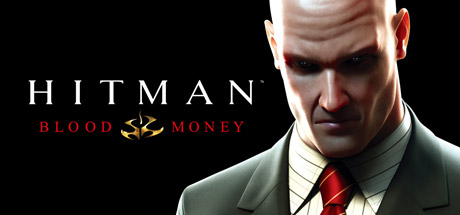

**Platforms:** Windows, PlayStation 2, Xbox, Xbox 360 &nbsp;|&nbsp; **Genre:** Action &nbsp;|&nbsp; **Released:** May 30

> Money Talks. Silence Pays. Prepare to Make a Killing. When assassins from Agent 47's contract agency, The ICA, are eliminated in a series of hits, it seems a larger, more powerful agency has entered the fray. Sensing he may be a target, 47 travels to America, and prepares to make a killing.
>
> _Synopsis source: Steam_

[Steam](https://store.steampowered.com/app/6860)

---

### Ice Age 2: The Meltdown

**Platforms:** Windows, PlayStation 2, Xbox, GameCube, Game Boy Advance, Nintendo DS, Wii &nbsp;|&nbsp; **Released:** March 31 (EU/JP)

---

### Ice Age 2: The Meltdown (USA)

**Platforms:** Windows, PlayStation 2, Xbox, GameCube, Game Boy Advance, Nintendo DS, Wii &nbsp;|&nbsp; **Released:** March 14

---

### IGPX: Immortal Grand Prix

**Platforms:** PlayStation 2 &nbsp;|&nbsp; **Released:** September 12

---

### Jaws: Unleashed

**Platforms:** PlayStation 2, Xbox, Windows &nbsp;|&nbsp; **Released:** May 23 (EU/AU)

---

### Just Cause

**Platforms:** Windows, PlayStation 2, Xbox, Xbox 360 &nbsp;|&nbsp; **Genre:** Action &nbsp;|&nbsp; **Released:** September 22

> Your world...Your rules!
>
> _Synopsis source: Steam_

[Wikipedia](https://en.wikipedia.org/wiki/Just_Cause_(video_game)) · [Steam](https://store.steampowered.com/app/6880)

---

### Justice League Heroes

**Platforms:** PlayStation 2, Xbox, Nintendo DS, PlayStation Portable &nbsp;|&nbsp; **Released:** October 17

[Wikipedia](https://en.wikipedia.org/wiki/Justice_League_Heroes)

---

### Kamaitachi no Yoru ×3

**Platforms:** PlayStation 2 &nbsp;|&nbsp; **Genre:** Visual novel &nbsp;|&nbsp; **Released:** July 27

[Wikipedia](https://en.wikipedia.org/wiki/Kamaitachi_no_Yoru_%C3%973)

---

### Kingdom Hearts II

**Platforms:** PlayStation 2 &nbsp;|&nbsp; **Released:** September 28 (AU/EU)

[Wikipedia](https://en.wikipedia.org/wiki/Kingdom_Hearts_II)

---

### Kingdom Hearts II (USA)

**Platforms:** PlayStation 2 &nbsp;|&nbsp; **Released:** March 28

[Wikipedia](https://en.wikipedia.org/wiki/Kingdom_Hearts_II)

---

### KOF: Maximum Impact 2

**Platforms:** PlayStation 2 &nbsp;|&nbsp; **Released:** April 27 (JP)

[Wikipedia](https://en.wikipedia.org/wiki/King_of_Fighters_Maximum_Impact_2)

---

### LEGO Star Wars II: The Original Trilogy

**Platforms:** Windows, PlayStation 2, Xbox, GameCube, Xbox 360, Nintendo DS, PlayStation Portable &nbsp;|&nbsp; **Released:** September 12

---

### Marc Eckō's Getting Up: Contents Under Pressure

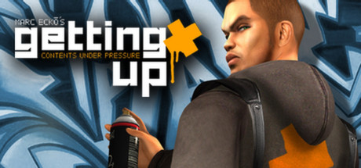

**Platforms:** Windows, PlayStation 2, Xbox &nbsp;|&nbsp; **Genre:** Action, Adventure &nbsp;|&nbsp; **Released:** February 14

> Play as Trane, a &quot;toy&quot; graffiti artist with the street smarts, athletic prowess and vision to become an &quot;All City King&quot; - the most reputable of all graffiti artists. Along your quest, uncover the mayor's deep, dark secret and use your fighting talents and high-wire graffiti to expose the city's leader as a corrupt...
>
> _Synopsis source: Steam_

[Steam](https://store.steampowered.com/app/260190)

---

### Marvel: Ultimate Alliance

**Platforms:** Windows, PlayStation 2, Xbox, Xbox 360, Game Boy Advance, PlayStation 3 &nbsp;|&nbsp; **Released:** October 24

---

### Mashed

**Platforms:** PlayStation 2, Xbox &nbsp;|&nbsp; **Released:** December 13

[Wikipedia](https://en.wikipedia.org/wiki/Mashed_(video_game))

---

### Mega Man X Collection

**Platforms:** GameCube, PlayStation 2 &nbsp;|&nbsp; **Released:** January 10

[Wikipedia](https://en.wikipedia.org/wiki/Mega_Man_X_Collection)

---

### Mercury Meltdown Remix

**Platforms:** PlayStation 2 &nbsp;|&nbsp; **Released:** December 4

[Wikipedia](https://en.wikipedia.org/wiki/Mercury_Meltdown)

---

### Metal Gear Solid 3: Subsistence

**Platforms:** PlayStation 2 &nbsp;|&nbsp; **Released:** March 14

---

### Monster House

**Platforms:** PlayStation 2, GameCube, Game Boy Advance, Nintendo DS &nbsp;|&nbsp; **Released:** July 18 (NA/EU/AU)

[Wikipedia](https://en.wikipedia.org/wiki/Monster_House_(video_game))

---

### Mortal Kombat: Armageddon

**Platforms:** PlayStation 2, Xbox &nbsp;|&nbsp; **Released:** October 11

---

### MS Saga: A New Dawn

**Platforms:** PlayStation 2 &nbsp;|&nbsp; **Released:** February 21

---

### NCAA Football 07

**Platforms:** Xbox, PlayStation 2, Xbox 360, PlayStation Portable &nbsp;|&nbsp; **Publisher:** EA Sports &nbsp;|&nbsp; **Released:** July 18, 2006

[Wikipedia](https://en.wikipedia.org/wiki/NCAA_Football_07)

---

### Need for Speed: Carbon

**Platforms:** Windows, PlayStation 2, Xbox, GameCube, Xbox 360, PlayStation 3 &nbsp;|&nbsp; **Released:** October 31

---

### NFL Head Coach

**Platforms:** Windows, PlayStation 2, Xbox &nbsp;|&nbsp; **Released:** June 20

[Wikipedia](https://en.wikipedia.org/wiki/NFL_Head_Coach)

---

### NHL 07

**Platforms:** Windows, PlayStation 2, Xbox, GameCube, Xbox 360 &nbsp;|&nbsp; **Released:** September 12

[Wikipedia](https://en.wikipedia.org/wiki/NHL_07)

---

### Nicktoons: Battle for Volcano Island

**Platforms:** PlayStation 2, GameCube, Game Boy Advance, Nintendo DS &nbsp;|&nbsp; **Released:** October 24

---

### One Piece: Grand Adventure

**Platforms:** GameCube, PlayStation 2 &nbsp;|&nbsp; **Released:** August 29

---

### Onimusha: Dawn of Dreams

**Platforms:** PlayStation 2 &nbsp;|&nbsp; **Released:** March 8

---

### Open Season

**Platforms:** Windows, GameCube, PlayStation 2, Xbox, Xbox 360, Game Boy Advance, Nintendo DS, PlayStation Portable, Wii &nbsp;|&nbsp; **Released:** October 6 (EU/AU)

---

### Open Season (USA)

**Platforms:** Windows, GameCube, PlayStation 2, Xbox, Xbox 360, Game Boy Advance, Nintendo DS, PlayStation Portable, Wii &nbsp;|&nbsp; **Released:** September 18

[Wikipedia](https://en.wikipedia.org/wiki/Open_Season_(video_game))

---

### OutRun 2006: Coast 2 Coast

**Platforms:** PlayStation 2, Xbox, PlayStation Portable &nbsp;|&nbsp; **Released:** April 25

---

### Over the Hedge

**Platforms:** Windows, PlayStation 2, Xbox, GameCube, Game Boy Advance &nbsp;|&nbsp; **Released:** May 9 (NA/EU/AU)

[Wikipedia](https://en.wikipedia.org/wiki/Over_the_Hedge_(video_game))

---

### Pac-Man World Rally

**Platforms:** Windows, PlayStation 2, GameCube, PlayStation Portable &nbsp;|&nbsp; **Released:** August 22

[Wikipedia](https://en.wikipedia.org/wiki/Pac-Man_World_Rally)

---

### Persona 3

**Platforms:** PlayStation 2 &nbsp;|&nbsp; **Released:** July 13 (JP)

[Wikipedia](https://en.wikipedia.org/wiki/Persona_3)

---

### Phantasy Star Universe

**Platforms:** Windows, PlayStation 2, Xbox 360 &nbsp;|&nbsp; **Released:** October 24

[Wikipedia](https://en.wikipedia.org/wiki/Phantasy_Star_Universe)

---

### Pirates of the Caribbean: The Legend of Jack Sparrow

**Platforms:** Windows, PlayStation 2 &nbsp;|&nbsp; **Released:** June 28

---

### Rampage: Total Destruction

**Platforms:** PlayStation 2, GameCube, Wii &nbsp;|&nbsp; **Released:** April 24

---

### Rayman Raving Rabbids

**Platforms:** Windows, PlayStation 2, Wii &nbsp;|&nbsp; **Released:** December 7 (AU/EU)

---

### Rayman Raving Rabbids (USA)

**Platforms:** Wii, PlayStation 2, Windows &nbsp;|&nbsp; **Released:** November 19

[Wikipedia](https://en.wikipedia.org/wiki/Rayman_Raving_Rabbids)

---

### Reservoir Dogs

**Platforms:** Windows, PlayStation 2, Xbox &nbsp;|&nbsp; **Released:** October 24

[Wikipedia](https://en.wikipedia.org/wiki/Reservoir_Dogs_(video_game))

---

### Rule of Rose

**Platforms:** PlayStation 2 &nbsp;|&nbsp; **Released:** September 12

[Wikipedia](https://en.wikipedia.org/wiki/Rule_of_Rose)

---

### Scarface: The World Is Yours

**Platforms:** Windows, PlayStation 2, Xbox &nbsp;|&nbsp; **Released:** October 8

---

### Shadow Hearts: From the New World

**Platforms:** PlayStation 2 &nbsp;|&nbsp; **Released:** March 7

---

### Siren 2

**Platforms:** PlayStation 2 &nbsp;|&nbsp; **Released:** February 9 (JP)

[Wikipedia](https://en.wikipedia.org/wiki/Forbidden_Siren_2)

---

### SOCOM U.S. Navy SEALs: Combined Assault

**Platforms:** PlayStation 2 &nbsp;|&nbsp; **Released:** November 7

---

### Sonic Riders

**Platforms:** PlayStation 2, Xbox, GameCube &nbsp;|&nbsp; **Released:** February 21

[Wikipedia](https://en.wikipedia.org/wiki/Sonic_Riders)

---

### SpongeBob SquarePants: Creature from the Krusty Krab

**Platforms:** Windows, PlayStation 2, GameCube, Game Boy Advance, Nintendo DS, Wii &nbsp;|&nbsp; **Released:** August 15 (AU/EU)

---

### SpongeBob SquarePants: Creature from the Krusty Krab (USA)

**Platforms:** PlayStation 2, GameCube, Game Boy Advance, Nintendo DS, Wii &nbsp;|&nbsp; **Released:** October 18

---

### Spy Hunter: Nowhere to Run

**Platforms:** PlayStation 2, Xbox &nbsp;|&nbsp; **Released:** September 5

---

### Star Trek: Encounters

**Platforms:** PlayStation 2 &nbsp;|&nbsp; **Released:** October 4

---

### State of Emergency 2

**Platforms:** PlayStation 2 &nbsp;|&nbsp; **Released:** February 14

[Wikipedia](https://en.wikipedia.org/wiki/State_of_Emergency_2)

---

### Steambot Chronicles

**Platforms:** PlayStation 2 &nbsp;|&nbsp; **Released:** May 23

[Wikipedia](https://en.wikipedia.org/wiki/Steambot_Chronicles)

---

### Suikoden V

**Platforms:** PlayStation 2 &nbsp;|&nbsp; **Released:** March 21

[Wikipedia](https://en.wikipedia.org/wiki/Suikoden_V)

---

### Super Dragon Ball Z

**Platforms:** PlayStation 2 &nbsp;|&nbsp; **Released:** July 18

[Wikipedia](https://en.wikipedia.org/wiki/Super_Dragon_Ball_Z)

---

### Super Monkey Ball Adventure

**Platforms:** GameCube, PlayStation 2, PlayStation Portable &nbsp;|&nbsp; **Released:** August 1

[Wikipedia](https://en.wikipedia.org/wiki/Super_Monkey_Ball_Adventure)

---

### Superman Returns

**Platforms:** PlayStation 2, Xbox, Xbox 360, Nintendo DS &nbsp;|&nbsp; **Released:** November 22

[Wikipedia](https://en.wikipedia.org/wiki/Superman_Returns_(video_game))

---

### Tales of Legendia

**Platforms:** PlayStation 2 &nbsp;|&nbsp; **Released:** February 7

[Wikipedia](https://en.wikipedia.org/wiki/Tales_of_Legendia)

---

### Tales of the Abyss

**Platforms:** PlayStation 2 &nbsp;|&nbsp; **Released:** October 10

[Wikipedia](https://en.wikipedia.org/wiki/Tales_of_the_Abyss)

---

### The Da Vinci Code

**Platforms:** Windows, PlayStation 2, Xbox &nbsp;|&nbsp; **Released:** May 19

[Wikipedia](https://en.wikipedia.org/wiki/The_Da_Vinci_Code_(video_game))

---

### The Fast and the Furious

**Platforms:** PlayStation 2 &nbsp;|&nbsp; **Released:** September 26

[Wikipedia](https://en.wikipedia.org/wiki/The_Fast_and_the_Furious_(2006_video_game))

---

### The Godfather: The Game

**Platforms:** Windows, PlayStation 2, Xbox, Xbox 360, PlayStation Portable &nbsp;|&nbsp; **Released:** March 21

[Wikipedia](https://en.wikipedia.org/wiki/The_Godfather_(2006_video_game))

---

### The Grim Adventures of Billy & Mandy

**Platforms:** GameCube, PlayStation 2, Game Boy Advance, Wii &nbsp;|&nbsp; **Released:** September 25 (NA)

[Wikipedia](https://en.wikipedia.org/wiki/The_Grim_Adventures_of_Billy_%26_Mandy_(video_game))

---

### The Legend of Spyro: A New Beginning

**Platforms:** PlayStation 2, Xbox, GameCube, Game Boy Advance, Nintendo DS &nbsp;|&nbsp; **Released:** October 10 (NA/EU/AU)

---

### The Sopranos: Road to Respect

**Platforms:** PlayStation 2 &nbsp;|&nbsp; **Released:** November 7

---

### Thrillville

**Platforms:** PlayStation 2, Xbox, PlayStation Portable &nbsp;|&nbsp; **Released:** November 21

[Wikipedia](https://en.wikipedia.org/wiki/Thrillville)

---

### TOCA Race Driver 3

**Platforms:** Windows, PlayStation 2, Xbox &nbsp;|&nbsp; **Released:** February 22

[Wikipedia](https://en.wikipedia.org/wiki/TOCA_Race_Driver_3)

---

### Tokobot

**Platforms:** PlayStation 2 &nbsp;|&nbsp; **Released:** October 24

[Wikipedia](https://en.wikipedia.org/wiki/Tokobot)

---

### Tokyo Xtreme Racer: Drift

**Platforms:** PlayStation 2 &nbsp;|&nbsp; **Released:** April 18

---

### Tom Clancy's Ghost Recon Advanced Warfighter

**Platforms:** Xbox 360, Xbox, PlayStation 2, Windows &nbsp;|&nbsp; **Publisher:** Ubisoft &nbsp;|&nbsp; **Released:** March 9, 2006

[Wikipedia](https://en.wikipedia.org/wiki/Tom_Clancy%27s_Ghost_Recon_Advanced_Warfighter)

---

### Tom Clancy's Splinter Cell: Double Agent

**Platforms:** Xbox, Xbox 360, PlayStation 2, GameCube, Windows, Wii &nbsp;|&nbsp; **Publisher:** Ubisoft &nbsp;|&nbsp; **Genre:** Action &nbsp;|&nbsp; **Released:** October 24, 2006

> In the sequel to the 2005 Game of the Year, Splinter Cell: Double Agent, play as legendary covert operative Sam Fisher, infiltrate a ruthless terrorist organization, and destroy it from within.
>
> _Synopsis source: Steam_

[Steam](https://store.steampowered.com/app/13580)

---

### Tomb Raider: Legend

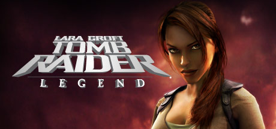

**Platforms:** Windows, PlayStation 2, Xbox, Xbox 360, PlayStation Portable, GameCube, Game Boy Advance, Nintendo DS &nbsp;|&nbsp; **Genre:** Action, Adventure &nbsp;|&nbsp; **Released:** April 11

> Follow Lara Croft down a path of discovery as she travels the globe to remote, exotic locales in search of one of history's greatest artifacts, that unleashes unwelcome figures from Lara's mysterious past.
>
> _Synopsis source: Steam_

[Steam](https://store.steampowered.com/app/7000)

---

### Tony Hawk's Project 8

**Platforms:** PlayStation 2, Xbox, Xbox 360, PlayStation 3, PlayStation Portable &nbsp;|&nbsp; **Released:** November 7

[Wikipedia](https://en.wikipedia.org/wiki/Tony_Hawk%27s_Project_8)

---

### Tourist Trophy

**Platforms:** PlayStation 2 &nbsp;|&nbsp; **Released:** April 4

[Wikipedia](https://en.wikipedia.org/wiki/Tourist_Trophy_(video_game))

---

### Urban Chaos: Riot Response

**Platforms:** PlayStation 2, Xbox &nbsp;|&nbsp; **Released:** June 15

---

### Valkyrie Profile 2: Silmeria

**Platforms:** PlayStation 2 &nbsp;|&nbsp; **Released:** September 26

---

### W.I.T.C.H.

**Platforms:** PlayStation 2, GameCube, Xbox, Game Boy Advance, Nintendo DS &nbsp;|&nbsp; **Released:** September 15

[Wikipedia](https://en.wikipedia.org/wiki/W.I.T.C.H._(video_game))

---

### WinBack 2: Project Poseidon

**Platforms:** PlayStation 2, Xbox &nbsp;|&nbsp; **Released:** April 25

---

### WWE SmackDown! vs. RAW 2007

**Platforms:** PlayStation 2, Xbox 360, PlayStation Portable &nbsp;|&nbsp; **Released:** November 14

[Wikipedia](https://en.wikipedia.org/wiki/WWE_SmackDown!_vs._RAW_2007)

---

### X-Men: The Official Game

**Platforms:** Windows, PlayStation 2, Xbox, GameCube, Xbox 360, Game Boy Advance, Nintendo DS, PlayStation Portable &nbsp;|&nbsp; **Released:** May 16

---

### Xenosaga Episode III: Also sprach Zarathustra

**Platforms:** PlayStation 2 &nbsp;|&nbsp; **Released:** August 29

---

### Xiaolin Showdown

**Platforms:** PlayStation 2, PlayStation Portable, Xbox, Nintendo DS &nbsp;|&nbsp; **Released:** November 14

[Wikipedia](https://en.wikipedia.org/wiki/Xiaolin_Showdown_(video_game))

---

### Yakuza 2

**Platforms:** PlayStation 2 &nbsp;|&nbsp; **Released:** December 7 (JP)

[Wikipedia](https://en.wikipedia.org/wiki/Yakuza_2)

---

### Zatch Bell! Mamodo Fury

**Platforms:** PlayStation 2, GameCube &nbsp;|&nbsp; **Released:** September 19

[Wikipedia](https://en.wikipedia.org/wiki/Zatch_Bell!_Mamodo_Fury)

---

### Ōkami

**Platforms:** PlayStation 2 &nbsp;|&nbsp; **Publisher:** Capcom &nbsp;|&nbsp; **Released:** April 20, 2006

[Wikipedia](https://en.wikipedia.org/wiki/%C5%8Ckami)

---

## 2005

[Full 2005 page](../years/2005.md)

### 007: From Russia with Love

**Platforms:** PlayStation 2, Xbox, GameCube &nbsp;|&nbsp; **Released:** November 1

---

### 187 Ride or Die

**Platforms:** PlayStation 2, Xbox &nbsp;|&nbsp; **Released:** August 23

[Wikipedia](https://en.wikipedia.org/wiki/187_Ride_or_Die)

---

### 50 Cent: Bulletproof

**Platforms:** PlayStation 2, Xbox &nbsp;|&nbsp; **Released:** November 17

---

### 7 Sins

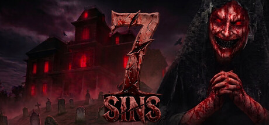

**Platforms:** Windows, PlayStation 2 &nbsp;|&nbsp; **Genre:** Action, Indie, Early Access &nbsp;|&nbsp; **Released:** May 27

> 7 Sins is a 1-4 player co-op psychological horror game. Search for their items and destroy them in a ritual to stop the creatures. However, whoever touches an item falls victim to the curse of that sin and becomes trapped in mental hallucinations. Resist the curse, solve the mystery, and survive!
>
> _Synopsis source: Steam_

[Wikipedia](https://en.wikipedia.org/wiki/7_Sins_(video_game)) · [Steam](https://store.steampowered.com/app/5064890)

---

### Arc the Lad: End of Darkness

**Platforms:** PlayStation 2 &nbsp;|&nbsp; **Released:** June 14

---

### Area 51

**Platforms:** Windows, PlayStation 2, Xbox &nbsp;|&nbsp; **Genre:** Action, Adventure, Casual, Indie, Simulation &nbsp;|&nbsp; **Released:** June 8

> Storm AREA 51 with your friends. Explore the most classified facility on earth. Discover what they've been hiding. Take selfies with aliens and smuggle evidence out before the military arrives.
>
> _Synopsis source: Steam_

[Wikipedia](https://en.wikipedia.org/wiki/Area_51_(2005_video_game)) · [Steam](https://store.steampowered.com/app/4423180)

---

### Armored Core: Nine Breaker

**Platforms:** PlayStation 2 &nbsp;|&nbsp; **Released:** September 13

---

### Batman Begins

**Platforms:** GameCube, PlayStation 2, Xbox, Game Boy Advance &nbsp;|&nbsp; **Released:** June 14

[Wikipedia](https://en.wikipedia.org/wiki/Batman_Begins_(video_game))

---

### Battlefield 2: Modern Combat

**Platforms:** PlayStation 2, Xbox &nbsp;|&nbsp; **Released:** October 25

---

### Beat Down: Fists of Vengeance

**Platforms:** PlayStation 2, Xbox &nbsp;|&nbsp; **Released:** August 23

---

### Bratz: Rock Angelz

**Platforms:** Windows, PlayStation 2, GameCube, Game Boy Advance &nbsp;|&nbsp; **Released:** October 4

---

### Brothers in Arms: Earned in Blood

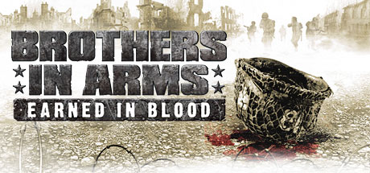

**Platforms:** Windows, PlayStation 2, Xbox &nbsp;|&nbsp; **Genre:** Action &nbsp;|&nbsp; **Released:** October 26

> With its unprecedented combination of authenticity, compelling story and squad-based action, the Brothers in Arms franchise has established itself as a benchmark for military action games, receiving the highest average review scores of any console WWII game to date (www.gamerankings.com).
>
> _Synopsis source: Steam_

[Steam](https://store.steampowered.com/app/19800)

---

### Brothers in Arms: Road to Hill 30

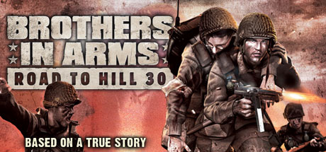

**Platforms:** Xbox, Windows, PlayStation 2 &nbsp;|&nbsp; **Genre:** Action &nbsp;|&nbsp; **Released:** March 1

> Based on a true story. Set during the famous airdrop before the invasion at Normandy, where Sgt. Matt Baker and his squad of 101st Airborne Paratroopers were scattered over the French countryside.
>
> _Synopsis source: Steam_

[Steam](https://store.steampowered.com/app/15190)

---

### Burnout Revenge

**Platforms:** PlayStation 2, Xbox &nbsp;|&nbsp; **Publisher:** Electronic Arts &nbsp;|&nbsp; **Released:** September 13, 2005

[Wikipedia](https://en.wikipedia.org/wiki/Burnout_Revenge)

---

### Cabela's Dangerous Hunts 2

**Platforms:** PlayStation 2, Xbox, GameCube &nbsp;|&nbsp; **Released:** November 16

[Wikipedia](https://en.wikipedia.org/wiki/Cabela%27s_Dangerous_Hunts_2)

---

### Call of Duty 2: Big Red One

**Platforms:** PlayStation 2, Xbox, GameCube &nbsp;|&nbsp; **Released:** November 1

---

### Capcom Classics Collection

**Platforms:** PlayStation 2, Xbox &nbsp;|&nbsp; **Released:** September 27

[Wikipedia](https://en.wikipedia.org/wiki/Capcom_Classics_Collection)

---

### Castlevania: Curse of Darkness

**Platforms:** PlayStation 2, Xbox &nbsp;|&nbsp; **Released:** November 1

---

### Charlie and the Chocolate Factory

**Platforms:** PlayStation 2, Xbox, GameCube, Game Boy Advance &nbsp;|&nbsp; **Released:** July 11

[Wikipedia](https://en.wikipedia.org/wiki/Charlie_and_the_Chocolate_Factory_(2005_video_game))

---

### Chicken Little

**Platforms:** GameCube, PlayStation 2, Xbox, Windows &nbsp;|&nbsp; **Released:** October 18

[Wikipedia](https://en.wikipedia.org/wiki/Chicken_Little_(video_game))

---

### Codename: Kids Next Door – Operation: V.I.D.E.O.G.A.M.E.

**Platforms:** GameCube, PlayStation 2, Xbox &nbsp;|&nbsp; **Released:** October 11

---

### Cold Fear

**Platforms:** PlayStation 2, Xbox &nbsp;|&nbsp; **Released:** March 15

[Wikipedia](https://en.wikipedia.org/wiki/Cold_Fear)

---

### Cold Winter

**Platforms:** PlayStation 2 &nbsp;|&nbsp; **Released:** May 11

[Wikipedia](https://en.wikipedia.org/wiki/Cold_Winter)

---

### College Hoops 2K6

**Platforms:** Xbox, PlayStation 2 &nbsp;|&nbsp; **Released:** November 21

[Wikipedia](https://en.wikipedia.org/wiki/College_Hoops_2K6)

---

### Colosseum: Road to Freedom

**Platforms:** PlayStation 2 &nbsp;|&nbsp; **Released:** July 20

---

### Constantine

**Platforms:** Windows, PlayStation 2, Xbox &nbsp;|&nbsp; **Released:** February 15

[Wikipedia](https://en.wikipedia.org/wiki/Constantine_(video_game))

---

### Crash Tag Team Racing

**Platforms:** GameCube, PlayStation 2, Xbox, PlayStation Portable &nbsp;|&nbsp; **Released:** October 19

[Wikipedia](https://en.wikipedia.org/wiki/Crash_Tag_Team_Racing)

---

### Dance Dance Revolution Extreme 2

**Platforms:** PlayStation 2 &nbsp;|&nbsp; **Released:** September 28

[Wikipedia](https://en.wikipedia.org/wiki/Dance_Dance_Revolution_Extreme_2)

---

### Destroy All Humans!

**Platforms:** PlayStation 2, Xbox &nbsp;|&nbsp; **Released:** June 21

[Wikipedia](https://en.wikipedia.org/wiki/Destroy_All_Humans!)

---

### Devil Kings

**Platforms:** PlayStation 2 &nbsp;|&nbsp; **Released:** October 12

[Wikipedia](https://en.wikipedia.org/wiki/Devil_Kings)

---

### Devil May Cry 3: Dante's Awakening

**Platforms:** PlayStation 2 &nbsp;|&nbsp; **Released:** February 17

---

### Digimon World 4

**Platforms:** GameCube, PlayStation 2, Xbox &nbsp;|&nbsp; **Released:** June 2

[Wikipedia](https://en.wikipedia.org/wiki/Digimon_World_4)

---

### Dragon Ball Z: Sagas

**Platforms:** PlayStation 2, Xbox, GameCube &nbsp;|&nbsp; **Released:** March 22

---

### Dragon Quest VIII

**Platforms:** PlayStation 2 &nbsp;|&nbsp; **Released:** November 15 (NA)

[Wikipedia](https://en.wikipedia.org/wiki/Dragon_Quest_VIII)

---

### Dynasty Warriors 5

**Platforms:** PlayStation 2, Xbox &nbsp;|&nbsp; **Released:** March 29

[Wikipedia](https://en.wikipedia.org/wiki/Dynasty_Warriors_5)

---

### Ed, Edd n Eddy: The Mis-Edventures

**Platforms:** Windows, PlayStation 2, Xbox, GameCube, Game Boy Advance &nbsp;|&nbsp; **Released:** November 3

---

### Evil Dead: Regeneration

**Platforms:** Windows, PlayStation 2, Xbox &nbsp;|&nbsp; **Released:** September 13

---

### EyeToy: Kinetic

**Platforms:** PlayStation 2 &nbsp;|&nbsp; **Released:** November 8

---

### EyeToy: Operation Spy

**Platforms:** PlayStation 2 &nbsp;|&nbsp; **Released:** November 15

---

### EyeToy: Play 2

**Platforms:** PlayStation 2 &nbsp;|&nbsp; **Released:** August 16

---

### Fahrenheit

**Platforms:** PlayStation 2, Xbox, Windows &nbsp;|&nbsp; **Released:** September 26

[Wikipedia](https://en.wikipedia.org/wiki/Fahrenheit_(2005_video_game))

---

### Fahrenheit: Indigo Prophecy

**Platforms:** Windows, PlayStation 2, Xbox &nbsp;|&nbsp; **Released:** September 20

[Wikipedia](https://en.wikipedia.org/wiki/Fahrenheit_(2005_video_game))

---

### Fantastic Four

**Platforms:** Windows, GameCube, PlayStation 2, Xbox, Game Boy Advance &nbsp;|&nbsp; **Released:** June 27

[Wikipedia](https://en.wikipedia.org/wiki/Fantastic_Four_(2005_video_game))

---

### Fatal Frame III: The Tormented

**Platforms:** PlayStation 2 &nbsp;|&nbsp; **Released:** November 8

---

### FIFA 06

**Platforms:** Windows, PlayStation 2, Xbox, GameCube, Nintendo DS, Mobile phone, PlayStation Portable, Game Boy Advance &nbsp;|&nbsp; **Released:** October 4

[Wikipedia](https://en.wikipedia.org/wiki/FIFA_06)

---

### FIFA Street

**Platforms:** PlayStation 2, Xbox, GameCube &nbsp;|&nbsp; **Released:** February 22

[Wikipedia](https://en.wikipedia.org/wiki/FIFA_Street_(2005_video_game))

---

### Fight Night Round 2

**Platforms:** PlayStation 2, Xbox, GameCube &nbsp;|&nbsp; **Released:** February 28

[Wikipedia](https://en.wikipedia.org/wiki/Fight_Night_Round_2)

---

### Fire Pro Wrestling Returns

**Platforms:** PlayStation 2 &nbsp;|&nbsp; **Released:** September 15

[Wikipedia](https://en.wikipedia.org/wiki/Fire_Pro_Wrestling_Returns)

---

### FlatOut

**Platforms:** Windows, Xbox, PlayStation 2 &nbsp;|&nbsp; **Released:** July 12 (NA/JP)

[Wikipedia](https://en.wikipedia.org/wiki/FlatOut_(video_game))

---

### Frogger: Ancient Shadow

**Platforms:** PlayStation 2, Xbox, GameCube &nbsp;|&nbsp; **Released:** September 27

---

### Fullmetal Alchemist and the Broken Angel

**Platforms:** PlayStation 2 &nbsp;|&nbsp; **Released:** January 18

[Wikipedia](https://en.wikipedia.org/wiki/Fullmetal_Alchemist_and_the_Broken_Angel)

---

### Gauntlet: Seven Sorrows

**Platforms:** PlayStation 2, Xbox &nbsp;|&nbsp; **Released:** December 12

---

### Genji: Dawn of the Samurai

**Platforms:** PlayStation 2 &nbsp;|&nbsp; **Released:** September 20

---

### God of War

**Platforms:** PlayStation 2 &nbsp;|&nbsp; **Publisher:** Sony Computer Entertainment &nbsp;|&nbsp; **Released:** March 22, 2005

[Wikipedia](https://en.wikipedia.org/wiki/God_of_War_(2005_video_game))

---

### Gran Turismo 4

**Platforms:** PlayStation 2 &nbsp;|&nbsp; **Released:** February 22

[Wikipedia](https://en.wikipedia.org/wiki/Gran_Turismo_4)

---

### Gretzky NHL 2006

**Platforms:** PlayStation 2 &nbsp;|&nbsp; **Released:** September 20

[Wikipedia](https://en.wikipedia.org/wiki/Gretzky_NHL_2006)

---

### Guitar Hero

**Platforms:** PlayStation 2 &nbsp;|&nbsp; **Publisher:** RedOctane &nbsp;|&nbsp; **Released:** November 7, 2005

[Wikipedia](https://en.wikipedia.org/wiki/Guitar_Hero)

---

### Gun

**Platforms:** Windows, PlayStation 2, Xbox, GameCube &nbsp;|&nbsp; **Released:** November 8

[Wikipedia](https://en.wikipedia.org/wiki/Gun_(video_game))

---

### Harry Potter And The Goblet Of Fire

**Platforms:** Windows, PlayStation 2, Xbox, GameCube, Nintendo DS, Game Boy Advance, PlayStation Portable &nbsp;|&nbsp; **Released:** November 8

[Wikipedia](https://en.wikipedia.org/wiki/Harry_Potter_and_the_Goblet_of_Fire_(video_game))

---

### Haunting Ground

**Platforms:** PlayStation 2 &nbsp;|&nbsp; **Released:** April 21

[Wikipedia](https://en.wikipedia.org/wiki/Haunting_Ground)

---

### InuYasha: Feudal Combat

**Platforms:** PlayStation 2 &nbsp;|&nbsp; **Released:** August 25

---

### Jak X: Combat Racing

**Platforms:** PlayStation 2 &nbsp;|&nbsp; **Released:** October 18

---

### Judge Dredd: Dredd vs. Death

**Platforms:** PlayStation 2, Xbox, GameCube, Windows &nbsp;|&nbsp; **Genre:** Action &nbsp;|&nbsp; **Released:** February 24

> Welcome to Mega-City One, a city of over 400 million people - every one of them a potential criminal. It is the third decade of the 22nd Century, unemployment is widespread, boredom is universal and only the Judges can prevent total anarchy. Empowered to dispense instant justice, they are Judge, Jury and Executioner all in one.
>
> _Synopsis source: Steam_

[Steam](https://store.steampowered.com/app/3710)

---

### Juiced

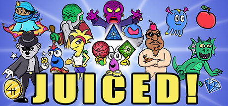

**Platforms:** Windows, PlayStation 2, Xbox &nbsp;|&nbsp; **Genre:** Action, Adventure, Indie &nbsp;|&nbsp; **Released:** June 13

> Embark on an epic journey through exotic worlds to uncover the mystery of the magic crystals! An exciting retro platform adventure in the nostalgic style of the 90's DOS platformers
>
> _Synopsis source: Steam_

[Wikipedia](https://en.wikipedia.org/wiki/Juiced_(video_game)) · [Steam](https://store.steampowered.com/app/1287310)

---

### killer7

**Platforms:** PlayStation 2, GameCube &nbsp;|&nbsp; **Released:** July 7

[Wikipedia](https://en.wikipedia.org/wiki/Killer7)

---

### Kingdom Hearts II

**Platforms:** PlayStation 2 &nbsp;|&nbsp; **Released:** December 22 (JP)

[Wikipedia](https://en.wikipedia.org/wiki/Kingdom_Hearts_II)

---

### L.A. Rush

**Platforms:** PlayStation 2, Xbox &nbsp;|&nbsp; **Released:** October 10

[Wikipedia](https://en.wikipedia.org/wiki/L.A._Rush)

---

### Legend of Kay

**Platforms:** PlayStation 2 &nbsp;|&nbsp; **Released:** September 20

[Wikipedia](https://en.wikipedia.org/wiki/Legend_of_Kay)

---

### Lego Star Wars: The Video Game

**Platforms:** Windows, PlayStation 2, Xbox, Game Boy Advance, GameCube &nbsp;|&nbsp; **Released:** April 5

---

### Madagascar

**Platforms:** Windows, GameCube, PlayStation 2, Xbox, Game Boy Advance, Nintendo DS &nbsp;|&nbsp; **Released:** May 24

[Wikipedia](https://en.wikipedia.org/wiki/Madagascar_(video_game))

---

### Madden NFL 06

**Platforms:** PlayStation 2, GameCube, Nintendo DS, Windows &nbsp;|&nbsp; **Released:** August 8

[Wikipedia](https://en.wikipedia.org/wiki/Madden_NFL_06)

---

### Magna Carta: Crimson Stigmata

**Platforms:** PlayStation 2 &nbsp;|&nbsp; **Released:** November 15

---

### Makai Kingdom: Chronicles of the Sacred Tome

**Platforms:** PlayStation 2 &nbsp;|&nbsp; **Released:** July 26

---

### Marvel Nemesis: Rise of the Imperfects

**Platforms:** GameCube, PlayStation 2, Xbox, Nintendo DS, PlayStation Portable &nbsp;|&nbsp; **Released:** September 20

---

### Medal of Honor: European Assault

**Platforms:** GameCube, PlayStation 2, Xbox &nbsp;|&nbsp; **Released:** June 7

---

### Mercenaries: Playground of Destruction

**Platforms:** PlayStation 2, Xbox &nbsp;|&nbsp; **Released:** January 11

---

### Metal Gear Solid 3: Subsistence

**Platforms:** PlayStation 2 &nbsp;|&nbsp; **Publisher:** Konami &nbsp;|&nbsp; **Released:** December 22, 2005

---

### Midnight Club 3: DUB Edition

**Platforms:** PlayStation 2, Xbox, PlayStation Portable &nbsp;|&nbsp; **Released:** April 11

---

### MLB 2006

**Platforms:** PlayStation 2, PlayStation Portable &nbsp;|&nbsp; **Released:** March 8

[Wikipedia](https://en.wikipedia.org/wiki/989_Sports_Major_League_Baseball_series)

---

### Mortal Kombat: Shaolin Monks

**Platforms:** PlayStation 2, Xbox &nbsp;|&nbsp; **Released:** September 30 (EU)

---

### Mortal Kombat: Shaolin Monks (US)

**Platforms:** PlayStation 2, Xbox &nbsp;|&nbsp; **Released:** September 16

---

### Motocross Mania 3

**Platforms:** PlayStation 2, Xbox &nbsp;|&nbsp; **Released:** April 27

[Wikipedia](https://en.wikipedia.org/wiki/Motocross_Mania_3)

---

### Musashi: Samurai Legend

**Platforms:** PlayStation 2 &nbsp;|&nbsp; **Released:** March 15

---

### MVP Baseball 2005

**Platforms:** Windows, GameCube, PlayStation 2, Xbox &nbsp;|&nbsp; **Released:** February 22

[Wikipedia](https://en.wikipedia.org/wiki/MVP_Baseball_2005)

---

### MX vs. ATV Unleashed

**Platforms:** PlayStation 2, Xbox &nbsp;|&nbsp; **Released:** March 16

[Wikipedia](https://en.wikipedia.org/wiki/MX_vs._ATV_Unleashed)

---

### Nano Breaker

**Platforms:** PlayStation 2 &nbsp;|&nbsp; **Released:** February 15

[Wikipedia](https://en.wikipedia.org/wiki/Nano_Breaker)

---

### Need for Speed: Most Wanted

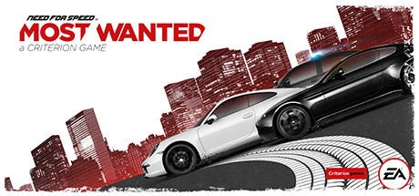

**Platforms:** Windows, PlayStation 2, Xbox, GameCube, Game Boy Advance, Nintendo DS, PlayStation Portable, Xbox 360 &nbsp;|&nbsp; **Genre:** Action, Adventure, Racing &nbsp;|&nbsp; **Released:** November 15

> The open-world action in Need for Speed Most Wanted gives you the freedom to drive your way. Hit jumps and shortcuts, switch cars, lie low or head for terrain that plays to your vehicle’s unique strengths. Fight your way past cops and rivals using skill, high-end car tech and tons of nitrous.
>
> _Synopsis source: Steam_

[Steam](https://store.steampowered.com/app/1262560)

---

### Neopets: The Darkest Faerie

**Platforms:** PlayStation 2 &nbsp;|&nbsp; **Released:** November 15

---

### ObsCure

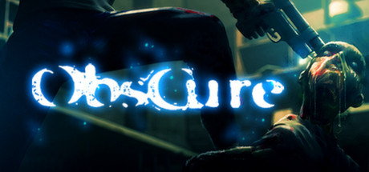

**Platforms:** Windows, PlayStation 2, Xbox &nbsp;|&nbsp; **Genre:** Action, Adventure &nbsp;|&nbsp; **Released:** April 26

> For some time now, Leafmore High School has been the setting for unexplained disappearances. In this survival horror game, you take control of a group of 5 American students. With your friends, you try to unravel the mysterious happenings at this unremarkable-looking school. The night will be long and survival not will not be easy...
>
> _Synopsis source: Steam_

[Wikipedia](https://en.wikipedia.org/wiki/ObsCure) · [Steam](https://store.steampowered.com/app/254460)

---

### One Piece: Grand Battle! Rush

**Platforms:** GameCube, PlayStation 2 &nbsp;|&nbsp; **Released:** September 7

---

### Pac-Man World 3

**Platforms:** Windows, PlayStation 2, Xbox, GameCube, Nintendo DS, PlayStation Portable &nbsp;|&nbsp; **Released:** November 15

[Wikipedia](https://en.wikipedia.org/wiki/Pac-Man_World_3)

---

### Peter Jackson's King Kong: The Official Game of the Movie

**Platforms:** Windows, PlayStation 2, Xbox, GameCube, Xbox 360, PlayStation Portable &nbsp;|&nbsp; **Released:** November 17

---

### Playboy: The Mansion

**Platforms:** Windows, PlayStation 2, Xbox &nbsp;|&nbsp; **Released:** January 25

---

### Predator: Concrete Jungle

**Platforms:** PlayStation 2, Xbox &nbsp;|&nbsp; **Released:** April 27

---

### Prince of Persia: The Two Thrones

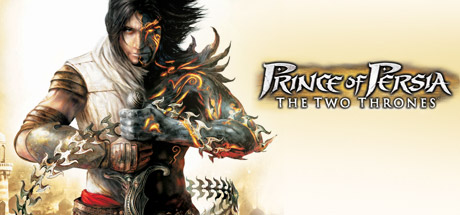

**Platforms:** Windows, PlayStation 2, Xbox, GameCube &nbsp;|&nbsp; **Genre:** Action, Adventure &nbsp;|&nbsp; **Released:** November 30

> The Prince of Persia, a seasoned warrior, returns from the Island of Time to Babylon with his love, Kaileena. Instead of the peace that he longs for, he finds his homeland ravaged by war and the kingdom turned against him.
>
> _Synopsis source: Steam_

[Steam](https://store.steampowered.com/app/13530)

---

### Project Snowblind

**Platforms:** PlayStation 2, Xbox &nbsp;|&nbsp; **Released:** February 23

[Wikipedia](https://en.wikipedia.org/wiki/Project_Snowblind)

---

### Psychonauts

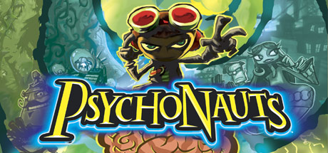

**Platforms:** Xbox, Windows, PlayStation 2 &nbsp;|&nbsp; **Publisher:** Majesco &nbsp;|&nbsp; **Genre:** Action &nbsp;|&nbsp; **Released:** April 19, 2005

> A Psychic Odyssey Through the Minds of Misfits, Monsters, and Madmen. This classic action/adventure platformer from acclaimed developers Double Fine Productions follows the story of a young psychic named Razputin.
>
> _Synopsis source: Steam_

[Wikipedia](https://en.wikipedia.org/wiki/Psychonauts) · [Steam](https://store.steampowered.com/app/3830)

---

### Radiata Stories

**Platforms:** PlayStation 2 &nbsp;|&nbsp; **Released:** September 6

[Wikipedia](https://en.wikipedia.org/wiki/Radiata_Stories)

---

### Ratchet: Deadlocked

**Platforms:** PlayStation 2 &nbsp;|&nbsp; **Released:** October 25

---

### Red Ninja: End of Honor

**Platforms:** Xbox, PlayStation 2 &nbsp;|&nbsp; **Released:** March 29

---

### Resident Evil 4

**Platforms:** PlayStation 2, GameCube &nbsp;|&nbsp; **Publisher:** Capcom &nbsp;|&nbsp; **Released:** October 25, 2005

[Wikipedia](https://en.wikipedia.org/wiki/Resident_Evil_4)

---

### Rise of the Kasai

**Platforms:** PlayStation 2 &nbsp;|&nbsp; **Released:** April 5

[Wikipedia](https://en.wikipedia.org/wiki/Rise_of_the_Kasai)

---

### Scooby-Doo! Unmasked

**Platforms:** PlayStation 2, GameCube, Xbox, Game Boy Advance, Nintendo DS &nbsp;|&nbsp; **Released:** September 13

[Wikipedia](https://en.wikipedia.org/wiki/Scooby-Doo!_Unmasked)

---

### Shadow of Rome

**Platforms:** PlayStation 2 &nbsp;|&nbsp; **Released:** February 8

[Wikipedia](https://en.wikipedia.org/wiki/Shadow_of_Rome)

---

### Shadow of the Colossus

**Platforms:** PlayStation 2 &nbsp;|&nbsp; **Publisher:** Sony Computer Entertainment &nbsp;|&nbsp; **Released:** October 18, 2005

[Wikipedia](https://en.wikipedia.org/wiki/Shadow_of_the_Colossus)

---

### Shadow the Hedgehog

**Platforms:** PlayStation 2, Xbox, GameCube &nbsp;|&nbsp; **Released:** November 15

[Wikipedia](https://en.wikipedia.org/wiki/Shadow_the_Hedgehog_(video_game))

---

### Shamu's Deep Sea Adventures

**Platforms:** PlayStation 2, Xbox, GameCube, Game Boy Advance, Nintendo DS &nbsp;|&nbsp; **Released:** November 1

[Wikipedia](https://en.wikipedia.org/wiki/Shamu%27s_Deep_Sea_Adventures)

---

### Shin Megami Tensei: Digital Devil Saga

**Platforms:** PlayStation 2 &nbsp;|&nbsp; **Released:** April 5

---

### Shining Tears

**Platforms:** PlayStation 2 &nbsp;|&nbsp; **Released:** March 22

[Wikipedia](https://en.wikipedia.org/wiki/Shining_Tears)

---

### Shrek SuperSlam

**Platforms:** Windows, GameCube, PlayStation 2, Xbox, Game Boy Advance, Nintendo DS &nbsp;|&nbsp; **Released:** October 25

[Wikipedia](https://en.wikipedia.org/wiki/Shrek_SuperSlam)

---

### Sly 3: Honor Among Thieves

**Platforms:** PlayStation 2 &nbsp;|&nbsp; **Released:** September 26

---

### SOCOM 3

**Platforms:** PlayStation 2 &nbsp;|&nbsp; **Released:** October 11

[Wikipedia](https://en.wikipedia.org/wiki/SOCOM_3)

---

### Soul Calibur III

**Platforms:** PlayStation 2 &nbsp;|&nbsp; **Released:** October 25

[Wikipedia](https://en.wikipedia.org/wiki/Soul_Calibur_III)

---

### SpongeBob SquarePants: Lights, Cameras, Pants!

**Platforms:** PlayStation 2, Xbox &nbsp;|&nbsp; **Released:** October 21

---

### SSX on Tour

**Platforms:** GameCube, PlayStation 2, Xbox, PlayStation Portable &nbsp;|&nbsp; **Released:** October 11

[Wikipedia](https://en.wikipedia.org/wiki/SSX_on_Tour)

---

### Star Wars Battlefront 2

**Platforms:** Windows, PlayStation 2, Xbox, PlayStation Portable &nbsp;|&nbsp; **Released:** November 1

---

### Star Wars Episode III: Revenge of the Sith

**Platforms:** PlayStation 2, Xbox, Game Boy Advance, Nintendo DS, Mobile phone &nbsp;|&nbsp; **Released:** May 5

---

### Suikoden Tactics

**Platforms:** PlayStation 2 &nbsp;|&nbsp; **Released:** November 8

[Wikipedia](https://en.wikipedia.org/wiki/Suikoden_Tactics)

---

### Super Monkey Ball Deluxe

**Platforms:** PlayStation 2, Xbox &nbsp;|&nbsp; **Released:** March 15

[Wikipedia](https://en.wikipedia.org/wiki/Super_Monkey_Ball_Deluxe)

---

### Tak: The Great Juju Challenge

**Platforms:** PlayStation 2, Xbox, GameCube, Game Boy Advance, Nintendo DS, PlayStation Portable &nbsp;|&nbsp; **Released:** September 19

---

### Tekken 5

**Platforms:** PlayStation 2 &nbsp;|&nbsp; **Released:** February 24

[Wikipedia](https://en.wikipedia.org/wiki/Tekken_5)

---

### The Chronicles Of Narnia: The Lion, The Witch and The Wardrobe

**Platforms:** Windows, PlayStation 2, Xbox, GameCube, Nintendo DS, Game Boy Advance &nbsp;|&nbsp; **Released:** November 14

---

### The Getaway: Black Monday

**Platforms:** PlayStation 2 &nbsp;|&nbsp; **Released:** January 11

---

### The Incredible Hulk: Ultimate Destruction

**Platforms:** PlayStation 2, GameCube, Xbox &nbsp;|&nbsp; **Released:** August 23

---

### The Incredibles: Rise of the Underminer

**Platforms:** Windows, PlayStation 2, Xbox, GameCube, Nintendo DS, Game Boy Advance &nbsp;|&nbsp; **Released:** November 1

---

### The Matrix: Path of Neo

**Platforms:** Windows, PlayStation 2, Xbox &nbsp;|&nbsp; **Released:** November 7

---

### The Nightmare Before Christmas: Oogie's Revenge

**Platforms:** PlayStation 2, Xbox &nbsp;|&nbsp; **Released:** October 10

---

### The Punisher

**Platforms:** Windows, PlayStation 2, Xbox &nbsp;|&nbsp; **Released:** January 16

[Wikipedia](https://en.wikipedia.org/wiki/The_Punisher_(2005_video_game))

---

### The Warriors

**Platforms:** PlayStation 2, Xbox &nbsp;|&nbsp; **Released:** October 17

[Wikipedia](https://en.wikipedia.org/wiki/The_Warriors_(video_game))

---

### TimeSplitters: Future Perfect

**Platforms:** GameCube, PlayStation 2, Xbox &nbsp;|&nbsp; **Released:** March 21

---

### Tom Clancy's Splinter Cell: Chaos Theory

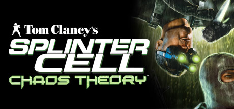

**Platforms:** Xbox, Windows, PlayStation 2, GameCube &nbsp;|&nbsp; **Publisher:** Ubisoft &nbsp;|&nbsp; **Genre:** Action &nbsp;|&nbsp; **Released:** March 28, 2005

> Experience one of the most critically acclaimed stealth-action games of all time. Uncover a conspiracy that hits close to home and stop World War III.
>
> _Synopsis source: Steam_

[Steam](https://store.steampowered.com/app/13570)

---

### Top Spin

**Platforms:** PlayStation 2 &nbsp;|&nbsp; **Released:** September 26

[Wikipedia](https://en.wikipedia.org/wiki/Top_Spin_(video_game))

---

### True Crime: New York City

**Platforms:** Windows, PlayStation 2, Xbox, GameCube &nbsp;|&nbsp; **Released:** November 15

---

### Ultimate Spider-Man

**Platforms:** Windows, GameCube, PlayStation 2, Xbox, Game Boy Advance, Nintendo DS &nbsp;|&nbsp; **Released:** September 22

[Wikipedia](https://en.wikipedia.org/wiki/Ultimate_Spider-Man_(video_game))

---

### Virtua Quest

**Platforms:** PlayStation 2, GameCube &nbsp;|&nbsp; **Released:** January 18

[Wikipedia](https://en.wikipedia.org/wiki/Virtua_Quest)

---

### Wallace & Gromit: The Curse of the Were-Rabbit

**Platforms:** PlayStation 2, Xbox &nbsp;|&nbsp; **Released:** October 7

---

### We Love Katamari

**Platforms:** PlayStation 2 &nbsp;|&nbsp; **Released:** September 20

[Wikipedia](https://en.wikipedia.org/wiki/We_Love_Katamari)

---

### Wild Arms Alter Code: F

**Platforms:** PlayStation 2 &nbsp;|&nbsp; **Released:** November 15

---

### Winnie the Pooh's Rumbly Tumbly Adventure

**Platforms:** GameCube, PlayStation 2, Game Boy Advance &nbsp;|&nbsp; **Released:** February 8

[Wikipedia](https://en.wikipedia.org/wiki/Winnie_the_Pooh%27s_Rumbly_Tumbly_Adventure)

---

### World Series of Poker

**Platforms:** PlayStation 2, Xbox, Windows, GameCube, PlayStation Portable &nbsp;|&nbsp; **Released:** August 31

[Wikipedia](https://en.wikipedia.org/wiki/World_Series_of_Poker_(video_game))

---

### Worms 4

**Platforms:** Windows, PlayStation 2, Xbox &nbsp;|&nbsp; **Released:** July 29

[Wikipedia](https://en.wikipedia.org/wiki/Worms_4)

---

### WWE SmackDown! vs. Raw 2006

**Platforms:** PlayStation 2 &nbsp;|&nbsp; **Released:** November 15

[Wikipedia](https://en.wikipedia.org/wiki/WWE_SmackDown!_vs._Raw_2006)

---

### X-Men Legends II: Rise of Apocalypse

**Platforms:** Windows, GameCube, PlayStation 2, Xbox, PlayStation Portable &nbsp;|&nbsp; **Released:** September 20

---

### Xenosaga Episode II: Jenseits von Gut und Böse

**Platforms:** PlayStation 2 &nbsp;|&nbsp; **Released:** February 15

---

### Yakuza

**Platforms:** PlayStation 2 &nbsp;|&nbsp; **Released:** December 8 (JP)

[Wikipedia](https://en.wikipedia.org/wiki/Yakuza_(video_game))

---

### Zatch Bell! Mamodo Battles

**Platforms:** GameCube, PlayStation 2 &nbsp;|&nbsp; **Released:** October 19

[Wikipedia](https://en.wikipedia.org/wiki/Zatch_Bell!_Mamodo_Battles)

---

## 2004

[Full 2004 page](../years/2004.md)

### .hack//Quarantine Part 4

**Platforms:** PlayStation 2 &nbsp;|&nbsp; **Released:** January 14

---

### Ace Combat 5: The Unsung War

**Platforms:** PlayStation 2 &nbsp;|&nbsp; **Released:** October 25

---

### Alias

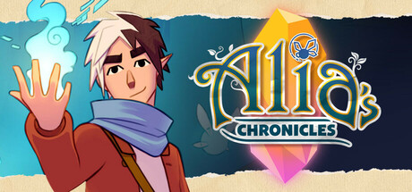

**Platforms:** Windows, PlayStation 2, Xbox &nbsp;|&nbsp; **Genre:** Adventure, Casual, Indie, RPG &nbsp;|&nbsp; **Released:** April 5

> Alia’s Chronicles is a puzzle-narrative game where you play as Neniu, a semi-elf on his quest for identity. Every action you take impacts the story! Craft tools, use your powers to solve puzzles, and prove yourself to the inhabitants of this enchanting world.
>
> _Synopsis source: Steam_

[Wikipedia](https://en.wikipedia.org/wiki/Alias_(video_game)) · [Steam](https://store.steampowered.com/app/3092710)

---

### All Grown Up!: Express Yourself

**Platforms:** PlayStation 2, GameCube, Game Boy Advance &nbsp;|&nbsp; **Released:** October 19

---

### All-Star Baseball 2005

**Platforms:** Xbox, PlayStation 2 &nbsp;|&nbsp; **Released:** March 23

[Wikipedia](https://en.wikipedia.org/wiki/All-Star_Baseball_2005)

---

### Ape Escape: Pumped & Primed

**Platforms:** PlayStation 2 &nbsp;|&nbsp; **Released:** October 20

---

### Armored Core: Nexus

**Platforms:** PlayStation 2 &nbsp;|&nbsp; **Released:** September 28

---

### Athens 2004

**Platforms:** PlayStation 2 &nbsp;|&nbsp; **Released:** July 14

[Wikipedia](https://en.wikipedia.org/wiki/Athens_2004_(video_game))

---

### Bad Boys: Miami Takedown

**Platforms:** GameCube, PlayStation 2, Xbox &nbsp;|&nbsp; **Released:** September 14

---

### Blood Will Tell

**Platforms:** PlayStation 2 &nbsp;|&nbsp; **Released:** September 21

[Wikipedia](https://en.wikipedia.org/wiki/Blood_Will_Tell)

---

### BloodRayne 2

**Platforms:** PlayStation 2 &nbsp;|&nbsp; **Released:** October 14

[Wikipedia](https://en.wikipedia.org/wiki/BloodRayne_2)

---

### Bujingai

**Platforms:** PlayStation 2 &nbsp;|&nbsp; **Released:** July 22

[Wikipedia](https://en.wikipedia.org/wiki/Bujingai)

---

### Burnout 3: Takedown

**Platforms:** Xbox, PlayStation 2 &nbsp;|&nbsp; **Publisher:** Electronic Arts &nbsp;|&nbsp; **Released:** September 8, 2004

---

### Carmen Sandiego: The Secret of the Stolen Drums

**Platforms:** PlayStation 2, GameCube, Xbox &nbsp;|&nbsp; **Released:** September 8

---

### Castle Shikigami 2

**Platforms:** PlayStation 2 &nbsp;|&nbsp; **Released:** November 17

[Wikipedia](https://en.wikipedia.org/wiki/Castle_Shikigami_2)

---

### Catwoman

**Platforms:** Windows, GameCube, PlayStation 2, Xbox, Game Boy Advance &nbsp;|&nbsp; **Released:** July 20

[Wikipedia](https://en.wikipedia.org/wiki/Catwoman_(video_game))

---

### Conflict: Vietnam

**Platforms:** Windows, PlayStation 2, Xbox &nbsp;|&nbsp; **Released:** October 5

---

### Crash Twinsanity

**Platforms:** PlayStation 2, Xbox &nbsp;|&nbsp; **Released:** September 28

[Wikipedia](https://en.wikipedia.org/wiki/Crash_Twinsanity)

---

### Crimson Tears

**Platforms:** PlayStation 2 &nbsp;|&nbsp; **Released:** July 21

[Wikipedia](https://en.wikipedia.org/wiki/Crimson_Tears)

---

### Crisis Zone

**Platforms:** PlayStation 2 &nbsp;|&nbsp; **Released:** September 17

[Wikipedia](https://en.wikipedia.org/wiki/Crisis_Zone)

---

### Dance Dance Revolution Extreme

**Platforms:** PlayStation 2 &nbsp;|&nbsp; **Released:** September 21

[Wikipedia](https://en.wikipedia.org/wiki/Dance_Dance_Revolution_Extreme)

---

### Def Jam: Fight for NY

**Platforms:** GameCube, PlayStation 2, Xbox &nbsp;|&nbsp; **Released:** September 20

---

### Delta Force: Black Hawk Down – Team Sabre

**Platforms:** Windows, PlayStation 2 &nbsp;|&nbsp; **Released:** January 20

---

### Destruction Derby Arenas

**Platforms:** PlayStation 2 &nbsp;|&nbsp; **Released:** April 1

[Wikipedia](https://en.wikipedia.org/wiki/Destruction_Derby_Arenas)

---

### Digimon Rumble Arena 2

**Platforms:** PlayStation 2, Xbox, GameCube &nbsp;|&nbsp; **Released:** September 3

[Wikipedia](https://en.wikipedia.org/wiki/Digimon_Rumble_Arena_2)

---

### Dragon Ball Z: Budokai 3

**Platforms:** PlayStation 2 &nbsp;|&nbsp; **Released:** November 16

---

### Dragon Quest VIII

**Platforms:** PlayStation 2 &nbsp;|&nbsp; **Publisher:** Square Enix &nbsp;|&nbsp; **Released:** November 27, 2004

[Wikipedia](https://en.wikipedia.org/wiki/Dragon_Quest_VIII)

---

### Drakengard

**Platforms:** PlayStation 2 &nbsp;|&nbsp; **Released:** March 2

[Wikipedia](https://en.wikipedia.org/wiki/Drakengard_(video_game))

---

### Driver 3

**Platforms:** PlayStation 2, Xbox &nbsp;|&nbsp; **Released:** June 21

[Wikipedia](https://en.wikipedia.org/wiki/Driver_3)

---

### EyeToy: AntiGrav

**Platforms:** PlayStation 2 &nbsp;|&nbsp; **Released:** November 9

---

### Fallout: Brotherhood of Steel

**Platforms:** PlayStation 2, Xbox &nbsp;|&nbsp; **Released:** January 13

---

### FIFA Football 2005

**Platforms:** Windows, GameCube, PlayStation, PlayStation 2, Game Boy Advance, PlayStation Portable &nbsp;|&nbsp; **Released:** October 14

[Wikipedia](https://en.wikipedia.org/wiki/FIFA_Football_2005)

---

### Fight Club

**Platforms:** PlayStation 2, Xbox &nbsp;|&nbsp; **Released:** November 16

[Wikipedia](https://en.wikipedia.org/wiki/Fight_Club_(video_game))

---

### Fight Night 2004

**Platforms:** PlayStation 2, Xbox &nbsp;|&nbsp; **Released:** April 5

[Wikipedia](https://en.wikipedia.org/wiki/Fight_Night_2004)

---

### Final Fantasy XI (US)

**Platforms:** PlayStation 2 &nbsp;|&nbsp; **Released:** March 23

[Wikipedia](https://en.wikipedia.org/wiki/Final_Fantasy_XI)

---

### Final Fantasy XI: Chains of Promathia

**Platforms:** Windows, PlayStation 2 &nbsp;|&nbsp; **Released:** September 21

[Wikipedia](https://en.wikipedia.org/wiki/Final_Fantasy_XI)

---

### Firefighter F.D.18

**Platforms:** PlayStation 2 &nbsp;|&nbsp; **Released:** March 9

[Wikipedia](https://en.wikipedia.org/wiki/Firefighter_F.D.18)

---

### Front Mission 4

**Platforms:** PlayStation 2 &nbsp;|&nbsp; **Released:** June 15

[Wikipedia](https://en.wikipedia.org/wiki/Front_Mission_4)

---

### Future Tactics: The Uprising

**Platforms:** GameCube, PlayStation 2, Xbox &nbsp;|&nbsp; **Released:** May 7

---

### Godzilla: Save the Earth

**Platforms:** PlayStation 2, Xbox &nbsp;|&nbsp; **Released:** November 2

---

### GoldenEye: Rogue Agent

**Platforms:** GameCube, PlayStation 2, Xbox, Nintendo DS &nbsp;|&nbsp; **Released:** November 22

---

### Gradius V

**Platforms:** PlayStation 2 &nbsp;|&nbsp; **Released:** September 14

[Wikipedia](https://en.wikipedia.org/wiki/Gradius_V)

---

### Gran Turismo 4

**Platforms:** PlayStation 2 &nbsp;|&nbsp; **Publisher:** Sony Computer Entertainment &nbsp;|&nbsp; **Released:** December 28, 2004

[Wikipedia](https://en.wikipedia.org/wiki/Gran_Turismo_4)

---

### Grand Theft Auto: San Andreas

**Platforms:** PlayStation 2 &nbsp;|&nbsp; **Publisher:** Rockstar Games &nbsp;|&nbsp; **Released:** October 26, 2004

---

### Growlanser Generations

**Platforms:** PlayStation 2 &nbsp;|&nbsp; **Released:** December 7

[Wikipedia](https://en.wikipedia.org/wiki/Growlanser_Generations)

---

### Harry Potter and the Prisoner of Azkaban

**Platforms:** Windows, PlayStation 2, Xbox, GameCube, Game Boy Advance &nbsp;|&nbsp; **Released:** May 25

[Wikipedia](https://en.wikipedia.org/wiki/Harry_Potter_and_the_Prisoner_of_Azkaban_(video_game))

---

### Headhunter Redemption

**Platforms:** PlayStation 2, Xbox &nbsp;|&nbsp; **Released:** August 27 (EU/NA)

[Wikipedia](https://en.wikipedia.org/wiki/Headhunter_Redemption)

---

### Hitman: Contracts

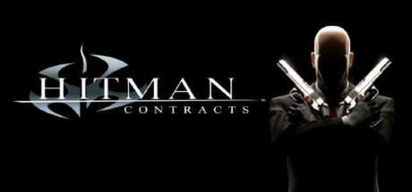

**Platforms:** Windows, PlayStation 2, Xbox &nbsp;|&nbsp; **Genre:** Action &nbsp;|&nbsp; **Released:** April 20

> Enter the world of a HITMAN - a world of crime, sin and greed. Delve into the mind of Agent 47 and encounter his greatest adversaries, completing the work that made him so brutally efficient and shaped him as an assassin. Eliminate your targets by any means necessary. There are no rules... only the contract, signed in blood.
>
> _Synopsis source: Steam_

[Steam](https://store.steampowered.com/app/247430)

---

### Hot Wheels: Stunt Track Challenge

**Platforms:** PlayStation 2, Xbox, Game Boy Advance &nbsp;|&nbsp; **Released:** November 10

---

### Jak 3

**Platforms:** PlayStation 2 &nbsp;|&nbsp; **Released:** November 9

[Wikipedia](https://en.wikipedia.org/wiki/Jak_3)

---

### James Bond 007: Everything or Nothing

**Platforms:** GameCube, PlayStation 2, Xbox &nbsp;|&nbsp; **Released:** February 17

---

### Jet Li: Rise to Honor

**Platforms:** PlayStation 2 &nbsp;|&nbsp; **Released:** February 17

---

### Kaido Battle 2: Chain Reaction

**Platforms:** PlayStation 2 &nbsp;|&nbsp; **Released:** February 26

---

### Katamari Damacy

**Platforms:** PlayStation 2 &nbsp;|&nbsp; **Released:** September 22

[Wikipedia](https://en.wikipedia.org/wiki/Katamari_Damacy)

---

### Killzone

**Platforms:** PlayStation 2 &nbsp;|&nbsp; **Released:** November 2

[Wikipedia](https://en.wikipedia.org/wiki/Killzone)

---

### King Arthur

**Platforms:** PlayStation 2 &nbsp;|&nbsp; **Released:** November 17

[Wikipedia](https://en.wikipedia.org/wiki/King_Arthur_(video_game))

---

### King of Colosseum II

**Platforms:** PlayStation 2 &nbsp;|&nbsp; **Released:** September 9

[Wikipedia](https://en.wikipedia.org/wiki/King_of_Colosseum_II)

---

### Kuon

**Platforms:** PlayStation 2 &nbsp;|&nbsp; **Released:** December 7

[Wikipedia](https://en.wikipedia.org/wiki/Kuon)

---

### Leisure Suit Larry: Magna Cum Laude

**Platforms:** Windows, PlayStation 2, Xbox &nbsp;|&nbsp; **Released:** October 5

---

### Lemony Snicket's A Series of Unfortunate Events

**Platforms:** Windows, GameCube, PlayStation 2, Xbox, Game Boy Advance, Nintendo DS &nbsp;|&nbsp; **Released:** November 10

[Wikipedia](https://en.wikipedia.org/wiki/Lemony_Snicket%27s_A_Series_of_Unfortunate_Events_(video_game))

---

### Lifeline

**Platforms:** PlayStation 2 &nbsp;|&nbsp; **Released:** March 2

[Wikipedia](https://en.wikipedia.org/wiki/Lifeline_(video_game))

---

### Madden NFL 2005

**Platforms:** PlayStation 2, Xbox, GameCube &nbsp;|&nbsp; **Publisher:** EA Sports &nbsp;|&nbsp; **Released:** August 9, 2004

[Wikipedia](https://en.wikipedia.org/wiki/Madden_NFL_2005)

---

### Mafia: The City of Lost Heaven

**Platforms:** PlayStation 2 &nbsp;|&nbsp; **Released:** January 28

---

### Maximo vs. Army of Zin

**Platforms:** PlayStation 2 &nbsp;|&nbsp; **Released:** January 20

[Wikipedia](https://en.wikipedia.org/wiki/Maximo_vs._Army_of_Zin)

---

### Mega Man Anniversary Collection

**Platforms:** GameCube, PlayStation 2, Game Boy Advance &nbsp;|&nbsp; **Released:** June 23

[Wikipedia](https://en.wikipedia.org/wiki/Mega_Man_Anniversary_Collection)

---

### Mega Man X8

**Platforms:** PlayStation 2 &nbsp;|&nbsp; **Released:** December 7

[Wikipedia](https://en.wikipedia.org/wiki/Mega_Man_X8)

---

### Mega Man X: Command Mission

**Platforms:** GameCube, PlayStation 2 &nbsp;|&nbsp; **Released:** July 29

---

### Metal Gear Solid 3: Snake Eater

**Platforms:** PlayStation 2 &nbsp;|&nbsp; **Publisher:** Konami &nbsp;|&nbsp; **Released:** November 17, 2004

---

### Mortal Kombat: Deception

**Platforms:** PlayStation 2 &nbsp;|&nbsp; **Released:** October 4

---

### MTX Mototrax

**Platforms:** PlayStation 2, Xbox, Windows &nbsp;|&nbsp; **Released:** March 2

[Wikipedia](https://en.wikipedia.org/wiki/MTX_Mototrax)

---

### MVP Baseball 2004

**Platforms:** PlayStation 2, Xbox, GameCube &nbsp;|&nbsp; **Publisher:** EA Sports &nbsp;|&nbsp; **Released:** March 9, 2004

[Wikipedia](https://en.wikipedia.org/wiki/MVP_Baseball_series)

---

### NCAA Football 2005

**Platforms:** PlayStation 2, Xbox, GameCube &nbsp;|&nbsp; **Publisher:** EA Sports &nbsp;|&nbsp; **Released:** July 15, 2004

[Wikipedia](https://en.wikipedia.org/wiki/NCAA_Football_2005)

---

### Need for Speed: Underground 2

**Platforms:** Windows, GameCube, PlayStation 2, Xbox, Game Boy Advance, Nintendo DS &nbsp;|&nbsp; **Released:** November 15

---

### Neo Contra

**Platforms:** PlayStation 2 &nbsp;|&nbsp; **Released:** October 19

[Wikipedia](https://en.wikipedia.org/wiki/Neo_Contra)

---

### NFL Street 2

**Platforms:** GameCube, PlayStation 2, Xbox &nbsp;|&nbsp; **Released:** December 22

[Wikipedia](https://en.wikipedia.org/wiki/NFL_Street_2)

---

### Nightshade

**Platforms:** PlayStation 2 &nbsp;|&nbsp; **Released:** February 10

[Wikipedia](https://en.wikipedia.org/wiki/Nightshade_(2003_video_game))

---

### Power Rangers Dino Thunder

**Platforms:** GameCube, PlayStation 2, Xbox, Game Boy Advance &nbsp;|&nbsp; **Released:** September 14

[Wikipedia](https://en.wikipedia.org/wiki/Power_Rangers_Dino_Thunder)

---

### Prince of Persia: Warrior Within

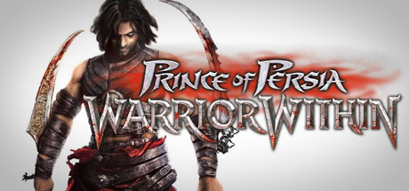

**Platforms:** Windows, GameCube, PlayStation 2, Xbox &nbsp;|&nbsp; **Genre:** Action, Adventure &nbsp;|&nbsp; **Released:** December 2

> Enter the dark underworld of Prince of Persia Warrior Within, the sword-slashing sequel to the critically acclaimed Prince of Persia: The Sands of Time™. Hunted by Dahaka, an immortal incarnation of Fate seeking divine retribution, the Prince embarks upon a path of both carnage and mystery to defy his preordained death.
>
> _Synopsis source: Steam_

[Steam](https://store.steampowered.com/app/13500)

---

### Pro Evolution Soccer 3

**Platforms:** Windows, PlayStation 2 &nbsp;|&nbsp; **Released:** February 17

[Wikipedia](https://en.wikipedia.org/wiki/Pro_Evolution_Soccer_3)

---

### Pro Evolution Soccer 4

**Platforms:** PlayStation 2, Xbox, Windows &nbsp;|&nbsp; **Publisher:** Konami &nbsp;|&nbsp; **Released:** August 5, 2004

[Wikipedia](https://en.wikipedia.org/wiki/Pro_Evolution_Soccer_4)

---

### Psi-Ops: The Mindgate Conspiracy

**Platforms:** Windows, PlayStation 2, Xbox &nbsp;|&nbsp; **Released:** June 14

---

### R-Type Final

**Platforms:** PlayStation 2 &nbsp;|&nbsp; **Released:** February 2

[Wikipedia](https://en.wikipedia.org/wiki/R-Type_Final)

---

### Ratchet & Clank: Up Your Arsenal

**Platforms:** PlayStation 2 &nbsp;|&nbsp; **Publisher:** Sony Computer Entertainment &nbsp;|&nbsp; **Released:** November 3, 2004

---

### Red Dead Revolver

**Platforms:** PlayStation 2, Xbox &nbsp;|&nbsp; **Released:** May 4

[Wikipedia](https://en.wikipedia.org/wiki/Red_Dead_Revolver)

---

### Resident Evil Outbreak

**Platforms:** PlayStation 2 &nbsp;|&nbsp; **Released:** March 31

[Wikipedia](https://en.wikipedia.org/wiki/Resident_Evil_Outbreak)

---

### Ribbit King

**Platforms:** GameCube, PlayStation 2 &nbsp;|&nbsp; **Released:** June 8

[Wikipedia](https://en.wikipedia.org/wiki/Ribbit_King)

---

### Richard Burns Rally

**Platforms:** Windows, PlayStation 2, Xbox &nbsp;|&nbsp; **Released:** July 9

[Wikipedia](https://en.wikipedia.org/wiki/Richard_Burns_Rally)

---

### Romance of the Three Kingdoms IX

**Platforms:** PlayStation 2 &nbsp;|&nbsp; **Released:** February 24

[Wikipedia](https://en.wikipedia.org/wiki/Romance_of_the_Three_Kingdoms_IX)

---

### Samurai Jack: The Shadow of Aku

**Platforms:** GameCube, PlayStation 2 &nbsp;|&nbsp; **Released:** March 24

---

### Samurai Warriors

**Platforms:** PlayStation 2 &nbsp;|&nbsp; **Released:** May 6

[Wikipedia](https://en.wikipedia.org/wiki/Samurai_Warriors)

---

### Scaler

**Platforms:** GameCube, PlayStation 2, Xbox &nbsp;|&nbsp; **Released:** October 1

[Wikipedia](https://en.wikipedia.org/wiki/Scaler_(video_game))

---

### Scooby Doo: Mystery Mayhem

**Platforms:** GameCube, PlayStation 2, Xbox, Game Boy Advance &nbsp;|&nbsp; **Released:** March 2

---

### Second Sight

**Platforms:** GameCube, PlayStation 2, Xbox &nbsp;|&nbsp; **Released:** September 21

[Wikipedia](https://en.wikipedia.org/wiki/Second_Sight_(video_game))

---

### Seven Samurai 20XX

**Platforms:** PlayStation 2 &nbsp;|&nbsp; **Released:** March 12

[Wikipedia](https://en.wikipedia.org/wiki/Seven_Samurai_20XX)

---

### Shadow Hearts: Covenant

**Platforms:** PlayStation 2 &nbsp;|&nbsp; **Released:** September 27

---

### Shaman King: Power of Spirit

**Platforms:** PlayStation 2 &nbsp;|&nbsp; **Released:** November 9

---

### Shark Tale

**Platforms:** Windows, GameCube, PlayStation 2, Xbox, Game Boy Advance &nbsp;|&nbsp; **Released:** September 27

[Wikipedia](https://en.wikipedia.org/wiki/Shark_Tale_(video_game))

---

### Shin Megami Tensei: Digital Devil Saga

**Platforms:** PlayStation 2 &nbsp;|&nbsp; **Released:** July 15

---

### Shin Megami Tensei: Nocturne

**Platforms:** PlayStation 2 &nbsp;|&nbsp; **Released:** October 14

---

### Silent Hill 4: The Room

**Platforms:** Windows, PlayStation 2, Xbox &nbsp;|&nbsp; **Released:** September 7

---

### Sly 2: Band of Thieves

**Platforms:** PlayStation 2 &nbsp;|&nbsp; **Publisher:** Sony Computer Entertainment &nbsp;|&nbsp; **Released:** September 14, 2004

---

### Sonic Heroes

**Platforms:** Windows, GameCube, PlayStation 2, Xbox &nbsp;|&nbsp; **Released:** March 23

[Wikipedia](https://en.wikipedia.org/wiki/Sonic_Heroes)

---

### Spyro: A Hero's Tail

**Platforms:** GameCube, PlayStation 2, Xbox &nbsp;|&nbsp; **Released:** November 3

---

### Star Wars: Battlefront

**Platforms:** Windows, PlayStation 2, Xbox &nbsp;|&nbsp; **Genre:** Action, Adventure, Strategy &nbsp;|&nbsp; **Released:** September 21

> The STAR WARS™ Battlefront™ Ultimate Edition includes the STAR WARS™ Battlefront™ Deluxe Edition as well as the STAR WARS™ Battlefront™ Season Pass.
>
> _Synopsis source: Steam_

[Steam](https://store.steampowered.com/app/1237980)

---

### Street Racing Syndicate

**Platforms:** GameCube, PlayStation 2, Xbox &nbsp;|&nbsp; **Released:** August 31

[Wikipedia](https://en.wikipedia.org/wiki/Street_Racing_Syndicate)

---

### Tak 2: The Staff of Dreams

**Platforms:** GameCube, PlayStation 2, Xbox, Game Boy Advance &nbsp;|&nbsp; **Released:** October 14

---

### Teenage Mutant Ninja Turtles 2: Battle Nexus

**Platforms:** Windows, GameCube, PlayStation 2, Xbox, Game Boy Advance &nbsp;|&nbsp; **Released:** October 19

---

### Terminator 3: The Redemption

**Platforms:** PlayStation 2, Xbox &nbsp;|&nbsp; **Released:** September 2

---

### The Adventures of Jimmy Neutron Boy Genius: Attack of the Twonkies

**Platforms:** GameCube, PlayStation 2, Game Boy Advance &nbsp;|&nbsp; **Released:** September 13

---

### The Bard's Tale

**Platforms:** PlayStation 2, Xbox &nbsp;|&nbsp; **Released:** October 26

[Wikipedia](https://en.wikipedia.org/wiki/The_Bard%27s_Tale_(2004_video_game))

---

### The Fairly OddParents: Shadow Showdown

**Platforms:** Windows, GameCube, PlayStation 2, Game Boy Advance &nbsp;|&nbsp; **Released:** September 8

---

### The Lord of the Rings: The Third Age

**Platforms:** GameCube, PlayStation 2, Xbox, Game Boy Advance &nbsp;|&nbsp; **Released:** November 2

---

### The Nightmare of Druaga: Fushigino Dungeon

**Platforms:** PlayStation 2 &nbsp;|&nbsp; **Released:** October 27

---

### The SpongeBob SquarePants Movie

**Platforms:** Windows, GameCube, PlayStation 2, Xbox, Game Boy Advance &nbsp;|&nbsp; **Released:** October 27

[Wikipedia](https://en.wikipedia.org/wiki/The_SpongeBob_SquarePants_Movie_(video_game))

---

### The Suffering

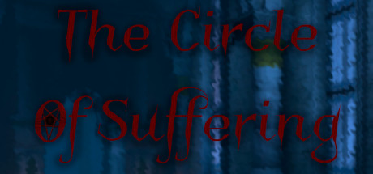

**Platforms:** Windows, PlayStation 2, Xbox &nbsp;|&nbsp; **Genre:** Action, Adventure, Indie &nbsp;|&nbsp; **Released:** March 8

> This game is a psychological horror in which the main character wakes up in an unfamiliar house and must pass all the levels by solving puzzles.
>
> _Synopsis source: Steam_

[Wikipedia](https://en.wikipedia.org/wiki/The_Suffering_(video_game)) · [Steam](https://store.steampowered.com/app/1726550)

---

### Tiger Woods PGA Tour 2005

**Platforms:** Windows, GameCube, PlayStation 2, Xbox &nbsp;|&nbsp; **Publisher:** EA Sports &nbsp;|&nbsp; **Released:** September 20, 2004

[Wikipedia](https://en.wikipedia.org/wiki/Tiger_Woods_PGA_Tour_2005)

---

### TOCA Race Driver 2

**Platforms:** Windows, Xbox, PlayStation 2 &nbsp;|&nbsp; **Released:** April 13

[Wikipedia](https://en.wikipedia.org/wiki/TOCA_Race_Driver_2)

---

### Tom Clancy's Splinter Cell: Pandora Tomorrow

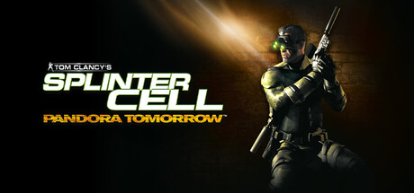

**Platforms:** Xbox, Windows, GameCube, PlayStation 2 &nbsp;|&nbsp; **Publisher:** Ubisoft &nbsp;|&nbsp; **Genre:** Action &nbsp;|&nbsp; **Released:** March 23, 2004

> Infiltrate secure locations across the globe in this stealth-action thriller. Uncover a global conspiracy and stop a deadly bio-terror attack in the second game of the award-winning Splinter Cell series.
>
> _Synopsis source: Steam_

[Steam](https://store.steampowered.com/app/3929740)

---

### Tony Hawk's Underground 2

**Platforms:** Windows, GameCube, PlayStation 2, Xbox, Game Boy Advance &nbsp;|&nbsp; **Released:** October 4

[Wikipedia](https://en.wikipedia.org/wiki/Tony_Hawk%27s_Underground_2)

---

### Under the Skin

**Platforms:** PlayStation 2 &nbsp;|&nbsp; **Released:** October 14

[Wikipedia](https://en.wikipedia.org/wiki/Under_the_Skin_(video_game))

---

### Vietcong: Fist Alpha

**Platforms:** Windows, PlayStation 2, Xbox &nbsp;|&nbsp; **Released:** January 28

---

### Viewtiful Joe

**Platforms:** PlayStation 2 &nbsp;|&nbsp; **Publisher:** Capcom &nbsp;|&nbsp; **Released:** August 24, 2004

[Wikipedia](https://en.wikipedia.org/wiki/Viewtiful_Joe_(video_game))

---

### Viewtiful Joe 2

**Platforms:** PlayStation 2 &nbsp;|&nbsp; **Released:** December 8

[Wikipedia](https://en.wikipedia.org/wiki/Viewtiful_Joe_2)

---

### Way of the Samurai 2

**Platforms:** PlayStation 2 &nbsp;|&nbsp; **Released:** May 21

[Wikipedia](https://en.wikipedia.org/wiki/Way_of_the_Samurai_2)

---

### Wrath Unleashed

**Platforms:** PlayStation 2, Xbox &nbsp;|&nbsp; **Released:** February 10

[Wikipedia](https://en.wikipedia.org/wiki/Wrath_Unleashed)

---

## 2003

[Full 2003 page](../years/2003.md)

### .hack//Infection Part 1

**Platforms:** PlayStation 2 &nbsp;|&nbsp; **Released:** February 10

[Wikipedia](https://en.wikipedia.org/wiki/.hack//INFECTION)

---

### Alter Echo

**Platforms:** PlayStation 2, Xbox &nbsp;|&nbsp; **Released:** August 19

[Wikipedia](https://en.wikipedia.org/wiki/Alter_Echo)

---

### America's 10 Most Wanted

**Platforms:** Windows, PlayStation 2 &nbsp;|&nbsp; **Released:** November 18

[Wikipedia](https://en.wikipedia.org/wiki/America%27s_10_Most_Wanted)

---

### Amplitude

**Platforms:** PlayStation 2 &nbsp;|&nbsp; **Released:** March 24

[Wikipedia](https://en.wikipedia.org/wiki/Amplitude_(game))

---

### Ape Escape 2

**Platforms:** PlayStation 2 &nbsp;|&nbsp; **Released:** June 30

[Wikipedia](https://en.wikipedia.org/wiki/Ape_Escape_2)

---

### Arc the Lad: Twilight of the Spirits

**Platforms:** PlayStation 2 &nbsp;|&nbsp; **Released:** June 25

---

### Asterix & Obelix: Kick Buttix

**Platforms:** PlayStation 2 &nbsp;|&nbsp; **Released:** September 14

[Wikipedia](https://en.wikipedia.org/wiki/Asterix_%26_Obelix_XXL)

---

### Backyard Wrestling: Don't Try This at Home

**Platforms:** PlayStation 2 &nbsp;|&nbsp; **Released:** October 7

---

### Battle Engine Aquila

**Platforms:** PlayStation 2, Xbox &nbsp;|&nbsp; **Released:** January 20

[Wikipedia](https://en.wikipedia.org/wiki/Battle_Engine_Aquila)

---

### Beyond Good & Evil

**Platforms:** Xbox, GameCube, PlayStation 2, Windows &nbsp;|&nbsp; **Publisher:** Ubisoft &nbsp;|&nbsp; **Released:** December 2, 2003

[Wikipedia](https://en.wikipedia.org/wiki/Beyond_Good_%26_Evil_(video_game))

---

### Black & Bruised

**Platforms:** GameCube, PlayStation 2 &nbsp;|&nbsp; **Released:** January 26

[Wikipedia](https://en.wikipedia.org/wiki/Black_%26_Bruised)

---

### Bombastic

**Platforms:** PlayStation 2 &nbsp;|&nbsp; **Released:** August 27

[Wikipedia](https://en.wikipedia.org/wiki/Bombastic_(video_game))

---

### Broken Sword: The Sleeping Dragon

**Platforms:** Windows, PlayStation 2, Xbox &nbsp;|&nbsp; **Released:** November 14

---

### Buffy the Vampire Slayer: Chaos Bleeds

**Platforms:** PlayStation 2, Xbox, GameCube &nbsp;|&nbsp; **Released:** August 27

---

### Butt-Ugly Martians: Zoom or Doom

**Platforms:** PlayStation 2 &nbsp;|&nbsp; **Released:** July 31

---

### Castlevania: Lament of Innocence

**Platforms:** PlayStation 2 &nbsp;|&nbsp; **Released:** October 21

---

### Celebrity Deathmatch

**Platforms:** Windows, PlayStation 2, Xbox &nbsp;|&nbsp; **Publisher:** Gotham Games &nbsp;|&nbsp; **Released:** October 14, 2003

[Wikipedia](https://en.wikipedia.org/wiki/Celebrity_Deathmatch_(video_game))

---

### Chaos Legion

**Platforms:** Windows, PlayStation 2 &nbsp;|&nbsp; **Released:** August 5

[Wikipedia](https://en.wikipedia.org/wiki/Chaos_Legion)

---

### Charlie's Angels

**Platforms:** GameCube, PlayStation 2 &nbsp;|&nbsp; **Publisher:** Ubisoft &nbsp;|&nbsp; **Released:** July 8, 2003

[Wikipedia](https://en.wikipedia.org/wiki/Charlie%27s_Angels_(video_game))

---

### Crash Nitro Kart

**Platforms:** PlayStation 2, Xbox, GameCube, Game Boy Advance, N-Gage &nbsp;|&nbsp; **Released:** November 15

[Wikipedia](https://en.wikipedia.org/wiki/Crash_Nitro_Kart)

---

### Cyber Troopers Virtual-On MARZ

**Platforms:** PlayStation 2 &nbsp;|&nbsp; **Released:** October 14

[Wikipedia](https://en.wikipedia.org/wiki/Cyber_Troopers_Virtual-On_Marz)

---

### Dark Cloud 2

**Platforms:** PlayStation 2 &nbsp;|&nbsp; **Released:** February 17

[Wikipedia](https://en.wikipedia.org/wiki/Dark_Chronicle)

---

### DDRMAX2: Dance Dance Revolution

**Platforms:** PlayStation 2 &nbsp;|&nbsp; **Released:** September 23

---

### Devil May Cry 2

**Platforms:** PlayStation 2 &nbsp;|&nbsp; **Released:** January 25

[Wikipedia](https://en.wikipedia.org/wiki/Devil_May_Cry_2)

---

### Disaster Report

**Platforms:** PlayStation 2 &nbsp;|&nbsp; **Released:** February 15

[Wikipedia](https://en.wikipedia.org/wiki/Disaster_Report)

---

### Dynasty Warriors 3: Xtreme Legends

**Platforms:** PlayStation 2 &nbsp;|&nbsp; **Released:** January 11

[Wikipedia](https://en.wikipedia.org/wiki/Dynasty_Warriors_3)

---

### Dynasty Warriors 4

**Platforms:** PlayStation 2 &nbsp;|&nbsp; **Released:** March 25

[Wikipedia](https://en.wikipedia.org/wiki/Dynasty_Warriors_4)

---

### Enter The Matrix

**Platforms:** Windows, GameCube, PlayStation 2, Xbox &nbsp;|&nbsp; **Released:** May 14

[Wikipedia](https://en.wikipedia.org/wiki/Enter_The_Matrix)

---

### ESPN NBA Basketball

**Platforms:** PlayStation 2, Xbox &nbsp;|&nbsp; **Publisher:** Sega &nbsp;|&nbsp; **Released:** October 21, 2003

[Wikipedia](https://en.wikipedia.org/wiki/ESPN_NBA_Basketball_(video_game))

---

### ESPN NFL Football

**Platforms:** Xbox, PlayStation 2 &nbsp;|&nbsp; **Publisher:** Sega &nbsp;|&nbsp; **Released:** September 3, 2003

[Wikipedia](https://en.wikipedia.org/wiki/NFL_2K)

---

### ESPN NHL Hockey

**Platforms:** PlayStation 2, Xbox &nbsp;|&nbsp; **Publisher:** Sega &nbsp;|&nbsp; **Released:** September 9, 2003

[Wikipedia](https://en.wikipedia.org/wiki/NHL_2K)

---

### Everblue 2

**Platforms:** PlayStation 2 &nbsp;|&nbsp; **Released:** February 24

[Wikipedia](https://en.wikipedia.org/wiki/Everblue_2)

---

### Fatal Frame II: Crimson Butterfly

**Platforms:** PlayStation 2 &nbsp;|&nbsp; **Released:** December 10

---

### Final Fantasy X-2

**Platforms:** PlayStation 2 &nbsp;|&nbsp; **Released:** November 18

[Wikipedia](https://en.wikipedia.org/wiki/Final_Fantasy_X-2)

---

### Final Fantasy XI: Rise of the Zilart

**Platforms:** Windows, PlayStation 2 &nbsp;|&nbsp; **Released:** April 17 (JP)

[Wikipedia](https://en.wikipedia.org/wiki/Final_Fantasy_XI)

---

### Finding Nemo

**Platforms:** GameCube, PlayStation 2, Xbox, Game Boy Advance &nbsp;|&nbsp; **Released:** May 12

[Wikipedia](https://en.wikipedia.org/wiki/Finding_Nemo_(video_game))

---

### Freaky Flyers

**Platforms:** PlayStation 2, Xbox, GameCube &nbsp;|&nbsp; **Released:** August 5

[Wikipedia](https://en.wikipedia.org/wiki/Freaky_Flyers)

---

### Freedom Fighters

**Platforms:** Windows, PlayStation 2, Xbox, GameCube &nbsp;|&nbsp; **Genre:** Action &nbsp;|&nbsp; **Released:** October 1

> Freedom Fighters is an intense third-person action game set in an alternate history New York during the invasion of a foreign superpower. Take on the role of Chris Stone, a hard-working plumber, and rise through the ranks of the resistance to prove yourself as a charismatic leader.
>
> _Synopsis source: Steam_

[Wikipedia](https://en.wikipedia.org/wiki/Freedom_Fighters_(video_game)) · [Steam](https://store.steampowered.com/app/1347780)

---

### Fugitive Hunter: War on Terror

**Platforms:** PlayStation 2 &nbsp;|&nbsp; **Publisher:** Encore, Inc. &nbsp;|&nbsp; **Released:** November 18, 2003

[Wikipedia](https://en.wikipedia.org/wiki/America%27s_10_Most_Wanted)

---

### Futurama

**Platforms:** PlayStation 2, Xbox &nbsp;|&nbsp; **Released:** August 12

[Wikipedia](https://en.wikipedia.org/wiki/Futurama_(video_game))

---

### Harry Potter: Quidditch World Cup

**Platforms:** Windows, GameCube, PlayStation 2, Xbox, Game Boy Advance &nbsp;|&nbsp; **Released:** October 28

---

### HSX: Hypersonic.Xtreme

**Platforms:** PlayStation 2 &nbsp;|&nbsp; **Released:** January 26

[Wikipedia](https://en.wikipedia.org/wiki/G-Surfers)

---

### Hulk

**Platforms:** Windows, PlayStation 2, GameCube, Xbox &nbsp;|&nbsp; **Released:** May 28

[Wikipedia](https://en.wikipedia.org/wiki/Hulk_(video_game))

---

### Indiana Jones and the Emperor's Tomb

**Platforms:** Xbox, Windows, PlayStation 2 &nbsp;|&nbsp; **Released:** February 24

[Wikipedia](https://en.wikipedia.org/wiki/Indiana_Jones_and_the_Emperor%27s_Tomb)

---

### Jak II

**Platforms:** PlayStation 2 &nbsp;|&nbsp; **Publisher:** Sony Computer Entertainment &nbsp;|&nbsp; **Released:** October 14, 2003

[Wikipedia](https://en.wikipedia.org/wiki/Jak_II)

---

### Judge Dredd: Dredd vs. Death

**Platforms:** Windows, PlayStation 2, Xbox, GameCube &nbsp;|&nbsp; **Genre:** Action &nbsp;|&nbsp; **Released:** October 17 (EU)

> Welcome to Mega-City One, a city of over 400 million people - every one of them a potential criminal. It is the third decade of the 22nd Century, unemployment is widespread, boredom is universal and only the Judges can prevent total anarchy. Empowered to dispense instant justice, they are Judge, Jury and Executioner all in one.
>
> _Synopsis source: Steam_

[Steam](https://store.steampowered.com/app/3710)

---

### Jurassic Park: Operation Genesis

**Platforms:** Windows, PlayStation 2, Xbox &nbsp;|&nbsp; **Released:** March 10

---

### Knight Rider: The Game

**Platforms:** Windows, PlayStation 2 &nbsp;|&nbsp; **Released:** February 12

---

### Kya: Dark Lineage

**Platforms:** PlayStation 2 &nbsp;|&nbsp; **Released:** November 18

---

### Legacy of Kain: Defiance

**Platforms:** Windows, PlayStation 2, Xbox &nbsp;|&nbsp; **Released:** November 11

---

### Mace Griffin: Bounty Hunter

**Platforms:** Windows, PlayStation 2, Xbox &nbsp;|&nbsp; **Released:** June 19

---

### Madden NFL 2004

**Platforms:** PlayStation 2, GameCube, Xbox, Windows &nbsp;|&nbsp; **Publisher:** EA Sports &nbsp;|&nbsp; **Released:** August 12, 2003

[Wikipedia](https://en.wikipedia.org/wiki/Madden_NFL_2004)

---

### Magic Pengel: The Quest for Color

**Platforms:** PlayStation 2 &nbsp;|&nbsp; **Released:** June 24

---

### Manhunt

**Platforms:** PlayStation 2 &nbsp;|&nbsp; **Released:** November 18

[Wikipedia](https://en.wikipedia.org/wiki/Manhunt_(video_game))

---

### Max Payne 2: The Fall of Max Payne

**Platforms:** Windows, Xbox, PlayStation 2 &nbsp;|&nbsp; **Publisher:** Rockstar Games &nbsp;|&nbsp; **Genre:** Action &nbsp;|&nbsp; **Released:** October 14, 2003

> Max Payne 2: The Fall of Max Payne is a violent, film-noir love story. Dark, tragic and intense, the in-depth story is a thrill-ride of shocking twists and revelations. Love hurts.
>
> _Synopsis source: Steam_

[Steam](https://store.steampowered.com/app/12150)

---

### Medal of Honor: Rising Sun

**Platforms:** PlayStation 2, Xbox, GameCube &nbsp;|&nbsp; **Released:** November 11

---

### Mega Man X7

**Platforms:** PlayStation 2 &nbsp;|&nbsp; **Released:** October 14

[Wikipedia](https://en.wikipedia.org/wiki/Mega_Man_X7)

---

### Metal Arms: Glitch in the System

**Platforms:** PlayStation 2, Xbox &nbsp;|&nbsp; **Released:** November 18

---

### Midnight Club II

**Platforms:** Windows, PlayStation 2, Xbox &nbsp;|&nbsp; **Released:** April 8

[Wikipedia](https://en.wikipedia.org/wiki/Midnight_Club_II)

---

### Mission: Impossible – Operation Surma

**Platforms:** Xbox, Game Boy Advance, PlayStation 2 &nbsp;|&nbsp; **Released:** December 2

---

### MLB 2004

**Platforms:** PlayStation 2, PlayStation &nbsp;|&nbsp; **Released:** March 10

[Wikipedia](https://en.wikipedia.org/wiki/MLB_2004)

---

### Mobile Light Force 2

**Platforms:** PlayStation 2 &nbsp;|&nbsp; **Released:** March 19

[Wikipedia](https://en.wikipedia.org/wiki/Shikigami_no_Shiro)

---

### Monster Rancher 4

**Platforms:** PlayStation 2 &nbsp;|&nbsp; **Released:** November 13

[Wikipedia](https://en.wikipedia.org/wiki/Monster_Rancher_4)

---

### Muppets Party Cruise

**Platforms:** GameCube, PlayStation 2 &nbsp;|&nbsp; **Released:** November 11

[Wikipedia](https://en.wikipedia.org/wiki/Muppets_Party_Cruise)

---

### NASCAR Thunder 2004

**Platforms:** PlayStation 2, Windows, PlayStation, Xbox &nbsp;|&nbsp; **Publisher:** EA Sports &nbsp;|&nbsp; **Released:** September 16, 2003

[Wikipedia](https://en.wikipedia.org/wiki/NASCAR_Thunder_2004)

---

### NBA Street Vol. 2

**Platforms:** PlayStation 2, GameCube, Xbox &nbsp;|&nbsp; **Publisher:** EA Sports &nbsp;|&nbsp; **Released:** April 29, 2003

[Wikipedia](https://en.wikipedia.org/wiki/NBA_Street_Vol._2)

---

### NCAA Football 2004

**Platforms:** PlayStation 2, Xbox, GameCube &nbsp;|&nbsp; **Publisher:** EA Sports &nbsp;|&nbsp; **Released:** July 16, 2003

[Wikipedia](https://en.wikipedia.org/wiki/NCAA_Football_2004)

---

### Need for Speed: Underground

**Platforms:** Windows, GameCube, PlayStation 2, Xbox &nbsp;|&nbsp; **Released:** November 17 (NA)

---

### NHL 2004

**Platforms:** Windows, GameCube, PlayStation 2, Xbox &nbsp;|&nbsp; **Released:** September 22

[Wikipedia](https://en.wikipedia.org/wiki/NHL_2004)

---

### Pride FC: Fighting Championships

**Platforms:** PlayStation 2 &nbsp;|&nbsp; **Released:** March 20

---

### Primal

**Platforms:** PlayStation 2 &nbsp;|&nbsp; **Released:** March 25

[Wikipedia](https://en.wikipedia.org/wiki/Primal_(video_game))

---

### Prince of Persia: The Sands of Time

**Platforms:** Xbox, GameCube, PlayStation 2, Windows &nbsp;|&nbsp; **Publisher:** Ubisoft &nbsp;|&nbsp; **Genre:** Action, Adventure &nbsp;|&nbsp; **Released:** November 18, 2003

> Amidst the scorched sands of ancient Persia, there is a legend spun in an ancient tongue. It speaks of a time borne by blood and ruled by deceit. Drawn to the dark powers of a magic dagger, a young Prince is led to unleash a deadly evil upon a beautiful kingdom.
>
> _Synopsis source: Steam_

[Steam](https://store.steampowered.com/app/13600)

---

### Pro Evolution Soccer 3

**Platforms:** Windows, PlayStation 2 &nbsp;|&nbsp; **Publisher:** Konami &nbsp;|&nbsp; **Released:** October 17, 2003

[Wikipedia](https://en.wikipedia.org/wiki/Pro_Evolution_Soccer_3)

---

### Ratchet & Clank: Going Commando

**Platforms:** PlayStation 2 &nbsp;|&nbsp; **Publisher:** Sony Computer Entertainment &nbsp;|&nbsp; **Released:** November 11, 2003

---

### Rayman 3: Hoodlum Havoc

**Platforms:** GameCube, Game Boy Advance, PlayStation 2, Xbox, Windows &nbsp;|&nbsp; **Released:** February 21

---

### Shin Megami Tensei III: Nocturne

**Platforms:** PlayStation 2 &nbsp;|&nbsp; **Released:** February 20

---

### Silent Hill 3

**Platforms:** PlayStation 2, Windows &nbsp;|&nbsp; **Released:** May 23

[Wikipedia](https://en.wikipedia.org/wiki/Silent_Hill_3)

---

### Siren

**Platforms:** PlayStation 2 &nbsp;|&nbsp; **Released:** April 20

[Wikipedia](https://en.wikipedia.org/wiki/Siren_(video_game))

---

### SOCOM II U.S. Navy SEALs

**Platforms:** PlayStation 2 &nbsp;|&nbsp; **Released:** November 4

[Wikipedia](https://en.wikipedia.org/wiki/SOCOM_II_U.S._Navy_SEALs)

---

### Sonic Heroes

**Platforms:** PlayStation 2, Xbox, GameCube &nbsp;|&nbsp; **Released:** December 4

[Wikipedia](https://en.wikipedia.org/wiki/Sonic_Heroes)

---

### Soulcalibur II

**Platforms:** GameCube, Xbox, PlayStation 2 &nbsp;|&nbsp; **Publisher:** Namco &nbsp;|&nbsp; **Released:** March 27, 2003

[Wikipedia](https://en.wikipedia.org/wiki/Soulcalibur_II)

---

### Space Channel 5 Special Edition

**Platforms:** PlayStation 2 &nbsp;|&nbsp; **Released:** November 18

[Wikipedia](https://en.wikipedia.org/wiki/Space_Channel_5)

---

### Sphinx and the Cursed Mummy

**Platforms:** GameCube, PlayStation 2, Xbox &nbsp;|&nbsp; **Released:** November 10

[Wikipedia](https://en.wikipedia.org/wiki/Sphinx_and_the_Cursed_Mummy)

---

### SplashDown: Rides Gone Wild

**Platforms:** PlayStation 2 &nbsp;|&nbsp; **Released:** August 6

---

### SpongeBob SquarePants: Battle for Bikini Bottom

**Platforms:** Windows, GameCube, PlayStation 2, Xbox, Game Boy Advance &nbsp;|&nbsp; **Released:** October 29

---

### SSX 3

**Platforms:** PlayStation 2, GameCube, Xbox, Game Boy Advance &nbsp;|&nbsp; **Publisher:** EA Sports &nbsp;|&nbsp; **Released:** October 20, 2003

[Wikipedia](https://en.wikipedia.org/wiki/SSX_3)

---

### SWAT: Global Strike Team

**Platforms:** PlayStation 2, Xbox &nbsp;|&nbsp; **Released:** October 28

---

### Tak and the Power of Juju

**Platforms:** GameCube, PlayStation 2, Game Boy Advance &nbsp;|&nbsp; **Released:** October 15

[Wikipedia](https://en.wikipedia.org/wiki/Tak_and_the_Power_of_Juju)

---

### Teenage Mutant Ninja Turtles

**Platforms:** Windows, GameCube, PlayStation 2, Xbox &nbsp;|&nbsp; **Released:** October 21

[Wikipedia](https://en.wikipedia.org/wiki/Teenage_Mutant_Ninja_Turtles_(2003_video_game))

---

### Tenchu: Wrath of Heaven

**Platforms:** PlayStation 2 &nbsp;|&nbsp; **Released:** March 3

---

### The Fairly OddParents: Breakin' da Rules

**Platforms:** Windows, GameCube, PlayStation 2, Xbox, Game Boy Advance &nbsp;|&nbsp; **Released:** November 18

---

### The Getaway

**Platforms:** PlayStation 2 &nbsp;|&nbsp; **Released:** January 19

[Wikipedia](https://en.wikipedia.org/wiki/The_Getaway_(video_game))

---

### The Great Escape

**Platforms:** Windows, PlayStation 2, Xbox &nbsp;|&nbsp; **Genre:** Action, Adventure, Simulation, Strategy &nbsp;|&nbsp; **Released:** July 23

> Captured, but not defeated, you are being held in the notorious Heldentod camp. This small, converted castle in the middle of nowhere will be your home for the rest of the war—unless you can escape to rejoin the Allied Armies.
>
> _Synopsis source: Steam_

[Wikipedia](https://en.wikipedia.org/wiki/The_Great_Escape_(2003_video_game)) · [Steam](https://store.steampowered.com/app/814570)

---

### The Haunted Mansion

**Platforms:** GameCube, PlayStation 2, Xbox &nbsp;|&nbsp; **Released:** October 14

[Wikipedia](https://en.wikipedia.org/wiki/The_Haunted_Mansion_(video_game))

---

### The Hobbit

**Platforms:** Game Boy Advance, Windows, GameCube, PlayStation 2, Xbox &nbsp;|&nbsp; **Released:** October 24

[Wikipedia](https://en.wikipedia.org/wiki/The_Hobbit_(2003_video_game))

---

### The Lord of the Rings: The Return of the King

**Platforms:** Windows, PlayStation 2, GameCube, Xbox, Game Boy Advance &nbsp;|&nbsp; **Released:** November 3

---

### The Simpsons: Hit & Run

**Platforms:** PlayStation 2, Xbox, GameCube, Windows &nbsp;|&nbsp; **Released:** September 16

---

### Tiger Woods PGA Tour 2004

**Platforms:** PlayStation 2, GameCube, Xbox, Windows, Game Boy Advance &nbsp;|&nbsp; **Publisher:** EA Sports &nbsp;|&nbsp; **Released:** September 22, 2003

[Wikipedia](https://en.wikipedia.org/wiki/Tiger_Woods_PGA_Tour_2004)

---

### Time Crisis 3

**Platforms:** PlayStation 2 &nbsp;|&nbsp; **Released:** October 21

[Wikipedia](https://en.wikipedia.org/wiki/Time_Crisis_3)

---

### Tom Clancy's Splinter Cell

**Platforms:** Windows, PlayStation 2, GameCube &nbsp;|&nbsp; **Publisher:** Ubisoft &nbsp;|&nbsp; **Genre:** Action &nbsp;|&nbsp; **Released:** February 19, 2003

> Enter the world of cinematic stealth action with Splinter Cell, the game that propelled the genre to cult status. You are Sam Fisher, an elite covert agent in the NSA's top-secret division: Third Echelon.
>
> _Synopsis source: Steam_

[Wikipedia](https://en.wikipedia.org/wiki/Tom_Clancy%27s_Splinter_Cell_(video_game)) · [Steam](https://store.steampowered.com/app/13560)

---

### Tomb Raider: The Angel of Darkness

**Platforms:** PlayStation 2, Windows &nbsp;|&nbsp; **Released:** June 20

---

### Tony Hawk's Underground

**Platforms:** PlayStation 2, GameCube, Xbox, Game Boy Advance &nbsp;|&nbsp; **Publisher:** Activision &nbsp;|&nbsp; **Released:** October 27, 2003

[Wikipedia](https://en.wikipedia.org/wiki/Tony_Hawk%27s_Underground)

---

### True Crime: Streets of LA

**Platforms:** PlayStation 2, Xbox, GameCube &nbsp;|&nbsp; **Released:** November 3

---

### Unlimited Saga

**Platforms:** PlayStation 2 &nbsp;|&nbsp; **Released:** June 17

[Wikipedia](https://en.wikipedia.org/wiki/Unlimited_Saga)

---

### Virtua Fighter 4: Evolution

**Platforms:** PlayStation 2 &nbsp;|&nbsp; **Publisher:** Sega &nbsp;|&nbsp; **Released:** March 13, 2003

---

### Whiplash

**Platforms:** PlayStation 2, Xbox &nbsp;|&nbsp; **Released:** November 18

[Wikipedia](https://en.wikipedia.org/wiki/Whiplash_(video_game))

---

### World Series Baseball 2K3

**Platforms:** Xbox, PlayStation 2 &nbsp;|&nbsp; **Publisher:** Sega &nbsp;|&nbsp; **Released:** March 10, 2003

[Wikipedia](https://en.wikipedia.org/wiki/World_Series_Baseball_2K3)

---

### WWE Crush Hour

**Platforms:** GameCube, PlayStation 2 &nbsp;|&nbsp; **Released:** March 17

[Wikipedia](https://en.wikipedia.org/wiki/WWE_Crush_Hour)

---

### WWE SmackDown! Here Comes the Pain

**Platforms:** PlayStation 2 &nbsp;|&nbsp; **Released:** October 27

[Wikipedia](https://en.wikipedia.org/wiki/WWE_SmackDown!_Here_Comes_the_Pain)

---

### Xenosaga Episode I: Der Wille zur Macht

**Platforms:** PlayStation 2 &nbsp;|&nbsp; **Released:** February 26

---

### XIII

**Platforms:** Windows, GameCube, PlayStation 2, Xbox &nbsp;|&nbsp; **Released:** November 18

[Wikipedia](https://en.wikipedia.org/wiki/XIII_(video_game))

---

### Yu-Gi-Oh! The Duelists of the Roses

**Platforms:** PlayStation 2 &nbsp;|&nbsp; **Released:** February 16

[Wikipedia](https://en.wikipedia.org/wiki/Yu-Gi-Oh!_The_Duelists_of_the_Roses)

---

### Zone of the Enders: The Second Runner

**Platforms:** PlayStation 2 &nbsp;|&nbsp; **Released:** March 10

---

## 2002

[Full 2002 page](../years/2002.md)

### 007: Nightfire

**Platforms:** PlayStation 2, GameCube, Xbox, Windows &nbsp;|&nbsp; **Released:** November 19

---

### 2002 FIFA World Cup

**Platforms:** PlayStation 2, GameCube &nbsp;|&nbsp; **Released:** April 22

[Wikipedia](https://en.wikipedia.org/wiki/2002_FIFA_World_Cup_(video_game))

---

### Activision Anthology

**Platforms:** PlayStation 2 &nbsp;|&nbsp; **Released:** November 19

[Wikipedia](https://en.wikipedia.org/wiki/Activision_Anthology)

---

### Aggressive Inline

**Platforms:** GameCube, PlayStation 2 &nbsp;|&nbsp; **Publisher:** Acclaim Entertainment &nbsp;|&nbsp; **Released:** July 31, 2002

[Wikipedia](https://en.wikipedia.org/wiki/Aggressive_Inline_(video_game))

---

### AirBlade

**Platforms:** PlayStation 2 &nbsp;|&nbsp; **Released:** January 28

[Wikipedia](https://en.wikipedia.org/wiki/AirBlade)

---

### All-Star Baseball 2003

**Platforms:** PlayStation 2 &nbsp;|&nbsp; **Released:** February 26

[Wikipedia](https://en.wikipedia.org/wiki/All-Star_Baseball#Series)

---

### Armored Core 3

**Platforms:** PlayStation 2 &nbsp;|&nbsp; **Released:** September 5

[Wikipedia](https://en.wikipedia.org/wiki/Armored_Core_3)

---

### Army Men: RTS

**Platforms:** PlayStation 2 &nbsp;|&nbsp; **Released:** March 27

---

### ATV Offroad Fury 2

**Platforms:** PlayStation 2 &nbsp;|&nbsp; **Released:** November 9

[Wikipedia](https://en.wikipedia.org/wiki/ATV_Offroad_Fury_2)

---

### Barbarian

**Platforms:** PlayStation 2 &nbsp;|&nbsp; **Released:** June 24

[Wikipedia](https://en.wikipedia.org/wiki/Barbarian_(2002_video_game))

---

### Blade II

**Platforms:** PlayStation 2 &nbsp;|&nbsp; **Released:** September 2

[Wikipedia](https://en.wikipedia.org/wiki/Blade_II)

---

### Blood Omen 2

**Platforms:** PlayStation 2 &nbsp;|&nbsp; **Released:** March 21

[Wikipedia](https://en.wikipedia.org/wiki/Blood_Omen_2)

---

### BloodRayne

**Platforms:** PlayStation 2 &nbsp;|&nbsp; **Released:** October 15

[Wikipedia](https://en.wikipedia.org/wiki/BloodRayne)

---

### BMX XXX

**Platforms:** PlayStation 2, GameCube &nbsp;|&nbsp; **Released:** November 16

[Wikipedia](https://en.wikipedia.org/wiki/BMX_XXX)

---

### Britney's Dance Beat

**Platforms:** Game Boy Advance, PlayStation 2, Windows &nbsp;|&nbsp; **Released:** March 25

[Wikipedia](https://en.wikipedia.org/wiki/Britney_Spears_products)

---

### Burnout 2: Point of Impact

**Platforms:** PlayStation 2 &nbsp;|&nbsp; **Publisher:** Acclaim Entertainment &nbsp;|&nbsp; **Released:** September 30, 2002

---

### Circus Maximus: Chariot Wars

**Platforms:** PlayStation 2 &nbsp;|&nbsp; **Released:** February 24

---

### Commandos 2: Men of Courage

**Platforms:** PlayStation 2 &nbsp;|&nbsp; **Released:** August 28

---

### Conflict: Desert Storm

**Platforms:** PlayStation 2 &nbsp;|&nbsp; **Released:** September 30

---

### Contra: Shattered Soldier

**Platforms:** PlayStation 2 &nbsp;|&nbsp; **Released:** October 22

---

### Dark Chronicle

**Platforms:** PlayStation 2 &nbsp;|&nbsp; **Publisher:** Sony Computer Entertainment &nbsp;|&nbsp; **Released:** November 28, 2002

[Wikipedia](https://en.wikipedia.org/wiki/Dark_Chronicle)

---

### DDRMAX: Dance Dance Revolution

**Platforms:** PlayStation 2 &nbsp;|&nbsp; **Released:** October 28

---

### Dead to Rights

**Platforms:** Xbox, PlayStation 2 &nbsp;|&nbsp; **Released:** June 3

[Wikipedia](https://en.wikipedia.org/wiki/Dead_to_Rights)

---

### Defender

**Platforms:** PlayStation 2 &nbsp;|&nbsp; **Released:** October 22

[Wikipedia](https://en.wikipedia.org/wiki/Defender_(2002_video_game))

---

### Deus Ex: The Conspiracy

**Platforms:** PlayStation 2 &nbsp;|&nbsp; **Released:** March 25

---

### Dino Stalker

**Platforms:** PlayStation 2 &nbsp;|&nbsp; **Released:** September 9

[Wikipedia](https://en.wikipedia.org/wiki/Dino_Stalker)

---

### Disney Golf

**Platforms:** PlayStation 2 &nbsp;|&nbsp; **Released:** October 17

[Wikipedia](https://en.wikipedia.org/wiki/Disney_Golf)

---

### Disney's PK: Out of the Shadows

**Platforms:** PlayStation 2 &nbsp;|&nbsp; **Released:** November 1

---

### Disney's Stitch: Experiment 626

**Platforms:** PlayStation 2 &nbsp;|&nbsp; **Released:** June 19

---

### Disney's Treasure Planet

**Platforms:** PlayStation 2 &nbsp;|&nbsp; **Released:** November 11

---

### Downforce

**Platforms:** PlayStation 2 &nbsp;|&nbsp; **Released:** June 14

[Wikipedia](https://en.wikipedia.org/wiki/Downforce)

---

### Dr. Muto

**Platforms:** PlayStation 2 &nbsp;|&nbsp; **Released:** November 19

[Wikipedia](https://en.wikipedia.org/wiki/Dr._Muto)

---

### Dragon Ball Z: Budokai

**Platforms:** PlayStation 2 &nbsp;|&nbsp; **Released:** December 3

---

### Drakan: The Ancients' Gates

**Platforms:** PlayStation 2 &nbsp;|&nbsp; **Released:** January 28

---

### Dropship: United Peace Force

**Platforms:** PlayStation 2 &nbsp;|&nbsp; **Released:** May 29

---

### Dual Hearts

**Platforms:** PlayStation 2 &nbsp;|&nbsp; **Released:** September 23

[Wikipedia](https://en.wikipedia.org/wiki/Dual_Hearts)

---

### Dynasty Tactics

**Platforms:** PlayStation 2 &nbsp;|&nbsp; **Released:** September 17

[Wikipedia](https://en.wikipedia.org/wiki/Dynasty_Tactics)

---

### Ecco the Dolphin: Defender of the Future

**Platforms:** PlayStation 2 &nbsp;|&nbsp; **Released:** March 3

---

### Endgame

**Platforms:** PlayStation 2 &nbsp;|&nbsp; **Released:** June 3

---

### EOE: Eve of Extinction

**Platforms:** PlayStation 2 &nbsp;|&nbsp; **Released:** February 26

---

### ESPN International Winter Sports 2002

**Platforms:** PlayStation 2 &nbsp;|&nbsp; **Released:** January 28

[Wikipedia](https://en.wikipedia.org/wiki/ESPN_International_Winter_Sports_2002)

---

### ESPN NBA 2Night 2002

**Platforms:** PlayStation 2 &nbsp;|&nbsp; **Released:** February 25

[Wikipedia](https://en.wikipedia.org/wiki/ESPN_NBA_2Night_2002)

---

### ESPN Winter X-Games Snowboarding 2002

**Platforms:** PlayStation 2 &nbsp;|&nbsp; **Released:** January 14

[Wikipedia](https://en.wikipedia.org/wiki/ESPN_Winter_X-Games_Snowboarding_2002)

---

### Evolution Skateboarding

**Platforms:** PlayStation 2 &nbsp;|&nbsp; **Released:** October 9

[Wikipedia](https://en.wikipedia.org/wiki/Evolution_Skateboarding)

---

### F1 2002

**Platforms:** Windows, PlayStation 2 &nbsp;|&nbsp; **Publisher:** EA Sports &nbsp;|&nbsp; **Released:** June 13, 2002

[Wikipedia](https://en.wikipedia.org/wiki/F1_2002_(video_game))

---

### Fatal Frame

**Platforms:** PlayStation 2, Xbox &nbsp;|&nbsp; **Released:** March 4

[Wikipedia](https://en.wikipedia.org/wiki/Fatal_Frame_(video_game))

---

### Ferrari F355 Challenge

**Platforms:** PlayStation 2 &nbsp;|&nbsp; **Released:** September 28

[Wikipedia](https://en.wikipedia.org/wiki/Ferrari_F355_Challenge)

---

### FIFA Football 2003

**Platforms:** Xbox, PlayStation 2, Game Boy Advance &nbsp;|&nbsp; **Publisher:** Electronic Arts &nbsp;|&nbsp; **Released:** November 1, 2002

[Wikipedia](https://en.wikipedia.org/wiki/FIFA_Football_2003)

---

### FIFA Soccer 2003

**Platforms:** PlayStation 2 &nbsp;|&nbsp; **Released:** November 14

[Wikipedia](https://en.wikipedia.org/wiki/FIFA_Soccer_2003)

---

### Final Fantasy XI

**Platforms:** PlayStation 2 &nbsp;|&nbsp; **Released:** May 16 (JP)

[Wikipedia](https://en.wikipedia.org/wiki/Final_Fantasy_XI)

---

### Fire Blade

**Platforms:** PlayStation 2 &nbsp;|&nbsp; **Released:** June 16

---

### Forever Kingdom

**Platforms:** PlayStation 2 &nbsp;|&nbsp; **Released:** January 22

[Wikipedia](https://en.wikipedia.org/wiki/Forever_Kingdom)

---

### Freekstyle

**Platforms:** PlayStation 2 &nbsp;|&nbsp; **Released:** June 18

[Wikipedia](https://en.wikipedia.org/wiki/Freekstyle)

---

### Gitaroo Man

**Platforms:** PlayStation 2 &nbsp;|&nbsp; **Released:** February 19

[Wikipedia](https://en.wikipedia.org/wiki/Gitaroo_Man)

---

### Global Touring Challenge: Africa

**Platforms:** PlayStation 2 &nbsp;|&nbsp; **Released:** June 14

---

### Grand Theft Auto: Vice City

**Platforms:** PlayStation 2 &nbsp;|&nbsp; **Publisher:** Rockstar Games &nbsp;|&nbsp; **Released:** October 29, 2002

---

### Grandia II

**Platforms:** PlayStation 2, Windows &nbsp;|&nbsp; **Released:** January 28

[Wikipedia](https://en.wikipedia.org/wiki/Grandia_II)

---

### Grandia Xtreme

**Platforms:** PlayStation 2 &nbsp;|&nbsp; **Released:** September 30

[Wikipedia](https://en.wikipedia.org/wiki/Grandia_Xtreme)

---

### Gravity Games Bike: Street Vert Dirt

**Platforms:** PlayStation 2, Xbox &nbsp;|&nbsp; **Released:** June 27

---

### Gungrave

**Platforms:** PlayStation 2 &nbsp;|&nbsp; **Released:** September 16

[Wikipedia](https://en.wikipedia.org/wiki/Gungrave)

---

### Harry Potter and the Chamber of Secrets

**Platforms:** Windows, PlayStation, PlayStation 2, Xbox, GameCube, Game Boy Color, Game Boy Advance &nbsp;|&nbsp; **Released:** November 15

[Wikipedia](https://en.wikipedia.org/wiki/Harry_Potter_and_the_Chamber_of_Secrets_(video_game))

---

### Haven: Call of the King

**Platforms:** PlayStation 2 &nbsp;|&nbsp; **Released:** November 17

---

### Headhunter

**Platforms:** PlayStation 2 &nbsp;|&nbsp; **Released:** May 9

[Wikipedia](https://en.wikipedia.org/wiki/Headhunter_(video_game))

---

### Herdy Gerdy

**Platforms:** PlayStation 2 &nbsp;|&nbsp; **Released:** March 4

[Wikipedia](https://en.wikipedia.org/wiki/Herdy_Gerdy)

---

### High Heat Major League Baseball 2003

**Platforms:** PlayStation 2, Game Boy Advance &nbsp;|&nbsp; **Released:** February 9

[Wikipedia](https://en.wikipedia.org/wiki/High_Heat_Major_League_Baseball_2003)

---

### Hitman 2: Silent Assassin

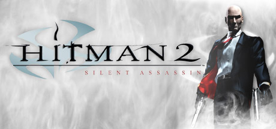

**Platforms:** Windows, PlayStation 2, Xbox &nbsp;|&nbsp; **Genre:** Action &nbsp;|&nbsp; **Released:** October 1

> Enter the realm of a retired assassin, forced back into action by treason. You may be a hired killer but you still have a sense of loyalty and justice. Visit the dark recesses of a world corrupted by crime, greed, degradation and dishonor. And a past that catches up with you.
>
> _Synopsis source: Steam_

[Steam](https://store.steampowered.com/app/6850)

---

### Hot Shots Golf 3

**Platforms:** PlayStation 2 &nbsp;|&nbsp; **Released:** March 11

[Wikipedia](https://en.wikipedia.org/wiki/Everybody%27s_Golf_3)

---

### Hot Wheels: Velocity X

**Platforms:** PlayStation 2 &nbsp;|&nbsp; **Released:** November 11

---

### James Cameron's Dark Angel

**Platforms:** PlayStation 2 &nbsp;|&nbsp; **Released:** November 18

[Wikipedia](https://en.wikipedia.org/wiki/James_Cameron%27s_Dark_Angel)

---

### Jet X2O

**Platforms:** PlayStation 2 &nbsp;|&nbsp; **Released:** October 28

[Wikipedia](https://en.wikipedia.org/wiki/Jet_X2O)

---

### Kelly Slater's Pro Surfer

**Platforms:** PlayStation 2 &nbsp;|&nbsp; **Released:** September 16

[Wikipedia](https://en.wikipedia.org/wiki/Kelly_Slater%27s_Pro_Surfer)

---

### King's Field: The Ancient City

**Platforms:** PlayStation 2 &nbsp;|&nbsp; **Released:** March 25

---

### Kingdom Hearts

**Platforms:** PlayStation 2 &nbsp;|&nbsp; **Released:** September 17

[Wikipedia](https://en.wikipedia.org/wiki/Kingdom_Hearts_(video_game))

---

### Knockout Kings 2002

**Platforms:** PlayStation 2 &nbsp;|&nbsp; **Released:** March 4

[Wikipedia](https://en.wikipedia.org/wiki/Knockout_Kings_2002)

---

### Legaia 2: Duel Saga

**Platforms:** PlayStation 2 &nbsp;|&nbsp; **Released:** October 1

---

### Legends of Wrestling II

**Platforms:** Game Boy Advance, PlayStation 2 &nbsp;|&nbsp; **Released:** November 25

[Wikipedia](https://en.wikipedia.org/wiki/Legends_of_Wrestling_II)

---

### Legion: The Legend of Excalibur

**Platforms:** PlayStation 2 &nbsp;|&nbsp; **Released:** June 18

---

### Lego Soccer Mania

**Platforms:** PlayStation 2, Game Boy Advance &nbsp;|&nbsp; **Released:** June 18

[Wikipedia](https://en.wikipedia.org/wiki/Lego_Soccer_Mania)

---

### Lethal Skies Elite Pilot: Team SW

**Platforms:** PlayStation 2 &nbsp;|&nbsp; **Released:** May 31

---

### Looney Tunes: Space Race

**Platforms:** PlayStation 2 &nbsp;|&nbsp; **Released:** May 27

---

### Mad Maestro!

**Platforms:** PlayStation 2 &nbsp;|&nbsp; **Released:** March 12

[Wikipedia](https://en.wikipedia.org/wiki/Mad_Maestro!)

---

### Madden NFL 2003

**Platforms:** PlayStation 2, GameCube, Xbox, Windows &nbsp;|&nbsp; **Publisher:** EA Sports &nbsp;|&nbsp; **Released:** August 12, 2002

[Wikipedia](https://en.wikipedia.org/wiki/Madden_NFL_2003)

---

### Marvel vs. Capcom 2

**Platforms:** PlayStation 2 &nbsp;|&nbsp; **Released:** November 18

[Wikipedia](https://en.wikipedia.org/wiki/Marvel_vs._Capcom_2)

---

### Mat Hoffman's Pro BMX 2

**Platforms:** PlayStation 2 &nbsp;|&nbsp; **Released:** August 12

[Wikipedia](https://en.wikipedia.org/wiki/Mat_Hoffman%27s_Pro_BMX_2)

---

### Maximo: Ghosts to Glory

**Platforms:** PlayStation 2 &nbsp;|&nbsp; **Released:** February 11

---

### Medal of Honor: Frontline

**Platforms:** PlayStation 2, Xbox, GameCube &nbsp;|&nbsp; **Publisher:** Electronic Arts &nbsp;|&nbsp; **Released:** May 29, 2002

---

### Men in Black II: Alien Escape

**Platforms:** PlayStation 2 &nbsp;|&nbsp; **Released:** June 27

---

### Mike Tyson Heavyweight Boxing

**Platforms:** PlayStation 2 &nbsp;|&nbsp; **Released:** June 23

[Wikipedia](https://en.wikipedia.org/wiki/Mike_Tyson_Heavyweight_Boxing)

---

### Minority Report: Everybody Runs

**Platforms:** GameCube, PlayStation 2, Xbox &nbsp;|&nbsp; **Released:** November 19

---

### Mister Mosquito

**Platforms:** PlayStation 2 &nbsp;|&nbsp; **Released:** March 12

[Wikipedia](https://en.wikipedia.org/wiki/Mister_Mosquito)

---

### MLB Slugfest 20-03

**Platforms:** PlayStation 2 &nbsp;|&nbsp; **Released:** June 23

[Wikipedia](https://en.wikipedia.org/wiki/MLB_Slugfest_20-03)

---

### Mobile Suit Gundam: Zeonic Front

**Platforms:** PlayStation 2 &nbsp;|&nbsp; **Released:** January 15

---

### Monsters, Inc.

**Platforms:** PlayStation 2 &nbsp;|&nbsp; **Released:** March 19

[Wikipedia](https://en.wikipedia.org/wiki/Monsters,_Inc._(video_game))

---

### Mortal Kombat: Deadly Alliance

**Platforms:** PlayStation 2, GameCube, Xbox, Game Boy Advance &nbsp;|&nbsp; **Released:** November 16

---

### MotoGP 2

**Platforms:** PlayStation 2 &nbsp;|&nbsp; **Released:** January 22

[Wikipedia](https://en.wikipedia.org/wiki/MotoGP_2)

---

### MX Superfly

**Platforms:** PlayStation 2 &nbsp;|&nbsp; **Released:** June 18

[Wikipedia](https://en.wikipedia.org/wiki/MX_Superfly)

---

### NASCAR Thunder 2003

**Platforms:** PlayStation, PlayStation 2, Xbox, GameCube &nbsp;|&nbsp; **Released:** September 18

[Wikipedia](https://en.wikipedia.org/wiki/NASCAR_Thunder_2003)

---

### NBA 2K2

**Platforms:** GameCube, Xbox, PlayStation 2 &nbsp;|&nbsp; **Publisher:** Sega &nbsp;|&nbsp; **Released:** March 20, 2002

[Wikipedia](https://en.wikipedia.org/wiki/NBA_2K2)

---

### NBA 2K3

**Platforms:** PlayStation 2 &nbsp;|&nbsp; **Publisher:** Sega &nbsp;|&nbsp; **Released:** October 8, 2002

[Wikipedia](https://en.wikipedia.org/wiki/NBA_2K3)

---

### NBA Live 2003

**Platforms:** PlayStation 2 &nbsp;|&nbsp; **Released:** October 8

[Wikipedia](https://en.wikipedia.org/wiki/NBA_Live_2003)

---

### NBA ShootOut 2003

**Platforms:** PlayStation 2 &nbsp;|&nbsp; **Released:** September 25

[Wikipedia](https://en.wikipedia.org/wiki/NBA_ShootOut_2003)

---

### NCAA Final Four 2003

**Platforms:** PlayStation 2 &nbsp;|&nbsp; **Released:** November 27

[Wikipedia](https://en.wikipedia.org/wiki/NCAA_Final_Four_2003)

---

### NCAA Football 2003

**Platforms:** PlayStation 2, GameCube, Xbox &nbsp;|&nbsp; **Publisher:** EA Sports &nbsp;|&nbsp; **Released:** July 20, 2002

[Wikipedia](https://en.wikipedia.org/wiki/NCAA_Football_(video_game_series))

---

### NCAA GameBreaker 2003

**Platforms:** PlayStation 2 &nbsp;|&nbsp; **Released:** August 14

[Wikipedia](https://en.wikipedia.org/wiki/NCAA_GameBreaker_2003)

---

### Need for Speed: Hot Pursuit 2

**Platforms:** PlayStation 2, Windows, Xbox, GameCube &nbsp;|&nbsp; **Publisher:** Electronic Arts &nbsp;|&nbsp; **Released:** October 2, 2002

---

### NFL 2K3

**Platforms:** PlayStation 2, GameCube, Xbox &nbsp;|&nbsp; **Publisher:** Sega &nbsp;|&nbsp; **Released:** August 21, 2002

[Wikipedia](https://en.wikipedia.org/wiki/NFL_2K)

---

### NFL Blitz 20-02

**Platforms:** PlayStation 2 &nbsp;|&nbsp; **Released:** February 6

[Wikipedia](https://en.wikipedia.org/wiki/NFL_Blitz#Installments)

---

### NFL Blitz 20-03

**Platforms:** PlayStation 2 &nbsp;|&nbsp; **Released:** August 12

[Wikipedia](https://en.wikipedia.org/wiki/NFL_Blitz_20-03)

---

### NFL GameDay 2003

**Platforms:** PlayStation 2 &nbsp;|&nbsp; **Released:** August 12

[Wikipedia](https://en.wikipedia.org/wiki/NFL_GameDay_2003)

---

### NHL 2003

**Platforms:** PlayStation 2 &nbsp;|&nbsp; **Released:** September 30

[Wikipedia](https://en.wikipedia.org/wiki/NHL_2003)

---

### NHL 2K3

**Platforms:** Xbox, GameCube, PlayStation 2 &nbsp;|&nbsp; **Publisher:** Sega &nbsp;|&nbsp; **Released:** November 19, 2002

[Wikipedia](https://en.wikipedia.org/wiki/NHL_2K3)

---

### NHL FaceOff 2003

**Platforms:** PlayStation 2 &nbsp;|&nbsp; **Released:** November 5

[Wikipedia](https://en.wikipedia.org/wiki/NHL_FaceOff_2003)

---

### NHL Hitz 20-03

**Platforms:** PlayStation 2 &nbsp;|&nbsp; **Released:** September 16

[Wikipedia](https://en.wikipedia.org/wiki/NHL_Hitz_20-03)

---

### Nickelodeon Party Blast

**Platforms:** PlayStation 2 &nbsp;|&nbsp; **Released:** December 6

[Wikipedia](https://en.wikipedia.org/wiki/Nickelodeon_Party_Blast)

---

### Ninja Assault

**Platforms:** PlayStation 2 &nbsp;|&nbsp; **Released:** November 18

[Wikipedia](https://en.wikipedia.org/wiki/Ninja_Assault)

---

### Onimusha 2: Samurai's Destiny

**Platforms:** PlayStation 2 &nbsp;|&nbsp; **Released:** August 28

---

### Pac-Man World 2

**Platforms:** PlayStation 2, GameCube, Xbox &nbsp;|&nbsp; **Released:** February 26

[Wikipedia](https://en.wikipedia.org/wiki/Pac-Man_World_2)

---

### PaRappa the Rapper 2

**Platforms:** PlayStation 2 &nbsp;|&nbsp; **Released:** January 23

[Wikipedia](https://en.wikipedia.org/wiki/PaRappa_the_Rapper_2)

---

### Pirates: The Legend of Black Kat

**Platforms:** PlayStation 2, Xbox &nbsp;|&nbsp; **Released:** February 17

---

### Pro Evolution Soccer 2

**Platforms:** PlayStation 2 &nbsp;|&nbsp; **Publisher:** Konami &nbsp;|&nbsp; **Released:** April 25, 2002

[Wikipedia](https://en.wikipedia.org/wiki/Pro_Evolution_Soccer_2)

---

### Pro Race Driver

**Platforms:** PlayStation 2 &nbsp;|&nbsp; **Released:** December 6

[Wikipedia](https://en.wikipedia.org/wiki/Pro_Race_Driver)

---

### Rally Fusion: Race of Champions

**Platforms:** PlayStation 2 &nbsp;|&nbsp; **Released:** November 11

---

### Ratchet & Clank

**Platforms:** PlayStation 2 &nbsp;|&nbsp; **Publisher:** Sony Computer Entertainment &nbsp;|&nbsp; **Released:** November 4, 2002

[Wikipedia](https://en.wikipedia.org/wiki/Ratchet_%26_Clank_(2002_video_game))

---

### Red Faction II

**Platforms:** PlayStation 2 &nbsp;|&nbsp; **Released:** October 15

[Wikipedia](https://en.wikipedia.org/wiki/Red_Faction_II)

---

### RedCard 20-03

**Platforms:** PlayStation 2 &nbsp;|&nbsp; **Released:** April 16

[Wikipedia](https://en.wikipedia.org/wiki/RedCard_20-03)

---

### Reign of Fire

**Platforms:** PlayStation 2, Xbox, GameCube, Game Boy Advance &nbsp;|&nbsp; **Released:** October 22

[Wikipedia](https://en.wikipedia.org/wiki/Reign_of_Fire_(video_game))

---

### Rez

**Platforms:** PlayStation 2 &nbsp;|&nbsp; **Released:** January 7

[Wikipedia](https://en.wikipedia.org/wiki/Rez_(video_game))

---

### Riding Spirits

**Platforms:** PlayStation 2 &nbsp;|&nbsp; **Released:** August 31

[Wikipedia](https://en.wikipedia.org/wiki/Riding_Spirits)

---

### RLH: Run Like Hell

**Platforms:** PlayStation 2 &nbsp;|&nbsp; **Released:** September 27

---

### Robot Alchemic Drive

**Platforms:** PlayStation 2 &nbsp;|&nbsp; **Released:** November 4

[Wikipedia](https://en.wikipedia.org/wiki/Robot_Alchemic_Drive)

---

### Robotech: Battlecry

**Platforms:** PlayStation 2 &nbsp;|&nbsp; **Released:** September 25

---

### Rocket Power: Beach Bandits

**Platforms:** PlayStation 2, GameCube &nbsp;|&nbsp; **Released:** September 20

---

### Rocky

**Platforms:** PlayStation 2 &nbsp;|&nbsp; **Released:** November 18

[Wikipedia](https://en.wikipedia.org/wiki/Rocky)

---

### Rygar: The Legendary Adventure

**Platforms:** PlayStation 2 &nbsp;|&nbsp; **Released:** November 25

---

### Salt Lake 2002

**Platforms:** Game Boy Advance, Windows, PlayStation 2 &nbsp;|&nbsp; **Released:** January 19

[Wikipedia](https://en.wikipedia.org/wiki/Salt_Lake_2002_(video_game))

---

### Savage Skies

**Platforms:** PlayStation 2 &nbsp;|&nbsp; **Released:** March 31

[Wikipedia](https://en.wikipedia.org/wiki/Savage_Skies)

---

### Scooby-Doo! Night of 100 Frights

**Platforms:** PlayStation 2 &nbsp;|&nbsp; **Released:** May 20

[Wikipedia](https://en.wikipedia.org/wiki/Scooby-Doo!_Night_of_100_Frights)

---

### Sega Sports Tennis

**Platforms:** PlayStation 2 &nbsp;|&nbsp; **Released:** July 31

[Wikipedia](https://en.wikipedia.org/wiki/Sega_Sports_Tennis)

---

### Shadow Man: 2econd Coming

**Platforms:** PlayStation 2 &nbsp;|&nbsp; **Released:** March 2

---

### Shifters

**Platforms:** PlayStation 2 &nbsp;|&nbsp; **Released:** June 18

[Wikipedia](https://en.wikipedia.org/wiki/Shifters)

---

### Shinobi

**Platforms:** PlayStation 2 &nbsp;|&nbsp; **Released:** November 10

[Wikipedia](https://en.wikipedia.org/wiki/Shinobi_(2002_video_game))

---

### Shox

**Platforms:** PlayStation 2 &nbsp;|&nbsp; **Released:** November 19

[Wikipedia](https://en.wikipedia.org/wiki/Shox)

---

### SkyGunner

**Platforms:** PlayStation 2 &nbsp;|&nbsp; **Released:** June 24

[Wikipedia](https://en.wikipedia.org/wiki/SkyGunner)

---

### Sled Storm

**Platforms:** PlayStation 2 &nbsp;|&nbsp; **Released:** March 11

[Wikipedia](https://en.wikipedia.org/wiki/Sled_Storm_(2002_video_game))

---

### Sly Cooper and the Thievius Raccoonus

**Platforms:** PlayStation 2 &nbsp;|&nbsp; **Released:** September 23

[Wikipedia](https://en.wikipedia.org/wiki/Sly_Cooper_and_the_Thievius_Raccoonus)

---

### Smash Court Tennis Pro Tournament

**Platforms:** PlayStation 2 &nbsp;|&nbsp; **Released:** March 20

[Wikipedia](https://en.wikipedia.org/wiki/Smash_Court_Tennis_Pro_Tournament)

---

### SOCOM U.S. Navy SEALs

**Platforms:** PlayStation 2 &nbsp;|&nbsp; **Released:** August 27

[Wikipedia](https://en.wikipedia.org/wiki/SOCOM_U.S._Navy_SEALs)

---

### Space Channel 5 Part 2

**Platforms:** PlayStation 2 &nbsp;|&nbsp; **Released:** November 28 (PAL)

[Wikipedia](https://en.wikipedia.org/wiki/Space_Channel_5_Part_2)

---

### Spider-Man: The Movie

**Platforms:** PlayStation 2, Game Boy Advance &nbsp;|&nbsp; **Released:** April 15

[Wikipedia](https://en.wikipedia.org/wiki/Spider-Man_(2002_video_game))

---

### Spyro: Enter the Dragonfly

**Platforms:** PlayStation 2, GameCube &nbsp;|&nbsp; **Released:** November 3

---

### Star Wars: Bounty Hunter

**Platforms:** PlayStation 2, GameCube &nbsp;|&nbsp; **Released:** November 19

---

### Star Wars: Jedi Starfighter

**Platforms:** PlayStation 2, Xbox &nbsp;|&nbsp; **Released:** March 10

---

### Star Wars: Racer Revenge

**Platforms:** PlayStation 2 &nbsp;|&nbsp; **Released:** February 11

---

### Star Wars: The Clone Wars

**Platforms:** PlayStation 2, Xbox, GameCube &nbsp;|&nbsp; **Released:** October 28

---

### State of Emergency

**Platforms:** PlayStation 2 &nbsp;|&nbsp; **Released:** February 12

[Wikipedia](https://en.wikipedia.org/wiki/State_of_Emergency_(video_game))

---

### Street Hoops

**Platforms:** PlayStation 2 &nbsp;|&nbsp; **Released:** August 12

[Wikipedia](https://en.wikipedia.org/wiki/Street_Hoops)

---

### Stuntman

**Platforms:** PlayStation 2 &nbsp;|&nbsp; **Released:** June 23

[Wikipedia](https://en.wikipedia.org/wiki/Stuntman_(video_game))

---

### Sub Rebellion

**Platforms:** PlayStation 2 &nbsp;|&nbsp; **Released:** October 12

[Wikipedia](https://en.wikipedia.org/wiki/Sub_Rebellion)

---

### Suikoden III

**Platforms:** PlayStation 2 &nbsp;|&nbsp; **Released:** October 24

[Wikipedia](https://en.wikipedia.org/wiki/Suikoden_III)

---

### Summoner 2

**Platforms:** PlayStation 2 &nbsp;|&nbsp; **Released:** September 23

[Wikipedia](https://en.wikipedia.org/wiki/Summoner_2)

---

### Super Bust-A-Move 2

**Platforms:** PlayStation 2 &nbsp;|&nbsp; **Released:** September 24

---

### Superman: Shadow of Apokolips

**Platforms:** PlayStation 2 &nbsp;|&nbsp; **Released:** September 25

---

### Taz: Wanted

**Platforms:** PlayStation 2, Xbox, Windows, GameCube &nbsp;|&nbsp; **Released:** September 17

---

### Tekken 4

**Platforms:** PlayStation 2 &nbsp;|&nbsp; **Released:** September 23

[Wikipedia](https://en.wikipedia.org/wiki/Tekken_4)

---

### Test Drive

**Platforms:** PlayStation 2 &nbsp;|&nbsp; **Released:** May 27

---

### The Lord of the Rings: The Two Towers

**Platforms:** PlayStation 2, Game Boy Advance, Xbox, GameCube &nbsp;|&nbsp; **Released:** October 21

---

### The Lord of the Rings:The Fellowship of the Ring

**Platforms:** Xbox, Game Boy Advance, PlayStation 2, Windows &nbsp;|&nbsp; **Released:** September 24

---

### The Mark of Kri

**Platforms:** PlayStation 2 &nbsp;|&nbsp; **Released:** July 29

[Wikipedia](https://en.wikipedia.org/wiki/The_Mark_of_Kri)

---

### The Operative: No One Lives Forever

**Platforms:** PlayStation 2 &nbsp;|&nbsp; **Released:** April 16

---

### The Scorpion King: Rise of the Akkadian

**Platforms:** PlayStation 2 &nbsp;|&nbsp; **Released:** September 10

---

### The Simpsons Skateboarding

**Platforms:** PlayStation 2 &nbsp;|&nbsp; **Released:** November 11

[Wikipedia](https://en.wikipedia.org/wiki/The_Simpsons_Skateboarding)

---

### The Terminator: Dawn of Fate

**Platforms:** PlayStation 2 &nbsp;|&nbsp; **Released:** September 16

---

### The Thing

**Platforms:** Windows, Xbox, PlayStation 2 &nbsp;|&nbsp; **Released:** August 20

[Wikipedia](https://en.wikipedia.org/wiki/The_Thing_(video_game))

---

### Tiger Woods PGA Tour 2002

**Platforms:** PlayStation 2 &nbsp;|&nbsp; **Released:** February 24

[Wikipedia](https://en.wikipedia.org/wiki/Tiger_Woods_PGA_Tour#Games_in_the_series)

---

### Tiger Woods PGA Tour 2003

**Platforms:** Windows, GameCube, Xbox, PlayStation 2 &nbsp;|&nbsp; **Publisher:** EA Sports &nbsp;|&nbsp; **Released:** October 31, 2002

[Wikipedia](https://en.wikipedia.org/wiki/Tiger_Woods_PGA_Tour_2003)

---

### TimeSplitters 2

**Platforms:** PlayStation 2, GameCube, Xbox &nbsp;|&nbsp; **Publisher:** Eidos Interactive &nbsp;|&nbsp; **Released:** October 8, 2002

[Wikipedia](https://en.wikipedia.org/wiki/TimeSplitters_2)

---

### TOCA Race Driver

**Platforms:** PlayStation 2 &nbsp;|&nbsp; **Released:** August 23

[Wikipedia](https://en.wikipedia.org/wiki/TOCA_Race_Driver)

---

### Tom Clancy's Ghost Recon

**Platforms:** PlayStation 2 &nbsp;|&nbsp; **Released:** December 1

[Wikipedia](https://en.wikipedia.org/wiki/Tom_Clancy%27s_Ghost_Recon)

---

### Tony Hawk's Pro Skater 4

**Platforms:** PlayStation 2, GameCube, Xbox, Game Boy Advance &nbsp;|&nbsp; **Publisher:** Activision &nbsp;|&nbsp; **Released:** October 23, 2002

[Wikipedia](https://en.wikipedia.org/wiki/Tony_Hawk%27s_Pro_Skater_4)

---

### TransWorld Surf

**Platforms:** PlayStation 2 &nbsp;|&nbsp; **Released:** April 30

[Wikipedia](https://en.wikipedia.org/wiki/TransWorld_Surf)

---

### Tribes: Aerial Assault

**Platforms:** PlayStation 2 &nbsp;|&nbsp; **Released:** September 23

---

### Triple Play 2002

**Platforms:** PlayStation 2 &nbsp;|&nbsp; **Released:** March 11

[Wikipedia](https://en.wikipedia.org/wiki/Triple_Play_2002)

---

### Turok: Evolution

**Platforms:** PlayStation 2 &nbsp;|&nbsp; **Released:** August 31

---

### Twisted Metal: Black Online

**Platforms:** PlayStation 2 &nbsp;|&nbsp; **Released:** August 27

---

### Ty the Tasmanian Tiger

**Platforms:** GameCube, PlayStation 2, Xbox &nbsp;|&nbsp; **Released:** September 10

[Wikipedia](https://en.wikipedia.org/wiki/Ty_the_Tasmanian_Tiger)

---

### Ultimate Fighting Championship: Throwdown

**Platforms:** PlayStation 2 &nbsp;|&nbsp; **Released:** June 3

---

### V-Rally 3

**Platforms:** PlayStation 2 &nbsp;|&nbsp; **Released:** October 22

[Wikipedia](https://en.wikipedia.org/wiki/V-Rally_3)

---

### Virtua Fighter 4

**Platforms:** PlayStation 2 &nbsp;|&nbsp; **Publisher:** Sega &nbsp;|&nbsp; **Released:** January 31, 2002

[Wikipedia](https://en.wikipedia.org/wiki/Virtua_Fighter_4)

---

### Virtua Tennis 2

**Platforms:** PlayStation 2 &nbsp;|&nbsp; **Released:** July 30

[Wikipedia](https://en.wikipedia.org/wiki/Virtua_Tennis_2)

---

### Way of the Samurai

**Platforms:** PlayStation 2 &nbsp;|&nbsp; **Released:** May 31

[Wikipedia](https://en.wikipedia.org/wiki/Way_of_the_Samurai)

---

### Wild Arms 3

**Platforms:** PlayStation 2 &nbsp;|&nbsp; **Released:** October 15

[Wikipedia](https://en.wikipedia.org/wiki/Wild_Arms_3)

---

### Wipeout Fusion

**Platforms:** PlayStation 2 &nbsp;|&nbsp; **Released:** June 18

[Wikipedia](https://en.wikipedia.org/wiki/Wipeout_Fusion)

---

### Woody Woodpecker: Escape from Buzz Buzzard Park

**Platforms:** PlayStation 2 &nbsp;|&nbsp; **Released:** February 19

---

### World Rally Championship

**Platforms:** PlayStation 2 &nbsp;|&nbsp; **Released:** March 21

[Wikipedia](https://en.wikipedia.org/wiki/World_Rally_Championship_(2001_video_game))

---

### Wreckless: The Yakuza Missions

**Platforms:** Xbox, GameCube, PlayStation 2 &nbsp;|&nbsp; **Released:** February 4

---

### WWE SmackDown! Shut Your Mouth

**Platforms:** PlayStation 2 &nbsp;|&nbsp; **Released:** October 31

[Wikipedia](https://en.wikipedia.org/wiki/WWE_SmackDown!_Shut_Your_Mouth)

---

### X-Men: Next Dimension

**Platforms:** PlayStation 2 &nbsp;|&nbsp; **Released:** October 15

---

### Zapper: One Wicked Cricket

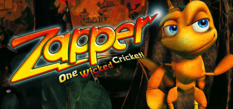

**Platforms:** Windows, PlayStation 2, Xbox, GameCube, Game Boy Advance &nbsp;|&nbsp; **Genre:** Action, Adventure &nbsp;|&nbsp; **Released:** November 5

> In this action-adventure game, Zapper (a cricket) hops his way through six worlds in a quest to find his brother, held captive by the evil magpie queen. Dangerous traps and even more dangerous enemies await! It will take skill and timing to conquer all the worlds and survive the final showdown.
>
> _Synopsis source: Steam_

[Steam](https://store.steampowered.com/app/2766060)

---

## 2001

[Full 2001 page](../years/2001.md)

### 007: Agent Under Fire

**Platforms:** PlayStation 2 &nbsp;|&nbsp; **Released:** November 13

---

### Ace Combat 04: Shattered Skies

**Platforms:** PlayStation 2 &nbsp;|&nbsp; **Publisher:** Namco &nbsp;|&nbsp; **Released:** September 13, 2001

---

### Arctic Thunder

**Platforms:** PlayStation 2 &nbsp;|&nbsp; **Released:** September 17

[Wikipedia](https://en.wikipedia.org/wiki/Arctic_Thunder)

---

### Armored Core 2: Another Age

**Platforms:** PlayStation 2 &nbsp;|&nbsp; **Released:** August 20

---

### Baldur's Gate: Dark Alliance

**Platforms:** PlayStation 2 &nbsp;|&nbsp; **Released:** December 3

---

### Bass Strike

**Platforms:** PlayStation 2 &nbsp;|&nbsp; **Released:** September 26

[Wikipedia](https://en.wikipedia.org/wiki/Bass_Strike)

---

### Batman: Vengeance

**Platforms:** Windows, PlayStation 2, GameCube, Xbox, Game Boy Advance &nbsp;|&nbsp; **Released:** October 15

---

### Burnout

**Platforms:** PlayStation 2 &nbsp;|&nbsp; **Released:** November 1

[Wikipedia](https://en.wikipedia.org/wiki/Burnout_(video_game))

---

### Cel Damage

**Platforms:** Xbox, PlayStation 2, GameCube &nbsp;|&nbsp; **Released:** November 15

[Wikipedia](https://en.wikipedia.org/wiki/Cel_Damage)

---

### City Crisis

**Platforms:** PlayStation 2 &nbsp;|&nbsp; **Released:** July 17

[Wikipedia](https://en.wikipedia.org/wiki/City_Crisis)

---

### Cool Boarders

**Platforms:** PlayStation 2 &nbsp;|&nbsp; **Released:** May 21

[Wikipedia](https://en.wikipedia.org/wiki/Cool_Boarders)

---

### Crash Bandicoot: The Wrath of Cortex

**Platforms:** PlayStation 2, Xbox, GameCube &nbsp;|&nbsp; **Released:** October 29

---

### Crazy Taxi

**Platforms:** PlayStation 2, GameCube &nbsp;|&nbsp; **Released:** May 14

[Wikipedia](https://en.wikipedia.org/wiki/Crazy_Taxi_(video_game))

---

### Dark Angel: Vampire Apocalypse

**Platforms:** PlayStation 2 &nbsp;|&nbsp; **Released:** July 8

---

### Dave Mirra Freestyle BMX 2

**Platforms:** PlayStation 2 &nbsp;|&nbsp; **Released:** August 27

[Wikipedia](https://en.wikipedia.org/wiki/Dave_Mirra_Freestyle_BMX_2)

---

### Devil May Cry

**Platforms:** PlayStation 2 &nbsp;|&nbsp; **Publisher:** Capcom &nbsp;|&nbsp; **Released:** August 23, 2001

[Wikipedia](https://en.wikipedia.org/wiki/Devil_May_Cry_(video_game))

---

### Evil Twin: Cyprien's Chronicles

**Platforms:** PlayStation 2 &nbsp;|&nbsp; **Released:** December 7 (EU/PAL)

---

### Extermination

**Platforms:** PlayStation 2 &nbsp;|&nbsp; **Released:** July 23

[Wikipedia](https://en.wikipedia.org/wiki/Extermination_(video_game))

---

### FIFA Football 2002

**Platforms:** PlayStation, PlayStation 2 &nbsp;|&nbsp; **Released:** November 1

[Wikipedia](https://en.wikipedia.org/wiki/FIFA_Football_2002)

---

### Final Fantasy X

**Platforms:** PlayStation 2 &nbsp;|&nbsp; **Publisher:** Square &nbsp;|&nbsp; **Released:** July 19, 2001 (JP/NA)

[Wikipedia](https://en.wikipedia.org/wiki/Final_Fantasy_X)

---

### Frank Herbert's Dune

**Platforms:** Windows, PlayStation 2 &nbsp;|&nbsp; **Released:** November 14

[Wikipedia](https://en.wikipedia.org/wiki/Frank_Herbert%27s_Dune_(video_game))

---

### Frequency

**Platforms:** PlayStation 2 &nbsp;|&nbsp; **Released:** November 20

[Wikipedia](https://en.wikipedia.org/wiki/Frequency)

---

### Frogger: The Great Quest

**Platforms:** PlayStation 2 &nbsp;|&nbsp; **Released:** November 20

---

### Giants: Citizen Kabuto

**Platforms:** PlayStation 2 &nbsp;|&nbsp; **Released:** December 20

---

### Gran Turismo 3: A-Spec

**Platforms:** PlayStation 2 &nbsp;|&nbsp; **Publisher:** Sony Computer Entertainment &nbsp;|&nbsp; **Released:** April 28, 2001

---

### Grand Theft Auto III

**Platforms:** PlayStation 2 &nbsp;|&nbsp; **Publisher:** Rockstar Games &nbsp;|&nbsp; **Released:** October 22, 2001

[Wikipedia](https://en.wikipedia.org/wiki/Grand_Theft_Auto_III)

---

### Ico

**Platforms:** PlayStation 2 &nbsp;|&nbsp; **Publisher:** Sony Computer Entertainment &nbsp;|&nbsp; **Released:** September 24, 2001

[Wikipedia](https://en.wikipedia.org/wiki/Ico)

---

### Jak and Daxter: The Precursor Legacy

**Platforms:** PlayStation 2 &nbsp;|&nbsp; **Publisher:** Sony Computer Entertainment &nbsp;|&nbsp; **Released:** December 3, 2001

---

### Kessen II

**Platforms:** PlayStation 2 &nbsp;|&nbsp; **Released:** September 26

[Wikipedia](https://en.wikipedia.org/wiki/Kessen_II)

---

### Klonoa 2: Lunatea's Veil

**Platforms:** PlayStation 2 &nbsp;|&nbsp; **Publisher:** Namco &nbsp;|&nbsp; **Released:** March 22, 2001

---

### Madden NFL 2002

**Platforms:** PlayStation 2, GameCube, Xbox, PlayStation, Game Boy Color &nbsp;|&nbsp; **Publisher:** EA Sports &nbsp;|&nbsp; **Released:** August 19, 2001

[Wikipedia](https://en.wikipedia.org/wiki/Madden_NFL_2002)

---

### Metal Gear Solid 2: Sons of Liberty

**Platforms:** PlayStation 2 &nbsp;|&nbsp; **Publisher:** Konami &nbsp;|&nbsp; **Released:** November 13, 2001

---

### Monster Rancher 3

**Platforms:** PlayStation 2 &nbsp;|&nbsp; **Released:** September 24

[Wikipedia](https://en.wikipedia.org/wiki/Monster_Rancher_3)

---

### Monsters, Inc. Scream Team

**Platforms:** Windows, PlayStation, PlayStation 2 &nbsp;|&nbsp; **Released:** October 30

[Wikipedia](https://en.wikipedia.org/wiki/Monsters,_Inc._Scream_Team)

---

### Myst III: Exile

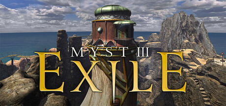

**Platforms:** Windows, PlayStation 2 &nbsp;|&nbsp; **Genre:** Adventure, Casual &nbsp;|&nbsp; **Released:** May 8

> The story of Myst continues in this third entry of the series, originally released in 2001. Return to this strange and wondrous universe, where books become portals into worlds, and where the lessons of the past may yet hold meaning for today...
>
> _Synopsis source: Steam_

[Steam](https://store.steampowered.com/app/925930)

---

### NASCAR Thunder 2002

**Platforms:** PlayStation, PlayStation 2, Xbox &nbsp;|&nbsp; **Released:** October 1

[Wikipedia](https://en.wikipedia.org/wiki/NASCAR_Thunder_2002)

---

### NBA Street

**Platforms:** PlayStation 2 &nbsp;|&nbsp; **Publisher:** EA Sports &nbsp;|&nbsp; **Released:** June 19, 2001

[Wikipedia](https://en.wikipedia.org/wiki/NBA_Street)

---

### NCAA Football 2002

**Platforms:** PlayStation 2 &nbsp;|&nbsp; **Publisher:** EA Sports &nbsp;|&nbsp; **Released:** July 23, 2001

[Wikipedia](https://en.wikipedia.org/wiki/NCAA_Football_(video_game_series)#NCAA_Football_2002)

---

### NHL 2002

**Platforms:** PlayStation 2, Xbox &nbsp;|&nbsp; **Publisher:** EA Sports &nbsp;|&nbsp; **Released:** September 24, 2001

[Wikipedia](https://en.wikipedia.org/wiki/NHL_2002)

---

### Oni

**Platforms:** Windows, PlayStation 2 &nbsp;|&nbsp; **Released:** January 29

[Wikipedia](https://en.wikipedia.org/wiki/Oni_(video_game))

---

### Onimusha: Warlords

**Platforms:** PlayStation 2 &nbsp;|&nbsp; **Released:** March 13

---

### Portal Runner

**Platforms:** PlayStation 2 &nbsp;|&nbsp; **Released:** September 10

[Wikipedia](https://en.wikipedia.org/wiki/Portal_Runner)

---

### Pro Evolution Soccer

**Platforms:** PlayStation 2 &nbsp;|&nbsp; **Publisher:** Konami &nbsp;|&nbsp; **Released:** March 15, 2001

[Wikipedia](https://en.wikipedia.org/wiki/Pro_Evolution_Soccer_(video_game))

---

### Rayman 2: The Great Escape

**Platforms:** PlayStation 2 &nbsp;|&nbsp; **Released:** January 30

---

### Red Faction

**Platforms:** PlayStation 2, Windows &nbsp;|&nbsp; **Publisher:** THQ &nbsp;|&nbsp; **Released:** May 22, 2001

[Wikipedia](https://en.wikipedia.org/wiki/Red_Faction_(video_game))

---

### Rune: Viking Warlord

**Platforms:** PlayStation 2 &nbsp;|&nbsp; **Released:** July 28

[Wikipedia](https://en.wikipedia.org/wiki/Rune_(video_game))

---

### Shadow Hearts

**Platforms:** PlayStation 2 &nbsp;|&nbsp; **Released:** December 12

[Wikipedia](https://en.wikipedia.org/wiki/Shadow_Hearts)

---

### Silent Hill 2

**Platforms:** PlayStation 2 &nbsp;|&nbsp; **Publisher:** Konami &nbsp;|&nbsp; **Released:** September 24, 2001

[Wikipedia](https://en.wikipedia.org/wiki/Silent_Hill_2)

---

### Silpheed: The Lost Planet

**Platforms:** PlayStation 2 &nbsp;|&nbsp; **Released:** April 23

---

### Soul Reaver 2

**Platforms:** PlayStation 2, Windows &nbsp;|&nbsp; **Released:** October 31

[Wikipedia](https://en.wikipedia.org/wiki/Soul_Reaver_2)

---

### SpyHunter

**Platforms:** PlayStation 2 &nbsp;|&nbsp; **Released:** September 24

[Wikipedia](https://en.wikipedia.org/wiki/SpyHunter)

---

### SSX Tricky

**Platforms:** PlayStation 2, Xbox, GameCube &nbsp;|&nbsp; **Publisher:** EA Sports &nbsp;|&nbsp; **Released:** November 5, 2001

[Wikipedia](https://en.wikipedia.org/wiki/SSX_Tricky)

---

### The Adventures of Cookie & Cream

**Platforms:** PlayStation 2 &nbsp;|&nbsp; **Released:** April 30

[Wikipedia](https://en.wikipedia.org/wiki/The_Adventures_of_Cookie_%26_Cream)

---

### The Bouncer

**Platforms:** PlayStation 2 &nbsp;|&nbsp; **Released:** March 6

[Wikipedia](https://en.wikipedia.org/wiki/The_Bouncer_(video_game))

---

### Time Crisis II

**Platforms:** PlayStation 2 &nbsp;|&nbsp; **Released:** October 1

[Wikipedia](https://en.wikipedia.org/wiki/Time_Crisis_II)

---

### Tony Hawk's Pro Skater 3

**Platforms:** PlayStation 2, GameCube, PlayStation &nbsp;|&nbsp; **Publisher:** Activision &nbsp;|&nbsp; **Released:** October 30, 2001

[Wikipedia](https://en.wikipedia.org/wiki/Tony_Hawk%27s_Pro_Skater_3)

---

### Twisted Metal: Black

**Platforms:** PlayStation 2 &nbsp;|&nbsp; **Publisher:** Sony Computer Entertainment &nbsp;|&nbsp; **Released:** June 18, 2001

---

### Wizardry: Tale of the Forsaken Land

**Platforms:** PlayStation 2 &nbsp;|&nbsp; **Released:** December 19

---

### WWF SmackDown! Just Bring It

**Platforms:** PlayStation 2 &nbsp;|&nbsp; **Released:** November 19

[Wikipedia](https://en.wikipedia.org/wiki/WWF_SmackDown!_Just_Bring_It)

---

### Yanya Caballista: City Skater

**Platforms:** PlayStation 2 &nbsp;|&nbsp; **Released:** October 1

---

### Zone of the Enders

**Platforms:** PlayStation 2 &nbsp;|&nbsp; **Released:** March 26

[Wikipedia](https://en.wikipedia.org/wiki/Zone_of_the_Enders_(video_game))

---

## 2000

[Full 2000 page](../years/2000.md)

### Dark Cloud

**Platforms:** PlayStation 2 &nbsp;|&nbsp; **Released:** December 14 (JP)

[Wikipedia](https://en.wikipedia.org/wiki/Dark_Cloud)

---

### Dead or Alive 2

**Platforms:** Dreamcast, PlayStation 2 &nbsp;|&nbsp; **Publisher:** Tecmo &nbsp;|&nbsp; **Released:** February 29, 2000

[Wikipedia](https://en.wikipedia.org/wiki/Dead_or_Alive_2)

---

### DOA2: Hardcore

**Platforms:** PlayStation 2 &nbsp;|&nbsp; **Publisher:** Tecmo &nbsp;|&nbsp; **Released:** October 26, 2000

[Wikipedia](https://en.wikipedia.org/wiki/Dead_or_Alive_2)

---

### Donald Duck: Goin' Quackers

**Platforms:** Windows, PlayStation, Nintendo 64, PlayStation 2, Dreamcast, Game Boy Color &nbsp;|&nbsp; **Released:** October 19

---

### Dynasty Warriors 2

**Platforms:** PlayStation 2 &nbsp;|&nbsp; **Released:** August 3 (JP)

[Wikipedia](https://en.wikipedia.org/wiki/Dynasty_Warriors_2)

---

### F1 Championship Season 2000

**Platforms:** Windows, PlayStation, PlayStation 2, Game Boy Color &nbsp;|&nbsp; **Released:** September 28

[Wikipedia](https://en.wikipedia.org/wiki/F1_Championship_Season_2000)

---

### FantaVision

**Platforms:** PlayStation 2 &nbsp;|&nbsp; **Released:** October 26

[Wikipedia](https://en.wikipedia.org/wiki/Fantavision_(video_game))

---

### Kessen

**Platforms:** PlayStation 2 &nbsp;|&nbsp; **Released:** March 4

[Wikipedia](https://en.wikipedia.org/wiki/Kessen)

---

### Madden NFL 2001

**Platforms:** PlayStation 2, PlayStation, Nintendo 64, Game Boy Color &nbsp;|&nbsp; **Publisher:** EA Sports &nbsp;|&nbsp; **Released:** October 26, 2000

[Wikipedia](https://en.wikipedia.org/wiki/Madden_NFL_2001)

---

### Midnight Club: Street Racing

**Platforms:** PlayStation 2 &nbsp;|&nbsp; **Released:** October 26

---

### NHL 2001

**Platforms:** Windows, PlayStation, PlayStation 2 &nbsp;|&nbsp; **Publisher:** EA Sports &nbsp;|&nbsp; **Released:** September 28, 2000

[Wikipedia](https://en.wikipedia.org/wiki/NHL_2001)

---

### Rayman Revolution

**Platforms:** PlayStation 2 &nbsp;|&nbsp; **Publisher:** Ubisoft &nbsp;|&nbsp; **Released:** December 22, 2000

---

### Ridge Racer V

**Platforms:** PlayStation 2 &nbsp;|&nbsp; **Released:** October 26

[Wikipedia](https://en.wikipedia.org/wiki/Ridge_Racer_V)

---

### Rune

**Platforms:** Windows, macOS, Linux, PlayStation 2 &nbsp;|&nbsp; **Released:** October 27

[Wikipedia](https://en.wikipedia.org/wiki/Rune_(video_game))

---

### Sky Odyssey

**Platforms:** PlayStation 2 &nbsp;|&nbsp; **Released:** November 17

[Wikipedia](https://en.wikipedia.org/wiki/Sky_Odyssey)

---

### SSX

**Platforms:** PlayStation 2 &nbsp;|&nbsp; **Publisher:** EA Sports &nbsp;|&nbsp; **Released:** October 26, 2000

[Wikipedia](https://en.wikipedia.org/wiki/SSX)

---

### Tekken Tag Tournament

**Platforms:** PlayStation 2 &nbsp;|&nbsp; **Released:** March 30

[Wikipedia](https://en.wikipedia.org/wiki/Tekken_Tag_Tournament)

---

### The King of Fighters 2000

**Platforms:** Windows, Dreamcast, PlayStation 2, Arcade &nbsp;|&nbsp; **Released:** July 26

[Wikipedia](https://en.wikipedia.org/wiki/The_King_of_Fighters_2000)

---

### TimeSplitters

**Platforms:** PlayStation 2 &nbsp;|&nbsp; **Released:** October 26

[Wikipedia](https://en.wikipedia.org/wiki/TimeSplitters_(video_game))

---
