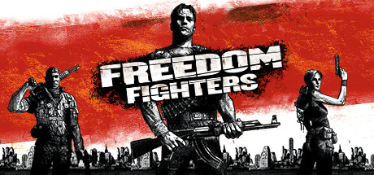
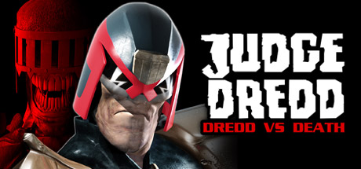
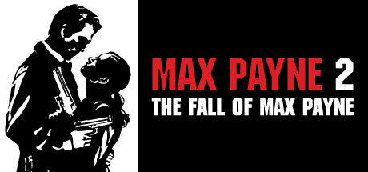
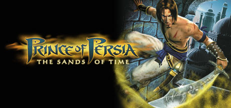
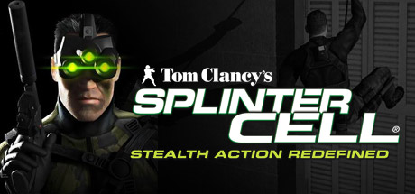

# PlayStation 2 — 2003

[← All PlayStation 2 years](../playstation-2.md) · [Full 2003 page](../../years/2003.md)

255 PlayStation 2 titles in 2003.

### .hack//Infection Part 1

**Platforms:** PlayStation 2 &nbsp;|&nbsp; **Released:** February 10

[Wikipedia](https://en.wikipedia.org/wiki/.hack//INFECTION)

---

### After...

**Platforms:** Windows, Dreamcast, PlayStation 2 &nbsp;|&nbsp; **Developer:** Ciel &nbsp;|&nbsp; **Publisher:** Ciel, Pionesoft &nbsp;|&nbsp; **Genre:** Visual novel, eroge &nbsp;|&nbsp; **Released:** June 27, 2003

[Wikipedia](https://en.wikipedia.org/wiki/After..._(video_game))

---

### Aliens Versus Predator: Extinction

**Platforms:** PlayStation 2, Xbox &nbsp;|&nbsp; **Developer:** Zono &nbsp;|&nbsp; **Publisher:** Electronic Arts, Fox Interactive &nbsp;|&nbsp; **Genre:** Real-time strategy &nbsp;|&nbsp; **Released:** July 30, 2003

[Wikipedia](https://en.wikipedia.org/wiki/Aliens_Versus_Predator:_Extinction)

---

### All-Star Baseball 2004

**Platforms:** GameCube, Xbox, PlayStation 2, Game Boy Advance &nbsp;|&nbsp; **Developer:** Acclaim Studios Austin, Acclaim Studios Manchester &nbsp;|&nbsp; **Publisher:** Acclaim Entertainment &nbsp;|&nbsp; **Genre:** Sports &nbsp;|&nbsp; **Released:** February 28, 2003

[Wikipedia](https://en.wikipedia.org/wiki/All-Star_Baseball_2004)

---

### Alter Echo

**Platforms:** PlayStation 2, Xbox &nbsp;|&nbsp; **Released:** August 19

[Wikipedia](https://en.wikipedia.org/wiki/Alter_Echo)

---

### America's 10 Most Wanted

**Platforms:** Windows, PlayStation 2 &nbsp;|&nbsp; **Released:** November 18

[Wikipedia](https://en.wikipedia.org/wiki/America%27s_10_Most_Wanted)

---

### Amplitude

**Platforms:** PlayStation 2 &nbsp;|&nbsp; **Released:** March 24

[Wikipedia](https://en.wikipedia.org/wiki/Amplitude_(game))

---

### Ape Escape 2

**Platforms:** PlayStation 2 &nbsp;|&nbsp; **Released:** June 30

[Wikipedia](https://en.wikipedia.org/wiki/Ape_Escape_2)

---

### Arc the Lad: Twilight of the Spirits

**Platforms:** PlayStation 2 &nbsp;|&nbsp; **Released:** June 25

---

### Asterix & Obelix: Kick Buttix

**Platforms:** PlayStation 2 &nbsp;|&nbsp; **Released:** September 14

[Wikipedia](https://en.wikipedia.org/wiki/Asterix_%26_Obelix_XXL)

---

### ATV: Quad Power Racing 2

**Platforms:** PlayStation 2, GameCube, Xbox &nbsp;|&nbsp; **Developer:** Climax Brighton &nbsp;|&nbsp; **Publisher:** Acclaim Entertainment &nbsp;|&nbsp; **Genre:** Racing &nbsp;|&nbsp; **Released:** January 14, 2003

[Wikipedia](https://en.wikipedia.org/wiki/ATV:_Quad_Power_Racing_2)

---

### Backyard Wrestling: Don't Try This at Home

**Platforms:** PlayStation 2 &nbsp;|&nbsp; **Released:** October 7

---

### Batman: Rise of Sin Tzu

**Platforms:** Xbox, PlayStation 2, Game Boy Advance, GameCube &nbsp;|&nbsp; **Developer:** Ubi Soft Montreal &nbsp;|&nbsp; **Publisher:** Ubi Soft &nbsp;|&nbsp; **Genre:** Action, beat 'em up &nbsp;|&nbsp; **Released:** October 16, 2003

[Wikipedia](https://en.wikipedia.org/wiki/Batman:_Rise_of_Sin_Tzu)

---

### Battle Engine Aquila

**Platforms:** PlayStation 2, Xbox &nbsp;|&nbsp; **Released:** January 20

[Wikipedia](https://en.wikipedia.org/wiki/Battle_Engine_Aquila)

---

### Battlestar Galactica

**Platforms:** Xbox, PlayStation 2 &nbsp;|&nbsp; **Developer:** Warthog Games &nbsp;|&nbsp; **Publisher:** Universal Interactive &nbsp;|&nbsp; **Genre:** Space combat simulator &nbsp;|&nbsp; **Released:** November 18, 2003

[Wikipedia](https://en.wikipedia.org/wiki/Battlestar_Galactica_(2003_video_game))

---

### Beyond Good & Evil

**Platforms:** Xbox, GameCube, PlayStation 2, Windows &nbsp;|&nbsp; **Publisher:** Ubisoft &nbsp;|&nbsp; **Released:** December 2, 2003

[Wikipedia](https://en.wikipedia.org/wiki/Beyond_Good_%26_Evil_(video_game))

---

### Bionicle

**Platforms:** GameCube, Game Boy Advance, PlayStation 2, Xbox, Windows &nbsp;|&nbsp; **Developer:** Argonaut Games, Argonaut Sheffield, Möbius Entertainment &nbsp;|&nbsp; **Publisher:** Electronic Arts, Lego Interactive, THQ, Feral Interactive &nbsp;|&nbsp; **Genre:** Platform &nbsp;|&nbsp; **Released:** September 9, 2003

[Wikipedia](https://en.wikipedia.org/wiki/Bionicle_(video_game))

---

### Black & Bruised

**Platforms:** GameCube, PlayStation 2 &nbsp;|&nbsp; **Released:** January 26

[Wikipedia](https://en.wikipedia.org/wiki/Black_%26_Bruised)

---

### Bloody Roar 4

**Platforms:** PlayStation 2 &nbsp;|&nbsp; **Developer:** Hudson Soft, Eighting &nbsp;|&nbsp; **Publisher:** Hudson Soft &nbsp;|&nbsp; **Genre:** Fighting &nbsp;|&nbsp; **Released:** November 11, 2003

[Wikipedia](https://en.wikipedia.org/wiki/Bloody_Roar_4)

---

### Bombastic

**Platforms:** PlayStation 2 &nbsp;|&nbsp; **Released:** August 27

[Wikipedia](https://en.wikipedia.org/wiki/Bombastic_(video_game))

---

### Bomberman Land 2

**Platforms:** PlayStation 2, GameCube &nbsp;|&nbsp; **Developer:** Racjin &nbsp;|&nbsp; **Publisher:** Hudson Soft &nbsp;|&nbsp; **Genre:** Party &nbsp;|&nbsp; **Released:** July 17, 2003

[Wikipedia](https://en.wikipedia.org/wiki/Bomberman_Land_2)

---

### Broken Sword: The Sleeping Dragon

**Platforms:** Windows, PlayStation 2, Xbox &nbsp;|&nbsp; **Released:** November 14

---

### Buffy the Vampire Slayer: Chaos Bleeds

**Platforms:** PlayStation 2, Xbox, GameCube &nbsp;|&nbsp; **Released:** August 27

---

### Butt-Ugly Martians: Zoom or Doom

**Platforms:** PlayStation 2 &nbsp;|&nbsp; **Released:** July 31

---

### Cabela's Dangerous Hunts

**Platforms:** PlayStation 2, Xbox &nbsp;|&nbsp; **Developer:** Fun Labs, Sand Grain Studios &nbsp;|&nbsp; **Publisher:** Activision Value, Zoo Digital Publishing &nbsp;|&nbsp; **Genre:** Hunting, simulation, first-person shooter &nbsp;|&nbsp; **Released:** November 11, 2003

[Wikipedia](https://en.wikipedia.org/wiki/Cabela's_Dangerous_Hunts)

---

### Cabela's Deer Hunt: 2004 Season

**Platforms:** PlayStation 2, Xbox &nbsp;|&nbsp; **Developer:** Sand Grain Studios, Fun Labs &nbsp;|&nbsp; **Publisher:** Activision &nbsp;|&nbsp; **Genre:** Sports &nbsp;|&nbsp; **Released:** August 26, 2003

[Wikipedia](https://en.wikipedia.org/wiki/Cabela's_Deer_Hunt:_2004_Season)

---

### Cafe Little Wish

**Platforms:** Windows, Dreamcast, PlayStation 2 &nbsp;|&nbsp; **Developer:** Patissier &nbsp;|&nbsp; **Publisher:** Digital Works, Princess Soft &nbsp;|&nbsp; **Genre:** Eroge, Visual novel &nbsp;|&nbsp; **Released:** February 14, 2003

[Wikipedia](https://en.wikipedia.org/wiki/Cafe_Little_Wish)

---

### Castlevania: Lament of Innocence

**Platforms:** PlayStation 2 &nbsp;|&nbsp; **Released:** October 21

---

### Celebrity Deathmatch

**Platforms:** Windows, PlayStation 2, Xbox &nbsp;|&nbsp; **Publisher:** Gotham Games &nbsp;|&nbsp; **Released:** October 14, 2003

[Wikipedia](https://en.wikipedia.org/wiki/Celebrity_Deathmatch_(video_game))

---

### Chaos Legion

**Platforms:** Windows, PlayStation 2 &nbsp;|&nbsp; **Released:** August 5

[Wikipedia](https://en.wikipedia.org/wiki/Chaos_Legion)

---

### Charlie's Angels

**Platforms:** GameCube, PlayStation 2 &nbsp;|&nbsp; **Publisher:** Ubisoft &nbsp;|&nbsp; **Released:** July 8, 2003

[Wikipedia](https://en.wikipedia.org/wiki/Charlie%27s_Angels_(video_game))

---

### Choro Q HG 4

**Platforms:** PlayStation 2 &nbsp;|&nbsp; **Developer:** Barnhouse Effect &nbsp;|&nbsp; **Publisher:** Takara, Atlus, Zoo Digital Publishing &nbsp;|&nbsp; **Genre:** Racing, Role-playing &nbsp;|&nbsp; **Released:** November 27, 2003

[Wikipedia](https://en.wikipedia.org/wiki/Choro_Q_HG_4)

---

### Clover Heart's

**Platforms:** Windows, PlayStation 2 &nbsp;|&nbsp; **Developer:** ALcot, HuneX, Dennō Club &nbsp;|&nbsp; **Publisher:** ALcot, Interchannel &nbsp;|&nbsp; **Genre:** Eroge, Visual novel &nbsp;|&nbsp; **Released:** November 28, 2003

[Wikipedia](https://en.wikipedia.org/wiki/Clover_Heart's)

---

### Conflict: Desert Storm II

**Platforms:** PlayStation 2, Windows, Xbox &nbsp;|&nbsp; **Developer:** Pivotal Games &nbsp;|&nbsp; **Publisher:** SCi Games, Gotham Games &nbsp;|&nbsp; **Genre:** Tactical shooter &nbsp;|&nbsp; **Released:** September 18, 2003

[Wikipedia](https://en.wikipedia.org/wiki/Conflict:_Desert_Storm_II)

---

### Crash Nitro Kart

**Platforms:** PlayStation 2, Xbox, GameCube, Game Boy Advance, N-Gage &nbsp;|&nbsp; **Released:** November 15

[Wikipedia](https://en.wikipedia.org/wiki/Crash_Nitro_Kart)

---

### Cubix Robots for Everyone: Showdown

**Platforms:** GameCube, PlayStation 2 &nbsp;|&nbsp; **Developer:** Blitz Games &nbsp;|&nbsp; **Publisher:** The 3DO Company &nbsp;|&nbsp; **Genre:** Action-adventure, role-playing &nbsp;|&nbsp; **Released:** June 2, 2003

[Wikipedia](https://en.wikipedia.org/wiki/Cubix_Robots_for_Everyone:_Showdown)

---

### Curse: The Eye of Isis

**Platforms:** Windows, Xbox, PlayStation 2 &nbsp;|&nbsp; **Developer:** Asylum Entertainment &nbsp;|&nbsp; **Publisher:** DreamCatcher Interactive, Wanadoo Edition &nbsp;|&nbsp; **Genre:** Survival horror &nbsp;|&nbsp; **Released:** October 20, 2003

[Wikipedia](https://en.wikipedia.org/wiki/Curse:_The_Eye_of_Isis)

---

### Cyber Troopers Virtual-On MARZ

**Platforms:** PlayStation 2 &nbsp;|&nbsp; **Released:** October 14

[Wikipedia](https://en.wikipedia.org/wiki/Cyber_Troopers_Virtual-On_Marz)

---

### Dakar 2: The World's Ultimate Rally

**Platforms:** PlayStation 2, GameCube, Xbox &nbsp;|&nbsp; **Developer:** Acclaim Studios Cheltenham &nbsp;|&nbsp; **Publisher:** Acclaim Entertainment &nbsp;|&nbsp; **Genre:** Racing &nbsp;|&nbsp; **Released:** March 14, 2003

[Wikipedia](https://en.wikipedia.org/wiki/Dakar_2:_The_World's_Ultimate_Rally)

---

### Dancing Stage MegaMix

**Platforms:** PlayStation 2 &nbsp;|&nbsp; **Developer:** Konami, Bemani &nbsp;|&nbsp; **Publisher:** Konami &nbsp;|&nbsp; **Genre:** Music, exercise &nbsp;|&nbsp; **Released:** May 30, 2003

[Wikipedia](https://en.wikipedia.org/wiki/Dancing_Stage_MegaMix)

---

### Dark Cloud 2

**Platforms:** PlayStation 2 &nbsp;|&nbsp; **Released:** February 17

[Wikipedia](https://en.wikipedia.org/wiki/Dark_Chronicle)

---

### DDRMAX2: Dance Dance Revolution

**Platforms:** PlayStation 2 &nbsp;|&nbsp; **Released:** September 23

---

### Def Jam Vendetta

**Platforms:** GameCube, PlayStation 2 &nbsp;|&nbsp; **Developer:** AKI Corporation, EA Canada &nbsp;|&nbsp; **Publisher:** EA Sports BIG, EA Games &nbsp;|&nbsp; **Genre:** Sports, fighting &nbsp;|&nbsp; **Released:** April 1, 2003

[Wikipedia](https://en.wikipedia.org/wiki/Def_Jam_Vendetta)

---

### Devil May Cry 2

**Platforms:** PlayStation 2 &nbsp;|&nbsp; **Released:** January 25

[Wikipedia](https://en.wikipedia.org/wiki/Devil_May_Cry_2)

---

### Disaster Report

**Platforms:** PlayStation 2 &nbsp;|&nbsp; **Released:** February 15

[Wikipedia](https://en.wikipedia.org/wiki/Disaster_Report)

---

### Disgaea: Hour of Darkness

**Platforms:** PlayStation 2 &nbsp;|&nbsp; **Developer:** Nippon Ichi Software &nbsp;|&nbsp; **Publisher:** Nippon Ichi Software, Atlus, Koei, Square Enix &nbsp;|&nbsp; **Genre:** Tactical role-playing &nbsp;|&nbsp; **Released:** January 30, 2003

[Wikipedia](https://en.wikipedia.org/wiki/Disgaea:_Hour_of_Darkness)

---

### Disney's Extreme Skate Adventure

**Platforms:** PlayStation 2, GameCube, Xbox, Game Boy Advance &nbsp;|&nbsp; **Developer:** Toys for Bob, Vicarious Visions &nbsp;|&nbsp; **Publisher:** Activision &nbsp;|&nbsp; **Genre:** Sports &nbsp;|&nbsp; **Released:** September 2, 2003

[Wikipedia](https://en.wikipedia.org/wiki/Disney's_Extreme_Skate_Adventure)

---

### Dog's Life

**Platforms:** PlayStation 2 &nbsp;|&nbsp; **Developer:** Frontier Developments &nbsp;|&nbsp; **Publisher:** Sony Computer Entertainment, Hip Games &nbsp;|&nbsp; **Genre:** Action-adventure &nbsp;|&nbsp; **Released:** October 31, 2003

[Wikipedia](https://en.wikipedia.org/wiki/Dog's_Life)

---

### Dogfight: Battle for the Pacific

**Platforms:** Windows, PlayStation 2 &nbsp;|&nbsp; **Developer:** InterActive Vision &nbsp;|&nbsp; **Publisher:** Midas Interactive Entertainment, ValuSoft &nbsp;|&nbsp; **Genre:** Simulation

[Wikipedia](https://en.wikipedia.org/wiki/Dogfight:_Battle_for_the_Pacific)

---

### Downhill Domination

**Platforms:** PlayStation 2 &nbsp;|&nbsp; **Developer:** Incog Inc. Entertainment &nbsp;|&nbsp; **Publisher:** Sony Computer Entertainment, Codemasters &nbsp;|&nbsp; **Genre:** Racing, vehicular combat &nbsp;|&nbsp; **Released:** July 22, 2003

[Wikipedia](https://en.wikipedia.org/wiki/Downhill_Domination)

---

### Downtown Run

**Platforms:** Windows, GameCube, Mobile phone, PlayStation 2 &nbsp;|&nbsp; **Developer:** Ubi Soft Bucharest, Com2uS &nbsp;|&nbsp; **Publisher:** Ubi Soft, Com2uS &nbsp;|&nbsp; **Genre:** Racing, vehicular combat &nbsp;|&nbsp; **Released:** March 27, 2003

[Wikipedia](https://en.wikipedia.org/wiki/Downtown_Run)

---

### DreamMix TV World Fighters

**Platforms:** GameCube, PlayStation 2 &nbsp;|&nbsp; **Developer:** Bitstep &nbsp;|&nbsp; **Publisher:** Hudson Soft &nbsp;|&nbsp; **Genre:** Fighting &nbsp;|&nbsp; **Released:** December 18, 2003

[Wikipedia](https://en.wikipedia.org/wiki/DreamMix_TV_World_Fighters)

---

### Dynasty Tactics 2

**Platforms:** PlayStation 2 &nbsp;|&nbsp; **Developer:** Koei &nbsp;|&nbsp; **Publisher:** Koei &nbsp;|&nbsp; **Genre:** Tactical role-playing game &nbsp;|&nbsp; **Released:** June 26, 2003

[Wikipedia](https://en.wikipedia.org/wiki/Dynasty_Tactics_2)

---

### Dynasty Warriors 3: Xtreme Legends

**Platforms:** PlayStation 2 &nbsp;|&nbsp; **Released:** January 11

[Wikipedia](https://en.wikipedia.org/wiki/Dynasty_Warriors_3)

---

### Dynasty Warriors 4

**Platforms:** PlayStation 2 &nbsp;|&nbsp; **Released:** March 25

[Wikipedia](https://en.wikipedia.org/wiki/Dynasty_Warriors_4)

---

### Energy Airforce Aim Strike!

**Platforms:** PlayStation 2 &nbsp;|&nbsp; **Publisher:** Taito, 505 Game Street &nbsp;|&nbsp; **Genre:** Simulation &nbsp;|&nbsp; **Released:** October 2, 2003

[Wikipedia](https://en.wikipedia.org/wiki/Energy_Airforce_Aim_Strike!)

---

### Enter The Matrix

**Platforms:** Windows, GameCube, PlayStation 2, Xbox &nbsp;|&nbsp; **Released:** May 14

[Wikipedia](https://en.wikipedia.org/wiki/Enter_The_Matrix)

---

### Espgaluda

**Platforms:** Arcade, Mobile phone, PlayStation 2 &nbsp;|&nbsp; **Developer:** Cave &nbsp;|&nbsp; **Publisher:** AMI &nbsp;|&nbsp; **Genre:** Bullet hell &nbsp;|&nbsp; **Released:** November 2003

[Wikipedia](https://en.wikipedia.org/wiki/Espgaluda)

---

### ESPN College Hoops

**Platforms:** PlayStation 2, Xbox &nbsp;|&nbsp; **Developer:** Kush Games &nbsp;|&nbsp; **Publisher:** Sega &nbsp;|&nbsp; **Genre:** Sports &nbsp;|&nbsp; **Released:** November 11, 2003

[Wikipedia](https://en.wikipedia.org/wiki/ESPN_College_Hoops)

---

### ESPN NBA Basketball

**Platforms:** PlayStation 2, Xbox &nbsp;|&nbsp; **Publisher:** Sega &nbsp;|&nbsp; **Released:** October 21, 2003

[Wikipedia](https://en.wikipedia.org/wiki/ESPN_NBA_Basketball_(video_game))

---

### ESPN NFL Football

**Platforms:** Xbox, PlayStation 2 &nbsp;|&nbsp; **Publisher:** Sega &nbsp;|&nbsp; **Released:** September 3, 2003

[Wikipedia](https://en.wikipedia.org/wiki/NFL_2K)

---

### ESPN NHL Hockey

**Platforms:** PlayStation 2, Xbox &nbsp;|&nbsp; **Publisher:** Sega &nbsp;|&nbsp; **Released:** September 9, 2003

[Wikipedia](https://en.wikipedia.org/wiki/NHL_2K)

---

### Everblue 2

**Platforms:** PlayStation 2 &nbsp;|&nbsp; **Released:** February 24

[Wikipedia](https://en.wikipedia.org/wiki/Everblue_2)

---

### EverQuest Online Adventures

**Platforms:** PlayStation 2 &nbsp;|&nbsp; **Developer:** Sony Online Entertainment &nbsp;|&nbsp; **Publisher:** Sony Online Entertainment, Sony Computer Entertainment &nbsp;|&nbsp; **Genre:** MMORPG &nbsp;|&nbsp; **Released:** February 11, 2003

[Wikipedia](https://en.wikipedia.org/wiki/EverQuest_Online_Adventures)

---

### Everybody's Golf 4

**Platforms:** PlayStation 2 &nbsp;|&nbsp; **Developer:** Clap Hanz &nbsp;|&nbsp; **Publisher:** Sony Computer Entertainment &nbsp;|&nbsp; **Genre:** Sports &nbsp;|&nbsp; **Released:** November 27, 2003

[Wikipedia](https://en.wikipedia.org/wiki/Everybody's_Golf_4)

---

### Evil Dead: A Fistful of Boomstick

**Platforms:** PlayStation 2, Xbox &nbsp;|&nbsp; **Developer:** VIS Entertainment &nbsp;|&nbsp; **Publisher:** THQ &nbsp;|&nbsp; **Genre:** Action, hack and slash &nbsp;|&nbsp; **Released:** May 20, 2003

[Wikipedia](https://en.wikipedia.org/wiki/Evil_Dead:_A_Fistful_of_Boomstick)

---

### EyeToy: Groove

**Platforms:** PlayStation 2 &nbsp;|&nbsp; **Developer:** London Studio &nbsp;|&nbsp; **Publisher:** Sony Computer Entertainment &nbsp;|&nbsp; **Genre:** Rhythm &nbsp;|&nbsp; **Released:** November 14, 2003

[Wikipedia](https://en.wikipedia.org/wiki/EyeToy:_Groove)

---

### EyeToy: Play

**Platforms:** PlayStation 2 &nbsp;|&nbsp; **Developer:** London Studio &nbsp;|&nbsp; **Publisher:** Sony Computer Entertainment &nbsp;|&nbsp; **Genre:** Party &nbsp;|&nbsp; **Released:** July 4, 2003

[Wikipedia](https://en.wikipedia.org/wiki/EyeToy:_Play)

---

### F1 Career Challenge

**Platforms:** GameCube, Windows, PlayStation 2, Xbox &nbsp;|&nbsp; **Developer:** Visual Science, Image Space Incorporated &nbsp;|&nbsp; **Publisher:** EA Sports &nbsp;|&nbsp; **Genre:** Racing &nbsp;|&nbsp; **Released:** June 23, 2003

[Wikipedia](https://en.wikipedia.org/wiki/F1_Career_Challenge)

---

### Fatal Frame II: Crimson Butterfly

**Platforms:** PlayStation 2 &nbsp;|&nbsp; **Released:** December 10

---

### FIFA Football 2004

**Platforms:** Windows, PlayStation, PlayStation 2, GameCube, Xbox, Game Boy Advance, N-Gage &nbsp;|&nbsp; **Developer:** EA Canada, Exient Entertainment &nbsp;|&nbsp; **Publisher:** EA Sports &nbsp;|&nbsp; **Genre:** Sports &nbsp;|&nbsp; **Released:** October 24, 2003

[Wikipedia](https://en.wikipedia.org/wiki/FIFA_Football_2004)

---

### Final Fantasy X-2

**Platforms:** PlayStation 2 &nbsp;|&nbsp; **Released:** November 18

[Wikipedia](https://en.wikipedia.org/wiki/Final_Fantasy_X-2)

---

### Final Fantasy XI: Rise of the Zilart

**Platforms:** Windows, PlayStation 2 &nbsp;|&nbsp; **Released:** April 17 (JP)

[Wikipedia](https://en.wikipedia.org/wiki/Final_Fantasy_XI)

---

### Finding Nemo

**Platforms:** GameCube, PlayStation 2, Xbox, Game Boy Advance &nbsp;|&nbsp; **Released:** May 12

[Wikipedia](https://en.wikipedia.org/wiki/Finding_Nemo_(video_game))

---

### Fisherman's Challenge

**Platforms:** PlayStation 2 &nbsp;|&nbsp; **Developer:** Konami &nbsp;|&nbsp; **Publisher:** Konami &nbsp;|&nbsp; **Genre:** Sports &nbsp;|&nbsp; **Released:** January 22, 2003

[Wikipedia](https://en.wikipedia.org/wiki/Fisherman's_Challenge)

---

### Flipnic: Ultimate Pinball

**Platforms:** PlayStation 2 &nbsp;|&nbsp; **Developer:** Sony Computer Entertainment Japan &nbsp;|&nbsp; **Publisher:** Sony Computer Entertainment, Capcom, Ubisoft &nbsp;|&nbsp; **Genre:** Pinball &nbsp;|&nbsp; **Released:** August 7, 2003

[Wikipedia](https://en.wikipedia.org/wiki/Flipnic:_Ultimate_Pinball)

---

### Ford Racing 2

**Platforms:** PlayStation 2, Xbox, Windows &nbsp;|&nbsp; **Developer:** Razorworks &nbsp;|&nbsp; **Publisher:** Gotham Games, Empire Interactive, Feral Interactive &nbsp;|&nbsp; **Genre:** Racing &nbsp;|&nbsp; **Released:** October 28, 2003

[Wikipedia](https://en.wikipedia.org/wiki/Ford_Racing_2)

---

### Formula One 2003

**Platforms:** PlayStation 2 &nbsp;|&nbsp; **Developer:** Studio Liverpool &nbsp;|&nbsp; **Publisher:** Sony Computer Entertainment &nbsp;|&nbsp; **Genre:** Racing &nbsp;|&nbsp; **Released:** July 11, 2003

[Wikipedia](https://en.wikipedia.org/wiki/Formula_One_2003_(video_game))

---

### Freaky Flyers

**Platforms:** PlayStation 2, Xbox, GameCube &nbsp;|&nbsp; **Released:** August 5

[Wikipedia](https://en.wikipedia.org/wiki/Freaky_Flyers)

---

### Freedom Fighters

**Platforms:** Windows, PlayStation 2, Xbox, GameCube &nbsp;|&nbsp; **Genre:** Action &nbsp;|&nbsp; **Released:** October 1

> Freedom Fighters is an intense third-person action game set in an alternate history New York during the invasion of a foreign superpower. Take on the role of Chris Stone, a hard-working plumber, and rise through the ranks of the resistance to prove yourself as a charismatic leader.
>
> _Synopsis source: Steam_

[Wikipedia](https://en.wikipedia.org/wiki/Freedom_Fighters_(video_game)) · [Steam](https://store.steampowered.com/app/1347780)

---

### Freestyle MetalX

**Platforms:** PlayStation 2, GameCube, Xbox &nbsp;|&nbsp; **Developer:** Deibus Studios &nbsp;|&nbsp; **Publisher:** Midway Sports Asylum &nbsp;|&nbsp; **Genre:** Sports &nbsp;|&nbsp; **Released:** June 24, 2003

[Wikipedia](https://en.wikipedia.org/wiki/Freestyle_MetalX)

---

### Frogger's Adventures: The Rescue

**Platforms:** GameCube, PlayStation 2, Windows &nbsp;|&nbsp; **Developer:** Hudson Soft &nbsp;|&nbsp; **Publisher:** Konami &nbsp;|&nbsp; **Genre:** Action-adventure &nbsp;|&nbsp; **Released:** October 28, 2003

[Wikipedia](https://en.wikipedia.org/wiki/Frogger's_Adventures:_The_Rescue)

---

### Fugitive Hunter: War on Terror

**Platforms:** PlayStation 2 &nbsp;|&nbsp; **Publisher:** Encore, Inc. &nbsp;|&nbsp; **Released:** November 18, 2003

[Wikipedia](https://en.wikipedia.org/wiki/America%27s_10_Most_Wanted)

---

### Fullmetal Alchemist and the Broken Angel

**Platforms:** PlayStation 2 &nbsp;|&nbsp; **Developer:** Racjin &nbsp;|&nbsp; **Publisher:** Square Enix &nbsp;|&nbsp; **Genre:** Action role-playing &nbsp;|&nbsp; **Released:** December 25, 2003

[Wikipedia](https://en.wikipedia.org/wiki/Fullmetal_Alchemist_and_the_Broken_Angel)

---

### Futurama

**Platforms:** PlayStation 2, Xbox &nbsp;|&nbsp; **Released:** August 12

[Wikipedia](https://en.wikipedia.org/wiki/Futurama_(video_game))

---

### Ghosthunter

**Platforms:** PlayStation 2 &nbsp;|&nbsp; **Developer:** SCEE Cambridge Studio &nbsp;|&nbsp; **Publisher:** Sony Computer Entertainment, Namco Hometek, Electronic Arts &nbsp;|&nbsp; **Genre:** Action, third-person shooter &nbsp;|&nbsp; **Released:** December 3, 2003

[Wikipedia](https://en.wikipedia.org/wiki/Ghosthunter_(video_game))

---

### Gladiator: Sword of Vengeance

**Platforms:** PlayStation 2, Xbox, Windows &nbsp;|&nbsp; **Developer:** Acclaim Studios Manchester &nbsp;|&nbsp; **Publisher:** Acclaim Entertainment, Throwback Entertainment &nbsp;|&nbsp; **Genre:** Hack and slash &nbsp;|&nbsp; **Released:** November 4, 2003

[Wikipedia](https://en.wikipedia.org/wiki/Gladiator:_Sword_of_Vengeance)

---

### Gladius

**Platforms:** GameCube, PlayStation 2, Xbox &nbsp;|&nbsp; **Developer:** LucasArts &nbsp;|&nbsp; **Publisher:** LucasArts &nbsp;|&nbsp; **Genre:** Tactical role-playing &nbsp;|&nbsp; **Released:** October 28, 2003

[Wikipedia](https://en.wikipedia.org/wiki/Gladius_(video_game))

---

### Glass Rose

**Platforms:** PlayStation 2 &nbsp;|&nbsp; **Developer:** Cing, Capcom Production Studio 3 &nbsp;|&nbsp; **Publisher:** Capcom &nbsp;|&nbsp; **Genre:** Point-and-click adventure, psychological horror &nbsp;|&nbsp; **Released:** November 6, 2003

[Wikipedia](https://en.wikipedia.org/wiki/Glass_Rose)

---

### Goblin Commander: Unleash the Horde

**Platforms:** PlayStation 2, Xbox, GameCube &nbsp;|&nbsp; **Developer:** Jaleco Entertainment &nbsp;|&nbsp; **Publisher:** Jaleco Entertainment &nbsp;|&nbsp; **Genre:** Action, real-time strategy &nbsp;|&nbsp; **Released:** November 11, 2003

[Wikipedia](https://en.wikipedia.org/wiki/Goblin_Commander:_Unleash_the_Horde)

---

### Gregory Horror Show

**Platforms:** PlayStation 2 &nbsp;|&nbsp; **Developer:** Capcom Production Studio 3 &nbsp;|&nbsp; **Publisher:** Capcom &nbsp;|&nbsp; **Genre:** Survival horror &nbsp;|&nbsp; **Released:** August 7, 2003

[Wikipedia](https://en.wikipedia.org/wiki/Gregory_Horror_Show_(video_game))

---

### Growlanser: Wayfarer of Time

**Platforms:** PlayStation 2 &nbsp;|&nbsp; **Developer:** Career Soft &nbsp;|&nbsp; **Publisher:** Atlus &nbsp;|&nbsp; **Genre:** Tactical role-playing &nbsp;|&nbsp; **Released:** December 18, 2003

[Wikipedia](https://en.wikipedia.org/wiki/Growlanser:_Wayfarer_of_Time)

---

### Gunfighter II: Revenge of Jesse James

**Platforms:** PlayStation 2 &nbsp;|&nbsp; **Developer:** Rebellion Developments &nbsp;|&nbsp; **Publisher:** Ubi Soft &nbsp;|&nbsp; **Genre:** Rail shooter &nbsp;|&nbsp; **Released:** March 14, 2003

[Wikipedia](https://en.wikipedia.org/wiki/Gunfighter_II:_Revenge_of_Jesse_James)

---

### Hardware: Online Arena

**Platforms:** PlayStation 2 &nbsp;|&nbsp; **Developer:** London Studio &nbsp;|&nbsp; **Publisher:** Sony Computer Entertainment &nbsp;|&nbsp; **Genre:** Vehicular combat &nbsp;|&nbsp; **Released:** November 7, 2003

[Wikipedia](https://en.wikipedia.org/wiki/Hardware:_Online_Arena)

---

### Harry Potter and the Philosopher's Stone

**Platforms:** GameCube, PlayStation 2, Xbox &nbsp;|&nbsp; **Developer:** Warthog Games &nbsp;|&nbsp; **Publisher:** Electronic Arts &nbsp;|&nbsp; **Genre:** Action-adventure &nbsp;|&nbsp; **Released:** December 12, 2003

[Wikipedia](https://en.wikipedia.org/wiki/Harry_Potter_and_the_Philosopher's_Stone_(2003_video_game))

---

### Harry Potter: Quidditch World Cup

**Platforms:** Windows, GameCube, PlayStation 2, Xbox, Game Boy Advance &nbsp;|&nbsp; **Released:** October 28

---

### High Heat Major League Baseball 2004

**Platforms:** PlayStation 2, Windows, Xbox &nbsp;|&nbsp; **Developer:** The 3DO Company &nbsp;|&nbsp; **Publisher:** The 3DO Company &nbsp;|&nbsp; **Genre:** Sports &nbsp;|&nbsp; **Released:** February 19, 2003

[Wikipedia](https://en.wikipedia.org/wiki/High_Heat_Major_League_Baseball_2004)

---

### Hot Wheels: World Race

**Platforms:** PlayStation 2, GameCube, Windows, Game Boy Advance &nbsp;|&nbsp; **Developer:** Climax Brighton &nbsp;|&nbsp; **Publisher:** THQ &nbsp;|&nbsp; **Genre:** Racing &nbsp;|&nbsp; **Released:** October 28, 2003

[Wikipedia](https://en.wikipedia.org/wiki/Hot_Wheels:_World_Race_(video_game))

---

### HSX: Hypersonic.Xtreme

**Platforms:** PlayStation 2 &nbsp;|&nbsp; **Released:** January 26

[Wikipedia](https://en.wikipedia.org/wiki/G-Surfers)

---

### Hugo: Bukkazoom!

**Platforms:** Windows, PlayStation 2 &nbsp;|&nbsp; **Developer:** ITE Media &nbsp;|&nbsp; **Publisher:** ITE Media, Namco &nbsp;|&nbsp; **Genre:** Racing

[Wikipedia](https://en.wikipedia.org/wiki/Hugo:_Bukkazoom!)

---

### Hulk

**Platforms:** Windows, PlayStation 2, GameCube, Xbox &nbsp;|&nbsp; **Released:** May 28

[Wikipedia](https://en.wikipedia.org/wiki/Hulk_(video_game))

---

### Hunter: The Reckoning – Wayward

**Platforms:** PlayStation 2 &nbsp;|&nbsp; **Developer:** High Voltage Software &nbsp;|&nbsp; **Publisher:** Vivendi Universal Games &nbsp;|&nbsp; **Genre:** Hack and slash, third-person shooter &nbsp;|&nbsp; **Released:** September 9, 2003

[Wikipedia](https://en.wikipedia.org/wiki/Hunter:_The_Reckoning_%E2%80%93_Wayward)

---

### Hyper Street Fighter II

**Platforms:** PlayStation 2 &nbsp;|&nbsp; **Developer:** Capcom &nbsp;|&nbsp; **Publisher:** Capcom &nbsp;|&nbsp; **Genre:** Fighting &nbsp;|&nbsp; **Released:** December 18, 2003

[Wikipedia](https://en.wikipedia.org/wiki/Hyper_Street_Fighter_II)

---

### I-Ninja

**Platforms:** PlayStation 2, GameCube, Xbox &nbsp;|&nbsp; **Developer:** Argonaut Games &nbsp;|&nbsp; **Publisher:** Namco Hometek, Sony Computer Entertainment, Zoo Digital Publishing &nbsp;|&nbsp; **Genre:** Platform &nbsp;|&nbsp; **Released:** November 18, 2003

[Wikipedia](https://en.wikipedia.org/wiki/I-Ninja)

---

### Indiana Jones and the Emperor's Tomb

**Platforms:** Xbox, Windows, PlayStation 2 &nbsp;|&nbsp; **Released:** February 24

[Wikipedia](https://en.wikipedia.org/wiki/Indiana_Jones_and_the_Emperor%27s_Tomb)

---

### IndyCar Series

**Platforms:** PlayStation 2, Xbox, Windows &nbsp;|&nbsp; **Developer:** Brain in a Jar &nbsp;|&nbsp; **Publisher:** Codemasters &nbsp;|&nbsp; **Genre:** Racing &nbsp;|&nbsp; **Released:** May 20, 2003

[Wikipedia](https://en.wikipedia.org/wiki/IndyCar_Series_(video_game))

---

### Inspector Gadget: Mad Robots Invasion

**Platforms:** PlayStation 2 &nbsp;|&nbsp; **Developer:** Silmarils &nbsp;|&nbsp; **Publisher:** Light and Shadow Production &nbsp;|&nbsp; **Genre:** Action

[Wikipedia](https://en.wikipedia.org/wiki/Inspector_Gadget:_Mad_Robots_Invasion)

---

### International Superstar Soccer 3

**Platforms:** PlayStation 2, GameCube, Windows &nbsp;|&nbsp; **Developer:** KCEO &nbsp;|&nbsp; **Publisher:** Konami &nbsp;|&nbsp; **Genre:** Sports &nbsp;|&nbsp; **Released:** March 28, 2003

[Wikipedia](https://en.wikipedia.org/wiki/International_Superstar_Soccer_3)

---

### Jak II

**Platforms:** PlayStation 2 &nbsp;|&nbsp; **Publisher:** Sony Computer Entertainment &nbsp;|&nbsp; **Released:** October 14, 2003

[Wikipedia](https://en.wikipedia.org/wiki/Jak_II)

---

### Judge Dredd: Dredd vs. Death

**Platforms:** Windows, PlayStation 2, Xbox, GameCube &nbsp;|&nbsp; **Genre:** Action &nbsp;|&nbsp; **Released:** October 17 (EU)

> Welcome to Mega-City One, a city of over 400 million people - every one of them a potential criminal. It is the third decade of the 22nd Century, unemployment is widespread, boredom is universal and only the Judges can prevent total anarchy. Empowered to dispense instant justice, they are Judge, Jury and Executioner all in one.
>
> _Synopsis source: Steam_

[Steam](https://store.steampowered.com/app/3710)

---

### Jurassic Park: Operation Genesis

**Platforms:** Windows, PlayStation 2, Xbox &nbsp;|&nbsp; **Released:** March 10

---

### Kao the Kangaroo: Round 2

**Platforms:** Windows, GameCube, PlayStation 2, Xbox &nbsp;|&nbsp; **Developer:** Tate Interactive &nbsp;|&nbsp; **Publisher:** Cenega, JoWooD Productions, Atari &nbsp;|&nbsp; **Genre:** Action-adventure, platform &nbsp;|&nbsp; **Released:** November 4, 2003

[Wikipedia](https://en.wikipedia.org/wiki/Kao_the_Kangaroo:_Round_2)

---

### Karaoke Revolution

**Platforms:** PlayStation 2, Xbox, GameCube &nbsp;|&nbsp; **Developer:** Harmonix, Secret Level, Inc., Blitz Games, Hijinx Studios &nbsp;|&nbsp; **Publisher:** Konami &nbsp;|&nbsp; **Genre:** Rhythm

[Wikipedia](https://en.wikipedia.org/wiki/Karaoke_Revolution)

---

### Karaoke Revolution

**Platforms:** PlayStation 2 &nbsp;|&nbsp; **Developer:** Harmonix, Secret Level, Inc. &nbsp;|&nbsp; **Publisher:** Konami &nbsp;|&nbsp; **Genre:** Music &nbsp;|&nbsp; **Released:** November 5, 2003

[Wikipedia](https://en.wikipedia.org/wiki/Karaoke_Revolution_(2003_video_game))

---

### Kill Switch

**Platforms:** PlayStation 2, Xbox &nbsp;|&nbsp; **Developer:** Namco Hometek, Visual Impact &nbsp;|&nbsp; **Publisher:** Namco Hometek, Sony Computer Entertainment &nbsp;|&nbsp; **Genre:** Third-person shooter &nbsp;|&nbsp; **Released:** October 28, 2003

[Wikipedia](https://en.wikipedia.org/wiki/Kill_Switch_(video_game))

---

### Knight Rider: The Game

**Platforms:** Windows, PlayStation 2 &nbsp;|&nbsp; **Released:** February 12

---

### Kya: Dark Lineage

**Platforms:** PlayStation 2 &nbsp;|&nbsp; **Released:** November 18

---

### Legacy of Kain: Defiance

**Platforms:** Windows, PlayStation 2, Xbox &nbsp;|&nbsp; **Released:** November 11

---

### Mace Griffin: Bounty Hunter

**Platforms:** Windows, PlayStation 2, Xbox &nbsp;|&nbsp; **Released:** June 19

---

### Madden NFL 2004

**Platforms:** PlayStation 2, GameCube, Xbox, Windows &nbsp;|&nbsp; **Publisher:** EA Sports &nbsp;|&nbsp; **Released:** August 12, 2003

[Wikipedia](https://en.wikipedia.org/wiki/Madden_NFL_2004)

---

### Magic Pengel: The Quest for Color

**Platforms:** PlayStation 2 &nbsp;|&nbsp; **Released:** June 24

---

### Manhunt

**Platforms:** PlayStation 2 &nbsp;|&nbsp; **Released:** November 18

[Wikipedia](https://en.wikipedia.org/wiki/Manhunt_(video_game))

---

### Marcel Desailly Pro Soccer

**Platforms:** Mobile phone, PlayStation, PlayStation 2, Windows &nbsp;|&nbsp; **Developer:** Gameloft S.A., G Artist, Anco Software &nbsp;|&nbsp; **Publisher:** Gameloft, Ubisoft &nbsp;|&nbsp; **Genre:** Sports &nbsp;|&nbsp; **Released:** July 22, 2003

[Wikipedia](https://en.wikipedia.org/wiki/Marcel_Desailly_Pro_Soccer)

---

### Mark Davis Pro Bass Challenge

**Platforms:** PlayStation 2 &nbsp;|&nbsp; **Developer:** Sims &nbsp;|&nbsp; **Publisher:** Natsume Inc. &nbsp;|&nbsp; **Genre:** Sports &nbsp;|&nbsp; **Released:** August 27, 2003

[Wikipedia](https://en.wikipedia.org/wiki/Mark_Davis_Pro_Bass_Challenge)

---

### Max Payne 2: The Fall of Max Payne

**Platforms:** Windows, Xbox, PlayStation 2 &nbsp;|&nbsp; **Publisher:** Rockstar Games &nbsp;|&nbsp; **Genre:** Action &nbsp;|&nbsp; **Released:** October 14, 2003

> Max Payne 2: The Fall of Max Payne is a violent, film-noir love story. Dark, tragic and intense, the in-depth story is a thrill-ride of shocking twists and revelations. Love hurts.
>
> _Synopsis source: Steam_

[Steam](https://store.steampowered.com/app/12150)

---

### Medal of Honor: Rising Sun

**Platforms:** PlayStation 2, Xbox, GameCube &nbsp;|&nbsp; **Released:** November 11

---

### Mega Man X7

**Platforms:** PlayStation 2 &nbsp;|&nbsp; **Released:** October 14

[Wikipedia](https://en.wikipedia.org/wiki/Mega_Man_X7)

---

### Metal Arms: Glitch in the System

**Platforms:** PlayStation 2, Xbox &nbsp;|&nbsp; **Released:** November 18

---

### Midnight Club II

**Platforms:** Windows, PlayStation 2, Xbox &nbsp;|&nbsp; **Released:** April 8

[Wikipedia](https://en.wikipedia.org/wiki/Midnight_Club_II)

---

### Midway Arcade Treasures

**Platforms:** PlayStation 2, Xbox, GameCube &nbsp;|&nbsp; **Developer:** Digital Eclipse &nbsp;|&nbsp; **Publisher:** Midway &nbsp;|&nbsp; **Genre:** Various &nbsp;|&nbsp; **Released:** November 18, 2003

[Wikipedia](https://en.wikipedia.org/wiki/Midway_Arcade_Treasures)

---

### Mission: Impossible – Operation Surma

**Platforms:** Xbox, Game Boy Advance, PlayStation 2 &nbsp;|&nbsp; **Released:** December 2

---

### MLB 2004

**Platforms:** PlayStation 2, PlayStation &nbsp;|&nbsp; **Released:** March 10

[Wikipedia](https://en.wikipedia.org/wiki/MLB_2004)

---

### MLB Slugfest 2004

**Platforms:** GameCube, PlayStation 2, Xbox, Game Boy Advance &nbsp;|&nbsp; **Developer:** Point of View, Criterion Games, Handheld Games &nbsp;|&nbsp; **Publisher:** Midway Sports &nbsp;|&nbsp; **Genre:** Sports &nbsp;|&nbsp; **Released:** March 17, 2003

[Wikipedia](https://en.wikipedia.org/wiki/MLB_Slugfest_2004)

---

### Mobile Light Force 2

**Platforms:** PlayStation 2 &nbsp;|&nbsp; **Released:** March 19

[Wikipedia](https://en.wikipedia.org/wiki/Shikigami_no_Shiro)

---

### Mobile Suit Gundam: Encounters in Space

**Platforms:** PlayStation 2 &nbsp;|&nbsp; **Developer:** Bec &nbsp;|&nbsp; **Publisher:** Bandai &nbsp;|&nbsp; **Genre:** Action, Hack and slash, Mecha simulation, Third-person shooter, Mecha, Military science fiction &nbsp;|&nbsp; **Released:** September 4, 2003

[Wikipedia](https://en.wikipedia.org/wiki/Mobile_Suit_Gundam:_Encounters_in_Space)

---

### Mojib-Ribbon

**Platforms:** PlayStation 2 &nbsp;|&nbsp; **Developer:** NanaOn-Sha &nbsp;|&nbsp; **Publisher:** Sony Computer Entertainment &nbsp;|&nbsp; **Genre:** Music &nbsp;|&nbsp; **Released:** November 20, 2003

[Wikipedia](https://en.wikipedia.org/wiki/Mojib-Ribbon)

---

### Mojo!

**Platforms:** PlayStation 2, Xbox &nbsp;|&nbsp; **Developer:** FarSight Technologies &nbsp;|&nbsp; **Publisher:** Crave Entertainment, DreamCatcher Interactive &nbsp;|&nbsp; **Genre:** Puzzle &nbsp;|&nbsp; **Released:** August 26, 2003

[Wikipedia](https://en.wikipedia.org/wiki/Mojo!)

---

### Monster Rancher 4

**Platforms:** PlayStation 2 &nbsp;|&nbsp; **Released:** November 13

[Wikipedia](https://en.wikipedia.org/wiki/Monster_Rancher_4)

---

### MotoGP 3

**Platforms:** PlayStation 2 &nbsp;|&nbsp; **Developer:** Namco &nbsp;|&nbsp; **Publisher:** Namco, Namco Hometek, Sony Computer Entertainment &nbsp;|&nbsp; **Genre:** Racing &nbsp;|&nbsp; **Released:** February 27, 2003

[Wikipedia](https://en.wikipedia.org/wiki/MotoGP_3)

---

### Muppets Party Cruise

**Platforms:** GameCube, PlayStation 2 &nbsp;|&nbsp; **Released:** November 11

[Wikipedia](https://en.wikipedia.org/wiki/Muppets_Party_Cruise)

---

### Music 3000

**Platforms:** PlayStation 2 &nbsp;|&nbsp; **Developer:** Jester Interactive &nbsp;|&nbsp; **Publisher:** Jester Interactive, XS Games &nbsp;|&nbsp; **Genre:** Digital audio workstation &nbsp;|&nbsp; **Released:** May 30, 2003

[Wikipedia](https://en.wikipedia.org/wiki/Music_3000)

---

### MVP Baseball 2003

**Platforms:** Xbox, PlayStation 2, Windows &nbsp;|&nbsp; **Developer:** EA Canada &nbsp;|&nbsp; **Publisher:** EA Sports &nbsp;|&nbsp; **Genre:** Sports &nbsp;|&nbsp; **Released:** March 11, 2003

[Wikipedia](https://en.wikipedia.org/wiki/MVP_Baseball_2003)

---

### My Street

**Platforms:** PlayStation 2 &nbsp;|&nbsp; **Developer:** Idol Minds &nbsp;|&nbsp; **Publisher:** Sony Computer Entertainment &nbsp;|&nbsp; **Genre:** Party &nbsp;|&nbsp; **Released:** March 12, 2003

[Wikipedia](https://en.wikipedia.org/wiki/My_Street)

---

### Naruto: Ultimate Ninja

**Platforms:** PlayStation 2 &nbsp;|&nbsp; **Developer:** CyberConnect2 &nbsp;|&nbsp; **Publisher:** Bandai, Namco Bandai Games &nbsp;|&nbsp; **Genre:** Fighting game &nbsp;|&nbsp; **Released:** October 23, 2003

[Wikipedia](https://en.wikipedia.org/wiki/Naruto:_Ultimate_Ninja_(video_game))

---

### NASCAR Thunder 2004

**Platforms:** PlayStation 2, Windows, PlayStation, Xbox &nbsp;|&nbsp; **Publisher:** EA Sports &nbsp;|&nbsp; **Released:** September 16, 2003

[Wikipedia](https://en.wikipedia.org/wiki/NASCAR_Thunder_2004)

---

### Naval Ops: Warship Gunner

**Platforms:** PlayStation 2 &nbsp;|&nbsp; **Developer:** Microcabin &nbsp;|&nbsp; **Publisher:** Koei &nbsp;|&nbsp; **Genre:** Vehicle simulation game &nbsp;|&nbsp; **Released:** April 3, 2003

[Wikipedia](https://en.wikipedia.org/wiki/Naval_Ops:_Warship_Gunner)

---

### NBA Jam

**Platforms:** PlayStation 2, Xbox &nbsp;|&nbsp; **Developer:** Acclaim Studios Austin &nbsp;|&nbsp; **Publisher:** Acclaim Entertainment &nbsp;|&nbsp; **Genre:** Sports &nbsp;|&nbsp; **Released:** September 23, 2003

[Wikipedia](https://en.wikipedia.org/wiki/NBA_Jam_(2003_video_game))

---

### NBA Live 2004

**Platforms:** PlayStation 2, Xbox, GameCube, Windows &nbsp;|&nbsp; **Developer:** EA Canada &nbsp;|&nbsp; **Publisher:** Electronic Arts &nbsp;|&nbsp; **Genre:** Sports &nbsp;|&nbsp; **Released:** October 14, 2003

[Wikipedia](https://en.wikipedia.org/wiki/NBA_Live_2004)

---

### NBA ShootOut 2004

**Platforms:** PlayStation, PlayStation 2 &nbsp;|&nbsp; **Developer:** Killer Game, San Diego Studio &nbsp;|&nbsp; **Publisher:** Sony Computer Entertainment America &nbsp;|&nbsp; **Genre:** Sports &nbsp;|&nbsp; **Released:** October 6, 2003

[Wikipedia](https://en.wikipedia.org/wiki/NBA_ShootOut_2004)

---

### NBA Street Vol. 2

**Platforms:** PlayStation 2, GameCube, Xbox &nbsp;|&nbsp; **Publisher:** EA Sports &nbsp;|&nbsp; **Released:** April 29, 2003

[Wikipedia](https://en.wikipedia.org/wiki/NBA_Street_Vol._2)

---

### NCAA Final Four 2004

**Platforms:** PlayStation 2 &nbsp;|&nbsp; **Developer:** Killer Game &nbsp;|&nbsp; **Publisher:** Sony Computer Entertainment America &nbsp;|&nbsp; **Genre:** Sports &nbsp;|&nbsp; **Released:** November 11, 2003

[Wikipedia](https://en.wikipedia.org/wiki/NCAA_Final_Four_2004)

---

### NCAA Football 2004

**Platforms:** PlayStation 2, Xbox, GameCube &nbsp;|&nbsp; **Publisher:** EA Sports &nbsp;|&nbsp; **Released:** July 16, 2003

[Wikipedia](https://en.wikipedia.org/wiki/NCAA_Football_2004)

---

### NCAA GameBreaker 2004

**Platforms:** PlayStation 2 &nbsp;|&nbsp; **Developer:** Red Zone Interactive, 989 Sports &nbsp;|&nbsp; **Publisher:** Sony Computer Entertainment &nbsp;|&nbsp; **Genre:** Sports &nbsp;|&nbsp; **Released:** August 26, 2003

[Wikipedia](https://en.wikipedia.org/wiki/NCAA_GameBreaker_2004)

---

### NCAA March Madness 2004

**Platforms:** PlayStation 2, Xbox &nbsp;|&nbsp; **Developer:** NuFX, EA Canada &nbsp;|&nbsp; **Publisher:** Electronic Arts &nbsp;|&nbsp; **Genre:** Sports &nbsp;|&nbsp; **Released:** November 17, 2003

[Wikipedia](https://en.wikipedia.org/wiki/NCAA_March_Madness_2004)

---

### Need for Speed: Underground

**Platforms:** Windows, GameCube, PlayStation 2, Xbox &nbsp;|&nbsp; **Released:** November 17 (NA)

---

### Neon Genesis Evangelion 2

**Platforms:** PlayStation 2 &nbsp;|&nbsp; **Developer:** Alfa System &nbsp;|&nbsp; **Publisher:** Bandai &nbsp;|&nbsp; **Genre:** Role-playing video game, Adventure, Simulation &nbsp;|&nbsp; **Released:** November 20, 2003

[Wikipedia](https://en.wikipedia.org/wiki/Neon_Genesis_Evangelion_2)

---

### Neon Genesis Evangelion: Girlfriend of Steel 2nd

**Platforms:** PlayStation 2, macOS, Windows, PlayStation Portable &nbsp;|&nbsp; **Developer:** Gainax Network Systems &nbsp;|&nbsp; **Publisher:** Broccoli &nbsp;|&nbsp; **Genre:** Visual novel &nbsp;|&nbsp; **Released:** May 16, 2003

[Wikipedia](https://en.wikipedia.org/wiki/Neon_Genesis_Evangelion:_Girlfriend_of_Steel_2nd)

---

### NFL Blitz Pro

**Platforms:** PlayStation 2, Xbox, GameCube &nbsp;|&nbsp; **Developer:** Midway Games &nbsp;|&nbsp; **Publisher:** Midway Sports &nbsp;|&nbsp; **Genre:** Sports &nbsp;|&nbsp; **Released:** October 27, 2003

[Wikipedia](https://en.wikipedia.org/wiki/NFL_Blitz_Pro)

---

### NFL GameDay 2004

**Platforms:** PlayStation, PlayStation 2 &nbsp;|&nbsp; **Developer:** San Diego Studio &nbsp;|&nbsp; **Publisher:** Sony Computer Entertainment America &nbsp;|&nbsp; **Genre:** Sports &nbsp;|&nbsp; **Released:** August 26, 2003

[Wikipedia](https://en.wikipedia.org/wiki/NFL_GameDay_2004)

---

### NHL 2004

**Platforms:** Windows, GameCube, PlayStation 2, Xbox &nbsp;|&nbsp; **Released:** September 22

[Wikipedia](https://en.wikipedia.org/wiki/NHL_2004)

---

### NHL Hitz Pro

**Platforms:** GameCube, Xbox, PlayStation 2 &nbsp;|&nbsp; **Developer:** Next Level Games &nbsp;|&nbsp; **Publisher:** Midway Sports &nbsp;|&nbsp; **Genre:** Sports &nbsp;|&nbsp; **Released:** September 25, 2003

[Wikipedia](https://en.wikipedia.org/wiki/NHL_Hitz_Pro)

---

### Onimusha Blade Warriors

**Platforms:** PlayStation 2 &nbsp;|&nbsp; **Developer:** Capcom &nbsp;|&nbsp; **Publisher:** Capcom &nbsp;|&nbsp; **Genre:** Fighting &nbsp;|&nbsp; **Released:** November 27, 2003

[Wikipedia](https://en.wikipedia.org/wiki/Onimusha_Blade_Warriors)

---

### Premier Manager 2003–04

**Platforms:** Game Boy Advance, PlayStation 2, Windows &nbsp;|&nbsp; **Developer:** Zoo Digital Publishing &nbsp;|&nbsp; **Publisher:** Zoo Digital Publishing &nbsp;|&nbsp; **Genre:** Sports &nbsp;|&nbsp; **Released:** November 28, 2003

[Wikipedia](https://en.wikipedia.org/wiki/Premier_Manager_2003%E2%80%9304)

---

### Pride FC: Fighting Championships

**Platforms:** PlayStation 2 &nbsp;|&nbsp; **Released:** March 20

---

### PrideGP Grand Prix 2003

**Platforms:** PlayStation 2 &nbsp;|&nbsp; **Developer:** DreamFactory &nbsp;|&nbsp; **Publisher:** Capcom &nbsp;|&nbsp; **Genre:** Fighting &nbsp;|&nbsp; **Released:** November 2003

[Wikipedia](https://en.wikipedia.org/wiki/PrideGP_Grand_Prix_2003)

---

### Primal

**Platforms:** PlayStation 2 &nbsp;|&nbsp; **Released:** March 25

[Wikipedia](https://en.wikipedia.org/wiki/Primal_(video_game))

---

### Prince of Persia: The Sands of Time

**Platforms:** Xbox, GameCube, PlayStation 2, Windows &nbsp;|&nbsp; **Publisher:** Ubisoft &nbsp;|&nbsp; **Genre:** Action, Adventure &nbsp;|&nbsp; **Released:** November 18, 2003

> Amidst the scorched sands of ancient Persia, there is a legend spun in an ancient tongue. It speaks of a time borne by blood and ruled by deceit. Drawn to the dark powers of a magic dagger, a young Prince is led to unleash a deadly evil upon a beautiful kingdom.
>
> _Synopsis source: Steam_

[Steam](https://store.steampowered.com/app/13600)

---

### Pro Evolution Soccer 3

**Platforms:** Windows, PlayStation 2 &nbsp;|&nbsp; **Publisher:** Konami &nbsp;|&nbsp; **Released:** October 17, 2003

[Wikipedia](https://en.wikipedia.org/wiki/Pro_Evolution_Soccer_3)

---

### R: Racing Evolution

**Platforms:** GameCube, PlayStation 2, Xbox &nbsp;|&nbsp; **Developer:** Namco &nbsp;|&nbsp; **Publisher:** Namco, Namco Hometek, Electronic Arts &nbsp;|&nbsp; **Genre:** Sim racing &nbsp;|&nbsp; **Released:** November 27, 2003

[Wikipedia](https://en.wikipedia.org/wiki/R:_Racing_Evolution)

---

### Rakushou! Pachi-Slot Sengen

**Platforms:** PlayStation 2 &nbsp;|&nbsp; **Developer:** Tecmo &nbsp;|&nbsp; **Publisher:** Tecmo &nbsp;|&nbsp; **Genre:** Slot machine simulation &nbsp;|&nbsp; **Released:** October 23, 2003

[Wikipedia](https://en.wikipedia.org/wiki/Rakushou!_Pachi-Slot_Sengen)

---

### Ratchet & Clank: Going Commando

**Platforms:** PlayStation 2 &nbsp;|&nbsp; **Publisher:** Sony Computer Entertainment &nbsp;|&nbsp; **Released:** November 11, 2003

---

### Rayman 3: Hoodlum Havoc

**Platforms:** GameCube, Game Boy Advance, PlayStation 2, Xbox, Windows &nbsp;|&nbsp; **Released:** February 21

---

### Resident Evil: Dead Aim

**Platforms:** PlayStation 2 &nbsp;|&nbsp; **Developer:** Cavia &nbsp;|&nbsp; **Publisher:** Capcom &nbsp;|&nbsp; **Genre:** Light gun shooter &nbsp;|&nbsp; **Released:** February 13, 2003

[Wikipedia](https://en.wikipedia.org/wiki/Resident_Evil:_Dead_Aim)

---

### Risk: Global Domination

**Platforms:** PlayStation 2 &nbsp;|&nbsp; **Developer:** Cyberlore Studios &nbsp;|&nbsp; **Publisher:** Atari Interactive &nbsp;|&nbsp; **Genre:** Board game, Turn-based strategy &nbsp;|&nbsp; **Released:** November 4, 2003

[Wikipedia](https://en.wikipedia.org/wiki/Risk:_Global_Domination)

---

### RoadKill

**Platforms:** Xbox, PlayStation 2, GameCube &nbsp;|&nbsp; **Developer:** Terminal Reality &nbsp;|&nbsp; **Publisher:** Midway &nbsp;|&nbsp; **Genre:** Vehicular combat &nbsp;|&nbsp; **Released:** October 13, 2003

[Wikipedia](https://en.wikipedia.org/wiki/RoadKill_(video_game))

---

### Robin Hood: Defender of the Crown

**Platforms:** PlayStation 2, Windows, Xbox &nbsp;|&nbsp; **Developer:** Cinemaware, Atomic Planet Entertainment, Simian Industries &nbsp;|&nbsp; **Publisher:** Capcom, ZOO Digital Group, I-play &nbsp;|&nbsp; **Genre:** Turn-based strategy &nbsp;|&nbsp; **Released:** September 30, 2003

[Wikipedia](https://en.wikipedia.org/wiki/Robin_Hood:_Defender_of_the_Crown)

---

### Rogue Ops

**Platforms:** GameCube, PlayStation 2, Xbox &nbsp;|&nbsp; **Developer:** Bits Studios &nbsp;|&nbsp; **Publisher:** Kemco &nbsp;|&nbsp; **Genre:** Stealth &nbsp;|&nbsp; **Released:** October 28, 2003

[Wikipedia](https://en.wikipedia.org/wiki/Rogue_Ops)

---

### Rolling

**Platforms:** PlayStation 2, Xbox &nbsp;|&nbsp; **Developer:** Rage Software &nbsp;|&nbsp; **Publisher:** SCi &nbsp;|&nbsp; **Genre:** Sports &nbsp;|&nbsp; **Released:** October 24, 2003

[Wikipedia](https://en.wikipedia.org/wiki/Rolling_(video_game))

---

### RTX Red Rock

**Platforms:** PlayStation 2 &nbsp;|&nbsp; **Developer:** LucasArts &nbsp;|&nbsp; **Publisher:** LucasArts &nbsp;|&nbsp; **Genre:** Action-adventure &nbsp;|&nbsp; **Released:** June 17, 2003

[Wikipedia](https://en.wikipedia.org/wiki/RTX_Red_Rock)

---

### Rugby 2004

**Platforms:** PlayStation 2, Windows &nbsp;|&nbsp; **Developer:** HB Studios &nbsp;|&nbsp; **Publisher:** EA Sports &nbsp;|&nbsp; **Genre:** Sports &nbsp;|&nbsp; **Released:** September 18, 2003

[Wikipedia](https://en.wikipedia.org/wiki/Rugby_2004)

---

### Rugby League

**Platforms:** Windows, PlayStation 2, Xbox &nbsp;|&nbsp; **Developer:** Sidhe Interactive &nbsp;|&nbsp; **Publisher:** Tru Blu Entertainment &nbsp;|&nbsp; **Genre:** Sports &nbsp;|&nbsp; **Released:** December 12, 2003

[Wikipedia](https://en.wikipedia.org/wiki/Rugby_League_(video_game))

---

### Samurai Shodown V

**Platforms:** Arcade, Neo Geo AES, PlayStation 2, Xbox &nbsp;|&nbsp; **Developer:** Yuki Enterprise &nbsp;|&nbsp; **Publisher:** SNK Playmore, Ignition Entertainment &nbsp;|&nbsp; **Genre:** Fighting &nbsp;|&nbsp; **Released:** October 10, 2003

[Wikipedia](https://en.wikipedia.org/wiki/Samurai_Shodown_V)

---

### Secret Weapons Over Normandy

**Platforms:** PlayStation 2, Xbox, Windows &nbsp;|&nbsp; **Developer:** Totally Games &nbsp;|&nbsp; **Publisher:** LucasArts &nbsp;|&nbsp; **Genre:** Combat flight simulation &nbsp;|&nbsp; **Released:** November 18, 2003

[Wikipedia](https://en.wikipedia.org/wiki/Secret_Weapons_Over_Normandy)

---

### Shadow Tower Abyss

**Platforms:** PlayStation 2 &nbsp;|&nbsp; **Developer:** FromSoftware &nbsp;|&nbsp; **Publisher:** FromSoftware &nbsp;|&nbsp; **Genre:** Role-playing game &nbsp;|&nbsp; **Released:** October 23, 2003

[Wikipedia](https://en.wikipedia.org/wiki/Shadow_Tower_Abyss)

---

### Shin Megami Tensei III: Nocturne

**Platforms:** PlayStation 2 &nbsp;|&nbsp; **Released:** February 20

---

### Silent Hill 3

**Platforms:** PlayStation 2, Windows &nbsp;|&nbsp; **Released:** May 23

[Wikipedia](https://en.wikipedia.org/wiki/Silent_Hill_3)

---

### Silent Line: Armored Core

**Platforms:** PlayStation 2 &nbsp;|&nbsp; **Developer:** FromSoftware &nbsp;|&nbsp; **Publisher:** FromSoftware, Agetec &nbsp;|&nbsp; **Genre:** Third-person shooter &nbsp;|&nbsp; **Released:** January 23, 2003

[Wikipedia](https://en.wikipedia.org/wiki/Silent_Line:_Armored_Core)

---

### Siren

**Platforms:** PlayStation 2 &nbsp;|&nbsp; **Released:** April 20

[Wikipedia](https://en.wikipedia.org/wiki/Siren_(video_game))

---

### SNK vs. Capcom: SVC Chaos

**Platforms:** Arcade, Neo Geo AES, PlayStation 2 &nbsp;|&nbsp; **Developer:** SNK Playmore, Code Mystics &nbsp;|&nbsp; **Publisher:** SNK Playmore, Ignition Entertainment &nbsp;|&nbsp; **Genre:** Fighting &nbsp;|&nbsp; **Released:** July 2003

[Wikipedia](https://en.wikipedia.org/wiki/SNK_vs._Capcom:_SVC_Chaos)

---

### SOCOM II U.S. Navy SEALs

**Platforms:** PlayStation 2 &nbsp;|&nbsp; **Released:** November 4

[Wikipedia](https://en.wikipedia.org/wiki/SOCOM_II_U.S._Navy_SEALs)

---

### Sonic Heroes

**Platforms:** PlayStation 2, Xbox, GameCube &nbsp;|&nbsp; **Released:** December 4

[Wikipedia](https://en.wikipedia.org/wiki/Sonic_Heroes)

---

### Soulcalibur II

**Platforms:** GameCube, Xbox, PlayStation 2 &nbsp;|&nbsp; **Publisher:** Namco &nbsp;|&nbsp; **Released:** March 27, 2003

[Wikipedia](https://en.wikipedia.org/wiki/Soulcalibur_II)

---

### Space Channel 5 Special Edition

**Platforms:** PlayStation 2 &nbsp;|&nbsp; **Released:** November 18

[Wikipedia](https://en.wikipedia.org/wiki/Space_Channel_5)

---

### Spawn: Armageddon

**Platforms:** PlayStation 2, GameCube, Xbox &nbsp;|&nbsp; **Developer:** Point of View &nbsp;|&nbsp; **Publisher:** Namco Hometek, Electronic Arts, Namco &nbsp;|&nbsp; **Genre:** Action-adventure, hack and slash &nbsp;|&nbsp; **Released:** November 21, 2003

[Wikipedia](https://en.wikipedia.org/wiki/Spawn:_Armageddon)

---

### Speed Kings

**Platforms:** GameCube, PlayStation 2, Xbox &nbsp;|&nbsp; **Developer:** Climax London &nbsp;|&nbsp; **Publisher:** Acclaim Entertainment &nbsp;|&nbsp; **Genre:** Racing &nbsp;|&nbsp; **Released:** May 28, 2003

[Wikipedia](https://en.wikipedia.org/wiki/Speed_Kings)

---

### Sphinx and the Cursed Mummy

**Platforms:** GameCube, PlayStation 2, Xbox &nbsp;|&nbsp; **Released:** November 10

[Wikipedia](https://en.wikipedia.org/wiki/Sphinx_and_the_Cursed_Mummy)

---

### SplashDown: Rides Gone Wild

**Platforms:** PlayStation 2 &nbsp;|&nbsp; **Released:** August 6

---

### SpongeBob SquarePants: Battle for Bikini Bottom

**Platforms:** Windows, GameCube, PlayStation 2, Xbox, Game Boy Advance &nbsp;|&nbsp; **Released:** October 29

---

### Spy Fiction

**Platforms:** PlayStation 2 &nbsp;|&nbsp; **Developer:** Access Games &nbsp;|&nbsp; **Publisher:** Sammy &nbsp;|&nbsp; **Genre:** Action-adventure, stealth &nbsp;|&nbsp; **Released:** December 25, 2003

[Wikipedia](https://en.wikipedia.org/wiki/Spy_Fiction)

---

### SpyHunter 2

**Platforms:** PlayStation 2, Xbox &nbsp;|&nbsp; **Developer:** Angel Studios &nbsp;|&nbsp; **Publisher:** Midway Games &nbsp;|&nbsp; **Genre:** Vehicular combat &nbsp;|&nbsp; **Released:** November 24, 2003

[Wikipedia](https://en.wikipedia.org/wiki/SpyHunter_2)

---

### SSX 3

**Platforms:** PlayStation 2, GameCube, Xbox, Game Boy Advance &nbsp;|&nbsp; **Publisher:** EA Sports &nbsp;|&nbsp; **Released:** October 20, 2003

[Wikipedia](https://en.wikipedia.org/wiki/SSX_3)

---

### Star Ocean: Till the End of Time

**Platforms:** PlayStation 2 &nbsp;|&nbsp; **Developer:** tri-Ace &nbsp;|&nbsp; **Publisher:** Enix, Square Enix, Ubisoft &nbsp;|&nbsp; **Genre:** Action role-playing &nbsp;|&nbsp; **Released:** February 27, 2003

[Wikipedia](https://en.wikipedia.org/wiki/Star_Ocean:_Till_the_End_of_Time)

---

### Summer Heat Beach Volleyball

**Platforms:** PlayStation 2 &nbsp;|&nbsp; **Developer:** Acclaim Studios Cheltenham &nbsp;|&nbsp; **Publisher:** Acclaim Entertainment &nbsp;|&nbsp; **Genre:** Sports &nbsp;|&nbsp; **Released:** June 30, 2003

[Wikipedia](https://en.wikipedia.org/wiki/Summer_Heat_Beach_Volleyball)

---

### Summon Night 3

**Platforms:** PlayStation 2, PlayStation Portable &nbsp;|&nbsp; **Developer:** Flight-Plan, Felistella &nbsp;|&nbsp; **Publisher:** Banpresto, Namco Bandai Games &nbsp;|&nbsp; **Genre:** Tactical RPG &nbsp;|&nbsp; **Released:** August 7, 2003

[Wikipedia](https://en.wikipedia.org/wiki/Summon_Night_3)

---

### SWAT: Global Strike Team

**Platforms:** PlayStation 2, Xbox &nbsp;|&nbsp; **Released:** October 28

---

### SX Superstar

**Platforms:** GameCube, PlayStation 2, Xbox &nbsp;|&nbsp; **Developer:** Climax Solent &nbsp;|&nbsp; **Publisher:** Acclaim Entertainment &nbsp;|&nbsp; **Genre:** Racing &nbsp;|&nbsp; **Released:** June 30, 2003

[Wikipedia](https://en.wikipedia.org/wiki/SX_Superstar)

---

### Tak and the Power of Juju

**Platforms:** GameCube, PlayStation 2, Game Boy Advance &nbsp;|&nbsp; **Released:** October 15

[Wikipedia](https://en.wikipedia.org/wiki/Tak_and_the_Power_of_Juju)

---

### Teenage Mutant Ninja Turtles

**Platforms:** Windows, GameCube, PlayStation 2, Xbox &nbsp;|&nbsp; **Released:** October 21

[Wikipedia](https://en.wikipedia.org/wiki/Teenage_Mutant_Ninja_Turtles_(2003_video_game))

---

### Tenchu: Wrath of Heaven

**Platforms:** PlayStation 2 &nbsp;|&nbsp; **Released:** March 3

---

### The Cat in the Hat

**Platforms:** Game Boy Advance, Windows, PlayStation 2, Xbox &nbsp;|&nbsp; **Developer:** Magenta Software, Digital Eclipse &nbsp;|&nbsp; **Publisher:** Vivendi Universal Games &nbsp;|&nbsp; **Genre:** Platform &nbsp;|&nbsp; **Released:** November 4, 2003

[Wikipedia](https://en.wikipedia.org/wiki/The_Cat_in_the_Hat_(video_game))

---

### The Fairly OddParents: Breakin' da Rules

**Platforms:** Windows, GameCube, PlayStation 2, Xbox, Game Boy Advance &nbsp;|&nbsp; **Released:** November 18

---

### The Getaway

**Platforms:** PlayStation 2 &nbsp;|&nbsp; **Released:** January 19

[Wikipedia](https://en.wikipedia.org/wiki/The_Getaway_(video_game))

---

### The Great Escape

**Platforms:** Windows, PlayStation 2, Xbox &nbsp;|&nbsp; **Genre:** Action, Adventure, Simulation, Strategy &nbsp;|&nbsp; **Released:** July 23

> Captured, but not defeated, you are being held in the notorious Heldentod camp. This small, converted castle in the middle of nowhere will be your home for the rest of the war—unless you can escape to rejoin the Allied Armies.
>
> _Synopsis source: Steam_

[Wikipedia](https://en.wikipedia.org/wiki/The_Great_Escape_(2003_video_game)) · [Steam](https://store.steampowered.com/app/814570)

---

### The Haunted Mansion

**Platforms:** GameCube, PlayStation 2, Xbox &nbsp;|&nbsp; **Released:** October 14

[Wikipedia](https://en.wikipedia.org/wiki/The_Haunted_Mansion_(video_game))

---

### The Hobbit

**Platforms:** Game Boy Advance, Windows, GameCube, PlayStation 2, Xbox &nbsp;|&nbsp; **Released:** October 24

[Wikipedia](https://en.wikipedia.org/wiki/The_Hobbit_(2003_video_game))

---

### The Jungle Book Groove Party

**Platforms:** Windows, PlayStation, PlayStation 2 &nbsp;|&nbsp; **Developer:** Ubi Soft Montreal, Ubi Soft Shanghai &nbsp;|&nbsp; **Publisher:** Ubi Soft

[Wikipedia](https://en.wikipedia.org/wiki/The_Jungle_Book_Groove_Party)

---

### The Lord of the Rings: The Return of the King

**Platforms:** Windows, PlayStation 2, GameCube, Xbox, Game Boy Advance &nbsp;|&nbsp; **Released:** November 3

---

### The Simpsons: Hit & Run

**Platforms:** PlayStation 2, Xbox, GameCube, Windows &nbsp;|&nbsp; **Released:** September 16

---

### The Super Dimension Fortress Macross

**Platforms:** PlayStation 2 &nbsp;|&nbsp; **Developer:** Sega AM2 &nbsp;|&nbsp; **Publisher:** Bandai &nbsp;|&nbsp; **Genre:** Action, flight simulator, shooter &nbsp;|&nbsp; **Released:** October 23, 2003

[Wikipedia](https://en.wikipedia.org/wiki/The_Super_Dimension_Fortress_Macross_(2003_video_game))

---

### Tiger Woods PGA Tour 2004

**Platforms:** PlayStation 2, GameCube, Xbox, Windows, Game Boy Advance &nbsp;|&nbsp; **Publisher:** EA Sports &nbsp;|&nbsp; **Released:** September 22, 2003

[Wikipedia](https://en.wikipedia.org/wiki/Tiger_Woods_PGA_Tour_2004)

---

### Time Crisis 3

**Platforms:** PlayStation 2 &nbsp;|&nbsp; **Released:** October 21

[Wikipedia](https://en.wikipedia.org/wiki/Time_Crisis_3)

---

### Tokyo Xtreme Racer 3

**Platforms:** PlayStation 2 &nbsp;|&nbsp; **Developer:** Genki &nbsp;|&nbsp; **Publisher:** Genki, Crave Entertainment &nbsp;|&nbsp; **Genre:** Racing &nbsp;|&nbsp; **Released:** July 24, 2003

[Wikipedia](https://en.wikipedia.org/wiki/Tokyo_Xtreme_Racer_3)

---

### Tokyo Xtreme Racer: Drift

**Platforms:** PlayStation 2 &nbsp;|&nbsp; **Developer:** Genki &nbsp;|&nbsp; **Publisher:** Genki, Crave Entertainment &nbsp;|&nbsp; **Genre:** Racing &nbsp;|&nbsp; **Released:** February 27, 2003

[Wikipedia](https://en.wikipedia.org/wiki/Tokyo_Xtreme_Racer:_Drift)

---

### Tom Clancy's Splinter Cell

**Platforms:** Windows, PlayStation 2, GameCube &nbsp;|&nbsp; **Publisher:** Ubisoft &nbsp;|&nbsp; **Genre:** Action &nbsp;|&nbsp; **Released:** February 19, 2003

> Enter the world of cinematic stealth action with Splinter Cell, the game that propelled the genre to cult status. You are Sam Fisher, an elite covert agent in the NSA's top-secret division: Third Echelon.
>
> _Synopsis source: Steam_

[Wikipedia](https://en.wikipedia.org/wiki/Tom_Clancy%27s_Splinter_Cell_(video_game)) · [Steam](https://store.steampowered.com/app/13560)

---

### Tomb Raider: The Angel of Darkness

**Platforms:** PlayStation 2, Windows &nbsp;|&nbsp; **Released:** June 20

---

### Tony Hawk's Underground

**Platforms:** PlayStation 2, GameCube, Xbox, Game Boy Advance &nbsp;|&nbsp; **Publisher:** Activision &nbsp;|&nbsp; **Released:** October 27, 2003

[Wikipedia](https://en.wikipedia.org/wiki/Tony_Hawk%27s_Underground)

---

### True Crime: Streets of LA

**Platforms:** PlayStation 2, Xbox, GameCube &nbsp;|&nbsp; **Released:** November 3

---

### Ultimate Beach Soccer

**Platforms:** Game Boy Advance, PlayStation 2, Xbox, Windows &nbsp;|&nbsp; **Developer:** PAM Development, Magic Pockets &nbsp;|&nbsp; **Publisher:** DreamCatcher Interactive, Wanadoo &nbsp;|&nbsp; **Genre:** Sports &nbsp;|&nbsp; **Released:** May 30, 2003

[Wikipedia](https://en.wikipedia.org/wiki/Ultimate_Beach_Soccer)

---

### Unlimited Saga

**Platforms:** PlayStation 2 &nbsp;|&nbsp; **Released:** June 17

[Wikipedia](https://en.wikipedia.org/wiki/Unlimited_Saga)

---

### Venus & Braves

**Platforms:** PlayStation 2 &nbsp;|&nbsp; **Developer:** Namco &nbsp;|&nbsp; **Publisher:** Namco &nbsp;|&nbsp; **Genre:** Tactical role-playing game &nbsp;|&nbsp; **Released:** February 13, 2003

[Wikipedia](https://en.wikipedia.org/wiki/Venus_&_Braves)

---

### Vexx

**Platforms:** GameCube, PlayStation 2, Xbox &nbsp;|&nbsp; **Developer:** Acclaim Studios Austin &nbsp;|&nbsp; **Publisher:** Acclaim Entertainment &nbsp;|&nbsp; **Genre:** Platform, action-adventure &nbsp;|&nbsp; **Released:** February 11, 2003

[Wikipedia](https://en.wikipedia.org/wiki/Vexx)

---

### Virtua Fighter 4: Evolution

**Platforms:** PlayStation 2 &nbsp;|&nbsp; **Publisher:** Sega &nbsp;|&nbsp; **Released:** March 13, 2003

---

### Wakeboarding Unleashed Featuring Shaun Murray

**Platforms:** Game Boy Advance, macOS, Windows, PlayStation 2, Xbox &nbsp;|&nbsp; **Developer:** Shaba Games &nbsp;|&nbsp; **Publisher:** Activision &nbsp;|&nbsp; **Genre:** Sports &nbsp;|&nbsp; **Released:** June 10, 2003

[Wikipedia](https://en.wikipedia.org/wiki/Wakeboarding_Unleashed_Featuring_Shaun_Murray)

---

### Waku Waku Volley

**Platforms:** PlayStation, PlayStation 2 &nbsp;|&nbsp; **Developer:** Athena &nbsp;|&nbsp; **Publisher:** Success, Agetec &nbsp;|&nbsp; **Genre:** Sports &nbsp;|&nbsp; **Released:** January 30, 2003

[Wikipedia](https://en.wikipedia.org/wiki/Waku_Waku_Volley)

---

### Wallace & Gromit in Project Zoo

**Platforms:** GameCube, PlayStation 2, Xbox, Windows &nbsp;|&nbsp; **Developer:** Frontier Developments &nbsp;|&nbsp; **Publisher:** BAM! Entertainment &nbsp;|&nbsp; **Genre:** Platform &nbsp;|&nbsp; **Released:** October 3, 2003

[Wikipedia](https://en.wikipedia.org/wiki/Wallace_&_Gromit_in_Project_Zoo)

---

### War Chess

**Platforms:** Windows, PlayStation 2 &nbsp;|&nbsp; **Developer:** SuperEmpire Interactive Inc. &nbsp;|&nbsp; **Publisher:** XS Games, Big Fish Games, Piko Interactive &nbsp;|&nbsp; **Genre:** Strategy, Tactics, Fantasy Chess

[Wikipedia](https://en.wikipedia.org/wiki/War_Chess)

---

### War of the Monsters

**Platforms:** PlayStation 2 &nbsp;|&nbsp; **Developer:** Incog Inc. Entertainment &nbsp;|&nbsp; **Publisher:** Sony Computer Entertainment &nbsp;|&nbsp; **Genre:** Action, fighting &nbsp;|&nbsp; **Released:** January 14, 2003

[Wikipedia](https://en.wikipedia.org/wiki/War_of_the_Monsters)

---

### Warhammer 40,000: Fire Warrior

**Platforms:** PlayStation 2, Windows &nbsp;|&nbsp; **Developer:** Kuju Entertainment &nbsp;|&nbsp; **Publisher:** THQ, Chilled Mouse, SNEG &nbsp;|&nbsp; **Genre:** First-person shooter &nbsp;|&nbsp; **Released:** September 24, 2003

[Wikipedia](https://en.wikipedia.org/wiki/Warhammer_40,000:_Fire_Warrior)

---

### Whiplash

**Platforms:** PlayStation 2, Xbox &nbsp;|&nbsp; **Released:** November 18

[Wikipedia](https://en.wikipedia.org/wiki/Whiplash_(video_game))

---

### World Championship Pool 2004

**Platforms:** PlayStation 2, Xbox, Windows, GameCube &nbsp;|&nbsp; **Developer:** Blade Interactive &nbsp;|&nbsp; **Publisher:** Jaleco &nbsp;|&nbsp; **Genre:** Sports simulation &nbsp;|&nbsp; **Released:** December 8, 2003

[Wikipedia](https://en.wikipedia.org/wiki/World_Championship_Pool_2004)

---

### World Championship Snooker 2003

**Platforms:** PlayStation 2, Xbox, Windows &nbsp;|&nbsp; **Developer:** Blade Interactive &nbsp;|&nbsp; **Publisher:** Codemasters &nbsp;|&nbsp; **Genre:** Sports &nbsp;|&nbsp; **Released:** June 20, 2003

[Wikipedia](https://en.wikipedia.org/wiki/World_Championship_Snooker_2003_(video_game))

---

### World Racing

**Platforms:** Windows, PlayStation 2, Xbox &nbsp;|&nbsp; **Developer:** Synetic &nbsp;|&nbsp; **Publisher:** TDK Mediactive Europe &nbsp;|&nbsp; **Genre:** Racing &nbsp;|&nbsp; **Released:** February 28, 2003

[Wikipedia](https://en.wikipedia.org/wiki/World_Racing)

---

### World Series Baseball 2K3

**Platforms:** Xbox, PlayStation 2 &nbsp;|&nbsp; **Publisher:** Sega &nbsp;|&nbsp; **Released:** March 10, 2003

[Wikipedia](https://en.wikipedia.org/wiki/World_Series_Baseball_2K3)

---

### Worms 3D

**Platforms:** GameCube, Windows, PlayStation 2, Xbox &nbsp;|&nbsp; **Developer:** Team17 &nbsp;|&nbsp; **Publisher:** Sega, Acclaim Entertainment, Feral Interactive &nbsp;|&nbsp; **Genre:** Artillery, strategy &nbsp;|&nbsp; **Released:** October 31, 2003

[Wikipedia](https://en.wikipedia.org/wiki/Worms_3D)

---

### WRC 3

**Platforms:** PlayStation 2 &nbsp;|&nbsp; **Developer:** Evolution Studios &nbsp;|&nbsp; **Publisher:** Sony Computer Entertainment &nbsp;|&nbsp; **Genre:** Racing &nbsp;|&nbsp; **Released:** November 21, 2003

[Wikipedia](https://en.wikipedia.org/wiki/WRC_3)

---

### WWE Crush Hour

**Platforms:** GameCube, PlayStation 2 &nbsp;|&nbsp; **Released:** March 17

[Wikipedia](https://en.wikipedia.org/wiki/WWE_Crush_Hour)

---

### WWE SmackDown! Here Comes the Pain

**Platforms:** PlayStation 2 &nbsp;|&nbsp; **Released:** October 27

[Wikipedia](https://en.wikipedia.org/wiki/WWE_SmackDown!_Here_Comes_the_Pain)

---

### X2: Wolverine's Revenge

**Platforms:** PlayStation 2, GameCube, Xbox, Windows, Game Boy Advance, macOS &nbsp;|&nbsp; **Developer:** GenePool Software, Warthog Games, Vicarious Visions, LTI Gray Matter &nbsp;|&nbsp; **Publisher:** Activision, Aspyr &nbsp;|&nbsp; **Genre:** Action, Beat'em up &nbsp;|&nbsp; **Released:** April 15, 2003

[Wikipedia](https://en.wikipedia.org/wiki/X2:_Wolverine's_Revenge)

---

### Xenosaga Episode I: Der Wille zur Macht

**Platforms:** PlayStation 2 &nbsp;|&nbsp; **Released:** February 26

---

### XGRA: Extreme-G Racing Association

**Platforms:** PlayStation 2, Xbox, GameCube &nbsp;|&nbsp; **Developer:** Acclaim Studios Cheltenham &nbsp;|&nbsp; **Publisher:** Acclaim Entertainment &nbsp;|&nbsp; **Genre:** Racing &nbsp;|&nbsp; **Released:** September 10, 2003

[Wikipedia](https://en.wikipedia.org/wiki/XGRA:_Extreme-G_Racing_Association)

---

### XIII

**Platforms:** Windows, GameCube, PlayStation 2, Xbox &nbsp;|&nbsp; **Released:** November 18

[Wikipedia](https://en.wikipedia.org/wiki/XIII_(video_game))

---

### Yu-Gi-Oh! The Duelists of the Roses

**Platforms:** PlayStation 2 &nbsp;|&nbsp; **Released:** February 16

[Wikipedia](https://en.wikipedia.org/wiki/Yu-Gi-Oh!_The_Duelists_of_the_Roses)

---

### Zone of the Enders: The 2nd Runner

**Platforms:** PlayStation 2 &nbsp;|&nbsp; **Developer:** Konami Computer Entertainment Japan &nbsp;|&nbsp; **Publisher:** Konami &nbsp;|&nbsp; **Genre:** Action, hack and slash &nbsp;|&nbsp; **Released:** February 13, 2003

[Wikipedia](https://en.wikipedia.org/wiki/Zone_of_the_Enders:_The_2nd_Runner)

---

### Zone of the Enders: The Second Runner

**Platforms:** PlayStation 2 &nbsp;|&nbsp; **Released:** March 10

---

### Zuma

**Platforms:** macOS, Mobile phone, Windows, Windows Mobile, Xbox, PlayStation 2, PlayStation Portable &nbsp;|&nbsp; **Developer:** PopCap Games &nbsp;|&nbsp; **Publisher:** PopCap Games, Glu Mobile, Oberon Media &nbsp;|&nbsp; **Genre:** Puzzle &nbsp;|&nbsp; **Released:** December 12, 2003

[Wikipedia](https://en.wikipedia.org/wiki/Zuma_(video_game))

---
