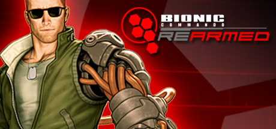
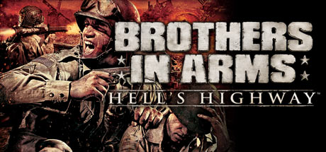
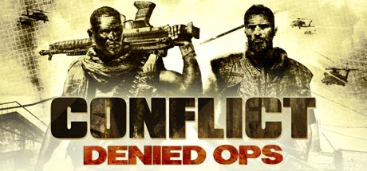
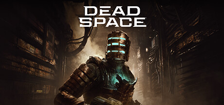
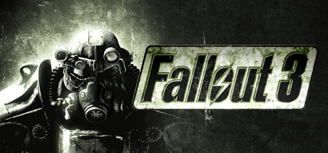
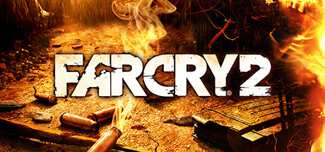
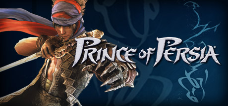
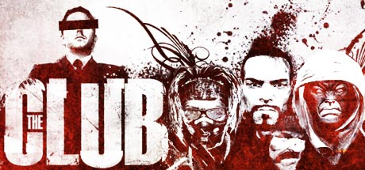
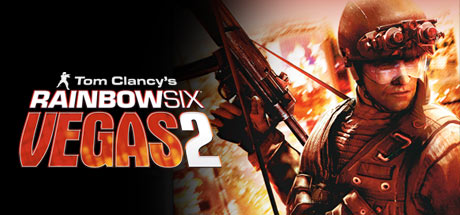
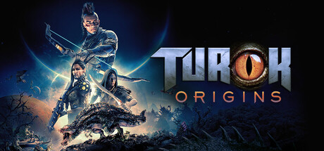

# PlayStation 3 — 2008

[← All PlayStation 3 years](../playstation-3.md) · [Full 2008 page](../../years/2008.md)

167 PlayStation 3 titles in 2008.

### 007: Quantum of Solace

**Platforms:** Nintendo DS, PlayStation 2, PlayStation 3, Wii, Windows, Xbox 360 &nbsp;|&nbsp; **Developer:** Treyarch, Eurocom, Vicarious Visions &nbsp;|&nbsp; **Publisher:** Activision &nbsp;|&nbsp; **Genre:** First-person shooter, Third-person shooter &nbsp;|&nbsp; **Released:** October 31, 2008

[Wikipedia](https://en.wikipedia.org/wiki/007:_Quantum_of_Solace)

---

### Afrika

**Platforms:** PlayStation 3 &nbsp;|&nbsp; **Released:** August 28

[Wikipedia](https://en.wikipedia.org/wiki/Afrika_(video_game))

---

### Alone in the Dark: Inferno

**Platforms:** PlayStation 3 &nbsp;|&nbsp; **Released:** November 18

[Wikipedia](https://en.wikipedia.org/wiki/Alone_in_the_Dark_(2008_video_game))

---

### Aquanaut's Holiday: Hidden Memories

**Platforms:** PlayStation 3 &nbsp;|&nbsp; **Released:** September 25

---

### Armored Core: For Answer

**Platforms:** PlayStation 3, Xbox 360 &nbsp;|&nbsp; **Released:** September 16

---

### Army of Two

**Platforms:** PlayStation 3, Xbox 360 &nbsp;|&nbsp; **Released:** March 4

[Wikipedia](https://en.wikipedia.org/wiki/Army_of_Two)

---

### Auditorium

**Platforms:** Browser, Windows, macOS, Steam, iOS, PlayStation 3, PlayStation Portable &nbsp;|&nbsp; **Developer:** Cipher Prime &nbsp;|&nbsp; **Genre:** Puzzle, strategy &nbsp;|&nbsp; **Released:** April 2008

> In Auditorium, the player uses various game mechanics to bend streams of light particles to fill audio containers. As each of the audio containers is filled, an audio channel introducing an instrument or sound is added to the game's music. In most levels, the audio containers are a variety of colors which the particle stream must match in order to fill it. The player changes the color of the stream by manipulating it over fixed areas of the level which dye the particles as they pass through them. The goal of each level is to direct and split the stream in such a way that each audio container is filled simultaneously, revealing the level's full soundtrack.
>
> _Synopsis source: IGDB_

[Wikipedia](https://en.wikipedia.org/wiki/Auditorium_(video_game)) · [IGDB](https://www.igdb.com/games/auditorium)

---

### Avatar: The Last Airbender – Into the Inferno

**Platforms:** Nintendo DS, PlayStation 2, Wii, PlayStation 3, Xbox 360 &nbsp;|&nbsp; **Released:** October 13

---

### Baja: Edge of Control

**Platforms:** PlayStation 3, Xbox 360 &nbsp;|&nbsp; **Developer:** 2XL Games, BlitWorks &nbsp;|&nbsp; **Publisher:** THQ, THQ Nordic &nbsp;|&nbsp; **Genre:** Racing &nbsp;|&nbsp; **Released:** September 22, 2008

> Baja: Edge of Control is an off road racing videogame developed by 2XL Games for the PlayStation 3 and Xbox 360. The game gets its name from the real life Baja 1000 off-road race, on which it is based. The game is set on over 95 different tracks, including 3 different Baja 250 courses, 2 Baja 500 courses, and 1 Baja 1000 course. The game was released September 22, 2008 in North America and September 26, 2008 in Europe.
>
> _Synopsis source: IGDB_

[Wikipedia](https://en.wikipedia.org/wiki/Baja:_Edge_of_Control) · [IGDB](https://www.igdb.com/games/baja-edge-of-control)

---

### Battlefield: Bad Company

**Platforms:** PlayStation 3, Xbox 360 &nbsp;|&nbsp; **Released:** June 23

---

### Beijing 2008

**Platforms:** PlayStation 3, Xbox 360 &nbsp;|&nbsp; **Released:** July 8

[Wikipedia](https://en.wikipedia.org/wiki/Beijing_2008_(video_game))

---

### Bionic Commando Rearmed

**Platforms:** Xbox 360, PlayStation 3, PlayStation Network, Windows &nbsp;|&nbsp; **Publisher:** Capcom &nbsp;|&nbsp; **Genre:** Action &nbsp;|&nbsp; **Released:** August 13, 2008

> Classic side-scrolling gameplay is reporting back for duty with Bionic Commando Rearmed, a remake of the classic NES game, out now on PC.20 years after the 8-bit classic was released, Bionic Commando Rearmed recreates the world of the original with a complete &quot;2.5D&quot; visual revamp.
>
> _Synopsis source: Steam_

[Wikipedia](https://en.wikipedia.org/wiki/Bionic_Commando_Rearmed) · [Steam](https://store.steampowered.com/app/21680)

---

### BioShock

**Platforms:** PlayStation 3 &nbsp;|&nbsp; **Publisher:** 2K Games &nbsp;|&nbsp; **Released:** October 17, 2008

[Wikipedia](https://en.wikipedia.org/wiki/BioShock)

---

### Blitz: The League II

**Platforms:** PlayStation 3, Xbox 360 &nbsp;|&nbsp; **Released:** October 13

---

### Bolt

**Platforms:** Nintendo DS, PlayStation 2, PlayStation 3, Wii, Windows, Xbox 360 &nbsp;|&nbsp; **Genre:** Strategy &nbsp;|&nbsp; **Released:** November 18

> Step into the boots of a battlefield commander in Bolt Action, a turn-based WWII strategy inspired by Warlord Games’ tabletop classic.
>
> _Synopsis source: Steam_

[Wikipedia](https://en.wikipedia.org/wiki/Bolt_(video_game)) · [Steam](https://store.steampowered.com/app/3856030)

---

### Brothers in Arms: Hell's Highway

**Platforms:** PlayStation 3, Xbox 360, Windows &nbsp;|&nbsp; **Genre:** Action &nbsp;|&nbsp; **Released:** September 23

> Brothers in Arms Hell's Highway brings the critically acclaimed squad-based WWII shooter into the next generation of gaming with amazing graphics and sound, new cutting-edge gameplay features and a totally redesigned online component.
>
> _Synopsis source: Steam_

[Steam](https://store.steampowered.com/app/15390)

---

### Burnout Paradise

**Platforms:** Xbox 360, PlayStation 3 &nbsp;|&nbsp; **Publisher:** Electronic Arts &nbsp;|&nbsp; **Released:** January 22, 2008

[Wikipedia](https://en.wikipedia.org/wiki/Burnout_Paradise)

---

### Buzz!: Quiz TV

**Platforms:** PlayStation 3 &nbsp;|&nbsp; **Developer:** Relentless Software &nbsp;|&nbsp; **Publisher:** Sony Computer Entertainment &nbsp;|&nbsp; **Genre:** Party &nbsp;|&nbsp; **Released:** July 3, 2008

> Buzz! Quiz TV marks the debut of Sony's party-quiz series, Buzz!, to the PlayStation 3; adding the ability for players to compete online as well as write their own questions and exchange quiz packs online.
>
> _Synopsis source: IGDB_

[Wikipedia](https://en.wikipedia.org/wiki/Buzz!:_Quiz_TV) · [IGDB](https://www.igdb.com/games/buzz-quiz-tv)

---

### Cabela's Dangerous Hunts 2009

**Platforms:** PlayStation 2, PlayStation 3, Wii, Xbox 360 &nbsp;|&nbsp; **Developer:** Fun Labs, Magic Wand Productions, Sand Grain Studios &nbsp;|&nbsp; **Publisher:** Activision &nbsp;|&nbsp; **Genre:** Sports &nbsp;|&nbsp; **Released:** September 23, 2008

> Cabela's Dangerous Hunts 2009 is a hunting video game published by Activision for the PlayStation 2, PlayStation 3, Wii, and Xbox 360 video game consoles. It was released in the United States on September 23, 2008.
>
> _Synopsis source: IGDB_

[Wikipedia](https://en.wikipedia.org/wiki/Cabela's_Dangerous_Hunts_2009) · [IGDB](https://www.igdb.com/games/cabela-s-dangerous-hunts-2009)

---

### Call of Duty: World at War

**Platforms:** Nintendo DS, PlayStation 3, Wii, Windows, Xbox 360, PlayStation 2 &nbsp;|&nbsp; **Genre:** Action &nbsp;|&nbsp; **Released:** November 11

> Call of Duty is back, redefining war like you've never experienced before. Building on the Call of Duty 4®: Modern Warfare engine, Call of Duty: World at War immerses players into the most gritty and chaotic WWII combat ever experienced.
>
> _Synopsis source: Steam_

[Steam](https://store.steampowered.com/app/10090)

---

### Catan

**Platforms:** PlayStation 3 &nbsp;|&nbsp; **Genre:** Strategy, Quiz/Trivia, Card & Board Game

> Catan is an adaptation of the multiplayer board game Settlers of Catan, with special features exclusively for the console version. Players take on the roles of settlers, each attempting to build and develop holdings while trading and acquiring resources. The game has illustrations in three variations - including the traditional Kosmos and Mayfair editions and the 3D edition. It's game rules are flexible, including official and alternative "homemade rules." Another feature is support for text chat and audio chat - communicate with your opponents! Play online with players from all over the world.
>
> _Synopsis source: IGDB_

[Wikipedia](https://en.wikipedia.org/wiki/Catan_(2008_video_game)) · [IGDB](https://www.igdb.com/games/catan--1)

---

### Civilization Revolution

**Platforms:** PlayStation 3, Xbox 360, Nintendo DS &nbsp;|&nbsp; **Released:** June 13

[Wikipedia](https://en.wikipedia.org/wiki/Civilization_Revolution)

---

### Condemned 2: Bloodshot

**Platforms:** Xbox 360, PlayStation 3 &nbsp;|&nbsp; **Released:** March 11

---

### Conflict: Denied Ops

**Platforms:** PlayStation 3, Windows, Xbox 360 &nbsp;|&nbsp; **Genre:** Action &nbsp;|&nbsp; **Released:** February 12

> *This is a single player only title*Venezuela is left in a state of civil war after the government was brutally overthrown by a military coup. With factions fighting to reinstate democracy, the U.S. government has offered their assistance, though the new government regime has threatened to deploy nuclear weapons if the U.S.
>
> _Synopsis source: Steam_

[Steam](https://store.steampowered.com/app/8100)

---

### Crash Commando

**Platforms:** PlayStation 3 &nbsp;|&nbsp; **Developer:** EPOS Game Studios &nbsp;|&nbsp; **Publisher:** Sony Computer Entertainment &nbsp;|&nbsp; **Genre:** Shooter &nbsp;|&nbsp; **Released:** December 18, 2008

> Crash commando is a fast-paced PlayStation 3-exclusive side-scrolling shooter. Obviously inspired by Worms and Soldat, the large levels and small characters allow for hectic action in both single and online multiplayer modes.
>
> _Synopsis source: IGDB_

[Wikipedia](https://en.wikipedia.org/wiki/Crash_Commando) · [IGDB](https://www.igdb.com/games/crash-commando)

---

### Cross Edge

**Platforms:** PlayStation 3 &nbsp;|&nbsp; **Released:** May 26

[Wikipedia](https://en.wikipedia.org/wiki/Cross_Edge)

---

### Dark Sector

**Platforms:** PlayStation 3, Xbox 360 &nbsp;|&nbsp; **Released:** March 28

[Wikipedia](https://en.wikipedia.org/wiki/Dark_Sector)

---

### Dead Space

**Platforms:** Xbox 360, PlayStation 3, Windows &nbsp;|&nbsp; **Publisher:** Electronic Arts &nbsp;|&nbsp; **Genre:** Action, Adventure &nbsp;|&nbsp; **Released:** October 13, 2008

> The sci-fi survival-horror classic returns, completely rebuilt to offer an even more immersive experience — including visual, audio, and gameplay improvements — while staying faithful to the original game’s thrilling vision.
>
> _Synopsis source: Steam_

[Wikipedia](https://en.wikipedia.org/wiki/Dead_Space_(video_game)) · [Steam](https://store.steampowered.com/app/1693980)

---

### Death Track: Resurrection

**Platforms:** Windows, Steam, PlayStation 3, PlayStation Network &nbsp;|&nbsp; **Developer:** SkyFallen Entertainment &nbsp;|&nbsp; **Publisher:** 1C Company, 505 Games, Aspyr Media &nbsp;|&nbsp; **Genre:** Racing, vehicular combat &nbsp;|&nbsp; **Released:** February 22, 2008

> Do you have what it takes to Survive?  Resurrection is a racing/action title that takes players into a post-apocalyptic, not-too-distant future where traditional sports have been replaced by far more violent entertainment. The main event, The Survival Race, is a deadly combat racing tournament that draws the world's best drivers to compete in spectacular road battles with powerful, weapons-laden hot rods. Gamers will drive, battle and try to survive in races that take place in twisted future versions of the planet's biggest cities.  Features: - Combat racing across post apocalyptic versions of 10 major cities: Bangkok, Vatican City, London, Moscow, New York, Paris, Prague, San Diego, Istanbul and Tokyo. - Destructible environments add to the chaotic destruction surrounding each race. - 10 powerful car models, customizable with multiple weapons, upgrades and paint jobs. - Thrilling suspense story drives the single-player narrative.
>
> _Synopsis source: IGDB_

[Wikipedia](https://en.wikipedia.org/wiki/Death_Track:_Resurrection) · [IGDB](https://www.igdb.com/games/death-track-resurrection)

---

### Derby Time Online

**Platforms:** PlayStation 3 &nbsp;|&nbsp; **Developer:** Japan Studio &nbsp;|&nbsp; **Publisher:** Sony Computer Entertainment &nbsp;|&nbsp; **Genre:** Sports &nbsp;|&nbsp; **Released:** November 13, 2008

> This Sony-developed horse racing game is coming to the PlayStation 3.
>
> _Synopsis source: IGDB_

[Wikipedia](https://en.wikipedia.org/wiki/Derby_Time_Online) · [IGDB](https://www.igdb.com/games/derby-time-online)

---

### Devil May Cry 4

**Platforms:** PlayStation 3, Xbox 360, Windows &nbsp;|&nbsp; **Released:** February 5

[Wikipedia](https://en.wikipedia.org/wiki/Devil_May_Cry_4)

---

### Di-Gata Defenders

**Platforms:** Nintendo DS, PlayStation 2, PlayStation 3, Wii, Xbox 360 &nbsp;|&nbsp; **Released:** September 22

[Wikipedia](https://en.wikipedia.org/wiki/Di-Gata_Defenders)

---

### Disgaea 3

**Platforms:** PlayStation 3 &nbsp;|&nbsp; **Developer:** Nippon Ichi Software &nbsp;|&nbsp; **Publisher:** Nippon Ichi Software, NIS America, Square Enix &nbsp;|&nbsp; **Genre:** Tactical role-playing &nbsp;|&nbsp; **Released:** January 31, 2008

[Wikipedia](https://en.wikipedia.org/wiki/Disgaea_3)

---

### Disgaea 3: Absence of Justice

**Platforms:** PlayStation 3 &nbsp;|&nbsp; **Released:** January 31

---

### Disney Sing It

**Platforms:** PlayStation 2, PlayStation 3, Wii, Xbox 360, Windows &nbsp;|&nbsp; **Developer:** Zoë Mode &nbsp;|&nbsp; **Publisher:** Disney Interactive Studios &nbsp;|&nbsp; **Genre:** Karaoke &nbsp;|&nbsp; **Released:** October 21, 2008

> Disney Sing It is a karaoke video game and sequel to High School Musical: Sing It!. It was released on October 28, 2008 across multiple platforms. The game's product description refers to additional downloadable song packs being available. However, as of 28 April 2009, Disney Interactive Support has replied (to a query): "Thank you for contacting us.In some circumstances we need to make some business decisions and drop certain projects that might have been planned or even announced previously. This case falls in one of those situations and currently we don't have any plans on adding any downloadable contents for either Disney Sing It title."  The game has received mixed reviews, with both 1UP.com and IGN praising its accessibility towards kids but finding serious fault with the gameplay, with Official Xbox Magazine ultimately calling it a "gateway game" at best.  Track List  Aly & AJ - Like Whoa Aly & AJ - Potential Break-Up song Aly & AJ - Chemicals React Billy Ray Cyrus - Ready, Set, Don't Go Camp Rock - We Rock Camp Rock - Start the Party Camp Rock - This is Me Camp Rock - Gotta Find You Camp Rock - Play My Music Camp Rock - Hasta La Vista Camp Rock - Here I Am Cheetah Girls 3 - One World Cheetah Girls 2 - Dance with Me Cheetah Girls 2 - The Party's Just Begun Corbin Bleu - Push It To The Limit Everlife - Find Yourself In You Everlife - Real Wild Child Hannah Montana - Best of Both Worlds Hannah Montana - Life is What You Make It Hannah Montana - Nobody's Perfect Hannah Montana - Rock Star High School Musical - Breaking Free High School Musical - Get'cha Head in the Game High School Musical - Start of Something New High School Musical 2 - Bet On It High School Musical 2 - Fabulous High School Musical 2 - What Time Is It High School Musical 2 - You Are the Music in Me Jesse McCartney - She's No You Jordan Pruitt - Jump to the Rhythm Jordan Pruitt - Outside Looking In Miley Cyrus - Girls Night Out Miley Cyrus - See You Again Miley Cyrus - Start All Over Vanessa Hudgens - Say OK
>
> _Synopsis source: IGDB_

[Wikipedia](https://en.wikipedia.org/wiki/Disney_Sing_It) · [IGDB](https://www.igdb.com/games/disney-sing-it)

---

### Dragon Ball Z: Burst Limit

**Platforms:** PlayStation 3, Xbox 360 &nbsp;|&nbsp; **Released:** June 5

---

### Dynasty Warriors 6

**Platforms:** PlayStation 3, Xbox 360, Windows, PlayStation 2 &nbsp;|&nbsp; **Released:** February 19

[Wikipedia](https://en.wikipedia.org/wiki/Dynasty_Warriors_6)

---

### Dynasty Warriors: Gundam 2

**Platforms:** PlayStation 2, PlayStation 3, Xbox 360 &nbsp;|&nbsp; **Released:** December 18

---

### Enemy Territory: Quake Wars

**Platforms:** macOS, PlayStation 3, Xbox 360 &nbsp;|&nbsp; **Released:** March 18

---

### Eternal Sonata

**Platforms:** PlayStation 3 &nbsp;|&nbsp; **Released:** September 18

[Wikipedia](https://en.wikipedia.org/wiki/Eternal_Sonata)

---

### Everybody's Golf 5

**Platforms:** PlayStation 3 &nbsp;|&nbsp; **Released:** March 18

[Wikipedia](https://en.wikipedia.org/wiki/Everybody%27s_Golf_5)

---

### FaceBreaker

**Platforms:** PlayStation 3, Xbox 360, Wii &nbsp;|&nbsp; **Released:** September 5

[Wikipedia](https://en.wikipedia.org/wiki/FaceBreaker)

---

### Fallout 3

**Platforms:** Xbox 360, Windows, PlayStation 3 &nbsp;|&nbsp; **Publisher:** Bethesda Softworks &nbsp;|&nbsp; **Genre:** RPG &nbsp;|&nbsp; **Released:** October 28, 2008

> Vault-Tec engineers have worked around the clock on an interactive reproduction of Wasteland life for you to enjoy from the comfort of your own vault. Included is an expansive world, unique combat, shockingly realistic visuals, tons of player choice, and an incredible cast of dynamic characters.
>
> _Synopsis source: Steam_

[Wikipedia](https://en.wikipedia.org/wiki/Fallout_3) · [Steam](https://store.steampowered.com/app/22300)

---

### Far Cry 2

**Platforms:** PlayStation 3, Windows, Xbox 360 &nbsp;|&nbsp; **Genre:** Action &nbsp;|&nbsp; **Released:** October 21

> You are a gun for hire, trapped in a war-torn African state, stricken with malaria and forced to make deals with corrupt warlords on both sides of the conflict in order to make this country your home. You must identify and exploit your enemies' weaknesses, neutralizing their superior numbers and firepower with surprise, subversion,...
>
> _Synopsis source: Steam_

[Wikipedia](https://en.wikipedia.org/wiki/Far_Cry_2) · [Steam](https://store.steampowered.com/app/19900)

---

### Fatal Inertia EX

**Platforms:** PlayStation 3 &nbsp;|&nbsp; **Released:** June 19

[Wikipedia](https://en.wikipedia.org/wiki/Fatal_Inertia#Fatal_Inertia_EX)

---

### Ferrari Challenge: Trofeo Pirelli

**Platforms:** PlayStation 3, PlayStation 2, Wii, Nintendo DS &nbsp;|&nbsp; **Developer:** Eutechnyx, Firebrand Games &nbsp;|&nbsp; **Publisher:** System 3 &nbsp;|&nbsp; **Genre:** Racing &nbsp;|&nbsp; **Released:** July 4, 2008

> Ferrari Challenge Trofeo Pirelli is a racing game developed by Eutechnyx and published by System 3, based on the Ferrari Challenge, a single-marque motorsport championship. The Nintendo DS version features wireless multiplayer and the Wii version uses the motion sensing functionality for steering. The Nintendo DS, Wii, PS2 and PS3 (only in Europe and the United States) versions are available. The game includes 14 race-able tracks and Ferraris' own Fiorano test track (for training using a solitary F430 Challenge), a vinyl editor and online play.  The game primarily features the driving and racing of the Ferrari F430 Challenge, along with a series of Ferrari road and racing cars that can be unlocked.[1]
>
> _Synopsis source: IGDB_

[Wikipedia](https://en.wikipedia.org/wiki/Ferrari_Challenge:_Trofeo_Pirelli) · [IGDB](https://www.igdb.com/games/ferrari-challenge-trofeo-pirelli)

---

### FIFA 09

**Platforms:** Mobile phone, Nintendo DS, PlayStation 2, PlayStation 3, PlayStation Portable, Wii, Windows, Xbox 360 &nbsp;|&nbsp; **Released:** October 14

[Wikipedia](https://en.wikipedia.org/wiki/FIFA_09)

---

### FIFA Street 3

**Platforms:** Xbox 360, PlayStation 3, Nintendo DS &nbsp;|&nbsp; **Developer:** EA Canada, Exient Entertainment &nbsp;|&nbsp; **Publisher:** EA Sports BIG &nbsp;|&nbsp; **Genre:** Sports &nbsp;|&nbsp; **Released:** February 18, 2008

> FIFA Street 3 is an arcade-style sports game for the Xbox 360 and Xbox Live, PlayStation 3 and Nintendo DS. It is the third game in the FIFA Street series created by EA Sports BIG.
>
> _Synopsis source: IGDB_

[Wikipedia](https://en.wikipedia.org/wiki/FIFA_Street_3) · [IGDB](https://www.igdb.com/games/fifa-street-3)

---

### Fracture

**Platforms:** PlayStation 3, Xbox 360 &nbsp;|&nbsp; **Released:** October 7

[Wikipedia](https://en.wikipedia.org/wiki/Fracture_(video_game))

---

### Geon

**Platforms:** PlayStation 3 &nbsp;|&nbsp; **Released:** September 25

[Wikipedia](https://en.wikipedia.org/wiki/Geon_(video_game))

---

### Go! Puzzle

**Platforms:** PlayStation 3, PlayStation Portable &nbsp;|&nbsp; **Released:** February 7

[Wikipedia](https://en.wikipedia.org/wiki/Go!_Puzzle)

---

### Go! Sports Skydiving

**Platforms:** PlayStation 3 &nbsp;|&nbsp; **Developer:** Lightweight &nbsp;|&nbsp; **Publisher:** Sony Computer Entertainment &nbsp;|&nbsp; **Genre:** Sports &nbsp;|&nbsp; **Released:** January 10, 2008

> Get Go! Sports Skydiving, Extreme Sports game for PS3 console from the official PlayStation website. Know more about Go! Sports Skydiving Game.
>
> _Synopsis source: IGDB_

[Wikipedia](https://en.wikipedia.org/wiki/Go!_Sports_Skydiving) · [IGDB](https://www.igdb.com/games/go-sports-skydiving)

---

### Golden Axe: Beast Rider

**Platforms:** PlayStation 3, Xbox 360 &nbsp;|&nbsp; **Released:** October 14

---

### Grand Theft Auto IV

**Platforms:** PlayStation 3, Xbox 360, Windows &nbsp;|&nbsp; **Publisher:** Rockstar Games &nbsp;|&nbsp; **Released:** April 29, 2008

[Wikipedia](https://en.wikipedia.org/wiki/Grand_Theft_Auto_IV)

---

### GTI Club+: Rally Côte d'Azur

**Platforms:** PlayStation 3 &nbsp;|&nbsp; **Developer:** Sumo Digital &nbsp;|&nbsp; **Publisher:** Konami &nbsp;|&nbsp; **Genre:** Racing &nbsp;|&nbsp; **Released:** December 4, 2008

> GTI Club+: Rally Côte d'Azur is the PlayStation 3 remake of the original GTI Club released in 1996.
>
> _Synopsis source: IGDB_

[Wikipedia](https://en.wikipedia.org/wiki/GTI_Club+:_Rally_C%C3%B4te_d'Azur) · [IGDB](https://www.igdb.com/games/gti-club-plus-rally-cote-dazur)

---

### Guitar Hero World Tour

**Platforms:** macOS, PlayStation 2, PlayStation 3, Wii, Windows, Xbox 360 &nbsp;|&nbsp; **Released:** October 26

[Wikipedia](https://en.wikipedia.org/wiki/Guitar_Hero_World_Tour)

---

### Guitar Hero: Aerosmith

**Platforms:** PlayStation 2, PlayStation 3, Wii, Xbox 360 &nbsp;|&nbsp; **Released:** June 29

---

### Hail to the Chimp

**Platforms:** PlayStation 3, Xbox 360 &nbsp;|&nbsp; **Developer:** Wideload Games &nbsp;|&nbsp; **Publisher:** Gamecock Media Group &nbsp;|&nbsp; **Genre:** Party &nbsp;|&nbsp; **Released:** June 24, 2008

> Since the dawn of time, Man has wondered who would win if a polar bear and jellyfish teamed up to fight an armadillo and yak. Do you have what it takes to learn the shocking truth? When the King of the Animals is forced to resign in disgrace, a motley group of candidates turns out for a bare-knuckle campaign to win the Crown. From Ptolemy, the mighty hippo, to Crackers, the devious monkey, each of the ten candidates has distinct strengths and strategies, but the same hunger for political power. Hail to the Chimp is a party game that delivers exciting gameplay, lush interactive environments, and a comic look at politics. Players use the game’s unique team-up mechanic, mixing cooperation with competition, to claw their way to victory. Whether played by four friends on one TV, online against distant challengers or single-player against advanced AI, Hail to the Chimp offers endlessly replayable party fun for gamers of all stripes.
>
> _Synopsis source: IGDB_

[Wikipedia](https://en.wikipedia.org/wiki/Hail_to_the_Chimp) · [IGDB](https://www.igdb.com/games/hail-to-the-chimp)

---

### Haze

**Platforms:** PlayStation 3 &nbsp;|&nbsp; **Released:** May 23

[Wikipedia](https://en.wikipedia.org/wiki/Haze_(video_game))

---

### Hellboy: The Science of Evil

**Platforms:** PlayStation 3, PlayStation Portable, Xbox 360 &nbsp;|&nbsp; **Released:** June 24

---

### History Civil War: Secret Missions

**Platforms:** Windows, PlayStation 2, PlayStation 3, Xbox 360 &nbsp;|&nbsp; **Developer:** Cauldron Ltd &nbsp;|&nbsp; **Publisher:** Activision Value &nbsp;|&nbsp; **Genre:** First-person shooter &nbsp;|&nbsp; **Released:** November 4, 2008

> Experience secret missions of the American Civil War.
>
> _Synopsis source: IGDB_

[Wikipedia](https://en.wikipedia.org/wiki/History_Civil_War:_Secret_Missions) · [IGDB](https://www.igdb.com/games/history-civil-war-secret-missions)

---

### Initial D Extreme Stage

**Platforms:** PlayStation 3 &nbsp;|&nbsp; **Released:** July 3

[Wikipedia](https://en.wikipedia.org/wiki/Initial_D_Extreme_Stage)

---

### Iron Man

**Platforms:** Nintendo DS, PlayStation 2, PlayStation 3, PlayStation Portable, Wii, Windows, Xbox 360 &nbsp;|&nbsp; **Released:** May 2

[Wikipedia](https://en.wikipedia.org/wiki/Iron_Man_(video_game))

---

### Jumper: Griffin's Story

**Platforms:** PlayStation 2, PlayStation 3, Wii, Xbox 360 &nbsp;|&nbsp; **Released:** February 12

---

### Karoshi

**Platforms:** Windows, Browser, iOS, Android, PlayStation Portable, PlayStation 3 &nbsp;|&nbsp; **Developer:** YoYo Games &nbsp;|&nbsp; **Genre:** Puzzle-platform

> The original freeware puzzle-platformer in which the goal is to find out how to kill yourself.
>
> _Synopsis source: IGDB_

[Wikipedia](https://en.wikipedia.org/wiki/Karoshi_(video_game)) · [IGDB](https://www.igdb.com/games/karoshi--1)

---

### Kung Fu Panda

**Platforms:** Nintendo DS, PlayStation 2, PlayStation 3, Wii, Windows, Xbox 360 &nbsp;|&nbsp; **Released:** June 3

[Wikipedia](https://en.wikipedia.org/wiki/Kung_Fu_Panda_(video_game))

---

### Legendary

**Platforms:** PlayStation 3, Windows, Xbox 360 &nbsp;|&nbsp; **Released:** November 4

[Wikipedia](https://en.wikipedia.org/wiki/Legendary_(video_game))

---

### Lego Batman: The Videogame

**Platforms:** Nintendo DS, PlayStation 2, PlayStation 3, PlayStation Portable, Wii, Windows, Xbox 360 &nbsp;|&nbsp; **Genre:** Action, Adventure &nbsp;|&nbsp; **Released:** September 23

> When all the villains in Arkham Asylum team up and break loose, only the dynamic duo is bold enough to take them on to save Gotham City. The fun of LEGO, the drama of Batman and the uniqueness of the combination makes for a comical and exciting adventure in LEGO Batman: The Videogame.
>
> _Synopsis source: Steam_

[Steam](https://store.steampowered.com/app/21000)

---

### Lego Indiana Jones: The Original Adventures

**Platforms:** Nintendo DS, PlayStation 2, PlayStation 3, PlayStation Portable, Wii, Windows, Xbox, Xbox 360 &nbsp;|&nbsp; **Genre:** Action, Adventure &nbsp;|&nbsp; **Released:** June 3

> Build, Battle and Brawl your way out of trouble! Play through all three classic Indiana Jones™ movies and relive your favorite Indy adventures in the tongue-in-cheek worlds of LEGO®. Explore and Discover - Battle enemies, solve puzzles, and seek out the world's greatest treasures.
>
> _Synopsis source: Steam_

[Steam](https://store.steampowered.com/app/32330)

---

### Linger in Shadows

**Platforms:** PlayStation 3 &nbsp;|&nbsp; **Released:** October 9

[Wikipedia](https://en.wikipedia.org/wiki/Linger_in_Shadows)

---

### LittleBigPlanet

**Platforms:** PlayStation 3 &nbsp;|&nbsp; **Publisher:** Sony Computer Entertainment &nbsp;|&nbsp; **Released:** October 27, 2008

[Wikipedia](https://en.wikipedia.org/wiki/LittleBigPlanet_(2008_video_game))

---

### Lost Planet: Extreme Condition

**Platforms:** PlayStation 3 &nbsp;|&nbsp; **Released:** February 21

---

### Lost: Via Domus

**Platforms:** PlayStation 3, Windows, Xbox 360 &nbsp;|&nbsp; **Released:** February 26

---

### Lumines Supernova

**Platforms:** PlayStation 3 &nbsp;|&nbsp; **Released:** December 23

[Wikipedia](https://en.wikipedia.org/wiki/Lumines#Lumines_Supernova)

---

### Madagascar: Escape 2 Africa

**Platforms:** PlayStation 3, PlayStation 2, Xbox 360, Windows, Wii, Nintendo DS &nbsp;|&nbsp; **Released:** November 4

---

### Madden NFL 09

**Platforms:** Nintendo DS, PlayStation 2, PlayStation 3, PlayStation Portable, Wii, Xbox 360, Xbox &nbsp;|&nbsp; **Released:** August 13

[Wikipedia](https://en.wikipedia.org/wiki/Madden_NFL_09)

---

### Major League Baseball 2K8

**Platforms:** PlayStation 2, PlayStation 3, PlayStation Portable, Wii, Xbox 360 &nbsp;|&nbsp; **Released:** March 3

[Wikipedia](https://en.wikipedia.org/wiki/Major_League_Baseball_2K8)

---

### Mercenaries 2: World in Flames

**Platforms:** PlayStation 2, PlayStation 3, Windows, Xbox 360 &nbsp;|&nbsp; **Released:** August 31

---

### Metal Gear Online

**Platforms:** PlayStation 3 &nbsp;|&nbsp; **Developer:** Kojima Productions &nbsp;|&nbsp; **Publisher:** Konami &nbsp;|&nbsp; **Genre:** Stealth, third-person shooter &nbsp;|&nbsp; **Released:** June 12, 2008

> Metal Gear Online, commonly abbreviated MGO and also known as MGO2, was an online multiplayer spinoff of the Metal Gear series.  The game was officially unveiled in Kojima Productions' 20th Anniversary Party of the Metal Gear series. While Metal Gear Solid 3: Subsistence and Metal Gear Solid: Portable Ops featured optional online game modes that were both dubbed "Metal Gear Online", this incarnation of the online game was initially announced as a separate standalone product based on the Metal Gear Solid 4: Guns of the Patriots gameplay and setting. However, it was later announced as being a part of Metal Gear Solid 4. A standalone version was released in Japan on July 17, 2008.  On June 12, 2012, the servers for Metal Gear Online 2 were shut down, although fan servers have been created.
>
> _Synopsis source: IGDB_

[Wikipedia](https://en.wikipedia.org/wiki/Metal_Gear_Online) · [IGDB](https://www.igdb.com/games/metal-gear-online)

---

### Metal Gear Solid 4: Guns of the Patriots

**Platforms:** PlayStation 3 &nbsp;|&nbsp; **Publisher:** Konami &nbsp;|&nbsp; **Released:** June 12, 2008

---

### Midnight Club: Los Angeles

**Platforms:** PlayStation 3, Xbox 360, PlayStation Portable &nbsp;|&nbsp; **Released:** October 20

---

### Mirror's Edge

**Platforms:** PlayStation 3, Xbox 360 &nbsp;|&nbsp; **Released:** November 11

[Wikipedia](https://en.wikipedia.org/wiki/Mirror%27s_Edge)

---

### MLB 08: The Show

**Platforms:** PlayStation 2, PlayStation 3, PlayStation Portable &nbsp;|&nbsp; **Released:** March 4

---

### Monster Madness: Grave Danger

**Platforms:** PlayStation 3 &nbsp;|&nbsp; **Released:** May 17

---

### Mortal Kombat vs. DC Universe

**Platforms:** PlayStation 3, Xbox 360 &nbsp;|&nbsp; **Released:** November 16

[Wikipedia](https://en.wikipedia.org/wiki/Mortal_Kombat_vs._DC_Universe)

---

### MotoGP '08

**Platforms:** PlayStation 3, Windows, PlayStation 2, Wii, Xbox 360 &nbsp;|&nbsp; **Developer:** Milestone &nbsp;|&nbsp; **Publisher:** Capcom &nbsp;|&nbsp; **Genre:** Racing, sports &nbsp;|&nbsp; **Released:** October 24, 2008

> For the first time in recent years, the game includes the addition of playable 125cc and 250cc support classes.  MotoGP '07 for the PlayStation 2 had a reputation for emphasis on simulation in contrast to the MotoGP titles published by THQ, which have a reputation for arcade gameplay. MotoGP '08 is reported to balance these different styles and allow the player to configure an emphasis towards their desired gameplay.
>
> _Synopsis source: IGDB_

[Wikipedia](https://en.wikipedia.org/wiki/MotoGP_'08) · [IGDB](https://www.igdb.com/games/motogp-08)

---

### MotorStorm: Pacific Rift

**Platforms:** PlayStation 3 &nbsp;|&nbsp; **Released:** October 28

---

### My Aquarium

**Platforms:** Wii, PlayStation 3 &nbsp;|&nbsp; **Developer:** Hudson Soft &nbsp;|&nbsp; **Genre:** Virtual pet simulation &nbsp;|&nbsp; **Released:** June 24, 2008

> With swaying aquatic plants and fish idly swimming about, My Aquarium is a relaxing experience that allows you to enjoy a virtual aquarium in your spare time.
>
> _Synopsis source: IGDB_

[Wikipedia](https://en.wikipedia.org/wiki/My_Aquarium) · [IGDB](https://www.igdb.com/games/my-aquarium)

---

### Naruto: Ultimate Ninja Storm

**Platforms:** PlayStation 3 &nbsp;|&nbsp; **Released:** November 4

---

### NASCAR 09

**Platforms:** PlayStation 2, PlayStation 3, Xbox 360 &nbsp;|&nbsp; **Released:** June 10

[Wikipedia](https://en.wikipedia.org/wiki/NASCAR_09)

---

### NBA 09: The Inside

**Platforms:** PlayStation Portable, PlayStation 2, PlayStation 3 &nbsp;|&nbsp; **Developer:** San Diego Studio, A.C.R.O.N.Y.M. Games &nbsp;|&nbsp; **Publisher:** Sony Computer Entertainment &nbsp;|&nbsp; **Genre:** Sports, Simulation, Arcade &nbsp;|&nbsp; **Released:** October 7, 2008

> NBA 09: The Inside is the sequel to NBA 08 where once again the player can partake in a new chapter in "The Life" mode. This time around the player can take control of a created superstar (five total) with the ability to interact with three different characters and constantly change the storyline.  The Team Progression System makes a return, rewarding the player for game exploration and completing certain achievements given to them throughout the game. Completing these tasks can unlock certain accessories that they can use for their created character, showing off their status. Players can also associate with various teammates and coaches, how they act towards these characters will determine their place with the team (being a team player and helping out others will have the coaches play you more and have create a bigger fan base and being a individual loner will alienate them from the team and have a smaller fan base).  The obligatory game modes also exist in this version as well (Franchise, Exhibition) as well as updated NBA rosters with every NBA team available. The Havok engine is introduced for this version, giving the game a more realistic feel when combined with new animations and enhanced character models.  NBA Replay also returns, letting players relive classic moments from the 07/08 as well as partake in the 08/09 season by downloading them off of the Playstation Network (five each week during the season). Players can also upload and share data, show off their created superstars and track their progress through leaderboards and even play against each other in online exhibition games.  Audio commentary is provided by Seattle Supersonics star Kevin Calabro and franchise newcomer Kenny "The Jet" Smith.
>
> _Synopsis source: IGDB_

[Wikipedia](https://en.wikipedia.org/wiki/NBA_09:_The_Inside) · [IGDB](https://www.igdb.com/games/nba-09-the-inside)

---

### NBA 2K9

**Platforms:** PlayStation 2, PlayStation 3, Wii, Xbox 360, Windows &nbsp;|&nbsp; **Released:** October 7

[Wikipedia](https://en.wikipedia.org/wiki/NBA_2K9)

---

### NBA Ballers: Chosen One

**Platforms:** PlayStation 3, Xbox 360 &nbsp;|&nbsp; **Publisher:** Midway Games &nbsp;|&nbsp; **Genre:** Sports &nbsp;|&nbsp; **Released:** April 21, 2008

> NBA Ballers: Chosen One is a video game for the PlayStation 3 and Xbox 360. It is the sequel to NBA Ballers: Phenom.  NBA Ballers: Chosen One allows players to live the life of an NBA superstar. The game features competitive combo and super-move systems.  Gameplay[edit] When playing, your performance determines the evolution of your career as a basketball player and as a superstar. The game features new moves to the series, such as "Shut 'Em Down" super moves and Act-A-Fool combos. The game can be played single-player, multi-player and online play, with options to play 1-v-1, 2-v-2 or 1-v-1-v-1 matches. As well as online play, downloadable content is available and features over 500 new items including players. Hip-hop legend Chuck D calls the play-by-play action while hip-hop producer Just Blaze created over 30 custom tracks for the game.
>
> _Synopsis source: IGDB_

[Wikipedia](https://en.wikipedia.org/wiki/NBA_Ballers:_Chosen_One) · [IGDB](https://www.igdb.com/games/nba-ballers-chosen-one)

---

### NBA Live 09

**Platforms:** PlayStation 2, PlayStation 3, PlayStation Portable, Wii, Xbox 360 &nbsp;|&nbsp; **Released:** October 7

[Wikipedia](https://en.wikipedia.org/wiki/NBA_Live_09)

---

### NCAA Basketball 09

**Platforms:** PlayStation 3, PlayStation 2, Xbox 360 &nbsp;|&nbsp; **Developer:** EA Canada &nbsp;|&nbsp; **Publisher:** Electronic Arts &nbsp;|&nbsp; **Genre:** Sports &nbsp;|&nbsp; **Released:** November 17, 2008

> NCAA Basketball 09 was the 2008 installment in the NCAA Basketball series. It was released on November 17, 2008 for the PlayStation 3, PlayStation 2, and Xbox 360.[1] Former UCLA forward Kevin Love was featured on the cover.
>
> _Synopsis source: IGDB_

[Wikipedia](https://en.wikipedia.org/wiki/NCAA_Basketball_09) · [IGDB](https://www.igdb.com/games/ncaa-basketball-09)

---

### NCAA Football 09

**Platforms:** PlayStation 2, PlayStation 3, PlayStation Portable, Wii, Xbox 360 &nbsp;|&nbsp; **Released:** July 15

[Wikipedia](https://en.wikipedia.org/wiki/NCAA_Football_09)

---

### Need for Speed: Undercover

**Platforms:** Mobile phone, PlayStation 2, PlayStation 3, PlayStation Portable, Wii, Windows, Xbox 360 &nbsp;|&nbsp; **Released:** November 18

---

### NFL Head Coach 09

**Platforms:** PlayStation 3, Xbox 360 &nbsp;|&nbsp; **Developer:** EA Tiburon &nbsp;|&nbsp; **Publisher:** EA Sports &nbsp;|&nbsp; **Genre:** Sports management game &nbsp;|&nbsp; **Released:** August 12, 2008

> Description of NFL Head Coach 09 EA's football coach simulator heads back to the gridiron in NFL Head Coach 09. With gameplay more akin to European-style "Soccer Manager" games than the Madden NFL franchise from which it spawned, the original NFL Head Coach generally received lukewarm reviews from critics. But after a one-year hiatus -- during which it presumably did a little TV and work spent some quality time with the family -- the franchise returns with a new focus on depth and realism. Once again the coach's livelihood depends on his approval rating, and everything gamers do, from win/loss record, to going for it on fourth down, to choosing whether to yell at the QB after a bad interception, will affect approval rating.  Key personnel decisions have been given an added sense of urgency with the new Live Event feature, which puts all trade, free agency, coaching, and contract negotiations up against a running timer. As in real life, the draft is the centerpiece of the NFL offseason, and gamers can prepare by scouting players in college all-star games, at the NFL combine, and during pro-day and individual workouts. Meanwhile, players can get running commentary on the lives and college careers of more than 20,000 unique draft prospects from NFL Network personality Adam Schefter. Other additions intended to increase realism include: Non-drafted free agent rookies, 75-man preseason rosters, trades involving future draft picks, a new wear and tear injury system, and 300 new sideline animations.  NFL Head Coach 09's online features allow gamers to upload created plays and download, rate, or view any play available. Two players can also go head-to-head in a quick test of coaching acumen. Offline, gamers can adjust their plays in the middle of a game and save the new formations, or create entire playbooks using the coach clipboard user interface. All created plays can then be exported and used in Madden NFL 09. ~ Christopher Brown, All Game Guide
>
> _Synopsis source: IGDB_

[Wikipedia](https://en.wikipedia.org/wiki/NFL_Head_Coach_09) · [IGDB](https://www.igdb.com/games/nfl-head-coach-09)

---

### NFL Tour

**Platforms:** PlayStation 3, Xbox 360 &nbsp;|&nbsp; **Developer:** EA Tiburon &nbsp;|&nbsp; **Publisher:** EA Sports BIG &nbsp;|&nbsp; **Genre:** Sports, Football &nbsp;|&nbsp; **Released:** January 8, 2008

> NFL Tour is an arcade football video game. It was released on January 8, 2008. It was developed under the EA Sports BIG division of EA Sports, which is also responsible for such titles as SSX, NBA Street, NFL Street, and the FIFA Street games. The game could be considered a successor to the NFL Street franchise, but it was converted to the new hardware (PS3 / Xbox 360). Trey Wingo from ESPN is the game's voice announcer.
>
> _Synopsis source: IGDB_

[Wikipedia](https://en.wikipedia.org/wiki/NFL_Tour) · [IGDB](https://www.igdb.com/games/nfl-tour)

---

### NHL 09

**Platforms:** Xbox 360, PlayStation 3, Wii, Windows &nbsp;|&nbsp; **Publisher:** EA Sports &nbsp;|&nbsp; **Released:** September 9, 2008

[Wikipedia](https://en.wikipedia.org/wiki/NHL_09)

---

### NHL 2K9

**Platforms:** PlayStation 2, PlayStation 3, Wii, Xbox 360 &nbsp;|&nbsp; **Released:** September 8

[Wikipedia](https://en.wikipedia.org/wiki/NHL_2K9)

---

### Novastrike

**Platforms:** PlayStation 3 &nbsp;|&nbsp; **Developer:** Tiki Games &nbsp;|&nbsp; **Publisher:** Tiki Games &nbsp;|&nbsp; **Genre:** Multidirectional shooter &nbsp;|&nbsp; **Released:** June 5, 2008

> NovaStrike is a dual-joystick arcade shooter from Tiki Games. While battling both airborne and grounded enemies, players can upgrade the Scythe fighter ship to improve its weapons and capabilities through seven levels of free-roaming play.
>
> _Synopsis source: IGDB_

[Wikipedia](https://en.wikipedia.org/wiki/Novastrike) · [IGDB](https://www.igdb.com/games/novastrike)

---

### NPPL Championship Paintball 2009

**Platforms:** PlayStation 2, PlayStation 3, Xbox 360, Wii &nbsp;|&nbsp; **Developer:** Sand Grain Studios &nbsp;|&nbsp; **Publisher:** Activision &nbsp;|&nbsp; **Genre:** First-person shooter, Sports &nbsp;|&nbsp; **Released:** November 18, 2008

> NPPL: Championship Paintball 2009 (NPPL 09) is a first person paintball video game released for Xbox 360, PlayStation 2, PlayStation 3, and the Nintendo Wii. The game features multiple game modes, officially licensed gear,
>
> _Synopsis source: IGDB_

[Wikipedia](https://en.wikipedia.org/wiki/NPPL_Championship_Paintball_2009) · [IGDB](https://www.igdb.com/games/nppl-championship-paintball-2009)

---

### On the Rain-Slick Precipice of Darkness: Episode One and Two

**Platforms:** Windows, macOS, Xbox 360, PlayStation 3 &nbsp;|&nbsp; **Developer:** Hothead Games &nbsp;|&nbsp; **Publisher:** Hothead Games &nbsp;|&nbsp; **Genre:** Adventure, role-playing &nbsp;|&nbsp; **Released:** May 21, 2008

[Wikipedia](https://en.wikipedia.org/wiki/On_the_Rain-Slick_Precipice_of_Darkness:_Episode_One_and_Two)

---

### Overlord: Raising Hell

**Platforms:** Windows, PlayStation 3, Xbox 360, macOS, Linux &nbsp;|&nbsp; **Developer:** Triumph Studios, 4J Studios &nbsp;|&nbsp; **Publisher:** Codemasters &nbsp;|&nbsp; **Genre:** Action role-playing &nbsp;|&nbsp; **Released:** February 15, 2008

> Overlord is an action role-playing video game set in an alternate world, where the player takes the role of a resurrected warrior known as "The Overlord" who has control over hordes of gremlin-like creatures known as "Minions". The player must defeat seven corrupt ruling heroes in order to reconquer the lands and establish his lordship over its inhabitants. The game features a corruption feature, similar to that of the Fable games, but allowing the player to "be evil... or really evil", where certain actions and choices affect different aspects of the story and gameplay. While the Overlord is controlled in a third person perspective, the way minions are controlled brings elements of real-time strategy and upgrades bring those of role-playing games. The game uses dark humour, and is a satirical parody of the traditional fantasy setting and plot
>
> _Synopsis source: IGDB_

[Wikipedia](https://en.wikipedia.org/wiki/Overlord:_Raising_Hell) · [IGDB](https://www.igdb.com/games/overlord)

---

### PachiPara DL Hyper Sea Story In Karibu

**Platforms:** PlayStation 3, PlayStation Network &nbsp;|&nbsp; **Developer:** Sanyo Bussan &nbsp;|&nbsp; **Publisher:** Irem &nbsp;|&nbsp; **Genre:** Casino &nbsp;|&nbsp; **Released:** July 2, 2008

> PachiPara DL is the first PS3 release and the first downloadable title in Irem's long-running pachinko simulation series. It features faithful 3D recreations of two pachinko machines made by Sanyo Bussan: CR Hyper Umi Monogatari in Carib MTA and CR Hyper Umi Monogatari in Carib MTB. There are two modes available: Tsūjō (Normal) mode allows the player to modify a wide range of settings for each machine, while Jissen (Battle) mode challenges the player to win as many balls as possible on the default settings with a limited starting pool and time limit. Scores from Jissen mode could be uploaded to a national leaderboard, which was also used for a promotional contest shortly after the game's release. There is also a View mode where the various animations that play on the in-game display can be freely viewed. There is no story mode.
>
> _Synopsis source: IGDB_

[Wikipedia](https://en.wikipedia.org/wiki/PachiPara_DL_Hyper_Sea_Story_In_Karibu) · [IGDB](https://www.igdb.com/games/pachipara-dl-hyper-sea-story-in-karibu)

---

### PixelJunk Eden

**Platforms:** PlayStation 3 &nbsp;|&nbsp; **Developer:** Q-Games &nbsp;|&nbsp; **Publisher:** Q-Games, Sony Computer Entertainment &nbsp;|&nbsp; **Genre:** Platform, puzzle &nbsp;|&nbsp; **Released:** July 31, 2008

> Utterly unique and spellbindingly beautiful, PixelJunk Eden welcomes you to a psychedelic world unlike anything you’ve ever experienced before.  As a tiny, silk-spinning “grimp,” it is up to you to collect the lost “Spectra” that have been scattered across all the gardens of Eden. Swing and jump between plants and rock formations, collect pollen to seed new plants and explore the incredible gardens to locate the precious “Spectra.”  Lush visuals, slick controls and amazing music make it an incredibly atmospheric and addictive experience.  Download the full game today and prepare to enter Eden!  Key Features: • Stunning Visuals - Stylish graphics brought to life in gorgeous 1080p HD. • Multiplayer Co-op - Local co-op play for up to three players. • Trophy and Online Support - Unlock Trophies and track high scores via online leaderboards. • Video Recording - Record gameplay videos to the hard drive or upload directly to YouTube. • Remote Play - Supports Remote Play for PSP system*.
>
> _Synopsis source: IGDB_

[Wikipedia](https://en.wikipedia.org/wiki/PixelJunk_Eden) · [IGDB](https://www.igdb.com/games/pixeljunk-eden)

---

### Prince of Persia

**Platforms:** PlayStation 3, Xbox 360, Windows &nbsp;|&nbsp; **Genre:** Action, Adventure &nbsp;|&nbsp; **Released:** December 2

> The critically acclaimed Prince of Persia® franchise returns for the first time on next-generation platforms with an all-new epic journey. Built by the same award-winning Ubisoft Montreal studio that created Assassin's Creed™, Prince of Persia has been in development for over three years to deliver a whole new action-adventure gaming...
>
> _Synopsis source: Steam_

[Wikipedia](https://en.wikipedia.org/wiki/Prince_of_Persia_(2008_video_game)) · [Steam](https://store.steampowered.com/app/19980)

---

### Pro Evolution Soccer 2009

**Platforms:** PlayStation 2, PlayStation 3, PlayStation Portable, Wii, Windows, Xbox 360 &nbsp;|&nbsp; **Released:** November 12

[Wikipedia](https://en.wikipedia.org/wiki/Pro_Evolution_Soccer_2009)

---

### Pure

**Platforms:** PlayStation 3, Xbox 360, Windows &nbsp;|&nbsp; **Released:** September 16

[Wikipedia](https://en.wikipedia.org/wiki/Pure_(video_game))

---

### Race Driver: Grid

**Platforms:** Windows, PlayStation 3, Xbox 360, Nintendo DS &nbsp;|&nbsp; **Publisher:** Codemasters &nbsp;|&nbsp; **Released:** May 30, 2008

---

### Rapala Fishing Frenzy 2009

**Platforms:** PlayStation 3, Wii, Xbox 360 &nbsp;|&nbsp; **Released:** September 2

[Wikipedia](https://en.wikipedia.org/wiki/Rapala_Fishing_Frenzy_2009)

---

### Ratchet & Clank Future: Quest for Booty

**Platforms:** PlayStation 3 &nbsp;|&nbsp; **Released:** August 21

---

### Resistance 2

**Platforms:** PlayStation 3 &nbsp;|&nbsp; **Released:** November 4

[Wikipedia](https://en.wikipedia.org/wiki/Resistance_2)

---

### Rise of the Argonauts

**Platforms:** PlayStation 3, Windows, Xbox 360 &nbsp;|&nbsp; **Released:** December 18

[Wikipedia](https://en.wikipedia.org/wiki/Rise_of_the_Argonauts)

---

### Robert Ludlum's The Bourne Conspiracy

**Platforms:** PlayStation 3, Xbox 360 &nbsp;|&nbsp; **Released:** June 3

[Wikipedia](https://en.wikipedia.org/wiki/Robert_Ludlum%27s_The_Bourne_Conspiracy)

---

### Rock Band 2

**Platforms:** Xbox 360, Wii, PlayStation 3 &nbsp;|&nbsp; **Publisher:** MTV Games &nbsp;|&nbsp; **Released:** September 14, 2008

[Wikipedia](https://en.wikipedia.org/wiki/Rock_Band_2)

---

### Rock Revolution

**Platforms:** Nintendo DS, PlayStation 3, Wii, Xbox 360 &nbsp;|&nbsp; **Released:** October 14

[Wikipedia](https://en.wikipedia.org/wiki/Rock_Revolution)

---

### Rui wa Tomo o Yobu

**Platforms:** Windows, PlayStation 3 &nbsp;|&nbsp; **Developer:** Akatsuki Works &nbsp;|&nbsp; **Publisher:** Akatsuki Works &nbsp;|&nbsp; **Genre:** Eroge, Visual novel &nbsp;|&nbsp; **Released:** June 26, 2008

> kutsu Tomo was brought up by his mother as a girl due to a small mark he has on his body. After his mother's death, he discovers via her will that she emphasizes Tomo continue to live as a female, and following this, Tomo starts to go through more troubles in his life. Tomo soon discovers that he is linked with five girls who are around his age as a second year high school student. These girls happen to have the same mark he has, and also have been going through hardships in their lives. Tomo and these five girls decide to form a pact to stay together and support each other to solve each of their problems and to bring peace to their lives.
>
> _Synopsis source: IGDB_

[Wikipedia](https://en.wikipedia.org/wiki/Rui_wa_Tomo_o_Yobu) · [IGDB](https://www.igdb.com/games/rui-wa-tomo-o-yobu)

---

### Ryū ga Gotoku Kenzan!

**Platforms:** PlayStation 3 &nbsp;|&nbsp; **Developer:** New Entertainment R&D Dept. &nbsp;|&nbsp; **Publisher:** Sega &nbsp;|&nbsp; **Genre:** Action-adventure, hack and slash, beat 'em up &nbsp;|&nbsp; **Released:** March 6, 2008

[Wikipedia](https://en.wikipedia.org/wiki/Ry%C5%AB_ga_Gotoku_Kenzan!)

---

### Saints Row 2

**Platforms:** PlayStation 3, Xbox 360 &nbsp;|&nbsp; **Released:** October 14

[Wikipedia](https://en.wikipedia.org/wiki/Saints_Row_2)

---

### SBK-08: Superbike World Championship

**Platforms:** PlayStation 2, PlayStation 3, PlayStation Portable, Xbox 360, Windows &nbsp;|&nbsp; **Developer:** Black Bean Games &nbsp;|&nbsp; **Publisher:** Milestone srl &nbsp;|&nbsp; **Genre:** Racing &nbsp;|&nbsp; **Released:** August 1, 2008

> SBK-X: Superbike World Championship is a motorcycle racing game developed by Milestone s.r.l. and published by Black Bean Games in 2010. The game features three modes of gameplay: the arcade mode, the simulation mode and the multiplayer mode. Also for the first time in the series the game features the Superstock and Supersport championships. There are also the new career mode, composed of eight years, starting at the STK.
>
> _Synopsis source: IGDB_

[Wikipedia](https://en.wikipedia.org/wiki/SBK-08:_Superbike_World_Championship) · [IGDB](https://www.igdb.com/games/sbk-08-superbike-world-championship--1)

---

### Sega Rally 3

**Platforms:** Arcade, PlayStation 3, PlayStation Network, Xbox 360 &nbsp;|&nbsp; **Developer:** Sega Racing Studio, Sumo Digital &nbsp;|&nbsp; **Publisher:** Sega Amusements International &nbsp;|&nbsp; **Genre:** Racing game &nbsp;|&nbsp; **Released:** June 2008

> Sega Rally 3 for the arcade is one of the finest and most fun arcade racers out there. Features include 6 player multiplayer races , a championship mode and a remake of the classic Desert '95 track.
>
> _Synopsis source: IGDB_

[Wikipedia](https://en.wikipedia.org/wiki/Sega_Rally_3) · [IGDB](https://www.igdb.com/games/sega-rally-3)

---

### Sega Superstars Tennis

**Platforms:** Nintendo DS, PlayStation 2, PlayStation 3, Wii, Xbox 360 &nbsp;|&nbsp; **Released:** March 18

[Wikipedia](https://en.wikipedia.org/wiki/Sega_Superstars_Tennis)

---

### Shaun White Snowboarding

**Platforms:** PlayStation 3, Wii, Windows, Xbox 360 &nbsp;|&nbsp; **Released:** November 16

[Wikipedia](https://en.wikipedia.org/wiki/Shaun_White_Snowboarding)

---

### Shiki-Tei

**Platforms:** PlayStation 3 &nbsp;|&nbsp; **Developer:** Japan Studio &nbsp;|&nbsp; **Publisher:** Sony Computer Entertainment &nbsp;|&nbsp; **Genre:** Gardening Simulation &nbsp;|&nbsp; **Released:** June 26, 2008

> A game about creating and maintaining a traditional Japanese garden.
>
> _Synopsis source: IGDB_

[Wikipedia](https://en.wikipedia.org/wiki/Shiki-Tei) · [IGDB](https://www.igdb.com/games/shiki-tei)

---

### Silent Hill: Homecoming

**Platforms:** PlayStation 3, Windows, Xbox 360 &nbsp;|&nbsp; **Released:** September 30

---

### SingStar

**Platforms:** PlayStation 3 &nbsp;|&nbsp; **Released:** May 20

[Wikipedia](https://en.wikipedia.org/wiki/SingStar_(PlayStation_3))

---

### SingStar ABBA

**Platforms:** PlayStation 2, PlayStation 3 &nbsp;|&nbsp; **Developer:** London Studio &nbsp;|&nbsp; **Publisher:** Sony Computer Entertainment &nbsp;|&nbsp; **Genre:** Music &nbsp;|&nbsp; **Released:** November 14, 2008

[Wikipedia](https://en.wikipedia.org/wiki/SingStar_ABBA)

---

### Siren: Blood Curse

**Platforms:** PlayStation 3 &nbsp;|&nbsp; **Released:** July 24

---

### SOCOM U.S. Navy SEALs: Confrontation

**Platforms:** PlayStation 3 &nbsp;|&nbsp; **Released:** October 14

---

### Sonic Unleashed

**Platforms:** PlayStation 2, PlayStation 3, Wii, Xbox 360 &nbsp;|&nbsp; **Released:** November 18

[Wikipedia](https://en.wikipedia.org/wiki/Sonic_Unleashed)

---

### Soulcalibur IV

**Platforms:** PlayStation 3, Xbox 360 &nbsp;|&nbsp; **Released:** July 29

[Wikipedia](https://en.wikipedia.org/wiki/Soulcalibur_IV)

---

### Spider-Man: Web of Shadows

**Platforms:** Nintendo DS, PlayStation 2, PlayStation 3, PlayStation Portable, Wii, Windows, Xbox 360 &nbsp;|&nbsp; **Released:** October 21

---

### SpongeBob SquarePants Featuring Nicktoons: Globs of Doom

**Platforms:** PlayStation 2, Wii, Nintendo DS, PlayStation 3, PlayStation Portable, Xbox 360 &nbsp;|&nbsp; **Released:** October 20

---

### Star Wars: The Force Unleashed

**Platforms:** Nintendo DS, PlayStation 2, PlayStation 3, PlayStation Portable, Wii &nbsp;|&nbsp; **Released:** September 16

---

### Super Street Fighter II Turbo HD Remix

**Platforms:** Xbox 360, PlayStation 3 &nbsp;|&nbsp; **Publisher:** Capcom &nbsp;|&nbsp; **Released:** November 26, 2008

[Wikipedia](https://en.wikipedia.org/wiki/Super_Street_Fighter_II_Turbo_HD_Remix)

---

### Supersonic Acrobatic Rocket-Powered Battle-Cars

**Platforms:** PlayStation 3 &nbsp;|&nbsp; **Released:** October 9

[Wikipedia](https://en.wikipedia.org/wiki/Supersonic_Acrobatic_Rocket-Powered_Battle-Cars)

---

### Tears to Tiara: Kakan no Daichi

**Platforms:** PlayStation 3 &nbsp;|&nbsp; **Released:** July 17

---

### The Chronicles of Narnia: Prince Caspian

**Platforms:** Nintendo DS, PlayStation 2, PlayStation 3, PlayStation Portable, Wii, Windows, Xbox 360 &nbsp;|&nbsp; **Released:** May 13

---

### The Club

**Platforms:** PlayStation 3, Windows, Xbox 360 &nbsp;|&nbsp; **Genre:** Action &nbsp;|&nbsp; **Released:** February 7

> The Club™, created by critically acclaimed developer Bizarre Creations, is a new breed of third-person shooter, combining fast-paced run and gun gameplay, destructive environments, and lethal weapons. You will fight to survive in a shadowy underground blood-sport controlled by a faceless, obscenely wealthy and influential elite who place...
>
> _Synopsis source: Steam_

[Wikipedia](https://en.wikipedia.org/wiki/The_Club_(video_game)) · [Steam](https://store.steampowered.com/app/10460)

---

### The History Channel: Battle for the Pacific

**Platforms:** PlayStation 3 &nbsp;|&nbsp; **Released:** February 19

---

### The Incredible Hulk

**Platforms:** Nintendo DS, PlayStation 2, PlayStation 3, Wii, Xbox 360, Windows &nbsp;|&nbsp; **Released:** June 5

[Wikipedia](https://en.wikipedia.org/wiki/The_Incredible_Hulk_(2008_video_game))

---

### The Last Guy

**Platforms:** PlayStation 3 &nbsp;|&nbsp; **Released:** August 28

[Wikipedia](https://en.wikipedia.org/wiki/The_Last_Guy)

---

### The Legend of Spyro: Dawn of the Dragon

**Platforms:** Nintendo DS, PlayStation 2, PlayStation 3, Wii, Xbox 360 &nbsp;|&nbsp; **Released:** October 21

---

### The Mummy: Tomb of the Dragon Emperor

**Platforms:** Nintendo DS, PlayStation 2, PlayStation 3, Wii, Xbox 360 &nbsp;|&nbsp; **Released:** July 22

---

### Tiger Woods PGA Tour 09

**Platforms:** PlayStation 2, PlayStation 3, PlayStation Portable, Wii, Xbox 360 &nbsp;|&nbsp; **Released:** August 26

[Wikipedia](https://en.wikipedia.org/wiki/Tiger_Woods_PGA_Tour_09)

---

### TNA iMPACT!

**Platforms:** PlayStation 2, PlayStation 3, Wii, Xbox 360 &nbsp;|&nbsp; **Released:** September 9

[Wikipedia](https://en.wikipedia.org/wiki/TNA_Impact!_(video_game))

---

### Tom Clancy's EndWar

**Platforms:** Nintendo DS, PlayStation 3, PlayStation Portable, Xbox 360 &nbsp;|&nbsp; **Released:** November 4

[Wikipedia](https://en.wikipedia.org/wiki/Tom_Clancy%27s_EndWar)

---

### Tom Clancy's Rainbow Six: Vegas 2

**Platforms:** PlayStation 3, Windows, Xbox 360 &nbsp;|&nbsp; **Genre:** Action &nbsp;|&nbsp; **Released:** March 18

> Tom Clancy's Rainbow Six® Vegas 2 - the sequel to the award-winning next-generation first-person shooter - returns to Sin City. Tom Clancy's Rainbow Six Vegas 2 is your last chance to rescue America's sexiest city from an escalating terrorist siege that will force you into heart-pounding action from beginning to end.
>
> _Synopsis source: Steam_

[Steam](https://store.steampowered.com/app/15120)

---

### Tomb Raider: Underworld

**Platforms:** Nintendo DS, PlayStation 2, PlayStation 3, Wii, Windows, Xbox 360 &nbsp;|&nbsp; **Genre:** Action, Adventure &nbsp;|&nbsp; **Released:** November 18

> Tomb Raider: Underworld represents a new advancement in exploration-based gameplay. As fearless adventurer Lara Croft explore exotic locations around the world, each designed with an incredible attention to detail resulting in breathtaking high-definition visual fidelity that creates a truly believable world and delivers a new level of...
>
> _Synopsis source: Steam_

[Steam](https://store.steampowered.com/app/8140)

---

### Top Spin 3

**Platforms:** PlayStation 3, Wii, Xbox 360, Nintendo DS &nbsp;|&nbsp; **Released:** June 20

[Wikipedia](https://en.wikipedia.org/wiki/Top_Spin_3)

---

### Tori-Emaki

**Platforms:** PlayStation 3 &nbsp;|&nbsp; **Released:** January 17

[Wikipedia](https://en.wikipedia.org/wiki/Tori-Emaki)

---

### Turning Point: Fall of Liberty

**Platforms:** PlayStation 3, Windows, Xbox 360 &nbsp;|&nbsp; **Released:** February 26

---

### Turok

**Platforms:** PlayStation 3, Xbox 360, Windows &nbsp;|&nbsp; **Genre:** Action, Adventure &nbsp;|&nbsp; **Released:** February 5

> Play as the legendary Turok warriors to face off against ferocious dinosaurs and a terrifying alien threat that seeks to destroy all human life across the galaxy.
>
> _Synopsis source: Steam_

[Wikipedia](https://en.wikipedia.org/wiki/Turok_(2008_video_game)) · [Steam](https://store.steampowered.com/app/1967610)

---

### TV Show King

**Platforms:** Wii, iOS, PlayStation 3, PlayStation Network &nbsp;|&nbsp; **Developer:** Gameloft Montreal &nbsp;|&nbsp; **Publisher:** Gameloft &nbsp;|&nbsp; **Genre:** Quiz &nbsp;|&nbsp; **Released:** May 12, 2008

> Up to four players, represented by Miis, compete against each other in a three, six or nine round trivia contest. The 3000 trivia questions cover a wide range of subjects, ranging from geography and general knowledge to pop culture, with a number of region specific questions.  Players are given timed multiple choice answers, with players selecting their answers on their screen with the Wii Remote, with the fastest lock-ins with the correct answer resulting in bigger prize money. Players can also take their chances for greater rewards by spinning a wheel with both good and bad outcomes after each round. At the end of the last round, the two highest scoring players are pitted against each other in the Final Duel to determine the winner.  In the Final Duel, the two finalists are asked questions, each one worth one point. Points are awarded for correct answers. If both contestants answer the same question correctly, the point is awarded to whichever player locked in with the correct answer the fastest. The first contestant to win five points is declared the winner, and half of the runner-up's money is added to the amount the winner had before the Final Duel.  In addition to the main game, a shorter quiz called "Quiz Attack" is also available for solo players.
>
> _Synopsis source: IGDB_

[Wikipedia](https://en.wikipedia.org/wiki/TV_Show_King) · [IGDB](https://www.igdb.com/games/tv-show-king)

---

### UEFA Euro 2008

**Platforms:** Windows, PlayStation 2, PlayStation 3, PlayStation Portable, Xbox 360 &nbsp;|&nbsp; **Developer:** EA Canada, HB Studios &nbsp;|&nbsp; **Publisher:** EA Sports &nbsp;|&nbsp; **Genre:** Sports &nbsp;|&nbsp; **Released:** April 17, 2008

> UEFA EURO 2008 will feature stunning visual representations of the world's most famous football players, playing in a more accessible, faster paced and responsive version of the market-leading EA SPORTS football engine, and all of the teams and official stadiums that will be part of UEFA EURO 2008. The videogame will enable gamers to play as their favorite country from qualification right through to a virtual reproduction of the championship tournament. Take on the challenge of leading one of over 50 European national teams to glory as UEFA EURO 2008 recreates all the drama and excitement of the official tournament. « less
>
> _Synopsis source: IGDB_

[Wikipedia](https://en.wikipedia.org/wiki/UEFA_Euro_2008_(video_game)) · [IGDB](https://www.igdb.com/games/uefa-euro-2008)

---

### Valkyria Chronicles

**Platforms:** PlayStation 3 &nbsp;|&nbsp; **Released:** April 24

[Wikipedia](https://en.wikipedia.org/wiki/Valkyria_Chronicles)

---

### Vampire Rain: Altered Species

**Platforms:** PlayStation 3 &nbsp;|&nbsp; **Released:** September 2

[Wikipedia](https://en.wikipedia.org/wiki/Vampire_Rain)

---

### Viking: Battle for Asgard

**Platforms:** PlayStation 3, Xbox 360 &nbsp;|&nbsp; **Released:** March 25

---

### WALL-E

**Platforms:** Nintendo DS, PlayStation 2, PlayStation 3, PlayStation Portable, Wii, Windows, Xbox 360 &nbsp;|&nbsp; **Released:** June 24

[Wikipedia](https://en.wikipedia.org/wiki/WALL-E_(video_game))

---

### White Knight Chronicles

**Platforms:** PlayStation 3 &nbsp;|&nbsp; **Released:** December 25

[Wikipedia](https://en.wikipedia.org/wiki/White_Knight_Chronicles)

---

### Winning Post 7 Maximum 2008

**Platforms:** PlayStation 3, PlayStation 2, Wii, Windows &nbsp;|&nbsp; **Developer:** Koei &nbsp;|&nbsp; **Publisher:** Koei &nbsp;|&nbsp; **Genre:** Horse racing &nbsp;|&nbsp; **Released:** March 13, 2008

> A horse-racing management sim focused on breeding, training, and racing to produce champion thoroughbreds. Players balance detailed pedigree and bloodline systems, training plans, and race tactics across seasonal competitions, with expanded race conditions, track variety, and deeper jockey/horse interactions.
>
> _Synopsis source: IGDB_

[Wikipedia](https://en.wikipedia.org/wiki/Winning_Post_7_Maximum_2008) · [IGDB](https://www.igdb.com/games/winning-post-7-maximum-2008)

---

### Wipeout HD

**Platforms:** PlayStation 3, PlayStation Network &nbsp;|&nbsp; **Publisher:** Sony Computer Entertainment &nbsp;|&nbsp; **Released:** September 25, 2008

[Wikipedia](https://en.wikipedia.org/wiki/Wipeout_HD)

---

### Wolf of the Battlefield: Commando 3

**Platforms:** PlayStation 3, Xbox 360 &nbsp;|&nbsp; **Developer:** Backbone Entertainment &nbsp;|&nbsp; **Publisher:** Capcom &nbsp;|&nbsp; **Genre:** Run and gun &nbsp;|&nbsp; **Released:** June 5, 2008

> The classic series responsible for Commando and Mercs returns as a downloadable dual-joystick shooter from Capcom and Backbone Entertainment.
>
> _Synopsis source: IGDB_

[Wikipedia](https://en.wikipedia.org/wiki/Wolf_of_the_Battlefield:_Commando_3) · [IGDB](https://www.igdb.com/games/wolf-of-the-battlefield-commando-3)

---

### WWE SmackDown vs. Raw 2009

**Platforms:** Mobile phone, Nintendo DS, PlayStation 2, PlayStation 3, PlayStation Portable, Wii, Xbox 360 &nbsp;|&nbsp; **Released:** November 11

[Wikipedia](https://en.wikipedia.org/wiki/WWE_SmackDown_vs._Raw_2009)

---

### Yakuza: Kenzan!

**Platforms:** PlayStation 3 &nbsp;|&nbsp; **Released:** March 6

---
