# PlayStation 3 — 2009

[← All PlayStation 3 years](../playstation-3.md) · [Full 2009 page](../../years/2009.md)

151 PlayStation 3 titles in 2009.

### .detuned

**Platforms:** PlayStation 3 &nbsp;|&nbsp; **Released:** October 15

[Wikipedia](https://en.wikipedia.org/wiki/.detuned)

---

### 3 on 3 NHL Arcade

**Platforms:** PlayStation 3, Xbox 360 &nbsp;|&nbsp; **Released:** February 11

[Wikipedia](https://en.wikipedia.org/wiki/3_on_3_NHL_Arcade)

---

### 50 Cent: Blood on the Sand

**Platforms:** PlayStation 3, Xbox 360 &nbsp;|&nbsp; **Released:** February 24

---

### Afrika

**Platforms:** PlayStation 3 &nbsp;|&nbsp; **Released:** October 13

[Wikipedia](https://en.wikipedia.org/wiki/Afrika_(video_game))

---

### Afro Samurai

**Platforms:** PlayStation 3, Xbox 360 &nbsp;|&nbsp; **Released:** January 27

[Wikipedia](https://en.wikipedia.org/wiki/Afro_Samurai_(video_game))

---

### Ashes Cricket 2009

**Platforms:** PlayStation 3, Windows, Xbox 360, Wii &nbsp;|&nbsp; **Released:** August 7

[Wikipedia](https://en.wikipedia.org/wiki/Ashes_Cricket_2009)

---

### Assassin's Creed II

**Platforms:** PlayStation 3, Xbox 360 &nbsp;|&nbsp; **Publisher:** Ubisoft &nbsp;|&nbsp; **Released:** November 17, 2009

[Wikipedia](https://en.wikipedia.org/wiki/Assassin%27s_Creed_II)

---

### Bakugan Battle Brawlers

**Platforms:** Wii, PlayStation 2, PlayStation 3, Nintendo DS, Xbox 360 &nbsp;|&nbsp; **Released:** October 20

[Wikipedia](https://en.wikipedia.org/wiki/Bakugan_Battle_Brawlers_(video_game))

---

### Band Hero

**Platforms:** PlayStation 2, PlayStation 3, Wii, Xbox 360, Nintendo DS &nbsp;|&nbsp; **Released:** November 3

[Wikipedia](https://en.wikipedia.org/wiki/Band_Hero)

---

### Batman: Arkham Asylum

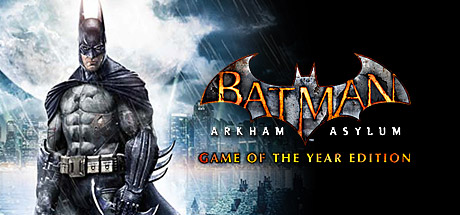

**Platforms:** Xbox 360, PlayStation 3, Windows &nbsp;|&nbsp; **Publisher:** Eidos Interactive &nbsp;|&nbsp; **Genre:** Action, Adventure &nbsp;|&nbsp; **Released:** August 25, 2009

> Experience what it’s like to be Batman and face off against Gotham's greatest villians. Explore every inch of Arkham Asylum and roam freely on the infamous island.
>
> _Synopsis source: Steam_

[Steam](https://store.steampowered.com/app/35140)

---

### Battlefield 1943

**Platforms:** Xbox 360, PlayStation 3 &nbsp;|&nbsp; **Released:** July 8

[Wikipedia](https://en.wikipedia.org/wiki/Battlefield_1943)

---

### Bayonetta

**Platforms:** Xbox 360, PlayStation 3 &nbsp;|&nbsp; **Publisher:** Sega &nbsp;|&nbsp; **Released:** October 29, 2009

[Wikipedia](https://en.wikipedia.org/wiki/Bayonetta_(video_game))

---

### Bionic Commando

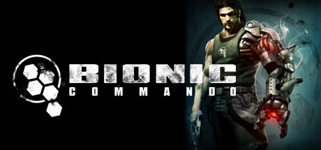

**Platforms:** PlayStation 3, Xbox 360, Windows &nbsp;|&nbsp; **Genre:** Action, Adventure &nbsp;|&nbsp; **Released:** May 19

> The first true sequel to the classic 1988 Nintendo Entertainment System original, Bionic Commando sees the return of the bionically-enhanced Nathan &quot;R.A.D.&quot; Spencer. Time has not been kind to Spencer: Five years after his heroic defeat of the Imperials, he has been betrayed by the government he swore to serve, imprisoned for...
>
> _Synopsis source: Steam_

[Wikipedia](https://en.wikipedia.org/wiki/Bionic_Commando_(2009_video_game)) · [Steam](https://store.steampowered.com/app/21670)

---

### BlazBlue: Calamity Trigger

**Platforms:** PlayStation 3, Xbox 360 &nbsp;|&nbsp; **Released:** June 30

---

### Blood Bowl

**Platforms:** PlayStation 3, Windows, Xbox 360 &nbsp;|&nbsp; **Released:** June 26

[Wikipedia](https://en.wikipedia.org/wiki/Blood_Bowl_(2009_video_game))

---

### Borderlands

**Platforms:** PlayStation 3, Xbox 360, Windows &nbsp;|&nbsp; **Released:** October 20

[Wikipedia](https://en.wikipedia.org/wiki/Borderlands_(video_game))

---

### Braid

**Platforms:** PlayStation 3, Windows, PlayStation Network &nbsp;|&nbsp; **Publisher:** Number None &nbsp;|&nbsp; **Genre:** Casual, Indie, Strategy &nbsp;|&nbsp; **Released:** November 12, 2009

> This is the original version of Braid from 2009, which may not work well on newer systems. For an updated version of the game with nicer graphics, more levels and a large amount of developer commentary, see Braid, Anniversary Edition.
>
> _Synopsis source: Steam_

[Wikipedia](https://en.wikipedia.org/wiki/Braid_(video_game)) · [Steam](https://store.steampowered.com/app/26800)

---

### Brütal Legend

**Platforms:** PlayStation 3, Xbox 360 &nbsp;|&nbsp; **Released:** October 13

[Wikipedia](https://en.wikipedia.org/wiki/Br%C3%BCtal_Legend)

---

### Burnout Paradise: The Ultimate Box

**Platforms:** Windows, PlayStation 3, Xbox 360 &nbsp;|&nbsp; **Publisher:** Electronic Arts &nbsp;|&nbsp; **Released:** February 5, 2009

[Wikipedia](https://en.wikipedia.org/wiki/Burnout_Paradise)

---

### Cabela's Big Game Hunter 2010

**Platforms:** PlayStation 3, Wii, Xbox 360 &nbsp;|&nbsp; **Released:** September 29

[Wikipedia](https://en.wikipedia.org/wiki/Cabela%27s_Big_Game_Hunter_2010)

---

### Call of Duty: Modern Warfare 2

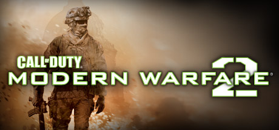

**Platforms:** Xbox 360, PlayStation 3, Windows &nbsp;|&nbsp; **Publisher:** Activision &nbsp;|&nbsp; **Genre:** Action &nbsp;|&nbsp; **Released:** November 10, 2009

> The most-anticipated game of the year and the sequel to the best-selling first-person action game of all time, Modern Warfare 2 continues the gripping and heart-racing action as players face off against a new threat dedicated to bringing the world to the brink of collapse.
>
> _Synopsis source: Steam_

[Steam](https://store.steampowered.com/app/10180)

---

### Call of Juarez: Bound in Blood

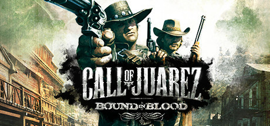

**Platforms:** PlayStation 3, Windows, Xbox 360 &nbsp;|&nbsp; **Genre:** Action &nbsp;|&nbsp; **Released:** June 30

> THE OLD WEST, 1864. In order to save their family, the McCall brothers will kill anyone who stands between them and the legendary Gold of Juarez.
>
> _Synopsis source: Steam_

[Steam](https://store.steampowered.com/app/21980)

---

### Cars Race-O-Rama

**Platforms:** Wii, PlayStation 3, Xbox 360, PlayStation 2, Nintendo DS, PlayStation Portable &nbsp;|&nbsp; **Released:** October 12

[Wikipedia](https://en.wikipedia.org/wiki/Cars_Race-O-Rama)

---

### Chaotic: Shadow Warriors

**Platforms:** Nintendo DS, PlayStation 3, Wii, Xbox 360 &nbsp;|&nbsp; **Released:** November 10

[Wikipedia](https://en.wikipedia.org/wiki/Chaotic_(TV_series))

---

### Cloudy with a Chance of Meatballs

**Platforms:** Wii, Nintendo DS, PlayStation 3, Xbox 360, PlayStation Portable &nbsp;|&nbsp; **Released:** September 15

[Wikipedia](https://en.wikipedia.org/wiki/Cloudy_with_a_Chance_of_Meatballs_(video_game))

---

### Colin McRae: Dirt 2

**Platforms:** Windows, Xbox 360, PlayStation 3, PlayStation Portable, Wii, Nintendo DS &nbsp;|&nbsp; **Publisher:** Codemasters &nbsp;|&nbsp; **Released:** December 4, 2009

---

### Command & Conquer: Red Alert 3

**Platforms:** PlayStation 3, iOS &nbsp;|&nbsp; **Released:** March 23

---

### Critter Crunch

**Platforms:** PlayStation 3 &nbsp;|&nbsp; **Released:** October 8

[Wikipedia](https://en.wikipedia.org/wiki/Critter_Crunch)

---

### Crystal Defenders

**Platforms:** Xbox 360, PlayStation 3, PlayStation Portable &nbsp;|&nbsp; **Released:** March 11

[Wikipedia](https://en.wikipedia.org/wiki/Crystal_Defenders)

---

### Damnation

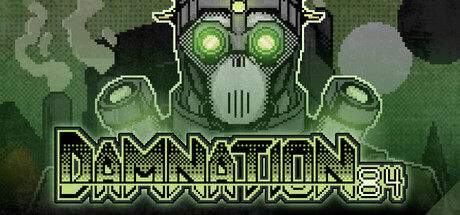

**Platforms:** Windows, PlayStation 3, Xbox 360 &nbsp;|&nbsp; **Genre:** Action, Adventure, Indie &nbsp;|&nbsp; **Released:** May 26

> Damnation84 is a fast-paced FPS game that uses impulse and propulsion weapons as a means of movement and combat. In this devastated world, eliminate enemies in sequence and complete the levels before your oxygen runs out. You are the last hope, survive and cause damnation.
>
> _Synopsis source: Steam_

[Wikipedia](https://en.wikipedia.org/wiki/Damnation_(video_game)) · [Steam](https://store.steampowered.com/app/4418990)

---

### Demon's Souls

**Platforms:** PlayStation 3 &nbsp;|&nbsp; **Publisher:** Sony Computer Entertainment &nbsp;|&nbsp; **Released:** February 5, 2009

[Wikipedia](https://en.wikipedia.org/wiki/Demon%27s_Souls)

---

### Disney Sing It! – High School Musical 3: Senior Year

**Platforms:** PlayStation 3, PlayStation 2, Wii, Xbox 360 &nbsp;|&nbsp; **Released:** February 17

---

### DJ Hero

**Platforms:** Xbox 360, PlayStation 3, PlayStation 2, Wii &nbsp;|&nbsp; **Released:** October 27

[Wikipedia](https://en.wikipedia.org/wiki/DJ_Hero)

---

### Dragon Age: Origins

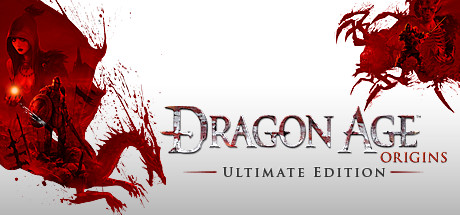

**Platforms:** Windows, PlayStation 3, Xbox 360 &nbsp;|&nbsp; **Publisher:** Electronic Arts &nbsp;|&nbsp; **Genre:** RPG &nbsp;|&nbsp; **Released:** November 3, 2009

> Explore a stunning world, make complex moral choices, and engage in bone-crushing combat against massive and terrifying creatures. The Ultimate Edition includes Dragon Age: Origins, Dragon Age: Origins - Awakening and all nine content packs.
>
> _Synopsis source: Steam_

[Steam](https://store.steampowered.com/app/47810)

---

### Dragon Ball Z: Raging Blast

**Platforms:** PlayStation 3, Xbox 360 &nbsp;|&nbsp; **Released:** November 10

---

### Dynasty Warriors: Gundam 2

**Platforms:** PlayStation 3, PlayStation 2, Xbox 360 &nbsp;|&nbsp; **Released:** April 22

---

### Eat Lead: The Return of Matt Hazard

**Platforms:** PlayStation 3, Xbox 360 &nbsp;|&nbsp; **Released:** February 26

---

### F.E.A.R. 2: Project Origin

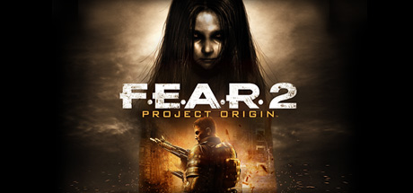

**Platforms:** PlayStation 3, Windows, Xbox 360 &nbsp;|&nbsp; **Genre:** Action &nbsp;|&nbsp; **Released:** February 10

> Assume the role of Special Forces Sgt. Becket as your routine mission quickly turns into a fight for survival against the wrath of Alma Wade. As Alma's terrifying power surges out of control, your squad is forced to battle through an apocalyptic landscape in search of clues for how to destroy her!
>
> _Synopsis source: Steam_

[Steam](https://store.steampowered.com/app/16450)

---

### Fairytale Fights

**Platforms:** PlayStation 3, Xbox 360 &nbsp;|&nbsp; **Released:** October 27

[Wikipedia](https://en.wikipedia.org/wiki/Fairytale_Fights)

---

### Fallout 3: Game of the Year Edition

**Platforms:** PlayStation 3 &nbsp;|&nbsp; **Publisher:** Bethesda Softworks &nbsp;|&nbsp; **Released:** October 13, 2009

[Wikipedia](https://en.wikipedia.org/wiki/Fallout_3#Retail_versions)

---

### Fat Princess

**Platforms:** PlayStation 3 &nbsp;|&nbsp; **Released:** July 30

[Wikipedia](https://en.wikipedia.org/wiki/Fat_Princess)

---

### FIFA 10

**Platforms:** PlayStation 3, Windows, Xbox 360 &nbsp;|&nbsp; **Released:** October 20

[Wikipedia](https://en.wikipedia.org/wiki/FIFA_10)

---

### FIFA Soccer 10

**Platforms:** PlayStation 3, Xbox 360 &nbsp;|&nbsp; **Publisher:** EA Sports &nbsp;|&nbsp; **Released:** October 20, 2009

[Wikipedia](https://en.wikipedia.org/wiki/FIFA_Soccer_10)

---

### Fight Night Round 4

**Platforms:** PlayStation 3, Xbox 360 &nbsp;|&nbsp; **Publisher:** EA Sports &nbsp;|&nbsp; **Released:** June 23, 2009

[Wikipedia](https://en.wikipedia.org/wiki/Fight_Night_Round_4)

---

### Flower

**Platforms:** PlayStation 3 &nbsp;|&nbsp; **Released:** February 12

[Wikipedia](https://en.wikipedia.org/wiki/Flower_(video_game))

---

### Fuel

**Platforms:** PlayStation 3, Xbox 360, Windows &nbsp;|&nbsp; **Released:** June 2

[Wikipedia](https://en.wikipedia.org/wiki/Fuel_(2009_video_game))

---

### G.I. Joe: The Rise of Cobra

**Platforms:** Nintendo DS, PlayStation 2, PlayStation 3, PlayStation Portable, Wii, Xbox 360 &nbsp;|&nbsp; **Released:** August 4

---

### Ghostbusters: The Video Game

**Platforms:** Nintendo DS, PlayStation 2, PlayStation 3, Wii, Windows, Xbox 360, PlayStation Portable &nbsp;|&nbsp; **Released:** June 16

---

### God of War Collection

**Platforms:** PlayStation 3 &nbsp;|&nbsp; **Publisher:** Sony Computer Entertainment &nbsp;|&nbsp; **Released:** November 17, 2009

[Wikipedia](https://en.wikipedia.org/wiki/God_of_War_video_game_collections#God_of_War_Collection)

---

### Grey's Anatomy: The Video Game

**Platforms:** Windows, Nintendo DS, PlayStation 3, Wii, Xbox 360 &nbsp;|&nbsp; **Released:** March 10

---

### Guitar Hero 5

**Platforms:** Wii, PlayStation 2, PlayStation 3, Xbox 360 &nbsp;|&nbsp; **Publisher:** Activision &nbsp;|&nbsp; **Released:** September 1, 2009

[Wikipedia](https://en.wikipedia.org/wiki/Guitar_Hero_5)

---

### Guitar Hero: Metallica

**Platforms:** PlayStation 2, PlayStation 3, Wii, Xbox 360 &nbsp;|&nbsp; **Released:** March 29

---

### Guitar Hero: Smash Hits

**Platforms:** PlayStation 2, PlayStation 3, Wii, Xbox 360 &nbsp;|&nbsp; **Released:** June 16

---

### Guitar Hero: Van Halen

**Platforms:** PlayStation 2, PlayStation 3, Wii, Xbox 360 &nbsp;|&nbsp; **Released:** December 22

---

### Hannah Montana: The Movie

**Platforms:** Nintendo DS, PlayStation 3, Wii, Xbox 360 &nbsp;|&nbsp; **Released:** April 7

---

### Harry Potter and the Half Blood Prince

**Platforms:** macOS, Windows, Nintendo DS, PlayStation 2, PlayStation 3, PlayStation Portable, Wii, Xbox 360 &nbsp;|&nbsp; **Released:** June 30

[Wikipedia](https://en.wikipedia.org/wiki/Harry_Potter_and_the_Half-Blood_Prince_(video_game))

---

### Heroes Over Europe

**Platforms:** Xbox 360, PlayStation 3, Windows &nbsp;|&nbsp; **Released:** September 14

[Wikipedia](https://en.wikipedia.org/wiki/Heroes_Over_Europe)

---

### Hot Wheels Battle Force 5

**Platforms:** Nintendo DS, PlayStation 3, Wii, Xbox 360 &nbsp;|&nbsp; **Released:** November 10

[Wikipedia](https://en.wikipedia.org/wiki/Hot_Wheels_Battle_Force_5_(video_game))

---

### Hyperballoid HD

**Platforms:** PlayStation 3 &nbsp;|&nbsp; **Released:** December 10

---

### Ice Age: Dawn of the Dinosaurs

**Platforms:** Nintendo DS, PlayStation 2, PlayStation 3, Wii, Windows, Xbox 360 &nbsp;|&nbsp; **Released:** June 30

---

### IL-2 Sturmovik: Birds of Prey

**Platforms:** Xbox 360, PlayStation 3, Nintendo DS, PlayStation Portable &nbsp;|&nbsp; **Released:** September 8

---

### inFamous

**Platforms:** PlayStation 3 &nbsp;|&nbsp; **Released:** May 26

[Wikipedia](https://en.wikipedia.org/wiki/InFamous)

---

### James Cameron's Avatar: The Game

**Platforms:** PlayStation 3, Xbox 360, Windows, Wii, Nintendo DS, iOS, PlayStation Portable &nbsp;|&nbsp; **Released:** December 1

---

### Jurassic: The Hunted

**Platforms:** PlayStation 2, PlayStation 3, Windows, Xbox 360 &nbsp;|&nbsp; **Released:** November 3

---

### Katamari Forever

**Platforms:** PlayStation 3 &nbsp;|&nbsp; **Released:** September 22

[Wikipedia](https://en.wikipedia.org/wiki/Katamari_Forever)

---

### Killzone 2

**Platforms:** PlayStation 3 &nbsp;|&nbsp; **Publisher:** Sony Computer Entertainment &nbsp;|&nbsp; **Released:** February 26, 2009

[Wikipedia](https://en.wikipedia.org/wiki/Killzone_2)

---

### Lego Indiana Jones 2: The Adventure Continues

**Platforms:** Wii, Xbox 360, PlayStation 3, Nintendo DS, PlayStation Portable, Windows &nbsp;|&nbsp; **Genre:** Adventure &nbsp;|&nbsp; **Released:** November 17

> LEGO® Indy is back in his biggest adventure yet. Battle through all four movies, including all-new levels from the original adventures and your favorite new moments from The Kingdom of the Crystal Skull... or in true LEGO® fashion, get creative and build your own levels to play with friends!
>
> _Synopsis source: Steam_

[Steam](https://store.steampowered.com/app/32450)

---

### Lego Rock Band

**Platforms:** PlayStation 3, Xbox 360, Wii, Nintendo DS &nbsp;|&nbsp; **Released:** November 3

[Wikipedia](https://en.wikipedia.org/wiki/Lego_Rock_Band)

---

### Leisure Suit Larry: Box Office Bust

**Platforms:** Windows, Xbox 360, PlayStation 3 &nbsp;|&nbsp; **Released:** March 27

---

### LittleBigPlanet: Game of the Year Edition

**Platforms:** PlayStation 3 &nbsp;|&nbsp; **Publisher:** Sony Computer Entertainment &nbsp;|&nbsp; **Released:** September 8, 2009

[Wikipedia](https://en.wikipedia.org/wiki/LittleBigPlanet_(2008_video_game)#Release_and_further_development)

---

### Madagascar Kartz

**Platforms:** Nintendo DS, PlayStation 3, Wii, Xbox 360 &nbsp;|&nbsp; **Released:** October 27

[Wikipedia](https://en.wikipedia.org/wiki/Madagascar_Kartz)

---

### Madden NFL 10

**Platforms:** PlayStation 3, PlayStation Portable, Xbox 360 &nbsp;|&nbsp; **Released:** August 14

[Wikipedia](https://en.wikipedia.org/wiki/Madden_NFL_10)

---

### Major League Baseball 2K9

**Platforms:** Xbox 360, PlayStation 3, PlayStation 2, PlayStation Portable, Wii &nbsp;|&nbsp; **Released:** March 3

[Wikipedia](https://en.wikipedia.org/wiki/Major_League_Baseball_2K9)

---

### Marvel: Ultimate Alliance 2

**Platforms:** Nintendo DS, PlayStation 3, PlayStation 2, Wii, Xbox 360, PlayStation Portable &nbsp;|&nbsp; **Released:** September 15

---

### Mini Ninjas

**Platforms:** Windows, Xbox 360, PlayStation 3, Wii, Nintendo DS &nbsp;|&nbsp; **Genre:** Action, Adventure &nbsp;|&nbsp; **Released:** September 8

> Mini Ninjas is a game that combines furious action with stealth and exploration for an experience that appeals to a wide audience across age groups and preferences. It’s an action-adventure with a strong focus on allowing the player freedom to explore the world and has the depth to allow for very varied gameplay and approaches to getting...
>
> _Synopsis source: Steam_

[Wikipedia](https://en.wikipedia.org/wiki/Mini_Ninjas) · [Steam](https://store.steampowered.com/app/35000)

---

### MLB 09: The Show

**Platforms:** PlayStation 3, PlayStation 2, PlayStation Portable &nbsp;|&nbsp; **Publisher:** Sony Computer Entertainment &nbsp;|&nbsp; **Released:** March 3, 2009

---

### MLB Front Office Manager

**Platforms:** PlayStation 3, Windows, Xbox 360 &nbsp;|&nbsp; **Released:** January 26

[Wikipedia](https://en.wikipedia.org/wiki/MLB_Front_Office_Manager)

---

### MX vs. ATV Reflex

**Platforms:** Nintendo DS, PlayStation 3, PlayStation Portable, Windows, Xbox 360 &nbsp;|&nbsp; **Genre:** Racing &nbsp;|&nbsp; **Released:** December 1

> Think fast and hang on to your ride as you take independent control of the rider and take the ultimate test of mettle. Dual controls let you tear it up with death-defying tricks and high-flying freestyle action. Fight for traction and dig up the track to leave your mark.
>
> _Synopsis source: Steam_

[Wikipedia](https://en.wikipedia.org/wiki/MX_vs._ATV_Reflex) · [Steam](https://store.steampowered.com/app/55140)

---

### NBA 2K10

**Platforms:** Xbox 360, PlayStation 2, PlayStation 3, PlayStation Portable, Windows, Wii &nbsp;|&nbsp; **Released:** October 6

[Wikipedia](https://en.wikipedia.org/wiki/NBA_2K10)

---

### NBA Live 10

**Platforms:** PlayStation 3, PlayStation Portable, Xbox 360 &nbsp;|&nbsp; **Released:** October 6

[Wikipedia](https://en.wikipedia.org/wiki/NBA_Live_10)

---

### NCAA Basketball 10

**Platforms:** PlayStation 3, Xbox 360 &nbsp;|&nbsp; **Released:** November 18

[Wikipedia](https://en.wikipedia.org/wiki/NCAA_Basketball_10)

---

### NCAA Football 10

**Platforms:** Xbox 360, PlayStation 3, PlayStation 2, PlayStation Portable, iOS &nbsp;|&nbsp; **Released:** July 14

[Wikipedia](https://en.wikipedia.org/wiki/NCAA_Football_10)

---

### Need for Speed: Shift

**Platforms:** PlayStation 3, PlayStation Portable, Windows, Xbox 360, iOS &nbsp;|&nbsp; **Released:** September 15

---

### NHL 10

**Platforms:** Xbox 360, PlayStation 3 &nbsp;|&nbsp; **Publisher:** EA Sports &nbsp;|&nbsp; **Released:** September 15, 2009

[Wikipedia](https://en.wikipedia.org/wiki/NHL_10)

---

### NHL 2K10

**Platforms:** Xbox 360, PlayStation 2, PlayStation 3, Wii &nbsp;|&nbsp; **Released:** September 15

[Wikipedia](https://en.wikipedia.org/wiki/NHL_2K10)

---

### Ninja Gaiden Sigma 2

**Platforms:** PlayStation 3 &nbsp;|&nbsp; **Released:** September 29

[Wikipedia](https://en.wikipedia.org/wiki/Ninja_Gaiden_Sigma_2)

---

### Noby Noby Boy

**Platforms:** PlayStation 3 &nbsp;|&nbsp; **Released:** February 19

[Wikipedia](https://en.wikipedia.org/wiki/Noby_Noby_Boy)

---

### Numblast

**Platforms:** PlayStation 3, PlayStation Portable &nbsp;|&nbsp; **Released:** November 5

[Wikipedia](https://en.wikipedia.org/wiki/Numblast)

---

### Operation Flashpoint 2: Dragon Rising

**Platforms:** PlayStation 3, Windows, Xbox 360 &nbsp;|&nbsp; **Released:** October 6

---

### Overlord II

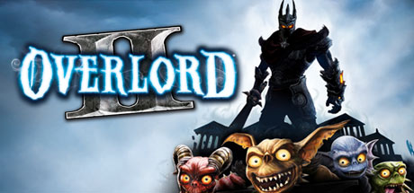

**Platforms:** PlayStation 3, Windows, Xbox 360 &nbsp;|&nbsp; **Genre:** RPG &nbsp;|&nbsp; **Released:** June 23

> Overlord II, sequel to the critically acclaimed cult hit, sees the return of the chaotic Minions and their new Dark Master. Bigger, badder and more beautifully destructive, Overlord 2 has a Glorious Empire to smash, a massive Netherworld to revive, Minion mounts to mobilize, a trio of mistresses to woo, War Machines to crush opposition...
>
> _Synopsis source: Steam_

[Wikipedia](https://en.wikipedia.org/wiki/Overlord_II) · [Steam](https://store.steampowered.com/app/12810)

---

### Peggle

**Platforms:** PlayStation 3, Xbox 360 &nbsp;|&nbsp; **Publisher:** PopCap Games &nbsp;|&nbsp; **Released:** November 19, 2009

[Wikipedia](https://en.wikipedia.org/wiki/Peggle)

---

### Pinball Hall of Fame: The Williams Collection

**Platforms:** PlayStation 3, Xbox 360 &nbsp;|&nbsp; **Released:** September 22

---

### Pro Evolution Soccer 2010

**Platforms:** Windows, PlayStation 3, Xbox 360, Nintendo DS, PlayStation 2, PlayStation Portable, Wii &nbsp;|&nbsp; **Released:** October 23

[Wikipedia](https://en.wikipedia.org/wiki/Pro_Evolution_Soccer_2010)

---

### Prototype

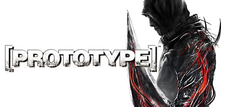

**Platforms:** PlayStation 3, Windows, Xbox 360 &nbsp;|&nbsp; **Genre:** Action, Adventure &nbsp;|&nbsp; **Released:** June 9

> You are the Prototype, Alex Mercer, a man without memory armed with amazing shape-shifting abilities, hunting your way to the heart of the conspiracy which created you; making those responsible pay. Fast &amp; Deadly Shape-Shifting Combat: Reconfigure your body to the situation at hand.
>
> _Synopsis source: Steam_

[Wikipedia](https://en.wikipedia.org/wiki/Prototype_(video_game)) · [Steam](https://store.steampowered.com/app/10150)

---

### Puzzle Quest: Galactrix

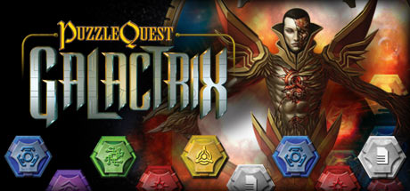

**Platforms:** Nintendo DS, Windows, Xbox 360, PlayStation 3 &nbsp;|&nbsp; **Genre:** Casual, RPG &nbsp;|&nbsp; **Released:** February 24

> The puzzle game of the future has arrived! The original best-selling new Puzzle franchise is back in an all new dimension with its signature Match-3, turn based battles in an insanely addictive and masterful hybrid of RPG and Puzzle genres.
>
> _Synopsis source: Steam_

[Steam](https://store.steampowered.com/app/23500)

---

### Ratchet & Clank Future: A Crack in Time

**Platforms:** PlayStation 3 &nbsp;|&nbsp; **Publisher:** Sony Computer Entertainment &nbsp;|&nbsp; **Released:** October 27, 2009

---

### Red Faction: Guerrilla

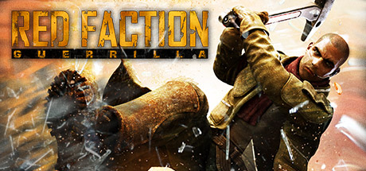

**Platforms:** PlayStation 3, Xbox 360, Windows &nbsp;|&nbsp; **Genre:** Action &nbsp;|&nbsp; **Released:** June 2

> Set 50 years after the climactic events of the original Red Faction, Red Faction: Guerrilla allows players to take the role of an insurgent fighter with the newly re-established Red Faction movement as they battle for liberation from the oppressive Earth Defense Force.
>
> _Synopsis source: Steam_

[Steam](https://store.steampowered.com/app/20500)

---

### Resident Evil 5

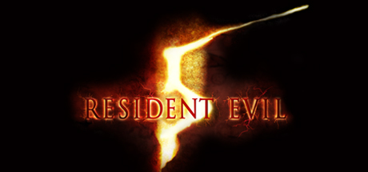

**Platforms:** PlayStation 3, Xbox 360, Windows &nbsp;|&nbsp; **Genre:** Action, Adventure &nbsp;|&nbsp; **Released:** March 13

> This game is a port of the Games for Windows - Live version that was released in 2009. If you buy the Untold Stories Bundle here on Steam, it will be the same as upgrading to Resident Evil 5 Gold Edition.
>
> _Synopsis source: Steam_

[Wikipedia](https://en.wikipedia.org/wiki/Resident_Evil_5) · [Steam](https://store.steampowered.com/app/21690)

---

### Rock Band Country Track Pack

**Platforms:** PlayStation 2, PlayStation 3, Wii, Xbox 360 &nbsp;|&nbsp; **Released:** July 21

[Wikipedia](https://en.wikipedia.org/wiki/Rock_Band_Country_Track_Pack)

---

### Rock Band Metal Track Pack

**Platforms:** PlayStation 2, PlayStation 3, Wii, Xbox 360 &nbsp;|&nbsp; **Released:** September 22

[Wikipedia](https://en.wikipedia.org/wiki/Rock_Band_Metal_Track_Pack)

---

### Rogue Warrior

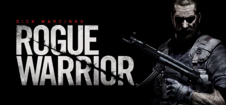

**Platforms:** PlayStation 3, Windows, Xbox 360 &nbsp;|&nbsp; **Genre:** Action &nbsp;|&nbsp; **Released:** December 1

> Rogue Warrior is a character-driven, first-person-shooter, featuring Richard 'Demo Dick' Marcinko's explosive personality in an action-packed single player campaign, and intense multiplayer combat. Playing as Richard 'Demo Dick' Marcinko, you go behind the iron curtain to disrupt a suspected North Korean ballistic missile program.
>
> _Synopsis source: Steam_

[Wikipedia](https://en.wikipedia.org/wiki/Rogue_Warrior_(video_game)) · [Steam](https://store.steampowered.com/app/22310)

---

### Sacred 2: Fallen Angel

**Platforms:** PlayStation 3, Xbox 360 &nbsp;|&nbsp; **Released:** May 12

---

### Savage Moon

**Platforms:** PlayStation 3 &nbsp;|&nbsp; **Released:** January 29

[Wikipedia](https://en.wikipedia.org/wiki/Savage_Moon)

---

### Saw: The Video Game

**Platforms:** PlayStation 3, Xbox 360, Windows &nbsp;|&nbsp; **Released:** October 6

[Wikipedia](https://en.wikipedia.org/wiki/Saw_(video_game))

---

### Shellshock 2: Blood Trails

**Platforms:** PlayStation 3, Windows, Xbox 360 &nbsp;|&nbsp; **Released:** February 24

---

### SingStar Queen

**Platforms:** PlayStation 3 &nbsp;|&nbsp; **Released:** August 9

[Wikipedia](https://en.wikipedia.org/wiki/SingStar_Queen)

---

### Skate 2

**Platforms:** PlayStation 3, Xbox 360 &nbsp;|&nbsp; **Released:** January 21

[Wikipedia](https://en.wikipedia.org/wiki/Skate_2)

---

### Ski-Doo: Snowmobile Challenge

**Platforms:** PlayStation 3, Wii &nbsp;|&nbsp; **Released:** March 10

---

### Sonic's Ultimate Genesis Collection

**Platforms:** PlayStation 3, Xbox 360 &nbsp;|&nbsp; **Released:** February 10

[Wikipedia](https://en.wikipedia.org/wiki/Sonic%27s_Ultimate_Genesis_Collection)

---

### Star Wars: The Clone Wars – Republic Heroes

**Platforms:** PlayStation 3, Windows, Xbox 360, Wii, PlayStation Portable, PlayStation 2, Nintendo DS &nbsp;|&nbsp; **Released:** October 6

---

### Star Wars: The Force Unleashed -- Ultimate Sith Edition

**Platforms:** Windows, PlayStation 3, Xbox 360 &nbsp;|&nbsp; **Released:** November 6

---

### Stormrise

**Platforms:** PlayStation 3, Windows, Xbox 360 &nbsp;|&nbsp; **Released:** March 24

[Wikipedia](https://en.wikipedia.org/wiki/Stormrise)

---

### Street Fighter IV

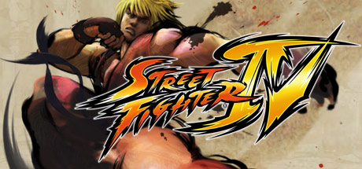

**Platforms:** PlayStation 3, Xbox 360, Windows &nbsp;|&nbsp; **Publisher:** Capcom &nbsp;|&nbsp; **Genre:** Action &nbsp;|&nbsp; **Released:** February 12, 2009

> Street Fighter® IV brings the legendary fighting series back to its roots by taking the beloved fighting moves and techniques of the original Street Fighter® II, and infusing them with Capcom's latest advancements in next generation technology.
>
> _Synopsis source: Steam_

[Wikipedia](https://en.wikipedia.org/wiki/Street_Fighter_IV) · [Steam](https://store.steampowered.com/app/21660)

---

### Tekken 6

**Platforms:** PlayStation 3, Xbox 360, PlayStation Portable &nbsp;|&nbsp; **Released:** October 27

[Wikipedia](https://en.wikipedia.org/wiki/Tekken_6)

---

### Terminator Salvation

**Platforms:** PlayStation 3, Windows, Xbox 360, iOS &nbsp;|&nbsp; **Released:** May 19

[Wikipedia](https://en.wikipedia.org/wiki/Terminator_Salvation_(video_game))

---

### The Backyardigans

**Platforms:** Nintendo DS, PlayStation 3, Wii, Xbox 360 &nbsp;|&nbsp; **Released:** November 3

[Wikipedia](https://en.wikipedia.org/wiki/The_Backyardigans)

---

### The Backyardigans: Robot Rampage

**Platforms:** Windows, Xbox 360, PlayStation 3, PlayStation Portable, Wii, Nintendo DS &nbsp;|&nbsp; **Released:** September 8

---

### The Backyardigans: Singing Sensation

**Platforms:** Windows, PlayStation 3, Wii, Xbox 360 &nbsp;|&nbsp; **Released:** November 10

---

### The Beatles: Rock Band

**Platforms:** Wii, Xbox 360, PlayStation 3, PlayStation 2 &nbsp;|&nbsp; **Publisher:** MTV Games &nbsp;|&nbsp; **Released:** September 9, 2009

---

### The Bigs 2

**Platforms:** Xbox 360, PlayStation 3, PlayStation 2, Wii, PlayStation Portable &nbsp;|&nbsp; **Released:** July 7

[Wikipedia](https://en.wikipedia.org/wiki/The_Bigs_2)

---

### The Chronicles of Riddick: Assault on Dark Athena

**Platforms:** PlayStation 3, Windows, Xbox 360 &nbsp;|&nbsp; **Released:** April 7

---

### The Godfather Part II: The Game

**Platforms:** PlayStation 3, Xbox 360, Windows &nbsp;|&nbsp; **Released:** April 7

[Wikipedia](https://en.wikipedia.org/wiki/The_Godfather_II_(video_game))

---

### The King of Fighters XII

**Platforms:** PlayStation 3, Xbox 360 &nbsp;|&nbsp; **Released:** July 28

[Wikipedia](https://en.wikipedia.org/wiki/The_King_of_Fighters_XII)

---

### The Lord of the Rings: Conquest

**Platforms:** PlayStation 3, Windows, Xbox 360, Nintendo DS &nbsp;|&nbsp; **Released:** January 13

---

### The Punisher: No Mercy

**Platforms:** PlayStation 3 &nbsp;|&nbsp; **Released:** July 2

---

### The Saboteur

**Platforms:** PlayStation 3, Xbox 360, Windows &nbsp;|&nbsp; **Genre:** Action, Adventure &nbsp;|&nbsp; **Released:** December 8

> This open-world action thriller takes you through the seedy streets of Paris as you seek to undermine the German authority and lead a rebellion. Fight across rooftops and through dangerous alleys, and operate a wide variety of vehicles as you navigate your terrain.
>
> _Synopsis source: Steam_

[Wikipedia](https://en.wikipedia.org/wiki/The_Saboteur_(2009_video_game)) · [Steam](https://store.steampowered.com/app/24880)

---

### The Wheelman

**Platforms:** PlayStation 3, Windows, Xbox 360 &nbsp;|&nbsp; **Released:** March 24

[Wikipedia](https://en.wikipedia.org/wiki/The_Wheelman)

---

### Tiger Woods PGA Tour 10

**Platforms:** Wii, PlayStation 2, PlayStation 3, PlayStation Portable, Xbox 360 &nbsp;|&nbsp; **Publisher:** EA Sports &nbsp;|&nbsp; **Released:** June 8, 2009

[Wikipedia](https://en.wikipedia.org/wiki/Tiger_Woods_PGA_Tour_10)

---

### Tom Clancy's H.A.W.X.

**Platforms:** PlayStation 3, Xbox 360, iOS, Windows &nbsp;|&nbsp; **Released:** March 6

[Wikipedia](https://en.wikipedia.org/wiki/Tom_Clancy%27s_H.A.W.X.)

---

### Tony Hawk: Ride

**Platforms:** PlayStation 3, Wii, Xbox 360 &nbsp;|&nbsp; **Released:** November 17

---

### Tornado Outbreak

**Platforms:** Wii, PlayStation 3, Xbox 360 &nbsp;|&nbsp; **Released:** September 29

[Wikipedia](https://en.wikipedia.org/wiki/Tornado_Outbreak)

---

### Transformers: Revenge of the Fallen

**Platforms:** Nintendo DS, PlayStation 2, PlayStation 3, Wii, Windows, Xbox 360, PlayStation Portable &nbsp;|&nbsp; **Released:** June 23

---

### Trash Panic

**Platforms:** PlayStation 3 &nbsp;|&nbsp; **Released:** June 4

[Wikipedia](https://en.wikipedia.org/wiki/Trash_Panic)

---

### Trine

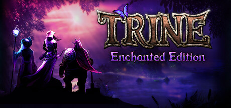

**Platforms:** Windows, PlayStation 3 &nbsp;|&nbsp; **Genre:** Action, Adventure, Casual, Indie, RPG, Strategy &nbsp;|&nbsp; **Released:** July 3

> Three heroes are bound to a magic artifact and sent to save a kingdom in this physics puzzle platformer. The wizard conjures, the knight smashes, the thief grapples — and you switch between them freely, or hand two of them to friends.
>
> _Synopsis source: Steam_

[Wikipedia](https://en.wikipedia.org/wiki/Trine_(video_game)) · [Steam](https://store.steampowered.com/app/35700)

---

### UFC 2009 Undisputed

**Platforms:** PlayStation 3, Xbox 360 &nbsp;|&nbsp; **Released:** May 19

[Wikipedia](https://en.wikipedia.org/wiki/UFC_2009_Undisputed)

---

### Uncharted 2: Among Thieves

**Platforms:** PlayStation 3 &nbsp;|&nbsp; **Publisher:** Sony Computer Entertainment &nbsp;|&nbsp; **Released:** October 13, 2009

---

### Venetica

**Platforms:** Windows, PlayStation 3, Xbox 360 &nbsp;|&nbsp; **Released:** September 4

[Wikipedia](https://en.wikipedia.org/wiki/Venetica)

---

### Virtua Tennis 2009

**Platforms:** Xbox 360, PlayStation 3, Wii, Windows &nbsp;|&nbsp; **Released:** June 9

[Wikipedia](https://en.wikipedia.org/wiki/Virtua_Tennis_2009)

---

### Wanted: Weapons of Fate

**Platforms:** PlayStation 3, Windows, Xbox 360 &nbsp;|&nbsp; **Released:** March 17

---

### Watchmen: The End Is Nigh

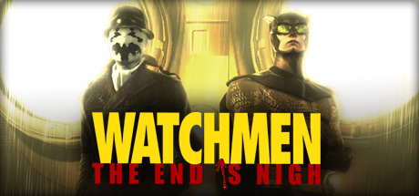

**Platforms:** PlayStation 3, Windows, Xbox 360 &nbsp;|&nbsp; **Genre:** Action &nbsp;|&nbsp; **Released:** March 4

> The lines between good and bad have been blurred and crime and terror run rampant in the streets. The alleys, rooftops and sewers are crawling with criminals and brutal gangs. And now, Underboss — in a daring escape — has broken out of prison and is ruling with vicious darkness.
>
> _Synopsis source: Steam_

[Steam](https://store.steampowered.com/app/21010)

---

### Watchmen: The End Is Nigh Part 2

**Platforms:** PlayStation 3, Xbox 360 &nbsp;|&nbsp; **Released:** July 30

---

### Watchmen: The End Is Nigh:The Complete Experience

**Platforms:** PlayStation 3, Xbox 360 &nbsp;|&nbsp; **Released:** July 21

---

### Way of the Samurai 3

**Platforms:** PlayStation 3, Xbox 360 &nbsp;|&nbsp; **Released:** October 13

[Wikipedia](https://en.wikipedia.org/wiki/Way_of_the_Samurai_3)

---

### Wet

**Platforms:** PlayStation 3, Xbox 360 &nbsp;|&nbsp; **Released:** September 15

[Wikipedia](https://en.wikipedia.org/wiki/Wet_(video_game))

---

### Wipeout HD Fury

**Platforms:** PlayStation 3, PlayStation Network &nbsp;|&nbsp; **Publisher:** Sony Computer Entertainment &nbsp;|&nbsp; **Released:** July 23, 2009

[Wikipedia](https://en.wikipedia.org/wiki/Wipeout_HD#Fury_expansion_pack)

---

### Wolfenstein

**Platforms:** PlayStation 3, Windows, Xbox 360 &nbsp;|&nbsp; **Released:** August 18

[Wikipedia](https://en.wikipedia.org/wiki/Wolfenstein_(2009_video_game))

---

### WWE Legends of WrestleMania

**Platforms:** PlayStation 3, Xbox 360 &nbsp;|&nbsp; **Released:** March 24

[Wikipedia](https://en.wikipedia.org/wiki/WWE_Legends_of_WrestleMania)

---

### WWE SmackDown vs. Raw 2010

**Platforms:** Nintendo DS, PlayStation 2, PlayStation 3, PlayStation Portable, Wii, Xbox 360 &nbsp;|&nbsp; **Released:** October 20

[Wikipedia](https://en.wikipedia.org/wiki/WWE_SmackDown_vs._Raw_2010)

---

### X-Blades

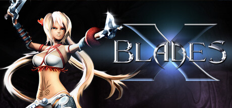

**Platforms:** PlayStation 3, Windows, Xbox 360 &nbsp;|&nbsp; **Genre:** Nudity, Violent, Action, Adventure, RPG &nbsp;|&nbsp; **Released:** February 10

> In X-Blades, the player takes on the role of the enchanting heroine Ayumi, who survives a breathtaking dance of blades through the Hordes of Darkness. The long-haired beautiful anime, with her pistol blades and mind-blowing leaps, whirls and swirls from one fantastic level to the next.
>
> _Synopsis source: Steam_

[Wikipedia](https://en.wikipedia.org/wiki/X-Blades) · [Steam](https://store.steampowered.com/app/7510)

---

### X-Men Origins: Wolverine

**Platforms:** Nintendo DS, PlayStation 2, PlayStation 3, Wii, Windows, Xbox 360, PlayStation Portable &nbsp;|&nbsp; **Released:** May 1

---

### Xevious Resurrection

**Platforms:** PlayStation 3 &nbsp;|&nbsp; **Released:** July 16

[Wikipedia](https://en.wikipedia.org/wiki/Xevious_Resurrection)

---
