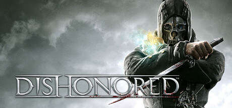

# PlayStation 3 — 2012

[← All PlayStation 3 years](../playstation-3.md) · [Full 2012 page](../../years/2012.md)

168 PlayStation 3 titles in 2012.

### 007 Legends

**Platforms:** PlayStation 3, Xbox 360, Windows, Wii U &nbsp;|&nbsp; **Genre:** Shooter &nbsp;|&nbsp; **Released:** October 16

> 007 Legends features an original, overarching storyline tying together six classic Bond movies for an original James Bond experience, and equips players with state-of-the-art spy gadgets, an arsenal of weapons and more.  In addition to 007 Legends' main story, the game features the return of fan-favorite single-player Mi6 Ops Missions, which debuted in GoldenEye 007: Reloaded and challenges players to complete extra missions ranging from all-out action to stealth and gadget-based gameplay and compete for the highest online leader board scores. Also for the first time ever, players will be able to participate as one of Bond's cohorts or villainous foes, reliving the missions through their eyes, as well as 007's. Meanwhile the robust James Bond multiplayer experience includes local four-player split-screen game modes and online competitive gameplay with new maps, weapons and characters derived from Bond's 50 year legacy. With more gadgets, deeper stealth and spy investigation gameplay, gamers will have every opportunity to truly feel like the world's favorite spy.
>
> _Synopsis source: IGDB_

[Wikipedia](https://en.wikipedia.org/wiki/007_Legends) · [IGDB](https://www.igdb.com/games/007-legends)

---

### 2nd Super Robot Wars OG

**Platforms:** PlayStation 3 &nbsp;|&nbsp; **Developer:** Tose, B.B. Studio &nbsp;|&nbsp; **Publisher:** Namco Bandai Games &nbsp;|&nbsp; **Genre:** Tactical role-playing &nbsp;|&nbsp; **Released:** November 29, 2012

[Wikipedia](https://en.wikipedia.org/wiki/2nd_Super_Robot_Wars_OG)

---

### AFL Live: Game of the Year Edition

**Platforms:** Windows, PlayStation 3, Xbox 360 &nbsp;|&nbsp; **Released:** July 12

[Wikipedia](https://en.wikipedia.org/wiki/AFL_Live#Game_of_the_Year_Edition)

---

### Air Conflicts: Pacific Carriers

**Platforms:** Windows, Xbox 360, PlayStation 3, PlayStation 4 &nbsp;|&nbsp; **Developer:** Games Farm &nbsp;|&nbsp; **Publisher:** bitComposer Games, Maximum Games &nbsp;|&nbsp; **Genre:** Combat flight simulation &nbsp;|&nbsp; **Released:** December 7, 2012

[Wikipedia](https://en.wikipedia.org/wiki/Air_Conflicts:_Pacific_Carriers)

---

### Angry Birds Trilogy

**Platforms:** Xbox 360, PlayStation 3, Nintendo 3DS &nbsp;|&nbsp; **Type:** Compilation &nbsp;|&nbsp; **Released:** September 25

[Wikipedia](https://en.wikipedia.org/wiki/Angry_Birds_Trilogy)

---

### Armored Core V

**Platforms:** PlayStation 3, Xbox 360 &nbsp;|&nbsp; **Released:** March 20

[Wikipedia](https://en.wikipedia.org/wiki/Armored_Core_V)

---

### Assassin's Creed III

**Platforms:** PlayStation 3, Xbox 360, Wii U, Windows &nbsp;|&nbsp; **Genre:** Adventure &nbsp;|&nbsp; **Released:** October 30

> Assassin's Creed III is an open-world action-adventure game set primarily in 18th-century Colonial America during the American Revolution. Players control two characters across the story: Haytham Kenway, a British Templar operating during the French and Indian War, and his half-Mohawk son Ratonhnhaké:ton (also known as Connor), who becomes an Assassin. Gameplay takes place across Boston, New York City, and a large wilderness frontier, with free-running, stealth, and combat using weapons including tomahawks, muskets, bows, and the series' signature Hidden Blades. The game introduces naval combat through Connor's captaining of a warship, as well as hunting, a homestead economy system, and seasonal weather that affects gameplay. A modern-day framing narrative follows Desmond Miles using the Animus to relive his ancestors' memories.
>
> _Synopsis source: IGDB_

[Wikipedia](https://en.wikipedia.org/wiki/Assassin%27s_Creed_III) · [IGDB](https://www.igdb.com/games/assassin-s-creed-iii)

---

### Asura's Wrath

**Platforms:** PlayStation 3, Xbox 360 &nbsp;|&nbsp; **Genre:** Hack and slash/Beat 'em up &nbsp;|&nbsp; **Released:** February 21

> The game follows the title character, the demigod Asura as he seeks revenge on the pantheon of other demigods who betrayed him. The story is presented in the style and format of an episodic series of cinematic shorts, including opening and closing credits, with the gameplay being integrated into the cinematic where players switch between third-person combat and interactive sequences with player input in the form of quick-time event button prompts. Because of its unique style, the game has been described in the media as an "interactive anime". According to the game's producer Kazuhiro Tsuchiya, Asura's Wrath takes elements from Hinduism and Buddhism and blends them with science fiction, with the main character based on the ever combative and superiority-seeking beings of the same name that are part of the Hindu and Buddhist cosmology.
>
> _Synopsis source: IGDB_

[Wikipedia](https://en.wikipedia.org/wiki/Asura%27s_Wrath) · [IGDB](https://www.igdb.com/games/asura-s-wrath)

---

### Atelier Meruru: The Apprentice of Arland

**Platforms:** PlayStation 3 &nbsp;|&nbsp; **Released:** May 29

---

### Battleship

**Platforms:** PlayStation 3, Xbox 360, Nintendo DS, Nintendo 3DS &nbsp;|&nbsp; **Released:** May 15

[Wikipedia](https://en.wikipedia.org/wiki/Battleship_(2012_video_game))

---

### Big Sky Infinity

**Platforms:** PlayStation 3, PlayStation Vita &nbsp;|&nbsp; **Released:** December 11

---

### Binary Domain

**Platforms:** PlayStation 3, Xbox 360, Windows &nbsp;|&nbsp; **Genre:** Shooter, Puzzle &nbsp;|&nbsp; **Released:** February 28

> The Machine Age has begun in the immersive and atmospheric squad-based shooter Binary Domain. Regain control of a futuristic Tokyo from an emerging robotic threat in the year 2080. The story starts when Dan Marshall and his squad are sent to bring the robotic community under control as they begin to infiltrate society and slowly take over undetected, leaving humans redundant in their wake. Fighting through the derelict lower levels of the city, players control an international peace-keeping squad that soon starts to question their surroundings and the choices they make. Are the robots becoming more human, or are humans becoming more like machines?  Thrilling encounters with these highly intelligent robotic enemies require you to think tactically, make challenging, real-time moral decisions and build up trust with your team mates in order to guide your squad to safety and success.
>
> _Synopsis source: IGDB_

[Wikipedia](https://en.wikipedia.org/wiki/Binary_Domain) · [IGDB](https://www.igdb.com/games/binary-domain)

---

### Birds of Steel

**Platforms:** PlayStation 3, Xbox 360 &nbsp;|&nbsp; **Released:** March 13

[Wikipedia](https://en.wikipedia.org/wiki/Birds_of_Steel)

---

### Blades of Time

**Platforms:** PlayStation 3, Xbox 360, Windows, macOS &nbsp;|&nbsp; **Genre:** Shooter, Role-playing (RPG), Hack and slash/Beat 'em up, Adventure &nbsp;|&nbsp; **Released:** March 6

> Ayumi, the gorgeous gun and sword-wielding treasure hunter, sets out on a journey to an ancient island in search of new adventures. While rich in bounty, the island is also filled with the magic of Chaos, being at the same time home to blood thirsty monsters.
>
> _Synopsis source: IGDB_

[Wikipedia](https://en.wikipedia.org/wiki/Blades_of_Time) · [IGDB](https://www.igdb.com/games/blades-of-time)

---

### BlazBlue: Continuum Shift Extend

**Platforms:** PlayStation 3, Xbox 360, PlayStation Vita &nbsp;|&nbsp; **Released:** February 14

---

### Borderlands 2

**Platforms:** PlayStation 3, Windows, Xbox 360, macOS &nbsp;|&nbsp; **Publisher:** 2K &nbsp;|&nbsp; **Genre:** Action, RPG &nbsp;|&nbsp; **Released:** September 18, 2012

> The Ultimate Vault Hunter’s Upgrade lets you get the most out of the Borderlands 2 experience.
>
> _Synopsis source: Steam_

[Wikipedia](https://en.wikipedia.org/wiki/Borderlands_2) · [Steam](https://store.steampowered.com/app/49520) · [IGDB](https://www.igdb.com/games/borderlands-2)

---

### Brave

**Platforms:** Windows, PlayStation 3, Xbox 360, Wii, PlayStation Vita, Nintendo DS, Nintendo 3DS &nbsp;|&nbsp; **Released:** June 19

[Wikipedia](https://en.wikipedia.org/wiki/Brave_(2012_video_game))

---

### Cabela's Dangerous Hunts 2013

**Platforms:** Wii U, PlayStation 3, Xbox 360, Windows, Wii &nbsp;|&nbsp; **Developer:** Cauldron &nbsp;|&nbsp; **Publisher:** Activision &nbsp;|&nbsp; **Genre:** Hunting, action, simulation &nbsp;|&nbsp; **Released:** October 23, 2012

[Wikipedia](https://en.wikipedia.org/wiki/Cabela's_Dangerous_Hunts_2013)

---

### Call of Duty: Black Ops II

**Platforms:** Windows, PlayStation 3, Xbox 360, Wii U &nbsp;|&nbsp; **Genre:** Shooter &nbsp;|&nbsp; **Released:** November 13

> Pushing the boundaries of what fans have come to expect from the record-setting entertainment franchise, Call of Duty: Black Ops II propels players into a near future, 21st Century Cold War, where technology and weapons have converged to create a new generation of warfare between old and new foes. In this conflict, the mechanized creations of men reign supreme, facing off against each other as their creators stay safe and unconflicted, and in the process grow ever softer. In this scenario an important question will be asked: What happens when an enemy steals the keys to your war? To understand such a possible future, you must understand where you have been.
>
> _Synopsis source: IGDB_

[IGDB](https://www.igdb.com/games/call-of-duty-black-ops-ii)

---

### Captain Morgane and the Golden Turtle

**Platforms:** Windows, PlayStation 3, Wii, Nintendo DS &nbsp;|&nbsp; **Developer:** Wizarbox &nbsp;|&nbsp; **Publisher:** Reef Entertainment &nbsp;|&nbsp; **Genre:** Adventure &nbsp;|&nbsp; **Released:** March 16, 2012

[Wikipedia](https://en.wikipedia.org/wiki/Captain_Morgane_and_the_Golden_Turtle)

---

### Clan of Champions

**Platforms:** PlayStation 3, Windows, Xbox 360 &nbsp;|&nbsp; **Released:** November 20

[Wikipedia](https://en.wikipedia.org/wiki/Clan_of_Champions)

---

### Combat Wings

**Platforms:** Windows, Xbox 360, PlayStation 3 &nbsp;|&nbsp; **Developer:** City Interactive Games &nbsp;|&nbsp; **Publisher:** City Interactive Games &nbsp;|&nbsp; **Genre:** Combat flight simulation

[Wikipedia](https://en.wikipedia.org/wiki/Combat_Wings)

---

### Darksiders II

**Platforms:** Windows, PlayStation 3, Xbox 360, Wii U &nbsp;|&nbsp; **Genre:** Role-playing (RPG), Hack and slash/Beat 'em up, Adventure &nbsp;|&nbsp; **Released:** August 14

> Become Death - The most feared of the legendary Four Horseman. Epic Universe – Unlike anything the player has seen before, delivered in the unique style of Joe Mad.  Player Choice & Customization – Customize your experience with varied armor sets, weapons, and skill trees allowing players to create their own Death.  Explore a vast open world, complete dozens of side quests and customize your Death with a full leveling system, skill trees and endless equipment combinations. Death is a nimble and agile character capable of incredible acrobatic feats allowing the player to explore the world like never before.
>
> _Synopsis source: IGDB_

[Wikipedia](https://en.wikipedia.org/wiki/Darksiders_II) · [IGDB](https://www.igdb.com/games/darksiders-ii)

---

### Datura

**Platforms:** PlayStation 3 &nbsp;|&nbsp; **Developer:** Plastic &nbsp;|&nbsp; **Publisher:** Sony Computer Entertainment &nbsp;|&nbsp; **Genre:** Adventure &nbsp;|&nbsp; **Released:** May 8, 2012

[Wikipedia](https://en.wikipedia.org/wiki/Datura_(video_game))

---

### Dead or Alive 5

**Platforms:** PlayStation 3, Xbox 360 &nbsp;|&nbsp; **Genre:** Fighting &nbsp;|&nbsp; **Released:** September 25

> Dead or Alive 5 is a fighting game in the Dead or Alive series. It is the first Dead or Alive game to have a multi-platform release since Dead or Alive 2 as well as the series' first installment that was released for the PlayStation 3. Dead or Alive 5 features guest characters from Sega's Virtua Fighter fighting game series and several new gameplay mechanics, as well as improved graphics and a more realistic visual style than its predecessors. Its plot is set two years after the events of Dead or Alive 4, telling the interrelating stories of various characters in connection to the new DOA tournament and the continuing hunt for Kasumi's evil clone.
>
> _Synopsis source: IGDB_

[Wikipedia](https://en.wikipedia.org/wiki/Dead_or_Alive_5) · [IGDB](https://www.igdb.com/games/dead-or-alive-5)

---

### Devil May Cry

**Platforms:** Xbox 360, PlayStation 3 &nbsp;|&nbsp; **Developer:** Capcom Production Studio 4 &nbsp;|&nbsp; **Publisher:** Capcom &nbsp;|&nbsp; **Genre:** Hack and slash/Beat 'em up, Adventure &nbsp;|&nbsp; **Released:** March 22, 2012

> An HD remaster of Devil May Cry, first made available in "Devil May Cry HD Collection."  In the first installment of the Devil May Cry series, the player controls Dante as he faces off against the resurrected Demon Emperor, Mundus. The game introduces Dante's abilities, like Devil Trigger which transforms him into a demon, swordplay, gun-slinging, and stylish combos, all of which have become a staple of the series.
>
> _Synopsis source: IGDB_

[IGDB](https://www.igdb.com/games/devil-may-cry--1)

---

### Devil May Cry 2

**Platforms:** PlayStation 3, Xbox 360 &nbsp;|&nbsp; **Developer:** Capcom Production Studio 1 &nbsp;|&nbsp; **Publisher:** Capcom &nbsp;|&nbsp; **Genre:** Hack and slash/Beat 'em up, Adventure &nbsp;|&nbsp; **Released:** March 22, 2012

> An HD remaster of Devil May Cry 2, first made available in "Devil May Cry HD Collection."  Devil May Cry 2 takes place many years after the first game. This installment introduces the ability to run along walls, the Rain Storm ability, and others, giving Dante even more freedom to defeat enemies in style. You can also play as the new character, Lucia, who uses speed as a weapon against enemies, as opposed to Dante who relies on power. The bonus mode, Bloody Palace, also makes its first appearance here.
>
> _Synopsis source: IGDB_

[IGDB](https://www.igdb.com/games/devil-may-cry-2--1)

---

### Devil May Cry 3: Dante's Awakening - Special Edition

**Platforms:** PlayStation 3, Xbox 360 &nbsp;|&nbsp; **Developer:** Capcom Production Studio 1 &nbsp;|&nbsp; **Publisher:** Capcom &nbsp;|&nbsp; **Genre:** Hack and slash/Beat 'em up, Adventure &nbsp;|&nbsp; **Released:** March 22, 2012

> An HD Remaster of Devil May Cry 3: Dante's Awakening - Special Edition, included in "Devil May Cry HD Collection."  Devil May Cry 3 takes place before the events of the first game. In this installment, you can choose different close-combat styles like Swordmaster and Gunslinger, and it's up to you which style you decide to develop and improve on. This Special Edition lets you play as Dante's brother Vergil.
>
> _Synopsis source: IGDB_

[IGDB](https://www.igdb.com/games/devil-may-cry-3-dantes-awakening-special-edition--2)

---

### Devil May Cry: HD Collection

**Platforms:** PlayStation 3, Xbox 360 &nbsp;|&nbsp; **Publisher:** Capcom &nbsp;|&nbsp; **Type:** Compilation &nbsp;|&nbsp; **Released:** April 3

[Wikipedia](https://en.wikipedia.org/wiki/Devil_May_Cry)

---

### Dirt: Showdown

**Platforms:** Windows, PlayStation 3, Xbox 360 &nbsp;|&nbsp; **Genre:** Racing, Sport &nbsp;|&nbsp; **Released:** May 23

> Race, crash and hoon your way through a world tour of motorised mayhem in DiRT Showdown! Crowd atmosphere, social gameplay and accessibility are all ramped up in this turbo- injected shot of driving delirium. Smash down the accelerator and earn the adulation of frenzied crowds at hyper-energised events at iconic locations. Trick, speed and smash your way to victory, then do it again.
>
> _Synopsis source: IGDB_

[IGDB](https://www.igdb.com/games/dirt-showdown)

---

### Dishonored

**Platforms:** Windows, PlayStation 3, Xbox 360 &nbsp;|&nbsp; **Publisher:** Bethesda Softworks &nbsp;|&nbsp; **Genre:** Action, Adventure &nbsp;|&nbsp; **Released:** October 9, 2012

> Dishonored is an immersive first-person action game that casts you as a supernatural assassin driven by revenge. With Dishonored’s flexible combat system, creatively eliminate your targets as you combine the supernatural abilities, weapons and unusual gadgets at your disposal.
>
> _Synopsis source: Steam_

[Wikipedia](https://en.wikipedia.org/wiki/Dishonored) · [Steam](https://store.steampowered.com/app/205100) · [IGDB](https://www.igdb.com/games/dishonored)

---

### Dogfight 1942

**Platforms:** Windows, PlayStation 3, Xbox 360 &nbsp;|&nbsp; **Developer:** City Interactive Games &nbsp;|&nbsp; **Publisher:** City Interactive Games &nbsp;|&nbsp; **Genre:** Combat flight simulation, Action &nbsp;|&nbsp; **Released:** September 5, 2012

[Wikipedia](https://en.wikipedia.org/wiki/Dogfight_1942)

---

### Doom 3: BFG Edition

**Platforms:** Windows, Xbox 360, PlayStation 3 &nbsp;|&nbsp; **Released:** October 16

[Wikipedia](https://en.wikipedia.org/wiki/Doom_3_BFG_Edition)

---

### Dragon Ball Z Budokai: HD Collection

**Platforms:** PlayStation 3, Xbox 360 &nbsp;|&nbsp; **Released:** November 6

---

### Dragon's Dogma

**Platforms:** PlayStation 3, Xbox 360 &nbsp;|&nbsp; **Genre:** Role-playing (RPG), Hack and slash/Beat 'em up, Adventure &nbsp;|&nbsp; **Released:** May 22

> Set in a huge open world, Dragon’s Dogma: Dark Arisen presents a rewarding action combat experience. Players embark on an epic adventure in a rich, living world with three AI companions, known as Pawns. These partners fight independently, demonstrating prowess and ability that they have developed based on traits learnt from each player. PC users can share these Pawns online and reap rewards of treasure, tips and strategy hints for taking down the terrifying enemies. Pawns can also be borrowed when specific skills are needed to complete various challenging quests.
>
> _Synopsis source: IGDB_

[Wikipedia](https://en.wikipedia.org/wiki/Dragon%27s_Dogma) · [IGDB](https://www.igdb.com/games/dragon-s-dogma)

---

### E.X. Troopers

**Platforms:** Nintendo 3DS, PlayStation 3 &nbsp;|&nbsp; **Developer:** Capcom, HexaDrive &nbsp;|&nbsp; **Publisher:** Capcom &nbsp;|&nbsp; **Genre:** Action, Third-person shooter &nbsp;|&nbsp; **Released:** November 22, 2012

[Wikipedia](https://en.wikipedia.org/wiki/E.X._Troopers)

---

### Epic Mickey 2: The Power of Two

**Platforms:** PlayStation 3, Xbox 360, Wii, Wii U &nbsp;|&nbsp; **Released:** November 18

---

### F1 2012

**Platforms:** Windows, PlayStation 3, Xbox 360, macOS &nbsp;|&nbsp; **Genre:** Racing, Simulator, Sport, Strategy &nbsp;|&nbsp; **Released:** September 18

> As well as the new young driver test mode, F1 2012 features a new "Champions Mode", in which the six World Champions competing in the 2012 season — Kimi Räikkönen, Lewis Hamilton, Jenson Button, Sebastian Vettel, Fernando Alonso and Michael Schumacher — will be styled after traditional end-of-level video gaming bosses, with the player challenged to beat them while racing in conditions that suit each driver. Another new mode introduced, is the "Season Challenge" mode. Feedback given to Codemasters was that players only played the game when they had a few hours to play. In response, Codemasters brought in this mode so that players could simply play for a short amount of time. In this mode the player will start as a team lower down the field, and over a ten race season the player will move teams mid-season, depending on their ability to beat rival drivers and objectives. Codemasters also introduced "One-Shot Qualifying", whereby a player has a single lap to qualify for the race. The three stage knock out session is still an option, however the single 20 minute session is no longer available in career mode. There is no longer an option to include all three practice sessions in a race weekend, but instead only a single hour session is available.
>
> _Synopsis source: IGDB_

[Wikipedia](https://en.wikipedia.org/wiki/F1_2012_(video_game)) · [IGDB](https://www.igdb.com/games/f1-2012)

---

### F1 Race Stars

**Platforms:** Windows, PlayStation 3, Xbox 360 &nbsp;|&nbsp; **Released:** November 13

[Wikipedia](https://en.wikipedia.org/wiki/F1_Race_Stars)

---

### Family Guy: Back to the Multiverse

**Platforms:** Windows, PlayStation 3, Xbox 360 &nbsp;|&nbsp; **Released:** November 20

---

### Far Cry 3

**Platforms:** Xbox 360, PlayStation 3, Windows &nbsp;|&nbsp; **Developer:** Ubisoft Montreal &nbsp;|&nbsp; **Publisher:** Ubisoft &nbsp;|&nbsp; **Genre:** FPS &nbsp;|&nbsp; **Released:** December 4, 2012 (NA)

> Explore an island playground as stunningly beautiful as it is diverse – from mountain ranges to swampy grasslands and white sandy beaches. Fight your way through the island’s towns, temples, river ports and more.  Encounter a diverse and realistic cast of characters, including one of Far Cry’s most notorious villains: Vaas Montenegro. Dive into this deep and enriching story where morals are questionable and hope is all but abandoned.
>
> _Synopsis source: IGDB_

[Wikipedia](https://en.wikipedia.org/wiki/Far_Cry_3) · [IGDB](https://www.igdb.com/games/far-cry-3)

---

### FIFA 13

**Platforms:** Xbox 360, Windows, PlayStation 3, Wii, PlayStation Vita, PlayStation Portable, PlayStation 2, iOS &nbsp;|&nbsp; **Publisher:** EA Sports &nbsp;|&nbsp; **Released:** September 25, 2012

[Wikipedia](https://en.wikipedia.org/wiki/FIFA_13)

---

### FIFA Street

**Platforms:** PlayStation 3, Xbox 360 &nbsp;|&nbsp; **Genre:** Sport &nbsp;|&nbsp; **Released:** March 13

> FIFA Street is the most authentic street football game ever created, developed by award-winning FIFA creative director Gary Paterson, and inspired by street footballers around the world.
>
> _Synopsis source: IGDB_

[Wikipedia](https://en.wikipedia.org/wiki/FIFA_Street_(2012_video_game)) · [IGDB](https://www.igdb.com/games/fifa-street--3)

---

### Final Fantasy XIII-2

**Platforms:** PlayStation 3, Xbox 360 &nbsp;|&nbsp; **Released:** January 31

[Wikipedia](https://en.wikipedia.org/wiki/Final_Fantasy_XIII-2)

---

### Game of Thrones

**Platforms:** Windows, PlayStation 3, Xbox 360 &nbsp;|&nbsp; **Genre:** Role-playing (RPG), Adventure &nbsp;|&nbsp; **Released:** May 15

> Experience an amazing adventure in one of the most complete and fascinating universes in medieval-fantasy literature. Game of Thrones is a great Role Playing Game that puts you at the core of a thrilling plot, where your fate will be guided by vengeance, allegiance and honor.  Play as two very different heroes across the two main quests leading you to the heart of mythical locations from Westeros. Amidst a background of conspiracy and betrayal, try to survive the orchestrated machinations around the Iron Throne.  Develop your characters, learn powerful skills, and participate in tactical and spectacular battles; sharpen your diplomacy skills to sometimes favor speech over violence. But more than anything, beware... all your actions may have heavy consequences on your adventure!
>
> _Synopsis source: IGDB_

[Wikipedia](https://en.wikipedia.org/wiki/Game_of_Thrones_(2012_video_game)) · [IGDB](https://www.igdb.com/games/game-of-thrones)

---

### God of War Saga

**Platforms:** PlayStation 3 &nbsp;|&nbsp; **Released:** August 28

[Wikipedia](https://en.wikipedia.org/wiki/God_of_War_Saga)

---

### Grand Slam Tennis 2

**Platforms:** PlayStation 3, Xbox 360 &nbsp;|&nbsp; **Released:** February 14

[Wikipedia](https://en.wikipedia.org/wiki/Grand_Slam_Tennis_2)

---

### History Legends of War: Patton

**Platforms:** PlayStation 3, Xbox 360, Windows &nbsp;|&nbsp; **Released:** November 6

---

### Hitman: Absolution

**Platforms:** Windows, PlayStation 3, Xbox 360 &nbsp;|&nbsp; **Genre:** Shooter, Tactical, Adventure &nbsp;|&nbsp; **Released:** November 20

> Hitman: Absolution follows the Original Assassin undertaking his most personal contract to date. Betrayed by the Agency and hunted by the police, Agent 47 finds himself pursuing redemption in a corrupt and twisted world.  Showcasing Io-Interactive’s new proprietary Glacier 2 technology, the game has been built from the ground up, boasting a cinematic story, distinctive art direction and highly original game design, Hitman Absolution combines much loved classic gameplay with completely new gameplay features for the Hitman franchise.
>
> _Synopsis source: IGDB_

[IGDB](https://www.igdb.com/games/hitman-absolution)

---

### Hitman: Sniper Challenge

**Platforms:** Windows, PlayStation 3, Xbox 360 &nbsp;|&nbsp; **Developer:** IO Interactive &nbsp;|&nbsp; **Publisher:** Square Enix, Feral Interactive &nbsp;|&nbsp; **Genre:** Shooter, Tactical &nbsp;|&nbsp; **Released:** May 15, 2012

> Get ready to pull the trigger on a completely new chapter in the award-winning Hitman series.  Be the ultimate assassin in the Hitman Sniper Challenge by testing your reactions, focus and skill in a stand-alone hit available only for Hitman Absolution pre-purchases. Unlock weapons and upgrades that can be carried over into Hitman: Absolution and compare your scores with other players around the globe using online leaderboards.  Hitman: Sniper Challenge is a stand alone preview for Hitman: Absolution, which was exclusive to copies pre-ordered from GameStop or Steam. Now, it comes with the standard retail copy of Hitman HD Trilogy and the Hitman Collection on Steam, or if the Hitman: Absolution - Elite Edition is bought.
>
> _Synopsis source: IGDB_

[IGDB](https://www.igdb.com/games/hitman-sniper-challenge)

---

### Hyperdimension Neptunia Mk2

**Platforms:** PlayStation 3 &nbsp;|&nbsp; **Released:** February 28

[Wikipedia](https://en.wikipedia.org/wiki/Hyperdimension_Neptunia_Mk2)

---

### Ice Age: Continental Drift – Arctic Games

**Platforms:** Nintendo 3DS, Nintendo DS, PlayStation 3, Wii, Windows, Xbox 360 &nbsp;|&nbsp; **Developer:** Behaviour Interactive &nbsp;|&nbsp; **Publisher:** Activision Publishing &nbsp;|&nbsp; **Genre:** Action-adventure &nbsp;|&nbsp; **Released:** June 29, 2012

[Wikipedia](https://en.wikipedia.org/wiki/Ice_Age:_Continental_Drift_%E2%80%93_Arctic_Games)

---

### Ico

**Platforms:** PlayStation 3 &nbsp;|&nbsp; **Developer:** Team Ico &nbsp;|&nbsp; **Publisher:** Sony Computer Entertainment &nbsp;|&nbsp; **Genre:** Platform, Puzzle, Adventure &nbsp;|&nbsp; **Released:** January 12, 2012

> Experience the wonder and magic of one of the most beloved video games of all time, now available with full HD graphics, 7.1 surround sound, and stereoscopic 3D support.  A young boy is locked away deep in a castle after horns started growing out of his head. After breaking free from his confines, he rescues a mysterious girl from her cage. Together they must escape the dangers of the castle and fend off the shadow creatures haunting their every move.  ICO is a harrowing and emotional adventure unlike any other. Experience one of the most highly acclaimed video games of all time.
>
> _Synopsis source: IGDB_

[IGDB](https://www.igdb.com/games/ico--1)

---

### Inversion

**Platforms:** PlayStation 3, Xbox 360, Windows &nbsp;|&nbsp; **Genre:** Shooter &nbsp;|&nbsp; **Released:** June 5

> Inversion is a third-person co-op shooter that combines hard-hitting, adrenaline-pumping action with a revolutionary gravity manipulation engine. Featuring the Grappler weapon, players will be able to manipulate gravity for their own purposes.
>
> _Synopsis source: IGDB_

[Wikipedia](https://en.wikipedia.org/wiki/Inversion_(video_game)) · [IGDB](https://www.igdb.com/games/inversion)

---

### Iron Sky: Invasion

**Platforms:** Android, macOS, Windows, PlayStation 3, Xbox 360 &nbsp;|&nbsp; **Developer:** Reality Pump &nbsp;|&nbsp; **Publisher:** TopWare Interactive &nbsp;|&nbsp; **Genre:** Space simulation &nbsp;|&nbsp; **Released:** December 12, 2012

[Wikipedia](https://en.wikipedia.org/wiki/Iron_Sky:_Invasion)

---

### Jak and Daxter Collection

**Platforms:** PlayStation 3 &nbsp;|&nbsp; **Released:** February 7

[Wikipedia](https://en.wikipedia.org/wiki/Jak_and_Daxter_Collection)

---

### Jet Set Radio

**Platforms:** Windows, Xbox 360, Android, iOS, PlayStation Vita, PlayStation 3 &nbsp;|&nbsp; **Developer:** BlitWorks &nbsp;|&nbsp; **Publisher:** Sega &nbsp;|&nbsp; **Genre:** Platform, Sport, Arcade &nbsp;|&nbsp; **Released:** September 18, 2012

> Tag, grind, and trick to the beat in SEGA’s hit game Jet Set Radio!  Fight for control of Tokyo-to, mark your turf with graffiti, tag walls, billboards, and even rival gang members! Perform tricks and flips on magnetically driven in-line skates, but watch out for the local police force!
>
> _Synopsis source: IGDB_

[IGDB](https://www.igdb.com/games/jet-set-radio)

---

### Journey

**Platforms:** PlayStation 3, PlayStation Network &nbsp;|&nbsp; **Publisher:** Sony Computer Entertainment &nbsp;|&nbsp; **Genre:** Platform, Adventure, Indie &nbsp;|&nbsp; **Released:** March 13, 2012

> A third-person adventure game in which the player, controlling a robed figure, makes a pilgrimage through a desert landscape to a rugged mountain with a beacon of light in the distance while uncovering the history of their people, rescuing and cooperating with friendly creatures, avoiding predatory ones and communicating with other travelers.
>
> _Synopsis source: IGDB_

[Wikipedia](https://en.wikipedia.org/wiki/Journey_(2012_video_game)) · [IGDB](https://www.igdb.com/games/journey)

---

### Just Dance 4

**Platforms:** Wii, PlayStation 3, Xbox 360, Wii U &nbsp;|&nbsp; **Genre:** Music &nbsp;|&nbsp; **Released:** October 9

> Just Dance 4 features more than 40 new tracks, ranging from chart-topping Billboard hits to classic dance party tracks. Whether it's pop, Hip-Hop, rock, R&B, country or funk, there is something for everyone to dance to.
>
> _Synopsis source: IGDB_

[Wikipedia](https://en.wikipedia.org/wiki/Just_Dance_4) · [IGDB](https://www.igdb.com/games/just-dance-4)

---

### Karateka

**Platforms:** Xbox 360, PlayStation 3 &nbsp;|&nbsp; **Released:** November 7

[Wikipedia](https://en.wikipedia.org/wiki/Karateka_(video_game))

---

### Kingdoms of Amalur: Reckoning

**Platforms:** Windows, PlayStation 3, Xbox 360 &nbsp;|&nbsp; **Genre:** Role-playing (RPG), Hack and slash/Beat 'em up &nbsp;|&nbsp; **Released:** February 7

> Kingdoms of Amalur: Reckoning is an epic, open-world role-playing game set in Amalur, a mysterious and magical new fantasy world created by New York Times best-selling author R. A. Salvatore. Brought to life visually through the trademark visceral style of renowned artist and Spawn creator Todd McFarlane, Reckoning brings a new level of intense action combat to the RPG genre.
>
> _Synopsis source: IGDB_

[IGDB](https://www.igdb.com/games/kingdoms-of-amalur-reckoning)

---

### Knytt Underground

**Platforms:** PlayStation 3, PlayStation Vita &nbsp;|&nbsp; **Released:** December 18

[Wikipedia](https://en.wikipedia.org/wiki/Knytt_Underground)

---

### Lego Batman 2: DC Super Heroes

**Platforms:** Windows, PlayStation 3, Xbox 360, Wii, PlayStation Vita, Nintendo 3DS &nbsp;|&nbsp; **Genre:** Platform, Hack and slash/Beat 'em up, Adventure &nbsp;|&nbsp; **Released:** June 19

> The Dynamic Duo of Batman and Robin join other famous super heroes from the DC Universe including Superman, Wonder Woman and Green Lantern to save Gotham City from destruction at the hands of the notorious villains Lex Luthor and the Joker.
>
> _Synopsis source: IGDB_

[IGDB](https://www.igdb.com/games/lego-batman-2-dc-super-heroes)

---

### LEGO The Lord of the Rings: The Video Game

**Platforms:** PlayStation Vita, Nintendo 3DS, Nintendo DS, Windows, PlayStation 3, Xbox 360, Wii &nbsp;|&nbsp; **Released:** October 30

[Wikipedia](https://en.wikipedia.org/wiki/Lego_The_Lord_of_the_Rings_(video_game))

---

### LittleBigPlanet Karting

**Platforms:** PlayStation 3 &nbsp;|&nbsp; **Genre:** Racing, Arcade &nbsp;|&nbsp; **Released:** November 6

> Give full throttle to your imagination and join Sackboy and Sackgirl on the starting grid for a kart racing adventure like no other. Fire up your engines, jump behind the steering wheel and take on your friends and foes in breathtakingly unpredictable battles through an ever-changing world of content. Are you ready?  LittleBigPlanet Karting combines the excitement and fun of a racing game with the ability to create any race you can imagine. Take advantage of simple and powerful creation tools to easily build your own tracks, design unique power-ups or customise your karts. Want to race a boxing glove through a land made of cheese? And then fire pizzas from your kart? You got it. Just watch out for those skull shaped hovercrafts. And flaming snakes. And whatever else is out there...  Battle your friends online via PlayStation Network or in the same room using the split-screen mode, complete challenges or dive into the community to discover new player-created courses. No two tracks are ever the same, so you will never run out of new places to do battle. Race the unexpected and leave the real world in the dust!
>
> _Synopsis source: IGDB_

[Wikipedia](https://en.wikipedia.org/wiki/LittleBigPlanet_Karting) · [IGDB](https://www.igdb.com/games/littlebigplanet-karting)

---

### Lollipop Chainsaw

**Platforms:** PlayStation 3, Xbox 360 &nbsp;|&nbsp; **Developer:** Grasshopper Manufacture &nbsp;|&nbsp; **Publisher:** Warner Bros. Interactive Entertainment &nbsp;|&nbsp; **Genre:** Hack and slash &nbsp;|&nbsp; **Released:** June 15 (EU)

> Lollipop Chainsaw is the 'un-deadly' story of sweet and killer zombie hunter Juliet Starling and her quest to uncover the root of a colossal zombie outbreak. With her wickedly awesome chainsaw in hand, Juliet slices, dices and splits her way through hordes of the undead, but soon realizes the horde is only the opening act to a festival of zombie rock lords determined to kill the chainsaw wielding cheerleader.
>
> _Synopsis source: IGDB_

[Wikipedia](https://en.wikipedia.org/wiki/Lollipop_Chainsaw) · [IGDB](https://www.igdb.com/games/lollipop-chainsaw)

---

### Lollipop Chainsaw (US)

**Platforms:** PlayStation 3, Xbox 360 &nbsp;|&nbsp; **Developer:** Grasshopper Manufacture &nbsp;|&nbsp; **Publisher:** Warner Bros. Interactive Entertainment &nbsp;|&nbsp; **Genre:** Hack and slash &nbsp;|&nbsp; **Released:** June 12

[Wikipedia](https://en.wikipedia.org/wiki/Lollipop_Chainsaw)

---

### London 2012

**Platforms:** Windows, PlayStation 3, Xbox 360 &nbsp;|&nbsp; **Released:** June 26

[Wikipedia](https://en.wikipedia.org/wiki/London_2012_(video_game))

---

### Machinarium

**Platforms:** PlayStation 3 &nbsp;|&nbsp; **Released:** October 9

[Wikipedia](https://en.wikipedia.org/wiki/Machinarium)

---

### Madagascar 3: The Video Game

**Platforms:** Nintendo 3DS, Nintendo DS, PlayStation 3, Wii, Xbox 360 &nbsp;|&nbsp; **Released:** June 5

---

### Madden NFL 13

**Platforms:** PlayStation 3, Xbox 360, Wii, PlayStation Vita &nbsp;|&nbsp; **Released:** August 28

[Wikipedia](https://en.wikipedia.org/wiki/Madden_NFL_13)

---

### Major League Baseball 2K12

**Platforms:** Windows, PlayStation 3, Xbox 360, Wii, PlayStation 2, PlayStation Portable, Nintendo DS &nbsp;|&nbsp; **Released:** March 6

[Wikipedia](https://en.wikipedia.org/wiki/Major_League_Baseball_2K12)

---

### Malicious

**Platforms:** PlayStation 3 &nbsp;|&nbsp; **Released:** July 24

[Wikipedia](https://en.wikipedia.org/wiki/Malicious_(video_game))

---

### Mass Effect 3

**Platforms:** Xbox 360, PlayStation 3, Windows &nbsp;|&nbsp; **Publisher:** Electronic Arts &nbsp;|&nbsp; **Genre:** Shooter, Role-playing (RPG), Strategy, Adventure &nbsp;|&nbsp; **Released:** March 6, 2012

> Mass Effect 3 is an action role-playing game in which Commander Shepard leads a final campaign against the Reapers, a machine race that has invaded Earth and is conquering civilizations across the galaxy. Players recruit squad members from various species and classes, forge alliances, and make choices that determine which characters survive. Combat features squad-based tactics with combinable biotic and tech powers, blind fire, and enhanced melee attacks.  The game includes a cooperative multiplayer mode where up to four players fight waves of enemies to liberate conflict zones. Progress in multiplayer contributes to war preparedness in the single-player campaign. New and returning squad members join Shepard's team, including soldier James Vega and EDI, an AI in a physical body.
>
> _Synopsis source: IGDB_

[Wikipedia](https://en.wikipedia.org/wiki/Mass_Effect_3) · [IGDB](https://www.igdb.com/games/mass-effect-3)

---

### Mass Effect 3: From Ashes

**Platforms:** Windows, Xbox 360, PlayStation 3, Wii U &nbsp;|&nbsp; **Developer:** BioWare &nbsp;|&nbsp; **Publisher:** Electronic Arts &nbsp;|&nbsp; **Genre:** Action role-playing, third-person shooter &nbsp;|&nbsp; **Released:** March 6, 2012

[Wikipedia](https://en.wikipedia.org/wiki/Mass_Effect_3:_From_Ashes)

---

### Mass Effect 3: Leviathan

**Platforms:** Windows, PlayStation 3, Xbox 360 &nbsp;|&nbsp; **Developer:** BioWare &nbsp;|&nbsp; **Publisher:** Electronic Arts &nbsp;|&nbsp; **Genre:** Action role-playing, third-person shooter &nbsp;|&nbsp; **Released:** August 28, 2012

[Wikipedia](https://en.wikipedia.org/wiki/Mass_Effect_3:_Leviathan)

---

### Mass Effect 3: Omega

**Platforms:** Windows, PlayStation 3, Xbox 360 &nbsp;|&nbsp; **Developer:** BioWare &nbsp;|&nbsp; **Publisher:** Electronic Arts &nbsp;|&nbsp; **Genre:** Action role-playing, third-person shooter &nbsp;|&nbsp; **Released:** November 27, 2012

[Wikipedia](https://en.wikipedia.org/wiki/Mass_Effect_3:_Omega)

---

### Max Payne 3

**Platforms:** PlayStation 3, Xbox 360, Windows &nbsp;|&nbsp; **Genre:** Shooter &nbsp;|&nbsp; **Released:** May 15

> Max Payne 3 is a third-person shooter in which the player assumes the role of its titular character, Max Payne. A new feature to the series, introduced in Max Payne 3, is the cover system, which allows players to gain a tactical advantage, and avoid taking damage from enemies. To progress through the linear story, players take on enemies throughout levels. The game features interactive cutscenes which transition seamlessly into continuing gameplay; there are no loading screens across gameplay and cutscenes.
>
> _Synopsis source: IGDB_

[Wikipedia](https://en.wikipedia.org/wiki/Max_Payne_3) · [IGDB](https://www.igdb.com/games/max-payne-3)

---

### Medal of Honor: Warfighter

**Platforms:** Windows, PlayStation 3, Xbox 360 &nbsp;|&nbsp; **Genre:** Shooter &nbsp;|&nbsp; **Released:** October 23

> A direct sequel to EA's 2010 franchise reboot, Medal of Honor: Warfighter once again puts Xbox 360 gamers in the role of elite Tier 1 operators as they battle the world's most dangerous terrorists in places like the Philippines, Bosnia, and Somalia. The single-player story follows the life of Tier 1 soldier Preacher as he struggles to readjust to civilian life, only to have his world rocked when a massive PETN bomb goes off on U.S. soil. Players then join familiar characters Stump, Mother, and Voodoo as they attempt to track down the source of the explosives.  Though the game is still built on EA DICE's Frostbite 2 engine, Danger Close Games handled all development of Warfighter, including the new Fireteam multiplayer mode in which two players join forces to share health and ammo during battle. Gamers can select special Tier 1 soldiers from ten different countries, including Germany, South Korea, Russia, and three different branches of the U.S. military, and then choose from the Assault, Sniper, Demolitions, Point Man, Heavy Gunner, and Spec Ops character classes. As many as 20 players can compete across eight different maps in a variety of modes, including Combat Mission, Team Deathmatch, and Sector Control.
>
> _Synopsis source: IGDB_

[IGDB](https://www.igdb.com/games/medal-of-honor-warfighter)

---

### MIB: Alien Crisis

**Platforms:** PlayStation 3, Xbox 360, Wii &nbsp;|&nbsp; **Released:** May 22

---

### Midway Arcade Origins

**Platforms:** PlayStation 3, Xbox 360 &nbsp;|&nbsp; **Released:** November 6

[Wikipedia](https://en.wikipedia.org/wiki/Midway_Arcade_Origins)

---

### MLB 12: The Show

**Platforms:** PlayStation 3, PlayStation Vita &nbsp;|&nbsp; **Released:** March 6

---

### Mobile Suit Gundam Unicorn

**Platforms:** PlayStation 3 &nbsp;|&nbsp; **Developer:** From Software &nbsp;|&nbsp; **Publisher:** Namco Bandai Games &nbsp;|&nbsp; **Genre:** Action &nbsp;|&nbsp; **Released:** March 8, 2012

[Wikipedia](https://en.wikipedia.org/wiki/Mobile_Suit_Gundam_Unicorn_(video_game))

---

### Mortal Kombat: Komplete Edition

**Platforms:** PlayStation 3, Xbox 360, PlayStation Vita &nbsp;|&nbsp; **Released:** February 28

---

### MotorStorm: RC

**Platforms:** PlayStation 3, PlayStation Vita &nbsp;|&nbsp; **Released:** March 6

---

### Mugen Souls

**Platforms:** PlayStation 3 &nbsp;|&nbsp; **Developer:** Compile Heart &nbsp;|&nbsp; **Publisher:** Compile Heart, NIS America, NIS Europe, Ghostlight &nbsp;|&nbsp; **Genre:** Role-playing &nbsp;|&nbsp; **Released:** March 22, 2012

[Wikipedia](https://en.wikipedia.org/wiki/Mugen_Souls)

---

### Naruto Shippuden: Ultimate Ninja Storm Generations

**Platforms:** PlayStation 3, Xbox 360 &nbsp;|&nbsp; **Genre:** Fighting &nbsp;|&nbsp; **Released:** March 13

> The title will power the series into the future by revolutionizing online play and ramping up the number of playable and support characters far beyond any NARUTO game in the wildly popular franchise. Players will compete in a variety of online battle modes with their favorite NARUTO characters, including Naruto and Sasuke. NARUTO fans have been waiting to see more of Zabuza and Haku since the launch of the original Manga, and now they will have their chance!
>
> _Synopsis source: IGDB_

[IGDB](https://www.igdb.com/games/naruto-shippuden-ultimate-ninja-storm-generations)

---

### NASCAR The Game: Inside Line

**Platforms:** PlayStation 3, Wii, Xbox 360 &nbsp;|&nbsp; **Released:** November 6

---

### NBA 2K13

**Platforms:** Windows, PlayStation 3, Xbox 360, PlayStation Portable, Wii &nbsp;|&nbsp; **Publisher:** 2K &nbsp;|&nbsp; **Genre:** Simulator, Sport, Strategy &nbsp;|&nbsp; **Released:** October 2, 2012

> With more than 5 million copies sold worldwide and more than 25 Sports Game of the Year awards won, NBA 2K12 was another monster release for the biggest NBA video game simulation franchise in the world. This year, 2K Sports has joined forces with the legendary JAY Z as Executive Producer to transcend sports video games and take virtual hardwood to the next level. Featuring an enhanced MyCAREER mode and all-new gameplay features, NBA 2K13 will let gamers pit the best players in NBA history against the new dynasty of talent, including the much-debated matchup between the 2012 U.S. Men's National Team and the 1992 "Dream Team."
>
> _Synopsis source: IGDB_

[Wikipedia](https://en.wikipedia.org/wiki/NBA_2K13) · [IGDB](https://www.igdb.com/games/nba-2k13)

---

### NCAA Football 13

**Platforms:** PlayStation 3, Xbox 360 &nbsp;|&nbsp; **Released:** July 10

[Wikipedia](https://en.wikipedia.org/wiki/NCAA_Football_13)

---

### Need for Speed: Most Wanted

**Platforms:** Windows, Xbox 360, PlayStation 3, PlayStation Vita, iOS, Android &nbsp;|&nbsp; **Genre:** Racing, Adventure &nbsp;|&nbsp; **Released:** October 30

> Need for Speed: Most Wanted takes on the gameplay style of the first Most Wanted title in the Need for Speed franchise. Most Wanted allows players to select one car and compete against other racers in three types of events: Sprint races, which involves traveling from one point of the city to another, Circuit races, each having two or three laps total and Speed runs, which involve traversing through a course in the highest average speed possible. There is also the Ambush races, which start with the player surrounded by cops and tasked to evade their pursuit as quickly as possible.
>
> _Synopsis source: IGDB_

[IGDB](https://www.igdb.com/games/need-for-speed-most-wanted-53b9fef3-adb4-41a0-8ca0-ffcbb0060467)

---

### NeverDead

**Platforms:** PlayStation 3, Xbox 360 &nbsp;|&nbsp; **Released:** January 31

[Wikipedia](https://en.wikipedia.org/wiki/NeverDead)

---

### NHL 13

**Platforms:** PlayStation 3, Xbox 360 &nbsp;|&nbsp; **Released:** September 11

[Wikipedia](https://en.wikipedia.org/wiki/NHL_13)

---

### Ninja Gaiden 3

**Platforms:** PlayStation 3, Xbox 360 &nbsp;|&nbsp; **Genre:** Hack and slash/Beat 'em up, Adventure &nbsp;|&nbsp; **Released:** March 20

> Ninja Gaiden 3 is the first main entry in the modern Ninja Gaiden series not to be directed by former Team Ninja head Tomonobu Itagaki. NG3 features new game mechanics, a focus on consequence and 8-player online modes.
>
> _Synopsis source: IGDB_

[Wikipedia](https://en.wikipedia.org/wiki/Ninja_Gaiden_3) · [IGDB](https://www.igdb.com/games/ninja-gaiden-3)

---

### Of Orcs and Men

**Platforms:** Windows, PlayStation 3, Xbox 360 &nbsp;|&nbsp; **Genre:** Role-playing (RPG) &nbsp;|&nbsp; **Released:** October 11

> Of Orcs and Men first puts the player into the role of an elite Orc soldier, Arkail, from the legendary legion of Bloodjaws. The legion is a league of warriors deeply involved in the war between the Orcs and the Goblins on one side and their persecutors, Humankind, on the other. As a veteran warrior who has seen the most brutal of battles, the player is appointed by the Orc commander to complete a mission that could change the course of the war, to kill the Emperor himself, the man responsible for the bloodshed. A Goblin, Styx, soon joins the player, an unlikely but indispensable ally.
>
> _Synopsis source: IGDB_

[Wikipedia](https://en.wikipedia.org/wiki/Of_Orcs_and_Men) · [IGDB](https://www.igdb.com/games/of-orcs-and-men)

---

### One Piece: Pirate Warriors

**Platforms:** PlayStation 3 &nbsp;|&nbsp; **Released:** September 25

---

### Page Chronica

**Platforms:** PlayStation 3 &nbsp;|&nbsp; **Released:** December 4

---

### Persona 4 Arena

**Platforms:** PlayStation 3, Xbox 360 &nbsp;|&nbsp; **Genre:** Fighting, Role-playing (RPG), Adventure, Visual Novel &nbsp;|&nbsp; **Released:** August 7

> Persona 4 Arena is a fighting video game developed for Japanese arcades and later ported to home consoles. Based on Atlus' Persona role-playing game series, Arena serves as a direct sequel to Persona 4 and features characters from its predecessor, Persona 3. Atlus wrote the story to the game while Arc System Works handled the gameplay.
>
> _Synopsis source: IGDB_

[Wikipedia](https://en.wikipedia.org/wiki/Persona_4_Arena) · [IGDB](https://www.igdb.com/games/persona-4-arena)

---

### PlayStation All-Stars Battle Royale

**Platforms:** PlayStation 3, PlayStation Vita &nbsp;|&nbsp; **Genre:** Fighting, Platform &nbsp;|&nbsp; **Released:** November 20

> Playstation All-Stars Battle Royal is a cross over fighting game featuring (mostly exclusive) iconic characters from various Playstation franchises. Each stage also feature prominent setting from other franchises.  Playable characters are: Big Daddy (Bioshock) Cole MacGrath (Infamous) Colonel Radec (Killzone) Dante (DMC) Emmett Graves (Starhawk) (DLC content) Evil Cole McGrath (Infamous) Fate Princess (Fat Princess) Heihachi Mishima (Tekken) Isaac Clarke (Dead Space) (DLC content) Jak and Daxter (Jak and Daxter) Kat (Gravity Rush) (DLC content) Kratos (God of War) Nariko (Heavenly Sword) Nathan Drake (Uncharted) Parappa (Parappa the rapper) Raiden (Metal Gear Revengeance) Ratchet and Clank (Ratchet and Clank) Sackboy (Little Big Planet) Sir Daniel Fortesque (MediEvil) Sly Cooper (Sly Cooper) Spike (Ape Escape) Sweet Tooth (Twisted Metal) Toro Inoue (Doku Demo Issyo) Zeus (God of War) (DLC content)
>
> _Synopsis source: IGDB_

[Wikipedia](https://en.wikipedia.org/wiki/PlayStation_All-Stars_Battle_Royale) · [IGDB](https://www.igdb.com/games/playstation-all-stars-battle-royale)

---

### Port Royale 3: Pirates & Merchants

**Platforms:** Windows, PlayStation 3, Xbox 360 &nbsp;|&nbsp; **Released:** May 4

---

### Pro Evolution Soccer 2013

**Platforms:** Windows, PlayStation 3, Xbox 360, Wii, PlayStation 2, PlayStation Portable &nbsp;|&nbsp; **Genre:** Simulator, Sport &nbsp;|&nbsp; **Released:** September 25

> Pro Evolution Soccer 2013 (also known as World Soccer: Winning Eleven 2013 in Japan and South Korea) is an association football video game part of the Pro Evolution Soccer series, developed and published by Konami.
>
> _Synopsis source: IGDB_

[Wikipedia](https://en.wikipedia.org/wiki/Pro_Evolution_Soccer_2013) · [IGDB](https://www.igdb.com/games/pro-evolution-soccer-2013)

---

### Prototype 2

**Platforms:** PlayStation 3, Xbox 360, Windows &nbsp;|&nbsp; **Genre:** Platform, Hack and slash/Beat 'em up, Adventure &nbsp;|&nbsp; **Released:** April 24

> Prototype 2 is an open-world action game published by Activision and developed by Radical Entertainment. It's a direct sequel to Prototype and was announced at the 2010 Spike Video Game Awards.  The events of Prototype 2 takes place in New York City, now known as New York Zero (NYZ), following Sgt. James Heller on his quest to destroy Alex Mercer, after having lost everything and everyone he loved to the Blacklight virus.
>
> _Synopsis source: IGDB_

[Wikipedia](https://en.wikipedia.org/wiki/Prototype_2) · [IGDB](https://www.igdb.com/games/prototype-2)

---

### Psychonauts

**Platforms:** PlayStation 3 &nbsp;|&nbsp; **Released:** August 28

[Wikipedia](https://en.wikipedia.org/wiki/Psychonauts)

---

### Pure Chess

**Platforms:** Windows, PlayStation 3, PlayStation Vita, iOS, Android, Xbox One &nbsp;|&nbsp; **Developer:** VooFoo Studios &nbsp;|&nbsp; **Publisher:** Ripstone, Play It &nbsp;|&nbsp; **Genre:** Digital tabletop &nbsp;|&nbsp; **Released:** April 11, 2012

[Wikipedia](https://en.wikipedia.org/wiki/Pure_Chess)

---

### Ragnarok Odyssey

**Platforms:** PlayStation Vita, PlayStation 3 &nbsp;|&nbsp; **Developer:** Game Arts &nbsp;|&nbsp; **Publisher:** GungHo Online Entertainment, Marvelous USA &nbsp;|&nbsp; **Genre:** Role-playing &nbsp;|&nbsp; **Released:** February 2, 2012

[Wikipedia](https://en.wikipedia.org/wiki/Ragnarok_Odyssey)

---

### Ratchet & Clank Collection

**Platforms:** PlayStation 3 &nbsp;|&nbsp; **Released:** August 28

[Wikipedia](https://en.wikipedia.org/wiki/Ratchet_%26_Clank_Collection)

---

### Record of Agarest War 2

**Platforms:** PlayStation 3 &nbsp;|&nbsp; **Released:** June 27

[Wikipedia](https://en.wikipedia.org/wiki/Record_of_Agarest_War_2)

---

### Resident Evil 6

**Platforms:** PlayStation 3, Xbox 360 &nbsp;|&nbsp; **Genre:** Shooter, Adventure &nbsp;|&nbsp; **Released:** October 2

> Resident Evil 6 is the ninth video game installment in the Resident Evil series. It continues the struggle against zombies infected by the new highly virulent C-virus. The game uses the same over-the-shoulder view as Resident Evil 4 and Resident Evil 5, however with a new gameplay mechanic that allows players to slowly move while shoot. Players can select between three scenarios featuring multiple characters and intertwined storylines, and within these scenarios both stories and action cross paths. At key moments during the game, up to four players can join together online to tackle a specific situation, with some stages seeing the usual partnerships swapped to further increase the depth of gameplay.
>
> _Synopsis source: IGDB_

[Wikipedia](https://en.wikipedia.org/wiki/Resident_Evil_6) · [IGDB](https://www.igdb.com/games/resident-evil-6)

---

### Resident Evil: Operation Raccoon City

**Platforms:** PlayStation 3, Xbox 360, Windows &nbsp;|&nbsp; **Genre:** Shooter, Adventure &nbsp;|&nbsp; **Released:** March 20

> Resident Evil: Operation Raccoon City is a third-person shooter and is a spin-off of the long-running Resident Evil series. Unlike the main games in the series, it is less of a survival horror game and more of an action-packed shooter. The game includes twelve playable characters, however the players can choose only four characters for the online modes. Each team member has their own special role and abilities.
>
> _Synopsis source: IGDB_

[IGDB](https://www.igdb.com/games/resident-evil-operation-raccoon-city)

---

### Ridge Racer Unbounded

**Platforms:** Windows, PlayStation 3, Xbox 360 &nbsp;|&nbsp; **Genre:** Racing, Arcade &nbsp;|&nbsp; **Released:** March 27

> Ridge Racer Unbounded takes the Ridge Racer series in whole new direction by adding a dose of destruction to the familiar arcade gameplay.
>
> _Synopsis source: IGDB_

[Wikipedia](https://en.wikipedia.org/wiki/Ridge_Racer_Unbounded) · [IGDB](https://www.igdb.com/games/ridge-racer-unbounded)

---

### Rise of the Guardians: The Video Game

**Platforms:** PlayStation 3, Xbox 360, Wii, Nintendo 3DS, Nintendo DS, Wii U &nbsp;|&nbsp; **Released:** November 20

---

### Risen 2: Dark Waters

**Platforms:** Windows, PlayStation 3, Xbox 360 &nbsp;|&nbsp; **Genre:** Role-playing (RPG), Adventure &nbsp;|&nbsp; **Released:** April 27

> Set several years after the end of Risen, raging titans have devastated the world and pushed humanity to the brink of existence. Subsequently, monstrous creatures have risen from the watery depths of the sea and their attacks have brought all seafaring to a grinding halt.
>
> _Synopsis source: IGDB_

[IGDB](https://www.igdb.com/games/risen-2-dark-waters)

---

### Robotics;Notes

**Platforms:** PlayStation 3, Xbox 360 &nbsp;|&nbsp; **Developer:** 5pb. &nbsp;|&nbsp; **Publisher:** 5pb., Spike Chunsoft, Numskull Games &nbsp;|&nbsp; **Genre:** Visual novel &nbsp;|&nbsp; **Released:** June 28, 2012

[Wikipedia](https://en.wikipedia.org/wiki/Robotics;Notes)

---

### Romance of the Three Kingdoms 12

**Platforms:** Windows, PlayStation 3, PlayStation Vita, Wii U &nbsp;|&nbsp; **Developer:** Koei Tecmo &nbsp;|&nbsp; **Publisher:** Koei Tecmo &nbsp;|&nbsp; **Genre:** Strategy &nbsp;|&nbsp; **Released:** December 13, 2012

[Wikipedia](https://en.wikipedia.org/wiki/Romance_of_the_Three_Kingdoms_12)

---

### Rugby League Live 2

**Platforms:** PlayStation 3, Xbox 360, iOS &nbsp;|&nbsp; **Developer:** Big Ant Studios, Wicked Witch Software &nbsp;|&nbsp; **Publisher:** Tru Blu Entertainment &nbsp;|&nbsp; **Genre:** Sports &nbsp;|&nbsp; **Released:** October 9, 2012

[Wikipedia](https://en.wikipedia.org/wiki/Rugby_League_Live_2)

---

### SBK Generations

**Platforms:** Windows, PlayStation 3, Xbox 360 &nbsp;|&nbsp; **Developer:** Milestone &nbsp;|&nbsp; **Publisher:** Black Bean Games &nbsp;|&nbsp; **Genre:** Racing &nbsp;|&nbsp; **Released:** May 1, 2012

[Wikipedia](https://en.wikipedia.org/wiki/SBK_Generations)

---

### Shadow of the Colossus

**Platforms:** PlayStation 3 &nbsp;|&nbsp; **Developer:** Team Ico &nbsp;|&nbsp; **Publisher:** Sony Computer Entertainment &nbsp;|&nbsp; **Genre:** Platform, Puzzle, Adventure &nbsp;|&nbsp; **Released:** January 12, 2012

> In a desolate land where beasts as big as mountains roam free, a lone hero and his horse must ride into the unknown on a quest for ancient power. Shadow of the Colossus, an undisputed PlayStation 2 masterpiece, is about to be reborn with the power of PlayStation 3.
>
> _Synopsis source: IGDB_

[IGDB](https://www.igdb.com/games/shadow-of-the-colossus--2)

---

### Silent Hill 2

**Platforms:** PlayStation 3, Xbox 360 &nbsp;|&nbsp; **Developer:** Hijinx Studios &nbsp;|&nbsp; **Publisher:** Konami &nbsp;|&nbsp; **Genre:** Puzzle, Adventure &nbsp;|&nbsp; **Released:** March 20, 2012

> This version of Silent Hill 2 is a remaster included in the Silent Hill HD Collection. The graphics have been re-mastered to 720p, the in-game voice-over was updated along with a re-mastering of the soundtrack and achievements/trophies were added.
>
> _Synopsis source: IGDB_

[IGDB](https://www.igdb.com/games/silent-hill-2--2)

---

### Silent Hill HD Collection

**Platforms:** PlayStation 3, Xbox 360 &nbsp;|&nbsp; **Released:** March 20

[Wikipedia](https://en.wikipedia.org/wiki/Silent_Hill_2)

---

### Silent Hill: Downpour

**Platforms:** PlayStation 3, Xbox 360 &nbsp;|&nbsp; **Genre:** Adventure &nbsp;|&nbsp; **Released:** March 13

> Silent Hill: Downpour is the eighth Silent Hill video game installment and the last fully-released video game in the series. Just like its predecessors, Downpour combines exploring abandoned surroundings, talking to characters, and solving puzzles, set against a slow, psychological horror theme. Different from the previous game Silent Hill: Shattered Memories is the return of combat. The player often has to fight off monsters using a variety of weapons, but he can carry only one melee and one ranged weapon who can deteriorate over time. Entirely new to the series is the introduction of a weather system: there is a full day and night cycle and rain often warns the player of danger that is approaching. It is possible to hide until the weather becomes better again.
>
> _Synopsis source: IGDB_

[IGDB](https://www.igdb.com/games/silent-hill-downpour)

---

### Skylanders: Giants

**Platforms:** PlayStation 3, Xbox 360, Wii, Nintendo 3DS, Wii U &nbsp;|&nbsp; **Genre:** Role-playing (RPG), Hack and slash/Beat 'em up, Adventure &nbsp;|&nbsp; **Released:** October 21

> Skylanders: Giants is a 2012 video game in the Skylanders series, a direct sequel to the 2011 game Skylanders: Spyro's Adventure and features the voices of Kevin Michael Richardson, Greg Ellis, Peter Lurie, Steve Blum, Dave Wittenberg, Carlos Alazraqui, Kevin Sorbo, Bobcat Goldthwait, Patrick Seitz and Julie Nathanson. It is the game before Skylanders: Swap Force. As the title suggests, it features larger Skylanders known as "Giants", along with other new gameplay mechanics.
>
> _Synopsis source: IGDB_

[IGDB](https://www.igdb.com/games/skylanders-giants)

---

### Sleeping Dogs

**Platforms:** Windows, PlayStation 3, Xbox 360 &nbsp;|&nbsp; **Genre:** Shooter, Hack and slash/Beat 'em up, Adventure &nbsp;|&nbsp; **Released:** August 14

> Sleeping Dogs is a third-person open-world action-adventure game set in contemporary Hong Kong. Players control Wei Shen, an undercover police officer who infiltrates a Triad organization called the Sun On Yee. Gameplay emphasizes melee combat using martial arts moves, grapples, and environmental attacks over gunplay, alongside driving, parkour, and open-world exploration. The game features a triple experience system split between Triad, Police, and Face progression paths, each unlocking different abilities and rewards.
>
> _Synopsis source: IGDB_

[Wikipedia](https://en.wikipedia.org/wiki/Sleeping_Dogs_(video_game)) · [IGDB](https://www.igdb.com/games/sleeping-dogs)

---

### Sniper Elite V2

**Platforms:** Windows, PlayStation 3, Xbox 360 &nbsp;|&nbsp; **Genre:** Shooter, Tactical &nbsp;|&nbsp; **Released:** May 1

> Sniper Elite V2 is the eagerly-awaited sequel to the highly-acclaimed Sniper Elite, giving gamers the most authentic World War II sniping experience available. You are elite US sniper Karl Fairburne. Parachuted into Berlin amidst the Germans’ final stand, your mission is to prevent Nazi V2 rocket program technology from falling into the hands of the besieging Red Army. You must aid key scientists keen to defect to the US, and terminate those who would help the Russians.  Take advantage of authentic weaponry, learn how to stalk your targets, fortify your position, set up the shot, use your skill, patience and cunning to achieve your mission. Stealth gameplay is the key as you find yourself trapped between two desperate armies in a race against time. Watch as the celebrated ‘bullet cam’ from Sniper Elite returns, bloodier and more gruesome than ever – skilful shots are rewarded with a slow-motion flight of the bullet, then targets are graphically rendered in X-Ray as the bullet enters and destroys your victim. Organs shred, bones splinter, teeth shatter, as the true impact of the sniper’s bullet is brought to life.  As World War Two ends and the Cold War begins, every shot counts. Use it wisely.
>
> _Synopsis source: IGDB_

[Wikipedia](https://en.wikipedia.org/wiki/Sniper_Elite_V2) · [IGDB](https://www.igdb.com/games/sniper-elite-v2)

---

### Sonic & All-Stars Racing Transformed

**Platforms:** Wii U, PlayStation 3, Xbox 360, PlayStation Vita &nbsp;|&nbsp; **Genre:** Racing, Sport, Arcade &nbsp;|&nbsp; **Type:** Port &nbsp;|&nbsp; **Released:** November 18

> Race as Sonic and a host of legendary All-Stars and prepare to transform! Speed across land, sea and air in a high velocity battle to the finish line, as your amazing transformable vehicle changes from car to boat to plane mid-race. Racing on mobile will never be the same again!
>
> _Synopsis source: IGDB_

[Wikipedia](https://en.wikipedia.org/wiki/Sonic_%26_All-Stars_Racing_Transformed) · [IGDB](https://www.igdb.com/games/sonic-all-stars-racing-transformed)

---

### Sorcery

**Platforms:** PlayStation 3 &nbsp;|&nbsp; **Released:** May 22

[Wikipedia](https://en.wikipedia.org/wiki/Sorcery_(video_game))

---

### Soulcalibur V

**Platforms:** PlayStation 3, Xbox 360 &nbsp;|&nbsp; **Genre:** Fighting, Simulator, Strategy, Arcade &nbsp;|&nbsp; **Released:** January 31

> SOULCALIBUR V, the latest entry in the premier weapons-based head-to-head fighting series continues the epic struggle of warriors in search for the legendary Soul Swords. SCV takes place 17 years after the events of SOULCALIBUR IV and continues the epic story of warriors in search of the legendary Soul Swords in 17th century Europe. The heroic battles transpire in a beautiful and fluid world with eye-popping graphics and visual appeal. SOULCALIBUR V tunes the battle, movement, and visual systems so players can pull off cool dynamic attacks with ease and battle with complete freedom. A new dawn rises in the eternal struggle between the mighty Soul Swords!.
>
> _Synopsis source: IGDB_

[Wikipedia](https://en.wikipedia.org/wiki/Soulcalibur_V) · [IGDB](https://www.igdb.com/games/soulcalibur-v)

---

### Spec Ops: The Line

**Platforms:** Windows, PlayStation 3, Xbox 360 &nbsp;|&nbsp; **Genre:** Shooter, Adventure &nbsp;|&nbsp; **Released:** June 26

> A third-person shooter in which three American soldiers led by Capt. Walker are sent to Dubai in order to recover whoever remains of an infantry unit, the 33rd Battalion, until they decide to take action against the militants situated in the city. As they progress, however, the logistical and ethical complexity of their objective deepens, and their perception of themselves, and their enemy, is put into question.
>
> _Synopsis source: IGDB_

[IGDB](https://www.igdb.com/games/spec-ops-the-line)

---

### Splice

**Platforms:** Windows, macOS, Linux, iOS, Android, PlayStation 3, PlayStation 4 &nbsp;|&nbsp; **Developer:** Cipher Prime &nbsp;|&nbsp; **Genre:** Puzzle, Strategy &nbsp;|&nbsp; **Released:** June 13, 2012

[Wikipedia](https://en.wikipedia.org/wiki/Splice_(video_game))

---

### Sports Champions 2

**Platforms:** PlayStation 3 &nbsp;|&nbsp; **Released:** October 30

[Wikipedia](https://en.wikipedia.org/wiki/Sports_Champions_2)

---

### SSX

**Platforms:** PlayStation 3, Xbox 360 &nbsp;|&nbsp; **Genre:** Racing, Sport &nbsp;|&nbsp; **Released:** February 28

> A snowboarding game and a reboot of the SSX series. Players ride down mountain courses based on real-world locations, chaining tricks to build boost and reach faster speeds. Alongside a career-style World Tour, the game offers free exploration of the mountains and asynchronous online challenges where players compete for scores and times.
>
> _Synopsis source: IGDB_

[Wikipedia](https://en.wikipedia.org/wiki/SSX_(2012_video_game)) · [IGDB](https://www.igdb.com/games/ssx--1)

---

### Starhawk

**Platforms:** PlayStation 3 &nbsp;|&nbsp; **Released:** May 8

[Wikipedia](https://en.wikipedia.org/wiki/Starhawk_(2012_video_game))

---

### Street Fighter X Tekken

**Platforms:** PlayStation 3, Xbox 360, Windows, PlayStation Vita &nbsp;|&nbsp; **Genre:** Fighting, Arcade &nbsp;|&nbsp; **Type:** Port &nbsp;|&nbsp; **Released:** March 6

> The long awaited dream match-up between the two titans of fighting is here!
>
> _Synopsis source: IGDB_

[Wikipedia](https://en.wikipedia.org/wiki/Street_Fighter_X_Tekken) · [IGDB](https://www.igdb.com/games/street-fighter-x-tekken)

---

### Summer Stars 2012

**Platforms:** PlayStation 3, Wii &nbsp;|&nbsp; **Released:** July 10

---

### Syndicate

**Platforms:** Windows, PlayStation 3, Xbox 360 &nbsp;|&nbsp; **Genre:** Shooter, Puzzle &nbsp;|&nbsp; **Released:** February 21

> Set in 2069, Syndicate takes players into a dark, Machiavellian world run without government oversight with many syndicates vying for total dominance of their local market place. With no one to question their intentions or actions, three mega corporations - Eurocorp, Cayman Global, and Aspari - are at the forefront of this brutal war for control of the pivotal American market. In the world of Syndicate, everything is digitally connected, including the people. Players aren't limited to the weapons in their hands. Through DART 6 bio-chip technology implanted in their head, players can slow down time and breach the digital world around them to take down their foes using a variety of upgradable hacking mechanics. Syndicate's blend of fast-paced, futuristic, action shooter settings and story combined with innovative chip breach gameplay instantly immerses players in a unique digital world.
>
> _Synopsis source: IGDB_

[Wikipedia](https://en.wikipedia.org/wiki/Syndicate_(2012_video_game)) · [IGDB](https://www.igdb.com/games/syndicate--3)

---

### Tales of Graces ƒ

**Platforms:** PlayStation 3 &nbsp;|&nbsp; **Released:** March 13

[Wikipedia](https://en.wikipedia.org/wiki/Tales_of_Graces_%C6%92)

---

### Tales of Xillia 2

**Platforms:** PlayStation 3 &nbsp;|&nbsp; **Developer:** Bandai Namco Studios &nbsp;|&nbsp; **Publisher:** Bandai Namco Games &nbsp;|&nbsp; **Genre:** Action role-playing game &nbsp;|&nbsp; **Released:** November 1, 2012

> The game takes place a year after Tales of Xillia. Elle Mel Marta is given specific instructions by her father to board a train and to find the Land of Canaan. Her train is hijacked before its departure and Ludger Will Kresnik boards it to save her. The train crashes and the two receive life saving treatment from Clanspia Inc. which puts Ludger in debt. Clanspia Inc. hires Ludger, intending to use his Kresnik powers to destroy alternative timelines because the spirit Origin can no longer sustain the abundance of souls in the worlds. While working off the debt, Ludger also searches for his brother, Julius Will Kresnik, who has been blamed for the train hijacking.
>
> _Synopsis source: IGDB_

[Wikipedia](https://en.wikipedia.org/wiki/Tales_of_Xillia_2) · [IGDB](https://www.igdb.com/games/tales-of-xillia-2)

---

### Tekken Tag Tournament 2

**Platforms:** PlayStation 3, Xbox 360, Wii U &nbsp;|&nbsp; **Genre:** Fighting &nbsp;|&nbsp; **Released:** September 11

> The console release added new characters and stages.
>
> _Synopsis source: IGDB_

[Wikipedia](https://en.wikipedia.org/wiki/Tekken_Tag_Tournament_2) · [IGDB](https://www.igdb.com/games/tekken-tag-tournament-2)

---

### Test Drive: Ferrari Racing Legends

**Platforms:** PlayStation 3, Xbox 360, Windows &nbsp;|&nbsp; **Released:** July 3

---

### The Amazing Spider-Man

**Platforms:** Nintendo DS, PlayStation 3, Xbox 360, Wii, Nintendo 3DS, Android, iOS, Windows &nbsp;|&nbsp; **Genre:** Hack and slash/Beat 'em up, Adventure &nbsp;|&nbsp; **Released:** June 26

> The Amazing Spider-Man is an action-adventure video game released in 2012, developed by Beenox and published by Activision. The game serves as a tie-in to the 2012 film of the same name, though it features its original storyline that continues after the movie's events. Players control Spider-Man as he swings through an open-world version of New York City, battling criminals and iconic villains like the Lizard and Rhino while facing Oscorp's mutated creatures.  The game focuses on Spider-Man's web-slinging, combat, and exploration abilities. It has a mix of main missions and side activities. The gameplay includes stealth, brawler-style combat, and environmental puzzles.
>
> _Synopsis source: IGDB_

[Wikipedia](https://en.wikipedia.org/wiki/The_Amazing_Spider-Man_(2012_video_game)) · [IGDB](https://www.igdb.com/games/the-amazing-spider-man)

---

### The Cube

**Platforms:** Nintendo 3DS, PlayStation 3, Wii &nbsp;|&nbsp; **Developer:** Route 1 Games &nbsp;|&nbsp; **Publisher:** Funbox Media &nbsp;|&nbsp; **Genre:** Puzzle &nbsp;|&nbsp; **Released:** November 16, 2012

[Wikipedia](https://en.wikipedia.org/wiki/The_Cube_(video_game))

---

### The Darkness II

**Platforms:** Windows, PlayStation 3, Xbox 360, macOS &nbsp;|&nbsp; **Genre:** Shooter &nbsp;|&nbsp; **Released:** February 7

> The Darkness II is an intense first person shooter that delivers a twisted and gripping narrative of tragedy, modern crime drama, and supernatural horror. Players will be taken down the brutal and personal path of Jackie Estacado, head of a New York crime family and wielder of an ancient and ruthless force of chaos and destruction known as The Darkness.
>
> _Synopsis source: IGDB_

[Wikipedia](https://en.wikipedia.org/wiki/The_Darkness_II) · [IGDB](https://www.igdb.com/games/the-darkness-ii)

---

### The Pinball Arcade

**Platforms:** Xbox 360, PlayStation 3, PlayStation Vita &nbsp;|&nbsp; **Released:** April 4

[Wikipedia](https://en.wikipedia.org/wiki/The_Pinball_Arcade)

---

### The Testament of Sherlock Holmes

**Platforms:** Windows, PlayStation 3, Xbox 360 &nbsp;|&nbsp; **Genre:** Point-and-click, Puzzle, Adventure &nbsp;|&nbsp; **Released:** September 25

> The Testament of Sherlock Holmes immerses you in 1898 London as you conduct an incredible investigation.  All the evidence suggests our hero is the main suspect in a case involving theft, fraud and double-crossings. Unable to prove his own innocence, Holmes is rapidly losing London's trust as doubt spreads through the city like wildfire. Even Doctor Watson's faith in his friend begins to waver, as the famous detective flees Scotland Yard and raises further suspicion; prowling around at night, destruction of evidence... would Holmes go so far as to commit murder?  The complex and decidedly-mature storyline surrounds a particularly tricky investigation, in which each and every puzzle will challenge both insight and wits!  As Sherlock Holmes, you will use the detective's full repertoire: handle and inspect clues, reenact crimes and use the game's new deduction system to draw your own conclusions.  Choose your questioning approach to catch characters off guard and gather valuable information. Face an open investigation, and decide which leads to follow and which to ignore.
>
> _Synopsis source: IGDB_

[Wikipedia](https://en.wikipedia.org/wiki/The_Testament_of_Sherlock_Holmes) · [IGDB](https://www.igdb.com/games/the-testament-of-sherlock-holmes)

---

### The Walking Dead

**Platforms:** Xbox 360, PlayStation 3, iOS, macOS, Windows &nbsp;|&nbsp; **Developer:** Telltale Games &nbsp;|&nbsp; **Publisher:** Sony Computer Entertainment, Telltale Games &nbsp;|&nbsp; **Genre:** Point-and-click, Puzzle, Adventure &nbsp;|&nbsp; **Released:** April 24, 2012

> The Walking Dead: Season One (also known as The Walking Dead: The Game) is an episodic interactive drama graphic adventure video game developed and published by Telltale Games. Based on Robert Kirkman's The Walking Dead comic book series, the game consists of five episodes, released between April and November 2012. It is available for Android, iOS, Kindle Fire HDX, Microsoft Windows, Mac OS X, PlayStation 3, PlayStation Vita, Xbox 360, PlayStation 4 and Xbox One. The game is the first of The Walking Dead video game series published by Telltale.
>
> _Synopsis source: IGDB_

[IGDB](https://www.igdb.com/games/the-walking-dead)

---

### The Walking Dead: A Telltale Games Series

**Platforms:** PlayStation 3, Windows, Xbox 360 &nbsp;|&nbsp; **Publisher:** Telltale Games &nbsp;|&nbsp; **Released:** November 21, 2012

[Wikipedia](https://en.wikipedia.org/wiki/The_Walking_Dead_(video_game))

---

### The Walking Dead: Episode 5 – No Time Left

**Platforms:** Windows, PlayStation 3, Xbox 360, macOS, iOS &nbsp;|&nbsp; **Publisher:** Telltale Games &nbsp;|&nbsp; **Type:** Episodic &nbsp;|&nbsp; **Released:** November 21, 2012

[Wikipedia](https://en.wikipedia.org/wiki/The_Walking_Dead_(video_game))

---

### Tiger Woods PGA Tour 13

**Platforms:** PlayStation 3, Xbox 360 &nbsp;|&nbsp; **Released:** March 27

[Wikipedia](https://en.wikipedia.org/wiki/Tiger_Woods_PGA_Tour_13)

---

### Tom Clancy's Ghost Recon: Future Soldier

**Platforms:** PlayStation 3, Xbox 360, Windows &nbsp;|&nbsp; **Genre:** Shooter, Adventure &nbsp;|&nbsp; **Released:** May 22

> The story of a Vengeance, the history of a secret war.  When a stolen military grade bomb takes out a Ghost squad, a new Ghost Unit must track down the source of the weapons. But the trail Kozak, Ghost Lead, Pepper and 30K follow leads around the world, into the corridors of power where rebellion and war are brewing. Soon, the Ghosts are all that stands between the world and a devastating global conflict.
>
> _Synopsis source: IGDB_

[IGDB](https://www.igdb.com/games/tom-clancy-s-ghost-recon-future-soldier)

---

### Top Gun: Hard Lock

**Platforms:** PlayStation 3, Windows, Xbox 360 &nbsp;|&nbsp; **Released:** March 6

[Wikipedia](https://en.wikipedia.org/wiki/Top_Gun_(video_game))

---

### Toy Story Mania!

**Platforms:** PlayStation 3, Xbox 360 &nbsp;|&nbsp; **Released:** October 30

[Wikipedia](https://en.wikipedia.org/wiki/Toy_Story_Mania!_(video_game))

---

### Transformers: Fall of Cybertron

**Platforms:** Windows, PlayStation 3, Xbox 360 &nbsp;|&nbsp; **Genre:** Shooter, Adventure &nbsp;|&nbsp; **Released:** August 21

> Transformers: Fall of Cybertron transports you to the final days of the planet Cybertron where you will experience the darkest hours of the apocalyptic war between the Autobots and Decepticons.  Embark on an adrenaline-fueled journey through a wide range of missions and massive environments designed around each character's unique abilities. Fight through both sides of the most epic battles leading to their legendary exodus from their homeworld. In addition, players experience action in the form of new Transformer bot types Combaticons, Insecticons, and Dinobots.
>
> _Synopsis source: IGDB_

[IGDB](https://www.igdb.com/games/transformers-fall-of-cybertron)

---

### Twisted Metal

**Platforms:** PlayStation 3 &nbsp;|&nbsp; **Genre:** Shooter, Racing &nbsp;|&nbsp; **Released:** February 14

> Twisted Metal is a vehicle combat video game developed by Eat Sleep Play and published by Sony Computer Entertainment for the PlayStation 3. It is a reboot of the Twisted Metal franchise. The game was originally planned to be released in October 2011 but was delayed to early 2012.
>
> _Synopsis source: IGDB_

[Wikipedia](https://en.wikipedia.org/wiki/Twisted_Metal_(2012_video_game)) · [IGDB](https://www.igdb.com/games/twisted-metal-3bd4555a-3fd8-41bd-a0d7-d47d8c707651)

---

### UEFA Euro 2012

**Platforms:** Windows, PlayStation 3, Xbox 360 &nbsp;|&nbsp; **Released:** April 24

[Wikipedia](https://en.wikipedia.org/wiki/UEFA_Euro_2012_(video_game))

---

### UFC Undisputed 3

**Platforms:** PlayStation 3, Xbox 360 &nbsp;|&nbsp; **Released:** February 14

[Wikipedia](https://en.wikipedia.org/wiki/UFC_Undisputed_3)

---

### Under Defeat HD

**Platforms:** PlayStation 3 &nbsp;|&nbsp; **Released:** November 28

[Wikipedia](https://en.wikipedia.org/wiki/Under_Defeat)

---

### Under Night In-Birth

**Platforms:** Arcade, PlayStation 3, Windows, PlayStation 4, PlayStation Vita &nbsp;|&nbsp; **Developer:** French-Bread, Ecole Software &nbsp;|&nbsp; **Publisher:** Sega, Arc System Works, Aksys Games, NIS America, PQube, Clear River Games, Arc System Works &nbsp;|&nbsp; **Genre:** Fighting, visual novel

[Wikipedia](https://en.wikipedia.org/wiki/Under_Night_In-Birth)

---

### Warriors Orochi 3

**Platforms:** PlayStation 3, Xbox 360 &nbsp;|&nbsp; **Released:** March 20

[Wikipedia](https://en.wikipedia.org/wiki/Warriors_Orochi_3)

---

### When Vikings Attack!

**Platforms:** PlayStation 3, PlayStation Vita &nbsp;|&nbsp; **Developer:** Clever Beans and XDev Studios Europe &nbsp;|&nbsp; **Publisher:** Sony Computer Entertainment &nbsp;|&nbsp; **Genre:** Fighting &nbsp;|&nbsp; **Released:** November 6, 2012

[Wikipedia](https://en.wikipedia.org/wiki/When_Vikings_Attack!)

---

### Wonderbook: Book of Spells

**Platforms:** PlayStation 3 &nbsp;|&nbsp; **Released:** November 13

[Wikipedia](https://en.wikipedia.org/wiki/Book_of_Spells)

---

### Worms Revolution

**Platforms:** PlayStation 3, Windows, Xbox 360 &nbsp;|&nbsp; **Developer:** Team17 &nbsp;|&nbsp; **Publisher:** Team17 &nbsp;|&nbsp; **Genre:** Artillery, Strategy &nbsp;|&nbsp; **Released:** October 10, 2012

> Worms Revolution is the latest game in the classic turn-based strategy series to come to the PC, featuring exciting new features and beautiful 3D graphics whilst retaining the classic 2D gameplay that fans love. Choose to play the extensive single player mode which features both campaign and puzzle missions or dive straight into multiplayer warfare via online or local play. For the first time ever see the inclusion of dynamic water, physics objects and worm classes! Customize your experience by choosing what classes you play with, what they look like and even how they speak!
>
> _Synopsis source: IGDB_

[Wikipedia](https://en.wikipedia.org/wiki/Worms_Revolution) · [IGDB](https://www.igdb.com/games/worms-revolution--1)

---

### WRC 3: FIA World Rally Championship

**Platforms:** PlayStation 3, PlayStation Vita, Windows, Xbox 360, OnLive &nbsp;|&nbsp; **Developer:** Milestone srl &nbsp;|&nbsp; **Publisher:** Milestone srl, Bandai Namco Entertainment &nbsp;|&nbsp; **Genre:** Racing &nbsp;|&nbsp; **Released:** October 12, 2012

[Wikipedia](https://en.wikipedia.org/wiki/WRC_3:_FIA_World_Rally_Championship)

---

### WWE '13

**Platforms:** PlayStation 3, Xbox 360, Wii &nbsp;|&nbsp; **Genre:** Fighting, Platform, Sport, Strategy &nbsp;|&nbsp; **Released:** October 30

> WWE ’13 transforms WWE gameplay through the introduction of WWE Live, completely changing the way players experience the videogame’s audio and presentation elements. Predator Technology returns to further implement critical gameplay improvements, while fan favourites in WWE Universe Mode and the franchise’s renowned Creation Suite offer the utmost in player freedom.  Furthermore, WWE ’13 focuses on the Attitude Era of the WWF, replacing its Road to WrestleMania Mode with an Attitude Era Mode where the player plays through the Attitude Era. The game gives such characters as Stone Cold Steve Austin and elements as the Monday Night Wars a more important role in the game than in any previous WWE game.
>
> _Synopsis source: IGDB_

[Wikipedia](https://en.wikipedia.org/wiki/WWE_%2713) · [IGDB](https://www.igdb.com/games/wwe-13)

---

### XCOM: Enemy Unknown

**Platforms:** Xbox 360, Windows, PlayStation 3 &nbsp;|&nbsp; **Publisher:** 2K &nbsp;|&nbsp; **Genre:** Role-playing (RPG), Simulator, Strategy, Turn-based strategy (TBS), Tactical &nbsp;|&nbsp; **Released:** October 8, 2012

> XCOM: Enemy Unknown is a turn-based tactics game with a strategic management layer, and a reimagining of the 1994 strategy title UFO: Enemy Unknown. Players lead a squad of soldiers through turn-based combat missions against alien forces, using cover, positioning, and class-based abilities, where fallen soldiers can be lost permanently. Between missions, players oversee a central base: researching recovered alien technology, building facilities, managing funds, and deciding which global threats to respond to as they try to keep member nations from abandoning the project.
>
> _Synopsis source: IGDB_

[IGDB](https://www.igdb.com/games/xcom-enemy-unknown)

---

### Yakuza 5

**Platforms:** PlayStation 3 &nbsp;|&nbsp; **Developer:** Ryu Ga Gotoku Studio &nbsp;|&nbsp; **Publisher:** Sega &nbsp;|&nbsp; **Genre:** Action-adventure, beat 'em up &nbsp;|&nbsp; **Released:** December 5, 2012

> Yakuza 5 is an open-world action-adventure game and the fifth main title in the Yakuza series developed by Sega. For the first time in the series, it features five settings across Japan along with five playable main characters. The game also features a brand new graphics engine, unlike previous games in the series that have been re-utilizing the same engine since Yakuza 3.
>
> _Synopsis source: IGDB_

[Wikipedia](https://en.wikipedia.org/wiki/Yakuza_5) · [IGDB](https://www.igdb.com/games/yakuza-5)

---

### Yakuza: Dead Souls

**Platforms:** PlayStation 3 &nbsp;|&nbsp; **Released:** March 13

---

### Zack Zero

**Platforms:** PlayStation 3 &nbsp;|&nbsp; **Released:** January 17

[Wikipedia](https://en.wikipedia.org/wiki/Zack_Zero)

---

### Zone of the Enders HD Collection

**Platforms:** PlayStation 3, Xbox 360 &nbsp;|&nbsp; **Released:** October 30

[Wikipedia](https://en.wikipedia.org/wiki/Zone_of_the_Enders_(video_game))

---

### Ōkami HD

**Platforms:** PlayStation 3, PlayStation Network &nbsp;|&nbsp; **Publisher:** Capcom &nbsp;|&nbsp; **Genre:** Role-playing (RPG), Adventure &nbsp;|&nbsp; **Type:** Port &nbsp;|&nbsp; **Released:** October 30, 2012

> Experience the critically acclaimed masterpiece with its renowned Sumi-e ink art style in breathtaking high resolution. Take on the role of Amaterasu, the Japanese sun goddess who inhabits the form of a legendary white wolf, on a quest to defeat Orochi, an eight-headed demon and tyrannical monster responsible for turning the world of Nippon into a ruined wasteland.
>
> _Synopsis source: IGDB_

[Wikipedia](https://en.wikipedia.org/wiki/%C5%8Ckami#High-definition_remaster) · [IGDB](https://www.igdb.com/games/okami-hd)

---
