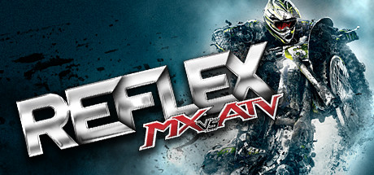

# PlayStation Portable

[← Back to index](../README.md)

792 titles across 15 years in this archive.

## 2016

[Full 2016 page](../years/2016.md)

### Cladun: This is an RPG

**Platforms:** PlayStation Portable &nbsp;|&nbsp; **Developer:** System Prisma &nbsp;|&nbsp; **Publisher:** Nippon Ichi Software, NIS America &nbsp;|&nbsp; **Genre:** Action, role-playing

[Wikipedia](https://en.wikipedia.org/wiki/Cladun:_This_is_an_RPG)

---

### Saints Row: Undercover

**Platforms:** PlayStation Portable &nbsp;|&nbsp; **Developer:** Volition &nbsp;|&nbsp; **Released:** January 28, 2016

[Wikipedia](https://en.wikipedia.org/wiki/Saints_Row:_Undercover)

---

## 2015

[Full 2015 page](../years/2015.md)

### Brandish: The Dark Revenant

**Platforms:** PlayStation Portable, PlayStation Vita &nbsp;|&nbsp; **Genre:** Action RPG &nbsp;|&nbsp; **Released:** January 13

[Wikipedia](https://en.wikipedia.org/wiki/Brandish_(video_game))

---

## 2014

[Full 2014 page](../years/2014.md)

### Bakumatsu Rock

**Platforms:** PlayStation Portable &nbsp;|&nbsp; **Genre:** Music

> Bakumatsu Rock is a Japanese video game developer by Marvelous AQL and publisher by Konami. It was adapted into a manga series, Bakumatsu Rock -howling soul-, that began on March 28, 2014 and into an anime television series, Samurai Jam -Bakumatsu Rock-, that aired on July 2, 2014 to September 17, 2014.
>
> _Synopsis source: IGDB_

[Wikipedia](https://en.wikipedia.org/wiki/Bakumatsu_Rock) · [IGDB](https://www.igdb.com/games/bakumatsu-rock)

---

### Toukiden: The Age of Demons

**Platforms:** PlayStation Vita, PlayStation Portable &nbsp;|&nbsp; **Genre:** Action RPG &nbsp;|&nbsp; **Released:** February 11

---

## 2013

[Full 2013 page](../years/2013.md)

### Armored Hunter Gunhound EX

**Platforms:** PlayStation Portable, Windows &nbsp;|&nbsp; **Developer:** Dracue &nbsp;|&nbsp; **Publisher:** Playism &nbsp;|&nbsp; **Genre:** Mecha &nbsp;|&nbsp; **Released:** January 31, 2013

> Gear up and get ready for war! Take on hectic 2D action shooting stages with your deadly Gunhound mech.
>
> _Synopsis source: IGDB_

[Wikipedia](https://en.wikipedia.org/wiki/Armored_Hunter_Gunhound_EX) · [IGDB](https://www.igdb.com/games/armored-hunter-gunhound-ex)

---

### Black Rock Shooter: The Game

**Platforms:** PlayStation Portable &nbsp;|&nbsp; **Genre:** Action RPG &nbsp;|&nbsp; **Released:** April 23

---

### Class of Heroes 2

**Platforms:** PlayStation Portable, PlayStation Vita &nbsp;|&nbsp; **Genre:** RPG &nbsp;|&nbsp; **Released:** June 4

[Wikipedia](https://en.wikipedia.org/wiki/Class_of_Heroes_2)

---

### Corpse Party: Book of Shadows

**Platforms:** PlayStation Portable &nbsp;|&nbsp; **Genre:** Survival horror &nbsp;|&nbsp; **Released:** January 15

[Wikipedia](https://en.wikipedia.org/wiki/Corpse_Party)

---

### Criminal Girls: Invite Only

**Platforms:** PlayStation Portable, PlayStation Vita &nbsp;|&nbsp; **Developer:** Imageepoch &nbsp;|&nbsp; **Publisher:** Nippon Ichi Software &nbsp;|&nbsp; **Genre:** Role-playing &nbsp;|&nbsp; **Released:** November 28, 2013

> Criminal Girls: Invite Only a Japanese role-playing game and the enhanced version of the original Criminal Girls game. The game follows a group of girls in Hell who have to climb a tower to be reincarnated. The battle system is unique since you give the characters, each representing a different vice, orders in battle and sometimes they won’t listen to you because they haven’t been trained.
>
> _Synopsis source: IGDB_

[Wikipedia](https://en.wikipedia.org/wiki/Criminal_Girls:_Invite_Only) · [IGDB](https://www.igdb.com/games/criminal-girls-invite-only)

---

### Digimon Adventure

**Platforms:** PlayStation Portable &nbsp;|&nbsp; **Developer:** Prope &nbsp;|&nbsp; **Publisher:** Namco Bandai Games &nbsp;|&nbsp; **Genre:** Role-playing, dungeon crawl &nbsp;|&nbsp; **Released:** January 17, 2013

> The story retells the story of the 1999 anime series, in which seven children; Tai (Taichi), Matt (Yamato), Sora, Izzy (Koushiro), Mimi, Joe and T.K. (Takeru), are mysteriously transported to the Digital World, where they meet monster companions known as Digimon. Using the power of the Digivice to evolve their Digimon partners into more powerful forms, Tai, his friends and their Digimon companions must work together in order to save both the Digital World and their own. The game also features the story of the film, Our War Game!, as well as original scenarios exclusive to this game.
>
> _Synopsis source: IGDB_

[Wikipedia](https://en.wikipedia.org/wiki/Digimon_Adventure_(video_game)) · [IGDB](https://www.igdb.com/games/digimon-adventure)

---

### Don 2: The Game

**Platforms:** PlayStation 2, PlayStation Portable &nbsp;|&nbsp; **Developer:** Gameshastra &nbsp;|&nbsp; **Publisher:** Sony Computer Entertainment &nbsp;|&nbsp; **Genre:** Third-person shooter, action &nbsp;|&nbsp; **Released:** February 2013

> Don 2: The Game is a third-person action tie-in game for the 2011 film "Don 2: The King Is Back" developed by Gameshastra and published by Sony Computer Entertainment. The game loosely follows the plot of the film, with Don fighting back against his back-stabbing henchmen, European cartel bosses, and old enemies from the first film.  Don 2: The Game is notable for being the last first-party release for the PlayStation 2.
>
> _Synopsis source: IGDB_

[Wikipedia](https://en.wikipedia.org/wiki/Don_2:_The_Game) · [IGDB](https://www.igdb.com/games/don-2-the-game)

---

### Dungeon Travelers 2

**Platforms:** PlayStation Portable &nbsp;|&nbsp; **Developer:** Sting Entertainment &nbsp;|&nbsp; **Publisher:** Aquaplus, Atlus, NIS America, Shiravune &nbsp;|&nbsp; **Genre:** Dungeon crawler, role-playing &nbsp;|&nbsp; **Released:** March 28, 2013

> Dungeon Travelers 2: The Royal Library & the Monster Seal is a dungeon crawler role-playing video game and the sequel to To Heart 2: Dungeon Travelers within the To Heart franchise.
>
> _Synopsis source: IGDB_

[Wikipedia](https://en.wikipedia.org/wiki/Dungeon_Travelers_2) · [IGDB](https://www.igdb.com/games/dungeon-travelers-2-the-royal-library-and-the-monster-seal)

---

### Fate/Extra CCC

**Platforms:** PlayStation Portable &nbsp;|&nbsp; **Genre:** Fighting, Puzzle, Role-playing (RPG), Strategy, Turn-based strategy (TBS), Adventure

> Fate/Extra CCC is a sequel and companion game to Fate/Extra. It has the same game mechanics as Fate/Extra with additional changes. Players can now escape battles and dungeon floor level. Each servants has more combat animation and their Noble Phantasm animation changed. One of the noticeable changes is there are more voices recording in cutscenes. Both genders of the Protagonist and the Servants will each have an alternate costume. There will be additional costumes for the Servants, and a save game from Fate/Extra will give the player character an alternate school gym outfit. All of the Characters have a Secret Garden and Punish Start session (if you collect enough information on the SG). It shows the fetishes, likes, dislikes, etc. The Secret Gardens may be Male pictures (if you choose the female protagonist, except for your Servants and bosses) or Female Pictures (if you choose the male protagonist, except for your Servants and bosses).
>
> _Synopsis source: IGDB_

[Wikipedia](https://en.wikipedia.org/wiki/Fate/Extra_CCC) · [IGDB](https://www.igdb.com/games/fate-slash-extra-ccc)

---

### FIFA 14

**Platforms:** iOS, Android, Windows, PlayStation 3, Xbox 360, Wii, PlayStation 2, PlayStation Vita, Nintendo 3DS, PlayStation Portable, PlayStation 4, Xbox One &nbsp;|&nbsp; **Genre:** Sports &nbsp;|&nbsp; **Released:** September 23

> FIFA 14 is a 2013 sports association football simulation video game developed by EA Canada and published by Electronic Arts.
>
> _Synopsis source: IGDB_

[Wikipedia](https://en.wikipedia.org/wiki/FIFA_14) · [IGDB](https://www.igdb.com/games/fifa-14)

---

### Generation of Chaos: Pandora's Reflection

**Platforms:** PlayStation Portable &nbsp;|&nbsp; **Genre:** Tactical RPG &nbsp;|&nbsp; **Released:** February 19

---

### God Eater 2

**Platforms:** PlayStation Vita, PlayStation Portable, PlayStation 4, Windows &nbsp;|&nbsp; **Developer:** Shift &nbsp;|&nbsp; **Publisher:** Bandai Namco Entertainment &nbsp;|&nbsp; **Genre:** Action role-playing &nbsp;|&nbsp; **Released:** November 14, 2013

> God Eater 2 is an action role-playing game and the sequel to God Eater. The game takes place 3 years after the original. A new fatal pandemic called the Black Plague, caused by red rain, has struck the Far East area. Members of Special Forces Blood, an affiliate of Fenrir who reside in a mobile base, are sent to assist. The game features 3 new weapon types, the Shotgun, the Boost Hammer, and the Charge Spear, as well as new mechanics, such as Blood Bullets and Blood Arts, as well as reworks for all the previously available Equipment types. New Aragami, new as well as returning Characters, and new Fields will accompany refined visuals.
>
> _Synopsis source: IGDB_

[Wikipedia](https://en.wikipedia.org/wiki/God_Eater_2) · [IGDB](https://www.igdb.com/games/god-eater-2)

---

### Hakuoki: Warriors of the Shinsengumi

**Platforms:** PlayStation Portable &nbsp;|&nbsp; **Released:** February 19

[Wikipedia](https://en.wikipedia.org/wiki/Haku%C5%8Dki#Video_games)

---

### Kamigami no Asobi

**Platforms:** PlayStation Portable &nbsp;|&nbsp; **Genre:** Visual Novel

> Kamigami no Asobi: Ludere Deorum, abbreviated as KamiAso, is a Japanese otome game published by Broccoli (company). It was released in Japan on October 24, 2013 for the PlayStation Portable.
>
> _Synopsis source: IGDB_

[Wikipedia](https://en.wikipedia.org/wiki/Kamigami_no_Asobi) · [IGDB](https://www.igdb.com/games/kamigami-no-asobi-ludere-deorum)

---

### London Detective Mysteria

**Platforms:** PlayStation Portable &nbsp;|&nbsp; **Developer:** Karin Entertainment &nbsp;|&nbsp; **Publisher:** Marvelous AQL, Karin Entertainment, Xseed Games &nbsp;|&nbsp; **Genre:** Visual novel &nbsp;|&nbsp; **Released:** March 7, 2013

> Eikoku Tantei Mysteria is a 2013 otome visual novel video game for the PlayStation Portable created by Karin Entertainment and published by Marvelous in Japan.
>
> _Synopsis source: IGDB_

[Wikipedia](https://en.wikipedia.org/wiki/London_Detective_Mysteria) · [IGDB](https://www.igdb.com/games/eikoku-tantei-mysteria)

---

### Meiji Tokyo Renka

**Platforms:** PlayStation Portable &nbsp;|&nbsp; **Genre:** Visual Novel

> Meiji Tokyo Renka is a Japanese visual novel produced by Mages, with character design and art provided by Karu. The series follows Mei Ayazuki, a high school girl who is sent back in time to the Meiji period and explores her relationships with spirits and Japanese historical figures.
>
> _Synopsis source: IGDB_

[Wikipedia](https://en.wikipedia.org/wiki/Meiji_Tokyo_Renka) · [IGDB](https://www.igdb.com/games/meiji-tokyo-renka)

---

### Pro Evolution Soccer 2014

**Platforms:** Windows, PlayStation 3, Xbox 360, PlayStation 2, Nintendo 3DS, PlayStation Portable &nbsp;|&nbsp; **Genre:** Sports &nbsp;|&nbsp; **Released:** September 24

> Pro Evolution Soccer 2014 (PES 2014) is a football simulation game developed by Konami. Released in 2013, it is part of the long-running Pro Evolution Soccer series and introduces a new engine, updated mechanics, and expanded features across multiple platforms.  PES 2014 centers gameplay around realistic ball physics, player motion, and team dynamics. It introduces the Motion Animation Stability System (M.A.S.S.) to enhance physical interactions between players, making tackles, collisions, and positioning more lifelike. The game also features a morale system where crowd influence and individual performances affect team behavior on the pitch.  The Player ID system, first introduced in PES 2013, is expanded to cover more star players and now replicates full squad behaviors to reflect real-world playing styles. A new Combination Plan allows users to coordinate tactical plays among three or more players, enabling more diverse and strategic attacking options.  Additional features include the ability to switch clubs or coach national teams in Master League, create third and fourth kits (with some official options), and play the UEFA Europa League in a dedicated mode.
>
> _Synopsis source: IGDB_

[Wikipedia](https://en.wikipedia.org/wiki/Pro_Evolution_Soccer_2014) · [IGDB](https://www.igdb.com/games/pro-evolution-soccer-2014)

---

### Shining Ark

**Platforms:** PlayStation Portable &nbsp;|&nbsp; **Developer:** Media.Vision &nbsp;|&nbsp; **Publisher:** Sega &nbsp;|&nbsp; **Genre:** Role-playing &nbsp;|&nbsp; **Released:** February 28, 2013

> Shining Ark is a role-playing video game developed by Media.Vision and published by Sega for the PlayStation Portable. It is the fifth Shining game with characters designed by Tony Taka. It was released on February 28, 2013 in Japan.
>
> _Synopsis source: IGDB_

[Wikipedia](https://en.wikipedia.org/wiki/Shining_Ark) · [IGDB](https://www.igdb.com/games/shining-ark)

---

### Summon Night 5

**Platforms:** PlayStation Portable &nbsp;|&nbsp; **Developer:** Felistella &nbsp;|&nbsp; **Publisher:** Bandai Namco Games, Gaijinworks &nbsp;|&nbsp; **Genre:** Tactical RPG &nbsp;|&nbsp; **Released:** May 16, 2013

> Summon Night 5 is a tactical role-playing game in the Summon Night series of games. The game involves the player moving characters in a turn based fashion across a large grid from an adjustable isometric perspective. At the beginning of the game, the player can chose to play as either a male or female protagonist, and chose from 4 separate "Cross" (partner) characters. Which combinations are selected affect both the dialogue and story progression, leading to eight separate paths to take through the game. The world of Summon Night changed dramatically for this entry. Now the medieval setting changed completely to a more contemporary world mixed with many of the other cultures and tribes already present in other Summon Night games. The stage for this title is the city of Savorle, a model city in this new era where people from all the different world can coexist.
>
> _Synopsis source: IGDB_

[Wikipedia](https://en.wikipedia.org/wiki/Summon_Night_5) · [IGDB](https://www.igdb.com/games/summon-night-5)

---

### The Pet Girl of Sakurasou

**Platforms:** PlayStation Vita, PlayStation Portable &nbsp;|&nbsp; **Genre:** Visual Novel

> Sakura-sou no Pet na Kanojo is a visual novel based on a light novel of the same name, developed by Netchubiyori and published by ASCII Media Works.
>
> _Synopsis source: IGDB_

[Wikipedia](https://en.wikipedia.org/wiki/The_Pet_Girl_of_Sakurasou) · [IGDB](https://www.igdb.com/games/sakura-sou-no-pet-na-kanojo)

---

## 2012

[Full 2012 page](../years/2012.md)

### Anohana

**Platforms:** PlayStation Portable &nbsp;|&nbsp; **Genre:** Adventure, Visual Novel

> Ano Hi Mita Hana no Namae o Bokutachi wa Mada Shiranai is a visual novel developed by guyzware, based on the anime of the same name, it contains a branching story and multiple endings made just for the game. It also contains a communication mini-game where you can talk to a 3D model of Menma every day.
>
> _Synopsis source: IGDB_

[Wikipedia](https://en.wikipedia.org/wiki/Anohana) · [IGDB](https://www.igdb.com/games/ano-hi-mita-hana-no-namae-wo-boku-tachi-ha-mada-shiranai)

---

### Canabalt

**Platforms:** PlayStation Portable &nbsp;|&nbsp; **Released:** April 3

[Wikipedia](https://en.wikipedia.org/wiki/Canabalt)

---

### Conception

**Platforms:** PlayStation Portable &nbsp;|&nbsp; **Developer:** Chime &nbsp;|&nbsp; **Publisher:** Spike Chunsoft &nbsp;|&nbsp; **Genre:** Role-playing, Dating sim &nbsp;|&nbsp; **Released:** April 26, 2012

> Conception: Ore no Kodomo o Undekure! is a Japanese role-playing game and the first game in Spike Chunsoft's Conception series. The player's goal is to charm pure, innocent girls from Granvania National Star God Academy, raise their affection for Itsuki, then produce and take the "Star Children" to explore dungeons and battle "impurities".
>
> _Synopsis source: IGDB_

[Wikipedia](https://en.wikipedia.org/wiki/Conception_(video_game)) · [IGDB](https://www.igdb.com/games/conception-ore-no-kodomo-wo-undekure)

---

### Corpse Party: Sweet Sachiko's Hysteric Birthday Bash

**Platforms:** PlayStation Portable &nbsp;|&nbsp; **Genre:** Role-playing (RPG), Adventure

> Corpse Party: Sweet Sachiko's Hysteric Birthday Bash is a different type of adventure in the Corpse Party series that stars the violent and murderous Sachiko Shinozaki, who has decided to invite her victims to Heavenly Host Elementary School to celebrate her birthday. However, this isn’t the type of party where the guests leave with a smile on their faces. Instead, Sachiko plans to force the students to participate in twisted games for her amusement. Will the students survive Sachiko’s celebration, or will they meet a Wrong End once again?
>
> _Synopsis source: IGDB_

[Wikipedia](https://en.wikipedia.org/wiki/Corpse_Party:_Sweet_Sachiko's_Hysteric_Birthday_Bash) · [IGDB](https://www.igdb.com/games/corpse-party-sweet-sachikos-hysteric-birthday-bash)

---

### Danganronpa 2: Goodbye Despair

**Platforms:** PlayStation Portable &nbsp;|&nbsp; **Developer:** Spike Chunsoft &nbsp;|&nbsp; **Publisher:** Spike Chunsoft &nbsp;|&nbsp; **Genre:** Adventure, visual novel &nbsp;|&nbsp; **Released:** July 26, 2012

> The follow up to Danganronpa: Trigger Happy Havoc. The main character, Hajime Hinata, a new 'Ultimate' student at Hope's Peak Academy. On their first day, Hajime and all of his classmates are taken on a field trip to the mysterious Jabberwock island by their anthropomorphic rabbit teacher, Usami. Usami explains that on this island the students are to have fun together and become friends to gather Hope Fragments. Usami's field trip does not go as planned when Monokuma appears and begins a new Killing Game. Anyone that wants to leave the island must commit a murder and get away with it. If the murderer is successful, he/she is allowed to leave the island, while everyone else is killed. When a murder occurs, the player investigates. After the investigations, a trial commences to determine who the culprit is.
>
> _Synopsis source: IGDB_

[Wikipedia](https://en.wikipedia.org/wiki/Danganronpa_2:_Goodbye_Despair) · [IGDB](https://www.igdb.com/games/danganronpa-2-goodbye-despair)

---

### Digimon World Re:Digitize

**Platforms:** PlayStation Portable &nbsp;|&nbsp; **Developer:** tri-Crescendo &nbsp;|&nbsp; **Publisher:** Bandai Namco Games &nbsp;|&nbsp; **Genre:** Role-playing &nbsp;|&nbsp; **Released:** July 19, 2012

> In the game, the player follows and controls "Taiga", a 16-year-old male protagonist who is transported to the digital world of Digimon, which in his universe is merely an online game. In the universe of Digimon, people raise creatures collectively referred to as Digimon. Players raise the Digimon through stages of growth that determine his personality, the five stages being "Baby", "Child", "Adult", "Perfect" and "Ultimate". Digimon evolve over time by gaining stats and other factors. Digimon can get hungry, sick, injured or die and need care to recover.
>
> _Synopsis source: IGDB_

[Wikipedia](https://en.wikipedia.org/wiki/Digimon_World_Re:Digitize) · [IGDB](https://www.igdb.com/games/digimon-world-re-digitize)

---

### FIFA 13

**Platforms:** Xbox 360, Windows, PlayStation 3, Wii, PlayStation Vita, PlayStation Portable, PlayStation 2, iOS &nbsp;|&nbsp; **Publisher:** EA Sports &nbsp;|&nbsp; **Released:** September 25, 2012

[Wikipedia](https://en.wikipedia.org/wiki/FIFA_13)

---

### Final Fantasy III

**Platforms:** Android, PlayStation Portable &nbsp;|&nbsp; **Type:** Port &nbsp;|&nbsp; **Released:** June 27

[Wikipedia](https://en.wikipedia.org/wiki/Final_Fantasy_III)

---

### Football Manager Handheld 2013

**Platforms:** PlayStation Portable &nbsp;|&nbsp; **Released:** November 30

[Wikipedia](https://en.wikipedia.org/wiki/Football_Manager_2013)

---

### Gensō Suikoden: Tsumugareshi Hyakunen no Toki

**Platforms:** PlayStation Portable &nbsp;|&nbsp; **Developer:** Konami &nbsp;|&nbsp; **Publisher:** Konami &nbsp;|&nbsp; **Genre:** Role-playing game &nbsp;|&nbsp; **Released:** February 9, 2012

[Wikipedia](https://en.wikipedia.org/wiki/Gens%C5%8D_Suikoden:_Tsumugareshi_Hyakunen_no_Toki)

---

### Growlanser Wayfarer of Time

**Platforms:** PlayStation Portable &nbsp;|&nbsp; **Released:** July 31

[Wikipedia](https://en.wikipedia.org/wiki/Growlanser_Wayfarer_of_Time)

---

### Gungnir

**Platforms:** PlayStation Portable &nbsp;|&nbsp; **Released:** June 12

[Wikipedia](https://en.wikipedia.org/wiki/Gungnir_(video_game))

---

### Heroes Phantasia

**Platforms:** PlayStation Portable &nbsp;|&nbsp; **Developer:** Witchcraft &nbsp;|&nbsp; **Publisher:** Bandai Namco Games &nbsp;|&nbsp; **Genre:** Role-playing &nbsp;|&nbsp; **Released:** January 19, 2012

> Heroes Phantasia is a game released for the PlayStation Portable, where the player can control a great variety of characters from 10 different anime series of the last 10 years, as well as some original characters.
>
> _Synopsis source: IGDB_

[Wikipedia](https://en.wikipedia.org/wiki/Heroes_Phantasia) · [IGDB](https://www.igdb.com/games/heroes-phantasia)

---

### Major League Baseball 2K12

**Platforms:** Windows, PlayStation 3, Xbox 360, Wii, PlayStation 2, PlayStation Portable, Nintendo DS &nbsp;|&nbsp; **Released:** March 6

[Wikipedia](https://en.wikipedia.org/wiki/Major_League_Baseball_2K12)

---

### Mobile Suit Gundam AGE

**Platforms:** PlayStation Portable &nbsp;|&nbsp; **Developer:** Level-5 &nbsp;|&nbsp; **Publisher:** Namco Bandai Games &nbsp;|&nbsp; **Genre:** Action role-playing game, hack and slash, Mecha, Military Science Fiction &nbsp;|&nbsp; **Released:** August 30, 2012

[Wikipedia](https://en.wikipedia.org/wiki/Mobile_Suit_Gundam_AGE_(video_game))

---

### Mystic Chronicles

**Platforms:** PlayStation Portable, iOS &nbsp;|&nbsp; **Developer:** Kemco &nbsp;|&nbsp; **Publisher:** Natsume Inc. &nbsp;|&nbsp; **Genre:** Role-playing video game &nbsp;|&nbsp; **Released:** January 19, 2012

> Mystic Chronicles is a Japanese role-playing video game developed by Kemco. While initially released as Fantasy Chronicles for the iOS, the name was retitled as a result of Natsume providing a new English translation for its release on the PlayStation Portable, released in North America on July 16, 2013.  The game plays as a traditional Japanese role-playing video game. In the game, the player navigates a character through a fantasy would, interacing with non-playable characters and fighting enemies. When engaging enemies, the game utilizes a turn based battle system reminiscent of ones found in the Dragon Quest series of games.
>
> _Synopsis source: IGDB_

[Wikipedia](https://en.wikipedia.org/wiki/Mystic_Chronicles) · [IGDB](https://www.igdb.com/games/mystic-chronicles)

---

### NBA 2K13

**Platforms:** Windows, PlayStation 3, Xbox 360, PlayStation Portable, Wii &nbsp;|&nbsp; **Publisher:** 2K &nbsp;|&nbsp; **Genre:** Simulator, Sport, Strategy &nbsp;|&nbsp; **Released:** October 2, 2012

> With more than 5 million copies sold worldwide and more than 25 Sports Game of the Year awards won, NBA 2K12 was another monster release for the biggest NBA video game simulation franchise in the world. This year, 2K Sports has joined forces with the legendary JAY Z as Executive Producer to transcend sports video games and take virtual hardwood to the next level. Featuring an enhanced MyCAREER mode and all-new gameplay features, NBA 2K13 will let gamers pit the best players in NBA history against the new dynasty of talent, including the much-debated matchup between the 2012 U.S. Men's National Team and the 1992 "Dream Team."
>
> _Synopsis source: IGDB_

[Wikipedia](https://en.wikipedia.org/wiki/NBA_2K13) · [IGDB](https://www.igdb.com/games/nba-2k13)

---

### One Piece: Romance Dawn

**Platforms:** PlayStation Portable &nbsp;|&nbsp; **Developer:** Three Rings &nbsp;|&nbsp; **Publisher:** Namco Bandai Games &nbsp;|&nbsp; **Genre:** RPG &nbsp;|&nbsp; **Released:** December 20, 2012

> The game is an RPG; it uses turn-based battles and action commands that help guide the player. The player commands the protagonist Luffy and other characters that are in his crew. The characters level up, and the player can strengthen attacks by obtaining points. All characters and enemies are from the One Piece series and play the same roles as seen in the source material. Cutscenes are told in a manga style.
>
> _Synopsis source: IGDB_

[Wikipedia](https://en.wikipedia.org/wiki/One_Piece:_Romance_Dawn) · [IGDB](https://www.igdb.com/games/one-piece-romance-dawn)

---

### Photo Kano

**Platforms:** PlayStation Portable &nbsp;|&nbsp; **Genre:** Adventure

> A visual novel for PSP.
>
> _Synopsis source: IGDB_

[Wikipedia](https://en.wikipedia.org/wiki/Photo_Kano) · [IGDB](https://www.igdb.com/games/photo-kano)

---

### Pro Evolution Soccer 2013

**Platforms:** Windows, PlayStation 3, Xbox 360, Wii, PlayStation 2, PlayStation Portable &nbsp;|&nbsp; **Genre:** Simulator, Sport &nbsp;|&nbsp; **Released:** September 25

> Pro Evolution Soccer 2013 (also known as World Soccer: Winning Eleven 2013 in Japan and South Korea) is an association football video game part of the Pro Evolution Soccer series, developed and published by Konami.
>
> _Synopsis source: IGDB_

[Wikipedia](https://en.wikipedia.org/wiki/Pro_Evolution_Soccer_2013) · [IGDB](https://www.igdb.com/games/pro-evolution-soccer-2013)

---

### Ragnarok Tactics

**Platforms:** PlayStation Portable &nbsp;|&nbsp; **Released:** November 6

[Wikipedia](https://en.wikipedia.org/wiki/Ragnarok_Tactics)

---

### Shining Blade

**Platforms:** PlayStation Portable &nbsp;|&nbsp; **Developer:** Media.Vision &nbsp;|&nbsp; **Publisher:** Sega &nbsp;|&nbsp; **Genre:** Tactical role-playing game &nbsp;|&nbsp; **Released:** March 15, 2012

> This is a Japan-only game in the Shining franchise. The game's battle system is called "Concerto", and is a strategic real time battle system similar to the ones found in Sakura Wars and Valkyria Chronicles. The player make use of swords, bows and magic in a battle system that places importance on character cooperation—hence the name "Concerto". The player forms a party of up to five for battle. The game will have damage based on character position, and items collected upon defeating enemies.  The songstresses are special members of the player's battle party. By performing their magic song, they can achieve various effects on battle—blocking enemies from moving, increasing characters' move count, making hasten the party's pace. Some songs can even be used for attack. Using the songs requires Mana Energy.  The game also has inter-character relationships. Depending on the player's selections during event scenes, movements and usage of group skills during battle, the characters' relationships will change.
>
> _Synopsis source: IGDB_

[Wikipedia](https://en.wikipedia.org/wiki/Shining_Blade) · [IGDB](https://www.igdb.com/games/shining-blade)

---

### Sol Trigger

**Platforms:** PlayStation Portable &nbsp;|&nbsp; **Developer:** Imageepoch &nbsp;|&nbsp; **Publisher:** Imageepoch &nbsp;|&nbsp; **Genre:** Role-playing &nbsp;|&nbsp; **Released:** October 4, 2012

> Sol Trigger is the La Résistance to the Machine Church which rules the dystopian city of Kaiserhald. The Machine Church is using a miraculous energy source known as "Sol" to raise the city to even greater heights, but Sol Trigger know that Sol is secretly made from people, and that the Church intends to ramp up their production with a new form of twisted technology.
>
> _Synopsis source: IGDB_

[Wikipedia](https://en.wikipedia.org/wiki/Sol_Trigger) · [IGDB](https://www.igdb.com/games/sol-trigger)

---

### Sweet Fuse: At Your Side

**Platforms:** PlayStation Portable &nbsp;|&nbsp; **Developer:** Comcept &nbsp;|&nbsp; **Publisher:** Idea Factory, Aksys Games &nbsp;|&nbsp; **Genre:** Visual novel &nbsp;|&nbsp; **Released:** June 14, 2012

> Sweet Fuse is a mystery and romance visual novel in which the player assumes the role of Saki Inafune, as she plays through seven days of death games. Much of its gameplay is spent on reading the story's narrative and dialogue. The player will be prompted on occasion to pick what to make Saki say. Picking the correct responses will sometimes given the player an "affection point" for a particular character which raises that character's affection level. There are moments during which Saki will become irate, indicated by the screen shaking and turning red, and the player will have to choose between having her restrain her anger or letting it out.  "Explosive Insight" sections take place when Saki must find a solution or an answer to a problem. Saki recalls the situation to herself, with a number of keywords and phrases in her thoughts highlighted. The player can pick up to three highlighted words or phrases to select, and the player prompts Saki's epiphany if one of their selections is correct.[1] If the player does not select the correct phrases, a bad ending will usually occur and they are prompted to try again.  The game follows a branching plot line with multiple endings; depending on the decisions that the player makes during the game, the plot will progress in a specific direction.
>
> _Synopsis source: IGDB_

[Wikipedia](https://en.wikipedia.org/wiki/Sweet_Fuse:_At_Your_Side) · [IGDB](https://www.igdb.com/games/sweet-fuse-at-your-side)

---

### Tales of the Heroes: Twin Brave

**Platforms:** PlayStation Portable &nbsp;|&nbsp; **Developer:** Alfa System &nbsp;|&nbsp; **Publisher:** Namco Bandai Games &nbsp;|&nbsp; **Genre:** Beat 'em up, Action &nbsp;|&nbsp; **Released:** February 23, 2012

> Tales of the Heroes: Twin Brave is an action beat 'em up, video game in the Tales series of games. It is considered an "scort title", and plays more similarly to the Dynasty Warriors game series.
>
> _Synopsis source: IGDB_

[Wikipedia](https://en.wikipedia.org/wiki/Tales_of_the_Heroes:_Twin_Brave) · [IGDB](https://www.igdb.com/games/tales-of-the-heroes-twin-brave)

---

### The Idolmaster Shiny Festa

**Platforms:** PlayStation Portable &nbsp;|&nbsp; **Developer:** Namco Bandai Studios, A-1 Pictures &nbsp;|&nbsp; **Publisher:** Namco Bandai Games &nbsp;|&nbsp; **Genre:** Rhythm game &nbsp;|&nbsp; **Released:** October 25, 2012

[Wikipedia](https://en.wikipedia.org/wiki/The_Idolmaster_Shiny_Festa)

---

### The Legend of Nayuta: Boundless Trails

**Platforms:** PlayStation Portable &nbsp;|&nbsp; **Developer:** Nihon Falcom &nbsp;|&nbsp; **Publisher:** NIS America, Nihon Falcom &nbsp;|&nbsp; **Genre:** Action role-playing &nbsp;|&nbsp; **Released:** July 26, 2012

> Nayuta no Kiseki is an action role-playing game that was released on July 26th, 2012. The title has a completely new setting, new characters and even a new game system from previous "Kiseki" games. It is also the first game in the Kiseki series to drop the "Legend of Heroes" title.
>
> _Synopsis source: IGDB_

[Wikipedia](https://en.wikipedia.org/wiki/The_Legend_of_Nayuta:_Boundless_Trails) · [IGDB](https://www.igdb.com/games/nayuta-no-kiseki)

---

### Time Travelers

**Platforms:** Nintendo 3DS, PlayStation Vita, PlayStation Portable &nbsp;|&nbsp; **Developer:** Level-5 &nbsp;|&nbsp; **Publisher:** Level-5 &nbsp;|&nbsp; **Genre:** Playing cinema, adventure, visual novel &nbsp;|&nbsp; **Released:** July 12, 2012

> Time Travelers is a cinematic interactive drama game with multiple choices. Usually, if a main character makes a mistake or dies, they can reverse time to perform the right action. Their choices will be displayed in the flowchart. The right choices are necessary to advance the story. A final choice determines which ending the player gets. The game has quick time events, in which players must perform actions by quickly pressing the right button.
>
> _Synopsis source: IGDB_

[Wikipedia](https://en.wikipedia.org/wiki/Time_Travelers_(video_game)) · [IGDB](https://www.igdb.com/games/time-travelers)

---

### Unchained Blades

**Platforms:** PlayStation Portable &nbsp;|&nbsp; **Released:** June 26

[Wikipedia](https://en.wikipedia.org/wiki/Unchained_Blades)

---

### Velocity

**Platforms:** PlayStation Portable &nbsp;|&nbsp; **Developer:** FuturLab, Curve Studios &nbsp;|&nbsp; **Publisher:** FuturLab, Curve Studios &nbsp;|&nbsp; **Genre:** Shoot 'em up &nbsp;|&nbsp; **Released:** May 15, 2012

> Velocity is a shoot 'em up involving navigating the Quarp Jet: a teleporting spacecraft – through space, whilst avoiding and defeating enemies using bombs that can be flung in cardinal directions. The main goal of the game is to rescue stranded ships.
>
> _Synopsis source: IGDB_

[Wikipedia](https://en.wikipedia.org/wiki/Velocity_(video_game)) · [IGDB](https://www.igdb.com/games/velocity)

---

## 2011

[Full 2011 page](../years/2011.md)

### 1000 Tiny Claws

**Platforms:** PlayStation Portable &nbsp;|&nbsp; **Developer:** Mediatonic &nbsp;|&nbsp; **Publisher:** Mediatonic &nbsp;|&nbsp; **Genre:** Action &nbsp;|&nbsp; **Released:** October 4, 2011

> 1000 Tiny Claws is the third PlayStation Minis game from developer Mediatonic.
>
> _Synopsis source: IGDB_

[Wikipedia](https://en.wikipedia.org/wiki/1000_Tiny_Claws) · [IGDB](https://www.igdb.com/games/1000-tiny-claws)

---

### A Certain Magical Index

**Platforms:** PlayStation Portable &nbsp;|&nbsp; **Genre:** Fighting

> Toaru Majutsu no Index is a fighting game based on the Toaru Majutsu no Index universe. The game features an original story by the author of the series, Kamachi Kazuma. As with many fighting games, players choose a characters from a lineup, and engage in hand-to-hand combat with an opponent. It is primarily a competitive two player series, but a human player can fight an AI-controlled character for practice, amusement, or to advance the game's story. In the game the player has the option of using a partner to be used as support during the match. All the characters can be used as partners, however, both Index and Last Order are exclusively partner-type characters, and can't be used for fighting.
>
> _Synopsis source: IGDB_

[Wikipedia](https://en.wikipedia.org/wiki/A_Certain_Magical_Index_(video_game)) · [IGDB](https://www.igdb.com/games/toaru-majutsu-no-index)

---

### Alpha Mission

**Platforms:** PlayStation 3, PlayStation Portable &nbsp;|&nbsp; **Released:** September 6

[Wikipedia](https://en.wikipedia.org/wiki/Alpha_Mission)

---

### Amnesia

**Platforms:** PlayStation Portable &nbsp;|&nbsp; **Genre:** Visual Novel

> First game in Amnesia otome visual novel series.
>
> _Synopsis source: IGDB_

[Wikipedia](https://en.wikipedia.org/wiki/Amnesia_(2011_video_game)) · [IGDB](https://www.igdb.com/games/amnesia)

---

### Another Century's Episode Portable

**Platforms:** PlayStation Portable &nbsp;|&nbsp; **Developer:** FromSoftware &nbsp;|&nbsp; **Publisher:** Namco Bandai Games &nbsp;|&nbsp; **Genre:** Third-person shooter &nbsp;|&nbsp; **Released:** January 13, 2011

[Wikipedia](https://en.wikipedia.org/wiki/Another_Century's_Episode_Portable)

---

### Battle vs. Chess

**Platforms:** Windows, Nintendo DS, PlayStation 3, PlayStation Portable, Wii, Xbox 360 &nbsp;|&nbsp; **Released:** May 17

[Wikipedia](https://en.wikipedia.org/wiki/Battle_vs._Chess)

---

### Black Rock Shooter: The Game

**Platforms:** PlayStation Portable &nbsp;|&nbsp; **Developer:** Imageepoch &nbsp;|&nbsp; **Publisher:** Imageepoch, NIS America &nbsp;|&nbsp; **Genre:** Action RPG &nbsp;|&nbsp; **Released:** August 25, 2011

> Black Rock Shooter: The Game is an action role-playing game and based on the Black Rock Shooter franchise created by Huke. The players take on the role of the eponymous Black Rock Shooter. The game is divided into several missions in which the player must clear objectives to progress. On the main overworld, BRS can explore the available areas and look for certain items. Battles begin when the player comes into contact with an enemy on the overworld. During a battle, BRS can aim and shoot with her rock cannon at enemies, block against attacks, and sidestep to avoid them completely. If the player fires the rock cannon or uses the sidestep too much in a short time, the system will overheat, leaving the player vulnerable to attack until it cools down. Throughout the game, players can earn abilities that can be equipped to BRS and used in battle, each with their own cooldown periods. These include offensive attacks such as a powerful blast, a sniper rifle, or support abilities that can increase BRS' stats such as her attack or defense. Certain sections will also see BRS ride a motorcycle, in which she can attack enemies on either side of her or use weapons to fire in front of enemies.
>
> _Synopsis source: IGDB_

[Wikipedia](https://en.wikipedia.org/wiki/Black_Rock_Shooter:_The_Game) · [IGDB](https://www.igdb.com/games/black-rock-shooter-the-game)

---

### Cars 2

**Platforms:** Windows, Xbox 360, PlayStation 3, Wii, Nintendo DS, Nintendo 3DS, PlayStation Portable &nbsp;|&nbsp; **Released:** June 21

[Wikipedia](https://en.wikipedia.org/wiki/Cars_2_(video_game))

---

### Cars 2: The Video Game

**Platforms:** PlayStation 3, Xbox 360, Windows, Wii, Nintendo DS, Nintendo 3DS, PlayStation Portable, macOS, iOS &nbsp;|&nbsp; **Developer:** Avalanche Software, TransGaming, Firebrand Games, Virtual Toys &nbsp;|&nbsp; **Publisher:** Disney Interactive Studios, Sony Computer Entertainment, Disney Mobile Studios &nbsp;|&nbsp; **Genre:** Racing &nbsp;|&nbsp; **Released:** June 21, 2011

> Inspired by the Disney•Pixar animated film, Cars 2: The Video Game lets players jump into the Cars 2 universe with some of their favorite Cars personalities in exotic locations around the globe.
>
> _Synopsis source: IGDB_

[Wikipedia](https://en.wikipedia.org/wiki/Cars_2:_The_Video_Game) · [IGDB](https://www.igdb.com/games/cars-2)

---

### Code 18

**Platforms:** PlayStation Portable, Xbox 360 &nbsp;|&nbsp; **Developer:** Cyberfront &nbsp;|&nbsp; **Publisher:** Cyberfront &nbsp;|&nbsp; **Genre:** Visual novel &nbsp;|&nbsp; **Released:** September 29, 2011

[Wikipedia](https://en.wikipedia.org/wiki/Code_18)

---

### Corpse Party

**Platforms:** PlayStation Portable &nbsp;|&nbsp; **Released:** November 22

[Wikipedia](https://en.wikipedia.org/wiki/Corpse_Party)

---

### Days of Thunder

**Platforms:** PlayStation Network, Xbox 360, PlayStation Portable &nbsp;|&nbsp; **Released:** February 22

[Wikipedia](https://en.wikipedia.org/wiki/Days_of_Thunder_(2011_video_game))

---

### Dissidia 012 Final Fantasy

**Platforms:** PlayStation Portable &nbsp;|&nbsp; **Released:** March 22

[Wikipedia](https://en.wikipedia.org/wiki/Dissidia_012_Final_Fantasy)

---

### Fate/Extra

**Platforms:** PlayStation Portable &nbsp;|&nbsp; **Released:** November 21

[Wikipedia](https://en.wikipedia.org/wiki/Fate/Extra)

---

### FIFA 12

**Platforms:** PlayStation 3, Xbox 360, Windows, Wii, PlayStation 2, PlayStation Portable, Nintendo 3DS, iOS &nbsp;|&nbsp; **Publisher:** EA Sports &nbsp;|&nbsp; **Released:** September 27, 2011

[Wikipedia](https://en.wikipedia.org/wiki/FIFA_12)

---

### Final Fantasy IV: The Complete Collection

**Platforms:** PlayStation Portable &nbsp;|&nbsp; **Released:** April 19

---

### Final Fantasy Tactics: The War of the Lions

**Platforms:** PlayStation Portable &nbsp;|&nbsp; **Released:** July 19

---

### Final Fantasy Type-0

**Platforms:** PlayStation Portable &nbsp;|&nbsp; **Developer:** Square Enix 1st Production Department &nbsp;|&nbsp; **Publisher:** Square Enix &nbsp;|&nbsp; **Genre:** Action role-playing &nbsp;|&nbsp; **Released:** October 27, 2011

> Final Fantasy Type-0 is set within Orience, a land divided between four nations or "Crystal States". Each nation has crystals of power based on the Four Symbols, which are in turn their national emblems. The Dominion of Rubrum uses the Vermillion Bird Crystal, which controls magic; the Milites Empire controls the White Tiger Crystal, containing the power of science and weapons; the Kingdom of Concordia uses the Azure Dragon Crystal, containing the power of Dragons; and the Lorican Alliance is home to the Black Tortoise Crystal, containing the power of shielding. Each nation has an academy, or Peristylium, to research and protect the country's respective crystal. The crystals have the ability to mark humans as their countries' servants. These servants, called l'Cie, are branded with a symbol and are given a "Focus", a task to complete. While blessed with long life and the ability to transform into crystal, l'Cie are cursed to lose their memories over time. The people of Orience also lose their memories of the dead, so they will not be held back by any past regrets and continue strengthening their souls through conflict, a mechanism put in place by the crystals for the convenience of the deities who crafted them. The main aim of many characters is to become Agito, a legendary figure who will appear and save the world from Tempus Finis, an apocalyptic event that will destroy Orience.
>
> _Synopsis source: IGDB_

[Wikipedia](https://en.wikipedia.org/wiki/Final_Fantasy_Type-0) · [IGDB](https://www.igdb.com/games/final-fantasy-type-0)

---

### Gloria Union

**Platforms:** PlayStation Portable &nbsp;|&nbsp; **Developer:** Sting &nbsp;|&nbsp; **Publisher:** Atlus &nbsp;|&nbsp; **Genre:** Tactical role-playing game &nbsp;|&nbsp; **Released:** June 23, 2011

[Wikipedia](https://en.wikipedia.org/wiki/Gloria_Union)

---

### Gods Eater Burst

**Platforms:** PlayStation Portable &nbsp;|&nbsp; **Released:** March 15

[Wikipedia](https://en.wikipedia.org/wiki/Gods_Eater_Burst)

---

### Grand Knights History

**Platforms:** PlayStation Portable &nbsp;|&nbsp; **Developer:** Vanillaware &nbsp;|&nbsp; **Publisher:** Marvelous Entertainment &nbsp;|&nbsp; **Genre:** Tactical role-playing &nbsp;|&nbsp; **Released:** September 1, 2011

> Grand Knights History is a set in the fantasy world of Rystia, which is divided into three warring kingdoms: Logres, the Ancient Kingdom, ruled by King Fausel; Union, the Kingdom of Knights, ruled by King Leon; and Avalon, the Kingdom of Magic, ruled by Queen Muse. Players must align themselves to one of the three nations and advance the story by taking part in missions on behalf of their chosen country.
>
> _Synopsis source: IGDB_

[Wikipedia](https://en.wikipedia.org/wiki/Grand_Knights_History) · [IGDB](https://www.igdb.com/games/grand-knights-history)

---

### Half-Minute Hero: The Second Coming

**Platforms:** PlayStation Portable &nbsp;|&nbsp; **Developer:** Opus &nbsp;|&nbsp; **Publisher:** Marvelous AQL &nbsp;|&nbsp; **Genre:** Action role-playing &nbsp;|&nbsp; **Released:** August 4, 2011

> The world's speediest homage/roast to JRPGs! Can you save the world in 30 seconds? Get a quest, find those in need, fight through dungeons, earn cash, get cool loot and level up until YOU>EVIL. Don't have enough time? Pay the Goddess to reset the clock and try again! Over 100 mini-JRPGs for you to test your might with! Available outside Japan for the first time ever exclusively on Steam.
>
> _Synopsis source: IGDB_

[Wikipedia](https://en.wikipedia.org/wiki/Half-Minute_Hero:_The_Second_Coming) · [IGDB](https://www.igdb.com/games/half-minute-hero-the-second-coming)

---

### Hot Shots Shorties

**Platforms:** PlayStation Portable &nbsp;|&nbsp; **Genre:** Sports &nbsp;|&nbsp; **Released:** January 4

[Wikipedia](https://en.wikipedia.org/wiki/Everybody%27s_Golf#Everybody's_Stress_Buster)

---

### Invizimals: Shadow Zone

**Platforms:** PlayStation Portable &nbsp;|&nbsp; **Released:** October 25

---

### Invizimals: The Lost Tribes

**Platforms:** PlayStation Portable &nbsp;|&nbsp; **Developer:** Novarama &nbsp;|&nbsp; **Publisher:** Sony Computer Entertainment &nbsp;|&nbsp; **Genre:** Monster-taming &nbsp;|&nbsp; **Released:** November 4, 2011

> Invizimals: The Lost Tribes is a PlayStation Portable augmented reality video game developed by Novarama and published by Sony Computer Entertainment Europe. It is the sequel to 2009's Invizimals, and 2010's Invizimals: Shadow Zone. As such, it is a collectible creature game, and requires the PSP's camera attachment for play.
>
> _Synopsis source: IGDB_

[Wikipedia](https://en.wikipedia.org/wiki/Invizimals:_The_Lost_Tribes) · [IGDB](https://www.igdb.com/games/invizimals-the-lost-tribes)

---

### Jikandia: The Timeless Land

**Platforms:** PlayStation Portable &nbsp;|&nbsp; **Released:** March 15

---

### La storia della Arcana Famiglia

**Platforms:** PlayStation Portable &nbsp;|&nbsp; **Genre:** Visual Novel

> A japanese visual novel.  Arcana Famiglia is a self-appointed organization whose members have mysterious powers. They use these powers to protect a small Mediterranean island, Regalo, from pirates, foreign countries, and other threats. The members are all extremely loyal and devoted to the Family's leaders, being: Mondo, the boss, Sumire, his wife, and Felicità, the daughter and main heroine. The story is focused on the only daughter of the "Papà": Felicità, will be married to the next head of the family in two months — and the successor will be decided in a competition that Felicità herself will take part in.
>
> _Synopsis source: IGDB_

[Wikipedia](https://en.wikipedia.org/wiki/La_storia_della_Arcana_Famiglia) · [IGDB](https://www.igdb.com/games/la-storia-della-arcana-famiglia)

---

### Lego Harry Potter: Years 5–7

**Platforms:** Windows, Xbox 360, PlayStation 3, PlayStation Portable, Wii, Nintendo DS, Nintendo 3DS, iOS &nbsp;|&nbsp; **Genre:** Adventure &nbsp;|&nbsp; **Released:** November 11

> LEGO Harry Potter: Years 5-7 takes players through Harry Potter's heroic adventures in the Muggle and wizarding worlds.
>
> _Synopsis source: Steam_

[Steam](https://store.steampowered.com/app/204120)

---

### Lego Pirates of the Caribbean: The Video Game

**Platforms:** Nintendo 3DS, Xbox 360, PlayStation 3, Wii, PlayStation Portable, Nintendo DS, Windows &nbsp;|&nbsp; **Genre:** Action, Adventure &nbsp;|&nbsp; **Released:** May 10

> LEGO® Pirates of the Caribbean: The Video Game is an action adventure game that brings the Pirates of the Caribbean world and all its colorful characters to life in LEGO Brick form. Players experience all the memorable scenes from all four films in the humorous and quirky LEGO Video Games style.
>
> _Synopsis source: Steam_

[Steam](https://store.steampowered.com/app/311770)

---

### Lego Star Wars III: The Clone Wars

**Platforms:** Windows, Xbox 360, PlayStation 3, PlayStation Portable, Wii, Nintendo DS, Nintendo 3DS &nbsp;|&nbsp; **Genre:** Action, Adventure &nbsp;|&nbsp; **Released:** March 22

> LEGO Star Wars III: The Clone Wars will allow fans to explore endlessly and laugh their way through the Star Wars galaxy in the most humorous, accessible and action-packed LEGO game to date.
>
> _Synopsis source: Steam_

[Steam](https://store.steampowered.com/app/32510)

---

### Little Battlers Experience

**Platforms:** PlayStation Portable, Nintendo 3DS, PlayStation Vita, Windows, Android, iOS &nbsp;|&nbsp; **Developer:** Level-5, DMM Games &nbsp;|&nbsp; **Publisher:** Level-5 &nbsp;|&nbsp; **Genre:** Action role-playing, Gacha game &nbsp;|&nbsp; **Released:** June 16, 2011

> Danball Senki is a PSP game developed by Level 5 involving small plastic model robots known as LBXs (standing for "Little Battler eXperience") that fight on dioramas made out of cardboard, and the main character Ban Yamano setting out to battle against LBXs created by other characters. For international release, Level-5 adopted the English language title "Little Battlers eXperience."
>
> _Synopsis source: IGDB_

[Wikipedia](https://en.wikipedia.org/wiki/Little_Battlers_Experience) · [IGDB](https://www.igdb.com/games/danball-senki)

---

### Lord of Arcana

**Platforms:** PlayStation Portable &nbsp;|&nbsp; **Genre:** Action RPG &nbsp;|&nbsp; **Released:** January 25

[Wikipedia](https://en.wikipedia.org/wiki/Lord_of_Arcana)

---

### Mad Blocker Alpha

**Platforms:** PlayStation 3, PlayStation Portable &nbsp;|&nbsp; **Released:** April 19

[Wikipedia](https://en.wikipedia.org/wiki/Mad_Blocker_Alpha)

---

### Madden NFL 12

**Platforms:** PlayStation 2, PlayStation 3, PlayStation Portable, Xbox 360, Wii, iOS &nbsp;|&nbsp; **Released:** August 30

[Wikipedia](https://en.wikipedia.org/wiki/Madden_NFL_12)

---

### Major League Baseball 2K11

**Platforms:** Windows, PlayStation 3, PlayStation 2, PlayStation Portable, Xbox 360, Wii &nbsp;|&nbsp; **Released:** March 8

[Wikipedia](https://en.wikipedia.org/wiki/Major_League_Baseball_2K11)

---

### MLB 11: The Show

**Platforms:** PlayStation 3, PlayStation 2, PlayStation Portable &nbsp;|&nbsp; **Publisher:** Sony Computer Entertainment &nbsp;|&nbsp; **Released:** March 8, 2011

---

### Monochrome Racing

**Platforms:** Wii, PlayStation Portable &nbsp;|&nbsp; **Developer:** Nordcurrent &nbsp;|&nbsp; **Publisher:** Nordcurrent &nbsp;|&nbsp; **Genre:** Racing &nbsp;|&nbsp; **Released:** August 2, 2011

> Experience the sound of screeching tyres, the smell of burned rubber, the rush of adrenaline and enemies that are left in your dust – these are the emotions that drive real racers.
>
> _Synopsis source: IGDB_

[Wikipedia](https://en.wikipedia.org/wiki/Monochrome_Racing) · [IGDB](https://www.igdb.com/games/monochrome-racing)

---

### Naruto Shippuden: Kizuna Drive

**Platforms:** PlayStation Portable &nbsp;|&nbsp; **Released:** March 22

---

### NBA 2K12

**Platforms:** PlayStation 3, Xbox 360, Windows, Wii, PlayStation Portable, PlayStation 2 &nbsp;|&nbsp; **Publisher:** 2K &nbsp;|&nbsp; **Released:** October 4, 2011

[Wikipedia](https://en.wikipedia.org/wiki/NBA_2K12)

---

### Nurse Love Syndrome

**Platforms:** PlayStation Portable &nbsp;|&nbsp; **Developer:** Kogado Studio &nbsp;|&nbsp; **Publisher:** Limited Run Games &nbsp;|&nbsp; **Genre:** Visual novel &nbsp;|&nbsp; **Released:** September 29, 2011

[Wikipedia](https://en.wikipedia.org/wiki/Nurse_Love_Syndrome)

---

### OMG-Z

**Platforms:** PlayStation Portable &nbsp;|&nbsp; **Released:** February 8

[Wikipedia](https://en.wikipedia.org/wiki/OMG-Z)

---

### One Epic Game

**Platforms:** iOS, PlayStation Network, PlayStation Portable &nbsp;|&nbsp; **Released:** August 11

[Wikipedia](https://en.wikipedia.org/wiki/One_Epic_Game)

---

### Patapon 3

**Platforms:** PlayStation Portable &nbsp;|&nbsp; **Released:** April 12

[Wikipedia](https://en.wikipedia.org/wiki/Patapon_3)

---

### Persona 2: Innocent Sin

**Platforms:** PlayStation Portable &nbsp;|&nbsp; **Released:** September 20

---

### Prinny 2: Dawn of Operation Panties, Dood!

**Platforms:** PlayStation Portable &nbsp;|&nbsp; **Genre:** Platformer &nbsp;|&nbsp; **Released:** January 10

---

### Pro Evolution Soccer 2012

**Platforms:** Windows, PlayStation 3, Xbox 360, Wii, PlayStation Portable, Nintendo 3DS, PlayStation 2 &nbsp;|&nbsp; **Released:** September 27

[Wikipedia](https://en.wikipedia.org/wiki/Pro_Evolution_Soccer_2012)

---

### Puyo Puyo!! 20th Anniversary

**Platforms:** PlayStation Portable, Wii, Nintendo DS, Nintendo 3DS &nbsp;|&nbsp; **Released:** July 14

[Wikipedia](https://en.wikipedia.org/wiki/Puyo_Puyo!!_20th_Anniversary)

---

### Tactics Ogre: Let Us Cling Together

**Platforms:** PlayStation Portable &nbsp;|&nbsp; **Released:** February 15

---

### Tales of the World: Radiant Mythology 3

**Platforms:** PlayStation Portable &nbsp;|&nbsp; **Developer:** Alfa System &nbsp;|&nbsp; **Publisher:** Namco Bandai Games &nbsp;|&nbsp; **Genre:** Action RPG &nbsp;|&nbsp; **Released:** February 10, 2011

> The third entry in the Radiant Mythology spin-off series features over 80 playable characters from the Tales franchise, including all 50 from the previous installment.
>
> _Synopsis source: IGDB_

[Wikipedia](https://en.wikipedia.org/wiki/Tales_of_the_World:_Radiant_Mythology_3) · [IGDB](https://www.igdb.com/games/tales-of-the-world-radiant-mythology-3)

---

### Terror of the Stratus

**Platforms:** PlayStation Portable &nbsp;|&nbsp; **Developer:** Nude Maker &nbsp;|&nbsp; **Publisher:** Konami &nbsp;|&nbsp; **Genre:** Action role-playing &nbsp;|&nbsp; **Released:** October 27, 2011

[Wikipedia](https://en.wikipedia.org/wiki/Terror_of_the_Stratus)

---

### The 3rd Birthday

**Platforms:** PlayStation Portable &nbsp;|&nbsp; **Released:** March 29

[Wikipedia](https://en.wikipedia.org/wiki/The_3rd_Birthday)

---

### The Legend of Heroes: Trails in the Sky

**Platforms:** PlayStation Portable &nbsp;|&nbsp; **Released:** March 29

---

### The Legend of Heroes: Trails to Azure

**Platforms:** PlayStation Portable &nbsp;|&nbsp; **Developer:** Nihon Falcom &nbsp;|&nbsp; **Publisher:** NIS America, Nihon Falcom &nbsp;|&nbsp; **Genre:** Role-playing &nbsp;|&nbsp; **Released:** September 29, 2011

> The Legend of Heroes: Ao no Kiseki is the fifth installment in the main Kiseki series, serving as a direct sequel to the events of the The Legend of Heroes: Zero no Kiseki and the ending to the Crossbell arc. The game follows the Special Support Section with more members and more cases to solve.
>
> _Synopsis source: IGDB_

[Wikipedia](https://en.wikipedia.org/wiki/The_Legend_of_Heroes:_Trails_to_Azure) · [IGDB](https://www.igdb.com/games/the-legend-of-heroes-ao-no-kiseki)

---

### TNT Racers

**Platforms:** Xbox 360, PlayStation Portable, Wii &nbsp;|&nbsp; **Released:** February 8

[Wikipedia](https://en.wikipedia.org/wiki/TNT_Racers)

---

### Tsukumonogatari

**Platforms:** PlayStation Portable &nbsp;|&nbsp; **Developer:** Killaware &nbsp;|&nbsp; **Publisher:** FuRyu &nbsp;|&nbsp; **Genre:** Adventure RPG &nbsp;|&nbsp; **Released:** January 27, 2011

> Tsukumonogatari is an adventure RPG for the PlayStation Portable developed by Killaware and published by FuRyu. The game was released on January 27, 2011, in Japan.
>
> _Synopsis source: IGDB_

[Wikipedia](https://en.wikipedia.org/wiki/Tsukumonogatari) · [IGDB](https://www.igdb.com/games/tsukumonogatari)

---

### Valkyria Chronicles III

**Platforms:** PlayStation Portable &nbsp;|&nbsp; **Developer:** Media.Vision &nbsp;|&nbsp; **Publisher:** Sega &nbsp;|&nbsp; **Genre:** Tactical role-playing &nbsp;|&nbsp; **Released:** January 27, 2011

[Wikipedia](https://en.wikipedia.org/wiki/Valkyria_Chronicles_III)

---

### Where Is My Heart?

**Platforms:** PlayStation 3, PlayStation Portable, Linux &nbsp;|&nbsp; **Developer:** Schulenburg Software, Die Gute Fabrik &nbsp;|&nbsp; **Publisher:** Die Gute Fabrik &nbsp;|&nbsp; **Genre:** Platform, puzzle &nbsp;|&nbsp; **Released:** November 8, 2011

> In Where is my Heart? you play the story of a family of forest spirits. The family lives comfortably in a tree in the woods until one day they lose their home and thus embark on a great adventure. Their journey will take them through the mushroom caves and even deeper down to the lifeless crystal pools and back up into the mountains.  Where is my Heart? offers a unique gameplay experience - the world is broken up into fragments, which you have to piece back together in your mind. It gets even more complicated as you proceed. The Rainbow Spirit allows you to rotate the world around and jump across space. The Bat King can see hidden platforms which only exist for him. Help the three spirits find their home tree again!
>
> _Synopsis source: IGDB_

[Wikipedia](https://en.wikipedia.org/wiki/Where_Is_My_Heart%3F) · [IGDB](https://www.igdb.com/games/where-is-my-heart)

---

### White Knight Chronicles: Origins

**Platforms:** PlayStation Portable &nbsp;|&nbsp; **Developer:** Matrix Software, Japan Studio &nbsp;|&nbsp; **Publisher:** Sony Computer Entertainment &nbsp;|&nbsp; **Genre:** Role-playing &nbsp;|&nbsp; **Released:** February 3, 2011

> 10,000 years before the original PS3 game takes place, there was a period of strife known as the Dogma Wars. This struggle is between the Yshrenian Empire who are harnessing the power of the Knights in a bid to conquer the world, and the Athwani Mage Kingdom who are trying to stop them. These events would shape history to come in the White Knight Chronicles saga, and White Knight Chronicles: Origins tells the story of the unsung heroes who lived through this period of unrest, only to be forgotten in the annals of time.
>
> _Synopsis source: IGDB_

[Wikipedia](https://en.wikipedia.org/wiki/White_Knight_Chronicles:_Origins) · [IGDB](https://www.igdb.com/games/white-knight-chronicles-origins)

---

### WWE All Stars

**Platforms:** PlayStation 2, PlayStation 3, PlayStation Portable, Xbox 360, Wii, Nintendo 3DS &nbsp;|&nbsp; **Released:** March 29

[Wikipedia](https://en.wikipedia.org/wiki/WWE_All_Stars)

---

### Ys I & II Chronicles

**Platforms:** PlayStation Portable &nbsp;|&nbsp; **Released:** February 12

[Wikipedia](https://en.wikipedia.org/wiki/Ys_I_%26_II_Chronicles)

---

## 2010

[Full 2010 page](../years/2010.md)

### .hack//Link

**Platforms:** PlayStation Portable &nbsp;|&nbsp; **Developer:** CyberConnect2 &nbsp;|&nbsp; **Publisher:** Namco Bandai Games &nbsp;|&nbsp; **Genre:** Role-playing game &nbsp;|&nbsp; **Released:** March 4, 2010

> Set in a fictional version of the year 2020, .hack//Link's story takes place in a new version of “The World,” a popular series of MMORPGs known as The World: RX. The game focuses on a young man named Tokio Kuryuu, a second year junior-high student who gets transported into The World: RX by a new student named Saika Amagi. After arriving into the game, Tokio is tasked by an artificial intelligence version of the character Kite to be a hero and use a tower of the Akashic Records to save the Twilight Knights, a group of artificial intelligence versions of characters based on casts of previous entries in the .hack series. Using the Akashic Records, Tokio is able to travel backwards in time to previous .hack entries and encounter past characters in order to unfreeze the data of the Twilight Knights.
>
> _Synopsis source: IGDB_

[Wikipedia](https://en.wikipedia.org/wiki/.hack//Link) · [IGDB](https://www.igdb.com/games/dot-hack-slash-slash-link)

---

### 2010 FIFA World Cup South Africa

**Platforms:** PlayStation 3, Xbox 360, Wii, PlayStation Portable, iOS &nbsp;|&nbsp; **Released:** April 27

[Wikipedia](https://en.wikipedia.org/wiki/2010_FIFA_World_Cup_South_Africa_(video_game))

---

### A Space Shooter for 2 Bucks!

**Platforms:** PlayStation Portable, PlayStation 3 &nbsp;|&nbsp; **Developer:** Frima Studio &nbsp;|&nbsp; **Publisher:** Frima Studio &nbsp;|&nbsp; **Genre:** Shooter &nbsp;|&nbsp; **Released:** December 21, 2010

> Ever wanted to play a game where you don't have to waste even one second on the tutorial? Where the only thing you have to do is destroy aliens, rake in cash, flirt with the shopkeeper and upgrade your ship to destroy even more aliens? Then A Space Shooter for 2 bucks! is the game for you! Plus, it's only 2 Bucks! That's like, the best deal EVER!  -Destroy ten different kinds of alien ships across sixteen different levels -Annihilate five alien generals and steal their unique weapons -Make money to upgrade your ship, then kill more aliens -Enjoy ten different types of power-ups -Enjoy philosophical banter with your ship's trusty AI Edgar IV. Nahh just kidding!  Embark on an epic journey across the stars to destroy X, the Supreme Alien God Emperor, and bring peace to the universe. Bah! Who're you kidding? You're doing this 'cause you get a tremendous kick out of blowing alien scum to smithereens!
>
> _Synopsis source: IGDB_

[Wikipedia](https://en.wikipedia.org/wiki/A_Space_Shooter_for_2_Bucks!) · [IGDB](https://www.igdb.com/games/a-space-shooter-for-2-bucks)

---

### Abyss of the Sacrifice

**Platforms:** PlayStation Portable &nbsp;|&nbsp; **Developer:** Intense &nbsp;|&nbsp; **Publisher:** D3 Publisher &nbsp;|&nbsp; **Genre:** Adventure, visual novel &nbsp;|&nbsp; **Released:** February 4, 2010

> Set after the demise of a city deep underground, Misshitsu no Sacrifice tells the story of five young girls to attempt to escape and the friendships, enmity, and horror they experience along the way.  Players must solve a variety of puzzles to find out what the future holds for the young girls in this atmospheric tale of family, friendship, and betrayal that unfolds behind closed doors.
>
> _Synopsis source: IGDB_

[Wikipedia](https://en.wikipedia.org/wiki/Abyss_of_the_Sacrifice) · [IGDB](https://www.igdb.com/games/abyss-of-the-sacrifice)

---

### Ace Combat: Joint Assault

**Platforms:** PlayStation Portable &nbsp;|&nbsp; **Released:** August 31

---

### Age of Hammer Wars

**Platforms:** PlayStation 3, PlayStation Portable &nbsp;|&nbsp; **Released:** October 19

---

### Age of Zombies

**Platforms:** PlayStation Portable, PlayStation 3, iOS &nbsp;|&nbsp; **Developer:** Halfbrick Studios &nbsp;|&nbsp; **Publisher:** Halfbrick Studios, BlitWorks &nbsp;|&nbsp; **Genre:** Action-adventure, shoot 'em up, survival horror &nbsp;|&nbsp; **Released:** February 25, 2010

> From Halfbrick, the creators of Fruit Ninja and Jetpack Joyride, comes an unforgettable comedy adventure!  Lock and load through the history of time as wisecracking hero Barry Steakfries, who is looking for nothing more than to shoot some zombies and make it back in time for a hearty dinner.  The evil Professor Brains has sent hordes of undead to the furthest reaches of time, but Steakfries won’t be taking that lying down. He’ll take it with a gun, a Zombie T-Rex and a whole repertoire of cheesy one-liners!  KEY FEATURES: - Shoot up ninjas, mummies and cavemen with a huge variety of weapons and explosives. - Single player campaign with six unique time periods: Feudal Japan, Prehistoric Times, Ancient Egypt and more. - Bonus Survival Mode to take your zombie-blasting skills to the next level. - Massive boss fights, including a Zombie T-Rex!
>
> _Synopsis source: IGDB_

[Wikipedia](https://en.wikipedia.org/wiki/Age_of_Zombies) · [IGDB](https://www.igdb.com/games/age-of-zombies)

---

### Army of Two: The 40th Day

**Platforms:** PlayStation 3, Xbox 360, PlayStation Portable &nbsp;|&nbsp; **Genre:** TPS &nbsp;|&nbsp; **Released:** January 12

---

### Bakugan: Defenders of the Core

**Platforms:** Nintendo DS, PlayStation 3, PlayStation Portable, Wii, Xbox 360 &nbsp;|&nbsp; **Released:** October 19

---

### Ben 10 Ultimate Alien: Cosmic Destruction

**Platforms:** Xbox 360, Wii, Nintendo DS, PlayStation 2, PlayStation 3, PlayStation Portable &nbsp;|&nbsp; **Released:** October 5

---

### BlazBlue: Calamity Trigger Portable

**Platforms:** PlayStation Portable &nbsp;|&nbsp; **Released:** March 9

---

### Blaze Union

**Platforms:** PlayStation Portable, Android, iOS &nbsp;|&nbsp; **Developer:** Sting &nbsp;|&nbsp; **Publisher:** Atlus &nbsp;|&nbsp; **Genre:** Tactical role-playing game &nbsp;|&nbsp; **Released:** May 27, 2010

[Wikipedia](https://en.wikipedia.org/wiki/Blaze_Union)

---

### Blazing Souls

**Platforms:** PlayStation Portable &nbsp;|&nbsp; **Released:** October 19

[Wikipedia](https://en.wikipedia.org/wiki/Blazing_Souls)

---

### Carnivores: Dinosaur Hunter

**Platforms:** iOS, PlayStation Portable, PlayStation 3 &nbsp;|&nbsp; **Developer:** Tatem Games, Beatshapers &nbsp;|&nbsp; **Genre:** First-person shooter &nbsp;|&nbsp; **Released:** June 12, 2010

> Carnivores: Dinosaur Hunter lets players explore huge non-linear locations as they attempt to track down a variety of dinosaurs that are armed with some ferociously advanced AI. As a result, these are no "pea-brained" dinosaurs -- these are dangerous creatures that are able to see, hear and sense the hunter. If you're not careful, it's very easy for the hunter to become the hunted.  With a series of different dinosaurs across varied, distinct environments (including pine forests, muddy marshes and rolling hills,) how you approach your target is important. Wind direction, scent and the use of a special dinosaur call are all key elements in tracking your prey.
>
> _Synopsis source: IGDB_

[Wikipedia](https://en.wikipedia.org/wiki/Carnivores:_Dinosaur_Hunter) · [IGDB](https://www.igdb.com/games/carnivores-dinosaur-hunter)

---

### Cladun: This is an RPG

**Platforms:** PlayStation Portable &nbsp;|&nbsp; **Released:** September 20

---

### Criminal Girls: Invite Only

**Platforms:** PlayStation Portable &nbsp;|&nbsp; **Developer:** Imageepoch &nbsp;|&nbsp; **Publisher:** Nippon Ichi Software &nbsp;|&nbsp; **Genre:** Role-playing &nbsp;|&nbsp; **Released:** November 18, 2010

[Wikipedia](https://en.wikipedia.org/wiki/Criminal_Girls:_Invite_Only)

---

### Cubixx

**Platforms:** PlayStation Portable &nbsp;|&nbsp; **Released:** June 8

---

### Danganronpa: Trigger Happy Havoc

**Platforms:** PlayStation Portable &nbsp;|&nbsp; **Developer:** Spike &nbsp;|&nbsp; **Publisher:** Spike &nbsp;|&nbsp; **Genre:** Adventure, visual novel &nbsp;|&nbsp; **Released:** November 25, 2010

> In Danganronpa, players dive into a series of class trials and expose the lies and contradictions of their classmates to find out who's behind each grisly murder. In each trial, players must use the evidence and testimony collected during their investigation to shoot down their opponent's assertions literally.
>
> _Synopsis source: IGDB_

[Wikipedia](https://en.wikipedia.org/wiki/Danganronpa:_Trigger_Happy_Havoc) · [IGDB](https://www.igdb.com/games/danganronpa-trigger-happy-havoc)

---

### Dante's Inferno

**Platforms:** PlayStation 3, Xbox 360, PlayStation Portable &nbsp;|&nbsp; **Released:** February 9

[Wikipedia](https://en.wikipedia.org/wiki/Dante%27s_Inferno_(video_game))

---

### Dead or Alive Paradise

**Platforms:** PlayStation Portable &nbsp;|&nbsp; **Released:** March 30

[Wikipedia](https://en.wikipedia.org/wiki/Dead_or_Alive_Paradise)

---

### Despicable Me: The Game

**Platforms:** PlayStation 2, PlayStation Portable, Wii, Nintendo DS &nbsp;|&nbsp; **Developer:** Vicious Cycle Software, Wayforward Technologies &nbsp;|&nbsp; **Publisher:** D3 Publisher, Namco Bandai Games &nbsp;|&nbsp; **Genre:** Platformer &nbsp;|&nbsp; **Released:** July 6, 2010

> Be Despicable! (It’s fun!) Despicable Me: The Game lets players of all ages experience the thrill of being Gru, one of the world’s greatest supervillains who is planning the biggest heist in history – stealing the moon. Complete heists and missions in a unique blend of action and puzzle solving that combines the fun of commanding minions and using an arsenal of Despicable gadgets and weapons.
>
> _Synopsis source: IGDB_

[Wikipedia](https://en.wikipedia.org/wiki/Despicable_Me:_The_Game) · [IGDB](https://www.igdb.com/games/despicable-me-the-game)

---

### Disgaea Infinite

**Platforms:** PlayStation Portable &nbsp;|&nbsp; **Released:** June 8

[Wikipedia](https://en.wikipedia.org/wiki/Disgaea_Infinite)

---

### DJ Max Portable 3

**Platforms:** PlayStation Portable, PlayStation Network &nbsp;|&nbsp; **Released:** October 14

[Wikipedia](https://en.wikipedia.org/wiki/DJ_Max_Portable_3)

---

### DJMax Portable Hot Tunes

**Platforms:** PlayStation Portable &nbsp;|&nbsp; **Developer:** Pentavision &nbsp;|&nbsp; **Publisher:** Pentavision &nbsp;|&nbsp; **Genre:** Music video game &nbsp;|&nbsp; **Released:** June 11, 2010

> DJMax Portable: Hot Tunes is an action-rhythm video game for the PlayStation Portable published and developed by Pentavision. It is a compilation of the DJMax Portable and DJMax Portable 2 games.
>
> _Synopsis source: IGDB_

[Wikipedia](https://en.wikipedia.org/wiki/DJMax_Portable_Hot_Tunes) · [IGDB](https://www.igdb.com/games/djmax-portable-hot-tunes)

---

### Dragon Ball Z: Tenkaichi Tag Team

**Platforms:** PlayStation Portable &nbsp;|&nbsp; **Released:** October 19

---

### Dynasty Warriors: Strikeforce

**Platforms:** Xbox 360, PlayStation 3, PlayStation Portable &nbsp;|&nbsp; **Released:** February 16

---

### echoshift

**Platforms:** PlayStation Portable &nbsp;|&nbsp; **Released:** February 24

[Wikipedia](https://en.wikipedia.org/wiki/Echoshift)

---

### Everybody's Tennis Portable

**Platforms:** PlayStation Portable &nbsp;|&nbsp; **Developer:** Clap Hanz &nbsp;|&nbsp; **Publisher:** Sony Computer Entertainment &nbsp;|&nbsp; **Genre:** Sports &nbsp;|&nbsp; **Released:** February 25, 2010

> The ninth game, and second tennis spin-off, in the Everybody's Golf series.  "Take the fun and excitement of Tennis anywhere in a whole new Hot Shots Tennis adventure for your PSP system. Ace, volley and smash your way through a brand new cast of Hot Shots characters. Travel around the globe unlocking exotic venues, courts and crazy Hot Shots equipment! Do you have the skills to take on the challenge?
>
> _Synopsis source: IGDB_

[Wikipedia](https://en.wikipedia.org/wiki/Everybody's_Tennis_Portable) · [IGDB](https://www.igdb.com/games/hot-shots-tennis-get-a-grip)

---

### EyePet

**Platforms:** PlayStation Portable &nbsp;|&nbsp; **Released:** October 1

[Wikipedia](https://en.wikipedia.org/wiki/EyePet)

---

### Fat Princess: Fistful of Cake

**Platforms:** PlayStation Portable &nbsp;|&nbsp; **Released:** May 4

[Wikipedia](https://en.wikipedia.org/wiki/Fat_Princess)

---

### FIFA 11

**Platforms:** Windows, Xbox 360, Wii, Nintendo DS, PlayStation 2, PlayStation 3, PlayStation Portable &nbsp;|&nbsp; **Released:** September 28

[Wikipedia](https://en.wikipedia.org/wiki/FIFA_11)

---

### Fish Tank

**Platforms:** PlayStation Portable, iOS, Wii &nbsp;|&nbsp; **Developer:** iFun4all &nbsp;|&nbsp; **Genre:** Puzzle

> Fish Tank is a matching puzzle game where you must match the same color of fishes and gain points.
>
> _Synopsis source: IGDB_

[Wikipedia](https://en.wikipedia.org/wiki/Fish_Tank_(video_game)) · [IGDB](https://www.igdb.com/games/fish-tank)

---

### Football Manager Handheld 2011

**Platforms:** PlayStation Portable &nbsp;|&nbsp; **Released:** December 6

---

### Freekscape: Escape From Hell

**Platforms:** PlayStation Portable &nbsp;|&nbsp; **Developer:** Kidguru Studios &nbsp;|&nbsp; **Publisher:** Creat Studios &nbsp;|&nbsp; **Genre:** Puzzle-platform &nbsp;|&nbsp; **Released:** April 8, 2010

> Freekscape: Escape from Hell is a hellish PSP mini game that combines platforming and puzzling.
>
> _Synopsis source: IGDB_

[Wikipedia](https://en.wikipedia.org/wiki/Freekscape:_Escape_From_Hell) · [IGDB](https://www.igdb.com/games/freekscape-escape-from-hell)

---

### Gladiator Begins

**Platforms:** PlayStation Portable &nbsp;|&nbsp; **Released:** September 15

[Wikipedia](https://en.wikipedia.org/wiki/Gladiator_Begins)

---

### God Eater

**Platforms:** PlayStation Portable, PlayStation Vita, Windows &nbsp;|&nbsp; **Developer:** Shift &nbsp;|&nbsp; **Publisher:** Namco Bandai Games, D3 Publisher &nbsp;|&nbsp; **Genre:** Action role-playing &nbsp;|&nbsp; **Released:** February 4, 2010

> God Eater is a Japanese action role-playing game and the first game in the God Eater series. The story revolves around the six members of the Far East Branch's 1st Unit as part of a anti-Aragami organization called Fenrir. The game's mission-based single-player mode consists of more than 100 missions, with co-operative play of up to three teammates over local adhoc wireless multiplayer or AI-controlled teammates.
>
> _Synopsis source: IGDB_

[Wikipedia](https://en.wikipedia.org/wiki/God_Eater_(video_game)) · [IGDB](https://www.igdb.com/games/god-eater)

---

### God of War: Ghost of Sparta

**Platforms:** PlayStation Portable &nbsp;|&nbsp; **Released:** November 2

---

### Gravity Crash

**Platforms:** PlayStation Portable &nbsp;|&nbsp; **Released:** July 20

[Wikipedia](https://en.wikipedia.org/wiki/Gravity_Crash)

---

### Harvest Moon: Hero of Leaf Valley

**Platforms:** PlayStation Portable &nbsp;|&nbsp; **Released:** April 26

---

### Hatsune Miku: Project Diva 2nd

**Platforms:** PlayStation Portable, PlayStation 3 &nbsp;|&nbsp; **Developer:** Sega, Crypton Future Media, Dingo &nbsp;|&nbsp; **Publisher:** Sega &nbsp;|&nbsp; **Genre:** Rhythm game &nbsp;|&nbsp; **Released:** July 29, 2010

> Hatsune Miku: Project DIVA 2nd is a rhythm game and a sequel to the 2009 title, Hatsune Miku: Project DIVA. Like the original the game primarily makes use of Vocaloids, a series of singing synthesizer software, and the songs created using these vocaloids most notably the virtual-diva Vocaloid Hatsune Miku. In addition, a companion game Hatsune Miku: Project DIVA Dreamy Theater 2nd that allows players to play the game on the PlayStation 3 with improved visuals. There are a total of 66 songs available in Hatsune Miku: Project Diva 2nd.
>
> _Synopsis source: IGDB_

[Wikipedia](https://en.wikipedia.org/wiki/Hatsune_Miku:_Project_Diva_2nd) · [IGDB](https://www.igdb.com/games/hatsune-miku-project-diva-2nd)

---

### Hexyz Force

**Platforms:** PlayStation Portable &nbsp;|&nbsp; **Released:** June 2

[Wikipedia](https://en.wikipedia.org/wiki/Hexyz_Force)

---

### Invizimals

**Platforms:** PlayStation Portable &nbsp;|&nbsp; **Released:** October 12

[Wikipedia](https://en.wikipedia.org/wiki/Invizimals)

---

### Iron Man 2

**Platforms:** PlayStation 3, PlayStation Portable, Xbox 360, Wii, Nintendo DS &nbsp;|&nbsp; **Released:** May 4

[Wikipedia](https://en.wikipedia.org/wiki/Iron_Man_2_(video_game))

---

### Kingdom Hearts Birth by Sleep

**Platforms:** PlayStation Portable &nbsp;|&nbsp; **Released:** September 7

[Wikipedia](https://en.wikipedia.org/wiki/Kingdom_Hearts_Birth_by_Sleep)

---

### Knights in the Nightmare

**Platforms:** PlayStation Portable &nbsp;|&nbsp; **Released:** November 9

[Wikipedia](https://en.wikipedia.org/wiki/Knights_in_the_Nightmare)

---

### Kurohyō: Ryū ga Gotoku Shinshō

**Platforms:** PlayStation Portable &nbsp;|&nbsp; **Developer:** Sega CS3, Syn Sophia &nbsp;|&nbsp; **Publisher:** Sega &nbsp;|&nbsp; **Genre:** Action-adventure &nbsp;|&nbsp; **Released:** September 22, 2010

[Wikipedia](https://en.wikipedia.org/wiki/Kurohy%C5%8D:_Ry%C5%AB_ga_Gotoku_Shinsh%C5%8D)

---

### Last Ranker

**Platforms:** PlayStation Portable &nbsp;|&nbsp; **Developer:** Imageepoch &nbsp;|&nbsp; **Publisher:** Capcom &nbsp;|&nbsp; **Genre:** Role-playing &nbsp;|&nbsp; **Released:** July 15, 2010

> Last Ranker is a Role-Playing game, developed by Image Epoch and published by Capcom, which was released in Japan in 2010.This game's main objective is to raise up your ranker level to the top until you became the Last Ranker as title said.You raised your ranks by doing quests and battling/dueling other rankers. So you may find,that most of your time is used up to doing quests and dueling other rankers.
>
> _Synopsis source: IGDB_

[Wikipedia](https://en.wikipedia.org/wiki/Last_Ranker) · [IGDB](https://www.igdb.com/games/last-ranker)

---

### Legends of War

**Platforms:** PlayStation Portable, PlayStation 3, Xbox 360, Windows, PlayStation Vita &nbsp;|&nbsp; **Developer:** Enigma Software Productions &nbsp;|&nbsp; **Publisher:** Enigma Software Productions &nbsp;|&nbsp; **Genre:** Turn-based strategy &nbsp;|&nbsp; **Released:** October 20, 2010

[Wikipedia](https://en.wikipedia.org/wiki/Legends_of_War)

---

### Lego Harry Potter: Years 1-4

**Platforms:** Windows, PlayStation 3, Wii, PlayStation Portable, Xbox 360, Nintendo DS &nbsp;|&nbsp; **Genre:** Action, Adventure &nbsp;|&nbsp; **Released:** June 29

> Build the adventure from Privet Drive to the Triwizard Tournament and experience the magic of the first four Harry Potter stories – LEGO style! Explore Hogwarts™ School of Witchcraft and Wizardry, learn spells, brew potions and relive the adventures like never before with tongue-in-cheek humor and creative customization that is unique to...
>
> _Synopsis source: Steam_

[Steam](https://store.steampowered.com/app/21130)

---

### Lunar: Silver Star Harmony

**Platforms:** PlayStation Portable &nbsp;|&nbsp; **Released:** March 2

---

### Madden NFL 11

**Platforms:** PlayStation 2, PlayStation 3, PlayStation Portable, Wii, Xbox 360 &nbsp;|&nbsp; **Released:** August 10

[Wikipedia](https://en.wikipedia.org/wiki/Madden_NFL_11)

---

### Megamind

**Platforms:** Wii, Xbox 360, PlayStation 3, PlayStation Portable, Nintendo DS &nbsp;|&nbsp; **Released:** November 2

[Wikipedia](https://en.wikipedia.org/wiki/Megamind_(video_game))

---

### Megamind: Ultimate Showdown

**Platforms:** PlayStation 3, Xbox 360, PlayStation Portable, Nintendo DS &nbsp;|&nbsp; **Developer:** THQ Studio Australia, Tantalus &nbsp;|&nbsp; **Publisher:** THQ &nbsp;|&nbsp; **Genre:** Action &nbsp;|&nbsp; **Released:** November 2, 2010

> Just as Megamind has become our new Mega Hero, a sudden crime wave hits the city. The Doom Syndicate & their Doom Goons have emerged and are looking to take over! Only Megamind and his arsenal of gadgets can stop them!
>
> _Synopsis source: IGDB_

[Wikipedia](https://en.wikipedia.org/wiki/Megamind:_Ultimate_Showdown) · [IGDB](https://www.igdb.com/games/megamind-ultimate-showdown)

---

### Metal Gear Solid: Peace Walker

**Platforms:** PlayStation Portable &nbsp;|&nbsp; **Released:** June 8

---

### Metal Slug XX

**Platforms:** PlayStation Portable, Xbox 360 &nbsp;|&nbsp; **Released:** February 23

[Wikipedia](https://en.wikipedia.org/wiki/Metal_Slug_XX)

---

### Michael Jackson: The Experience

**Platforms:** Wii, Nintendo DS, PlayStation Portable &nbsp;|&nbsp; **Released:** November 23

---

### Mimana Iyar Chronicle

**Platforms:** PlayStation Portable &nbsp;|&nbsp; **Released:** March 30

[Wikipedia](https://en.wikipedia.org/wiki/Mimana_Iyar_Chronicle)

---

### MLB 10: The Show

**Platforms:** PlayStation 3, PlayStation 2, PlayStation Portable &nbsp;|&nbsp; **Publisher:** Sony Computer Entertainment &nbsp;|&nbsp; **Released:** March 2, 2010

---

### MLB 2K10

**Platforms:** Windows, Xbox 360, PlayStation 2, PlayStation 3, Wii, PlayStation Portable &nbsp;|&nbsp; **Released:** March 2

[Wikipedia](https://en.wikipedia.org/wiki/Major_League_Baseball_2K10)

---

### ModNation Racers

**Platforms:** PlayStation 3, PlayStation Portable &nbsp;|&nbsp; **Released:** May 25

[Wikipedia](https://en.wikipedia.org/wiki/ModNation_Racers)

---

### Monster Hunter Diary

**Platforms:** PlayStation Portable, Nintendo 3DS &nbsp;|&nbsp; **Developer:** FromSoftware &nbsp;|&nbsp; **Publisher:** Capcom &nbsp;|&nbsp; **Genre:** Adventure &nbsp;|&nbsp; **Released:** August 26, 2010

[Wikipedia](https://en.wikipedia.org/wiki/Monster_Hunter_Diary)

---

### Monster Hunter Portable 3rd

**Platforms:** PlayStation Portable &nbsp;|&nbsp; **Developer:** Capcom &nbsp;|&nbsp; **Publisher:** Capcom &nbsp;|&nbsp; **Genre:** Action role-playing &nbsp;|&nbsp; **Released:** December 1, 2010

> Monster Hunter Portable 3rd is a game in the Monster Hunter franchise for the PlayStation Portable system that was released in Japan on December 1, 2010. The game was released, as a part of the PlayStation Portable Remaster series, on PlayStation 3.The game introduces new regions, monsters, and a revised Felyne combat system. Monster Hunter Portable 3rd is not an update to Monster Hunter Freedom Unite or Monster Hunter Tri. Monster Hunter Portable 3rd is instead separate to the rest of the series, and most of the game has been entirely remade.However, it is also a successor to Monster Hunter Freedom Unite as the third game in the Portable series.
>
> _Synopsis source: IGDB_

[Wikipedia](https://en.wikipedia.org/wiki/Monster_Hunter_Portable_3rd) · [IGDB](https://www.igdb.com/games/monster-hunter-portable-3rd)

---

### Monster Jam: Path of Destruction

**Platforms:** Nintendo DS, PlayStation 3, PlayStation Portable, Wii, Xbox 360 &nbsp;|&nbsp; **Released:** November 9

---

### Monsters (Probably) Stole My Princess

**Platforms:** PlayStation Portable, Xbox 360 &nbsp;|&nbsp; **Developer:** Mediatonic &nbsp;|&nbsp; **Publisher:** Mediatonic &nbsp;|&nbsp; **Genre:** Platform game &nbsp;|&nbsp; **Released:** April 22, 2010

> Take control of the massively awesome and super sexy aristocratic demon known only as "The Duke" in an upwards-scrolling platformer where chasing down giant fleeing monsters is the business at hand. Build combos to unleash increasingly magnificent finishing moves on the (most likely) guilty monsters - and impress your adoring fans.
>
> _Synopsis source: IGDB_

[Wikipedia](https://en.wikipedia.org/wiki/Monsters_(Probably)_Stole_My_Princess) · [IGDB](https://www.igdb.com/games/monsters-probably-stole-my-princess)

---

### Naruto Shippuden: Ultimate Ninja Heroes 3

**Platforms:** PlayStation Portable &nbsp;|&nbsp; **Released:** May 11

---

### NBA 2K11

**Platforms:** Windows, PlayStation 3, Xbox 360, PlayStation Portable, PlayStation 2, Wii, iOS &nbsp;|&nbsp; **Released:** October 5

[Wikipedia](https://en.wikipedia.org/wiki/NBA_2K11)

---

### Neo Geo Heroes: Ultimate Shooting

**Platforms:** PlayStation Portable &nbsp;|&nbsp; **Developer:** SNK Playmore &nbsp;|&nbsp; **Publisher:** SNK Playmore &nbsp;|&nbsp; **Genre:** Vertical Scrolling shooter, run and gun &nbsp;|&nbsp; **Released:** July 29, 2010

[Wikipedia](https://en.wikipedia.org/wiki/Neo_Geo_Heroes:_Ultimate_Shooting)

---

### No Fate! Only the Power of Will

**Platforms:** Xbox 360, PlayStation Portable &nbsp;|&nbsp; **Developer:** Alchemist &nbsp;|&nbsp; **Publisher:** Alchemist &nbsp;|&nbsp; **Genre:** Visual novel &nbsp;|&nbsp; **Released:** February 25, 2010

[Wikipedia](https://en.wikipedia.org/wiki/No_Fate!_Only_the_Power_of_Will) · [IGDB](https://www.igdb.com/games/no-fate-only-the-power-of-will)

---

### No Heroes Allowed!

**Platforms:** PlayStation Portable &nbsp;|&nbsp; **Developer:** Japan Studio, Acquire &nbsp;|&nbsp; **Publisher:** Sony Computer Entertainment &nbsp;|&nbsp; **Genre:** Real-time strategy, God game &nbsp;|&nbsp; **Released:** March 11, 2010

> The third installment of Sony's Yuusha no Kuse ni Namaikida series, 3rd Dungeon.
>
> _Synopsis source: IGDB_

[Wikipedia](https://en.wikipedia.org/wiki/No_Heroes_Allowed!) · [IGDB](https://www.igdb.com/games/no-heroes-allowed)

---

### Paper Wars: Cannon Fodder

**Platforms:** PlayStation Portable, PlayStation 3 &nbsp;|&nbsp; **Developer:** iFun4all &nbsp;|&nbsp; **Publisher:** iFun4all &nbsp;|&nbsp; **Genre:** Tower defense &nbsp;|&nbsp; **Released:** October 6, 2010

[Wikipedia](https://en.wikipedia.org/wiki/Paper_Wars:_Cannon_Fodder)

---

### Patchwork Heroes

**Platforms:** PlayStation Portable &nbsp;|&nbsp; **Developer:** Acquire, Japan Studio &nbsp;|&nbsp; **Publisher:** Sony Computer Entertainment &nbsp;|&nbsp; **Genre:** Action &nbsp;|&nbsp; **Released:** February 18, 2010

> Patchwork Heroes is an Action game, developed by Acquire and published by SCEA, which was released in 2010.
>
> _Synopsis source: IGDB_

[Wikipedia](https://en.wikipedia.org/wiki/Patchwork_Heroes) · [IGDB](https://www.igdb.com/games/patchwork-heroes)

---

### Persona 3

**Platforms:** PlayStation Portable &nbsp;|&nbsp; **Released:** July 6

[Wikipedia](https://en.wikipedia.org/wiki/Persona_3)

---

### Phantasy Star Portable 2

**Platforms:** PlayStation Portable &nbsp;|&nbsp; **Released:** September 14

[Wikipedia](https://en.wikipedia.org/wiki/Phantasy_Star_Portable_2)

---

### PixelJunk Monsters Deluxe

**Platforms:** PlayStation Portable &nbsp;|&nbsp; **Released:** April 27

[Wikipedia](https://en.wikipedia.org/wiki/PixelJunk_Monsters#Deluxe)

---

### Prince of Persia: The Forgotten Sands

**Platforms:** Nintendo DS, Wii, PlayStation Portable, PlayStation 3, Xbox 360, Windows &nbsp;|&nbsp; **Genre:** Action, Adventure &nbsp;|&nbsp; **Released:** May 18

> Prince of Persia The Forgotten Sands is the next chapter in the fan-favorite Sands of Time universe. Visiting his brother's kingdom following his adventure in Azad, the Prince finds the royal palace under siege from a mighty army bent on its destruction.
>
> _Synopsis source: Steam_

[Steam](https://store.steampowered.com/app/33320)

---

### Prinny 2

**Platforms:** PlayStation Portable &nbsp;|&nbsp; **Developer:** Nippon Ichi Software &nbsp;|&nbsp; **Publisher:** Nippon Ichi Software &nbsp;|&nbsp; **Genre:** Platform &nbsp;|&nbsp; **Released:** March 25, 2010

> Prinny 2 is a side scrolling hack and slash action game. Players will control demonic penguins, Prinnies, who are known as the "weakest monsters in the Netherworld." Players can run, jump, slash, execute special skills, and ride tanks or jets to battle enemies. The Prinnies' mission is to find Demon Lord Etna's stolen panties! If they fail... Etna will turn THEM into panties! As an extra bonus, a whole new main character and story become available after you complete the main game.
>
> _Synopsis source: IGDB_

[Wikipedia](https://en.wikipedia.org/wiki/Prinny_2) · [IGDB](https://www.igdb.com/games/prinny-2-dawn-of-operation-panties-dood)

---

### Pro Evolution Soccer 2011

**Platforms:** Windows, Xbox 360, Wii, Nintendo DS, PlayStation 2, PlayStation 3, PlayStation Portable &nbsp;|&nbsp; **Released:** October 5

[Wikipedia](https://en.wikipedia.org/wiki/Pro_Evolution_Soccer_2011)

---

### Shadow of Destiny

**Platforms:** PlayStation Portable &nbsp;|&nbsp; **Released:** January 26

[Wikipedia](https://en.wikipedia.org/wiki/Shadow_of_Destiny)

---

### Shining Hearts

**Platforms:** PlayStation Portable &nbsp;|&nbsp; **Developer:** Studio Saizensen &nbsp;|&nbsp; **Publisher:** Sega &nbsp;|&nbsp; **Genre:** Role-playing &nbsp;|&nbsp; **Released:** December 16, 2010

> This is a Japan-only game in the Shining franchise. This portable title utilize classic turn-based rpg combat with beautiful hand-drawn character art both in battle and in the world.  The game was adapted into an anime miniseries called Shining Hearts: Shiawase no Pan.
>
> _Synopsis source: IGDB_

[Wikipedia](https://en.wikipedia.org/wiki/Shining_Hearts) · [IGDB](https://www.igdb.com/games/shining-hearts)

---

### Silent Hill: Shattered Memories

**Platforms:** PlayStation 2, PlayStation Portable &nbsp;|&nbsp; **Released:** January 19

---

### Silent Line: Armored Core

**Platforms:** PlayStation Portable &nbsp;|&nbsp; **Released:** February 4

---

### SOCOM U.S. Navy SEALs: Fireteam Bravo 3

**Platforms:** PlayStation Portable &nbsp;|&nbsp; **Released:** February 16

---

### Spaceball Revolution

**Platforms:** PlayStation Portable, Nintendo DS &nbsp;|&nbsp; **Released:** February 11

[Wikipedia](https://en.wikipedia.org/wiki/Spaceball_Revolution)

---

### Split/Second

**Platforms:** PlayStation Portable &nbsp;|&nbsp; **Released:** November 16

[Wikipedia](https://en.wikipedia.org/wiki/Split/Second)

---

### Tales of Phantasia: Narikiri Dungeon X

**Platforms:** PlayStation Portable &nbsp;|&nbsp; **Developer:** Namco Tales Studio &nbsp;|&nbsp; **Publisher:** Namco Bandai Games &nbsp;|&nbsp; **Genre:** Action role-playing game &nbsp;|&nbsp; **Released:** August 5, 2010

[Wikipedia](https://en.wikipedia.org/wiki/Tales_of_Phantasia:_Narikiri_Dungeon_X)

---

### The Eye of Judgment: Legends

**Platforms:** PlayStation Portable &nbsp;|&nbsp; **Released:** March 9

---

### The Legend of Heroes: Trails from Zero

**Platforms:** PlayStation Portable &nbsp;|&nbsp; **Developer:** Nihon Falcom &nbsp;|&nbsp; **Publisher:** NIS America, Nihon Falcom &nbsp;|&nbsp; **Genre:** Role-playing &nbsp;|&nbsp; **Released:** September 30, 2010

> The Legend of Heroes: Zero no Kiseki is the fourth installment in the main Kiseki series, serving as a direct sequel to the events of the Liberl arc and the beginning to the Crossbell arc. The game follows Lloyd Bannings and his colleagues Elie MacDowell, Randy Orlando, and Tio Plato. The four form the Special Support Section, a newly formed department of the Crossbell police in a city-state located between two great powers fighting for control over it.
>
> _Synopsis source: IGDB_

[Wikipedia](https://en.wikipedia.org/wiki/The_Legend_of_Heroes:_Trails_from_Zero) · [IGDB](https://www.igdb.com/games/the-legend-of-heroes-zero-no-kiseki)

---

### The Lord of the Rings: Aragorn's Quest

**Platforms:** PlayStation 3, PlayStation 2, PlayStation Portable, Wii, Nintendo DS &nbsp;|&nbsp; **Released:** September 14

---

### The Next Star 3

**Platforms:** Windows, Xbox 360, PlayStation 2, PlayStation 3, Wii, PlayStation Portable &nbsp;|&nbsp; **Released:** September 5

---

### This Is Football Management

**Platforms:** PlayStation Portable &nbsp;|&nbsp; **Developer:** Sports Director &nbsp;|&nbsp; **Publisher:** Sony Computer Entertainment &nbsp;|&nbsp; **Genre:** Sports &nbsp;|&nbsp; **Released:** February 11, 2010

> This is Football Management is a simulation sports game. Have you ever sat around with your mates discussing the strengths and weaknesses of the 4-4-2 diamond formation? Ever felt as though you can do better? Well this is your chance!
>
> _Synopsis source: IGDB_

[Wikipedia](https://en.wikipedia.org/wiki/This_Is_Football_Management) · [IGDB](https://www.igdb.com/games/this-is-football-management)

---

### TNA Impact!: Cross the Line

**Platforms:** Nintendo DS, PlayStation Portable &nbsp;|&nbsp; **Released:** June 25

---

### Tokimeki Memorial Girl's Side: 3rd Story

**Platforms:** Nintendo DS, PlayStation Portable &nbsp;|&nbsp; **Developer:** Konami &nbsp;|&nbsp; **Publisher:** Konami &nbsp;|&nbsp; **Genre:** Dating sim &nbsp;|&nbsp; **Released:** June 24, 2010

> Tokimeki Memorial Girl's Side: 3rd Story is the third game in the series. It features a whole new colorful cast of characters and storyline and like the previous games in the series, 3rd Story starts off with a heroine who is just beginning to enter Habataki High School.
>
> _Synopsis source: IGDB_

[Wikipedia](https://en.wikipedia.org/wiki/Tokimeki_Memorial_Girl's_Side:_3rd_Story) · [IGDB](https://www.igdb.com/games/tokimeki-memorial-girls-side-3rd-story)

---

### Tokyo Mono Hara Shi: Karasu no Mori Gakuen Kitan

**Platforms:** PlayStation Portable &nbsp;|&nbsp; **Developer:** Atlus &nbsp;|&nbsp; **Publisher:** Atlus &nbsp;|&nbsp; **Genre:** Adventure, role-playing &nbsp;|&nbsp; **Released:** April 22, 2010

> The story is centered on a group of high school students tracking down cursed hanafuda cards that released demons called the "hidden people" into the human world.
>
> _Synopsis source: IGDB_

[Wikipedia](https://en.wikipedia.org/wiki/Tokyo_Mono_Hara_Shi:_Karasu_no_Mori_Gakuen_Kitan) · [IGDB](https://www.igdb.com/games/tokyo-mono-hara-shi-karasu-no-mori-gakuen-kitan)

---

### Tom Clancy's Ghost Recon Predator

**Platforms:** PlayStation Portable &nbsp;|&nbsp; **Developer:** Virtuos &nbsp;|&nbsp; **Publisher:** Ubisoft &nbsp;|&nbsp; **Genre:** Tactical shooter &nbsp;|&nbsp; **Released:** October 1, 2010

> Tom Clancy's Ghost Recon Predator is a tactical shooter video game developed by Virtuos, published by Ubisoft for the PlayStation Portable, and released in 2010.
>
> _Synopsis source: IGDB_

[Wikipedia](https://en.wikipedia.org/wiki/Tom_Clancy's_Ghost_Recon_Predator) · [IGDB](https://www.igdb.com/games/tom-clancy-s-ghost-recon-predator)

---

### Totally Spies!: Revenge of the Undercover

**Platforms:** PlayStation 3, Xbox 360, Wii, PlayStation Portable, Nintendo DS &nbsp;|&nbsp; **Released:** June 15

---

### Toy Story 3

**Platforms:** iOS, macOS, Nintendo DS, PlayStation 3, PlayStation Portable, Wii, Windows, Xbox 360, PlayStation 2 &nbsp;|&nbsp; **Developer:** Avalanche Software &nbsp;|&nbsp; **Publisher:** Disney Interactive Studios &nbsp;|&nbsp; **Genre:** Platform, sandbox &nbsp;|&nbsp; **Released:** June 15, 2010

> In the Toy Story 3 help Buzz, Woody and the rest of the Toys ensure no toy gets left behind. Dive into to all new heroic adventures in Story Mode or let your imagination run wild in the exiting new open world of Toy Box Mode! Come and play to infinity and beyond.  PS2/PSP exclusive version of the video game.
>
> _Synopsis source: IGDB_

[Wikipedia](https://en.wikipedia.org/wiki/Toy_Story_3_(video_game)) · [IGDB](https://www.igdb.com/games/toy-story-3--2)

---

### Toy Story 3: The Video Game

**Platforms:** PlayStation 3, Xbox 360, Wii, PlayStation Portable, Nintendo DS, Windows, PlayStation 2 &nbsp;|&nbsp; **Released:** June 15

---

### UFC 2010

**Platforms:** Xbox 360, PlayStation 3, PlayStation Portable &nbsp;|&nbsp; **Released:** May 25

[Wikipedia](https://en.wikipedia.org/wiki/UFC_Undisputed_2010)

---

### Uta no Prince-sama

**Platforms:** PlayStation Portable &nbsp;|&nbsp; **Genre:** Music, Simulator, Visual Novel

> Uta no Prince-sama is a visual novel game published by Broccoli. Uta no Prince-sama is an otome game which has been adapted into manga, anime, drama CDs, music CDs, fanbooks and etc.
>
> _Synopsis source: IGDB_

[Wikipedia](https://en.wikipedia.org/wiki/Uta_no_Prince-sama) · [IGDB](https://www.igdb.com/games/uta-no-prince-sama)

---

### Valkyria Chronicles II

**Platforms:** PlayStation Portable &nbsp;|&nbsp; **Released:** August 31

[Wikipedia](https://en.wikipedia.org/wiki/Valkyria_Chronicles_II)

---

### Vibes

**Platforms:** PlayStation 3, PlayStation Portable &nbsp;|&nbsp; **Developer:** Laughing Jackal &nbsp;|&nbsp; **Publisher:** Laughing Jackal &nbsp;|&nbsp; **Genre:** Rhythm action &nbsp;|&nbsp; **Released:** June 8, 2010

> Vibes is a miscellaneous music & rhythm video game published by Laughing Jackal released on June 9th, 2010 as a PlayStation Minis on PlayStation Network.
>
> _Synopsis source: IGDB_

[Wikipedia](https://en.wikipedia.org/wiki/Vibes_(video_game)) · [IGDB](https://www.igdb.com/games/vibes)

---

### Voodoo Dice

**Platforms:** iOS, PlayStation 3, PlayStation Portable, PlayStation Network, Wii, Windows, Xbox 360 &nbsp;|&nbsp; **Developer:** Exkee &nbsp;|&nbsp; **Publisher:** Ubisoft &nbsp;|&nbsp; **Genre:** Action, puzzle &nbsp;|&nbsp; **Released:** May 26, 2010

> Roll the dice in a mystical world filled with exploration, puzzle-solving, and adventure! Mixing action based and puzzle mechanics in a 3D world, Voodoo Dice is an innovative, challenging puzzler that plays with your mind to lead you to solve puzzles in unique and interesting ways.
>
> _Synopsis source: IGDB_

[Wikipedia](https://en.wikipedia.org/wiki/Voodoo_Dice) · [IGDB](https://www.igdb.com/games/voodoo-dice)

---

### What Did I Do To Deserve This My Lord? 2

**Platforms:** PlayStation Portable &nbsp;|&nbsp; **Released:** May 4

---

### Who's That Flying?!

**Platforms:** PlayStation Portable &nbsp;|&nbsp; **Developer:** Mediatonic, Beeline Interactive &nbsp;|&nbsp; **Publisher:** Mediatonic, Kalypso Media, Beeline Interactive &nbsp;|&nbsp; **Genre:** Shooter &nbsp;|&nbsp; **Released:** November 16, 2010

> As the mysterious and powerful "Guardian of Earth" your steely eye and HYPER-POWERED LASER ARM have kept the citizens of Earth safe for generations (as well as proving a hit with the ladies).  With all your awesome TALENT and FLAIR, surely it would be IMPOSSIBLE for a devastating invasion of Doom Beasts to descend on your cities and cause havoc without your knowledge? (Even if you were MAYBE showboating for a magazine photo-shoot at the time...)  Now, you must not only defend your cities from the ravenous hordes of Doom Beasts - you must defend yourself against accusations of gross incompetence from the Galactic Council of Justice! And this is all BEFORE you can even start to get to the bottom of just who OR what is really behind the attacks...
>
> _Synopsis source: IGDB_

[Wikipedia](https://en.wikipedia.org/wiki/Who's_That_Flying%3F!) · [IGDB](https://www.igdb.com/games/whos-that-flying)

---

### Worms: Battle Islands

**Platforms:** PlayStation Portable, Wii &nbsp;|&nbsp; **Released:** November 21

---

### WWE SmackDown vs Raw 2011

**Platforms:** PlayStation 3, Xbox 360, PlayStation Portable, PlayStation 2, Wii &nbsp;|&nbsp; **Released:** October 26

[Wikipedia](https://en.wikipedia.org/wiki/WWE_SmackDown_vs_Raw_2011)

---

### Young Thor

**Platforms:** PlayStation Portable &nbsp;|&nbsp; **Released:** June 20

[Wikipedia](https://en.wikipedia.org/wiki/Young_Thor)

---

### Ys Seven

**Platforms:** PlayStation Portable &nbsp;|&nbsp; **Released:** August 17

[Wikipedia](https://en.wikipedia.org/wiki/Ys_Seven)

---

### Ys vs. Trails in the Sky

**Platforms:** PlayStation Portable &nbsp;|&nbsp; **Developer:** Nihon Falcom &nbsp;|&nbsp; **Publisher:** Nihon Falcom, Refint/games &nbsp;|&nbsp; **Genre:** Fighting &nbsp;|&nbsp; **Released:** July 29, 2010

[Wikipedia](https://en.wikipedia.org/wiki/Ys_vs._Trails_in_the_Sky)

---

### Ys: The Oath in Felghana

**Platforms:** PlayStation Portable &nbsp;|&nbsp; **Released:** November 2

---

### Yu-Gi-Oh! 5D's Tag Force 5

**Platforms:** PlayStation Portable &nbsp;|&nbsp; **Released:** October 26

[Wikipedia](https://en.wikipedia.org/wiki/Yu-Gi-Oh!_5D%27s_Tag_Force_5)

---

### Z.H.P. Unlosing Ranger VS Darkdeath Evilman

**Platforms:** PlayStation Portable &nbsp;|&nbsp; **Released:** October 26

[Wikipedia](https://en.wikipedia.org/wiki/Z.H.P._Unlosing_Ranger_VS_Darkdeath_Evilman)

---

## 2009

[Full 2009 page](../years/2009.md)

### AFL Challenge

**Platforms:** PlayStation Portable &nbsp;|&nbsp; **Released:** September 8

[Wikipedia](https://en.wikipedia.org/wiki/AFL_Challenge)

---

### Air Conflicts: Aces of World War II

**Platforms:** PlayStation Portable &nbsp;|&nbsp; **Developer:** Cowboy Rodeo &nbsp;|&nbsp; **Publisher:** Graffiti Entertainment &nbsp;|&nbsp; **Genre:** Combat flight simulation &nbsp;|&nbsp; **Released:** April 14, 2009

> Air Conflicts is an arcade flight simulator game set in World War II, featuring the aircraft of this period and historically inspired missions. The emphasis is on intense dogfights, daring bombing raids and exciting aerial missions. 13 non-linear campaigns with more than 240 action-packed missions (patrols, manoeuvres, strategic bombing, air support, air superiority, interdiction, paratroops and supply deployment, prevent bombing missions). Authentic historical timeline and missions with focus on the gameplay. Easy control over aircraft and fun air battles.
>
> _Synopsis source: IGDB_

[Wikipedia](https://en.wikipedia.org/wiki/Air_Conflicts:_Aces_of_World_War_II) · [IGDB](https://www.igdb.com/games/air-conflicts-aces-of-world-war-ii)

---

### Archibald's Adventures

**Platforms:** iOS, Windows, macOS, Mobile phone, Windows Mobile, PlayStation Portable, PlayStation 3 &nbsp;|&nbsp; **Developer:** Rake in Grass &nbsp;|&nbsp; **Genre:** Action puzzle game

> A paranoid computer issued a lock down on a mad scientist's mansion after his experiments and security robots broke loose, and you are trapped inside! Overcome all the pitfalls of the mansion in this action puzzle game! Test your skills and wit in nearly 200 levels!
>
> _Synopsis source: IGDB_

[Wikipedia](https://en.wikipedia.org/wiki/Archibald's_Adventures) · [IGDB](https://www.igdb.com/games/archibalds-adventures)

---

### Armored Core 3 Portable

**Platforms:** PlayStation Portable &nbsp;|&nbsp; **Released:** October 22

[Wikipedia](https://en.wikipedia.org/wiki/Armored_Core_3)

---

### Assassin's Creed: Bloodlines

**Platforms:** PlayStation Portable &nbsp;|&nbsp; **Released:** November 17

---

### Astro Boy: The Video Game

**Platforms:** Wii, PlayStation 2, PlayStation Portable, Nintendo DS &nbsp;|&nbsp; **Released:** October 20

---

### Avatar: The Game

**Platforms:** Windows, Nintendo DS, PlayStation 3, Wii, Xbox 360, PlayStation Portable, iOS &nbsp;|&nbsp; **Developer:** Ubisoft Montreal, Gameloft Barcelona &nbsp;|&nbsp; **Publisher:** Ubisoft, Gameloft &nbsp;|&nbsp; **Genre:** action-adventure, Third-person shooter &nbsp;|&nbsp; **Released:** December 1, 2009

[Wikipedia](https://en.wikipedia.org/wiki/Avatar:_The_Game)

---

### Battle Poker

**Platforms:** Wii, PlayStation Portable &nbsp;|&nbsp; **Developer:** Left Field Productions &nbsp;|&nbsp; **Publisher:** Left Field Productions &nbsp;|&nbsp; **Genre:** Puzzle &nbsp;|&nbsp; **Released:** July 20, 2009

> Battle Poker—Explosive family fun for up to four players.  Battle Poker is a family-friendly card game with up to four players battling against the clock to make the best five-card hand possible. Battles are played across multiple rounds, with points scored for each round based on the quality of the hand. Each player uses a Wii Remote controller to point and click on a standard deck of cards laid across the screen. The first click flips the card over, at which point it can be grabbed by anyone else. You've got to have fast fingers and eyes if you're to grab the cards you need before someone else snatches them from you.
>
> _Synopsis source: IGDB_

[Wikipedia](https://en.wikipedia.org/wiki/Battle_Poker) · [IGDB](https://www.igdb.com/games/battle-poker)

---

### Beaterator

**Platforms:** PlayStation Portable, iOS &nbsp;|&nbsp; **Released:** September 29

[Wikipedia](https://en.wikipedia.org/wiki/Beaterator)

---

### Ben 10 Alien Force: Vilgax Attacks

**Platforms:** PlayStation 2, Xbox 360, PlayStation Portable, Wii, Nintendo DS &nbsp;|&nbsp; **Released:** October 27

---

### Boku no Natsuyasumi 4

**Platforms:** PlayStation Portable &nbsp;|&nbsp; **Developer:** Millennium Kitchen &nbsp;|&nbsp; **Publisher:** Sony Computer Entertainment &nbsp;|&nbsp; **Genre:** Adventure &nbsp;|&nbsp; **Released:** July 2, 2009

> The fourth instalment in Sony's popular holiday simulation.
>
> _Synopsis source: IGDB_

[Wikipedia](https://en.wikipedia.org/wiki/Boku_no_Natsuyasumi_4) · [IGDB](https://www.igdb.com/games/boku-no-natsuyasumi-4)

---

### Brave: A Warrior's Tale

**Platforms:** PlayStation Portable, Xbox 360, Wii &nbsp;|&nbsp; **Released:** August 3

---

### Buzz!: Brain of the World

**Platforms:** PlayStation 3, PlayStation 2, PlayStation Portable &nbsp;|&nbsp; **Developer:** Relentless Software, Curve Studios &nbsp;|&nbsp; **Publisher:** Sony Computer Entertainment &nbsp;|&nbsp; **Genre:** Trivia &nbsp;|&nbsp; **Released:** March 26, 2009

[Wikipedia](https://en.wikipedia.org/wiki/Buzz!:_Brain_of_the_World) · [IGDB](https://www.igdb.com/games/buzz-brain-of-the-world)

---

### Buzz!: Quiz World

**Platforms:** PlayStation 3, PlayStation Portable &nbsp;|&nbsp; **Developer:** Relentless Software, Curve Studios &nbsp;|&nbsp; **Publisher:** Sony Computer Entertainment &nbsp;|&nbsp; **Genre:** Party &nbsp;|&nbsp; **Released:** October 30, 2009

> Buzz!: Quizz World is the ninth game in the Buzz! series of quiz games. It allows users to use question packs purchased for previous Buzz! games as well as supporting user created content and online play. Unlike the previous PSP Buzz!, Buzz: Quiz World (PSP) supports DLC. As with all previous Buzz games the game is available in a game only (Solus) version or in a bundle which includes 4 wireless Buzz! Buzzers and a USB dongle for wireless connectivity (each dongle can connect 4 buzzers to the PlayStation 3).  Quiz World features a mix of old and new round types. For example, one new round hides the answers and then slowly reveals them. A new feature in Quiz World is player profiling and the host Buzz addressing the player by name, informing them of their abilities and record as a player.  Buzz!: Quiz World also supported PlayStation Home rewards that are rewarded by winning the prize after a round of Buzz!: Quiz World. It supports full game launching for PlayStation Home as well.  In late-March 2010, Sony and Relentless released a patch for Buzz!: Quiz World that added a feature to allow players to post to Facebook from within the game. According to the companies involved, this made the game the first in the world to offer such functionality. The patched Facebook features allow players to post details of the game session just played, including the in-game names of those who took part, and who won.
>
> _Synopsis source: IGDB_

[Wikipedia](https://en.wikipedia.org/wiki/Buzz!:_Quiz_World) · [IGDB](https://www.igdb.com/games/buzz-quiz-world)

---

### Cars Race-O-Rama

**Platforms:** Wii, PlayStation 3, Xbox 360, PlayStation 2, Nintendo DS, PlayStation Portable &nbsp;|&nbsp; **Released:** October 12

[Wikipedia](https://en.wikipedia.org/wiki/Cars_Race-O-Rama)

---

### Cho Aniki Zero

**Platforms:** PlayStation Portable, Android &nbsp;|&nbsp; **Developer:** extreme Co., Ltd. &nbsp;|&nbsp; **Publisher:** GungHo Works, Inc., Aksys Games &nbsp;|&nbsp; **Genre:** Horizontal scrolling shooter &nbsp;|&nbsp; **Released:** March 19, 2009

[Wikipedia](https://en.wikipedia.org/wiki/Cho_Aniki_Zero)

---

### CID The Dummy

**Platforms:** PlayStation 2, PlayStation Portable, Wii, Windows &nbsp;|&nbsp; **Developer:** Twelve Games &nbsp;|&nbsp; **Publisher:** Oxygen Games &nbsp;|&nbsp; **Genre:** Action-adventure, Platform &nbsp;|&nbsp; **Released:** April 17, 2009

[Wikipedia](https://en.wikipedia.org/wiki/CID_The_Dummy)

---

### Cloudy with a Chance of Meatballs

**Platforms:** Wii, Nintendo DS, PlayStation 3, Xbox 360, PlayStation Portable &nbsp;|&nbsp; **Released:** September 15

[Wikipedia](https://en.wikipedia.org/wiki/Cloudy_with_a_Chance_of_Meatballs_(video_game))

---

### Colin McRae: Dirt 2

**Platforms:** Windows, Xbox 360, PlayStation 3, PlayStation Portable, Wii, Nintendo DS &nbsp;|&nbsp; **Publisher:** Codemasters &nbsp;|&nbsp; **Released:** December 4, 2009

---

### Crimson Gem Saga

**Platforms:** PlayStation Portable &nbsp;|&nbsp; **Released:** May 26

[Wikipedia](https://en.wikipedia.org/wiki/Crimson_Gem_Saga)

---

### Crystal Defenders

**Platforms:** Xbox 360, PlayStation 3, PlayStation Portable &nbsp;|&nbsp; **Released:** March 11

[Wikipedia](https://en.wikipedia.org/wiki/Crystal_Defenders)

---

### Dariusburst

**Platforms:** PlayStation Portable &nbsp;|&nbsp; **Developer:** Pyramid &nbsp;|&nbsp; **Publisher:** Taito &nbsp;|&nbsp; **Genre:** Horizontal scrolling shooter &nbsp;|&nbsp; **Released:** December 24, 2009

> Dariusburst is a horizontal scrolling shooter developed by Pyramid and published by Taito. It forms part of the Darius series and it is released for the PlayStation Portable in December 24, 2009.  Like previous Darius games, Dariusburst is an offbeat sci-fi shooter set in outer space with aquatic-themed (typically fish-shaped) robotic enemies. In keeping with tradition, the game also features branching paths instead of the linear progression found in most video games. There are a total of 11 zones in the game, with 5 stages per run.  A related arcade game titled Dariusburst Another Chronicle was released on December 17, 2010, in a 32:9 dual widescreen cabinet. An update, Dariusburst Another Chronicle EX, was released in 2011.  A revised port of the original game for iOS and Android, titled Dariusburst Second Prologue, was released on February 10, 2012, and October 24, 2015 in the US. An enhanced release titled Dariusburst Chronicle Saviours has been announced for PlayStation 4, PlayStation Vita, and Microsoft Windows. The game will be released in Japan by Kadokawa Games under their publishing division Chara-Ani, and was released internationally by Degica.
>
> _Synopsis source: IGDB_

[Wikipedia](https://en.wikipedia.org/wiki/Dariusburst) · [IGDB](https://www.igdb.com/games/dariusburst)

---

### Diabolik: The Original Sin

**Platforms:** PlayStation 2, Windows, PlayStation Portable, Wii, Nintendo DS &nbsp;|&nbsp; **Developer:** Artematica &nbsp;|&nbsp; **Publisher:** Black Bean Games &nbsp;|&nbsp; **Genre:** Adventure &nbsp;|&nbsp; **Released:** June 26, 2009

> Diabolik: The Original Sin is a gritty third-person adventure game blending the heritage of the pick-and-click genre with fast-paced action sequences and minigames.  The original idea of the game is based on the story created by the sisters Angela and Luciana Giussani in 1962 and its comic books. The adventure game is set in an unusual world made of a curious mix between 3D real time graphics and 2D black&white comic style animation.  The traditional point-and-click genre has been perfectly adapted to the main features of the latest consoles in order to ease the developing of the main plot and minigames. The player is involved in a tricky story full of unexpected twists, intrigue, love and vengeance. In Diabolik’s skin, it won’t take too long to become a skilled thief and a master of disguise to rescue his beloved Eva.  Called to be the bad guy for once, the player will find himself ensnared in fast-paced combat and stealth sequences. Diabolik is a criminal who likes luxury, expensive cars and robs to enrich himself, following his own morality. Eva, the only woman who can keep up with him, likes being involved in mysterious and complicated stories. Diabolik and Eva make up an unconventional couple; they are lovers and partners in crime.
>
> _Synopsis source: IGDB_

[Wikipedia](https://en.wikipedia.org/wiki/Diabolik:_The_Original_Sin) · [IGDB](https://www.igdb.com/games/diabolik-the-original-sin)

---

### Disgaea 2: Dark Hero Days

**Platforms:** PlayStation Portable &nbsp;|&nbsp; **Released:** September 8

---

### Dissidia Final Fantasy

**Platforms:** PlayStation Portable &nbsp;|&nbsp; **Released:** August 25

[Wikipedia](https://en.wikipedia.org/wiki/Dissidia_Final_Fantasy)

---

### DJ Max Fever

**Platforms:** PlayStation Portable &nbsp;|&nbsp; **Released:** January 27

[Wikipedia](https://en.wikipedia.org/wiki/DJ_Max_Fever)

---

### Dragon Ball: Evolution

**Platforms:** PlayStation Portable &nbsp;|&nbsp; **Released:** April 8

---

### F1 2009

**Platforms:** Wii, PlayStation Portable, iOS &nbsp;|&nbsp; **Developer:** Sumo Digital &nbsp;|&nbsp; **Publisher:** Codemasters &nbsp;|&nbsp; **Genre:** Sim racing &nbsp;|&nbsp; **Released:** November 16, 2009

> The game features all the circuits that are on the 2009 calendar including the Marina Bay Street Circuit for night racing and the new Yas Marina Circuit. The game only features the 20 drivers that started the 2009 Formula One season, and does not include the driver changes that were made during the season. There are 15 driver aids each switchable on and off for first time and experienced players, and in the multiplayer version, the level of help changes according to the player's skill, by using a "Fair Play" system. The game features slick tyres,[6] as well as the newly-introduced KERS concept, although the game has the feature on all the cars, not just the few that actually used it in the motor racing series. The game offers several different gameplay modes: Quick Race, Time Trial, and a two-player split-screen mode on the Wii.
>
> _Synopsis source: IGDB_

[Wikipedia](https://en.wikipedia.org/wiki/F1_2009_(video_game)) · [IGDB](https://www.igdb.com/games/f1-2009)

---

### Fate/unlimited codes

**Platforms:** PlayStation Portable &nbsp;|&nbsp; **Released:** September 3

[Wikipedia](https://en.wikipedia.org/wiki/Fate/unlimited_codes)

---

### Fieldrunners

**Platforms:** PlayStation Portable &nbsp;|&nbsp; **Released:** October 1

[Wikipedia](https://en.wikipedia.org/wiki/Fieldrunners)

---

### Formula One 2009

**Platforms:** Wii, PlayStation Portable &nbsp;|&nbsp; **Released:** November 17

[Wikipedia](https://en.wikipedia.org/wiki/Formula_One_2009_(video_game))

---

### G-Force

**Platforms:** Windows, Nintendo DS, PlayStation 2, PlayStation 3, PlayStation Portable, Wii, Xbox 360, iOS, Mobile phone &nbsp;|&nbsp; **Developer:** Eurocom, Keen Games, Disney Mobile &nbsp;|&nbsp; **Publisher:** Disney Interactive Studios &nbsp;|&nbsp; **Genre:** Action, platform &nbsp;|&nbsp; **Released:** July 21, 2009

> G-Force draws you into the adventures of an elite team of trained guinea pigs on a mission to thwart a sinister plot to destroy the world. Take control of both G-Force commander Darwin and his sidekick, Mooch, as they apply their talents to defeat an evil army of altered household appliances.
>
> _Synopsis source: IGDB_

[Wikipedia](https://en.wikipedia.org/wiki/G-Force_(video_game)) · [IGDB](https://www.igdb.com/games/g-force)

---

### G.I. Joe: The Rise of Cobra

**Platforms:** Nintendo DS, PlayStation 2, PlayStation 3, PlayStation Portable, Wii, Xbox 360 &nbsp;|&nbsp; **Released:** August 4

---

### Ghostbusters: The Video Game

**Platforms:** Nintendo DS, PlayStation 2, PlayStation 3, Wii, Windows, Xbox 360, PlayStation Portable &nbsp;|&nbsp; **Released:** June 16

---

### Giana's Return

**Platforms:** Dreamcast, GameCube, GP2X, Linux, macOS, PlayStation Portable, Mobile phone, Wii, Windows &nbsp;|&nbsp; **Developer:** Retroguru &nbsp;|&nbsp; **Genre:** Platform &nbsp;|&nbsp; **Released:** August 15, 2009

> Evil Swampy and his followers have stolen the magic ruby, which made it once possible for Giana and Maria to return from their dream. Many creatures are after this ruby, but does it really has power, or was it just a coincidence?As this is not bad enough, Swampy fell in love at first sight with Giana’s sister Maria and shamelessly kidnapped her. She simply has been at the wrong place at the wrong time.You will now have to take on the role of Giana and get back the magic ruby. And most important of all, save your beloved sister Maria and get home save! Good Luck!
>
> _Synopsis source: IGDB_

[Wikipedia](https://en.wikipedia.org/wiki/Giana's_Return) · [IGDB](https://www.igdb.com/games/giana-s-return)

---

### Gran Turismo

**Platforms:** PlayStation Portable &nbsp;|&nbsp; **Developer:** Polyphony Digital &nbsp;|&nbsp; **Publisher:** Sony Computer Entertainment &nbsp;|&nbsp; **Genre:** Sim racing &nbsp;|&nbsp; **Released:** October 1, 2009

> The highly acclaimed Gran Turismo makes its hotly anticipated debut exclusively on the PSP system, introducing the most ultra-realistic racing experience ever on a handheld.  800 cars. 35 tracks. Only possible on the PSP Prepare for the most authentic handheld racing experience as the best-selling Gran Turismo series debuts on the PSP system. Prove your driving skills on 35 tracks, and trade or share more than 800 stunning cars from the world's top manufacturers.
>
> _Synopsis source: IGDB_

[Wikipedia](https://en.wikipedia.org/wiki/Gran_Turismo_(2009_video_game)) · [IGDB](https://www.igdb.com/games/gran-turismo--1)

---

### Gran Turismo PSP

**Platforms:** PlayStation Portable &nbsp;|&nbsp; **Released:** October 1

[Wikipedia](https://en.wikipedia.org/wiki/Gran_Turismo_PSP)

---

### Grand Theft Auto: Chinatown Wars

**Platforms:** Nintendo DS, PlayStation Portable &nbsp;|&nbsp; **Publisher:** Rockstar Games &nbsp;|&nbsp; **Released:** March 17, 2009

---

### Guilty Gear XX Accent Core Plus

**Platforms:** PlayStation Portable &nbsp;|&nbsp; **Released:** April 7

[Wikipedia](https://en.wikipedia.org/wiki/Guilty_Gear_XX_Accent_Core_Plus)

---

### Half-Minute Hero

**Platforms:** PlayStation Portable &nbsp;|&nbsp; **Released:** October 13

[Wikipedia](https://en.wikipedia.org/wiki/Half-Minute_Hero)

---

### Hammerin' Hero

**Platforms:** PlayStation Portable &nbsp;|&nbsp; **Released:** April 7

[Wikipedia](https://en.wikipedia.org/wiki/Hammerin%27_Hero)

---

### Harry Potter and the Half Blood Prince

**Platforms:** macOS, Windows, Nintendo DS, PlayStation 2, PlayStation 3, PlayStation Portable, Wii, Xbox 360 &nbsp;|&nbsp; **Released:** June 30

[Wikipedia](https://en.wikipedia.org/wiki/Harry_Potter_and_the_Half-Blood_Prince_(video_game))

---

### Hatsune Miku: Project Diva

**Platforms:** PlayStation Portable, PlayStation 3 &nbsp;|&nbsp; **Developer:** Sega, Crypton Future Media, Dingo &nbsp;|&nbsp; **Publisher:** Sega, Dwango Music Entertainment &nbsp;|&nbsp; **Genre:** Rhythm game &nbsp;|&nbsp; **Released:** July 2, 2009

> Hatsune Miku: Project Diva is a rhythm game and the first game in the Project Diva series. The game primarily makes use of Vocaloids, a series of singing synthesizer software, and the songs created using these Vocaloids most notably the virtual-diva Vocaloid Hatsune Miku. The game is the first video game to utilize the Vocaloid software developed by the Yamaha Corporation. In addition, Sega has released Hatsune Miku: Project Diva Dreamy Theater, a downloadable game on the PlayStation Network for the PlayStation 3. It allows players to play Project Diva on the PlayStation 3 with updated visuals though it requires the PlayStation Portable to be plugged into the PlayStation 3 via a USB cable.
>
> _Synopsis source: IGDB_

[Wikipedia](https://en.wikipedia.org/wiki/Hatsune_Miku:_Project_Diva_(video_game)) · [IGDB](https://www.igdb.com/games/hatsune-miku-project-diva)

---

### Hilton Garden Inn: Ultimate Team Play

**Platforms:** PlayStation Portable &nbsp;|&nbsp; **Developer:** Virtual Heroes &nbsp;|&nbsp; **Publisher:** Virtual Heroes &nbsp;|&nbsp; **Genre:** Simulation &nbsp;|&nbsp; **Released:** January 2009

[Wikipedia](https://en.wikipedia.org/wiki/Hilton_Garden_Inn:_Ultimate_Team_Play)

---

### IL-2 Sturmovik: Birds of Prey

**Platforms:** Xbox 360, PlayStation 3, Nintendo DS, PlayStation Portable &nbsp;|&nbsp; **Released:** September 8

---

### Indiana Jones and the Staff of Kings

**Platforms:** Wii, Nintendo DS, PlayStation Portable, PlayStation 2 &nbsp;|&nbsp; **Released:** June 9

[Wikipedia](https://en.wikipedia.org/wiki/Indiana_Jones_and_the_Staff_of_Kings)

---

### Jak and Daxter: The Lost Frontier

**Platforms:** PlayStation 2, PlayStation Portable &nbsp;|&nbsp; **Released:** November 4

---

### James Cameron's Avatar: The Game

**Platforms:** PlayStation 3, Xbox 360, Windows, Wii, Nintendo DS, iOS, PlayStation Portable &nbsp;|&nbsp; **Released:** December 1

---

### Kenka Bancho: Badass Rumble

**Platforms:** PlayStation Portable &nbsp;|&nbsp; **Released:** November 10

---

### Lego Indiana Jones 2: The Adventure Continues

**Platforms:** Wii, Xbox 360, PlayStation 3, Nintendo DS, PlayStation Portable, Windows &nbsp;|&nbsp; **Genre:** Adventure &nbsp;|&nbsp; **Released:** November 17

> LEGO® Indy is back in his biggest adventure yet. Battle through all four movies, including all-new levels from the original adventures and your favorite new moments from The Kingdom of the Crystal Skull... or in true LEGO® fashion, get creative and build your own levels to play with friends!
>
> _Synopsis source: Steam_

[Steam](https://store.steampowered.com/app/32450)

---

### LittleBigPlanet

**Platforms:** PlayStation Portable &nbsp;|&nbsp; **Publisher:** Sony Computer Entertainment &nbsp;|&nbsp; **Released:** November 17, 2009

[Wikipedia](https://en.wikipedia.org/wiki/LittleBigPlanet_(2009_video_game))

---

### LocoRoco 2

**Platforms:** PlayStation Portable &nbsp;|&nbsp; **Released:** February 10

[Wikipedia](https://en.wikipedia.org/wiki/LocoRoco_2)

---

### LocoRoco Midnight Carnival

**Platforms:** PlayStation Portable &nbsp;|&nbsp; **Released:** October 29

[Wikipedia](https://en.wikipedia.org/wiki/LocoRoco_Midnight_Carnival)

---

### Madden NFL 10

**Platforms:** PlayStation 3, PlayStation Portable, Xbox 360 &nbsp;|&nbsp; **Released:** August 14

[Wikipedia](https://en.wikipedia.org/wiki/Madden_NFL_10)

---

### Major League Baseball 2K9

**Platforms:** Xbox 360, PlayStation 3, PlayStation 2, PlayStation Portable, Wii &nbsp;|&nbsp; **Released:** March 3

[Wikipedia](https://en.wikipedia.org/wiki/Major_League_Baseball_2K9)

---

### Mana Khemia: Student Alliance

**Platforms:** PlayStation Portable &nbsp;|&nbsp; **Released:** March 10

---

### Marvel Super Hero Squad

**Platforms:** Wii, PlayStation 2, PlayStation Portable, Nintendo DS &nbsp;|&nbsp; **Released:** October 20

[Wikipedia](https://en.wikipedia.org/wiki/Marvel_Super_Hero_Squad_(video_game))

---

### Marvel: Ultimate Alliance 2

**Platforms:** Nintendo DS, PlayStation 3, PlayStation 2, Wii, Xbox 360, PlayStation Portable &nbsp;|&nbsp; **Released:** September 15

---

### Minigore

**Platforms:** iOS, PlayStation Portable &nbsp;|&nbsp; **Released:** July 30

[Wikipedia](https://en.wikipedia.org/wiki/Minigore)

---

### MLB 09: The Show

**Platforms:** PlayStation 3, PlayStation 2, PlayStation Portable &nbsp;|&nbsp; **Publisher:** Sony Computer Entertainment &nbsp;|&nbsp; **Released:** March 3, 2009

---

### Mobile Suit Gundam: Gundam vs. Gundam Next

**Platforms:** Arcade, PlayStation Portable &nbsp;|&nbsp; **Developer:** Capcom &nbsp;|&nbsp; **Publisher:** Namco Bandai Games &nbsp;|&nbsp; **Genre:** Fighting &nbsp;|&nbsp; **Released:** March 18, 2009

> Mobile Suit Gundam: Gundam vs. Gundam Next is the game in the Gundam VS video game series from the Namco Bandai Games, it is the sequel to Mobile Suit Gundam: Gundam vs. Gundam
>
> _Synopsis source: IGDB_

[Wikipedia](https://en.wikipedia.org/wiki/Mobile_Suit_Gundam:_Gundam_vs._Gundam_Next) · [IGDB](https://www.igdb.com/games/mobile-suit-gundam-gundam-vs-gundam-next)

---

### Monster Hunter Freedom Unite

**Platforms:** PlayStation Portable &nbsp;|&nbsp; **Released:** June 23

[Wikipedia](https://en.wikipedia.org/wiki/Monster_Hunter_Freedom_Unite)

---

### MotorStorm: Arctic Edge

**Platforms:** PlayStation Portable, PlayStation 2 &nbsp;|&nbsp; **Released:** September 29

---

### Musō Tōrō

**Platforms:** PlayStation Portable &nbsp;|&nbsp; **Developer:** FOG Inc. &nbsp;|&nbsp; **Publisher:** Nippon Ichi Software &nbsp;|&nbsp; **Genre:** Visual novel &nbsp;|&nbsp; **Released:** March 19, 2009

[Wikipedia](https://en.wikipedia.org/wiki/Mus%C5%8D_T%C5%8Dr%C5%8D)

---

### MX vs. ATV Reflex

**Platforms:** Nintendo DS, PlayStation 3, PlayStation Portable, Windows, Xbox 360 &nbsp;|&nbsp; **Genre:** Racing &nbsp;|&nbsp; **Released:** December 1

> Think fast and hang on to your ride as you take independent control of the rider and take the ultimate test of mettle. Dual controls let you tear it up with death-defying tricks and high-flying freestyle action. Fight for traction and dig up the track to leave your mark.
>
> _Synopsis source: Steam_

[Wikipedia](https://en.wikipedia.org/wiki/MX_vs._ATV_Reflex) · [Steam](https://store.steampowered.com/app/55140)

---

### Mytran Wars

**Platforms:** PlayStation Portable &nbsp;|&nbsp; **Released:** October 20

[Wikipedia](https://en.wikipedia.org/wiki/Mytran_Wars)

---

### Naruto Shippuden: Legends: Akatsuki Rising

**Platforms:** PlayStation Portable &nbsp;|&nbsp; **Released:** October 6

---

### NBA 2K10

**Platforms:** Xbox 360, PlayStation 2, PlayStation 3, PlayStation Portable, Windows, Wii &nbsp;|&nbsp; **Released:** October 6

[Wikipedia](https://en.wikipedia.org/wiki/NBA_2K10)

---

### NBA Live 10

**Platforms:** PlayStation 3, PlayStation Portable, Xbox 360 &nbsp;|&nbsp; **Released:** October 6

[Wikipedia](https://en.wikipedia.org/wiki/NBA_Live_10)

---

### NCAA Football 10

**Platforms:** Xbox 360, PlayStation 3, PlayStation 2, PlayStation Portable, iOS &nbsp;|&nbsp; **Released:** July 14

[Wikipedia](https://en.wikipedia.org/wiki/NCAA_Football_10)

---

### Need for Speed: Shift

**Platforms:** PlayStation 3, PlayStation Portable, Windows, Xbox 360, iOS &nbsp;|&nbsp; **Released:** September 15

---

### Numblast

**Platforms:** PlayStation 3, PlayStation Portable &nbsp;|&nbsp; **Released:** November 5

[Wikipedia](https://en.wikipedia.org/wiki/Numblast)

---

### OsbCure: The Aftermath

**Platforms:** PlayStation Portable &nbsp;|&nbsp; **Released:** September 29

[Wikipedia](https://en.wikipedia.org/wiki/ObsCure_II)

---

### Pallurikio

**Platforms:** Wii, PlayStation Portable, PlayStation 3 &nbsp;|&nbsp; **Developer:** Playstos Entertainment &nbsp;|&nbsp; **Publisher:** Playstos Entertainment &nbsp;|&nbsp; **Genre:** Action platformer &nbsp;|&nbsp; **Released:** December 11, 2009

> A 2D platformer for Wiiware
>
> _Synopsis source: IGDB_

[Wikipedia](https://en.wikipedia.org/wiki/Pallurikio) · [IGDB](https://www.igdb.com/games/pallurikio)

---

### PangYa: Fantasy Golf

**Platforms:** PlayStation Portable &nbsp;|&nbsp; **Released:** June 23

---

### Persona 3 Portable

**Platforms:** PlayStation Portable &nbsp;|&nbsp; **Publisher:** Atlus &nbsp;|&nbsp; **Released:** November 1, 2009

[Wikipedia](https://en.wikipedia.org/wiki/Persona_3#Persona_3_Portable)

---

### Petz: Saddle Club

**Platforms:** PlayStation Portable &nbsp;|&nbsp; **Released:** October 27

---

### Phantasy Star Portable

**Platforms:** PlayStation Portable &nbsp;|&nbsp; **Released:** March 3

[Wikipedia](https://en.wikipedia.org/wiki/Phantasy_Star_Portable)

---

### Pinball Heroes

**Platforms:** PlayStation Portable &nbsp;|&nbsp; **Developer:** San Diego Studio &nbsp;|&nbsp; **Publisher:** Sony Computer Entertainment &nbsp;|&nbsp; **Genre:** Pinball &nbsp;|&nbsp; **Released:** November 13, 2009

> Classic arcade pinball action in the palm of your hands. With multiple Pinball Heroes pinball tables to download - each one based off of a different hit PlayStation franchise - you'll always have a new challenge to conquer. So whether you’re a casual gamer or a true pinball wizard, Pinball Heroes for the PSP gives you authentic arcade pinball experience - anytime and anywhere.
>
> _Synopsis source: IGDB_

[Wikipedia](https://en.wikipedia.org/wiki/Pinball_Heroes) · [IGDB](https://www.igdb.com/games/pinball-heroes)

---

### PixelJunk Monsters Deluxe

**Platforms:** PlayStation Portable &nbsp;|&nbsp; **Publisher:** Q-Games &nbsp;|&nbsp; **Released:** October 1, 2009

[Wikipedia](https://en.wikipedia.org/wiki/PixelJunk_Monsters)

---

### Prinny: Can I Really Be the Hero?

**Platforms:** PlayStation Portable &nbsp;|&nbsp; **Released:** February 17

---

### Pro Evolution Soccer 2010

**Platforms:** Windows, PlayStation 3, Xbox 360, Nintendo DS, PlayStation 2, PlayStation Portable, Wii &nbsp;|&nbsp; **Released:** October 23

[Wikipedia](https://en.wikipedia.org/wiki/Pro_Evolution_Soccer_2010)

---

### Puyo Puyo 7

**Platforms:** Nintendo DS, PlayStation Portable, Wii &nbsp;|&nbsp; **Released:** July 30

[Wikipedia](https://en.wikipedia.org/wiki/Puyo_Puyo_7)

---

### R-Type Tactics II: Operation Bitter Chocolate

**Platforms:** PlayStation Portable &nbsp;|&nbsp; **Developer:** Irem &nbsp;|&nbsp; **Publisher:** Irem &nbsp;|&nbsp; **Genre:** Turn-based strategy &nbsp;|&nbsp; **Released:** December 10, 2009

> R-Type Tactics II is a turn-based strategy game/tactical role-playing game released in 2009 in Japan for the PlayStation Portable game console. It is the sequel to 2007's R-Type Tactics, known as R-Type Command in North America.  The main part of the game consists of three campaigns, set nine years after the events of Tactics, in which the player controls two human factions, then the Bydo Empire.
>
> _Synopsis source: IGDB_

[Wikipedia](https://en.wikipedia.org/wiki/R-Type_Tactics_II:_Operation_Bitter_Chocolate) · [IGDB](https://www.igdb.com/games/r-type-tactics-ii-operation-bitter-chocolate)

---

### Resistance: Retribution

**Platforms:** PlayStation Portable &nbsp;|&nbsp; **Released:** March 17

---

### Rock Band Unplugged

**Platforms:** PlayStation Portable &nbsp;|&nbsp; **Released:** June 9

[Wikipedia](https://en.wikipedia.org/wiki/Rock_Band_Unplugged)

---

### Rugby League Challenge

**Platforms:** PlayStation Portable &nbsp;|&nbsp; **Developer:** Wicked Witch Software &nbsp;|&nbsp; **Publisher:** Tru Blu Entertainment &nbsp;|&nbsp; **Genre:** Sports &nbsp;|&nbsp; **Released:** September 8, 2009

> A rugby game for PSP
>
> _Synopsis source: IGDB_

[Wikipedia](https://en.wikipedia.org/wiki/Rugby_League_Challenge) · [IGDB](https://www.igdb.com/games/rugby-league-challenge)

---

### Sakura Sakura

**Platforms:** Windows, PlayStation Portable &nbsp;|&nbsp; **Publisher:** Haikuo Soft, GN Software, Entergram, Sol Press &nbsp;|&nbsp; **Genre:** Eroge, Visual novel &nbsp;|&nbsp; **Released:** June 26, 2009

> Sakura Sakura is a romantic comedy about two overbearing Sakuras and their light-hearted love triangle. Follow the story of Tohru Inaba as he attempts to navigate the complicated see-saw of love.
>
> _Synopsis source: IGDB_

[Wikipedia](https://en.wikipedia.org/wiki/Sakura_Sakura_(video_game)) · [IGDB](https://www.igdb.com/games/sakura-sakura--1)

---

### Samurai Shodown Anthology

**Platforms:** PlayStation 2, PlayStation Portable, Wii &nbsp;|&nbsp; **Developer:** Terminal Reality &nbsp;|&nbsp; **Publisher:** SNK Playmore, Ignition Entertainment &nbsp;|&nbsp; **Genre:** Fighting &nbsp;|&nbsp; **Released:** March 24, 2009

[Wikipedia](https://en.wikipedia.org/wiki/Samurai_Shodown_Anthology)

---

### Savage Moon: The Hera Campaign

**Platforms:** PlayStation Portable &nbsp;|&nbsp; **Released:** December 22

[Wikipedia](https://en.wikipedia.org/wiki/Savage_Moon)

---

### SBK-09: Superbike World Championship

**Platforms:** PlayStation 2, PlayStation 3, PlayStation Portable, Windows, Xbox 360 &nbsp;|&nbsp; **Developer:** Milestone S.r.l. &nbsp;|&nbsp; **Publisher:** Black Bean Games &nbsp;|&nbsp; **Genre:** Racing &nbsp;|&nbsp; **Released:** May 29, 2009

> The Superbike World Championship comes back to life in SBK09: the teams, the riders, the bikes and the tracks of the world's most thrilling motorbike competition. All the aspects of the Championship have been faithfully reproduced in each aspect of the game: the menu graphics and the TV cameras, the pit, the paddock show, the starting grid and the fascinating "umbrella girls" will contribute to make the gaming experience as involving as possible.  Thanks to a series of options it's possible to make the game more faithful to the real thing or easier and more accessible, based on one's preferences. After selecting the preferred riding style between Basic, Arcade, Advanced, Simulation and Extreme, it's possible to adapt the game to each own needs: braking assistance, power braking, front and rear braking at once or separate control, traction control, advanced physics, off track stability control, rider's health, bike damages, tire wear, starting help, automatic transmission, rider position control, official rules, warm up lap, false start penalty, ideal trajectory, riding help.  When selecting the Simulation riding model there are many things that need to be taken into consideration: tires wear down, brakes can wear down, the bike can be damaged and the rider can be injured when an accident occurs. It's therefore important to find the best setup for the bike changing suspension setup, handling geometry, braking, chainring length, gear ratio and tire type.
>
> _Synopsis source: IGDB_

[Wikipedia](https://en.wikipedia.org/wiki/SBK-09:_Superbike_World_Championship) · [IGDB](https://www.igdb.com/games/sbk-09-superbike-world-championship--1)

---

### Soul Calibur: Broken Destiny

**Platforms:** PlayStation Portable &nbsp;|&nbsp; **Released:** September 1

---

### Soul Eater: Battle Resonance

**Platforms:** PlayStation Portable, PlayStation 2 &nbsp;|&nbsp; **Genre:** Fighting

> Wrought your weapon into a death scythe in the fighting game Soul Eater: Battle Resonance, find 99 souls born from the egg of the kishins and one witch's soul. Maka and Soul Eater have failed this task once by mistaking the soul of Blair the cat as a witch and could not bear to fail again.  Following the plot of the first 24 episodes of the anime, you get to take part in the fights Maka and gang participated in and experience the coolness of the characters at first hand.  For those who have never seen the anime, be amazed at the comical situations the characters managed to get themselves into, for the long time fans, this game is filled to the brim with new story elements and costumes as well as items. Get a rare insight into the characters minds and their wardrobes.
>
> _Synopsis source: IGDB_

[Wikipedia](https://en.wikipedia.org/wiki/Soul_Eater:_Battle_Resonance) · [IGDB](https://www.igdb.com/games/soul-eater-battle-resonance)

---

### SpongeBob's Truth or Square

**Platforms:** Wii, Nintendo DS, PlayStation Portable, Xbox 360 &nbsp;|&nbsp; **Developer:** Heavy Iron Studios, Barking Lizards Technologies, Altron &nbsp;|&nbsp; **Publisher:** THQ &nbsp;|&nbsp; **Genre:** Platform, Action-adventure &nbsp;|&nbsp; **Released:** October 26, 2009

> When SpongeBob misplaces the Krabby Patty formula, he must relive some of his best, and worst, memories to try and remember where it is. Unfortunately, the dastardly Plankton is trying to make him remember so he can steal it for himself.
>
> _Synopsis source: IGDB_

[Wikipedia](https://en.wikipedia.org/wiki/SpongeBob's_Truth_or_Square_(video_game)) · [IGDB](https://www.igdb.com/games/spongebob-s-truth-or-square)

---

### Star Ocean: Second Evolution

**Platforms:** PlayStation Portable &nbsp;|&nbsp; **Released:** January 20

---

### Star Wars Battlefront: Elite Squadron

**Platforms:** Nintendo DS, PlayStation Portable &nbsp;|&nbsp; **Released:** November 3

---

### Star Wars: The Clone Wars – Republic Heroes

**Platforms:** PlayStation 3, Windows, Xbox 360, Wii, PlayStation Portable, PlayStation 2, Nintendo DS &nbsp;|&nbsp; **Released:** October 6

---

### Strikers 1945 Plus

**Platforms:** PlayStation Portable &nbsp;|&nbsp; **Released:** July 30

[Wikipedia](https://en.wikipedia.org/wiki/Strikers_1945_Plus)

---

### Sunday vs Magazine: Shūketsu! Chōjō Daikessen

**Platforms:** PlayStation Portable &nbsp;|&nbsp; **Developer:** Konami Computer Entertainment Aomori, Hudson Soft &nbsp;|&nbsp; **Publisher:** Konami &nbsp;|&nbsp; **Genre:** Fighting &nbsp;|&nbsp; **Released:** March 26, 2009

[Wikipedia](https://en.wikipedia.org/wiki/Sunday_vs_Magazine:_Sh%C5%ABketsu!_Ch%C5%8Dj%C5%8D_Daikessen)

---

### Tales of the World: Radiant Mythology 2

**Platforms:** PlayStation Portable &nbsp;|&nbsp; **Developer:** Alfa System &nbsp;|&nbsp; **Publisher:** Namco Bandai Games &nbsp;|&nbsp; **Genre:** Action RPG &nbsp;|&nbsp; **Released:** January 29, 2009

> In this sequel to the Tales spin-off, 50 characters from different Tales games will appear, and several new classes will be introduced.
>
> _Synopsis source: IGDB_

[Wikipedia](https://en.wikipedia.org/wiki/Tales_of_the_World:_Radiant_Mythology_2) · [IGDB](https://www.igdb.com/games/tales-of-the-world-radiant-mythology-2)

---

### Tales of VS.

**Platforms:** PlayStation Portable &nbsp;|&nbsp; **Developer:** Namco Tales Studio, Matrix Software &nbsp;|&nbsp; **Publisher:** Namco Bandai Games &nbsp;|&nbsp; **Genre:** Fighting &nbsp;|&nbsp; **Released:** August 6, 2009

> Tales of VS. is a crossover fighting game featuring various characters across the Tales video game series. It was developed by Matrix Software and published by Namco Bandai Games for the PlayStation Portable on August 6, 2009 in Japan. It was not localized for release in any other regions.
>
> _Synopsis source: IGDB_

[Wikipedia](https://en.wikipedia.org/wiki/Tales_of_VS.) · [IGDB](https://www.igdb.com/games/tales-of-vs)

---

### Tekken 6

**Platforms:** PlayStation 3, Xbox 360, PlayStation Portable &nbsp;|&nbsp; **Released:** October 27

[Wikipedia](https://en.wikipedia.org/wiki/Tekken_6)

---

### Tenchu: Shadow Assassins

**Platforms:** Wii, PlayStation Portable &nbsp;|&nbsp; **Released:** February 3

---

### The Backyardigans: Robot Rampage

**Platforms:** Windows, Xbox 360, PlayStation 3, PlayStation Portable, Wii, Nintendo DS &nbsp;|&nbsp; **Released:** September 8

---

### The Bigs 2

**Platforms:** Xbox 360, PlayStation 3, PlayStation 2, Wii, PlayStation Portable &nbsp;|&nbsp; **Released:** July 7

[Wikipedia](https://en.wikipedia.org/wiki/The_Bigs_2)

---

### The Idolmaster SP

**Platforms:** PlayStation Portable &nbsp;|&nbsp; **Developer:** Namco Bandai Games &nbsp;|&nbsp; **Publisher:** Namco Bandai Games &nbsp;|&nbsp; **Genre:** Raising simulation, Rhythm &nbsp;|&nbsp; **Released:** February 19, 2009

[Wikipedia](https://en.wikipedia.org/wiki/The_Idolmaster_SP)

---

### The Secret Saturdays: Beasts of the 5th Sun

**Platforms:** Wii, PlayStation 2, PlayStation Portable, Nintendo DS &nbsp;|&nbsp; **Released:** October 20

---

### Tiger Woods PGA Tour 10

**Platforms:** Wii, PlayStation 2, PlayStation 3, PlayStation Portable, Xbox 360 &nbsp;|&nbsp; **Publisher:** EA Sports &nbsp;|&nbsp; **Released:** June 8, 2009

[Wikipedia](https://en.wikipedia.org/wiki/Tiger_Woods_PGA_Tour_10)

---

### Tokimeki Memorial 4

**Platforms:** PlayStation Portable &nbsp;|&nbsp; **Developer:** Konami &nbsp;|&nbsp; **Publisher:** Konami &nbsp;|&nbsp; **Genre:** Dating sim &nbsp;|&nbsp; **Released:** December 3, 2009

> Tokimeki Memorial 4 is a dating sim developed and published by Konami, the fourth game in the Tokimeki Memorial series and also the first original game in the series to debut on a portable system.  The game celebrated the 15th anniversary of the Tokimeki Memorial franchise. A special edition package of the game included an OVA, the soundtrack, a character box, and sketches from the artists of the game. It also featured the return of the Tree of Legend from the first Tokimeki Memorial game, as well as the return of the Kirameki High school setting, set 15 years after the first game.
>
> _Synopsis source: IGDB_

[Wikipedia](https://en.wikipedia.org/wiki/Tokimeki_Memorial_4) · [IGDB](https://www.igdb.com/games/tokimeki-memorial-4)

---

### Transformers: Revenge of the Fallen

**Platforms:** Nintendo DS, PlayStation 2, PlayStation 3, Wii, Windows, Xbox 360, PlayStation Portable &nbsp;|&nbsp; **Released:** June 23

---

### Unbound Saga

**Platforms:** PlayStation Portable &nbsp;|&nbsp; **Released:** July 16

[Wikipedia](https://en.wikipedia.org/wiki/Unbound_Saga)

---

### Undead Knights

**Platforms:** PlayStation Portable &nbsp;|&nbsp; **Released:** September 29

[Wikipedia](https://en.wikipedia.org/wiki/Undead_Knights)

---

### Up

**Platforms:** iOS, macOS, Windows, Nintendo DS, PlayStation 2, PlayStation 3, PlayStation Portable, Wii, Xbox 360 &nbsp;|&nbsp; **Developer:** Heavy Iron Studios, Asobo Studio, Altron &nbsp;|&nbsp; **Publisher:** THQ &nbsp;|&nbsp; **Genre:** Action-adventure &nbsp;|&nbsp; **Released:** May 26, 2009

> Journey through the undiscovered jungles of South America, in Up the video game.  You can control Russell, Carl, Dug the talking dog and a female bird named Kevin, or you can play with a friend through the entire game. Aided by Russell's wilderness knowledge, the four characters must work together to navigate treacherous jungle terrain, combat exotic animals and avoid being captured. Each character has special abilities that help in their journey. During the game, you will explore exciting environments, overcome obstacles and battle beasts in an effort to stop Muntz from capturing Kevin.
>
> _Synopsis source: IGDB_

[Wikipedia](https://en.wikipedia.org/wiki/Up_(video_game)) · [IGDB](https://www.igdb.com/games/up--4)

---

### WWE SmackDown vs. Raw 2010

**Platforms:** Nintendo DS, PlayStation 2, PlayStation 3, PlayStation Portable, Wii, Xbox 360 &nbsp;|&nbsp; **Released:** October 20

[Wikipedia](https://en.wikipedia.org/wiki/WWE_SmackDown_vs._Raw_2010)

---

### X-Men Origins: Wolverine

**Platforms:** Nintendo DS, PlayStation 2, PlayStation 3, Wii, Windows, Xbox 360, PlayStation Portable &nbsp;|&nbsp; **Released:** May 1

---

### Yu-Gi-Oh! 5D's Tag Force 4

**Platforms:** PlayStation Portable &nbsp;|&nbsp; **Released:** November 18

[Wikipedia](https://en.wikipedia.org/wiki/Yu-Gi-Oh!_5D%27s_Tag_Force_4)

---

### Zettai Zetsumei Toshi 3: Kowareyuku Machi to Kanojo no Uta

**Platforms:** PlayStation Portable &nbsp;|&nbsp; **Developer:** Irem &nbsp;|&nbsp; **Publisher:** Irem, Granzella Inc. &nbsp;|&nbsp; **Genre:** Adventure &nbsp;|&nbsp; **Released:** April 23, 2009

> Zettai Zetsumei Toshi 3: Kowareyuku Machi to Kanojo no Uta is the third game in the Zettai Zetsumei Toshi series. Players can choose to play as a boy (Naoki Kosaka) or a girl (Rina Makimura), both of whom start the game trapped in a bus an underground tunnel after a large earthquake. The two player characters have slightly different attributes, which affect gameplay: Naoki is physically strong and self-confident, but becomes stressed more easily, while Rina is physically weak but has a calmer personality, which causes her stress levels to rise more slowly. The thirst and body temperature meter has been replaced by a stress meter. The meter rises after engaging in angry conversations and witnessing/experiencing various traumatic incidents. The player can choose from several responses during conversations, allowing them to choose how to behave towards fellow survivors. These responses allow the player to control the character's personality, and also have occasional effects on the character, such as lowering or raising their stress levels. High stress will affect the character's movements, causing them to have trouble walking. 2-4 players can play cooperatively via ad hoc connection, unlike the first two games, which were only single player.
>
> _Synopsis source: IGDB_

[Wikipedia](https://en.wikipedia.org/wiki/Zettai_Zetsumei_Toshi_3:_Kowareyuku_Machi_to_Kanojo_no_Uta) · [IGDB](https://www.igdb.com/games/zettai-zetsumei-toshi-3-kowareyuku-machi-to-kanojo-no-uta)

---

### Zombie Tycoon

**Platforms:** PlayStation Portable &nbsp;|&nbsp; **Released:** October 29

[Wikipedia](https://en.wikipedia.org/wiki/Zombie_Tycoon)

---

### Ōkami Kakushi

**Platforms:** PlayStation Portable &nbsp;|&nbsp; **Genre:** Visual Novel

> Ookami Kakushi is a horror visual novel developed by guyzware, Konami and Ryukishi07.
>
> _Synopsis source: IGDB_

[Wikipedia](https://en.wikipedia.org/wiki/%C5%8Ckami_Kakushi) · [IGDB](https://www.igdb.com/games/ookami-kakushi)

---

## 2008

[Full 2008 page](../years/2008.md)

### Ape Quest

**Platforms:** PlayStation Portable &nbsp;|&nbsp; **Developer:** Shift, Alvion &nbsp;|&nbsp; **Publisher:** Sony Computer Entertainment &nbsp;|&nbsp; **Genre:** Role-playing video game &nbsp;|&nbsp; **Released:** January 10, 2008

> The ape kingdom is cursed and it's up to you, the prince, to redeem yourself and restore peace to the land! Battle your way through the evil minions that have overrun Toqsica Kingdom by leveling up your character, collecting new weapons and items, and completing an endless variety of mini-games in this RPG-style ape adventure. It's more fun than a barrel of monkeys, or apes for that matter!
>
> _Synopsis source: IGDB_

[Wikipedia](https://en.wikipedia.org/wiki/Ape_Quest) · [IGDB](https://www.igdb.com/games/ape-quest)

---

### Auditorium

**Platforms:** Browser, Windows, macOS, Steam, iOS, PlayStation 3, PlayStation Portable &nbsp;|&nbsp; **Developer:** Cipher Prime &nbsp;|&nbsp; **Genre:** Puzzle, strategy &nbsp;|&nbsp; **Released:** April 2008

> In Auditorium, the player uses various game mechanics to bend streams of light particles to fill audio containers. As each of the audio containers is filled, an audio channel introducing an instrument or sound is added to the game's music. In most levels, the audio containers are a variety of colors which the particle stream must match in order to fill it. The player changes the color of the stream by manipulating it over fixed areas of the level which dye the particles as they pass through them. The goal of each level is to direct and split the stream in such a way that each audio container is filled simultaneously, revealing the level's full soundtrack.
>
> _Synopsis source: IGDB_

[Wikipedia](https://en.wikipedia.org/wiki/Auditorium_(video_game)) · [IGDB](https://www.igdb.com/games/auditorium)

---

### B-Boy

**Platforms:** PlayStation Portable &nbsp;|&nbsp; **Released:** September 23

[Wikipedia](https://en.wikipedia.org/wiki/SouthPeak_Games#Titles)

---

### Ben 10: Alien Force

**Platforms:** Nintendo DS, PlayStation 2, PlayStation Portable, Wii &nbsp;|&nbsp; **Released:** October 28

---

### Blokus Portable: Steambot Championship

**Platforms:** PlayStation Portable &nbsp;|&nbsp; **Released:** February 27

---

### BrainPipe

**Platforms:** PlayStation Portable, macOS, Windows &nbsp;|&nbsp; **Developer:** Digital Eel &nbsp;|&nbsp; **Publisher:** Shrapnel Games &nbsp;|&nbsp; **Genre:** Action &nbsp;|&nbsp; **Released:** December 24, 2008

> BRAINPIPE is a unique gaming experience. The ultimate objective is to transcend humanity. You do this by navigating the tunnels of your mind, exercising your hand-eye coordination while relishing in the funkadelic sights and sounds of your inner self. Collect the illuminated glyphs while avoiding the nasty obstacles. They may look all nice and shiny, even warm and inviting, but each brush with them brings you one step closer to eternal darkness!
>
> _Synopsis source: IGDB_

[Wikipedia](https://en.wikipedia.org/wiki/BrainPipe) · [IGDB](https://www.igdb.com/games/brainpipe-a-plunge-to-unhumanity)

---

### Buzz!: Brain Bender

**Platforms:** PlayStation Portable &nbsp;|&nbsp; **Developer:** Curve Studios &nbsp;|&nbsp; **Publisher:** Sony Computer Entertainment &nbsp;|&nbsp; **Genre:** Puzzle &nbsp;|&nbsp; **Released:** November 28, 2008

[Wikipedia](https://en.wikipedia.org/wiki/Buzz!:_Brain_Bender)

---

### Buzz!: Master Quiz

**Platforms:** PlayStation Portable &nbsp;|&nbsp; **Released:** September 23

---

### Chameleon

**Platforms:** PlayStation Portable &nbsp;|&nbsp; **Released:** May 5

---

### Class of Heroes

**Platforms:** PlayStation Portable &nbsp;|&nbsp; **Developer:** Zero Div &nbsp;|&nbsp; **Publisher:** Acquire, Atlus USA &nbsp;|&nbsp; **Genre:** Role-playing &nbsp;|&nbsp; **Released:** August 26, 2008

> Class of Heroes is a role-playing dungeon crawler game. As a student of Particus Academy, you will learn the ups and downs of dungeon spelunking, with each quest solved and monster slain a step towards graduation.
>
> _Synopsis source: IGDB_

[Wikipedia](https://en.wikipedia.org/wiki/Class_of_Heroes) · [IGDB](https://www.igdb.com/games/class-of-heroes)

---

### Coded Soul

**Platforms:** PlayStation Portable &nbsp;|&nbsp; **Developer:** Gaia &nbsp;|&nbsp; **Publisher:** Sony Computer Entertainment &nbsp;|&nbsp; **Genre:** Action role-playing &nbsp;|&nbsp; **Released:** February 7, 2008

> A sequel to 2007 action role-playing "Folklore". An army has been conducting research into Monolith Gate, the door to the world of ‘Idea’. That door is controlled by Gale, a young boy who gives Jay, a soldier special power to travel to the other side to save his girlfriend, May. The special power grants the ability to control monsters by sucking up their souls.
>
> _Synopsis source: IGDB_

[Wikipedia](https://en.wikipedia.org/wiki/Coded_Soul) · [IGDB](https://www.igdb.com/games/coded-soul-uketsugareshi-idea--1)

---

### Crash: Mind over Mutant

**Platforms:** PlayStation 2, Wii, Xbox 360, PlayStation Portable, Nintendo DS &nbsp;|&nbsp; **Released:** October 7

---

### Crisis Core: Final Fantasy VII

**Platforms:** PlayStation Portable &nbsp;|&nbsp; **Released:** March 24

---

### Dissidia: Final Fantasy

**Platforms:** PlayStation Portable &nbsp;|&nbsp; **Released:** December 18

---

### DJMax Portable Black Square

**Platforms:** PlayStation Portable &nbsp;|&nbsp; **Developer:** Pentavision &nbsp;|&nbsp; **Publisher:** Pentavision, CyberFront &nbsp;|&nbsp; **Genre:** Music video game &nbsp;|&nbsp; **Released:** December 24, 2008

> DJMax Portable Black Square is a music game for the PlayStation Portable developed by South Korean developer Pentavision released on December 24, 2008. This is the fourth major game of the DJMax series released for the PSP.
>
> _Synopsis source: IGDB_

[Wikipedia](https://en.wikipedia.org/wiki/DJMax_Portable_Black_Square) · [IGDB](https://www.igdb.com/games/djmax-portable-black-square)

---

### Downstream Panic!

**Platforms:** PlayStation Portable &nbsp;|&nbsp; **Developer:** Eko Software &nbsp;|&nbsp; **Publisher:** Atari SA, Eko System, Neko Entertainment, XS Games &nbsp;|&nbsp; **Genre:** Puzzle &nbsp;|&nbsp; **Released:** February 5, 2008

> After a violent tropical cyclone, the fish, shrimp, octopuses and other sea creatures find themselves flung out of the water… There's not a minute to lose! Use original tools to guide them to freedom! You'll need to think hard and act fast to save them all!
>
> _Synopsis source: IGDB_

[Wikipedia](https://en.wikipedia.org/wiki/Downstream_Panic!) · [IGDB](https://www.igdb.com/games/aqua-panic)

---

### Dungeon Explorer: Warriors of Ancient Arts

**Platforms:** Nintendo DS, PlayStation Portable &nbsp;|&nbsp; **Released:** February 19

---

### Echochrome

**Platforms:** PlayStation Network, PlayStation Portable &nbsp;|&nbsp; **Released:** May 1

[Wikipedia](https://en.wikipedia.org/wiki/Echochrome)

---

### Everyday Shooter

**Platforms:** PlayStation Portable &nbsp;|&nbsp; **Released:** December 4

[Wikipedia](https://en.wikipedia.org/wiki/Everyday_Shooter)

---

### FIFA 09

**Platforms:** Mobile phone, Nintendo DS, PlayStation 2, PlayStation 3, PlayStation Portable, Wii, Windows, Xbox 360 &nbsp;|&nbsp; **Released:** October 14

[Wikipedia](https://en.wikipedia.org/wiki/FIFA_09)

---

### FlatOut: Head On

**Platforms:** PlayStation Portable &nbsp;|&nbsp; **Released:** April 4

---

### Flow

**Platforms:** PlayStation Portable &nbsp;|&nbsp; **Released:** March 6

[Wikipedia](https://en.wikipedia.org/wiki/Flow_(video_game))

---

### Football Manager 2009

**Platforms:** Windows, macOS, PlayStation Portable &nbsp;|&nbsp; **Released:** November 14

[Wikipedia](https://en.wikipedia.org/wiki/Football_Manager_2009)

---

### Galcon

**Platforms:** Android, iOS, Mobile phone, Windows, macOS, Linux, Browser, PlayStation Portable &nbsp;|&nbsp; **Developer:** Phil Hassey &nbsp;|&nbsp; **Publisher:** galcon.com &nbsp;|&nbsp; **Genre:** Action, strategy &nbsp;|&nbsp; **Released:** July 12, 2008

> Galcon is a real time strategy video game developed by Phil Hassey. It is set in space and involves maneuvering fleets of ships to capture enemy planets.
>
> _Synopsis source: IGDB_

[Wikipedia](https://en.wikipedia.org/wiki/Galcon) · [IGDB](https://www.igdb.com/games/galcon)

---

### Go! Puzzle

**Platforms:** PlayStation 3, PlayStation Portable &nbsp;|&nbsp; **Released:** February 7

[Wikipedia](https://en.wikipedia.org/wiki/Go!_Puzzle)

---

### God of War: Chains of Olympus

**Platforms:** PlayStation Portable &nbsp;|&nbsp; **Publisher:** Sony Computer Entertainment &nbsp;|&nbsp; **Released:** March 4, 2008

---

### Harvey Birdman: Attorney at Law

**Platforms:** PlayStation 2, PlayStation Portable, Wii &nbsp;|&nbsp; **Released:** January 8

---

### Hellboy: The Science of Evil

**Platforms:** PlayStation 3, PlayStation Portable, Xbox 360 &nbsp;|&nbsp; **Released:** June 24

---

### Hero of Sparta

**Platforms:** Mobile phone, Android, iOS, PlayStation Portable, Nintendo DS &nbsp;|&nbsp; **Developer:** Gameloft Barcelona &nbsp;|&nbsp; **Publisher:** Gameloft &nbsp;|&nbsp; **Genre:** Action-adventure, Hack-and-slash &nbsp;|&nbsp; **Released:** December 9, 2008

> Take up the fiercest challenge and fight from the Oracle's island to the summit of Olympus. Hero of Sparta features an innovative double-view system combining absolute action and platforming. Face legions of enemies across eight levels of action, with the most impressive mythical creatures standing in your path -- Cerberus, the Colossus, etc. Upgrade your equipment to gain the the Chronos Sword, the Medusa Shield, and more.
>
> _Synopsis source: IGDB_

[Wikipedia](https://en.wikipedia.org/wiki/Hero_of_Sparta) · [IGDB](https://www.igdb.com/games/hero-of-sparta)

---

### Hot Shots Golf: Open Tee 2 '

**Platforms:** PlayStation Portable &nbsp;|&nbsp; **Released:** June 3

[Wikipedia](https://en.wikipedia.org/wiki/Everybody%27s_Golf_Portable_2)

---

### Ikki Tousen: Eloquent Fist

**Platforms:** PlayStation Portable &nbsp;|&nbsp; **Released:** October 2

---

### Iron Man

**Platforms:** Nintendo DS, PlayStation 2, PlayStation 3, PlayStation Portable, Wii, Windows, Xbox 360 &nbsp;|&nbsp; **Released:** May 2

[Wikipedia](https://en.wikipedia.org/wiki/Iron_Man_(video_game))

---

### Karoshi

**Platforms:** Windows, Browser, iOS, Android, PlayStation Portable, PlayStation 3 &nbsp;|&nbsp; **Developer:** YoYo Games &nbsp;|&nbsp; **Genre:** Puzzle-platform

> The original freeware puzzle-platformer in which the goal is to find out how to kill yourself.
>
> _Synopsis source: IGDB_

[Wikipedia](https://en.wikipedia.org/wiki/Karoshi_(video_game)) · [IGDB](https://www.igdb.com/games/karoshi--1)

---

### Lego Batman: The Videogame

**Platforms:** Nintendo DS, PlayStation 2, PlayStation 3, PlayStation Portable, Wii, Windows, Xbox 360 &nbsp;|&nbsp; **Genre:** Action, Adventure &nbsp;|&nbsp; **Released:** September 23

> When all the villains in Arkham Asylum team up and break loose, only the dynamic duo is bold enough to take them on to save Gotham City. The fun of LEGO, the drama of Batman and the uniqueness of the combination makes for a comical and exciting adventure in LEGO Batman: The Videogame.
>
> _Synopsis source: Steam_

[Steam](https://store.steampowered.com/app/21000)

---

### Lego Indiana Jones: The Original Adventures

**Platforms:** Nintendo DS, PlayStation 2, PlayStation 3, PlayStation Portable, Wii, Windows, Xbox, Xbox 360 &nbsp;|&nbsp; **Genre:** Action, Adventure &nbsp;|&nbsp; **Released:** June 3

> Build, Battle and Brawl your way out of trouble! Play through all three classic Indiana Jones™ movies and relive your favorite Indy adventures in the tongue-in-cheek worlds of LEGO®. Explore and Discover - Battle enemies, solve puzzles, and seek out the world's greatest treasures.
>
> _Synopsis source: Steam_

[Steam](https://store.steampowered.com/app/32330)

---

### LocoRoco 2

**Platforms:** PlayStation Portable &nbsp;|&nbsp; **Released:** November 21

[Wikipedia](https://en.wikipedia.org/wiki/LocoRoco_2)

---

### Macross Ace Frontier

**Platforms:** PlayStation Portable &nbsp;|&nbsp; **Released:** October 9

[Wikipedia](https://en.wikipedia.org/wiki/Macross_Ace_Frontier)

---

### Madden NFL 09

**Platforms:** Nintendo DS, PlayStation 2, PlayStation 3, PlayStation Portable, Wii, Xbox 360, Xbox &nbsp;|&nbsp; **Released:** August 13

[Wikipedia](https://en.wikipedia.org/wiki/Madden_NFL_09)

---

### Major League Baseball 2K8

**Platforms:** PlayStation 2, PlayStation 3, PlayStation Portable, Wii, Xbox 360 &nbsp;|&nbsp; **Released:** March 3

[Wikipedia](https://en.wikipedia.org/wiki/Major_League_Baseball_2K8)

---

### Midnight Club: Los Angeles

**Platforms:** PlayStation 3, Xbox 360, PlayStation Portable &nbsp;|&nbsp; **Released:** October 20

---

### MLB 08: The Show

**Platforms:** PlayStation 2, PlayStation 3, PlayStation Portable &nbsp;|&nbsp; **Released:** March 4

---

### Mobile Suit Gundam: Gundam vs. Gundam

**Platforms:** Arcade, PlayStation Portable &nbsp;|&nbsp; **Developer:** Capcom &nbsp;|&nbsp; **Publisher:** Namco Bandai Games &nbsp;|&nbsp; **Genre:** Shooting &nbsp;|&nbsp; **Released:** March 2008

> Mobile Suit Gundam: Gundam vs. Gundam is an arcade game that newly crossover with other Gundam in Gundam Vs. series. The game features up to 30 different Mobile Weapons, and a play system similar to previous titles in the Gundam Vs. series.
>
> _Synopsis source: IGDB_

[Wikipedia](https://en.wikipedia.org/wiki/Mobile_Suit_Gundam:_Gundam_vs._Gundam) · [IGDB](https://www.igdb.com/games/mobile-suit-gundam-gundam-vs-gundam)

---

### N+

**Platforms:** Xbox 360, Nintendo DS, PlayStation Portable &nbsp;|&nbsp; **Released:** February 20

[Wikipedia](https://en.wikipedia.org/wiki/N%2B)

---

### NBA 09: The Inside

**Platforms:** PlayStation Portable, PlayStation 2, PlayStation 3 &nbsp;|&nbsp; **Developer:** San Diego Studio, A.C.R.O.N.Y.M. Games &nbsp;|&nbsp; **Publisher:** Sony Computer Entertainment &nbsp;|&nbsp; **Genre:** Sports, Simulation, Arcade &nbsp;|&nbsp; **Released:** October 7, 2008

> NBA 09: The Inside is the sequel to NBA 08 where once again the player can partake in a new chapter in "The Life" mode. This time around the player can take control of a created superstar (five total) with the ability to interact with three different characters and constantly change the storyline.  The Team Progression System makes a return, rewarding the player for game exploration and completing certain achievements given to them throughout the game. Completing these tasks can unlock certain accessories that they can use for their created character, showing off their status. Players can also associate with various teammates and coaches, how they act towards these characters will determine their place with the team (being a team player and helping out others will have the coaches play you more and have create a bigger fan base and being a individual loner will alienate them from the team and have a smaller fan base).  The obligatory game modes also exist in this version as well (Franchise, Exhibition) as well as updated NBA rosters with every NBA team available. The Havok engine is introduced for this version, giving the game a more realistic feel when combined with new animations and enhanced character models.  NBA Replay also returns, letting players relive classic moments from the 07/08 as well as partake in the 08/09 season by downloading them off of the Playstation Network (five each week during the season). Players can also upload and share data, show off their created superstars and track their progress through leaderboards and even play against each other in online exhibition games.  Audio commentary is provided by Seattle Supersonics star Kevin Calabro and franchise newcomer Kenny "The Jet" Smith.
>
> _Synopsis source: IGDB_

[Wikipedia](https://en.wikipedia.org/wiki/NBA_09:_The_Inside) · [IGDB](https://www.igdb.com/games/nba-09-the-inside)

---

### NBA Live 09

**Platforms:** PlayStation 2, PlayStation 3, PlayStation Portable, Wii, Xbox 360 &nbsp;|&nbsp; **Released:** October 7

[Wikipedia](https://en.wikipedia.org/wiki/NBA_Live_09)

---

### NCAA Football 09

**Platforms:** PlayStation 2, PlayStation 3, PlayStation Portable, Wii, Xbox 360 &nbsp;|&nbsp; **Released:** July 15

[Wikipedia](https://en.wikipedia.org/wiki/NCAA_Football_09)

---

### Need for Speed: ProStreet

**Platforms:** PlayStation Portable &nbsp;|&nbsp; **Released:** February 18

---

### Need for Speed: Undercover

**Platforms:** Mobile phone, PlayStation 2, PlayStation 3, PlayStation Portable, Wii, Windows, Xbox 360 &nbsp;|&nbsp; **Released:** November 18

---

### Off Road

**Platforms:** Windows, PlayStation 2, PlayStation Portable, Wii &nbsp;|&nbsp; **Developer:** Razorworks &nbsp;|&nbsp; **Publisher:** Empire Interactive &nbsp;|&nbsp; **Genre:** Racing &nbsp;|&nbsp; **Released:** March 20, 2008

[Wikipedia](https://en.wikipedia.org/wiki/Off_Road_(video_game))

---

### Patapon 2

**Platforms:** PlayStation Portable &nbsp;|&nbsp; **Released:** November 27

[Wikipedia](https://en.wikipedia.org/wiki/Patapon_2)

---

### PDC World Championship Darts 2008

**Platforms:** PlayStation 2, Windows, PlayStation Portable, Wii, Xbox 360 &nbsp;|&nbsp; **Developer:** Mere Mortals &nbsp;|&nbsp; **Publisher:** Oxygen Games, Red Ant Enterprises &nbsp;|&nbsp; **Genre:** Sports &nbsp;|&nbsp; **Released:** January 25, 2008

> Go head-to-head with the greatest PDC Champions and be part of the year's most fierce console Championship with PDC World Championship Darts 2008. Starring even more Champions, the full line up of electrifying tournaments, exceptional graphic enhancements, even more play modes and additional formats.
>
> _Synopsis source: IGDB_

[Wikipedia](https://en.wikipedia.org/wiki/PDC_World_Championship_Darts_2008) · [IGDB](https://www.igdb.com/games/pdc-world-championship-darts-2008)

---

### Phantasy Star Portable

**Platforms:** PlayStation Portable &nbsp;|&nbsp; **Released:** July 31

[Wikipedia](https://en.wikipedia.org/wiki/Phantasy_Star_Portable)

---

### Pinball Hall of Fame: The Williams Collection

**Platforms:** PlayStation 2, PlayStation Portable, Wii &nbsp;|&nbsp; **Released:** February 26

---

### Pro Evolution Soccer 2009

**Platforms:** PlayStation 2, PlayStation 3, PlayStation Portable, Wii, Windows, Xbox 360 &nbsp;|&nbsp; **Released:** November 12

[Wikipedia](https://en.wikipedia.org/wiki/Pro_Evolution_Soccer_2009)

---

### SBK-08: Superbike World Championship

**Platforms:** PlayStation 2, PlayStation 3, PlayStation Portable, Xbox 360, Windows &nbsp;|&nbsp; **Developer:** Black Bean Games &nbsp;|&nbsp; **Publisher:** Milestone srl &nbsp;|&nbsp; **Genre:** Racing &nbsp;|&nbsp; **Released:** August 1, 2008

> SBK-X: Superbike World Championship is a motorcycle racing game developed by Milestone s.r.l. and published by Black Bean Games in 2010. The game features three modes of gameplay: the arcade mode, the simulation mode and the multiplayer mode. Also for the first time in the series the game features the Superstock and Supersport championships. There are also the new career mode, composed of eight years, starting at the STK.
>
> _Synopsis source: IGDB_

[Wikipedia](https://en.wikipedia.org/wiki/SBK-08:_Superbike_World_Championship) · [IGDB](https://www.igdb.com/games/sbk-08-superbike-world-championship--1)

---

### Secret Agent Clank

**Platforms:** PlayStation Portable &nbsp;|&nbsp; **Released:** June 17

[Wikipedia](https://en.wikipedia.org/wiki/Secret_Agent_Clank)

---

### SNK Arcade Classics Vol. 1

**Platforms:** PlayStation 2, PlayStation Portable, Wii &nbsp;|&nbsp; **Developer:** Terminal Reality, Alpha Denshi, SNK &nbsp;|&nbsp; **Publisher:** SNK Playmore &nbsp;|&nbsp; **Genre:** Various &nbsp;|&nbsp; **Released:** April 29, 2008

[Wikipedia](https://en.wikipedia.org/wiki/SNK_Arcade_Classics_Vol._1)

---

### Space Invaders Extreme

**Platforms:** Nintendo DS, PlayStation Portable &nbsp;|&nbsp; **Released:** February 21

[Wikipedia](https://en.wikipedia.org/wiki/Space_Invaders_Extreme)

---

### Spider-Man: Web of Shadows

**Platforms:** Nintendo DS, PlayStation 2, PlayStation 3, PlayStation Portable, Wii, Windows, Xbox 360 &nbsp;|&nbsp; **Released:** October 21

---

### Spinout

**Platforms:** PlayStation Portable, PlayStation 2 &nbsp;|&nbsp; **Developer:** Icon Games &nbsp;|&nbsp; **Publisher:** Ghostlight &nbsp;|&nbsp; **Genre:** Racing &nbsp;|&nbsp; **Released:** March 20, 2008

[Wikipedia](https://en.wikipedia.org/wiki/Spinout_(video_game))

---

### SpongeBob SquarePants Featuring Nicktoons: Globs of Doom

**Platforms:** PlayStation 2, Wii, Nintendo DS, PlayStation 3, PlayStation Portable, Xbox 360 &nbsp;|&nbsp; **Released:** October 20

---

### Star Ocean: Second Evolution

**Platforms:** PlayStation Portable &nbsp;|&nbsp; **Released:** April 2

---

### Star Wars: The Force Unleashed

**Platforms:** Nintendo DS, PlayStation 2, PlayStation 3, PlayStation Portable, Wii &nbsp;|&nbsp; **Released:** September 16

---

### Steambot Chronicles: Battle Tournament

**Platforms:** PlayStation Portable &nbsp;|&nbsp; **Developer:** Irem &nbsp;|&nbsp; **Publisher:** Irem, Atlus &nbsp;|&nbsp; **Genre:** Action-adventure &nbsp;|&nbsp; **Released:** July 10, 2008

> A young Trot driver comes to Orion City with one dream in mind: to win the prestigious Orion City Trotmobile gladiator tournament. However, you'll quickly learn that it takes more than pluck and optimism to earn victory in the coliseum. With the help of a spirited mechanic named Venus, you'll have to take on a series of jobs to earn the money and fame required to make a name for yourself about town as a skilled Trotmobile operator. When a series of bandit attacks begins to affect the city's economy and distress the citizens, who will have the mettle and the metal to put a stop to it?
>
> _Synopsis source: IGDB_

[Wikipedia](https://en.wikipedia.org/wiki/Steambot_Chronicles:_Battle_Tournament) · [IGDB](https://www.igdb.com/games/steambot-chronicles-battle-tournament)

---

### The Chronicles of Narnia: Prince Caspian

**Platforms:** Nintendo DS, PlayStation 2, PlayStation 3, PlayStation Portable, Wii, Windows, Xbox 360 &nbsp;|&nbsp; **Released:** May 13

---

### Tiger Woods PGA Tour 09

**Platforms:** PlayStation 2, PlayStation 3, PlayStation Portable, Wii, Xbox 360 &nbsp;|&nbsp; **Released:** August 26

[Wikipedia](https://en.wikipedia.org/wiki/Tiger_Woods_PGA_Tour_09)

---

### Tom Clancy's EndWar

**Platforms:** Nintendo DS, PlayStation 3, PlayStation Portable, Xbox 360 &nbsp;|&nbsp; **Released:** November 4

[Wikipedia](https://en.wikipedia.org/wiki/Tom_Clancy%27s_EndWar)

---

### UEFA Euro 2008

**Platforms:** Windows, PlayStation 2, PlayStation 3, PlayStation Portable, Xbox 360 &nbsp;|&nbsp; **Developer:** EA Canada, HB Studios &nbsp;|&nbsp; **Publisher:** EA Sports &nbsp;|&nbsp; **Genre:** Sports &nbsp;|&nbsp; **Released:** April 17, 2008

> UEFA EURO 2008 will feature stunning visual representations of the world's most famous football players, playing in a more accessible, faster paced and responsive version of the market-leading EA SPORTS football engine, and all of the teams and official stadiums that will be part of UEFA EURO 2008. The videogame will enable gamers to play as their favorite country from qualification right through to a virtual reproduction of the championship tournament. Take on the challenge of leading one of over 50 European national teams to glory as UEFA EURO 2008 recreates all the drama and excitement of the official tournament. « less
>
> _Synopsis source: IGDB_

[Wikipedia](https://en.wikipedia.org/wiki/UEFA_Euro_2008_(video_game)) · [IGDB](https://www.igdb.com/games/uefa-euro-2008)

---

### Valhalla Knights 2

**Platforms:** PlayStation Portable &nbsp;|&nbsp; **Developer:** K2 &nbsp;|&nbsp; **Publisher:** Marvelous Entertainment, Marvelous Entertainment USA, Rising Star Games &nbsp;|&nbsp; **Genre:** Role-playing video game &nbsp;|&nbsp; **Released:** May 29, 2008

> Sequel to the Valhalla Knights, Valhalla Knights 2 promises to give fans of the original game a vast and expansive world to explore, and the customization tools to create the ultimate battle party. This action RPG (Role Playing Game) sequel adds new races, job classes, weapons, magic spells, foes, armor and more to the Valhalla Knights universe, within an engrossing story arc. Controlling and choosing character aspects such as skills, race, and appearance, players can engage in real-time 6 on 6 battles, reliant on tactical combat strategies to achieve success. Supporting 2 player ad hoc network play, gamers can engage in Co-op and Versus modes with friends, or simply trade items and weapons.
>
> _Synopsis source: IGDB_

[Wikipedia](https://en.wikipedia.org/wiki/Valhalla_Knights_2) · [IGDB](https://www.igdb.com/games/valhalla-knights-2)

---

### WALL-E

**Platforms:** Nintendo DS, PlayStation 2, PlayStation 3, PlayStation Portable, Wii, Windows, Xbox 360 &nbsp;|&nbsp; **Released:** June 24

[Wikipedia](https://en.wikipedia.org/wiki/WALL-E_(video_game))

---

### Warriors Orochi 2

**Platforms:** PlayStation 2, Xbox 360, PlayStation Portable &nbsp;|&nbsp; **Developer:** Omega Force &nbsp;|&nbsp; **Publisher:** Koei &nbsp;|&nbsp; **Genre:** Hack and slash &nbsp;|&nbsp; **Released:** April 3, 2008

> Warriors Orochi 2 is a 2008 video game developed by Koei (now Tecmo Koei) and Omega Force for the PlayStation 2. It is the sequel to Warriors Orochi, a crossover video game of the Dynasty Warriors and Samurai Warriors series. The game was released on September 23 in North America and September 19 in Europe. A version for the Xbox 360 was released on September 4, 2008 in Japan, and alongside the PS2 releases in North America and Europe. A PlayStation Portable version has been released in Japan, North America and Europe.
>
> _Synopsis source: IGDB_

[Wikipedia](https://en.wikipedia.org/wiki/Warriors_Orochi_2) · [IGDB](https://www.igdb.com/games/warriors-orochi-2)

---

### What Did I Do to Deserve This, My Lord? 2

**Platforms:** PlayStation Portable &nbsp;|&nbsp; **Developer:** Japan Studio, Acquire &nbsp;|&nbsp; **Publisher:** Sony Computer Entertainment, Nippon Ichi Software, Tecmo Koei &nbsp;|&nbsp; **Genre:** Real-time strategy, God game &nbsp;|&nbsp; **Released:** October 16, 2008

> As the God of Destruction, you must create a dungeon that is both difficult and powerful enough to fend off the human hero invaders. The dungeon must have a self-sustaining ecosystem, so players must strategically dig and create a dungeon with a balanced food chain. Periodically, human heroes will invade the dungeon, in order to bring peace and harmony to the world. But, they are your enemies. You must destroy the heroes before they capture the Overlord and take him back to the surface in this, hilarious real-time strategy/god game!
>
> _Synopsis source: IGDB_

[Wikipedia](https://en.wikipedia.org/wiki/What_Did_I_Do_to_Deserve_This,_My_Lord%3F_2) · [IGDB](https://www.igdb.com/games/what-did-i-do-to-deserve-this-my-lord-2)

---

### Wild Arms XF

**Platforms:** PlayStation Portable &nbsp;|&nbsp; **Released:** March 11

[Wikipedia](https://en.wikipedia.org/wiki/Wild_Arms_XF)

---

### Wipeout Pulse

**Platforms:** PlayStation Portable &nbsp;|&nbsp; **Released:** February 12

[Wikipedia](https://en.wikipedia.org/wiki/Wipeout_Pulse)

---

### WWE SmackDown vs. Raw 2009

**Platforms:** Mobile phone, Nintendo DS, PlayStation 2, PlayStation 3, PlayStation Portable, Wii, Xbox 360 &nbsp;|&nbsp; **Released:** November 11

[Wikipedia](https://en.wikipedia.org/wiki/WWE_SmackDown_vs._Raw_2009)

---

## 2007

[Full 2007 page](../years/2007.md)

### 300: March to Glory

**Platforms:** PlayStation Portable &nbsp;|&nbsp; **Released:** February 27

---

### Aedis Eclipse: Generation of Chaos

**Platforms:** PlayStation Portable &nbsp;|&nbsp; **Released:** April 24

---

### After Burner: Black Falcon

**Platforms:** PlayStation Portable &nbsp;|&nbsp; **Released:** March 20

---

### Alien Syndrome

**Platforms:** PlayStation Portable, Wii &nbsp;|&nbsp; **Released:** July 24

[Wikipedia](https://en.wikipedia.org/wiki/Alien_Syndrome_(2007))

---

### Aliens vs. Predator: Requiem

**Platforms:** PlayStation Portable &nbsp;|&nbsp; **Released:** November 13

---

### Arthur and the Invisibles

**Platforms:** Game Boy Advance, GameCube, Nintendo DS, PlayStation 2, PlayStation 3, PlayStation Portable, Windows, Xbox, Xbox 360 &nbsp;|&nbsp; **Released:** January 9

[Wikipedia](https://en.wikipedia.org/wiki/Arthur_and_the_Invisibles_(video_game))

---

### Beats

**Platforms:** PlayStation Portable &nbsp;|&nbsp; **Developer:** London Studio &nbsp;|&nbsp; **Publisher:** Sony Computer Entertainment &nbsp;|&nbsp; **Genre:** Music video game &nbsp;|&nbsp; **Released:** November 20, 2007

> Downloadable rhythm game for PSP that can be played with the player's own MP3s stored on the memory stick. Available through the online PSP store or PSN.
>
> _Synopsis source: IGDB_

[Wikipedia](https://en.wikipedia.org/wiki/Beats_(video_game)) · [IGDB](https://www.igdb.com/games/beats)

---

### Ben 10: Protector of Earth

**Platforms:** PlayStation 2, Wii, Nintendo DS, PlayStation Portable &nbsp;|&nbsp; **Released:** October 30

---

### Beowulf: The Game

**Platforms:** PlayStation 3, Windows, Xbox 360, PlayStation Portable &nbsp;|&nbsp; **Released:** November 13

---

### Bomberman Land (PSP)

**Platforms:** PlayStation Portable &nbsp;|&nbsp; **Developer:** Racjin &nbsp;|&nbsp; **Publisher:** Hudson Soft, Rising Star Games &nbsp;|&nbsp; **Genre:** Party &nbsp;|&nbsp; **Released:** March 21, 2007

[Wikipedia](https://en.wikipedia.org/wiki/Bomberman_Land_(PSP))

---

### Brian Lara 2007 Pressure Play

**Platforms:** PlayStation Portable &nbsp;|&nbsp; **Developer:** Acheron Design, IR Gurus &nbsp;|&nbsp; **Publisher:** Codemasters &nbsp;|&nbsp; **Genre:** Sports &nbsp;|&nbsp; **Released:** August 31, 2007

> Brian Lara 2007 Pressure Play is the first PSP incarnation of the Codemasters series of Brian Lara cricket games. It has simple controls and an arcade feel. Gameplay largely involves pressing a button at the right time to hit a shot, take a catch, return a throw, and bowl a good delivery.
>
> _Synopsis source: IGDB_

[Wikipedia](https://en.wikipedia.org/wiki/Brian_Lara_2007_Pressure_Play) · [IGDB](https://www.igdb.com/games/brian-lara-2007-pressure-play)

---

### Brooktown High

**Platforms:** PlayStation Portable &nbsp;|&nbsp; **Developer:** Backbone Entertainment &nbsp;|&nbsp; **Publisher:** Konami &nbsp;|&nbsp; **Genre:** Dating sim &nbsp;|&nbsp; **Released:** May 22, 2007

> "Your chance to re-live your high school days," Brooktown High is a dating sim for the Playstation Portable.
>
> _Synopsis source: IGDB_

[Wikipedia](https://en.wikipedia.org/wiki/Brooktown_High) · [IGDB](https://www.igdb.com/games/brooktown-high)

---

### Brunswick Pro Bowling

**Platforms:** PlayStation 2, PlayStation Portable, Wii &nbsp;|&nbsp; **Released:** August 28

[Wikipedia](https://en.wikipedia.org/wiki/Brunswick_Pro_Bowling)

---

### Burnout Dominator

**Platforms:** PlayStation 2, PlayStation Portable &nbsp;|&nbsp; **Released:** March 6

[Wikipedia](https://en.wikipedia.org/wiki/Burnout_Dominator)

---

### Call of Duty: Roads to Victory

**Platforms:** PlayStation Portable &nbsp;|&nbsp; **Released:** March 13

---

### Capcom Puzzle World

**Platforms:** PlayStation Portable &nbsp;|&nbsp; **Released:** February 6

[Wikipedia](https://en.wikipedia.org/wiki/Capcom_Puzzle_World)

---

### Castlevania: The Dracula X Chronicles

**Platforms:** PlayStation Portable &nbsp;|&nbsp; **Released:** October 23

---

### Chessmaster: Grandmaster Edition

**Platforms:** Windows, Nintendo DS, PlayStation Portable &nbsp;|&nbsp; **Developer:** Ubisoft Bucharest, Ubisoft Sofia &nbsp;|&nbsp; **Publisher:** Ubisoft &nbsp;|&nbsp; **Genre:** Computer chess &nbsp;|&nbsp; **Released:** October 23, 2007

> Chessmaster: Grandmaster Edition expands the scope of chess to include broader principles of learning. Josh Waitzkin's much-anticipated book The Art of Learning (Free Press) is designed to pave the road to successful long-term growth on and off the chessboard. The eight-time National Chess Champion and two-time martial arts World Champion puts users in his shoes in some of the most riveting and formative moments of his chess career, including the legendary climactic game from the book and film Searching for Bobby Fischer. Waitzkin then turns to the classics, introducing beginners to brilliant games from some of the most important players in the history of chess. In his most revealing commentary ever, Waitzkin not only teaches the beginning chess player the fundamentals of the game, but also humanizes the road to mastery. Never has chess been so exciting.
>
> _Synopsis source: IGDB_

[Wikipedia](https://en.wikipedia.org/wiki/Chessmaster:_Grandmaster_Edition) · [IGDB](https://www.igdb.com/games/chessmaster-grandmaster-edition)

---

### Chili Con Carnage

**Platforms:** PlayStation Portable &nbsp;|&nbsp; **Released:** February 27

[Wikipedia](https://en.wikipedia.org/wiki/Chili_Con_Carnage)

---

### Coded Arms: Contagion

**Platforms:** PlayStation Portable &nbsp;|&nbsp; **Released:** September 18

---

### Commander: Europe at War

**Platforms:** Windows, macOS, Nintendo DS, PlayStation Portable &nbsp;|&nbsp; **Developer:** Slitherine Software, Firepower Entertainment, Freeverse, Impressionware &nbsp;|&nbsp; **Publisher:** Matrix Games &nbsp;|&nbsp; **Genre:** Turn-based strategy &nbsp;|&nbsp; **Released:** June 2007

[Wikipedia](https://en.wikipedia.org/wiki/Commander:_Europe_at_War)

---

### Crash of the Titans

**Platforms:** PlayStation Portable, PlayStation 2, Xbox 360, Game Boy Advance, Nintendo DS &nbsp;|&nbsp; **Released:** October 4

[Wikipedia](https://en.wikipedia.org/wiki/Crash_of_the_Titans)

---

### Crazy Taxi: Fare Wars

**Platforms:** PlayStation Portable &nbsp;|&nbsp; **Released:** August 7

---

### Crush

**Platforms:** PlayStation Portable &nbsp;|&nbsp; **Released:** May 29

[Wikipedia](https://en.wikipedia.org/wiki/Crush_(video_game))

---

### Cube: 3D Puzzle Mayhem

**Platforms:** PlayStation Portable &nbsp;|&nbsp; **Developer:** Metia Interactive &nbsp;|&nbsp; **Publisher:** D3 Publisher &nbsp;|&nbsp; **Genre:** Puzzle &nbsp;|&nbsp; **Released:** April 30, 2007

[Wikipedia](https://en.wikipedia.org/wiki/Cube:_3D_Puzzle_Mayhem)

---

### Dead Head Fred

**Platforms:** PlayStation Portable &nbsp;|&nbsp; **Released:** August 28

[Wikipedia](https://en.wikipedia.org/wiki/Dead_Head_Fred)

---

### Dies irae

**Platforms:** Windows, PlayStation Portable, Android, iOS &nbsp;|&nbsp; **Developer:** Light &nbsp;|&nbsp; **Publisher:** Views &nbsp;|&nbsp; **Genre:** Visual novel &nbsp;|&nbsp; **Released:** December 21, 2007

[Wikipedia](https://en.wikipedia.org/wiki/Dies_irae_(video_game))

---

### DJMax Portable 2

**Platforms:** PlayStation Portable &nbsp;|&nbsp; **Developer:** Pentavision &nbsp;|&nbsp; **Publisher:** Pentavision &nbsp;|&nbsp; **Genre:** Music video game &nbsp;|&nbsp; **Released:** March 30, 2007

> DJ Max Portable 2 introduces one more gameplay mode and offers a song selection of more than 60 tunes. In the new Fever Mode, you fill up your Fever ability which, when activated, speeds up the notes and applies a 2x score multiplier. By filling up yet another Fever, you can activate it again for a 3x multiplier, so on and so forth.
>
> _Synopsis source: IGDB_

[Wikipedia](https://en.wikipedia.org/wiki/DJMax_Portable_2) · [IGDB](https://www.igdb.com/games/djmax-portable-2)

---

### Dragon Ball Z: Budokai Tenkaichi

**Platforms:** PlayStation 2, Wii, PlayStation Portable, Windows &nbsp;|&nbsp; **Developer:** Spike, Spike Chunsoft &nbsp;|&nbsp; **Publisher:** Bandai Namco Entertainment, Atari &nbsp;|&nbsp; **Genre:** Fighting game

[Wikipedia](https://en.wikipedia.org/wiki/Dragon_Ball_Z:_Budokai_Tenkaichi)

---

### Dragoneer's Aria

**Platforms:** PlayStation Portable &nbsp;|&nbsp; **Released:** August 21

[Wikipedia](https://en.wikipedia.org/wiki/Dragoneer%27s_Aria)

---

### Driver 76

**Platforms:** PlayStation Portable &nbsp;|&nbsp; **Released:** May 8

[Wikipedia](https://en.wikipedia.org/wiki/Driver_76)

---

### Dungeon Maker: Hunting Ground

**Platforms:** PlayStation Portable &nbsp;|&nbsp; **Released:** June 19

---

### Dungeons & Dragons Tactics

**Platforms:** PlayStation Portable &nbsp;|&nbsp; **Developer:** Kuju Entertainment &nbsp;|&nbsp; **Publisher:** Atari &nbsp;|&nbsp; **Genre:** Tactical RPG &nbsp;|&nbsp; **Released:** August 14, 2007

> Faithfully utilizing the Dungeons & Dragons 3.5 rule-set, Dungeons & Dragons: Tactics allows players to take a party of six adventurers into a wide variety of dangerous environments to experience deep and exciting turn-based action. All of the core races and classes are available to the player, including two Psionic classes, the Psion and the Psychic Warrior. Play with your friends wirelessly in both cooperative and adversarial game modes.
>
> _Synopsis source: IGDB_

[Wikipedia](https://en.wikipedia.org/wiki/Dungeons_&_Dragons_Tactics) · [IGDB](https://www.igdb.com/games/dungeons-and-dragons-tactics)

---

### Fate/Tiger Colosseum

**Platforms:** PlayStation Portable &nbsp;|&nbsp; **Developer:** Cavia, Type-Moon &nbsp;|&nbsp; **Publisher:** Capcom &nbsp;|&nbsp; **Genre:** Fighting &nbsp;|&nbsp; **Released:** September 13, 2007

> Fate/tiger colosseum is a 3D fighting video game based on the visual novel Fate/stay night. The characters are all rendered in a super deformed style. All characters from the Fate/stay night series, as well as the main characters of Fate/hollow ataraxia, Bazett Fraga McRemitz and Caren Ortensia, make an appearance as playable characters.
>
> _Synopsis source: IGDB_

[Wikipedia](https://en.wikipedia.org/wiki/Fate/Tiger_Colosseum) · [IGDB](https://www.igdb.com/games/fate-slash-tiger-colosseum)

---

### FIFA 08

**Platforms:** PlayStation Portable, Windows, PlayStation 2, Xbox 360, PlayStation 3, Wii, Nintendo DS &nbsp;|&nbsp; **Released:** October 8

[Wikipedia](https://en.wikipedia.org/wiki/FIFA_08)

---

### Final Armada

**Platforms:** PlayStation 2, PlayStation Portable &nbsp;|&nbsp; **Developer:** I-Imagine Interactive &nbsp;|&nbsp; **Publisher:** Virgin Play &nbsp;|&nbsp; **Genre:** Vehicular combat &nbsp;|&nbsp; **Released:** May 4, 2007

> Final Armada is an Action game, developed by I-Imagine and published by Virgin Play, which was released in Europe in 2007.
>
> _Synopsis source: IGDB_

[Wikipedia](https://en.wikipedia.org/wiki/Final_Armada) · [IGDB](https://www.igdb.com/games/final-armada)

---

### Final Fantasy Anniversary Edition

**Platforms:** PlayStation Portable &nbsp;|&nbsp; **Released:** June 26

[Wikipedia](https://en.wikipedia.org/wiki/Final_Fantasy_(video_game))

---

### Final Fantasy II

**Platforms:** PlayStation Portable &nbsp;|&nbsp; **Released:** July 24

[Wikipedia](https://en.wikipedia.org/wiki/Final_Fantasy_II)

---

### Final Fantasy Tactics: The War of the Lions

**Platforms:** PlayStation Portable &nbsp;|&nbsp; **Publisher:** Square Enix &nbsp;|&nbsp; **Released:** May 10, 2007

---

### Freak Out: Extreme Freeride

**Platforms:** PlayStation 2, Windows, PlayStation Portable &nbsp;|&nbsp; **Developer:** ColdWood Interactive &nbsp;|&nbsp; **Publisher:** JoWooD Productions &nbsp;|&nbsp; **Genre:** Sports &nbsp;|&nbsp; **Released:** February 9, 2007

[Wikipedia](https://en.wikipedia.org/wiki/Freak_Out:_Extreme_Freeride)

---

### Free Running

**Platforms:** PlayStation 2, PlayStation Portable &nbsp;|&nbsp; **Developer:** Rebellion Developments, Core Design &nbsp;|&nbsp; **Publisher:** Ubisoft, Reef Entertainment, Graffiti Entertainment &nbsp;|&nbsp; **Genre:** Sports, platforming &nbsp;|&nbsp; **Released:** April 19, 2007

> The whole ethos of Free Running (an urban environment sport also known as Parkour) is to be free, break boundaries, go where others dare not. In this game, the world around you becomes your playground -- where others walk, you jump; where others stop, you climb; where others stall, you leap to victory!
>
> _Synopsis source: IGDB_

[Wikipedia](https://en.wikipedia.org/wiki/Free_Running) · [IGDB](https://www.igdb.com/games/free-running)

---

### Ghost Rider

**Platforms:** Game Boy Advance, PlayStation 2, PlayStation Portable &nbsp;|&nbsp; **Released:** February 13

[Wikipedia](https://en.wikipedia.org/wiki/Ghost_Rider_(video_game))

---

### Gurumin: A Monstrous Adventure

**Platforms:** PlayStation Portable &nbsp;|&nbsp; **Released:** February 12

---

### Harry Potter and the Order of the Phoenix

**Platforms:** Windows, PlayStation 2, PlayStation 3, Xbox 360, PlayStation Portable, Nintendo DS, Wii, Game Boy Advance, macOS &nbsp;|&nbsp; **Released:** June 25

[Wikipedia](https://en.wikipedia.org/wiki/Harry_Potter_and_the_Order_of_the_Phoenix_(video_game))

---

### Harvest Moon: Boy & Girl

**Platforms:** PlayStation Portable &nbsp;|&nbsp; **Released:** July 31

---

### Heatseeker

**Platforms:** PlayStation 2, Wii, PlayStation Portable &nbsp;|&nbsp; **Released:** May 1

[Wikipedia](https://en.wikipedia.org/wiki/Heatseeker_(video_game))

---

### Hot Pixel

**Platforms:** PlayStation Portable &nbsp;|&nbsp; **Developer:** zSlide &nbsp;|&nbsp; **Publisher:** Atari, SCEE, Konami &nbsp;|&nbsp; **Genre:** Puzzle &nbsp;|&nbsp; **Released:** June 22, 2007

> Atari goes old-school for this hip collection of mini-games that blend street culture and the digital lifestyle into a fast-paced, eccentric experience. Hot Pxl's roster of 200 devious mini-games is tied together through a storyline surrounding Djon, a skateboarder who takes a mind-blowing journey into a vibrant pixelated world. Atari's dipped into its rich gaming vault to create the games, forging a 2D world that challenges you to think fast and act faster. You'll blast through old-school-style video games, bust out sweet tricks on your board or BMX bike, stage dive at concerts, and much more. You can even go online and download new content to keep things fresh.
>
> _Synopsis source: IGDB_

[Wikipedia](https://en.wikipedia.org/wiki/Hot_Pixel) · [IGDB](https://www.igdb.com/games/hot-pixel)

---

### Hot Wheels Ultimate Racing

**Platforms:** PlayStation Portable &nbsp;|&nbsp; **Developer:** Raylight Studios &nbsp;|&nbsp; **Publisher:** DSI Games, Oxygen Interactive &nbsp;|&nbsp; **Genre:** Racing &nbsp;|&nbsp; **Released:** July 2, 2007

[Wikipedia](https://en.wikipedia.org/wiki/Hot_Wheels_Ultimate_Racing)

---

### Innocent Life: A Futuristic Harvest Moon

**Platforms:** PlayStation Portable &nbsp;|&nbsp; **Released:** May 15

---

### Jackass: The Game

**Platforms:** PlayStation 2, PlayStation Portable &nbsp;|&nbsp; **Released:** September 24

---

### Legend of the Dragon

**Platforms:** PlayStation 2, Wii, PlayStation Portable &nbsp;|&nbsp; **Released:** May 1

[Wikipedia](https://en.wikipedia.org/wiki/Legend_of_the_Dragon_(video_game))

---

### Little Britain: The Video Game

**Platforms:** PlayStation 2, Windows, PlayStation Portable &nbsp;|&nbsp; **Developer:** Gamerholix, Gamesauce &nbsp;|&nbsp; **Publisher:** Mastertronic Group &nbsp;|&nbsp; **Genre:** Party &nbsp;|&nbsp; **Released:** February 2, 2007

> Little Britain: The Video Game is a collection of mini-games presented in the format of an episode from the TV show and players can get interactive with the sketch show characters in a series of eight mini-games featuring Lou and Andy, Vicky Pollard, Mr. Mann, Emily and Florence, Marjorie Dawes, Daffyd Thomas, Judy & Maggie and Letty. Each mini game plays like a sketch from the TV show and to win the game, the player must progress through all the sketches to the end of the show, where the credits will roll.
>
> _Synopsis source: IGDB_

[Wikipedia](https://en.wikipedia.org/wiki/Little_Britain:_The_Video_Game) · [IGDB](https://www.igdb.com/games/little-britain-the-video-game)

---

### M.A.C.H.

**Platforms:** PlayStation Portable &nbsp;|&nbsp; **Released:** February 20

[Wikipedia](https://en.wikipedia.org/wiki/M.A.C.H._(video_game))

---

### Madden NFL 08

**Platforms:** GameCube, Nintendo DS, PlayStation 2, PlayStation 3, PlayStation Portable, Wii, Xbox, Xbox 360, Windows &nbsp;|&nbsp; **Released:** August 14

[Wikipedia](https://en.wikipedia.org/wiki/Madden_NFL_08)

---

### Major League Baseball 2K7

**Platforms:** PlayStation 2, PlayStation 3, PlayStation Portable, Xbox, Xbox 360, Game Boy Advance, Nintendo DS &nbsp;|&nbsp; **Developer:** Kush Games &nbsp;|&nbsp; **Publisher:** 2K &nbsp;|&nbsp; **Genre:** Sports &nbsp;|&nbsp; **Released:** February 27, 2007

> Major League Baseball 2K7 (or MLB 2K7) is a Major League Baseball licensed baseball simulation video game developed by Kush Games and published by 2K Sports. Released on February 27, 2007, it is the only 2007 MLB licensed game available for the Xbox 360 and Xbox. It is also available for the PlayStation Portable, the PlayStation 2 and, for the first time, the PlayStation 3, though its competition came in the form of MLB 07: The Show from 989 Sports. Portable versions for the Nintendo DS, PlayStation Portable, and Game Boy Advance were released. It is the first baseball game to be released for the Nintendo DS and the last major release for the Xbox game console.  For the third year in a row, Derek Jeter is the cover athlete, and ESPN baseball broadcasters Jon Miller and Joe Morgan serve as announcers, despite the loss of the ESPN license to Electronic Arts. Steve Physioc and Jeanne Zelasko cover the pre-game.
>
> _Synopsis source: IGDB_

[Wikipedia](https://en.wikipedia.org/wiki/Major_League_Baseball_2K7) · [IGDB](https://www.igdb.com/games/major-league-baseball-2k7)

---

### Manhunt 2

**Platforms:** PlayStation 2, PlayStation Portable, Wii &nbsp;|&nbsp; **Released:** October 30

[Wikipedia](https://en.wikipedia.org/wiki/Manhunt_2)

---

### Marvel Trading Card Game

**Platforms:** PlayStation Portable, Nintendo DS, Windows &nbsp;|&nbsp; **Released:** February 27

[Wikipedia](https://en.wikipedia.org/wiki/Marvel_Trading_Card_Game)

---

### Metal Gear Solid: Portable Ops Plus

**Platforms:** PlayStation Portable &nbsp;|&nbsp; **Released:** November 13

---

### Metal Slug Anthology

**Platforms:** PlayStation Portable, PlayStation 2 &nbsp;|&nbsp; **Released:** February 20

[Wikipedia](https://en.wikipedia.org/wiki/Metal_Slug_Anthology)

---

### MLB 07: The Show

**Platforms:** PlayStation 2, PlayStation 3, PlayStation Portable &nbsp;|&nbsp; **Released:** May 15

---

### Monster Hunter Freedom 2

**Platforms:** PlayStation Portable &nbsp;|&nbsp; **Released:** August 29

[Wikipedia](https://en.wikipedia.org/wiki/Monster_Hunter_Freedom_2)

---

### Monster Kingdom: Jewel Summoner

**Platforms:** PlayStation Portable &nbsp;|&nbsp; **Released:** February 19

---

### Napoleon Dynamite: The Game

**Platforms:** Nintendo DS, PlayStation Portable &nbsp;|&nbsp; **Released:** October 30

---

### Naruto: Ultimate Ninja Heroes

**Platforms:** PlayStation Portable &nbsp;|&nbsp; **Developer:** CyberConnect2, MiCROViSion &nbsp;|&nbsp; **Publisher:** Namco Bandai Games &nbsp;|&nbsp; **Genre:** Fighting game &nbsp;|&nbsp; **Released:** August 28, 2007

> Naruto: Ultimate Ninja Heroes is an English-exclusive fighting game and is the first English Naruto game on the PlayStation Portable.  Naruto: Ultimate Ninja Heroes is essentially a scaled down version of Naruto: Ultimate Ninja 2 and an edited version of Narutimate Hero Portable. However, Ultimate Ninja Heroes is more of an action game whereas Narutimate Portable was more story oriented. The game also features 20 characters and several new features, such as a three-on-three fighting system, wireless two-player battles, and "hidden" team skills.
>
> _Synopsis source: IGDB_

[Wikipedia](https://en.wikipedia.org/wiki/Naruto:_Ultimate_Ninja_Heroes) · [IGDB](https://www.igdb.com/games/naruto-ultimate-ninja-heroes)

---

### NASCAR 08

**Platforms:** GameCube, PlayStation 2, PlayStation 3, PlayStation Portable, Wii, Xbox 360 &nbsp;|&nbsp; **Released:** July 23

[Wikipedia](https://en.wikipedia.org/wiki/NASCAR_08)

---

### NBA 08

**Platforms:** PlayStation 2, PlayStation 3, PlayStation Portable &nbsp;|&nbsp; **Developer:** San Diego Studio, A.C.R.O.N.Y.M. Games &nbsp;|&nbsp; **Publisher:** Sony Computer Entertainment &nbsp;|&nbsp; **Genre:** Sports, simulation, arcade &nbsp;|&nbsp; **Released:** September 25, 2007

> NBA 08 features volume three of "The Life" series that concludes and revolves around a coach by the name of "Coach T" as his career is winding down. The player takes control of a player for Coach T. with the ability to choose from five different characters depending on the position they want to play or create their own with 60 different scenarios to participate in.  The game follows a realistic view of basketball by attending news conferences, signing endorsements, interact with fellow players and coaches and rivals as well. The decisions determines how the player is viewed as either a team player or a lone troublemaker. Depending on how their player performs during games, they can receive attribute points to strengthen their players.  There is also a Smart Shot Indicator, which has a color indication before a player takes a shot at the basket, letting them know how hard the defense is pressing and the likely hood of missing or completing the shot.  The game features updated animation and a feeling of a real broadcast on television featuring the voice talents of Kevin Calabro and Mark Jackson. There are minigames to compete in, like 3-Point Shootout and the Playstation Skill Challenge and online capabilities where players can compete head-to-head or in tournaments.
>
> _Synopsis source: IGDB_

[Wikipedia](https://en.wikipedia.org/wiki/NBA_08) · [IGDB](https://www.igdb.com/games/nba-08)

---

### NBA Live 08

**Platforms:** PlayStation 2, Xbox 360, Wii, Nintendo DS, PlayStation Portable, Windows &nbsp;|&nbsp; **Released:** October 2

[Wikipedia](https://en.wikipedia.org/wiki/NBA_Live_08)

---

### Need for Speed: ProStreet

**Platforms:** Wii, Nintendo DS, PlayStation 2, PlayStation 3, PlayStation Portable, Xbox 360, Xbox, Windows &nbsp;|&nbsp; **Released:** November 14

---

### Neon Genesis Evangelion: Battle Orchestra

**Platforms:** PlayStation 2, PlayStation Portable &nbsp;|&nbsp; **Developer:** Gainax &nbsp;|&nbsp; **Publisher:** BROCCOLI &nbsp;|&nbsp; **Genre:** Action-adventure, Anime &nbsp;|&nbsp; **Released:** June 28, 2007

> The game features a total of 24 characters from the series, both Eva units and Angels, from Neon Genesis Evangelion battling each other in an all-out royale. The game is a side-scrolling 2D fighting game with fully 3D rendered characters, backgrounds, and environments, similar in spirit to the Super Smash Bros. games.
>
> _Synopsis source: IGDB_

[Wikipedia](https://en.wikipedia.org/wiki/Neon_Genesis_Evangelion:_Battle_Orchestra) · [IGDB](https://www.igdb.com/games/neon-genesis-evangelion-battle-orchestra)

---

### NHRA: Countdown to the Championship

**Platforms:** PlayStation Portable &nbsp;|&nbsp; **Released:** August 27

---

### PaRappa the Rapper

**Platforms:** PlayStation Portable &nbsp;|&nbsp; **Released:** July 17

[Wikipedia](https://en.wikipedia.org/wiki/PaRappa_the_Rapper#Development)

---

### Patapon

**Platforms:** PlayStation Portable &nbsp;|&nbsp; **Developer:** Pyramid, Japan Studio &nbsp;|&nbsp; **Publisher:** Sony Computer Entertainment &nbsp;|&nbsp; **Genre:** Rhythm &nbsp;|&nbsp; **Released:** December 20, 2007

> Set among a variety of colorful 2D backgrounds, Patapon unfolds through more than 30 missions with more than 20 different environments, where players are tasked with outfitting the Patapon army, collecting resources, and using strategy to grow the tribe into a devastating fighting force. Incorporating various button-timed drumbeats in real-time to control the Patapons, players will strategically traverse through each environment, battling enemies each step of the way. The game presents a variety of warrior types such as archers, infantry, cavalry, and more that players can unlock, along with a wide selection of more than 100 weapon and shield upgrades, allowing players to customize their forces throughout the funky adventure.
>
> _Synopsis source: IGDB_

[Wikipedia](https://en.wikipedia.org/wiki/Patapon) · [IGDB](https://www.igdb.com/games/patapon)

---

### Pimp My Ride

**Platforms:** PlayStation Portable &nbsp;|&nbsp; **Released:** April 3

[Wikipedia](https://en.wikipedia.org/wiki/Pimp_My_Ride_(video_game))

---

### Pirates of the Caribbean: At World's End

**Platforms:** GameCube, Nintendo DS, PlayStation 2, PlayStation 3, PlayStation Portable, Wii, Windows, Xbox 360 &nbsp;|&nbsp; **Released:** May 22

---

### Piyotama

**Platforms:** PlayStation 3, PlayStation Portable &nbsp;|&nbsp; **Released:** August 9

[Wikipedia](https://en.wikipedia.org/wiki/Piyotama)

---

### Pocket Pool

**Platforms:** PlayStation Portable &nbsp;|&nbsp; **Developer:** Hyper-Devbox &nbsp;|&nbsp; **Publisher:** Conspiracy Entertainment &nbsp;|&nbsp; **Genre:** Sports &nbsp;|&nbsp; **Released:** April 17, 2007

> Rack'em and run the table. Grab your stick and get ready to shoot pool with some of the hottest honeys in the bar. This game features 13 different types of pool and a dynamic 3D engine that simulates realistic pool play from almost every angle. Start off in the lowest honky-tonk and work your way up through the ranks of pool hiearachy until you are playing in the top mansion and yachts.  ...And when you win, boy will you be rewarded! Courtesy of the web's premiere glamour photographer, J. Stephen Hicks, players can unlock Dream Models that make playing pool a lot more exciting. The girls appear as playable characters in the game, and as players advance through the various game modes they unlock tastefully shot and beautifully photographed glamour video as well as Dream Models photo galleries. Rack'em up!
>
> _Synopsis source: IGDB_

[Wikipedia](https://en.wikipedia.org/wiki/Pocket_Pool) · [IGDB](https://www.igdb.com/games/pocket-pool)

---

### PQ2: Practical Intelligence Quotient 2

**Platforms:** PlayStation Portable &nbsp;|&nbsp; **Released:** June 18

---

### Prince of Persia: Rival Swords

**Platforms:** PlayStation Portable, Wii &nbsp;|&nbsp; **Released:** April 3

---

### Princess Maker 5

**Platforms:** Windows, PlayStation 2, PlayStation Portable &nbsp;|&nbsp; **Developer:** Gainax &nbsp;|&nbsp; **Publisher:** CyberFront Corporation, TTIME Technology, CFK Co., Ltd. &nbsp;|&nbsp; **Genre:** Social simulation game, Raising simulation

> Welcome to the world of 「Princess Maker 5」!  The stage of 「Princess Maker 5」 is the world we are living in now. There is not only a TV, but we use the cellphone and the Internet as well. But something is a bit different than those. It's a world where the demons and fairies are living together. And for you living in such world comes an orphan girl by nature. This girl was the only Princess candidate survivor of the Kingdom that you served in the past. At that time, you decided to take the girl and raise her as your daughter. And your and your daughter's story starts.
>
> _Synopsis source: IGDB_

[Wikipedia](https://en.wikipedia.org/wiki/Princess_Maker_5) · [IGDB](https://www.igdb.com/games/princess-maker-5)

---

### Pursuit Force: Extreme Justice

**Platforms:** PlayStation Portable &nbsp;|&nbsp; **Developer:** Bigbig Studios &nbsp;|&nbsp; **Publisher:** Sony Computer Entertainment &nbsp;|&nbsp; **Genre:** Vehicular combat, third-person shooter &nbsp;|&nbsp; **Released:** December 7, 2007

> This game is a sequel to the first Pursuit Force. This is a game which alternates between driving and shooting, in which you must keep Capital City safe from five ruthless and well-equipped gangs.
>
> _Synopsis source: IGDB_

[Wikipedia](https://en.wikipedia.org/wiki/Pursuit_Force:_Extreme_Justice) · [IGDB](https://www.igdb.com/games/pursuit-force-extreme-justice)

---

### Puzzle Guzzle

**Platforms:** PlayStation Portable &nbsp;|&nbsp; **Developer:** Irem Software Engineering &nbsp;|&nbsp; **Publisher:** Irem, Agetec, DHM Interactive &nbsp;|&nbsp; **Genre:** Puzzle &nbsp;|&nbsp; **Released:** July 19, 2007

> Get Puzzle Guzzle, Puzzle game for PSP, PSVita console from the official PlayStation website. Know more about Puzzle Guzzle Game.
>
> _Synopsis source: IGDB_

[Wikipedia](https://en.wikipedia.org/wiki/Puzzle_Guzzle) · [IGDB](https://www.igdb.com/games/puzzle-guzzle)

---

### Puzzle Quest: Challenge of the Warlords

**Platforms:** Xbox 360, Nintendo DS, PlayStation Portable, Wii &nbsp;|&nbsp; **Publisher:** D3 Publisher &nbsp;|&nbsp; **Released:** October 10, 2007

---

### Puzzle Scape

**Platforms:** PlayStation Portable &nbsp;|&nbsp; **Developer:** Farmind &nbsp;|&nbsp; **Publisher:** Got Game Entertainment &nbsp;|&nbsp; **Genre:** Puzzle &nbsp;|&nbsp; **Released:** June 18, 2007

[Wikipedia](https://en.wikipedia.org/wiki/Puzzle_Scape)

---

### R-Type Tactics

**Platforms:** PlayStation Portable &nbsp;|&nbsp; **Developer:** Irem &nbsp;|&nbsp; **Publisher:** Irem, Atlus, Rising Star Games &nbsp;|&nbsp; **Genre:** Turn-based strategy &nbsp;|&nbsp; **Released:** September 20, 2007

> R-Type is reborn! As the war between humans and Bydo rages, the fate of two races will depend upon you. R-Type returns with bold, turn-based strategy gameplay! Build and command a fleet of warships and test your tactical skills against the most dangerous powers in the universe.
>
> _Synopsis source: IGDB_

[Wikipedia](https://en.wikipedia.org/wiki/R-Type_Tactics) · [IGDB](https://www.igdb.com/games/r-type-command)

---

### Rainbow Islands Evolution

**Platforms:** PlayStation Portable &nbsp;|&nbsp; **Developer:** Marvelous Entertainment &nbsp;|&nbsp; **Publisher:** Marvelous Entertainment, Rising Star Games, Ignition Entertainment &nbsp;|&nbsp; **Genre:** Platform &nbsp;|&nbsp; **Released:** February 8, 2007

> Rainbow Islands Evolution is a game in the Bubble Bobble series. The game follows the same vertical-scrolling system from the original, but it expands to a third dimension as there are platforms in the background which become accessible through the course of the game.
>
> _Synopsis source: IGDB_

[Wikipedia](https://en.wikipedia.org/wiki/Rainbow_Islands_Evolution) · [IGDB](https://www.igdb.com/games/rainbow-islands-evolution)

---

### Ratatouille

**Platforms:** Wii, Xbox 360, PlayStation 2, Xbox, Nintendo DS, GameCube, Game Boy Advance, PlayStation Portable, Windows, macOS, PlayStation 3 &nbsp;|&nbsp; **Released:** June 26

[Wikipedia](https://en.wikipedia.org/wiki/Ratatouille_(video_game))

---

### Ratchet & Clank: Size Matters

**Platforms:** PlayStation Portable, PlayStation 2 &nbsp;|&nbsp; **Released:** February 13

---

### Riviera: The Promised Land

**Platforms:** PlayStation Portable &nbsp;|&nbsp; **Released:** July 10

---

### Rocky Balboa

**Platforms:** PlayStation Portable &nbsp;|&nbsp; **Released:** March 20

[Wikipedia](https://en.wikipedia.org/wiki/Rocky_Balboa_(video_game))

---

### Saru! Get You! SaruSaru Big Mission

**Platforms:** PlayStation Portable &nbsp;|&nbsp; **Developer:** h.a.n.d. &nbsp;|&nbsp; **Publisher:** Sony Computer Entertainment &nbsp;|&nbsp; **Genre:** Platform &nbsp;|&nbsp; **Released:** July 26, 2007

> A PlayStation Portable exclusive entry into the long running Ape Escape series which was developed by h.a.n.d. and released by Sony Computer Entertainment exclusively in Japan. After kidnapping The Professor, Aki (Akie), Yumi (Sayaka), Kei (Satoru) and Jimmy (Hikaru), Specter goes on to shrink the laboratory with Spike (Kakeru) and Natalie (Natsumi) still inside. On the bright side, the lab is now the perfect size to be disguised as a Pipo Helmet - now, the player will use this gadget to take control over monkeys (Piposaru) in brand new levels to help both protagonists rescue their friends and defeat Specter once again.
>
> _Synopsis source: IGDB_

[Wikipedia](https://en.wikipedia.org/wiki/Saru!_Get_You!_SaruSaru_Big_Mission) · [IGDB](https://www.igdb.com/games/saru-getchu-saru-saru-daisakusen)

---

### SBK-07: Superbike World Championship

**Platforms:** PlayStation 2, PlayStation Portable &nbsp;|&nbsp; **Developer:** Milestone &nbsp;|&nbsp; **Publisher:** Black Bean Games, Valcon Games &nbsp;|&nbsp; **Genre:** Racing &nbsp;|&nbsp; **Released:** May 18, 2007

[Wikipedia](https://en.wikipedia.org/wiki/SBK-07:_Superbike_World_Championship)

---

### Sega Rally Revo

**Platforms:** PlayStation 3, Xbox 360, PlayStation Portable, Windows &nbsp;|&nbsp; **Released:** October 9

[Wikipedia](https://en.wikipedia.org/wiki/Sega_Rally_Revo)

---

### Shrek the Third

**Platforms:** Windows, Wii, Xbox 360, PlayStation 2, PlayStation Portable, Game Boy Advance, Nintendo DS &nbsp;|&nbsp; **Developer:** Amaze Entertainment, Vicarious Visions &nbsp;|&nbsp; **Publisher:** Activision &nbsp;|&nbsp; **Genre:** Action-adventure, platform &nbsp;|&nbsp; **Released:** May 15, 2007

> An action video game based from the third installment of the Shrek movie series.  The Frog King has died and Shrek has inherited the throne. Since Shrek's not a big fan of this idea, he and his friends journey to the Worcestershire academy to recruit Fiona's cousin, Artie, for the job. Unfortunately, while he's away the dastardly Prince Charming has big plans to take over the kingdom.
>
> _Synopsis source: IGDB_

[Wikipedia](https://en.wikipedia.org/wiki/Shrek_the_Third_(video_game)) · [IGDB](https://www.igdb.com/games/shrek-the-third)

---

### Silent Hill: Origins

**Platforms:** PlayStation Portable &nbsp;|&nbsp; **Released:** November 6

---

### Smash Court Tennis 3

**Platforms:** PlayStation Portable &nbsp;|&nbsp; **Released:** July 1

[Wikipedia](https://en.wikipedia.org/wiki/Smash_Court_Tennis_3)

---

### SOCOM U.S. Navy SEALs: Tactical Strike

**Platforms:** PlayStation Portable &nbsp;|&nbsp; **Released:** November 6

---

### Sonic Rivals 2

**Platforms:** PlayStation Portable &nbsp;|&nbsp; **Released:** November 13

[Wikipedia](https://en.wikipedia.org/wiki/Sonic_Rivals_2)

---

### Spider-Man 3

**Platforms:** Game Boy Advance, Nintendo DS, PlayStation 2, Wii, Xbox 360, Windows, PlayStation Portable &nbsp;|&nbsp; **Released:** May 4

[Wikipedia](https://en.wikipedia.org/wiki/Spider-Man_3_(video_game))

---

### Spider-Man: Friend or Foe

**Platforms:** Windows, PlayStation 2, Xbox 360, Wii, Nintendo DS, PlayStation Portable &nbsp;|&nbsp; **Released:** October 2

---

### Star Wars Battlefront: Renegade Squadron

**Platforms:** PlayStation Portable &nbsp;|&nbsp; **Released:** October 9

---

### Steel Horizon

**Platforms:** PlayStation Portable, Nintendo DS &nbsp;|&nbsp; **Developer:** Climax Group &nbsp;|&nbsp; **Publisher:** Konami &nbsp;|&nbsp; **Genre:** Turn-based strategy, Real-time tactics &nbsp;|&nbsp; **Released:** March 20, 2007

> Steel Horizon delivers both turn-based and real-time strategy gameplay, offering players complete control of a naval armada outfitted with battleships, submarines, fighter planes and artillery. As the American captain of one of three super-secret navy vessels, the player fights the Axis powers and a sinister organization operating in the shadows of the great powers in 20 compelling missions, in both the Atlantic and Pacific theatres. Build and command a powerful WW2 naval fleet, comprised of battleships, submarines, aircraft carriers and many other types of ships. Customize one of three unique flagships and decide how you want to play. Each weapon has its own effects, from the mighty 18" main batteries of a battleship to a submarine's torpedos. Dynamic camera angles, damage states and impressive effects highlight the action. Combine the best of turn-based strategy and real-time action games: strategically position your fleets and engage in real-time 3D combat. Fight the Axis powers and a sinister organization operating in the shadows of the great powers in 20 compelling missions, in both the Atlantic and Pacific theatres. Challenge your friend wirelessly in a variety of multiplayer battles.
>
> _Synopsis source: IGDB_

[Wikipedia](https://en.wikipedia.org/wiki/Steel_Horizon) · [IGDB](https://www.igdb.com/games/steel-horizon)

---

### Surf's Up

**Platforms:** Game Boy Advance, Nintendo DS, PlayStation 2, PlayStation 3, PlayStation Portable, Wii, Xbox 360, GameCube, Windows &nbsp;|&nbsp; **Genre:** Action, Casual, Indie, Racing, Sports, Free To Play &nbsp;|&nbsp; **Released:** May 30

> SurfsUp is a free-to-play, standalone recreation of Counter-Strike Surf where precision movement and air-surfing are the keys to setting a new personal best or even breaking a world record. Surf, bhop, and climb across 125+ maps, all for free, with unique leaderboards for every way to play.
>
> _Synopsis source: Steam_

[Wikipedia](https://en.wikipedia.org/wiki/Surf%27s_Up_(video_game)) · [Steam](https://store.steampowered.com/app/3454830)

---

### SWAT: Target Liberty

**Platforms:** PlayStation Portable &nbsp;|&nbsp; **Developer:** 3G Studios &nbsp;|&nbsp; **Publisher:** Vivendi Games &nbsp;|&nbsp; **Genre:** Third-person shooter, tactical shooter &nbsp;|&nbsp; **Released:** October 16, 2007

> In SWAT: Target Liberty, you will lead a team of highly trained officers on missions to safely rescue hostages while subduing and eliminating enemies utilizing authentic SWAT combat tactics, close-quarters combat, and less than lethal weapons; all the while uncovering a plot that threatens to drive the U.S. to the brink of a world wide nuclear conflict.  Tactical/squad-based gameplay, randomized AI placement, team development and multiplayer maps create an authentic and realistic SWAT experience.
>
> _Synopsis source: IGDB_

[Wikipedia](https://en.wikipedia.org/wiki/SWAT:_Target_Liberty) · [IGDB](https://www.igdb.com/games/swat-target-liberty)

---

### Syphon Filter: Logan's Shadow

**Platforms:** PlayStation Portable &nbsp;|&nbsp; **Released:** October 2

---

### Taito Legends Power-Up

**Platforms:** PlayStation Portable &nbsp;|&nbsp; **Released:** May 17

[Wikipedia](https://en.wikipedia.org/wiki/Taito_Legends_Power-Up)

---

### Tales of the World: Radiant Mythology

**Platforms:** PlayStation Portable &nbsp;|&nbsp; **Released:** July 17

---

### Test Drive Unlimited

**Platforms:** PlayStation 2, Windows, PlayStation Portable &nbsp;|&nbsp; **Released:** March 20

[Wikipedia](https://en.wikipedia.org/wiki/Test_Drive_Unlimited)

---

### The Bigs

**Platforms:** Xbox 360, PlayStation 3, PlayStation 2, Wii, PlayStation Portable &nbsp;|&nbsp; **Developer:** Blue Castle Games &nbsp;|&nbsp; **Publisher:** 2K &nbsp;|&nbsp; **Genre:** Sports, baseball &nbsp;|&nbsp; **Released:** June 25, 2007

> The BIGS is an arcade-style baseball game that is less focused on the intricate details of the game and more on the actual gameplay, proven by the inclusion of power-ups and turbos during gameplay. All 30 teams from MLB and their stadiums are included, as well as their player rosters.  Instead of a traditional season mode as in many other baseball simulations, in The BIGS there is a mode titled Rookie Challenge, where the player creates a ballplayer and tries to lead him and his team to the World Series. Another mode, Home Run Pinball, puts a hitter in the middle of Times Square, New York, with the aim to hit balls into windows and neon lights.
>
> _Synopsis source: IGDB_

[Wikipedia](https://en.wikipedia.org/wiki/The_Bigs) · [IGDB](https://www.igdb.com/games/the-bigs)

---

### The Fast and the Furious

**Platforms:** PlayStation Portable &nbsp;|&nbsp; **Released:** April 24

[Wikipedia](https://en.wikipedia.org/wiki/The_Fast_and_the_Furious)

---

### The History Channel: Great Battles of Rome

**Platforms:** Windows, PlayStation 2, PlayStation Portable &nbsp;|&nbsp; **Developer:** Slitherine &nbsp;|&nbsp; **Publisher:** Black Bean Games &nbsp;|&nbsp; **Genre:** Real-time tactics &nbsp;|&nbsp; **Released:** June 8, 2007

> A real-time strategy game based around historical Roman battles.
>
> _Synopsis source: IGDB_

[Wikipedia](https://en.wikipedia.org/wiki/The_History_Channel:_Great_Battles_of_Rome) · [IGDB](https://www.igdb.com/games/the-history-channel-great-battles-of-rome)

---

### The Legend of Heroes III: Song of the Ocean

**Platforms:** PlayStation Portable &nbsp;|&nbsp; **Released:** January 23

---

### The Promise of Haruhi Suzumiya

**Platforms:** PlayStation Portable &nbsp;|&nbsp; **Genre:** Adventure, Visual Novel

> The Kitakousai festival was coming up at school, but the members of the SOS Brigade were running around making the movie out of Haruhi’s idea. What happened at this busy time for the members? Taking place on the backstage that wasn’t shown in the anime, players can enjoy the original story of the game. The secret that leads to the TV anime is now revealed!!  Suzumiya Haruhi no Yakusoku is a visual novel for the PlayStation Portable, mainly based on The Sigh of Haruhi Suzumiya light novel with new and written scenarios exclusively made for the game.
>
> _Synopsis source: IGDB_

[Wikipedia](https://en.wikipedia.org/wiki/The_Promise_of_Haruhi_Suzumiya) · [IGDB](https://www.igdb.com/games/suzumiya-haruhi-no-yakusoku)

---

### The Simpsons Game

**Platforms:** PlayStation 2, Xbox 360, PlayStation 3, Wii, Nintendo DS, PlayStation Portable &nbsp;|&nbsp; **Released:** October 30

[Wikipedia](https://en.wikipedia.org/wiki/The_Simpsons_Game)

---

### The Sims 2: Castaway

**Platforms:** PlayStation 2, Wii, Nintendo DS, PlayStation Portable &nbsp;|&nbsp; **Released:** October 22

---

### The Warriors

**Platforms:** PlayStation Portable &nbsp;|&nbsp; **Released:** February 12

[Wikipedia](https://en.wikipedia.org/wiki/The_Warriors_(video_game))

---

### Tiger Woods PGA Tour 08

**Platforms:** Windows, Nintendo DS, PlayStation 2, Wii, Xbox 360, PlayStation 3, PlayStation Portable, macOS &nbsp;|&nbsp; **Developer:** EA Tiburon, Exient Entertainment &nbsp;|&nbsp; **Publisher:** EA Sports &nbsp;|&nbsp; **Genre:** Sports &nbsp;|&nbsp; **Released:** August 28, 2007

> The game incorporates the FedExCup championship format (a collection of tournaments) with rounds of golf at Westchester Country Club, TPC Boston, Cog Hill, and East Lake. The putt preview has been improved, allowing the player to simulate the ball's path once per individual spot, taking into accounts elements such as power, speed and elevation. On the Xbox 360 and the PS3, shots are not performed using the analog stick, but with the 3-point timed principle for start, power and accuracy. Shot Confidence is a new addition, keeping track of the player's performance on certain courses, for specific puts and using certain clubs. Great performances raise the confidence, which translates into experience and better performance on specific courses. Low confidence leads to lower accuracy, a pumping heartbeat, and rumbling controls on the Wii.  On the Wii, players can shake the controls to taunt the opponents with 4 different moves, to throw them off. It can be used to influence air conditions, spin, or adds audio distractions. The controls are available in 3 modes: Full Swing (wii remote), Sitting Swing (new, waggle the wii remote) or the classic controls using the nunchuck for analog play. In Full Swing, twisting the wii remote adds hooks and slices prior to shots. Also exclusive to the Wii is a Miniputt mode.
>
> _Synopsis source: IGDB_

[Wikipedia](https://en.wikipedia.org/wiki/Tiger_Woods_PGA_Tour_08) · [IGDB](https://www.igdb.com/games/tiger-woods-pga-tour-08)

---

### TMNT

**Platforms:** GameCube, Nintendo DS, PlayStation 2, Wii, Xbox 360, PlayStation Portable, Windows &nbsp;|&nbsp; **Released:** March 20

[Wikipedia](https://en.wikipedia.org/wiki/TMNT_(video_game))

---

### Tom Clancy's Rainbow Six: Vegas

**Platforms:** PlayStation Portable &nbsp;|&nbsp; **Released:** June 12

---

### Tomb Raider: Anniversary

**Platforms:** PlayStation 2, Windows, PlayStation Portable, Xbox 360, Wii, Mobile phone &nbsp;|&nbsp; **Genre:** Action, Adventure &nbsp;|&nbsp; **Released:** June 5 (EU/AU)

> Tomb Raider: Anniversary retraces Lara Croft's original genre-defining adventure — globe-trotting 3rd person action-adventure in pursuit of the legendary Scion artifact. Using an enhanced 'Tomb Raider: Legend' game engine, the graphics, technology and physics bring Lara's adventure and pursuit of a mystical artifact known only as the...
>
> _Synopsis source: Steam_

[Steam](https://store.steampowered.com/app/8000)

---

### Traxxpad

**Platforms:** PlayStation Portable &nbsp;|&nbsp; **Developer:** Definitive Studios &nbsp;|&nbsp; **Publisher:** Eidos Interactive &nbsp;|&nbsp; **Genre:** Music video game &nbsp;|&nbsp; **Released:** June 26, 2007

[Wikipedia](https://en.wikipedia.org/wiki/Traxxpad)

---

### UEFA Champions League 2006–2007

**Platforms:** PlayStation 2, GameCube, Nintendo DS, PlayStation Portable, Wii, Xbox 360 &nbsp;|&nbsp; **Released:** March 20

[Wikipedia](https://en.wikipedia.org/wiki/UEFA_Champions_League_2006%E2%80%932007_(video_game))

---

### Virtua Tennis 3

**Platforms:** PlayStation 3, Xbox 360, PlayStation Portable &nbsp;|&nbsp; **Released:** March 20

[Wikipedia](https://en.wikipedia.org/wiki/Virtua_Tennis_3)

---

### Warhammer 40,000: Squad Command

**Platforms:** PlayStation Portable, Nintendo DS &nbsp;|&nbsp; **Developer:** Ubisoft RedLynx &nbsp;|&nbsp; **Publisher:** THQ &nbsp;|&nbsp; **Genre:** Turn-based tactics &nbsp;|&nbsp; **Released:** November 12, 2007

> Warhammer 40,000: Squad Command features fast, action-packed combat through turn-based strategy and an engaging, authentic single-player storyline.  Gamers play as the elite Space Marines of the Ultramarines chapter and strive to combat the encroaching evil of the ruthless and daemonic influenced Chaos Space Marines through 13 cinematically-tied missions. With a multiplayer mode featuring 9 unique missions, gamers will team up and go head-to-head with other gamers worldwide as either the Imperium of Man or Chaos Space Marines.
>
> _Synopsis source: IGDB_

[Wikipedia](https://en.wikipedia.org/wiki/Warhammer_40,000:_Squad_Command) · [IGDB](https://www.igdb.com/games/warhammer-40000-squad-command)

---

### What Did I Do to Deserve This, My Lord?

**Platforms:** PlayStation Portable &nbsp;|&nbsp; **Developer:** Japan Studio, Acquire &nbsp;|&nbsp; **Publisher:** Sony Computer Entertainment, NIS America &nbsp;|&nbsp; **Genre:** Real-time strategy, god game &nbsp;|&nbsp; **Released:** December 6, 2007

> The goal of the game is clean and simple: As the God of Destruction, you must create a dungeon that is difficult and powerful enough to fend off human hero invasions. The dungeon must have a self-sustaining ecosystem, so players must strategically dig and create a dungeon with a balanced food chain. Periodically, human heroes will invade the dungeon in order to bring peace and harmony to the world, but they are your enemies. You must destroy the heroes before they capture the Overlord and take him back to the surface.  As a critically acclaimed strategy game in Japan, Holy Invasion of Privacy, Badman! features a retro-classic art style and simple yet intuitive gameplay.
>
> _Synopsis source: IGDB_

[Wikipedia](https://en.wikipedia.org/wiki/What_Did_I_Do_to_Deserve_This,_My_Lord%3F) · [IGDB](https://www.igdb.com/games/what-did-i-do-to-deserve-this-my-lord)

---

### World Series of Poker 2008: Battle for the Bracelets

**Platforms:** Xbox 360, PlayStation 2, PlayStation 3, PlayStation Portable, Nintendo DS, Windows &nbsp;|&nbsp; **Developer:** Left Field Productions &nbsp;|&nbsp; **Publisher:** Activision &nbsp;|&nbsp; **Genre:** Card game &nbsp;|&nbsp; **Released:** September 25, 2007

> World Series of Poker 2008: Battle for the Bracelets is a video game based on the popular gambling tournament World Series of Poker. It is the sequel to World Series of Poker: Tournament of Champions and is available for the Xbox 360, PlayStation 2, PlayStation 3, PlayStation Portable, Nintendo DS and PC. There are many well-recognized professional poker players in this game, such as Scotty Nguyen, Phil Hellmuth, Chris Ferguson, and Johnny Chan.
>
> _Synopsis source: IGDB_

[Wikipedia](https://en.wikipedia.org/wiki/World_Series_of_Poker_2008:_Battle_for_the_Bracelets) · [IGDB](https://www.igdb.com/games/world-series-of-poker-2008-battle-for-the-bracelets)

---

### World Snooker Championship 2007

**Platforms:** PlayStation 2, PlayStation Portable, Xbox 360, PlayStation 3 &nbsp;|&nbsp; **Developer:** Blade Interactive &nbsp;|&nbsp; **Publisher:** Sega &nbsp;|&nbsp; **Genre:** Sports &nbsp;|&nbsp; **Released:** January 12, 2007

> In SEGA's World Pool for 2007, you can create your own pool player or play as one of the world's top pros in over 10 officially licensed pool tournaments including the Mosconi Cup, World Cup, and U.S. Open.
>
> _Synopsis source: IGDB_

[Wikipedia](https://en.wikipedia.org/wiki/World_Snooker_Championship_2007_(video_game)) · [IGDB](https://www.igdb.com/games/world-snooker-championship-2007)

---

### Worms: Open Warfare 2

**Platforms:** Nintendo DS, PlayStation Portable &nbsp;|&nbsp; **Released:** September 4

---

### WWE SmackDown vs. Raw 2008

**Platforms:** Nintendo DS, Game Boy Advance, GameCube, PlayStation 2, PlayStation 3, PlayStation Portable, Wii, Xbox, Xbox 360 &nbsp;|&nbsp; **Released:** November 13

[Wikipedia](https://en.wikipedia.org/wiki/WWE_SmackDown_vs._Raw_2008)

---

### Xyanide: Resurrection

**Platforms:** PlayStation 2, PlayStation Portable &nbsp;|&nbsp; **Developer:** Playlogic Game Factory &nbsp;|&nbsp; **Publisher:** Playlogic International &nbsp;|&nbsp; **Genre:** Shoot 'em up &nbsp;|&nbsp; **Released:** July 31, 2007

[Wikipedia](https://en.wikipedia.org/wiki/Xyanide:_Resurrection)

---

### Yu-Gi-Oh! GX Tag Force 2

**Platforms:** PlayStation Portable &nbsp;|&nbsp; **Developer:** Konami Computer Entertainment Japan &nbsp;|&nbsp; **Publisher:** Konami &nbsp;|&nbsp; **Genre:** Digital collectible card game &nbsp;|&nbsp; **Released:** September 18, 2007

> Yu-Gi-Oh! GX Tag Force 2, known as Yu-Gi-Oh! Duel Monsters GX TAG FORCE 2 in Japan, is the second installment in the Yu-Gi-Oh! Tag Force series.
>
> _Synopsis source: IGDB_

[Wikipedia](https://en.wikipedia.org/wiki/Yu-Gi-Oh!_GX_Tag_Force_2) · [IGDB](https://www.igdb.com/games/yu-gi-oh-gx-tag-force-2)

---

## 2006

[Full 2006 page](../years/2006.md)

### 2006 FIFA World Cup

**Platforms:** Windows, PlayStation 2, PlayStation Portable, Xbox, Xbox 360, Nintendo DS, Game Boy Advance, GameCube, Mobile phone &nbsp;|&nbsp; **Developer:** EA Canada, Exient Entertainment &nbsp;|&nbsp; **Publisher:** EA Sports &nbsp;|&nbsp; **Genre:** Sports &nbsp;|&nbsp; **Released:** April 24, 2006

> Celebrating the 2006 FIFA World Cup Germany - the world's largest sporting event - 2006 FIFA World Cup brings you to the games with the world's superstar players, 12 official stadiums that will be used at 2006 FIFA World Cup Germany and stadiums from each qualifying region. Gamers can play as their favorite team from qualification right through to a virtual reproduction of the tournament in Germany.  In addition to enabling gamers to participate in the 2006 FIFA World Cup Germany by taking control of one of 127 national teams, the game features new compelling modes of play, including the Global Challenge that recreates classic moments in FIFA World Cup history. Furthermore, the game supports up to eight-way multiplayer matches and boasts a plethora of in-game unlockable content such as legendary players and exclusive apparel.
>
> _Synopsis source: IGDB_

[Wikipedia](https://en.wikipedia.org/wiki/2006_FIFA_World_Cup_(video_game)) · [IGDB](https://www.igdb.com/games/2006-fifa-world-cup)

---

### A Kiss for the Petals

**Platforms:** Windows, Linux, macOS, iOS, Nintendo DS, PlayStation Portable &nbsp;|&nbsp; **Developer:** Fuguriya &nbsp;|&nbsp; **Publisher:** MangaGamer, St. Michael Girls' School, Yurin Yurin &nbsp;|&nbsp; **Genre:** Visual novel

> Sono Hanabira ni Kuchizuke wo is an adult visual novel and the first game in the Sono Hanabira series of games. The game follows Nanami Oda, who is a new freshman in high school. However on the first day, she ends up in an accident in which a senior student from the school comes to her rescue. Ever since that meeting with Yuna Matsubara, Nanami just cannot get her mind off of her and later decides to join the student council.
>
> _Synopsis source: IGDB_

[Wikipedia](https://en.wikipedia.org/wiki/A_Kiss_for_the_Petals) · [IGDB](https://www.igdb.com/games/sono-hanabira-ni-kuchizuke-wo)

---

### Ace Combat X: Skies of Deception

**Platforms:** PlayStation Portable &nbsp;|&nbsp; **Developer:** Namco Bandai Games, Access Games &nbsp;|&nbsp; **Publisher:** Namco Bandai Games, Sony Computer Entertainment &nbsp;|&nbsp; **Genre:** Air combat simulation &nbsp;|&nbsp; **Released:** October 23, 2006

> The first PSP entry of the series and a new game in the franchise, Ace Combat X: Skies of Deception promises everything you'd expect of Namco's flight simulation series, including detailed jet models, an original storyline told through CG, options for fine tuning your machines, and plenty of real world jets. In Campaign Mode, you play as a pilot in the Gryphus Squadron of the Federal Republic of Aurelia. Defending the invaded country, your mission will take you to the battle-filled skies in order to take down the enemy and restore freedom and peace to their homeland. Campaign mode makes use of the Strategic AI System, where the contents of a mission change based on the strategies that you select. The game also has a multiplayer mode for up to four players. In addition to a last-man standing dog fight mode, you'll be able to split into teams for cooperative combat.
>
> _Synopsis source: IGDB_

[Wikipedia](https://en.wikipedia.org/wiki/Ace_Combat_X:_Skies_of_Deception) · [IGDB](https://www.igdb.com/games/ace-combat-x-skies-of-deception)

---

### Alex Rider: Stormbreaker

**Platforms:** Windows, GameCube, PlayStation 2, Xbox, Xbox 360, Game Boy Advance, Nintendo DS, PlayStation Portable &nbsp;|&nbsp; **Released:** September 25

---

### Astonishia Story

**Platforms:** PlayStation Portable &nbsp;|&nbsp; **Released:** June 27

[Wikipedia](https://en.wikipedia.org/wiki/Astonishia_Story)

---

### ATV Offroad Fury Pro

**Platforms:** PlayStation Portable &nbsp;|&nbsp; **Released:** October 26

[Wikipedia](https://en.wikipedia.org/wiki/ATV_Offroad_Fury_Pro)

---

### Blade Dancer: Lineage of Light

**Platforms:** PlayStation Portable &nbsp;|&nbsp; **Released:** July 18

---

### Bliss Island

**Platforms:** Windows, PlayStation Portable &nbsp;|&nbsp; **Developer:** PomPom Games &nbsp;|&nbsp; **Publisher:** Codemasters &nbsp;|&nbsp; **Genre:** Puzzle &nbsp;|&nbsp; **Released:** May 30, 2006

> In the game, players take on the role of Hoshi the Zwooph, a small blue fluffy creature with a long trunk, as he competes in loads of mini games that revolve around his unique ability to expel precision puffs of air at high velocity from his trunk - the game's signature and unique gameplay mechanic. Hoshi's great puffs can be used to bounce or control objects in the game world to complete
>
> _Synopsis source: IGDB_

[Wikipedia](https://en.wikipedia.org/wiki/Bliss_Island) · [IGDB](https://www.igdb.com/games/bliss-island)

---

### Bomberman PSP

**Platforms:** PlayStation Portable &nbsp;|&nbsp; **Released:** September 12

[Wikipedia](https://en.wikipedia.org/wiki/Bomberman_PSP)

---

### Bounty Hounds

**Platforms:** PlayStation Portable &nbsp;|&nbsp; **Developer:** XPEC Entertainment &nbsp;|&nbsp; **Publisher:** Namco &nbsp;|&nbsp; **Genre:** Action role-playing &nbsp;|&nbsp; **Released:** September 12, 2006

> Is a third-person shooter-RPG published by Namco and developed by XPEC Entertainment for the PlayStation Portable system. It was released September 12, 2006 in North America and September 21, 2006 in Japan.  The plot revolves around a group of intergalactic mercenaries, known as the Bounty Hounds, on a mission to eradicate the indigenous lifeforms of alien planets, so the human race may colonize them.
>
> _Synopsis source: IGDB_

[Wikipedia](https://en.wikipedia.org/wiki/Bounty_Hounds) · [IGDB](https://www.igdb.com/games/bounty-hounds)

---

### Boxer's Road 2: The Real

**Platforms:** PlayStation Portable &nbsp;|&nbsp; **Developer:** Grand Prix &nbsp;|&nbsp; **Publisher:** Ertain Corporation &nbsp;|&nbsp; **Genre:** Fighting, sports &nbsp;|&nbsp; **Released:** September 28, 2006

[Wikipedia](https://en.wikipedia.org/wiki/Boxer's_Road_2:_The_Real) · [IGDB](https://www.igdb.com/games/boxers-road-2-the-real)

---

### Brave Story: New Traveler

**Platforms:** PlayStation Portable &nbsp;|&nbsp; **Developer:** Game Republic &nbsp;|&nbsp; **Publisher:** Sony Computer Entertainment, Xseed Games &nbsp;|&nbsp; **Genre:** Role-playing &nbsp;|&nbsp; **Released:** July 4, 2006

> On a day that starts out like any other, an 11-year-old boy's life is changed forever when his friend Miki suddenly collapses from an unknown illness. Without the means to save her, he grows increasingly distraught when suddenly, a strange voice offers him a second chance: "Beyond the door you can change your destiny!" He soon leaves the real world and journeys to the world of Vision, where, as a novice "Traveler," he will surmount myriad ordeals in hopes of ultimately meeting with the Goddess of Fortune to have a single wish granted.
>
> _Synopsis source: IGDB_

[Wikipedia](https://en.wikipedia.org/wiki/Brave_Story:_New_Traveler) · [IGDB](https://www.igdb.com/games/brave-story-new-traveler)

---

### Brothers in Arms: D-Day

**Platforms:** PlayStation Portable &nbsp;|&nbsp; **Developer:** Gearbox Software, Ubisoft Shanghai &nbsp;|&nbsp; **Publisher:** Ubisoft &nbsp;|&nbsp; **Genre:** First-person shooter &nbsp;|&nbsp; **Released:** December 5, 2006

> Experience the intensity of WWII through the stories of Sergeants Baker and Hartsock and your squad of paratroopers during the Normandy invasion. Brothers In Arms D-Day brings players the best of the Brothers In Arms franchise in a handheld gaming system. Players experience D-Day as a Screaming Eagle with more tactics and action exclusive to the PSP system. Now players can surprise the enemy for the ultimate advantage in firefights, leading a fire team throughout the entire Normandy campaign. For the first time, players will also be able to lead a bazooka team, order their squad on an MG42, or fire mortar rounds. An enhanced co-op mode (Skirmish) offers players a 12-mission campaign. Co-op multiplayer (Skirmish mode): Play with a friend over ad hoc (wireless) through 12 different Skirmish missions in four different game modes through the co-op campaign.
>
> _Synopsis source: IGDB_

[Wikipedia](https://en.wikipedia.org/wiki/Brothers_in_Arms:_D-Day) · [IGDB](https://www.igdb.com/games/brothers-in-arms-d-day)

---

### Bubble Bobble Evolution

**Platforms:** PlayStation Portable &nbsp;|&nbsp; **Released:** December 19

[Wikipedia](https://en.wikipedia.org/wiki/Bubble_Bobble_Evolution)

---

### Bust-a-Move Deluxe

**Platforms:** PlayStation Portable &nbsp;|&nbsp; **Released:** April 4

[Wikipedia](https://en.wikipedia.org/wiki/Puzzle_Bobble#Game_series)

---

### Cabela's African Safari

**Platforms:** PlayStation 2, PlayStation Portable, Windows, Xbox 360 &nbsp;|&nbsp; **Developer:** Sand Grain Studios, Magic Wand Productions, Fun Labs &nbsp;|&nbsp; **Publisher:** Activision Value &nbsp;|&nbsp; **Genre:** Sports &nbsp;|&nbsp; **Released:** October 17, 2006

> Players discover Africa's untamed wild as they hunt a variety of African big game in pursuit of the ultimate hunting challenge - the feared Big Five - leopards, lions, elephants, rhinos and Cape buffalo. In Cabela's African Safari, players choose from seven, 10 or 14 day safaris including open safari, game tracking, baiting and herd hunting missions. The game features over 30 exotic species of animals including sable, kudu, gemsbok, eland, waterbuck, and impala.
>
> _Synopsis source: IGDB_

[Wikipedia](https://en.wikipedia.org/wiki/Cabela's_African_Safari) · [IGDB](https://www.igdb.com/games/cabela-s-african-safari)

---

### Cabela's Dangerous Hunts: Ultimate Challenge

**Platforms:** PlayStation Portable &nbsp;|&nbsp; **Developer:** Sand Grain Studios, Fun Labs &nbsp;|&nbsp; **Publisher:** Activision &nbsp;|&nbsp; **Genre:** Sports &nbsp;|&nbsp; **Released:** April 4, 2006

> A Cabela's game released solely on the PSP.
>
> _Synopsis source: IGDB_

[Wikipedia](https://en.wikipedia.org/wiki/Cabela's_Dangerous_Hunts:_Ultimate_Challenge) · [IGDB](https://www.igdb.com/games/cabelas-dangerous-hunts-ultimate-challenge)

---

### Cars

**Platforms:** Windows, PlayStation 2, Xbox, GameCube, Game Boy Advance, Nintendo DS, PlayStation Portable, Xbox 360, Wii &nbsp;|&nbsp; **Released:** June 8 (AU/EU)

---

### Cars (USA)

**Platforms:** Windows, PlayStation 2, Xbox, GameCube, Game Boy Advance, Nintendo DS, PlayStation Portable, Xbox 360, Wii &nbsp;|&nbsp; **Released:** June 6

[Wikipedia](https://en.wikipedia.org/wiki/Cars_(video_game))

---

### Championship Manager 2006

**Platforms:** Windows, Xbox, PlayStation 2, PlayStation Portable &nbsp;|&nbsp; **Developer:** Beautiful Game Studios, Gusto Games &nbsp;|&nbsp; **Publisher:** Eidos Interactive &nbsp;|&nbsp; **Genre:** Sports management &nbsp;|&nbsp; **Released:** March 31, 2006

> Championship Manager 2006 is a soccer management game for the 2005/2006 season. You take control of your favorite soccer teams from around the world and lead them to glory.
>
> _Synopsis source: IGDB_

[Wikipedia](https://en.wikipedia.org/wiki/Championship_Manager_2006) · [IGDB](https://www.igdb.com/games/championship-manager-2006)

---

### Dave Mirra BMX Challenge

**Platforms:** PlayStation Portable &nbsp;|&nbsp; **Released:** November 2

[Wikipedia](https://en.wikipedia.org/wiki/Dave_Mirra_BMX_Challenge)

---

### Daxter

**Platforms:** PlayStation Portable &nbsp;|&nbsp; **Developer:** Ready at Dawn &nbsp;|&nbsp; **Publisher:** Sony Computer Entertainment &nbsp;|&nbsp; **Genre:** Platform &nbsp;|&nbsp; **Released:** March 14, 2006

> Daxter is a platformer developed by Ready at Dawn and published by Sony Computer Entertainment. Released in 2006 for the PlayStation Portable (PSP), it serves as a midquel set between Jak II and Jak 3 from the Jak and Daxter series.  The game follows Daxter, a comical ottsel, as he works as a pest exterminator in Haven City while searching for his captured friend, Jak. Gameplay focuses on platforming, combat, and gadget-based puzzles, with Daxter using unique tools like a bug swatter and spray gun to defeat enemies. It features detailed environments, engaging minigames, and the series' signature humor.
>
> _Synopsis source: IGDB_

[Wikipedia](https://en.wikipedia.org/wiki/Daxter_(video_game)) · [IGDB](https://www.igdb.com/games/daxter)

---

### Death Jr. II: Root of Evil

**Platforms:** PlayStation Portable &nbsp;|&nbsp; **Released:** October 31

---

### Def Jam Fight for NY: The Takeover

**Platforms:** PlayStation Portable &nbsp;|&nbsp; **Released:** August 29

---

### Disgaea: Afternoon of Darkness

**Platforms:** PlayStation Portable &nbsp;|&nbsp; **Publisher:** Nippon Ichi Software &nbsp;|&nbsp; **Released:** November 30, 2006

---

### DJMax Portable

**Platforms:** PlayStation Portable &nbsp;|&nbsp; **Developer:** Pentavision &nbsp;|&nbsp; **Publisher:** Pentavision &nbsp;|&nbsp; **Genre:** Music video game &nbsp;|&nbsp; **Released:** January 14, 2006

> DJMax Portable is a music video game for the PlayStation Portable. It is a sequel to DJMax Online, a web-based music mixing game for Windows.
>
> _Synopsis source: IGDB_

[Wikipedia](https://en.wikipedia.org/wiki/DJMax_Portable) · [IGDB](https://www.igdb.com/games/djmax-portable)

---

### Dragon Ball Z: Shin Budokai

**Platforms:** PlayStation Portable &nbsp;|&nbsp; **Released:** March 7

---

### Dragon Quest & Final Fantasy in Itadaki Street Portable

**Platforms:** PlayStation Portable &nbsp;|&nbsp; **Developer:** Think Garage &nbsp;|&nbsp; **Publisher:** Square Enix &nbsp;|&nbsp; **Genre:** Party game, board game &nbsp;|&nbsp; **Released:** May 25, 2006

> Itadaki Street Portable is a crossover party board video game in the long running Itadaki Street series, exclusive to Japan. Featuring characters from both Final Fantasy and Dragon Quest.
>
> _Synopsis source: IGDB_

[Wikipedia](https://en.wikipedia.org/wiki/Dragon_Quest_&_Final_Fantasy_in_Itadaki_Street_Portable) · [IGDB](https://www.igdb.com/games/dragon-quest-and-final-fantasy-in-itadaki-street-portable)

---

### Dungeon Siege: Thorne of Agony

**Platforms:** PlayStation Portable &nbsp;|&nbsp; **Released:** October 30

---

### Dungeon Siege: Throne of Agony

**Platforms:** PlayStation Portable &nbsp;|&nbsp; **Developer:** SuperVillain Studios &nbsp;|&nbsp; **Publisher:** 2K, Take-Two Interactive &nbsp;|&nbsp; **Genre:** Role-playing &nbsp;|&nbsp; **Released:** October 30, 2006

> Dungeon Siege: Throne of Agony is a role-playing video game for PlayStation Portable developed by SuperVillain Studios and published by 2K Games in 2006.
>
> _Synopsis source: IGDB_

[Wikipedia](https://en.wikipedia.org/wiki/Dungeon_Siege:_Throne_of_Agony) · [IGDB](https://www.igdb.com/games/dungeon-siege-throne-of-agony)

---

### Dynasty Warriors Vol. 2

**Platforms:** PlayStation Portable &nbsp;|&nbsp; **Developer:** Omega Force &nbsp;|&nbsp; **Publisher:** Koei &nbsp;|&nbsp; **Genre:** Hack and slash &nbsp;|&nbsp; **Released:** March 23, 2006

> Ancient China's greatest warriors have rocked the foundations of heaven and earth for over 2,000 years. Now KOEI's 'Warriors Worth a Thousand' return in a sequel that eclipses the original with an exquisite array of features. For the first time, up to 4 players can engage in multiplayer combat including a Battle Royal mode. Players can now unlock up to 300 officers (three times as many as the original), and then wirelessly trade these officers with other players. Players can also manage a stable of up to 8 horses and elephants. Each mount will gain experience during battle and will prove a valuable military asset when setting out to conquer the game's more than 50 stages and 31 maps. Dynasty Warriors Vol. 2 includes the complete pantheon of all 48 Dynasty Warriors, with branching story paths for each kingdom. Game modes include Musou, Multiplayer and Free mode, plus a Camp mode where players can view detailed information on weapons, officers and stages. The game also gives players a full view of the battlefield action using the PSP system's wide-screen display.
>
> _Synopsis source: IGDB_

[Wikipedia](https://en.wikipedia.org/wiki/Dynasty_Warriors_Vol._2) · [IGDB](https://www.igdb.com/games/dynasty-warriors-vol-2)

---

### EA Replay

**Platforms:** PlayStation Portable &nbsp;|&nbsp; **Released:** November 14

[Wikipedia](https://en.wikipedia.org/wiki/EA_Replay)

---

### Enigmo

**Platforms:** Windows, macOS, PlayStation Portable &nbsp;|&nbsp; **Developer:** Pangea Software, Beatshapers &nbsp;|&nbsp; **Publisher:** Pangea Software, Beatshapers &nbsp;|&nbsp; **Genre:** Puzzle

[Wikipedia](https://en.wikipedia.org/wiki/Enigmo)

---

### Eragon

**Platforms:** Windows, PlayStation 2, Xbox, Xbox 360, Game Boy Advance, Nintendo DS, PlayStation Portable &nbsp;|&nbsp; **Released:** November 14

[Wikipedia](https://en.wikipedia.org/wiki/Eragon_(video_game))

---

### Every Extend Extra

**Platforms:** PlayStation Portable &nbsp;|&nbsp; **Released:** November 7

[Wikipedia](https://en.wikipedia.org/wiki/Every_Extend_Extra)

---

### Exit

**Platforms:** PlayStation Portable &nbsp;|&nbsp; **Released:** February 14

[Wikipedia](https://en.wikipedia.org/wiki/Exit_(video_game))

---

### Exit 2

**Platforms:** PlayStation Portable &nbsp;|&nbsp; **Developer:** Taito &nbsp;|&nbsp; **Publisher:** Taito &nbsp;|&nbsp; **Genre:** Puzzle-platform &nbsp;|&nbsp; **Released:** September 7, 2006

> Exit 2 is the sequel to the PlayStation Portable game Exit. The developers promised more focus on puzzles rather than action and platforming. It was released in Japan and Korea in 2006 and in Europe and Australia in 2007.
>
> _Synopsis source: IGDB_

[Wikipedia](https://en.wikipedia.org/wiki/Exit_2) · [IGDB](https://www.igdb.com/games/exit-2)

---

### Family Guy Video Game!

**Platforms:** PlayStation 2, Xbox, PlayStation Portable &nbsp;|&nbsp; **Released:** October 17 (NA/EU/AU)

[Wikipedia](https://en.wikipedia.org/wiki/Family_Guy_Video_Game!)

---

### Field Commander

**Platforms:** PlayStation Portable &nbsp;|&nbsp; **Developer:** Sony Online Entertainment &nbsp;|&nbsp; **Publisher:** Sony Online Entertainment, Ubisoft &nbsp;|&nbsp; **Genre:** Turn-based tactics &nbsp;|&nbsp; **Released:** May 23, 2006

> From Sony Online Entertainment, the makers of Untold Legends on PSP, Field Commander is a turn-based strategy game for the portable system. Use any of the game's 15 military units to conquer the opposing army, and deploy your field of 11 officers to lead the battle. Field Commander features 30 single-player battles, plus offers a level designer function and multiplayer head-to-head over ad-hoc and internet play.
>
> _Synopsis source: IGDB_

[Wikipedia](https://en.wikipedia.org/wiki/Field_Commander) · [IGDB](https://www.igdb.com/games/field-commander)

---

### FIFA 07

**Platforms:** GameCube, PlayStation 2, Windows, Xbox, Xbox 360, PlayStation Portable, Nintendo DS, Game Boy Advance, Mobile phone &nbsp;|&nbsp; **Developer:** EA Canada, Team Fusion, Exient Entertainment, Distinctive Developments &nbsp;|&nbsp; **Publisher:** Electronic Arts &nbsp;|&nbsp; **Genre:** Sports &nbsp;|&nbsp; **Released:** September 28, 2006

> Enhanced Xbox 360 version of FIFA 07.
>
> _Synopsis source: IGDB_

[Wikipedia](https://en.wikipedia.org/wiki/FIFA_07) · [IGDB](https://www.igdb.com/games/fifa-07--4)

---

### FIFA Street 2

**Platforms:** GameCube, PlayStation 2, Xbox, Nintendo DS, PlayStation Portable, Mobile phone &nbsp;|&nbsp; **Developer:** EA Canada, HB Studios, Exient Entertainment, Distinctive Developments &nbsp;|&nbsp; **Publisher:** EA Sports BIG &nbsp;|&nbsp; **Genre:** Sports &nbsp;|&nbsp; **Released:** February 28, 2006

> The game is a street football game in which the player can take control of 4-a-side versions of national football teams in matches where the object is to win by scoring a set amount of goals or points via tricks, or within a time limit. In the career mode "Rule the Streets", one creates a player and competes in tournaments around the world to obtain "Skill Bills" to buy clothing and upgrade his rating. As the player improves, he can captain his own street football team and eventually become an international. The best players have special moves often named after their nickname.  Legends of football such as Abedi Pele, Eric Cantona and Paul Gascoigne are unlockable during the game.  The game has its own in-game radio station, presented by Zane Lowe of BBC Radio 1 and featuring music by artists such as Roots Manuva, Sway, Pendulum, The Editors and The Subways.
>
> _Synopsis source: IGDB_

[Wikipedia](https://en.wikipedia.org/wiki/FIFA_Street_2) · [IGDB](https://www.igdb.com/games/fifa-street-2)

---

### Finder Love

**Platforms:** PlayStation Portable &nbsp;|&nbsp; **Developer:** Capcom &nbsp;|&nbsp; **Publisher:** Capcom &nbsp;|&nbsp; **Genre:** Adventure, dating sim &nbsp;|&nbsp; **Released:** June 29, 2006

[Wikipedia](https://en.wikipedia.org/wiki/Finder_Love)

---

### Ford Street Racing

**Platforms:** Windows, PlayStation 2, PlayStation Portable, Xbox &nbsp;|&nbsp; **Developer:** Razorworks &nbsp;|&nbsp; **Publisher:** Empire Interactive, Eidos Interactive &nbsp;|&nbsp; **Genre:** Racing &nbsp;|&nbsp; **Released:** February 24, 2006

[Wikipedia](https://en.wikipedia.org/wiki/Ford_Street_Racing)

---

### Formula One 06

**Platforms:** PlayStation 2, PlayStation Portable &nbsp;|&nbsp; **Developer:** Studio Liverpool &nbsp;|&nbsp; **Publisher:** Sony Computer Entertainment &nbsp;|&nbsp; **Genre:** Racing &nbsp;|&nbsp; **Released:** July 27, 2006

[Wikipedia](https://en.wikipedia.org/wiki/Formula_One_06)

---

### Gangs of London

**Platforms:** PlayStation Portable &nbsp;|&nbsp; **Released:** October 3

[Wikipedia](https://en.wikipedia.org/wiki/Gangs_of_London_(videogame))

---

### Generation of Chaos

**Platforms:** PlayStation Portable &nbsp;|&nbsp; **Released:** February 28

[Wikipedia](https://en.wikipedia.org/wiki/Generation_of_Chaos)

---

### Gitaroo Man Lives!

**Platforms:** PlayStation Portable &nbsp;|&nbsp; **Released:** November 14

[Wikipedia](https://en.wikipedia.org/wiki/Gitaroo_Man)

---

### Gradius Collection

**Platforms:** PlayStation Portable &nbsp;|&nbsp; **Released:** June 6

[Wikipedia](https://en.wikipedia.org/wiki/Gradius_Collection)

---

### Grand Theft Auto: Vice City Stories

**Platforms:** PlayStation Portable &nbsp;|&nbsp; **Released:** October 31

---

### Guilty Gear Judgment

**Platforms:** PlayStation Portable &nbsp;|&nbsp; **Developer:** Arc System Works &nbsp;|&nbsp; **Publisher:** Majesco, Sega &nbsp;|&nbsp; **Genre:** Fighting game/Beat 'em up &nbsp;|&nbsp; **Released:** August 24, 2006

> Guilty Gear Judgment (ギルティギア・ジャッジメント, Giruti Gia Jajjimento) is a spin-off game of the Guilty Gear series, exclusive to the PlayStation Portable, and the 11th overall installment. It also includes a slimmed-down version of Guilty Gear XX ♯Reload, developed by Arc System Works and published by Majesco in USA and Europe, and SEGA in Japan. It is the first game in the series to be released on PSP outside of Japan.
>
> _Synopsis source: IGDB_

[Wikipedia](https://en.wikipedia.org/wiki/Guilty_Gear_Judgment) · [IGDB](https://www.igdb.com/games/guilty-gear-judgment)

---

### Gun

**Platforms:** PlayStation Portable &nbsp;|&nbsp; **Released:** October 10

[Wikipedia](https://en.wikipedia.org/wiki/Gun_(video_game))

---

### Gunpey

**Platforms:** PlayStation Portable &nbsp;|&nbsp; **Released:** November 14

[Wikipedia](https://en.wikipedia.org/wiki/Gunpey)

---

### Higurashi Daybreak

**Platforms:** Windows, PlayStation Portable &nbsp;|&nbsp; **Developer:** Twilight Frontier, Cavia &nbsp;|&nbsp; **Publisher:** Twilight Frontier, Alchemist &nbsp;|&nbsp; **Genre:** Third-person shooter &nbsp;|&nbsp; **Released:** August 13, 2006

> Higurashi Daybreak is a doujin game developed and distributed by Twilight Frontier with the cooperation of 07th Expansion. Unlike the original sound novels, the game is a two-on-two versus third-person shooter based on the system of the Mobile Suit Gundam VS Series.  Characters from "Higurashi no Naku Koro ni" utilize weapons such as bats and hatchets in battles set in Hinamizawa. The scenario is an original work by Ryukishi07 and does not feature the horror elements present in the source material. Despite being a doujin game, it employs the same voice actors as the original drama CDs and anime adaptation, which is unusual for fan-made games.
>
> _Synopsis source: IGDB_

[Wikipedia](https://en.wikipedia.org/wiki/Higurashi_Daybreak) · [IGDB](https://www.igdb.com/games/higurashi-daybreak)

---

### James Bond 007: From Russia with Love

**Platforms:** PlayStation Portable &nbsp;|&nbsp; **Released:** April 3

[Wikipedia](https://en.wikipedia.org/wiki/From_Russia_with_Love_(video_game))

---

### Jeanne d'Arc

**Platforms:** PlayStation Portable &nbsp;|&nbsp; **Released:** November 22

[Wikipedia](https://en.wikipedia.org/wiki/Jeanne_d%27Arc_(video_game))

---

### Juiced: Eliminator

**Platforms:** PlayStation Portable &nbsp;|&nbsp; **Released:** June 28

---

### Justice League Heroes

**Platforms:** PlayStation 2, Xbox, Nintendo DS, PlayStation Portable &nbsp;|&nbsp; **Released:** October 17

[Wikipedia](https://en.wikipedia.org/wiki/Justice_League_Heroes)

---

### Killzone: Liberation

**Platforms:** PlayStation Portable &nbsp;|&nbsp; **Released:** October 31

---

### LEGO Star Wars II: The Original Trilogy

**Platforms:** Windows, PlayStation 2, Xbox, GameCube, Xbox 360, Nintendo DS, PlayStation Portable &nbsp;|&nbsp; **Released:** September 12

---

### Lemmings

**Platforms:** PlayStation Portable &nbsp;|&nbsp; **Released:** May 23

[Wikipedia](https://en.wikipedia.org/wiki/Lemmings_(video_game)#Ports_and_remakes)

---

### LocoRoco

**Platforms:** PlayStation Portable &nbsp;|&nbsp; **Released:** September 5

[Wikipedia](https://en.wikipedia.org/wiki/LocoRoco)

---

### Lumines II

**Platforms:** PlayStation Portable &nbsp;|&nbsp; **Released:** November 3

[Wikipedia](https://en.wikipedia.org/wiki/Lumines_II)

---

### Madden NFL 07

**Platforms:** PlayStation 2, PlayStation 3, PlayStation Portable, Xbox, Xbox 360, Windows, Nintendo DS, Game Boy Advance, Wii, GameCube, Mobile phone &nbsp;|&nbsp; **Developer:** EA Tiburon, EA Canada, HB Studios, Exient Entertainment &nbsp;|&nbsp; **Publisher:** EA Sports &nbsp;|&nbsp; **Genre:** Sports &nbsp;|&nbsp; **Released:** August 22, 2006

> Madden NFL 07 is the seventeenth installment of the Madden NFL series. This version introduces some new tricks, updates some features, and brings depth to some game modes from previous Madden titles.  The 07 game focuses on the Running Back by giving you lead blocker controls. After selecting a running play, you can cycle through offensive players to open up gaps. New evasive maneuvers are controlled with a separate stick to elude defenders, along with new juking and spinning maneuvers.  Start a career with your favorite NFL team, draft the players, call the plays, and lead your team to a dynasty. Or, make your own player and guide him on and off the field through his entire career starting with the draft. If you do not want to mess with all the options and features you can simply sit down for a quick game.
>
> _Synopsis source: IGDB_

[Wikipedia](https://en.wikipedia.org/wiki/Madden_NFL_07) · [IGDB](https://www.igdb.com/games/madden-nfl-07)

---

### Me & My Katamari

**Platforms:** PlayStation Portable &nbsp;|&nbsp; **Released:** March 21

[Wikipedia](https://en.wikipedia.org/wiki/Me_%26_My_Katamari)

---

### Medal of Honor: Heroes

**Platforms:** PlayStation Portable &nbsp;|&nbsp; **Released:** October 20

---

### Mega Man Powered Up

**Platforms:** PlayStation Portable &nbsp;|&nbsp; **Released:** March 14

[Wikipedia](https://en.wikipedia.org/wiki/Mega_Man_Powered_Up)

---

### Mercury Meltdown

**Platforms:** PlayStation Portable &nbsp;|&nbsp; **Released:** October 3

[Wikipedia](https://en.wikipedia.org/wiki/Mercury_Meltdown)

---

### Metal Gear Acid 2

**Platforms:** PlayStation Portable &nbsp;|&nbsp; **Released:** March 21

[Wikipedia](https://en.wikipedia.org/wiki/Metal_Gear_Acid_2)

---

### Metal Gear Solid: Portable Ops

**Platforms:** PlayStation Portable &nbsp;|&nbsp; **Released:** December 5

---

### Miami Vice: The Game

**Platforms:** PlayStation Portable &nbsp;|&nbsp; **Released:** July 18

---

### Mind Quiz

**Platforms:** Nintendo DS, PlayStation Portable &nbsp;|&nbsp; **Developer:** Sega &nbsp;|&nbsp; **Publisher:** Sega, Ubisoft &nbsp;|&nbsp; **Genre:** Educational &nbsp;|&nbsp; **Released:** September 14, 2006

> Mind Quiz is a brain-training game several mini-games divided into four categories: Calculation, Reflex, Judgment, and Memory. Players take a Brain Age Test, receive a grade from A+ to E, and can track progress through training and challenge modes, with results shown as percentages and letter grades.
>
> _Synopsis source: IGDB_

[Wikipedia](https://en.wikipedia.org/wiki/Mind_Quiz) · [IGDB](https://www.igdb.com/games/mind-quiz)

---

### MLB 06: The Show

**Platforms:** PlayStation 2, PlayStation Portable &nbsp;|&nbsp; **Developer:** San Diego Studio &nbsp;|&nbsp; **Publisher:** Sony Computer Entertainment &nbsp;|&nbsp; **Genre:** Sports &nbsp;|&nbsp; **Released:** February 28, 2006

> MLB '06: The Show is a baseball video game for PlayStation 2 and PSP. The game was produced by Sony Computer Entertainment, primarily by SCE's San Diego Studio, which was formerly known as 989 Sports. It was the only first-party MLB-licensed video game for the 2006 season drawing attention to the brand and franchise. The game was one of two MLB-licensed games for 2006 along with Major League Baseball 2K6.
>
> _Synopsis source: IGDB_

[Wikipedia](https://en.wikipedia.org/wiki/MLB_06:_The_Show) · [IGDB](https://www.igdb.com/games/mlb-06-the-show)

---

### Monster Hunter Freedom

**Platforms:** PlayStation Portable &nbsp;|&nbsp; **Released:** May 23

[Wikipedia](https://en.wikipedia.org/wiki/Monster_Hunter_Freedom)

---

### Mortal Kombat: Unchained

**Platforms:** PlayStation Portable &nbsp;|&nbsp; **Released:** November 13

---

### MotoGP

**Platforms:** PlayStation Portable &nbsp;|&nbsp; **Developer:** Namco Bandai Games &nbsp;|&nbsp; **Publisher:** Namco Bandai Games, Sony Computer Entertainment &nbsp;|&nbsp; **Genre:** Racing &nbsp;|&nbsp; **Released:** August 24, 2006

[Wikipedia](https://en.wikipedia.org/wiki/MotoGP_(2006_video_game))

---

### MTX Mototrax

**Platforms:** PlayStation Portable &nbsp;|&nbsp; **Released:** June 28

[Wikipedia](https://en.wikipedia.org/wiki/MTX_Mototrax)

---

### MX vs. ATV: On the Edge

**Platforms:** PlayStation Portable &nbsp;|&nbsp; **Released:** February 27

---

### Naruto: Ultimate Ninja Heroes 2 - The Phantom Fortress

**Platforms:** PlayStation Portable &nbsp;|&nbsp; **Developer:** CyberConnect2, Artdink &nbsp;|&nbsp; **Publisher:** Namco Bandai Games &nbsp;|&nbsp; **Genre:** Fighting game &nbsp;|&nbsp; **Released:** March 30, 2006

> In Naruto: Ultimate Ninja Heroes 2 - The Phantom Fortress, players take a custom party of four NARUTO characters through over 100 floors of the castle, experiencing fierce one-on-one battles, exciting minigames, and dramatic story twists in an all-out game of survival. Along the way, players will be able to power up each party member in a new character-customization system, equipping abilities and items to gain a decisive edge in battle. Updating the series' trademark fast-paced combat system, players will be able to pull off acrobatic flying attacks, flashy combo strikes, and unstoppable jutsu skills with ease.
>
> _Synopsis source: IGDB_

[Wikipedia](https://en.wikipedia.org/wiki/Naruto:_Ultimate_Ninja_Heroes_2_-_The_Phantom_Fortress) · [IGDB](https://www.igdb.com/games/naruto-ultimate-ninja-heroes-2-the-phantom-fortress)

---

### NASCAR 07

**Platforms:** PlayStation 2, PlayStation Portable, Xbox &nbsp;|&nbsp; **Developer:** EA Tiburon, Exient Entertainment &nbsp;|&nbsp; **Publisher:** EA Sports &nbsp;|&nbsp; **Genre:** Racing &nbsp;|&nbsp; **Released:** September 8, 2006

> NASCAR 07 is the tenth installment of the EA Sports' NASCAR video game series. It was developed by EA Tiburon and released on September 6, 2006 for the PlayStation 2, Xbox, and PlayStation Portable. This was the last NASCAR edition to be released exclusively on sixth generation consoles.  The NTSC game cover features Elliott Sadler, driver of the #38 M&M's Ford Fusion. The PAL region game cover features Matt Kenseth's #17 DeWalt Power Tools Ford Fusion. This game is the first since NASCAR 2001 not to include a subtitle in the name. The game retains the teammate features introduced in NASCAR 06: Total Team Control, but does not add any major gameplay changes. However, the graphics include a blurring effect to attempt to give a better sense of high speed, and the pace of the gameplay has been sped up considerably. This is also the second EA Sports NASCAR video game to appear on a handheld system (first NASCAR 2000 for Game Boy Color). On the PlayStation Portable, the game is simply called NASCAR.
>
> _Synopsis source: IGDB_

[Wikipedia](https://en.wikipedia.org/wiki/NASCAR_07) · [IGDB](https://www.igdb.com/games/nascar-07)

---

### Naval Ops: Warship Gunner 2

**Platforms:** PlayStation 2, PlayStation Portable &nbsp;|&nbsp; **Developer:** Koei &nbsp;|&nbsp; **Publisher:** Koei &nbsp;|&nbsp; **Genre:** Vehicle simulation game &nbsp;|&nbsp; **Released:** February 23, 2006

> The direct sequel to Koei's Naval Ops: Warship Gunner.
>
> _Synopsis source: IGDB_

[Wikipedia](https://en.wikipedia.org/wiki/Naval_Ops:_Warship_Gunner_2) · [IGDB](https://www.igdb.com/games/naval-ops-warship-gunner-2)

---

### NBA 07

**Platforms:** PlayStation 2, PlayStation 3, PlayStation Portable &nbsp;|&nbsp; **Developer:** San Diego Studio, A.C.R.O.N.Y.M. Games &nbsp;|&nbsp; **Publisher:** Sony Computer Entertainment &nbsp;|&nbsp; **Genre:** Sports &nbsp;|&nbsp; **Released:** September 25, 2006

> NBA 07 is the second game in the NBA: Featuring the Life series, and one of the launch games of the PlayStation 3. In addition to the traditional Season Mode, featuring all current NBA teams and players, there is an "NBA Replay" mode, which allows players to replay highlights from the 2006 season. Also featured is "Games of the Week" where users can relay highlights from the current 2007 season by downloading new games on a weekly basis.  The game is notable for being the first first true 1080p/60Hz title, rendering in full HD (1920x1080) resolution. It also supports the rotational orientation and translational acceleration of the Sixaxis controller to perform moves. Up to four players can join a single game, and up to two when played online. Kobe Bryant is the cover star of this title.
>
> _Synopsis source: IGDB_

[Wikipedia](https://en.wikipedia.org/wiki/NBA_07) · [IGDB](https://www.igdb.com/games/nba-07)

---

### NBA Ballers: Rebound

**Platforms:** PlayStation Portable &nbsp;|&nbsp; **Released:** May 9

---

### NBA Live 07

**Platforms:** PlayStation 2, PlayStation Portable, Xbox 360, Xbox, Windows &nbsp;|&nbsp; **Developer:** EA Canada &nbsp;|&nbsp; **Publisher:** EA Sports &nbsp;|&nbsp; **Genre:** Sports &nbsp;|&nbsp; **Released:** September 25, 2006

> NBA Live is a series of basketball video games, published by EA Sports. It is the successor to EA's previous NBA Playoffs and NBA Showdown series. Its main competitor is the NBA 2K series.
>
> _Synopsis source: IGDB_

[Wikipedia](https://en.wikipedia.org/wiki/NBA_Live_07) · [IGDB](https://www.igdb.com/games/nba-live-07)

---

### NCAA Football 07

**Platforms:** Xbox, PlayStation 2, Xbox 360, PlayStation Portable &nbsp;|&nbsp; **Publisher:** EA Sports &nbsp;|&nbsp; **Released:** July 18, 2006

[Wikipedia](https://en.wikipedia.org/wiki/NCAA_Football_07)

---

### Need for Speed: Carbon – Own the City

**Platforms:** Game Boy Advance, Nintendo DS, PlayStation Portable &nbsp;|&nbsp; **Developer:** Team Fusion, Exient Entertainment, Pocketeers &nbsp;|&nbsp; **Publisher:** Electronic Arts &nbsp;|&nbsp; **Genre:** Racing &nbsp;|&nbsp; **Released:** October 31, 2006

[Wikipedia](https://en.wikipedia.org/wiki/Need_for_Speed:_Carbon_%E2%80%93_Own_the_City)

---

### Neopets: Petpet Adventures: The Wand of Wishing

**Platforms:** PlayStation Portable &nbsp;|&nbsp; **Released:** March 14

---

### NFL Street 3

**Platforms:** PlayStation 2, PlayStation Portable &nbsp;|&nbsp; **Developer:** Buzz Monkey Software, EA Tiburon &nbsp;|&nbsp; **Publisher:** EA Sports BIG &nbsp;|&nbsp; **Genre:** Sports &nbsp;|&nbsp; **Released:** November 14, 2006

> With NFL Street 3 you can play your style of football both on the ground and in the air in this newest iteration of the popular NFL Street franchise. Show off your style and boost your score by performing stunning aerial moves, jumping into the air and collecting special items and game modifiers that hover above the playing field. You will also have the ability to control your Gamebreaker and pull off new Power moves that are available to both the offense and the defense.
>
> _Synopsis source: IGDB_

[Wikipedia](https://en.wikipedia.org/wiki/NFL_Street_3) · [IGDB](https://www.igdb.com/games/nfl-street-3)

---

### Online Chess Kingdoms

**Platforms:** PlayStation Portable &nbsp;|&nbsp; **Released:** November 28

[Wikipedia](https://en.wikipedia.org/wiki/Online_Chess_Kingdoms)

---

### Open Season

**Platforms:** Windows, GameCube, PlayStation 2, Xbox, Xbox 360, Game Boy Advance, Nintendo DS, PlayStation Portable, Wii &nbsp;|&nbsp; **Released:** October 6 (EU/AU)

---

### Open Season (USA)

**Platforms:** Windows, GameCube, PlayStation 2, Xbox, Xbox 360, Game Boy Advance, Nintendo DS, PlayStation Portable, Wii &nbsp;|&nbsp; **Released:** September 18

[Wikipedia](https://en.wikipedia.org/wiki/Open_Season_(video_game))

---

### Otometeki Koi Kakumei Love Revo!!

**Platforms:** PlayStation 2, Nintendo DS, Windows, PlayStation Portable &nbsp;|&nbsp; **Developer:** HuneX &nbsp;|&nbsp; **Publisher:** Interchannel, GungHo Works, Asgard, Idea Factory &nbsp;|&nbsp; **Genre:** Dating sim &nbsp;|&nbsp; **Released:** January 26, 2006

> Otometeki Koi Kakumei Love Revo is a otome game for PS2.
>
> _Synopsis source: IGDB_

[Wikipedia](https://en.wikipedia.org/wiki/Otometeki_Koi_Kakumei_Love_Revo!!) · [IGDB](https://www.igdb.com/games/otometeki-koi-kakumei-love-revo)

---

### OutRun 2006: Coast 2 Coast

**Platforms:** PlayStation 2, Xbox, PlayStation Portable &nbsp;|&nbsp; **Released:** April 25

---

### Over the Hedge: Hammy Goes Nuts!

**Platforms:** Game Boy Advance, Nintendo DS, PlayStation Portable &nbsp;|&nbsp; **Developer:** Vicarious Visions, Amaze Entertainment &nbsp;|&nbsp; **Publisher:** Activision &nbsp;|&nbsp; **Genre:** Sports, Action-adventure, Platform &nbsp;|&nbsp; **Released:** October 12, 2006

> Hammy the squirrel leads RJ the raccoon, Verne the turtle and all-new forest friends on another daring trip into the ‘burbs. When Hammy’s beloved cable TV goes out, his buddies have to scramble through the neighbourhood to restore the signal—and Hammy’s happiness.
>
> _Synopsis source: IGDB_

[Wikipedia](https://en.wikipedia.org/wiki/Over_the_Hedge:_Hammy_Goes_Nuts!) · [IGDB](https://www.igdb.com/games/over-the-hedge-hammy-goes-nuts)

---

### Pac-Man World Rally

**Platforms:** Windows, PlayStation 2, GameCube, PlayStation Portable &nbsp;|&nbsp; **Released:** August 22

[Wikipedia](https://en.wikipedia.org/wiki/Pac-Man_World_Rally)

---

### Pilot Academy

**Platforms:** PlayStation Portable &nbsp;|&nbsp; **Developer:** Kuju Sheffield &nbsp;|&nbsp; **Publisher:** Rising Star Games, Marvelous Interactive &nbsp;|&nbsp; **Genre:** Amateur flight simulator &nbsp;|&nbsp; **Released:** September 7, 2006

> The first and only attempt to make a flight simulator for the PSP.
>
> _Synopsis source: IGDB_

[Wikipedia](https://en.wikipedia.org/wiki/Pilot_Academy) · [IGDB](https://www.igdb.com/games/pilot-academy)

---

### Pirates of the Caribbean: Dead Man's Chest

**Platforms:** PlayStation Portable, Nintendo DS, Game Boy Advance, Mobile phone &nbsp;|&nbsp; **Developer:** Griptonite Games, Amaze Entertainment, Floodgate Entertainment &nbsp;|&nbsp; **Publisher:** Buena Vista Games &nbsp;|&nbsp; **Genre:** Action-adventure &nbsp;|&nbsp; **Released:** June 27, 2006

> Pirates of the Caribbean 2: Dead Man’s Chest is a swashbuckling action-adventure for the Sony PSP and Nintendo DS. Players play as the notorious (or at least ‘heard of’) pirate Jack Sparrow. Throughout the game the player sword fights with the undead, swings from the rigging, escapes from cannibals, and liberates booby-trapped treasure in a non-linear, action-packed 3D game that emphasizes pick-it-up/put-it-down game play.
>
> _Synopsis source: IGDB_

[Wikipedia](https://en.wikipedia.org/wiki/Pirates_of_the_Caribbean:_Dead_Man's_Chest_(video_game)) · [IGDB](https://www.igdb.com/games/pirates-of-the-caribbean-dead-mans-chest)

---

### Portable Island: Te no Hira no Resort

**Platforms:** PlayStation Portable &nbsp;|&nbsp; **Developer:** Bandai Namco Games &nbsp;|&nbsp; **Publisher:** Bandai Namco Games &nbsp;|&nbsp; **Genre:** Simulation, Non-game &nbsp;|&nbsp; **Released:** July 30, 2006

> Portable Island: Tenohira Resort is a Japanese Adventure/Simulation where the player spends time on a pretty resort island. The game is all about enjoying the leisurely atmosphere of a vacation. You can explore in natural settings like the jungle, volcano and desert, collect insects or seashells, or experience island life.
>
> _Synopsis source: IGDB_

[Wikipedia](https://en.wikipedia.org/wiki/Portable_Island:_Te_no_Hira_no_Resort) · [IGDB](https://www.igdb.com/games/portable-island-te-no-hira-no-resort)

---

### Power Stone Collection

**Platforms:** PlayStation Portable &nbsp;|&nbsp; **Released:** October 31

[Wikipedia](https://en.wikipedia.org/wiki/Power_Stone_(video_game))

---

### PQ: Practical Intelligence Quotient

**Platforms:** PlayStation Portable &nbsp;|&nbsp; **Released:** January 10

---

### Pro Evolution Soccer 6

**Platforms:** Windows, PlayStation 2, PlayStation Portable, Nintendo DS, Xbox 360 &nbsp;|&nbsp; **Developer:** Konami &nbsp;|&nbsp; **Publisher:** Konami &nbsp;|&nbsp; **Genre:** Sports &nbsp;|&nbsp; **Released:** April 27, 2006

> ​Winning Eleven: Pro Evolution Soccer 2007 is a soccer simulation game developed and published by Konami. The game offers various modes, including exhibition matches, cup competitions, and an enhanced Master League. It features licensed international teams such as Argentina, the Netherlands, Italy, Spain, and Sweden, along with several licensed club teams. The gameplay emphasizes realistic soccer mechanics with improved artificial intelligence and more responsive controls.
>
> _Synopsis source: IGDB_

[Wikipedia](https://en.wikipedia.org/wiki/Pro_Evolution_Soccer_6) · [IGDB](https://www.igdb.com/games/winning-eleven-pro-evolution-soccer-2007--3)

---

### ProStroke Golf: World Tour 2007

**Platforms:** Windows, PlayStation 2, Xbox, PlayStation Portable &nbsp;|&nbsp; **Developer:** Gusto Games &nbsp;|&nbsp; **Publisher:** Oxygen Games &nbsp;|&nbsp; **Genre:** Sports &nbsp;|&nbsp; **Released:** August 18, 2006

> ProStroke Golf - World Tour 2007 is a golf sim developed by Gusto Games and published by Oxygen Interactive Software. It was released on the PC, PS2, Xbox and PSP.
>
> _Synopsis source: IGDB_

[Wikipedia](https://en.wikipedia.org/wiki/ProStroke_Golf:_World_Tour_2007) · [IGDB](https://www.igdb.com/games/prostroke-golf-world-tour-2007)

---

### Puzzle Challenge: Crosswords and More

**Platforms:** PlayStation 2, PlayStation Portable, Wii &nbsp;|&nbsp; **Developer:** Supersonic Software &nbsp;|&nbsp; **Publisher:** Crave Entertainment &nbsp;|&nbsp; **Genre:** Puzzle &nbsp;|&nbsp; **Released:** June 9, 2006

> Includes various puzzles including crosswords, codebreakers, word search, and more.
>
> _Synopsis source: IGDB_

[Wikipedia](https://en.wikipedia.org/wiki/Puzzle_Challenge:_Crosswords_and_More) · [IGDB](https://www.igdb.com/games/puzzle-challenge-crosswords-and-more)

---

### Race Driver 2006

**Platforms:** PlayStation Portable &nbsp;|&nbsp; **Released:** June 6

[Wikipedia](https://en.wikipedia.org/wiki/Race_Driver_2006)

---

### Rengoku II: The Stairway to Heaven

**Platforms:** PlayStation Portable &nbsp;|&nbsp; **Released:** September 12

---

### Ridge Racer 2

**Platforms:** PlayStation Portable &nbsp;|&nbsp; **Developer:** Namco Bandai Games &nbsp;|&nbsp; **Publisher:** Namco Bandai Games, Sony Computer Entertainment &nbsp;|&nbsp; **Genre:** Racing &nbsp;|&nbsp; **Released:** September 14, 2006

> Ridge Racer 2, released in Japan as Ridge Racers 2, is an arcade-style racing game developed by Namco Bandai Games for the PlayStation Portable hand-held console, marking the 14th release in the acclaimed Ridge Racer series and also the sequel/remake to the PSP launch title Ridge Racer.
>
> _Synopsis source: IGDB_

[Wikipedia](https://en.wikipedia.org/wiki/Ridge_Racer_2_(2006_video_game)) · [IGDB](https://www.igdb.com/games/ridge-racer-2)

---

### Scarface: Money. Power. Respect.

**Platforms:** PlayStation Portable, Windows Mobile &nbsp;|&nbsp; **Developer:** FarSight Studios &nbsp;|&nbsp; **Publisher:** Vivendi Games &nbsp;|&nbsp; **Genre:** Turn-based strategy &nbsp;|&nbsp; **Released:** October 10, 2006

> Scarface: Money. Power. Respect. is a for the PlayStation Portable and Windows Mobile released in October 2006, based on the film starring Al Pacino.
>
> _Synopsis source: IGDB_

[Wikipedia](https://en.wikipedia.org/wiki/Scarface:_Money._Power._Respect.) · [IGDB](https://www.igdb.com/games/scarface-money-power-respect)

---

### Scooby-Doo! Who's Watching Who?

**Platforms:** PlayStation Portable, Nintendo DS &nbsp;|&nbsp; **Developer:** Savage Entertainment, Human Soft, Inc. &nbsp;|&nbsp; **Publisher:** THQ &nbsp;|&nbsp; **Genre:** Action-adventure &nbsp;|&nbsp; **Released:** October 11, 2006

> Scooby-Doo: Who's Watching Who? brings the mystery and mayhem of the Scooby-Doo franchise to the PSP.
>
> _Synopsis source: IGDB_

[Wikipedia](https://en.wikipedia.org/wiki/Scooby-Doo!_Who's_Watching_Who%3F) · [IGDB](https://www.igdb.com/games/scooby-doo-whos-watching-who)

---

### Sega Genesis Collection

**Platforms:** PlayStation 3, PlayStation Portable &nbsp;|&nbsp; **Released:** November 16

[Wikipedia](https://en.wikipedia.org/wiki/Sega_Genesis_Collection)

---

### Shinobido: Tales of the Ninja

**Platforms:** PlayStation Portable &nbsp;|&nbsp; **Developer:** Acquire &nbsp;|&nbsp; **Publisher:** Spike, Sony Computer Entertainment &nbsp;|&nbsp; **Genre:** Stealth &nbsp;|&nbsp; **Released:** October 26, 2006

> Shinobido: Tales of the Ninja is a sequel to Shinobido: Way of the Ninja. A North American version was to be released as Shinobido Homura: Soul of the Ninja but was cancelled. The game was followed by Shinobido 2: Tales of the Ninja.
>
> _Synopsis source: IGDB_

[Wikipedia](https://en.wikipedia.org/wiki/Shinobido:_Tales_of_the_Ninja) · [IGDB](https://www.igdb.com/games/shinobido-tales-of-the-ninja)

---

### Shrek Smash n' Crash Racing

**Platforms:** PlayStation Portable &nbsp;|&nbsp; **Released:** December 12

[Wikipedia](https://en.wikipedia.org/wiki/Shrek_Smash_n%27_Crash_Racing)

---

### Snoopy vs. the Red Baron

**Platforms:** PlayStation Portable, PlayStation 2, Windows &nbsp;|&nbsp; **Developer:** Smart Bomb Interactive &nbsp;|&nbsp; **Publisher:** Namco Bandai Games America &nbsp;|&nbsp; **Genre:** Flight simulator &nbsp;|&nbsp; **Released:** October 24, 2006

> Snoopy vs. the Red Baron is a flight combat game released on the PlayStation 2, PlayStation Portable, and PC in 2006. As the name implies, the protagonist is Snoopy, the dog in Charles M. Schulz's comic strip, Peanuts. The game is based on one of the most famous Snoopy alter egos: a World War I flying ace battling against Manfred von Richthofen, the Red Baron, the Flying Circus: Jagdgeschwader 1, the Austro-Hungarian Empire, and other enemies of the war.
>
> _Synopsis source: IGDB_

[Wikipedia](https://en.wikipedia.org/wiki/Snoopy_vs._the_Red_Baron_(video_game)) · [IGDB](https://www.igdb.com/games/snoopy-vs-the-red-baron)

---

### SOCOM U.S. Navy SEALs: Fireteam Bravo 2

**Platforms:** PlayStation Portable &nbsp;|&nbsp; **Developer:** Zipper Interactive &nbsp;|&nbsp; **Publisher:** Sony Computer Entertainment &nbsp;|&nbsp; **Genre:** Tactical shooter &nbsp;|&nbsp; **Released:** November 21, 2006

> The Navy SEALs are invading the PSP for a second covert campaign, one that will take handheld owners through 14 non-linear missions with dynamically changing objectives. Commanders guide a two-man team across multiple terrain types as they strive to build "command equity" and "local influence" through successful stealth and tactical operations. By rescuing civilians, completing goals, and uncovering bonus objectives, players will earn points to spend on weapons or military support in the form of supply drops and air strikes. Black market equipment and intelligence can also be acquired from the local populace, improving the SEAL team's chances for success.  An entry in the SOCOM series wouldn't be complete without multiplayer options, and Fireteam Bravo 2 includes wireless support for up to 16 players in both Ad-hoc and Infrastructure modes. Three new game types are introduced in this sequel, including a capture-the-flag variant, and users are now able to create custom tournaments, ladders, and even clan challenges. Fireteam Bravo 2 also offers an improved friends list and instant messaging to help simplify the process of finding worthy teammates and opponents. As in the first PSP title, Fireteam Bravo 2 lets owners of the PS2 version link the two games to unlock special features in both SOCOM titles.
>
> _Synopsis source: IGDB_

[Wikipedia](https://en.wikipedia.org/wiki/SOCOM_U.S._Navy_SEALs:_Fireteam_Bravo_2) · [IGDB](https://www.igdb.com/games/socom-us-navy-seals-fireteam-bravo-2)

---

### Sonic Rivals

**Platforms:** PlayStation Portable &nbsp;|&nbsp; **Released:** November 16

[Wikipedia](https://en.wikipedia.org/wiki/Sonic_Rivals)

---

### Spectral Souls: Resurrection of the Ethereal Empires

**Platforms:** PlayStation Portable &nbsp;|&nbsp; **Released:** September 26

---

### SpongeBob SquarePants: The Yellow Avenger

**Platforms:** PlayStation Portable &nbsp;|&nbsp; **Released:** March 6

---

### Stacked with Daniel Negreanu

**Platforms:** PlayStation Portable &nbsp;|&nbsp; **Released:** October 6

[Wikipedia](https://en.wikipedia.org/wiki/Stacked_with_Daniel_Negreanu)

---

### Star Trek: Tactical Assault

**Platforms:** Nintendo DS, PlayStation Portable &nbsp;|&nbsp; **Developer:** Quicksilver Software &nbsp;|&nbsp; **Publisher:** Bethesda Softworks &nbsp;|&nbsp; **Genre:** Real-time tactics &nbsp;|&nbsp; **Released:** October 26, 2006

> Star Trek: Tactical Assault is a real-time spaceship combat game for 1 or 2 players, featuring a wide array of authentic Star Trek races, ships, and weaponry from the universe of the original Star Trek series. Players take command of powerful Federation and Klingon warships and must outthink and out duel their opponents in order to succeed. Play through either the Federation or Klingon campaigns in single-player mode or go head-to-head against a friend in wireless multiplayer action.
>
> _Synopsis source: IGDB_

[Wikipedia](https://en.wikipedia.org/wiki/Star_Trek:_Tactical_Assault) · [IGDB](https://www.igdb.com/games/star-trek-tactical-assault)

---

### Star Wars: Lethal Alliance

**Platforms:** PlayStation Portable, Nintendo DS &nbsp;|&nbsp; **Released:** December 7

---

### Street Fighter Alpha 3 MAX

**Platforms:** PlayStation Portable &nbsp;|&nbsp; **Released:** February 7

[Wikipedia](https://en.wikipedia.org/wiki/Street_Fighter_Alpha_3)

---

### Suikoden I & II

**Platforms:** PlayStation Portable &nbsp;|&nbsp; **Developer:** Konami &nbsp;|&nbsp; **Publisher:** Konami &nbsp;|&nbsp; **Genre:** Role-playing &nbsp;|&nbsp; **Released:** February 23, 2006

[Wikipedia](https://en.wikipedia.org/wiki/Suikoden_I_&_II)

---

### Super Fruit Fall

**Platforms:** Wii, PlayStation 2, PlayStation Portable, Nintendo DS &nbsp;|&nbsp; **Developer:** Nissimo, SLAM Productions, Aqua Pacific &nbsp;|&nbsp; **Publisher:** Codemasters, System 3 &nbsp;|&nbsp; **Genre:** Puzzle &nbsp;|&nbsp; **Released:** December 8, 2006

[Wikipedia](https://en.wikipedia.org/wiki/Super_Fruit_Fall)

---

### Super Monkey Ball Adventure

**Platforms:** GameCube, PlayStation 2, PlayStation Portable &nbsp;|&nbsp; **Released:** August 1

[Wikipedia](https://en.wikipedia.org/wiki/Super_Monkey_Ball_Adventure)

---

### Syphon Filter: Dark Mirror

**Platforms:** PlayStation Portable &nbsp;|&nbsp; **Released:** March 14

---

### Tekken 5: Dark Resurrection

**Platforms:** PlayStation Portable &nbsp;|&nbsp; **Publisher:** Namco Bandai Games &nbsp;|&nbsp; **Released:** July 6, 2006

---

### Tekken: Dark Resurrection

**Platforms:** PlayStation Portable &nbsp;|&nbsp; **Released:** July 25

---

### The Dog: Happy Life

**Platforms:** PlayStation Portable &nbsp;|&nbsp; **Developer:** Alvion &nbsp;|&nbsp; **Publisher:** Yuke's &nbsp;|&nbsp; **Genre:** Life simulation &nbsp;|&nbsp; **Released:** April 27, 2006

> The game features realistic dogs that can be dressed up in accessories and photographed and played with in various ways. It was developed by Yuke's. The Dog: Happy Life is similar and is known to be compared to Nintendogs for the Nintendo DS. The game includes a feature that allows the player to take pictures of the virtual dog and share it on other devices like cell phones by transferring it to a PC. The game came out in April 2006 in Japan only. The format of this game is intended for a single player. The game type is considered to be a simulation, and is exclusive to the PSP console.
>
> _Synopsis source: IGDB_

[Wikipedia](https://en.wikipedia.org/wiki/The_Dog:_Happy_Life) · [IGDB](https://www.igdb.com/games/the-dog-happy-life)

---

### The Godfather: The Game

**Platforms:** Windows, PlayStation 2, Xbox, Xbox 360, PlayStation Portable &nbsp;|&nbsp; **Released:** March 21

[Wikipedia](https://en.wikipedia.org/wiki/The_Godfather_(2006_video_game))

---

### The Legend of Heroes II: Prophecy of the Moonlight Witch

**Platforms:** PlayStation Portable &nbsp;|&nbsp; **Released:** June 20

---

### The Silent Hill Experience

**Platforms:** PlayStation Portable &nbsp;|&nbsp; **Released:** April 6

[Wikipedia](https://en.wikipedia.org/wiki/The_Silent_Hill_Experience)

---

### Thrillville

**Platforms:** PlayStation 2, Xbox, PlayStation Portable &nbsp;|&nbsp; **Released:** November 21

[Wikipedia](https://en.wikipedia.org/wiki/Thrillville)

---

### Tiger Woods PGA Tour 07

**Platforms:** Windows, PlayStation 2, Xbox, PlayStation Portable, Xbox 360, PlayStation 3 &nbsp;|&nbsp; **Developer:** EA Redwood Shores, Team Fusion &nbsp;|&nbsp; **Publisher:** EA Sports &nbsp;|&nbsp; **Genre:** Sports &nbsp;|&nbsp; **Released:** September 21, 2006

> This golfing simulation game is the 2007 multi-platform edition of Electronic Arts' Tiger Woods PGA Tour franchise. Although the game's features differ across platforms, most notably from next-gen to current-gen, it has a few things in common across the board: more licensed players, more courses, more game modes, and improved GameFace character creation.
>
> _Synopsis source: IGDB_

[Wikipedia](https://en.wikipedia.org/wiki/Tiger_Woods_PGA_Tour_07) · [IGDB](https://www.igdb.com/games/tiger-woods-pga-tour-07)

---

### Tokyo Xtreme Racer

**Platforms:** PlayStation Portable &nbsp;|&nbsp; **Released:** February 28

[Wikipedia](https://en.wikipedia.org/wiki/Tokyo_Xtreme_Racer)

---

### Tom Clancy's Splinter Cell: Essentials

**Platforms:** PlayStation Portable &nbsp;|&nbsp; **Released:** March 21

---

### Tomb Raider: Legend

**Platforms:** Windows, PlayStation 2, Xbox, Xbox 360, PlayStation Portable, GameCube, Game Boy Advance, Nintendo DS &nbsp;|&nbsp; **Genre:** Action, Adventure &nbsp;|&nbsp; **Released:** April 11

> Follow Lara Croft down a path of discovery as she travels the globe to remote, exotic locales in search of one of history's greatest artifacts, that unleashes unwelcome figures from Lara's mysterious past.
>
> _Synopsis source: Steam_

[Steam](https://store.steampowered.com/app/7000)

---

### Tony Hawk's Project 8

**Platforms:** PlayStation 2, Xbox, Xbox 360, PlayStation 3, PlayStation Portable &nbsp;|&nbsp; **Released:** November 7

[Wikipedia](https://en.wikipedia.org/wiki/Tony_Hawk%27s_Project_8)

---

### Ultimate Ghosts 'n Goblins

**Platforms:** PlayStation Portable &nbsp;|&nbsp; **Released:** August 29

[Wikipedia](https://en.wikipedia.org/wiki/Ultimate_Ghosts_%27n_Goblins)

---

### Ultraman Fighting Evolution 0

**Platforms:** PlayStation Portable &nbsp;|&nbsp; **Genre:** Fighting

> Ultraman Fighting Evolution 0 (ウルトラマン ファイティング エボリューション ゼロ) is a fighting game from the series Ultraman Fighting Evolution. It is the fifth and currently last entry in the series.  The game was released to coincide with the release of the film, Ultraman Mebius & the Ultra Brothers. Both the movie and the game were created to commemorate the 40th anniversary of Ultraman.  Story mode for the Ultra Brothers takes place sometime before the movie while Ultraman Mebius' story mode takes place after Ultraman, Ultraseven, Ultraman Jack and Ultraman Ace got stuck on Earth after fighting U-Killersaurus.
>
> _Synopsis source: IGDB_

[Wikipedia](https://en.wikipedia.org/wiki/Ultraman_Fighting_Evolution_0) · [IGDB](https://www.igdb.com/games/ultraman-fighting-evolution-0)

---

### Untold Legends: The Warrior's Code

**Platforms:** PlayStation Portable &nbsp;|&nbsp; **Released:** March 28

---

### Valhalla Knights

**Platforms:** PlayStation Portable &nbsp;|&nbsp; **Developer:** K2 LLC &nbsp;|&nbsp; **Publisher:** Marvelous Entertainment, Xseed Games, Rising Star Games &nbsp;|&nbsp; **Genre:** Action role-playing &nbsp;|&nbsp; **Released:** August 31, 2006

> Experience a unique adventure featuring endless customization options as you build the ultimate six-member battle party to traverse through the dangerous lands of Eldar. • Customizable characters give each player a unique experience – select from five races (human, dwarf, halfling, elf, machine) and eight different job classes (Fighter, Mage, Priest, Thief, Knight, Samurai, Ninja, Anchor). • Enjoy the vast selection of weapons, armor and accessories, and charge into battle against over 100 different types of monsters such as dragons, giants, vampires, and ghosts. • Switch between controlling any of the six party members on the fly during intense real-time battles. • Highly detailed indoor and outdoor environments such as forests, dungeons, tunnels, castles, and an old ninja village • Network Play - Team up with another player via local ad hoc connection for exclusive co-op missions, or wager gold and items in winner take all 2-player versus combat.
>
> _Synopsis source: IGDB_

[Wikipedia](https://en.wikipedia.org/wiki/Valhalla_Knights) · [IGDB](https://www.igdb.com/games/valhalla-knights)

---

### Valkyrie Profile: Lenneth

**Platforms:** PlayStation Portable &nbsp;|&nbsp; **Released:** July 18

[Wikipedia](https://en.wikipedia.org/wiki/Valkyrie_Profile)

---

### Viewtiful Joe: Red Hot Rumble

**Platforms:** PlayStation Portable &nbsp;|&nbsp; **Released:** March 22

---

### Warhammer: Battle for Atluma

**Platforms:** PlayStation Portable &nbsp;|&nbsp; **Developer:** JV Games &nbsp;|&nbsp; **Publisher:** Namco Bandai Games &nbsp;|&nbsp; **Genre:** Collectible card game &nbsp;|&nbsp; **Released:** November 14, 2006

> Warhammer: Battle for Atluma is a video game adaptation of the WarCry collectible card game.
>
> _Synopsis source: IGDB_

[Wikipedia](https://en.wikipedia.org/wiki/Warhammer:_Battle_for_Atluma) · [IGDB](https://www.igdb.com/games/warhammer-battle-for-atluma)

---

### Work Time Fun

**Platforms:** PlayStation Portable &nbsp;|&nbsp; **Released:** October 23

[Wikipedia](https://en.wikipedia.org/wiki/Work_Time_Fun)

---

### World Series of Poker: Tournament of Champions

**Platforms:** Xbox 360, PlayStation 2, Wii, PlayStation Portable, Windows &nbsp;|&nbsp; **Developer:** Left Field Productions &nbsp;|&nbsp; **Publisher:** Activision &nbsp;|&nbsp; **Genre:** Card game &nbsp;|&nbsp; **Released:** September 21, 2006

> World Series of Poker: Tournament of Champions is a video game based on the popular gambling tournament World Series of Poker. It's available for multiple systems: Xbox 360, PlayStation 2, Wii, PlayStation Portable and PC. It is the successor of the original World Series of Poker video game.
>
> _Synopsis source: IGDB_

[Wikipedia](https://en.wikipedia.org/wiki/World_Series_of_Poker:_Tournament_of_Champions) · [IGDB](https://www.igdb.com/games/world-series-of-poker-tournament-of-champions)

---

### World Tour Soccer 2

**Platforms:** PlayStation Portable &nbsp;|&nbsp; **Developer:** London Studio &nbsp;|&nbsp; **Publisher:** Sony Computer Entertainment &nbsp;|&nbsp; **Genre:** Sports &nbsp;|&nbsp; **Released:** June 23, 2006

[Wikipedia](https://en.wikipedia.org/wiki/World_Tour_Soccer_2)

---

### Worms: Open Warfare

**Platforms:** Nintendo DS, PlayStation Portable &nbsp;|&nbsp; **Released:** March 22

---

### WWE SmackDown! vs. RAW 2007

**Platforms:** PlayStation 2, Xbox 360, PlayStation Portable &nbsp;|&nbsp; **Released:** November 14

[Wikipedia](https://en.wikipedia.org/wiki/WWE_SmackDown!_vs._RAW_2007)

---

### X-Men: The Official Game

**Platforms:** Windows, PlayStation 2, Xbox, GameCube, Xbox 360, Game Boy Advance, Nintendo DS, PlayStation Portable &nbsp;|&nbsp; **Released:** May 16

---

### Xiaolin Showdown

**Platforms:** PlayStation 2, PlayStation Portable, Xbox, Nintendo DS &nbsp;|&nbsp; **Released:** November 14

[Wikipedia](https://en.wikipedia.org/wiki/Xiaolin_Showdown_(video_game))

---

## 2005

[Full 2005 page](../years/2005.md)

### Ape Academy 2

**Platforms:** PlayStation Portable &nbsp;|&nbsp; **Developer:** Shift, Alvion &nbsp;|&nbsp; **Publisher:** Sony Computer Entertainment &nbsp;|&nbsp; **Genre:** Party &nbsp;|&nbsp; **Released:** December 15, 2005

> Ape Academy 2 is the sequel of Ape Escape Academy. The game consists of using a deck of of cards to battle your oponents and reduce their stamina. The cards use a Rock–paper–scissors system in which the winning card will apply a penalty to the oponent. In order to apply the penalty you need to win a minigame. To be able to use cards you need an equal or higher numbers of banana specified in the number of the card. You will be rewarded with a new card whenever you win an opponent. After beating some you can unlock bosses and new islands in which you will find more bosses and oponents until you defeat the antagonist.
>
> _Synopsis source: IGDB_

[Wikipedia](https://en.wikipedia.org/wiki/Ape_Academy_2) · [IGDB](https://www.igdb.com/games/ape-academy-2)

---

### Archer Maclean's Mercury

**Platforms:** PlayStation Portable &nbsp;|&nbsp; **Released:** April 6

[Wikipedia](https://en.wikipedia.org/wiki/Archer_Maclean%27s_Mercury)

---

### Armored Core: Formula Front

**Platforms:** PlayStation Portable &nbsp;|&nbsp; **Released:** December 15

---

### ATV Offroad Fury: Blazin' Trails

**Platforms:** PlayStation Portable &nbsp;|&nbsp; **Released:** April 19

---

### Burnout Legends

**Platforms:** PlayStation Portable, Nintendo DS &nbsp;|&nbsp; **Released:** September 13

[Wikipedia](https://en.wikipedia.org/wiki/Burnout_Legends)

---

### Coded Arms

**Platforms:** PlayStation Portable &nbsp;|&nbsp; **Released:** July 6

[Wikipedia](https://en.wikipedia.org/wiki/Coded_Arms)

---

### Crash Tag Team Racing

**Platforms:** GameCube, PlayStation 2, Xbox, PlayStation Portable &nbsp;|&nbsp; **Released:** October 19

[Wikipedia](https://en.wikipedia.org/wiki/Crash_Tag_Team_Racing)

---

### Darkstalkers Chronicle: The Chaos Tower

**Platforms:** PlayStation Portable &nbsp;|&nbsp; **Released:** March 24

---

### Dead to Rights: Reckoning

**Platforms:** PlayStation Portable &nbsp;|&nbsp; **Released:** June 28

---

### Death Jr.

**Platforms:** PlayStation Portable &nbsp;|&nbsp; **Released:** August 16

[Wikipedia](https://en.wikipedia.org/wiki/Death_Jr.)

---

### Dragon Ball Z: Budokai Tenkaichi

**Platforms:** PlayStation 2, Wii, PlayStation Portable, Windows &nbsp;|&nbsp; **Developer:** Spike, Spike Chunsoft &nbsp;|&nbsp; **Publisher:** Bandai Namco Entertainment, Atari &nbsp;|&nbsp; **Genre:** Fighting game

> Dragon Ball Z: Budokai Tenkaichi lets you play as more than 60 characters from the Dragon Ball Z TV series. You can battle using authentic special attacks of each character as you run, fly, and swim through fully destructible and free-roaming levels. Design your own character by assigning and upgrading 10 different attributes. Dragon Ball Z: Budokai Tenkaichi has multiple game modes for both one and two players.
>
> _Synopsis source: IGDB_

[Wikipedia](https://en.wikipedia.org/wiki/Dragon_Ball_Z:_Budokai_Tenkaichi) · [IGDB](https://www.igdb.com/games/dragon-ball-z-budokai-tenkaichi)

---

### Dynasty Warriors

**Platforms:** PlayStation Portable &nbsp;|&nbsp; **Released:** March 16

[Wikipedia](https://en.wikipedia.org/wiki/Dynasty_Warriors_(2004_video_game))

---

### F1 Grand Prix

**Platforms:** PlayStation Portable &nbsp;|&nbsp; **Developer:** Traveller's Tales &nbsp;|&nbsp; **Publisher:** Sony Computer Entertainment &nbsp;|&nbsp; **Genre:** Racing &nbsp;|&nbsp; **Released:** September 1, 2005

> FIA licensed Formula 1 racing game including the 2005 season teams, drivers, cars, and circuits. The player controls the car on the track and tries to either complete a lap in fastest possible time, or race against either computer controlled drivers (or in multiplayer mode, against other players) and finish in top position.
>
> _Synopsis source: IGDB_

[Wikipedia](https://en.wikipedia.org/wiki/F1_Grand_Prix_(2005_video_game)) · [IGDB](https://www.igdb.com/games/f1-grand-prix)

---

### FIFA 06

**Platforms:** Windows, PlayStation 2, Xbox, GameCube, Nintendo DS, Mobile phone, PlayStation Portable, Game Boy Advance &nbsp;|&nbsp; **Released:** October 4

[Wikipedia](https://en.wikipedia.org/wiki/FIFA_06)

---

### Fired Up

**Platforms:** PlayStation Portable &nbsp;|&nbsp; **Developer:** London Studio &nbsp;|&nbsp; **Publisher:** Sony Computer Entertainment &nbsp;|&nbsp; **Genre:** Vehicular combat &nbsp;|&nbsp; **Released:** September 1, 2005

> Fired Up is a vehicular combat game available on the PlayStation Portable which supports up to eight players. The game features a demo of Wipeout Pure. The game features three places and five playable drivers. Fired up features game sharing and downloadable levels. It is an advancement on the 2003 PlayStation 2 game Hardware: Online Arena.
>
> _Synopsis source: IGDB_

[Wikipedia](https://en.wikipedia.org/wiki/Fired_Up_(video_game)) · [IGDB](https://www.igdb.com/games/fired-up)

---

### Football Manager 2006

**Platforms:** Windows, macOS, PlayStation Portable &nbsp;|&nbsp; **Developer:** Sports Interactive &nbsp;|&nbsp; **Publisher:** Sega &nbsp;|&nbsp; **Genre:** Sports management &nbsp;|&nbsp; **Released:** October 21, 2005

> Football Manager 2006 is the second installment in the Football Manager series by Sports Interactive. The game allows the player to play the role of manager in most of the national soccer championships held around the globe, while handling as few or as many aspects of the game he wishes. It contains 270,000 personalities consisting of players, managers and team staff, and 5,000 teams from 50 different countries.  New features include: Half-time Team Talks to boost the morale of your players. In-game tutorial for the first time in the series. New injury module. One-on-one interaction with unhappy players. Manager contracts. Touchline commands shouted during the game. Height and weight statistics for players. Referee profiles to see who's harsh and who's not. Instant replays.
>
> _Synopsis source: IGDB_

[Wikipedia](https://en.wikipedia.org/wiki/Football_Manager_2006) · [IGDB](https://www.igdb.com/games/football-manager-2006)

---

### Frantix

**Platforms:** PlayStation Portable &nbsp;|&nbsp; **Released:** September 19

[Wikipedia](https://en.wikipedia.org/wiki/Frantix)

---

### Frogger: Helmet Chaos

**Platforms:** Nintendo DS, PlayStation Portable &nbsp;|&nbsp; **Released:** September 29

---

### Ghost In The Shell:Stand Alone Complex

**Platforms:** PlayStation Portable &nbsp;|&nbsp; **Released:** October 26

---

### Go! Sudoku

**Platforms:** PlayStation Portable &nbsp;|&nbsp; **Developer:** Sumo Digital &nbsp;|&nbsp; **Publisher:** Sony Computer Entertainment, Ubisoft &nbsp;|&nbsp; **Genre:** Puzzle &nbsp;|&nbsp; **Released:** December 2, 2005

> Go! Sudoku is a sudoku puzzle game for the PlayStation Portable, released in Europe on December 2, 2005 and North America on March 21, 2006. It was later released in Japan on April 27, 2006 under the name of Kazuo (カズオ), as Nikoli holds the trademark for Sudoku. The game was mildly received by gamers and professional critics. The base game features 1000 Sudoku puzzles grouped by difficulty, as well as various modes, customizable grids and multiplayer. 200 more puzzles are available for download from the Go! Sudoku official website, and players can add their own custom backgrounds to the games.
>
> _Synopsis source: IGDB_

[Wikipedia](https://en.wikipedia.org/wiki/Go!_Sudoku) · [IGDB](https://www.igdb.com/games/go-sudoku)

---

### Grand Theft Auto: Liberty City Stories

**Platforms:** PlayStation Portable &nbsp;|&nbsp; **Released:** October 24

---

### Gretzky NHL 06

**Platforms:** PlayStation 2, PlayStation Portable &nbsp;|&nbsp; **Developer:** Page 44 Studios &nbsp;|&nbsp; **Publisher:** Sony Computer Entertainment &nbsp;|&nbsp; **Genre:** Sports &nbsp;|&nbsp; **Released:** September 20, 2005

[Wikipedia](https://en.wikipedia.org/wiki/Gretzky_NHL_06)

---

### GripShift

**Platforms:** PlayStation Portable &nbsp;|&nbsp; **Released:** September 13

[Wikipedia](https://en.wikipedia.org/wiki/GripShift)

---

### Harry Potter And The Goblet Of Fire

**Platforms:** Windows, PlayStation 2, Xbox, GameCube, Nintendo DS, Game Boy Advance, PlayStation Portable &nbsp;|&nbsp; **Released:** November 8

[Wikipedia](https://en.wikipedia.org/wiki/Harry_Potter_and_the_Goblet_of_Fire_(video_game))

---

### Higanjima

**Platforms:** PlayStation Portable &nbsp;|&nbsp; **Genre:** Visual Novel

[Wikipedia](https://en.wikipedia.org/wiki/Higanjima) · [IGDB](https://www.igdb.com/games/higanjima)

---

### Hot Shots Golf: Open Tee

**Platforms:** PlayStation Portable &nbsp;|&nbsp; **Released:** May 3

---

### Infected

**Platforms:** PlayStation Portable &nbsp;|&nbsp; **Released:** November 15

[Wikipedia](https://en.wikipedia.org/wiki/Infected_(video_game))

---

### Kao Challengers

**Platforms:** PlayStation Portable &nbsp;|&nbsp; **Developer:** Tate Interactive &nbsp;|&nbsp; **Publisher:** Atari Europe &nbsp;|&nbsp; **Genre:** Action-Adventure &nbsp;|&nbsp; **Released:** October 28, 2005

> Kao Challengers is an action-adventure video game featuring Kao the Kangaroo. Challengers is an enhanced port of Kao the Kangaroo: Round 2, released a year earlier in Europe. It includes additional racing and deathmatch multiplayer minigames.
>
> _Synopsis source: IGDB_

[Wikipedia](https://en.wikipedia.org/wiki/Kao_Challengers) · [IGDB](https://www.igdb.com/games/kao-challengers)

---

### King Kong

**Platforms:** Mobile phone, GameCube, PlayStation 2, Windows, Xbox, Xbox 360, Game Boy Advance, Nintendo DS, PlayStation Portable &nbsp;|&nbsp; **Developer:** Ubisoft Montpellier, Ubisoft Casablanca, Ubisoft Montreal, Gameloft &nbsp;|&nbsp; **Publisher:** Ubisoft &nbsp;|&nbsp; **Genre:** First-person shooter, action-adventure &nbsp;|&nbsp; **Released:** November 14, 2005

[Wikipedia](https://en.wikipedia.org/wiki/King_Kong_(2005_video_game))

---

### Kingdom of Paradise

**Platforms:** PlayStation Portable &nbsp;|&nbsp; **Released:** November 15

[Wikipedia](https://en.wikipedia.org/wiki/Kingdom_of_Paradise)

---

### Lumines

**Platforms:** PlayStation Portable &nbsp;|&nbsp; **Released:** March 22

[Wikipedia](https://en.wikipedia.org/wiki/Lumines)

---

### Luxor

**Platforms:** macOS, Windows, Wii, PlayStation Portable &nbsp;|&nbsp; **Developer:** MumboJumbo, Absolutist &nbsp;|&nbsp; **Publisher:** MumboJumbo &nbsp;|&nbsp; **Genre:** Puzzle &nbsp;|&nbsp; **Released:** May 30, 2005

> Embark on an expedition through ancient sands in this exciting action-puzzler. A unique take on the match three puzzle, Luxor challenges you to think quickly and aim carefully as you explore the path of the Nile.
>
> _Synopsis source: IGDB_

[Wikipedia](https://en.wikipedia.org/wiki/Luxor_(video_game)) · [IGDB](https://www.igdb.com/games/luxor)

---

### Marvel Nemesis: Rise of the Imperfects

**Platforms:** GameCube, PlayStation 2, Xbox, Nintendo DS, PlayStation Portable &nbsp;|&nbsp; **Released:** September 20

---

### MediEvil: Resurrection

**Platforms:** PlayStation Portable &nbsp;|&nbsp; **Released:** September 13

---

### Mega Man Maverick Hunter X

**Platforms:** PlayStation Portable &nbsp;|&nbsp; **Developer:** Capcom &nbsp;|&nbsp; **Publisher:** Capcom &nbsp;|&nbsp; **Genre:** Platform &nbsp;|&nbsp; **Released:** December 15, 2005

[Wikipedia](https://en.wikipedia.org/wiki/Mega_Man_Maverick_Hunter_X)

---

### Memories Off 5: Togireta Film

**Platforms:** PlayStation 2, PlayStation Portable, Windows &nbsp;|&nbsp; **Developer:** KID, 5pb. &nbsp;|&nbsp; **Publisher:** CyberFront, 5pb. &nbsp;|&nbsp; **Genre:** Visual novel &nbsp;|&nbsp; **Released:** October 27, 2005

> The 5th entry in the main Memories Off series.
>
> _Synopsis source: IGDB_

[Wikipedia](https://en.wikipedia.org/wiki/Memories_Off_5:_Togireta_Film) · [IGDB](https://www.igdb.com/games/memories-off-number-5-togireta-film)

---

### Metal Gear Acid

**Platforms:** PlayStation Portable &nbsp;|&nbsp; **Released:** March 22

[Wikipedia](https://en.wikipedia.org/wiki/Metal_Gear_Acid)

---

### Midnight Club 3: DUB Edition

**Platforms:** PlayStation 2, Xbox, PlayStation Portable &nbsp;|&nbsp; **Released:** April 11

---

### Midway Arcade Treasures: Extended Play

**Platforms:** PlayStation Portable &nbsp;|&nbsp; **Released:** December 13

---

### MLB 2006

**Platforms:** PlayStation 2, PlayStation Portable &nbsp;|&nbsp; **Released:** March 8

[Wikipedia](https://en.wikipedia.org/wiki/989_Sports_Major_League_Baseball_series)

---

### Namco Museum Battle Collection

**Platforms:** PlayStation Portable &nbsp;|&nbsp; **Developer:** Namco &nbsp;|&nbsp; **Publisher:** Namco, Namco Hometek, Sony Computer Entertainment &nbsp;|&nbsp; **Genre:** Various &nbsp;|&nbsp; **Released:** February 24, 2005

[Wikipedia](https://en.wikipedia.org/wiki/Namco_Museum_Battle_Collection)

---

### NBA

**Platforms:** PlayStation Portable &nbsp;|&nbsp; **Developer:** San Diego Studio &nbsp;|&nbsp; **Publisher:** Sony Computer Entertainment &nbsp;|&nbsp; **Genre:** Sports &nbsp;|&nbsp; **Released:** March 24, 2005

[Wikipedia](https://en.wikipedia.org/wiki/NBA_(2005_video_game)) · [IGDB](https://www.igdb.com/games/nba)

---

### NBA 06

**Platforms:** PlayStation Portable, PlayStation 2 &nbsp;|&nbsp; **Developer:** San Diego Studio &nbsp;|&nbsp; **Publisher:** Sony Computer Entertainment &nbsp;|&nbsp; **Genre:** Sports &nbsp;|&nbsp; **Released:** October 4, 2005

> NBA 06 deviates from other traditional NBA titles with the addition of the Life Mode. While it does include classic features such as exhibition, season, franchise, and multiplayer modes, the life mode is a take similar to the MLB: The Show.  The life mode has the player take control of an NBA rookie right out of college and just being drafted. As in the MLB Show series, the player may only control one character and cannot control others on their team or make any management decisions. The player's role of the team will be determined by their performance on and off the court. The better the player is at playing basketball and being a teammate, the more likelier they will be a huge part of the team and receive better contracts and endorsement deals.  Likewise, the decisions the player makes off the court will determine who they are perceived as well, such as how they interact with teammates, what they buy or who they hang around with. The player can also train their character through a series of 20 mini-games, e.g. one-on-one, three-on-three, etc.  The game also features Showtime Gameplay, where the player may increase attributes and become a better team player with no-look alley-oops and highlight reel dunks. It also has online capabilities as well as the option of utilizing the EyeToy to put the user's face onto a created character.
>
> _Synopsis source: IGDB_

[Wikipedia](https://en.wikipedia.org/wiki/NBA_06) · [IGDB](https://www.igdb.com/games/nba-06)

---

### NBA Live 06

**Platforms:** GameCube, PlayStation 2, Windows, Xbox, Xbox 360, PlayStation Portable, Mobile phone &nbsp;|&nbsp; **Developer:** EA Canada &nbsp;|&nbsp; **Publisher:** EA Sports &nbsp;|&nbsp; **Genre:** Sports &nbsp;|&nbsp; **Released:** September 26, 2005

> NBA Live 06 is the first game in the franchise to reach next generation consoles.
>
> _Synopsis source: IGDB_

[Wikipedia](https://en.wikipedia.org/wiki/NBA_Live_06) · [IGDB](https://www.igdb.com/games/nba-live-06)

---

### NBA Street Showdown

**Platforms:** PlayStation Portable &nbsp;|&nbsp; **Released:** April 27

[Wikipedia](https://en.wikipedia.org/wiki/NBA_Street_Showdown)

---

### Need for Speed Underground: Rivals

**Platforms:** PlayStation Portable &nbsp;|&nbsp; **Released:** March 14

---

### Need for Speed: Most Wanted

**Platforms:** Windows, PlayStation 2, Xbox, GameCube, Game Boy Advance, Nintendo DS, PlayStation Portable, Xbox 360 &nbsp;|&nbsp; **Genre:** Action, Adventure, Racing &nbsp;|&nbsp; **Released:** November 15

> The open-world action in Need for Speed Most Wanted gives you the freedom to drive your way. Hit jumps and shortcuts, switch cars, lie low or head for terrain that plays to your vehicle’s unique strengths. Fight your way past cops and rivals using skill, high-end car tech and tons of nitrous.
>
> _Synopsis source: Steam_

[Steam](https://store.steampowered.com/app/1262560)

---

### NFL Street 2 Unleashed

**Platforms:** PlayStation Portable &nbsp;|&nbsp; **Released:** March 21

[Wikipedia](https://en.wikipedia.org/wiki/NFL_Street_2)

---

### Pac-Man World 3

**Platforms:** Windows, PlayStation 2, Xbox, GameCube, Nintendo DS, PlayStation Portable &nbsp;|&nbsp; **Released:** November 15

[Wikipedia](https://en.wikipedia.org/wiki/Pac-Man_World_3)

---

### Peter Jackson's King Kong: The Official Game of the Movie

**Platforms:** Windows, PlayStation 2, Xbox, GameCube, Xbox 360, PlayStation Portable &nbsp;|&nbsp; **Released:** November 17

---

### Prince of Persia: Revelations

**Platforms:** PlayStation Portable &nbsp;|&nbsp; **Released:** December 6

---

### Pursuit Force

**Platforms:** PlayStation Portable &nbsp;|&nbsp; **Developer:** Bigbig Studios &nbsp;|&nbsp; **Publisher:** Sony Computer Entertainment &nbsp;|&nbsp; **Genre:** Vehicular combat, third-person shooter &nbsp;|&nbsp; **Released:** November 10, 2005

> You can play as a rookie cop battling five different gangs spread throughout Capital City in Pursuit Force. The game features 30 cases for you to close, using 55 different vehicles and 25 types of weapons. Each gang has a unique boss and lieutenant with their own specialized vehicles and missions. Taking down gangs fills up your justice bar, which can be used to slow down time for key stunts, fill up your life, or repair your vehicle. The game features Hollywood-style chases and gunfights to keep the action going during missions.
>
> _Synopsis source: IGDB_

[Wikipedia](https://en.wikipedia.org/wiki/Pursuit_Force) · [IGDB](https://www.igdb.com/games/pursuit-force)

---

### Rengoku: The Tower of Purgatory

**Platforms:** PlayStation Portable &nbsp;|&nbsp; **Released:** April 26

---

### Ridge Racer

**Platforms:** PlayStation Portable &nbsp;|&nbsp; **Released:** March 24

[Wikipedia](https://en.wikipedia.org/wiki/Ridge_Racer_(2004_video_game))

---

### Smart Bomb

**Platforms:** PlayStation Portable &nbsp;|&nbsp; **Developer:** Core Design &nbsp;|&nbsp; **Publisher:** Eidos Interactive &nbsp;|&nbsp; **Genre:** Strategy, puzzle &nbsp;|&nbsp; **Released:** May 10, 2005

> Smart Bomb test your skills, the puzzle game for the PSP developed by Core Design Ltd.
>
> _Synopsis source: IGDB_

[Wikipedia](https://en.wikipedia.org/wiki/Smart_Bomb_(video_game)) · [IGDB](https://www.igdb.com/games/smart-bomb)

---

### SOCOM U.S. Navy SEALs: Fireteam Bravo

**Platforms:** PlayStation Portable &nbsp;|&nbsp; **Released:** November 8

---

### Spider-Man 2

**Platforms:** PlayStation Portable &nbsp;|&nbsp; **Released:** March 15

[Wikipedia](https://en.wikipedia.org/wiki/Spider-Man_2_(2004_video_game))

---

### SSX on Tour

**Platforms:** GameCube, PlayStation 2, Xbox, PlayStation Portable &nbsp;|&nbsp; **Released:** October 11

[Wikipedia](https://en.wikipedia.org/wiki/SSX_on_Tour)

---

### Star Wars Battlefront 2

**Platforms:** Windows, PlayStation 2, Xbox, PlayStation Portable &nbsp;|&nbsp; **Released:** November 1

---

### Star Wars: Battlefront II

**Platforms:** PlayStation 2, PlayStation Portable, Windows, Xbox &nbsp;|&nbsp; **Developer:** Pandemic Studios &nbsp;|&nbsp; **Publisher:** LucasArts &nbsp;|&nbsp; **Genre:** Action, third-person shooter, first-person shooter &nbsp;|&nbsp; **Released:** October 28, 2005

> Star Wars: Battlefront II is the sequel to Star Wars: Battlefront. It is a high-selling Star Wars video game following the many adventures of several characters. The two games are very similar, as both revolve around troopers from various factions fighting in different locales. Battlefront II, however, includes elements and missions from Star Wars: Episode III Revenge of the Sith, as well as enhanced aspects of gameplay including space combat and the ability to play as Jedi characters or other heroes.  With brand new space combat, playable Jedi characters, and over 16 all new battlefronts, Star Wars Battlefront II gives you more ways than ever before to play the classic Star Wars battles any way you want.
>
> _Synopsis source: IGDB_

[Wikipedia](https://en.wikipedia.org/wiki/Star_Wars:_Battlefront_II_(2005_video_game)) · [IGDB](https://www.igdb.com/games/star-wars-battlefront-ii)

---

### Street Supremacy

**Platforms:** PlayStation Portable &nbsp;|&nbsp; **Developer:** Genki &nbsp;|&nbsp; **Publisher:** Genki, Konami &nbsp;|&nbsp; **Genre:** Racing &nbsp;|&nbsp; **Released:** April 21, 2005

> Unlike other Shutokou Battle series titles, the objective of Street Supremacy is to join a team, level up to become the team leader, recruit other rivals to join your team, and to take control of the various highways in Tokyo.  The map area consists of the areas featured in Tokyo Xtreme Racer 3, including the C1 Loop, Shinkanjou, Wangan Line, Yokohane, and Yokohama routes. Each route is broken up into several zones, which are controlled by the rival teams.  Rival teams in Street Supremacy include Rolling Guy, Fine Drive, Galaxy Racers, The Road of Justice, Departures, No Loser, Highway Outlaw, Free Way, Another Star, Unlimited, Neo Limited, Speed Masters R, and Wanderers (much like other Shutokou Battle titles, Wanderers have certain requirements that need to be met before challenging the player). Some bosses from the other titles appear in Street Supremacy as Wanderers by default. Street Supremacy is the only Shutokou Battle series title where rivals can change teams during the game and teams can disband during the game.
>
> _Synopsis source: IGDB_

[Wikipedia](https://en.wikipedia.org/wiki/Street_Supremacy) · [IGDB](https://www.igdb.com/games/street-supremacy)

---

### Tak: The Great Juju Challenge

**Platforms:** PlayStation 2, Xbox, GameCube, Game Boy Advance, Nintendo DS, PlayStation Portable &nbsp;|&nbsp; **Released:** September 19

---

### Talkman

**Platforms:** PlayStation Portable &nbsp;|&nbsp; **Developer:** Sony Computer Entertainment Japan &nbsp;|&nbsp; **Publisher:** Sony Computer Entertainment &nbsp;|&nbsp; **Genre:** Edutainment &nbsp;|&nbsp; **Released:** November 17, 2005

> Thanks to TalkMan - and a large blue multilingual bird called Max PSP (PlayStationPortable) is on a mission to break the ice and tear down those barriers that keep nationalities apart. Bring the art of language to your gestures, put words behind the shrugs, turn Spanglish into perfecto Espanol, make the move on the girl or guy in that foreign bar who catches your eye - in short, become a jetsetter able to communicate in six languages with more than 3000 crucial phrases at your fingertips.  Following the recent success of the Asian version in Japan and Korea, Talkman is coming to Europe and Australasia this spring on PSP, courtesy of Sony Computer Entertainment Europe. TalkMan is the portable language entertainment tool and interactive phrasebook that makes sure you are ready to talk - wherever you are and comes packed with the phrases that count in six languages: French; English; German; Spanish; Italian and, of course, Japanese
>
> _Synopsis source: IGDB_

[Wikipedia](https://en.wikipedia.org/wiki/Talkman) · [IGDB](https://www.igdb.com/games/talkman)

---

### Tenchu: Time of the Assassins

**Platforms:** PlayStation Portable &nbsp;|&nbsp; **Developer:** K2 &nbsp;|&nbsp; **Publisher:** FromSoftware, Sega &nbsp;|&nbsp; **Genre:** Action-adventure, stealth &nbsp;|&nbsp; **Released:** July 28, 2005

> The Assassins are back... Tenchu: Time of the Assassins sees the return of Rikimaru, Ayame, Rin and Tesshu in their most impressive Ninja adventure to date.  -Create new storylines with scenario mode -Create and share your own missions -Play story mode or any of 50 standalone missions
>
> _Synopsis source: IGDB_

[Wikipedia](https://en.wikipedia.org/wiki/Tenchu:_Time_of_the_Assassins) · [IGDB](https://www.igdb.com/games/tenchu-time-of-the-assassins)

---

### The Con

**Platforms:** PlayStation Portable &nbsp;|&nbsp; **Released:** October 18

[Wikipedia](https://en.wikipedia.org/wiki/The_Con_(video_game))

---

### The Lord of the Rings: Tactics

**Platforms:** PlayStation Portable &nbsp;|&nbsp; **Released:** November 8

---

### The Sims 2

**Platforms:** PlayStation Portable &nbsp;|&nbsp; **Released:** December 7

[Wikipedia](https://en.wikipedia.org/wiki/The_Sims_2)

---

### Tiger Woods PGA Tour 06

**Platforms:** PlayStation Portable &nbsp;|&nbsp; **Released:** September 26

[Wikipedia](https://en.wikipedia.org/wiki/Tiger_Woods_PGA_Tour_06)

---

### Tokobot

**Platforms:** PlayStation Portable &nbsp;|&nbsp; **Released:** December 5

[Wikipedia](https://en.wikipedia.org/wiki/Tokobot)

---

### Tony Hawk's Underground 2: Remix

**Platforms:** PlayStation Portable &nbsp;|&nbsp; **Released:** March 15

[Wikipedia](https://en.wikipedia.org/wiki/Tony_Hawk%27s_Underground_2)

---

### Twisted Metal: Head-On

**Platforms:** PlayStation Portable &nbsp;|&nbsp; **Released:** March 24

---

### Ultimate Block Party

**Platforms:** PlayStation Portable &nbsp;|&nbsp; **Released:** December 13

[Wikipedia](https://en.wikipedia.org/wiki/Ultimate_Block_Party)

---

### Untold Legends: Brotherhood of the Blade

**Platforms:** PlayStation Portable &nbsp;|&nbsp; **Developer:** Sony Online Entertainment &nbsp;|&nbsp; **Publisher:** Sony Online Entertainment &nbsp;|&nbsp; **Genre:** Action role-playing

> Untold Legends is a hack'n'slash game for the PSP.
>
> _Synopsis source: IGDB_

[Wikipedia](https://en.wikipedia.org/wiki/Untold_Legends:_Brotherhood_of_the_Blade) · [IGDB](https://www.igdb.com/games/untold-legends-brotherhood-of-the-blade)

---

### Virtua Tennis: World Tour

**Platforms:** PlayStation Portable &nbsp;|&nbsp; **Released:** October 7

---

### Wipeout Pure

**Platforms:** PlayStation Portable &nbsp;|&nbsp; **Released:** March 24

[Wikipedia](https://en.wikipedia.org/wiki/Wipeout_Pure)

---

### World Rally Championship

**Platforms:** PlayStation Portable &nbsp;|&nbsp; **Developer:** Traveller's Tales &nbsp;|&nbsp; **Publisher:** Sony Computer Entertainment, Namco Bandai Games &nbsp;|&nbsp; **Genre:** Racing &nbsp;|&nbsp; **Released:** November 18, 2005

[Wikipedia](https://en.wikipedia.org/wiki/World_Rally_Championship_(2005_video_game))

---

### World Series of Poker

**Platforms:** PlayStation 2, Xbox, Windows, GameCube, PlayStation Portable &nbsp;|&nbsp; **Released:** August 31

[Wikipedia](https://en.wikipedia.org/wiki/World_Series_of_Poker_(video_game))

---

### World Snooker Championship 2005

**Platforms:** Windows, PlayStation 2, Xbox, PlayStation Portable &nbsp;|&nbsp; **Developer:** Blade Interactive &nbsp;|&nbsp; **Publisher:** Sega &nbsp;|&nbsp; **Genre:** Sports &nbsp;|&nbsp; **Released:** April 15, 2005

> Part of the World Snooker Championship Franchise developed by Blade Interactive.
>
> _Synopsis source: IGDB_

[Wikipedia](https://en.wikipedia.org/wiki/World_Snooker_Championship_2005_(video_game)) · [IGDB](https://www.igdb.com/games/world-snooker-championship-2005)

---

### World Tour Soccer: Challenge Edition

**Platforms:** PlayStation Portable &nbsp;|&nbsp; **Released:** March 14

---

### X-Men Legends II: Rise of Apocalypse

**Platforms:** Windows, GameCube, PlayStation 2, Xbox, PlayStation Portable &nbsp;|&nbsp; **Released:** September 20

---

## 2004

[Full 2004 page](../years/2004.md)

### Ape Escape Academy

**Platforms:** PlayStation Portable &nbsp;|&nbsp; **Developer:** Shift, Alvion &nbsp;|&nbsp; **Publisher:** Sony Computer Entertainment &nbsp;|&nbsp; **Genre:** Party &nbsp;|&nbsp; **Released:** December 30, 2004

> Ape Escape Academy sees you taking on the role of one of the cheeky monkeys from the Ape Escape series. Choose your chimp, then prepare to tackle various classes in Academy Mode. Each 'class' is actually a mini-game. Your goal is to complete as many mini-games as possible from the 9x9 grid, and score as many lines as you can (sort of like Noughts and Crosses). Mini-games range from mind-bending quizzes to wacky sports games, to the just plain silly, like protecting a roast banana from oncoming apes, or flying through the sky delivering parachutes to plummeting primates.
>
> _Synopsis source: IGDB_

[Wikipedia](https://en.wikipedia.org/wiki/Ape_Escape_Academy) · [IGDB](https://www.igdb.com/games/ape-escape-academy)

---

### Everybody's Golf Portable

**Platforms:** PlayStation Portable &nbsp;|&nbsp; **Developer:** Clap Hanz &nbsp;|&nbsp; **Publisher:** Sony Computer Entertainment &nbsp;|&nbsp; **Genre:** Sports &nbsp;|&nbsp; **Released:** December 12, 2004

> The fifth game, and first portable golf title, in the Everybody's Golf series, known as Hot Shots Golf: Open Tee in North America.
>
> _Synopsis source: IGDB_

[Wikipedia](https://en.wikipedia.org/wiki/Everybody's_Golf_Portable) · [IGDB](https://www.igdb.com/games/hot-shots-golf-open-tee)

---

### FIFA Football 2005

**Platforms:** Windows, GameCube, PlayStation, PlayStation 2, Game Boy Advance, PlayStation Portable &nbsp;|&nbsp; **Released:** October 14

[Wikipedia](https://en.wikipedia.org/wiki/FIFA_Football_2005)

---

### Lumines: Puzzle Fusion

**Platforms:** PlayStation Portable &nbsp;|&nbsp; **Publisher:** Bandai &nbsp;|&nbsp; **Released:** December 12, 2004

---

### Pinball Hall of Fame: The Gottlieb Collection

**Platforms:** PlayStation 2, GameCube, PlayStation Portable, Xbox &nbsp;|&nbsp; **Developer:** FarSight Studios &nbsp;|&nbsp; **Publisher:** Crave Entertainment, Play It &nbsp;|&nbsp; **Genre:** Pinball

> Pinball Hall of Fame: The Gottlieb Collection is a pinball video game developed by FarSight Studios and published by Crave Entertainment. The tables in the game are recreations of real tables. The game was later released as Gottlieb Pinball Classics, published by System 3, in Europe and Australia. This expanded version featured additional tables and was released in North America on Wii and PSP under the original name, Pinball Hall of Fame: The Gottlieb Collection.
>
> _Synopsis source: IGDB_

[Wikipedia](https://en.wikipedia.org/wiki/Pinball_Hall_of_Fame:_The_Gottlieb_Collection) · [IGDB](https://www.igdb.com/games/pinball-hall-of-fame-the-gottlieb-collection)

---

### Ridge Racer

**Platforms:** PlayStation Portable &nbsp;|&nbsp; **Publisher:** Namco &nbsp;|&nbsp; **Released:** December 12, 2004

[Wikipedia](https://en.wikipedia.org/wiki/Ridge_Racer_(2004_video_game))

---

## 2003

[Full 2003 page](../years/2003.md)

### Diner Dash

**Platforms:** macOS, Mobile phone, PlayStation Portable &nbsp;|&nbsp; **Developer:** Gamelab &nbsp;|&nbsp; **Publisher:** PlayFirst &nbsp;|&nbsp; **Genre:** Strategy, time management

> Diner Dash, a popular PC action-puzzle game, has landed on the WiiWare service. Guide Flo, an office worker-turned-restaurateur, as she builds up her empire over four unique diners. Go online to face players in head-to-head. If you feel up to the challenge, join up with a friend or another player online for a Team Dash game where your team will take on six other players to see whose diner is the best in town. (Broadband Internet access is required for online play.)  Players take direct control of Flo as she runs around to seat patrons, take orders, deliver food, take payment and bus tables as efficiently as possible within the time allowed. Players who are fond of traditional control schemes may also use a point-and-click style with hotkeys to aid Flo in her quest for customer satisfaction, which is reflected in a heart meter that empties as customers lose patience. If the meter empties completely, then the customer will leave the restaurant.
>
> _Synopsis source: IGDB_

[Wikipedia](https://en.wikipedia.org/wiki/Diner_Dash) · [IGDB](https://www.igdb.com/games/diner-dash)

---

### Enigmo

**Platforms:** Windows, macOS, PlayStation Portable &nbsp;|&nbsp; **Developer:** Pangea Software, Beatshapers &nbsp;|&nbsp; **Publisher:** Pangea Software, Beatshapers &nbsp;|&nbsp; **Genre:** Puzzle

> Enigmo is an award-winning unique 3D puzzle game where you manipulate slides, bumpers, accelerators and other pieces to control streams of flowing liquid. Liquids (water, oil, and lava) fall from 'droppers' and will bounce around the walls of a puzzle. You move and rotate the various puzzle pieces in order to divert the flow of the falling droplets so that they can reach their target. The faster you complete each level, the more bonuses you will receive, the higher position in the high scores table you get.
>
> _Synopsis source: IGDB_

[Wikipedia](https://en.wikipedia.org/wiki/Enigmo) · [IGDB](https://www.igdb.com/games/enigmo)

---

### Neon Genesis Evangelion: Girlfriend of Steel 2nd

**Platforms:** PlayStation 2, macOS, Windows, PlayStation Portable &nbsp;|&nbsp; **Developer:** Gainax Network Systems &nbsp;|&nbsp; **Publisher:** Broccoli &nbsp;|&nbsp; **Genre:** Visual novel &nbsp;|&nbsp; **Released:** May 16, 2003

> Neon Genesis Evangelion: Girlfriend of Steel 2nd (新世紀エヴァンゲリオン鋼鉄のガールフレンド 2nd Shinseiki Evangerion Kōtetsu no Gārufurendo 2nd, lit. "Neon Genesis Evangelion Girlfriend of Steel 2nd"), subtitled in English Neon Genesis Evangelion: Iron Maiden 2nd, is a Gainax-produced adventure anime-style video game, and manga based on that game, set in the alternate universe seen in episode 26 of Neon Genesis Evangelion. The player controls Shinji Ikari, the hero of the original Evangelion series, as he navigates his home, school, and social life in a now-peaceful "Tokyo-3".
>
> _Synopsis source: IGDB_

[Wikipedia](https://en.wikipedia.org/wiki/Neon_Genesis_Evangelion:_Girlfriend_of_Steel_2nd) · [IGDB](https://www.igdb.com/games/neon-genesis-evangelion-the-iron-maiden-2nd)

---

### Summon Night 3

**Platforms:** PlayStation 2, PlayStation Portable &nbsp;|&nbsp; **Developer:** Flight-Plan, Felistella &nbsp;|&nbsp; **Publisher:** Banpresto, Namco Bandai Games &nbsp;|&nbsp; **Genre:** Tactical RPG &nbsp;|&nbsp; **Released:** August 7, 2003

> Summon Night 3 is a Japanese tactical RPG and the third entry in the Summon Night series. The game follows the male main protagonist Rexx and the female protagonist Aty. As with other game's in the series, it takes place in the fictional world of Linbaum. The game contains multiple difficulty levels.
>
> _Synopsis source: IGDB_

[Wikipedia](https://en.wikipedia.org/wiki/Summon_Night_3) · [IGDB](https://www.igdb.com/games/summon-night-3)

---

### Zuma

**Platforms:** macOS, Mobile phone, Windows, Windows Mobile, Xbox, PlayStation 2, PlayStation Portable &nbsp;|&nbsp; **Developer:** PopCap Games &nbsp;|&nbsp; **Publisher:** PopCap Games, Glu Mobile, Oberon Media &nbsp;|&nbsp; **Genre:** Puzzle &nbsp;|&nbsp; **Released:** December 12, 2003

> Survive the ancient temples of Zuma, the critically acclaimed action-puzzler from PopCap! Deep in the jungle lie hidden temples bursting with traps and trickery, and it's up to you to uncover their treasures. Fire magical balls from your stone frog idol to make matches of three or more and clear the deadly chain before it reaches the golden skull.
>
> _Synopsis source: IGDB_

[Wikipedia](https://en.wikipedia.org/wiki/Zuma_(video_game)) · [IGDB](https://www.igdb.com/games/zuma)

---

## 2000

[Full 2000 page](../years/2000.md)

### Persona 2: Eternal Punishment

**Platforms:** PlayStation Portable &nbsp;|&nbsp; **Released:** June 29

---
