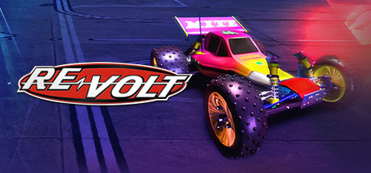

# PlayStation — 1999

[← All PlayStation years](../playstation.md) · [Full 1999 page](../../years/1999.md)

240 PlayStation titles in 1999.

### 360: Three Sixty

**Platforms:** PlayStation &nbsp;|&nbsp; **Developer:** Smart Dog &nbsp;|&nbsp; **Publisher:** Cryo Interactive &nbsp;|&nbsp; **Genre:** Racing, shoot 'em up &nbsp;|&nbsp; **Released:** July 1999

[Wikipedia](https://en.wikipedia.org/wiki/360:_Three_Sixty)

---

### 3Xtreme

**Platforms:** PlayStation &nbsp;|&nbsp; **Developer:** 989 Sports &nbsp;|&nbsp; **Publisher:** 989 Sports &nbsp;|&nbsp; **Genre:** Racing &nbsp;|&nbsp; **Released:** April 20, 1999

[Wikipedia](https://en.wikipedia.org/wiki/3Xtreme)

---

### 40 Winks

**Platforms:** PlayStation, Windows &nbsp;|&nbsp; **Developer:** Eurocom Entertainment Software &nbsp;|&nbsp; **Publisher:** GT Interactive, Piko Interactive &nbsp;|&nbsp; **Genre:** Platform &nbsp;|&nbsp; **Released:** November 26, 1999

[Wikipedia](https://en.wikipedia.org/wiki/40_Winks_(video_game))

---

### 70's Robot Anime Geppy-X

**Platforms:** PlayStation &nbsp;|&nbsp; **Developer:** Aroma &nbsp;|&nbsp; **Publisher:** Aroma &nbsp;|&nbsp; **Genre:** Horizontal-scrolling shooter &nbsp;|&nbsp; **Released:** May 27, 1999

[Wikipedia](https://en.wikipedia.org/wiki/70's_Robot_Anime_Geppy-X)

---

### Ace Combat 3: Electrosphere

**Platforms:** PlayStation &nbsp;|&nbsp; **Developer:** Namco &nbsp;|&nbsp; **Publisher:** Namco, Namco Hometek, Sony Computer Entertainment &nbsp;|&nbsp; **Genre:** Air combat simulation &nbsp;|&nbsp; **Released:** May 27, 1999

[Wikipedia](https://en.wikipedia.org/wiki/Ace_Combat_3:_Electrosphere)

---

### Action Bass

**Platforms:** PlayStation &nbsp;|&nbsp; **Developer:** Vingt-et-un Systems Corporation &nbsp;|&nbsp; **Publisher:** Syscom, Take-Two Interactive &nbsp;|&nbsp; **Genre:** Fishing &nbsp;|&nbsp; **Released:** December 9, 1999

[Wikipedia](https://en.wikipedia.org/wiki/Action_Bass)

---

### Actua Pool

**Platforms:** PlayStation, Windows &nbsp;|&nbsp; **Developer:** Gremlin Interactive, Mirage Ltd, FrontLine Studios &nbsp;|&nbsp; **Publisher:** Gremlin Interactive, THQ, Zoo Digital Publishing, UFO Interactive Games &nbsp;|&nbsp; **Genre:** Sports &nbsp;|&nbsp; **Released:** January 1999

[Wikipedia](https://en.wikipedia.org/wiki/Actua_Pool)

---

### Akuji the Heartless

**Platforms:** PlayStation &nbsp;|&nbsp; **Developer:** Crystal Dynamics &nbsp;|&nbsp; **Publisher:** Eidos Interactive &nbsp;|&nbsp; **Genre:** Action-adventure &nbsp;|&nbsp; **Released:** January 22, 1999

> Akuji the Heartless is an action-adventure video game, released in 1998 on the PlayStation. It uses a modified Gex: Enter the Gecko engine, and both games were developed by Crystal Dynamics. The gameplay involves hack and slash combat combined with platform elements.
>
> _Synopsis source: IGDB_

[Wikipedia](https://en.wikipedia.org/wiki/Akuji_the_Heartless) · [IGDB](https://www.igdb.com/games/akuji-the-heartless)

---

### All Star Tennis '99

**Platforms:** Nintendo 64, PlayStation &nbsp;|&nbsp; **Released:** August 31

[Wikipedia](https://en.wikipedia.org/wiki/All_Star_Tennis_%2799)

---

### Alundra 2

**Platforms:** PlayStation &nbsp;|&nbsp; **Developer:** Matrix Software &nbsp;|&nbsp; **Publisher:** Sony Computer Entertainment, Activision &nbsp;|&nbsp; **Genre:** Action role-playing &nbsp;|&nbsp; **Released:** November 18, 1999

[Wikipedia](https://en.wikipedia.org/wiki/Alundra_2)

---

### Amerzone

**Platforms:** Windows, macOS, PlayStation &nbsp;|&nbsp; **Developer:** Microïds, Anuman Interactive &nbsp;|&nbsp; **Publisher:** Microïds &nbsp;|&nbsp; **Genre:** Adventure &nbsp;|&nbsp; **Released:** March 19, 1999

[Wikipedia](https://en.wikipedia.org/wiki/Amerzone)

---

### Ape Escape

**Platforms:** PlayStation &nbsp;|&nbsp; **Publisher:** Sony Computer Entertainment &nbsp;|&nbsp; **Released:** May 31, 1999

[Wikipedia](https://en.wikipedia.org/wiki/Ape_Escape_(video_game))

---

### Arc the Lad III

**Platforms:** PlayStation &nbsp;|&nbsp; **Developer:** Arc Entertainment &nbsp;|&nbsp; **Publisher:** Sony Computer Entertainment &nbsp;|&nbsp; **Genre:** Tactical role-playing &nbsp;|&nbsp; **Released:** October 28, 1999

[Wikipedia](https://en.wikipedia.org/wiki/Arc_the_Lad_III)

---

### Arcade Party Pak

**Platforms:** PlayStation &nbsp;|&nbsp; **Developer:** Digital Eclipse &nbsp;|&nbsp; **Publisher:** Midway Games &nbsp;|&nbsp; **Genre:** Various &nbsp;|&nbsp; **Released:** October 27, 1999

[Wikipedia](https://en.wikipedia.org/wiki/Arcade_Party_Pak)

---

### Armored Core: Master of Arena

**Platforms:** PlayStation &nbsp;|&nbsp; **Developer:** FromSoftware &nbsp;|&nbsp; **Publisher:** FromSoftware, Agetec &nbsp;|&nbsp; **Genre:** Third-person shooter &nbsp;|&nbsp; **Released:** February 4, 1999

[Wikipedia](https://en.wikipedia.org/wiki/Armored_Core:_Master_of_Arena)

---

### Army Men 3D

**Platforms:** PlayStation &nbsp;|&nbsp; **Released:** February 28

[Wikipedia](https://en.wikipedia.org/wiki/Army_Men_3D)

---

### Army Men: Air Attack

**Platforms:** PlayStation &nbsp;|&nbsp; **Developer:** The 3DO Company &nbsp;|&nbsp; **Publisher:** The 3DO Company &nbsp;|&nbsp; **Genre:** Third-person shooter &nbsp;|&nbsp; **Released:** November 3, 1999

[Wikipedia](https://en.wikipedia.org/wiki/Army_Men:_Air_Attack)

---

### Athena: Awakening from the Ordinary Life

**Platforms:** PlayStation &nbsp;|&nbsp; **Developer:** Yumekobo &nbsp;|&nbsp; **Publisher:** SNK &nbsp;|&nbsp; **Genre:** Adventure &nbsp;|&nbsp; **Released:** March 4, 1999

[Wikipedia](https://en.wikipedia.org/wiki/Athena:_Awakening_from_the_Ordinary_Life)

---

### Attack of the Saucerman

**Platforms:** Windows, PlayStation &nbsp;|&nbsp; **Released:** July 1

[Wikipedia](https://en.wikipedia.org/wiki/Attack_of_the_Saucerman)

---

### Aztec: The Curse in the Heart of the City of Gold

**Platforms:** Windows, PlayStation &nbsp;|&nbsp; **Developer:** Cryo Interactive, Tek 5 &nbsp;|&nbsp; **Publisher:** Cryo Interactive, DreamCatcher Interactive, Microids &nbsp;|&nbsp; **Genre:** Adventure &nbsp;|&nbsp; **Released:** November 1999

[Wikipedia](https://en.wikipedia.org/wiki/Aztec:_The_Curse_in_the_Heart_of_the_City_of_Gold)

---

### Ballistic

**Platforms:** PlayStation, Game Boy Color &nbsp;|&nbsp; **Released:** October 31

[Wikipedia](https://en.wikipedia.org/wiki/Puzz_Loop)

---

### Barbie Super Sports

**Platforms:** PlayStation &nbsp;|&nbsp; **Developer:** Runecraft &nbsp;|&nbsp; **Publisher:** Mattel Media, Sony Computer Entertainment &nbsp;|&nbsp; **Genre:** Sports &nbsp;|&nbsp; **Released:** December 30, 1999

[Wikipedia](https://en.wikipedia.org/wiki/Barbie_Super_Sports)

---

### Barbie: Race & Ride

**Platforms:** PlayStation &nbsp;|&nbsp; **Developer:** Runecraft &nbsp;|&nbsp; **Publisher:** Mattel Media, Sony Computer Entertainment &nbsp;|&nbsp; **Genre:** Sports &nbsp;|&nbsp; **Released:** November 19, 1999

[Wikipedia](https://en.wikipedia.org/wiki/Barbie:_Race_&_Ride)

---

### Bass Landing

**Platforms:** PlayStation &nbsp;|&nbsp; **Developer:** Tose &nbsp;|&nbsp; **Publisher:** ASCII Entertainment, Agetec &nbsp;|&nbsp; **Genre:** Sports &nbsp;|&nbsp; **Released:** January 14, 1999

[Wikipedia](https://en.wikipedia.org/wiki/Bass_Landing)

---

### Bass Rise

**Platforms:** PlayStation &nbsp;|&nbsp; **Developer:** BEC &nbsp;|&nbsp; **Publisher:** Bandai &nbsp;|&nbsp; **Genre:** Sports &nbsp;|&nbsp; **Released:** March 25, 1999

[Wikipedia](https://en.wikipedia.org/wiki/Bass_Rise)

---

### Battle Hunter

**Platforms:** PlayStation &nbsp;|&nbsp; **Developer:** Success &nbsp;|&nbsp; **Publisher:** Success, Agetec, Midas Interactive Entertainment &nbsp;|&nbsp; **Genre:** Tactical role-playing &nbsp;|&nbsp; **Released:** December 22, 1999

[Wikipedia](https://en.wikipedia.org/wiki/Battle_Hunter)

---

### Big Air

**Platforms:** PlayStation &nbsp;|&nbsp; **Developer:** Pitbull Syndicate &nbsp;|&nbsp; **Publisher:** Accolade &nbsp;|&nbsp; **Genre:** Snowboarding &nbsp;|&nbsp; **Released:** March 17, 1999

[Wikipedia](https://en.wikipedia.org/wiki/Big_Air)

---

### BoomBots

**Platforms:** PlayStation &nbsp;|&nbsp; **Developer:** The Neverhood, Inc. &nbsp;|&nbsp; **Publisher:** SouthPeak Interactive &nbsp;|&nbsp; **Genre:** Fighting &nbsp;|&nbsp; **Released:** December 1, 1999

[Wikipedia](https://en.wikipedia.org/wiki/BoomBots)

---

### Bowling

**Platforms:** PlayStation &nbsp;|&nbsp; **Developer:** Tamsoft &nbsp;|&nbsp; **Publisher:** D3 Publisher, Agetec &nbsp;|&nbsp; **Genre:** Sports video game &nbsp;|&nbsp; **Released:** November 18, 1999

[Wikipedia](https://en.wikipedia.org/wiki/Bowling_(1999_video_game))

---

### Bugs Bunny: Lost in Time

**Platforms:** PlayStation, Windows &nbsp;|&nbsp; **Developer:** Behaviour Interactive &nbsp;|&nbsp; **Publisher:** Infogrames &nbsp;|&nbsp; **Genre:** Platform &nbsp;|&nbsp; **Released:** June 1999

[Wikipedia](https://en.wikipedia.org/wiki/Bugs_Bunny:_Lost_in_Time)

---

### Bust a Groove 2

**Platforms:** PlayStation, Arcade &nbsp;|&nbsp; **Developer:** Metro &nbsp;|&nbsp; **Publisher:** Square Enix, Namco &nbsp;|&nbsp; **Genre:** Rhythm &nbsp;|&nbsp; **Released:** April 15, 1999

[Wikipedia](https://en.wikipedia.org/wiki/Bust_a_Groove_2)

---

### Castrol Honda Superbike Racing

**Platforms:** PlayStation &nbsp;|&nbsp; **Developer:** Interactive Entertainment Ltd. &nbsp;|&nbsp; **Publisher:** Electronic Arts, THQ &nbsp;|&nbsp; **Genre:** Racing &nbsp;|&nbsp; **Released:** May 25, 1999

[Wikipedia](https://en.wikipedia.org/wiki/Castrol_Honda_Superbike_Racing)

---

### Championship Motocross featuring Ricky Carmichael

**Platforms:** PlayStation &nbsp;|&nbsp; **Developer:** Funcom Dublin &nbsp;|&nbsp; **Publisher:** THQ &nbsp;|&nbsp; **Genre:** Racing, sports &nbsp;|&nbsp; **Released:** September 13, 1999

[Wikipedia](https://en.wikipedia.org/wiki/Championship_Motocross_featuring_Ricky_Carmichael)

---

### Chocobo Racing

**Platforms:** PlayStation &nbsp;|&nbsp; **Developer:** Square &nbsp;|&nbsp; **Publisher:** Square, Square Electronic Arts, Square Europe &nbsp;|&nbsp; **Genre:** Racing &nbsp;|&nbsp; **Released:** March 18, 1999

[Wikipedia](https://en.wikipedia.org/wiki/Chocobo_Racing)

---

### Choro Q Wonderful!

**Platforms:** PlayStation &nbsp;|&nbsp; **Developer:** E-game &nbsp;|&nbsp; **Publisher:** Takara &nbsp;|&nbsp; **Genre:** Racing &nbsp;|&nbsp; **Released:** August 5, 1999

[Wikipedia](https://en.wikipedia.org/wiki/Choro_Q_Wonderful!)

---

### Chrono Cross

**Platforms:** PlayStation &nbsp;|&nbsp; **Publisher:** Square &nbsp;|&nbsp; **Released:** November 18, 1999 (JP)

[Wikipedia](https://en.wikipedia.org/wiki/Chrono_Cross)

---

### Cool Boarders 4

**Platforms:** PlayStation &nbsp;|&nbsp; **Developer:** Idol Minds &nbsp;|&nbsp; **Publisher:** 989 Studios, Sony Computer Entertainment, UEP Systems &nbsp;|&nbsp; **Genre:** Snowboarding &nbsp;|&nbsp; **Released:** October 26, 1999

[Wikipedia](https://en.wikipedia.org/wiki/Cool_Boarders_4)

---

### Countdown Vampires

**Platforms:** PlayStation &nbsp;|&nbsp; **Developer:** K.2.C. &nbsp;|&nbsp; **Publisher:** Bandai &nbsp;|&nbsp; **Genre:** Survival horror &nbsp;|&nbsp; **Released:** December 22, 1999

[Wikipedia](https://en.wikipedia.org/wiki/Countdown_Vampires)

---

### Crash Team Racing

**Platforms:** PlayStation &nbsp;|&nbsp; **Publisher:** Sony Computer Entertainment &nbsp;|&nbsp; **Released:** September 30, 1999

[Wikipedia](https://en.wikipedia.org/wiki/Crash_Team_Racing)

---

### Croc 2

**Platforms:** PlayStation &nbsp;|&nbsp; **Released:** June 30

[Wikipedia](https://en.wikipedia.org/wiki/Croc_2)

---

### Cyber Org

**Platforms:** PlayStation &nbsp;|&nbsp; **Developer:** FuzzBox &nbsp;|&nbsp; **Publisher:** Square &nbsp;|&nbsp; **Genre:** Action &nbsp;|&nbsp; **Released:** April 22, 1999

[Wikipedia](https://en.wikipedia.org/wiki/Cyber_Org)

---

### CyberTiger

**Platforms:** PlayStation &nbsp;|&nbsp; **Developer:** EA Redwood Shores, Saffire, Xantera &nbsp;|&nbsp; **Publisher:** Electronic Arts &nbsp;|&nbsp; **Genre:** Sports &nbsp;|&nbsp; **Released:** October 28, 1999

[Wikipedia](https://en.wikipedia.org/wiki/CyberTiger)

---

### Dance Dance Revolution 2ndMix

**Platforms:** Arcade, PlayStation &nbsp;|&nbsp; **Developer:** Konami &nbsp;|&nbsp; **Publisher:** Konami &nbsp;|&nbsp; **Genre:** Music, Exercise &nbsp;|&nbsp; **Released:** January 29, 1999

[Wikipedia](https://en.wikipedia.org/wiki/Dance_Dance_Revolution_2ndMix)

---

### Dead in the Water

**Platforms:** PlayStation &nbsp;|&nbsp; **Developer:** Player 1 &nbsp;|&nbsp; **Publisher:** ASC Games &nbsp;|&nbsp; **Genre:** Action, racing &nbsp;|&nbsp; **Released:** February 23, 1999

[Wikipedia](https://en.wikipedia.org/wiki/Dead_in_the_Water_(video_game))

---

### Deception III: Dark Delusion

**Platforms:** PlayStation &nbsp;|&nbsp; **Developer:** Tecmo &nbsp;|&nbsp; **Publisher:** Tecmo &nbsp;|&nbsp; **Genre:** Tactical role-playing &nbsp;|&nbsp; **Released:** December 9, 1999

[Wikipedia](https://en.wikipedia.org/wiki/Deception_III:_Dark_Delusion)

---

### Deep Freeze

**Platforms:** PlayStation &nbsp;|&nbsp; **Developer:** Talon Inc. &nbsp;|&nbsp; **Publisher:** Sammy Corporation &nbsp;|&nbsp; **Genre:** Action-adventure, Third-person shooter &nbsp;|&nbsp; **Released:** January 14, 1999

[Wikipedia](https://en.wikipedia.org/wiki/Deep_Freeze_(video_game))

---

### Demolition Racer

**Platforms:** PlayStation, Windows &nbsp;|&nbsp; **Developer:** Pitbull Syndicate &nbsp;|&nbsp; **Publisher:** Infogrames North America &nbsp;|&nbsp; **Genre:** Vehicular combat, racing &nbsp;|&nbsp; **Released:** September 28, 1999

[Wikipedia](https://en.wikipedia.org/wiki/Demolition_Racer)

---

### Digimon World

**Platforms:** PlayStation &nbsp;|&nbsp; **Developer:** BEC &nbsp;|&nbsp; **Publisher:** Bandai &nbsp;|&nbsp; **Genre:** Role-playing, digital pet &nbsp;|&nbsp; **Released:** January 28, 1999

[Wikipedia](https://en.wikipedia.org/wiki/Digimon_World)

---

### Dino Crisis

**Platforms:** PlayStation &nbsp;|&nbsp; **Developer:** Capcom Production Studio 4 &nbsp;|&nbsp; **Publisher:** Capcom, Virgin Interactive &nbsp;|&nbsp; **Genre:** Survival horror &nbsp;|&nbsp; **Released:** July 1, 1999

[Wikipedia](https://en.wikipedia.org/wiki/Dino_Crisis_(video_game))

---

### Discworld Noir

**Platforms:** Windows, PlayStation &nbsp;|&nbsp; **Developer:** Perfect Entertainment, Teeny Weeny Games &nbsp;|&nbsp; **Publisher:** GT Interactive &nbsp;|&nbsp; **Genre:** Adventure &nbsp;|&nbsp; **Released:** June 1999

[Wikipedia](https://en.wikipedia.org/wiki/Discworld_Noir)

---

### Dragon Valor

**Platforms:** PlayStation &nbsp;|&nbsp; **Developer:** Now Production &nbsp;|&nbsp; **Publisher:** Namco, Namco Hometek, Sony Computer Entertainment &nbsp;|&nbsp; **Genre:** Action role-playing, platform &nbsp;|&nbsp; **Released:** December 2, 1999

[Wikipedia](https://en.wikipedia.org/wiki/Dragon_Valor)

---

### Driver

**Platforms:** PlayStation, Windows &nbsp;|&nbsp; **Publisher:** GT Interactive &nbsp;|&nbsp; **Released:** June 25, 1999

[Wikipedia](https://en.wikipedia.org/wiki/Driver_(video_game))

---

### Echo Night 2: The Lord of Nightmares

**Platforms:** PlayStation &nbsp;|&nbsp; **Developer:** FromSoftware &nbsp;|&nbsp; **Publisher:** FromSoftware &nbsp;|&nbsp; **Genre:** Adventure &nbsp;|&nbsp; **Released:** August 5, 1999

[Wikipedia](https://en.wikipedia.org/wiki/Echo_Night_2:_The_Lord_of_Nightmares)

---

### Ehrgeiz: God Bless the Ring

**Platforms:** PlayStation &nbsp;|&nbsp; **Released:** April 30

---

### Eliminator

**Platforms:** PlayStation, Windows &nbsp;|&nbsp; **Developer:** Magenta Software &nbsp;|&nbsp; **Publisher:** Psygnosis &nbsp;|&nbsp; **Genre:** Shooter &nbsp;|&nbsp; **Released:** February 17, 1999

[Wikipedia](https://en.wikipedia.org/wiki/Eliminator_(1998_video_game))

---

### Eternal Eyes

**Platforms:** PlayStation &nbsp;|&nbsp; **Developer:** TamTam &nbsp;|&nbsp; **Publisher:** Sunsoft, Crave Entertainment &nbsp;|&nbsp; **Genre:** Tactical role-playing game &nbsp;|&nbsp; **Released:** December 2, 1999

[Wikipedia](https://en.wikipedia.org/wiki/Eternal_Eyes)

---

### Everybody's Golf 2

**Platforms:** PlayStation &nbsp;|&nbsp; **Developer:** Clap Hanz &nbsp;|&nbsp; **Publisher:** Sony Computer Entertainment &nbsp;|&nbsp; **Genre:** Sports &nbsp;|&nbsp; **Released:** July 29, 1999

[Wikipedia](https://en.wikipedia.org/wiki/Everybody's_Golf_2)

---

### Evil Zone

**Platforms:** PlayStation &nbsp;|&nbsp; **Developer:** Yuke's Future Media Creators &nbsp;|&nbsp; **Publisher:** Yuke's Future Media Creators, Titus Interactive &nbsp;|&nbsp; **Genre:** Fighting &nbsp;|&nbsp; **Released:** January 14, 1999

[Wikipedia](https://en.wikipedia.org/wiki/Evil_Zone)

---

### F.A. Manager

**Platforms:** PlayStation &nbsp;|&nbsp; **Developer:** Krisalis Software &nbsp;|&nbsp; **Publisher:** Eidos Interactive &nbsp;|&nbsp; **Genre:** Sports

[Wikipedia](https://en.wikipedia.org/wiki/F.A._Manager)

---

### Fatal Fury: Wild Ambition

**Platforms:** Arcade, PlayStation &nbsp;|&nbsp; **Developer:** SNK, Japan Vistec &nbsp;|&nbsp; **Publisher:** SNK &nbsp;|&nbsp; **Genre:** Fighting game &nbsp;|&nbsp; **Released:** January 28, 1999

[Wikipedia](https://en.wikipedia.org/wiki/Fatal_Fury:_Wild_Ambition)

---

### FIFA 2000

**Platforms:** Windows, PlayStation, Game Boy Color &nbsp;|&nbsp; **Developer:** EA Canada, Tiertex &nbsp;|&nbsp; **Publisher:** EA Sports, THQ &nbsp;|&nbsp; **Genre:** Sports &nbsp;|&nbsp; **Released:** October 26, 1999

[Wikipedia](https://en.wikipedia.org/wiki/FIFA_2000)

---

### Fighting Force 2

**Platforms:** PlayStation, Dreamcast &nbsp;|&nbsp; **Developer:** Core Design &nbsp;|&nbsp; **Publisher:** Eidos Interactive &nbsp;|&nbsp; **Genre:** Beat 'em up, third-person shooter &nbsp;|&nbsp; **Released:** December 13, 1999

[Wikipedia](https://en.wikipedia.org/wiki/Fighting_Force_2)

---

### Final Fantasy VI

**Platforms:** PlayStation &nbsp;|&nbsp; **Released:** September 30

[Wikipedia](https://en.wikipedia.org/wiki/Final_Fantasy_VI)

---

### Final Fantasy VIII

**Platforms:** PlayStation &nbsp;|&nbsp; **Publisher:** Square &nbsp;|&nbsp; **Released:** February 11, 1999

[Wikipedia](https://en.wikipedia.org/wiki/Final_Fantasy_VIII)

---

### Formula One 99

**Platforms:** PlayStation, Windows &nbsp;|&nbsp; **Developer:** Studio 33 &nbsp;|&nbsp; **Publisher:** Psygnosis, Sony Computer Entertainment &nbsp;|&nbsp; **Genre:** Racing &nbsp;|&nbsp; **Released:** October 21, 1999

[Wikipedia](https://en.wikipedia.org/wiki/Formula_One_99)

---

### Front Mission 3

**Platforms:** PlayStation &nbsp;|&nbsp; **Developer:** Square &nbsp;|&nbsp; **Publisher:** Square, Square Electronic Arts &nbsp;|&nbsp; **Genre:** Tactical role-playing game &nbsp;|&nbsp; **Released:** September 2, 1999

[Wikipedia](https://en.wikipedia.org/wiki/Front_Mission_3)

---

### G-Police: Weapons of Justice

**Platforms:** PlayStation &nbsp;|&nbsp; **Developer:** Psygnosis &nbsp;|&nbsp; **Publisher:** Sony Computer Entertainment, Psygnosis &nbsp;|&nbsp; **Genre:** Combat flight simulation &nbsp;|&nbsp; **Released:** September 1, 1999

[Wikipedia](https://en.wikipedia.org/wiki/G-Police:_Weapons_of_Justice)

---

### Galerians

**Platforms:** PlayStation &nbsp;|&nbsp; **Developer:** Polygon Magic &nbsp;|&nbsp; **Publisher:** ASCII Entertainment, Crave Entertainment &nbsp;|&nbsp; **Genre:** Survival horror &nbsp;|&nbsp; **Released:** August 26, 1999

[Wikipedia](https://en.wikipedia.org/wiki/Galerians)

---

### Gekisou TomaRunner

**Platforms:** PlayStation &nbsp;|&nbsp; **Developer:** Desert Productions &nbsp;|&nbsp; **Publisher:** Sony Computer Entertainment &nbsp;|&nbsp; **Genre:** Racing &nbsp;|&nbsp; **Released:** July 22, 1999

[Wikipedia](https://en.wikipedia.org/wiki/Gekisou_TomaRunner)

---

### Gex 3: Deep Cover Gecko

**Platforms:** PlayStation, Nintendo 64, Game Boy &nbsp;|&nbsp; **Released:** March 1

---

### Gran Turismo 2

**Platforms:** PlayStation &nbsp;|&nbsp; **Publisher:** Sony Computer Entertainment &nbsp;|&nbsp; **Released:** December 11, 1999

[Wikipedia](https://en.wikipedia.org/wiki/Gran_Turismo_2)

---

### Grand Theft Auto 2

**Platforms:** Windows, PlayStation &nbsp;|&nbsp; **Released:** October 22

[Wikipedia](https://en.wikipedia.org/wiki/Grand_Theft_Auto_2)

---

### Grand Theft Auto: London 1969

**Platforms:** Windows, PlayStation &nbsp;|&nbsp; **Released:** April 30

---

### Grandia

**Platforms:** PlayStation &nbsp;|&nbsp; **Publisher:** Entertainment Software Publishing &nbsp;|&nbsp; **Released:** June 24, 1999

[Wikipedia](https://en.wikipedia.org/wiki/Grandia_(video_game))

---

### Growlanser

**Platforms:** PlayStation &nbsp;|&nbsp; **Developer:** Career Soft &nbsp;|&nbsp; **Publisher:** Atlus &nbsp;|&nbsp; **Genre:** Tactical role-playing game &nbsp;|&nbsp; **Released:** November 25, 1999

[Wikipedia](https://en.wikipedia.org/wiki/Growlanser_(video_game))

---

### Guardian's Crusade

**Platforms:** PlayStation &nbsp;|&nbsp; **Released:** January 31

[Wikipedia](https://en.wikipedia.org/wiki/Guardian%27s_Crusade)

---

### GuitarFreaks and DrumMania

**Platforms:** Arcade, Windows, PlayStation, PlayStation 2 &nbsp;|&nbsp; **Developer:** Bemani &nbsp;|&nbsp; **Publisher:** Konami, Konami Digital Entertainment &nbsp;|&nbsp; **Genre:** Music, Rhythm &nbsp;|&nbsp; **Released:** February 16, 1999

[Wikipedia](https://en.wikipedia.org/wiki/GuitarFreaks_and_DrumMania)

---

### Gungage

**Platforms:** PlayStation &nbsp;|&nbsp; **Developer:** Konami Computer Entertainment Tokyo &nbsp;|&nbsp; **Publisher:** Konami &nbsp;|&nbsp; **Genre:** Third-person shooter &nbsp;|&nbsp; **Released:** June 3, 1999

[Wikipedia](https://en.wikipedia.org/wiki/Gungage)

---

### Hello Kitty's Cube Frenzy

**Platforms:** Game Boy Color, PlayStation &nbsp;|&nbsp; **Developer:** Torus Games, Culture Publishers &nbsp;|&nbsp; **Publisher:** NewKidCo, Culture Publishers, Ubi Soft &nbsp;|&nbsp; **Genre:** Puzzle &nbsp;|&nbsp; **Released:** March 30, 1999

[Wikipedia](https://en.wikipedia.org/wiki/Hello_Kitty's_Cube_Frenzy)

---

### High Heat Baseball 2000

**Platforms:** Windows, PlayStation &nbsp;|&nbsp; **Developer:** Team .366 &nbsp;|&nbsp; **Publisher:** The 3DO Company &nbsp;|&nbsp; **Genre:** Sports &nbsp;|&nbsp; **Released:** April 1, 1999

[Wikipedia](https://en.wikipedia.org/wiki/High_Heat_Baseball_2000)

---

### Hot Wheels Turbo Racing

**Platforms:** Nintendo 64, PlayStation &nbsp;|&nbsp; **Developer:** Stormfront Studios &nbsp;|&nbsp; **Publisher:** Electronic Arts &nbsp;|&nbsp; **Genre:** Racing &nbsp;|&nbsp; **Released:** August 31, 1999

[Wikipedia](https://en.wikipedia.org/wiki/Hot_Wheels_Turbo_Racing)

---

### International Track & Field 2000

**Platforms:** PlayStation, Game Boy Color &nbsp;|&nbsp; **Developer:** Konami Computer Entertainment Tokyo, Konami Computer Entertainment Osaka &nbsp;|&nbsp; **Publisher:** Konami &nbsp;|&nbsp; **Genre:** Sports &nbsp;|&nbsp; **Released:** December 10, 1999

[Wikipedia](https://en.wikipedia.org/wiki/International_Track_&_Field_2000)

---

### Interplay Sports Baseball Edition 2000

**Platforms:** PlayStation, Windows &nbsp;|&nbsp; **Developer:** Interplay Sports &nbsp;|&nbsp; **Publisher:** Interplay Entertainment &nbsp;|&nbsp; **Genre:** Sports &nbsp;|&nbsp; **Released:** March 31, 1999

[Wikipedia](https://en.wikipedia.org/wiki/Interplay_Sports_Baseball_Edition_2000)

---

### IS – internal section

**Platforms:** PlayStation &nbsp;|&nbsp; **Developer:** Positron &nbsp;|&nbsp; **Publisher:** Square &nbsp;|&nbsp; **Genre:** Shooter, music &nbsp;|&nbsp; **Released:** January 28, 1999

[Wikipedia](https://en.wikipedia.org/wiki/IS_%E2%80%93_internal_section)

---

### ISS Pro Evolution

**Platforms:** PlayStation &nbsp;|&nbsp; **Developer:** Konami Computer Entertainment Tokyo &nbsp;|&nbsp; **Publisher:** Konami &nbsp;|&nbsp; **Genre:** Sports &nbsp;|&nbsp; **Released:** September 2, 1999

[Wikipedia](https://en.wikipedia.org/wiki/ISS_Pro_Evolution)

---

### Jeff Wayne's The War of the Worlds

**Platforms:** PlayStation &nbsp;|&nbsp; **Developer:** Pixelogic Limited, Kheops Studio &nbsp;|&nbsp; **Publisher:** GT Interactive &nbsp;|&nbsp; **Genre:** Third-person shooter, vehicular combat, strategy &nbsp;|&nbsp; **Released:** November 19, 1999

[Wikipedia](https://en.wikipedia.org/wiki/Jeff_Wayne's_The_War_of_the_Worlds_(1999_video_game))

---

### Jet Moto 3

**Platforms:** PlayStation &nbsp;|&nbsp; **Released:** August 30

[Wikipedia](https://en.wikipedia.org/wiki/Jet_Moto_3)

---

### Killer Loop

**Platforms:** PlayStation, Windows &nbsp;|&nbsp; **Developer:** VCC Entertainment &nbsp;|&nbsp; **Publisher:** Crave Entertainment &nbsp;|&nbsp; **Released:** March 1, 1999

[Wikipedia](https://en.wikipedia.org/wiki/Killer_Loop)

---

### Kingsley's Adventure

**Platforms:** PlayStation &nbsp;|&nbsp; **Released:** September 28

[Wikipedia](https://en.wikipedia.org/wiki/Kingsley%27s_Adventure)

---

### Knockout Kings 2000

**Platforms:** Nintendo 64, PlayStation, Game Boy Color &nbsp;|&nbsp; **Developer:** Black Ops Entertainment, Digital Eclipse &nbsp;|&nbsp; **Publisher:** EA Sports &nbsp;|&nbsp; **Genre:** Sports, fighting &nbsp;|&nbsp; **Released:** October 10, 1999

[Wikipedia](https://en.wikipedia.org/wiki/Knockout_Kings_2000)

---

### Koudelka

**Platforms:** PlayStation &nbsp;|&nbsp; **Developer:** Sacnoth &nbsp;|&nbsp; **Publisher:** SNK, Infogrames &nbsp;|&nbsp; **Genre:** Role-playing &nbsp;|&nbsp; **Released:** December 16, 1999

[Wikipedia](https://en.wikipedia.org/wiki/Koudelka)

---

### Legacy of Kain: Soul Reaver

**Platforms:** PlayStation, Windows &nbsp;|&nbsp; **Publisher:** Eidos Interactive &nbsp;|&nbsp; **Released:** August 16, 1999

---

### Legend of Legaia

**Platforms:** PlayStation &nbsp;|&nbsp; **Genre:** Role-playing (RPG) &nbsp;|&nbsp; **Released:** March 17

> A legendary tale of betrayal and self-destruction. Abuse derived from the greediness of man. the powers of a magical creature betrayed. Will man realize his mistakes before irreparable damage is done? Armed with a magical ally and the will to survive, lead Vahn and his cohorts to the redemption of man. Pursue a quest to save the world and discover place where legends are born. New combat system bases on fight games. Discover special combinations for more effective attacks. Beautiful realistic graphics with full polygons. 100s of 3D enemies that react with a full range of motion.
>
> _Synopsis source: IGDB_

[Wikipedia](https://en.wikipedia.org/wiki/Legend_of_Legaia) · [IGDB](https://www.igdb.com/games/legend-of-legaia)

---

### Legend of Mana

**Platforms:** PlayStation &nbsp;|&nbsp; **Developer:** Square &nbsp;|&nbsp; **Publisher:** Square, Square Electronic Arts, Square Enix &nbsp;|&nbsp; **Genre:** Action role-playing &nbsp;|&nbsp; **Released:** July 15, 1999

[Wikipedia](https://en.wikipedia.org/wiki/Legend_of_Mana)

---

### Lego Racers

**Platforms:** Windows, Nintendo 64, PlayStation &nbsp;|&nbsp; **Developer:** High Voltage Software &nbsp;|&nbsp; **Publisher:** Lego Media &nbsp;|&nbsp; **Genre:** Racing &nbsp;|&nbsp; **Released:** August 23, 1999

[Wikipedia](https://en.wikipedia.org/wiki/Lego_Racers)

---

### Lego Rock Raiders

**Platforms:** Windows, PlayStation &nbsp;|&nbsp; **Developer:** Data Design Interactive &nbsp;|&nbsp; **Publisher:** Lego Media &nbsp;|&nbsp; **Genre:** Real-time strategy, action &nbsp;|&nbsp; **Released:** November 18, 1999

[Wikipedia](https://en.wikipedia.org/wiki/Lego_Rock_Raiders_(video_game))

---

### Live Wire!

**Platforms:** PlayStation, Windows &nbsp;|&nbsp; **Developer:** The Code Monkeys &nbsp;|&nbsp; **Publisher:** Sales Curve Interactive &nbsp;|&nbsp; **Genre:** Maze

[Wikipedia](https://en.wikipedia.org/wiki/Live_Wire!)

---

### Love & Destroy

**Platforms:** PlayStation &nbsp;|&nbsp; **Developer:** Inti Creates &nbsp;|&nbsp; **Publisher:** Sony Computer Entertainment &nbsp;|&nbsp; **Genre:** Third-person shooter, dating sim &nbsp;|&nbsp; **Released:** December 16, 1999

[Wikipedia](https://en.wikipedia.org/wiki/Love_&_Destroy)

---

### Lunar: Silver Star Story Complete

**Platforms:** PlayStation &nbsp;|&nbsp; **Released:** May 28

---

### Madden NFL 2000

**Platforms:** Windows, macOS, PlayStation, Nintendo 64 &nbsp;|&nbsp; **Released:** August 31

[Wikipedia](https://en.wikipedia.org/wiki/Madden_NFL_2000)

---

### Magical Drop F: Daibōken Mo Rakujyanai!

**Platforms:** PlayStation &nbsp;|&nbsp; **Developer:** Data East, Sakata SAS &nbsp;|&nbsp; **Publisher:** Data East &nbsp;|&nbsp; **Genre:** Puzzle, role-playing &nbsp;|&nbsp; **Released:** October 21, 1999

[Wikipedia](https://en.wikipedia.org/wiki/Magical_Drop_F:_Daib%C5%8Dken_Mo_Rakujyanai!)

---

### Majokko Daisakusen: Little Witching Mischiefs

**Platforms:** PlayStation &nbsp;|&nbsp; **Developer:** Toys for Bob &nbsp;|&nbsp; **Publisher:** Bandai &nbsp;|&nbsp; **Genre:** Fighting game/role-playing video game &nbsp;|&nbsp; **Released:** February 4, 1999

[Wikipedia](https://en.wikipedia.org/wiki/Majokko_Daisakusen:_Little_Witching_Mischiefs)

---

### Marvel Super Heroes vs. Street Fighter

**Platforms:** PlayStation &nbsp;|&nbsp; **Released:** January 31

[Wikipedia](https://en.wikipedia.org/wiki/Marvel_Super_Heroes_vs._Street_Fighter)

---

### Medal of Honor

**Platforms:** PlayStation &nbsp;|&nbsp; **Publisher:** Electronic Arts &nbsp;|&nbsp; **Released:** October 31, 1999

[Wikipedia](https://en.wikipedia.org/wiki/Medal_of_Honor_(1999_video_game))

---

### MLB 2000

**Platforms:** PlayStation &nbsp;|&nbsp; **Released:** February 28

[Wikipedia](https://en.wikipedia.org/wiki/MLB_2000)

---

### Mobil 1 Rally Championship

**Platforms:** Windows, PlayStation &nbsp;|&nbsp; **Developer:** Magnetic Fields, Creative Asylum Limited, Atod, HotGen &nbsp;|&nbsp; **Publisher:** Actualize, Electronic Arts &nbsp;|&nbsp; **Genre:** Racing &nbsp;|&nbsp; **Released:** November 19, 1999

[Wikipedia](https://en.wikipedia.org/wiki/Mobil_1_Rally_Championship)

---

### Monkey Hero

**Platforms:** PlayStation &nbsp;|&nbsp; **Developer:** Blam! &nbsp;|&nbsp; **Publisher:** Take-Two Interactive &nbsp;|&nbsp; **Genre:** Role-playing &nbsp;|&nbsp; **Released:** February 26, 1999

[Wikipedia](https://en.wikipedia.org/wiki/Monkey_Hero)

---

### Monkey Magic

**Platforms:** PlayStation &nbsp;|&nbsp; **Developer:** Mpen &nbsp;|&nbsp; **Publisher:** Sunsoft &nbsp;|&nbsp; **Genre:** Platform &nbsp;|&nbsp; **Released:** November 27, 1999

[Wikipedia](https://en.wikipedia.org/wiki/Monkey_Magic_(1999_video_game))

---

### Monster Rancher 2

**Platforms:** PlayStation &nbsp;|&nbsp; **Developer:** Tecmo, Koei Tecmo &nbsp;|&nbsp; **Publisher:** Tecmo, Sony Computer Entertainment, Koei Tecmo &nbsp;|&nbsp; **Genre:** Life simulation game &nbsp;|&nbsp; **Released:** February 25, 1999

[Wikipedia](https://en.wikipedia.org/wiki/Monster_Rancher_2)

---

### MTV Sports: Snowboarding

**Platforms:** PlayStation &nbsp;|&nbsp; **Developer:** Radical Entertainment &nbsp;|&nbsp; **Publisher:** THQ &nbsp;|&nbsp; **Genre:** Snowboarding &nbsp;|&nbsp; **Released:** October 28, 1999

[Wikipedia](https://en.wikipedia.org/wiki/MTV_Sports:_Snowboarding)

---

### NASCAR 2000

**Platforms:** Nintendo 64, PlayStation &nbsp;|&nbsp; **Developer:** Stormfront Studios, Software Creations &nbsp;|&nbsp; **Publisher:** EA Sports &nbsp;|&nbsp; **Genre:** Racing &nbsp;|&nbsp; **Released:** September 13, 1999

[Wikipedia](https://en.wikipedia.org/wiki/NASCAR_2000)

---

### NBA Basketball 2000

**Platforms:** PlayStation, Windows &nbsp;|&nbsp; **Developer:** Radical Entertainment &nbsp;|&nbsp; **Publisher:** Fox Sports Interactive &nbsp;|&nbsp; **Genre:** Sports &nbsp;|&nbsp; **Released:** October 31, 1999

[Wikipedia](https://en.wikipedia.org/wiki/NBA_Basketball_2000)

---

### NBA In The Zone '99

**Platforms:** Nintendo 64, PlayStation &nbsp;|&nbsp; **Developer:** Konami Computer Entertainment Osaka &nbsp;|&nbsp; **Publisher:** Konami &nbsp;|&nbsp; **Genre:** Sports &nbsp;|&nbsp; **Released:** April 8, 1999

[Wikipedia](https://en.wikipedia.org/wiki/NBA_In_The_Zone_'99)

---

### NBA ShootOut 2000

**Platforms:** PlayStation &nbsp;|&nbsp; **Developer:** 989 Sports &nbsp;|&nbsp; **Publisher:** 989 Sports &nbsp;|&nbsp; **Genre:** Sports &nbsp;|&nbsp; **Released:** December 21, 1999

[Wikipedia](https://en.wikipedia.org/wiki/NBA_ShootOut_2000)

---

### NBA Showtime: NBA on NBC

**Platforms:** Arcade, PlayStation, Dreamcast, Nintendo 64 &nbsp;|&nbsp; **Developer:** Midway Games, Torus Games &nbsp;|&nbsp; **Publisher:** Midway Games &nbsp;|&nbsp; **Genre:** Sports &nbsp;|&nbsp; **Released:** April 5, 1999

[Wikipedia](https://en.wikipedia.org/wiki/NBA_Showtime:_NBA_on_NBC)

---

### NCAA Final Four 2000

**Platforms:** PlayStation &nbsp;|&nbsp; **Developer:** Killer Game &nbsp;|&nbsp; **Publisher:** 989 Sports &nbsp;|&nbsp; **Genre:** Sports &nbsp;|&nbsp; **Released:** November 17, 1999

[Wikipedia](https://en.wikipedia.org/wiki/NCAA_Final_Four_2000)

---

### NCAA Final Four 99

**Platforms:** PlayStation &nbsp;|&nbsp; **Developer:** Killer Game &nbsp;|&nbsp; **Publisher:** 989 Sports &nbsp;|&nbsp; **Genre:** Sports &nbsp;|&nbsp; **Released:** January 13, 1999

[Wikipedia](https://en.wikipedia.org/wiki/NCAA_Final_Four_99)

---

### NCAA Football 2000

**Platforms:** PlayStation &nbsp;|&nbsp; **Released:** July 27

[Wikipedia](https://en.wikipedia.org/wiki/NCAA_Football_2000)

---

### NCAA GameBreaker 2000

**Platforms:** PlayStation &nbsp;|&nbsp; **Developer:** Red Zone Entertainment &nbsp;|&nbsp; **Publisher:** 989 Sports &nbsp;|&nbsp; **Genre:** Sports &nbsp;|&nbsp; **Released:** August 11, 1999

[Wikipedia](https://en.wikipedia.org/wiki/NCAA_GameBreaker_2000)

---

### NCAA March Madness 2000

**Platforms:** PlayStation &nbsp;|&nbsp; **Developer:** Black Ops Entertainment &nbsp;|&nbsp; **Publisher:** EA Sports &nbsp;|&nbsp; **Genre:** Sports &nbsp;|&nbsp; **Released:** December 1999

[Wikipedia](https://en.wikipedia.org/wiki/NCAA_March_Madness_2000)

---

### Need for Speed: High Stakes

**Platforms:** Windows, PlayStation &nbsp;|&nbsp; **Released:** March 24

---

### NFL Blitz 2000

**Platforms:** Arcade, PlayStation, Nintendo 64, Dreamcast, Windows, Game Boy Color &nbsp;|&nbsp; **Developer:** Midway Games, Digital Eclipse &nbsp;|&nbsp; **Publisher:** Midway, Infogrames &nbsp;|&nbsp; **Genre:** Sports &nbsp;|&nbsp; **Released:** August 18, 1999

[Wikipedia](https://en.wikipedia.org/wiki/NFL_Blitz_2000)

---

### NFL GameDay 2000

**Platforms:** PlayStation &nbsp;|&nbsp; **Developer:** Red Zone Interactive, 989 Sports &nbsp;|&nbsp; **Publisher:** 989 Sports &nbsp;|&nbsp; **Genre:** Sports &nbsp;|&nbsp; **Released:** August 11, 1999

[Wikipedia](https://en.wikipedia.org/wiki/NFL_GameDay_2000)

---

### NFL Xtreme 2

**Platforms:** PlayStation &nbsp;|&nbsp; **Developer:** 989 Sports &nbsp;|&nbsp; **Publisher:** 989 Sports &nbsp;|&nbsp; **Genre:** Sports &nbsp;|&nbsp; **Released:** July 20, 1999

[Wikipedia](https://en.wikipedia.org/wiki/NFL_Xtreme_2)

---

### NHL 2000

**Platforms:** Game Boy Color, PlayStation, Windows &nbsp;|&nbsp; **Developer:** EA Canada, Tiertex Design Studios &nbsp;|&nbsp; **Publisher:** EA Sports &nbsp;|&nbsp; **Genre:** Sports &nbsp;|&nbsp; **Released:** September 15, 1999

[Wikipedia](https://en.wikipedia.org/wiki/NHL_2000)

---

### NHL Championship 2000

**Platforms:** PlayStation, Windows &nbsp;|&nbsp; **Developer:** Radical Entertainment &nbsp;|&nbsp; **Publisher:** Fox Sports Interactive &nbsp;|&nbsp; **Genre:** Sports &nbsp;|&nbsp; **Released:** September 29, 1999

[Wikipedia](https://en.wikipedia.org/wiki/NHL_Championship_2000)

---

### NHL FaceOff 2000

**Platforms:** PlayStation &nbsp;|&nbsp; **Developer:** SolWorks &nbsp;|&nbsp; **Publisher:** 989 Sports, Sony Computer Entertainment &nbsp;|&nbsp; **Genre:** Sports &nbsp;|&nbsp; **Released:** September 15, 1999

[Wikipedia](https://en.wikipedia.org/wiki/NHL_FaceOff_2000)

---

### No Fear Downhill Mountain Biking

**Platforms:** PlayStation &nbsp;|&nbsp; **Developer:** Unique Development Studios, Spellbound &nbsp;|&nbsp; **Publisher:** Codemasters, THQ &nbsp;|&nbsp; **Genre:** Sports &nbsp;|&nbsp; **Released:** November 18, 1999

[Wikipedia](https://en.wikipedia.org/wiki/No_Fear_Downhill_Mountain_Biking)

---

### Omega Boost

**Platforms:** PlayStation &nbsp;|&nbsp; **Developer:** Polyphony Digital &nbsp;|&nbsp; **Publisher:** Sony Computer Entertainment &nbsp;|&nbsp; **Genre:** Rail shooter &nbsp;|&nbsp; **Released:** April 22, 1999

[Wikipedia](https://en.wikipedia.org/wiki/Omega_Boost)

---

### Ore no Ryouri

**Platforms:** PlayStation &nbsp;|&nbsp; **Developer:** Argent &nbsp;|&nbsp; **Publisher:** Sony Computer Entertainment &nbsp;|&nbsp; **Genre:** Simulation game &nbsp;|&nbsp; **Released:** September 9, 1999

[Wikipedia](https://en.wikipedia.org/wiki/Ore_no_Ryouri)

---

### Ore no Shikabane o Koete Yuke

**Platforms:** PlayStation &nbsp;|&nbsp; **Developer:** Alfa System, MARS Corporation &nbsp;|&nbsp; **Publisher:** Sony Computer Entertainment &nbsp;|&nbsp; **Genre:** Role-playing &nbsp;|&nbsp; **Released:** June 17, 1999

[Wikipedia](https://en.wikipedia.org/wiki/Ore_no_Shikabane_o_Koete_Yuke)

---

### Pac-Man World

**Platforms:** PlayStation &nbsp;|&nbsp; **Released:** September 30

[Wikipedia](https://en.wikipedia.org/wiki/Pac-Man_World)

---

### Panzer Front

**Platforms:** PlayStation, Dreamcast &nbsp;|&nbsp; **Developer:** Enterbrain &nbsp;|&nbsp; **Publisher:** ASCII Entertainment, JVC Music Europe, Agetec, Inc. &nbsp;|&nbsp; **Genre:** Tank combat simulation &nbsp;|&nbsp; **Released:** December 22, 1999

[Wikipedia](https://en.wikipedia.org/wiki/Panzer_Front)

---

### Pepsiman

**Platforms:** PlayStation &nbsp;|&nbsp; **Released:** March 4

[Wikipedia](https://en.wikipedia.org/wiki/Pepsiman_(video_game))

---

### Persona 2: Innocent Sin

**Platforms:** PlayStation &nbsp;|&nbsp; **Released:** June 24

---

### Planet Laika

**Platforms:** PlayStation &nbsp;|&nbsp; **Developer:** Quintet, Zeque &nbsp;|&nbsp; **Publisher:** Enix &nbsp;|&nbsp; **Genre:** Role-playing &nbsp;|&nbsp; **Released:** October 21, 1999

[Wikipedia](https://en.wikipedia.org/wiki/Planet_Laika)

---

### Pocket MuuMuu

**Platforms:** PlayStation &nbsp;|&nbsp; **Developer:** Sugar & Rockets &nbsp;|&nbsp; **Publisher:** Sony Computer Entertainment &nbsp;|&nbsp; **Genre:** Action &nbsp;|&nbsp; **Released:** February 4, 1999

[Wikipedia](https://en.wikipedia.org/wiki/Pocket_MuuMuu)

---

### Pong: The Next Level

**Platforms:** Windows, PlayStation, Game Boy Color &nbsp;|&nbsp; **Developer:** Supersonic Software, Morning Star Multimedia &nbsp;|&nbsp; **Publisher:** Hasbro Interactive, MacSoft &nbsp;|&nbsp; **Genre:** Sports &nbsp;|&nbsp; **Released:** October 22, 1999

[Wikipedia](https://en.wikipedia.org/wiki/Pong:_The_Next_Level)

---

### Pop'n Tanks!

**Platforms:** PlayStation &nbsp;|&nbsp; **Developer:** Symbio Systems &nbsp;|&nbsp; **Publisher:** Enix &nbsp;|&nbsp; **Genre:** Vehicular combat &nbsp;|&nbsp; **Released:** July 29, 1999

[Wikipedia](https://en.wikipedia.org/wiki/Pop'n_Tanks!)

---

### Premier Manager: Ninety Nine

**Platforms:** PlayStation, Windows, Nintendo 64 &nbsp;|&nbsp; **Developer:** Dinamic Multimedia &nbsp;|&nbsp; **Publisher:** Gremlin Interactive &nbsp;|&nbsp; **Genre:** Sports &nbsp;|&nbsp; **Released:** August 1999

[Wikipedia](https://en.wikipedia.org/wiki/Premier_Manager:_Ninety_Nine)

---

### Pro 18 World Tour Golf

**Platforms:** Windows, PlayStation &nbsp;|&nbsp; **Developer:** Intelligent Games &nbsp;|&nbsp; **Publisher:** Psygnosis &nbsp;|&nbsp; **Genre:** Sports &nbsp;|&nbsp; **Released:** March 31, 1999

[Wikipedia](https://en.wikipedia.org/wiki/Pro_18_World_Tour_Golf)

---

### Puffy: P.S. I Love You

**Platforms:** PlayStation &nbsp;|&nbsp; **Developer:** Sony Music Entertainment &nbsp;|&nbsp; **Publisher:** Sony Music Entertainment &nbsp;|&nbsp; **Genre:** Music, Mini-games &nbsp;|&nbsp; **Released:** March 11, 1999

[Wikipedia](https://en.wikipedia.org/wiki/Puffy:_P.S._I_Love_You)

---

### Puyo Puyo~n

**Platforms:** Dreamcast, Nintendo 64, PlayStation &nbsp;|&nbsp; **Developer:** Compile &nbsp;|&nbsp; **Publisher:** Sega, Compile &nbsp;|&nbsp; **Genre:** Puzzle &nbsp;|&nbsp; **Released:** March 4, 1999

[Wikipedia](https://en.wikipedia.org/wiki/Puyo_Puyo~n)

---

### Q*bert

**Platforms:** Windows, PlayStation &nbsp;|&nbsp; **Developer:** Artech Studios, Pipe Dream Interactive &nbsp;|&nbsp; **Publisher:** Hasbro Interactive, MacSoft &nbsp;|&nbsp; **Genre:** Action &nbsp;|&nbsp; **Released:** November 19, 1999

[Wikipedia](https://en.wikipedia.org/wiki/Q*bert_(1999_video_game))

---

### R/C Stunt Copter

**Platforms:** PlayStation &nbsp;|&nbsp; **Developer:** Shiny Entertainment, Big Grub &nbsp;|&nbsp; **Publisher:** Titus Interactive, Interplay Entertainment &nbsp;|&nbsp; **Genre:** Amateur flight simulator &nbsp;|&nbsp; **Released:** September 1, 1999

[Wikipedia](https://en.wikipedia.org/wiki/R/C_Stunt_Copter)

---

### Racing

**Platforms:** PlayStation &nbsp;|&nbsp; **Developer:** Tamsoft &nbsp;|&nbsp; **Publisher:** Culture Publishers, Agetec, Midas Interactive Entertainment &nbsp;|&nbsp; **Genre:** Racing &nbsp;|&nbsp; **Released:** July 22, 1999

[Wikipedia](https://en.wikipedia.org/wiki/Racing_(video_game))

---

### Racing Lagoon

**Platforms:** PlayStation &nbsp;|&nbsp; **Developer:** Square Product Development Division 2 &nbsp;|&nbsp; **Publisher:** Square &nbsp;|&nbsp; **Genre:** Racing video game, Role-playing &nbsp;|&nbsp; **Released:** June 10, 1999

[Wikipedia](https://en.wikipedia.org/wiki/Racing_Lagoon)

---

### Rakugaki Showtime

**Platforms:** PlayStation &nbsp;|&nbsp; **Developer:** Treasure &nbsp;|&nbsp; **Publisher:** Enix &nbsp;|&nbsp; **Genre:** Fighting &nbsp;|&nbsp; **Released:** July 29, 1999

[Wikipedia](https://en.wikipedia.org/wiki/Rakugaki_Showtime)

---

### Rampage 2: Universal Tour

**Platforms:** PlayStation, Nintendo 64, Game Boy Color &nbsp;|&nbsp; **Developer:** Avalanche Software, Digital Eclipse Software &nbsp;|&nbsp; **Publisher:** Midway &nbsp;|&nbsp; **Genre:** Action &nbsp;|&nbsp; **Released:** March 31, 1999

[Wikipedia](https://en.wikipedia.org/wiki/Rampage_2:_Universal_Tour)

---

### Rat Attack!

**Platforms:** PlayStation &nbsp;|&nbsp; **Developer:** Pure Entertainment &nbsp;|&nbsp; **Publisher:** Mindscape &nbsp;|&nbsp; **Genre:** Puzzle &nbsp;|&nbsp; **Released:** September 28, 1999

[Wikipedia](https://en.wikipedia.org/wiki/Rat_Attack!)

---

### Re-Volt

**Platforms:** Windows, Dreamcast, Nintendo 64, PlayStation &nbsp;|&nbsp; **Genre:** Racing &nbsp;|&nbsp; **Released:** August 18

> Re-Volt lets you guide one of 28 remote control cars through insane race tracks set in unusual environments. Curbs become huge walls, toys are obstacles, and everything is fair game to drive on, through, or over.
>
> _Synopsis source: Steam_

[Wikipedia](https://en.wikipedia.org/wiki/Re-Volt) · [Steam](https://store.steampowered.com/app/287310)

---

### Ready 2 Rumble Boxing

**Platforms:** Dreamcast, PlayStation, Nintendo 64, Game Boy Color &nbsp;|&nbsp; **Developer:** Midway Studios San Diego, Crawfish Interactive &nbsp;|&nbsp; **Publisher:** Midway &nbsp;|&nbsp; **Genre:** Sports &nbsp;|&nbsp; **Released:** September 9, 1999

[Wikipedia](https://en.wikipedia.org/wiki/Ready_2_Rumble_Boxing)

---

### Renegade Racers

**Platforms:** PlayStation &nbsp;|&nbsp; **Developer:** Promethean Designs &nbsp;|&nbsp; **Publisher:** Interplay Entertainment &nbsp;|&nbsp; **Genre:** Racing

[Wikipedia](https://en.wikipedia.org/wiki/Renegade_Racers)

---

### Resident Evil 3: Nemesis

**Platforms:** PlayStation &nbsp;|&nbsp; **Publisher:** Capcom &nbsp;|&nbsp; **Released:** September 22, 1999

---

### Retro Force

**Platforms:** PlayStation &nbsp;|&nbsp; **Developer:** Psygnosis Leeds &nbsp;|&nbsp; **Publisher:** Psygnosis &nbsp;|&nbsp; **Genre:** Shoot 'em up &nbsp;|&nbsp; **Released:** March 12, 1999

[Wikipedia](https://en.wikipedia.org/wiki/Retro_Force)

---

### Rhapsody II: Ballad of the Little Princess

**Platforms:** PlayStation &nbsp;|&nbsp; **Developer:** Nippon Ichi Software &nbsp;|&nbsp; **Publisher:** Nippon Ichi Software, NIS America &nbsp;|&nbsp; **Genre:** Role-playing &nbsp;|&nbsp; **Released:** November 25, 1999

[Wikipedia](https://en.wikipedia.org/wiki/Rhapsody_II:_Ballad_of_the_Little_Princess)

---

### Rising Zan: The Samurai Gunman

**Platforms:** PlayStation &nbsp;|&nbsp; **Developer:** UEP Systems &nbsp;|&nbsp; **Publisher:** UEP Systems, Agetec &nbsp;|&nbsp; **Genre:** Action-adventure &nbsp;|&nbsp; **Released:** March 25, 1999

[Wikipedia](https://en.wikipedia.org/wiki/Rising_Zan:_The_Samurai_Gunman)

---

### Robbit Mon Dieu

**Platforms:** PlayStation &nbsp;|&nbsp; **Developer:** Sugar & Rockets &nbsp;|&nbsp; **Publisher:** Sony Computer Entertainment &nbsp;|&nbsp; **Genre:** Platform &nbsp;|&nbsp; **Released:** October 14, 1999

[Wikipedia](https://en.wikipedia.org/wiki/Robbit_Mon_Dieu)

---

### Rollcage

**Platforms:** Windows, PlayStation &nbsp;|&nbsp; **Developer:** Attention to Detail &nbsp;|&nbsp; **Publisher:** Psygnosis &nbsp;|&nbsp; **Genre:** Racing &nbsp;|&nbsp; **Released:** March 12, 1999

[Wikipedia](https://en.wikipedia.org/wiki/Rollcage_(video_game))

---

### Rugrats: Studio Tour

**Platforms:** PlayStation &nbsp;|&nbsp; **Developer:** n-Space &nbsp;|&nbsp; **Publisher:** THQ &nbsp;|&nbsp; **Genre:** Action-adventure &nbsp;|&nbsp; **Released:** November 9, 1999

[Wikipedia](https://en.wikipedia.org/wiki/Rugrats:_Studio_Tour)

---

### Runabout 2

**Platforms:** PlayStation &nbsp;|&nbsp; **Developer:** Climax Entertainment &nbsp;|&nbsp; **Publisher:** Climax, Hot-B, Midas Interactive &nbsp;|&nbsp; **Genre:** Racing &nbsp;|&nbsp; **Released:** November 18, 1999

[Wikipedia](https://en.wikipedia.org/wiki/Runabout_2)

---

### Rushdown

**Platforms:** PlayStation &nbsp;|&nbsp; **Developer:** Canal+ Multimédia, Virtual Studio &nbsp;|&nbsp; **Publisher:** Canal+ Multimédia, Electronic Arts &nbsp;|&nbsp; **Genre:** Sports &nbsp;|&nbsp; **Released:** March 3, 1999

[Wikipedia](https://en.wikipedia.org/wiki/Rushdown_(video_game))

---

### SaGa Frontier 2

**Platforms:** PlayStation &nbsp;|&nbsp; **Developer:** Square Product Development Division 2 &nbsp;|&nbsp; **Publisher:** Square, Square Electronic Arts, Square Europe &nbsp;|&nbsp; **Genre:** Role-playing &nbsp;|&nbsp; **Released:** April 1, 1999

[Wikipedia](https://en.wikipedia.org/wiki/SaGa_Frontier_2)

---

### Saiyuki: Journey West

**Platforms:** PlayStation &nbsp;|&nbsp; **Developer:** Koei &nbsp;|&nbsp; **Publisher:** Koei &nbsp;|&nbsp; **Genre:** Tactical role-playing game &nbsp;|&nbsp; **Released:** November 11, 1999

[Wikipedia](https://en.wikipedia.org/wiki/Saiyuki:_Journey_West)

---

### Samurai Shodown: Warriors Rage

**Platforms:** PlayStation &nbsp;|&nbsp; **Developer:** SNK &nbsp;|&nbsp; **Publisher:** SNK &nbsp;|&nbsp; **Genre:** Fighting game &nbsp;|&nbsp; **Released:** December 22, 1999

[Wikipedia](https://en.wikipedia.org/wiki/Samurai_Shodown:_Warriors_Rage)

---

### Shadow Madness

**Platforms:** PlayStation &nbsp;|&nbsp; **Developer:** Craveyard Studios &nbsp;|&nbsp; **Publisher:** Crave Entertainment, Sony Computer Entertainment &nbsp;|&nbsp; **Genre:** Role-playing &nbsp;|&nbsp; **Released:** May 25, 1999

[Wikipedia](https://en.wikipedia.org/wiki/Shadow_Madness)

---

### Shadow Man

**Platforms:** Windows, Dreamcast, Nintendo 64, PlayStation &nbsp;|&nbsp; **Released:** August 31

[Wikipedia](https://en.wikipedia.org/wiki/Shadow_Man_(video_game))

---

### ShaoLin

**Platforms:** PlayStation &nbsp;|&nbsp; **Developer:** Polygon Magic &nbsp;|&nbsp; **Publisher:** Media Works, THQ &nbsp;|&nbsp; **Genre:** Fighting RPG &nbsp;|&nbsp; **Released:** August 26, 1999

[Wikipedia](https://en.wikipedia.org/wiki/ShaoLin_(PlayStation_game))

---

### Silent Bomber

**Platforms:** PlayStation &nbsp;|&nbsp; **Developer:** CyberConnect &nbsp;|&nbsp; **Publisher:** Bandai, Studio 3 &nbsp;|&nbsp; **Genre:** Action &nbsp;|&nbsp; **Released:** October 28, 1999

[Wikipedia](https://en.wikipedia.org/wiki/Silent_Bomber)

---

### Silent Hill

**Platforms:** PlayStation &nbsp;|&nbsp; **Released:** January 31

[Wikipedia](https://en.wikipedia.org/wiki/Silent_Hill_(video_game))

---

### Sled Storm

**Platforms:** PlayStation &nbsp;|&nbsp; **Developer:** EA Canada &nbsp;|&nbsp; **Publisher:** Electronic Arts &nbsp;|&nbsp; **Genre:** Racing &nbsp;|&nbsp; **Released:** August 17, 1999

[Wikipedia](https://en.wikipedia.org/wiki/Sled_Storm_(1999_video_game))

---

### Soul of the Samurai

**Platforms:** PlayStation &nbsp;|&nbsp; **Developer:** Konami Computer Entertainment Sapporo &nbsp;|&nbsp; **Publisher:** Konami &nbsp;|&nbsp; **Genre:** Action-adventure &nbsp;|&nbsp; **Released:** April 28, 1999

[Wikipedia](https://en.wikipedia.org/wiki/Soul_of_the_Samurai)

---

### South Park Rally

**Platforms:** Windows, PlayStation &nbsp;|&nbsp; **Released:** November 30

[Wikipedia](https://en.wikipedia.org/wiki/South_Park_Rally)

---

### South Park: Chef's Luv Shack

**Platforms:** Windows, Dreamcast, Nintendo 64, PlayStation &nbsp;|&nbsp; **Released:** October 31

---

### Space Battleship Yamato: Harukanaru Hoshi Iscandar

**Platforms:** PlayStation &nbsp;|&nbsp; **Developer:** Bandai &nbsp;|&nbsp; **Publisher:** Bandai &nbsp;|&nbsp; **Genre:** Action &nbsp;|&nbsp; **Released:** February 4, 1999

[Wikipedia](https://en.wikipedia.org/wiki/Space_Battleship_Yamato:_Harukanaru_Hoshi_Iscandar)

---

### Space Invaders

**Platforms:** Nintendo 64, PlayStation, Windows, Game Boy Color &nbsp;|&nbsp; **Developer:** Z-Axis, Crawfish Interactive (Game Boy Color], Torus Games &nbsp;|&nbsp; **Publisher:** Activision &nbsp;|&nbsp; **Genre:** Fixed shooter &nbsp;|&nbsp; **Released:** September 14, 1999

[Wikipedia](https://en.wikipedia.org/wiki/Space_Invaders_(1999_video_game))

---

### Spec Ops: Stealth Patrol

**Platforms:** PlayStation &nbsp;|&nbsp; **Developer:** Runecraft &nbsp;|&nbsp; **Publisher:** Talonsoft, Take-Two Interactive &nbsp;|&nbsp; **Genre:** Tactical shooter

[Wikipedia](https://en.wikipedia.org/wiki/Spec_Ops:_Stealth_Patrol)

---

### Speed Freaks

**Platforms:** PlayStation &nbsp;|&nbsp; **Developer:** Funcom &nbsp;|&nbsp; **Publisher:** Sony Computer Entertainment &nbsp;|&nbsp; **Genre:** Racing &nbsp;|&nbsp; **Released:** August 27, 1999

[Wikipedia](https://en.wikipedia.org/wiki/Speed_Freaks)

---

### Sports Car GT

**Platforms:** PlayStation, Windows &nbsp;|&nbsp; **Developer:** Point of View, Image Space Incorporated, Westwood Pacific/Burst Studios &nbsp;|&nbsp; **Publisher:** Electronic Arts &nbsp;|&nbsp; **Genre:** Sim racing &nbsp;|&nbsp; **Released:** March 31, 1999

[Wikipedia](https://en.wikipedia.org/wiki/Sports_Car_GT)

---

### Spyro 2: Ripto's Rage!

**Platforms:** PlayStation &nbsp;|&nbsp; **Released:** November 2

---

### Star Ixiom

**Platforms:** PlayStation &nbsp;|&nbsp; **Developer:** Namco &nbsp;|&nbsp; **Publisher:** Namco, Sony Computer Entertainment &nbsp;|&nbsp; **Genre:** Space combat simulator &nbsp;|&nbsp; **Released:** September 9, 1999

[Wikipedia](https://en.wikipedia.org/wiki/Star_Ixiom)

---

### Star Wars: Episode I – The Phantom Menace

**Platforms:** Windows, PlayStation &nbsp;|&nbsp; **Developer:** Big Ape Productions &nbsp;|&nbsp; **Publisher:** LucasArts &nbsp;|&nbsp; **Genre:** Action-adventure &nbsp;|&nbsp; **Released:** May 18, 1999

[Wikipedia](https://en.wikipedia.org/wiki/Star_Wars:_Episode_I_%E2%80%93_The_Phantom_Menace_(video_game))

---

### Street Sk8er

**Platforms:** PlayStation &nbsp;|&nbsp; **Released:** February 24

[Wikipedia](https://en.wikipedia.org/wiki/Street_Sk8er)

---

### Supercross 2000

**Platforms:** PlayStation, Nintendo 64 &nbsp;|&nbsp; **Developer:** MBL Research &nbsp;|&nbsp; **Publisher:** EA Sports &nbsp;|&nbsp; **Genre:** Racing &nbsp;|&nbsp; **Released:** November 11, 1999

[Wikipedia](https://en.wikipedia.org/wiki/Supercross_2000)

---

### Supercross Circuit

**Platforms:** PlayStation &nbsp;|&nbsp; **Developer:** Idol Minds &nbsp;|&nbsp; **Publisher:** 989 Sports &nbsp;|&nbsp; **Genre:** Racing, Sports &nbsp;|&nbsp; **Released:** November 9, 1999

[Wikipedia](https://en.wikipedia.org/wiki/Supercross_Circuit)

---

### Surf Riders

**Platforms:** PlayStation &nbsp;|&nbsp; **Developer:** ACOT &nbsp;|&nbsp; **Publisher:** KSS, Ubi Soft &nbsp;|&nbsp; **Genre:** Sports &nbsp;|&nbsp; **Released:** November 18, 1999

[Wikipedia](https://en.wikipedia.org/wiki/Surf_Riders)

---

### Syphon Filter

**Platforms:** PlayStation &nbsp;|&nbsp; **Publisher:** 989 Studios &nbsp;|&nbsp; **Released:** February 17, 1999

[Wikipedia](https://en.wikipedia.org/wiki/Syphon_Filter_(video_game))

---

### T'ai Fu: Wrath of the Tiger

**Platforms:** PlayStation &nbsp;|&nbsp; **Developer:** DreamWorks Interactive &nbsp;|&nbsp; **Publisher:** Activision &nbsp;|&nbsp; **Genre:** Action, platformer &nbsp;|&nbsp; **Released:** March 26, 1999

[Wikipedia](https://en.wikipedia.org/wiki/T'ai_Fu:_Wrath_of_the_Tiger)

---

### Tank Racer

**Platforms:** Windows, PlayStation &nbsp;|&nbsp; **Developer:** Glass Ghost, Simis &nbsp;|&nbsp; **Publisher:** Grolier Interactive, R&P Electronic Media &nbsp;|&nbsp; **Genre:** Racing, vehicular combat &nbsp;|&nbsp; **Released:** March 30, 1999

[Wikipedia](https://en.wikipedia.org/wiki/Tank_Racer)

---

### Tarzan

**Platforms:** Game Boy Color, PlayStation, Windows &nbsp;|&nbsp; **Developer:** Eurocom Entertainment Software, Digital Eclipse &nbsp;|&nbsp; **Publisher:** Sony Computer Entertainment, Disney Interactive, Activision &nbsp;|&nbsp; **Genre:** Platform &nbsp;|&nbsp; **Released:** June 28, 1999

[Wikipedia](https://en.wikipedia.org/wiki/Tarzan_(video_game))

---

### Test Drive 6

**Platforms:** PlayStation, Game Boy Color, Windows, Dreamcast &nbsp;|&nbsp; **Developer:** Pitbull Syndicate, Xantera &nbsp;|&nbsp; **Publisher:** Infogrames North America, Cryo Interactive &nbsp;|&nbsp; **Genre:** Racing &nbsp;|&nbsp; **Released:** November 10, 1999

[Wikipedia](https://en.wikipedia.org/wiki/Test_Drive_6)

---

### Test Drive: Off-Road 3

**Platforms:** Windows, PlayStation, Game Boy Color &nbsp;|&nbsp; **Developer:** Infogrames North America, Xantera &nbsp;|&nbsp; **Publisher:** Infogrames North America, Infogrames Multimedia &nbsp;|&nbsp; **Genre:** Racing &nbsp;|&nbsp; **Released:** October 18, 1999

[Wikipedia](https://en.wikipedia.org/wiki/Test_Drive:_Off-Road_3)

---

### The Adventure of Little Ralph

**Platforms:** PlayStation &nbsp;|&nbsp; **Developer:** New Corporation &nbsp;|&nbsp; **Publisher:** New Corporation &nbsp;|&nbsp; **Genre:** Platform &nbsp;|&nbsp; **Released:** June 3, 1999

[Wikipedia](https://en.wikipedia.org/wiki/The_Adventure_of_Little_Ralph)

---

### The Book of Watermarks

**Platforms:** PlayStation &nbsp;|&nbsp; **Developer:** Watermarks &nbsp;|&nbsp; **Publisher:** Sony Computer Entertainment &nbsp;|&nbsp; **Genre:** Adventure &nbsp;|&nbsp; **Released:** July 15, 1999

[Wikipedia](https://en.wikipedia.org/wiki/The_Book_of_Watermarks)

---

### The Dukes of Hazzard: Racing for Home

**Platforms:** PlayStation &nbsp;|&nbsp; **Developer:** Sinister Games, Spellbound &nbsp;|&nbsp; **Publisher:** SouthPeak Interactive, Ubi Soft &nbsp;|&nbsp; **Genre:** Racing &nbsp;|&nbsp; **Released:** December 1, 1999

[Wikipedia](https://en.wikipedia.org/wiki/The_Dukes_of_Hazzard:_Racing_for_Home)

---

### The F.A. Premier League Stars

**Platforms:** Windows, PlayStation &nbsp;|&nbsp; **Developer:** EA UK &nbsp;|&nbsp; **Publisher:** Electronic Arts &nbsp;|&nbsp; **Genre:** Sports

[Wikipedia](https://en.wikipedia.org/wiki/The_F.A._Premier_League_Stars)

---

### The Guardian of Darkness

**Platforms:** PlayStation, Windows &nbsp;|&nbsp; **Developer:** Cryo Interactive &nbsp;|&nbsp; **Publisher:** Cryo Interactive &nbsp;|&nbsp; **Genre:** Action

[Wikipedia](https://en.wikipedia.org/wiki/The_Guardian_of_Darkness)

---

### The King of Fighters '98

**Platforms:** PlayStation &nbsp;|&nbsp; **Genre:** Fighting, Arcade &nbsp;|&nbsp; **Released:** March 15

> The All-Star dream battle is here at last: It's King of Fighters '98! Here come 38 of your favorite characters from the King of Fighters series. Your favorite characters and teams are back! Filled with new surprises like the Roulette Team Edit and Advantage System, King '98 will pop your cork with unrelenting excitement!  The King of Fighters '98 is the fifth game in The King of Fighters series by SNK.
>
> _Synopsis source: IGDB_

[Wikipedia](https://en.wikipedia.org/wiki/The_King_of_Fighters_%2798) · [IGDB](https://www.igdb.com/games/the-king-of-fighters-98)

---

### The Legend of Dragoon

**Platforms:** PlayStation &nbsp;|&nbsp; **Released:** December 2 (JP)

[Wikipedia](https://en.wikipedia.org/wiki/The_Legend_of_Dragoon)

---

### The Next Tetris

**Platforms:** PlayStation, Windows &nbsp;|&nbsp; **Developer:** Blue Planet Software, Animatek &nbsp;|&nbsp; **Publisher:** Hasbro Interactive, Bullet-Proof Software, Crave Entertainment &nbsp;|&nbsp; **Genre:** Puzzle &nbsp;|&nbsp; **Released:** June 16, 1999

[Wikipedia](https://en.wikipedia.org/wiki/The_Next_Tetris)

---

### The Silver Case

**Platforms:** PlayStation &nbsp;|&nbsp; **Developer:** Grasshopper Manufacture &nbsp;|&nbsp; **Publisher:** ASCII Entertainment &nbsp;|&nbsp; **Genre:** Adventure, visual novel &nbsp;|&nbsp; **Released:** October 7, 1999

[Wikipedia](https://en.wikipedia.org/wiki/The_Silver_Case)

---

### This Is Football

**Platforms:** PlayStation &nbsp;|&nbsp; **Developer:** Team Soho &nbsp;|&nbsp; **Publisher:** Sony Computer Entertainment &nbsp;|&nbsp; **Genre:** Sports &nbsp;|&nbsp; **Released:** December 10, 1999

[Wikipedia](https://en.wikipedia.org/wiki/This_Is_Football_(video_game))

---

### Thrasher Presents Skate and Destroy

**Platforms:** PlayStation &nbsp;|&nbsp; **Developer:** Z-Axis &nbsp;|&nbsp; **Publisher:** Rockstar Games &nbsp;|&nbsp; **Genre:** Sports &nbsp;|&nbsp; **Released:** November 23, 1999

[Wikipedia](https://en.wikipedia.org/wiki/Thrasher_Presents_Skate_and_Destroy)

---

### Tiger Woods PGA Tour 2000

**Platforms:** PlayStation &nbsp;|&nbsp; **Developer:** EA Redwood Shores, Xantera, Rainbow Studios &nbsp;|&nbsp; **Publisher:** EA Sports &nbsp;|&nbsp; **Genre:** Sports &nbsp;|&nbsp; **Released:** December 1999

[Wikipedia](https://en.wikipedia.org/wiki/Tiger_Woods_PGA_Tour_2000)

---

### Tiny Tank

**Platforms:** PlayStation &nbsp;|&nbsp; **Developer:** Appaloosa Interactive, AndNow &nbsp;|&nbsp; **Publisher:** Sony Computer Entertainment &nbsp;|&nbsp; **Genre:** Platformer, Third-person shooter &nbsp;|&nbsp; **Released:** August 31, 1999

[Wikipedia](https://en.wikipedia.org/wiki/Tiny_Tank)

---

### Tiny Tank: Up Your Arsenal

**Platforms:** PlayStation &nbsp;|&nbsp; **Released:** September 1

---

### Tiny Toon Adventures: Toonenstein

**Platforms:** PlayStation &nbsp;|&nbsp; **Developer:** Terraglyph Interactive Studios &nbsp;|&nbsp; **Publisher:** Vatical Entertainment, Swing! Entertainment &nbsp;|&nbsp; **Genre:** Action Interactive Movie &nbsp;|&nbsp; **Released:** November 2, 1999

[Wikipedia](https://en.wikipedia.org/wiki/Tiny_Toon_Adventures:_Toonenstein)

---

### Tokimeki Memorial 2

**Platforms:** PlayStation, Mobile phone &nbsp;|&nbsp; **Developer:** KCET &nbsp;|&nbsp; **Publisher:** Konami &nbsp;|&nbsp; **Genre:** Dating sim &nbsp;|&nbsp; **Released:** November 25, 1999

[Wikipedia](https://en.wikipedia.org/wiki/Tokimeki_Memorial_2)

---

### Tomb Raider: The Last Revelation

**Platforms:** Windows, PlayStation &nbsp;|&nbsp; **Released:** November 22

---

### Tomba! 2: The Evil Swine Return

**Platforms:** PlayStation &nbsp;|&nbsp; **Developer:** Whoopee Camp &nbsp;|&nbsp; **Publisher:** Whoopee Camp, Sony Computer Entertainment &nbsp;|&nbsp; **Genre:** Platform-adventure &nbsp;|&nbsp; **Released:** October 28, 1999

[Wikipedia](https://en.wikipedia.org/wiki/Tomba!_2:_The_Evil_Swine_Return)

---

### Tomorrow Never Dies

**Platforms:** PlayStation &nbsp;|&nbsp; **Released:** November 16

[Wikipedia](https://en.wikipedia.org/wiki/Tomorrow_Never_Dies_(video_game))

---

### Tony Hawk's Pro Skater

**Platforms:** PlayStation &nbsp;|&nbsp; **Publisher:** Activision &nbsp;|&nbsp; **Released:** September 29, 1999

[Wikipedia](https://en.wikipedia.org/wiki/Tony_Hawk%27s_Pro_Skater)

---

### Torneko: The Last Hope

**Platforms:** PlayStation &nbsp;|&nbsp; **Developer:** Chunsoft, Matrix Software &nbsp;|&nbsp; **Publisher:** Enix &nbsp;|&nbsp; **Genre:** Role-playing, roguelike &nbsp;|&nbsp; **Released:** September 15, 1999

[Wikipedia](https://en.wikipedia.org/wiki/Torneko:_The_Last_Hope)

---

### Toshinden 4

**Platforms:** PlayStation &nbsp;|&nbsp; **Developer:** Tamsoft &nbsp;|&nbsp; **Publisher:** Takara, Studio 3 &nbsp;|&nbsp; **Genre:** Fighting &nbsp;|&nbsp; **Released:** August 12, 1999

[Wikipedia](https://en.wikipedia.org/wiki/Toshinden_4)

---

### Toy Story 2: Buzz Lightyear to the Rescue

**Platforms:** PlayStation, Nintendo 64 &nbsp;|&nbsp; **Released:** November 16

---

### Transformers: Beast Wars Transmetals

**Platforms:** Nintendo 64, PlayStation &nbsp;|&nbsp; **Developer:** Locomotive, WAVEDGE &nbsp;|&nbsp; **Publisher:** Takara, Bay Area Multimedia &nbsp;|&nbsp; **Genre:** Fighting &nbsp;|&nbsp; **Released:** October 2, 1999

[Wikipedia](https://en.wikipedia.org/wiki/Transformers:_Beast_Wars_Transmetals)

---

### Trick'N Snowboarder

**Platforms:** PlayStation &nbsp;|&nbsp; **Developer:** Cave &nbsp;|&nbsp; **Publisher:** Capcom, Virgin Interactive &nbsp;|&nbsp; **Genre:** Snowboarding &nbsp;|&nbsp; **Released:** February 4, 1999

[Wikipedia](https://en.wikipedia.org/wiki/Trick'N_Snowboarder)

---

### Triple Play 2000

**Platforms:** PlayStation, Nintendo 64, Windows &nbsp;|&nbsp; **Developer:** EA Canada &nbsp;|&nbsp; **Publisher:** EA Sports &nbsp;|&nbsp; **Genre:** Sports &nbsp;|&nbsp; **Released:** March 24, 1999

[Wikipedia](https://en.wikipedia.org/wiki/Triple_Play_2000)

---

### Twisted Metal 4

**Platforms:** PlayStation &nbsp;|&nbsp; **Developer:** 989 Studios &nbsp;|&nbsp; **Publisher:** 989 Studios &nbsp;|&nbsp; **Genre:** Vehicular combat &nbsp;|&nbsp; **Released:** November 16, 1999

[Wikipedia](https://en.wikipedia.org/wiki/Twisted_Metal_4)

---

### UEFA Striker

**Platforms:** PlayStation, Dreamcast &nbsp;|&nbsp; **Developer:** Rage Software &nbsp;|&nbsp; **Publisher:** Infogrames &nbsp;|&nbsp; **Genre:** Sports video game &nbsp;|&nbsp; **Released:** October 22, 1999

[Wikipedia](https://en.wikipedia.org/wiki/UEFA_Striker)

---

### UFO: A Day in the Life

**Platforms:** PlayStation &nbsp;|&nbsp; **Developer:** Love-de-Lic &nbsp;|&nbsp; **Publisher:** ASCII Entertainment &nbsp;|&nbsp; **Genre:** Adventure, puzzle &nbsp;|&nbsp; **Released:** June 24, 1999

[Wikipedia](https://en.wikipedia.org/wiki/UFO:_A_Day_in_the_Life)

---

### UmJammer Lammy

**Platforms:** PlayStation &nbsp;|&nbsp; **Released:** March 18

[Wikipedia](https://en.wikipedia.org/wiki/UmJammer_Lammy)

---

### V-Rally 2

**Platforms:** PlayStation &nbsp;|&nbsp; **Developer:** Eden Studios &nbsp;|&nbsp; **Publisher:** Infogrames, Electronic Arts &nbsp;|&nbsp; **Genre:** Racing &nbsp;|&nbsp; **Released:** June 25, 1999

[Wikipedia](https://en.wikipedia.org/wiki/V-Rally_2)

---

### Valkyrie Profile

**Platforms:** PlayStation &nbsp;|&nbsp; **Released:** December 22

[Wikipedia](https://en.wikipedia.org/wiki/Valkyrie_Profile_(video_game))

---

### Vanark

**Platforms:** PlayStation &nbsp;|&nbsp; **Developer:** Bit Town &nbsp;|&nbsp; **Publisher:** Asmik Ace, Jaleco &nbsp;|&nbsp; **Genre:** Rail shooter &nbsp;|&nbsp; **Released:** October 7, 1999

[Wikipedia](https://en.wikipedia.org/wiki/Vanark)

---

### Vandal Hearts II

**Platforms:** PlayStation &nbsp;|&nbsp; **Developer:** Konami Computer Entertainment Nagoya &nbsp;|&nbsp; **Publisher:** Konami &nbsp;|&nbsp; **Genre:** Tactical role-playing &nbsp;|&nbsp; **Released:** July 8, 1999

[Wikipedia](https://en.wikipedia.org/wiki/Vandal_Hearts_II)

---

### Vib-Ribbon

**Platforms:** PlayStation &nbsp;|&nbsp; **Developer:** NanaOn-Sha &nbsp;|&nbsp; **Publisher:** Sony Computer Entertainment &nbsp;|&nbsp; **Genre:** Rhythm &nbsp;|&nbsp; **Released:** December 9, 1999

[Wikipedia](https://en.wikipedia.org/wiki/Vib-Ribbon)

---

### Vigilante 8: 2nd Offense

**Platforms:** PlayStation, Dreamcast &nbsp;|&nbsp; **Developer:** Luxoflux &nbsp;|&nbsp; **Publisher:** Activision &nbsp;|&nbsp; **Genre:** Vehicular combat &nbsp;|&nbsp; **Released:** December 1, 1999

[Wikipedia](https://en.wikipedia.org/wiki/Vigilante_8:_2nd_Offense)

---

### Virus: It Is Aware

**Platforms:** PlayStation &nbsp;|&nbsp; **Developer:** Cryo Interactive &nbsp;|&nbsp; **Publisher:** Cryo Interactive &nbsp;|&nbsp; **Genre:** Action, horror &nbsp;|&nbsp; **Released:** June 1999

[Wikipedia](https://en.wikipedia.org/wiki/Virus:_It_Is_Aware)

---

### Warpath: Jurassic Park

**Platforms:** PlayStation &nbsp;|&nbsp; **Developer:** Black Ops Entertainment &nbsp;|&nbsp; **Publisher:** Electronic Arts, DreamWorks Interactive &nbsp;|&nbsp; **Genre:** Fighting &nbsp;|&nbsp; **Released:** November 17, 1999

[Wikipedia](https://en.wikipedia.org/wiki/Warpath:_Jurassic_Park)

---

### WCW Mayhem

**Platforms:** Nintendo 64, PlayStation &nbsp;|&nbsp; **Developer:** Kodiak Interactive, 2n Productions &nbsp;|&nbsp; **Publisher:** Electronic Arts &nbsp;|&nbsp; **Genre:** Sports &nbsp;|&nbsp; **Released:** September 23, 1999

[Wikipedia](https://en.wikipedia.org/wiki/WCW_Mayhem_(video_game))

---

### WCW/nWo Thunder

**Platforms:** PlayStation &nbsp;|&nbsp; **Genre:** Fighting, Sport &nbsp;|&nbsp; **Released:** January 15

> Feel the power. Take control of the world's greatest athletes in WCW/NWO Thunder! Dictate the rules, then break them. Only your imagination can keep you from ruling the world of professional wrestling!  Over 60 WCW and NWO Superstars, including Goldberg, Hollywood Hogan, Kevin Nash, Diamond Dallas Page, The Giant, Bret Hart, Konnan, Rowdy Roddy Piper, Curt Henning, Saturn, Randy Savage, Chris Jericho, Sting, Raven, and more!  Full-Screen Wrestler entrances with theme music Commentary from Thunder announcers Tony Schiavone & Mike Tenay
>
> _Synopsis source: IGDB_

[Wikipedia](https://en.wikipedia.org/wiki/WCW/nWo_Thunder) · [IGDB](https://www.igdb.com/games/wcw-slash-nwo-thunder)

---

### Wipeout 3

**Platforms:** PlayStation &nbsp;|&nbsp; **Publisher:** Sony Computer Entertainment &nbsp;|&nbsp; **Released:** September 8, 1999

[Wikipedia](https://en.wikipedia.org/wiki/Wipeout_3)

---

### Wu-Tang: Shaolin Style

**Platforms:** PlayStation &nbsp;|&nbsp; **Developer:** Paradox Development &nbsp;|&nbsp; **Publisher:** Activision &nbsp;|&nbsp; **Genre:** Fighting &nbsp;|&nbsp; **Released:** December 2, 1999

[Wikipedia](https://en.wikipedia.org/wiki/Wu-Tang:_Shaolin_Style)

---

### WWF Attitude

**Platforms:** Game Boy Color, Nintendo 64, PlayStation, Dreamcast &nbsp;|&nbsp; **Developer:** Acclaim Studios Salt Lake City, Crawfish Interactive &nbsp;|&nbsp; **Publisher:** Acclaim Entertainment &nbsp;|&nbsp; **Genre:** Sports &nbsp;|&nbsp; **Released:** May 24, 1999

[Wikipedia](https://en.wikipedia.org/wiki/WWF_Attitude)

---

### Xena: Warrior Princess

**Platforms:** PlayStation &nbsp;|&nbsp; **Developer:** Universal Studios Digital Arts, Titus Interactive Studio &nbsp;|&nbsp; **Publisher:** Electronic Arts, Universal Interactive Studios, Titus Interactive &nbsp;|&nbsp; **Genre:** Hack and slash &nbsp;|&nbsp; **Released:** October 5, 1999

[Wikipedia](https://en.wikipedia.org/wiki/Xena:_Warrior_Princess_(video_game))

---

### You Don't Know Jack

**Platforms:** PlayStation &nbsp;|&nbsp; **Developer:** Berkeley Systems, Jellyvision, Starsphere Interactive &nbsp;|&nbsp; **Publisher:** Sierra Attractions, Rockstar Games &nbsp;|&nbsp; **Genre:** Party video game &nbsp;|&nbsp; **Released:** November 1999

[Wikipedia](https://en.wikipedia.org/wiki/You_Don't_Know_Jack_(1999_video_game))

---

### Yu-Gi-Oh! Forbidden Memories

**Platforms:** PlayStation &nbsp;|&nbsp; **Developer:** Konami Computer Entertainment Japan &nbsp;|&nbsp; **Publisher:** Konami &nbsp;|&nbsp; **Genre:** Digital collectible card game &nbsp;|&nbsp; **Released:** December 9, 1999

[Wikipedia](https://en.wikipedia.org/wiki/Yu-Gi-Oh!_Forbidden_Memories)

---

### Yuuyami Doori Tankentai

**Platforms:** PlayStation &nbsp;|&nbsp; **Developer:** Spike &nbsp;|&nbsp; **Publisher:** Spike &nbsp;|&nbsp; **Genre:** Adventure &nbsp;|&nbsp; **Released:** October 7, 1999

[Wikipedia](https://en.wikipedia.org/wiki/Yuuyami_Doori_Tankentai)

---

### Zill O'll

**Platforms:** PlayStation, PlayStation 2 &nbsp;|&nbsp; **Developer:** Koei &nbsp;|&nbsp; **Publisher:** Koei &nbsp;|&nbsp; **Genre:** Role-playing &nbsp;|&nbsp; **Released:** October 7, 1999

[Wikipedia](https://en.wikipedia.org/wiki/Zill_O'll)

---
