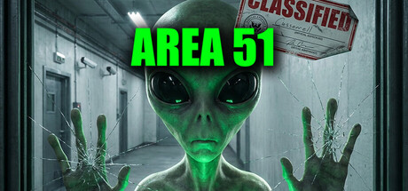

# Sega Saturn

[← Back to index](../README.md)

59 titles across 7 years in this archive.

## 2000

[Full 2000 page](../years/2000.md)

### Final Fight Revenge

**Platforms:** Sega Saturn &nbsp;|&nbsp; **Released:** March 30

[Wikipedia](https://en.wikipedia.org/wiki/Final_Fight_Revenge)

---

## 1999

[Full 1999 page](../years/1999.md)

### Dungeons and Dragons Collection

**Platforms:** Sega Saturn &nbsp;|&nbsp; **Released:** March 4

[Wikipedia](https://en.wikipedia.org/wiki/Dungeons_and_Dragons_Collection)

---

## 1998

[Full 1998 page](../years/1998.md)

### Panzer Dragoon Saga

**Platforms:** Sega Saturn &nbsp;|&nbsp; **Publisher:** Sega &nbsp;|&nbsp; **Released:** January 29, 1998

[Wikipedia](https://en.wikipedia.org/wiki/Panzer_Dragoon_Saga)

---

## 1997

[Full 1997 page](../years/1997.md)

### Croc: Legend of the Gobbos

**Platforms:** Windows, MS-DOS, PlayStation, Sega Saturn &nbsp;|&nbsp; **Genre:** Action, Adventure &nbsp;|&nbsp; **Released:** September 29

> Join Croc in a charming 3D platforming adventure to rescue the kidnapped Gobbos from the evil sorcerer Baron Dante and his impish Dantini minions! Run, jump, climb, swim, and tail-spin through vibrant worlds in this lovingly remastered and updated version of the beloved 1997 classic.
>
> _Synopsis source: Steam_

[Steam](https://store.steampowered.com/app/3043940)

---

### Culdcept

**Platforms:** Sega Saturn &nbsp;|&nbsp; **Released:** October 30

[Wikipedia](https://en.wikipedia.org/wiki/Culdcept_(1997_video_game))

---

### DoDonPachi

**Platforms:** Sega Saturn, Arcade &nbsp;|&nbsp; **Released:** February 5

[Wikipedia](https://en.wikipedia.org/wiki/DoDonPachi)

---

### FIFA: Road to World Cup 98

**Platforms:** Windows, MS-DOS, Nintendo 64, PlayStation, Sega Saturn &nbsp;|&nbsp; **Released:** November 30

---

### Fighters Megamix

**Platforms:** Sega Saturn &nbsp;|&nbsp; **Released:** April 30

[Wikipedia](https://en.wikipedia.org/wiki/Fighters_Megamix)

---

### Grandia

**Platforms:** Sega Saturn &nbsp;|&nbsp; **Released:** December 18

[Wikipedia](https://en.wikipedia.org/wiki/Grandia_(video_game))

---

### Herc's Adventures

**Platforms:** PlayStation, Sega Saturn &nbsp;|&nbsp; **Released:** July 31

[Wikipedia](https://en.wikipedia.org/wiki/Herc%27s_Adventures)

---

### Independence Day

**Platforms:** Windows, MS-DOS, PlayStation, Sega Saturn &nbsp;|&nbsp; **Genre:** Casual &nbsp;|&nbsp; **Released:** February 28

> Dive into the enchanting world of &quot;Secret Cats - Independence Day&quot; a hidden object game where your mission is to uncover every cat hidden within stunning hand-painted artwork. Let your keen eye and curiosity guide you through this captivating journey.
>
> _Synopsis source: Steam_

[Wikipedia](https://en.wikipedia.org/wiki/Independence_Day_(video_game)) · [Steam](https://store.steampowered.com/app/4821350)

---

### Madden NFL 98

**Platforms:** Sega Saturn, Windows, MS-DOS, PlayStation &nbsp;|&nbsp; **Publisher:** EA Sports &nbsp;|&nbsp; **Released:** August 26, 1997

[Wikipedia](https://en.wikipedia.org/wiki/Madden_NFL_98)

---

### Mega Man 8

**Platforms:** PlayStation, Sega Saturn &nbsp;|&nbsp; **Released:** February 28

[Wikipedia](https://en.wikipedia.org/wiki/Mega_Man_8)

---

### Mega Man X4

**Platforms:** PlayStation, Sega Saturn &nbsp;|&nbsp; **Released:** August 1

[Wikipedia](https://en.wikipedia.org/wiki/Mega_Man_X4)

---

### Riven

**Platforms:** Windows, MS-DOS, Sega Saturn, PlayStation &nbsp;|&nbsp; **Genre:** Adventure, Casual, Indie &nbsp;|&nbsp; **Released:** October 29

> Uncover a story of intrigue, betrayal, and a civilization teetering on the brink of collapse as you solve intricate puzzles to unlock the secrets of Riven. Built from the ground-up and expanded from the award-winning original game released in 1997.
>
> _Synopsis source: Steam_

[Wikipedia](https://en.wikipedia.org/wiki/Riven) · [Steam](https://store.steampowered.com/app/1712350)

---

### Silhouette Mirage

**Platforms:** Sega Saturn &nbsp;|&nbsp; **Released:** September 10

[Wikipedia](https://en.wikipedia.org/wiki/Silhouette_Mirage)

---

### Sonic Jam

**Platforms:** Sega Saturn &nbsp;|&nbsp; **Released:** June 20

[Wikipedia](https://en.wikipedia.org/wiki/Sonic_Jam)

---

### Sonic R

**Platforms:** Sega Saturn &nbsp;|&nbsp; **Released:** November 17

[Wikipedia](https://en.wikipedia.org/wiki/Sonic_R)

---

### Steep Slope Sliders

**Platforms:** Sega Saturn &nbsp;|&nbsp; **Released:** October 23

[Wikipedia](https://en.wikipedia.org/wiki/Steep_Slope_Sliders)

---

### Street Fighter Collection

**Platforms:** Sega Saturn, PlayStation &nbsp;|&nbsp; **Released:** September 18

[Wikipedia](https://en.wikipedia.org/wiki/Street_Fighter_Collection)

---

### Tengai Makyō: Daiyon no Mokushiroku

**Platforms:** Sega Saturn &nbsp;|&nbsp; **Released:** January 14

---

### The Lost Vikings 2

**Platforms:** Windows, MS-DOS, Super Nintendo Entertainment System, PlayStation, Sega Saturn &nbsp;|&nbsp; **Released:** February 27

[Wikipedia](https://en.wikipedia.org/wiki/The_Lost_Vikings_2)

---

### Vandal Hearts

**Platforms:** PlayStation, Sega Saturn &nbsp;|&nbsp; **Released:** March 26

[Wikipedia](https://en.wikipedia.org/wiki/Vandal_Hearts)

---

## 1996

[Full 1996 page](../years/1996.md)

### Area 51

**Platforms:** PlayStation, Windows, Sega Saturn &nbsp;|&nbsp; **Developer/Publisher:** Mesa Logic/ Atari Games &nbsp;|&nbsp; **Genre:** Shooter &nbsp;|&nbsp; **Released:** November 26

> Storm AREA 51 with your friends. Explore the most classified facility on earth. Discover what they've been hiding. Take selfies with aliens and smuggle evidence out before the military arrives.
>
> _Synopsis source: Steam_

[Wikipedia](https://en.wikipedia.org/wiki/Area_51_(1995_video_game)) · [Steam](https://store.steampowered.com/app/4423180)

---

### Bug Too!

**Platforms:** Sega Saturn, Windows &nbsp;|&nbsp; **Developer/Publisher:** Sega / Realtime Associates &nbsp;|&nbsp; **Released:** November 30

[Wikipedia](https://en.wikipedia.org/wiki/Bug_Too!)

---

### Bust-A-Move 2: Arcade Edition

**Platforms:** Sega Saturn, PlayStation &nbsp;|&nbsp; **Developer/Publisher:** Taito / Acclaim &nbsp;|&nbsp; **Genre:** Puzzle &nbsp;|&nbsp; **Released:** July 26

---

### Command & Conquer

**Platforms:** Sega Saturn &nbsp;|&nbsp; **Publisher:** Sega &nbsp;|&nbsp; **Released:** December 18, 1996

[Wikipedia](https://en.wikipedia.org/wiki/Command_%26_Conquer_(1995_video_game))

---

### Contra: Legacy of War

**Platforms:** Sega Saturn, PlayStation &nbsp;|&nbsp; **Developer/Publisher:** Konami / Appaloosa Interactive &nbsp;|&nbsp; **Released:** November 30

---

### Die Hard Trilogy

**Platforms:** Windows, PlayStation, Sega Saturn &nbsp;|&nbsp; **Developer/Publisher:** Probe Entertainment / Fox Interactive &nbsp;|&nbsp; **Released:** August 31

[Wikipedia](https://en.wikipedia.org/wiki/Die_Hard_Trilogy)

---

### Dragon Force

**Platforms:** Sega Saturn &nbsp;|&nbsp; **Developer/Publisher:** Sega / Working Designs &nbsp;|&nbsp; **Publisher:** Sega &nbsp;|&nbsp; **Genre:** RPG, RTS &nbsp;|&nbsp; **Released:** March 29, 1996

[Wikipedia](https://en.wikipedia.org/wiki/Dragon_Force)

---

### FIFA Soccer 97

**Platforms:** Genesis / Mega Drive, PlayStation, Windows, Super Nintendo Entertainment System, Sega Saturn, Game Boy &nbsp;|&nbsp; **Developer/Publisher:** EA Canada / Electronic Arts &nbsp;|&nbsp; **Released:** November 30

[Wikipedia](https://en.wikipedia.org/wiki/FIFA_Soccer_97)

---

### Fighters Megamix

**Platforms:** Sega Saturn &nbsp;|&nbsp; **Publisher:** Sega &nbsp;|&nbsp; **Released:** December 21, 1996

[Wikipedia](https://en.wikipedia.org/wiki/Fighters_Megamix)

---

### Fighting Vipers

**Platforms:** Sega Saturn, Arcade &nbsp;|&nbsp; **Developer/Publisher:** Sega AM2 &nbsp;|&nbsp; **Genre:** Fighting &nbsp;|&nbsp; **Released:** November 30

[Wikipedia](https://en.wikipedia.org/wiki/Fighting_Vipers)

---

### Guardian Heroes

**Platforms:** Sega Saturn &nbsp;|&nbsp; **Developer/Publisher:** Treasure / Sega &nbsp;|&nbsp; **Publisher:** Sega &nbsp;|&nbsp; **Genre:** Brawler &nbsp;|&nbsp; **Released:** January 26, 1996

[Wikipedia](https://en.wikipedia.org/wiki/Guardian_Heroes)

---

### GunGriffon

**Platforms:** Sega Saturn &nbsp;|&nbsp; **Developer/Publisher:** Game Arts / Sega &nbsp;|&nbsp; **Released:** September 14

[Wikipedia](https://en.wikipedia.org/wiki/GunGriffon)

---

### Madden NFL 97

**Platforms:** Genesis / Mega Drive, PlayStation, Windows, Super Nintendo Entertainment System, Sega Saturn, Game Boy &nbsp;|&nbsp; **Developer/Publisher:** EA Sports / Electronic Arts &nbsp;|&nbsp; **Genre:** Sports (football) &nbsp;|&nbsp; **Released:** August 31

[Wikipedia](https://en.wikipedia.org/wiki/Madden_NFL_97)

---

### Mr. Bones

**Platforms:** Sega Saturn &nbsp;|&nbsp; **Developer/Publisher:** Zono / Sega &nbsp;|&nbsp; **Genre:** Platformer &nbsp;|&nbsp; **Released:** September 30

[Wikipedia](https://en.wikipedia.org/wiki/Mr._Bones_(video_game))

---

### Mystaria: The Realms of Lore

**Platforms:** Sega Saturn &nbsp;|&nbsp; **Developer/Publisher:** Micro Cabin / Sega &nbsp;|&nbsp; **Genre:** Tactical RPG &nbsp;|&nbsp; **Released:** January 26

---

### NBA Live 97

**Platforms:** PlayStation, Sega Saturn, Super Nintendo Entertainment System, Genesis / Mega Drive &nbsp;|&nbsp; **Developer/Publisher:** Electronic Arts , EA Sports &nbsp;|&nbsp; **Released:** October 31

[Wikipedia](https://en.wikipedia.org/wiki/NBA_Live_97)

---

### NiGHTS into Dreams...

**Platforms:** Sega Saturn &nbsp;|&nbsp; **Developer/Publisher:** Sega &nbsp;|&nbsp; **Publisher:** Sega &nbsp;|&nbsp; **Released:** July 5, 1996

[Wikipedia](https://en.wikipedia.org/wiki/NiGHTS_into_Dreams...)

---

### Pandemonium!

**Platforms:** PlayStation, Sega Saturn &nbsp;|&nbsp; **Developer/Publisher:** Electronic Arts , EA Sports &nbsp;|&nbsp; **Released:** October 31

[Wikipedia](https://en.wikipedia.org/wiki/Pandemonium!_(video_game))

---

### Panzer Dragoon II Zwei

**Platforms:** Sega Saturn &nbsp;|&nbsp; **Developer/Publisher:** Team Andromeda / Sega &nbsp;|&nbsp; **Publisher:** Sega &nbsp;|&nbsp; **Genre:** Rail shooter &nbsp;|&nbsp; **Released:** March 22, 1996

[Wikipedia](https://en.wikipedia.org/wiki/Panzer_Dragoon_II_Zwei)

---

### Rise 2: Resurrection

**Platforms:** Windows, Sega Saturn, PlayStation &nbsp;|&nbsp; **Developer/Publisher:** Mirage / Acclaim &nbsp;|&nbsp; **Released:** February 29

---

### Saturn Bomberman

**Platforms:** Sega Saturn &nbsp;|&nbsp; **Developer/Publisher:** Hudson &nbsp;|&nbsp; **Released:** July 19

[Wikipedia](https://en.wikipedia.org/wiki/Saturn_Bomberman)

---

### Sonic 3D Blast

**Platforms:** Sega Saturn, Genesis / Mega Drive &nbsp;|&nbsp; **Developer/Publisher:** Sega / Traveller's Tales &nbsp;|&nbsp; **Genre:** Platformer &nbsp;|&nbsp; **Released:** November 20

[Wikipedia](https://en.wikipedia.org/wiki/Sonic_3D_Blast)

---

### Street Fighter Alpha 2

**Platforms:** Arcade, Super Nintendo Entertainment System, PlayStation, Sega Saturn &nbsp;|&nbsp; **Developer/Publisher:** Capcom &nbsp;|&nbsp; **Released:** September 30

[Wikipedia](https://en.wikipedia.org/wiki/Street_Fighter_Alpha_2)

---

### The King of Fighters '96

**Platforms:** Neo Geo AES, Neo Geo CD, Sega Saturn &nbsp;|&nbsp; **Developer/Publisher:** SNK &nbsp;|&nbsp; **Released:** July 25

[Wikipedia](https://en.wikipedia.org/wiki/The_King_of_Fighters_%2796)

---

### The Legend of Oasis

**Platforms:** Sega Saturn &nbsp;|&nbsp; **Developer/Publisher:** Sega / Ancient &nbsp;|&nbsp; **Released:** April 26

[Wikipedia](https://en.wikipedia.org/wiki/The_Legend_of_Oasis)

---

### Tomb Raider

**Platforms:** MS-DOS, PlayStation, Sega Saturn &nbsp;|&nbsp; **Developer/Publisher:** Core Design / Eidos &nbsp;|&nbsp; **Publisher:** Eidos Interactive &nbsp;|&nbsp; **Genre:** Action-adventure &nbsp;|&nbsp; **Released:** November 14, 1996

[Wikipedia](https://en.wikipedia.org/wiki/Tomb_Raider_(1996_video_game))

---

### Ultimate Mortal Kombat 3

**Platforms:** Sega Saturn, Genesis / Mega Drive, Super Nintendo Entertainment System &nbsp;|&nbsp; **Developer/Publisher:** Acclaim Entertainment , GT Interactive , Midway , Williams Entertainment &nbsp;|&nbsp; **Released:** June 26

[Wikipedia](https://en.wikipedia.org/wiki/Ultimate_Mortal_Kombat_3)

---

### Virtua Cop 2

**Platforms:** Sega Saturn, Arcade &nbsp;|&nbsp; **Developer/Publisher:** Sega AM2 &nbsp;|&nbsp; **Genre:** Light gun shooter &nbsp;|&nbsp; **Released:** November 30

[Wikipedia](https://en.wikipedia.org/wiki/Virtua_Cop_2)

---

### Virtua Fighter Kids

**Platforms:** Sega Saturn, Arcade &nbsp;|&nbsp; **Developer/Publisher:** Sega AM2 &nbsp;|&nbsp; **Released:** July 31

[Wikipedia](https://en.wikipedia.org/wiki/Virtua_Fighter_Kids)

---

### Virtual On: Cyber Troopers

**Platforms:** Sega Saturn, Arcade &nbsp;|&nbsp; **Developer/Publisher:** CRI / Sega &nbsp;|&nbsp; **Released:** November 30

---

### WWF In Your House

**Platforms:** MS-DOS, PlayStation, Sega Saturn &nbsp;|&nbsp; **Developer/Publisher:** Acclaim &nbsp;|&nbsp; **Released:** October 31

[Wikipedia](https://en.wikipedia.org/wiki/WWF_In_Your_House_(video_game))

---

## 1995

[Full 1995 page](../years/1995.md)

### Panzer Dragoon

**Platforms:** Sega Saturn &nbsp;|&nbsp; **Developer/Publisher:** Team Andromeda / Sega &nbsp;|&nbsp; **Released:** March 10

[Wikipedia](https://en.wikipedia.org/wiki/Panzer_Dragoon)

---

### Rayman

**Platforms:** PlayStation, Sega Saturn, Atari Jaguar &nbsp;|&nbsp; **Developer/Publisher:** Ubisoft &nbsp;|&nbsp; **Released:** September 9

[Wikipedia](https://en.wikipedia.org/wiki/Rayman_(video_game))

---

### Shining Wisdom

**Platforms:** Sega Saturn &nbsp;|&nbsp; **Developer/Publisher:** Camelot / Sega &nbsp;|&nbsp; **Genre:** Action-adventure &nbsp;|&nbsp; **Released:** August 11

[Wikipedia](https://en.wikipedia.org/wiki/Shining_Wisdom)

---

### Wizard's Harmony

**Platforms:** PlayStation, Sega Saturn &nbsp;|&nbsp; **Developer/Publisher:** Arc System Works &nbsp;|&nbsp; **Genre:** Raising sim &nbsp;|&nbsp; **Released:** December 29

[Wikipedia](https://en.wikipedia.org/wiki/Wizard%27s_Harmony)

---

## 1994

[Full 1994 page](../years/1994.md)

### Magic Carpet

**Platforms:** MS-DOS, PlayStation, Sega Saturn &nbsp;|&nbsp; **Developer/Publisher:** Bullfrog Productions &nbsp;|&nbsp; **Genre:** Action &nbsp;|&nbsp; **Released:** December

[Wikipedia](https://en.wikipedia.org/wiki/Magic_Carpet_(video_game))

---
