# Wii

[← Back to index](../README.md)

742 titles across 10 years in this archive.

## 2016

[Full 2016 page](../years/2016.md)

### Just Dance 2017

**Platforms:** Wii U, PlayStation 3, Windows, PlayStation 4, Xbox One, Xbox 360, Wii &nbsp;|&nbsp; **Developer:** Ubisoft Milan, Ubisoft Pune, Ubisoft Paris &nbsp;|&nbsp; **Publisher:** Ubisoft Entertainment &nbsp;|&nbsp; **Genre:** Music &nbsp;|&nbsp; **Released:** October 25, 2016

> Grab your friends and family: it’s time to dance! Just Dance is back with over 40 new tracks, 6 games modes, and ever more songs through Just Dance Unlimited subscription service! Featuring the ultimate tracklist including Cheap Thrills by Sia Ft. Sean Paul, Sorry by Justin Bieber and many more!
>
> _Synopsis source: IGDB_

[IGDB](https://www.igdb.com/games/just-dance-2017)

---

## 2014

[Full 2014 page](../years/2014.md)

### Skylanders: Trap Team

**Platforms:** Wii, Xbox 360, Wii U, Android, Xbox One, PlayStation 4, PlayStation 3, iOS &nbsp;|&nbsp; **Developer:** Toys for Bob &nbsp;|&nbsp; **Publisher:** Activision &nbsp;|&nbsp; **Genre:** Platform, Role-playing (RPG), Hack and slash/Beat 'em up, Adventure &nbsp;|&nbsp; **Released:** September 30, 2014

> In Skylanders Trap Team, Kaos continues his ongoing quest to rule over Skylands. He has discovered the location of the legendary Cloudcracker Prison -- a fortress built entirely out of the magical substance Traptanium and home to Skylands’ most nefarious baddies. In an attempt to build his own army of foes, Kaos blows up the prison, releasing the most wanted villains and blasting shards of Traptanium to Earth in the form of Traps. Now it’s up to Portal Masters to recapture all of the escaped villains using powerful Traptanium Traps and defeat Kaos before it’s too late!
>
> _Synopsis source: IGDB_

[IGDB](https://www.igdb.com/games/skylanders-trap-team)

---

## 2013

[Full 2013 page](../years/2013.md)

### Just Dance 2014

**Platforms:** Wii U, Wii, PlayStation 3, PlayStation 4, Xbox 360, Xbox One &nbsp;|&nbsp; **Developer:** Ubisoft Milan, Ubisoft Barcelona, Ubisoft Reflections, Ubisoft Paris, Ubisoft Bucharest, Ubisoft Pune, Ubisoft Montpellier &nbsp;|&nbsp; **Publisher:** Ubisoft Entertainment &nbsp;|&nbsp; **Genre:** Music &nbsp;|&nbsp; **Released:** October 1, 2013

> Just Dance 2014 is a dance rhythm game that has you match the choreography of an on-screen dancer to earn points for accuracy, using your motion controller for real-time movement tracking. Beyond single-player routines, it expands the experience with online multiplayer via World Dance Floor, where you compete simultaneously with others, plus Wii U and Xbox-style second-screen support that helps you manage routines, playlists, and performance from a companion device. The update also adds spotlight-friendly On Stage modes, letting one player lead with others as backup dancers, along with AutoDance to record and share your gameplay and Karaoke for singing along to on-screen lyrics. For variety and fitness, it supports customized workout playlists, calorie tracking across modes, and more dances per track through alternate choreographies in categories like Just Sweat, Extreme, Battle, and Mash-Up.
>
> _Synopsis source: IGDB_

[IGDB](https://www.igdb.com/games/just-dance-2014)

---

### Skylanders: Swap Force

**Platforms:** Wii, Xbox 360, Wii U, Xbox One, PlayStation 4, PlayStation 3 &nbsp;|&nbsp; **Developer:** Vicarious Visions &nbsp;|&nbsp; **Publisher:** Activision &nbsp;|&nbsp; **Genre:** Platform, Role-playing (RPG), Hack and slash/Beat 'em up, Adventure &nbsp;|&nbsp; **Released:** October 13, 2013

> Skylanders: Swap Force is a platformer video game developed by Vicarious Visions and published by Activision. It is the third main game in the Skylanders video game and toy franchise, following 2012's Skylanders: Giants, which was a direct sequel to 2011's Skylanders: Spyro's Adventure (the spin-off of The Legend of Spyro series). It is the game before Skylanders: Trap Team and features the voices of John DiMaggio, Jess Harnell, Audrey Wasilewski, Richard Tatum, David Sobolov, Josh Keaton, Keythe Farley, Dave Wittenberg, Joey Camen, Gregg Berger, Troy Baker and Robin Atkin Downes.  It is the first Skylanders game to be released in North America before other regions, unlike the previous two games where Australia got the installments first. It is also the first Skylanders game not to be owned by Vivendi.
>
> _Synopsis source: IGDB_

[IGDB](https://www.igdb.com/games/skylanders-swap-force)

---

## 2012

[Full 2012 page](../years/2012.md)

### Just Dance 4

**Platforms:** Wii, Wii U, PlayStation 3, Xbox 360 &nbsp;|&nbsp; **Developer:** Ubisoft Paris &nbsp;|&nbsp; **Publisher:** Ubisoft Entertainment &nbsp;|&nbsp; **Genre:** Music &nbsp;|&nbsp; **Released:** October 2, 2012

> Just Dance 4 features more than 40 new tracks, ranging from chart-topping Billboard hits to classic dance party tracks. Whether it's pop, Hip-Hop, rock, R&B, country or funk, there is something for everyone to dance to.
>
> _Synopsis source: IGDB_

[IGDB](https://www.igdb.com/games/just-dance-4)

---

### LEGO Batman 2: DC Super Heroes

**Platforms:** PlayStation 3, Wii, macOS, Windows, Xbox 360 &nbsp;|&nbsp; **Developer:** Traveller's Tales &nbsp;|&nbsp; **Publisher:** Feral Interactive, WB Games &nbsp;|&nbsp; **Genre:** Platform, Hack and slash/Beat 'em up, Adventure &nbsp;|&nbsp; **Released:** June 19, 2012

> The Dynamic Duo of Batman and Robin join other famous super heroes from the DC Universe including Superman, Wonder Woman and Green Lantern to save Gotham City from destruction at the hands of the notorious villains Lex Luthor and the Joker.
>
> _Synopsis source: IGDB_

[IGDB](https://www.igdb.com/games/lego-batman-2-dc-super-heroes)

---

### LEGO The Lord of the Rings

**Platforms:** Wii, Xbox 360, Windows, PlayStation 3 &nbsp;|&nbsp; **Developer:** Traveller's Tales &nbsp;|&nbsp; **Publisher:** Feral Interactive, WB Games &nbsp;|&nbsp; **Genre:** Adventure &nbsp;|&nbsp; **Released:** November 13, 2012

> Based on The Lord of the Rings motion picture trilogy, LEGO The Lord of the Rings follows the original storylines of The Lord of the Rings: The Fellowship of the Ring, The Lord of the Rings: The Two Towers, and The Lord of the Rings: The Return of the King, taking players through the epic story events reimagined with the humor and endless variety of LEGO play.  Trusted with the dangerous task to destroy an ancient magical ring that threatens all that is good, Frodo is forced to leave his peaceful home. But the ring wants to be found and the road to Mount Doom, the only place where it can be destroyed, will be perilous and riddled with Orcs and fouler things.  To help Frodo, a Fellowship is formed —Aragorn the Ranger, Gandalf the Wizard, Legolas the Elf, Gimli the Dwarf, Boromir a Man of Gondor, and Frodo’s Hobbit friends Sam, Merry and Pippin. Players relive the legend through the LEGO minifigures, as they explore wonders, solve timeless riddles, and overcome endless foes in their quest to destroy the Ring.
>
> _Synopsis source: IGDB_

[IGDB](https://www.igdb.com/games/lego-the-lord-of-the-rings)

---

### Mario Party 9

**Platforms:** Wii &nbsp;|&nbsp; **Developer:** NDCube &nbsp;|&nbsp; **Publisher:** Nintendo &nbsp;|&nbsp; **Genre:** Puzzle, Adventure, Card & Board Game &nbsp;|&nbsp; **Released:** March 2, 2012

> Grab your friends and family and captain the crew to victory!  The party is back and bigger than ever in the Mario Party 9 game for Wii, featuring all-new ways to play! For the first time in the franchise, boss battles crash the party and challenge players to compete to defeat a common enemy. In addition, players now travel across stages together in a vehicle towards a common goal - overcoming obstacles, battling bosses, and collecting Mini Stars stolen by Bowser and his minions. Featuring 80 new minigames, adventurous new stages, and all-new ways to play that blend cooperative and competitive action for up to four players*, Mario Party 9 is the perfect way to get the party started.  -For the first time in the Mario Party franchise, each stage culminates in a Boss Battle. Collectively, players must combine their strength to defeat classic foes such as Bowser and King Boo while still playing competitively to boost their own individual scores.  -In another first for the series, players ride across stages together in special vehicles. Players take turns as Captain of the vehicle by hitting Dice Blocks to move the party forward, hoping to land on lucky spaces. The vehicles also help to streamline game play and keep everyone involved in the action.  -Unique Captain Events on each stage give players a new way to change the shape of the game.  -In Mario Party 9, each themed stage has a clear destination point but with multiple paths along the way, so no two games will play the same. From Toad Road to Boo’s Horror Castle, players will encounter a wide variety of familiar Mario franchise elements in new environments that can be enjoyed solo or with friends.  -Includes 80 outrageous new minigames that find players making pizzas, escaping haunted mansions, and racing snowmobiles.  -No time to play through an entire stage? New minigame modes let players enjoy the action in smaller chunks of time. They can hone their skills at any minigame in Free Play mode or try the Extras mode that includes Goomba Bowling and the puzzle-based Castle Clearout.  -Every time they play, players can earn Party Points that are used to unlock special items and features.  * Additional accessories are required for multiplayer game play and are sold separately.
>
> _Synopsis source: IGDB_

[IGDB](https://www.igdb.com/games/mario-party-9)

---

### Skylanders: Giants

**Platforms:** Wii U, Wii, Xbox 360, PlayStation 3 &nbsp;|&nbsp; **Developer:** Toys for Bob &nbsp;|&nbsp; **Publisher:** Activision &nbsp;|&nbsp; **Genre:** Role-playing (RPG), Hack and slash/Beat 'em up, Adventure &nbsp;|&nbsp; **Released:** October 17, 2012

> Skylanders: Giants is a 2012 video game in the Skylanders series, a direct sequel to the 2011 game Skylanders: Spyro's Adventure and features the voices of Kevin Michael Richardson, Greg Ellis, Peter Lurie, Steve Blum, Dave Wittenberg, Carlos Alazraqui, Kevin Sorbo, Bobcat Goldthwait, Patrick Seitz and Julie Nathanson. It is the game before Skylanders: Swap Force. As the title suggests, it features larger Skylanders known as "Giants", along with other new gameplay mechanics.
>
> _Synopsis source: IGDB_

[IGDB](https://www.igdb.com/games/skylanders-giants)

---

### WWE '13

**Platforms:** Wii, Xbox 360, PlayStation 3 &nbsp;|&nbsp; **Developer:** Yuke's &nbsp;|&nbsp; **Publisher:** 2K Sports, THQ, 2K &nbsp;|&nbsp; **Genre:** Fighting, Platform, Sport, Strategy &nbsp;|&nbsp; **Released:** October 30, 2012

> WWE ’13 transforms WWE gameplay through the introduction of WWE Live, completely changing the way players experience the videogame’s audio and presentation elements. Predator Technology returns to further implement critical gameplay improvements, while fan favourites in WWE Universe Mode and the franchise’s renowned Creation Suite offer the utmost in player freedom.  Furthermore, WWE ’13 focuses on the Attitude Era of the WWF, replacing its Road to WrestleMania Mode with an Attitude Era Mode where the player plays through the Attitude Era. The game gives such characters as Stone Cold Steve Austin and elements as the Monday Night Wars a more important role in the game than in any previous WWE game.
>
> _Synopsis source: IGDB_

[IGDB](https://www.igdb.com/games/wwe-13)

---

## 2011

[Full 2011 page](../years/2011.md)

### ABBA: You Can Dance

**Platforms:** Wii &nbsp;|&nbsp; **Released:** November 15

---

### Alvin and the Chipmunks: Chipwrecked

**Platforms:** Nintendo DS, Wii, Xbox 360 &nbsp;|&nbsp; **Released:** November 15

---

### Battle vs. Chess

**Platforms:** Windows, Nintendo DS, PlayStation 3, PlayStation Portable, Wii, Xbox 360 &nbsp;|&nbsp; **Released:** May 17

[Wikipedia](https://en.wikipedia.org/wiki/Battle_vs._Chess)

---

### Ben 10: Galactic Racing

**Platforms:** PlayStation 3, Xbox 360, Nintendo DS, Wii, Nintendo 3DS &nbsp;|&nbsp; **Released:** October 18

---

### Cabela's Adventure Camp

**Platforms:** PlayStation 3, Wii, Xbox 360 &nbsp;|&nbsp; **Released:** November 1

[Wikipedia](https://en.wikipedia.org/wiki/Cabela%27s_Adventure_Camp)

---

### Cabela's Survival: Shadows of Katmai

**Platforms:** Wii, PlayStation 3, Xbox 360 &nbsp;|&nbsp; **Released:** November 1

---

### Call of Duty: Modern Warfare 3

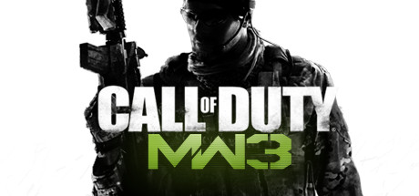

**Platforms:** Windows, PlayStation 3, Xbox 360, Wii &nbsp;|&nbsp; **Genre:** Action &nbsp;|&nbsp; **Released:** November 8

> The best-selling first-person action series of all-time returns with an epic sequel to the multiple GOTY award winner Call of Duty®: Modern Warfare® 2
>
> _Synopsis source: Steam_

[Steam](https://store.steampowered.com/app/42680)

---

### Captain America: Super Soldier

**Platforms:** Xbox 360, PlayStation 3, Wii, Nintendo DS, Nintendo 3DS &nbsp;|&nbsp; **Released:** July 14

---

### Cars 2

**Platforms:** Windows, Xbox 360, PlayStation 3, Wii, Nintendo DS, Nintendo 3DS, PlayStation Portable &nbsp;|&nbsp; **Released:** June 21

[Wikipedia](https://en.wikipedia.org/wiki/Cars_2_(video_game))

---

### Cartoon Network: Punch Time Explosion XL

**Platforms:** Wii, PlayStation 3, Xbox 360 &nbsp;|&nbsp; **Released:** November 15

---

### Centipede: Infestation

**Platforms:** Wii, Nintendo 3DS &nbsp;|&nbsp; **Released:** October 25

---

### Conduit 2

**Platforms:** Wii &nbsp;|&nbsp; **Released:** April 19

[Wikipedia](https://en.wikipedia.org/wiki/Conduit_2)

---

### de Blob 2

**Platforms:** Nintendo DS, PlayStation 3, Xbox 360, Wii &nbsp;|&nbsp; **Released:** February 22

[Wikipedia](https://en.wikipedia.org/wiki/De_Blob_2)

---

### Deepak Chopra's Leela

**Platforms:** Wii, Xbox 360 &nbsp;|&nbsp; **Released:** November 8

---

### Disney Princess: Enchanting Storybooks

**Platforms:** Nintendo DS, Wii &nbsp;|&nbsp; **Released:** November 1

---

### Disney Universe

**Platforms:** Windows, macOS, Wii, PlayStation 3, Xbox 360 &nbsp;|&nbsp; **Released:** October 25

[Wikipedia](https://en.wikipedia.org/wiki/Disney_Universe)

---

### DreamWorks Super Star Kartz

**Platforms:** Nintendo 3DS, Nintendo DS, PlayStation 3, Wii, Xbox 360 &nbsp;|&nbsp; **Released:** November 15

[Wikipedia](https://en.wikipedia.org/wiki/DreamWorks_Super_Star_Kartz)

---

### Driver: San Francisco

**Platforms:** PlayStation 3, Xbox 360, Wii, Windows &nbsp;|&nbsp; **Released:** September 6

---

### FAST - Racing League

**Platforms:** Wii &nbsp;|&nbsp; **Released:** May 30

---

### FIFA 12

**Platforms:** PlayStation 3, Xbox 360, Windows, Wii, PlayStation 2, PlayStation Portable, Nintendo 3DS, iOS &nbsp;|&nbsp; **Publisher:** EA Sports &nbsp;|&nbsp; **Released:** September 27, 2011

[Wikipedia](https://en.wikipedia.org/wiki/FIFA_12)

---

### Flight Control

**Platforms:** Wii &nbsp;|&nbsp; **Released:** August 18

[Wikipedia](https://en.wikipedia.org/wiki/Flight_Control_(video_game))

---

### Fortune Street

**Platforms:** Wii &nbsp;|&nbsp; **Released:** December 5

[Wikipedia](https://en.wikipedia.org/wiki/Fortune_Street)

---

### Green Lantern: Rise of the Manhunters

**Platforms:** PlayStation 3, Xbox 360, Wii, Nintendo DS, Nintendo 3DS &nbsp;|&nbsp; **Released:** June 7

---

### Happy Feet Two: The Video Game

**Platforms:** Nintendo 3DS, Nintendo DS, PlayStation 3, Wii, Xbox 360 &nbsp;|&nbsp; **Released:** November 8

[Wikipedia](https://en.wikipedia.org/wiki/Happy_Feet_Two)

---

### Harry Potter and the Deathly Hallows – Part 2

**Platforms:** Windows, Xbox 360, PlayStation 3, Wii, Nintendo DS &nbsp;|&nbsp; **Released:** July 12

[Wikipedia](https://en.wikipedia.org/wiki/Harry_Potter_and_the_Deathly_Hallows_%E2%80%93_Part_2_(video_game))

---

### Jimmie Johnson's Anything with an Engine

**Platforms:** PlayStation 3, Wii, Xbox 360 &nbsp;|&nbsp; **Released:** November 1

[Wikipedia](https://en.wikipedia.org/wiki/Jimmie_Johnson%27s_Anything_with_an_Engine)

---

### Just Dance 3

**Platforms:** Wii, PlayStation 3, Xbox 360 &nbsp;|&nbsp; **Released:** October 7

[Wikipedia](https://en.wikipedia.org/wiki/Just_Dance_3)

---

### Just Dance Kids 2

**Platforms:** PlayStation 3, Wii, Xbox 360 &nbsp;|&nbsp; **Released:** October 25

[Wikipedia](https://en.wikipedia.org/wiki/Just_Dance_Kids_2)

---

### Just Dance: Summer Party

**Platforms:** Wii &nbsp;|&nbsp; **Released:** July 19

---

### Kirby's Return to Dream Land

**Platforms:** Wii &nbsp;|&nbsp; **Released:** October 24

[Wikipedia](https://en.wikipedia.org/wiki/Kirby%27s_Return_to_Dream_Land)

---

### Kung Fu Panda 2

**Platforms:** PlayStation 3, Xbox 360, Wii, Nintendo DS &nbsp;|&nbsp; **Released:** May 24

[Wikipedia](https://en.wikipedia.org/wiki/Kung_Fu_Panda_2_(video_game))

---

### Lego Harry Potter: Years 5–7

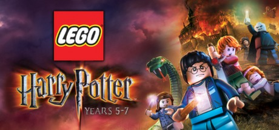

**Platforms:** Windows, Xbox 360, PlayStation 3, PlayStation Portable, Wii, Nintendo DS, Nintendo 3DS, iOS &nbsp;|&nbsp; **Genre:** Adventure &nbsp;|&nbsp; **Released:** November 11

> LEGO Harry Potter: Years 5-7 takes players through Harry Potter's heroic adventures in the Muggle and wizarding worlds.
>
> _Synopsis source: Steam_

[Steam](https://store.steampowered.com/app/204120)

---

### Lego Pirates of the Caribbean: The Video Game

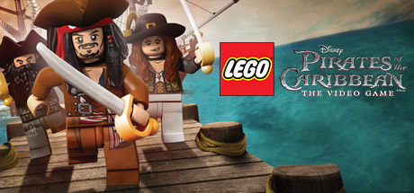

**Platforms:** Nintendo 3DS, Xbox 360, PlayStation 3, Wii, PlayStation Portable, Nintendo DS, Windows &nbsp;|&nbsp; **Genre:** Action, Adventure &nbsp;|&nbsp; **Released:** May 10

> LEGO® Pirates of the Caribbean: The Video Game is an action adventure game that brings the Pirates of the Caribbean world and all its colorful characters to life in LEGO Brick form. Players experience all the memorable scenes from all four films in the humorous and quirky LEGO Video Games style.
>
> _Synopsis source: Steam_

[Steam](https://store.steampowered.com/app/311770)

---

### Lego Star Wars III: The Clone Wars

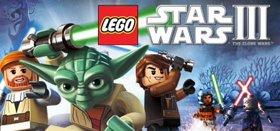

**Platforms:** Windows, Xbox 360, PlayStation 3, PlayStation Portable, Wii, Nintendo DS, Nintendo 3DS &nbsp;|&nbsp; **Genre:** Action, Adventure &nbsp;|&nbsp; **Released:** March 22

> LEGO Star Wars III: The Clone Wars will allow fans to explore endlessly and laugh their way through the Star Wars galaxy in the most humorous, accessible and action-packed LEGO game to date.
>
> _Synopsis source: Steam_

[Steam](https://store.steampowered.com/app/32510)

---

### Lost in Shadow

**Platforms:** Wii &nbsp;|&nbsp; **Genre:** Puzzle-platformer &nbsp;|&nbsp; **Released:** January 4

[Wikipedia](https://en.wikipedia.org/wiki/Lost_in_Shadow)

---

### Madden NFL 12

**Platforms:** PlayStation 2, PlayStation 3, PlayStation Portable, Xbox 360, Wii, iOS &nbsp;|&nbsp; **Released:** August 30

[Wikipedia](https://en.wikipedia.org/wiki/Madden_NFL_12)

---

### Major League Baseball 2K11

**Platforms:** Windows, PlayStation 3, PlayStation 2, PlayStation Portable, Xbox 360, Wii &nbsp;|&nbsp; **Released:** March 8

[Wikipedia](https://en.wikipedia.org/wiki/Major_League_Baseball_2K11)

---

### Man vs. Wild

**Platforms:** PlayStation 3, Wii, Xbox 360 &nbsp;|&nbsp; **Released:** April 26

[Wikipedia](https://en.wikipedia.org/wiki/Man_vs._Wild_(video_game))

---

### Mario & Sonic at the London 2012 Olympic Games

**Platforms:** Wii &nbsp;|&nbsp; **Released:** November 15

[Wikipedia](https://en.wikipedia.org/wiki/Mario_%26_Sonic_at_the_London_2012_Olympic_Games)

---

### Mario Sports Mix

**Platforms:** Wii &nbsp;|&nbsp; **Genre:** Sports &nbsp;|&nbsp; **Released:** February 7

[Wikipedia](https://en.wikipedia.org/wiki/Mario_Sports_Mix)

---

### Marvel Super Hero Squad: Comic Combat

**Platforms:** PlayStation 3, Wii, Xbox 360 &nbsp;|&nbsp; **Released:** November 15

---

### NASCAR The Game: 2011

**Platforms:** Xbox 360, PlayStation 3, Wii &nbsp;|&nbsp; **Released:** March 29

---

### NASCAR Unleashed

**Platforms:** PlayStation 3, Xbox 360, Nintendo 3DS, Wii &nbsp;|&nbsp; **Released:** November 1

[Wikipedia](https://en.wikipedia.org/wiki/NASCAR_Unleashed)

---

### NBA 2K12

**Platforms:** PlayStation 3, Xbox 360, Windows, Wii, PlayStation Portable, PlayStation 2 &nbsp;|&nbsp; **Publisher:** 2K &nbsp;|&nbsp; **Released:** October 4, 2011

[Wikipedia](https://en.wikipedia.org/wiki/NBA_2K12)

---

### Need for Speed: The Run

**Platforms:** Windows, PlayStation 3, Wii, Xbox 360, Nintendo 3DS &nbsp;|&nbsp; **Released:** November 15

---

### Nickelodeon Dance

**Platforms:** Wii, Xbox 360 &nbsp;|&nbsp; **Released:** November 8

---

### Nicktoons MLB

**Platforms:** Xbox 360, Wii, Nintendo DS &nbsp;|&nbsp; **Released:** September 13

[Wikipedia](https://en.wikipedia.org/wiki/Nicktoons_MLB)

---

### Pro Evolution Soccer 2012

**Platforms:** Windows, PlayStation 3, Xbox 360, Wii, PlayStation Portable, Nintendo 3DS, PlayStation 2 &nbsp;|&nbsp; **Released:** September 27

[Wikipedia](https://en.wikipedia.org/wiki/Pro_Evolution_Soccer_2012)

---

### Puss in Boots

**Platforms:** PlayStation 3, Nintendo DS, Wii, Xbox 360 &nbsp;|&nbsp; **Released:** October 25

[Wikipedia](https://en.wikipedia.org/wiki/Puss_in_Boots_(video_game))

---

### Puyo Puyo!! 20th Anniversary

**Platforms:** PlayStation Portable, Wii, Nintendo DS, Nintendo 3DS &nbsp;|&nbsp; **Released:** July 14

[Wikipedia](https://en.wikipedia.org/wiki/Puyo_Puyo!!_20th_Anniversary)

---

### Rayman Origins

**Platforms:** Wii, PlayStation 3, Xbox 360 &nbsp;|&nbsp; **Publisher:** Ubisoft &nbsp;|&nbsp; **Released:** November 15, 2011

[Wikipedia](https://en.wikipedia.org/wiki/Rayman_Origins)

---

### Rio

**Platforms:** PlayStation 3, Xbox 360, Nintendo DS, Wii &nbsp;|&nbsp; **Released:** April 12

[Wikipedia](https://en.wikipedia.org/wiki/Rio_(video_game))

---

### Rock Band Country Track Pack 2

**Platforms:** PlayStation 3, Wii, Xbox 360 &nbsp;|&nbsp; **Genre:** Music &nbsp;|&nbsp; **Released:** February 1

[Wikipedia](https://en.wikipedia.org/wiki/Rock_Band_Country_Track_Pack_2)

---

### Rune Factory: Tides of Destiny

**Platforms:** PlayStation 3, Wii &nbsp;|&nbsp; **Released:** September 27

---

### Shake It Up

**Platforms:** Wii &nbsp;|&nbsp; **Released:** December 9

---

### Skylanders: Spyro's Adventure

**Platforms:** Windows, Nintendo 3DS, PlayStation 3, Wii, Xbox 360 &nbsp;|&nbsp; **Released:** October 16

---

### Spider-Man: Edge of Time

**Platforms:** Xbox 360, PlayStation 3, Wii, Nintendo DS, Nintendo 3DS &nbsp;|&nbsp; **Released:** October 4

---

### SpongeBob SquigglePants

**Platforms:** Wii, Nintendo 3DS &nbsp;|&nbsp; **Released:** April 10

[Wikipedia](https://en.wikipedia.org/wiki/SpongeBob_SquigglePants)

---

### Strong Bad's Cool Game for Attractive People: Episode 1 - Homestar Ruiner

**Platforms:** Windows, Wii &nbsp;|&nbsp; **Released:** August 11

[Wikipedia](https://en.wikipedia.org/wiki/Strong_Bad%27s_Cool_Game_for_Attractive_People)

---

### The Adventures of Tintin: The Game

**Platforms:** Windows, PlayStation 3, Xbox 360, Wii, Nintendo 3DS &nbsp;|&nbsp; **Released:** December 6

---

### The Legend of Zelda: Skyward Sword

**Platforms:** Wii &nbsp;|&nbsp; **Publisher:** Nintendo &nbsp;|&nbsp; **Released:** November 18, 2011

---

### The Oregon Trail

**Platforms:** Nintendo 3DS, Wii &nbsp;|&nbsp; **Released:** December 6

[Wikipedia](https://en.wikipedia.org/wiki/The_Oregon_Trail_(2011_video_game))

---

### The Smurfs Dance Party

**Platforms:** Wii &nbsp;|&nbsp; **Released:** July 19

[Wikipedia](https://en.wikipedia.org/wiki/The_Smurfs_Dance_Party)

---

### Thor: God of Thunder

**Platforms:** Xbox 360, PlayStation 3, Wii, Nintendo DS, Nintendo 3DS &nbsp;|&nbsp; **Released:** May 3

---

### Tiger Woods PGA Tour 12

**Platforms:** PlayStation 3, Xbox 360, Wii &nbsp;|&nbsp; **Released:** March 29

[Wikipedia](https://en.wikipedia.org/wiki/Tiger_Woods_PGA_Tour_12)

---

### TNT Racers

**Platforms:** Xbox 360, PlayStation Portable, Wii &nbsp;|&nbsp; **Released:** February 8

[Wikipedia](https://en.wikipedia.org/wiki/TNT_Racers)

---

### Top Spin 4

**Platforms:** PlayStation 3, Xbox 360, Wii &nbsp;|&nbsp; **Released:** March 15

[Wikipedia](https://en.wikipedia.org/wiki/Top_Spin_4)

---

### Transformers: Dark of the Moon

**Platforms:** Xbox 360, PlayStation 3, Wii, Nintendo DS, Nintendo 3DS &nbsp;|&nbsp; **Released:** June 14

---

### Urbanix

**Platforms:** Wii &nbsp;|&nbsp; **Genre:** Puzzle &nbsp;|&nbsp; **Released:** January 17

---

### Virtua Tennis 4

**Platforms:** Xbox 360, PlayStation 3, Wii &nbsp;|&nbsp; **Released:** May 10

[Wikipedia](https://en.wikipedia.org/wiki/Virtua_Tennis_4)

---

### Wicked Monsters Blast!

**Platforms:** Wii &nbsp;|&nbsp; **Released:** July 7

[Wikipedia](https://en.wikipedia.org/wiki/Wicked_Monsters_Blast!)

---

### Wii Play: Motion

**Platforms:** Wii &nbsp;|&nbsp; **Released:** June 13

---

### WWE 12

**Platforms:** PlayStation 3, Wii, Xbox 360 &nbsp;|&nbsp; **Released:** November 22

[Wikipedia](https://en.wikipedia.org/wiki/WWE_12)

---

### WWE All Stars

**Platforms:** PlayStation 2, PlayStation 3, PlayStation Portable, Xbox 360, Wii, Nintendo 3DS &nbsp;|&nbsp; **Released:** March 29

[Wikipedia](https://en.wikipedia.org/wiki/WWE_All_Stars)

---

### X-Men: Destiny

**Platforms:** PlayStation 3, Wii, Xbox 360, Nintendo DS &nbsp;|&nbsp; **Released:** September 27

---

### You Don't Know Jack

**Platforms:** Windows, Nintendo DS, PlayStation 3, Wii, Xbox 360 &nbsp;|&nbsp; **Released:** February 8

[Wikipedia](https://en.wikipedia.org/wiki/You_Don%27t_Know_Jack_(2011_video_game))

---

## 2010

[Full 2010 page](../years/2010.md)

### 007: GoldenEye

**Platforms:** Wii, Nintendo DS &nbsp;|&nbsp; **Released:** November 2

---

### 10 Minute Solution

**Platforms:** Wii &nbsp;|&nbsp; **Released:** June 29

---

### 2010 FIFA World Cup South Africa

**Platforms:** PlayStation 3, Xbox 360, Wii, PlayStation Portable, iOS &nbsp;|&nbsp; **Released:** April 27

[Wikipedia](https://en.wikipedia.org/wiki/2010_FIFA_World_Cup_South_Africa_(video_game))

---

### Alice in Wonderland

**Platforms:** Nintendo DS, Wii &nbsp;|&nbsp; **Released:** March 2

[Wikipedia](https://en.wikipedia.org/wiki/Alice_in_Wonderland_(2010_video_game))

---

### Arc Rise Fantasia

**Platforms:** Wii &nbsp;|&nbsp; **Released:** July 20

[Wikipedia](https://en.wikipedia.org/wiki/Arc_Rise_Fantasia)

---

### Art of Balance

**Platforms:** Wii &nbsp;|&nbsp; **Released:** February 15

[Wikipedia](https://en.wikipedia.org/wiki/Shin%27en_Multimedia)

---

### Art Style: Rotozoa

**Platforms:** Wii &nbsp;|&nbsp; **Released:** June 21

[Wikipedia](https://en.wikipedia.org/wiki/Rotozoa)

---

### Attack of the Movies 3D

**Platforms:** Wii, Xbox 360 &nbsp;|&nbsp; **Released:** May 18

[Wikipedia](https://en.wikipedia.org/wiki/Attack_of_the_Movies_3D)

---

### Babysitting Mama

**Platforms:** Wii &nbsp;|&nbsp; **Released:** November 5

[Wikipedia](https://en.wikipedia.org/wiki/Babysitting_Mama)

---

### Backyard Sports: Rookie Rush

**Platforms:** Nintendo DS, Wii, Windows, Xbox 360 &nbsp;|&nbsp; **Released:** October 26

---

### Bakugan: Defenders of the Core

**Platforms:** Nintendo DS, PlayStation 3, PlayStation Portable, Wii, Xbox 360 &nbsp;|&nbsp; **Released:** October 19

---

### Batman: The Brave and the Bold

**Platforms:** Wii, Nintendo DS &nbsp;|&nbsp; **Released:** September 7

---

### Ben 10 Alien Force: The Rise of Hex

**Platforms:** Xbox 360, Wii &nbsp;|&nbsp; **Released:** May 26

---

### Ben 10 Ultimate Alien: Cosmic Destruction

**Platforms:** Xbox 360, Wii, Nintendo DS, PlayStation 2, PlayStation 3, PlayStation Portable &nbsp;|&nbsp; **Released:** October 5

---

### Beyblade: Metal Fusion – Battle Fortress

**Platforms:** Wii &nbsp;|&nbsp; **Released:** November 9

---

### Bit.Trip Fate

**Platforms:** Wii &nbsp;|&nbsp; **Released:** October 25

[Wikipedia](https://en.wikipedia.org/wiki/Bit.Trip_Fate)

---

### Bit.Trip Runner

**Platforms:** Wii &nbsp;|&nbsp; **Released:** May 17

[Wikipedia](https://en.wikipedia.org/wiki/Bit.Trip_Runner)

---

### Blaster Master: Overdrive

**Platforms:** Wii &nbsp;|&nbsp; **Released:** February 8

---

### Call of Duty: Black Ops

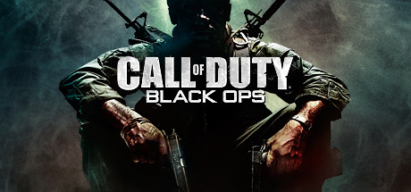

**Platforms:** Xbox 360, PlayStation 3, Wii, Windows &nbsp;|&nbsp; **Genre:** Action &nbsp;|&nbsp; **Released:** November 9

> The biggest first-person action series of all time and the follow-up to critically acclaimed Call of Duty®: Modern Warfare 2 returns with Call of Duty®: Black Ops.
>
> _Synopsis source: Steam_

[Steam](https://store.steampowered.com/app/42700)

---

### Calling

**Platforms:** Wii &nbsp;|&nbsp; **Released:** March 9

[Wikipedia](https://en.wikipedia.org/wiki/Calling_(video_game))

---

### Cave Story

**Platforms:** Wii, Nintendo DS &nbsp;|&nbsp; **Publisher:** Nicalis &nbsp;|&nbsp; **Released:** March 22, 2010

[Wikipedia](https://en.wikipedia.org/wiki/Cave_Story)

---

### Chronos Twins DX

**Platforms:** Wii, Nintendo DS &nbsp;|&nbsp; **Genre:** Action-adventure &nbsp;|&nbsp; **Released:** January 11

[Wikipedia](https://en.wikipedia.org/wiki/Chronos_Twins)

---

### Club Penguin: Game Day!

**Platforms:** Wii &nbsp;|&nbsp; **Released:** September 21

---

### Combat of Giants: Dinosaurs

**Platforms:** Wii &nbsp;|&nbsp; **Released:** November 2

---

### Create

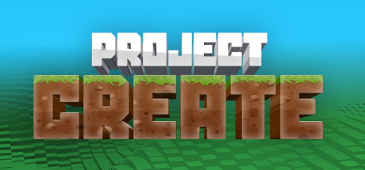

**Platforms:** PlayStation 3, Wii, Windows, Xbox 360 &nbsp;|&nbsp; **Genre:** Casual, Indie &nbsp;|&nbsp; **Released:** November 16

> Gain experience and level up in this voxel sandbox world as you travel through space and time. Craft equipment and recipes to help you survive the treacherous landscape and sculpt it into your own masterpiece!
>
> _Synopsis source: Steam_

[Wikipedia](https://en.wikipedia.org/wiki/Create_(video_game)) · [Steam](https://store.steampowered.com/app/1744350)

---

### Dance on Broadway

**Platforms:** Wii &nbsp;|&nbsp; **Released:** June 15

[Wikipedia](https://en.wikipedia.org/wiki/Dance_on_Broadway)

---

### Data East Arcade Classics

**Platforms:** Wii &nbsp;|&nbsp; **Released:** February 19

[Wikipedia](https://en.wikipedia.org/wiki/Data_East_Arcade_Classics)

---

### Deca Sports 3

**Platforms:** Wii &nbsp;|&nbsp; **Released:** October 26

[Wikipedia](https://en.wikipedia.org/wiki/Deca_Sports#Sequels)

---

### Def Jam Rapstar

**Platforms:** Xbox 360, PlayStation 3, Wii &nbsp;|&nbsp; **Released:** October 5

[Wikipedia](https://en.wikipedia.org/wiki/Def_Jam_Rapstar)

---

### Disney Channel All Star Party

**Platforms:** Wii &nbsp;|&nbsp; **Released:** October 26

[Wikipedia](https://en.wikipedia.org/wiki/Disney_Channel_All_Star_Party)

---

### DJ Hero 2

**Platforms:** Xbox 360, PlayStation 3, Wii &nbsp;|&nbsp; **Released:** October 19

[Wikipedia](https://en.wikipedia.org/wiki/DJ_Hero_2)

---

### Donkey Kong Country Returns

**Platforms:** Wii &nbsp;|&nbsp; **Released:** November 21

[Wikipedia](https://en.wikipedia.org/wiki/Donkey_Kong_Country_Returns)

---

### Dood's Big Adventure

**Platforms:** Wii &nbsp;|&nbsp; **Released:** November 14

[Wikipedia](https://en.wikipedia.org/wiki/Dood%27s_Big_Adventure)

---

### EA Sports Active NFL Training Camp

**Platforms:** Wii &nbsp;|&nbsp; **Released:** November 16

[Wikipedia](https://en.wikipedia.org/wiki/EA_Sports_Active_NFL_Training_Camp)

---

### Endless Ocean 2: Adventures of the Deep

**Platforms:** Wii &nbsp;|&nbsp; **Released:** February 22

---

### Epic Mickey

**Platforms:** Wii &nbsp;|&nbsp; **Released:** November 30

[Wikipedia](https://en.wikipedia.org/wiki/Epic_Mickey)

---

### FIFA 11

**Platforms:** Windows, Xbox 360, Wii, Nintendo DS, PlayStation 2, PlayStation 3, PlayStation Portable &nbsp;|&nbsp; **Released:** September 28

[Wikipedia](https://en.wikipedia.org/wiki/FIFA_11)

---

### Flip's Twisted World

**Platforms:** Wii &nbsp;|&nbsp; **Released:** October 19

[Wikipedia](https://en.wikipedia.org/wiki/Flip%27s_Twisted_World)

---

### Fluidity

**Platforms:** Wii &nbsp;|&nbsp; **Released:** December 6

[Wikipedia](https://en.wikipedia.org/wiki/Fluidity_(video_game))

---

### Fragile Dreams: Farewell Ruins of the Moon

**Platforms:** Wii &nbsp;|&nbsp; **Released:** March 16

---

### Frobot

**Platforms:** Wii &nbsp;|&nbsp; **Released:** December 20

[Wikipedia](https://en.wikipedia.org/wiki/Frobot)

---

### Furry Legends

**Platforms:** Wii &nbsp;|&nbsp; **Released:** July 19

[Wikipedia](https://en.wikipedia.org/wiki/Furry_Legends)

---

### Grease

**Platforms:** Nintendo DS, Wii &nbsp;|&nbsp; **Released:** August 24

[Wikipedia](https://en.wikipedia.org/wiki/Grease_(video_game))

---

### Green Day: Rock Band

**Platforms:** Xbox 360, PlayStation 3, Wii &nbsp;|&nbsp; **Released:** June 8

---

### Guitar Hero: Warriors of Rock

**Platforms:** PlayStation 3, Wii, Xbox 360 &nbsp;|&nbsp; **Released:** September 28

---

### Harry Potter and the Deathly Hallows: Part I

**Platforms:** Windows, Nintendo DS, PlayStation 3, Xbox 360, Wii &nbsp;|&nbsp; **Released:** November 16

---

### Hasbro Family Game Night 3

**Platforms:** PlayStation 3, Wii, Xbox 360 &nbsp;|&nbsp; **Released:** October 26

[Wikipedia](https://en.wikipedia.org/wiki/Hasbro_Family_Game_Night_3)

---

### Hello Kitty Seasons

**Platforms:** Wii &nbsp;|&nbsp; **Released:** December 7

[Wikipedia](https://en.wikipedia.org/wiki/Hello_Kitty#Video_games)

---

### Hot Wheels Track Attack

**Platforms:** Nintendo DS, Wii &nbsp;|&nbsp; **Released:** November 23

[Wikipedia](https://en.wikipedia.org/wiki/Hot_Wheels_Track_Attack)

---

### How to Train Your Dragon

**Platforms:** Xbox 360, Nintendo DS, PlayStation 3, Wii &nbsp;|&nbsp; **Released:** March 23

[Wikipedia](https://en.wikipedia.org/wiki/How_to_Train_Your_Dragon_(video_game))

---

### iCarly 2: iJoin the Click!

**Platforms:** Nintendo DS, PlayStation 3, Wii, Xbox 360 &nbsp;|&nbsp; **Released:** November 16

---

### Iron Man 2

**Platforms:** PlayStation 3, PlayStation Portable, Xbox 360, Wii, Nintendo DS &nbsp;|&nbsp; **Released:** May 4

[Wikipedia](https://en.wikipedia.org/wiki/Iron_Man_2_(video_game))

---

### Ivy the Kiwi?

**Platforms:** Wii, Nintendo DS &nbsp;|&nbsp; **Released:** August 24

[Wikipedia](https://en.wikipedia.org/wiki/Ivy_the_Kiwi%3F)

---

### Jett Rocket

**Platforms:** Wii &nbsp;|&nbsp; **Released:** June 28

[Wikipedia](https://en.wikipedia.org/wiki/Jett_Rocket)

---

### Just Dance 2

**Platforms:** Wii &nbsp;|&nbsp; **Released:** October 12

[Wikipedia](https://en.wikipedia.org/wiki/Just_Dance_2)

---

### Kirby's Epic Yarn

**Platforms:** Wii &nbsp;|&nbsp; **Released:** October 17

[Wikipedia](https://en.wikipedia.org/wiki/Kirby%27s_Epic_Yarn)

---

### Lego Harry Potter: Years 1-4

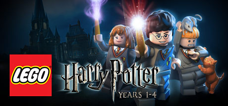

**Platforms:** Windows, PlayStation 3, Wii, PlayStation Portable, Xbox 360, Nintendo DS &nbsp;|&nbsp; **Genre:** Action, Adventure &nbsp;|&nbsp; **Released:** June 29

> Build the adventure from Privet Drive to the Triwizard Tournament and experience the magic of the first four Harry Potter stories – LEGO style! Explore Hogwarts™ School of Witchcraft and Wizardry, learn spells, brew potions and relive the adventures like never before with tongue-in-cheek humor and creative customization that is unique to...
>
> _Synopsis source: Steam_

[Steam](https://store.steampowered.com/app/21130)

---

### Madden NFL 11

**Platforms:** PlayStation 2, PlayStation 3, PlayStation Portable, Wii, Xbox 360 &nbsp;|&nbsp; **Released:** August 10

[Wikipedia](https://en.wikipedia.org/wiki/Madden_NFL_11)

---

### Max & the Magic Marker

**Platforms:** Wii &nbsp;|&nbsp; **Released:** March 8

[Wikipedia](https://en.wikipedia.org/wiki/Max_%26_the_Magic_Marker)

---

### Mega Man 10

**Platforms:** Wii, PlayStation Network, Xbox 360 &nbsp;|&nbsp; **Released:** March 1

[Wikipedia](https://en.wikipedia.org/wiki/Mega_Man_10)

---

### Megamind

**Platforms:** Wii, Xbox 360, PlayStation 3, PlayStation Portable, Nintendo DS &nbsp;|&nbsp; **Released:** November 2

[Wikipedia](https://en.wikipedia.org/wiki/Megamind_(video_game))

---

### Metroid: Other M

**Platforms:** Wii &nbsp;|&nbsp; **Released:** August 31

---

### Michael Jackson: The Experience

**Platforms:** Wii, Nintendo DS, PlayStation Portable &nbsp;|&nbsp; **Released:** November 23

---

### Minute to Win It

**Platforms:** Wii, Xbox 360 &nbsp;|&nbsp; **Released:** November 10

---

### MLB 2K10

**Platforms:** Windows, Xbox 360, PlayStation 2, PlayStation 3, Wii, PlayStation Portable &nbsp;|&nbsp; **Released:** March 2

[Wikipedia](https://en.wikipedia.org/wiki/Major_League_Baseball_2K10)

---

### Monsteca Corral

**Platforms:** Wii &nbsp;|&nbsp; **Released:** August 16

[Wikipedia](https://en.wikipedia.org/wiki/Monsteca_Corral)

---

### Monster Hunter Tri

**Platforms:** Wii &nbsp;|&nbsp; **Released:** April 20

[Wikipedia](https://en.wikipedia.org/wiki/Monster_Hunter_Tri)

---

### Monster Jam: Path of Destruction

**Platforms:** Nintendo DS, PlayStation 3, PlayStation Portable, Wii, Xbox 360 &nbsp;|&nbsp; **Released:** November 9

---

### MySims SkyHeroes

**Platforms:** Nintendo DS, PlayStation 3, Wii, Xbox 360 &nbsp;|&nbsp; **Released:** September 28

[Wikipedia](https://en.wikipedia.org/wiki/MySims_SkyHeroes)

---

### Namco Museum Megamix

**Platforms:** Wii &nbsp;|&nbsp; **Released:** November 16

[Wikipedia](https://en.wikipedia.org/wiki/Namco_Museum_Remix)

---

### Naruto Shippuden: Dragon Blade Chronicles

**Platforms:** Wii &nbsp;|&nbsp; **Released:** November 16

---

### NBA 2K11

**Platforms:** Windows, PlayStation 3, Xbox 360, PlayStation Portable, PlayStation 2, Wii, iOS &nbsp;|&nbsp; **Released:** October 5

[Wikipedia](https://en.wikipedia.org/wiki/NBA_2K11)

---

### NBA Jam

**Platforms:** Wii &nbsp;|&nbsp; **Released:** October 5

[Wikipedia](https://en.wikipedia.org/wiki/NBA_Jam_(2010_video_game))

---

### Need for Speed: Hot Pursuit

**Platforms:** Xbox 360, PlayStation 3, Windows, Wii &nbsp;|&nbsp; **Released:** November 16

---

### New Carnival Games

**Platforms:** Nintendo DS, Wii &nbsp;|&nbsp; **Released:** September 21

[Wikipedia](https://en.wikipedia.org/wiki/New_Carnival_Games)

---

### NHL 2K11

**Platforms:** Wii &nbsp;|&nbsp; **Released:** September 24

[Wikipedia](https://en.wikipedia.org/wiki/NHL_2K11)

---

### NHL Slapshot

**Platforms:** Wii &nbsp;|&nbsp; **Released:** September 7

[Wikipedia](https://en.wikipedia.org/wiki/NHL_Slapshot)

---

### No More Heroes 2: Desperate Struggle

**Platforms:** Wii &nbsp;|&nbsp; **Released:** January 26

---

### Pac-Man Party

**Platforms:** Wii &nbsp;|&nbsp; **Released:** November 16

[Wikipedia](https://en.wikipedia.org/wiki/Pac-Man_Party)

---

### Phineas and Ferb: Ride Again

**Platforms:** Nintendo DS, Wii &nbsp;|&nbsp; **Released:** September 14

---

### Phoenix Wright: Ace Attorney (Episode 5)

**Platforms:** Wii &nbsp;|&nbsp; **Released:** May 24

---

### Phoenix Wright: Ace Attorney (Episodes 1–4)

**Platforms:** Wii &nbsp;|&nbsp; **Genre:** Visual novel, Adventure &nbsp;|&nbsp; **Released:** January 11

---

### Phoenix Wright: Ace Attorney − Justice for All

**Platforms:** Wii &nbsp;|&nbsp; **Released:** February 15

---

### Phoenix Wright: Ace Attorney − Trials and Tribulations

**Platforms:** Wii &nbsp;|&nbsp; **Released:** May 10

---

### Pirates Plund-Arrr

**Platforms:** Wii &nbsp;|&nbsp; **Released:** May 25

[Wikipedia](https://en.wikipedia.org/wiki/Pirates_Plund-Arrr)

---

### PokéPark Wii: Pikachu's Adventure

**Platforms:** Wii &nbsp;|&nbsp; **Released:** November 1

---

### Prince of Persia: The Forgotten Sands

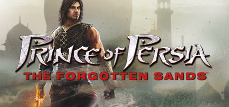

**Platforms:** Nintendo DS, Wii, PlayStation Portable, PlayStation 3, Xbox 360, Windows &nbsp;|&nbsp; **Genre:** Action, Adventure &nbsp;|&nbsp; **Released:** May 18

> Prince of Persia The Forgotten Sands is the next chapter in the fan-favorite Sands of Time universe. Visiting his brother's kingdom following his adventure in Azad, the Prince finds the royal palace under siege from a mighty army bent on its destruction.
>
> _Synopsis source: Steam_

[Steam](https://store.steampowered.com/app/33320)

---

### Pro Evolution Soccer 2011

**Platforms:** Windows, Xbox 360, Wii, Nintendo DS, PlayStation 2, PlayStation 3, PlayStation Portable &nbsp;|&nbsp; **Released:** October 5

[Wikipedia](https://en.wikipedia.org/wiki/Pro_Evolution_Soccer_2011)

---

### Rage of the Gladiator

**Platforms:** Wii &nbsp;|&nbsp; **Released:** March 15

[Wikipedia](https://en.wikipedia.org/wiki/Rage_of_the_Gladiator)

---

### Raving Rabbids: Travel in Time

**Platforms:** Wii &nbsp;|&nbsp; **Released:** November 21

---

### Red Steel 2

**Platforms:** Wii &nbsp;|&nbsp; **Released:** March 23

[Wikipedia](https://en.wikipedia.org/wiki/Red_Steel_2)

---

### Rock Band 3

**Platforms:** Xbox 360, PlayStation 3, Wii, Nintendo DS &nbsp;|&nbsp; **Publisher:** MTV Games &nbsp;|&nbsp; **Released:** October 26, 2010

[Wikipedia](https://en.wikipedia.org/wiki/Rock_Band_3)

---

### Rock of the Dead

**Platforms:** Xbox 360, PlayStation 3, Wii &nbsp;|&nbsp; **Released:** October 19

[Wikipedia](https://en.wikipedia.org/wiki/Rock_of_the_Dead_(video_game))

---

### Rooms: The Main Building

**Platforms:** Wii &nbsp;|&nbsp; **Released:** March 23

---

### Rudolph the Red-Nosed Reindeer

**Platforms:** Nintendo DS, Wii &nbsp;|&nbsp; **Released:** November 9

[Wikipedia](https://en.wikipedia.org/wiki/Rudolph_the_Red-Nosed_Reindeer_(video_game))

---

### Sakura Wars: So Long, My Love

**Platforms:** PlayStation 2, Wii &nbsp;|&nbsp; **Released:** March 30

---

### Sam & Max: Beyond Time and Space

**Platforms:** Wii &nbsp;|&nbsp; **Released:** March 16

---

### Samurai Warriors 3

**Platforms:** Wii &nbsp;|&nbsp; **Released:** September 27

[Wikipedia](https://en.wikipedia.org/wiki/Samurai_Warriors_3)

---

### Scooby-Doo! And the Spooky Swamp

**Platforms:** PlayStation 2, Wii, Nintendo DS &nbsp;|&nbsp; **Released:** September 14

[Wikipedia](https://en.wikipedia.org/wiki/Scooby-Doo!_And_the_Spooky_Swamp)

---

### Sengoku Basara: Samurai Heroes

**Platforms:** PlayStation 3, Wii &nbsp;|&nbsp; **Released:** October 12

---

### Shaun White Skateboarding

**Platforms:** PlayStation 3, Wii, Windows, Xbox 360 &nbsp;|&nbsp; **Released:** October 24

[Wikipedia](https://en.wikipedia.org/wiki/Shaun_White_Skateboarding)

---

### Shiren the Wanderer

**Platforms:** Wii &nbsp;|&nbsp; **Released:** February 9

[Wikipedia](https://en.wikipedia.org/wiki/Shiren_the_Wanderer_(2008_video_game))

---

### Shrek Forever After

**Platforms:** iOS, Nintendo DS, PlayStation 3, Wii, Windows, Xbox 360 &nbsp;|&nbsp; **Released:** May 18

[Wikipedia](https://en.wikipedia.org/wiki/Shrek_Forever_After_(video_game))

---

### Sin and Punishment: Star Successor

**Platforms:** Wii &nbsp;|&nbsp; **Released:** June 27

---

### Sonic & Sega All-Stars Racing

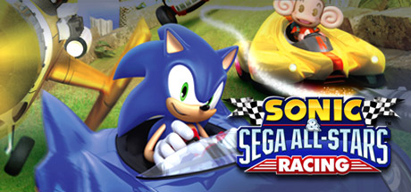

**Platforms:** PlayStation 3, Xbox 360, Nintendo DS, Wii, Windows &nbsp;|&nbsp; **Genre:** Racing &nbsp;|&nbsp; **Released:** February 23

> SONIC AND SEGA ALL-STARS RACE FOR VICTORY IN A HIGH SPEED HIGH SKILL RACETRACK SHOWDOWN! TAKE TO THE TRACK BY CAR, MONSTER TRUCK, BIKE AND EVEN AEROPLANE IN SONIC &amp; SEGA ALL-STARS RACING. Explore stunning new circuits including Sonic Seaside Hill, Curien Mansion and Blizzard Castle as you zip around medieval castle ramparts, hurtle...
>
> _Synopsis source: Steam_

[Wikipedia](https://en.wikipedia.org/wiki/Sonic_%26_Sega_All-Stars_Racing) · [Steam](https://store.steampowered.com/app/34190)

---

### Sonic Colors

**Platforms:** Wii, Nintendo DS &nbsp;|&nbsp; **Released:** November 16

[Wikipedia](https://en.wikipedia.org/wiki/Sonic_Colors)

---

### Sonic the Hedgehog 4: Episode 1

**Platforms:** iOS, Wii, PlayStation Network, Xbox 360 &nbsp;|&nbsp; **Released:** October 7

---

### Spider-Man: Shattered Dimensions

**Platforms:** Nintendo DS, PlayStation 3, Wii, Xbox 360 &nbsp;|&nbsp; **Released:** September 7

---

### SpongeBob's Boating Bash

**Platforms:** Nintendo DS, Wii &nbsp;|&nbsp; **Released:** March 2

[Wikipedia](https://en.wikipedia.org/wiki/SpongeBob%27s_Boating_Bash)

---

### Star Wars: The Force Unleashed II

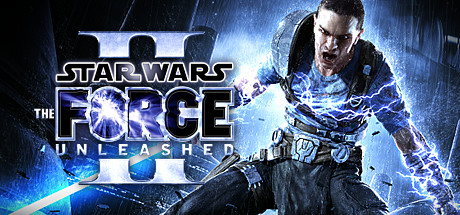

**Platforms:** PlayStation 3, Xbox 360, Windows, Wii, Nintendo DS &nbsp;|&nbsp; **Genre:** Action &nbsp;|&nbsp; **Released:** October 26

> The Star Wars® Saga continues with Star Wars®: The Force Unleashed™ II, the highly anticipated sequel to the fastest-selling Star Wars game ever created.
>
> _Synopsis source: Steam_

[Steam](https://store.steampowered.com/app/32500)

---

### Super Mario All-Stars

**Platforms:** Wii &nbsp;|&nbsp; **Released:** December 12

[Wikipedia](https://en.wikipedia.org/wiki/Super_Mario_All-Stars)

---

### Super Mario Galaxy 2

**Platforms:** Wii &nbsp;|&nbsp; **Publisher:** Nintendo &nbsp;|&nbsp; **Released:** May 23, 2010

[Wikipedia](https://en.wikipedia.org/wiki/Super_Mario_Galaxy_2)

---

### Super Monkey Ball: Step & Roll

**Platforms:** Wii &nbsp;|&nbsp; **Released:** February 9

---

### Tangled: The Video Game

**Platforms:** Nintendo DS, Wii, Windows &nbsp;|&nbsp; **Released:** November 23

---

### Tatsunoko vs. Capcom: Ultimate All-Stars

**Platforms:** Wii &nbsp;|&nbsp; **Released:** January 26

---

### Tetris Party Deluxe

**Platforms:** Wii &nbsp;|&nbsp; **Released:** May 25

[Wikipedia](https://en.wikipedia.org/wiki/Tetris_Party_Deluxe)

---

### The Biggest Loser: Challenge

**Platforms:** Wii &nbsp;|&nbsp; **Released:** November 4

---

### The Last Airbender

**Platforms:** Nintendo DS, Wii &nbsp;|&nbsp; **Released:** June 29

[Wikipedia](https://en.wikipedia.org/wiki/The_Last_Airbender_(video_game))

---

### The Lord of the Rings: Aragorn's Quest

**Platforms:** PlayStation 3, PlayStation 2, PlayStation Portable, Wii, Nintendo DS &nbsp;|&nbsp; **Released:** September 14

---

### The Next Star 3

**Platforms:** Windows, Xbox 360, PlayStation 2, PlayStation 3, Wii, PlayStation Portable &nbsp;|&nbsp; **Released:** September 5

---

### The Sims 3

**Platforms:** PlayStation 3, Xbox 360, Wii, Nintendo DS &nbsp;|&nbsp; **Released:** October 26

[Wikipedia](https://en.wikipedia.org/wiki/The_Sims_3_(console_video_game))

---

### The Sky Crawlers: Innocent Aces

**Platforms:** Wii &nbsp;|&nbsp; **Released:** January 12

---

### The Sorcerer's Apprentice

**Platforms:** Nintendo DS, PlayStation 3, Wii, Xbox 360 &nbsp;|&nbsp; **Released:** July 13

[Wikipedia](https://en.wikipedia.org/wiki/The_Sorcerer%27s_Apprentice_(2010_film))

---

### Tiger Woods PGA Tour 11

**Platforms:** Xbox 360, PlayStation 3, Wii &nbsp;|&nbsp; **Released:** June 8

[Wikipedia](https://en.wikipedia.org/wiki/Tiger_Woods_PGA_Tour_11)

---

### Tom Clancy's Ghost Recon

**Platforms:** Wii &nbsp;|&nbsp; **Released:** November 16

[Wikipedia](https://en.wikipedia.org/wiki/Tom_Clancy%27s_Ghost_Recon_(2010_video_game))

---

### Tom Clancy's H.A.W.X 2

**Platforms:** PlayStation 3, Xbox 360, Wii, Windows &nbsp;|&nbsp; **Released:** September 7

[Wikipedia](https://en.wikipedia.org/wiki/Tom_Clancy%27s_H.A.W.X_2)

---

### Totally Spies!: Revenge of the Undercover

**Platforms:** PlayStation 3, Xbox 360, Wii, PlayStation Portable, Nintendo DS &nbsp;|&nbsp; **Released:** June 15

---

### Tournament of Legends

**Platforms:** Wii &nbsp;|&nbsp; **Released:** July 6

[Wikipedia](https://en.wikipedia.org/wiki/Tournament_of_Legends)

---

### Toy Story 3: The Video Game

**Platforms:** PlayStation 3, Xbox 360, Wii, PlayStation Portable, Nintendo DS, Windows, PlayStation 2 &nbsp;|&nbsp; **Released:** June 15

---

### TrackMania Wii

**Platforms:** Wii &nbsp;|&nbsp; **Released:** December 21

[Wikipedia](https://en.wikipedia.org/wiki/TrackMania)

---

### Transformers: Cybertron Adventures

**Platforms:** Wii &nbsp;|&nbsp; **Released:** June 22

---

### Transformers: War for Cybertron

**Platforms:** Windows, Xbox 360, PlayStation 3, Wii, Nintendo DS &nbsp;|&nbsp; **Released:** June 22

---

### Trauma Team

**Platforms:** Wii &nbsp;|&nbsp; **Released:** May 18

[Wikipedia](https://en.wikipedia.org/wiki/Trauma_Team)

---

### Tron: Evolution – Battle Grids

**Platforms:** Wii, Nintendo DS &nbsp;|&nbsp; **Released:** December 7

---

### uDraw Pictionary

**Platforms:** Wii &nbsp;|&nbsp; **Released:** November 14

[Wikipedia](https://en.wikipedia.org/wiki/UDraw_Pictionary)

---

### Walk It Out!

**Platforms:** Wii &nbsp;|&nbsp; **Released:** January 12

---

### Wii Party

**Platforms:** Wii &nbsp;|&nbsp; **Released:** October 3

[Wikipedia](https://en.wikipedia.org/wiki/Wii_Party)

---

### Worms: Battle Islands

**Platforms:** PlayStation Portable, Wii &nbsp;|&nbsp; **Released:** November 21

---

### WWE SmackDown vs Raw 2011

**Platforms:** PlayStation 3, Xbox 360, PlayStation Portable, PlayStation 2, Wii &nbsp;|&nbsp; **Released:** October 26

[Wikipedia](https://en.wikipedia.org/wiki/WWE_SmackDown_vs_Raw_2011)

---

### Xenoblade Chronicles

**Platforms:** Wii &nbsp;|&nbsp; **Publisher:** Nintendo &nbsp;|&nbsp; **Released:** June 10, 2010

[Wikipedia](https://en.wikipedia.org/wiki/Xenoblade_Chronicles_(video_game))

---

### Yogi Bear

**Platforms:** Nintendo DS, Wii &nbsp;|&nbsp; **Released:** December 7

[Wikipedia](https://en.wikipedia.org/wiki/Yogi_Bear_(film))

---

### Yu-Gi-Oh! 5D's: Duel Transer

**Platforms:** Wii &nbsp;|&nbsp; **Released:** December 7

[Wikipedia](https://en.wikipedia.org/wiki/List_of_Yu-Gi-Oh!_video_games)

---

## 2009

[Full 2009 page](../years/2009.md)

### 3-2-1, Rattle Battle!

**Platforms:** Wii &nbsp;|&nbsp; **Released:** August 31

[Wikipedia](https://en.wikipedia.org/wiki/3-2-1,_Rattle_Battle!)

---

### A Boy and His Blob

**Platforms:** Wii &nbsp;|&nbsp; **Released:** October 13

[Wikipedia](https://en.wikipedia.org/wiki/A_Boy_and_His_Blob)

---

### Active Life: Extreme Challenge

**Platforms:** Wii &nbsp;|&nbsp; **Released:** August 11

---

### Alvin and the Chipmunks: The Squeakquel

**Platforms:** Nintendo DS, Wii &nbsp;|&nbsp; **Released:** December 1

---

### Anno 1404

**Platforms:** Windows, Nintendo DS, Wii &nbsp;|&nbsp; **Released:** June 23

[Wikipedia](https://en.wikipedia.org/wiki/Anno_1404)

---

### Ant Nation

**Platforms:** Wii, Nintendo DS &nbsp;|&nbsp; **Released:** July 13

[Wikipedia](https://en.wikipedia.org/wiki/Ant_Nation)

---

### Arkanoid Plus!

**Platforms:** Wii &nbsp;|&nbsp; **Released:** September 28

[Wikipedia](https://en.wikipedia.org/wiki/Arkanoid#Ports_and_related_releases)

---

### Ashes Cricket 2009

**Platforms:** PlayStation 3, Windows, Xbox 360, Wii &nbsp;|&nbsp; **Released:** August 7

[Wikipedia](https://en.wikipedia.org/wiki/Ashes_Cricket_2009)

---

### Astro Boy: The Video Game

**Platforms:** Wii, PlayStation 2, PlayStation Portable, Nintendo DS &nbsp;|&nbsp; **Released:** October 20

---

### Backyard Football '10

**Platforms:** PlayStation 2, Wii, Xbox 360 &nbsp;|&nbsp; **Released:** October 20

[Wikipedia](https://en.wikipedia.org/wiki/Backyard_Football_%2710)

---

### Bakugan Battle Brawlers

**Platforms:** Wii, PlayStation 2, PlayStation 3, Nintendo DS, Xbox 360 &nbsp;|&nbsp; **Released:** October 20

[Wikipedia](https://en.wikipedia.org/wiki/Bakugan_Battle_Brawlers_(video_game))

---

### Band Hero

**Platforms:** PlayStation 2, PlayStation 3, Wii, Xbox 360, Nintendo DS &nbsp;|&nbsp; **Released:** November 3

[Wikipedia](https://en.wikipedia.org/wiki/Band_Hero)

---

### Ben 10 Alien Force: Vilgax Attacks

**Platforms:** PlayStation 2, Xbox 360, PlayStation Portable, Wii, Nintendo DS &nbsp;|&nbsp; **Released:** October 27

---

### Bit.Trip Beat

**Platforms:** Wii &nbsp;|&nbsp; **Released:** March 16

[Wikipedia](https://en.wikipedia.org/wiki/Bit.Trip_Beat)

---

### Bit.Trip Void

**Platforms:** Wii &nbsp;|&nbsp; **Released:** November 23

[Wikipedia](https://en.wikipedia.org/wiki/Bit.Trip_Void)

---

### Boom Blox Bash Party

**Platforms:** Wii &nbsp;|&nbsp; **Released:** May 19

[Wikipedia](https://en.wikipedia.org/wiki/Boom_Blox_Bash_Party)

---

### Brave: A Warrior's Tale

**Platforms:** PlayStation Portable, Xbox 360, Wii &nbsp;|&nbsp; **Released:** August 3

---

### Broken Sword: Shadow of the Templars – The Director's Cut

**Platforms:** Nintendo DS, Wii &nbsp;|&nbsp; **Released:** March 21

---

### Bubble Bobble Plus!

**Platforms:** Wii &nbsp;|&nbsp; **Released:** May 25

[Wikipedia](https://en.wikipedia.org/wiki/Bubble_Bobble_Plus!)

---

### Cabela's Big Game Hunter 2010

**Platforms:** PlayStation 3, Wii, Xbox 360 &nbsp;|&nbsp; **Released:** September 29

[Wikipedia](https://en.wikipedia.org/wiki/Cabela%27s_Big_Game_Hunter_2010)

---

### Call of Duty: Modern Warfare Reflex

**Platforms:** Wii &nbsp;|&nbsp; **Released:** November 10

---

### Cars Race-O-Rama

**Platforms:** Wii, PlayStation 3, Xbox 360, PlayStation 2, Nintendo DS, PlayStation Portable &nbsp;|&nbsp; **Released:** October 12

[Wikipedia](https://en.wikipedia.org/wiki/Cars_Race-O-Rama)

---

### Castlevania: The Adventure ReBirth

**Platforms:** Wii &nbsp;|&nbsp; **Released:** December 28

---

### Chaotic: Shadow Warriors

**Platforms:** Nintendo DS, PlayStation 3, Wii, Xbox 360 &nbsp;|&nbsp; **Released:** November 10

[Wikipedia](https://en.wikipedia.org/wiki/Chaotic_(TV_series))

---

### Cloudy with a Chance of Meatballs

**Platforms:** Wii, Nintendo DS, PlayStation 3, Xbox 360, PlayStation Portable &nbsp;|&nbsp; **Released:** September 15

[Wikipedia](https://en.wikipedia.org/wiki/Cloudy_with_a_Chance_of_Meatballs_(video_game))

---

### Colin McRae: Dirt 2

**Platforms:** Windows, Xbox 360, PlayStation 3, PlayStation Portable, Wii, Nintendo DS &nbsp;|&nbsp; **Publisher:** Codemasters &nbsp;|&nbsp; **Released:** December 4, 2009

---

### Contra ReBirth

**Platforms:** Wii &nbsp;|&nbsp; **Released:** September 7

[Wikipedia](https://en.wikipedia.org/wiki/Contra_ReBirth)

---

### Coraline

**Platforms:** PlayStation 2, Nintendo DS, Wii &nbsp;|&nbsp; **Released:** January 27

[Wikipedia](https://en.wikipedia.org/wiki/Coraline_(video_game))

---

### Crystal Defenders R1

**Platforms:** Wii &nbsp;|&nbsp; **Released:** April 20

[Wikipedia](https://en.wikipedia.org/wiki/Crystal_Defenders)

---

### Crystal Defenders R2

**Platforms:** Wii &nbsp;|&nbsp; **Released:** May 18

[Wikipedia](https://en.wikipedia.org/wiki/Crystal_Defenders)

---

### Cursed Mountain

**Platforms:** Wii &nbsp;|&nbsp; **Released:** August 25

[Wikipedia](https://en.wikipedia.org/wiki/Cursed_Mountain)

---

### Dance Dance Revolution Disney Grooves

**Platforms:** Wii &nbsp;|&nbsp; **Released:** April 2

[Wikipedia](https://en.wikipedia.org/wiki/Dance_Dance_Revolution_Disney_Grooves)

---

### Dance Dance Revolution Hottest Party 3

**Platforms:** Wii &nbsp;|&nbsp; **Released:** October 27

[Wikipedia](https://en.wikipedia.org/wiki/Dance_Dance_Revolution_Hottest_Party_3)

---

### Dead Rising: Chop Till You Drop

**Platforms:** Wii &nbsp;|&nbsp; **Released:** February 24

---

### Dead Space: Extraction

**Platforms:** Wii &nbsp;|&nbsp; **Released:** September 29

---

### Deadly Creatures

**Platforms:** Wii &nbsp;|&nbsp; **Released:** February 9

[Wikipedia](https://en.wikipedia.org/wiki/Deadly_Creatures)

---

### Deal or No Deal

**Platforms:** Wii &nbsp;|&nbsp; **Released:** January 13

[Wikipedia](https://en.wikipedia.org/wiki/Deal_or_No_Deal_(video_game))

---

### Disney Fairies: Tinker Bell and the Lost Treasure

**Platforms:** Nintendo DS, Wii &nbsp;|&nbsp; **Released:** October 27

---

### Disney Sing It! – High School Musical 3: Senior Year

**Platforms:** PlayStation 3, PlayStation 2, Wii, Xbox 360 &nbsp;|&nbsp; **Released:** February 17

---

### DJ Hero

**Platforms:** Xbox 360, PlayStation 3, PlayStation 2, Wii &nbsp;|&nbsp; **Released:** October 27

[Wikipedia](https://en.wikipedia.org/wiki/DJ_Hero)

---

### Dragon Ball: Revenge of King Piccolo

**Platforms:** Wii &nbsp;|&nbsp; **Released:** July 23

---

### Drawn to Life: The Next Chapter

**Platforms:** Nintendo DS, Wii &nbsp;|&nbsp; **Released:** October 27

---

### Driift Mania

**Platforms:** Wii &nbsp;|&nbsp; **Released:** September 28

[Wikipedia](https://en.wikipedia.org/wiki/Driift_Mania)

---

### Drill Sergeant Mindstrong

**Platforms:** Wii &nbsp;|&nbsp; **Released:** June 22

[Wikipedia](https://en.wikipedia.org/wiki/Drill_Sergeant_Mindstrong)

---

### Eco Shooter: Plant 530

**Platforms:** Wii &nbsp;|&nbsp; **Released:** December 21

---

### Eduardo the Samurai Toaster

**Platforms:** Wii &nbsp;|&nbsp; **Released:** June 15

[Wikipedia](https://en.wikipedia.org/wiki/Eduardo_the_Samurai_Toaster)

---

### Evasive Space

**Platforms:** Wii &nbsp;|&nbsp; **Released:** February 16

[Wikipedia](https://en.wikipedia.org/wiki/Evasive_Space)

---

### Excitebots: Trick Racing

**Platforms:** Wii &nbsp;|&nbsp; **Released:** April 20

---

### Final Fantasy Crystal Chronicles: Echoes of Time

**Platforms:** Nintendo DS, Wii &nbsp;|&nbsp; **Released:** March 24

---

### Final Fantasy Crystal Chronicles: My Life as a Darklord

**Platforms:** Wii &nbsp;|&nbsp; **Released:** July 20

---

### Final Fantasy Crystal Chronicles: The Crystal Bearers

**Platforms:** Wii &nbsp;|&nbsp; **Released:** December 26

---

### Food Network: Cook or Be Cooked

**Platforms:** Wii &nbsp;|&nbsp; **Released:** November 3

---

### Formula One 2009

**Platforms:** Wii, PlayStation Portable &nbsp;|&nbsp; **Released:** November 17

[Wikipedia](https://en.wikipedia.org/wiki/Formula_One_2009_(video_game))

---

### Frogger Returns

**Platforms:** Wii, PlayStation Network &nbsp;|&nbsp; **Released:** November 12

[Wikipedia](https://en.wikipedia.org/wiki/Frogger_Returns)

---

### G.I. Joe: The Rise of Cobra

**Platforms:** Nintendo DS, PlayStation 2, PlayStation 3, PlayStation Portable, Wii, Xbox 360 &nbsp;|&nbsp; **Released:** August 4

---

### Game Party 3

**Platforms:** Wii &nbsp;|&nbsp; **Released:** October 6

[Wikipedia](https://en.wikipedia.org/wiki/Game_Party_3)

---

### Garfield Gets Real

**Platforms:** Wii, Nintendo DS &nbsp;|&nbsp; **Released:** May 12

[Wikipedia](https://en.wikipedia.org/wiki/Garfield_Gets_Real_(video_game))

---

### Geon

**Platforms:** Wii &nbsp;|&nbsp; **Released:** October 27

[Wikipedia](https://en.wikipedia.org/wiki/Geon_(video_game))

---

### Ghostbusters: The Video Game

**Platforms:** Nintendo DS, PlayStation 2, PlayStation 3, Wii, Windows, Xbox 360, PlayStation Portable &nbsp;|&nbsp; **Released:** June 16

---

### Gradius ReBirth

**Platforms:** Wii &nbsp;|&nbsp; **Released:** March 9

[Wikipedia](https://en.wikipedia.org/wiki/Gradius_ReBirth)

---

### Grey's Anatomy: The Video Game

**Platforms:** Windows, Nintendo DS, PlayStation 3, Wii, Xbox 360 &nbsp;|&nbsp; **Released:** March 10

---

### Guitar Hero 5

**Platforms:** Wii, PlayStation 2, PlayStation 3, Xbox 360 &nbsp;|&nbsp; **Publisher:** Activision &nbsp;|&nbsp; **Released:** September 1, 2009

[Wikipedia](https://en.wikipedia.org/wiki/Guitar_Hero_5)

---

### Guitar Hero: Metallica

**Platforms:** PlayStation 2, PlayStation 3, Wii, Xbox 360 &nbsp;|&nbsp; **Released:** March 29

---

### Guitar Hero: Smash Hits

**Platforms:** PlayStation 2, PlayStation 3, Wii, Xbox 360 &nbsp;|&nbsp; **Released:** June 16

---

### Guitar Hero: Van Halen

**Platforms:** PlayStation 2, PlayStation 3, Wii, Xbox 360 &nbsp;|&nbsp; **Released:** December 22

---

### Hannah Montana: The Movie

**Platforms:** Nintendo DS, PlayStation 3, Wii, Xbox 360 &nbsp;|&nbsp; **Released:** April 7

---

### Harry Potter and the Half Blood Prince

**Platforms:** macOS, Windows, Nintendo DS, PlayStation 2, PlayStation 3, PlayStation Portable, Wii, Xbox 360 &nbsp;|&nbsp; **Released:** June 30

[Wikipedia](https://en.wikipedia.org/wiki/Harry_Potter_and_the_Half-Blood_Prince_(video_game))

---

### Harvest Moon: Animal Parade

**Platforms:** Wii &nbsp;|&nbsp; **Released:** November 12

---

### Harvest Moon: Magical Melody

**Platforms:** Wii &nbsp;|&nbsp; **Released:** August 25

---

### Harvest Moon: My Little Shop

**Platforms:** Wii &nbsp;|&nbsp; **Released:** November 23

---

### Help Wanted

**Platforms:** Wii &nbsp;|&nbsp; **Released:** May 12

[Wikipedia](https://en.wikipedia.org/wiki/Help_Wanted_(video_game))

---

### High Voltage Hot Rod Show

**Platforms:** Wii &nbsp;|&nbsp; **Released:** January 19

[Wikipedia](https://en.wikipedia.org/wiki/High_Voltage_Hot_Rod_Show)

---

### Hot Wheels Battle Force 5

**Platforms:** Nintendo DS, PlayStation 3, Wii, Xbox 360 &nbsp;|&nbsp; **Released:** November 10

[Wikipedia](https://en.wikipedia.org/wiki/Hot_Wheels_Battle_Force_5_(video_game))

---

### Ice Age: Dawn of the Dinosaurs

**Platforms:** Nintendo DS, PlayStation 2, PlayStation 3, Wii, Windows, Xbox 360 &nbsp;|&nbsp; **Released:** June 30

---

### Imagine Fashion Party

**Platforms:** Wii &nbsp;|&nbsp; **Released:** January 20

---

### Indiana Jones and the Staff of Kings

**Platforms:** Wii, Nintendo DS, PlayStation Portable, PlayStation 2 &nbsp;|&nbsp; **Released:** June 9

[Wikipedia](https://en.wikipedia.org/wiki/Indiana_Jones_and_the_Staff_of_Kings)

---

### Jambo! Safari: Animal Rescue

**Platforms:** Nintendo DS, Wii &nbsp;|&nbsp; **Released:** November 17

[Wikipedia](https://en.wikipedia.org/wiki/Jambo!_Safari)

---

### James Cameron's Avatar: The Game

**Platforms:** PlayStation 3, Xbox 360, Windows, Wii, Nintendo DS, iOS, PlayStation Portable &nbsp;|&nbsp; **Released:** December 1

---

### Ju-on: The Grudge

**Platforms:** Wii &nbsp;|&nbsp; **Released:** October 13

---

### Just Dance

**Platforms:** Wii &nbsp;|&nbsp; **Released:** November 17

[Wikipedia](https://en.wikipedia.org/wiki/Just_Dance_(video_game))

---

### Kamen Rider: Dragon Knight

**Platforms:** Nintendo DS, Wii &nbsp;|&nbsp; **Released:** November 17

---

### Klonoa

**Platforms:** Wii &nbsp;|&nbsp; **Released:** May 5

[Wikipedia](https://en.wikipedia.org/wiki/Klonoa_(2008_video_game))

---

### Lego Indiana Jones 2: The Adventure Continues

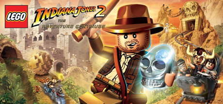

**Platforms:** Wii, Xbox 360, PlayStation 3, Nintendo DS, PlayStation Portable, Windows &nbsp;|&nbsp; **Genre:** Adventure &nbsp;|&nbsp; **Released:** November 17

> LEGO® Indy is back in his biggest adventure yet. Battle through all four movies, including all-new levels from the original adventures and your favorite new moments from The Kingdom of the Crystal Skull... or in true LEGO® fashion, get creative and build your own levels to play with friends!
>
> _Synopsis source: Steam_

[Steam](https://store.steampowered.com/app/32450)

---

### Lego Rock Band

**Platforms:** PlayStation 3, Xbox 360, Wii, Nintendo DS &nbsp;|&nbsp; **Released:** November 3

[Wikipedia](https://en.wikipedia.org/wiki/Lego_Rock_Band)

---

### LIT

**Platforms:** Wii &nbsp;|&nbsp; **Released:** February 9

[Wikipedia](https://en.wikipedia.org/wiki/LIT_(video_game))

---

### Little King's Story

**Platforms:** Wii &nbsp;|&nbsp; **Released:** July 21

[Wikipedia](https://en.wikipedia.org/wiki/Little_King%27s_Story)

---

### Little Tournament Over Yonder

**Platforms:** Wii &nbsp;|&nbsp; **Released:** November 23

[Wikipedia](https://en.wikipedia.org/wiki/Little_Tournament_Over_Yonder)

---

### LostWinds 2: Winter of the Melodias

**Platforms:** Wii &nbsp;|&nbsp; **Released:** September 19

---

### Madagascar Kartz

**Platforms:** Nintendo DS, PlayStation 3, Wii, Xbox 360 &nbsp;|&nbsp; **Released:** October 27

[Wikipedia](https://en.wikipedia.org/wiki/Madagascar_Kartz)

---

### MadWorld

**Platforms:** Wii &nbsp;|&nbsp; **Released:** March 10

[Wikipedia](https://en.wikipedia.org/wiki/MadWorld)

---

### Magnetis

**Platforms:** Wii &nbsp;|&nbsp; **Released:** December 7

[Wikipedia](https://en.wikipedia.org/wiki/Magnetis)

---

### Major League Baseball 2K9

**Platforms:** Xbox 360, PlayStation 3, PlayStation 2, PlayStation Portable, Wii &nbsp;|&nbsp; **Released:** March 3

[Wikipedia](https://en.wikipedia.org/wiki/Major_League_Baseball_2K9)

---

### Major Minor's Majestic March

**Platforms:** Wii &nbsp;|&nbsp; **Released:** March 24

[Wikipedia](https://en.wikipedia.org/wiki/Major_Minor%27s_Majestic_March)

---

### Marble Saga: Kororinpa

**Platforms:** Wii &nbsp;|&nbsp; **Released:** March 17

---

### Mario & Sonic at the Olympic Winter Games

**Platforms:** Wii, Nintendo DS &nbsp;|&nbsp; **Released:** October 13

[Wikipedia](https://en.wikipedia.org/wiki/Mario_%26_Sonic_at_the_Olympic_Winter_Games)

---

### Marvel Super Hero Squad

**Platforms:** Wii, PlayStation 2, PlayStation Portable, Nintendo DS &nbsp;|&nbsp; **Released:** October 20

[Wikipedia](https://en.wikipedia.org/wiki/Marvel_Super_Hero_Squad_(video_game))

---

### Marvel: Ultimate Alliance 2

**Platforms:** Nintendo DS, PlayStation 3, PlayStation 2, Wii, Xbox 360, PlayStation Portable &nbsp;|&nbsp; **Released:** September 15

---

### Metroid Prime: Trilogy

**Platforms:** Wii &nbsp;|&nbsp; **Publisher:** Nintendo &nbsp;|&nbsp; **Released:** August 24, 2009

---

### Mini Ninjas

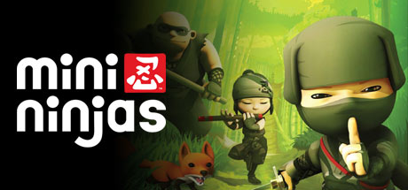

**Platforms:** Windows, Xbox 360, PlayStation 3, Wii, Nintendo DS &nbsp;|&nbsp; **Genre:** Action, Adventure &nbsp;|&nbsp; **Released:** September 8

> Mini Ninjas is a game that combines furious action with stealth and exploration for an experience that appeals to a wide audience across age groups and preferences. It’s an action-adventure with a strong focus on allowing the player freedom to explore the world and has the depth to allow for very varied gameplay and approaches to getting...
>
> _Synopsis source: Steam_

[Wikipedia](https://en.wikipedia.org/wiki/Mini_Ninjas) · [Steam](https://store.steampowered.com/app/35000)

---

### Mr. Driller W

**Platforms:** Wii &nbsp;|&nbsp; **Released:** August 24

[Wikipedia](https://en.wikipedia.org/wiki/Mr._Driller_W)

---

### Muramasa: The Demon Blade

**Platforms:** Wii &nbsp;|&nbsp; **Released:** September 8

---

### MySims Agents

**Platforms:** Nintendo DS, Wii &nbsp;|&nbsp; **Released:** September 29

[Wikipedia](https://en.wikipedia.org/wiki/MySims_Agents)

---

### MySims Party

**Platforms:** Nintendo DS, Wii &nbsp;|&nbsp; **Released:** March 10

[Wikipedia](https://en.wikipedia.org/wiki/MySims_Party)

---

### MySims Racing

**Platforms:** Wii, Nintendo DS &nbsp;|&nbsp; **Released:** June 8

[Wikipedia](https://en.wikipedia.org/wiki/MySims_Racing)

---

### NASCAR Kart Racing

**Platforms:** Wii &nbsp;|&nbsp; **Released:** February 10

[Wikipedia](https://en.wikipedia.org/wiki/NASCAR_Kart_Racing)

---

### NBA 2K10

**Platforms:** Xbox 360, PlayStation 2, PlayStation 3, PlayStation Portable, Windows, Wii &nbsp;|&nbsp; **Released:** October 6

[Wikipedia](https://en.wikipedia.org/wiki/NBA_2K10)

---

### Need for Speed: Nitro

**Platforms:** Wii, Nintendo DS &nbsp;|&nbsp; **Released:** November 3

---

### Neighborhood Games

**Platforms:** Wii &nbsp;|&nbsp; **Released:** January 12

[Wikipedia](https://en.wikipedia.org/wiki/Neighborhood_Games)

---

### New Play Control! Donkey Kong Jungle Beat

**Platforms:** Wii &nbsp;|&nbsp; **Released:** May 4

[Wikipedia](https://en.wikipedia.org/wiki/Donkey_Kong_Jungle_Beat)

---

### New Super Mario Bros. Wii

**Platforms:** Wii &nbsp;|&nbsp; **Publisher:** Nintendo &nbsp;|&nbsp; **Released:** November 11, 2009

[Wikipedia](https://en.wikipedia.org/wiki/New_Super_Mario_Bros._Wii)

---

### NHL 2K10

**Platforms:** Xbox 360, PlayStation 2, PlayStation 3, Wii &nbsp;|&nbsp; **Released:** September 15

[Wikipedia](https://en.wikipedia.org/wiki/NHL_2K10)

---

### Night at the Museum: Battle of the Smithsonian

**Platforms:** Nintendo DS, Wii, Windows, Xbox 360 &nbsp;|&nbsp; **Released:** May 5

---

### NyxQuest: Kindred Spirits

**Platforms:** Wii &nbsp;|&nbsp; **Released:** August 10

---

### OneChanbara: Bikini Zombie Slayers

**Platforms:** Wii &nbsp;|&nbsp; **Released:** February 10

---

### Overlord: Dark Legend

**Platforms:** Wii &nbsp;|&nbsp; **Released:** June 23

---

### Phantom Brave: We Meet Again

**Platforms:** Wii &nbsp;|&nbsp; **Released:** August 14

[Wikipedia](https://en.wikipedia.org/wiki/Phantom_Brave)

---

### Planet Pachinko

**Platforms:** Wii &nbsp;|&nbsp; **Released:** January 12

[Wikipedia](https://en.wikipedia.org/wiki/Planet_Pachinko)

---

### Pokémon Rumble

**Platforms:** Wii &nbsp;|&nbsp; **Released:** November 16

[Wikipedia](https://en.wikipedia.org/wiki/Pok%C3%A9mon_Rumble)

---

### Pro Evolution Soccer 2010

**Platforms:** Windows, PlayStation 3, Xbox 360, Nintendo DS, PlayStation 2, PlayStation Portable, Wii &nbsp;|&nbsp; **Released:** October 23

[Wikipedia](https://en.wikipedia.org/wiki/Pro_Evolution_Soccer_2010)

---

### Punch-Out!!

**Platforms:** Wii &nbsp;|&nbsp; **Released:** May 18

[Wikipedia](https://en.wikipedia.org/wiki/Punch-Out!!_(Wii))

---

### Puyo Puyo 7

**Platforms:** Nintendo DS, PlayStation Portable, Wii &nbsp;|&nbsp; **Released:** July 30

[Wikipedia](https://en.wikipedia.org/wiki/Puyo_Puyo_7)

---

### Rabbids Go Home

**Platforms:** Wii, Nintendo DS &nbsp;|&nbsp; **Released:** November 1

[Wikipedia](https://en.wikipedia.org/wiki/Rabbids_Go_Home)

---

### Rainbow Islands: Towering Adventure!

**Platforms:** Wii, Xbox 360 &nbsp;|&nbsp; **Released:** June 15

---

### Resident Evil Archives: Resident Evil Zero

**Platforms:** Wii &nbsp;|&nbsp; **Released:** December 1

[Wikipedia](https://en.wikipedia.org/wiki/Resident_Evil_Zero)

---

### Resident Evil: The Darkside Chronicles

**Platforms:** Wii &nbsp;|&nbsp; **Released:** November 17

---

### Rock Band Country Track Pack

**Platforms:** PlayStation 2, PlayStation 3, Wii, Xbox 360 &nbsp;|&nbsp; **Released:** July 21

[Wikipedia](https://en.wikipedia.org/wiki/Rock_Band_Country_Track_Pack)

---

### Rock Band Metal Track Pack

**Platforms:** PlayStation 2, PlayStation 3, Wii, Xbox 360 &nbsp;|&nbsp; **Released:** September 22

[Wikipedia](https://en.wikipedia.org/wiki/Rock_Band_Metal_Track_Pack)

---

### Rogue Trooper

**Platforms:** Wii &nbsp;|&nbsp; **Released:** February 27

[Wikipedia](https://en.wikipedia.org/wiki/Rogue_Trooper_(video_game))

---

### Rune Factory Frontier

**Platforms:** Wii &nbsp;|&nbsp; **Released:** March 17

[Wikipedia](https://en.wikipedia.org/wiki/Rune_Factory_Frontier)

---

### Rygar: The Battle of Argus

**Platforms:** Wii &nbsp;|&nbsp; **Released:** January 28

---

### Sandy Beach

**Platforms:** Wii &nbsp;|&nbsp; **Released:** January 5

[Wikipedia](https://en.wikipedia.org/wiki/Sandy_Beach_(video_game))

---

### Scooby-Doo! First Frights

**Platforms:** Nintendo DS, PlayStation 2, Wii, Windows &nbsp;|&nbsp; **Released:** September 22

[Wikipedia](https://en.wikipedia.org/wiki/Scooby-Doo!_First_Frights)

---

### Secret Files 2: Puritas Cordis

**Platforms:** Windows, Wii, Nintendo DS &nbsp;|&nbsp; **Genre:** Adventure &nbsp;|&nbsp; **Released:** May 8

> The sequel to the award winning adventure hit Secret Files Tunguska. Famine in Africa, floods in Southeast Asia, economic crisis in Europe, and civil wars in South America, the world is on the brink of disaster.
>
> _Synopsis source: Steam_

[Steam](https://store.steampowered.com/app/40340)

---

### Shaun White Snowboarding: World Stage

**Platforms:** Wii &nbsp;|&nbsp; **Released:** November 8

---

### Silent Hill: Shattered Memories

**Platforms:** Wii &nbsp;|&nbsp; **Released:** December 8

---

### SimAnimals

**Platforms:** Nintendo DS, Wii &nbsp;|&nbsp; **Released:** January 21

[Wikipedia](https://en.wikipedia.org/wiki/SimAnimals)

---

### SimAnimals Africa

**Platforms:** Nintendo DS, Wii &nbsp;|&nbsp; **Released:** October 27

[Wikipedia](https://en.wikipedia.org/wiki/SimAnimals_Africa)

---

### Sin & Punishment: Star Successor

**Platforms:** Wii &nbsp;|&nbsp; **Publisher:** Nintendo &nbsp;|&nbsp; **Released:** October 29, 2009

---

### Ski-Doo: Snowmobile Challenge

**Platforms:** PlayStation 3, Wii &nbsp;|&nbsp; **Released:** March 10

---

### Sonic and the Black Knight

**Platforms:** Wii &nbsp;|&nbsp; **Released:** March 3

[Wikipedia](https://en.wikipedia.org/wiki/Sonic_and_the_Black_Knight)

---

### Spaceball Revolution

**Platforms:** Wii &nbsp;|&nbsp; **Released:** September 14

[Wikipedia](https://en.wikipedia.org/wiki/Spaceball_Revolution)

---

### Spectrobes: Origins

**Platforms:** Wii &nbsp;|&nbsp; **Released:** August 18

---

### Spyborgs

**Platforms:** Wii &nbsp;|&nbsp; **Released:** September 22

[Wikipedia](https://en.wikipedia.org/wiki/Spyborgs)

---

### Star Wars: The Clone Wars – Republic Heroes

**Platforms:** PlayStation 3, Windows, Xbox 360, Wii, PlayStation Portable, PlayStation 2, Nintendo DS &nbsp;|&nbsp; **Released:** October 6

---

### Teenage Mutant Ninja Turtles: Smash-Up

**Platforms:** Wii, PlayStation 2 &nbsp;|&nbsp; **Released:** September 22

---

### Tenchu: Shadow Assassins

**Platforms:** Wii, PlayStation Portable &nbsp;|&nbsp; **Released:** February 3

---

### The Backyardigans

**Platforms:** Nintendo DS, PlayStation 3, Wii, Xbox 360 &nbsp;|&nbsp; **Released:** November 3

[Wikipedia](https://en.wikipedia.org/wiki/The_Backyardigans)

---

### The Backyardigans: Robot Rampage

**Platforms:** Windows, Xbox 360, PlayStation 3, PlayStation Portable, Wii, Nintendo DS &nbsp;|&nbsp; **Released:** September 8

---

### The Backyardigans: Singing Sensation

**Platforms:** Windows, PlayStation 3, Wii, Xbox 360 &nbsp;|&nbsp; **Released:** November 10

---

### The Beatles: Rock Band

**Platforms:** Wii, Xbox 360, PlayStation 3, PlayStation 2 &nbsp;|&nbsp; **Publisher:** MTV Games &nbsp;|&nbsp; **Released:** September 9, 2009

---

### The Bigs 2

**Platforms:** Xbox 360, PlayStation 3, PlayStation 2, Wii, PlayStation Portable &nbsp;|&nbsp; **Released:** July 7

[Wikipedia](https://en.wikipedia.org/wiki/The_Bigs_2)

---

### The Conduit

**Platforms:** Wii &nbsp;|&nbsp; **Released:** June 23

[Wikipedia](https://en.wikipedia.org/wiki/The_Conduit)

---

### The Destiny of Zorro

**Platforms:** Wii &nbsp;|&nbsp; **Released:** May 5

[Wikipedia](https://en.wikipedia.org/wiki/The_Destiny_of_Zorro)

---

### The House of the Dead: Overkill

**Platforms:** Wii &nbsp;|&nbsp; **Released:** February 10

---

### The Munchables

**Platforms:** Wii &nbsp;|&nbsp; **Released:** May 26

[Wikipedia](https://en.wikipedia.org/wiki/The_Munchables)

---

### The Price is Right: 2010 Edition

**Platforms:** Nintendo DS, Wii, Windows &nbsp;|&nbsp; **Released:** September 22

---

### The Secret Saturdays: Beasts of the 5th Sun

**Platforms:** Wii, PlayStation 2, PlayStation Portable, Nintendo DS &nbsp;|&nbsp; **Released:** October 20

---

### The Three Musketeers: One for all!

**Platforms:** Wii &nbsp;|&nbsp; **Released:** July 27

---

### Tiger Woods PGA Tour 10

**Platforms:** Wii, PlayStation 2, PlayStation 3, PlayStation Portable, Xbox 360 &nbsp;|&nbsp; **Publisher:** EA Sports &nbsp;|&nbsp; **Released:** June 8, 2009

[Wikipedia](https://en.wikipedia.org/wiki/Tiger_Woods_PGA_Tour_10)

---

### Tony Hawk: Ride

**Platforms:** PlayStation 3, Wii, Xbox 360 &nbsp;|&nbsp; **Released:** November 17

---

### Tornado Outbreak

**Platforms:** Wii, PlayStation 3, Xbox 360 &nbsp;|&nbsp; **Released:** September 29

[Wikipedia](https://en.wikipedia.org/wiki/Tornado_Outbreak)

---

### Toy Story Mania!

**Platforms:** iOS, Wii &nbsp;|&nbsp; **Released:** August 14

[Wikipedia](https://en.wikipedia.org/wiki/Toy_Story_Mania!_(video_game))

---

### Transformers: Revenge of the Fallen

**Platforms:** Nintendo DS, PlayStation 2, PlayStation 3, Wii, Windows, Xbox 360, PlayStation Portable &nbsp;|&nbsp; **Released:** June 23

---

### Ultimate Shooting Collection

**Platforms:** Wii &nbsp;|&nbsp; **Released:** February 3

[Wikipedia](https://en.wikipedia.org/wiki/Ultimate_Shooting_Collection)

---

### Virtua Tennis 2009

**Platforms:** Xbox 360, PlayStation 3, Wii, Windows &nbsp;|&nbsp; **Released:** June 9

[Wikipedia](https://en.wikipedia.org/wiki/Virtua_Tennis_2009)

---

### We Cheer 2

**Platforms:** Wii &nbsp;|&nbsp; **Released:** November 3

[Wikipedia](https://en.wikipedia.org/wiki/We_Cheer_2)

---

### Wheelspin

**Platforms:** Wii &nbsp;|&nbsp; **Released:** August 18

[Wikipedia](https://en.wikipedia.org/wiki/Wheelspin_(video_game))

---

### Wii Fit Plus

**Platforms:** Wii &nbsp;|&nbsp; **Released:** October 4

[Wikipedia](https://en.wikipedia.org/wiki/Wii_Fit_Plus)

---

### Wii Sports Resort

**Platforms:** Wii &nbsp;|&nbsp; **Released:** July 26

[Wikipedia](https://en.wikipedia.org/wiki/Wii_Sports_Resort)

---

### World of Zoo

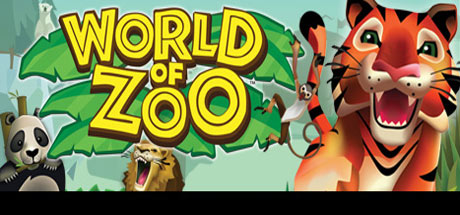

**Platforms:** Nintendo DS, Wii, Windows &nbsp;|&nbsp; **Genre:** Simulation &nbsp;|&nbsp; **Released:** October 26

> What would you do if you had the keys to the zoo? World of Zoo is the only life sim game that pushes you past the fences and into a world of your own zoo. Create and customize your zoo experience and develop hands on relationships to earn the trust and love of your animals.
>
> _Synopsis source: Steam_

[Wikipedia](https://en.wikipedia.org/wiki/World_of_Zoo) · [Steam](https://store.steampowered.com/app/43100)

---

### WWE SmackDown vs. Raw 2010

**Platforms:** Nintendo DS, PlayStation 2, PlayStation 3, PlayStation Portable, Wii, Xbox 360 &nbsp;|&nbsp; **Released:** October 20

[Wikipedia](https://en.wikipedia.org/wiki/WWE_SmackDown_vs._Raw_2010)

---

### X-Men Origins: Wolverine

**Platforms:** Nintendo DS, PlayStation 2, PlayStation 3, Wii, Windows, Xbox 360, PlayStation Portable &nbsp;|&nbsp; **Released:** May 1

---

### You, Me, and the Cubes

**Platforms:** Wii &nbsp;|&nbsp; **Released:** September 21

[Wikipedia](https://en.wikipedia.org/wiki/Kenji_Eno#With_fyto)

---

### Yu-Gi-Oh! 5D's: Wheelie Breakers

**Platforms:** Wii &nbsp;|&nbsp; **Released:** May 19

---

## 2008

[Full 2008 page](../years/2008.md)

### 428: Shibuya Scramble

**Platforms:** Wii &nbsp;|&nbsp; **Released:** December 4

---

### Agatha Christie: And Then There Were None

**Platforms:** Wii &nbsp;|&nbsp; **Released:** February 8

---

### Alien Crush Returns

**Platforms:** Wii &nbsp;|&nbsp; **Released:** November 3

[Wikipedia](https://en.wikipedia.org/wiki/Alien_Crush_Returns)

---

### All Star Cheer Squad

**Platforms:** Nintendo DS, Wii &nbsp;|&nbsp; **Released:** October 27

[Wikipedia](https://en.wikipedia.org/wiki/All_Star_Cheer_Squad)

---

### Alone in the Dark

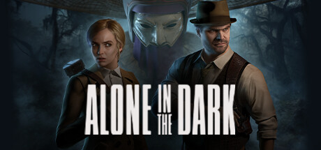

**Platforms:** PlayStation 2, Wii, Windows, Xbox 360 &nbsp;|&nbsp; **Genre:** Action, Adventure &nbsp;|&nbsp; **Released:** June 20

> Return to Derceto Manor in this reimagination of Alone in the Dark, a love letter to the 90’s cult classic horror game.
>
> _Synopsis source: Steam_

[Wikipedia](https://en.wikipedia.org/wiki/Alone_in_the_Dark_(2008_video_game)) · [Steam](https://store.steampowered.com/app/1310410)

---

### Animal Crossing: City Folk

**Platforms:** Wii &nbsp;|&nbsp; **Released:** November 16

---

### Avatar: The Last Airbender – Into the Inferno

**Platforms:** Nintendo DS, PlayStation 2, Wii, PlayStation 3, Xbox 360 &nbsp;|&nbsp; **Released:** October 13

---

### Baroque

**Platforms:** PlayStation 2, Wii &nbsp;|&nbsp; **Released:** April 8

[Wikipedia](https://en.wikipedia.org/wiki/Baroque_(video_game))

---

### Ben 10: Alien Force

**Platforms:** Nintendo DS, PlayStation 2, PlayStation Portable, Wii &nbsp;|&nbsp; **Released:** October 28

---

### Big Beach Sports

**Platforms:** Wii &nbsp;|&nbsp; **Released:** June 24

[Wikipedia](https://en.wikipedia.org/wiki/Big_Beach_Sports)

---

### Big Kahuna Party

**Platforms:** Wii &nbsp;|&nbsp; **Released:** December 15

[Wikipedia](https://en.wikipedia.org/wiki/Big_Kahuna_Party)

---

### Blast Works: Build, Trade, Destroy

**Platforms:** Wii &nbsp;|&nbsp; **Released:** June 10

---

### Bolt

**Platforms:** Nintendo DS, PlayStation 2, PlayStation 3, Wii, Windows, Xbox 360 &nbsp;|&nbsp; **Genre:** Strategy &nbsp;|&nbsp; **Released:** November 18

> Step into the boots of a battlefield commander in Bolt Action, a turn-based WWII strategy inspired by Warlord Games’ tabletop classic.
>
> _Synopsis source: Steam_

[Wikipedia](https://en.wikipedia.org/wiki/Bolt_(video_game)) · [Steam](https://store.steampowered.com/app/3856030)

---

### Boogie Superstar

**Platforms:** Wii &nbsp;|&nbsp; **Released:** October 14

[Wikipedia](https://en.wikipedia.org/wiki/Boogie_Superstar)

---

### Boom Blox

**Platforms:** Mobile phone, Wii &nbsp;|&nbsp; **Released:** May 6

[Wikipedia](https://en.wikipedia.org/wiki/Boom_Blox)

---

### Bratz Kidz

**Platforms:** Nintendo DS, Wii &nbsp;|&nbsp; **Released:** November 4

[Wikipedia](https://en.wikipedia.org/wiki/Bratz_Kidz)

---

### Brothers in Arms: Double Time

**Platforms:** Wii &nbsp;|&nbsp; **Released:** September 23

---

### Brothers in Arms: Road to Hill 30

**Platforms:** Wii &nbsp;|&nbsp; **Released:** April 1

---

### Bully: Scholarship Edition

**Platforms:** Wii, Xbox 360, Windows &nbsp;|&nbsp; **Genre:** Action, Adventure &nbsp;|&nbsp; **Released:** March 3

> Bully tells the story of mischievous 15-year-old Jimmy Hopkins as he goes through the hilarity and awkwardness of adolescence. Beat the jocks at dodge ball, play pranks on the preppies, save the nerds, kiss the girl and navigate the social hierarchy in the worst school around.
>
> _Synopsis source: Steam_

[Wikipedia](https://en.wikipedia.org/wiki/Bully_(video_game)) · [Steam](https://store.steampowered.com/app/12200)

---

### Call of Duty: World at War

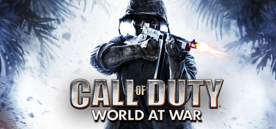

**Platforms:** Nintendo DS, PlayStation 3, Wii, Windows, Xbox 360, PlayStation 2 &nbsp;|&nbsp; **Genre:** Action &nbsp;|&nbsp; **Released:** November 11

> Call of Duty is back, redefining war like you've never experienced before. Building on the Call of Duty 4®: Modern Warfare engine, Call of Duty: World at War immerses players into the most gritty and chaotic WWII combat ever experienced.
>
> _Synopsis source: Steam_

[Steam](https://store.steampowered.com/app/10090)

---

### Captain Rainbow

**Platforms:** Wii &nbsp;|&nbsp; **Released:** August 28

[Wikipedia](https://en.wikipedia.org/wiki/Captain_Rainbow)

---

### Castle of Shikigami III

**Platforms:** Wii &nbsp;|&nbsp; **Released:** May 13

[Wikipedia](https://en.wikipedia.org/wiki/Castle_of_Shikigami_III)

---

### Castlevania Judgment

**Platforms:** Wii &nbsp;|&nbsp; **Released:** November 18

[Wikipedia](https://en.wikipedia.org/wiki/Castlevania_Judgment)

---

### Celebrity Sports Showdown

**Platforms:** Wii &nbsp;|&nbsp; **Released:** October 20

[Wikipedia](https://en.wikipedia.org/wiki/Celebrity_Sports_Showdown)

---

### Cooking Mama: World Kitchen

**Platforms:** Wii &nbsp;|&nbsp; **Released:** November 18

---

### Crash: Mind over Mutant

**Platforms:** PlayStation 2, Wii, Xbox 360, PlayStation Portable, Nintendo DS &nbsp;|&nbsp; **Released:** October 7

---

### Critter Round-Up

**Platforms:** Wii &nbsp;|&nbsp; **Released:** May 19

[Wikipedia](https://en.wikipedia.org/wiki/Critter_Round-Up)

---

### CSI: Hard Evidence

**Platforms:** Wii &nbsp;|&nbsp; **Released:** January 15

---

### Cubello

**Platforms:** Wii &nbsp;|&nbsp; **Released:** October 13

[Wikipedia](https://en.wikipedia.org/wiki/Cubello)

---

### Dance Dance Revolution Hottest Party 2

**Platforms:** Wii &nbsp;|&nbsp; **Released:** September 16

[Wikipedia](https://en.wikipedia.org/wiki/Dance_Dance_Revolution_Hottest_Party_2)

---

### De Blob

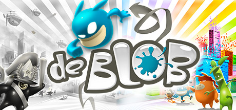

**Platforms:** Nintendo DS, Wii, Windows &nbsp;|&nbsp; **Genre:** Action, Adventure, Casual, Indie &nbsp;|&nbsp; **Released:** September 22

> The evil I.N.K.T. Corporation has declared 'Color is a Crime!' and leeched Chroma City of all its beauty and interest. The race to rescue Chroma City has just begun, and only de Blob can save the world from a black-and-white future with his unique abilities to color the world back to life.
>
> _Synopsis source: Steam_

[Wikipedia](https://en.wikipedia.org/wiki/De_Blob) · [Steam](https://store.steampowered.com/app/532320)

---

### Death Jr. II: Root of Evil

**Platforms:** Wii &nbsp;|&nbsp; **Released:** May 27

---

### Deca Sports

**Platforms:** Wii &nbsp;|&nbsp; **Released:** March 19

[Wikipedia](https://en.wikipedia.org/wiki/Deca_Sports)

---

### Destroy All Humans! Big Willy Unleashed

**Platforms:** Wii &nbsp;|&nbsp; **Released:** February 25

[Wikipedia](https://en.wikipedia.org/wiki/Destroy_All_Humans!_Big_Willy_Unleashed)

---

### Di-Gata Defenders

**Platforms:** Nintendo DS, PlayStation 2, PlayStation 3, Wii, Xbox 360 &nbsp;|&nbsp; **Released:** September 22

[Wikipedia](https://en.wikipedia.org/wiki/Di-Gata_Defenders)

---

### Dinosaur King

**Platforms:** PlayStation 2, Nintendo DS, Wii, Xbox 360 &nbsp;|&nbsp; **Released:** September 23

[Wikipedia](https://en.wikipedia.org/wiki/Dinosaur_King_(video_game))

---

### Disaster: Day of Crisis

**Platforms:** Wii &nbsp;|&nbsp; **Released:** September 25

---

### Disney Think Fast

**Platforms:** Wii &nbsp;|&nbsp; **Released:** October 21

[Wikipedia](https://en.wikipedia.org/wiki/Disney_Think_Fast)

---

### Dora the Explorer: Dora Saves the Snow Princess

**Platforms:** Nintendo DS, PlayStation 2, Wii &nbsp;|&nbsp; **Released:** October 28

[Wikipedia](https://en.wikipedia.org/wiki/Dora_the_Explorer_(TV_series))

---

### Dr. Mario Online Rx

**Platforms:** Wii &nbsp;|&nbsp; **Released:** May 26

[Wikipedia](https://en.wikipedia.org/wiki/Dr._Mario_Online_Rx)

---

### Dragon Quest Swords: The Masked Queen and the Tower of Mirrors

**Platforms:** Wii &nbsp;|&nbsp; **Released:** February 19

---

### Emergency Heroes

**Platforms:** Wii &nbsp;|&nbsp; **Released:** May 27

[Wikipedia](https://en.wikipedia.org/wiki/Emergency_Heroes)

---

### FaceBreaker

**Platforms:** PlayStation 3, Xbox 360, Wii &nbsp;|&nbsp; **Released:** September 5

[Wikipedia](https://en.wikipedia.org/wiki/FaceBreaker)

---

### Fatal Frame IV

**Platforms:** Wii &nbsp;|&nbsp; **Released:** July 31

[Wikipedia](https://en.wikipedia.org/wiki/Fatal_Frame_IV)

---

### FIFA 09

**Platforms:** Mobile phone, Nintendo DS, PlayStation 2, PlayStation 3, PlayStation Portable, Wii, Windows, Xbox 360 &nbsp;|&nbsp; **Released:** October 14

[Wikipedia](https://en.wikipedia.org/wiki/FIFA_09)

---

### Final Fantasy Fables: Chocobo's Dungeon

**Platforms:** Wii &nbsp;|&nbsp; **Released:** July 8

---

### Fushigi no Dungeon – Furai no Shiren 3: Karakuri Yashiki no Nemuri Hime

**Platforms:** Wii &nbsp;|&nbsp; **Released:** June 5

[Wikipedia](https://en.wikipedia.org/wiki/Shiren_the_Wanderer_(2008_video_game))

---

### Gallop & Ride

**Platforms:** Wii &nbsp;|&nbsp; **Released:** November 20

[Wikipedia](https://en.wikipedia.org/wiki/Gallop_%26_Ride)

---

### George of the Jungle and the Search for the Secret

**Platforms:** Nintendo DS, PlayStation 2, Wii &nbsp;|&nbsp; **Released:** March 11

[Wikipedia](https://en.wikipedia.org/wiki/George_of_the_Jungle_and_the_Search_for_the_Secret)

---

### Go, Diego, Go!: The Great Dinosaur Rescue

**Platforms:** Nintendo DS, PlayStation 2, Wii &nbsp;|&nbsp; **Released:** October 28

[Wikipedia](https://en.wikipedia.org/wiki/Go,_Diego,_Go!)

---

### Goosebumps HorrorLand

**Platforms:** Nintendo DS, PlayStation 2, Wii &nbsp;|&nbsp; **Released:** October 28

[Wikipedia](https://en.wikipedia.org/wiki/Goosebumps_HorrorLand_Video_Game)

---

### Guinness World Records: The Videogame

**Platforms:** Nintendo DS, Wii &nbsp;|&nbsp; **Released:** November 11

---

### Guitar Hero World Tour

**Platforms:** macOS, PlayStation 2, PlayStation 3, Wii, Windows, Xbox 360 &nbsp;|&nbsp; **Released:** October 26

[Wikipedia](https://en.wikipedia.org/wiki/Guitar_Hero_World_Tour)

---

### Guitar Hero: Aerosmith

**Platforms:** PlayStation 2, PlayStation 3, Wii, Xbox 360 &nbsp;|&nbsp; **Released:** June 29

---

### Gyrostarr

**Platforms:** Wii &nbsp;|&nbsp; **Released:** June 23

[Wikipedia](https://en.wikipedia.org/wiki/Gyrostarr)

---

### Harvey Birdman: Attorney at Law

**Platforms:** PlayStation 2, PlayStation Portable, Wii &nbsp;|&nbsp; **Released:** January 8

---

### Helix

**Platforms:** Wii &nbsp;|&nbsp; **Released:** August 25

[Wikipedia](https://en.wikipedia.org/wiki/Helix_(video_game))

---

### Hell's Kitchen: The Game

**Platforms:** Nintendo DS, PlayStation 2, Wii, Xbox 360 &nbsp;|&nbsp; **Released:** September 9

---

### Hockey Allstar Shootout

**Platforms:** Wii &nbsp;|&nbsp; **Released:** December 8

[Wikipedia](https://en.wikipedia.org/wiki/Hockey_Allstar_Shootout)

---

### Igor: The Game

**Platforms:** Nintendo DS, Wii, Windows &nbsp;|&nbsp; **Released:** September 19

[Wikipedia](https://en.wikipedia.org/wiki/Igor_(film))

---

### Iron Chef America: Supreme Cuisine

**Platforms:** Nintendo DS, Wii &nbsp;|&nbsp; **Released:** November 18

---

### Iron Man

**Platforms:** Nintendo DS, PlayStation 2, PlayStation 3, PlayStation Portable, Wii, Windows, Xbox 360 &nbsp;|&nbsp; **Released:** May 2

[Wikipedia](https://en.wikipedia.org/wiki/Iron_Man_(video_game))

---

### Jillian Michaels' Fitness Ultimatum 2009

**Platforms:** Wii &nbsp;|&nbsp; **Released:** October 21

[Wikipedia](https://en.wikipedia.org/wiki/Jillian_Michaels%27_Fitness_Ultimatum_2009)

---

### Jumper: Griffin's Story

**Platforms:** PlayStation 2, PlayStation 3, Wii, Xbox 360 &nbsp;|&nbsp; **Released:** February 12

---

### Kung Fu Panda

**Platforms:** Nintendo DS, PlayStation 2, PlayStation 3, Wii, Windows, Xbox 360 &nbsp;|&nbsp; **Released:** June 3

[Wikipedia](https://en.wikipedia.org/wiki/Kung_Fu_Panda_(video_game))

---

### Kung Fu Panda: Legendary Warriors

**Platforms:** Nintendo DS, Wii &nbsp;|&nbsp; **Released:** November 5

---

### Lego Batman: The Videogame

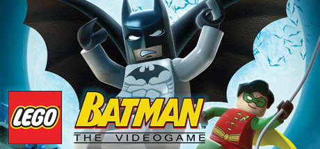

**Platforms:** Nintendo DS, PlayStation 2, PlayStation 3, PlayStation Portable, Wii, Windows, Xbox 360 &nbsp;|&nbsp; **Genre:** Action, Adventure &nbsp;|&nbsp; **Released:** September 23

> When all the villains in Arkham Asylum team up and break loose, only the dynamic duo is bold enough to take them on to save Gotham City. The fun of LEGO, the drama of Batman and the uniqueness of the combination makes for a comical and exciting adventure in LEGO Batman: The Videogame.
>
> _Synopsis source: Steam_

[Steam](https://store.steampowered.com/app/21000)

---

### Lego Indiana Jones: The Original Adventures

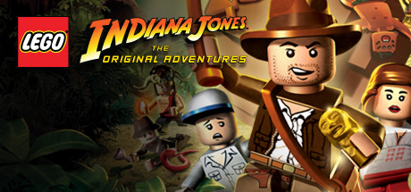

**Platforms:** Nintendo DS, PlayStation 2, PlayStation 3, PlayStation Portable, Wii, Windows, Xbox, Xbox 360 &nbsp;|&nbsp; **Genre:** Action, Adventure &nbsp;|&nbsp; **Released:** June 3

> Build, Battle and Brawl your way out of trouble! Play through all three classic Indiana Jones™ movies and relive your favorite Indy adventures in the tongue-in-cheek worlds of LEGO®. Explore and Discover - Battle enemies, solve puzzles, and seek out the world's greatest treasures.
>
> _Synopsis source: Steam_

[Steam](https://store.steampowered.com/app/32330)

---

### LostWinds

**Platforms:** Wii &nbsp;|&nbsp; **Released:** May 12

[Wikipedia](https://en.wikipedia.org/wiki/LostWinds)

---

### MaBoShi: The Three Shape Arcade

**Platforms:** Wii &nbsp;|&nbsp; **Released:** December 29

---

### Madagascar: Escape 2 Africa

**Platforms:** PlayStation 3, PlayStation 2, Xbox 360, Windows, Wii, Nintendo DS &nbsp;|&nbsp; **Released:** November 4

---

### Madden NFL 09

**Platforms:** Nintendo DS, PlayStation 2, PlayStation 3, PlayStation Portable, Wii, Xbox 360, Xbox &nbsp;|&nbsp; **Released:** August 13

[Wikipedia](https://en.wikipedia.org/wiki/Madden_NFL_09)

---

### Magnetica

**Platforms:** Wii &nbsp;|&nbsp; **Released:** June 30

[Wikipedia](https://en.wikipedia.org/wiki/Magnetica)

---

### Major League Baseball 2K8

**Platforms:** PlayStation 2, PlayStation 3, PlayStation Portable, Wii, Xbox 360 &nbsp;|&nbsp; **Released:** March 3

[Wikipedia](https://en.wikipedia.org/wiki/Major_League_Baseball_2K8)

---

### Major League Eating: The Game

**Platforms:** Wii &nbsp;|&nbsp; **Released:** July 14

---

### Mario Kart Wii (JP)

**Platforms:** Wii &nbsp;|&nbsp; **Released:** April 10

[Wikipedia](https://en.wikipedia.org/wiki/Mario_Kart_Wii)

---

### Mario Kart Wii (NA)

**Platforms:** Wii &nbsp;|&nbsp; **Released:** April 27

[Wikipedia](https://en.wikipedia.org/wiki/Mario_Kart_Wii)

---

### Mario Super Sluggers

**Platforms:** Wii &nbsp;|&nbsp; **Released:** June 19

[Wikipedia](https://en.wikipedia.org/wiki/Mario_Super_Sluggers)

---

### Mega Man 9

**Platforms:** Wii, PlayStation Network, Xbox 360 &nbsp;|&nbsp; **Released:** September 22

[Wikipedia](https://en.wikipedia.org/wiki/Mega_Man_9)

---

### MLB Power Pros 2008

**Platforms:** PlayStation 2, Wii, Nintendo DS &nbsp;|&nbsp; **Released:** July 29

[Wikipedia](https://en.wikipedia.org/wiki/MLB_Power_Pros_2008)

---

### Mushroom Men: The Spore Wars

**Platforms:** Wii &nbsp;|&nbsp; **Released:** December 2

[Wikipedia](https://en.wikipedia.org/wiki/Mushroom_Men)

---

### MX vs. ATV: Untamed

**Platforms:** Wii &nbsp;|&nbsp; **Released:** February 18

---

### My Pokémon Ranch

**Platforms:** Wii &nbsp;|&nbsp; **Released:** June 9

[Wikipedia](https://en.wikipedia.org/wiki/My_Pok%C3%A9mon_Ranch)

---

### MySims Kingdom

**Platforms:** Nintendo DS, Wii &nbsp;|&nbsp; **Released:** October 27

[Wikipedia](https://en.wikipedia.org/wiki/MySims_Kingdom)

---

### Nancy Drew: The White Wolf of Icicle Creek

**Platforms:** Wii &nbsp;|&nbsp; **Released:** December 2

---

### Naruto: Clash of Ninja Revolution 2

**Platforms:** Wii &nbsp;|&nbsp; **Released:** October 21

---

### NBA 2K9

**Platforms:** PlayStation 2, PlayStation 3, Wii, Xbox 360, Windows &nbsp;|&nbsp; **Released:** October 7

[Wikipedia](https://en.wikipedia.org/wiki/NBA_2K9)

---

### NBA Live 09

**Platforms:** PlayStation 2, PlayStation 3, PlayStation Portable, Wii, Xbox 360 &nbsp;|&nbsp; **Released:** October 7

[Wikipedia](https://en.wikipedia.org/wiki/NBA_Live_09)

---

### NCAA Football 09

**Platforms:** PlayStation 2, PlayStation 3, PlayStation Portable, Wii, Xbox 360 &nbsp;|&nbsp; **Released:** July 15

[Wikipedia](https://en.wikipedia.org/wiki/NCAA_Football_09)

---

### Need for Speed: Undercover

**Platforms:** Mobile phone, PlayStation 2, PlayStation 3, PlayStation Portable, Wii, Windows, Xbox 360 &nbsp;|&nbsp; **Released:** November 18

---

### NHL 09

**Platforms:** Xbox 360, PlayStation 3, Wii, Windows &nbsp;|&nbsp; **Publisher:** EA Sports &nbsp;|&nbsp; **Released:** September 9, 2008

[Wikipedia](https://en.wikipedia.org/wiki/NHL_09)

---

### NHL 2K9

**Platforms:** PlayStation 2, PlayStation 3, Wii, Xbox 360 &nbsp;|&nbsp; **Released:** September 8

[Wikipedia](https://en.wikipedia.org/wiki/NHL_2K9)

---

### Ninja Reflex

**Platforms:** Wii &nbsp;|&nbsp; **Released:** March 4

[Wikipedia](https://en.wikipedia.org/wiki/Ninja_Reflex)

---

### Nitrobike

**Platforms:** Wii &nbsp;|&nbsp; **Released:** January 15

[Wikipedia](https://en.wikipedia.org/wiki/Nitrobike)

---

### No More Heroes

**Platforms:** Wii &nbsp;|&nbsp; **Released:** January 22

[Wikipedia](https://en.wikipedia.org/wiki/No_More_Heroes_(video_game))

---

### ObsCure II

**Platforms:** Wii &nbsp;|&nbsp; **Released:** March 25

[Wikipedia](https://en.wikipedia.org/wiki/ObsCure_II)

---

### One Piece: Unlimited Cruise: Episode 1

**Platforms:** Wii &nbsp;|&nbsp; **Released:** September 11

---

### Opoona

**Platforms:** Wii &nbsp;|&nbsp; **Released:** March 25

[Wikipedia](https://en.wikipedia.org/wiki/Opoona)

---

### Pimp My Ride

**Platforms:** Wii &nbsp;|&nbsp; **Released:** February 19

[Wikipedia](https://en.wikipedia.org/wiki/Pimp_My_Ride)

---

### Pinball Hall of Fame: The Williams Collection

**Platforms:** PlayStation 2, PlayStation Portable, Wii &nbsp;|&nbsp; **Released:** February 26

---

### Pong Toss! Frat Party Games

**Platforms:** Wii &nbsp;|&nbsp; **Released:** July 28

[Wikipedia](https://en.wikipedia.org/wiki/Pong_Toss!_Frat_Party_Games)

---

### Pro Evolution Soccer 2008

**Platforms:** Wii &nbsp;|&nbsp; **Released:** March 18

[Wikipedia](https://en.wikipedia.org/wiki/Pro_Evolution_Soccer_2008)

---

### Pro Evolution Soccer 2009

**Platforms:** PlayStation 2, PlayStation 3, PlayStation Portable, Wii, Windows, Xbox 360 &nbsp;|&nbsp; **Released:** November 12

[Wikipedia](https://en.wikipedia.org/wiki/Pro_Evolution_Soccer_2009)

---

### Rapala Fishing Frenzy 2009

**Platforms:** PlayStation 3, Wii, Xbox 360 &nbsp;|&nbsp; **Released:** September 2

[Wikipedia](https://en.wikipedia.org/wiki/Rapala_Fishing_Frenzy_2009)

---

### Rayman Raving Rabbids: TV Party

**Platforms:** Nintendo DS, Wii &nbsp;|&nbsp; **Released:** November 18

---

### Resident Evil Zero

**Platforms:** Wii &nbsp;|&nbsp; **Released:** July 10

[Wikipedia](https://en.wikipedia.org/wiki/Resident_Evil_Zero)

---

### Rock Band

**Platforms:** Wii &nbsp;|&nbsp; **Released:** June 22

[Wikipedia](https://en.wikipedia.org/wiki/Rock_Band_(video_game))

---

### Rock Band 2

**Platforms:** Xbox 360, Wii, PlayStation 3 &nbsp;|&nbsp; **Publisher:** MTV Games &nbsp;|&nbsp; **Released:** September 14, 2008

[Wikipedia](https://en.wikipedia.org/wiki/Rock_Band_2)

---

### Rock Revolution

**Platforms:** Nintendo DS, PlayStation 3, Wii, Xbox 360 &nbsp;|&nbsp; **Released:** October 14

[Wikipedia](https://en.wikipedia.org/wiki/Rock_Revolution)

---

### Rune Factory Frontier

**Platforms:** Wii &nbsp;|&nbsp; **Released:** November 27

[Wikipedia](https://en.wikipedia.org/wiki/Rune_Factory_Frontier)

---

### Rygar: The Battle of Argus

**Platforms:** Wii &nbsp;|&nbsp; **Released:** December 4

---

### Safecracker: The Ultimate Puzzle Adventure

**Platforms:** Wii &nbsp;|&nbsp; **Released:** December 2

---

### Samurai Warriors: Katana

**Platforms:** Wii &nbsp;|&nbsp; **Released:** January 15

---

### Sega Superstars Tennis

**Platforms:** Nintendo DS, PlayStation 2, PlayStation 3, Wii, Xbox 360 &nbsp;|&nbsp; **Released:** March 18

[Wikipedia](https://en.wikipedia.org/wiki/Sega_Superstars_Tennis)

---

### Shaun White Snowboarding

**Platforms:** PlayStation 3, Wii, Windows, Xbox 360 &nbsp;|&nbsp; **Released:** November 16

[Wikipedia](https://en.wikipedia.org/wiki/Shaun_White_Snowboarding)

---

### SimCity Creator

**Platforms:** Wii &nbsp;|&nbsp; **Released:** September 22

[Wikipedia](https://en.wikipedia.org/wiki/SimCity_Creator)

---

### Skate It

**Platforms:** Nintendo DS, Wii &nbsp;|&nbsp; **Released:** November 17

[Wikipedia](https://en.wikipedia.org/wiki/Skate_It)

---

### Sonic Riders: Zero Gravity

**Platforms:** PlayStation 2, Wii &nbsp;|&nbsp; **Released:** January 8

---

### Sonic Unleashed

**Platforms:** PlayStation 2, PlayStation 3, Wii, Xbox 360 &nbsp;|&nbsp; **Released:** November 18

[Wikipedia](https://en.wikipedia.org/wiki/Sonic_Unleashed)

---

### Space Chimps

**Platforms:** Nintendo DS, PlayStation 2, Wii, Windows, Xbox 360 &nbsp;|&nbsp; **Released:** July 15

[Wikipedia](https://en.wikipedia.org/wiki/Space_Chimps_(video_game))

---

### Space Invaders Get Even

**Platforms:** Wii &nbsp;|&nbsp; **Released:** December 1

[Wikipedia](https://en.wikipedia.org/wiki/Space_Invaders_Get_Even)

---

### Speed Racer

**Platforms:** Nintendo DS, Wii &nbsp;|&nbsp; **Released:** May 6

[Wikipedia](https://en.wikipedia.org/wiki/Speed_Racer_(2008_video_game))

---

### Spider-Man: Web of Shadows

**Platforms:** Nintendo DS, PlayStation 2, PlayStation 3, PlayStation Portable, Wii, Windows, Xbox 360 &nbsp;|&nbsp; **Released:** October 21

---

### SPOGS Racing

**Platforms:** Wii &nbsp;|&nbsp; **Released:** July 7

[Wikipedia](https://en.wikipedia.org/wiki/SPOGS_Racing)

---

### SpongeBob SquarePants Featuring Nicktoons: Globs of Doom

**Platforms:** PlayStation 2, Wii, Nintendo DS, PlayStation 3, PlayStation Portable, Xbox 360 &nbsp;|&nbsp; **Released:** October 20

---

### Spy Fox in "Dry Cereal"

**Platforms:** Wii &nbsp;|&nbsp; **Released:** August 29

[Wikipedia](https://en.wikipedia.org/wiki/Spy_Fox_in_%22Dry_Cereal%22)

---

### Star Wars: The Clone Wars – Lightsaber Duels

**Platforms:** Wii &nbsp;|&nbsp; **Released:** November 11

---

### Star Wars: The Force Unleashed

**Platforms:** Nintendo DS, PlayStation 2, PlayStation 3, PlayStation Portable, Wii &nbsp;|&nbsp; **Released:** September 16

---

### Super Smash Bros. Brawl

**Platforms:** Wii &nbsp;|&nbsp; **Publisher:** Nintendo &nbsp;|&nbsp; **Released:** January 31, 2008

[Wikipedia](https://en.wikipedia.org/wiki/Super_Smash_Bros._Brawl)

---

### Super Smash Bros. Brawl (JP)

**Platforms:** Wii &nbsp;|&nbsp; **Released:** January 31

[Wikipedia](https://en.wikipedia.org/wiki/Super_Smash_Bros._Brawl)

---

### Super Smash Bros. Brawl (NA)

**Platforms:** Wii &nbsp;|&nbsp; **Released:** March 9

[Wikipedia](https://en.wikipedia.org/wiki/Super_Smash_Bros._Brawl)

---

### Tales of Symphonia: Dawn of the New World

**Platforms:** Wii &nbsp;|&nbsp; **Released:** June 26

---

### Target: Terror

**Platforms:** Wii &nbsp;|&nbsp; **Released:** March 18

---

### The Chronicles of Narnia: Prince Caspian

**Platforms:** Nintendo DS, PlayStation 2, PlayStation 3, PlayStation Portable, Wii, Windows, Xbox 360 &nbsp;|&nbsp; **Released:** May 13

---

### The Destiny of Zorro

**Platforms:** Wii &nbsp;|&nbsp; **Released:** May 5

[Wikipedia](https://en.wikipedia.org/wiki/The_Destiny_of_Zorro)

---

### The House of the Dead 2 & 3 Return

**Platforms:** Wii &nbsp;|&nbsp; **Released:** March 11

[Wikipedia](https://en.wikipedia.org/wiki/The_House_of_the_Dead_2_%26_3_Return)

---

### The Incredible Hulk

**Platforms:** Nintendo DS, PlayStation 2, PlayStation 3, Wii, Xbox 360, Windows &nbsp;|&nbsp; **Released:** June 5

[Wikipedia](https://en.wikipedia.org/wiki/The_Incredible_Hulk_(2008_video_game))

---

### The Legend of Spyro: Dawn of the Dragon

**Platforms:** Nintendo DS, PlayStation 2, PlayStation 3, Wii, Xbox 360 &nbsp;|&nbsp; **Released:** October 21

---

### The Mummy: Tomb of the Dragon Emperor

**Platforms:** Nintendo DS, PlayStation 2, PlayStation 3, Wii, Xbox 360 &nbsp;|&nbsp; **Released:** July 22

---

### The Naked Brothers Band: The Video Game

**Platforms:** Nintendo DS, PlayStation 2, Wii, Windows &nbsp;|&nbsp; **Released:** October 20

[Wikipedia](https://en.wikipedia.org/wiki/The_Naked_Brothers_Band_(video_game))

---

### Tiger Woods PGA Tour 09

**Platforms:** PlayStation 2, PlayStation 3, PlayStation Portable, Wii, Xbox 360 &nbsp;|&nbsp; **Released:** August 26

[Wikipedia](https://en.wikipedia.org/wiki/Tiger_Woods_PGA_Tour_09)

---

### TNA iMPACT!

**Platforms:** PlayStation 2, PlayStation 3, Wii, Xbox 360 &nbsp;|&nbsp; **Released:** September 9

[Wikipedia](https://en.wikipedia.org/wiki/TNA_Impact!_(video_game))

---

### Tomb Raider: Underworld

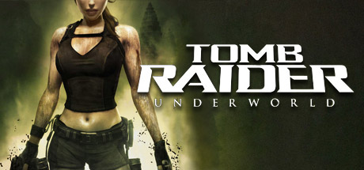

**Platforms:** Nintendo DS, PlayStation 2, PlayStation 3, Wii, Windows, Xbox 360 &nbsp;|&nbsp; **Genre:** Action, Adventure &nbsp;|&nbsp; **Released:** November 18

> Tomb Raider: Underworld represents a new advancement in exploration-based gameplay. As fearless adventurer Lara Croft explore exotic locations around the world, each designed with an incredible attention to detail resulting in breathtaking high-definition visual fidelity that creates a truly believable world and delivers a new level of...
>
> _Synopsis source: Steam_

[Steam](https://store.steampowered.com/app/8140)

---

### Top Spin 3

**Platforms:** PlayStation 3, Wii, Xbox 360, Nintendo DS &nbsp;|&nbsp; **Released:** June 20

[Wikipedia](https://en.wikipedia.org/wiki/Top_Spin_3)

---

### Ultimate Band

**Platforms:** Nintendo DS, Wii &nbsp;|&nbsp; **Released:** November 18

[Wikipedia](https://en.wikipedia.org/wiki/Ultimate_Band)

---

### Wacky Races: Crash and Dash

**Platforms:** Nintendo DS, Wii &nbsp;|&nbsp; **Released:** June 17

---

### WALL-E

**Platforms:** Nintendo DS, PlayStation 2, PlayStation 3, PlayStation Portable, Wii, Windows, Xbox 360 &nbsp;|&nbsp; **Released:** June 24

[Wikipedia](https://en.wikipedia.org/wiki/WALL-E_(video_game))

---

### Wario Land: The Shake Dimension

**Platforms:** Wii &nbsp;|&nbsp; **Released:** July 24

---

### We Love Golf!

**Platforms:** Wii &nbsp;|&nbsp; **Released:** July 15

[Wikipedia](https://en.wikipedia.org/wiki/We_Love_Golf!)

---

### We Ski

**Platforms:** Wii &nbsp;|&nbsp; **Released:** January 31

[Wikipedia](https://en.wikipedia.org/wiki/We_Ski)

---

### Wii Fit (NA)

**Platforms:** Wii &nbsp;|&nbsp; **Released:** May 21

[Wikipedia](https://en.wikipedia.org/wiki/Wii_Fit)

---

### Wii Music

**Platforms:** Wii &nbsp;|&nbsp; **Released:** October 16

[Wikipedia](https://en.wikipedia.org/wiki/Wii_Music)

---

### Wild West Guns

**Platforms:** Wii &nbsp;|&nbsp; **Released:** August 4

[Wikipedia](https://en.wikipedia.org/wiki/Wild_West_Guns)

---

### Winter Sports 2: The Next Challenge

**Platforms:** Nintendo DS, PlayStation 2, Wii, Xbox 360 &nbsp;|&nbsp; **Released:** November 25

---

### World of Goo

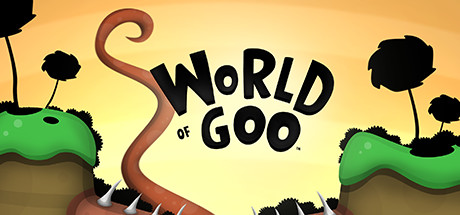

**Platforms:** Wii, Windows &nbsp;|&nbsp; **Publisher:** 2D Boy &nbsp;|&nbsp; **Genre:** Indie &nbsp;|&nbsp; **Released:** October 13, 2008

> World of Goo is a multiple award winning physics based puzzle / construction game made entirely by two guys.
>
> _Synopsis source: Steam_

[Wikipedia](https://en.wikipedia.org/wiki/World_of_Goo) · [Steam](https://store.steampowered.com/app/22000)

---

### Worms: A Space Oddity

**Platforms:** Wii &nbsp;|&nbsp; **Released:** March 10

---

### WWE SmackDown vs. Raw 2009

**Platforms:** Mobile phone, Nintendo DS, PlayStation 2, PlayStation 3, PlayStation Portable, Wii, Xbox 360 &nbsp;|&nbsp; **Released:** November 11

[Wikipedia](https://en.wikipedia.org/wiki/WWE_SmackDown_vs._Raw_2009)

---

### Ōkami

**Platforms:** Wii &nbsp;|&nbsp; **Publisher:** Capcom &nbsp;|&nbsp; **Released:** April 15, 2008

[Wikipedia](https://en.wikipedia.org/wiki/%C5%8Ckami)

---

## 2007

[Full 2007 page](../years/2007.md)

### Alien Syndrome

**Platforms:** PlayStation Portable, Wii &nbsp;|&nbsp; **Released:** July 24

[Wikipedia](https://en.wikipedia.org/wiki/Alien_Syndrome_(2007))

---

### Alvin and the Chipmunks

**Platforms:** Nintendo DS, PlayStation 2, Wii, Windows &nbsp;|&nbsp; **Released:** December 4

[Wikipedia](https://en.wikipedia.org/wiki/Alvin_and_the_Chipmunks_(video_game))

---

### Anubis II

**Platforms:** Wii &nbsp;|&nbsp; **Released:** September 25

[Wikipedia](https://en.wikipedia.org/wiki/Anubis_II)

---

### Avatar: The Last Airbender – The Burning Earth

**Platforms:** PlayStation 2, Wii, Game Boy Advance, Nintendo DS, Xbox 360 &nbsp;|&nbsp; **Released:** October 17

---

### Balls of Fury

**Platforms:** Nintendo DS, Wii &nbsp;|&nbsp; **Released:** September 9

[Wikipedia](https://en.wikipedia.org/wiki/Balls_of_Fury)

---

### Battalion Wars 2

**Platforms:** Wii &nbsp;|&nbsp; **Released:** October 29

[Wikipedia](https://en.wikipedia.org/wiki/Battalion_Wars_2)

---

### Bee Movie Game

**Platforms:** Windows, PlayStation 2, Xbox 360, Nintendo DS, Wii &nbsp;|&nbsp; **Released:** October 30

[Wikipedia](https://en.wikipedia.org/wiki/Bee_Movie_Game)

---

### Ben 10: Protector of Earth

**Platforms:** PlayStation 2, Wii, Nintendo DS, PlayStation Portable &nbsp;|&nbsp; **Released:** October 30

---

### Big Brain Academy: Wii Degree

**Platforms:** Wii &nbsp;|&nbsp; **Released:** June 11

---

### Billy the Wizard: Rocket Broomstick Racing

**Platforms:** Wii &nbsp;|&nbsp; **Released:** August 14

---

### Bionicle Heroes

**Platforms:** Wii &nbsp;|&nbsp; **Released:** April 24

[Wikipedia](https://en.wikipedia.org/wiki/Bionicle_Heroes)

---

### Blazing Angels: Squadrons of WWII

**Platforms:** Wii &nbsp;|&nbsp; **Released:** March 20

---

### Bleach: Shattered Blade

**Platforms:** Wii &nbsp;|&nbsp; **Released:** October 9

---

### Brunswick Pro Bowling

**Platforms:** PlayStation 2, PlayStation Portable, Wii &nbsp;|&nbsp; **Released:** August 28

[Wikipedia](https://en.wikipedia.org/wiki/Brunswick_Pro_Bowling)

---

### Bust-A-Move Bash!

**Platforms:** Wii &nbsp;|&nbsp; **Released:** April 17

[Wikipedia](https://en.wikipedia.org/wiki/Bust-A-Move_Bash!)

---

### Carnival Games

**Platforms:** Nintendo DS, Wii &nbsp;|&nbsp; **Released:** August 27

[Wikipedia](https://en.wikipedia.org/wiki/Carnival_Games)

---

### Cars Mater-National Championship

**Platforms:** Windows, PlayStation 2, Xbox 360, PlayStation 3, Nintendo DS, Wii, Game Boy Advance &nbsp;|&nbsp; **Released:** October 29

[Wikipedia](https://en.wikipedia.org/wiki/Cars_Mater-National_Championship)

---

### Code Lyoko: Quest for Infinity

**Platforms:** Wii &nbsp;|&nbsp; **Released:** November 16

---

### Cooking Mama: Cook Off

**Platforms:** Wii &nbsp;|&nbsp; **Released:** March 20

---

### Cruis'n

**Platforms:** Wii &nbsp;|&nbsp; **Released:** November 27

[Wikipedia](https://en.wikipedia.org/wiki/Cruis%27n_(video_game))

---

### CSI: Hard Evidence

**Platforms:** Wii &nbsp;|&nbsp; **Released:** September 25

---

### Dance Dance Revolution Hottest Party

**Platforms:** Xbox 360, PlayStation 3, Wii &nbsp;|&nbsp; **Released:** September 25

[Wikipedia](https://en.wikipedia.org/wiki/Dance_Dance_Revolution_Hottest_Party)

---

### Dave Mirra BMX Challenge

**Platforms:** Wii &nbsp;|&nbsp; **Released:** September 25

[Wikipedia](https://en.wikipedia.org/wiki/Dave_Mirra_BMX_Challenge)

---

### Dewy's Adventure

**Platforms:** Wii &nbsp;|&nbsp; **Released:** September 18

[Wikipedia](https://en.wikipedia.org/wiki/Dewy%27s_Adventure)

---

### Disney's Kim Possible: Global Gemini

**Platforms:** Nintendo DS, PlayStation 2, PlayStation 3, Wii, Xbox 360 &nbsp;|&nbsp; **Released:** February 13

[Wikipedia](https://en.wikipedia.org/wiki/Kim_Possible_(video_game_series))

---

### Disney's Meet the Robinsons

**Platforms:** Windows, PlayStation 2, Game Boy Advance, Nintendo DS, Wii, Xbox 360, GameCube &nbsp;|&nbsp; **Released:** March 27

[Wikipedia](https://en.wikipedia.org/wiki/Meet_the_Robinsons_(video_game))

---

### Donkey Kong Barrel Blast

**Platforms:** Wii &nbsp;|&nbsp; **Released:** October 8

[Wikipedia](https://en.wikipedia.org/wiki/Donkey_Kong_Barrel_Blast)

---

### Dragon Ball Z: Budokai Tenkaichi 3

**Platforms:** Wii &nbsp;|&nbsp; **Released:** December 3

---

### Dragon Blade: Wrath of Fire

**Platforms:** Wii &nbsp;|&nbsp; **Released:** September 25

---

### Drake & Josh: Talent Showdown

**Platforms:** Nintendo DS, PlayStation 2, PlayStation 3, Wii, Xbox 360 &nbsp;|&nbsp; **Released:** July 30

---

### Escape from Bug Island

**Platforms:** Wii &nbsp;|&nbsp; **Released:** July 25

[Wikipedia](https://en.wikipedia.org/wiki/Escape_from_Bug_Island)

---

### FIFA 08

**Platforms:** PlayStation Portable, Windows, PlayStation 2, Xbox 360, PlayStation 3, Wii, Nintendo DS &nbsp;|&nbsp; **Released:** October 8

[Wikipedia](https://en.wikipedia.org/wiki/FIFA_08)

---

### Fire Emblem: Radiant Dawn

**Platforms:** Wii &nbsp;|&nbsp; **Released:** November 5

---

### Foster's Home for Imaginary Friends: Imagination Invaders

**Platforms:** Nintendo DS, PlayStation 2, Wii &nbsp;|&nbsp; **Released:** November 12

[Wikipedia](https://en.wikipedia.org/wiki/Foster%27s_Home_for_Imaginary_Friends)

---

### Geometry Wars: Galaxies

**Platforms:** Nintendo DS, Wii &nbsp;|&nbsp; **Released:** November 23

---

### Ghost Squad

**Platforms:** Wii &nbsp;|&nbsp; **Released:** November 20

[Wikipedia](https://en.wikipedia.org/wiki/Ghost_Squad_(video_game))

---

### Godzilla: Unleashed

**Platforms:** PlayStation 2, Wii &nbsp;|&nbsp; **Released:** November 20

---

### Guilty Gear XX: Accent Core

**Platforms:** PlayStation 2, Wii &nbsp;|&nbsp; **Released:** September 11

[Wikipedia](https://en.wikipedia.org/wiki/Guilty_Gear_X2_updated_versions#Guilty_Gear_XX_Accent_Core)

---

### Guitar Hero III: Legends of Rock

**Platforms:** PlayStation 2, Xbox 360, PlayStation 3, Wii, Windows, macOS &nbsp;|&nbsp; **Released:** October 28

---

### Hannah Montana: Spotlight World Tour

**Platforms:** Wii &nbsp;|&nbsp; **Released:** November 6

[Wikipedia](https://en.wikipedia.org/wiki/Hannah_Montana_video_games#2007_games)

---

### Harry Potter and the Order of the Phoenix

**Platforms:** Windows, PlayStation 2, PlayStation 3, Xbox 360, PlayStation Portable, Nintendo DS, Wii, Game Boy Advance, macOS &nbsp;|&nbsp; **Released:** June 25

[Wikipedia](https://en.wikipedia.org/wiki/Harry_Potter_and_the_Order_of_the_Phoenix_(video_game))

---

### Heatseeker

**Platforms:** PlayStation 2, Wii, PlayStation Portable &nbsp;|&nbsp; **Released:** May 1

[Wikipedia](https://en.wikipedia.org/wiki/Heatseeker_(video_game))

---

### Hooked! Real Motion Fishing

**Platforms:** Wii &nbsp;|&nbsp; **Released:** October 30

[Wikipedia](https://en.wikipedia.org/wiki/Hooked!_Real_Motion_Fishing)

---

### Hot Wheels: Beat That!

**Platforms:** PlayStation 2, Xbox 360, Wii, Nintendo DS, Windows &nbsp;|&nbsp; **Released:** September 25

---

### Indianapolis 500 Legends

**Platforms:** Nintendo DS, Wii &nbsp;|&nbsp; **Released:** December 18

[Wikipedia](https://en.wikipedia.org/wiki/Indianapolis_500_Legends)

---

### Jenga World Tour

**Platforms:** Nintendo DS, Wii &nbsp;|&nbsp; **Released:** November 13

[Wikipedia](https://en.wikipedia.org/wiki/Jenga_World_Tour)

---

### Kororinpa: Marble Mania

**Platforms:** Wii &nbsp;|&nbsp; **Released:** March 20

[Wikipedia](https://en.wikipedia.org/wiki/Kororinpa)

---

### Legend of the Dragon

**Platforms:** PlayStation 2, Wii, PlayStation Portable &nbsp;|&nbsp; **Released:** May 1

[Wikipedia](https://en.wikipedia.org/wiki/Legend_of_the_Dragon_(video_game))

---

### Lego Star Wars: The Complete Saga (EU)

**Platforms:** Wii, Nintendo DS &nbsp;|&nbsp; **Released:** November 16

---

### Lego Star Wars: The Complete Saga (NA)

**Platforms:** Xbox 360, PlayStation 3, Wii, Nintendo DS &nbsp;|&nbsp; **Released:** November 6

---

### Link's Crossbow Training

**Platforms:** Wii &nbsp;|&nbsp; **Released:** November 19

[Wikipedia](https://en.wikipedia.org/wiki/Link%27s_Crossbow_Training)

---

### Looney Tunes: Acme Arsenal

**Platforms:** PlayStation 2, Wii, Xbox 360 &nbsp;|&nbsp; **Released:** October 9

---

### Madden NFL 08

**Platforms:** GameCube, Nintendo DS, PlayStation 2, PlayStation 3, PlayStation Portable, Wii, Xbox, Xbox 360, Windows &nbsp;|&nbsp; **Released:** August 14

[Wikipedia](https://en.wikipedia.org/wiki/Madden_NFL_08)

---

### Manhunt 2

**Platforms:** PlayStation 2, PlayStation Portable, Wii &nbsp;|&nbsp; **Released:** October 30

[Wikipedia](https://en.wikipedia.org/wiki/Manhunt_2)

---

### Mario & Sonic at the Olympic Games

**Platforms:** Wii &nbsp;|&nbsp; **Released:** November 6

[Wikipedia](https://en.wikipedia.org/wiki/Mario_%26_Sonic_at_the_Olympic_Games)

---

### Mario Party 8

**Platforms:** Wii &nbsp;|&nbsp; **Released:** May 29

[Wikipedia](https://en.wikipedia.org/wiki/Mario_Party_8)

---

### Mario Strikers Charged

**Platforms:** Wii &nbsp;|&nbsp; **Released:** July 30

[Wikipedia](https://en.wikipedia.org/wiki/Mario_Strikers_Charged)

---

### Medal of Honor: Heroes 2

**Platforms:** Wii &nbsp;|&nbsp; **Released:** November 13

---

### Medal of Honor: Vanguard

**Platforms:** PlayStation 2, Wii &nbsp;|&nbsp; **Released:** March 26

---

### Mercury Meltdown Revolution

**Platforms:** Wii &nbsp;|&nbsp; **Released:** October 16

[Wikipedia](https://en.wikipedia.org/wiki/Mercury_Meltdown_Revolution)

---

### Metroid Prime 3: Corruption

**Platforms:** Wii &nbsp;|&nbsp; **Publisher:** Nintendo &nbsp;|&nbsp; **Released:** August 27, 2007

---

### Mortal Kombat: Armageddon

**Platforms:** Wii &nbsp;|&nbsp; **Released:** May 29

---

### MySims

**Platforms:** Nintendo DS, Wii &nbsp;|&nbsp; **Released:** September 18

[Wikipedia](https://en.wikipedia.org/wiki/MySims)

---

### Naruto: Clash of Ninja Revolution

**Platforms:** Wii &nbsp;|&nbsp; **Released:** October 23

---

### NASCAR 08

**Platforms:** GameCube, PlayStation 2, PlayStation 3, PlayStation Portable, Wii, Xbox 360 &nbsp;|&nbsp; **Released:** July 23

[Wikipedia](https://en.wikipedia.org/wiki/NASCAR_08)

---

### NBA Live 08

**Platforms:** PlayStation 2, Xbox 360, Wii, Nintendo DS, PlayStation Portable, Windows &nbsp;|&nbsp; **Released:** October 2

[Wikipedia](https://en.wikipedia.org/wiki/NBA_Live_08)

---

### Need for Speed: ProStreet

**Platforms:** Wii, Nintendo DS, PlayStation 2, PlayStation 3, PlayStation Portable, Xbox 360, Xbox, Windows &nbsp;|&nbsp; **Released:** November 14

---

### NHL 08

**Platforms:** PlayStation 2, PlayStation 3, Xbox 360, Windows, Wii &nbsp;|&nbsp; **Released:** September 11

[Wikipedia](https://en.wikipedia.org/wiki/NHL_08)

---

### Nicktoons: Attack of the Toybots

**Platforms:** PlayStation 2, Wii, Game Boy Advance, Nintendo DS &nbsp;|&nbsp; **Released:** October 23

---

### Nights: Journey of Dreams

**Platforms:** Wii &nbsp;|&nbsp; **Released:** December 18

---

### Ninjabread Man

**Platforms:** Wii &nbsp;|&nbsp; **Released:** October 3

[Wikipedia](https://en.wikipedia.org/wiki/Ninjabread_Man)

---

### Pac 'n Roll

**Platforms:** Wii &nbsp;|&nbsp; **Released:** October 23

[Wikipedia](https://en.wikipedia.org/wiki/Pac_%27n_Roll)

---

### Pirates of the Caribbean: At World's End

**Platforms:** GameCube, Nintendo DS, PlayStation 2, PlayStation 3, PlayStation Portable, Wii, Windows, Xbox 360 &nbsp;|&nbsp; **Released:** May 22

---

### Pokémon Battle Revolution

**Platforms:** Wii &nbsp;|&nbsp; **Released:** June 25

[Wikipedia](https://en.wikipedia.org/wiki/Pok%C3%A9mon_Battle_Revolution)

---

### Prince of Persia: Rival Swords

**Platforms:** PlayStation Portable, Wii &nbsp;|&nbsp; **Released:** April 3

---

### Purr Pals

**Platforms:** Nintendo DS, Wii &nbsp;|&nbsp; **Released:** March 27

[Wikipedia](https://en.wikipedia.org/wiki/Purr_Pals)

---

### Puzzle Quest: Challenge of the Warlords

**Platforms:** Xbox 360, Nintendo DS, PlayStation Portable, Wii &nbsp;|&nbsp; **Publisher:** D3 Publisher &nbsp;|&nbsp; **Released:** October 10, 2007

---

### Ratatouille

**Platforms:** Wii, Xbox 360, PlayStation 2, Xbox, Nintendo DS, GameCube, Game Boy Advance, PlayStation Portable, Windows, macOS, PlayStation 3 &nbsp;|&nbsp; **Released:** June 26

[Wikipedia](https://en.wikipedia.org/wiki/Ratatouille_(video_game))

---

### Rayman Raving Rabbids 2

**Platforms:** Wii, Nintendo DS &nbsp;|&nbsp; **Released:** November 13

[Wikipedia](https://en.wikipedia.org/wiki/Rayman_Raving_Rabbids_2)

---

### Resident Evil 4: Wii Edition

**Platforms:** Wii &nbsp;|&nbsp; **Publisher:** Capcom &nbsp;|&nbsp; **Released:** May 31, 2007

[Wikipedia](https://en.wikipedia.org/wiki/Resident_Evil_4#Ports)

---

### Resident Evil: The Umbrella Chronicles

**Platforms:** Wii &nbsp;|&nbsp; **Released:** November 13

---

### Rockstar Games Presents Table Tennis

**Platforms:** Wii &nbsp;|&nbsp; **Released:** October 16

[Wikipedia](https://en.wikipedia.org/wiki/Rockstar_Games_Presents_Table_Tennis)

---

### Scarface: The World Is Yours

**Platforms:** Wii &nbsp;|&nbsp; **Released:** June 12

---

### Sea Monsters: A Prehistoric Adventure

**Platforms:** PlayStation 2, Wii, Nintendo DS &nbsp;|&nbsp; **Released:** October 25

---

### Smarty Pants

**Platforms:** Wii &nbsp;|&nbsp; **Released:** November 13

[Wikipedia](https://en.wikipedia.org/wiki/Smarty_Pants)

---

### Sonic and the Secret Rings

**Platforms:** Wii &nbsp;|&nbsp; **Released:** February 20

[Wikipedia](https://en.wikipedia.org/wiki/Sonic_and_the_Secret_Rings)

---

### Soulcalibur Legends

**Platforms:** Wii &nbsp;|&nbsp; **Released:** November 20

[Wikipedia](https://en.wikipedia.org/wiki/Soulcalibur_Legends)

---

### Spider-Man 3

**Platforms:** Game Boy Advance, Nintendo DS, PlayStation 2, Wii, Xbox 360, Windows, PlayStation Portable &nbsp;|&nbsp; **Released:** May 4

[Wikipedia](https://en.wikipedia.org/wiki/Spider-Man_3_(video_game))

---

### Spider-Man: Friend or Foe

**Platforms:** Windows, PlayStation 2, Xbox 360, Wii, Nintendo DS, PlayStation Portable &nbsp;|&nbsp; **Released:** October 2

---

### SpongeBob's Atlantis SquarePantis

**Platforms:** PlayStation 2, Game Boy Advance, Nintendo DS, Wii &nbsp;|&nbsp; **Released:** October 23

[Wikipedia](https://en.wikipedia.org/wiki/SpongeBob%27s_Atlantis_SquarePantis_(video_game))

---

### SSX Blur

**Platforms:** Wii &nbsp;|&nbsp; **Released:** February 27

[Wikipedia](https://en.wikipedia.org/wiki/SSX_Blur)

---

### Star Trek: Conquest

**Platforms:** PlayStation 2, Wii &nbsp;|&nbsp; **Released:** November 20

---

### Super Mario Galaxy

**Platforms:** Wii &nbsp;|&nbsp; **Publisher:** Nintendo &nbsp;|&nbsp; **Released:** November 1, 2007

[Wikipedia](https://en.wikipedia.org/wiki/Super_Mario_Galaxy)

---

### Super Paper Mario

**Platforms:** Wii &nbsp;|&nbsp; **Released:** April 9

[Wikipedia](https://en.wikipedia.org/wiki/Super_Paper_Mario)

---

### Super Swing Golf: Season 2

**Platforms:** Wii &nbsp;|&nbsp; **Released:** December 11

---

### Surf's Up

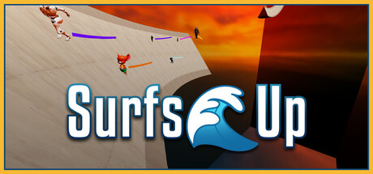

**Platforms:** Game Boy Advance, Nintendo DS, PlayStation 2, PlayStation 3, PlayStation Portable, Wii, Xbox 360, GameCube, Windows &nbsp;|&nbsp; **Genre:** Action, Casual, Indie, Racing, Sports, Free To Play &nbsp;|&nbsp; **Released:** May 30

> SurfsUp is a free-to-play, standalone recreation of Counter-Strike Surf where precision movement and air-surfing are the keys to setting a new personal best or even breaking a world record. Surf, bhop, and climb across 125+ maps, all for free, with unique leaderboards for every way to play.
>
> _Synopsis source: Steam_

[Wikipedia](https://en.wikipedia.org/wiki/Surf%27s_Up_(video_game)) · [Steam](https://store.steampowered.com/app/3454830)

---

### The Godfather

**Platforms:** PlayStation 3, Wii &nbsp;|&nbsp; **Released:** March 20

[Wikipedia](https://en.wikipedia.org/wiki/The_Godfather_(2006_video_game))

---

### The Golden Compass

**Platforms:** Nintendo DS, PlayStation 2, PlayStation 3, Wii, Xbox 360 &nbsp;|&nbsp; **Released:** December 4

[Wikipedia](https://en.wikipedia.org/wiki/The_Golden_Compass_(video_game))

---

### The Legend of Spyro: The Eternal Night

**Platforms:** PlayStation 2, Game Boy Advance, Nintendo DS, Wii &nbsp;|&nbsp; **Released:** October 2

---

### The Simpsons Game

**Platforms:** PlayStation 2, Xbox 360, PlayStation 3, Wii, Nintendo DS, PlayStation Portable &nbsp;|&nbsp; **Released:** October 30

[Wikipedia](https://en.wikipedia.org/wiki/The_Simpsons_Game)

---

### The Sims 2: Castaway

**Platforms:** PlayStation 2, Wii, Nintendo DS, PlayStation Portable &nbsp;|&nbsp; **Released:** October 22

---

### Thrillville: Off The Rails

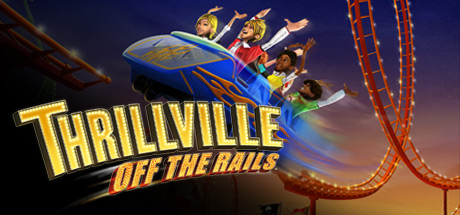

**Platforms:** Windows, PlayStation 2, Xbox 360, PlayStation 3, Wii, Nintendo DS &nbsp;|&nbsp; **Genre:** Action, Adventure, Racing, Simulation, Strategy &nbsp;|&nbsp; **Released:** October 9

> Thrillville™: Off the Rails lives up to its name with 20 death-defying rides! Players can build incredible coasters to leap from one track to another, launch through the air like cannonballs, blast through a burning rings of fire and more!
>
> _Synopsis source: Steam_

[Steam](https://store.steampowered.com/app/6080)

---

### TMNT

**Platforms:** GameCube, Nintendo DS, PlayStation 2, Wii, Xbox 360, PlayStation Portable, Windows &nbsp;|&nbsp; **Released:** March 20

[Wikipedia](https://en.wikipedia.org/wiki/TMNT_(video_game))

---

### Tomb Raider: Anniversary

**Platforms:** PlayStation 2, Windows, PlayStation Portable, Xbox 360, Wii, Mobile phone &nbsp;|&nbsp; **Genre:** Action, Adventure &nbsp;|&nbsp; **Released:** June 5

> Tomb Raider: Anniversary retraces Lara Croft's original genre-defining adventure — globe-trotting 3rd person action-adventure in pursuit of the legendary Scion artifact. Using an enhanced 'Tomb Raider: Legend' game engine, the graphics, technology and physics bring Lara's adventure and pursuit of a mystical artifact known only as the...
>
> _Synopsis source: Steam_

[Steam](https://store.steampowered.com/app/8000)

---

### Tony Hawk's Proving Ground

**Platforms:** PlayStation 2, Xbox 360, PlayStation 3, Wii, Nintendo DS &nbsp;|&nbsp; **Released:** October 16

[Wikipedia](https://en.wikipedia.org/wiki/Tony_Hawk%27s_Proving_Ground)

---

### Transformers: The Game

**Platforms:** PlayStation 2, PlayStation 3, Wii, Xbox 360, Windows &nbsp;|&nbsp; **Released:** June 26

---

### Trauma Center: New Blood

**Platforms:** Wii &nbsp;|&nbsp; **Released:** November 20

---

### UEFA Champions League 2006–2007

**Platforms:** PlayStation 2, GameCube, Nintendo DS, PlayStation Portable, Wii, Xbox 360 &nbsp;|&nbsp; **Released:** March 20

[Wikipedia](https://en.wikipedia.org/wiki/UEFA_Champions_League_2006%E2%80%932007_(video_game))

---

### Ultimate Duck Hunting

**Platforms:** Wii &nbsp;|&nbsp; **Released:** December 3

[Wikipedia](https://en.wikipedia.org/wiki/Ultimate_Duck_Hunting)

---

### Victorious Boxers: Revolution

**Platforms:** Wii &nbsp;|&nbsp; **Released:** October 16

---

### WarioWare: Smooth Moves

**Platforms:** Wii &nbsp;|&nbsp; **Released:** January 15

---

### Wii Play

**Platforms:** Wii &nbsp;|&nbsp; **Released:** February 12

[Wikipedia](https://en.wikipedia.org/wiki/Wii_Play)

---

### Wing Island

**Platforms:** Wii &nbsp;|&nbsp; **Released:** March 23

[Wikipedia](https://en.wikipedia.org/wiki/Wing_Island)

---

### Winter Sports: The Ultimate Challenge

**Platforms:** PlayStation 2, Wii, Windows &nbsp;|&nbsp; **Released:** December 11

---

### WWE SmackDown vs. Raw 2008

**Platforms:** Nintendo DS, Game Boy Advance, GameCube, PlayStation 2, PlayStation 3, PlayStation Portable, Wii, Xbox, Xbox 360 &nbsp;|&nbsp; **Released:** November 13

[Wikipedia](https://en.wikipedia.org/wiki/WWE_SmackDown_vs._Raw_2008)

---

### Zack & Wiki: Quest for Barbaros' Treasure

**Platforms:** Wii &nbsp;|&nbsp; **Released:** October 16

---

### Zoey 101: Field Trip Fiasco

**Platforms:** Nintendo DS, PlayStation 2, PlayStation 3, Wii, Xbox 360 &nbsp;|&nbsp; **Released:** September 11

[Wikipedia](https://en.wikipedia.org/wiki/Zoey_101)

---

## 2006

[Full 2006 page](../years/2006.md)

### Alien Crush

**Platforms:** Wii &nbsp;|&nbsp; **Released:** December 11

[Wikipedia](https://en.wikipedia.org/wiki/Alien_Crush)

---

### Altered Beast (Genesis)

**Platforms:** Wii &nbsp;|&nbsp; **Released:** November 19

[Wikipedia](https://en.wikipedia.org/wiki/Altered_Beast)

---

### Avatar: The Last Airbender

**Platforms:** Wii &nbsp;|&nbsp; **Released:** November 19

---

### Barnyard

**Platforms:** Wii &nbsp;|&nbsp; **Released:** November 19

---

### Bomberman '93

**Platforms:** Wii &nbsp;|&nbsp; **Released:** November 21

[Wikipedia](https://en.wikipedia.org/wiki/Bomberman_%2793)

---

### Bonk's Adventure (TurboGrafx-16)

**Platforms:** Wii &nbsp;|&nbsp; **Released:** November 21

[Wikipedia](https://en.wikipedia.org/wiki/Bonk%27s_Adventure)

---

### Call of Duty 3 (USA)

**Platforms:** PlayStation 2, Xbox, Xbox 360, Wii &nbsp;|&nbsp; **Released:** November 7

[Wikipedia](https://en.wikipedia.org/wiki/Call_of_Duty_3)

---

### Cars (AU)

**Platforms:** Windows, PlayStation 2, Xbox, GameCube, Game Boy Advance, Nintendo DS, PlayStation Portable, Xbox 360, Wii &nbsp;|&nbsp; **Released:** June 8

---

### Cars (EU)

**Platforms:** Windows, PlayStation 2, Xbox, GameCube, Game Boy Advance, Nintendo DS, PlayStation Portable, Xbox 360, Wii &nbsp;|&nbsp; **Released:** July 14

---

### Cars (USA)

**Platforms:** Windows, PlayStation 2, Xbox, GameCube, Game Boy Advance, Nintendo DS, PlayStation Portable, Xbox 360, Wii &nbsp;|&nbsp; **Released:** June 6

[Wikipedia](https://en.wikipedia.org/wiki/Cars_(video_game))

---

### Columns (Genesis)

**Platforms:** Wii &nbsp;|&nbsp; **Released:** December 4

[Wikipedia](https://en.wikipedia.org/wiki/Columns_(video_game))

---

### Disney's Chicken Little: Ace in Action

**Platforms:** PlayStation 2, Nintendo DS, Windows, Wii &nbsp;|&nbsp; **Released:** November 9

---

### Donkey Kong (NES)

**Platforms:** Wii &nbsp;|&nbsp; **Released:** November 19

[Wikipedia](https://en.wikipedia.org/wiki/Donkey_Kong_(1981_video_game))

---

### Donkey Kong Jr. (NES)

**Platforms:** Wii &nbsp;|&nbsp; **Released:** December 4

[Wikipedia](https://en.wikipedia.org/wiki/Donkey_Kong_Jr.)

---

### Dr. Robotnik's Mean Bean Machine (Genesis)

**Platforms:** Wii &nbsp;|&nbsp; **Released:** December 11

[Wikipedia](https://en.wikipedia.org/wiki/Dr._Robotnik%27s_Mean_Bean_Machine)

---

### Ecco the Dolphin (Genesis)

**Platforms:** Wii &nbsp;|&nbsp; **Released:** November 28

[Wikipedia](https://en.wikipedia.org/wiki/Ecco_the_Dolphin_(video_game))

---

### Elebits

**Platforms:** Wii &nbsp;|&nbsp; **Released:** December 12

[Wikipedia](https://en.wikipedia.org/wiki/Elebits)

---

### Excite Truck (USA)

**Platforms:** Wii &nbsp;|&nbsp; **Released:** November 19

[Wikipedia](https://en.wikipedia.org/wiki/Excite_Truck)

---

### F-Zero

**Platforms:** Wii &nbsp;|&nbsp; **Released:** November 19

[Wikipedia](https://en.wikipedia.org/wiki/F-Zero_(video_game))

---

### Golden Axe (Genesis)

**Platforms:** Wii &nbsp;|&nbsp; **Released:** November 28

[Wikipedia](https://en.wikipedia.org/wiki/Golden_Axe_(video_game))

---

### Gunstar Heroes

**Platforms:** Wii &nbsp;|&nbsp; **Released:** December 11

[Wikipedia](https://en.wikipedia.org/wiki/Gunstar_Heroes)

---

### Happy Feet (EU)

**Platforms:** Windows, PlayStation 2, GameCube, Game Boy Advance, Nintendo DS, Wii &nbsp;|&nbsp; **Released:** November 24

---

### Happy Feet (USA)

**Platforms:** Windows, PlayStation 2, GameCube, Game Boy Advance, Nintendo DS, Wii &nbsp;|&nbsp; **Genre:** [ 81 ] &nbsp;|&nbsp; **Released:** November 14

[Wikipedia](https://en.wikipedia.org/wiki/Happy_Feet_(video_game))

---

### Ice Age 2: The Meltdown (EU)

**Platforms:** Windows, PlayStation 2, Xbox, GameCube, Game Boy Advance, Nintendo DS, Wii &nbsp;|&nbsp; **Released:** March 31

---

### Ice Age 2: The Meltdown (USA)

**Platforms:** Windows, PlayStation 2, Xbox, GameCube, Game Boy Advance, Nintendo DS, Wii &nbsp;|&nbsp; **Released:** March 14

---

### Ice Hockey

**Platforms:** Wii &nbsp;|&nbsp; **Released:** December 11

[Wikipedia](https://en.wikipedia.org/wiki/Ice_Hockey_(1988_video_game))

---

### Mario Bros. (NES)

**Platforms:** Wii &nbsp;|&nbsp; **Released:** November 19

[Wikipedia](https://en.wikipedia.org/wiki/Mario_Bros.)

---

### Marvel: Ultimate Alliance (USA)

**Platforms:** Wii &nbsp;|&nbsp; **Released:** November 19

---

### Military Madness

**Platforms:** Wii &nbsp;|&nbsp; **Released:** December 18

[Wikipedia](https://en.wikipedia.org/wiki/Military_Madness)

---

### Open Season (EU)

**Platforms:** Windows, GameCube, PlayStation 2, Xbox, Xbox 360, Game Boy Advance, Nintendo DS, PlayStation Portable, Wii &nbsp;|&nbsp; **Released:** October 6

---

### Open Season (USA)

**Platforms:** Windows, GameCube, PlayStation 2, Xbox, Xbox 360, Game Boy Advance, Nintendo DS, PlayStation Portable, Wii &nbsp;|&nbsp; **Released:** September 18

[Wikipedia](https://en.wikipedia.org/wiki/Open_Season_(video_game))

---

### Pinball

**Platforms:** Wii &nbsp;|&nbsp; **Released:** November 19

[Wikipedia](https://en.wikipedia.org/wiki/Pinball_(1984_video_game))

---

### R-Type (TurboGrafx-16)

**Platforms:** Wii &nbsp;|&nbsp; **Released:** December 25

[Wikipedia](https://en.wikipedia.org/wiki/R-Type)

---

### Rampage: Total Destruction

**Platforms:** PlayStation 2, GameCube, Wii &nbsp;|&nbsp; **Released:** April 24

---

### Rapala Tournament Fishing

**Platforms:** Xbox 360, Wii &nbsp;|&nbsp; **Released:** November 21

[Wikipedia](https://en.wikipedia.org/wiki/Rapala_Tournament_Fishing)

---

### Rayman Raving Rabbids (AU)

**Platforms:** Windows, PlayStation 2, Wii &nbsp;|&nbsp; **Released:** December 7

---

### Rayman Raving Rabbids (EU)

**Platforms:** Windows, PlayStation 2, Wii &nbsp;|&nbsp; **Released:** December 8

---

### Rayman Raving Rabbids (USA)

**Platforms:** Wii, PlayStation 2, Windows &nbsp;|&nbsp; **Released:** November 19

[Wikipedia](https://en.wikipedia.org/wiki/Rayman_Raving_Rabbids)

---

### Red Steel (USA)

**Platforms:** Wii &nbsp;|&nbsp; **Released:** November 19

[Wikipedia](https://en.wikipedia.org/wiki/Red_Steel)

---

### Ristar

**Platforms:** Wii &nbsp;|&nbsp; **Released:** December 4

[Wikipedia](https://en.wikipedia.org/wiki/Ristar)

---

### SimCity (SNES)

**Platforms:** Wii &nbsp;|&nbsp; **Released:** November 19

[Wikipedia](https://en.wikipedia.org/wiki/SimCity_(1989_video_game))

---

### Soccer

**Platforms:** Wii &nbsp;|&nbsp; **Released:** November 19

[Wikipedia](https://en.wikipedia.org/wiki/Soccer_(1985_video_game))

---

### Solomon's Key (NES)

**Platforms:** Wii &nbsp;|&nbsp; **Released:** November 19

[Wikipedia](https://en.wikipedia.org/wiki/Solomon%27s_Key)

---

### Sonic the Hedgehog

**Platforms:** Wii &nbsp;|&nbsp; **Released:** November 19

[Wikipedia](https://en.wikipedia.org/wiki/Sonic_the_Hedgehog_(1991_video_game))

---

### Space Harrier II (Genesis)

**Platforms:** Wii &nbsp;|&nbsp; **Released:** December 18

[Wikipedia](https://en.wikipedia.org/wiki/Space_Harrier_II)

---

### SpongeBob SquarePants: Creature from the Krusty Krab (AU)

**Platforms:** PlayStation 2, GameCube, Game Boy Advance, Nintendo DS, Wii &nbsp;|&nbsp; **Released:** November 2

---

### SpongeBob SquarePants: Creature from the Krusty Krab (EU)

**Platforms:** PlayStation 2, GameCube, Game Boy Advance, Nintendo DS, Wii &nbsp;|&nbsp; **Released:** November 10

---

### SpongeBob SquarePants: Creature from the Krusty Krab (USA)

**Platforms:** PlayStation 2, GameCube, Game Boy Advance, Nintendo DS, Wii &nbsp;|&nbsp; **Released:** October 18

---

### Street Fighter II: The World Warrior (SNES)

**Platforms:** Wii &nbsp;|&nbsp; **Released:** December 25

[Wikipedia](https://en.wikipedia.org/wiki/Street_Fighter_II)

---

### Super Castlevania IV

**Platforms:** Wii &nbsp;|&nbsp; **Released:** December 25

[Wikipedia](https://en.wikipedia.org/wiki/Super_Castlevania_IV)

---

### Super Mario 64

**Platforms:** Wii &nbsp;|&nbsp; **Released:** November 19

[Wikipedia](https://en.wikipedia.org/wiki/Super_Mario_64)

---

### Super Mario Bros.

**Platforms:** Wii &nbsp;|&nbsp; **Released:** December 25

[Wikipedia](https://en.wikipedia.org/wiki/Super_Mario_Bros.)

---

### Super Monkey Ball: Banana Blitz (USA)

**Platforms:** Wii &nbsp;|&nbsp; **Released:** November 19

---

### Super Star Soldier

**Platforms:** Wii &nbsp;|&nbsp; **Released:** November 27

[Wikipedia](https://en.wikipedia.org/wiki/Super_Star_Soldier)

---

### Tennis (NES)

**Platforms:** Wii &nbsp;|&nbsp; **Released:** December 18

[Wikipedia](https://en.wikipedia.org/wiki/Tennis_(1984_video_game))

---

### The Grim Adventures of Billy & Mandy (NA)

**Platforms:** Wii &nbsp;|&nbsp; **Released:** November 17

---

### The Legend of Zelda

**Platforms:** Wii &nbsp;|&nbsp; **Released:** November 19

[Wikipedia](https://en.wikipedia.org/wiki/The_Legend_of_Zelda_(video_game))

---

### The Legend of Zelda: Twilight Princess

**Platforms:** GameCube, Wii &nbsp;|&nbsp; **Publisher:** Nintendo &nbsp;|&nbsp; **Released:** December 2, 2006

---

### The Legend of Zelda: Twilight Princess (USA)

**Platforms:** Wii &nbsp;|&nbsp; **Released:** November 19

---

### ToeJam & Earl

**Platforms:** Wii &nbsp;|&nbsp; **Released:** December 25

[Wikipedia](https://en.wikipedia.org/wiki/ToeJam_%26_Earl)

---

### Tom Clancy's Splinter Cell: Double Agent

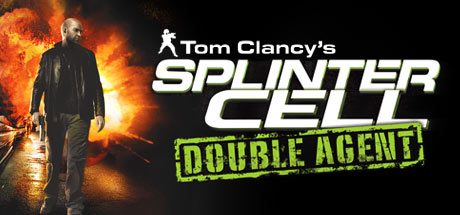

**Platforms:** Xbox, Xbox 360, PlayStation 2, GameCube, Windows, Wii &nbsp;|&nbsp; **Publisher:** Ubisoft &nbsp;|&nbsp; **Genre:** Action &nbsp;|&nbsp; **Released:** October 24, 2006

> In the sequel to the 2005 Game of the Year, Splinter Cell: Double Agent, play as legendary covert operative Sam Fisher, infiltrate a ruthless terrorist organization, and destroy it from within.
>
> _Synopsis source: Steam_

[Steam](https://store.steampowered.com/app/13580)

---

### Trauma Center: Second Opinion (USA)

**Platforms:** Wii &nbsp;|&nbsp; **Released:** November 19

---

### Victory Run

**Platforms:** Wii &nbsp;|&nbsp; **Released:** December 4

[Wikipedia](https://en.wikipedia.org/wiki/Victory_Run)

---

### Wario's Woods (NES)

**Platforms:** Wii &nbsp;|&nbsp; **Released:** November 19

[Wikipedia](https://en.wikipedia.org/wiki/Wario%27s_Woods)

---

### Wii Sports (USA)

**Platforms:** Wii &nbsp;|&nbsp; **Released:** November 19

[Wikipedia](https://en.wikipedia.org/wiki/Wii_Sports)

---
