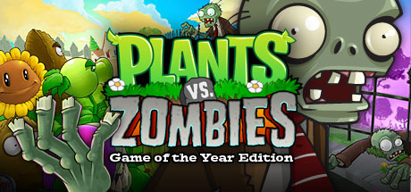

# Windows Phone

[← Back to index](../README.md)

105 titles across 9 years in this archive.

## 2016

[Full 2016 page](../years/2016.md)

### Asphalt Xtreme

**Platforms:** iOS, Android, Windows, Windows Phone &nbsp;|&nbsp; **Developer:** Gameloft Madrid, Gameloft Barcelona &nbsp;|&nbsp; **Publisher:** Gameloft, Netflix &nbsp;|&nbsp; **Genre:** Racing &nbsp;|&nbsp; **Released:** October 27, 2016

[Wikipedia](https://en.wikipedia.org/wiki/Asphalt_Xtreme)

---

### Chameleon Run

**Platforms:** Android, iOS, tvOS, Windows Phone, Nintendo Switch, Windows &nbsp;|&nbsp; **Developer:** Hyperbolic Magnetism &nbsp;|&nbsp; **Publisher:** Noodlecake Studios &nbsp;|&nbsp; **Genre:** Action &nbsp;|&nbsp; **Released:** April 7, 2016

[Wikipedia](https://en.wikipedia.org/wiki/Chameleon_Run)

---

### Ludo King

**Platforms:** iOS, macOS, Android, Windows Phone, Windows &nbsp;|&nbsp; **Developer:** Gametion Technologies Pvt Ltd &nbsp;|&nbsp; **Publisher:** Gametion Technologies Pvt Ltd &nbsp;|&nbsp; **Genre:** Board game &nbsp;|&nbsp; **Released:** February 20, 2016

[Wikipedia](https://en.wikipedia.org/wiki/Ludo_King)

---

### Redcon

**Platforms:** Android, iOS, Windows Phone, Windows, macOS &nbsp;|&nbsp; **Developer:** Hexage &nbsp;|&nbsp; **Genre:** Real-time strategy &nbsp;|&nbsp; **Released:** April 19, 2016

[Wikipedia](https://en.wikipedia.org/wiki/Redcon_(video_game))

---

## 2015

[Full 2015 page](../years/2015.md)

### Dragon Mania Legends

**Platforms:** Windows Phone, Windows, iOS, Android &nbsp;|&nbsp; **Developer:** Gameloft Budapest &nbsp;|&nbsp; **Publisher:** Gameloft &nbsp;|&nbsp; **Genre:** Casual &nbsp;|&nbsp; **Released:** January 8, 2015

[Wikipedia](https://en.wikipedia.org/wiki/Dragon_Mania_Legends)

---

### Dungeon Hunter 5

**Platforms:** Android, iOS, Windows Phone &nbsp;|&nbsp; **Genre:** Action RPG, Hack and slash &nbsp;|&nbsp; **Released:** March 12

[Wikipedia](https://en.wikipedia.org/wiki/Dungeon_Hunter_5)

---

### Halo: Spartan Strike

**Platforms:** Windows, iOS, Windows Phone &nbsp;|&nbsp; **Genre:** Shoot 'em up (twin-stick) &nbsp;|&nbsp; **Released:** April 16

---

### Hitman Go

**Platforms:** Windows, Windows Phone &nbsp;|&nbsp; **Genre:** Puzzle &nbsp;|&nbsp; **Released:** April 27

[Wikipedia](https://en.wikipedia.org/wiki/Hitman_Go)

---

### Lara Croft Go

**Platforms:** iOS, Android, Windows Phone &nbsp;|&nbsp; **Genre:** Puzzle &nbsp;|&nbsp; **Released:** August 27

> Lara Croft GO expands the turn-based puzzle gameplay and takes you on an adventure set in a long-forgotten world. Explore the ruins of an ancient civilization, discover hidden secrets and face deadly challenges as you uncover the myth of the Queen of Venom.  A never-before-seen take on the iconic franchise featuring challenging gameplay, gorgeous visuals and a mesmerizing soundtrack, all at your fingertips.
>
> _Synopsis source: IGDB_

[Wikipedia](https://en.wikipedia.org/wiki/Lara_Croft_Go) · [IGDB](https://www.igdb.com/games/lara-croft-go)

---

### Lara Croft: Relic Run

**Platforms:** iOS, Android, Windows Phone &nbsp;|&nbsp; **Genre:** Action-adventure, Endless runner &nbsp;|&nbsp; **Released:** May 28

---

### Monument Valley

**Platforms:** Windows Phone &nbsp;|&nbsp; **Genre:** Puzzle &nbsp;|&nbsp; **Released:** May 1

[Wikipedia](https://en.wikipedia.org/wiki/Monument_Valley_(video_game))

---

### Order & Chaos 2: Redemption

**Platforms:** Android, iOS, Windows, Windows Phone &nbsp;|&nbsp; **Developer:** Gameloft Beijing &nbsp;|&nbsp; **Publisher:** Gameloft &nbsp;|&nbsp; **Genre:** Massively multiplayer online role-playing &nbsp;|&nbsp; **Released:** September 17, 2015

[Wikipedia](https://en.wikipedia.org/wiki/Order_&_Chaos_2:_Redemption)

---

### Snake Rewind

**Platforms:** iOS, Android, Windows Phone &nbsp;|&nbsp; **Developer:** Rumilus Design &nbsp;|&nbsp; **Publisher:** Rumilus Design &nbsp;|&nbsp; **Genre:** Snake &nbsp;|&nbsp; **Released:** May 14, 2015

[Wikipedia](https://en.wikipedia.org/wiki/Snake_Rewind)

---

### Sniper Fury

**Platforms:** Android, iOS, Windows Phone, Windows &nbsp;|&nbsp; **Developer:** Gameloft &nbsp;|&nbsp; **Publisher:** Gameloft &nbsp;|&nbsp; **Genre:** First-person shooter &nbsp;|&nbsp; **Released:** December 2, 2015

[Wikipedia](https://en.wikipedia.org/wiki/Sniper_Fury)

---

### The Last Door

**Platforms:** Android, iOS, Windows, macOS, Linux, Windows Phone, PlayStation 4, Xbox One &nbsp;|&nbsp; **Developer:** The Game Kitchen &nbsp;|&nbsp; **Publisher:** The Game Kitchen &nbsp;|&nbsp; **Genre:** Graphic adventure

[Wikipedia](https://en.wikipedia.org/wiki/The_Last_Door)

---

### Unkilled

**Platforms:** iOS, Windows Phone, Android &nbsp;|&nbsp; **Developer:** Madfinger Games &nbsp;|&nbsp; **Publisher:** Madfinger Games &nbsp;|&nbsp; **Genre:** FPS, RPG &nbsp;|&nbsp; **Released:** September 3, 2015

[Wikipedia](https://en.wikipedia.org/wiki/Unkilled)

---

### Word Brain

**Platforms:** iOS, Android, Windows Phone &nbsp;|&nbsp; **Developer:** MAG Interactive &nbsp;|&nbsp; **Genre:** Word game &nbsp;|&nbsp; **Released:** July 19, 2015

[Wikipedia](https://en.wikipedia.org/wiki/Word_Brain)

---

## 2014

[Full 2014 page](../years/2014.md)

### Age of Empires: Castle Siege

**Platforms:** Windows, Windows Phone &nbsp;|&nbsp; **Genre:** MMO, Tower defense &nbsp;|&nbsp; **Released:** September 17

---

### Amazing Princess Sarah

**Platforms:** Xbox 360, Windows, Windows Phone &nbsp;|&nbsp; **Developer:** Haruneko &nbsp;|&nbsp; **Publisher:** Haruneko &nbsp;|&nbsp; **Genre:** Platform-adventure, Metroidvania &nbsp;|&nbsp; **Released:** July 9, 2014

[Wikipedia](https://en.wikipedia.org/wiki/Amazing_Princess_Sarah)

---

### Angry Birds Epic

**Platforms:** Android, iOS, Windows Phone &nbsp;|&nbsp; **Developer:** Chimera Entertainment &nbsp;|&nbsp; **Publisher:** Rovio Entertainment &nbsp;|&nbsp; **Genre:** Role-playing &nbsp;|&nbsp; **Released:** March 17, 2014

[Wikipedia](https://en.wikipedia.org/wiki/Angry_Birds_Epic)

---

### Angry Birds Stella

**Platforms:** Windows Phone, iOS, Android &nbsp;|&nbsp; **Genre:** Puzzle &nbsp;|&nbsp; **Released:** September 4

[Wikipedia](https://en.wikipedia.org/wiki/Angry_Birds_Stella)

---

### Angry Birds Transformers

**Platforms:** iOS, Windows Phone, Android &nbsp;|&nbsp; **Genre:** Shoot 'em up &nbsp;|&nbsp; **Released:** October 15

[Wikipedia](https://en.wikipedia.org/wiki/Angry_Birds_Transformers)

---

### Asphalt Overdrive

**Platforms:** iOS, Android, Windows Phone, Windows &nbsp;|&nbsp; **Developer:** Gameloft Madrid &nbsp;|&nbsp; **Publisher:** Gameloft &nbsp;|&nbsp; **Genre:** Endless runner &nbsp;|&nbsp; **Released:** September 24, 2014

[Wikipedia](https://en.wikipedia.org/wiki/Asphalt_Overdrive)

---

### Candy Crush Saga

**Platforms:** Windows Phone &nbsp;|&nbsp; **Genre:** Puzzle &nbsp;|&nbsp; **Released:** December 11

[Wikipedia](https://en.wikipedia.org/wiki/Candy_Crush_Saga)

---

### Family Guy: The Quest for Stuff

**Platforms:** Android, Fire OS, iOS, Windows Phone, Windows, Browser &nbsp;|&nbsp; **Developer:** TinyCo &nbsp;|&nbsp; **Publisher:** Jam City &nbsp;|&nbsp; **Genre:** City-building game &nbsp;|&nbsp; **Released:** April 10, 2014

[Wikipedia](https://en.wikipedia.org/wiki/Family_Guy:_The_Quest_for_Stuff)

---

### Farmville 2: Country Escape

**Platforms:** iOS, Android, Fire OS, Windows Phone, Windows &nbsp;|&nbsp; **Developer:** Zynga &nbsp;|&nbsp; **Publisher:** Zynga &nbsp;|&nbsp; **Genre:** Agriculture simulation, strategy &nbsp;|&nbsp; **Released:** April 10, 2014

[Wikipedia](https://en.wikipedia.org/wiki/Farmville_2:_Country_Escape)

---

### Five Nights at Freddy's

**Platforms:** Windows, Android, iOS, Windows Phone &nbsp;|&nbsp; **Genre:** Survival horror, PCA &nbsp;|&nbsp; **Released:** August 8

> Welcome to your new summer job at Freddy Fazbear's Pizza, where kids and parents alike come for entertainment and food as far as the eye can see! The main attraction is Freddy Fazbear, of course; and his two friends. They are animatronic robots, programmed to please the crowds! The robots' behavior has become somewhat unpredictable at night however, and it was much cheaper to hire you as a security guard than to find a repairman.  From your small office you must watch the security cameras carefully. You have a very limited amount of electricity that you're allowed to use per night (corporate budget cuts, you know). That means when you run out of power for the night- no more security doors and no more lights! If something isn't right- namely if Freddybear or his friends aren't in their proper places, you must find them on the monitors and protect yourself if needed!  Can you survive five nights at Freddy's?
>
> _Synopsis source: IGDB_

[Wikipedia](https://en.wikipedia.org/wiki/Five_Nights_at_Freddy%27s_(video_game)) · [IGDB](https://www.igdb.com/games/five-nights-at-freddys)

---

### Five Nights at Freddy's 2

**Platforms:** Windows, Android, iOS, Windows Phone &nbsp;|&nbsp; **Genre:** Survival horror &nbsp;|&nbsp; **Released:** November 11

> Welcome back to the new and improved Freddy Fazbear's Pizza!  In Five Nights at Freddy's 2, the old and aging animatronics are joined by a new cast of characters. They are kid-friendly, updated with the latest in facial recognition technology, tied into local criminal databases, and promise to put on a safe and entertaining show for kids and grown-ups alike!  What could go wrong?  As the new security guard working nights, your job is to monitor cameras and make sure nothing goes wrong after-hours. The previous guard has complained about the characters trying to get into the office (he has since been moved to day-shift). So to make your job easier, you've been provided with your very own empty Freddy Fazbear head, which should fool the animatronic characters into leaving you alone if they should accidentally enter your office.  As always, Fazbear Entertainment is not responsible for death or dismemberment.
>
> _Synopsis source: IGDB_

[Wikipedia](https://en.wikipedia.org/wiki/Five_Nights_at_Freddy%27s_2) · [IGDB](https://www.igdb.com/games/five-nights-at-freddys-2)

---

### Grand Theft Auto: San Andreas Mobile

**Platforms:** Windows Phone &nbsp;|&nbsp; **Genre:** Action-adventure &nbsp;|&nbsp; **Released:** January 27

---

### Lyne

**Platforms:** iOS, Linux, macOS, Windows, Windows Phone, Android &nbsp;|&nbsp; **Developer:** Thomas Bowker &nbsp;|&nbsp; **Publisher:** Thomas Bowker &nbsp;|&nbsp; **Genre:** Music, Puzzle, Indie &nbsp;|&nbsp; **Released:** January 1, 2014

> Deceptively simple. Infinitely complex. Lyne is a minimalist puzzle game that will knot your brain as it calms your soul.  Connect the shapes. Fill the board. Lose yourself in the interflowing paths of Lyne.
>
> _Synopsis source: IGDB_

[IGDB](https://www.igdb.com/games/lyne)

---

### Make It Rain: The Love of Money

**Platforms:** iOS, Android, Windows Phone &nbsp;|&nbsp; **Publisher:** Space Inch, LLC &nbsp;|&nbsp; **Genre:** Incremental game &nbsp;|&nbsp; **Released:** April 1, 2014

[Wikipedia](https://en.wikipedia.org/wiki/Make_It_Rain:_The_Love_of_Money)

---

### Minecraft

**Platforms:** PlayStation 4, Xbox One, PlayStation Vita, Windows Phone &nbsp;|&nbsp; **Genre:** Sandbox, Survival &nbsp;|&nbsp; **Released:** September 4

[Wikipedia](https://en.wikipedia.org/wiki/Minecraft)

---

### Piano Tiles

**Platforms:** iOS, Android, Windows Phone &nbsp;|&nbsp; **Developer:** Hu Wen Zeng, Umoni Studio &nbsp;|&nbsp; **Publisher:** Kooapps &nbsp;|&nbsp; **Genre:** Action &nbsp;|&nbsp; **Released:** March 28, 2014

[Wikipedia](https://en.wikipedia.org/wiki/Piano_Tiles)

---

### Shadow Fight 2

**Platforms:** iOS, Android, Windows Phone, Windows &nbsp;|&nbsp; **Developer:** Nekki and Banzai Games &nbsp;|&nbsp; **Publisher:** Nekki &nbsp;|&nbsp; **Genre:** Fighting &nbsp;|&nbsp; **Released:** November 25, 2014

> Walk through the Gates of Shadows into the dangerous world full of memorable fights and brave heroes. These lands are waiting for a risky adventurer to appear and save them from the oppression of a sinister invader from another dimension! Discover a thrilling mix of two world's most popular game genres - Fighting & RPG. Gather a huge arsenal of lethal weapons, combine your gear and upgrade dozens of skills and moves!
>
> _Synopsis source: IGDB_

[Wikipedia](https://en.wikipedia.org/wiki/Shadow_Fight_2) · [IGDB](https://www.igdb.com/games/shadow-fight-2)

---

### Smash Champs

**Platforms:** Android, iOS, Windows Phone &nbsp;|&nbsp; **Developer:** Kiloo &nbsp;|&nbsp; **Genre:** Fighting

[Wikipedia](https://en.wikipedia.org/wiki/Smash_Champs)

---

### Snap Attack

**Platforms:** Windows Phone, Windows, iOS, Android &nbsp;|&nbsp; **Developer:** You vs. the Internet &nbsp;|&nbsp; **Publisher:** Microsoft Studios &nbsp;|&nbsp; **Genre:** Word puzzle &nbsp;|&nbsp; **Released:** May 6, 2014

[Wikipedia](https://en.wikipedia.org/wiki/Snap_Attack)

---

### Star Wars Commander

**Platforms:** iOS, Android, Windows, Windows Phone &nbsp;|&nbsp; **Developer:** NaturalMotion and Disney Mobile &nbsp;|&nbsp; **Publisher:** Disney Mobile &nbsp;|&nbsp; **Genre:** Strategy &nbsp;|&nbsp; **Released:** August 23, 2014

[Wikipedia](https://en.wikipedia.org/wiki/Star_Wars_Commander)

---

### Swing Copters

**Platforms:** Android, iOS, Windows Phone &nbsp;|&nbsp; **Developer:** .Gears &nbsp;|&nbsp; **Publisher:** .Gears &nbsp;|&nbsp; **Genre:** Action &nbsp;|&nbsp; **Released:** August 21, 2014

[Wikipedia](https://en.wikipedia.org/wiki/Swing_Copters)

---

### Terraria

**Platforms:** Windows Phone, PlayStation 4, Xbox One &nbsp;|&nbsp; **Genre:** Action-adventure, Sandbox &nbsp;|&nbsp; **Released:** September 12

[Wikipedia](https://en.wikipedia.org/wiki/Terraria)

---

### Wordament Snap Attack

**Platforms:** Windows, Windows Phone &nbsp;|&nbsp; **Released:** May 6

---

## 2013

[Full 2013 page](../years/2013.md)

### Alien Hive

**Platforms:** iOS, Android, Windows Phone &nbsp;|&nbsp; **Developer:** Appxplore &nbsp;|&nbsp; **Publisher:** Appxplore &nbsp;|&nbsp; **Genre:** Puzzle &nbsp;|&nbsp; **Released:** March 2013

[Wikipedia](https://en.wikipedia.org/wiki/Alien_Hive)

---

### Angry Birds Go!

**Platforms:** iOS, Android, Windows Phone &nbsp;|&nbsp; **Genre:** Racing &nbsp;|&nbsp; **Released:** December 11

[Wikipedia](https://en.wikipedia.org/wiki/Angry_Birds_Go!)

---

### Angry Birds Star Wars II

**Platforms:** iOS, Android, Windows Phone &nbsp;|&nbsp; **Genre:** Puzzle &nbsp;|&nbsp; **Released:** September 19

> The Force is strong with this one. Get ready for Angry Birds Star Wars II – the epic follow-up to the #1 smash hit game! Based on the Star Wars movie prequels, use the Force for good against the greedy Pork Federation or choose a much darker path. That’s right; for the first time ever you can “Join the Pork Side” and play as the fearsome Darth Maul, Emperor Palpatine and many other favorites!
>
> _Synopsis source: IGDB_

[Wikipedia](https://en.wikipedia.org/wiki/Angry_Birds_Star_Wars_II) · [IGDB](https://www.igdb.com/games/angry-birds-star-wars-ii)

---

### Asphalt 7: Heat

**Platforms:** Windows Phone, Windows &nbsp;|&nbsp; **Genre:** Racing &nbsp;|&nbsp; **Released:** February 27

---

### Asphalt 8: Airborne

**Platforms:** iOS, Android, Windows, Windows Phone &nbsp;|&nbsp; **Genre:** Racing &nbsp;|&nbsp; **Released:** August 22

> With more than 120 million downloads, the best mobile arcade racing game series reaches a new turning point! Perform dynamic, high-speed aerial stunts with more than 90 licensed dream cars in an intense driving experience powered by a brand-new physics engine.
>
> _Synopsis source: IGDB_

[IGDB](https://www.igdb.com/games/asphalt-8-airborne)

---

### Dark Lands

**Platforms:** Windows Phone, Android, iOS &nbsp;|&nbsp; **Developer:** Mingle Games &nbsp;|&nbsp; **Publisher:** Mingle Games, Bulkypix &nbsp;|&nbsp; **Genre:** Endless Runner &nbsp;|&nbsp; **Released:** December 12, 2013

[Wikipedia](https://en.wikipedia.org/wiki/Dark_Lands_(video_game))

---

### Darklings

**Platforms:** iOS, Windows Phone &nbsp;|&nbsp; **Developer:** MildMania &nbsp;|&nbsp; **Released:** November 27, 2013

[Wikipedia](https://en.wikipedia.org/wiki/Darklings)

---

### Final Fantasy III

**Platforms:** Ouya, Windows Phone &nbsp;|&nbsp; **Genre:** RPG &nbsp;|&nbsp; **Type:** Port &nbsp;|&nbsp; **Released:** April 11

[Wikipedia](https://en.wikipedia.org/wiki/Final_Fantasy_III)

---

### GT Racing 2: The Real Car Experience

**Platforms:** Android, iOS, Windows Phone, Windows &nbsp;|&nbsp; **Developer:** Gameloft Bulgaria &nbsp;|&nbsp; **Publisher:** Gameloft &nbsp;|&nbsp; **Released:** November 13, 2013

[Wikipedia](https://en.wikipedia.org/wiki/GT_Racing_2:_The_Real_Car_Experience)

---

### Halo: Spartan Assault

**Platforms:** Windows, Windows Phone, Xbox One &nbsp;|&nbsp; **Genre:** Shoot 'em up &nbsp;|&nbsp; **Released:** July 18

> A top-down twin-stick shooter set in the Halo universe. Players control Spartan supersoldiers and battle a splinter faction of the alien Covenant across a campaign of missions, using series weapons and vehicles. Console versions add a cooperative survival mode in which two players hold out against waves of enemies.
>
> _Synopsis source: IGDB_

[IGDB](https://www.igdb.com/games/halo-spartan-assault)

---

### Lost Echo

**Platforms:** iOS, Windows Phone, Android &nbsp;|&nbsp; **Developer:** KickBack Studios &nbsp;|&nbsp; **Publisher:** KickBack Studios &nbsp;|&nbsp; **Genre:** Point-and-click adventure, Science fiction &nbsp;|&nbsp; **Released:** September 27, 2013

[Wikipedia](https://en.wikipedia.org/wiki/Lost_Echo)

---

### Modern Combat 4: Zero Hour

**Platforms:** Windows Phone &nbsp;|&nbsp; **Genre:** FPS &nbsp;|&nbsp; **Released:** April 10

---

### N.O.V.A. 3

**Platforms:** Windows Phone &nbsp;|&nbsp; **Genre:** Action-adventure, FPS &nbsp;|&nbsp; **Released:** June 12

[Wikipedia](https://en.wikipedia.org/wiki/N.O.V.A._3)

---

### Rabbids Big Bang

**Platforms:** iOS, Android, Windows, Windows Phone &nbsp;|&nbsp; **Developer:** Ubisoft Milan, Ubisoft Paris &nbsp;|&nbsp; **Publisher:** Ubisoft &nbsp;|&nbsp; **Genre:** Puzzle, Party &nbsp;|&nbsp; **Released:** October 17, 2013

[Wikipedia](https://en.wikipedia.org/wiki/Rabbids_Big_Bang)

---

### Reaper: Tale of a Pale Swordsman

**Platforms:** Android, iOS, Windows Phone, Windows, macOS, BlackBerry OS, Ouya &nbsp;|&nbsp; **Developer:** Hexage &nbsp;|&nbsp; **Genre:** Action role-playing game &nbsp;|&nbsp; **Released:** September 9, 2013

[Wikipedia](https://en.wikipedia.org/wiki/Reaper:_Tale_of_a_Pale_Swordsman)

---

### Star Wars: Tiny Death Star

**Platforms:** Android, iOS, Windows Phone, Windows &nbsp;|&nbsp; **Developer:** Disney Mobile, NimbleBit &nbsp;|&nbsp; **Publisher:** Disney Mobile &nbsp;|&nbsp; **Genre:** Business simulation &nbsp;|&nbsp; **Released:** October 12, 2013

[Wikipedia](https://en.wikipedia.org/wiki/Star_Wars:_Tiny_Death_Star)

---

### Strata

**Platforms:** iOS, Android, Linux, macOS, Windows, Windows Phone &nbsp;|&nbsp; **Developer:** Graveck &nbsp;|&nbsp; **Genre:** Puzzle &nbsp;|&nbsp; **Released:** September 12, 2013

[Wikipedia](https://en.wikipedia.org/wiki/Strata_(video_game))

---

### Temple Run

**Platforms:** Windows Phone &nbsp;|&nbsp; **Genre:** Endless runner &nbsp;|&nbsp; **Released:** March 27

[Wikipedia](https://en.wikipedia.org/wiki/Temple_Run)

---

### Temple Run 2

**Platforms:** iOS, Android, Windows Phone &nbsp;|&nbsp; **Genre:** Endless runner &nbsp;|&nbsp; **Released:** January 17

> The sequel to the smash hit phenomenon that took the world by storm! Navigate perilous cliffs, zip lines, mines and forests as you try to escape with the cursed idol. How far can you run?!
>
> _Synopsis source: IGDB_

[Wikipedia](https://en.wikipedia.org/wiki/Temple_Run_2) · [IGDB](https://www.igdb.com/games/temple-run-2)

---

### Tetris Blitz

**Platforms:** Android, Windows Phone, iOS &nbsp;|&nbsp; **Developer:** EA Salt Lake &nbsp;|&nbsp; **Publisher:** Electronic Arts &nbsp;|&nbsp; **Genre:** Puzzle &nbsp;|&nbsp; **Released:** May 17, 2013

[Wikipedia](https://en.wikipedia.org/wiki/Tetris_Blitz)

---

### The Gunstringer: Dead Man Running

**Platforms:** Windows, Windows Phone &nbsp;|&nbsp; **Developer:** Other Ocean Interactive &nbsp;|&nbsp; **Publisher:** Microsoft Studios &nbsp;|&nbsp; **Genre:** Endless runner &nbsp;|&nbsp; **Released:** January 3, 2013

[Wikipedia](https://en.wikipedia.org/wiki/The_Gunstringer:_Dead_Man_Running)

---

### The Last Door

**Platforms:** Android, iOS, Windows, macOS, Linux, Windows Phone, PlayStation 4, Xbox One &nbsp;|&nbsp; **Developer:** The Game Kitchen &nbsp;|&nbsp; **Publisher:** The Game Kitchen &nbsp;|&nbsp; **Genre:** Graphic adventure

> Feel what it's truly like to be alone in the dark with this low-res, high-suspense point-and-click horror adventure. Set in Victorian England, when Jeremiah Devitt receives a letter from his old schoolmate Anthony Beechworth with a hidden, cryptic message, he knows something is wrong. His journey to an abandoned manor is only the beginning as he starts to remember a long-buried secret from his youth, discovering things man was not meant to know, and opening doors that should have remained closed…
>
> _Synopsis source: IGDB_

[Wikipedia](https://en.wikipedia.org/wiki/The_Last_Door) · [IGDB](https://www.igdb.com/games/the-last-door)

---

## 2012

[Full 2012 page](../years/2012.md)

### Battleloot Adventure

**Platforms:** iOS, Android, Windows Phone &nbsp;|&nbsp; **Publisher:** Digital Tales &nbsp;|&nbsp; **Genre:** tactical role-playing, single-player video game &nbsp;|&nbsp; **Released:** March 2012

[Wikipedia](https://en.wikipedia.org/wiki/Battleloot_Adventure)

---

### Bee Leader

**Platforms:** iOS, Windows Phone, Android, macOS, Windows &nbsp;|&nbsp; **Developer:** Flightless &nbsp;|&nbsp; **Publisher:** Flightless &nbsp;|&nbsp; **Released:** May 24, 2012

[Wikipedia](https://en.wikipedia.org/wiki/Bee_Leader)

---

### Fairway Solitaire

**Platforms:** Windows, macOS, iOS, Android, Windows Phone &nbsp;|&nbsp; **Developer:** Big Fish Studios, Babaroga &nbsp;|&nbsp; **Publisher:** Big Fish Games &nbsp;|&nbsp; **Genre:** Card &nbsp;|&nbsp; **Released:** February 15, 2012

[Wikipedia](https://en.wikipedia.org/wiki/Fairway_Solitaire)

---

### Flow Free

**Platforms:** Windows Phone, iOS, Android &nbsp;|&nbsp; **Developer:** Big Duck Games LLC, Noodlecake Studios &nbsp;|&nbsp; **Publisher:** Big Duck Games LLC &nbsp;|&nbsp; **Genre:** Puzzle &nbsp;|&nbsp; **Released:** June 7, 2012

[Wikipedia](https://en.wikipedia.org/wiki/Flow_Free)

---

### Gerbil Physics

**Platforms:** Android, Windows Phone &nbsp;|&nbsp; **Developer:** Pencel Games &nbsp;|&nbsp; **Publisher:** Microsoft Studios &nbsp;|&nbsp; **Genre:** Puzzle &nbsp;|&nbsp; **Released:** March 14, 2012

[Wikipedia](https://en.wikipedia.org/wiki/Gerbil_Physics)

---

### Hugo Troll Race

**Platforms:** Android, iOS, Windows, Windows Phone &nbsp;|&nbsp; **Developer:** Hugo Games &nbsp;|&nbsp; **Publisher:** Krea Medie, Software Pyramide &nbsp;|&nbsp; **Genre:** Endless runner &nbsp;|&nbsp; **Released:** July 10, 2012

[Wikipedia](https://en.wikipedia.org/wiki/Hugo_Troll_Race)

---

### Mega Run

**Platforms:** iOS, Android, Windows Phone &nbsp;|&nbsp; **Developer:** Get Set Games &nbsp;|&nbsp; **Released:** May 29, 2012

[Wikipedia](https://en.wikipedia.org/wiki/Mega_Run)

---

### My Little Pony: Magic Princess

**Platforms:** iOS, Android, Windows, Windows Phone &nbsp;|&nbsp; **Developer:** Gameloft &nbsp;|&nbsp; **Publisher:** Gameloft &nbsp;|&nbsp; **Genre:** City-building &nbsp;|&nbsp; **Released:** November 8, 2012

[Wikipedia](https://en.wikipedia.org/wiki/My_Little_Pony:_Magic_Princess)

---

### Nemo's Reef

**Platforms:** iOS, Android, Windows Phone &nbsp;|&nbsp; **Developer:** Disney Mobile &nbsp;|&nbsp; **Released:** December 20, 2012

[Wikipedia](https://en.wikipedia.org/wiki/Nemo's_Reef)

---

### Ruzzle

**Platforms:** iOS, Android, Windows Phone &nbsp;|&nbsp; **Developer:** MAG Interactive &nbsp;|&nbsp; **Genre:** Word Game &nbsp;|&nbsp; **Released:** March 2012

[Wikipedia](https://en.wikipedia.org/wiki/Ruzzle)

---

### Subway Surfers

**Platforms:** iOS, macOS, Android, Browser, Windows Phone, Windows &nbsp;|&nbsp; **Developer:** Kiloo, SYBO Games &nbsp;|&nbsp; **Publisher:** Kiloo Games, SYBO Games &nbsp;|&nbsp; **Genre:** Endless runner &nbsp;|&nbsp; **Released:** May 24, 2012

> DASH as fast as you can! DODGE the oncoming trains!  Help Jake, Tricky & Fresh escape from the grumpy Inspector and his dog.
>
> _Synopsis source: IGDB_

[Wikipedia](https://en.wikipedia.org/wiki/Subway_Surfers) · [IGDB](https://www.igdb.com/games/subway-surfers-4d6fcdcb-3efb-487f-b301-53027dd10500)

---

### The Silent Age

**Platforms:** iOS, Android, Windows Phone, Fire OS, Windows, macOS, PlayStation Vita &nbsp;|&nbsp; **Developer:** House on Fire &nbsp;|&nbsp; **Genre:** Point and click adventure game &nbsp;|&nbsp; **Released:** December 6, 2012

> Lose yourself in The Silent Age, the thrilling point-and-click adventure with over seven million mobile downloads, completely revamped and updated for PC. The Silent Age is an unforgettable experience. Can you, a simple janitor and literally, “the average Joe,” save humankind?
>
> _Synopsis source: IGDB_

[Wikipedia](https://en.wikipedia.org/wiki/The_Silent_Age) · [IGDB](https://www.igdb.com/games/the-silent-age)

---

### Tiny Troopers

**Platforms:** iOS, Android, Windows, macOS, Windows Phone &nbsp;|&nbsp; **Developer:** Kukouri Mobile Entertainment &nbsp;|&nbsp; **Publisher:** Chillingo, Iceberg Interactive, Game Troopers &nbsp;|&nbsp; **Genre:** Multidirectional shooter &nbsp;|&nbsp; **Released:** June 7, 2012

[Wikipedia](https://en.wikipedia.org/wiki/Tiny_Troopers)

---

### Zombie Tsunami

**Platforms:** Android, iOS, Windows Phone &nbsp;|&nbsp; **Developer:** Mobigame &nbsp;|&nbsp; **Publisher:** Mobigame &nbsp;|&nbsp; **Genre:** Side scrolling endless runner &nbsp;|&nbsp; **Released:** May 31, 2012

[Wikipedia](https://en.wikipedia.org/wiki/Zombie_Tsunami)

---

## 2011

[Full 2011 page](../years/2011.md)

### Bridge Constructor

**Platforms:** Android, iOS, Linux, macOS, Windows, PlayStation Vita, Wii U, Windows Phone &nbsp;|&nbsp; **Developer:** ClockStone &nbsp;|&nbsp; **Publisher:** Headup Games, ClockStone, Joindots &nbsp;|&nbsp; **Genre:** Simulation, puzzle

> Bridge Constructor put you into the role of an engineer in bridge building. In numerous different levels you'll design and create bridges over deep valleys, dangerous canyons, city streets and raging rivers. Once satisfied with your creation, send the trucks and cars to cross the bridge.
>
> _Synopsis source: IGDB_

[Wikipedia](https://en.wikipedia.org/wiki/Bridge_Constructor) · [IGDB](https://www.igdb.com/games/bridge-constructor)

---

### Cabals: Magic & Battle Cards

**Platforms:** Browser, iOS, Android, Windows, macOS, Windows Phone &nbsp;|&nbsp; **Developer:** Kyy Games &nbsp;|&nbsp; **Publisher:** Kyy Games &nbsp;|&nbsp; **Genre:** Digital collectible card game &nbsp;|&nbsp; **Released:** November 30, 2011

[Wikipedia](https://en.wikipedia.org/wiki/Cabals:_Magic_&_Battle_Cards)

---

### Contre Jour

**Platforms:** Browser, iOS, Windows Phone, Android, Windows &nbsp;|&nbsp; **Developer:** Mokus &nbsp;|&nbsp; **Publisher:** Chillingo &nbsp;|&nbsp; **Genre:** Puzzle &nbsp;|&nbsp; **Released:** August 24, 2011

[Wikipedia](https://en.wikipedia.org/wiki/Contre_Jour)

---

### Full House Poker

**Platforms:** Xbox 360, Windows Phone &nbsp;|&nbsp; **Developer:** Microsoft Studios, Krome Studios &nbsp;|&nbsp; **Publisher:** Microsoft Studios &nbsp;|&nbsp; **Genre:** Card game, MMO &nbsp;|&nbsp; **Released:** March 16, 2011

[Wikipedia](https://en.wikipedia.org/wiki/Full_House_Poker)

---

### Kaptain Brawe: A Brawe New World

**Platforms:** Windows, Windows Phone, macOS, iOS, Android &nbsp;|&nbsp; **Developer:** Cateia Games &nbsp;|&nbsp; **Genre:** Adventure, hidden object, puzzle

[Wikipedia](https://en.wikipedia.org/wiki/Kaptain_Brawe:_A_Brawe_New_World)

---

### King's Bounty: Legions

**Platforms:** Facebook, iOS, Android, Windows Phone &nbsp;|&nbsp; **Developer:** Nival and KranX Productions &nbsp;|&nbsp; **Publisher:** Nival &nbsp;|&nbsp; **Genre:** Turn-based strategy &nbsp;|&nbsp; **Released:** August 9, 2011

[Wikipedia](https://en.wikipedia.org/wiki/King's_Bounty:_Legions)

---

### Order & Chaos Online

**Platforms:** iOS, Android, Windows, Windows Phone &nbsp;|&nbsp; **Developer:** Gameloft Beijing &nbsp;|&nbsp; **Publisher:** Gameloft &nbsp;|&nbsp; **Genre:** Massively multiplayer online role-playing game &nbsp;|&nbsp; **Released:** June 23, 2011

[Wikipedia](https://en.wikipedia.org/wiki/Order_&_Chaos_Online)

---

### Rune Legend

**Platforms:** Windows Phone &nbsp;|&nbsp; **Developer:** Dreadlocks Ltd &nbsp;|&nbsp; **Publisher:** Dreadlocks Ltd &nbsp;|&nbsp; **Genre:** Puzzle &nbsp;|&nbsp; **Released:** December 30, 2011

[Wikipedia](https://en.wikipedia.org/wiki/Rune_Legend)

---

### Slotomania

**Platforms:** iOS, Android, Windows Phone &nbsp;|&nbsp; **Developer:** Playtika &nbsp;|&nbsp; **Publisher:** Playtika &nbsp;|&nbsp; **Genre:** Casual mobile game

[Wikipedia](https://en.wikipedia.org/wiki/Slotomania)

---

### Spy Mouse

**Platforms:** iOS, Android, Windows Phone &nbsp;|&nbsp; **Released:** August 25

[Wikipedia](https://en.wikipedia.org/wiki/Spy_Mouse)

---

### Survivalcraft

**Platforms:** Windows Phone, Android, iOS, Windows &nbsp;|&nbsp; **Developer:** Candy Rufus Games &nbsp;|&nbsp; **Publisher:** Candy Rufus Games &nbsp;|&nbsp; **Genre:** Sandbox, survival &nbsp;|&nbsp; **Released:** November 16, 2011

[Wikipedia](https://en.wikipedia.org/wiki/Survivalcraft)

---

### The Tiny Bang Story

**Platforms:** Windows, macOS, Windows Phone &nbsp;|&nbsp; **Developer:** Colibri Games &nbsp;|&nbsp; **Publisher:** Colibri Games &nbsp;|&nbsp; **Genre:** Graphic adventure &nbsp;|&nbsp; **Released:** April 22, 2011

[Wikipedia](https://en.wikipedia.org/wiki/The_Tiny_Bang_Story)

---

### Time Viking!!!!!AndSpaceRaptor

**Platforms:** Windows Phone &nbsp;|&nbsp; **Developer:** Ska Studios &nbsp;|&nbsp; **Publisher:** Ska Studios &nbsp;|&nbsp; **Genre:** Shoot 'em up &nbsp;|&nbsp; **Released:** November 29, 2011

[Wikipedia](https://en.wikipedia.org/wiki/Time_Viking!!!!!AndSpaceRaptor)

---

### Where's My Water?

**Platforms:** iOS, Android, Windows Phone, Windows, macOS, BlackBerry OS, Fire OS, Browser &nbsp;|&nbsp; **Developer:** Creature Feep &nbsp;|&nbsp; **Publisher:** Disney Mobile &nbsp;|&nbsp; **Genre:** Puzzle &nbsp;|&nbsp; **Released:** September 22, 2011

[Wikipedia](https://en.wikipedia.org/wiki/Where's_My_Water%3F)

---

### Zombies

**Platforms:** Windows Phone, iOS, Android &nbsp;|&nbsp; **Developer:** Babaroga &nbsp;|&nbsp; **Publisher:** Twilight Creations Inc. &nbsp;|&nbsp; **Genre:** Turn-based strategy &nbsp;|&nbsp; **Released:** January 12, 2011

[Wikipedia](https://en.wikipedia.org/wiki/Zombies_(video_game))

---

## 2010

[Full 2010 page](../years/2010.md)

### Doodle God

**Platforms:** Browser, Android, Bada, BlackBerry OS, iOS, Mobile phone, macOS, Windows Phone &nbsp;|&nbsp; **Developer:** JoyBits &nbsp;|&nbsp; **Genre:** Puzzle &nbsp;|&nbsp; **Released:** June 11, 2010

[Wikipedia](https://en.wikipedia.org/wiki/Doodle_God)

---

### Earthworm Jim HD

**Platforms:** Xbox 360, PlayStation 3, PlayStation Network, Windows Phone &nbsp;|&nbsp; **Developer:** Gameloft &nbsp;|&nbsp; **Publisher:** Gameloft &nbsp;|&nbsp; **Genre:** Platform shoot 'em up &nbsp;|&nbsp; **Released:** June 9, 2010

[Wikipedia](https://en.wikipedia.org/wiki/Earthworm_Jim_HD)

---

### Fragger

**Platforms:** Browser, iOS, Android, Windows Phone, Mobile phone &nbsp;|&nbsp; **Developer:** Harold Brenes, Miniclip.com &nbsp;|&nbsp; **Genre:** Action, Puzzle &nbsp;|&nbsp; **Released:** June 3, 2010

[Wikipedia](https://en.wikipedia.org/wiki/Fragger)

---

### Ilomilo

**Platforms:** Windows Phone, Xbox 360 &nbsp;|&nbsp; **Developer:** Southend Interactive, Microsoft Game Studios &nbsp;|&nbsp; **Publisher:** Microsoft Game Studios &nbsp;|&nbsp; **Genre:** Puzzle &nbsp;|&nbsp; **Released:** November 8, 2010

[Wikipedia](https://en.wikipedia.org/wiki/Ilomilo)

---

### Puzzle Quest 2

**Platforms:** Nintendo DS, Xbox 360, iOS, Windows Phone, Windows, Android &nbsp;|&nbsp; **Developer:** Infinite Interactive &nbsp;|&nbsp; **Publisher:** D3 Publisher, Namco Bandai Games &nbsp;|&nbsp; **Genre:** Puzzle RPG &nbsp;|&nbsp; **Released:** June 22, 2010

[Wikipedia](https://en.wikipedia.org/wiki/Puzzle_Quest_2)

---

## 2009

[Full 2009 page](../years/2009.md)

### 3D Brick Breaker Revolution

**Platforms:** iOS, Windows Phone &nbsp;|&nbsp; **Developer:** Digital Chocolate &nbsp;|&nbsp; **Publisher:** Digital Chocolate &nbsp;|&nbsp; **Genre:** Arcade &nbsp;|&nbsp; **Released:** March 16, 2009

[Wikipedia](https://en.wikipedia.org/wiki/3D_Brick_Breaker_Revolution)

---

### Babel Rising

**Platforms:** iOS, Android, Windows Phone &nbsp;|&nbsp; **Developer:** Mando Productions &nbsp;|&nbsp; **Publisher:** Ubisoft &nbsp;|&nbsp; **Genre:** Tower defense &nbsp;|&nbsp; **Released:** December 21, 2009

[Wikipedia](https://en.wikipedia.org/wiki/Babel_Rising)

---

### Gerbil Physics

**Platforms:** Android, Windows Phone &nbsp;|&nbsp; **Developer:** Pencel Games &nbsp;|&nbsp; **Publisher:** Microsoft Studios &nbsp;|&nbsp; **Genre:** Puzzle &nbsp;|&nbsp; **Released:** December 7, 2009

[Wikipedia](https://en.wikipedia.org/wiki/Gerbil_Physics)

---

### Plants vs. Zombies

**Platforms:** Windows, macOS, iOS, Xbox 360, PlayStation Network, Nintendo DS, Bada, Android, Windows Phone, PlayStation Vita, BlackBerry OS &nbsp;|&nbsp; **Publisher:** PopCap Games &nbsp;|&nbsp; **Genre:** Strategy &nbsp;|&nbsp; **Released:** May 5, 2009

> Zombies are invading your home, and the only defense is your arsenal of plants! Armed with an alien nursery-worth of zombie-zapping plants like peashooters and cherry bombs, you'll need to think fast and plant faster to stop dozens of types of zombies dead in their tracks.
>
> _Synopsis source: Steam_

[Wikipedia](https://en.wikipedia.org/wiki/Plants_vs._Zombies) · [Steam](https://store.steampowered.com/app/3590)

---

### Spider-Man: Toxic City

**Platforms:** BlackBerry OS, Windows Phone, Mobile phone &nbsp;|&nbsp; **Developer:** Gameloft &nbsp;|&nbsp; **Publisher:** Gameloft &nbsp;|&nbsp; **Genre:** Action &nbsp;|&nbsp; **Released:** June 2009

[Wikipedia](https://en.wikipedia.org/wiki/Spider-Man:_Toxic_City)

---

### The Moron Test

**Platforms:** iOS, Windows Phone, Android &nbsp;|&nbsp; **Developer:** DistinctDev &nbsp;|&nbsp; **Publisher:** DistinctDev &nbsp;|&nbsp; **Genre:** Entertainment

[Wikipedia](https://en.wikipedia.org/wiki/The_Moron_Test)

---

### Words with Friends

**Platforms:** Android, iOS, Facebook, Windows Phone, Windows &nbsp;|&nbsp; **Developer:** Zynga &nbsp;|&nbsp; **Genre:** Word game &nbsp;|&nbsp; **Released:** July 2009

[Wikipedia](https://en.wikipedia.org/wiki/Words_with_Friends)

---

### Zuma's Revenge!

**Platforms:** Windows, Xbox 360, Windows Phone, macOS, Nintendo DS, iOS, PlayStation Network &nbsp;|&nbsp; **Developer:** PopCap Games &nbsp;|&nbsp; **Publisher:** PopCap Games, Electronic Arts &nbsp;|&nbsp; **Genre:** Puzzle &nbsp;|&nbsp; **Released:** September 15, 2009

[Wikipedia](https://en.wikipedia.org/wiki/Zuma's_Revenge!)

---

## 1997

[Full 1997 page](../years/1997.md)

### Pilot Brothers

**Platforms:** Windows, Windows Phone &nbsp;|&nbsp; **Developer:** Gamos &nbsp;|&nbsp; **Publisher:** G5 Entertainment, 1C Company &nbsp;|&nbsp; **Genre:** Adventure &nbsp;|&nbsp; **Released:** September 22, 1997

> The case of the stolen elephant! Elephant... Rare... Striped. ...has been kept for many years by an animal trader named Karbophos. Being unable to overcome abuse, it escaped and found a home at the zoo in our city. This is definitely Karbophos's work. To the zoo!
>
> _Synopsis source: IGDB_

[IGDB](https://www.igdb.com/games/pilot-brothers)

---
