# Windows

[← Back to index](../README.md)

1491 titles across 32 years in this archive.

## 2026

[Full 2026 page](../years/2026.md)

### Big Walk

**Platforms:** macOS, PlayStation 5, Windows, Nintendo Switch 2 &nbsp;|&nbsp; **Developer:** House House &nbsp;|&nbsp; **Publisher:** Panic &nbsp;|&nbsp; **Genre:** Adventure &nbsp;|&nbsp; **Released:** August 4, 2026

> Hang out and get lost with close friends in a big world. A cooperative online walker-talker from the creators of Untitled Goose Game.
>
> _Synopsis source: Steam_

[Wikipedia](https://en.wikipedia.org/wiki/Big_Walk) · [Steam](https://store.steampowered.com/app/1478500)

---

### Doom: The Dark Ages – Revelations

**Platforms:** PlayStation 5, Windows, Xbox Series X/S &nbsp;|&nbsp; **Developer:** id Software &nbsp;|&nbsp; **Publisher:** Bethesda Softworks &nbsp;|&nbsp; **Released:** July 6, 2026

---

### Forza Horizon 6

**Platforms:** Windows, Xbox Series X/S &nbsp;|&nbsp; **Developer:** Playground Games &nbsp;|&nbsp; **Publisher:** Xbox Game Studios &nbsp;|&nbsp; **Genre:** Racing, Simulation, Sports &nbsp;|&nbsp; **Released:** May 19, 2026

> Discover the breathtaking landscapes of Japan in over 550 real-world cars and become a racing Legend in Forza Horizon's biggest open world driving adventure yet.
>
> _Synopsis source: Steam_

[Wikipedia](https://en.wikipedia.org/wiki/Forza_Horizon_6) · [Steam](https://store.steampowered.com/app/2483190)

---

### Mina the Hollower

**Platforms:** Windows, Nintendo Switch, Nintendo Switch 2, PlayStation 4, PlayStation 5, Xbox One, Xbox Series X/S &nbsp;|&nbsp; **Developer:** Yacht Club Games &nbsp;|&nbsp; **Publisher:** Yacht Club Games &nbsp;|&nbsp; **Genre:** Action, Adventure &nbsp;|&nbsp; **Released:** May 29, 2026

> Take control of Mina, a renowned Hollower hurtled into a desperate mission to rescue a cursed island. Whip foes, burrow through the ground, and explore a pixel-perfect world in Mina the Hollower, a brand new game from the developers who brought you Shovel Knight!
>
> _Synopsis source: Steam_

[Wikipedia](https://en.wikipedia.org/wiki/Mina_the_Hollower) · [Steam](https://store.steampowered.com/app/1875580)

---

## 2025

[Full 2025 page](../years/2025.md)

### Blue Prince

**Platforms:** Windows, PlayStation 5, Xbox Series X/S &nbsp;|&nbsp; **Developer:** Dogubomb &nbsp;|&nbsp; **Publisher:** Raw Fury &nbsp;|&nbsp; **Genre:** Adventure, Indie, Strategy &nbsp;|&nbsp; **Released:** April 10, 2025

> Welcome to Mt. Holly, where every dawn unveils a new mystery. Navigate through shifting corridors and ever-changing chambers in this genre-defying strategy puzzle adventure. But will your unpredictable path lead you to the rumored Room 46?
>
> _Synopsis source: Steam_

[Wikipedia](https://en.wikipedia.org/wiki/Blue_Prince) · [Steam](https://store.steampowered.com/app/1569580)

---

### Clair Obscur: Expedition 33

**Platforms:** Windows, PlayStation 5, Xbox Series X/S &nbsp;|&nbsp; **Developer:** Sandfall Interactive &nbsp;|&nbsp; **Publisher:** Kepler Interactive &nbsp;|&nbsp; **Genre:** Action, RPG &nbsp;|&nbsp; **Released:** April 24, 2025

> Lead the members of Expedition 33 on their quest to destroy the Paintress so that she can never paint death again. Explore a world of wonders inspired by Belle Époque France and battle unique enemies in this turn-based RPG with real-time mechanics.
>
> _Synopsis source: Steam_

[Steam](https://store.steampowered.com/app/1903340)

---

### Hades II

**Platforms:** Windows, Nintendo Switch, Nintendo Switch 2 &nbsp;|&nbsp; **Developer:** Supergiant Games &nbsp;|&nbsp; **Publisher:** Supergiant Games &nbsp;|&nbsp; **Genre:** Action, Indie, RPG &nbsp;|&nbsp; **Released:** September 25, 2025

> Battle beyond the Underworld using dark sorcery to take on the Titan of Time in this bewitching sequel to the award-winning rogue-like dungeon crawler.
>
> _Synopsis source: Steam_

[Wikipedia](https://en.wikipedia.org/wiki/Hades_II) · [Steam](https://store.steampowered.com/app/1145350)

---

### Hollow Knight: Silksong

**Platforms:** Windows, PlayStation 4, PlayStation 5, Xbox One, Xbox Series X/S, Nintendo Switch, Nintendo Switch 2 &nbsp;|&nbsp; **Developer:** Team Cherry &nbsp;|&nbsp; **Publisher:** Team Cherry &nbsp;|&nbsp; **Genre:** Action, Adventure, Indie &nbsp;|&nbsp; **Released:** September 4, 2025

> Discover a vast, haunted kingdom in Hollow Knight: Silksong! Explore, fight and survive as you ascend to the peak of a land ruled by silk and song.
>
> _Synopsis source: Steam_

[Steam](https://store.steampowered.com/app/1030300)

---

### Split Fiction

**Platforms:** Windows, PlayStation 5, Xbox Series X/S, Nintendo Switch 2 &nbsp;|&nbsp; **Developer:** Hazelight Studios &nbsp;|&nbsp; **Publisher:** Electronic Arts &nbsp;|&nbsp; **Genre:** Action, Adventure &nbsp;|&nbsp; **Released:** March 6, 2025

> Embrace mind-blowing moments as you’re pulled deep into the many worlds of Split Fiction, a boundary-pushing co-op adventure.
>
> _Synopsis source: Steam_

[Wikipedia](https://en.wikipedia.org/wiki/Split_Fiction) · [Steam](https://store.steampowered.com/app/2001120)

---

## 2024

[Full 2024 page](../years/2024.md)

### Animal Well

**Platforms:** PlayStation 5, Nintendo Switch, Windows, Xbox Series X/S &nbsp;|&nbsp; **Developer:** Shared Memory &nbsp;|&nbsp; **Publisher:** Bigmode &nbsp;|&nbsp; **Genre:** Action, Adventure, Indie &nbsp;|&nbsp; **Released:** May 9, 2024

> Explore a dense, interconnected labyrinth, and unravel its many secrets. Collect items to manipulate your environment in surprising and meaningful ways. Encounter beautiful and unsettling creatures, as you attempt to survive what lurks in the dark. There is more than what you see.
>
> _Synopsis source: Steam_

[Wikipedia](https://en.wikipedia.org/wiki/Animal_Well) · [Steam](https://store.steampowered.com/app/813230)

---

### Balatro

**Platforms:** Android, iOS, macOS, Nintendo Switch, PlayStation 4, PlayStation 5, Windows, Xbox One, Xbox Series X/S &nbsp;|&nbsp; **Developer:** LocalThunk &nbsp;|&nbsp; **Publisher:** Playstack &nbsp;|&nbsp; **Genre:** Casual, Indie, Strategy &nbsp;|&nbsp; **Released:** February 20, 2024

> The poker roguelike. Balatro is a hypnotically satisfying deckbuilder where you play illegal poker hands, discover game-changing jokers, and trigger adrenaline-pumping, outrageous combos.
>
> _Synopsis source: Steam_

[Wikipedia](https://en.wikipedia.org/wiki/Balatro) · [Steam](https://store.steampowered.com/app/2379780)

---

### Caves of Qud

**Platforms:** Windows, macOS, Linux &nbsp;|&nbsp; **Developer:** Freehold Games &nbsp;|&nbsp; **Publisher:** Kitfox Games &nbsp;|&nbsp; **Genre:** Adventure, Indie, RPG, Strategy &nbsp;|&nbsp; **Released:** December 5, 2024

> Inhabit a deeply-simulated science fantasy world and chisel through layers of thousand-year-old civilizations. Build a character from over a hundred mutations and cybernetics. The award-winning sandbox roguelike &amp; RPG full of robots, deep lore, and sentient plants.
>
> _Synopsis source: Steam_

[Wikipedia](https://en.wikipedia.org/wiki/Caves_of_Qud) · [Steam](https://store.steampowered.com/app/333640)

---

### Elden Ring Shadow of the Erdtree

**Platforms:** PlayStation 4, PlayStation 5, Windows, Xbox One, Xbox Series X/S &nbsp;|&nbsp; **Developer:** FromSoftware &nbsp;|&nbsp; **Publisher:** Bandai Namco Entertainment &nbsp;|&nbsp; **Released:** June 21, 2024

[Wikipedia](https://en.wikipedia.org/wiki/Elden_Ring_Shadow_of_the_Erdtree)

---

### Metaphor: ReFantazio

**Platforms:** PlayStation 4, PlayStation 5, Windows, Xbox Series X/S &nbsp;|&nbsp; **Developer:** Studio Zero &nbsp;|&nbsp; **Publisher:** Sega , Atlus &nbsp;|&nbsp; **Genre:** Action, Adventure, RPG &nbsp;|&nbsp; **Released:** October 11, 2024

> After his assassination, the will of the late king decrees the next monarch to be elected by the people. Forge bonds and win over a kingdom divided in this award-winning fantasy RPG with turn-based and action combat, party customization with powerful Archetypes, and hours of exploration.
>
> _Synopsis source: Steam_

[Steam](https://store.steampowered.com/app/2679460)

---

### Satisfactory

**Platforms:** Windows &nbsp;|&nbsp; **Developer:** Coffee Stain Studios &nbsp;|&nbsp; **Publisher:** Coffee Stain Studios &nbsp;|&nbsp; **Genre:** Adventure, Indie, Simulation, Strategy &nbsp;|&nbsp; **Released:** September 10, 2024

> Satisfactory is a first-person open-world factory building game with a dash of exploration and combat. Play alone or with friends, explore an alien planet, create multi-story factories, and enter conveyor belt heaven!
>
> _Synopsis source: Steam_

[Wikipedia](https://en.wikipedia.org/wiki/Satisfactory) · [Steam](https://store.steampowered.com/app/526870)

---

### Slay the Princess — The Pristine Cut

**Platforms:** Linux, macOS, Nintendo Switch, PlayStation 4, PlayStation 5, Windows, Xbox One, Xbox Series X/S &nbsp;|&nbsp; **Developer:** Black Tabby Games &nbsp;|&nbsp; **Publisher:** Serenity Forge &nbsp;|&nbsp; **Released:** October 24, 2024

[Wikipedia](https://en.wikipedia.org/wiki/Slay_the_Princess_%E2%80%94_The_Pristine_Cut)

---

### Tekken 8

**Platforms:** PlayStation 5, Windows, Xbox Series X/S &nbsp;|&nbsp; **Developer:** Bandai Namco Studios / Arika [ 8 ] &nbsp;|&nbsp; **Publisher:** Bandai Namco Entertainment &nbsp;|&nbsp; **Genre:** Action &nbsp;|&nbsp; **Released:** January 26, 2024

> TEKKEN 8 is the latest addition to the TEKKEN series, the pinnacle of 3D fighting games. Join the fight with over 32 characters and bear witness to the next installment in this epic saga. Get ready for the biggest and best TEKKEN game ever made!
>
> _Synopsis source: Steam_

[Wikipedia](https://en.wikipedia.org/wiki/Tekken_8) · [Steam](https://store.steampowered.com/app/1778820)

---

### UFO 50

**Platforms:** Windows &nbsp;|&nbsp; **Developer:** Mossmouth &nbsp;|&nbsp; **Publisher:** Mossmouth &nbsp;|&nbsp; **Genre:** Action, Adventure, Indie, RPG, Strategy &nbsp;|&nbsp; **Released:** September 18, 2024

> UFO 50 is a collection of 50 single and multiplayer games that span a variety of genres, from platformers and shoot 'em ups to puzzle games, roguelites, and RPGs. Our goal is to combine a familiar 8-bit aesthetic with new ideas and modern game design.
>
> _Synopsis source: Steam_

[Wikipedia](https://en.wikipedia.org/wiki/UFO_50) · [Steam](https://store.steampowered.com/app/1147860)

---

## 2023

[Full 2023 page](../years/2023.md)

### Against the Storm

**Platforms:** Windows &nbsp;|&nbsp; **Developer:** Eremite Games &nbsp;|&nbsp; **Publisher:** Hooded Horse &nbsp;|&nbsp; **Genre:** Simulation, Strategy &nbsp;|&nbsp; **Released:** December 8, 2023

> A dark fantasy city builder where you must rebuild civilization in the face of apocalyptic rains. As the Queen’s Viceroy, lead humans, beavers, lizards, foxes, and harpies to reclaim the wilderness and secure a future for civilization's last survivors.
>
> _Synopsis source: Steam_

[Wikipedia](https://en.wikipedia.org/wiki/Against_the_Storm_(video_game)) · [Steam](https://store.steampowered.com/app/1336490)

---

### Baldur's Gate 3

**Platforms:** macOS, PlayStation 5, Windows, Xbox Series X/S &nbsp;|&nbsp; **Developer:** Larian Studios &nbsp;|&nbsp; **Publisher:** Larian Studios &nbsp;|&nbsp; **Genre:** Adventure, RPG, Strategy &nbsp;|&nbsp; **Released:** August 3, 2023

> Baldur’s Gate 3 is a story-rich, party-based RPG set in the universe of Dungeons &amp; Dragons, where your choices shape a tale of fellowship and betrayal, survival and sacrifice, and the lure of absolute power.
>
> _Synopsis source: Steam_

[Wikipedia](https://en.wikipedia.org/wiki/Baldur%27s_Gate_3) · [Steam](https://store.steampowered.com/app/1086940)

---

### Dave the Diver

**Platforms:** macOS, Nintendo Switch, PlayStation 4, PlayStation 5, Windows &nbsp;|&nbsp; **Developer:** Mintrocket &nbsp;|&nbsp; **Publisher:** Mintrocket &nbsp;|&nbsp; **Genre:** Adventure, Casual, RPG, Simulation &nbsp;|&nbsp; **Released:** June 28, 2023

> DAVE THE DIVER is a casual, singleplayer adventure RPG featuring deep-sea exploration and fishing during the day and sushi restaurant management at night. Join Dave and his quirky friends as they seek to uncover the secrets of the mysterious Blue Hole.
>
> _Synopsis source: Steam_

[Wikipedia](https://en.wikipedia.org/wiki/Dave_the_Diver) · [Steam](https://store.steampowered.com/app/1868140)

---

### Resident Evil 4

**Platforms:** iOS, iPadOS, macOS, PlayStation 4, PlayStation 5, Windows, Xbox Series X/S &nbsp;|&nbsp; **Developer:** Capcom &nbsp;|&nbsp; **Publisher:** Capcom &nbsp;|&nbsp; **Genre:** Action, Adventure &nbsp;|&nbsp; **Released:** March 24, 2023

> Survival is just the beginning. Six years have passed since the biological disaster in Raccoon City. Leon S. Kennedy, one of the survivors, tracks the president's kidnapped daughter to a secluded European village, where there is something terribly wrong with the locals.
>
> _Synopsis source: Steam_

[Wikipedia](https://en.wikipedia.org/wiki/Resident_Evil_4_(2023_video_game)) · [Steam](https://store.steampowered.com/app/2050650)

---

### Street Fighter 6

**Platforms:** Arcade, PlayStation 4, PlayStation 5, Windows, Xbox Series X/S &nbsp;|&nbsp; **Developer:** Capcom &nbsp;|&nbsp; **Publisher:** Capcom &nbsp;|&nbsp; **Genre:** Action, Adventure &nbsp;|&nbsp; **Released:** June 2, 2023

> Here comes Capcom’s newest challenger! Street Fighter™ 6 launches worldwide on June 2nd, 2023 and represents the next evolution of the Street Fighter™ series! Street Fighter 6 spans three distinct game modes, including World Tour, Fighting Ground and Battle Hub.
>
> _Synopsis source: Steam_

[Wikipedia](https://en.wikipedia.org/wiki/Street_Fighter_6) · [Steam](https://store.steampowered.com/app/1364780)

---

### Videoverse

**Platforms:** Linux, macOS, Windows &nbsp;|&nbsp; **Developer:** Kinmoku &nbsp;|&nbsp; **Publisher:** Kinmoku &nbsp;|&nbsp; **Genre:** Adventure, Casual, Indie, Simulation &nbsp;|&nbsp; **Released:** August 7, 2023

> Relive the days of the early internet and dive into this fictional video game era, where the 'Kinmoku Shark’ gaming system and its online social network 'Videoverse' were still popular…
>
> _Synopsis source: Steam_

[Wikipedia](https://en.wikipedia.org/wiki/Videoverse) · [Steam](https://store.steampowered.com/app/2079180)

---

## 2022

[Full 2022 page](../years/2022.md)

### Chained Echoes

**Platforms:** Windows, Nintendo Switch &nbsp;|&nbsp; **Developer:** Matthias Linda &nbsp;|&nbsp; **Publisher:** Deck13 &nbsp;|&nbsp; **Genre:** Indie, RPG &nbsp;|&nbsp; **Released:** December 8, 2022

> Take up your sword, channel your magic or board your Mech. Chained Echoes is a 16-bit style RPG set in a fantasy world where dragons are as common as piloted mechanical suits.
>
> _Synopsis source: Steam_

[Wikipedia](https://en.wikipedia.org/wiki/Chained_Echoes) · [Steam](https://store.steampowered.com/app/1229240)

---

### Dwarf Fortress

**Platforms:** Windows &nbsp;|&nbsp; **Developer:** Bay 12 Games &nbsp;|&nbsp; **Publisher:** Kitfox Games &nbsp;|&nbsp; **Genre:** Indie, Simulation, Strategy &nbsp;|&nbsp; **Released:** December 6, 2022

> Build a fortress and try to help your dwarves survive against a deeply generated world. Keep your dwarves happy, grow their community and beware of digging too deeply. The deepest, most intricate simulation of a world that's ever been created.
>
> _Synopsis source: Steam_

[Wikipedia](https://en.wikipedia.org/wiki/Dwarf_Fortress) · [Steam](https://store.steampowered.com/app/975370)

---

### Elden Ring

**Platforms:** PlayStation 5, Xbox Series X/S, Windows &nbsp;|&nbsp; **Developer:** FromSoftware &nbsp;|&nbsp; **Publisher:** Bandai Namco Entertainment &nbsp;|&nbsp; **Genre:** Action, RPG &nbsp;|&nbsp; **Released:** February 25, 2022

> THE CRITICALLY ACCLAIMED FANTASY ACTION RPG. Rise, Tarnished, and be guided by grace to brandish the power of the Elden Ring and become an Elden Lord in the Lands Between.
>
> _Synopsis source: Steam_

[Wikipedia](https://en.wikipedia.org/wiki/Elden_Ring) · [Steam](https://store.steampowered.com/app/1245620)

---

### God of War

**Platforms:** Windows &nbsp;|&nbsp; **Developer:** Jetpack Interactive &nbsp;|&nbsp; **Publisher:** Sony Interactive Entertainment &nbsp;|&nbsp; **Genre:** Action, Adventure, RPG &nbsp;|&nbsp; **Released:** January 14, 2022

> His vengeance against the Gods of Olympus years behind him, Kratos now lives as a man in the realm of Norse Gods and monsters. It is in this harsh, unforgiving world that he must fight to survive… and teach his son to do the same.
>
> _Synopsis source: Steam_

[Wikipedia](https://en.wikipedia.org/wiki/God_of_War_(2018_video_game)) · [Steam](https://store.steampowered.com/app/1593500)

---

### Persona 5 Royal

**Platforms:** Windows, Nintendo Switch, Xbox Series X/S, PlayStation 5 &nbsp;|&nbsp; **Developer:** Atlus &nbsp;|&nbsp; **Publisher:** Sega &nbsp;|&nbsp; **Genre:** RPG &nbsp;|&nbsp; **Released:** October 21, 2022

> Lead the Phantom Thieves of Hearts in this award winning, stylish turn-based RPG filled with dungeon crawling, party customization, strategic combat, and Persona fusion. Explore Tokyo, build relationships, battle Shadows, and infiltrate the minds of the corrupt to make them change their ways!
>
> _Synopsis source: Steam_

[Wikipedia](https://en.wikipedia.org/wiki/Persona_5_Royal) · [Steam](https://store.steampowered.com/app/1687950)

---

### The Legend of Heroes: Trails from Zero

**Platforms:** Windows &nbsp;|&nbsp; **Developer:** Nihon Falcom &nbsp;|&nbsp; **Publisher:** NIS America &nbsp;|&nbsp; **Genre:** RPG &nbsp;|&nbsp; **Released:** September 27, 2022

> When Lloyd Bannings is assigned to Crossbell's Special Support Section, he and his new teammates must prove themselves as they fight to overcome the injustice of a city gripped by corruption.
>
> _Synopsis source: Steam_

[Steam](https://store.steampowered.com/app/1668510)

---

### The Stanley Parable: Ultra Deluxe

**Platforms:** Xbox Series X/S, Windows &nbsp;|&nbsp; **Developer:** Crows Crows Crows &nbsp;|&nbsp; **Publisher:** Crows Crows Crows &nbsp;|&nbsp; **Genre:** Adventure, Casual, Indie &nbsp;|&nbsp; **Released:** April 27, 2022

> The Stanley Parable: Ultra Deluxe is an expanded re-imagining of 2013's The Stanley Parable. You will play as Stanley, and you will not play as Stanley. You will make a choice, and you will become powerless. You are not here to win. The Stanley Parable is a game that plays you.
>
> _Synopsis source: Steam_

[Steam](https://store.steampowered.com/app/1703340)

---

## 2021

[Full 2021 page](../years/2021.md)

### Chicory: A Colorful Tale

**Platforms:** Windows, Nintendo Switch &nbsp;|&nbsp; **Developer:** Greg Lobarov &nbsp;|&nbsp; **Publisher:** Finji &nbsp;|&nbsp; **Genre:** Adventure, Indie, RPG &nbsp;|&nbsp; **Released:** June 10, 2021

> A top-down adventure game in a coloring book world full of vibrant characters. Use painting powers to explore, solve puzzles, make friends, and draw on anything! From creators on Wandersong + Celeste.
>
> _Synopsis source: Steam_

[Steam](https://store.steampowered.com/app/1123450)

---

### Disco Elysium: The Final Cut

**Platforms:** Windows &nbsp;|&nbsp; **Developer:** ZA/UM &nbsp;|&nbsp; **Publisher:** ZA/UM &nbsp;|&nbsp; **Genre:** RPG &nbsp;|&nbsp; **Released:** October 15, 2021

> Disco Elysium - The Final Cut is a groundbreaking role playing game. You’re a detective with a unique skill system at your disposal and a whole city to carve your path across. Interrogate unforgettable characters, crack murders or take bribes. Become a hero or an absolute disaster of a human being.
>
> _Synopsis source: Steam_

[Steam](https://store.steampowered.com/app/632470)

---

### Final Fantasy XIV: Endwalker

**Platforms:** Windows, PlayStation 5 &nbsp;|&nbsp; **Developer:** Square Enix Creative Business Unit III &nbsp;|&nbsp; **Publisher:** Square Enix &nbsp;|&nbsp; **Released:** December 7, 2021

---

### Forza Horizon 5

**Platforms:** Xbox Series X/S, Windows &nbsp;|&nbsp; **Developer:** Playground Games &nbsp;|&nbsp; **Publisher:** Xbox Game Studios &nbsp;|&nbsp; **Genre:** Action, Adventure, Racing, Simulation, Sports &nbsp;|&nbsp; **Released:** November 5, 2021

> Explore the vibrant open world landscapes of Mexico with limitless, fun driving action in the world’s greatest cars.
>
> _Synopsis source: Steam_

[Wikipedia](https://en.wikipedia.org/wiki/Forza_Horizon_5) · [Steam](https://store.steampowered.com/app/1551360)

---

### Tetris Effect: Connected

**Platforms:** Windows &nbsp;|&nbsp; **Developer:** Monstars, Resonair, Stage Games &nbsp;|&nbsp; **Publisher:** Enhance Games &nbsp;|&nbsp; **Genre:** Casual, Indie &nbsp;|&nbsp; **Released:** October 8, 2021

> Tetris® Effect: Connected adds an all-new robust multiplayer expansion to the huge variety of addictive and innovative single-player modes that Tetris Effect is known for, with all-new co-op and competitive online and local multiplayer modes!
>
> _Synopsis source: Steam_

[Steam](https://store.steampowered.com/app/1003590)

---

## 2020

[Full 2020 page](../years/2020.md)

### Crusader Kings III

**Platforms:** Windows, Linux &nbsp;|&nbsp; **Developer:** Paradox Development Studio &nbsp;|&nbsp; **Publisher:** Paradox Interactive &nbsp;|&nbsp; **Genre:** RPG, Simulation, Strategy &nbsp;|&nbsp; **Released:** September 1, 2020

> Love, fight, scheme, and claim greatness. Determine your noble house’s legacy in the sprawling grand strategy of Crusader Kings III. Death is only the beginning as you guide your dynasty’s bloodline in the rich and larger-than-life simulation of the Middle Ages.
>
> _Synopsis source: Steam_

[Wikipedia](https://en.wikipedia.org/wiki/Crusader_Kings_III) · [Steam](https://store.steampowered.com/app/1158310)

---

### Hades

**Platforms:** Windows, Nintendo Switch &nbsp;|&nbsp; **Developer:** Supergiant Games &nbsp;|&nbsp; **Publisher:** Supergiant Games &nbsp;|&nbsp; **Genre:** Action, Indie, RPG &nbsp;|&nbsp; **Released:** September 17, 2020

> Defy the god of the dead as you hack and slash out of the Underworld in this rogue-like dungeon crawler from the creators of Bastion, Transistor, and Pyre.
>
> _Synopsis source: Steam_

[Wikipedia](https://en.wikipedia.org/wiki/Hades_(video_game)) · [Steam](https://store.steampowered.com/app/1145360)

---

### Half-Life: Alyx

**Platforms:** Windows, Linux &nbsp;|&nbsp; **Developer:** Valve &nbsp;|&nbsp; **Publisher:** Valve &nbsp;|&nbsp; **Genre:** Action, Adventure &nbsp;|&nbsp; **Released:** March 23, 2020

> Half-Life: Alyx is Valve’s VR return to the Half-Life series. It’s the story of an impossible fight against a vicious alien race known as the Combine, set between the events of Half-Life and Half-Life 2. Playing as Alyx Vance, you are humanity’s only chance for survival.
>
> _Synopsis source: Steam_

[Steam](https://store.steampowered.com/app/546560)

---

### Microsoft Flight Simulator

**Platforms:** Windows &nbsp;|&nbsp; **Developer:** Asobo Studio &nbsp;|&nbsp; **Publisher:** Xbox Game Studios &nbsp;|&nbsp; **Released:** August 18, 2020

[Wikipedia](https://en.wikipedia.org/wiki/Microsoft_Flight_Simulator_(2020_video_game))

---

### Spelunky 2

**Platforms:** Windows &nbsp;|&nbsp; **Developer:** Mossmouth, BlitWorks &nbsp;|&nbsp; **Publisher:** Mossmouth &nbsp;|&nbsp; **Genre:** Action, Indie &nbsp;|&nbsp; **Released:** September 29, 2020

> Spelunky 2 builds upon the unique, randomized challenges that made the original a roguelike classic, offering a huge adventure designed to satisfy players old and new. Meet the next generation of explorers as they find themselves on the Moon, searching for treasure and missing family.
>
> _Synopsis source: Steam_

[Wikipedia](https://en.wikipedia.org/wiki/Spelunky_2) · [Steam](https://store.steampowered.com/app/418530)

---

## 2019

[Full 2019 page](../years/2019.md)

### Beat Saber

**Platforms:** Windows &nbsp;|&nbsp; **Developer:** Beat Games &nbsp;|&nbsp; **Publisher:** Beat Games &nbsp;|&nbsp; **Genre:** Indie &nbsp;|&nbsp; **Released:** May 21, 2019

> Slash the beats, get moving, and experience the world's most popular VR rhythm game!* Duck, dodge, and flow through 300+ handcrafted songs from artists like Coldplay, Imagine Dragons, and Metallica. Play solo, compete online, or pass the headset at your next party. Jump in with 60+ songs included!
>
> _Synopsis source: Steam_

[Wikipedia](https://en.wikipedia.org/wiki/Beat_Saber) · [Steam](https://store.steampowered.com/app/620980)

---

### Disco Elysium

**Platforms:** Windows &nbsp;|&nbsp; **Developer:** ZA/UM &nbsp;|&nbsp; **Publisher:** ZA/UM &nbsp;|&nbsp; **Genre:** RPG &nbsp;|&nbsp; **Released:** October 15, 2019

> Disco Elysium - The Final Cut is a groundbreaking role playing game. You’re a detective with a unique skill system at your disposal and a whole city to carve your path across. Interrogate unforgettable characters, crack murders or take bribes. Become a hero or an absolute disaster of a human being.
>
> _Synopsis source: Steam_

[Wikipedia](https://en.wikipedia.org/wiki/Disco_Elysium) · [Steam](https://store.steampowered.com/app/632470)

---

### Final Fantasy XIV: Shadowbringers

**Platforms:** PlayStation 4, Windows &nbsp;|&nbsp; **Developer:** Square Enix &nbsp;|&nbsp; **Publisher:** Square Enix &nbsp;|&nbsp; **Released:** July 2, 2019

[Wikipedia](https://en.wikipedia.org/wiki/Final_Fantasy_XIV_(2010_video_game))

---

### Red Dead Redemption 2

**Platforms:** Windows &nbsp;|&nbsp; **Developer:** Rockstar Games &nbsp;|&nbsp; **Publisher:** Rockstar Games &nbsp;|&nbsp; **Genre:** Action, Adventure &nbsp;|&nbsp; **Released:** November 5, 2019

> Arthur Morgan and the Van der Linde Gang are outlaws on the run. With federal agents and bounty hunters massing on their heels, the gang must rob, steal, and fight their way across the rugged heartland in order to survive.
>
> _Synopsis source: Steam_

[Wikipedia](https://en.wikipedia.org/wiki/Red_Dead_Redemption_2) · [Steam](https://store.steampowered.com/app/1174180)

---

### Tetris Effect

**Platforms:** Windows &nbsp;|&nbsp; **Developer:** Monstars, Resonair &nbsp;|&nbsp; **Publisher:** Enhance Games &nbsp;|&nbsp; **Released:** July 23, 2019

[Wikipedia](https://en.wikipedia.org/wiki/Tetris_Effect)

---

## 2018

[Full 2018 page](../years/2018.md)

### Into the Breach

**Platforms:** Windows &nbsp;|&nbsp; **Publisher:** Subset Games &nbsp;|&nbsp; **Genre:** Indie, RPG, Simulation, Strategy &nbsp;|&nbsp; **Released:** February 27, 2018

> Control powerful mechs from the future to defeat an alien threat. Each attempt to save the world presents a new randomly generated challenge in this turn-based strategy game.
>
> _Synopsis source: Steam_

[Wikipedia](https://en.wikipedia.org/wiki/Into_the_Breach) · [Steam](https://store.steampowered.com/app/590380)

---

## 2017

[Full 2017 page](../years/2017.md)

### Bayonetta

**Platforms:** Windows &nbsp;|&nbsp; **Developer:** PlatinumGames &nbsp;|&nbsp; **Publisher:** Sega &nbsp;|&nbsp; **Genre:** Action, Adventure &nbsp;|&nbsp; **Released:** April 11, 2017

> PlatinumGames’ universally acclaimed action masterpiece finally comes to PC. Experience the over-the-top stylish action in 60fps at unlocked HD resolutions. The definitive way to play: being bad never felt so good.
>
> _Synopsis source: Steam_

[Wikipedia](https://en.wikipedia.org/wiki/Bayonetta_(video_game)) · [Steam](https://store.steampowered.com/app/460790)

---

### Divinity: Original Sin II

**Platforms:** Windows &nbsp;|&nbsp; **Developer:** Larian Studios &nbsp;|&nbsp; **Publisher:** Larian Studios &nbsp;|&nbsp; **Genre:** Adventure, RPG, Strategy &nbsp;|&nbsp; **Released:** September 14, 2017

> The critically acclaimed RPG that raised the bar, from the creators of Baldur's Gate 3. Gather your party. Master deep, tactical combat. Venture as a party of up to four - but know that only one of you will have the chance to become a God.
>
> _Synopsis source: Steam_

[Steam](https://store.steampowered.com/app/435150)

---

### Linelight

**Platforms:** Windows &nbsp;|&nbsp; **Developer:** My Dog Zorro &nbsp;|&nbsp; **Publisher:** My Dog Zorro &nbsp;|&nbsp; **Genre:** Action, Adventure, Casual, Indie &nbsp;|&nbsp; **Released:** January 30, 2017

> Linelight is an elegant puzzle game set in a world of lines.
>
> _Synopsis source: Steam_

[Steam](https://store.steampowered.com/app/469790)

---

### Opus Magnum

**Platforms:** Windows &nbsp;|&nbsp; **Developer:** Zachtronics &nbsp;|&nbsp; **Publisher:** Zachtronics &nbsp;|&nbsp; **Genre:** Indie, Simulation &nbsp;|&nbsp; **Released:** December 8, 2017

> Opus Magnum is the latest open-ended puzzle game from Zachtronics, the creators of SpaceChem, Infinifactory, and SHENZHEN I/O. Design and build machines that assemble potions, poisons, and more using the alchemical engineer’s most advanced tool: the transmutation engine!
>
> _Synopsis source: Steam_

[Wikipedia](https://en.wikipedia.org/wiki/Opus_Magnum) · [Steam](https://store.steampowered.com/app/558990)

---

### Ōkami HD

**Platforms:** Windows &nbsp;|&nbsp; **Developer:** Capcom &nbsp;|&nbsp; **Publisher:** Capcom &nbsp;|&nbsp; **Genre:** Adventure &nbsp;|&nbsp; **Released:** December 12, 2017

> Experience the critically acclaimed masterpiece with its renowned Sumi-e ink art style in breathtaking high resolution.
>
> _Synopsis source: Steam_

[Wikipedia](https://en.wikipedia.org/wiki/%C5%8Ckami#High-definition_remaster) · [Steam](https://store.steampowered.com/app/587620)

---

## 2016

[Full 2016 page](../years/2016.md)

### Kentucky Route Zero – Act IV

**Platforms:** Windows &nbsp;|&nbsp; **Publisher:** Cardboard Computer &nbsp;|&nbsp; **Released:** July 19, 2016

[Wikipedia](https://en.wikipedia.org/wiki/Kentucky_Route_Zero)

---

### N++

**Platforms:** Windows &nbsp;|&nbsp; **Publisher:** Metanet Software &nbsp;|&nbsp; **Genre:** Action, Adventure &nbsp;|&nbsp; **Released:** August 25, 2016

> No Man's Sky is a game about exploration and survival in an infinite procedurally generated universe.
>
> _Synopsis source: Steam_

[Wikipedia](https://en.wikipedia.org/wiki/N%2B%2B) · [Steam](https://store.steampowered.com/app/275850)

---

### NBA 2K17

**Platforms:** Windows, Xbox One &nbsp;|&nbsp; **Publisher:** 2K &nbsp;|&nbsp; **Released:** September 20, 2016

[Wikipedia](https://en.wikipedia.org/wiki/NBA_2K17)

---

### Out of the Park Baseball 17

**Platforms:** Windows &nbsp;|&nbsp; **Publisher:** Out of the Park Developments &nbsp;|&nbsp; **Released:** March 22, 2016

[Wikipedia](https://en.wikipedia.org/wiki/Out_of_the_Park_Baseball)

---

### Overwatch

**Platforms:** Windows, Xbox One, PlayStation 4 &nbsp;|&nbsp; **Publisher:** Blizzard Entertainment &nbsp;|&nbsp; **Genre:** Action, Free To Play &nbsp;|&nbsp; **Released:** May 24, 2016

> Overwatch®, A FUTURE WORTH FIGHTING FOR! Overwatch® is an always-on and ever-evolving free-to-play, team-based action game set in an optimistic future, where every match is the ultimate 5v5 or 6v6 battlefield brawl.
>
> _Synopsis source: Steam_

[Wikipedia](https://en.wikipedia.org/wiki/Overwatch_(2016_video_game)) · [Steam](https://store.steampowered.com/app/2357570)

---

### Owlboy

**Platforms:** Windows &nbsp;|&nbsp; **Publisher:** D-Pad Studio &nbsp;|&nbsp; **Genre:** Action, Adventure, Indie &nbsp;|&nbsp; **Released:** November 1, 2016

> Owlboy is a story-driven platform adventure game, where you can fly and explore a brand new world in the clouds! Pick up your friends, and bring them with you as you explore the open skies, in one of the most detailed adventures of this era.
>
> _Synopsis source: Steam_

[Wikipedia](https://en.wikipedia.org/wiki/Owlboy) · [Steam](https://store.steampowered.com/app/115800)

---

### Stephen's Sausage Roll

**Platforms:** Windows &nbsp;|&nbsp; **Publisher:** Increpare Games &nbsp;|&nbsp; **Genre:** Indie &nbsp;|&nbsp; **Released:** April 18, 2016

> A simple 3d puzzle game.
>
> _Synopsis source: Steam_

[Wikipedia](https://en.wikipedia.org/wiki/Stephen%27s_Sausage_Roll) · [Steam](https://store.steampowered.com/app/353540)

---

### Tadpole Treble

**Platforms:** Windows &nbsp;|&nbsp; **Publisher:** BitFinity &nbsp;|&nbsp; **Genre:** Action, Adventure, Indie &nbsp;|&nbsp; **Released:** May 6, 2016

> Embark on a thrilling adventure through sheet music in Tadpole Treble! Escape predatory piranhas, flirtatious tadpoles and more as you make your way back home. Shoot for the top of the leaderboards, or create your own stages and music in Composition Mode!
>
> _Synopsis source: Steam_

[Wikipedia](https://en.wikipedia.org/wiki/Brawl_in_the_Family_(webcomic)#Tadpole_Treble) · [Steam](https://store.steampowered.com/app/354400)

---

### The Witcher 3: Wild Hunt – Blood and Wine

**Platforms:** Xbox One, Windows, PlayStation 4 &nbsp;|&nbsp; **Publisher:** CD Projekt &nbsp;|&nbsp; **Released:** May 31, 2016

---

## 2015

[Full 2015 page](../years/2015.md)

### 80 Days

**Platforms:** Windows &nbsp;|&nbsp; **Publisher:** Inkle &nbsp;|&nbsp; **Genre:** Adventure, Indie, Strategy &nbsp;|&nbsp; **Released:** September 29, 2015

> 1872, with a steampunk twist. Phileas Fogg has wagered he can circumnavigate the world in just 80 days. Travel by airship, submarine, mechanical camel, steam-train and more. Race other players and a clock that never stops in TIME Magazine's Game of 2014.
>
> _Synopsis source: Steam_

[Wikipedia](https://en.wikipedia.org/wiki/80_Days_(2014_video_game)) · [Steam](https://store.steampowered.com/app/381780)

---

### Divinity: Original Sin Enhanced Edition

**Platforms:** Windows &nbsp;|&nbsp; **Publisher:** Larian Studios &nbsp;|&nbsp; **Genre:** Adventure, Indie, RPG, Strategy &nbsp;|&nbsp; **Released:** October 27, 2015

> Gather your party and get ready for the kick-ass new version of GameSpot's PC Game of the Year 2014. With hours of new content, new game modes, full voiceovers, split-screen multiplayer, and thousands of improvements, there's never been a better time to explore the epic world of Rivellon!
>
> _Synopsis source: Steam_

[Steam](https://store.steampowered.com/app/373420)

---

### Grand Theft Auto V

**Platforms:** Windows &nbsp;|&nbsp; **Publisher:** Rockstar Games &nbsp;|&nbsp; **Released:** April 14, 2015

[Wikipedia](https://en.wikipedia.org/wiki/Grand_Theft_Auto_V)

---

### Metal Gear Solid V: The Phantom Pain

**Platforms:** Xbox One, PlayStation 4, Windows &nbsp;|&nbsp; **Publisher:** Konami &nbsp;|&nbsp; **Genre:** Action, Adventure &nbsp;|&nbsp; **Released:** September 1, 2015

> Ushering in a new era for the METAL GEAR franchise with cutting-edge technology powered by the Fox Engine, METAL GEAR SOLID V: The Phantom Pain, will provide players a first-rate gaming experience as they are offered tactical freedom to carry out open-world missions.
>
> _Synopsis source: Steam_

[Steam](https://store.steampowered.com/app/287700)

---

### Nuclear Throne

**Platforms:** Windows &nbsp;|&nbsp; **Publisher:** Vlambeer &nbsp;|&nbsp; **Genre:** Action, Indie, RPG &nbsp;|&nbsp; **Released:** December 5, 2015

> Nuclear Throne is a post-apocalyptic roguelike-like top-down shooter. Not 'the final hope of humanity' post-apocalyptic, but 'humanity is extinct and mutants and monsters now roam the world' post-apocalyptic. Can you reach the Nuclear Throne?
>
> _Synopsis source: Steam_

[Wikipedia](https://en.wikipedia.org/wiki/Nuclear_Throne) · [Steam](https://store.steampowered.com/app/242680)

---

### Odallus: The Dark Call

**Platforms:** Windows &nbsp;|&nbsp; **Publisher:** Joymasher &nbsp;|&nbsp; **Genre:** Action, Indie &nbsp;|&nbsp; **Released:** July 15, 2015

> The old gods have forgotten this land. No one could save our people when darkness started spreading and collecting human souls for its army. Odallus is a classic exploration/action game, inspired by Ghosts’n Goblins, Demon’s Crest and Castlevania.
>
> _Synopsis source: Steam_

[Steam](https://store.steampowered.com/app/319480)

---

### Out of the Park Baseball 16

**Platforms:** Windows &nbsp;|&nbsp; **Publisher:** Out of the Park Developments &nbsp;|&nbsp; **Released:** March 23, 2015

[Wikipedia](https://en.wikipedia.org/wiki/Out_of_the_Park_Baseball)

---

### Roche Fusion

**Platforms:** Windows &nbsp;|&nbsp; **Publisher:** amulware &nbsp;|&nbsp; **Genre:** Action, Casual, Indie &nbsp;|&nbsp; **Released:** January 23, 2015

> Roche Fusion is a retro, over the top space shooter. An all you can shoot buffet; fast paced and procedurally generated; with crazy waves of enemies, awesome upgrades and wicked boss-fights! Also: Explosions. Lots of explosions.
>
> _Synopsis source: Steam_

[Steam](https://store.steampowered.com/app/334140)

---

### Shovel Knight: Plague of Shadows

**Platforms:** Windows &nbsp;|&nbsp; **Publisher:** Yacht Club Games &nbsp;|&nbsp; **Released:** September 17, 2015

[Wikipedia](https://en.wikipedia.org/wiki/Shovel_Knight)

---

### The Witcher 3: Wild Hunt

**Platforms:** Windows, PlayStation 4, Xbox One &nbsp;|&nbsp; **Publisher:** CD Projekt &nbsp;|&nbsp; **Genre:** RPG &nbsp;|&nbsp; **Released:** May 19, 2015

> You are Geralt of Rivia, mercenary monster slayer. Before you stands a war-torn, monster-infested continent you can explore at will. Your current contract? Tracking down Ciri — the Child of Prophecy, a living weapon that can alter the shape of the world.
>
> _Synopsis source: Steam_

[Steam](https://store.steampowered.com/app/292030)

---

### Undertale

**Platforms:** Windows &nbsp;|&nbsp; **Publisher:** Toby Fox &nbsp;|&nbsp; **Genre:** Indie, RPG &nbsp;|&nbsp; **Released:** September 15, 2015

> UNDERTALE! The RPG game where you don't have to destroy anyone.
>
> _Synopsis source: Steam_

[Wikipedia](https://en.wikipedia.org/wiki/Undertale) · [Steam](https://store.steampowered.com/app/391540)

---

## 2014

[Full 2014 page](../years/2014.md)

### Dark Souls II

**Platforms:** PlayStation 3, Xbox 360, Windows &nbsp;|&nbsp; **Publisher:** Bandai Namco Games &nbsp;|&nbsp; **Genre:** Action, RPG &nbsp;|&nbsp; **Released:** March 11, 2014

> Developed by FROM SOFTWARE, DARK SOULS™ II is the highly anticipated sequel to the gruelling 2011 breakout hit Dark Souls. The unique old-school action RPG experience captivated imaginations of gamers worldwide with incredible challenge and intense emotional reward.
>
> _Synopsis source: Steam_

[Wikipedia](https://en.wikipedia.org/wiki/Dark_Souls_II) · [Steam](https://store.steampowered.com/app/236430)

---

### Kentucky Route Zero – Act III

**Platforms:** Windows &nbsp;|&nbsp; **Publisher:** Cardboard Computer &nbsp;|&nbsp; **Released:** May 6, 2014

[Wikipedia](https://en.wikipedia.org/wiki/Kentucky_Route_Zero)

---

### Metro Redux

**Platforms:** Windows &nbsp;|&nbsp; **Publisher:** Deep Silver &nbsp;|&nbsp; **Genre:** Action &nbsp;|&nbsp; **Released:** August 25, 2014

> In 2013 the world was devastated by an apocalyptic event, annihilating almost all mankind and turning the Earth's surface into a poisonous wasteland. A handful of survivors took refuge in the depths of the Moscow underground, and human civilization entered a new Dark Age. The year is 2033.
>
> _Synopsis source: Steam_

[Wikipedia](https://en.wikipedia.org/wiki/Metro_2033_(video_game)) · [Steam](https://store.steampowered.com/app/286690)

---

### Out of the Park Baseball 15

**Platforms:** Windows &nbsp;|&nbsp; **Publisher:** Out of the Park Developments &nbsp;|&nbsp; **Released:** April 24, 2014

[Wikipedia](https://en.wikipedia.org/wiki/Out_of_the_Park_Baseball)

---

### The Binding of Isaac: Rebirth

**Platforms:** Windows &nbsp;|&nbsp; **Publisher:** Nicalis &nbsp;|&nbsp; **Genre:** Action &nbsp;|&nbsp; **Released:** November 4, 2014

> The Binding of Isaac: Rebirth is a randomly generated action RPG shooter with heavy Rogue-like elements. Following Isaac on his journey players will find bizarre treasures that change Isaac’s form giving him super human abilities and enabling him to fight off droves of mysterious creatures, discover secrets and fight his way to safety.
>
> _Synopsis source: Steam_

[Steam](https://store.steampowered.com/app/250900)

---

## 2013

[Full 2013 page](../years/2013.md)

### BioShock Infinite

**Platforms:** PlayStation 3, Windows, Xbox 360 &nbsp;|&nbsp; **Publisher:** 2K Games &nbsp;|&nbsp; **Genre:** Action &nbsp;|&nbsp; **Released:** March 26, 2013

> Indebted to the wrong people, with his life on the line, veteran of the U.S. Cavalry and now hired gun, Booker DeWitt has only one opportunity to wipe his slate clean. He must rescue Elizabeth, a mysterious girl imprisoned since childhood and locked up in the flying city of Columbia.
>
> _Synopsis source: Steam_

[Wikipedia](https://en.wikipedia.org/wiki/BioShock_Infinite) · [Steam](https://store.steampowered.com/app/8870)

---

### Brothers: A Tale of Two Sons

**Platforms:** Windows &nbsp;|&nbsp; **Publisher:** 505 Games &nbsp;|&nbsp; **Genre:** Action, Adventure, Indie &nbsp;|&nbsp; **Released:** September 3, 2013

> Guide two brothers on an epic fairy tale journey from visionary Swedish film director, Josef Fares and top-tier developer Starbreeze Studios. Control both brothers at once as you experience co-op play in single player mode, like never before.
>
> _Synopsis source: Steam_

[Steam](https://store.steampowered.com/app/225080)

---

### Crusader Kings II: The Old Gods

**Platforms:** Windows &nbsp;|&nbsp; **Publisher:** Paradox Interactive &nbsp;|&nbsp; **Released:** May 28, 2013

[Wikipedia](https://en.wikipedia.org/wiki/Crusader_Kings_II)

---

### Deus Ex: Human Revolution – Director's Cut

**Platforms:** Windows &nbsp;|&nbsp; **Publisher:** Square Enix &nbsp;|&nbsp; **Released:** October 22, 2013

---

### Dota 2

**Platforms:** Windows &nbsp;|&nbsp; **Publisher:** Valve &nbsp;|&nbsp; **Genre:** Action, Strategy, Free To Play &nbsp;|&nbsp; **Released:** July 9, 2013

> Every day, millions of players worldwide enter battle as one of over a hundred Dota heroes. And no matter if it's their 10th hour of play or 1,000th, there's always something new to discover. With regular updates that ensure a constant evolution of gameplay, features, and heroes, Dota 2 has taken on a life of its own.
>
> _Synopsis source: Steam_

[Wikipedia](https://en.wikipedia.org/wiki/Dota_2) · [Steam](https://store.steampowered.com/app/570)

---

### Fez

**Platforms:** Windows &nbsp;|&nbsp; **Publisher:** Trapdoor &nbsp;|&nbsp; **Genre:** Indie &nbsp;|&nbsp; **Released:** May 1, 2013

> Gomez is a 2D creature living in a 2D world. Or is he? When the existence of a mysterious 3rd dimension is revealed to him, Gomez is sent out on a journey that will take him to the very end of time and space. Use your ability to navigate 3D structures from 4 distinct classic 2D perspectives.
>
> _Synopsis source: Steam_

[Wikipedia](https://en.wikipedia.org/wiki/Fez_(video_game)) · [Steam](https://store.steampowered.com/app/224760)

---

### Rayman Legends

**Platforms:** Wii U, PlayStation 3, Windows, Xbox 360 &nbsp;|&nbsp; **Publisher:** Ubisoft &nbsp;|&nbsp; **Genre:** Action, Adventure &nbsp;|&nbsp; **Released:** August 29, 2013

> Michel Ancel, the celebrated creator of Rayman®, Beyond Good &amp; Evil®, and the Raving Rabbids®, returns to unleash his innovative creativity on this new entry into the Rayman® franchise.When Rayman, Globox, and the Teensies discover a mysterious tent filled with captivating paintings, they are suddenly transported to a series of...
>
> _Synopsis source: Steam_

[Wikipedia](https://en.wikipedia.org/wiki/Rayman_Legends) · [Steam](https://store.steampowered.com/app/242550)

---

### Spelunky

**Platforms:** Windows &nbsp;|&nbsp; **Publisher:** Mossmouth &nbsp;|&nbsp; **Genre:** Indie &nbsp;|&nbsp; **Released:** August 8, 2013

> Spelunky is a unique platformer with randomized levels that offer a challenging new experience each time you play. Journey deep underground and explore fantastic places filled with all manner of monsters, traps, and treasure.
>
> _Synopsis source: Steam_

[Wikipedia](https://en.wikipedia.org/wiki/Spelunky) · [Steam](https://store.steampowered.com/app/239350)

---

### The Stanley Parable

**Platforms:** Windows &nbsp;|&nbsp; **Publisher:** Galactic Cafe &nbsp;|&nbsp; **Genre:** Adventure, Indie &nbsp;|&nbsp; **Released:** October 13, 2013

> The Stanley Parable is a first person exploration game. You will play as Stanley, and you will not play as Stanley. You will follow a story, you will not follow a story. You will have a choice, you will have no choice. The game will end, the game will never end.
>
> _Synopsis source: Steam_

[Wikipedia](https://en.wikipedia.org/wiki/The_Stanley_Parable) · [Steam](https://store.steampowered.com/app/221910)

---

## 2012

[Full 2012 page](../years/2012.md)

### Borderlands 2

**Platforms:** PlayStation 3, Windows &nbsp;|&nbsp; **Publisher:** 2K &nbsp;|&nbsp; **Genre:** Action, RPG &nbsp;|&nbsp; **Released:** September 18, 2012

> The Ultimate Vault Hunter’s Upgrade lets you get the most out of the Borderlands 2 experience.
>
> _Synopsis source: Steam_

[Wikipedia](https://en.wikipedia.org/wiki/Borderlands_2) · [Steam](https://store.steampowered.com/app/49520)

---

### Dishonored

**Platforms:** Windows &nbsp;|&nbsp; **Publisher:** Bethesda Softworks &nbsp;|&nbsp; **Genre:** Action, Adventure &nbsp;|&nbsp; **Released:** October 9, 2012

> Dishonored is an immersive first-person action game that casts you as a supernatural assassin driven by revenge. With Dishonored’s flexible combat system, creatively eliminate your targets as you combine the supernatural abilities, weapons and unusual gadgets at your disposal.
>
> _Synopsis source: Steam_

[Wikipedia](https://en.wikipedia.org/wiki/Dishonored) · [Steam](https://store.steampowered.com/app/205100)

---

### Guild Wars 2

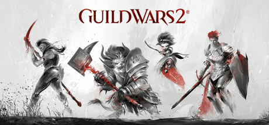

**Platforms:** Windows &nbsp;|&nbsp; **Publisher:** NCsoft &nbsp;|&nbsp; **Genre:** Adventure, Massively Multiplayer, RPG, Free To Play &nbsp;|&nbsp; **Released:** August 28, 2012

> Guild Wars 2 is an award-winning online roleplaying game with fast-paced action combat, deep character customization, and no subscription fee required. Choose from an arsenal of professions and weapons, explore a vast open world, compete in PVP modes and more. Join over 16 million players now!
>
> _Synopsis source: Steam_

[Wikipedia](https://en.wikipedia.org/wiki/Guild_Wars_2) · [Steam](https://store.steampowered.com/app/1284210)

---

### Mark of the Ninja

**Platforms:** Windows &nbsp;|&nbsp; **Publisher:** Microsoft Studios &nbsp;|&nbsp; **Genre:** Action, Adventure, Indie &nbsp;|&nbsp; **Released:** October 16, 2012

> In Mark of the Ninja, you'll know what it is to truly be a ninja. You must be silent, agile and clever to outwit your opponents in a world of gorgeous scenery and flowing animation. Marked with cursed tattoos giving you heightened senses, every situation presents you with options.
>
> _Synopsis source: Steam_

[Wikipedia](https://en.wikipedia.org/wiki/Mark_of_the_Ninja) · [Steam](https://store.steampowered.com/app/214560)

---

### NBA 2K13

**Platforms:** Windows, PlayStation 3 &nbsp;|&nbsp; **Publisher:** 2K &nbsp;|&nbsp; **Released:** October 2, 2012

[Wikipedia](https://en.wikipedia.org/wiki/NBA_2K13)

---

### Super Hexagon

**Platforms:** Windows &nbsp;|&nbsp; **Publisher:** Terry Cavanagh &nbsp;|&nbsp; **Genre:** Action, Indie &nbsp;|&nbsp; **Released:** November 27, 2012

> Super Hexagon is a minimal action game by Terry Cavanagh, with music by Chipzel.
>
> _Synopsis source: Steam_

[Wikipedia](https://en.wikipedia.org/wiki/Super_Hexagon) · [Steam](https://store.steampowered.com/app/221640)

---

### The Lord of the Rings Online: Riders of Rohan

**Platforms:** Windows &nbsp;|&nbsp; **Publisher:** Turbine, Inc. &nbsp;|&nbsp; **Released:** October 15, 2012

---

### The Walking Dead: A Telltale Games Series

**Platforms:** PlayStation 3, Windows, Xbox 360 &nbsp;|&nbsp; **Publisher:** Telltale Games &nbsp;|&nbsp; **Released:** November 21, 2012

[Wikipedia](https://en.wikipedia.org/wiki/The_Walking_Dead_(video_game))

---

### The Walking Dead: Episode 5 – No Time Left

**Platforms:** Windows &nbsp;|&nbsp; **Publisher:** Telltale Games &nbsp;|&nbsp; **Released:** November 21, 2012

[Wikipedia](https://en.wikipedia.org/wiki/The_Walking_Dead_(video_game))

---

## 2011

[Full 2011 page](../years/2011.md)

### A Game of Thrones: Genesis

**Platforms:** Windows &nbsp;|&nbsp; **Genre:** Strategy &nbsp;|&nbsp; **Released:** September 29

> Immerse yourself into the battles and intrigues between the Houses that shaped the Kingdom of Westeros and keep your spot on the Iron Throne by any means.
>
> _Synopsis source: Steam_

[Steam](https://store.steampowered.com/app/58550)

---

### Achron

**Platforms:** Windows, macOS, Linux &nbsp;|&nbsp; **Genre:** Indie, Strategy &nbsp;|&nbsp; **Released:** August 29

> As one of the survivors and humankind's first “Achronal” being, you must piece together what happened and unravel the mysteries surrounding the alien invasion.
>
> _Synopsis source: Steam_

[Wikipedia](https://en.wikipedia.org/wiki/Achron) · [Steam](https://store.steampowered.com/app/109700)

---

### Afterfall: InSanity

**Platforms:** Windows, Xbox 360, PlayStation 3 &nbsp;|&nbsp; **Released:** November 25

---

### Age of Empires Online

**Platforms:** Windows &nbsp;|&nbsp; **Released:** August 16

[Wikipedia](https://en.wikipedia.org/wiki/Age_of_Empires_Online)

---

### Alice: Madness Returns

**Platforms:** Windows, PlayStation 3, Xbox 360 &nbsp;|&nbsp; **Genre:** Action, Adventure &nbsp;|&nbsp; **Released:** June 14

> Alice: Madness Returns is a third-person, single-player, action adventure platformer. Visit the grim reality of Victorian London and travel to the beautiful yet ghastly Wonderland to uncover the root of Alice's madness.
>
> _Synopsis source: Steam_

[Steam](https://store.steampowered.com/app/19680)

---

### Alien Zombie Megadeath

**Platforms:** Windows, PlayStation 3 &nbsp;|&nbsp; **Genre:** Action, Indie &nbsp;|&nbsp; **Released:** June 21

> Alien Zombie Megadeath is a gloriously intense platform shoot-em-up!
>
> _Synopsis source: Steam_

[Wikipedia](https://en.wikipedia.org/wiki/Alien_Zombie_Megadeath) · [Steam](https://store.steampowered.com/app/110610)

---

### Anno 2070

**Platforms:** Windows &nbsp;|&nbsp; **Genre:** Strategy &nbsp;|&nbsp; **Released:** November 17

> Build your society of the future, colonize islands, and create sprawling megacities with multitudes of buildings, vehicles, and resources to manage.
>
> _Synopsis source: Steam_

[Wikipedia](https://en.wikipedia.org/wiki/Anno_2070) · [Steam](https://store.steampowered.com/app/48240)

---

### Anomaly: Warzone Earth

**Platforms:** Windows, iOS &nbsp;|&nbsp; **Genre:** Action, Indie, Strategy &nbsp;|&nbsp; **Released:** April 8

> Lead an armored squad through the perils of this reversed tower defense action-strategy game!
>
> _Synopsis source: Steam_

[Steam](https://store.steampowered.com/app/91200)

---

### Arcania: Fall of Setarrif

**Platforms:** Windows &nbsp;|&nbsp; **Genre:** RPG &nbsp;|&nbsp; **Released:** October 25

> Face the last challenge - determine destiny! A new threat casts its shadow over the Southern Isles. A mysterious demon, consumed by hatred, terrifies the population and pools his force against the coastal city of Setarrif. The dramatic situation exacerbates after a volcanic eruption in the mountains nearby.
>
> _Synopsis source: Steam_

[Steam](https://store.steampowered.com/app/65610)

---

### Assassin's Creed: Brotherhood

**Platforms:** Windows &nbsp;|&nbsp; **Genre:** Action, Adventure &nbsp;|&nbsp; **Released:** March 22

> It’s time to join the Brotherhood.
>
> _Synopsis source: Steam_

[Steam](https://store.steampowered.com/app/48190)

---

### Assassin's Creed: Revelations

**Platforms:** PlayStation 3, Xbox 360, Windows &nbsp;|&nbsp; **Genre:** Action, Adventure &nbsp;|&nbsp; **Released:** November 15

> Ezio Auditore walks in the footsteps of the legendary mentor Altair, on a dangerous journey of discovery and revelation.
>
> _Synopsis source: Steam_

[Steam](https://store.steampowered.com/app/201870)

---

### Bastion

**Platforms:** Windows, Xbox 360 &nbsp;|&nbsp; **Publisher:** Warner Bros. Interactive Entertainment &nbsp;|&nbsp; **Released:** August 16, 2011

[Wikipedia](https://en.wikipedia.org/wiki/Bastion_(video_game))

---

### Batman: Arkham City

**Platforms:** PlayStation 3, Xbox 360, Windows &nbsp;|&nbsp; **Publisher:** Warner Bros. Interactive Entertainment &nbsp;|&nbsp; **Genre:** Action, Adventure &nbsp;|&nbsp; **Released:** October 18, 2011

> Get Batman: Arkham City and all DLC for one low price with the release of the GOTY Edition!
>
> _Synopsis source: Steam_

[Steam](https://store.steampowered.com/app/200260)

---

### Battle High: San Bruno

**Platforms:** Windows, Xbox 360 &nbsp;|&nbsp; **Released:** February 8

---

### Battle vs. Chess

**Platforms:** Windows, Nintendo DS, PlayStation 3, PlayStation Portable, Wii, Xbox 360 &nbsp;|&nbsp; **Released:** May 17

[Wikipedia](https://en.wikipedia.org/wiki/Battle_vs._Chess)

---

### Battlefield 3

**Platforms:** Windows, PlayStation 3, Xbox 360 &nbsp;|&nbsp; **Genre:** Action &nbsp;|&nbsp; **Released:** October 25

> Enjoy total freedom to fight the way you want. Explore 29 massive multiplayer maps and use loads of vehicles, weapons, and gadgets to help you turn up the heat. Every second of battle gets you closer to unlocking tons of extras and moving up in the Ranks. So get in the action.
>
> _Synopsis source: Steam_

[Wikipedia](https://en.wikipedia.org/wiki/Battlefield_3) · [Steam](https://store.steampowered.com/app/1238820)

---

### Breach

**Platforms:** Windows, Xbox 360 &nbsp;|&nbsp; **Genre:** FPS &nbsp;|&nbsp; **Released:** January 26

[Wikipedia](https://en.wikipedia.org/wiki/Breach_(2011_video_game))

---

### Brink

**Platforms:** Windows, PlayStation 3, Xbox 360 &nbsp;|&nbsp; **Genre:** Action, Indie &nbsp;|&nbsp; **Released:** May 10

> It is a Co-Op horror game that can be played with at least 1 and at most 4 players on the Brink of Death. Your goal is to defeat the killer doctor who feeds on fear in the cursed area. You'll need a lot of things, but don't stop destroying the scarecrows it draws on. Death is just the beginning.
>
> _Synopsis source: Steam_

[Wikipedia](https://en.wikipedia.org/wiki/Brink_(video_game)) · [Steam](https://store.steampowered.com/app/2179940)

---

### Bulletstorm

**Platforms:** Windows, Xbox 360, PlayStation 3 &nbsp;|&nbsp; **Released:** February 22

[Wikipedia](https://en.wikipedia.org/wiki/Bulletstorm)

---

### Call of Duty: Modern Warfare 3

**Platforms:** Windows, PlayStation 3, Xbox 360, Wii &nbsp;|&nbsp; **Genre:** Action &nbsp;|&nbsp; **Released:** November 8

> The best-selling first-person action series of all-time returns with an epic sequel to the multiple GOTY award winner Call of Duty®: Modern Warfare® 2
>
> _Synopsis source: Steam_

[Steam](https://store.steampowered.com/app/42680)

---

### Call of Juarez: The Cartel

**Platforms:** PlayStation 3, Xbox 360, Windows &nbsp;|&nbsp; **Released:** July 14

---

### Cars 2

**Platforms:** Windows, Xbox 360, PlayStation 3, Wii, Nintendo DS, Nintendo 3DS, PlayStation Portable &nbsp;|&nbsp; **Released:** June 21

[Wikipedia](https://en.wikipedia.org/wiki/Cars_2_(video_game))

---

### Cave Story+

**Platforms:** Windows &nbsp;|&nbsp; **Genre:** Action, Adventure, Indie &nbsp;|&nbsp; **Released:** November 22

> Run, jump, shoot, fly and explore your way through a massive action-adventure reminiscent of classic 8- and 16-bit games.
>
> _Synopsis source: Steam_

[Wikipedia](https://en.wikipedia.org/wiki/Cave_Story) · [Steam](https://store.steampowered.com/app/200900)

---

### Chantelise – A Tale of Two Sisters

**Platforms:** Windows &nbsp;|&nbsp; **Released:** July 30

[Wikipedia](https://en.wikipedia.org/wiki/Chantelise_%E2%80%93_A_Tale_of_Two_Sisters)

---

### Cities in Motion

**Platforms:** Windows &nbsp;|&nbsp; **Genre:** Simulation &nbsp;|&nbsp; **Released:** February 23

> Manage transportation for commuters in four of the world's greatest cities - Vienna, Helsinki, Berlin, and Amsterdam
>
> _Synopsis source: Steam_

[Wikipedia](https://en.wikipedia.org/wiki/Cities_in_Motion) · [Steam](https://store.steampowered.com/app/73010)

---

### Cities XL 2012

**Platforms:** Windows &nbsp;|&nbsp; **Released:** October 20

[Wikipedia](https://en.wikipedia.org/wiki/Cities_XL_2012)

---

### Cloning Clyde

**Platforms:** Windows &nbsp;|&nbsp; **Genre:** Casual, Indie &nbsp;|&nbsp; **Released:** March 15

> Have you ever been cloned? Ever wonder what it would be like to be half chicken? Half monkey? Half frog? Well, wonder no more when you play Cloning Clyde. As Clyde, or one of his clones, work your way through the levels of the nefarious Dupliclone, Inc. building.
>
> _Synopsis source: Steam_

[Wikipedia](https://en.wikipedia.org/wiki/Cloning_Clyde) · [Steam](https://store.steampowered.com/app/91800)

---

### Crysis 2

**Platforms:** Windows, PlayStation 3, Xbox 360 &nbsp;|&nbsp; **Genre:** Action &nbsp;|&nbsp; **Released:** March 22

> Aliens are decimating New York City, only you have the technology to survive. Be The Weapon.
>
> _Synopsis source: Steam_

[Wikipedia](https://en.wikipedia.org/wiki/Crysis_2) · [Steam](https://store.steampowered.com/app/108800)

---

### Darkspore

**Platforms:** Windows &nbsp;|&nbsp; **Released:** April 26

[Wikipedia](https://en.wikipedia.org/wiki/Darkspore)

---

### Dawn of Fantasy

**Platforms:** Windows &nbsp;|&nbsp; **Released:** September 6

[Wikipedia](https://en.wikipedia.org/wiki/Dawn_of_Fantasy)

---

### DC Universe Online

**Platforms:** Windows, PlayStation 3 &nbsp;|&nbsp; **Genre:** Action, MMO &nbsp;|&nbsp; **Released:** January 11

> DC Universe Online is a Free-to-Play, massive multiplayer online action game set in the popular DC Universe. Become one of a new breed of Heroes or Villains and wield incredible powers as you go to war with legendary characters such as Batman, Superman, Lex Luthor and The Joker.
>
> _Synopsis source: Steam_

[Wikipedia](https://en.wikipedia.org/wiki/DC_Universe_Online) · [Steam](https://store.steampowered.com/app/24200)

---

### Dead Island

**Platforms:** Windows, Xbox 360, PlayStation 3 &nbsp;|&nbsp; **Released:** September 6

[Wikipedia](https://en.wikipedia.org/wiki/Dead_Island)

---

### Dead Rising 2: Off the Record

**Platforms:** Windows, PlayStation 3, Xbox 360 &nbsp;|&nbsp; **Genre:** Action, Adventure &nbsp;|&nbsp; **Released:** October 11

> You are Frank West – photojournalist and original hero of the Dead Rising Willamette incident – taking center stage experiencing the re-imagined Fortune City outbreak.
>
> _Synopsis source: Steam_

[Steam](https://store.steampowered.com/app/45770)

---

### Dead Space 2

**Platforms:** Xbox 360, Windows, PlayStation 3 &nbsp;|&nbsp; **Publisher:** Electronic Arts &nbsp;|&nbsp; **Genre:** Survival horror &nbsp;|&nbsp; **Released:** January 25, 2011

> Three years after the Necromorph infestation aboard the USS Ishimura, Isaac Clarke awakens from a coma, confused, disoriented, and on a space station called The Sprawl. Explore this world and its zero-g environments to discover the truth about the Unitology and its role in the Necromorph epidemic.
>
> _Synopsis source: Steam_

[Wikipedia](https://en.wikipedia.org/wiki/Dead_Space_2) · [Steam](https://store.steampowered.com/app/47780)

---

### Deus Ex: Human Revolution

**Platforms:** Windows, PlayStation 3, Xbox 360 &nbsp;|&nbsp; **Publisher:** Square Enix &nbsp;|&nbsp; **Released:** August 23, 2011

---

### Dirt 3

**Platforms:** Windows, Xbox 360, PlayStation 3 &nbsp;|&nbsp; **Released:** May 24

[Wikipedia](https://en.wikipedia.org/wiki/Dirt_3)

---

### Disney Universe

**Platforms:** Windows, macOS, Wii, PlayStation 3, Xbox 360 &nbsp;|&nbsp; **Released:** October 25

[Wikipedia](https://en.wikipedia.org/wiki/Disney_Universe)

---

### Dragon Age II

**Platforms:** Windows, PlayStation 3, Xbox 360 &nbsp;|&nbsp; **Released:** March 8

[Wikipedia](https://en.wikipedia.org/wiki/Dragon_Age_II)

---

### Dream Chronicles: The Book of Water

**Platforms:** Windows &nbsp;|&nbsp; **Released:** April 24

---

### Driver: San Francisco

**Platforms:** PlayStation 3, Xbox 360, Wii, Windows &nbsp;|&nbsp; **Released:** September 6

---

### Duke Nukem Forever

**Platforms:** Windows, PlayStation 3, Xbox 360, macOS &nbsp;|&nbsp; **Genre:** Action &nbsp;|&nbsp; **Released:** June 14

> The King arrives with an arsenal of over-the-top weapons, giant explosions and pure unadulterated fun!
>
> _Synopsis source: Steam_

[Wikipedia](https://en.wikipedia.org/wiki/Duke_Nukem_Forever) · [Steam](https://store.steampowered.com/app/57900)

---

### Dungeon Defenders

**Platforms:** PlayStation Network, Windows, Xbox 360 &nbsp;|&nbsp; **Genre:** Action, Indie, RPG, Strategy &nbsp;|&nbsp; **Released:** October 18

> Create a hero from one of four classes to save Etheria in this 4-player coop Tower Defense Action-RPG. Includes Steam exclusive Portal gun &amp; TF2 familiars!
>
> _Synopsis source: Steam_

[Wikipedia](https://en.wikipedia.org/wiki/Dungeon_Defenders) · [Steam](https://store.steampowered.com/app/65800)

---

### Dungeon Siege III

**Platforms:** Windows, Xbox 360, PlayStation 3 &nbsp;|&nbsp; **Released:** June 21

[Wikipedia](https://en.wikipedia.org/wiki/Dungeon_Siege_III)

---

### Dungeons

**Platforms:** Windows &nbsp;|&nbsp; **Released:** February 10

[Wikipedia](https://en.wikipedia.org/wiki/Dungeons_(video_game))

---

### Dungeons & Dragons: Daggerdale

**Platforms:** Windows, Xbox 360 &nbsp;|&nbsp; **Genre:** Action, RPG &nbsp;|&nbsp; **Released:** May 25

> Dungeons & Dragons: Daggerdale offers engaging "hack and slash" gameplay, bringing Dungeons & Dragons to life. Travel to the Dalelands of the Forgotten Realms, where the journey begins in the remote Desertsmouth Mountains.
>
> _Synopsis source: Steam_

[Steam](https://store.steampowered.com/app/99100)

---

### Dynasty Warriors 7: Xtreme Legends

**Platforms:** Windows, PlayStation 3 &nbsp;|&nbsp; **Released:** November 15

[Wikipedia](https://en.wikipedia.org/wiki/Dynasty_Warriors_7)

---

### Earth Defense Force: Insect Armageddon

**Platforms:** PlayStation 3, Xbox 360, Windows &nbsp;|&nbsp; **Genre:** Action &nbsp;|&nbsp; **Released:** July 5

> Thousands of giant insects and aliens once again ravage the earth, and only the Earth Defense Force can stop them.
>
> _Synopsis source: Steam_

[Steam](https://store.steampowered.com/app/23530)

---

### Earthrise

**Platforms:** Windows &nbsp;|&nbsp; **Genre:** MMO, RPG &nbsp;|&nbsp; **Released:** February 4

[Wikipedia](https://en.wikipedia.org/wiki/Earthrise_(video_game))

---

### Elsword (NA)

**Platforms:** Windows &nbsp;|&nbsp; **Released:** March 23

[Wikipedia](https://en.wikipedia.org/wiki/Elsword)

---

### Escape Goat

**Platforms:** Windows, Xbox 360 &nbsp;|&nbsp; **Genre:** Action, Indie &nbsp;|&nbsp; **Released:** November 2

> Escape Goat is a puzzle platformer where you take control of a goat, who has been imprisoned for witchcraft, and overcome traps and obstacles to escape the Prison of Agnus. Fear not, for with your supreme agility, sturdy horns, and the help of a magic mouse friend, you can turn the tables on foes and use the environment to your advantage.
>
> _Synopsis source: Steam_

[Wikipedia](https://en.wikipedia.org/wiki/Escape_Goat) · [Steam](https://store.steampowered.com/app/251370)

---

### F.E.A.R. 3

**Platforms:** Windows, Xbox 360, PlayStation 3 &nbsp;|&nbsp; **Genre:** Action &nbsp;|&nbsp; **Released:** June 21

> F.E.A.R. 3 delivers all the hallmarks that define the F.E.A.R. brand: terrifying paranormal experience, frenetic combat and a dramatic storyline.
>
> _Synopsis source: Steam_

[Wikipedia](https://en.wikipedia.org/wiki/F.E.A.R._3) · [Steam](https://store.steampowered.com/app/21100)

---

### F1 2011

**Platforms:** Windows, Xbox 360, PlayStation 3, Nintendo 3DS &nbsp;|&nbsp; **Released:** September 20

[Wikipedia](https://en.wikipedia.org/wiki/F1_2011_(video_game))

---

### Fable III

**Platforms:** Windows &nbsp;|&nbsp; **Released:** May 17

[Wikipedia](https://en.wikipedia.org/wiki/Fable_III)

---

### FIFA 12

**Platforms:** PlayStation 3, Xbox 360, Windows, Wii, PlayStation 2, PlayStation Portable, Nintendo 3DS, iOS &nbsp;|&nbsp; **Publisher:** EA Sports &nbsp;|&nbsp; **Released:** September 27, 2011

[Wikipedia](https://en.wikipedia.org/wiki/FIFA_12)

---

### FIFA Manager 12

**Platforms:** Windows &nbsp;|&nbsp; **Released:** October 21

[Wikipedia](https://en.wikipedia.org/wiki/FIFA_Manager_12)

---

### FlatOut 3: Chaos & Destruction

**Platforms:** Windows &nbsp;|&nbsp; **Genre:** Racing &nbsp;|&nbsp; **Released:** December 13

> Feel the adrenaline pulse through your veins as you barrel through insane race tracks against monster trucks, race cars, off road vehicles and much more.
>
> _Synopsis source: Steam_

[Steam](https://store.steampowered.com/app/201510)

---

### Football Manager 2012

**Platforms:** Windows, macOS &nbsp;|&nbsp; **Released:** October 21

[Wikipedia](https://en.wikipedia.org/wiki/Football_Manager_2012)

---

### From Dust

**Platforms:** Xbox 360, Windows &nbsp;|&nbsp; **Genre:** Adventure, Simulation &nbsp;|&nbsp; **Released:** July 27

> Immerse yourself in a world as exotically beautiful as it is dangerous in this modern God-Game where Nature is the Star!
>
> _Synopsis source: Steam_

[Wikipedia](https://en.wikipedia.org/wiki/From_Dust) · [Steam](https://store.steampowered.com/app/33460)

---

### Frozen Synapse

**Platforms:** Windows &nbsp;|&nbsp; **Genre:** Indie, Strategy &nbsp;|&nbsp; **Released:** May 26

> Brings the simultaneous turn-based strategy genre up-to-date and lets you give detailed, accurate orders to your squad.
>
> _Synopsis source: Steam_

[Wikipedia](https://en.wikipedia.org/wiki/Frozen_Synapse) · [Steam](https://store.steampowered.com/app/98200)

---

### Gatling Gears

**Platforms:** Xbox 360, PlayStation Network, Windows &nbsp;|&nbsp; **Genre:** Action, Adventure, Indie &nbsp;|&nbsp; **Released:** May 11

> When the Empire begins its reign of destruction in a thirst for natural resources, it’s up to Max Brawley, a retired Gatling Gear pilot, to stop them.
>
> _Synopsis source: Steam_

[Wikipedia](https://en.wikipedia.org/wiki/Gatling_Gears) · [Steam](https://store.steampowered.com/app/102810)

---

### Ghostbusters: Sanctum of Slime

**Platforms:** Windows, Xbox 360, PlayStation Network &nbsp;|&nbsp; **Released:** March 23

---

### Go! Go! Nippon!

**Platforms:** Windows &nbsp;|&nbsp; **Genre:** Visual novel &nbsp;|&nbsp; **Released:** September 30

[Wikipedia](https://en.wikipedia.org/wiki/Go!_Go!_Nippon!)

---

### Gray Matter

**Platforms:** Windows, Xbox 360 &nbsp;|&nbsp; **Genre:** Adventure, Casual &nbsp;|&nbsp; **Released:** February 22

> After a tragic accident, neurobiologist Dr. David Styles has become a recluse, rarely leaving his home, the Dread Hill House. One day, Samantha Everett, a street magician, appears at Dr. Style's doorstep just as he is seeking a new assistant.
>
> _Synopsis source: Steam_

[Wikipedia](https://en.wikipedia.org/wiki/Gray_Matter_(video_game)) · [Steam](https://store.steampowered.com/app/260570)

---

### Hard Reset

**Platforms:** Windows &nbsp;|&nbsp; **Genre:** Action, Indie &nbsp;|&nbsp; **Released:** September 13

> Over-the-top destruction, loads of enemies &amp; a beautifully realized cyberpunk setting. Hard Reset is here to shake up the shooter scene. Try the demo now.
>
> _Synopsis source: Steam_

[Wikipedia](https://en.wikipedia.org/wiki/Hard_Reset_(video_game)) · [Steam](https://store.steampowered.com/app/98400)

---

### Harry Potter and the Deathly Hallows – Part 2

**Platforms:** Windows, Xbox 360, PlayStation 3, Wii, Nintendo DS &nbsp;|&nbsp; **Released:** July 12

[Wikipedia](https://en.wikipedia.org/wiki/Harry_Potter_and_the_Deathly_Hallows_%E2%80%93_Part_2_(video_game))

---

### Hector: Badge of Carnage - Episode 1

**Platforms:** Windows &nbsp;|&nbsp; **Released:** April 27

---

### Hector: Badge of Carnage - Episode 2

**Platforms:** Windows, iOS &nbsp;|&nbsp; **Released:** August 25

---

### Hector: Badge of Carnage - Episode 3

**Platforms:** Windows, iOS &nbsp;|&nbsp; **Released:** September 22

---

### Homefront

**Platforms:** Windows, Xbox 360, PlayStation 3 &nbsp;|&nbsp; **Genre:** Action &nbsp;|&nbsp; **Released:** March 15

> The Rock Map Pack is Now Available! Join the Resistance, stand united and fight for freedom against an overwhelming military force.
>
> _Synopsis source: Steam_

[Wikipedia](https://en.wikipedia.org/wiki/Homefront_(video_game)) · [Steam](https://store.steampowered.com/app/55100)

---

### Hunted: The Demon's Forge

**Platforms:** Windows, PlayStation 3, Xbox 360 &nbsp;|&nbsp; **Genre:** Action, Adventure &nbsp;|&nbsp; **Released:** May 31

> It will take the combined efforts of two great warriors to explore menacing dungeons, overgrown ruins, and downtrodden towns … and discover the secrets of the Demon’s Forge.
>
> _Synopsis source: Steam_

[Steam](https://store.steampowered.com/app/22450)

---

### Hydrophobia Prophecy

**Platforms:** Windows, PlayStation 3 &nbsp;|&nbsp; **Genre:** Action, Adventure, Indie, Strategy &nbsp;|&nbsp; **Released:** May 10

> The ultimate edition of the jaw-dropping action-adventure game set onboard a floating city.
>
> _Synopsis source: Steam_

[Wikipedia](https://en.wikipedia.org/wiki/Hydrophobia_(video_game)#Hydrophobia_Prophecy) · [Steam](https://store.steampowered.com/app/92000)

---

### Hysteria Project 2

**Platforms:** Windows, PlayStation Network &nbsp;|&nbsp; **Genre:** Adventure, Survival horror, FMV &nbsp;|&nbsp; **Released:** January 27

[Wikipedia](https://en.wikipedia.org/wiki/Hysteria_Project_2)

---

### Jamestown: Legend of the Lost Colony

**Platforms:** Windows &nbsp;|&nbsp; **Released:** June 8

---

### JASF: Jane's Advanced Strike Fighters

**Platforms:** Windows, PlayStation 3, Xbox 360 &nbsp;|&nbsp; **Released:** October 18

---

### Jurassic Park: The Game

**Platforms:** Windows, PlayStation 3, Xbox 360 &nbsp;|&nbsp; **Released:** November 15

---

### L.A. Noire

**Platforms:** PlayStation 3, Xbox 360, Windows &nbsp;|&nbsp; **Genre:** Adventure, Strategy &nbsp;|&nbsp; **Released:** May 17

> In his fight to climb the ranks and do what's right, LAPD detective Cole Phelps must unravel the truth behind a string of arson attacks, conspiracies, and brutal murders, battling the L.A. underworld and even members of his own department.
>
> _Synopsis source: Steam_

[Wikipedia](https://en.wikipedia.org/wiki/L.A._Noire) · [Steam](https://store.steampowered.com/app/110800)

---

### Lego Harry Potter: Years 5–7

**Platforms:** Windows, Xbox 360, PlayStation 3, PlayStation Portable, Wii, Nintendo DS, Nintendo 3DS, iOS &nbsp;|&nbsp; **Genre:** Adventure &nbsp;|&nbsp; **Released:** November 11

> LEGO Harry Potter: Years 5-7 takes players through Harry Potter's heroic adventures in the Muggle and wizarding worlds.
>
> _Synopsis source: Steam_

[Steam](https://store.steampowered.com/app/204120)

---

### Lego Pirates of the Caribbean: The Video Game

**Platforms:** Nintendo 3DS, Xbox 360, PlayStation 3, Wii, PlayStation Portable, Nintendo DS, Windows &nbsp;|&nbsp; **Genre:** Action, Adventure &nbsp;|&nbsp; **Released:** May 10

> LEGO® Pirates of the Caribbean: The Video Game is an action adventure game that brings the Pirates of the Caribbean world and all its colorful characters to life in LEGO Brick form. Players experience all the memorable scenes from all four films in the humorous and quirky LEGO Video Games style.
>
> _Synopsis source: Steam_

[Steam](https://store.steampowered.com/app/311770)

---

### Lego Star Wars III: The Clone Wars

**Platforms:** Windows, Xbox 360, PlayStation 3, PlayStation Portable, Wii, Nintendo DS, Nintendo 3DS &nbsp;|&nbsp; **Genre:** Action, Adventure &nbsp;|&nbsp; **Released:** March 22

> LEGO Star Wars III: The Clone Wars will allow fans to explore endlessly and laugh their way through the Star Wars galaxy in the most humorous, accessible and action-packed LEGO game to date.
>
> _Synopsis source: Steam_

[Steam](https://store.steampowered.com/app/32510)

---

### Limbo

**Platforms:** PlayStation 3, Xbox 360, PlayStation Network, Windows &nbsp;|&nbsp; **Publisher:** Playdead &nbsp;|&nbsp; **Genre:** Action, Adventure, Indie &nbsp;|&nbsp; **Released:** July 19, 2011

> Uncertain of his sister's fate, a boy enters LIMBO
>
> _Synopsis source: Steam_

[Wikipedia](https://en.wikipedia.org/wiki/Limbo_(video_game)) · [Steam](https://store.steampowered.com/app/48000)

---

### Magicka

**Platforms:** Windows &nbsp;|&nbsp; **Genre:** Action-adventure &nbsp;|&nbsp; **Released:** January 25

> Magicka is a satirical action-adventure game set in a rich fantasy world based on Norse mythology. The player assumes the role of a wizard from a sacred order tasked with stopping an evil sorcerer who has thrown the world into turmoil, his foul creations besieging the forces of good.
>
> _Synopsis source: Steam_

[Wikipedia](https://en.wikipedia.org/wiki/Magicka) · [Steam](https://store.steampowered.com/app/42910)

---

### Major League Baseball 2K11

**Platforms:** Windows, PlayStation 3, PlayStation 2, PlayStation Portable, Xbox 360, Wii &nbsp;|&nbsp; **Released:** March 8

[Wikipedia](https://en.wikipedia.org/wiki/Major_League_Baseball_2K11)

---

### MDK2 HD

**Platforms:** Windows &nbsp;|&nbsp; **Genre:** Action &nbsp;|&nbsp; **Released:** October 12

> Overhaul Games brings MDK2 back to the PC in incredible high definition, with enhanced graphics, sound, and gameplay. See the classic action platformer the way it was meant to be seen, heard, and played... on a PC!Kurt Hectic in his snazzy suit with ribbon chute is back to save the universe. This time he is teamed with the genius Dr.
>
> _Synopsis source: Steam_

[Wikipedia](https://en.wikipedia.org/wiki/MDK2#Wii_port_and_MDK2_HD) · [Steam](https://store.steampowered.com/app/213350)

---

### Men of War: Assault Squad

**Platforms:** Windows &nbsp;|&nbsp; **Genre:** Strategy &nbsp;|&nbsp; **Released:** February 25

> Men of War: Assault Squad delivers a deeply tactical WWII experience, blending large-scale strategy with intense, hands-on combat. Fight across multiple fronts – from European countryside to Pacific jungles and command every unit and every bullet on the battlefield.
>
> _Synopsis source: Steam_

[Steam](https://store.steampowered.com/app/64000)

---

### Metal Dead

**Platforms:** Windows &nbsp;|&nbsp; **Genre:** Adventure, Indie &nbsp;|&nbsp; **Released:** December 19

> A hilariously terrifying adventure filled with laughs, blood, insanity, and of course... hordes of the undead.
>
> _Synopsis source: Steam_

[Wikipedia](https://en.wikipedia.org/wiki/Metal_Dead) · [Steam](https://store.steampowered.com/app/302690)

---

### Might and Magic Heroes VI

**Platforms:** Windows &nbsp;|&nbsp; **Genre:** RPG, Strategy &nbsp;|&nbsp; **Released:** October 13

> Heroes VI is a fast-paced epic story where Angels plot to end -- once and for all -- an unfinished war with their ancient rivals, the Faceless.
>
> _Synopsis source: Steam_

[Wikipedia](https://en.wikipedia.org/wiki/Might_and_Magic_Heroes_VI) · [Steam](https://store.steampowered.com/app/48220)

---

### Minecraft

**Platforms:** iOS, Windows, Linux, macOS &nbsp;|&nbsp; **Released:** November 17

[Wikipedia](https://en.wikipedia.org/wiki/Minecraft)

---

### Monday Night Combat

**Platforms:** Windows &nbsp;|&nbsp; **Genre:** MOBA, TPS &nbsp;|&nbsp; **Released:** January 24

> Monday Night Combat is a class-based, third-person shooter… and the most popular lethal sport of the future!
>
> _Synopsis source: Steam_

[Wikipedia](https://en.wikipedia.org/wiki/Monday_Night_Combat) · [Steam](https://store.steampowered.com/app/63200)

---

### Mount&Blade: With Fire & Sword

**Platforms:** Windows &nbsp;|&nbsp; **Genre:** Action, RPG &nbsp;|&nbsp; **Released:** May 3

> The standalone expansion for Mount &amp; Blade! With Fire &amp; Sword builds and expands upon the highly regarded combat system from Mount &amp; Blade: Warband. Firearms have been introduced to the battlefield.
>
> _Synopsis source: Steam_

[Steam](https://store.steampowered.com/app/48720)

---

### Nancy Drew: Alibi in Ashes

**Platforms:** Windows, macOS &nbsp;|&nbsp; **Genre:** Adventure &nbsp;|&nbsp; **Released:** October 18

> Escape the Smoky Intrigue of a Hometown Inferno!
>
> _Synopsis source: Steam_

[Steam](https://store.steampowered.com/app/202670)

---

### Nancy Drew: The Captive Curse

**Platforms:** Windows, macOS &nbsp;|&nbsp; **Genre:** Adventure, Casual &nbsp;|&nbsp; **Released:** June 28

> A terrifying myth comes alive in Germany!
>
> _Synopsis source: Steam_

[Steam](https://store.steampowered.com/app/42220)

---

### NBA 2K12

**Platforms:** PlayStation 3, Xbox 360, Windows, Wii, PlayStation Portable, PlayStation 2 &nbsp;|&nbsp; **Publisher:** 2K &nbsp;|&nbsp; **Released:** October 4, 2011

[Wikipedia](https://en.wikipedia.org/wiki/NBA_2K12)

---

### Need for Speed: The Run

**Platforms:** Windows, PlayStation 3, Wii, Xbox 360, Nintendo 3DS &nbsp;|&nbsp; **Released:** November 15

---

### Nuclear Dawn

**Platforms:** Windows, macOS &nbsp;|&nbsp; **Genre:** Action, Strategy &nbsp;|&nbsp; **Released:** September 26

> Explore war-torn post-apocalyptic landscapes and take fight against enemies using various weapons in this FPS/RTS hybrid.
>
> _Synopsis source: Steam_

[Wikipedia](https://en.wikipedia.org/wiki/Nuclear_Dawn) · [Steam](https://store.steampowered.com/app/17710)

---

### Operation Flashpoint: Red River

**Platforms:** Windows, Xbox 360, PlayStation 3 &nbsp;|&nbsp; **Released:** June 7

---

### Orcs Must Die!

**Platforms:** Xbox 360, Windows &nbsp;|&nbsp; **Genre:** Action, Indie, Strategy &nbsp;|&nbsp; **Released:** October 5

> Slice them, burn them, skewer them, and launch them - no matter how you get it done, orcs must die in this fantasy action-strategy game from Robot Entertainment.
>
> _Synopsis source: Steam_

[Wikipedia](https://en.wikipedia.org/wiki/Orcs_Must_Die!) · [Steam](https://store.steampowered.com/app/102600)

---

### Panzer Corps

**Platforms:** Windows &nbsp;|&nbsp; **Released:** July 11

[Wikipedia](https://en.wikipedia.org/wiki/Panzer_Corps_(video_game))

---

### Payday: The Heist

**Platforms:** PlayStation Network, Windows &nbsp;|&nbsp; **Genre:** Action &nbsp;|&nbsp; **Released:** October 18

> Take on the role of a hardened career criminal executing intense, dynamic heists in constant pursuit of the next “big score”
>
> _Synopsis source: Steam_

[Steam](https://store.steampowered.com/app/24240)

---

### Portal 2

**Platforms:** Windows, Xbox 360, PlayStation 3, macOS &nbsp;|&nbsp; **Publisher:** Valve &nbsp;|&nbsp; **Genre:** Action, Adventure &nbsp;|&nbsp; **Released:** April 19, 2011

> The &quot;Perpetual Testing Initiative&quot; has been expanded to allow you to design co-op puzzles for you and your friends!
>
> _Synopsis source: Steam_

[Wikipedia](https://en.wikipedia.org/wiki/Portal_2) · [Steam](https://store.steampowered.com/app/620)

---

### Postal III

**Platforms:** Windows &nbsp;|&nbsp; **Genre:** Action &nbsp;|&nbsp; **Released:** December 20

> Good or Insane? The choice is yours. Following the Apocalyptic end to the Postal Dude’s week in Paradise, we follow him and his insane pitbull Champ as they emigrate to its appropriately named sister city, Catharsis.
>
> _Synopsis source: Steam_

[Wikipedia](https://en.wikipedia.org/wiki/Postal_III) · [Steam](https://store.steampowered.com/app/10220)

---

### Pro Evolution Soccer 2012

**Platforms:** Windows, PlayStation 3, Xbox 360, Wii, PlayStation Portable, Nintendo 3DS, PlayStation 2 &nbsp;|&nbsp; **Released:** September 27

[Wikipedia](https://en.wikipedia.org/wiki/Pro_Evolution_Soccer_2012)

---

### Rage

**Platforms:** Windows, PlayStation 3, Xbox 360 &nbsp;|&nbsp; **Released:** October 4

[Wikipedia](https://en.wikipedia.org/wiki/Rage_(video_game))

---

### Red Faction: Armageddon

**Platforms:** Windows, Xbox 360, PlayStation 3 &nbsp;|&nbsp; **Genre:** Action &nbsp;|&nbsp; **Released:** June 7

> Red Faction: Armageddon Path to War includes 4 new missions, 2 unlockable items and 10 new achievements!
>
> _Synopsis source: Steam_

[Steam](https://store.steampowered.com/app/55110)

---

### Red Orchestra 2: Heroes of Stalingrad

**Platforms:** Windows &nbsp;|&nbsp; **Genre:** Action, Massively Multiplayer, Simulation &nbsp;|&nbsp; **Released:** September 13

> Contains full Rising Storm content as well!
>
> _Synopsis source: Steam_

[Steam](https://store.steampowered.com/app/35450)

---

### Renegade Ops

**Platforms:** Xbox 360, Windows &nbsp;|&nbsp; **Genre:** Action &nbsp;|&nbsp; **Released:** September 14

> Blast your way through enemy lines to defeat Inferno, a madman intent on global domination. Destruction just got awesome.
>
> _Synopsis source: Steam_

[Wikipedia](https://en.wikipedia.org/wiki/Renegade_Ops) · [Steam](https://store.steampowered.com/app/99300)

---

### Rift

**Platforms:** Windows &nbsp;|&nbsp; **Genre:** Action, Adventure, Massively Multiplayer, RPG, Free To Play &nbsp;|&nbsp; **Released:** March 1

> Dive into a world of epic adventure! Create your perfect hero thanks to a uniquely customizable class system. Collect, craft, and customize your gear. Go it alone or group up to challenge dungeons, raids, dynamic open-world content, and your fellow players.
>
> _Synopsis source: Steam_

[Wikipedia](https://en.wikipedia.org/wiki/Rift_(video_game)) · [Steam](https://store.steampowered.com/app/39120)

---

### Rise of Immortals

**Platforms:** Windows &nbsp;|&nbsp; **Released:** September 12

[Wikipedia](https://en.wikipedia.org/wiki/Rise_of_Immortals)

---

### Rochard

**Platforms:** Windows &nbsp;|&nbsp; **Released:** November 15

[Wikipedia](https://en.wikipedia.org/wiki/Rochard)

---

### Rock of Ages

**Platforms:** Windows, Xbox 360, PlayStation Network &nbsp;|&nbsp; **Genre:** Action, Indie, Racing, Strategy &nbsp;|&nbsp; **Released:** August 31

> A rock-solid combination of rock-rolling action, deep strategy, and captivating art and music from different ages of history, this is a game of crush or be crushed!
>
> _Synopsis source: Steam_

[Wikipedia](https://en.wikipedia.org/wiki/Rock_of_Ages_(video_game)) · [Steam](https://store.steampowered.com/app/22230)

---

### Rugby Challenge

**Platforms:** Windows, PlayStation 3, Xbox 360 &nbsp;|&nbsp; **Released:** October 20

[Wikipedia](https://en.wikipedia.org/wiki/Rugby_Challenge_(video_game))

---

### Saints Row: The Third

**Platforms:** Windows, Xbox 360, PlayStation 3 &nbsp;|&nbsp; **Genre:** Action &nbsp;|&nbsp; **Released:** November 15

> Get ready for the most out-landish gameplay scenarios ever seen as the Third Street Saints take on the Syndicate!
>
> _Synopsis source: Steam_

[Steam](https://store.steampowered.com/app/55230)

---

### Satazius

**Platforms:** Windows &nbsp;|&nbsp; **Genre:** Action, Indie &nbsp;|&nbsp; **Released:** December 16

> The year is 2051. Location: SATAZIUS, a long-abandoned planet. The cruiser Agano was on patrol when it was attacked and stricken by a confederacy of space pirates that had established a base on SATAZIUS. The pirates attacked the Agano intending to steal the assault ship ‘Trafalgar’ that was stowed aboard the Agano, but the Trafalgar made...
>
> _Synopsis source: Steam_

[Steam](https://store.steampowered.com/app/203990)

---

### Sengoku: Way of the Warrior

**Platforms:** Windows &nbsp;|&nbsp; **Released:** September 13

[Wikipedia](https://en.wikipedia.org/wiki/Sengoku_(2011_video_game))

---

### Serious Sam 3: BFE

**Platforms:** Windows &nbsp;|&nbsp; **Genre:** Action, Indie &nbsp;|&nbsp; **Released:** November 22

> Serious Sam 3: BFE is a prequel to the original indie fast action FPS and Game of the Year sensation - Serious Sam: The First Encounter!
>
> _Synopsis source: Steam_

[Steam](https://store.steampowered.com/app/41070)

---

### Serious Sam Double D

**Platforms:** Windows &nbsp;|&nbsp; **Genre:** Action, Indie &nbsp;|&nbsp; **Released:** August 3

> Pile on the firepower with the revolutionary Gunstacker and fire all your weapons at once in a symphony of destruction!
>
> _Synopsis source: Steam_

[Wikipedia](https://en.wikipedia.org/wiki/Serious_Sam_Double_D) · [Steam](https://store.steampowered.com/app/111600)

---

### Serious Sam: The Random Encounter

**Platforms:** Windows &nbsp;|&nbsp; **Genre:** Action, Indie, RPG &nbsp;|&nbsp; **Released:** October 24

> Choose your weapons and take aim at the most random Serious Sam adventure yet!
>
> _Synopsis source: Steam_

[Steam](https://store.steampowered.com/app/201480)

---

### Shadowgun

**Platforms:** iOS, Windows &nbsp;|&nbsp; **Released:** September 29

[Wikipedia](https://en.wikipedia.org/wiki/Shadowgun)

---

### Shift 2: Unleashed

**Platforms:** Windows, PlayStation 3, Xbox 360, iOS &nbsp;|&nbsp; **Genre:** Racing &nbsp;|&nbsp; **Released:** March 29

> Bring the true driver’s experience to life with all the intensity and exhilaration of being behind the wheel!
>
> _Synopsis source: Steam_

[Steam](https://store.steampowered.com/app/47920)

---

### Shining Force II

**Platforms:** Windows &nbsp;|&nbsp; **Genre:** Tactical RPG &nbsp;|&nbsp; **Released:** January 26

[Wikipedia](https://en.wikipedia.org/wiki/Shining_Force_II)

---

### Skylanders: Spyro's Adventure

**Platforms:** Windows, Nintendo 3DS, PlayStation 3, Wii, Xbox 360 &nbsp;|&nbsp; **Released:** October 16

---

### Sonic Generations

**Platforms:** PlayStation 3, Xbox 360, Windows, Nintendo 3DS &nbsp;|&nbsp; **Genre:** Action &nbsp;|&nbsp; **Released:** November 1

> Celebrate 20 years of Sonic in an all new adventure that delivers a definitive experience to Sonic fans new and old!
>
> _Synopsis source: Steam_

[Wikipedia](https://en.wikipedia.org/wiki/Sonic_Generations) · [Steam](https://store.steampowered.com/app/71340)

---

### Spiral Knights

**Platforms:** Windows &nbsp;|&nbsp; **Genre:** Action, Adventure, Casual, Indie, Massively Multiplayer, RPG, Free To Play &nbsp;|&nbsp; **Released:** April 4

> Join the ranks of the Spiral Knights. Stranded on an alien world, you must explore the ever-changing Clockworks beneath its surface.
>
> _Synopsis source: Steam_

[Wikipedia](https://en.wikipedia.org/wiki/Spiral_Knights) · [Steam](https://store.steampowered.com/app/99900)

---

### Star Wars: The Old Republic

**Platforms:** Windows &nbsp;|&nbsp; **Genre:** Massively Multiplayer, RPG, Free To Play &nbsp;|&nbsp; **Released:** December 20

> STAR WARS™: The Old Republic™ is a free-to-play MMORPG that puts you at the center of your own story-driven saga. Play as a Jedi, Sith, Bounty Hunter, or one of many other iconic STAR WARS roles in the galaxy far, far away over three thousand years before the classic films.
>
> _Synopsis source: Steam_

[Steam](https://store.steampowered.com/app/1286830)

---

### Stealth Bastard

**Platforms:** Windows &nbsp;|&nbsp; **Genre:** Action, Indie &nbsp;|&nbsp; **Released:** November 4

> Armed with only your wits and a pair of Stealthing Goggles, it’s your job to sneak your way through a deadly facility that’s determined to extinguish your fragile little life.
>
> _Synopsis source: Steam_

[Wikipedia](https://en.wikipedia.org/wiki/Stealth_Bastard_Deluxe) · [Steam](https://store.steampowered.com/app/209190)

---

### Stoked

**Platforms:** Windows &nbsp;|&nbsp; **Released:** March 11

[Wikipedia](https://en.wikipedia.org/wiki/Stoked_(video_game))

---

### Strong Bad's Cool Game for Attractive People: Episode 1 - Homestar Ruiner

**Platforms:** Windows, Wii &nbsp;|&nbsp; **Released:** August 11

[Wikipedia](https://en.wikipedia.org/wiki/Strong_Bad%27s_Cool_Game_for_Attractive_People)

---

### Stronghold 3

**Platforms:** Windows &nbsp;|&nbsp; **Genre:** Simulation, Strategy &nbsp;|&nbsp; **Released:** October 25

> Set 10 years after the original, Stronghold 3: Gold follows the vengeful story of The Wolf in the third installment of the award-winning castle building series. The Wolf has cheated death become even more bitter and twisted. Build castles, rally your troops and save medieval England!
>
> _Synopsis source: Steam_

[Wikipedia](https://en.wikipedia.org/wiki/Stronghold_3) · [Steam](https://store.steampowered.com/app/47400)

---

### Superstars V8 Next Challenge

**Platforms:** Windows, PlayStation 3, Xbox 360 &nbsp;|&nbsp; **Genre:** Racing &nbsp;|&nbsp; **Released:** January 25

[Wikipedia](https://en.wikipedia.org/wiki/Superstars_V8_Next_Challenge)

---

### Sweatshop

**Platforms:** macOS, Windows &nbsp;|&nbsp; **Genre:** Simulation, Strategy, Early Access &nbsp;|&nbsp; **Released:** July 18

> A dark management tycoon where profit has consequences. Grow from basement to factory and choose profit over workers' rights. Survive on small margins and even smaller morals. Keep the state happy or face brutal inspections.
>
> _Synopsis source: Steam_

[Wikipedia](https://en.wikipedia.org/wiki/Sweatshop_(video_game)) · [Steam](https://store.steampowered.com/app/4318110)

---

### Sword of the Stars II: The Lords of Winter

**Platforms:** Windows &nbsp;|&nbsp; **Released:** October 28

---

### Terraria

**Platforms:** Windows &nbsp;|&nbsp; **Genre:** Action, Adventure, Indie, RPG &nbsp;|&nbsp; **Released:** May 16

> Dig, fight, explore, build! Nothing is impossible in this action-packed adventure game. Four Pack also available!
>
> _Synopsis source: Steam_

[Wikipedia](https://en.wikipedia.org/wiki/Terraria) · [Steam](https://store.steampowered.com/app/105600)

---

### Test Drive Unlimited 2

**Platforms:** Windows, Xbox 360, PlayStation 3 &nbsp;|&nbsp; **Released:** February 8

[Wikipedia](https://en.wikipedia.org/wiki/Test_Drive_Unlimited_2)

---

### The Adventures of Tintin: The Game

**Platforms:** Windows, PlayStation 3, Xbox 360, Wii, Nintendo 3DS &nbsp;|&nbsp; **Released:** December 6

---

### The Binding of Isaac

**Platforms:** Windows &nbsp;|&nbsp; **Genre:** Action, Adventure, Indie, RPG &nbsp;|&nbsp; **Released:** September 28

> Now 20% More Evil with the Free Halloween update!
>
> _Synopsis source: Steam_

[Wikipedia](https://en.wikipedia.org/wiki/The_Binding_of_Isaac_(video_game)) · [Steam](https://store.steampowered.com/app/113200)

---

### The Cursed Crusade

**Platforms:** Windows, PlayStation 3, Xbox 360 &nbsp;|&nbsp; **Released:** October 25

[Wikipedia](https://en.wikipedia.org/wiki/The_Cursed_Crusade)

---

### The Elder Scrolls V: Skyrim

**Platforms:** Xbox 360, Windows, PlayStation 3 &nbsp;|&nbsp; **Publisher:** Bethesda Softworks &nbsp;|&nbsp; **Released:** November 11, 2011

---

### The First Templar

**Platforms:** Windows, Xbox 360 &nbsp;|&nbsp; **Genre:** Action, Adventure &nbsp;|&nbsp; **Released:** May 10

> Uncover the mysteries behind the Templar Order! Steam Exclusive Edition includes bonus mission “The Arena”.
>
> _Synopsis source: Steam_

[Wikipedia](https://en.wikipedia.org/wiki/The_First_Templar) · [Steam](https://store.steampowered.com/app/57680)

---

### The Lord of the Rings: War in the North

**Platforms:** Windows, PlayStation 3, Xbox 360 &nbsp;|&nbsp; **Released:** November 1

---

### The Sims 3 Town Life Stuff

**Platforms:** macOS, Windows &nbsp;|&nbsp; **Released:** July 26

[Wikipedia](https://en.wikipedia.org/wiki/The_Sims_3_Stuff_packs#Town_Life_Stuff)

---

### The Sims 3: Generations

**Platforms:** Windows, macOS &nbsp;|&nbsp; **Released:** May 31

---

### The Sims 3: Outdoor Living Stuff

**Platforms:** macOS, Windows &nbsp;|&nbsp; **Genre:** Social sim &nbsp;|&nbsp; **Released:** February 1

[Wikipedia](https://en.wikipedia.org/wiki/The_Sims_3_Stuff_packs#Outdoor_Living_Stuff)

---

### The Sims 3: Pets

**Platforms:** macOS, Windows &nbsp;|&nbsp; **Released:** October 18

---

### The Sims Medieval

**Platforms:** Windows, macOS &nbsp;|&nbsp; **Released:** March 22

[Wikipedia](https://en.wikipedia.org/wiki/The_Sims_Medieval)

---

### The Witcher 2: Assassins of Kings

**Platforms:** Windows &nbsp;|&nbsp; **Genre:** RPG &nbsp;|&nbsp; **Released:** May 17

> A time of untold chaos has come. Mighty forces clash behind the scenes in a struggle for power and influence. The Northern Kingdoms mobilize for war. But armies on the march are not enough to stop a bloody conspiracy...
>
> _Synopsis source: Steam_

[Steam](https://store.steampowered.com/app/20920)

---

### To the Moon

**Platforms:** Windows &nbsp;|&nbsp; **Genre:** Adventure, Indie, RPG &nbsp;|&nbsp; **Released:** November 1

> A story-driven experience about two doctors traversing backwards through a dying man's memories to artificially fulfill his last wish.
>
> _Synopsis source: Steam_

[Wikipedia](https://en.wikipedia.org/wiki/To_the_Moon_(video_game)) · [Steam](https://store.steampowered.com/app/206440)

---

### Total War: Shogun 2

**Platforms:** Windows &nbsp;|&nbsp; **Publisher:** Sega &nbsp;|&nbsp; **Genre:** Strategy &nbsp;|&nbsp; **Released:** March 15, 2011

> Total War: SHOGUN 2 is the perfect mix of real-time and turn-based strategy gaming for newcomers and veterans alike.
>
> _Synopsis source: Steam_

[Steam](https://store.steampowered.com/app/201270)

---

### Toy Soldiers: Cold War

**Platforms:** Windows, Xbox 360 &nbsp;|&nbsp; **Released:** August 17

---

### TrackMania 2: Canyon

**Platforms:** Windows &nbsp;|&nbsp; **Released:** September 14

---

### Trine 2

**Platforms:** Windows, macOS, PlayStation Network, Xbox 360 &nbsp;|&nbsp; **Released:** December 7

[Wikipedia](https://en.wikipedia.org/wiki/Trine_2)

---

### Tropico 4

**Platforms:** Windows, Xbox 360 &nbsp;|&nbsp; **Genre:** Simulation, Strategy &nbsp;|&nbsp; **Released:** August 30

> The world is changing and Tropico is moving with the times - geographical powers rise and fall and the world market is dominated by new players with new demands and offers - and you, as El Presidente, face a whole new set of challenges.
>
> _Synopsis source: Steam_

[Wikipedia](https://en.wikipedia.org/wiki/Tropico_4) · [Steam](https://store.steampowered.com/app/57690)

---

### Two Worlds II

**Platforms:** Windows, Xbox 360, PlayStation 3 &nbsp;|&nbsp; **Genre:** Action RPG &nbsp;|&nbsp; **Released:** January 25

> Check out the new Velvet Edition bundle including both Two Worlds II and Pirates of the Flying Fortress DLC.
>
> _Synopsis source: Steam_

[Wikipedia](https://en.wikipedia.org/wiki/Two_Worlds_II) · [Steam](https://store.steampowered.com/app/7520)

---

### Unepic

**Platforms:** Windows &nbsp;|&nbsp; **Genre:** Action, Indie, RPG &nbsp;|&nbsp; **Released:** September 30

> Daniel was just an average guy. He was a great videogame player, a big fan of sci-fi movies, and a novice RPG player. In the midst of an RPG, he was teleported to a castle. At first, Daniel believed that he was having a massive hallucination.
>
> _Synopsis source: Steam_

[Wikipedia](https://en.wikipedia.org/wiki/Unepic) · [Steam](https://store.steampowered.com/app/233980)

---

### Venetica

**Platforms:** Windows, Xbox 360, PlayStation 3 &nbsp;|&nbsp; **Genre:** Action RPG &nbsp;|&nbsp; **Released:** January 18

[Wikipedia](https://en.wikipedia.org/wiki/Venetica)

---

### Warhammer 40,000: Dawn of War II – Retribution

**Platforms:** Windows &nbsp;|&nbsp; **Released:** March 1

---

### Warhammer 40,000: Space Marine

**Platforms:** Windows, Xbox 360, PlayStation 3 &nbsp;|&nbsp; **Genre:** Action &nbsp;|&nbsp; **Released:** September 6

> In Warhammer 40,000 Space Marine you are Captain Titus, a Space Marine of the Ultramarines chapter and a seasoned veteran of countless battles.
>
> _Synopsis source: Steam_

[Steam](https://store.steampowered.com/app/55150)

---

### Wasteland Angel

**Platforms:** Windows &nbsp;|&nbsp; **Genre:** Action, Indie &nbsp;|&nbsp; **Released:** September 1

> Wasteland Angel is a top-down twin-stick shoot ‘em up arena shooter. Fend off waves and waves of enemies and epic bosses as you try and survive in a post-apocalyptic America. Drive and shoot your way through the wasteland, protecting civilians, completing missions, and surviving another day.
>
> _Synopsis source: Steam_

[Wikipedia](https://en.wikipedia.org/wiki/Wasteland_Angel) · [Steam](https://store.steampowered.com/app/46520)

---

### Wind and Water: Puzzle Battles

**Platforms:** Windows &nbsp;|&nbsp; **Genre:** Puzzle &nbsp;|&nbsp; **Released:** January 3

---

### World of Tanks

**Platforms:** Windows &nbsp;|&nbsp; **Genre:** Action, Massively Multiplayer, Simulation, Free To Play &nbsp;|&nbsp; **Released:** April 12

> World of Tanks is a tactical action game with very different gameplay depending on the vehicle type and role. Aside from regular PvP, there are competitive and clan-based modes, special PvE and PvPvE events, and much more. Whether you play to dominate or just enjoy the ride, you'll fit right in.
>
> _Synopsis source: Steam_

[Wikipedia](https://en.wikipedia.org/wiki/World_of_Tanks) · [Steam](https://store.steampowered.com/app/1407200)

---

### Worms Ultimate Mayhem

**Platforms:** Windows, Xbox 360 &nbsp;|&nbsp; **Genre:** Strategy &nbsp;|&nbsp; **Released:** September 28

> Load your weapons and experience a whole new dimension in destructive turn-based cartoon action!
>
> _Synopsis source: Steam_

[Wikipedia](https://en.wikipedia.org/wiki/Worms_Ultimate_Mayhem) · [Steam](https://store.steampowered.com/app/70600)

---

### You Don't Know Jack

**Platforms:** Windows, Nintendo DS, PlayStation 3, Wii, Xbox 360 &nbsp;|&nbsp; **Released:** February 8

[Wikipedia](https://en.wikipedia.org/wiki/You_Don%27t_Know_Jack_(2011_video_game))

---

### Zeit²

**Platforms:** Windows, Xbox 360 &nbsp;|&nbsp; **Genre:** Shoot 'em up &nbsp;|&nbsp; **Released:** January 12

> Zeit² brings a new twist to the traditional side-scrolling, 2D, shoot-’em-up game sporting a unique time travel feature never seen before in this genre.
>
> _Synopsis source: Steam_

[Wikipedia](https://en.wikipedia.org/wiki/Zeit%C2%B2) · [Steam](https://store.steampowered.com/app/33390)

---

## 2010

[Full 2010 page](../years/2010.md)

### A.R.E.S.: Extinction Agenda

**Platforms:** Windows &nbsp;|&nbsp; **Genre:** Action, Indie &nbsp;|&nbsp; **Released:** December 14

> You are the ultimate weapon with an ultimate sidekick – Collect secret items and get power ups to become the perfect weapon.
>
> _Synopsis source: Steam_

[Steam](https://store.steampowered.com/app/92300)

---

### Alien Breed 2: Assault

**Platforms:** Xbox 360, Windows, PlayStation 3 &nbsp;|&nbsp; **Genre:** Action &nbsp;|&nbsp; **Released:** September 22

> Can you survive the alien onslaught? Gamers across the world will now have a chance to play the next chapter in this high-budget, high-quality series.
>
> _Synopsis source: Steam_

[Steam](https://store.steampowered.com/app/22650)

---

### Alien Breed 3: Descent

**Platforms:** PlayStation Network, Windows, Xbox 360 &nbsp;|&nbsp; **Genre:** Action &nbsp;|&nbsp; **Released:** November 17

> Experience the final explosive chapter in the Alien Breed series and uncover the horrifying truth surrounding the existence of the Breed. Launch discount good thru Nov. 24 10am PST.
>
> _Synopsis source: Steam_

[Steam](https://store.steampowered.com/app/22670)

---

### Alien Swarm

**Platforms:** Windows &nbsp;|&nbsp; **Genre:** Action, Free To Play &nbsp;|&nbsp; **Released:** July 19

> Co-operative multiplayer game and complete code base available for free.
>
> _Synopsis source: Steam_

[Wikipedia](https://en.wikipedia.org/wiki/Alien_Swarm) · [Steam](https://store.steampowered.com/app/630)

---

### Aliens vs. Predator

**Platforms:** Windows, Xbox 360, PlayStation 3 &nbsp;|&nbsp; **Genre:** Action &nbsp;|&nbsp; **Released:** February 16

> Survive, hunt and prey in the deadly jungles and swamps in distinctly new and thrilling first person gameplay.
>
> _Synopsis source: Steam_

[Wikipedia](https://en.wikipedia.org/wiki/Aliens_vs._Predator_(2010_video_game)) · [Steam](https://store.steampowered.com/app/10680)

---

### Alpha Protocol

**Platforms:** Windows, Xbox 360, PlayStation 3 &nbsp;|&nbsp; **Genre:** Action, RPG &nbsp;|&nbsp; **Released:** June 1

> Loyalty carries a price and no one knows this more than agent Michael Thorton. A talented young agent cast out by his government, Thorton is the only one with the information needed to stop an impending international catastrophe.
>
> _Synopsis source: Steam_

[Wikipedia](https://en.wikipedia.org/wiki/Alpha_Protocol) · [Steam](https://store.steampowered.com/app/34010)

---

### Amnesia: The Dark Descent

**Platforms:** Windows, macOS, Linux &nbsp;|&nbsp; **Genre:** Action, Adventure, Indie &nbsp;|&nbsp; **Released:** September 8

> Amnesia: The Dark Descent, a first person survival horror. A game about immersion, discovery and living through a nightmare. An experience that will chill you to the core.
>
> _Synopsis source: Steam_

[Steam](https://store.steampowered.com/app/57300)

---

### Apache: Air Assault

**Platforms:** PlayStation 3, Windows, Xbox 360 &nbsp;|&nbsp; **Released:** November 16

---

### APB All Points Bulletin

**Platforms:** Windows &nbsp;|&nbsp; **Released:** June 29

[Wikipedia](https://en.wikipedia.org/wiki/APB_(video_game))

---

### Arcania: Gothic 4

**Platforms:** Windows, Xbox 360 &nbsp;|&nbsp; **Released:** October 12

---

### Arsenal of Democracy

**Platforms:** Windows &nbsp;|&nbsp; **Genre:** Strategy &nbsp;|&nbsp; **Released:** February 23

> Taking place from 1936-64, Arsenal of Democracy lets you play as any nation during the era of WW2, complete with detailed models for economics, diplomacy, research, and intelligence. Warfare is also fully represented with all three branches of operations: land, sea, and air.
>
> _Synopsis source: Steam_

[Wikipedia](https://en.wikipedia.org/wiki/Arsenal_of_Democracy_(video_game)) · [Steam](https://store.steampowered.com/app/42850)

---

### Assassin's Creed II

**Platforms:** Windows &nbsp;|&nbsp; **Genre:** Action, Adventure &nbsp;|&nbsp; **Released:** March 9

> An epic story of family, vengeance and conspiracy set in the pristine, yet brutal, backdrop of a Renaissance Italy. New low price!
>
> _Synopsis source: Steam_

[Wikipedia](https://en.wikipedia.org/wiki/Assassin%27s_Creed_II) · [Steam](https://store.steampowered.com/app/33230)

---

### Back to the Future: The Game

**Platforms:** Windows, macOS &nbsp;|&nbsp; **Released:** December 22

---

### Backyard Sports: Rookie Rush

**Platforms:** Nintendo DS, Wii, Windows, Xbox 360 &nbsp;|&nbsp; **Released:** October 26

---

### Battle Dex

**Platforms:** Windows &nbsp;|&nbsp; **Released:** November 7

[Wikipedia](https://en.wikipedia.org/wiki/Battle_Dex)

---

### Battlefield Bad Company 2: Vietnam

**Platforms:** Xbox 360, PlayStation 3, Windows &nbsp;|&nbsp; **Released:** December 11

---

### Battlefield: Bad Company 2

**Platforms:** Windows, Xbox 360, PlayStation 3, iOS &nbsp;|&nbsp; **Released:** March 2

---

### Bejeweled 3

**Platforms:** Windows, macOS &nbsp;|&nbsp; **Genre:** Casual, Strategy &nbsp;|&nbsp; **Released:** December 7

> The biggest, brightest Bejeweled ever! Discover all-new ways to play the world’s #1 puzzle game. Find your perfect match with 8 breathtaking game modes that meet all your moods.
>
> _Synopsis source: Steam_

[Wikipedia](https://en.wikipedia.org/wiki/Bejeweled_3) · [Steam](https://store.steampowered.com/app/78000)

---

### BioShock 2

**Platforms:** Windows, Xbox 360, PlayStation 3 &nbsp;|&nbsp; **Genre:** Action &nbsp;|&nbsp; **Released:** February 9

> Set approximately 10 years after the events of the original BioShock, the halls of Rapture once again echo with sins of the past. Along the Atlantic coastline, a monster has been snatching little girls and bringing them back to the undersea city of Rapture.
>
> _Synopsis source: Steam_

[Wikipedia](https://en.wikipedia.org/wiki/BioShock_2) · [Steam](https://store.steampowered.com/app/8850)

---

### Biozone

**Platforms:** Windows &nbsp;|&nbsp; **Released:** May 7

---

### Bit.Trip Beat

**Platforms:** iOS, Windows, macOS &nbsp;|&nbsp; **Genre:** Action, Casual, Indie &nbsp;|&nbsp; **Released:** September 30

> From gameplay to visuals to music and imagination, BIT.TRIP BEAT is inspired by classic games in every way. Get sucked into a whole new world of sight and sound as you juggle beats and ride the vibe in this modern look at the beginning of it all. BIT.
>
> _Synopsis source: Steam_

[Wikipedia](https://en.wikipedia.org/wiki/Bit.Trip_Beat) · [Steam](https://store.steampowered.com/app/63700)

---

### Blacklight: Tango Down

**Platforms:** Xbox 360, Windows, PlayStation Network &nbsp;|&nbsp; **Released:** July 7

---

### Blade Kitten

**Platforms:** PlayStation Network, Windows, Xbox 360 &nbsp;|&nbsp; **Genre:** Action, Adventure &nbsp;|&nbsp; **Released:** September 22

> In Blade Kitten, join Kit Ballard as she explores the mysterious world of Hollow Wish to hunt down rogue mechs and soft targets.
>
> _Synopsis source: Steam_

[Wikipedia](https://en.wikipedia.org/wiki/Blade_Kitten) · [Steam](https://store.steampowered.com/app/9940)

---

### Bloody Good Time

**Platforms:** Windows, Xbox 360 &nbsp;|&nbsp; **Genre:** Action &nbsp;|&nbsp; **Released:** October 28

> Congratulations, you’ve just been cast in your first slasher movie by the notorious Director X!
>
> _Synopsis source: Steam_

[Wikipedia](https://en.wikipedia.org/wiki/Bloody_Good_Time) · [Steam](https://store.steampowered.com/app/2450)

---

### Blur

**Platforms:** Windows, Xbox 360, PlayStation 3 &nbsp;|&nbsp; **Genre:** Action, Indie &nbsp;|&nbsp; **Released:** May 25

> Ricochet Blur is a fast-paced top-down shooter where your bullets bounce off walls. Kill all the armed demons and uncover the secrets of the mystery world.
>
> _Synopsis source: Steam_

[Wikipedia](https://en.wikipedia.org/wiki/Blur_(video_game)) · [Steam](https://store.steampowered.com/app/2184260)

---

### Call of Duty: Black Ops

**Platforms:** Xbox 360, PlayStation 3, Wii, Windows &nbsp;|&nbsp; **Genre:** Action &nbsp;|&nbsp; **Released:** November 9

> The biggest first-person action series of all time and the follow-up to critically acclaimed Call of Duty®: Modern Warfare 2 returns with Call of Duty®: Black Ops.
>
> _Synopsis source: Steam_

[Steam](https://store.steampowered.com/app/42700)

---

### Civilization V

**Platforms:** Windows &nbsp;|&nbsp; **Publisher:** 2K &nbsp;|&nbsp; **Genre:** Strategy &nbsp;|&nbsp; **Released:** September 21, 2010

> Create, discover, and download new player-created maps, scenarios, interfaces, and more!
>
> _Synopsis source: Steam_

[Wikipedia](https://en.wikipedia.org/wiki/Civilization_V) · [Steam](https://store.steampowered.com/app/8930)

---

### Command & Conquer 4: Tiberian Twilight

**Platforms:** Windows &nbsp;|&nbsp; **Genre:** Adventure, Strategy &nbsp;|&nbsp; **Released:** March 16

> Level Up For the Epic Conclusion of the Tiberium Saga.
>
> _Synopsis source: Steam_

[Steam](https://store.steampowered.com/app/47700)

---

### Create

**Platforms:** PlayStation 3, Wii, Windows, Xbox 360 &nbsp;|&nbsp; **Genre:** Casual, Indie &nbsp;|&nbsp; **Released:** November 16

> Gain experience and level up in this voxel sandbox world as you travel through space and time. Craft equipment and recipes to help you survive the treacherous landscape and sculpt it into your own masterpiece!
>
> _Synopsis source: Steam_

[Wikipedia](https://en.wikipedia.org/wiki/Create_(video_game)) · [Steam](https://store.steampowered.com/app/1744350)

---

### Dark Void

**Platforms:** Windows, Xbox 360, PlayStation 3 &nbsp;|&nbsp; **Genre:** Action, Indie &nbsp;|&nbsp; **Released:** January 19

> Dark Side Void is a 2D side-scrolling mecha action game set in space. Scarred by devastating interstellar wars, the Solar System is riddled with hidden dangers across its cosmic frontiers. Pilot your fully armed combat mech and embark on a cosmic journey packed with fierce mecha battles.
>
> _Synopsis source: Steam_

[Wikipedia](https://en.wikipedia.org/wiki/Dark_Void) · [Steam](https://store.steampowered.com/app/4770970)

---

### Dark Void Zero

**Platforms:** iOS, Windows &nbsp;|&nbsp; **Released:** April 12

[Wikipedia](https://en.wikipedia.org/wiki/Dark_Void_Zero)

---

### Darksiders

**Platforms:** Windows, PlayStation 3, Xbox 360 &nbsp;|&nbsp; **Genre:** Action-adventure, Hack and slash &nbsp;|&nbsp; **Released:** January 5

> The legendary saga of the Four Horsemen continues in Darksiders 4, an all-new action-adventure set in an apocalyptic version of earth and continues where the original Darksiders game left off.
>
> _Synopsis source: Steam_

[Wikipedia](https://en.wikipedia.org/wiki/Darksiders) · [Steam](https://store.steampowered.com/app/1203170)

---

### Dead Rising 2

**Platforms:** Windows, PlayStation 3, Xbox 360 &nbsp;|&nbsp; **Genre:** Action, Adventure &nbsp;|&nbsp; **Released:** September 28

> The sequel to the million-plus selling Dead Rising, Dead Rising 2 takes the zombie survival horror to Fortune City, America’s latest and greatest entertainment playground.
>
> _Synopsis source: Steam_

[Wikipedia](https://en.wikipedia.org/wiki/Dead_Rising_2) · [Steam](https://store.steampowered.com/app/45740)

---

### DeathSpank

**Platforms:** PlayStation Network, Xbox 360, Windows &nbsp;|&nbsp; **Genre:** Action, Indie, RPG &nbsp;|&nbsp; **Released:** July 13

> For uncounted years, DeathSpank has been a Dispenser of Justice, a Vanquisher of Evil, and a Hero to the Downtrodden.
>
> _Synopsis source: Steam_

[Wikipedia](https://en.wikipedia.org/wiki/DeathSpank) · [Steam](https://store.steampowered.com/app/18040)

---

### Divinity II: Ego Draconis

**Platforms:** Windows, Xbox 360 &nbsp;|&nbsp; **Genre:** Action RPG &nbsp;|&nbsp; **Released:** January 5

[Wikipedia](https://en.wikipedia.org/wiki/Divinity_II)

---

### Doctor Who: The Adventure Games – City of the Daleks

**Platforms:** Windows &nbsp;|&nbsp; **Released:** July 24

---

### Dragon Age: Origins – Awakening

**Platforms:** Windows, Xbox 360, PlayStation 3 &nbsp;|&nbsp; **Released:** March 16

---

### Dragon Age: Origins – Ultimate Edition

**Platforms:** PlayStation 3, Windows, Xbox 360 &nbsp;|&nbsp; **Released:** October 25

---

### Dream Chronicles: The Book of Air

**Platforms:** Windows &nbsp;|&nbsp; **Released:** June 24

---

### Elemental: War of Magic

**Platforms:** Windows &nbsp;|&nbsp; **Released:** August 24

---

### Eschalon: Book II

**Platforms:** Windows, macOS, Linux &nbsp;|&nbsp; **Genre:** Indie, RPG &nbsp;|&nbsp; **Released:** May 12

> Return to the world of Eschalon in the sequel to 2007's award-winning RPG. The blight of war now threatens all of Eschalon and the only hope for peace lies in the secret of your past. Don't miss this second chapter in the epic Eschalon trilogy given &quot;5 Stars&quot; by RPGWatch and called &quot;immensely appealing&quot; by The...
>
> _Synopsis source: Steam_

[Steam](https://store.steampowered.com/app/25620)

---

### F1 2010

**Platforms:** Windows, Xbox 360, PlayStation 3 &nbsp;|&nbsp; **Released:** September 22

[Wikipedia](https://en.wikipedia.org/wiki/F1_2010_(video_game))

---

### Fallout: New Vegas

**Platforms:** PlayStation 3, Xbox 360, Windows &nbsp;|&nbsp; **Genre:** Action, RPG &nbsp;|&nbsp; **Released:** October 19

> Welcome to Vegas. New Vegas. Enjoy your stay!
>
> _Synopsis source: Steam_

[Steam](https://store.steampowered.com/app/22380)

---

### FIFA 11

**Platforms:** Windows, Xbox 360, Wii, Nintendo DS, PlayStation 2, PlayStation 3, PlayStation Portable &nbsp;|&nbsp; **Released:** September 28

[Wikipedia](https://en.wikipedia.org/wiki/FIFA_11)

---

### FIFA Manager 11

**Platforms:** Windows &nbsp;|&nbsp; **Released:** October 28

[Wikipedia](https://en.wikipedia.org/wiki/FIFA_Manager_11)

---

### FIFA Online

**Platforms:** Windows &nbsp;|&nbsp; **Released:** June 4

[Wikipedia](https://en.wikipedia.org/wiki/FIFA_Online)

---

### Final Fantasy XIV

**Platforms:** Windows &nbsp;|&nbsp; **Released:** September 30

[Wikipedia](https://en.wikipedia.org/wiki/Final_Fantasy_XIV_(2010_video_game))

---

### Flotilla

**Platforms:** Xbox 360, Windows &nbsp;|&nbsp; **Genre:** Adventure, Indie, Strategy &nbsp;|&nbsp; **Released:** March 25

> Lead your orbital battleships to victory in Flotilla! Fight, trade, and explore new planets in your journey through the galaxy. Featuring tactically rich 3D combat, flank and surprise the enemy from any direction. When the dust settles, generate another randomized universe for a brand new adventure!
>
> _Synopsis source: Steam_

[Wikipedia](https://en.wikipedia.org/wiki/Flotilla_(video_game)) · [Steam](https://store.steampowered.com/app/55000)

---

### Football Manager 2011

**Platforms:** Windows &nbsp;|&nbsp; **Released:** November 5

[Wikipedia](https://en.wikipedia.org/wiki/Football_Manager_2011)

---

### Front Mission Evolved

**Platforms:** Windows, Xbox 360, PlayStation 3 &nbsp;|&nbsp; **Genre:** Action &nbsp;|&nbsp; **Released:** September 28

> Experience piloting and customizing massive armored units called Wanzers while engaging in high-intensity battles driven by a compelling story. The battle begins now!
>
> _Synopsis source: Steam_

[Wikipedia](https://en.wikipedia.org/wiki/Front_Mission_Evolved) · [Steam](https://store.steampowered.com/app/43000)

---

### Global Agenda

**Platforms:** Windows &nbsp;|&nbsp; **Released:** February 1

[Wikipedia](https://en.wikipedia.org/wiki/Global_Agenda)

---

### Grand Theft Auto: Episodes from Liberty City

**Platforms:** PlayStation 3, Windows &nbsp;|&nbsp; **Genre:** Action &nbsp;|&nbsp; **Released:** April 13

> Grand Theft Auto: Episodes from Liberty City includes both The Lost and Damned and The Ballad of Gay Tony together and does not require a copy of the original Grand Theft Auto IV to play.
>
> _Synopsis source: Steam_

[Steam](https://store.steampowered.com/app/12220)

---

### Gray Matter

**Platforms:** Windows &nbsp;|&nbsp; **Genre:** Adventure, Casual &nbsp;|&nbsp; **Released:** May 21

> After a tragic accident, neurobiologist Dr. David Styles has become a recluse, rarely leaving his home, the Dread Hill House. One day, Samantha Everett, a street magician, appears at Dr. Style's doorstep just as he is seeking a new assistant.
>
> _Synopsis source: Steam_

[Wikipedia](https://en.wikipedia.org/wiki/Gray_Matter_(video_game)) · [Steam](https://store.steampowered.com/app/260570)

---

### Greed Corp

**Platforms:** Xbox 360, PlayStation Network, Windows &nbsp;|&nbsp; **Genre:** Strategy &nbsp;|&nbsp; **Released:** February 24

> Turn-based strategy at its finest.
>
> _Synopsis source: Steam_

[Wikipedia](https://en.wikipedia.org/wiki/Greed_Corp) · [Steam](https://store.steampowered.com/app/48950)

---

### Happy Wheels

**Platforms:** Windows &nbsp;|&nbsp; **Genre:** Action, Casual, Indie, Racing &nbsp;|&nbsp; **Released:** June 4

> Choose your inadequately prepared racer, and disregard severe consequences in your desperate pursuit of short-lived victory.
>
> _Synopsis source: Steam_

[Wikipedia](https://en.wikipedia.org/wiki/Happy_Wheels) · [Steam](https://store.steampowered.com/app/4705510)

---

### Harry Potter and the Deathly Hallows: Part I

**Platforms:** Windows, Nintendo DS, PlayStation 3, Xbox 360, Wii &nbsp;|&nbsp; **Released:** November 16

---

### Heroes of Newerth

**Platforms:** Windows, macOS, Linux &nbsp;|&nbsp; **Released:** May 12

[Wikipedia](https://en.wikipedia.org/wiki/Heroes_of_Newerth)

---

### James Bond 007: Blood Stone

**Platforms:** Windows, Xbox 360, PlayStation 3, Nintendo DS &nbsp;|&nbsp; **Released:** November 2

---

### Just Cause 2

**Platforms:** Windows, Xbox 360, PlayStation 3 &nbsp;|&nbsp; **Genre:** Action, Adventure &nbsp;|&nbsp; **Released:** March 23

> Dive into an adrenaline-fuelled free-roaming adventure with 400 square miles of rugged terrain and hundreds of weapons and vehicles.
>
> _Synopsis source: Steam_

[Wikipedia](https://en.wikipedia.org/wiki/Just_Cause_2) · [Steam](https://store.steampowered.com/app/8190)

---

### Kane & Lynch 2: Dog Days

**Platforms:** Windows, Xbox 360, PlayStation 3 &nbsp;|&nbsp; **Genre:** Action &nbsp;|&nbsp; **Released:** August 17

> Pure adrenaline of non-stop action in Single Player, Online Co-op and Multiplayer. Double the pleasure and mayhem with new multiplayer DLCs! (click for details)
>
> _Synopsis source: Steam_

[Steam](https://store.steampowered.com/app/28000)

---

### Lara Croft and the Guardian of Light

**Platforms:** Xbox 360, PlayStation Network, Windows, iOS &nbsp;|&nbsp; **Genre:** Action, Adventure &nbsp;|&nbsp; **Released:** August 18

> Take control of Lara and her new partner Totec, a Mayan tribesman, and uncover the ancient artifact known as the &quot;Mirror of Smoke&quot; in this all new action adventure game.
>
> _Synopsis source: Steam_

[Wikipedia](https://en.wikipedia.org/wiki/Lara_Croft_and_the_Guardian_of_Light) · [Steam](https://store.steampowered.com/app/35130)

---

### Lead and Gold: Gangs of the Wild West

**Platforms:** Windows, PlayStation 3 &nbsp;|&nbsp; **Genre:** Action &nbsp;|&nbsp; **Released:** April 8

> Lead and Gold: Gangs of the Wild West is a third-person shooter that delivers an intense team-based multiplayer experience. Relive the violent era of the Wild West with adrenaline-fueled action and fast-paced gunfights. Engage in gritty battles in beautifully rendered classic Western settings.
>
> _Synopsis source: Steam_

[Steam](https://store.steampowered.com/app/42120)

---

### Lego Harry Potter: Years 1-4

**Platforms:** Windows, PlayStation 3, Wii, PlayStation Portable, Xbox 360, Nintendo DS &nbsp;|&nbsp; **Genre:** Action, Adventure &nbsp;|&nbsp; **Released:** June 29

> Build the adventure from Privet Drive to the Triwizard Tournament and experience the magic of the first four Harry Potter stories – LEGO style! Explore Hogwarts™ School of Witchcraft and Wizardry, learn spells, brew potions and relive the adventures like never before with tongue-in-cheek humor and creative customization that is unique to...
>
> _Synopsis source: Steam_

[Steam](https://store.steampowered.com/app/21130)

---

### Lego Universe

**Platforms:** Windows &nbsp;|&nbsp; **Released:** October 26

[Wikipedia](https://en.wikipedia.org/wiki/Lego_Universe)

---

### Lost Horizon

**Platforms:** Windows &nbsp;|&nbsp; **Genre:** Adventure &nbsp;|&nbsp; **Released:** September 24

> 1936: Soldiers of the Third Reich roam the world seeking occult weapons for their insane plans of conquest. When Fenton Paddock, a former British soldier and hapless smuggler, is asked to look for his friend Richard, who went missing in Tibet, he has no idea that this search will lead him across three continents to a secret that could...
>
> _Synopsis source: Steam_

[Wikipedia](https://en.wikipedia.org/wiki/Lost_Horizon_(video_game)) · [Steam](https://store.steampowered.com/app/40350)

---

### Lost Planet 2

**Platforms:** Xbox 360, PlayStation 3, Windows &nbsp;|&nbsp; **Released:** May 11

[Wikipedia](https://en.wikipedia.org/wiki/Lost_Planet_2)

---

### M.U.D. TV

**Platforms:** Windows &nbsp;|&nbsp; **Genre:** Simulation, Strategy &nbsp;|&nbsp; **Released:** February 23

> Always wanted to see if you can hack the day-to-day life of a TV producer? Here's your chance! M.U.D. TV is your ticket to the weird wild world of television.
>
> _Synopsis source: Steam_

[Wikipedia](https://en.wikipedia.org/wiki/M.U.D._TV) · [Steam](https://store.steampowered.com/app/43500)

---

### Mafia II

**Platforms:** Windows, Xbox 360, PlayStation 3 &nbsp;|&nbsp; **Genre:** Action &nbsp;|&nbsp; **Released:** August 24

> Vito Scaletta has started to make a name for himself on the streets of Empire Bay as someone who can be trusted to get a job done. Together with his buddy Joe, he is working to prove himself to the Mafia, quickly escalating up the family ladder with crimes of larger reward, status and consequence… the life as a wise guy isn’t quite as...
>
> _Synopsis source: Steam_

[Wikipedia](https://en.wikipedia.org/wiki/Mafia_II) · [Steam](https://store.steampowered.com/app/50130)

---

### Mass Effect 2

**Platforms:** Xbox 360, Windows, PlayStation 3 &nbsp;|&nbsp; **Publisher:** Electronic Arts &nbsp;|&nbsp; **Released:** January 26, 2010

[Wikipedia](https://en.wikipedia.org/wiki/Mass_Effect_2)

---

### Medal of Honor

**Platforms:** Windows, PlayStation 3, Xbox 360 &nbsp;|&nbsp; **Genre:** Action &nbsp;|&nbsp; **Released:** October 12

> Fight Today's War: Elite Special Forces in a gritty combat campaign using the surgical tactics of Tier 1 Operators combined with the sledgehammer force of Army Rangers.
>
> _Synopsis source: Steam_

[Wikipedia](https://en.wikipedia.org/wiki/Medal_of_Honor_(2010_video_game)) · [Steam](https://store.steampowered.com/app/47790)

---

### Metro 2033

**Platforms:** Windows, Xbox 360 &nbsp;|&nbsp; **Released:** March 16

[Wikipedia](https://en.wikipedia.org/wiki/Metro_2033_(video_game))

---

### MLB 2K10

**Platforms:** Windows, Xbox 360, PlayStation 2, PlayStation 3, Wii, PlayStation Portable &nbsp;|&nbsp; **Released:** March 2

[Wikipedia](https://en.wikipedia.org/wiki/Major_League_Baseball_2K10)

---

### nail'd

**Platforms:** PlayStation 3, Xbox 360, Windows &nbsp;|&nbsp; **Genre:** Racing &nbsp;|&nbsp; **Released:** November 30

> Constant sense of ultimate speed is your only companion, and fast reflexes and tactical skills are what stands between victory and defeat. Buy before Dec. 7 10AM PST and get 10% off.
>
> _Synopsis source: Steam_

[Wikipedia](https://en.wikipedia.org/wiki/Nail%27d) · [Steam](https://store.steampowered.com/app/40380)

---

### Nancy Drew: Secrets Can Kill Remastered

**Platforms:** Windows, macOS &nbsp;|&nbsp; **Genre:** Adventure &nbsp;|&nbsp; **Released:** August 24

> Play the Game that Started the Award-Winning Series!
>
> _Synopsis source: Steam_

[Steam](https://store.steampowered.com/app/42210)

---

### Nancy Drew: Shadow at the Water's Edge

**Platforms:** Windows, macOS &nbsp;|&nbsp; **Genre:** Adventure &nbsp;|&nbsp; **Released:** October 19

> Confront Terrifying Secrets in a Haunted Japanese Inn!
>
> _Synopsis source: Steam_

[Steam](https://store.steampowered.com/app/200080)

---

### Nancy Drew: Trail of the Twister

**Platforms:** Windows, macOS &nbsp;|&nbsp; **Genre:** Adventure &nbsp;|&nbsp; **Released:** June 29

> Apprehend a Saboteur Stirring up Turbulent Trouble!
>
> _Synopsis source: Steam_

[Steam](https://store.steampowered.com/app/42230)

---

### Napoleon: Total War

**Platforms:** Windows &nbsp;|&nbsp; **Released:** February 23

---

### NBA 2K11

**Platforms:** Windows, PlayStation 3, Xbox 360, PlayStation Portable, PlayStation 2, Wii, iOS &nbsp;|&nbsp; **Released:** October 5

[Wikipedia](https://en.wikipedia.org/wiki/NBA_2K11)

---

### NecroVisioN: Lost Company

**Platforms:** Windows &nbsp;|&nbsp; **Genre:** Action &nbsp;|&nbsp; **Released:** February 19

> NecroVisioN: Lost Company is the prequel to original horror FPS shooter, taking place before the NecroVisioN story begins. It contains a bunch of unique levels, characters, weapons and gameplay elements as well as new main hero that presents the original game story from opposite perspective.
>
> _Synopsis source: Steam_

[Steam](https://store.steampowered.com/app/46250)

---

### Need for Speed: Hot Pursuit

**Platforms:** Xbox 360, PlayStation 3, Windows, Wii &nbsp;|&nbsp; **Released:** November 16

---

### Need for Speed: World

**Platforms:** Windows &nbsp;|&nbsp; **Released:** July 27

---

### Oddboxx

**Platforms:** Windows &nbsp;|&nbsp; **Released:** December 20

[Wikipedia](https://en.wikipedia.org/wiki/Oddworld#OddBoxx)

---

### Poker Night at the Inventory

**Platforms:** Windows &nbsp;|&nbsp; **Genre:** Casual &nbsp;|&nbsp; **Released:** November 22

> Seven years after the Inventory closed its doors, this underground social club has reopened for business. Play No Limit Texas Hold’em with four video game icons in a high-stakes battle of cards, bets, and trash talk.
>
> _Synopsis source: Steam_

[Wikipedia](https://en.wikipedia.org/wiki/Poker_Night_at_the_Inventory) · [Steam](https://store.steampowered.com/app/3897800)

---

### Prince of Persia: The Forgotten Sands

**Platforms:** Nintendo DS, Wii, PlayStation Portable, PlayStation 3, Xbox 360, Windows &nbsp;|&nbsp; **Genre:** Action, Adventure &nbsp;|&nbsp; **Released:** May 18

> Prince of Persia The Forgotten Sands is the next chapter in the fan-favorite Sands of Time universe. Visiting his brother's kingdom following his adventure in Azad, the Prince finds the royal palace under siege from a mighty army bent on its destruction.
>
> _Synopsis source: Steam_

[Steam](https://store.steampowered.com/app/33320)

---

### Prison Break: The Conspiracy

**Platforms:** Windows, Xbox 360, PlayStation 3 &nbsp;|&nbsp; **Released:** March 30

---

### Pro Evolution Soccer 2011

**Platforms:** Windows, Xbox 360, Wii, Nintendo DS, PlayStation 2, PlayStation 3, PlayStation Portable &nbsp;|&nbsp; **Released:** October 5

[Wikipedia](https://en.wikipedia.org/wiki/Pro_Evolution_Soccer_2011)

---

### ProtoGalaxy

**Platforms:** Windows &nbsp;|&nbsp; **Genre:** Action, Indie &nbsp;|&nbsp; **Released:** October 6

> Earth is under siege! A mysterious and powerful alien race has come to enslave the entire galaxy, and your fleet is humanity's last hope. You must put an end to the attacks and rebuild a home for the survivors.
>
> _Synopsis source: Steam_

[Wikipedia](https://en.wikipedia.org/wiki/ProtoGalaxy) · [Steam](https://store.steampowered.com/app/60600)

---

### R.U.S.E.

**Platforms:** Xbox 360, PlayStation 3, Windows &nbsp;|&nbsp; **Genre:** Strategy &nbsp;|&nbsp; **Released:** September 17

> A one-of-a-kind real-time strategy game that allows players to bluff their enemies to lead their nation to victory. The Definitive Edition — includes all DLCs and Steam Deck support.
>
> _Synopsis source: Steam_

[Wikipedia](https://en.wikipedia.org/wiki/R.U.S.E.) · [Steam](https://store.steampowered.com/app/21970)

---

### Recettear: An Item Shop's Tale

**Platforms:** Windows &nbsp;|&nbsp; **Genre:** RPG, Indie &nbsp;|&nbsp; **Released:** September 10

> Recettear is the story of an item shop, the girl who lives in it, and the fairy who turned her life upside down. Recette Lemongrass finds herself in charge of an item shop built into her house, in order to pay back a loan her father took and then skipped out on - and Tear, her newfound fairy "companion", won't take no for an answer!
>
> _Synopsis source: Steam_

[Steam](https://store.steampowered.com/app/70400)

---

### Revenge of the Titans

**Platforms:** Windows &nbsp;|&nbsp; **Genre:** Action, Indie, Strategy &nbsp;|&nbsp; **Released:** December 14

> The ultimate mash-up of Real-time Strategy and Tower Defense!
>
> _Synopsis source: Steam_

[Wikipedia](https://en.wikipedia.org/wiki/Revenge_of_the_Titans) · [Steam](https://store.steampowered.com/app/93200)

---

### Rise of Prussia

**Platforms:** Windows &nbsp;|&nbsp; **Released:** March 9

[Wikipedia](https://en.wikipedia.org/wiki/Rise_of_Prussia)

---

### Rocket Knight

**Platforms:** Windows, Xbox 360, PlayStation Network &nbsp;|&nbsp; **Released:** May 12

[Wikipedia](https://en.wikipedia.org/wiki/Rocket_Knight)

---

### Runaway: A Twist of Fate

**Platforms:** Windows, Nintendo DS &nbsp;|&nbsp; **Genre:** Adventure &nbsp;|&nbsp; **Released:** May 18

> Runaway: A Twist of Fate is the adventure game of the year! Featuring a production worthy of a big 2D animated movie, Runaway follows a story full of twists and turns, and packed with comical highlights. All in all, you will be confronted with more than 200 mysteries and puzzles to keep your brain running through a big adventure that you...
>
> _Synopsis source: Steam_

[Steam](https://store.steampowered.com/app/58560)

---

### S.T.A.L.K.E.R.: Call of Pripyat

**Platforms:** Windows &nbsp;|&nbsp; **Released:** February 2

---

### Sam & Max: The Devil's Playhouse Episode 1: The Penal Zone

**Platforms:** Windows, macOS, PlayStation 3 &nbsp;|&nbsp; **Released:** April 15

---

### Secret Files 2: Puritas Cordis

**Platforms:** Windows &nbsp;|&nbsp; **Genre:** Adventure &nbsp;|&nbsp; **Released:** January 15

> The sequel to the award winning adventure hit Secret Files Tunguska. Famine in Africa, floods in Southeast Asia, economic crisis in Europe, and civil wars in South America, the world is on the brink of disaster.
>
> _Synopsis source: Steam_

[Steam](https://store.steampowered.com/app/40340)

---

### Shaun White Skateboarding

**Platforms:** PlayStation 3, Wii, Windows, Xbox 360 &nbsp;|&nbsp; **Released:** October 24

[Wikipedia](https://en.wikipedia.org/wiki/Shaun_White_Skateboarding)

---

### Shrek Forever After

**Platforms:** iOS, Nintendo DS, PlayStation 3, Wii, Windows, Xbox 360 &nbsp;|&nbsp; **Released:** May 18

[Wikipedia](https://en.wikipedia.org/wiki/Shrek_Forever_After_(video_game))

---

### Silent Hunter V: Battle of the Atlantic

**Platforms:** Windows &nbsp;|&nbsp; **Genre:** Simulation &nbsp;|&nbsp; **Released:** March 2

> Step behind the periscope of a German U-boat and take on the Allied Forces in famous battles across the vast Atlantic Ocean and Mediterranean Sea. The best-selling submarine series of all time continues with the highly anticipated Silent Hunter: Battle of the Atlantic.
>
> _Synopsis source: Steam_

[Steam](https://store.steampowered.com/app/48110)

---

### Singularity

**Platforms:** Windows, Xbox 360, PlayStation 3 &nbsp;|&nbsp; **Genre:** Simulation, Strategy &nbsp;|&nbsp; **Released:** June 29

> In this massive RTS game, command vast armies fighting for control of entire worlds. Control the forces of Earth, the mechanical AI Substrate, or the enigmatic Post-Human Coalition as you battle across the solar system in single player, cooperative multiplayer, or competitive multiplayer.
>
> _Synopsis source: Steam_

[Wikipedia](https://en.wikipedia.org/wiki/Singularity_(video_game)) · [Steam](https://store.steampowered.com/app/3499790)

---

### Sniper: Ghost Warrior

**Platforms:** Windows, Xbox 360 &nbsp;|&nbsp; **Genre:** Action &nbsp;|&nbsp; **Released:** June 29

> As a Ghost Warrior, an elite sniper in a highly trained special ops unit, your unique skills in the art of stalking, target detection, surveillance and shooting accuracy will determine mission success.
>
> _Synopsis source: Steam_

[Steam](https://store.steampowered.com/app/34830)

---

### Sonic & Sega All-Stars Racing

**Platforms:** PlayStation 3, Xbox 360, Nintendo DS, Wii, Windows &nbsp;|&nbsp; **Genre:** Racing &nbsp;|&nbsp; **Released:** February 23

> SONIC AND SEGA ALL-STARS RACE FOR VICTORY IN A HIGH SPEED HIGH SKILL RACETRACK SHOWDOWN! TAKE TO THE TRACK BY CAR, MONSTER TRUCK, BIKE AND EVEN AEROPLANE IN SONIC &amp; SEGA ALL-STARS RACING. Explore stunning new circuits including Sonic Seaside Hill, Curien Mansion and Blizzard Castle as you zip around medieval castle ramparts, hurtle...
>
> _Synopsis source: Steam_

[Wikipedia](https://en.wikipedia.org/wiki/Sonic_%26_Sega_All-Stars_Racing) · [Steam](https://store.steampowered.com/app/34190)

---

### Split Second: Velocity

**Platforms:** Windows, Xbox 360, PlayStation 3 &nbsp;|&nbsp; **Released:** May 18

[Wikipedia](https://en.wikipedia.org/wiki/Split_Second_(video_game))

---

### Star Trek Online

**Platforms:** Windows &nbsp;|&nbsp; **Genre:** Massively Multiplayer, RPG, Free To Play &nbsp;|&nbsp; **Released:** February 2

> In Star Trek Online, the Star Trek universe appears for the first time on a truly massive scale. Players take the captain's chair as they command their own starship and crew. Explore strange new worlds, seek out new life and new civilizations, and boldly go where no one has gone before.
>
> _Synopsis source: Steam_

[Wikipedia](https://en.wikipedia.org/wiki/Star_Trek_Online) · [Steam](https://store.steampowered.com/app/9900)

---

### Star Wars: The Force Unleashed II

**Platforms:** PlayStation 3, Xbox 360, Windows, Wii, Nintendo DS &nbsp;|&nbsp; **Genre:** Action &nbsp;|&nbsp; **Released:** October 26

> The Star Wars® Saga continues with Star Wars®: The Force Unleashed™ II, the highly anticipated sequel to the fastest-selling Star Wars game ever created.
>
> _Synopsis source: Steam_

[Steam](https://store.steampowered.com/app/32500)

---

### StarCraft II: Wings of Liberty

**Platforms:** Windows, macOS &nbsp;|&nbsp; **Publisher:** Blizzard Entertainment &nbsp;|&nbsp; **Released:** July 27, 2010

---

### Stargate Resistance

**Platforms:** Windows &nbsp;|&nbsp; **Released:** February 10

[Wikipedia](https://en.wikipedia.org/wiki/Stargate_Resistance)

---

### Super Meat Boy

**Platforms:** Xbox 360, Windows &nbsp;|&nbsp; **Publisher:** Team Meat &nbsp;|&nbsp; **Genre:** Indie &nbsp;|&nbsp; **Released:** October 20, 2010

> The infamous, tough-as-nails platformer comes to Steam with a playable Head Crab character (Steam-exclusive)!
>
> _Synopsis source: Steam_

[Wikipedia](https://en.wikipedia.org/wiki/Super_Meat_Boy) · [Steam](https://store.steampowered.com/app/40800)

---

### Supreme Commander 2

**Platforms:** Windows, Xbox 360 &nbsp;|&nbsp; **Genre:** Strategy &nbsp;|&nbsp; **Released:** March 2

> Includes 47 Steam achievements, leaderboards, and stats!
>
> _Synopsis source: Steam_

[Wikipedia](https://en.wikipedia.org/wiki/Supreme_Commander_2) · [Steam](https://store.steampowered.com/app/40100)

---

### Tangled: The Video Game

**Platforms:** Nintendo DS, Wii, Windows &nbsp;|&nbsp; **Released:** November 23

---

### The Next Star 3

**Platforms:** Windows, Xbox 360, PlayStation 2, PlayStation 3, Wii, PlayStation Portable &nbsp;|&nbsp; **Released:** September 5

---

### The Settlers 7: Paths to a Kingdom

**Platforms:** Windows &nbsp;|&nbsp; **Released:** March 23

---

### The Sims 3: Ambitions

**Platforms:** Windows &nbsp;|&nbsp; **Released:** June 1

---

### The Sims 3: High-End Loft Stuff

**Platforms:** Windows, macOS &nbsp;|&nbsp; **Released:** February 2

[Wikipedia](https://en.wikipedia.org/wiki/HELS)

---

### The Sims 3: Late Night

**Platforms:** Windows, macOS &nbsp;|&nbsp; **Released:** October 26

---

### Tom Clancy's H.A.W.X 2

**Platforms:** PlayStation 3, Xbox 360, Wii, Windows &nbsp;|&nbsp; **Released:** September 7

[Wikipedia](https://en.wikipedia.org/wiki/Tom_Clancy%27s_H.A.W.X_2)

---

### Tom Clancy's Splinter Cell: Conviction

**Platforms:** Xbox 360, Windows &nbsp;|&nbsp; **Genre:** Action &nbsp;|&nbsp; **Released:** April 13

> In this stealth-action thriller, Sam Fisher investigates his daughter’s death, only to uncover a betrayal by his former agency. Now hunted, he races against time to thwart a terrorist plot threatening millions.
>
> _Synopsis source: Steam_

[Steam](https://store.steampowered.com/app/33220)

---

### Toy Story 3: The Video Game

**Platforms:** PlayStation 3, Xbox 360, Wii, PlayStation Portable, Nintendo DS, Windows, PlayStation 2 &nbsp;|&nbsp; **Released:** June 15

---

### Transformers: War for Cybertron

**Platforms:** Windows, Xbox 360, PlayStation 3, Wii, Nintendo DS &nbsp;|&nbsp; **Released:** June 22

---

### Transformice

**Platforms:** Windows &nbsp;|&nbsp; **Genre:** Free To Play, Indie, Massively Multiplayer &nbsp;|&nbsp; **Released:** May 1

> Transformice is an MMO platformer about dozens of mice running to bring back the cheese! Will the almighty Shaman help you or just ruin everything? Millions of levels, hectic physics, skill trees, and more importantly... hats!
>
> _Synopsis source: Steam_

[Wikipedia](https://en.wikipedia.org/wiki/Transformice) · [Steam](https://store.steampowered.com/app/335240)

---

### Tron: Evolution

**Platforms:** Windows, PlayStation 3, Xbox 360, iOS &nbsp;|&nbsp; **Released:** December 7

---

### Vancouver 2010

**Platforms:** Windows, Xbox 360, PlayStation 3 &nbsp;|&nbsp; **Released:** January 12

[Wikipedia](https://en.wikipedia.org/wiki/Vancouver_2010_(video_game))

---

### Vectorman

**Platforms:** Windows &nbsp;|&nbsp; **Released:** June 1

[Wikipedia](https://en.wikipedia.org/wiki/Vectorman)

---

### Victoria 2

**Platforms:** Windows &nbsp;|&nbsp; **Genre:** Strategy &nbsp;|&nbsp; **Released:** August 13

> Carefully guide your nation from the era of absolute monarchies in the early 19th century, through expansion and colonization, to finally become a truly great power by the dawn of the 20th century. Victoria II is a grand strategy game played during the colonial era of the 19th century, where the player takes control of a country, guiding...
>
> _Synopsis source: Steam_

[Wikipedia](https://en.wikipedia.org/wiki/Victoria_2) · [Steam](https://store.steampowered.com/app/42960)

---

### Vindictus

**Platforms:** Windows &nbsp;|&nbsp; **Released:** October 13

[Wikipedia](https://en.wikipedia.org/wiki/Vindictus)

---

### VVVVVV

**Platforms:** Windows &nbsp;|&nbsp; **Genre:** Puzzle-platformer &nbsp;|&nbsp; **Released:** January 11

> VVVVVV is a platform game all about exploring one simple mechanical idea - what if you reversed gravity instead of jumping?
>
> _Synopsis source: Steam_

[Wikipedia](https://en.wikipedia.org/wiki/VVVVVV) · [Steam](https://store.steampowered.com/app/70300)

---

### Warhammer 40,000: Dawn of War II – Chaos Rising

**Platforms:** Windows &nbsp;|&nbsp; **Released:** March 11

---

### Wonderful Everyday

**Platforms:** Windows &nbsp;|&nbsp; **Released:** March 26

[Wikipedia](https://en.wikipedia.org/wiki/Wonderful_Everyday)

---

### World of Outlaws: Sprint Cars

**Platforms:** Xbox 360, Windows, PlayStation Network &nbsp;|&nbsp; **Released:** February 9

---

### World of Tanks

**Platforms:** Windows &nbsp;|&nbsp; **Genre:** Action, Massively Multiplayer, Simulation, Free To Play &nbsp;|&nbsp; **Released:** September 30

> World of Tanks is a tactical action game with very different gameplay depending on the vehicle type and role. Aside from regular PvP, there are competitive and clan-based modes, special PvE and PvPvE events, and much more. Whether you play to dominate or just enjoy the ride, you'll fit right in.
>
> _Synopsis source: Steam_

[Wikipedia](https://en.wikipedia.org/wiki/World_of_Tanks) · [Steam](https://store.steampowered.com/app/1407200)

---

### World of Warcraft: Cataclysm

**Platforms:** Windows, macOS &nbsp;|&nbsp; **Publisher:** Blizzard Entertainment &nbsp;|&nbsp; **Released:** December 7, 2010

---

### Worms Reloaded

**Platforms:** Windows, macOS &nbsp;|&nbsp; **Genre:** Strategy &nbsp;|&nbsp; **Released:** August 26

> Ten years on from Worms™ Armageddon and the turn-based comic mayhem continues in Worms™ Reloaded, an all-new edition available for PC through Steam.
>
> _Synopsis source: Steam_

[Wikipedia](https://en.wikipedia.org/wiki/Worms_Reloaded) · [Steam](https://store.steampowered.com/app/22600)

---

## 2009

[Full 2009 page](../years/2009.md)

### 51seer

**Platforms:** Windows &nbsp;|&nbsp; **Released:** December 7

---

### AaaaaAAaaaAAAaaAAAAaAAAAA!!! – A Reckless Disregard for Gravity

**Platforms:** Windows &nbsp;|&nbsp; **Released:** September 3

[Wikipedia](https://en.wikipedia.org/wiki/AaaaaAAaaaAAAaaAAAAaAAAAA!!!_%E2%80%93_A_Reckless_Disregard_for_Gravity)

---

### Adam's Venture: The Search for the Lost Garden

**Platforms:** Windows &nbsp;|&nbsp; **Released:** June 22

[Wikipedia](https://en.wikipedia.org/wiki/Adam%27s_Venture)

---

### Aion: The Tower of Eternity

**Platforms:** Windows &nbsp;|&nbsp; **Released:** September 22

---

### Alganon

**Platforms:** Windows &nbsp;|&nbsp; **Released:** December 1

---

### Anno 1404

**Platforms:** Windows, Nintendo DS, Wii &nbsp;|&nbsp; **Released:** June 23

[Wikipedia](https://en.wikipedia.org/wiki/Anno_1404)

---

### ArmA 2

**Platforms:** Windows &nbsp;|&nbsp; **Genre:** Action, Simulation, Strategy &nbsp;|&nbsp; **Released:** July 7

> Building on 10 years of constant engine development, ARMA II boasts the most realistic combat environment in the world. It models real world ballistics &amp; round deflection, materials penetration, features a realtime day/night cycle and dynamic wind, weather and environmental effects.
>
> _Synopsis source: Steam_

[Wikipedia](https://en.wikipedia.org/wiki/ArmA_2) · [Steam](https://store.steampowered.com/app/33900)

---

### Ashes Cricket 2009

**Platforms:** PlayStation 3, Windows, Xbox 360, Wii &nbsp;|&nbsp; **Released:** August 7

[Wikipedia](https://en.wikipedia.org/wiki/Ashes_Cricket_2009)

---

### Batman: Arkham Asylum

**Platforms:** Xbox 360, PlayStation 3, Windows &nbsp;|&nbsp; **Publisher:** Eidos Interactive &nbsp;|&nbsp; **Genre:** Action, Adventure &nbsp;|&nbsp; **Released:** August 25, 2009

> Experience what it’s like to be Batman and face off against Gotham's greatest villians. Explore every inch of Arkham Asylum and roam freely on the infamous island.
>
> _Synopsis source: Steam_

[Steam](https://store.steampowered.com/app/35140)

---

### Battlefield Heroes

**Platforms:** Windows &nbsp;|&nbsp; **Released:** June 25

[Wikipedia](https://en.wikipedia.org/wiki/Battlefield_Heroes)

---

### BattleForge

**Platforms:** Windows &nbsp;|&nbsp; **Released:** March 23

[Wikipedia](https://en.wikipedia.org/wiki/BattleForge)

---

### Battlestations: Pacific

**Platforms:** Windows, Xbox 360 &nbsp;|&nbsp; **Genre:** Action, Strategy &nbsp;|&nbsp; **Released:** May 12

> Experience one war through two epic sagas where you will be a part of history or change it. Feel the power of the historically authentic and decisive battles of the Pacific War. Relive some of the grandest and most critical naval battles of recent history and for the first time, choose to lead your fleet to a completely different ending...
>
> _Synopsis source: Steam_

[Steam](https://store.steampowered.com/app/8170)

---

### Bionic Commando

**Platforms:** PlayStation 3, Xbox 360, Windows &nbsp;|&nbsp; **Genre:** Action, Adventure &nbsp;|&nbsp; **Released:** May 19

> The first true sequel to the classic 1988 Nintendo Entertainment System original, Bionic Commando sees the return of the bionically-enhanced Nathan &quot;R.A.D.&quot; Spencer. Time has not been kind to Spencer: Five years after his heroic defeat of the Imperials, he has been betrayed by the government he swore to serve, imprisoned for...
>
> _Synopsis source: Steam_

[Wikipedia](https://en.wikipedia.org/wiki/Bionic_Commando_(2009_video_game)) · [Steam](https://store.steampowered.com/app/21670)

---

### Blood Bowl

**Platforms:** PlayStation 3, Windows, Xbox 360 &nbsp;|&nbsp; **Released:** June 26

[Wikipedia](https://en.wikipedia.org/wiki/Blood_Bowl_(2009_video_game))

---

### Borderlands

**Platforms:** PlayStation 3, Xbox 360, Windows &nbsp;|&nbsp; **Released:** October 20

[Wikipedia](https://en.wikipedia.org/wiki/Borderlands_(video_game))

---

### Braid

**Platforms:** PlayStation 3, Windows, PlayStation Network &nbsp;|&nbsp; **Publisher:** Number None &nbsp;|&nbsp; **Genre:** Casual, Indie, Strategy &nbsp;|&nbsp; **Released:** November 12, 2009

> This is the original version of Braid from 2009, which may not work well on newer systems. For an updated version of the game with nicer graphics, more levels and a large amount of developer commentary, see Braid, Anniversary Edition.
>
> _Synopsis source: Steam_

[Wikipedia](https://en.wikipedia.org/wiki/Braid_(video_game)) · [Steam](https://store.steampowered.com/app/26800)

---

### Burnout Paradise: The Ultimate Box

**Platforms:** Windows, PlayStation 3, Xbox 360 &nbsp;|&nbsp; **Publisher:** Electronic Arts &nbsp;|&nbsp; **Released:** February 5, 2009

[Wikipedia](https://en.wikipedia.org/wiki/Burnout_Paradise)

---

### Call of Duty: Modern Warfare 2

**Platforms:** Xbox 360, PlayStation 3, Windows &nbsp;|&nbsp; **Publisher:** Activision &nbsp;|&nbsp; **Genre:** Action &nbsp;|&nbsp; **Released:** November 10, 2009

> The most-anticipated game of the year and the sequel to the best-selling first-person action game of all time, Modern Warfare 2 continues the gripping and heart-racing action as players face off against a new threat dedicated to bringing the world to the brink of collapse.
>
> _Synopsis source: Steam_

[Steam](https://store.steampowered.com/app/10180)

---

### Call of Juarez: Bound in Blood

**Platforms:** PlayStation 3, Windows, Xbox 360 &nbsp;|&nbsp; **Genre:** Action &nbsp;|&nbsp; **Released:** June 30

> THE OLD WEST, 1864. In order to save their family, the McCall brothers will kill anyone who stands between them and the legendary Gold of Juarez.
>
> _Synopsis source: Steam_

[Steam](https://store.steampowered.com/app/21980)

---

### CellFactor: Psychokinetic Wars

**Platforms:** PlayStation Network, Xbox 360, Windows &nbsp;|&nbsp; **Released:** June 1

---

### Champions Online

**Platforms:** Windows &nbsp;|&nbsp; **Genre:** Massively Multiplayer, RPG, Free To Play &nbsp;|&nbsp; **Released:** September 1

> Grab your cape and defend Millennium City in this comic book-style action MMORPG! Design your hero and costume from thousands of costume pieces, face super-villains like Dr. Destroyer, and create your own unique nemesis.
>
> _Synopsis source: Steam_

[Wikipedia](https://en.wikipedia.org/wiki/Champions_Online) · [Steam](https://store.steampowered.com/app/9880)

---

### Cities XL

**Platforms:** Windows &nbsp;|&nbsp; **Released:** October 9

[Wikipedia](https://en.wikipedia.org/wiki/Cities_XL)

---

### Codename Panzers: Cold War

**Platforms:** Windows &nbsp;|&nbsp; **Genre:** Simulation, Strategy &nbsp;|&nbsp; **Released:** March 13

> Tempelhof, Berlin, dawn of 8th April 1949.A major armed conflict is brewing between the Western powers and the Soviet bloc. The Red Army has been growing ever stronger since the end of World War II. With the growth of their army the Soviets realize that they hold the advantage, and are only waiting for the right moment to attack.
>
> _Synopsis source: Steam_

[Steam](https://store.steampowered.com/app/9850)

---

### Colin McRae: Dirt 2

**Platforms:** Windows, Xbox 360, PlayStation 3, PlayStation Portable, Wii, Nintendo DS &nbsp;|&nbsp; **Publisher:** Codemasters &nbsp;|&nbsp; **Released:** December 4, 2009

---

### Command & Conquer Red Alert 3: Uprising

**Platforms:** Windows &nbsp;|&nbsp; **Genre:** Action, Strategy &nbsp;|&nbsp; **Released:** March 12

> Red Alert 3: Uprising features four new mini-campaigns, giving players a deeper dive into the storyline's of the Soviets, the Allies, the Empire of the Rising Sun and a unique campaign centered on the origins of everyone’s favorite psionic Japanese schoolgirl commando, Yuriko Omega.
>
> _Synopsis source: Steam_

[Steam](https://store.steampowered.com/app/24800)

---

### Company of Heroes: Tales of Valor

**Platforms:** Windows &nbsp;|&nbsp; **Genre:** Strategy &nbsp;|&nbsp; **Released:** April 9

> Company of Heroes®: Tales of Valor™ is the expansion to the Game of the Year winner and highest rated real time strategy franchise Company of Heroes®. Featuring new campaigns to overcome, units to command, and battlefields to conquer, Company of Heroes®: Tales of Valor™ delivers evolved gameplay mechanics and 3 episodic adventures...
>
> _Synopsis source: Steam_

[Steam](https://store.steampowered.com/app/20540)

---

### Damnation

**Platforms:** Windows, PlayStation 3, Xbox 360 &nbsp;|&nbsp; **Genre:** Action, Adventure, Indie &nbsp;|&nbsp; **Released:** May 26

> Damnation84 is a fast-paced FPS game that uses impulse and propulsion weapons as a means of movement and combat. In this devastated world, eliminate enemies in sequence and complete the levels before your oxygen runs out. You are the last hope, survive and cause damnation.
>
> _Synopsis source: Steam_

[Wikipedia](https://en.wikipedia.org/wiki/Damnation_(video_game)) · [Steam](https://store.steampowered.com/app/4418990)

---

### Dark Salvation

**Platforms:** Windows &nbsp;|&nbsp; **Released:** July 28

[Wikipedia](https://en.wikipedia.org/wiki/Dark_Salvation)

---

### Dark Sector

**Platforms:** Windows &nbsp;|&nbsp; **Genre:** Action &nbsp;|&nbsp; **Released:** March 23

> A third-person Action/Shooter that thrusts players into a sci-fi flavored nightmare scenario set in the post Cold War era.
>
> _Synopsis source: Steam_

[Wikipedia](https://en.wikipedia.org/wiki/Dark_Sector) · [Steam](https://store.steampowered.com/app/29900)

---

### Darkest of Days

**Platforms:** Windows, Xbox 360 &nbsp;|&nbsp; **Released:** September 8

[Wikipedia](https://en.wikipedia.org/wiki/Darkest_of_Days)

---

### Death to Spies: Moment of Truth

**Platforms:** Windows &nbsp;|&nbsp; **Genre:** Action &nbsp;|&nbsp; **Released:** August 10

> The Most Mysterious Secret Service Agency of WWII This is a third-person stealth-action game describing the activities of the SMERSH, the most mysterious secret service agency of World War II. Moment of Truth is a sequel to the popular stealth action title Death to Spies.
>
> _Synopsis source: Steam_

[Steam](https://store.steampowered.com/app/34410)

---

### Demigod

**Platforms:** Windows &nbsp;|&nbsp; **Genre:** Action, Indie, RPG, Strategy &nbsp;|&nbsp; **Released:** April 14

> Set in a magical world where gods walk among mortals, Demigod blends action, strategy and role-playing elements into a thrilling new experience.
>
> _Synopsis source: Steam_

[Wikipedia](https://en.wikipedia.org/wiki/Demigod_(video_game)) · [Steam](https://store.steampowered.com/app/202710)

---

### Disciples III: Renaissance

**Platforms:** Windows &nbsp;|&nbsp; **Genre:** RPG, Strategy &nbsp;|&nbsp; **Released:** November 12

> Disciples III: Renaissance is the next title in the award-winning Disciples series and represents a leap forward in the evolution of the turn-based strategy RPG genre.
>
> _Synopsis source: Steam_

[Steam](https://store.steampowered.com/app/33670)

---

### Dragon Age: Origins

**Platforms:** Windows, PlayStation 3, Xbox 360 &nbsp;|&nbsp; **Publisher:** Electronic Arts &nbsp;|&nbsp; **Genre:** RPG &nbsp;|&nbsp; **Released:** November 3, 2009

> Explore a stunning world, make complex moral choices, and engage in bone-crushing combat against massive and terrifying creatures. The Ultimate Edition includes Dragon Age: Origins, Dragon Age: Origins - Awakening and all nine content packs.
>
> _Synopsis source: Steam_

[Steam](https://store.steampowered.com/app/47810)

---

### Dream Chronicles: The Chosen Child

**Platforms:** Windows &nbsp;|&nbsp; **Released:** April 16

---

### Dreamkiller

**Platforms:** Windows &nbsp;|&nbsp; **Released:** October 12

[Wikipedia](https://en.wikipedia.org/wiki/Dreamkiller_(video_game))

---

### Earthworm Jim 2

**Platforms:** Windows &nbsp;|&nbsp; **Genre:** Action, Adventure &nbsp;|&nbsp; **Released:** November 4

> Earthworm Jim is back with more side-scrolling platform action. Whip, run, jump, fly, and Snott swing your way to victory!
>
> _Synopsis source: Steam_

[Wikipedia](https://en.wikipedia.org/wiki/Earthworm_Jim_2) · [Steam](https://store.steampowered.com/app/38490)

---

### East India Company

**Platforms:** Windows &nbsp;|&nbsp; **Genre:** Strategy &nbsp;|&nbsp; **Released:** July 31

> Trade exotic goods, command fleets, and dominate 17th-century seas. This blend of real-time strategy and naval warfare lets you build a trading empire across Europe and Asia. Strategize trade routes, engage in epic naval battles, and expand your influence to become the ultimate maritime force.
>
> _Synopsis source: Steam_

[Wikipedia](https://en.wikipedia.org/wiki/East_India_Company_(video_game)) · [Steam](https://store.steampowered.com/app/25930)

---

### Elven Legacy

**Platforms:** Windows &nbsp;|&nbsp; **Genre:** RPG, Strategy &nbsp;|&nbsp; **Released:** April 7

> This sequel to Fantasy Wars continues its story after banishing the archdemon. The shadows of destruction begin to loom on the horizon once a human mage uncovers a dark and powerful secret dating back to the remote past of the Elven race.
>
> _Synopsis source: Steam_

[Wikipedia](https://en.wikipedia.org/wiki/Elven_Legacy) · [Steam](https://store.steampowered.com/app/25850)

---

### Empire: Total War

**Platforms:** Windows &nbsp;|&nbsp; **Publisher:** Sega &nbsp;|&nbsp; **Released:** March 3, 2009

---

### Eufloria

**Platforms:** Windows &nbsp;|&nbsp; **Genre:** Action, Casual, Indie, Simulation, Strategy &nbsp;|&nbsp; **Released:** October 20

> Eufloria 2 is the sequel to 2009's indie hit &quot;Eufloria&quot;, featuring major gameplay additions and innovations, and a powerful level editor. Intergalactic floral conquest has EVOLVED to the next level!
>
> _Synopsis source: Steam_

[Wikipedia](https://en.wikipedia.org/wiki/Eufloria) · [Steam](https://store.steampowered.com/app/4415060)

---

### EVE Online: Special Edition

**Platforms:** Windows &nbsp;|&nbsp; **Publisher:** Atari &nbsp;|&nbsp; **Released:** March 10, 2009

[Wikipedia](https://en.wikipedia.org/wiki/Eve_Online)

---

### F.E.A.R. 2: Project Origin

**Platforms:** PlayStation 3, Windows, Xbox 360 &nbsp;|&nbsp; **Genre:** Action &nbsp;|&nbsp; **Released:** February 10

> Assume the role of Special Forces Sgt. Becket as your routine mission quickly turns into a fight for survival against the wrath of Alma Wade. As Alma's terrifying power surges out of control, your squad is forced to battle through an apocalyptic landscape in search of clues for how to destroy her!
>
> _Synopsis source: Steam_

[Steam](https://store.steampowered.com/app/16450)

---

### Fallen Earth

**Platforms:** Windows &nbsp;|&nbsp; **Released:** September 22

[Wikipedia](https://en.wikipedia.org/wiki/Fallen_Earth)

---

### FIFA 10

**Platforms:** PlayStation 3, Windows, Xbox 360 &nbsp;|&nbsp; **Released:** October 20

[Wikipedia](https://en.wikipedia.org/wiki/FIFA_10)

---

### Football Manager 2010

**Platforms:** Windows &nbsp;|&nbsp; **Publisher:** Sega &nbsp;|&nbsp; **Released:** October 30, 2009

[Wikipedia](https://en.wikipedia.org/wiki/Football_Manager_2010)

---

### Freaky Creatures

**Platforms:** Windows &nbsp;|&nbsp; **Released:** March 24

---

### Fuel

**Platforms:** PlayStation 3, Xbox 360, Windows &nbsp;|&nbsp; **Released:** June 2

[Wikipedia](https://en.wikipedia.org/wiki/Fuel_(2009_video_game))

---

### Ghostbusters: The Video Game

**Platforms:** Nintendo DS, PlayStation 2, PlayStation 3, Wii, Windows, Xbox 360, PlayStation Portable &nbsp;|&nbsp; **Released:** June 16

---

### Grand Ages: Rome

**Platforms:** Windows &nbsp;|&nbsp; **Genre:** Simulation, Strategy &nbsp;|&nbsp; **Released:** March 17

> As Governor of a Roman Province in the time-honoured Roman Empire, its fortune very much lies in your hands. Choose one of five Roman noble families such as Caesar’s Julii with different abilities to accomplish the comprehensive missions.
>
> _Synopsis source: Steam_

[Steam](https://store.steampowered.com/app/23450)

---

### Grey's Anatomy: The Video Game

**Platforms:** Windows, Nintendo DS, PlayStation 3, Wii, Xbox 360 &nbsp;|&nbsp; **Released:** March 10

---

### Guitar Hero World Tour

**Platforms:** Windows &nbsp;|&nbsp; **Released:** July 26

[Wikipedia](https://en.wikipedia.org/wiki/Guitar_Hero_World_Tour)

---

### Harry Potter and the Half Blood Prince

**Platforms:** macOS, Windows, Nintendo DS, PlayStation 2, PlayStation 3, PlayStation Portable, Wii, Xbox 360 &nbsp;|&nbsp; **Released:** June 30

[Wikipedia](https://en.wikipedia.org/wiki/Harry_Potter_and_the_Half-Blood_Prince_(video_game))

---

### Hearts of Iron III

**Platforms:** Windows &nbsp;|&nbsp; **Genre:** Strategy &nbsp;|&nbsp; **Released:** August 7

> Hearts of Iron III lets you play the most engaging conflict in world history, World War 2, on all fronts as any country and through multiple different scenarios. Guide your nation to glory between 1936 and 1948 and wage war, conduct diplomacy and build your industry in the most detailed World War 2 game ever made.
>
> _Synopsis source: Steam_

[Wikipedia](https://en.wikipedia.org/wiki/Hearts_of_Iron_III) · [Steam](https://store.steampowered.com/app/25890)

---

### Heroes Over Europe

**Platforms:** Xbox 360, PlayStation 3, Windows &nbsp;|&nbsp; **Released:** September 14

[Wikipedia](https://en.wikipedia.org/wiki/Heroes_Over_Europe)

---

### Ice Age: Dawn of the Dinosaurs

**Platforms:** Nintendo DS, PlayStation 2, PlayStation 3, Wii, Windows, Xbox 360 &nbsp;|&nbsp; **Released:** June 30

---

### James Cameron's Avatar: The Game

**Platforms:** PlayStation 3, Xbox 360, Windows, Wii, Nintendo DS, iOS, PlayStation Portable &nbsp;|&nbsp; **Released:** December 1

---

### Jurassic: The Hunted

**Platforms:** PlayStation 2, PlayStation 3, Windows, Xbox 360 &nbsp;|&nbsp; **Released:** November 3

---

### Killing Floor

**Platforms:** Windows &nbsp;|&nbsp; **Genre:** Action &nbsp;|&nbsp; **Released:** May 14

> 6-player co-op survival horror at its finest! Free updates, free special events and a ridiculous amount of fun!
>
> _Synopsis source: Steam_

[Wikipedia](https://en.wikipedia.org/wiki/Killing_Floor_(2009_video_game)) · [Steam](https://store.steampowered.com/app/1250)

---

### League of Legends: Clash of Fates

**Platforms:** Windows &nbsp;|&nbsp; **Released:** October 27

---

### Left 4 Dead 2

**Platforms:** Xbox 360, Windows &nbsp;|&nbsp; **Publisher:** Valve &nbsp;|&nbsp; **Genre:** Action &nbsp;|&nbsp; **Released:** November 17, 2009

> Set in the zombie apocalypse, Left 4 Dead 2 is a co-operative action horror FPS takes you and your friends through the cities, swamps and cemeteries of the Deep South, from Savannah to New Orleans across five expansive campaigns.
>
> _Synopsis source: Steam_

[Wikipedia](https://en.wikipedia.org/wiki/Left_4_Dead_2) · [Steam](https://store.steampowered.com/app/550)

---

### Lego Indiana Jones 2: The Adventure Continues

**Platforms:** Wii, Xbox 360, PlayStation 3, Nintendo DS, PlayStation Portable, Windows &nbsp;|&nbsp; **Genre:** Adventure &nbsp;|&nbsp; **Released:** November 17

> LEGO® Indy is back in his biggest adventure yet. Battle through all four movies, including all-new levels from the original adventures and your favorite new moments from The Kingdom of the Crystal Skull... or in true LEGO® fashion, get creative and build your own levels to play with friends!
>
> _Synopsis source: Steam_

[Steam](https://store.steampowered.com/app/32450)

---

### Leisure Suit Larry: Box Office Bust

**Platforms:** Windows, Xbox 360, PlayStation 3 &nbsp;|&nbsp; **Released:** March 27

---

### Lucidity

**Platforms:** Windows, Xbox 360 &nbsp;|&nbsp; **Released:** October 7

[Wikipedia](https://en.wikipedia.org/wiki/Lucidity_(video_game))

---

### Machinarium

**Platforms:** Windows, macOS, Linux &nbsp;|&nbsp; **Genre:** Adventure, Indie &nbsp;|&nbsp; **Released:** October 16

> Machinarium is the award-winning independent adventure game developed by the makers of Samorost series, Botanicula and CHUCHEL. Help Josef the robot save his girlfriend Berta kidnapped by the Black Cap Brotherhood gang!
>
> _Synopsis source: Steam_

[Wikipedia](https://en.wikipedia.org/wiki/Machinarium) · [Steam](https://store.steampowered.com/app/40700)

---

### Madballs in Babo: Invasion

**Platforms:** Xbox 360, Windows &nbsp;|&nbsp; **Genre:** Action, Casual, Indie &nbsp;|&nbsp; **Released:** July 15

> Now with cross-platform multiplayer! PC vs. Mac at last.
>
> _Synopsis source: Steam_

[Steam](https://store.steampowered.com/app/25700)

---

### Majesty 2: The Fantasy Kingdom Sim

**Platforms:** Windows &nbsp;|&nbsp; **Released:** September 18

---

### Manhunt 2 (North America)

**Platforms:** Windows &nbsp;|&nbsp; **Released:** November 6

[Wikipedia](https://en.wikipedia.org/wiki/Manhunt_2)

---

### Men of War

**Platforms:** Windows &nbsp;|&nbsp; **Genre:** Strategy &nbsp;|&nbsp; **Released:** March 10

> Red Tide blends deep RTS tactics with the raw intensity of third-person combat. Created in collaboration with author Alexander Zorich, this standalone expansion tells the story of the Black Coats – Soviet Naval Infantry famed for their ruthless precision in the Black Sea campaigns.
>
> _Synopsis source: Steam_

[Wikipedia](https://en.wikipedia.org/wiki/Men_of_War_(video_game)) · [Steam](https://store.steampowered.com/app/3130)

---

### Metal Drift

**Platforms:** Windows &nbsp;|&nbsp; **Genre:** Action, Indie, Racing, Sports &nbsp;|&nbsp; **Released:** October 22

> Multiplayer team-based vehicular combat
>
> _Synopsis source: Steam_

[Wikipedia](https://en.wikipedia.org/wiki/Metal_Drift) · [Steam](https://store.steampowered.com/app/32200)

---

### Minecraft

**Platforms:** Windows &nbsp;|&nbsp; **Publisher:** Mojang &nbsp;|&nbsp; **Released:** May 17, 2009

[Wikipedia](https://en.wikipedia.org/wiki/Minecraft)

---

### Mini Ninjas

**Platforms:** Windows, Xbox 360, PlayStation 3, Wii, Nintendo DS &nbsp;|&nbsp; **Genre:** Action, Adventure &nbsp;|&nbsp; **Released:** September 8

> Mini Ninjas is a game that combines furious action with stealth and exploration for an experience that appeals to a wide audience across age groups and preferences. It’s an action-adventure with a strong focus on allowing the player freedom to explore the world and has the depth to allow for very varied gameplay and approaches to getting...
>
> _Synopsis source: Steam_

[Wikipedia](https://en.wikipedia.org/wiki/Mini_Ninjas) · [Steam](https://store.steampowered.com/app/35000)

---

### Mirror's Edge

**Platforms:** Windows &nbsp;|&nbsp; **Genre:** Action, Adventure &nbsp;|&nbsp; **Released:** January 13

> In a city where information is heavily monitored, couriers called Runners transport sensitive data. In this seemingly utopian paradise, a crime has been committed, &amp; you are being hunted. You are a Runner called Faith and this innovative first-person action-adventure is your story.
>
> _Synopsis source: Steam_

[Wikipedia](https://en.wikipedia.org/wiki/Mirror%27s_Edge) · [Steam](https://store.steampowered.com/app/17410)

---

### MLB Front Office Manager

**Platforms:** PlayStation 3, Windows, Xbox 360 &nbsp;|&nbsp; **Released:** January 26

[Wikipedia](https://en.wikipedia.org/wiki/MLB_Front_Office_Manager)

---

### MMA Pro Fighter

**Platforms:** Windows, macOS, iOS &nbsp;|&nbsp; **Released:** December 22

---

### MX vs. ATV Reflex

**Platforms:** Nintendo DS, PlayStation 3, PlayStation Portable, Windows, Xbox 360 &nbsp;|&nbsp; **Genre:** Racing &nbsp;|&nbsp; **Released:** December 1

> Think fast and hang on to your ride as you take independent control of the rider and take the ultimate test of mettle. Dual controls let you tear it up with death-defying tricks and high-flying freestyle action. Fight for traction and dig up the track to leave your mark.
>
> _Synopsis source: Steam_

[Wikipedia](https://en.wikipedia.org/wiki/MX_vs._ATV_Reflex) · [Steam](https://store.steampowered.com/app/55140)

---

### Nancy Drew: Ransom of the Seven Ships

**Platforms:** Windows &nbsp;|&nbsp; **Released:** July 14

---

### Nancy Drew: Warnings at Waverly Academy

**Platforms:** Windows &nbsp;|&nbsp; **Genre:** Adventure &nbsp;|&nbsp; **Released:** October 13

> Enroll in a School Plagued by Suspicions and Lies!
>
> _Synopsis source: Steam_

[Steam](https://store.steampowered.com/app/43600)

---

### NBA 2K10

**Platforms:** Xbox 360, PlayStation 2, PlayStation 3, PlayStation Portable, Windows, Wii &nbsp;|&nbsp; **Released:** October 6

[Wikipedia](https://en.wikipedia.org/wiki/NBA_2K10)

---

### NecroVisioN

**Platforms:** Windows &nbsp;|&nbsp; **Genre:** Action &nbsp;|&nbsp; **Released:** February 27

> War is Hell. NecroVision is a first-person shooter that takes gamers across the frantic battlegrounds of World War I and into a dark underworld of vampires, demons and dark magic.
>
> _Synopsis source: Steam_

[Wikipedia](https://en.wikipedia.org/wiki/NecroVisioN) · [Steam](https://store.steampowered.com/app/7860)

---

### Need for Speed: Shift

**Platforms:** PlayStation 3, PlayStation Portable, Windows, Xbox 360, iOS &nbsp;|&nbsp; **Released:** September 15

---

### Night at the Museum: Battle of the Smithsonian

**Platforms:** Nintendo DS, Wii, Windows, Xbox 360 &nbsp;|&nbsp; **Released:** May 5

---

### Ninja Blade

**Platforms:** Xbox 360, Windows &nbsp;|&nbsp; **Genre:** Action, Indie, RPG, Strategy, Early Access &nbsp;|&nbsp; **Released:** April 7

> Ninjas vs Samurais Card Chronicles: 死神の刃 is a beautiful story rich Jrpg, roguelike, card battling gameing. Combining both strategy &amp; skill, players will need to craft unique decks &amp; use their chosen heroes unique abilities, in hopes to restore balance &amp; bring peace to this war torn land.
>
> _Synopsis source: Steam_

[Wikipedia](https://en.wikipedia.org/wiki/Ninja_Blade) · [Steam](https://store.steampowered.com/app/1929300)

---

### Operation Flashpoint 2: Dragon Rising

**Platforms:** PlayStation 3, Windows, Xbox 360 &nbsp;|&nbsp; **Released:** October 6

---

### Order of War

**Platforms:** Windows &nbsp;|&nbsp; **Genre:** Strategy &nbsp;|&nbsp; **Released:** September 22

> October 22, 2009 - Update has released free Downloadable Content for Order of War. The DLC will download automatically the next time you launch the game. This DLC contains all the formerly exclusive pre-order items which include: Heavy Bomber Squadrons - Addition of German Arado and Allied B-24 Marauder heavy bomber units to air support...
>
> _Synopsis source: Steam_

[Wikipedia](https://en.wikipedia.org/wiki/Order_of_War) · [Steam](https://store.steampowered.com/app/34600)

---

### Overlord II

**Platforms:** PlayStation 3, Windows, Xbox 360 &nbsp;|&nbsp; **Genre:** RPG &nbsp;|&nbsp; **Released:** June 23

> Overlord II, sequel to the critically acclaimed cult hit, sees the return of the chaotic Minions and their new Dark Master. Bigger, badder and more beautifully destructive, Overlord 2 has a Glorious Empire to smash, a massive Netherworld to revive, Minion mounts to mobilize, a trio of mistresses to woo, War Machines to crush opposition...
>
> _Synopsis source: Steam_

[Wikipedia](https://en.wikipedia.org/wiki/Overlord_II) · [Steam](https://store.steampowered.com/app/12810)

---

### Painkiller: Resurrection

**Platforms:** Windows, Xbox 360 &nbsp;|&nbsp; **Genre:** Action &nbsp;|&nbsp; **Released:** October 27

> William &quot;Bill&quot; Sherman has a problem - he's dead. Blown to pieces by his own C4 payload, which he wanted to eliminate a South American druglord with on behalf of some shady secret service people.
>
> _Synopsis source: Steam_

[Steam](https://store.steampowered.com/app/39560)

---

### Perimeter 2: New Earth

**Platforms:** Windows &nbsp;|&nbsp; **Genre:** Strategy &nbsp;|&nbsp; **Released:** February 13

> &lt;p&gt;&lt;i&gt;Perimeter 2: New Earth&lt;/i&gt; is the long-awaited sequel of the critically acclaimed RTS &lt;i&gt;Perimeter&lt;/i&gt;. Ideas of territorial gameplay and landscape modification, introduced in the original game, are now realized on a new concept &amp; technology level.
>
> _Synopsis source: Steam_

[Steam](https://store.steampowered.com/app/12420)

---

### Plants vs. Zombies

**Platforms:** Windows, macOS, iOS, Xbox 360, PlayStation Network, Nintendo DS, Bada, Android, Windows Phone, PlayStation Vita, BlackBerry OS &nbsp;|&nbsp; **Publisher:** PopCap Games &nbsp;|&nbsp; **Genre:** Strategy &nbsp;|&nbsp; **Released:** May 5, 2009

> Zombies are invading your home, and the only defense is your arsenal of plants! Armed with an alien nursery-worth of zombie-zapping plants like peashooters and cherry bombs, you'll need to think fast and plant faster to stop dozens of types of zombies dead in their tracks.
>
> _Synopsis source: Steam_

[Wikipedia](https://en.wikipedia.org/wiki/Plants_vs._Zombies) · [Steam](https://store.steampowered.com/app/3590)

---

### Pro Evolution Soccer 2010

**Platforms:** Windows, PlayStation 3, Xbox 360, Nintendo DS, PlayStation 2, PlayStation Portable, Wii &nbsp;|&nbsp; **Released:** October 23

[Wikipedia](https://en.wikipedia.org/wiki/Pro_Evolution_Soccer_2010)

---

### Prototype

**Platforms:** PlayStation 3, Windows, Xbox 360 &nbsp;|&nbsp; **Genre:** Action, Adventure &nbsp;|&nbsp; **Released:** June 9

> You are the Prototype, Alex Mercer, a man without memory armed with amazing shape-shifting abilities, hunting your way to the heart of the conspiracy which created you; making those responsible pay. Fast &amp; Deadly Shape-Shifting Combat: Reconfigure your body to the situation at hand.
>
> _Synopsis source: Steam_

[Wikipedia](https://en.wikipedia.org/wiki/Prototype_(video_game)) · [Steam](https://store.steampowered.com/app/10150)

---

### Puzzle Quest: Galactrix

**Platforms:** Nintendo DS, Windows, Xbox 360, PlayStation 3 &nbsp;|&nbsp; **Genre:** Casual, RPG &nbsp;|&nbsp; **Released:** February 24

> The puzzle game of the future has arrived! The original best-selling new Puzzle franchise is back in an all new dimension with its signature Match-3, turn based battles in an insanely addictive and masterful hybrid of RPG and Puzzle genres.
>
> _Synopsis source: Steam_

[Steam](https://store.steampowered.com/app/23500)

---

### Raven Squad: Operation Hidden Dagger

**Platforms:** Windows, Xbox 360 &nbsp;|&nbsp; **Released:** August 21

---

### Red Faction: Guerrilla

**Platforms:** PlayStation 3, Xbox 360, Windows &nbsp;|&nbsp; **Genre:** Action &nbsp;|&nbsp; **Released:** June 2

> Set 50 years after the climactic events of the original Red Faction, Red Faction: Guerrilla allows players to take the role of an insurgent fighter with the newly re-established Red Faction movement as they battle for liberation from the oppressive Earth Defense Force.
>
> _Synopsis source: Steam_

[Steam](https://store.steampowered.com/app/20500)

---

### Resident Evil 5

**Platforms:** PlayStation 3, Xbox 360, Windows &nbsp;|&nbsp; **Genre:** Action, Adventure &nbsp;|&nbsp; **Released:** March 13

> This game is a port of the Games for Windows - Live version that was released in 2009. If you buy the Untold Stories Bundle here on Steam, it will be the same as upgrading to Resident Evil 5 Gold Edition.
>
> _Synopsis source: Steam_

[Wikipedia](https://en.wikipedia.org/wiki/Resident_Evil_5) · [Steam](https://store.steampowered.com/app/21690)

---

### Return to Mysterious Island 2

**Platforms:** Windows &nbsp;|&nbsp; **Genre:** Adventure, Casual &nbsp;|&nbsp; **Released:** August 14

> Mina’s rescue from the end of the first game is cut dramatically short and she and primate pal Jep are left again on the mysterious island to fend for themselves! Mina needs to dress her wounds and keep safe against the local wildlife, but now she has the assistance of the player controlled Jep who can fit in smaller spaces, move deftly...
>
> _Synopsis source: Steam_

[Wikipedia](https://en.wikipedia.org/wiki/Return_to_Mysterious_Island_2) · [Steam](https://store.steampowered.com/app/277270)

---

### Rogue Warrior

**Platforms:** PlayStation 3, Windows, Xbox 360 &nbsp;|&nbsp; **Genre:** Action &nbsp;|&nbsp; **Released:** December 1

> Rogue Warrior is a character-driven, first-person-shooter, featuring Richard 'Demo Dick' Marcinko's explosive personality in an action-packed single player campaign, and intense multiplayer combat. Playing as Richard 'Demo Dick' Marcinko, you go behind the iron curtain to disrupt a suspected North Korean ballistic missile program.
>
> _Synopsis source: Steam_

[Wikipedia](https://en.wikipedia.org/wiki/Rogue_Warrior_(video_game)) · [Steam](https://store.steampowered.com/app/22310)

---

### Saints Row 2

**Platforms:** Windows &nbsp;|&nbsp; **Genre:** Action &nbsp;|&nbsp; **Released:** January 6

> Saints Row 2 brings true freedom to open-world gaming. Players can play as who they want, how they want, and with whomever they want in this sequel to the much acclaimed and tremendously successful Saints Row.
>
> _Synopsis source: Steam_

[Wikipedia](https://en.wikipedia.org/wiki/Saints_Row_2) · [Steam](https://store.steampowered.com/app/9480)

---

### Saw: The Video Game

**Platforms:** PlayStation 3, Xbox 360, Windows &nbsp;|&nbsp; **Released:** October 6

[Wikipedia](https://en.wikipedia.org/wiki/Saw_(video_game))

---

### Scooby-Doo! First Frights

**Platforms:** Nintendo DS, PlayStation 2, Wii, Windows &nbsp;|&nbsp; **Released:** September 22

[Wikipedia](https://en.wikipedia.org/wiki/Scooby-Doo!_First_Frights)

---

### Secret Files 2: Puritas Cordis

**Platforms:** Windows, Wii, Nintendo DS &nbsp;|&nbsp; **Genre:** Adventure &nbsp;|&nbsp; **Released:** May 8

> The sequel to the award winning adventure hit Secret Files Tunguska. Famine in Africa, floods in Southeast Asia, economic crisis in Europe, and civil wars in South America, the world is on the brink of disaster.
>
> _Synopsis source: Steam_

[Steam](https://store.steampowered.com/app/40340)

---

### Section 8

**Platforms:** Windows, Xbox 360 &nbsp;|&nbsp; **Released:** September 4

[Wikipedia](https://en.wikipedia.org/wiki/Section_8_(video_game))

---

### Shellshock 2: Blood Trails

**Platforms:** PlayStation 3, Windows, Xbox 360 &nbsp;|&nbsp; **Released:** February 24

---

### Solium Infernum

**Platforms:** Windows, macOS &nbsp;|&nbsp; **Genre:** Indie, Strategy &nbsp;|&nbsp; **Released:** November 26

> Take the Infernal Throne in this hellish turn-based grand strategy game. The Prince of Darkness has vanished, leaving Archfiends to conspire: muster your legions while intoning dark sorceries, devilish schemes, and machiavellian plots. Who will be the new ruler of Hell and ascend the Throne?
>
> _Synopsis source: Steam_

[Wikipedia](https://en.wikipedia.org/wiki/Solium_Infernum) · [Steam](https://store.steampowered.com/app/1893810)

---

### Spore Galactic Adventures

**Platforms:** Windows &nbsp;|&nbsp; **Genre:** Action, Simulation &nbsp;|&nbsp; **Released:** June 23

> Take Your Creature From Zero To Galactic HeroGet out of your starship and turn your Spore creatures into legendary Space Captains. For the first time, beam down with your allies to take on action-packed, planetside adventures. Complete quests, collect rewards, and even create your own missions.
>
> _Synopsis source: Steam_

[Wikipedia](https://en.wikipedia.org/wiki/Spore_Galactic_Adventures) · [Steam](https://store.steampowered.com/app/24720)

---

### Stalin vs. Martians

**Platforms:** Windows &nbsp;|&nbsp; **Genre:** Action, Adventure, Indie &nbsp;|&nbsp; **Released:** April 29

> Stalin vs. Martians 4 is an unlikely sequel to the infamous Stalin vs. Martians game. This time it is a (mostly) isometric action/shooter game with multi-genre features, campy humor, insane video intermissions, ridiculous narrative and a “sketch comedy” approach.
>
> _Synopsis source: Steam_

[Wikipedia](https://en.wikipedia.org/wiki/Stalin_vs._Martians) · [Steam](https://store.steampowered.com/app/1347870)

---

### Star Wars: The Clone Wars – Republic Heroes

**Platforms:** PlayStation 3, Windows, Xbox 360, Wii, PlayStation Portable, PlayStation 2, Nintendo DS &nbsp;|&nbsp; **Released:** October 6

---

### Star Wars: The Force Unleashed -- Ultimate Sith Edition

**Platforms:** Windows, PlayStation 3, Xbox 360 &nbsp;|&nbsp; **Released:** November 6

---

### Still Life 2

**Platforms:** Windows, macOS &nbsp;|&nbsp; **Genre:** Adventure &nbsp;|&nbsp; **Released:** August 10

> Who is hiding behind Mr. X? Still Life 2 reveals the long-awaited ending of Still Life and spells a new investigation for Agent Victoria McPherson. In Fall 2008, Victoria is sent to Maine where Ellen Dunnigan's body has just been found.
>
> _Synopsis source: Steam_

[Wikipedia](https://en.wikipedia.org/wiki/Still_Life_2) · [Steam](https://store.steampowered.com/app/46490)

---

### Stormrise

**Platforms:** PlayStation 3, Windows, Xbox 360 &nbsp;|&nbsp; **Released:** March 24

[Wikipedia](https://en.wikipedia.org/wiki/Stormrise)

---

### Street Fighter IV

**Platforms:** PlayStation 3, Xbox 360, Windows &nbsp;|&nbsp; **Publisher:** Capcom &nbsp;|&nbsp; **Genre:** Action &nbsp;|&nbsp; **Released:** February 12, 2009

> Street Fighter® IV brings the legendary fighting series back to its roots by taking the beloved fighting moves and techniques of the original Street Fighter® II, and infusing them with Capcom's latest advancements in next generation technology.
>
> _Synopsis source: Steam_

[Wikipedia](https://en.wikipedia.org/wiki/Street_Fighter_IV) · [Steam](https://store.steampowered.com/app/21660)

---

### Tales of Monkey Island

**Platforms:** Windows &nbsp;|&nbsp; **Genre:** Adventure, RPG &nbsp;|&nbsp; **Released:** July 7

> While explosively stripping the evil pirate LeChuck of his demonic mojo, Guybrush Threepwood inadvertently infects the entire Caribbean with the arch-fiend's expelled voodoo, which threatens to transform buccaneers into unruly pirate monsters.
>
> _Synopsis source: Steam_

[Wikipedia](https://en.wikipedia.org/wiki/Tales_of_Monkey_Island) · [Steam](https://store.steampowered.com/app/31170)

---

### Terminator Salvation

**Platforms:** PlayStation 3, Windows, Xbox 360, iOS &nbsp;|&nbsp; **Released:** May 19

[Wikipedia](https://en.wikipedia.org/wiki/Terminator_Salvation_(video_game))

---

### The Backyardigans: Robot Rampage

**Platforms:** Windows, Xbox 360, PlayStation 3, PlayStation Portable, Wii, Nintendo DS &nbsp;|&nbsp; **Released:** September 8

---

### The Backyardigans: Singing Sensation

**Platforms:** Windows, PlayStation 3, Wii, Xbox 360 &nbsp;|&nbsp; **Released:** November 10

---

### The Chronicles of Riddick: Assault on Dark Athena

**Platforms:** PlayStation 3, Windows, Xbox 360 &nbsp;|&nbsp; **Released:** April 7

---

### The Godfather Part II: The Game

**Platforms:** PlayStation 3, Xbox 360, Windows &nbsp;|&nbsp; **Released:** April 7

[Wikipedia](https://en.wikipedia.org/wiki/The_Godfather_II_(video_game))

---

### The Last Remnant

**Platforms:** Windows &nbsp;|&nbsp; **Released:** March 24

[Wikipedia](https://en.wikipedia.org/wiki/The_Last_Remnant)

---

### The Lord of the Rings: Conquest

**Platforms:** PlayStation 3, Windows, Xbox 360, Nintendo DS &nbsp;|&nbsp; **Released:** January 13

---

### The Maw

**Platforms:** Xbox 360, Windows &nbsp;|&nbsp; **Genre:** Action, Indie &nbsp;|&nbsp; **Released:** January 21

> The pinnacle of alien evolution, Maw is a cowardly fat blob concerned mostly with snacking and lounging. He can, however, absorb the traits of anything he eats, is virtually indestructible, and can grow to unlimited size. If he wasn't a danger to all life in the universe, he'd make the perfect pet.
>
> _Synopsis source: Steam_

[Wikipedia](https://en.wikipedia.org/wiki/The_Maw_(video_game)) · [Steam](https://store.steampowered.com/app/26000)

---

### The Polynomial: Space of the Music

**Platforms:** Windows, macOS, Linux &nbsp;|&nbsp; **Genre:** Action, Casual, Indie &nbsp;|&nbsp; **Released:** May 28

> Experience the music in a new way. Feel it pulse around you. The Polynomial is a 3D space shooter with unique, fractal based scenery that animates to the music.
>
> _Synopsis source: Steam_

[Steam](https://store.steampowered.com/app/67000)

---

### The Price is Right: 2010 Edition

**Platforms:** Nintendo DS, Wii, Windows &nbsp;|&nbsp; **Released:** September 22

---

### The Saboteur

**Platforms:** PlayStation 3, Xbox 360, Windows &nbsp;|&nbsp; **Genre:** Action, Adventure &nbsp;|&nbsp; **Released:** December 8

> This open-world action thriller takes you through the seedy streets of Paris as you seek to undermine the German authority and lead a rebellion. Fight across rooftops and through dangerous alleys, and operate a wide variety of vehicles as you navigate your terrain.
>
> _Synopsis source: Steam_

[Wikipedia](https://en.wikipedia.org/wiki/The_Saboteur_(2009_video_game)) · [Steam](https://store.steampowered.com/app/24880)

---

### The Sims 3

**Platforms:** Windows, macOS &nbsp;|&nbsp; **Genre:** Simulation &nbsp;|&nbsp; **Released:** June 2

> The Sims 3: Create the perfect world with full customization at your fingertips. Refine personalities and help fulfill destinies.
>
> _Synopsis source: Steam_

[Wikipedia](https://en.wikipedia.org/wiki/The_Sims_3) · [Steam](https://store.steampowered.com/app/47890)

---

### The Sims 3: World Adventures

**Platforms:** Windows, macOS &nbsp;|&nbsp; **Released:** November 18

---

### The Warriors: Street Brawl

**Platforms:** Windows, Xbox 360 &nbsp;|&nbsp; **Released:** September 23

---

### The Wheelman

**Platforms:** PlayStation 3, Windows, Xbox 360 &nbsp;|&nbsp; **Released:** March 24

[Wikipedia](https://en.wikipedia.org/wiki/The_Wheelman)

---

### The Whispered World

**Platforms:** Windows, iOS, macOS, Linux &nbsp;|&nbsp; **Released:** August 28

[Wikipedia](https://en.wikipedia.org/wiki/The_Whispered_World)

---

### Tom Clancy's EndWar

**Platforms:** Windows &nbsp;|&nbsp; **Genre:** Strategy &nbsp;|&nbsp; **Released:** February 24

> Live the thrilling career of an army commander and lead your army to victory in a massive online World War III! Take control of the U.S.-led Joint Strike Force, the European Enforcers Corps, or the Russian Spetsnaz Guards Brigade in a persistent ongoing World War.
>
> _Synopsis source: Steam_

[Wikipedia](https://en.wikipedia.org/wiki/Tom_Clancy%27s_EndWar) · [Steam](https://store.steampowered.com/app/21800)

---

### Tom Clancy's H.A.W.X.

**Platforms:** PlayStation 3, Xbox 360, iOS, Windows &nbsp;|&nbsp; **Released:** March 6

[Wikipedia](https://en.wikipedia.org/wiki/Tom_Clancy%27s_H.A.W.X.)

---

### Torchlight

**Platforms:** Windows &nbsp;|&nbsp; **Genre:** RPG &nbsp;|&nbsp; **Released:** October 27

> Adventure awaits in the award-winning Action RPG debut from Runic Games! Explore the randomized depths of this boom town, collect loot, and level up to save Torchlight - and possibly the world.
>
> _Synopsis source: Steam_

[Wikipedia](https://en.wikipedia.org/wiki/Torchlight) · [Steam](https://store.steampowered.com/app/41500)

---

### Transformers: Revenge of the Fallen

**Platforms:** Nintendo DS, PlayStation 2, PlayStation 3, Wii, Windows, Xbox 360, PlayStation Portable &nbsp;|&nbsp; **Released:** June 23

---

### Trine

**Platforms:** Windows, PlayStation 3 &nbsp;|&nbsp; **Genre:** Action, Adventure, Casual, Indie, RPG, Strategy &nbsp;|&nbsp; **Released:** July 3

> Three heroes are bound to a magic artifact and sent to save a kingdom in this physics puzzle platformer. The wizard conjures, the knight smashes, the thief grapples — and you switch between them freely, or hand two of them to friends.
>
> _Synopsis source: Steam_

[Wikipedia](https://en.wikipedia.org/wiki/Trine_(video_game)) · [Steam](https://store.steampowered.com/app/35700)

---

### Tropico 3

**Platforms:** Windows &nbsp;|&nbsp; **Genre:** Simulation, Strategy &nbsp;|&nbsp; **Released:** October 20

> Become the dictator of a remote island during the Cold War. Charm, persuade, intimidate, oppress, or cheat your people to stay in power! Are you a kind and generous leader? A corrupt and ruthless tyrant ruling with an iron fist?
>
> _Synopsis source: Steam_

[Wikipedia](https://en.wikipedia.org/wiki/Tropico_3) · [Steam](https://store.steampowered.com/app/23490)

---

### Velvet Assassin

**Platforms:** Xbox 360, Windows &nbsp;|&nbsp; **Genre:** Action &nbsp;|&nbsp; **Released:** April 28

> Inspired by the fascinating story and unbreakable spirit of British secret agent Violette Szabo, players take control of Violette Summer, a beautiful World War II spy deep behind enemy lines with no support or official backing from the British Government.
>
> _Synopsis source: Steam_

[Wikipedia](https://en.wikipedia.org/wiki/Velvet_Assassin) · [Steam](https://store.steampowered.com/app/16720)

---

### Venetica

**Platforms:** Windows, PlayStation 3, Xbox 360 &nbsp;|&nbsp; **Released:** September 4

[Wikipedia](https://en.wikipedia.org/wiki/Venetica)

---

### Virtua Tennis 2009

**Platforms:** Xbox 360, PlayStation 3, Wii, Windows &nbsp;|&nbsp; **Released:** June 9

[Wikipedia](https://en.wikipedia.org/wiki/Virtua_Tennis_2009)

---

### Wallace & Gromit's Grand Adventures

**Platforms:** Windows &nbsp;|&nbsp; **Genre:** Adventure, Casual &nbsp;|&nbsp; **Released:** March 24

> Enter the colorful world of West Wallaby Street in a series of four cracking adventures brought to you by Aardman Animations, the creators of the Wallace &amp; Gromit animated films, and award-winning Telltale Games.
>
> _Synopsis source: Steam_

[Wikipedia](https://en.wikipedia.org/wiki/Wallace_%26_Gromit%27s_Grand_Adventures) · [Steam](https://store.steampowered.com/app/31100)

---

### Wanted: Weapons of Fate

**Platforms:** PlayStation 3, Windows, Xbox 360 &nbsp;|&nbsp; **Released:** March 17

---

### Warhammer 40,000: Dawn of War II

**Platforms:** Windows &nbsp;|&nbsp; **Genre:** Strategy &nbsp;|&nbsp; **Released:** February 19

> All of Warhammer 40,000: Dawn of War II in one package. Play the award-winning real-time strategy game in all its glory, including three full campaigns, six multiplayer factions, and a full co-op Last Stand mode with eight unique heroes.
>
> _Synopsis source: Steam_

[Steam](https://store.steampowered.com/app/15620)

---

### Watchmen: The End Is Nigh

**Platforms:** PlayStation 3, Windows, Xbox 360 &nbsp;|&nbsp; **Genre:** Action &nbsp;|&nbsp; **Released:** March 4

> The lines between good and bad have been blurred and crime and terror run rampant in the streets. The alleys, rooftops and sewers are crawling with criminals and brutal gangs. And now, Underboss — in a daring escape — has broken out of prison and is ruling with vicious darkness.
>
> _Synopsis source: Steam_

[Steam](https://store.steampowered.com/app/21010)

---

### Wolfenstein

**Platforms:** PlayStation 3, Windows, Xbox 360 &nbsp;|&nbsp; **Released:** August 18

[Wikipedia](https://en.wikipedia.org/wiki/Wolfenstein_(2009_video_game))

---

### World in Conflict: Soviet Assault

**Platforms:** Windows &nbsp;|&nbsp; **Released:** March 10

---

### World of Zoo

**Platforms:** Nintendo DS, Wii, Windows &nbsp;|&nbsp; **Genre:** Simulation &nbsp;|&nbsp; **Released:** October 26

> What would you do if you had the keys to the zoo? World of Zoo is the only life sim game that pushes you past the fences and into a world of your own zoo. Create and customize your zoo experience and develop hands on relationships to earn the trust and love of your animals.
>
> _Synopsis source: Steam_

[Wikipedia](https://en.wikipedia.org/wiki/World_of_Zoo) · [Steam](https://store.steampowered.com/app/43100)

---

### WorldShift

**Platforms:** Windows &nbsp;|&nbsp; **Released:** November 11

[Wikipedia](https://en.wikipedia.org/wiki/WorldShift)

---

### X-Blades

**Platforms:** PlayStation 3, Windows, Xbox 360 &nbsp;|&nbsp; **Genre:** Nudity, Violent, Action, Adventure, RPG &nbsp;|&nbsp; **Released:** February 10

> In X-Blades, the player takes on the role of the enchanting heroine Ayumi, who survives a breathtaking dance of blades through the Hordes of Darkness. The long-haired beautiful anime, with her pistol blades and mind-blowing leaps, whirls and swirls from one fantastic level to the next.
>
> _Synopsis source: Steam_

[Wikipedia](https://en.wikipedia.org/wiki/X-Blades) · [Steam](https://store.steampowered.com/app/7510)

---

### X-Men Origins: Wolverine

**Platforms:** Nintendo DS, PlayStation 2, PlayStation 3, Wii, Windows, Xbox 360, PlayStation Portable &nbsp;|&nbsp; **Released:** May 1

---

### Zeno Clash

**Platforms:** Windows &nbsp;|&nbsp; **Genre:** Action, Indie &nbsp;|&nbsp; **Released:** April 21

> Zeno Clash is an action/fighting game set in a punk fantasy world. The game is played from a first person perspective and the combat is generally up close and brutal. Experience a deep storyline set in a fantastic world.
>
> _Synopsis source: Steam_

[Wikipedia](https://en.wikipedia.org/wiki/Zeno_Clash) · [Steam](https://store.steampowered.com/app/22200)

---

## 2008

[Full 2008 page](../years/2008.md)

### Age of Conan: Hyborian Adventures

**Platforms:** Windows &nbsp;|&nbsp; **Released:** May 20

---

### Alone in the Dark

**Platforms:** PlayStation 2, Wii, Windows, Xbox 360 &nbsp;|&nbsp; **Genre:** Action, Adventure &nbsp;|&nbsp; **Released:** June 20

> Return to Derceto Manor in this reimagination of Alone in the Dark, a love letter to the 90’s cult classic horror game.
>
> _Synopsis source: Steam_

[Wikipedia](https://en.wikipedia.org/wiki/Alone_in_the_Dark_(2008_video_game)) · [Steam](https://store.steampowered.com/app/1310410)

---

### Assassin's Creed

**Platforms:** Windows &nbsp;|&nbsp; **Released:** April 8

[Wikipedia](https://en.wikipedia.org/wiki/Assassin%27s_Creed_(video_game))

---

### Beyond Protocol

**Platforms:** Windows &nbsp;|&nbsp; **Released:** November 21

---

### Bionic Commando Rearmed

**Platforms:** Xbox 360, PlayStation 3, PlayStation Network, Windows &nbsp;|&nbsp; **Publisher:** Capcom &nbsp;|&nbsp; **Genre:** Action &nbsp;|&nbsp; **Released:** August 13, 2008

> Classic side-scrolling gameplay is reporting back for duty with Bionic Commando Rearmed, a remake of the classic NES game, out now on PC.20 years after the 8-bit classic was released, Bionic Commando Rearmed recreates the world of the original with a complete &quot;2.5D&quot; visual revamp.
>
> _Synopsis source: Steam_

[Wikipedia](https://en.wikipedia.org/wiki/Bionic_Commando_Rearmed) · [Steam](https://store.steampowered.com/app/21680)

---

### Bolt

**Platforms:** Nintendo DS, PlayStation 2, PlayStation 3, Wii, Windows, Xbox 360 &nbsp;|&nbsp; **Genre:** Strategy &nbsp;|&nbsp; **Released:** November 18

> Step into the boots of a battlefield commander in Bolt Action, a turn-based WWII strategy inspired by Warlord Games’ tabletop classic.
>
> _Synopsis source: Steam_

[Wikipedia](https://en.wikipedia.org/wiki/Bolt_(video_game)) · [Steam](https://store.steampowered.com/app/3856030)

---

### Brothers in Arms: Hell's Highway

**Platforms:** PlayStation 3, Xbox 360, Windows &nbsp;|&nbsp; **Genre:** Action &nbsp;|&nbsp; **Released:** September 23

> Brothers in Arms Hell's Highway brings the critically acclaimed squad-based WWII shooter into the next generation of gaming with amazing graphics and sound, new cutting-edge gameplay features and a totally redesigned online component.
>
> _Synopsis source: Steam_

[Steam](https://store.steampowered.com/app/15390)

---

### Bully: Scholarship Edition

**Platforms:** Wii, Xbox 360, Windows &nbsp;|&nbsp; **Genre:** Action, Adventure &nbsp;|&nbsp; **Released:** March 3

> Bully tells the story of mischievous 15-year-old Jimmy Hopkins as he goes through the hilarity and awkwardness of adolescence. Beat the jocks at dodge ball, play pranks on the preppies, save the nerds, kiss the girl and navigate the social hierarchy in the worst school around.
>
> _Synopsis source: Steam_

[Wikipedia](https://en.wikipedia.org/wiki/Bully_(video_game)) · [Steam](https://store.steampowered.com/app/12200)

---

### Call of Duty: World at War

**Platforms:** Nintendo DS, PlayStation 3, Wii, Windows, Xbox 360, PlayStation 2 &nbsp;|&nbsp; **Genre:** Action &nbsp;|&nbsp; **Released:** November 11

> Call of Duty is back, redefining war like you've never experienced before. Building on the Call of Duty 4®: Modern Warfare engine, Call of Duty: World at War immerses players into the most gritty and chaotic WWII combat ever experienced.
>
> _Synopsis source: Steam_

[Steam](https://store.steampowered.com/app/10090)

---

### Civilization IV: Colonization

**Platforms:** Windows &nbsp;|&nbsp; **Genre:** Strategy &nbsp;|&nbsp; **Released:** September 22

> Sid Meier's Civilization IV: Colonization is the third offering in the award winning Civilization IV series. A re-imagining of the classic Colonization game Sid Meier created in 1994, Sid Meier's Civilization IV: Colonization is a total conversion of the Civilization IV engine into a game experience in which players will lead a European...
>
> _Synopsis source: Steam_

[Steam](https://store.steampowered.com/app/16810)

---

### Command & Conquer 3: Kane's Wrath

**Platforms:** Windows, Xbox 360 &nbsp;|&nbsp; **Genre:** Action, Strategy &nbsp;|&nbsp; **Released:** March 24

> In the name of Kane! The Command &amp; Conquer™ series continues to thrive with Command &amp; Conquer™ 3: Kane’s Wrath.
>
> _Synopsis source: Steam_

[Steam](https://store.steampowered.com/app/24810)

---

### Command & Conquer: Red Alert 3

**Platforms:** Windows, Xbox 360 &nbsp;|&nbsp; **Genre:** Action, Strategy &nbsp;|&nbsp; **Released:** October 28

> The desperate leadership of a doomed Soviet Union travels back in time to change history and restore the glory of Mother Russia.
>
> _Synopsis source: Steam_

[Steam](https://store.steampowered.com/app/17480)

---

### Conflict: Denied Ops

**Platforms:** PlayStation 3, Windows, Xbox 360 &nbsp;|&nbsp; **Genre:** Action &nbsp;|&nbsp; **Released:** February 12

> *This is a single player only title*Venezuela is left in a state of civil war after the government was brutally overthrown by a military coup. With factions fighting to reinstate democracy, the U.S. government has offered their assistance, though the new government regime has threatened to deploy nuclear weapons if the U.S.
>
> _Synopsis source: Steam_

[Steam](https://store.steampowered.com/app/8100)

---

### Crysis Warhead

**Platforms:** Windows &nbsp;|&nbsp; **Genre:** Action &nbsp;|&nbsp; **Released:** September 12

> Pulse-racing new installment from 2007's PC Game of the Year*: Play as Sergeant Sykes and experience a whole new side of the battle. A standard combat mission behind enemy lines becomes critical when you discover your enemies have captured something of vital importance to the ensuing war.
>
> _Synopsis source: Steam_

[Wikipedia](https://en.wikipedia.org/wiki/Crysis_Warhead) · [Steam](https://store.steampowered.com/app/17330)

---

### CSI: NY

**Platforms:** Windows &nbsp;|&nbsp; **Released:** November 18

---

### De Blob

**Platforms:** Nintendo DS, Wii, Windows &nbsp;|&nbsp; **Genre:** Action, Adventure, Casual, Indie &nbsp;|&nbsp; **Released:** September 22

> The evil I.N.K.T. Corporation has declared 'Color is a Crime!' and leeched Chroma City of all its beauty and interest. The race to rescue Chroma City has just begun, and only de Blob can save the world from a black-and-white future with his unique abilities to color the world back to life.
>
> _Synopsis source: Steam_

[Wikipedia](https://en.wikipedia.org/wiki/De_Blob) · [Steam](https://store.steampowered.com/app/532320)

---

### Dead Space

**Platforms:** Xbox 360, PlayStation 3, Windows &nbsp;|&nbsp; **Publisher:** Electronic Arts &nbsp;|&nbsp; **Genre:** Action, Adventure &nbsp;|&nbsp; **Released:** October 13, 2008

> The sci-fi survival-horror classic returns, completely rebuilt to offer an even more immersive experience — including visual, audio, and gameplay improvements — while staying faithful to the original game’s thrilling vision.
>
> _Synopsis source: Steam_

[Wikipedia](https://en.wikipedia.org/wiki/Dead_Space_(video_game)) · [Steam](https://store.steampowered.com/app/1693980)

---

### Deadliest Catch: Alaskan Storm

**Platforms:** Xbox 360, Windows &nbsp;|&nbsp; **Released:** June 17

---

### Defense Grid: The Awakening

**Platforms:** Windows &nbsp;|&nbsp; **Genre:** Indie, Strategy &nbsp;|&nbsp; **Released:** December 8

> Defense Grid: The Awakening is a unique spin on tower defense gameplay that will appeal to players of all skill levels. A horde of enemies is invading, and it's up to the player to stop them by strategically building fortification towers around their base.
>
> _Synopsis source: Steam_

[Steam](https://store.steampowered.com/app/18500)

---

### Devil May Cry 4

**Platforms:** PlayStation 3, Xbox 360, Windows &nbsp;|&nbsp; **Released:** February 5

[Wikipedia](https://en.wikipedia.org/wiki/Devil_May_Cry_4)

---

### Dream Chronicles 2: The Eternal Maze

**Platforms:** Windows &nbsp;|&nbsp; **Released:** February 14

---

### Dynasty Warriors 6

**Platforms:** PlayStation 3, Xbox 360, Windows, PlayStation 2 &nbsp;|&nbsp; **Released:** February 19

[Wikipedia](https://en.wikipedia.org/wiki/Dynasty_Warriors_6)

---

### EA Sports 08 Collection

**Platforms:** Windows &nbsp;|&nbsp; **Released:** September 22

[Wikipedia](https://en.wikipedia.org/wiki/EA_Sports_08_Collection)

---

### Elements of Destruction

**Platforms:** Xbox 360, Windows &nbsp;|&nbsp; **Released:** June 18

[Wikipedia](https://en.wikipedia.org/wiki/Elements_of_Destruction)

---

### Fallout 3

**Platforms:** Xbox 360, Windows, PlayStation 3 &nbsp;|&nbsp; **Publisher:** Bethesda Softworks &nbsp;|&nbsp; **Genre:** RPG &nbsp;|&nbsp; **Released:** October 28, 2008

> Vault-Tec engineers have worked around the clock on an interactive reproduction of Wasteland life for you to enjoy from the comfort of your own vault. Included is an expansive world, unique combat, shockingly realistic visuals, tons of player choice, and an incredible cast of dynamic characters.
>
> _Synopsis source: Steam_

[Wikipedia](https://en.wikipedia.org/wiki/Fallout_3) · [Steam](https://store.steampowered.com/app/22300)

---

### Far Cry 2

**Platforms:** PlayStation 3, Windows, Xbox 360 &nbsp;|&nbsp; **Genre:** Action &nbsp;|&nbsp; **Released:** October 21

> You are a gun for hire, trapped in a war-torn African state, stricken with malaria and forced to make deals with corrupt warlords on both sides of the conflict in order to make this country your home. You must identify and exploit your enemies' weaknesses, neutralizing their superior numbers and firepower with surprise, subversion,...
>
> _Synopsis source: Steam_

[Wikipedia](https://en.wikipedia.org/wiki/Far_Cry_2) · [Steam](https://store.steampowered.com/app/19900)

---

### FIFA 09

**Platforms:** Mobile phone, Nintendo DS, PlayStation 2, PlayStation 3, PlayStation Portable, Wii, Windows, Xbox 360 &nbsp;|&nbsp; **Released:** October 14

[Wikipedia](https://en.wikipedia.org/wiki/FIFA_09)

---

### FlatOut: Ultimate Carnage

**Platforms:** Windows &nbsp;|&nbsp; **Genre:** Racing &nbsp;|&nbsp; **Released:** August 26

> Ready for the aggressive, adrenaline-filled ride that leaves you breathless? FlatOut: Ultimate Carnage Collector's Edition is all about destructive action. With carnage modes like the Deathmatch derby, Carnage Race and Head-on races are pure wreck-filled, adrenaline-pumping rides of maximum mayhem.
>
> _Synopsis source: Steam_

[Steam](https://store.steampowered.com/app/12360)

---

### Football Manager 2009

**Platforms:** Windows, macOS, PlayStation Portable &nbsp;|&nbsp; **Released:** November 14

[Wikipedia](https://en.wikipedia.org/wiki/Football_Manager_2009)

---

### Frontlines: Fuel of War

**Platforms:** Windows, Xbox 360 &nbsp;|&nbsp; **Genre:** Action &nbsp;|&nbsp; **Released:** February 25

> Frontlines™: Fuel of War™ is an open-world First Person Shooter set on the frontlines of tomorrow. In a world ravaged by a global energy crisis, environmental decay, and economic depression, players assume the role of an elite soldier in the Western Coalition Army on an epic crusade against the Red Star Alliance to control the last of...
>
> _Synopsis source: Steam_

[Steam](https://store.steampowered.com/app/9460)

---

### Galactic Civilizations II: Twilight of the Arnor

**Platforms:** Windows &nbsp;|&nbsp; **Publisher:** Stardock &nbsp;|&nbsp; **Released:** April 30, 2008

---

### Grand Chase

**Platforms:** Windows &nbsp;|&nbsp; **Genre:** Action, Casual, Free To Play &nbsp;|&nbsp; **Released:** February 7

> Grand Chase is a free side-scrolling online action RPG with anime inspired graphics. Enjoy exciting adventures in dungeons and PvP with unique characters.
>
> _Synopsis source: Steam_

[Wikipedia](https://en.wikipedia.org/wiki/Grand_Chase) · [Steam](https://store.steampowered.com/app/985810)

---

### Grand Theft Auto IV

**Platforms:** PlayStation 3, Xbox 360, Windows &nbsp;|&nbsp; **Publisher:** Rockstar Games &nbsp;|&nbsp; **Released:** April 29, 2008

[Wikipedia](https://en.wikipedia.org/wiki/Grand_Theft_Auto_IV)

---

### Guitar Hero World Tour

**Platforms:** macOS, PlayStation 2, PlayStation 3, Wii, Windows, Xbox 360 &nbsp;|&nbsp; **Released:** October 26

[Wikipedia](https://en.wikipedia.org/wiki/Guitar_Hero_World_Tour)

---

### Happy Tree Friends: False Alarm

**Platforms:** Xbox 360, Windows &nbsp;|&nbsp; **Released:** June 25

---

### Harvest: Massive Encounter

**Platforms:** macOS, Windows &nbsp;|&nbsp; **Genre:** Strategy, Indie &nbsp;|&nbsp; **Released:** March 5

> Harvest: Massive Encounter is an award-winning real-time strategy game with battles of epic proportions and a unique style of resource management and exploration. Build power plants, mineral harvesters and defense towers and make sure they have sufficient energy to fend off endless hordes of evil aliens.
>
> _Synopsis source: Steam_

[Steam](https://store.steampowered.com/app/15400)

---

### Igor: The Game

**Platforms:** Nintendo DS, Wii, Windows &nbsp;|&nbsp; **Released:** September 19

[Wikipedia](https://en.wikipedia.org/wiki/Igor_(film))

---

### Insecticide

**Platforms:** Nintendo DS, Windows &nbsp;|&nbsp; **Genre:** Action, Adventure &nbsp;|&nbsp; **Released:** March 11

> Enter the fast shooting world of INSECTICIDE as hot shot rookie Detective Chrys Liszt and help solve a crime of epic proportions. Lead your team on a bug hunt, collecting clues and solving puzzles. Use old-fashioned street smarts, unique insect abilities and an arsenal of ingenious bug weapons to confront your suspects.
>
> _Synopsis source: Steam_

[Wikipedia](https://en.wikipedia.org/wiki/Insecticide_(video_game)) · [Steam](https://store.steampowered.com/app/16710)

---

### Iron Man

**Platforms:** Nintendo DS, PlayStation 2, PlayStation 3, PlayStation Portable, Wii, Windows, Xbox 360 &nbsp;|&nbsp; **Released:** May 2

[Wikipedia](https://en.wikipedia.org/wiki/Iron_Man_(video_game))

---

### King's Bounty: The Legend

**Platforms:** Windows &nbsp;|&nbsp; **Genre:** RPG, Strategy &nbsp;|&nbsp; **Released:** April 25

> King’s Bounty: The Legend is a fan-favorite classic fantasy adventure and an early entry into the modern King’s Bounty era, built around tough battles, smart decisions, and turn-based tactics.
>
> _Synopsis source: Steam_

[Steam](https://store.steampowered.com/app/25900)

---

### Kung Fu Panda

**Platforms:** Nintendo DS, PlayStation 2, PlayStation 3, Wii, Windows, Xbox 360 &nbsp;|&nbsp; **Released:** June 3

[Wikipedia](https://en.wikipedia.org/wiki/Kung_Fu_Panda_(video_game))

---

### Left 4 Dead

**Platforms:** Xbox 360, Windows &nbsp;|&nbsp; **Publisher:** Valve &nbsp;|&nbsp; **Genre:** Action &nbsp;|&nbsp; **Released:** November 18, 2008

> Set in the zombie apocalypse, Left 4 Dead 2 is a co-operative action horror FPS takes you and your friends through the cities, swamps and cemeteries of the Deep South, from Savannah to New Orleans across five expansive campaigns.
>
> _Synopsis source: Steam_

[Wikipedia](https://en.wikipedia.org/wiki/Left_4_Dead) · [Steam](https://store.steampowered.com/app/550)

---

### Legendary

**Platforms:** PlayStation 3, Windows, Xbox 360 &nbsp;|&nbsp; **Released:** November 4

[Wikipedia](https://en.wikipedia.org/wiki/Legendary_(video_game))

---

### Lego Batman: The Videogame

**Platforms:** Nintendo DS, PlayStation 2, PlayStation 3, PlayStation Portable, Wii, Windows, Xbox 360 &nbsp;|&nbsp; **Genre:** Action, Adventure &nbsp;|&nbsp; **Released:** September 23

> When all the villains in Arkham Asylum team up and break loose, only the dynamic duo is bold enough to take them on to save Gotham City. The fun of LEGO, the drama of Batman and the uniqueness of the combination makes for a comical and exciting adventure in LEGO Batman: The Videogame.
>
> _Synopsis source: Steam_

[Steam](https://store.steampowered.com/app/21000)

---

### Lego Indiana Jones: The Original Adventures

**Platforms:** Nintendo DS, PlayStation 2, PlayStation 3, PlayStation Portable, Wii, Windows, Xbox, Xbox 360 &nbsp;|&nbsp; **Genre:** Action, Adventure &nbsp;|&nbsp; **Released:** June 3

> Build, Battle and Brawl your way out of trouble! Play through all three classic Indiana Jones™ movies and relive your favorite Indy adventures in the tongue-in-cheek worlds of LEGO®. Explore and Discover - Battle enemies, solve puzzles, and seek out the world's greatest treasures.
>
> _Synopsis source: Steam_

[Steam](https://store.steampowered.com/app/32330)

---

### Lost: Via Domus

**Platforms:** PlayStation 3, Windows, Xbox 360 &nbsp;|&nbsp; **Released:** February 26

---

### Madagascar: Escape 2 Africa

**Platforms:** PlayStation 3, PlayStation 2, Xbox 360, Windows, Wii, Nintendo DS &nbsp;|&nbsp; **Released:** November 4

---

### Mass Effect

**Platforms:** Windows &nbsp;|&nbsp; **Publisher:** Electronic Arts &nbsp;|&nbsp; **Genre:** Action, RPG &nbsp;|&nbsp; **Released:** May 28, 2008

> As Commander Shepard, you lead an elite squad on a heroic, action-packed adventure throughout the galaxy.
>
> _Synopsis source: Steam_

[Wikipedia](https://en.wikipedia.org/wiki/Mass_Effect_(video_game)) · [Steam](https://store.steampowered.com/app/17460)

---

### Men of War

**Platforms:** Windows &nbsp;|&nbsp; **Genre:** Strategy &nbsp;|&nbsp; **Released:** November 7

> Red Tide blends deep RTS tactics with the raw intensity of third-person combat. Created in collaboration with author Alexander Zorich, this standalone expansion tells the story of the Black Coats – Soviet Naval Infantry famed for their ruthless precision in the Black Sea campaigns.
>
> _Synopsis source: Steam_

[Wikipedia](https://en.wikipedia.org/wiki/Men_of_War_(video_game)) · [Steam](https://store.steampowered.com/app/3130)

---

### Mercenaries 2: World in Flames

**Platforms:** PlayStation 2, PlayStation 3, Windows, Xbox 360 &nbsp;|&nbsp; **Released:** August 31

---

### Microsoft Tinker

**Platforms:** Windows &nbsp;|&nbsp; **Released:** September 23

[Wikipedia](https://en.wikipedia.org/wiki/Microsoft_Tinker)

---

### MySims

**Platforms:** Windows &nbsp;|&nbsp; **Genre:** Casual, Simulation &nbsp;|&nbsp; **Released:** October 28

> Explore a new world with MySims™ — it's your world to transform in this retro re-release with updated graphics! Move to an adorable town. With a little creativity and some help from the locals, you can make this place thrive!
>
> _Synopsis source: Steam_

[Wikipedia](https://en.wikipedia.org/wiki/MySims) · [Steam](https://store.steampowered.com/app/3328900)

---

### Nancy Drew: The Haunting of Castle Malloy

**Platforms:** Windows &nbsp;|&nbsp; **Genre:** Adventure &nbsp;|&nbsp; **Released:** October 16

> Unveil a Ghostly Legend and Find a Vanished Groom!
>
> _Synopsis source: Steam_

[Steam](https://store.steampowered.com/app/31910)

---

### Nancy Drew: The Phantom of Venice

**Platforms:** Windows &nbsp;|&nbsp; **Genre:** Adventure &nbsp;|&nbsp; **Released:** July 11

> Infiltrate a Carnevale of Criminals in Italy!
>
> _Synopsis source: Steam_

[Steam](https://store.steampowered.com/app/31920)

---

### NBA 2K9

**Platforms:** PlayStation 2, PlayStation 3, Wii, Xbox 360, Windows &nbsp;|&nbsp; **Released:** October 7

[Wikipedia](https://en.wikipedia.org/wiki/NBA_2K9)

---

### Need for Speed: Undercover

**Platforms:** Mobile phone, PlayStation 2, PlayStation 3, PlayStation Portable, Wii, Windows, Xbox 360 &nbsp;|&nbsp; **Released:** November 18

---

### NHL 09

**Platforms:** Xbox 360, PlayStation 3, Wii, Windows &nbsp;|&nbsp; **Publisher:** EA Sports &nbsp;|&nbsp; **Released:** September 9, 2008

[Wikipedia](https://en.wikipedia.org/wiki/NHL_09)

---

### Penny Arcade Adventures: On the Rain-Slick Precipice of Darkness

**Platforms:** Linux, macOS, Windows, Xbox 360 &nbsp;|&nbsp; **Released:** May 21

---

### Penny Arcade Adventures: On the Rain-Slick Precipice of Darkness – Episode 2

**Platforms:** Linux, macOS, Windows, Xbox 360 &nbsp;|&nbsp; **Released:** October 29

---

### Penumbra: Black Plague

**Platforms:** Linux, Windows &nbsp;|&nbsp; **Genre:** Action, Adventure, Indie &nbsp;|&nbsp; **Released:** February 12

> Surrounded by enemies and assaulted by terror from all sides, Philip must collect clues and solve vexing puzzles while combating the gnawing psychological terrors that assail his mind and threaten to strip him of his sanity.
>
> _Synopsis source: Steam_

[Steam](https://store.steampowered.com/app/22120)

---

### Pirates of the Burning Sea

**Platforms:** Windows &nbsp;|&nbsp; **Released:** January 22

[Wikipedia](https://en.wikipedia.org/wiki/Pirates_of_the_Burning_Sea)

---

### Prince of Persia

**Platforms:** PlayStation 3, Xbox 360, Windows &nbsp;|&nbsp; **Genre:** Action, Adventure &nbsp;|&nbsp; **Released:** December 2

> The critically acclaimed Prince of Persia® franchise returns for the first time on next-generation platforms with an all-new epic journey. Built by the same award-winning Ubisoft Montreal studio that created Assassin's Creed™, Prince of Persia has been in development for over three years to deliver a whole new action-adventure gaming...
>
> _Synopsis source: Steam_

[Wikipedia](https://en.wikipedia.org/wiki/Prince_of_Persia_(2008_video_game)) · [Steam](https://store.steampowered.com/app/19980)

---

### Pro Evolution Soccer 2009

**Platforms:** PlayStation 2, PlayStation 3, PlayStation Portable, Wii, Windows, Xbox 360 &nbsp;|&nbsp; **Released:** November 12

[Wikipedia](https://en.wikipedia.org/wiki/Pro_Evolution_Soccer_2009)

---

### Pure

**Platforms:** PlayStation 3, Xbox 360, Windows &nbsp;|&nbsp; **Released:** September 16

[Wikipedia](https://en.wikipedia.org/wiki/Pure_(video_game))

---

### Race Driver: Grid

**Platforms:** Windows, PlayStation 3, Xbox 360, Nintendo DS &nbsp;|&nbsp; **Publisher:** Codemasters &nbsp;|&nbsp; **Released:** May 30, 2008

---

### Rail Simulator

**Platforms:** Windows &nbsp;|&nbsp; **Released:** January 16

[Wikipedia](https://en.wikipedia.org/wiki/Rail_Simulator)

---

### Requiem: Memento Mori (NA)

**Platforms:** Windows &nbsp;|&nbsp; **Released:** June 19

---

### Reset Generation

**Platforms:** Windows &nbsp;|&nbsp; **Released:** August 4

[Wikipedia](https://en.wikipedia.org/wiki/Reset_Generation)

---

### Rise of the Argonauts

**Platforms:** PlayStation 3, Windows, Xbox 360 &nbsp;|&nbsp; **Released:** December 18

[Wikipedia](https://en.wikipedia.org/wiki/Rise_of_the_Argonauts)

---

### S.T.A.L.K.E.R.: Clear Sky

**Platforms:** Windows &nbsp;|&nbsp; **Released:** September 5

---

### Sacred 2 Fallen Angel

**Platforms:** Windows &nbsp;|&nbsp; **Released:** November 7

[Wikipedia](https://en.wikipedia.org/wiki/Sacred_2_Fallen_Angel)

---

### Shaun White Snowboarding

**Platforms:** PlayStation 3, Wii, Windows, Xbox 360 &nbsp;|&nbsp; **Released:** November 16

[Wikipedia](https://en.wikipedia.org/wiki/Shaun_White_Snowboarding)

---

### Shin Megami Tensei: Imagine (NA)

**Platforms:** Windows &nbsp;|&nbsp; **Released:** December 31

---

### Silent Hill: Homecoming

**Platforms:** PlayStation 3, Windows, Xbox 360 &nbsp;|&nbsp; **Released:** September 30

---

### Sins of a Solar Empire

**Platforms:** Windows &nbsp;|&nbsp; **Publisher:** Stardock &nbsp;|&nbsp; **Released:** February 4, 2008

[Wikipedia](https://en.wikipedia.org/wiki/Sins_of_a_Solar_Empire)

---

### Space Chimps

**Platforms:** Nintendo DS, PlayStation 2, Wii, Windows, Xbox 360 &nbsp;|&nbsp; **Released:** July 15

[Wikipedia](https://en.wikipedia.org/wiki/Space_Chimps_(video_game))

---

### Space Siege

**Platforms:** Windows &nbsp;|&nbsp; **Genre:** Action, Indie, Massively Multiplayer, Strategy &nbsp;|&nbsp; **Released:** August 12

> Third person shooter with strategy elements.
>
> _Synopsis source: Steam_

[Wikipedia](https://en.wikipedia.org/wiki/Space_Siege) · [Steam](https://store.steampowered.com/app/2011170)

---

### Spider-Man: Web of Shadows

**Platforms:** Nintendo DS, PlayStation 2, PlayStation 3, PlayStation Portable, Wii, Windows, Xbox 360 &nbsp;|&nbsp; **Released:** October 21

---

### Spore

**Platforms:** macOS, Mobile phone, Nintendo DS, Windows &nbsp;|&nbsp; **Genre:** Action, Adventure, Casual, RPG, Simulation, Strategy &nbsp;|&nbsp; **Released:** September 5

> Be the architect of your own universe with Spore, an exciting single-player adventure. From Single Cell to Galactic God, evolve your creature in a universe of your own creations.
>
> _Synopsis source: Steam_

[Wikipedia](https://en.wikipedia.org/wiki/Spore_(2008_video_game)) · [Steam](https://store.steampowered.com/app/17390)

---

### Supreme Ruler 2020

**Platforms:** Windows &nbsp;|&nbsp; **Genre:** Strategy &nbsp;|&nbsp; **Released:** June 17

> Supreme Ruler 2020 Gold contains Supreme Ruler 2020 and the expansion, Global Crisis: SUPREME RULER 2020 Overnight, the US dollar crashes AND the sound echoes across the globe. The economic crisis amplifies global instabilities and regional disputes, tearing the world asunder. Nations dissolve, economies collapse, and tensions escalate.
>
> _Synopsis source: Steam_

[Wikipedia](https://en.wikipedia.org/wiki/Supreme_Ruler_2020) · [Steam](https://store.steampowered.com/app/25910)

---

### The Chronicles of Narnia: Prince Caspian

**Platforms:** Nintendo DS, PlayStation 2, PlayStation 3, PlayStation Portable, Wii, Windows, Xbox 360 &nbsp;|&nbsp; **Released:** May 13

---

### The Club

**Platforms:** PlayStation 3, Windows, Xbox 360 &nbsp;|&nbsp; **Genre:** Action &nbsp;|&nbsp; **Released:** February 7

> The Club™, created by critically acclaimed developer Bizarre Creations, is a new breed of third-person shooter, combining fast-paced run and gun gameplay, destructive environments, and lethal weapons. You will fight to survive in a shadowy underground blood-sport controlled by a faceless, obscenely wealthy and influential elite who place...
>
> _Synopsis source: Steam_

[Wikipedia](https://en.wikipedia.org/wiki/The_Club_(video_game)) · [Steam](https://store.steampowered.com/app/10460)

---

### The Incredible Hulk

**Platforms:** Nintendo DS, PlayStation 2, PlayStation 3, Wii, Xbox 360, Windows &nbsp;|&nbsp; **Released:** June 5

[Wikipedia](https://en.wikipedia.org/wiki/The_Incredible_Hulk_(2008_video_game))

---

### The Naked Brothers Band: The Video Game

**Platforms:** Nintendo DS, PlayStation 2, Wii, Windows &nbsp;|&nbsp; **Released:** October 20

[Wikipedia](https://en.wikipedia.org/wiki/The_Naked_Brothers_Band_(video_game))

---

### The Sims 2: Apartment Life

**Platforms:** Windows &nbsp;|&nbsp; **Released:** August 26

---

### The Sims 2: FreeTime

**Platforms:** Windows &nbsp;|&nbsp; **Released:** February 28

---

### The Sims Castaway Stories

**Platforms:** Windows, macOS &nbsp;|&nbsp; **Released:** January 29

[Wikipedia](https://en.wikipedia.org/wiki/The_Sims_Castaway_Stories)

---

### The Witcher: Enhanced Edition

**Platforms:** Windows &nbsp;|&nbsp; **Genre:** Action, RPG &nbsp;|&nbsp; **Released:** September 16

> Become The Witcher, Geralt of Rivia, a legendary monster slayer caught in a web of intrigue woven by forces vying for control of the world. Make difficult decisions and live with the consequences in a game that will immerse you in an extraordinary tale like no other.
>
> _Synopsis source: Steam_

[Steam](https://store.steampowered.com/app/20900)

---

### Tom Clancy's Rainbow Six: Vegas 2

**Platforms:** PlayStation 3, Windows, Xbox 360 &nbsp;|&nbsp; **Genre:** Action &nbsp;|&nbsp; **Released:** March 18

> Tom Clancy's Rainbow Six® Vegas 2 - the sequel to the award-winning next-generation first-person shooter - returns to Sin City. Tom Clancy's Rainbow Six Vegas 2 is your last chance to rescue America's sexiest city from an escalating terrorist siege that will force you into heart-pounding action from beginning to end.
>
> _Synopsis source: Steam_

[Steam](https://store.steampowered.com/app/15120)

---

### Tomb Raider: Underworld

**Platforms:** Nintendo DS, PlayStation 2, PlayStation 3, Wii, Windows, Xbox 360 &nbsp;|&nbsp; **Genre:** Action, Adventure &nbsp;|&nbsp; **Released:** November 18

> Tomb Raider: Underworld represents a new advancement in exploration-based gameplay. As fearless adventurer Lara Croft explore exotic locations around the world, each designed with an incredible attention to detail resulting in breathtaking high-definition visual fidelity that creates a truly believable world and delivers a new level of...
>
> _Synopsis source: Steam_

[Steam](https://store.steampowered.com/app/8140)

---

### TrackMania Nations Forever

**Platforms:** Windows &nbsp;|&nbsp; **Genre:** Racing &nbsp;|&nbsp; **Released:** April 16

> A free game in the truest sense of the word, TrackMania Nations Forever lets you drive at mind-blowing speeds on fun and spectacular tracks in solo and multiplayer modes.TrackMania Nations Forever offers a new &quot;Forever&quot; version of the Stadium environment, a solid solo mode and 65 brand new, progressively challenging tracks.
>
> _Synopsis source: Steam_

[Wikipedia](https://en.wikipedia.org/wiki/TrackMania_Nations_Forever) · [Steam](https://store.steampowered.com/app/11020)

---

### Trials 2: Second Edition

**Platforms:** Windows &nbsp;|&nbsp; **Genre:** Indie, Racing, Sports &nbsp;|&nbsp; **Released:** March 1

> RedLynx Trials 2 Second Edition is a spectacular motorcycle game featuring stunning graphics and addictive gameplay! 4 game types (race, flip, wheelie, dynamic)Race: Race against other players to compete levels as fast as possibleFlip: Try to make as many backflips or frontflips with your bikeWheelie: Drive on your backwheel for longest...
>
> _Synopsis source: Steam_

[Steam](https://store.steampowered.com/app/16600)

---

### Turning Point: Fall of Liberty

**Platforms:** PlayStation 3, Windows, Xbox 360 &nbsp;|&nbsp; **Released:** February 26

---

### Turok

**Platforms:** PlayStation 3, Xbox 360, Windows &nbsp;|&nbsp; **Genre:** Action, Adventure &nbsp;|&nbsp; **Released:** February 5

> Play as the legendary Turok warriors to face off against ferocious dinosaurs and a terrifying alien threat that seeks to destroy all human life across the galaxy.
>
> _Synopsis source: Steam_

[Wikipedia](https://en.wikipedia.org/wiki/Turok_(2008_video_game)) · [Steam](https://store.steampowered.com/app/1967610)

---

### WALL-E

**Platforms:** Nintendo DS, PlayStation 2, PlayStation 3, PlayStation Portable, Wii, Windows, Xbox 360 &nbsp;|&nbsp; **Released:** June 24

[Wikipedia](https://en.wikipedia.org/wiki/WALL-E_(video_game))

---

### Warhammer 40,000: Dawn of War: Soulstorm

**Platforms:** Windows &nbsp;|&nbsp; **Released:** March 5

---

### Warhammer Online: Age of Reckoning

**Platforms:** Windows &nbsp;|&nbsp; **Released:** September 18

---

### World of Goo

**Platforms:** Wii, Windows &nbsp;|&nbsp; **Publisher:** 2D Boy &nbsp;|&nbsp; **Genre:** Indie &nbsp;|&nbsp; **Released:** October 13, 2008

> World of Goo is a multiple award winning physics based puzzle / construction game made entirely by two guys.
>
> _Synopsis source: Steam_

[Wikipedia](https://en.wikipedia.org/wiki/World_of_Goo) · [Steam](https://store.steampowered.com/app/22000)

---

### World of Warcraft: Wrath of the Lich King

**Platforms:** Windows, macOS &nbsp;|&nbsp; **Publisher:** Blizzard Entertainment &nbsp;|&nbsp; **Released:** November 13, 2008

---

### X3: Terran Conflict

**Platforms:** Windows &nbsp;|&nbsp; **Genre:** Action, Simulation, Strategy &nbsp;|&nbsp; **Released:** October 16

> It is the year 2938. The long wished-for encounter of the X Universe and the Earth holds both joy and sorrow for the people. Despite flourishing trade, the clash of the diverse races, cultures and life forms creates new tensions, mistrust and open conflict that need to be overcome!
>
> _Synopsis source: Steam_

[Steam](https://store.steampowered.com/app/2820)

---

## 2007

[Full 2007 page](../years/2007.md)

### 18 Wheels of Steel: American Long Haul

**Platforms:** Windows &nbsp;|&nbsp; **Genre:** Racing &nbsp;|&nbsp; **Released:** December 3

> Your American Dream Starts Behind the Wheel of Your Own Big Rig! North America's open roads await! You ain't working for the Man any more! You're the owner of your own trucking business and you call the shots. Build your empire one rig at a time to dominate the roadways and outbid the competition. Can you handle the pressure?
>
> _Synopsis source: Steam_

[Wikipedia](https://en.wikipedia.org/wiki/18_Wheels_of_Steel) · [Steam](https://store.steampowered.com/app/12520)

---

### Age of Empires III: The Asian Dynasties

**Platforms:** Windows &nbsp;|&nbsp; **Released:** October 23

---

### Alpha Prime

**Platforms:** Windows &nbsp;|&nbsp; **Genre:** Action &nbsp;|&nbsp; **Released:** May 25

> Somewhere in deep space, at an apparently abandoned mining base on the asteriod Alpha Prime, something has gone terribly wrong. Miners were warned that the hubbardium they were mining was too dangerous, but the lure of unimaginable wealth was too strong.
>
> _Synopsis source: Steam_

[Wikipedia](https://en.wikipedia.org/wiki/Alpha_Prime) · [Steam](https://store.steampowered.com/app/2590)

---

### Alvin and the Chipmunks

**Platforms:** Nintendo DS, PlayStation 2, Wii, Windows &nbsp;|&nbsp; **Released:** December 4

[Wikipedia](https://en.wikipedia.org/wiki/Alvin_and_the_Chipmunks_(video_game))

---

### Arkadian Warriors

**Platforms:** Windows, Xbox 360 &nbsp;|&nbsp; **Released:** December 12

[Wikipedia](https://en.wikipedia.org/wiki/Arkadian_Warriors)

---

### ArmA: Combat Operations

**Platforms:** Windows &nbsp;|&nbsp; **Released:** May 4

---

### Arthur and the Invisibles

**Platforms:** Game Boy Advance, GameCube, Nintendo DS, PlayStation 2, PlayStation 3, PlayStation Portable, Windows, Xbox, Xbox 360 &nbsp;|&nbsp; **Released:** January 9

[Wikipedia](https://en.wikipedia.org/wiki/Arthur_and_the_Invisibles_(video_game))

---

### Avencast: Rise of the Mage

**Platforms:** Windows &nbsp;|&nbsp; **Genre:** Action, Adventure, Indie, RPG &nbsp;|&nbsp; **Released:** October 30

> Play Avencast, the epic roguelike action-RPG with tons of combat moves, spells, and equipment. Fight against evil forces to save your academy and vanquish the darkness. As you progress, learn powerful spells and combos to increase your chances of victory.
>
> _Synopsis source: Steam_

[Steam](https://store.steampowered.com/app/46410)

---

### Battlestations: Midway

**Platforms:** Xbox 360, Windows &nbsp;|&nbsp; **Genre:** Action &nbsp;|&nbsp; **Released:** January 30

> Battlestations: Midway is an immense action game that drops players into massive air, sea, and undersea battles from Pearl Harbor to the Battle of Midway.
>
> _Synopsis source: Steam_

[Steam](https://store.steampowered.com/app/6870)

---

### Bee Movie Game

**Platforms:** Windows, PlayStation 2, Xbox 360, Nintendo DS, Wii &nbsp;|&nbsp; **Released:** October 30

[Wikipedia](https://en.wikipedia.org/wiki/Bee_Movie_Game)

---

### Beowulf: The Game

**Platforms:** PlayStation 3, Windows, Xbox 360, PlayStation Portable &nbsp;|&nbsp; **Released:** November 13

---

### BioShock

**Platforms:** Xbox 360, Windows &nbsp;|&nbsp; **Publisher:** 2K Games &nbsp;|&nbsp; **Genre:** Action, RPG &nbsp;|&nbsp; **Released:** August 21, 2007

> BioShock is a shooter unlike any you've ever played, loaded with weapons and tactics never seen. You'll have a complete arsenal at your disposal from simple revolvers to grenade launchers and chemical throwers, but you'll also be forced to genetically modify your DNA to create an even more deadly weapon: you.
>
> _Synopsis source: Steam_

[Wikipedia](https://en.wikipedia.org/wiki/BioShock) · [Steam](https://store.steampowered.com/app/7670)

---

### Bloons Tower Defense

**Platforms:** Windows, macOS &nbsp;|&nbsp; **Released:** August 16

[Wikipedia](https://en.wikipedia.org/wiki/Bloons_Tower_Defense#Bloons_Tower_Defense)

---

### Brian Lara International Cricket 2007 (EU)

**Platforms:** PlayStation 2, Xbox 360, Windows &nbsp;|&nbsp; **Released:** March 23

[Wikipedia](https://en.wikipedia.org/wiki/Brian_Lara_International_Cricket_2007)

---

### Call of Duty 4: Modern Warfare

**Platforms:** Xbox 360, PlayStation 3, Windows &nbsp;|&nbsp; **Publisher:** Activision &nbsp;|&nbsp; **Genre:** Action &nbsp;|&nbsp; **Released:** November 5, 2007

> The new action-thriller from the award-winning team at Infinity Ward, the creators of the Call of Duty® series, delivers the most intense and cinematic action experience ever. Call of Duty 4: Modern Warfare arms gamers with an arsenal of advanced and powerful modern day firepower and transports them to the most treacherous hotspots...
>
> _Synopsis source: Steam_

[Steam](https://store.steampowered.com/app/7940)

---

### Cars Mater-National Championship

**Platforms:** Windows, PlayStation 2, Xbox 360, PlayStation 3, Nintendo DS, Wii, Game Boy Advance &nbsp;|&nbsp; **Released:** October 29

[Wikipedia](https://en.wikipedia.org/wiki/Cars_Mater-National_Championship)

---

### Civilization IV: Beyond the Sword

**Platforms:** Windows &nbsp;|&nbsp; **Genre:** Strategy &nbsp;|&nbsp; **Released:** July 23

> Sid Meier's Civilization IV®: Beyond the Sword is the second expansion pack for Civilization IV - the 2005 PC Game of the Year that has become a worldwide hit.
>
> _Synopsis source: Steam_

[Steam](https://store.steampowered.com/app/8800)

---

### Clive Barker's Jericho

**Platforms:** PlayStation 3, Xbox 360, Windows &nbsp;|&nbsp; **Released:** October 16

[Wikipedia](https://en.wikipedia.org/wiki/Clive_Barker%27s_Jericho)

---

### Command & Conquer 3: Tiberium Wars

**Platforms:** Windows, Xbox 360 &nbsp;|&nbsp; **Genre:** Action, Strategy &nbsp;|&nbsp; **Released:** March 28

> The year is 2047. A massive nuclear fireball explodes high in the night sky, marking the dramatic beginning of the Third Tiberium War and the long-awaited return of the most groundbreaking Real-Time Strategy franchise of all time
>
> _Synopsis source: Steam_

[Steam](https://store.steampowered.com/app/24790)

---

### Company of Heroes: Opposing Fronts

**Platforms:** Windows &nbsp;|&nbsp; **Genre:** Action, Strategy &nbsp;|&nbsp; **Released:** September 24

> The next chapter in the #1 rated RTS franchise thrusts players into a hellish war torn landscape to command two battle-hardened armies in relentless campaigns for honor and country. Players lead the tenacious British 2nd Army during the heroic World War II liberation of Caen, France, and command the German Panzer Elite as they struggle...
>
> _Synopsis source: Steam_

[Steam](https://store.steampowered.com/app/9340)

---

### Crysis

**Platforms:** Windows &nbsp;|&nbsp; **Publisher:** Electronic Arts &nbsp;|&nbsp; **Genre:** Action &nbsp;|&nbsp; **Released:** November 13, 2007

> Pulse-racing new installment from 2007's PC Game of the Year*: Play as Sergeant Sykes and experience a whole new side of the battle. A standard combat mission behind enemy lines becomes critical when you discover your enemies have captured something of vital importance to the ensuing war.
>
> _Synopsis source: Steam_

[Wikipedia](https://en.wikipedia.org/wiki/Crysis_(video_game)) · [Steam](https://store.steampowered.com/app/17330)

---

### Dirt

**Platforms:** Xbox 360, Windows, PlayStation 3 &nbsp;|&nbsp; **Released:** June 19

[Wikipedia](https://en.wikipedia.org/wiki/Dirt_(video_game))

---

### Disney's Meet the Robinsons

**Platforms:** Windows, PlayStation 2, Game Boy Advance, Nintendo DS, Wii, Xbox 360, GameCube &nbsp;|&nbsp; **Released:** March 27

[Wikipedia](https://en.wikipedia.org/wiki/Meet_the_Robinsons_(video_game))

---

### Dream Chronicles

**Platforms:** Windows &nbsp;|&nbsp; **Genre:** Adventure &nbsp;|&nbsp; **Released:** June 12

> Chronicles of cyberpunk - Lost dream - exciting finale of the story about the search for Big Brother and the Supercomputer
>
> _Synopsis source: Steam_

[Wikipedia](https://en.wikipedia.org/wiki/Dream_Chronicles_(video_game)) · [Steam](https://store.steampowered.com/app/2138240)

---

### Earthquake in Zipland

**Platforms:** Windows &nbsp;|&nbsp; **Released:** February 27

[Wikipedia](https://en.wikipedia.org/wiki/Earthquake_in_Zipland)

---

### Empire Earth III

**Platforms:** Windows &nbsp;|&nbsp; **Genre:** Strategy &nbsp;|&nbsp; **Released:** November 9

> In Empire Earth III it’s you who creates history. Build your empire from three distinct factions or create a custom faction of your choosing. Lead your people to supremacy in technology, politics and economy, from ancient times to the future. Your quest for world domination is finally at hand.
>
> _Synopsis source: Steam_

[Wikipedia](https://en.wikipedia.org/wiki/Empire_Earth_III) · [Steam](https://store.steampowered.com/app/254800)

---

### Enemy Territory: Quake Wars

**Platforms:** Windows, Linux &nbsp;|&nbsp; **Released:** October 2

---

### Europa Universalis III

**Platforms:** Windows &nbsp;|&nbsp; **Released:** January 26

[Wikipedia](https://en.wikipedia.org/wiki/Europa_Universalis_III)

---

### F.E.A.R. Perseus Mandate

**Platforms:** Windows &nbsp;|&nbsp; **Released:** November 6

[Wikipedia](https://en.wikipedia.org/wiki/F.E.A.R._Perseus_Mandate)

---

### FIFA 08

**Platforms:** PlayStation Portable, Windows, PlayStation 2, Xbox 360, PlayStation 3, Wii, Nintendo DS &nbsp;|&nbsp; **Released:** October 8

[Wikipedia](https://en.wikipedia.org/wiki/FIFA_08)

---

### Fury

**Platforms:** Windows &nbsp;|&nbsp; **Released:** October 16

[Wikipedia](https://en.wikipedia.org/wiki/Fury_(computer_game))

---

### Galactic Civilizations II: Dark Avatar

**Platforms:** Windows &nbsp;|&nbsp; **Publisher:** Stardock &nbsp;|&nbsp; **Released:** February 8, 2007

---

### Gears of War

**Platforms:** Windows &nbsp;|&nbsp; **Released:** November 6

[Wikipedia](https://en.wikipedia.org/wiki/Gears_of_War_(video_game))

---

### Guild Wars: Eye of the North

**Platforms:** Windows &nbsp;|&nbsp; **Released:** August 31

---

### Guitar Hero III: Legends of Rock

**Platforms:** PlayStation 2, Xbox 360, PlayStation 3, Wii, Windows, macOS &nbsp;|&nbsp; **Released:** October 28

---

### Half-Life 2: Episode Two

**Platforms:** Windows, Xbox 360, PlayStation 3 &nbsp;|&nbsp; **Publisher:** Valve &nbsp;|&nbsp; **Released:** October 10, 2007

---

### Halo 2 for Windows Vista

**Platforms:** Windows &nbsp;|&nbsp; **Released:** May 31

[Wikipedia](https://en.wikipedia.org/wiki/Halo_2)

---

### Hard to Be a God

**Platforms:** Windows &nbsp;|&nbsp; **Genre:** RPG &nbsp;|&nbsp; **Released:** October 19

> Hard to be a God is a Sci-Fi RPG with adventure and espionage elements.
>
> _Synopsis source: Steam_

[Wikipedia](https://en.wikipedia.org/wiki/Hard_to_Be_a_God) · [Steam](https://store.steampowered.com/app/391030)

---

### Harry Potter and the Order of the Phoenix

**Platforms:** Windows, PlayStation 2, PlayStation 3, Xbox 360, PlayStation Portable, Nintendo DS, Wii, Game Boy Advance, macOS &nbsp;|&nbsp; **Released:** June 25

[Wikipedia](https://en.wikipedia.org/wiki/Harry_Potter_and_the_Order_of_the_Phoenix_(video_game))

---

### Hellgate: London

**Platforms:** Windows &nbsp;|&nbsp; **Genre:** Action, RPG &nbsp;|&nbsp; **Released:** October 31

> The return of a sensational game! Hellgate is an action RPG game you have been waiting for. Since its first release Hellgate won the hearts of thousands of fans and now it's time to bring back memories and dip into the near future of 2038. For all mankind!
>
> _Synopsis source: Steam_

[Steam](https://store.steampowered.com/app/939520)

---

### Heroes of Might and Magic V: Tribes of the East

**Platforms:** Windows &nbsp;|&nbsp; **Genre:** Strategy &nbsp;|&nbsp; **Released:** October 18

> For the first time, play as the Orc faction and recruit heroes, build armies and manage cities as you explore and conquer legendary lands. Use tactics, skills and magic to outsmart fantasy armies while developing your heroes and unveiling the dark plot that threatens to tear the world of Ashan apart.
>
> _Synopsis source: Steam_

[Steam](https://store.steampowered.com/app/15370)

---

### Hired Guns: The Jagged Edge

**Platforms:** Windows &nbsp;|&nbsp; **Released:** October 19

---

### Hot Wheels: Beat That!

**Platforms:** PlayStation 2, Xbox 360, Wii, Nintendo DS, Windows &nbsp;|&nbsp; **Released:** September 25

---

### Infernal

**Platforms:** Windows &nbsp;|&nbsp; **Released:** May 8

[Wikipedia](https://en.wikipedia.org/wiki/Infernal_(video_game))

---

### Jade Empire

**Platforms:** Windows &nbsp;|&nbsp; **Genre:** RPG &nbsp;|&nbsp; **Released:** February 26

> Step into the role of an aspiring martial-arts master and follow the path of the open palm or the closed fist.
>
> _Synopsis source: Steam_

[Wikipedia](https://en.wikipedia.org/wiki/Jade_Empire) · [Steam](https://store.steampowered.com/app/7110)

---

### Juiced 2: Hot Import Nights

**Platforms:** Nintendo DS, PlayStation 2, Xbox 360, PlayStation 3, Windows &nbsp;|&nbsp; **Released:** September 17

---

### Kane & Lynch: Dead Men

**Platforms:** PlayStation 3, Windows, Xbox 360 &nbsp;|&nbsp; **Genre:** Action &nbsp;|&nbsp; **Released:** November 13

> Kane and Lynch: Dead Men is the new action shooter franchise by Io-Interactive, creators of the multi-million selling Hitman series. Kane &amp; Lynch: Dead Men follows the violent and chaotic journey of two men - a flawed mercenary and a medicated psychopath - and their brutal attitude towards right and wrong.
>
> _Synopsis source: Steam_

[Steam](https://store.steampowered.com/app/8080)

---

### Lost Planet: Extreme Condition

**Platforms:** Xbox 360, PlayStation 3, Windows &nbsp;|&nbsp; **Genre:** Action, Adventure &nbsp;|&nbsp; **Released:** January 12

> Driven to the brink of extinction on ice-covered wastelands, humankind fights to survive. Battle to survive against gargantuan alien Akrid and treacherous Snow Pirates on the vast and frozen landscape of EDN III.
>
> _Synopsis source: Steam_

[Steam](https://store.steampowered.com/app/6510)

---

### Madden NFL 08

**Platforms:** GameCube, Nintendo DS, PlayStation 2, PlayStation 3, PlayStation Portable, Wii, Xbox, Xbox 360, Windows &nbsp;|&nbsp; **Released:** August 14

[Wikipedia](https://en.wikipedia.org/wiki/Madden_NFL_08)

---

### Maelstrom

**Platforms:** Windows &nbsp;|&nbsp; **Genre:** Action, Adventure, Indie, Massively Multiplayer, Simulation, Strategy, Free To Play &nbsp;|&nbsp; **Released:** February 20

> Command the seas in Maelstrom! Engage in fast-paced naval battles with powerful warships and colossal sea monsters. Customize your fleet and dominate the Abyssal Ocean. Are you ruthless enough to survive?
>
> _Synopsis source: Steam_

[Wikipedia](https://en.wikipedia.org/wiki/Maelstrom_(video_game)) · [Steam](https://store.steampowered.com/app/764050)

---

### Marvel Trading Card Game

**Platforms:** PlayStation Portable, Nintendo DS, Windows &nbsp;|&nbsp; **Released:** February 27

[Wikipedia](https://en.wikipedia.org/wiki/Marvel_Trading_Card_Game)

---

### Medal of Honor: Airborne

**Platforms:** PlayStation 3, Xbox 360, Windows &nbsp;|&nbsp; **Released:** September 4

---

### Medieval II: Total War: Kingdoms

**Platforms:** Windows &nbsp;|&nbsp; **Released:** August 28

---

### Microsoft Flight Simulator X: Acceleration

**Platforms:** Windows &nbsp;|&nbsp; **Released:** October 16

---

### Myst Online: Uru Live

**Platforms:** Windows &nbsp;|&nbsp; **Released:** February 15

---

### Nancy Drew: Legend of the Crystal Skull

**Platforms:** Windows &nbsp;|&nbsp; **Genre:** Adventure &nbsp;|&nbsp; **Released:** October 8

> The Search is on for an Unearthly Artifact in New Orleans!
>
> _Synopsis source: Steam_

[Steam](https://store.steampowered.com/app/31860)

---

### Nancy Drew: The White Wolf of Icicle Creek

**Platforms:** Windows &nbsp;|&nbsp; **Genre:** Adventure &nbsp;|&nbsp; **Released:** June 7

> Follow a Trail to Hidden Secrets and Sabotage!
>
> _Synopsis source: Steam_

[Steam](https://store.steampowered.com/app/31930)

---

### NBA Live 08

**Platforms:** PlayStation 2, Xbox 360, Wii, Nintendo DS, PlayStation Portable, Windows &nbsp;|&nbsp; **Released:** October 2

[Wikipedia](https://en.wikipedia.org/wiki/NBA_Live_08)

---

### Need for Speed: ProStreet

**Platforms:** Wii, Nintendo DS, PlayStation 2, PlayStation 3, PlayStation Portable, Xbox 360, Xbox, Windows &nbsp;|&nbsp; **Released:** November 14

---

### Neverwinter Nights 2: Mask of the Betrayer

**Platforms:** Windows &nbsp;|&nbsp; **Released:** September 27

---

### NHL 08

**Platforms:** PlayStation 2, PlayStation 3, Xbox 360, Windows, Wii &nbsp;|&nbsp; **Released:** September 11

[Wikipedia](https://en.wikipedia.org/wiki/NHL_08)

---

### Osu!

**Platforms:** Windows, macOS &nbsp;|&nbsp; **Released:** September 16

[Wikipedia](https://en.wikipedia.org/wiki/Osu!)

---

### Overlord

**Platforms:** Xbox 360, Windows &nbsp;|&nbsp; **Genre:** RPG &nbsp;|&nbsp; **Released:** June 26

> How evil can you get? Discover how corruptible you are in Overlord, the twisted fantasy action adventure where you can be evil (or really evil). In the game's seriously warped fantasy world, players will become the Overlord and get first-hand experience of how absolute power corrupts absolutely.
>
> _Synopsis source: Steam_

[Wikipedia](https://en.wikipedia.org/wiki/Overlord_(2007_video_game)) · [Steam](https://store.steampowered.com/app/12710)

---

### Painkiller: Overdose

**Platforms:** Windows &nbsp;|&nbsp; **Genre:** Action &nbsp;|&nbsp; **Released:** October 16

> The critically-acclaimed and award-winning FPS franchise is back! Packed with tons of fast-paced, adrenaline-fueled single player and multiplayer action, Painkiller Overdose brings with it 6 innovative new demonic weapons, mind-bending physics, lightning-player maps, over 40 demented and sickly-twisted monsters from Hell and gigantic end...
>
> _Synopsis source: Steam_

[Wikipedia](https://en.wikipedia.org/wiki/Painkiller_Overdose) · [Steam](https://store.steampowered.com/app/3270)

---

### Peggle

**Platforms:** Windows &nbsp;|&nbsp; **Genre:** Casual &nbsp;|&nbsp; **Released:** February 27

> Take your best shot with energizing arcade fun! Aim, shoot, clear the orange pegs, then sit back and cheer as 10 whimsical teachers guide you to Peggle greatness.
>
> _Synopsis source: Steam_

[Wikipedia](https://en.wikipedia.org/wiki/Peggle) · [Steam](https://store.steampowered.com/app/3480)

---

### Penumbra: Overture

**Platforms:** Windows, Linux &nbsp;|&nbsp; **Genre:** Action, Adventure, Indie &nbsp;|&nbsp; **Released:** March 30

> Penumbra: Overture is a first person survival horror game, emphasizing on survival and problem solving instead of mindless violence and gore.
>
> _Synopsis source: Steam_

[Steam](https://store.steampowered.com/app/22180)

---

### Phantasy Star Universe: Ambition of the Illuminis

**Platforms:** PlayStation 2, Windows, Xbox 360 &nbsp;|&nbsp; **Released:** November 20

[Wikipedia](https://en.wikipedia.org/wiki/Phantasy_Star_Universe#Ambition_of_the_Illuminis)

---

### Pirates of the Caribbean Online

**Platforms:** Windows &nbsp;|&nbsp; **Released:** October 31

[Wikipedia](https://en.wikipedia.org/wiki/Pirates_of_the_Caribbean_Online)

---

### Pirates of the Caribbean: At World's End

**Platforms:** GameCube, Nintendo DS, PlayStation 2, PlayStation 3, PlayStation Portable, Wii, Windows, Xbox 360 &nbsp;|&nbsp; **Released:** May 22

---

### Portal

**Platforms:** Windows, Xbox 360, PlayStation 3 &nbsp;|&nbsp; **Publisher:** Valve &nbsp;|&nbsp; **Genre:** Action &nbsp;|&nbsp; **Released:** October 10, 2007

> Portal™ is a new single player game from Valve. Set in the mysterious Aperture Science Laboratories, Portal has been called one of the most innovative new games on the horizon and will offer gamers hours of unique gameplay.
>
> _Synopsis source: Steam_

[Wikipedia](https://en.wikipedia.org/wiki/Portal_(video_game)) · [Steam](https://store.steampowered.com/app/400)

---

### Power Rangers: Super Legends

**Platforms:** Nintendo DS, PlayStation 2, Windows &nbsp;|&nbsp; **Released:** October 23

---

### Ratatouille

**Platforms:** Wii, Xbox 360, PlayStation 2, Xbox, Nintendo DS, GameCube, Game Boy Advance, PlayStation Portable, Windows, macOS, PlayStation 3 &nbsp;|&nbsp; **Released:** June 26

[Wikipedia](https://en.wikipedia.org/wiki/Ratatouille_(video_game))

---

### Resident Evil 4

**Platforms:** Windows &nbsp;|&nbsp; **Genre:** Action, Adventure &nbsp;|&nbsp; **Released:** May 15

> Survival is just the beginning. Six years have passed since the biological disaster in Raccoon City. Leon S. Kennedy, one of the survivors, tracks the president's kidnapped daughter to a secluded European village, where there is something terribly wrong with the locals.
>
> _Synopsis source: Steam_

[Wikipedia](https://en.wikipedia.org/wiki/Resident_Evil_4) · [Steam](https://store.steampowered.com/app/2050650)

---

### S.T.A.L.K.E.R.: Shadow of Chernobyl

**Platforms:** Windows &nbsp;|&nbsp; **Released:** March 23

---

### Sam & Max Save the World

**Platforms:** Windows &nbsp;|&nbsp; **Publisher:** Telltale Games &nbsp;|&nbsp; **Genre:** Adventure, Indie &nbsp;|&nbsp; **Released:** August 7, 2007

> An open-and-shut case of petty vandalism balloons into a far-flung mind-control conspiracy involving former child stars, the media, the mafia, the government, the internet, and the bright side of the moon. Telltale's episodic classic, lovingly remastered by members of the original development team.
>
> _Synopsis source: Steam_

[Wikipedia](https://en.wikipedia.org/wiki/Sam_%26_Max_Save_the_World) · [Steam](https://store.steampowered.com/app/1440440)

---

### Sam & Max Season One

**Platforms:** Windows &nbsp;|&nbsp; **Released:** August 15

[Wikipedia](https://en.wikipedia.org/wiki/Sam_%26_Max_Save_the_World)

---

### Sega Rally Revo

**Platforms:** PlayStation 3, Xbox 360, PlayStation Portable, Windows &nbsp;|&nbsp; **Released:** October 9

[Wikipedia](https://en.wikipedia.org/wiki/Sega_Rally_Revo)

---

### Shadowrun

**Platforms:** Xbox 360, Windows &nbsp;|&nbsp; **Released:** May 29

[Wikipedia](https://en.wikipedia.org/wiki/Shadowrun_(2007_video_game))

---

### Silent Hunter 4: Wolves of the Pacific

**Platforms:** Windows &nbsp;|&nbsp; **Released:** March 20

---

### Silverfall

**Platforms:** Windows &nbsp;|&nbsp; **Genre:** RPG &nbsp;|&nbsp; **Released:** March 9

> Silverfall Earth Awakening is an action RPG with unique graphical feel offering a fantastic quest to explore the new territories of Nelwë. In this heroic fantasy world where nature and technology collide you will have to make important choices which will lead you to side with one or the other.
>
> _Synopsis source: Steam_

[Wikipedia](https://en.wikipedia.org/wiki/Silverfall) · [Steam](https://store.steampowered.com/app/4470)

---

### SimCity Societies

**Platforms:** Windows &nbsp;|&nbsp; **Released:** November 16

[Wikipedia](https://en.wikipedia.org/wiki/SimCity_Societies)

---

### Soldier of Fortune: Payback

**Platforms:** Windows, Xbox 360, PlayStation 3 &nbsp;|&nbsp; **Released:** November 14

---

### Speedball 2 Tournament

**Platforms:** Windows &nbsp;|&nbsp; **Released:** November 27

[Wikipedia](https://en.wikipedia.org/wiki/Speedball_2_Tournament)

---

### Spider-Man 3

**Platforms:** Game Boy Advance, Nintendo DS, PlayStation 2, Wii, Xbox 360, Windows, PlayStation Portable &nbsp;|&nbsp; **Released:** May 4

[Wikipedia](https://en.wikipedia.org/wiki/Spider-Man_3_(video_game))

---

### Spider-Man: Friend or Foe

**Platforms:** Windows, PlayStation 2, Xbox 360, Wii, Nintendo DS, PlayStation Portable &nbsp;|&nbsp; **Released:** October 2

---

### Supreme Commander

**Platforms:** Windows &nbsp;|&nbsp; **Genre:** Strategy &nbsp;|&nbsp; **Released:** February 20

> For a thousand years, three opposing forces have waged war for what they believe is true. There can be no room for compromise: their way is the only way. Dubbed The Infinite War, this devastating conflict has taken its toll on a once-peaceful galaxy and has only served to deepen the hatred between the factions.
>
> _Synopsis source: Steam_

[Wikipedia](https://en.wikipedia.org/wiki/Supreme_Commander_(video_game)) · [Steam](https://store.steampowered.com/app/9350)

---

### Supreme Commander: Forged Alliance

**Platforms:** Windows &nbsp;|&nbsp; **Genre:** Strategy &nbsp;|&nbsp; **Released:** November 6

> The last days of man are at hand.. Two years after the Infinite War the once great warring nations now lie in ruins, and humanity’s hope for a brighter future is nothing but a bitter memory. A new, seemingly unstoppable enemy, supported by the zealots of The Order, now seeks to eradicate mankind: UEF, Aeon Loyalist, and Cybran alike.
>
> _Synopsis source: Steam_

[Steam](https://store.steampowered.com/app/9420)

---

### Surf's Up

**Platforms:** Game Boy Advance, Nintendo DS, PlayStation 2, PlayStation 3, PlayStation Portable, Wii, Xbox 360, GameCube, Windows &nbsp;|&nbsp; **Genre:** Action, Casual, Indie, Racing, Sports, Free To Play &nbsp;|&nbsp; **Released:** May 30

> SurfsUp is a free-to-play, standalone recreation of Counter-Strike Surf where precision movement and air-surfing are the keys to setting a new personal best or even breaking a world record. Surf, bhop, and climb across 125+ maps, all for free, with unique leaderboards for every way to play.
>
> _Synopsis source: Steam_

[Wikipedia](https://en.wikipedia.org/wiki/Surf%27s_Up_(video_game)) · [Steam](https://store.steampowered.com/app/3454830)

---

### Switchball

**Platforms:** Windows, Xbox 360 &nbsp;|&nbsp; **Released:** June 26

[Wikipedia](https://en.wikipedia.org/wiki/Switchball)

---

### Tabula Rasa

**Platforms:** Windows &nbsp;|&nbsp; **Released:** November 2

[Wikipedia](https://en.wikipedia.org/wiki/Tabula_Rasa_(video_game))

---

### Team Fortress 2

**Platforms:** Windows, Xbox 360, PlayStation 3 &nbsp;|&nbsp; **Publisher:** Valve &nbsp;|&nbsp; **Genre:** Action, Free To Play &nbsp;|&nbsp; **Released:** October 10, 2007

> Nine distinct classes provide a broad range of tactical abilities and personalities. Constantly updated with new game modes, maps, equipment and, most importantly, hats!
>
> _Synopsis source: Steam_

[Wikipedia](https://en.wikipedia.org/wiki/Team_Fortress_2) · [Steam](https://store.steampowered.com/app/440)

---

### Test Drive Unlimited

**Platforms:** PlayStation 2, Windows, PlayStation Portable &nbsp;|&nbsp; **Released:** March 20

[Wikipedia](https://en.wikipedia.org/wiki/Test_Drive_Unlimited)

---

### The Elder Scrolls IV: Shivering Isles

**Platforms:** Xbox 360, Windows &nbsp;|&nbsp; **Publisher:** Bethesda Softworks &nbsp;|&nbsp; **Released:** October 16, 2007

---

### The Lord of the Rings Online: Shadows of Angmar

**Platforms:** Windows &nbsp;|&nbsp; **Released:** April 24

---

### The Orange Box

**Platforms:** Xbox 360, Windows, PlayStation 3 &nbsp;|&nbsp; **Publisher:** Valve &nbsp;|&nbsp; **Released:** October 10, 2007

[Wikipedia](https://en.wikipedia.org/wiki/The_Orange_Box)

---

### The Settlers: Rise of an Empire

**Platforms:** Windows &nbsp;|&nbsp; **Released:** September 25

---

### The Shield

**Platforms:** PlayStation 2, Windows &nbsp;|&nbsp; **Released:** January 9

[Wikipedia](https://en.wikipedia.org/wiki/The_Shield_(video_game))

---

### The Sims 2: Bon Voyage

**Platforms:** Windows &nbsp;|&nbsp; **Released:** September 4

---

### The Sims Life Stories

**Platforms:** Windows &nbsp;|&nbsp; **Released:** February 6

[Wikipedia](https://en.wikipedia.org/wiki/The_Sims_Life_Stories)

---

### The Witcher

**Platforms:** Windows &nbsp;|&nbsp; **Released:** October 30

[Wikipedia](https://en.wikipedia.org/wiki/The_Witcher_(video_game))

---

### Thrillville: Off The Rails

**Platforms:** Windows, PlayStation 2, Xbox 360, PlayStation 3, Wii, Nintendo DS &nbsp;|&nbsp; **Genre:** Action, Adventure, Racing, Simulation, Strategy &nbsp;|&nbsp; **Released:** October 9

> Thrillville™: Off the Rails lives up to its name with 20 death-defying rides! Players can build incredible coasters to leap from one track to another, launch through the air like cannonballs, blast through a burning rings of fire and more!
>
> _Synopsis source: Steam_

[Steam](https://store.steampowered.com/app/6080)

---

### TimeShift

**Platforms:** Windows, Xbox 360 &nbsp;|&nbsp; **Genre:** Adventure, Casual, Indie &nbsp;|&nbsp; **Released:** October 30

> Don the trenchcoat of private eye Harrison Steel and dive deep into a futuristic crime-noir story sprawling with clues to track down. Crime and corruption run rampant in the city and above all looms the mysterious phenomenon known as &quot;Timeshifts&quot;. Can you rise to the challenge and crack the case?
>
> _Synopsis source: Steam_

[Wikipedia](https://en.wikipedia.org/wiki/TimeShift) · [Steam](https://store.steampowered.com/app/2682630)

---

### TMNT

**Platforms:** GameCube, Nintendo DS, PlayStation 2, Wii, Xbox 360, PlayStation Portable, Windows &nbsp;|&nbsp; **Released:** March 20

[Wikipedia](https://en.wikipedia.org/wiki/TMNT_(video_game))

---

### Tomb Raider: Anniversary

**Platforms:** PlayStation 2, Windows, PlayStation Portable, Xbox 360, Wii, Mobile phone &nbsp;|&nbsp; **Genre:** Action, Adventure &nbsp;|&nbsp; **Released:** June 5

> Tomb Raider: Anniversary retraces Lara Croft's original genre-defining adventure — globe-trotting 3rd person action-adventure in pursuit of the legendary Scion artifact. Using an enhanced 'Tomb Raider: Legend' game engine, the graphics, technology and physics bring Lara's adventure and pursuit of a mystical artifact known only as the...
>
> _Synopsis source: Steam_

[Steam](https://store.steampowered.com/app/8000)

---

### Transformers: The Game

**Platforms:** PlayStation 2, PlayStation 3, Wii, Xbox 360, Windows &nbsp;|&nbsp; **Released:** June 26

---

### UFO: Extraterrestrials

**Platforms:** Windows &nbsp;|&nbsp; **Released:** May 1

---

### Universe at War: Earth Assault

**Platforms:** Windows &nbsp;|&nbsp; **Released:** December 12

---

### Unreal Tournament 3

**Platforms:** Windows &nbsp;|&nbsp; **Released:** November 19

[Wikipedia](https://en.wikipedia.org/wiki/Unreal_Tournament_3)

---

### War Front: Turning Point

**Platforms:** Windows &nbsp;|&nbsp; **Released:** February 23

---

### Winter Sports: The Ultimate Challenge

**Platforms:** PlayStation 2, Wii, Windows &nbsp;|&nbsp; **Released:** December 11

---

### World in Conflict

**Platforms:** Windows &nbsp;|&nbsp; **Publisher:** Vivendi Games &nbsp;|&nbsp; **Released:** September 18, 2007

[Wikipedia](https://en.wikipedia.org/wiki/World_in_Conflict)

---

### World of Warcraft: The Burning Crusade

**Platforms:** Windows, macOS &nbsp;|&nbsp; **Publisher:** Blizzard Entertainment &nbsp;|&nbsp; **Released:** January 16, 2007

---

### Worldwide Soccer Manager 2008

**Platforms:** Windows &nbsp;|&nbsp; **Released:** October 25

[Wikipedia](https://en.wikipedia.org/wiki/Football_Manager_2008)

---

### Zoo Tycoon 2: Extinct Animals

**Platforms:** Windows &nbsp;|&nbsp; **Released:** October 17

---

## 2006

[Full 2006 page](../years/2006.md)

### 24: The Game

**Platforms:** Windows, GameCube, PlayStation 2, Xbox 360, Nintendo DS &nbsp;|&nbsp; **Released:** March 17

---

### 25 to Life

**Platforms:** Windows, PlayStation 2, Xbox &nbsp;|&nbsp; **Released:** January 17

[Wikipedia](https://en.wikipedia.org/wiki/25_to_Life)

---

### 3D Ultra Minigolf Adventures

**Platforms:** Windows &nbsp;|&nbsp; **Genre:** Sports &nbsp;|&nbsp; **Released:** December 20

> Whether you're a seasoned player or just a beginner, get ready to tee off for a quick and fun match with four animated stylish characters. Putt your way through 36 fun-filled holes of minigolf on 3D designed courses with elevated greens, bunkers, bridges and water hazards, among other crazy obstacles.
>
> _Synopsis source: Steam_

[Wikipedia](https://en.wikipedia.org/wiki/3D_Ultra_Minigolf_Adventures) · [Steam](https://store.steampowered.com/app/10140)

---

### Act of War: High Treason

**Platforms:** Windows &nbsp;|&nbsp; **Genre:** Action &nbsp;|&nbsp; **Released:** March 26

> The highly anticipated sequel to the critically acclaimed game Act of War: Direct Action picks up where the techno-thriller left off. On the eve of the U.S. Presidential elections, simultaneous terrorist attacks hit both candidates. Clues point to corrupt elements within the U.S.
>
> _Synopsis source: Steam_

[Steam](https://store.steampowered.com/app/9760)

---

### Age of Empires III: The War Chiefs

**Platforms:** Windows &nbsp;|&nbsp; **Released:** October 17

---

### Alex Rider: Stormbreaker

**Platforms:** Windows, GameCube, PlayStation 2, Xbox, Xbox 360, Game Boy Advance, Nintendo DS, PlayStation Portable &nbsp;|&nbsp; **Released:** September 25

---

### Armadillo Run

**Platforms:** Windows &nbsp;|&nbsp; **Publisher:** Peter Stock &nbsp;|&nbsp; **Released:** April 22, 2006

[Wikipedia](https://en.wikipedia.org/wiki/Armadillo_Run)

---

### Auto Assault

**Platforms:** Windows &nbsp;|&nbsp; **Released:** April 13

[Wikipedia](https://en.wikipedia.org/wiki/Auto_Assault)

---

### Bad Day L.A.

**Platforms:** Windows &nbsp;|&nbsp; **Released:** September 6

[Wikipedia](https://en.wikipedia.org/wiki/Bad_Day_L.A.)

---

### Barnyard (AU)

**Platforms:** Windows, PlayStation 2, Game Boy Advance &nbsp;|&nbsp; **Released:** September 14

---

### Barnyard (NA)

**Platforms:** Windows, PlayStation 2, GameCube, Game Boy Advance &nbsp;|&nbsp; **Released:** August 1

[Wikipedia](https://en.wikipedia.org/wiki/Barnyard_(video_game))

---

### Barnyard (PAL)

**Platforms:** Windows, PlayStation 2, GameCube, Game Boy Advance &nbsp;|&nbsp; **Released:** October 13

---

### Battlefield 2142

**Platforms:** Windows &nbsp;|&nbsp; **Released:** October 17

[Wikipedia](https://en.wikipedia.org/wiki/Battlefield_2142)

---

### Battlefield 2: Armored Fury

**Platforms:** Windows &nbsp;|&nbsp; **Released:** June 6

---

### Battlefield 2: Euro Force

**Platforms:** Windows &nbsp;|&nbsp; **Released:** March 15

---

### Bionicle Heroes

**Platforms:** Windows, GameCube, PlayStation 2, Xbox 360, Game Boy Advance, Nintendo DS &nbsp;|&nbsp; **Released:** November 14

[Wikipedia](https://en.wikipedia.org/wiki/Bionicle_Heroes)

---

### Black & White 2: Battle of the Gods

**Platforms:** Windows &nbsp;|&nbsp; **Released:** April 24

[Wikipedia](https://en.wikipedia.org/wiki/Black_%26_White_2)

---

### Blazing Angels: Squadrons of WWII

**Platforms:** Xbox, Xbox 360, Windows, PlayStation 3 &nbsp;|&nbsp; **Released:** March 23

---

### Broken Sword: The Angel of Death (EU)

**Platforms:** Windows &nbsp;|&nbsp; **Released:** September 15

---

### Caesar IV

**Platforms:** Windows &nbsp;|&nbsp; **Genre:** Simulation, Strategy &nbsp;|&nbsp; **Released:** September 26

> Starting as governor of a newly formed province in the Roman Empire your goal is simple: advance up the empire's political ladder to become the next Caesar.
>
> _Synopsis source: Steam_

[Wikipedia](https://en.wikipedia.org/wiki/Caesar_IV) · [Steam](https://store.steampowered.com/app/517810)

---

### Call of Cthulhu: Dark Corners of the Earth (EU)

**Platforms:** Windows &nbsp;|&nbsp; **Released:** March 17

---

### Call of Juarez

**Platforms:** Windows &nbsp;|&nbsp; **Genre:** Action &nbsp;|&nbsp; **Released:** September 5

> Call of Juarez is an epic adventure western themed FPS game. The player alternately assumes the roles of two distinct, antagonistic characters: a sneaking fugitive Billy and his hunter the reverend Ray.
>
> _Synopsis source: Steam_

[Wikipedia](https://en.wikipedia.org/wiki/Call_of_Juarez_(video_game)) · [Steam](https://store.steampowered.com/app/3020)

---

### Cars (AU)

**Platforms:** Windows, PlayStation 2, Xbox, GameCube, Game Boy Advance, Nintendo DS, PlayStation Portable, Xbox 360, Wii &nbsp;|&nbsp; **Released:** June 8

---

### Cars (EU)

**Platforms:** Windows, PlayStation 2, Xbox, GameCube, Game Boy Advance, Nintendo DS, PlayStation Portable, Xbox 360, Wii &nbsp;|&nbsp; **Released:** July 14

---

### Cars (USA)

**Platforms:** Windows, PlayStation 2, Xbox, GameCube, Game Boy Advance, Nintendo DS, PlayStation Portable, Xbox 360, Wii &nbsp;|&nbsp; **Released:** June 6

[Wikipedia](https://en.wikipedia.org/wiki/Cars_(video_game))

---

### Charlotte's Web

**Platforms:** Windows, PlayStation 2, Game Boy Advance, Nintendo DS &nbsp;|&nbsp; **Released:** November 14

[Wikipedia](https://en.wikipedia.org/wiki/Charlotte%27s_Web_(video_game))

---

### CivCity: Rome

**Platforms:** Windows &nbsp;|&nbsp; **Genre:** Strategy &nbsp;|&nbsp; **Released:** July 24

> CivCity: Rome, an innovative city builder inspired by the world of Sid Meiers Civilization, and created by a collaboration between Firefly Studios and Firaxis Games, invites players to shift focus from building a multi-city empire and zoom-in on the great cities of the Roman Empire, culminating in Rome itself!
>
> _Synopsis source: Steam_

[Steam](https://store.steampowered.com/app/3980)

---

### Civilization IV: Warlords

**Platforms:** Windows &nbsp;|&nbsp; **Genre:** Strategy &nbsp;|&nbsp; **Released:** July 24

> Sid Meier's Civilization IV: Warlords is the first expansion pack for the award-winning game that has become an instant world-wide hit. Paying homage to some of history's greatest military leaders, the expansion delivers six unique and interesting scenarios, giving players the chance to change the course of history with the help of their...
>
> _Synopsis source: Steam_

[Steam](https://store.steampowered.com/app/3990)

---

### Company of Heroes

**Platforms:** Windows &nbsp;|&nbsp; **Publisher:** THQ &nbsp;|&nbsp; **Genre:** Action, Strategy &nbsp;|&nbsp; **Released:** September 13, 2006

> Delivering a visceral WWII gaming experience, Company of Heroes redefines RTS by bringing the sacrifice of heroic soldiers, war-ravaged environments, and dynamic battlefields to life. Please visit the &quot;Company of Heroes - Legacy Edition&quot; page for additional user reviews.
>
> _Synopsis source: Steam_

[Wikipedia](https://en.wikipedia.org/wiki/Company_of_Heroes) · [Steam](https://store.steampowered.com/app/228200)

---

### Condemned: Criminal Origins

**Platforms:** Windows &nbsp;|&nbsp; **Released:** April 11

---

### Dark Messiah of Might and Magic

**Platforms:** Windows &nbsp;|&nbsp; **Genre:** Action, RPG &nbsp;|&nbsp; **Released:** October 24

> Discover a new breed of Action-RPG game powered by an enhanced version of the Source™ Engine by Valve. Set in the Might &amp; Magic® universe, players will experience ferocious combat in a dark and immersive fantasy environment. Swords, Stealth, Sorcery. Choose your way to kill.
>
> _Synopsis source: Steam_

[Wikipedia](https://en.wikipedia.org/wiki/Dark_Messiah_of_Might_and_Magic) · [Steam](https://store.steampowered.com/app/2100)

---

### DEFCON: Everybody Dies (EU)

**Platforms:** Windows &nbsp;|&nbsp; **Released:** September 29

---

### Desperate Housewives: The Game

**Platforms:** Windows &nbsp;|&nbsp; **Released:** October 5

---

### Disney's Chicken Little: Ace in Action

**Platforms:** PlayStation 2, Nintendo DS, Windows, Wii &nbsp;|&nbsp; **Released:** November 9

---

### Dreamfall: The Longest Journey

**Platforms:** Windows, Xbox &nbsp;|&nbsp; **Genre:** Adventure, RPG &nbsp;|&nbsp; **Released:** April 17

> Dreamfall: The Longest Journey, winner of multiple E3 awards as the best game in its genre, is the continuation of a saga that began in the award-winning The Longest Journey, considered to be one of the finest adventure games ever made.
>
> _Synopsis source: Steam_

[Steam](https://store.steampowered.com/app/6300)

---

### Dungeon Siege II: Broken World

**Platforms:** Windows &nbsp;|&nbsp; **Released:** August 1

[Wikipedia](https://en.wikipedia.org/wiki/Dungeon_Siege_II#Expansion)

---

### Dungeons & Dragons Online: Stormreach

**Platforms:** Windows &nbsp;|&nbsp; **Released:** February 28

[Wikipedia](https://en.wikipedia.org/wiki/Dungeons_%26_Dragons_Online)

---

### Empire Earth II: The Art of Supremacy

**Platforms:** Windows &nbsp;|&nbsp; **Released:** February 14

---

### Eragon

**Platforms:** Windows, PlayStation 2, Xbox, Xbox 360, Game Boy Advance, Nintendo DS, PlayStation Portable &nbsp;|&nbsp; **Released:** November 14

[Wikipedia](https://en.wikipedia.org/wiki/Eragon_(video_game))

---

### EverQuest II: Echoes of Faydwer

**Platforms:** Windows &nbsp;|&nbsp; **Released:** November 13

---

### EverQuest II: Kingdom of Sky

**Platforms:** Windows &nbsp;|&nbsp; **Released:** February 21

---

### EverQuest: The Serpent's Spine

**Platforms:** Windows &nbsp;|&nbsp; **Released:** September 19

[Wikipedia](https://en.wikipedia.org/wiki/The_Serpent%27s_Spine)

---

### F.E.A.R. Extraction Point

**Platforms:** Windows &nbsp;|&nbsp; **Released:** October 24

[Wikipedia](https://en.wikipedia.org/wiki/F.E.A.R._Extraction_Point)

---

### Final Fantasy XI: Treasures of Aht Urhgan

**Platforms:** Windows, PlayStation 2 &nbsp;|&nbsp; **Released:** April 18

[Wikipedia](https://en.wikipedia.org/wiki/Final_Fantasy_XI)

---

### Flatout 2 (EU)

**Platforms:** Windows, Xbox &nbsp;|&nbsp; **Released:** June 30

[Wikipedia](https://en.wikipedia.org/wiki/Flatout_2)

---

### Flatout 2 (NA)

**Platforms:** Windows, Xbox &nbsp;|&nbsp; **Released:** August 1

[Wikipedia](https://en.wikipedia.org/wiki/Flatout_2)

---

### Football Manager 2007

**Platforms:** Windows, macOS &nbsp;|&nbsp; **Released:** October 18

[Wikipedia](https://en.wikipedia.org/wiki/Football_Manager_2007)

---

### Galactic Civilizations II: Dread Lords

**Platforms:** Windows &nbsp;|&nbsp; **Released:** February 27

---

### Garry's Mod

**Platforms:** Windows &nbsp;|&nbsp; **Genre:** Casual, Indie, Simulation &nbsp;|&nbsp; **Released:** November 29

> Garry's Mod is a physics sandbox. There aren't any predefined aims or goals. We give you the tools and leave you to play.
>
> _Synopsis source: Steam_

[Wikipedia](https://en.wikipedia.org/wiki/Garry%27s_Mod) · [Steam](https://store.steampowered.com/app/4000)

---

### Gothic 3

**Platforms:** Windows &nbsp;|&nbsp; **Genre:** Action, RPG &nbsp;|&nbsp; **Released:** October 13

> A nameless hero becomes a legend! Myrtana, a world in upheaval: overrun by orcs from the dark lands in the north, King Rhobar is defending Vengard, the former stronghold of the humans, with his last troop of followers.
>
> _Synopsis source: Steam_

[Wikipedia](https://en.wikipedia.org/wiki/Gothic_3) · [Steam](https://store.steampowered.com/app/39500)

---

### GTR 2 – FIA GT Racing Game

**Platforms:** Windows &nbsp;|&nbsp; **Publisher:** 10tacle Studios &nbsp;|&nbsp; **Released:** September 29, 2006

[Wikipedia](https://en.wikipedia.org/wiki/GTR_2_%E2%80%93_FIA_GT_Racing_Game)

---

### Guild Wars Nightfall

**Platforms:** Windows &nbsp;|&nbsp; **Released:** October 26

[Wikipedia](https://en.wikipedia.org/wiki/Guild_Wars_Nightfall)

---

### Guild Wars: Factions

**Platforms:** Windows &nbsp;|&nbsp; **Released:** April 28

---

### Half-Life 2: Episode One

**Platforms:** Windows &nbsp;|&nbsp; **Released:** June 1

---

### Half-Life Deathmatch: Source

**Platforms:** Windows &nbsp;|&nbsp; **Genre:** Action &nbsp;|&nbsp; **Released:** May 1

> Half-Life Deathmatch: Source is a recreation of the first multiplayer game set in the Half-Life universe. Features all the classic weapons and most-played maps, now running on the Source engine.
>
> _Synopsis source: Steam_

[Steam](https://store.steampowered.com/app/360)

---

### Happy Feet (EU)

**Platforms:** Windows, PlayStation 2, GameCube, Game Boy Advance, Nintendo DS, Wii &nbsp;|&nbsp; **Released:** November 24

---

### Happy Feet (USA)

**Platforms:** Windows, PlayStation 2, GameCube, Game Boy Advance, Nintendo DS, Wii &nbsp;|&nbsp; **Genre:** [ 81 ] &nbsp;|&nbsp; **Released:** November 14

[Wikipedia](https://en.wikipedia.org/wiki/Happy_Feet_(video_game))

---

### Heroes of Annihilated Empires

**Platforms:** Windows &nbsp;|&nbsp; **Genre:** Strategy &nbsp;|&nbsp; **Released:** October 6

> Heroes of Annihilated Empires - is a fantasy-based game from GSC Game World in the genre of RTS vs RPG for PC. 4 unique races awaits for the heroes, who want to fight in an Epic scale battles!
>
> _Synopsis source: Steam_

[Wikipedia](https://en.wikipedia.org/wiki/Heroes_of_Annihilated_Empires) · [Steam](https://store.steampowered.com/app/4800)

---

### Heroes of Might and Magic V

**Platforms:** Windows &nbsp;|&nbsp; **Released:** May 16

[Wikipedia](https://en.wikipedia.org/wiki/Heroes_of_Might_and_Magic_V)

---

### Heroes of Might and Magic V: Hammers of Fate

**Platforms:** Windows &nbsp;|&nbsp; **Released:** November 14

---

### Hitman: Blood Money

**Platforms:** Windows, PlayStation 2, Xbox, Xbox 360 &nbsp;|&nbsp; **Genre:** Action &nbsp;|&nbsp; **Released:** May 30

> Money Talks. Silence Pays. Prepare to Make a Killing. When assassins from Agent 47's contract agency, The ICA, are eliminated in a series of hits, it seems a larger, more powerful agency has entered the fray. Sensing he may be a target, 47 travels to America, and prepares to make a killing.
>
> _Synopsis source: Steam_

[Steam](https://store.steampowered.com/app/6860)

---

### Ice Age 2: The Meltdown (EU)

**Platforms:** Windows, PlayStation 2, Xbox, GameCube, Game Boy Advance, Nintendo DS, Wii &nbsp;|&nbsp; **Released:** March 31

---

### Ice Age 2: The Meltdown (JP)

**Platforms:** Windows, PlayStation 2, Xbox, GameCube, Game Boy Advance, Nintendo DS &nbsp;|&nbsp; **Released:** October 6

---

### Ice Age 2: The Meltdown (USA)

**Platforms:** Windows, PlayStation 2, Xbox, GameCube, Game Boy Advance, Nintendo DS, Wii &nbsp;|&nbsp; **Released:** March 14

---

### Jaws Unleashed (US)

**Platforms:** Windows &nbsp;|&nbsp; **Released:** October 18

[Wikipedia](https://en.wikipedia.org/wiki/Jaws_Unleashed)

---

### Jaws: Unleashed (AU)

**Platforms:** Windows &nbsp;|&nbsp; **Released:** October 26

---

### Jaws: Unleashed (EU)

**Platforms:** Windows &nbsp;|&nbsp; **Released:** September 22

---

### Joint Task Force

**Platforms:** Windows &nbsp;|&nbsp; **Genre:** Action, Strategy &nbsp;|&nbsp; **Released:** September 12

> Joint Task Force is the real-time strategy (RTS) game where you command the frontline forces in tomorrow's most hazardous conflicts. Lead twenty dramatic missions in explosive war-zones including the Middle East, Central Asia, and the Balkans.
>
> _Synopsis source: Steam_

[Wikipedia](https://en.wikipedia.org/wiki/Joint_Task_Force_(video_game)) · [Steam](https://store.steampowered.com/app/6400)

---

### Just Cause

**Platforms:** Windows, PlayStation 2, Xbox, Xbox 360 &nbsp;|&nbsp; **Genre:** Action &nbsp;|&nbsp; **Released:** September 22

> Your world...Your rules!
>
> _Synopsis source: Steam_

[Wikipedia](https://en.wikipedia.org/wiki/Just_Cause_(video_game)) · [Steam](https://store.steampowered.com/app/6880)

---

### Keepsake (EU)

**Platforms:** Windows &nbsp;|&nbsp; **Released:** March 17

[Wikipedia](https://en.wikipedia.org/wiki/Keepsake_(video_game))

---

### Left Behind: Eternal Forces

**Platforms:** Windows &nbsp;|&nbsp; **Released:** November 14

---

### LEGO Star Wars II: The Original Trilogy

**Platforms:** Windows, PlayStation 2, Xbox, GameCube, Xbox 360, Nintendo DS, PlayStation Portable &nbsp;|&nbsp; **Released:** September 12

---

### Marc Eckō's Getting Up: Contents Under Pressure

**Platforms:** Windows, PlayStation 2, Xbox &nbsp;|&nbsp; **Genre:** Action, Adventure &nbsp;|&nbsp; **Released:** February 14

> Play as Trane, a &quot;toy&quot; graffiti artist with the street smarts, athletic prowess and vision to become an &quot;All City King&quot; - the most reputable of all graffiti artists. Along your quest, uncover the mayor's deep, dark secret and use your fighting talents and high-wire graffiti to expose the city's leader as a corrupt...
>
> _Synopsis source: Steam_

[Steam](https://store.steampowered.com/app/260190)

---

### Marvel: Ultimate Alliance

**Platforms:** Windows, PlayStation 2, Xbox, Xbox 360, Game Boy Advance, PlayStation 3 &nbsp;|&nbsp; **Released:** October 24

---

### Medieval 2: Total War

**Platforms:** Windows &nbsp;|&nbsp; **Genre:** Strategy &nbsp;|&nbsp; **Released:** November 13

> Spanning the most turbulent era in Western history, your quest for territory and power takes you through Europe, Africa, the Middle East, and even onto the shores of the New World.
>
> _Synopsis source: Steam_

[Steam](https://store.steampowered.com/app/4700)

---

### Medieval II: Total War

**Platforms:** Windows &nbsp;|&nbsp; **Publisher:** Sega &nbsp;|&nbsp; **Genre:** Strategy &nbsp;|&nbsp; **Released:** November 10, 2006

> Spanning the most turbulent era in Western history, your quest for territory and power takes you through Europe, Africa, the Middle East, and even onto the shores of the New World.
>
> _Synopsis source: Steam_

[Steam](https://store.steampowered.com/app/4700)

---

### Microsoft Flight Simulator X

**Platforms:** Windows &nbsp;|&nbsp; **Released:** October 13

[Wikipedia](https://en.wikipedia.org/wiki/Microsoft_Flight_Simulator_X)

---

### Nancy Drew: Danger by Design

**Platforms:** Windows &nbsp;|&nbsp; **Genre:** Adventure &nbsp;|&nbsp; **Released:** July 24

> Go Undercover in Paris and Unravel a Case in Style!
>
> _Synopsis source: Steam_

[Steam](https://store.steampowered.com/app/31800)

---

### Nancy Drew: The Creature of Kapu Cave

**Platforms:** Windows &nbsp;|&nbsp; **Genre:** Adventure &nbsp;|&nbsp; **Released:** October 12

> Team up with the Hardy Boys® and Track an Ancient Legend Through Hawaii!
>
> _Synopsis source: Steam_

[Steam](https://store.steampowered.com/app/31900)

---

### Need for Speed: Carbon

**Platforms:** Windows, PlayStation 2, Xbox, GameCube, Xbox 360, PlayStation 3 &nbsp;|&nbsp; **Released:** October 31

---

### Neverwinter Nights 2

**Platforms:** Windows &nbsp;|&nbsp; **Released:** October 31

[Wikipedia](https://en.wikipedia.org/wiki/Neverwinter_Nights_2)

---

### NFL Head Coach

**Platforms:** Windows, PlayStation 2, Xbox &nbsp;|&nbsp; **Released:** June 20

[Wikipedia](https://en.wikipedia.org/wiki/NFL_Head_Coach)

---

### NHL 07

**Platforms:** Windows, PlayStation 2, Xbox, GameCube, Xbox 360 &nbsp;|&nbsp; **Released:** September 12

[Wikipedia](https://en.wikipedia.org/wiki/NHL_07)

---

### Open Season (AU)

**Platforms:** Windows, GameCube, PlayStation 2, Xbox, Xbox 360, Game Boy Advance, Nintendo DS, PlayStation Portable &nbsp;|&nbsp; **Released:** November 30

---

### Open Season (EU)

**Platforms:** Windows, GameCube, PlayStation 2, Xbox, Xbox 360, Game Boy Advance, Nintendo DS, PlayStation Portable, Wii &nbsp;|&nbsp; **Released:** October 6

---

### Open Season (USA)

**Platforms:** Windows, GameCube, PlayStation 2, Xbox, Xbox 360, Game Boy Advance, Nintendo DS, PlayStation Portable, Wii &nbsp;|&nbsp; **Released:** September 18

[Wikipedia](https://en.wikipedia.org/wiki/Open_Season_(video_game))

---

### Over the Hedge (AU)

**Platforms:** Windows, PlayStation 2, Xbox, GameCube, Game Boy Advance &nbsp;|&nbsp; **Released:** June 14

---

### Over the Hedge (EU)

**Platforms:** Windows, PlayStation 2, Xbox, GameCube, Game Boy Advance &nbsp;|&nbsp; **Released:** June 8

---

### Over the Hedge (NA)

**Platforms:** Windows, PlayStation 2, Xbox, GameCube, Game Boy Advance &nbsp;|&nbsp; **Released:** May 9

[Wikipedia](https://en.wikipedia.org/wiki/Over_the_Hedge_(video_game))

---

### Pac-Man World Rally

**Platforms:** Windows, PlayStation 2, GameCube, PlayStation Portable &nbsp;|&nbsp; **Released:** August 22

[Wikipedia](https://en.wikipedia.org/wiki/Pac-Man_World_Rally)

---

### Panzer Command

**Platforms:** Windows &nbsp;|&nbsp; **Released:** June 29

[Wikipedia](https://en.wikipedia.org/wiki/Panzer_Command)

---

### Pathologic (UK)

**Platforms:** Windows &nbsp;|&nbsp; **Released:** August 18

[Wikipedia](https://en.wikipedia.org/wiki/Pathologic)

---

### Phantasy Star Universe

**Platforms:** Windows, PlayStation 2, Xbox 360 &nbsp;|&nbsp; **Released:** October 24

[Wikipedia](https://en.wikipedia.org/wiki/Phantasy_Star_Universe)

---

### Pirates of the Caribbean: The Legend of Jack Sparrow

**Platforms:** Windows, PlayStation 2 &nbsp;|&nbsp; **Released:** June 28

---

### Prey

**Platforms:** Windows, Xbox 360 &nbsp;|&nbsp; **Genre:** Action, Adventure &nbsp;|&nbsp; **Released:** July 11

> In Prey, you awaken aboard Talos I, a space station orbiting the moon in the year 2032. You are the key subject of an experiment meant to alter humanity forever – but things have gone terribly wrong. The space station has been overrun by hostile aliens and you are now being hunted.
>
> _Synopsis source: Steam_

[Wikipedia](https://en.wikipedia.org/wiki/Prey_(2006_video_game)) · [Steam](https://store.steampowered.com/app/480490)

---

### Rayman Raving Rabbids (AU)

**Platforms:** Windows, PlayStation 2, Wii &nbsp;|&nbsp; **Released:** December 7

---

### Rayman Raving Rabbids (EU)

**Platforms:** Windows, PlayStation 2, Wii &nbsp;|&nbsp; **Released:** December 8

---

### Rayman Raving Rabbids (USA)

**Platforms:** Wii, PlayStation 2, Windows &nbsp;|&nbsp; **Released:** November 19

[Wikipedia](https://en.wikipedia.org/wiki/Rayman_Raving_Rabbids)

---

### Reservoir Dogs

**Platforms:** Windows, PlayStation 2, Xbox &nbsp;|&nbsp; **Released:** October 24

[Wikipedia](https://en.wikipedia.org/wiki/Reservoir_Dogs_(video_game))

---

### Rise and Fall: Civilizations at War

**Platforms:** Windows &nbsp;|&nbsp; **Released:** June 12

---

### Rise of Nations: Rise of Legends

**Platforms:** Windows &nbsp;|&nbsp; **Released:** May 9

---

### Roblox

**Platforms:** Windows &nbsp;|&nbsp; **Released:** September 1

[Wikipedia](https://en.wikipedia.org/wiki/Roblox)

---

### Scarface: The World Is Yours

**Platforms:** Windows, PlayStation 2, Xbox &nbsp;|&nbsp; **Released:** October 8

---

### Seed

**Platforms:** Windows &nbsp;|&nbsp; **Released:** May 2

[Wikipedia](https://en.wikipedia.org/wiki/Seed_(2006_video_game))

---

### Sid Meier's Railroads! (NA)

**Platforms:** Windows &nbsp;|&nbsp; **Released:** October 17

[Wikipedia](https://en.wikipedia.org/wiki/Sid_Meier%27s_Railroads!)

---

### Sin Episodes: Emergence

**Platforms:** Windows &nbsp;|&nbsp; **Genre:** Action &nbsp;|&nbsp; **Released:** May 10

> You are John Blade, commander of HardCorps, an elite security force dedicated to protecting the people of Freeport City. Four years have passed since your first battle with Elexis Sinclaire, a beautiful, brilliant, and ruthless scientist who is out to remake humanity according to her own twisted vision.
>
> _Synopsis source: Steam_

[Steam](https://store.steampowered.com/app/1300)

---

### SpongeBob SquarePants: Creature from the Krusty Krab

**Platforms:** Windows &nbsp;|&nbsp; **Released:** August 15

---

### Star Trek: Legacy

**Platforms:** Windows &nbsp;|&nbsp; **Released:** December 5

---

### Star Wars: Empire at War

**Platforms:** Windows &nbsp;|&nbsp; **Released:** February 18

---

### Star Wars: Empire at War: Forces of Corruption

**Platforms:** Windows &nbsp;|&nbsp; **Released:** October 24

---

### The Da Vinci Code

**Platforms:** Windows, PlayStation 2, Xbox &nbsp;|&nbsp; **Released:** May 19

[Wikipedia](https://en.wikipedia.org/wiki/The_Da_Vinci_Code_(video_game))

---

### The Elder Scrolls IV: Knights of the Nine

**Platforms:** Windows &nbsp;|&nbsp; **Released:** November 21

[Wikipedia](https://en.wikipedia.org/wiki/Knights_of_the_Nine)

---

### The Elder Scrolls IV: Oblivion

**Platforms:** Xbox 360, Windows &nbsp;|&nbsp; **Publisher:** 2K Games &nbsp;|&nbsp; **Released:** March 20, 2006

---

### The Godfather: The Game

**Platforms:** Windows, PlayStation 2, Xbox, Xbox 360, PlayStation Portable &nbsp;|&nbsp; **Released:** March 21

[Wikipedia](https://en.wikipedia.org/wiki/The_Godfather_(2006_video_game))

---

### The Lord of the Rings: The Battle for Middle-earth II

**Platforms:** Windows, Xbox 360 &nbsp;|&nbsp; **Released:** March 2

---

### The Lord of the Rings: The Battle for Middle-earth II: The Rise of the Witch-king

**Platforms:** Windows &nbsp;|&nbsp; **Released:** November 28

---

### The Movies: Stunts & Effects

**Platforms:** Windows &nbsp;|&nbsp; **Released:** June 6

---

### The Ship

**Platforms:** Windows &nbsp;|&nbsp; **Genre:** Action, Indie, RPG &nbsp;|&nbsp; **Released:** August 30

> The Ship is a murder mystery multiplayer.
>
> _Synopsis source: Steam_

[Wikipedia](https://en.wikipedia.org/wiki/The_Ship_(video_game)) · [Steam](https://store.steampowered.com/app/2400)

---

### The Sims 2: Open for Business

**Platforms:** Windows &nbsp;|&nbsp; **Released:** March 2

---

### The Sims 2: Pets

**Platforms:** Windows &nbsp;|&nbsp; **Released:** October 17

---

### Titan Quest

**Platforms:** Windows &nbsp;|&nbsp; **Released:** June 26

[Wikipedia](https://en.wikipedia.org/wiki/Titan_Quest)

---

### TOCA Race Driver 3

**Platforms:** Windows, PlayStation 2, Xbox &nbsp;|&nbsp; **Released:** February 22

[Wikipedia](https://en.wikipedia.org/wiki/TOCA_Race_Driver_3)

---

### Tom Clancy's Ghost Recon Advanced Warfighter

**Platforms:** Xbox 360, Xbox, PlayStation 2, Windows &nbsp;|&nbsp; **Publisher:** Ubisoft &nbsp;|&nbsp; **Released:** March 9, 2006

[Wikipedia](https://en.wikipedia.org/wiki/Tom_Clancy%27s_Ghost_Recon_Advanced_Warfighter)

---

### Tom Clancy's Splinter Cell: Double Agent

**Platforms:** Xbox, Xbox 360, PlayStation 2, GameCube, Windows, Wii &nbsp;|&nbsp; **Publisher:** Ubisoft &nbsp;|&nbsp; **Genre:** Action &nbsp;|&nbsp; **Released:** October 24, 2006

> In the sequel to the 2005 Game of the Year, Splinter Cell: Double Agent, play as legendary covert operative Sam Fisher, infiltrate a ruthless terrorist organization, and destroy it from within.
>
> _Synopsis source: Steam_

[Steam](https://store.steampowered.com/app/13580)

---

### Tomb Raider: Legend

**Platforms:** Windows, PlayStation 2, Xbox, Xbox 360, PlayStation Portable, GameCube, Game Boy Advance, Nintendo DS &nbsp;|&nbsp; **Genre:** Action, Adventure &nbsp;|&nbsp; **Released:** April 11

> Follow Lara Croft down a path of discovery as she travels the globe to remote, exotic locales in search of one of history's greatest artifacts, that unleashes unwelcome figures from Lara's mysterious past.
>
> _Synopsis source: Steam_

[Steam](https://store.steampowered.com/app/7000)

---

### True Crime: New York City

**Platforms:** Windows &nbsp;|&nbsp; **Released:** March 24

---

### Warhammer 40,000: Dawn of War: Dark Crusade

**Platforms:** Windows &nbsp;|&nbsp; **Released:** October 9

---

### Warhammer: Mark of Chaos

**Platforms:** Windows &nbsp;|&nbsp; **Released:** November 14

---

### X-Men: The Official Game

**Platforms:** Windows, PlayStation 2, Xbox, GameCube, Xbox 360, Game Boy Advance, Nintendo DS, PlayStation Portable &nbsp;|&nbsp; **Released:** May 16

---

### Zoo Tycoon 2: African Adventure

**Platforms:** Windows &nbsp;|&nbsp; **Released:** May 16

---

### Zoo Tycoon 2: Marine Mania

**Platforms:** Windows &nbsp;|&nbsp; **Released:** October 17

---

### Zoo Tycoon 2: Zookeeper Collection

**Platforms:** Windows &nbsp;|&nbsp; **Released:** October 17

[Wikipedia](https://en.wikipedia.org/wiki/Zoo_Tycoon_2)

---

## 2005

[Full 2005 page](../years/2005.md)

### 7 Sins

**Platforms:** Windows, PlayStation 2 &nbsp;|&nbsp; **Genre:** Action, Indie, Early Access &nbsp;|&nbsp; **Released:** May 27

> 7 Sins is a 1-4 player co-op psychological horror game. Search for their items and destroy them in a ritual to stop the creatures. However, whoever touches an item falls victim to the curse of that sin and becomes trapped in mental hallucinations. Resist the curse, solve the mystery, and survive!
>
> _Synopsis source: Steam_

[Wikipedia](https://en.wikipedia.org/wiki/7_Sins_(video_game)) · [Steam](https://store.steampowered.com/app/5064890)

---

### Act of War: Direct Action

**Platforms:** Windows &nbsp;|&nbsp; **Genre:** Action &nbsp;|&nbsp; **Released:** March 15

> Tomorrow's War Is NOW Ripped from today's headlines, Act of War: Direct Action™ is a frightening tale of suspense, international intrigue and geopolitical military conflict. This real-time strategy experience puts you squarely in control of counterterrorist forces and delivers a first look at tomorrow's war.
>
> _Synopsis source: Steam_

[Steam](https://store.steampowered.com/app/2710)

---

### Advent Rising

**Platforms:** Xbox, Windows &nbsp;|&nbsp; **Genre:** Action &nbsp;|&nbsp; **Released:** May 31

> A common legend pervades the galaxy-that of a powerful, highly intelligent ancient race that will one day deliver the universe. They are known as Humans. The Advent of Humanity Begins...
>
> _Synopsis source: Steam_

[Wikipedia](https://en.wikipedia.org/wiki/Advent_Rising) · [Steam](https://store.steampowered.com/app/3800)

---

### Age of Empires III

**Platforms:** Windows &nbsp;|&nbsp; **Released:** October 18

[Wikipedia](https://en.wikipedia.org/wiki/Age_of_Empires_III)

---

### Area 51

**Platforms:** Windows, PlayStation 2, Xbox &nbsp;|&nbsp; **Genre:** Action, Adventure, Casual, Indie, Simulation &nbsp;|&nbsp; **Released:** June 8

> Storm AREA 51 with your friends. Explore the most classified facility on earth. Discover what they've been hiding. Take selfies with aliens and smuggle evidence out before the military arrives.
>
> _Synopsis source: Steam_

[Wikipedia](https://en.wikipedia.org/wiki/Area_51_(2005_video_game)) · [Steam](https://store.steampowered.com/app/4423180)

---

### Battlefield 2

**Platforms:** Windows &nbsp;|&nbsp; **Publisher:** Electronic Arts &nbsp;|&nbsp; **Released:** June 21, 2005

[Wikipedia](https://en.wikipedia.org/wiki/Battlefield_2)

---

### Battlefield 2: Special Forces

**Platforms:** Windows &nbsp;|&nbsp; **Released:** November 21

---

### Black & White 2

**Platforms:** Windows &nbsp;|&nbsp; **Released:** October 7

[Wikipedia](https://en.wikipedia.org/wiki/Black_%26_White_2)

---

### BloodRayne 2 (NA)

**Platforms:** Windows &nbsp;|&nbsp; **Released:** August 2

[Wikipedia](https://en.wikipedia.org/wiki/BloodRayne_2)

---

### Bratz: Rock Angelz

**Platforms:** Windows, PlayStation 2, GameCube, Game Boy Advance &nbsp;|&nbsp; **Released:** October 4

---

### Brothers in Arms: Earned in Blood

**Platforms:** Windows, PlayStation 2, Xbox &nbsp;|&nbsp; **Genre:** Action &nbsp;|&nbsp; **Released:** October 26

> With its unprecedented combination of authenticity, compelling story and squad-based action, the Brothers in Arms franchise has established itself as a benchmark for military action games, receiving the highest average review scores of any console WWII game to date (www.gamerankings.com).
>
> _Synopsis source: Steam_

[Steam](https://store.steampowered.com/app/19800)

---

### Brothers in Arms: Road to Hill 30

**Platforms:** Xbox, Windows, PlayStation 2 &nbsp;|&nbsp; **Genre:** Action &nbsp;|&nbsp; **Released:** March 1

> Based on a true story. Set during the famous airdrop before the invasion at Normandy, where Sgt. Matt Baker and his squad of 101st Airborne Paratroopers were scattered over the French countryside.
>
> _Synopsis source: Steam_

[Steam](https://store.steampowered.com/app/15190)

---

### Call of Duty 2

**Platforms:** Windows, Xbox 360 &nbsp;|&nbsp; **Genre:** Action &nbsp;|&nbsp; **Released:** October 25

> Call of Duty® 2 redefines the cinematic intensity and chaos of battle as seen through the eyes of ordinary soldiers fighting together in epic WWII conflicts. The sequel to 2003's Call of Duty, winner of over 80 Game of the Year awards, Call of Duty 2 offers more immense, more intense, more realistic battles than ever before, thanks to...
>
> _Synopsis source: Steam_

[Wikipedia](https://en.wikipedia.org/wiki/Call_of_Duty_2) · [Steam](https://store.steampowered.com/app/2630)

---

### Chameleon

**Platforms:** Windows &nbsp;|&nbsp; **Released:** May 19

[Wikipedia](https://en.wikipedia.org/wiki/Chameleon_(2005_video_game))

---

### Chicken Little

**Platforms:** GameCube, PlayStation 2, Xbox, Windows &nbsp;|&nbsp; **Released:** October 18

[Wikipedia](https://en.wikipedia.org/wiki/Chicken_Little_(video_game))

---

### Civilization IV

**Platforms:** Windows &nbsp;|&nbsp; **Publisher:** 2K Games &nbsp;|&nbsp; **Genre:** Strategy &nbsp;|&nbsp; **Released:** October 25, 2005

> With over 6 million units sold and unprecedented critical acclaim from fans and press around the world, Sid Meier's Civilization is recognized as one of the greatest PC game franchises of all-time. Now, Sid Meier and Firaxis Games will take this incredibly fun and addictive game to new heights by adding new ways to play and win, new...
>
> _Synopsis source: Steam_

[Wikipedia](https://en.wikipedia.org/wiki/Civilization_IV) · [Steam](https://store.steampowered.com/app/3900)

---

### Constantine

**Platforms:** Windows, PlayStation 2, Xbox &nbsp;|&nbsp; **Released:** February 15

[Wikipedia](https://en.wikipedia.org/wiki/Constantine_(video_game))

---

### COPS 2170: The Power of Law

**Platforms:** Windows &nbsp;|&nbsp; **Genre:** Action, Adventure, Strategy &nbsp;|&nbsp; **Released:** January 27

> COPS 2170: The Power of Law is a hybrid of RPG and tactical strategy. The central storyline unfolds in the future where the cyberpunk culture and a highly-urban oriented society have populated North America.
>
> _Synopsis source: Steam_

[Steam](https://store.steampowered.com/app/1913160)

---

### Doom 3: Resurrection of Evil

**Platforms:** Windows, Xbox &nbsp;|&nbsp; **Released:** April 3

---

### Driver 3

**Platforms:** Windows, Game Boy Advance &nbsp;|&nbsp; **Released:** March 15

[Wikipedia](https://en.wikipedia.org/wiki/Driver_3)

---

### Dungeon Siege II

**Platforms:** Windows &nbsp;|&nbsp; **Genre:** RPG &nbsp;|&nbsp; **Released:** August 16

> It’s been a generation since you vanquished the evil that plagued the Land of Ehb, and now…a new menace has awakened. In Dungeon Siege II, the sequel to the best-selling RPG from Gas Powered Games, you will be called on to again wield sword and spell to save the world from a growing abomination many years in the making.
>
> _Synopsis source: Steam_

[Wikipedia](https://en.wikipedia.org/wiki/Dungeon_Siege_II) · [Steam](https://store.steampowered.com/app/39200)

---

### Ed, Edd n Eddy: The Mis-Edventures

**Platforms:** Windows, PlayStation 2, Xbox, GameCube, Game Boy Advance &nbsp;|&nbsp; **Released:** November 3

---

### EverQuest II: Desert of Flames

**Platforms:** Windows &nbsp;|&nbsp; **Released:** September 13

---

### Evil Dead: Regeneration

**Platforms:** Windows, PlayStation 2, Xbox &nbsp;|&nbsp; **Released:** September 13

---

### F.E.A.R.

**Platforms:** Windows &nbsp;|&nbsp; **Genre:** Action &nbsp;|&nbsp; **Released:** October 17

> Experience the original F.E.A.R. along with F.E.A.R. Extraction Point and F.E.A.R. Perseus Mandate.
>
> _Synopsis source: Steam_

[Wikipedia](https://en.wikipedia.org/wiki/F.E.A.R._(video_game)) · [Steam](https://store.steampowered.com/app/21090)

---

### Fahrenheit

**Platforms:** PlayStation 2, Xbox, Windows &nbsp;|&nbsp; **Released:** September 26

[Wikipedia](https://en.wikipedia.org/wiki/Fahrenheit_(2005_video_game))

---

### Fahrenheit: Indigo Prophecy

**Platforms:** Windows, PlayStation 2, Xbox &nbsp;|&nbsp; **Released:** September 20

[Wikipedia](https://en.wikipedia.org/wiki/Fahrenheit_(2005_video_game))

---

### Falcon 4.0: Allied Force

**Platforms:** Windows &nbsp;|&nbsp; **Publisher:** Graphsim Entertainment &nbsp;|&nbsp; **Released:** June 28, 2005

---

### Fantastic Four

**Platforms:** Windows, GameCube, PlayStation 2, Xbox, Game Boy Advance &nbsp;|&nbsp; **Released:** June 27

[Wikipedia](https://en.wikipedia.org/wiki/Fantastic_Four_(2005_video_game))

---

### Fate

**Platforms:** Windows, macOS &nbsp;|&nbsp; **Released:** May 18

[Wikipedia](https://en.wikipedia.org/wiki/Fate_(video_game))

---

### Façade

**Platforms:** Windows, macOS &nbsp;|&nbsp; **Genre:** Action, Indie &nbsp;|&nbsp; **Released:** July 5

> Broken Facade is an isometric metroidvania, inspired by Bullet Hell and Hack &amp; Slash games, with a post-apocalyptic cyberpunk 1920s vibe. Tear through brutal combat inspired by zero-to-hero fighting animes. Cross a shattered city and meet a small cast of colorful characters.
>
> _Synopsis source: Steam_

[Wikipedia](https://en.wikipedia.org/wiki/Fa%C3%A7ade_(interactive_story)) · [Steam](https://store.steampowered.com/app/4218870)

---

### FIFA 06

**Platforms:** Windows, PlayStation 2, Xbox, GameCube, Nintendo DS, Mobile phone, PlayStation Portable, Game Boy Advance &nbsp;|&nbsp; **Released:** October 4

[Wikipedia](https://en.wikipedia.org/wiki/FIFA_06)

---

### FlatOut (North America)

**Platforms:** Windows, Xbox &nbsp;|&nbsp; **Released:** July 12

[Wikipedia](https://en.wikipedia.org/wiki/FlatOut_(video_game))

---

### Grand Theft Auto: San Andreas

**Platforms:** Xbox, Windows &nbsp;|&nbsp; **Publisher:** Rockstar Games &nbsp;|&nbsp; **Released:** June 7, 2005

---

### Guild Wars

**Platforms:** Windows &nbsp;|&nbsp; **Genre:** Action, Adventure, Massively Multiplayer, RPG &nbsp;|&nbsp; **Released:** April 26

> Guild Wars 3 is an action-adventure MMORPG, a modern evolution of the genre that blends rich action-combat, character building, and skill collection. Set in the enchanting frontier of Orr, the world brims with mystery, magic, and wonder.
>
> _Synopsis source: Steam_

[Wikipedia](https://en.wikipedia.org/wiki/Guild_Wars_(video_game)) · [Steam](https://store.steampowered.com/app/4743930)

---

### Gun

**Platforms:** Windows, PlayStation 2, Xbox, GameCube &nbsp;|&nbsp; **Released:** November 8

[Wikipedia](https://en.wikipedia.org/wiki/Gun_(video_game))

---

### Half-Life 2: Lost Coast

**Platforms:** Windows &nbsp;|&nbsp; **Released:** October 27

---

### Harry Potter And The Goblet Of Fire

**Platforms:** Windows, PlayStation 2, Xbox, GameCube, Nintendo DS, Game Boy Advance, PlayStation Portable &nbsp;|&nbsp; **Released:** November 8

[Wikipedia](https://en.wikipedia.org/wiki/Harry_Potter_and_the_Goblet_of_Fire_(video_game))

---

### Judge Dredd: Dredd vs. Death

**Platforms:** PlayStation 2, Xbox, GameCube, Windows &nbsp;|&nbsp; **Genre:** Action &nbsp;|&nbsp; **Released:** February 24

> Welcome to Mega-City One, a city of over 400 million people - every one of them a potential criminal. It is the third decade of the 22nd Century, unemployment is widespread, boredom is universal and only the Judges can prevent total anarchy. Empowered to dispense instant justice, they are Judge, Jury and Executioner all in one.
>
> _Synopsis source: Steam_

[Steam](https://store.steampowered.com/app/3710)

---

### Juiced

**Platforms:** Windows, PlayStation 2, Xbox &nbsp;|&nbsp; **Genre:** Action, Adventure, Indie &nbsp;|&nbsp; **Released:** June 13

> Embark on an epic journey through exotic worlds to uncover the mystery of the magic crystals! An exciting retro platform adventure in the nostalgic style of the 90's DOS platformers
>
> _Synopsis source: Steam_

[Wikipedia](https://en.wikipedia.org/wiki/Juiced_(video_game)) · [Steam](https://store.steampowered.com/app/1287310)

---

### Lego Star Wars: The Video Game

**Platforms:** Windows, PlayStation 2, Xbox, Game Boy Advance, GameCube &nbsp;|&nbsp; **Released:** April 5

---

### Madagascar

**Platforms:** Windows, GameCube, PlayStation 2, Xbox, Game Boy Advance, Nintendo DS &nbsp;|&nbsp; **Released:** May 24

[Wikipedia](https://en.wikipedia.org/wiki/Madagascar_(video_game))

---

### Madden NFL 06

**Platforms:** PlayStation 2, GameCube, Nintendo DS, Windows &nbsp;|&nbsp; **Released:** August 8

[Wikipedia](https://en.wikipedia.org/wiki/Madden_NFL_06)

---

### Mega Man X8 (EU)

**Platforms:** Windows &nbsp;|&nbsp; **Released:** September 21

[Wikipedia](https://en.wikipedia.org/wiki/Mega_Man_X8)

---

### MotoGP 3: Ultimate Racing Technology

**Platforms:** Windows, Xbox &nbsp;|&nbsp; **Released:** August 30

---

### MVP Baseball 2005

**Platforms:** Windows, GameCube, PlayStation 2, Xbox &nbsp;|&nbsp; **Released:** February 22

[Wikipedia](https://en.wikipedia.org/wiki/MVP_Baseball_2005)

---

### Myst V: End of Ages

**Platforms:** Windows &nbsp;|&nbsp; **Genre:** Adventure, Casual &nbsp;|&nbsp; **Released:** September 20

> The Grand Finale of the greatest adventure! Decide the fate of a civilization in this triumphant final chapter to the Myst saga. Embark on an epic journey into the heart of a shattered empire as the only explorer who can still save it— or destroy it with the wrong choices.
>
> _Synopsis source: Steam_

[Steam](https://store.steampowered.com/app/208110)

---

### Nancy Drew: Last Train to Blue Moon Canyon

**Platforms:** Windows &nbsp;|&nbsp; **Genre:** Action, Adventure, Casual, RPG, Simulation &nbsp;|&nbsp; **Released:** September 15

> Catch this train — it’s your ticket to solving a century-old mystery!
>
> _Synopsis source: Steam_

[Steam](https://store.steampowered.com/app/31810)

---

### Nancy Drew: Secret of the Old Clock

**Platforms:** Windows &nbsp;|&nbsp; **Genre:** Adventure &nbsp;|&nbsp; **Released:** July 12

> Venture into the Past and Outwit a Criminal Before Time Runs Out!
>
> _Synopsis source: Steam_

[Steam](https://store.steampowered.com/app/31880)

---

### Navy Field Online

**Platforms:** Windows &nbsp;|&nbsp; **Released:** October 20

---

### Need for Speed: Most Wanted

**Platforms:** Windows, PlayStation 2, Xbox, GameCube, Game Boy Advance, Nintendo DS, PlayStation Portable, Xbox 360 &nbsp;|&nbsp; **Genre:** Action, Adventure, Racing &nbsp;|&nbsp; **Released:** November 16

> The open-world action in Need for Speed Most Wanted gives you the freedom to drive your way. Hit jumps and shortcuts, switch cars, lie low or head for terrain that plays to your vehicle’s unique strengths. Fight your way past cops and rivals using skill, high-end car tech and tons of nitrous.
>
> _Synopsis source: Steam_

[Steam](https://store.steampowered.com/app/1262560)

---

### Neuro Hunter (UK)

**Platforms:** Windows &nbsp;|&nbsp; **Released:** September 23

[Wikipedia](https://en.wikipedia.org/wiki/Neuro_Hunter)

---

### ObsCure

**Platforms:** Windows, PlayStation 2, Xbox &nbsp;|&nbsp; **Genre:** Action, Adventure &nbsp;|&nbsp; **Released:** April 26

> For some time now, Leafmore High School has been the setting for unexplained disappearances. In this survival horror game, you take control of a group of 5 American students. With your friends, you try to unravel the mysterious happenings at this unremarkable-looking school. The night will be long and survival not will not be easy...
>
> _Synopsis source: Steam_

[Wikipedia](https://en.wikipedia.org/wiki/ObsCure) · [Steam](https://store.steampowered.com/app/254460)

---

### Pac-Man World 3

**Platforms:** Windows, PlayStation 2, Xbox, GameCube, Nintendo DS, PlayStation Portable &nbsp;|&nbsp; **Released:** November 15

[Wikipedia](https://en.wikipedia.org/wiki/Pac-Man_World_3)

---

### Pariah

**Platforms:** Windows, Xbox &nbsp;|&nbsp; **Released:** May 3

[Wikipedia](https://en.wikipedia.org/wiki/Pariah_(video_game))

---

### Peter Jackson's King Kong: The Official Game of the Movie

**Platforms:** Windows, PlayStation 2, Xbox, GameCube, Xbox 360, PlayStation Portable &nbsp;|&nbsp; **Released:** November 17

---

### Playboy: The Mansion

**Platforms:** Windows, PlayStation 2, Xbox &nbsp;|&nbsp; **Released:** January 25

---

### Prince of Persia: The Two Thrones

**Platforms:** Windows, PlayStation 2, Xbox, GameCube &nbsp;|&nbsp; **Genre:** Action, Adventure &nbsp;|&nbsp; **Released:** November 30

> The Prince of Persia, a seasoned warrior, returns from the Island of Time to Babylon with his love, Kaileena. Instead of the peace that he longs for, he finds his homeland ravaged by war and the kingdom turned against him.
>
> _Synopsis source: Steam_

[Steam](https://store.steampowered.com/app/13530)

---

### Pro Evolution Soccer 5

**Platforms:** Windows &nbsp;|&nbsp; **Publisher:** Konami &nbsp;|&nbsp; **Released:** August 4, 2005

[Wikipedia](https://en.wikipedia.org/wiki/Pro_Evolution_Soccer_5)

---

### Psychonauts

**Platforms:** Xbox, Windows, PlayStation 2 &nbsp;|&nbsp; **Publisher:** Majesco &nbsp;|&nbsp; **Genre:** Action &nbsp;|&nbsp; **Released:** April 19, 2005

> A Psychic Odyssey Through the Minds of Misfits, Monsters, and Madmen. This classic action/adventure platformer from acclaimed developers Double Fine Productions follows the story of a young psychic named Razputin.
>
> _Synopsis source: Steam_

[Wikipedia](https://en.wikipedia.org/wiki/Psychonauts) · [Steam](https://store.steampowered.com/app/3830)

---

### Quake 4

**Platforms:** Windows, Xbox 360 &nbsp;|&nbsp; **Genre:** Action &nbsp;|&nbsp; **Released:** October 18

> As part of the elite Rhino Squad, you must spearhead Earth’s military invasion of a hostile alien homeworld. But, in this desperate war for humanity’s survival against an unrelenting enemy, you may discover that the only way to defeat them...is to become one of them.
>
> _Synopsis source: Steam_

[Wikipedia](https://en.wikipedia.org/wiki/Quake_4) · [Steam](https://store.steampowered.com/app/2210)

---

### Serious Sam 2

**Platforms:** Windows, Xbox &nbsp;|&nbsp; **Genre:** Action, Indie &nbsp;|&nbsp; **Released:** October 11

> Serious Sam Fusion is a central hub for several existing Serious Sam games developed by Croteam. Cool new features, engine upgrades, patches and updates will be released to existing owners for FREE!
>
> _Synopsis source: Steam_

[Wikipedia](https://en.wikipedia.org/wiki/Serious_Sam_2) · [Steam](https://store.steampowered.com/app/564310)

---

### Shrek SuperSlam

**Platforms:** Windows, GameCube, PlayStation 2, Xbox, Game Boy Advance, Nintendo DS &nbsp;|&nbsp; **Released:** October 25

[Wikipedia](https://en.wikipedia.org/wiki/Shrek_SuperSlam)

---

### Silent Hunter III

**Platforms:** Windows &nbsp;|&nbsp; **Publisher:** Ubisoft &nbsp;|&nbsp; **Genre:** Simulation &nbsp;|&nbsp; **Released:** March 15, 2005

> The king of submarine simulations returns with an all-new 3D engine, new crew command features, and more realistic WWII naval action than ever before. The movie-like graphics and simple, tension-filled gameplay make this the perfect game for the realism fanatic and the casual gamer.
>
> _Synopsis source: Steam_

[Wikipedia](https://en.wikipedia.org/wiki/Silent_Hunter_III) · [Steam](https://store.steampowered.com/app/15210)

---

### Star Wars Battlefront 2

**Platforms:** Windows, PlayStation 2, Xbox, PlayStation Portable &nbsp;|&nbsp; **Released:** November 1

---

### Star Wars: Knights of the Old Republic II The Sith Lords

**Platforms:** Windows &nbsp;|&nbsp; **Genre:** RPG &nbsp;|&nbsp; **Released:** February 8

> 5 years after the events of the award winning original, the Sith are on the verge of crushing the Old Republic. As a lone Jedi, will you follow the light side or succumb to the dark?
>
> _Synopsis source: Steam_

[Steam](https://store.steampowered.com/app/208580)

---

### Star Wars: Republic Commando

**Platforms:** Xbox, Windows &nbsp;|&nbsp; **Genre:** Action &nbsp;|&nbsp; **Released:** February 28

> You are the leader of an elite squad of Republic Commandos, your mission is to infiltrate, dominate, and ultimately, annihilate the enemy. Your squad will follow your orders and your lead, working together as a team - instinctively, intelligently, instantly. You are their leader. They are your weapon.
>
> _Synopsis source: Steam_

[Steam](https://store.steampowered.com/app/6000)

---

### Street Racing Syndicate

**Platforms:** Windows, Game Boy Advance &nbsp;|&nbsp; **Genre:** Racing &nbsp;|&nbsp; **Released:** January 18

> The raw, high-stakes world of illegal street racing comes to life in Street Racing Syndicate. Trick out over 40 authentic licensed cars with parts from over 15 real-world manufacturers, then turn your customized ride loose on the streets of 3 cities across the USA.
>
> _Synopsis source: Steam_

[Wikipedia](https://en.wikipedia.org/wiki/Street_Racing_Syndicate) · [Steam](https://store.steampowered.com/app/292410)

---

### Sudeki

**Platforms:** Windows &nbsp;|&nbsp; **Genre:** Action, Adventure, RPG &nbsp;|&nbsp; **Released:** March 25

> Sudeki, a world torn apart into light, shadow and dark. Rent asunder by deceit and betrayal, the land cries out for a peace that only four united heroes can bring. Beyond the protective walls of Illumina Castle lie miles of pastoral, rolling countryside, though once a serene landscape, the Aklorian forces have transformed the countryside...
>
> _Synopsis source: Steam_

[Wikipedia](https://en.wikipedia.org/wiki/Sudeki) · [Steam](https://store.steampowered.com/app/233350)

---

### SWAT 4

**Platforms:** Windows &nbsp;|&nbsp; **Released:** April 5

[Wikipedia](https://en.wikipedia.org/wiki/SWAT_4)

---

### The Chronicles Of Narnia: The Lion, The Witch and The Wardrobe

**Platforms:** Windows, PlayStation 2, Xbox, GameCube, Nintendo DS, Game Boy Advance &nbsp;|&nbsp; **Released:** November 14

---

### The Endless Forest

**Platforms:** Windows &nbsp;|&nbsp; **Released:** December 9

[Wikipedia](https://en.wikipedia.org/wiki/The_Endless_Forest)

---

### The Incredibles: Rise of the Underminer

**Platforms:** Windows, PlayStation 2, Xbox, GameCube, Nintendo DS, Game Boy Advance &nbsp;|&nbsp; **Released:** November 1

---

### The Matrix Online

**Platforms:** Windows &nbsp;|&nbsp; **Released:** March 22

[Wikipedia](https://en.wikipedia.org/wiki/The_Matrix_Online)

---

### The Matrix: Path of Neo

**Platforms:** Windows, PlayStation 2, Xbox &nbsp;|&nbsp; **Released:** November 7

---

### The Movies

**Platforms:** Windows &nbsp;|&nbsp; **Genre:** Video Production &nbsp;|&nbsp; **Released:** November 8

> The largest collection of categorized and rated 360°/ VR movies on the internet.
>
> _Synopsis source: Steam_

[Wikipedia](https://en.wikipedia.org/wiki/The_Movies_(video_game)) · [Steam](https://store.steampowered.com/app/922540)

---

### The Punisher

**Platforms:** Windows, PlayStation 2, Xbox &nbsp;|&nbsp; **Released:** January 16

[Wikipedia](https://en.wikipedia.org/wiki/The_Punisher_(2005_video_game))

---

### Tom Clancy's Splinter Cell: Chaos Theory

**Platforms:** Xbox, Windows, PlayStation 2, GameCube &nbsp;|&nbsp; **Publisher:** Ubisoft &nbsp;|&nbsp; **Genre:** Action &nbsp;|&nbsp; **Released:** March 28, 2005

> Experience one of the most critically acclaimed stealth-action games of all time. Uncover a conspiracy that hits close to home and stop World War III.
>
> _Synopsis source: Steam_

[Steam](https://store.steampowered.com/app/13570)

---

### True Crime: New York City

**Platforms:** Windows, PlayStation 2, Xbox, GameCube &nbsp;|&nbsp; **Released:** November 15

---

### Ultimate Spider-Man

**Platforms:** Windows, GameCube, PlayStation 2, Xbox, Game Boy Advance, Nintendo DS &nbsp;|&nbsp; **Released:** September 22

[Wikipedia](https://en.wikipedia.org/wiki/Ultimate_Spider-Man_(video_game))

---

### Warhammer 40,000: Dawn of War: Winter Assault

**Platforms:** Windows &nbsp;|&nbsp; **Released:** September

---

### World Series of Poker

**Platforms:** PlayStation 2, Xbox, Windows, GameCube, PlayStation Portable &nbsp;|&nbsp; **Released:** August 31

[Wikipedia](https://en.wikipedia.org/wiki/World_Series_of_Poker_(video_game))

---

### Worms 4

**Platforms:** Windows, PlayStation 2, Xbox &nbsp;|&nbsp; **Released:** July 29

[Wikipedia](https://en.wikipedia.org/wiki/Worms_4)

---

### X-Men Legends II: Rise of Apocalypse

**Platforms:** Windows, GameCube, PlayStation 2, Xbox, PlayStation Portable &nbsp;|&nbsp; **Released:** September 20

---

### Zoo Tycoon 2: Endangered Species

**Platforms:** Windows &nbsp;|&nbsp; **Released:** October 18

---

## 2004

[Full 2004 page](../years/2004.md)

### .kkrieger

**Platforms:** Windows &nbsp;|&nbsp; **Released:** April

[Wikipedia](https://en.wikipedia.org/wiki/.kkrieger)

---

### Alias

**Platforms:** Windows, PlayStation 2, Xbox &nbsp;|&nbsp; **Genre:** Adventure, Casual, Indie, RPG &nbsp;|&nbsp; **Released:** April 5

> Alia’s Chronicles is a puzzle-narrative game where you play as Neniu, a semi-elf on his quest for identity. Every action you take impacts the story! Craft tools, use your powers to solve puzzles, and prove yourself to the inhabitants of this enchanting world.
>
> _Synopsis source: Steam_

[Wikipedia](https://en.wikipedia.org/wiki/Alias_(video_game)) · [Steam](https://store.steampowered.com/app/3092710)

---

### Armies of Exigo

**Platforms:** Windows &nbsp;|&nbsp; **Released:** November 30

[Wikipedia](https://en.wikipedia.org/wiki/Armies_of_Exigo)

---

### Battlefield Vietnam

**Platforms:** Windows &nbsp;|&nbsp; **Released:** March 14

[Wikipedia](https://en.wikipedia.org/wiki/Battlefield_Vietnam)

---

### Bejeweled 2

**Platforms:** Windows &nbsp;|&nbsp; **Released:** November 5

[Wikipedia](https://en.wikipedia.org/wiki/Bejeweled_2)

---

### Beyond Divinity

**Platforms:** Windows &nbsp;|&nbsp; **Genre:** RPG &nbsp;|&nbsp; **Released:** April 27

> Beyond Divinity is the follow-up to the award-winning Divine Divinity.
>
> _Synopsis source: Steam_

[Wikipedia](https://en.wikipedia.org/wiki/Beyond_Divinity) · [Steam](https://store.steampowered.com/app/219760)

---

### Call of Duty: United Offensive

**Platforms:** Windows &nbsp;|&nbsp; **Genre:** Action &nbsp;|&nbsp; **Released:** September 14

> Award-winning developer Gray Matter Interactive follows up on the success of Infinity Ward's Call of Duty™ - winner of over 80 Game of the Year and 50 Editors' Choice awards worldwide - with Call of Duty™: United Offensive™.
>
> _Synopsis source: Steam_

[Steam](https://store.steampowered.com/app/2640)

---

### Catwoman

**Platforms:** Windows, GameCube, PlayStation 2, Xbox, Game Boy Advance &nbsp;|&nbsp; **Released:** July 20

[Wikipedia](https://en.wikipedia.org/wiki/Catwoman_(video_game))

---

### Cave Story

**Platforms:** Windows &nbsp;|&nbsp; **Genre:** Action, Adventure, Indie &nbsp;|&nbsp; **Released:** December 20

> Run, jump, shoot, fly and explore your way through a massive action-adventure reminiscent of classic 8- and 16-bit games.
>
> _Synopsis source: Steam_

[Wikipedia](https://en.wikipedia.org/wiki/Cave_Story) · [Steam](https://store.steampowered.com/app/200900)

---

### City of Heroes

**Platforms:** Windows, macOS &nbsp;|&nbsp; **Released:** April 28

[Wikipedia](https://en.wikipedia.org/wiki/City_of_Heroes)

---

### Colin McRae Rally 04

**Platforms:** Windows &nbsp;|&nbsp; **Released:** March 4

[Wikipedia](https://en.wikipedia.org/wiki/Colin_McRae_Rally_04)

---

### Conflict: Vietnam

**Platforms:** Windows, PlayStation 2, Xbox &nbsp;|&nbsp; **Released:** October 5

---

### Cops 2170: The Power of Law (RU)

**Platforms:** Windows &nbsp;|&nbsp; **Released:** February

---

### Counter-Strike: Condition Zero

**Platforms:** Windows &nbsp;|&nbsp; **Genre:** Action &nbsp;|&nbsp; **Released:** March 23

> With its extensive Tour of Duty campaign, a near-limitless number of skirmish modes, updates and new content for Counter-Strike's award-winning multiplayer game play, plus over 12 bonus single player missions, Counter-Strike: Condition Zero is a tremendous offering of single and multiplayer content.
>
> _Synopsis source: Steam_

[Steam](https://store.steampowered.com/app/80)

---

### Counter-Strike: Source

**Platforms:** Windows &nbsp;|&nbsp; **Publisher:** Valve &nbsp;|&nbsp; **Genre:** Action &nbsp;|&nbsp; **Released:** November 1, 2004

> Counter-Strike: Source blends Counter-Strike's award-winning teamplay action with the advanced technology of Source™ technology.
>
> _Synopsis source: Steam_

[Steam](https://store.steampowered.com/app/240)

---

### Delta Force: Black Hawk Down – Team Sabre

**Platforms:** Windows, PlayStation 2 &nbsp;|&nbsp; **Released:** January 20

---

### Doom 3

**Platforms:** Windows &nbsp;|&nbsp; **Genre:** Action &nbsp;|&nbsp; **Released:** August 3

> A demonic invasion has overwhelmed the Union Aerospace Corporation's Mars research facility. As one of only a few survivors, you must fight your way to hell and back against a horde of demons in this award-winning horror/action FPS and reimagining of the original DOOM.
>
> _Synopsis source: Steam_

[Wikipedia](https://en.wikipedia.org/wiki/Doom_3) · [Steam](https://store.steampowered.com/app/208200)

---

### EVE Online: Exodus

**Platforms:** Windows &nbsp;|&nbsp; **Publisher:** CCP Games &nbsp;|&nbsp; **Released:** November 17, 2004

[Wikipedia](https://en.wikipedia.org/wiki/Expansions_of_Eve_Online#Exodus)

---

### EverQuest II

**Platforms:** Windows &nbsp;|&nbsp; **Genre:** Massively Multiplayer, RPG, Free To Play &nbsp;|&nbsp; **Released:** November 8

> EverQuest® II is a deep fantasy MMORPG with over two decades of content, a thriving world, and ongoing expansions that keep Norrath growing. Create your hero and adventure through a massively rich, ever-evolving universe.
>
> _Synopsis source: Steam_

[Wikipedia](https://en.wikipedia.org/wiki/EverQuest_II) · [Steam](https://store.steampowered.com/app/201230)

---

### EverQuest: Gates of Discord

**Platforms:** Windows &nbsp;|&nbsp; **Released:** February 9

[Wikipedia](https://en.wikipedia.org/wiki/Gates_of_Discord)

---

### EverQuest: Omens of War

**Platforms:** Windows &nbsp;|&nbsp; **Released:** September 13

[Wikipedia](https://en.wikipedia.org/wiki/Omens_of_War)

---

### Far Cry

**Platforms:** Windows &nbsp;|&nbsp; **Publisher:** Ubisoft &nbsp;|&nbsp; **Genre:** Action &nbsp;|&nbsp; **Released:** March 23, 2004

> A tropical paradise seethes with hidden evil in Far Cry®, a cunningly detailed action shooter that pushes the boundaries of combat to shocking new levels. Freelance mariner Jack Carver is cursing the day he ever came to this island.
>
> _Synopsis source: Steam_

[Wikipedia](https://en.wikipedia.org/wiki/Far_Cry_(video_game)) · [Steam](https://store.steampowered.com/app/13520)

---

### Feeding Frenzy

**Platforms:** Windows &nbsp;|&nbsp; **Released:** February 11

[Wikipedia](https://en.wikipedia.org/wiki/Feeding_Frenzy_(video_game))

---

### FIFA Football 2005

**Platforms:** Windows, GameCube, PlayStation, PlayStation 2, Game Boy Advance, PlayStation Portable &nbsp;|&nbsp; **Released:** October 14

[Wikipedia](https://en.wikipedia.org/wiki/FIFA_Football_2005)

---

### Final Fantasy XI: Chains of Promathia

**Platforms:** Windows, PlayStation 2 &nbsp;|&nbsp; **Released:** September 21

[Wikipedia](https://en.wikipedia.org/wiki/Final_Fantasy_XI)

---

### FirePower for Microsoft Combat Flight Simulator 3

**Platforms:** Windows &nbsp;|&nbsp; **Publisher:** Microsoft Game Studios &nbsp;|&nbsp; **Released:** June 11, 2004

---

### FlatOut (EU)

**Platforms:** Windows, Xbox &nbsp;|&nbsp; **Released:** November 5

[Wikipedia](https://en.wikipedia.org/wiki/FlatOut_(video_game))

---

### Football Manager 2005

**Platforms:** Windows &nbsp;|&nbsp; **Publisher:** Sega &nbsp;|&nbsp; **Released:** November 5, 2004

[Wikipedia](https://en.wikipedia.org/wiki/Football_Manager_2005)

---

### Garry's Mod

**Platforms:** Windows &nbsp;|&nbsp; **Genre:** Casual, Indie, Simulation &nbsp;|&nbsp; **Released:** December 24

> Garry's Mod is a physics sandbox. There aren't any predefined aims or goals. We give you the tools and leave you to play.
>
> _Synopsis source: Steam_

[Wikipedia](https://en.wikipedia.org/wiki/Garry%27s_Mod) · [Steam](https://store.steampowered.com/app/4000)

---

### Half-Life 2

**Platforms:** Windows &nbsp;|&nbsp; **Publisher:** Valve &nbsp;|&nbsp; **Genre:** Action &nbsp;|&nbsp; **Released:** November 16, 2004

> Reawakened from stasis in the occupied metropolis of City 17, Gordon Freeman is joined by Alyx Vance as he leads a desperate human resistance. Experience the landmark first-person shooter packed with immersive world-building, boundary-pushing physics, and exhilarating combat.
>
> _Synopsis source: Steam_

[Wikipedia](https://en.wikipedia.org/wiki/Half-Life_2) · [Steam](https://store.steampowered.com/app/220)

---

### Half-Life 2: Deathmatch

**Platforms:** Windows &nbsp;|&nbsp; **Genre:** Action &nbsp;|&nbsp; **Released:** November 30

> Fast multiplayer action set in the Half-Life 2 universe! HL2's physics adds a new dimension to deathmatch play. Play straight deathmatch or try Combine vs. Resistance teamplay. Toss a toilet at your friend today!
>
> _Synopsis source: Steam_

[Steam](https://store.steampowered.com/app/320)

---

### Half-Life: Source

**Platforms:** Windows &nbsp;|&nbsp; **Released:** June 1

---

### Harry Potter and the Prisoner of Azkaban

**Platforms:** Windows, PlayStation 2, Xbox, GameCube, Game Boy Advance &nbsp;|&nbsp; **Released:** May 25

[Wikipedia](https://en.wikipedia.org/wiki/Harry_Potter_and_the_Prisoner_of_Azkaban_(video_game))

---

### Hitman: Contracts

**Platforms:** Windows, PlayStation 2, Xbox &nbsp;|&nbsp; **Genre:** Action &nbsp;|&nbsp; **Released:** April 20

> Enter the world of a HITMAN - a world of crime, sin and greed. Delve into the mind of Agent 47 and encounter his greatest adversaries, completing the work that made him so brutally efficient and shaped him as an assassin. Eliminate your targets by any means necessary. There are no rules... only the contract, signed in blood.
>
> _Synopsis source: Steam_

[Steam](https://store.steampowered.com/app/247430)

---

### JFK Reloaded

**Platforms:** Windows &nbsp;|&nbsp; **Released:** November 22

[Wikipedia](https://en.wikipedia.org/wiki/JFK_Reloaded)

---

### Joint Operations: Escalation

**Platforms:** Windows &nbsp;|&nbsp; **Released:** November 16

---

### Joint Operations: Typhoon Rising

**Platforms:** Windows &nbsp;|&nbsp; **Released:** June 15

---

### Kult: Heretic Kingdoms

**Platforms:** Windows, macOS &nbsp;|&nbsp; **Genre:** Action, Adventure, Indie, RPG &nbsp;|&nbsp; **Released:** October 1

> Kult is prequel to Shadows: Heretic Kingdoms originally released in 2005. It is isometric RPG with action combat, engaging storyline and unique RPG system. Kult has been very positively acclaimed by players and called as a sleeper hit by many...
>
> _Synopsis source: Steam_

[Steam](https://store.steampowered.com/app/277650)

---

### Leisure Suit Larry: Magna Cum Laude

**Platforms:** Windows, PlayStation 2, Xbox &nbsp;|&nbsp; **Released:** October 5

---

### Lemony Snicket's A Series of Unfortunate Events

**Platforms:** Windows, GameCube, PlayStation 2, Xbox, Game Boy Advance, Nintendo DS &nbsp;|&nbsp; **Released:** November 10

[Wikipedia](https://en.wikipedia.org/wiki/Lemony_Snicket%27s_A_Series_of_Unfortunate_Events_(video_game))

---

### Manhunt

**Platforms:** Windows, Xbox &nbsp;|&nbsp; **Genre:** Action &nbsp;|&nbsp; **Released:** April 20

> You awake to the sound of your own panicked breath. In Manhunt, you must run, hide and fight to survive. If you can stay alive long enough, you may find out who did this to you. This is a brutal blood sport.
>
> _Synopsis source: Steam_

[Wikipedia](https://en.wikipedia.org/wiki/Manhunt_(video_game)) · [Steam](https://store.steampowered.com/app/12130)

---

### Medal of Honor: Pacific Assault

**Platforms:** Windows &nbsp;|&nbsp; **Released:** November 2

---

### MTX Mototrax

**Platforms:** PlayStation 2, Xbox, Windows &nbsp;|&nbsp; **Released:** March 2

[Wikipedia](https://en.wikipedia.org/wiki/MTX_Mototrax)

---

### Myst IV: Revelation

**Platforms:** Windows &nbsp;|&nbsp; **Genre:** Adventure, Casual &nbsp;|&nbsp; **Released:** September 28

> In Myst IV: Revelation, the next chapter in the greatest adventure saga of all time, you'll travel through environments pulsing with life to unearth a treacherous scheme involving two of Myst's most sinister villains.
>
> _Synopsis source: Steam_

[Steam](https://store.steampowered.com/app/925940)

---

### N

**Platforms:** Windows, Nintendo DS &nbsp;|&nbsp; **Released:** March 1

[Wikipedia](https://en.wikipedia.org/wiki/N_(video_game))

---

### Nancy Drew: Curse of Blackmoor Manor

**Platforms:** Windows &nbsp;|&nbsp; **Publisher:** DreamCatcher Interactive &nbsp;|&nbsp; **Genre:** Adventure &nbsp;|&nbsp; **Released:** October 5, 2004

> Delve into Dark Legends Lurking in the Shadow of an Old English Mansion!
>
> _Synopsis source: Steam_

[Steam](https://store.steampowered.com/app/31830)

---

### Nancy Drew: The Secret of Shadow Ranch

**Platforms:** Windows &nbsp;|&nbsp; **Genre:** Adventure &nbsp;|&nbsp; **Released:** August 30

> Take a Wild Ride into Terror and Trickery to Rein in a Ghostly Secret!
>
> _Synopsis source: Steam_

[Steam](https://store.steampowered.com/app/572740)

---

### Need for Speed: Underground 2

**Platforms:** Windows, GameCube, PlayStation 2, Xbox, Game Boy Advance, Nintendo DS &nbsp;|&nbsp; **Released:** November 15

---

### Out of the Park Baseball 6

**Platforms:** Windows &nbsp;|&nbsp; **Publisher:** Out of the Park Developments &nbsp;|&nbsp; **Released:** June 14, 2004

[Wikipedia](https://en.wikipedia.org/wiki/Out_of_the_Park_Baseball)

---

### Painkiller

**Platforms:** Windows &nbsp;|&nbsp; **Genre:** Action &nbsp;|&nbsp; **Released:** April 12

> The classic Painkiller series is back! Battle through Purgatory in fast-paced co-op action, wielding infernal weapons against relentless demonic hordes. Condemned for your sins, the Voice of the Creator offers you a chance at redemption. Will you seize it or be lost to darkness?
>
> _Synopsis source: Steam_

[Wikipedia](https://en.wikipedia.org/wiki/Painkiller_(game)) · [Steam](https://store.steampowered.com/app/2300120)

---

### Painkiller: Battle out of Hell

**Platforms:** Windows &nbsp;|&nbsp; **Released:** December 1

[Wikipedia](https://en.wikipedia.org/wiki/Painkiller_(video_game)#Battle_Out_of_Hell)

---

### Prince of Persia: Warrior Within

**Platforms:** Windows, GameCube, PlayStation 2, Xbox &nbsp;|&nbsp; **Genre:** Action, Adventure &nbsp;|&nbsp; **Released:** December 2

> Enter the dark underworld of Prince of Persia Warrior Within, the sword-slashing sequel to the critically acclaimed Prince of Persia: The Sands of Time™. Hunted by Dahaka, an immortal incarnation of Fate seeking divine retribution, the Prince embarks upon a path of both carnage and mystery to defy his preordained death.
>
> _Synopsis source: Steam_

[Steam](https://store.steampowered.com/app/13500)

---

### Pro Evolution Soccer 3

**Platforms:** Windows, PlayStation 2 &nbsp;|&nbsp; **Released:** February 17

[Wikipedia](https://en.wikipedia.org/wiki/Pro_Evolution_Soccer_3)

---

### Pro Evolution Soccer 4

**Platforms:** PlayStation 2, Xbox, Windows &nbsp;|&nbsp; **Publisher:** Konami &nbsp;|&nbsp; **Released:** August 5, 2004

[Wikipedia](https://en.wikipedia.org/wiki/Pro_Evolution_Soccer_4)

---

### Psi-Ops: The Mindgate Conspiracy

**Platforms:** Windows, PlayStation 2, Xbox &nbsp;|&nbsp; **Released:** June 14

---

### Richard Burns Rally

**Platforms:** Windows, PlayStation 2, Xbox &nbsp;|&nbsp; **Released:** July 9

[Wikipedia](https://en.wikipedia.org/wiki/Richard_Burns_Rally)

---

### Rise of Nations: Thrones and Patriots

**Platforms:** Windows &nbsp;|&nbsp; **Publisher:** Microsoft Game Studios &nbsp;|&nbsp; **Released:** April 27, 2004

---

### RollerCoaster Tycoon 3

**Platforms:** Windows &nbsp;|&nbsp; **Released:** November 2

[Wikipedia](https://en.wikipedia.org/wiki/RollerCoaster_Tycoon_3)

---

### Rome: Total War

**Platforms:** Windows &nbsp;|&nbsp; **Publisher:** Activision &nbsp;|&nbsp; **Released:** September 22, 2004

---

### Sabotain: Break the Rules

**Platforms:** Windows &nbsp;|&nbsp; **Released:** November 12

---

### Sacred (EU)

**Platforms:** Windows &nbsp;|&nbsp; **Released:** March 19

[Wikipedia](https://en.wikipedia.org/wiki/Sacred_(video_game))

---

### Sacred (NA)

**Platforms:** Windows &nbsp;|&nbsp; **Released:** March 25

[Wikipedia](https://en.wikipedia.org/wiki/Sacred_(video_game))

---

### Sacred Plus (EU)

**Platforms:** Windows &nbsp;|&nbsp; **Released:** October 22

[Wikipedia](https://en.wikipedia.org/wiki/Sacred_(video_game))

---

### Scrapland

**Platforms:** Windows &nbsp;|&nbsp; **Released:** December 1

[Wikipedia](https://en.wikipedia.org/wiki/Scrapland)

---

### Shark Tale

**Platforms:** Windows, GameCube, PlayStation 2, Xbox, Game Boy Advance &nbsp;|&nbsp; **Released:** September 27

[Wikipedia](https://en.wikipedia.org/wiki/Shark_Tale_(video_game))

---

### Sid Meier's Pirates!

**Platforms:** Windows &nbsp;|&nbsp; **Publisher:** Atari &nbsp;|&nbsp; **Genre:** RPG &nbsp;|&nbsp; **Released:** November 22, 2004

> Sail the Caribbean, marauding all on the high seas or ally your ship and crew as a privateer in search of riches - the life you choose is up to you. Face dogged enemies, raid unsuspecting villages, woo fair maidens, avoid capture or dig for buried treasure. Discover what it takes to become one of the most famous pirates in history!
>
> _Synopsis source: Steam_

[Wikipedia](https://en.wikipedia.org/wiki/Sid_Meier%27s_Pirates!_(2004_video_game)) · [Steam](https://store.steampowered.com/app/3920)

---

### Silent Hill 4: The Room

**Platforms:** Windows, PlayStation 2, Xbox &nbsp;|&nbsp; **Released:** September 7

---

### Sonic Heroes

**Platforms:** Windows, GameCube, PlayStation 2, Xbox &nbsp;|&nbsp; **Released:** March 23

[Wikipedia](https://en.wikipedia.org/wiki/Sonic_Heroes)

---

### Spider-Man 2 (EU)

**Platforms:** Windows &nbsp;|&nbsp; **Released:** July 9

[Wikipedia](https://en.wikipedia.org/wiki/Spider-Man_2_(2004_video_game))

---

### Spider-Man 2 (US)

**Platforms:** Windows &nbsp;|&nbsp; **Released:** June 29

[Wikipedia](https://en.wikipedia.org/wiki/Spider-Man_2_(2004_video_game))

---

### Star Wars Galaxies: Jump to Lightspeed

**Platforms:** Windows &nbsp;|&nbsp; **Released:** October 26

[Wikipedia](https://en.wikipedia.org/wiki/Star_Wars_Galaxies#Jump_to_Lightspeed)

---

### Star Wars: Battlefront

**Platforms:** Windows, PlayStation 2, Xbox &nbsp;|&nbsp; **Genre:** Action, Adventure, Strategy &nbsp;|&nbsp; **Released:** September 21

> The STAR WARS™ Battlefront™ Ultimate Edition includes the STAR WARS™ Battlefront™ Deluxe Edition as well as the STAR WARS™ Battlefront™ Season Pass.
>
> _Synopsis source: Steam_

[Steam](https://store.steampowered.com/app/1237980)

---

### Star Wars: Knights of the Old Republic II The Sith Lords

**Platforms:** Windows, Xbox &nbsp;|&nbsp; **Genre:** RPG &nbsp;|&nbsp; **Released:** December 6

> 5 years after the events of the award winning original, the Sith are on the verge of crushing the Old Republic. As a lone Jedi, will you follow the light side or succumb to the dark?
>
> _Synopsis source: Steam_

[Steam](https://store.steampowered.com/app/208580)

---

### Teenage Mutant Ninja Turtles 2: Battle Nexus

**Platforms:** Windows, GameCube, PlayStation 2, Xbox, Game Boy Advance &nbsp;|&nbsp; **Released:** October 19

---

### The Chronicles of Riddick: Escape from Butcher Bay

**Platforms:** Xbox, Windows &nbsp;|&nbsp; **Publisher:** Vivendi Universal Games &nbsp;|&nbsp; **Released:** June 1, 2004

---

### The Chronicles of Riddick: Escape from Butcher Bay – Developer's Cut

**Platforms:** Windows &nbsp;|&nbsp; **Publisher:** Vivendi Universal Games &nbsp;|&nbsp; **Released:** December 3, 2004

---

### The Fairly OddParents: Shadow Showdown

**Platforms:** Windows, GameCube, PlayStation 2, Game Boy Advance &nbsp;|&nbsp; **Released:** September 8

---

### The Incredibles

**Platforms:** Windows &nbsp;|&nbsp; **Released:** October 29

[Wikipedia](https://en.wikipedia.org/wiki/The_Incredibles_(video_game))

---

### The Incredibles: When Danger Calls

**Platforms:** Windows &nbsp;|&nbsp; **Released:** November 3

---

### The Lord of the Rings: The Battle for Middle-earth

**Platforms:** Windows &nbsp;|&nbsp; **Released:** December 6

---

### The Sims 2

**Platforms:** Windows &nbsp;|&nbsp; **Publisher:** Electronic Arts &nbsp;|&nbsp; **Released:** September 14, 2004

[Wikipedia](https://en.wikipedia.org/wiki/The_Sims_2)

---

### The SpongeBob SquarePants Movie

**Platforms:** Windows, GameCube, PlayStation 2, Xbox, Game Boy Advance &nbsp;|&nbsp; **Released:** October 27

[Wikipedia](https://en.wikipedia.org/wiki/The_SpongeBob_SquarePants_Movie_(video_game))

---

### The Suffering

**Platforms:** Windows, PlayStation 2, Xbox &nbsp;|&nbsp; **Genre:** Action, Adventure, Indie &nbsp;|&nbsp; **Released:** March 8

> This game is a psychological horror in which the main character wakes up in an unfamiliar house and must pass all the levels by solving puzzles.
>
> _Synopsis source: Steam_

[Wikipedia](https://en.wikipedia.org/wiki/The_Suffering_(video_game)) · [Steam](https://store.steampowered.com/app/1726550)

---

### Thief: Deadly Shadows

**Platforms:** Windows, Xbox &nbsp;|&nbsp; **Genre:** Action &nbsp;|&nbsp; **Released:** May 25

> You are Garrett, the master thief. Rarely seen and never caught, Garrett is the best that ever was. Able to sneak past any guard, pick any lock, and break into the most ingeniously secured residences. Garrett steals from the wealthy and gives to himself, making his living in the dark and foreboding City.
>
> _Synopsis source: Steam_

[Steam](https://store.steampowered.com/app/6980)

---

### Tiger Woods PGA Tour 2005

**Platforms:** Windows, GameCube, PlayStation 2, Xbox &nbsp;|&nbsp; **Publisher:** EA Sports &nbsp;|&nbsp; **Released:** September 20, 2004

[Wikipedia](https://en.wikipedia.org/wiki/Tiger_Woods_PGA_Tour_2005)

---

### TOCA Race Driver 2

**Platforms:** Windows, Xbox, PlayStation 2 &nbsp;|&nbsp; **Released:** April 13

[Wikipedia](https://en.wikipedia.org/wiki/TOCA_Race_Driver_2)

---

### Tom Clancy's Rainbow Six 3: Athena Sword

**Platforms:** Windows &nbsp;|&nbsp; **Released:** March 9

[Wikipedia](https://en.wikipedia.org/wiki/Tom_Clancy%27s_Rainbow_Six_3#Athena_Sword)

---

### Tom Clancy's Splinter Cell: Pandora Tomorrow

**Platforms:** Xbox, Windows, GameCube, PlayStation 2 &nbsp;|&nbsp; **Publisher:** Ubisoft &nbsp;|&nbsp; **Genre:** Action &nbsp;|&nbsp; **Released:** March 23, 2004

> Infiltrate secure locations across the globe in this stealth-action thriller. Uncover a global conspiracy and stop a deadly bio-terror attack in the second game of the award-winning Splinter Cell series.
>
> _Synopsis source: Steam_

[Steam](https://store.steampowered.com/app/3929740)

---

### Tony Hawk's Underground 2

**Platforms:** Windows, GameCube, PlayStation 2, Xbox, Game Boy Advance &nbsp;|&nbsp; **Released:** October 4

[Wikipedia](https://en.wikipedia.org/wiki/Tony_Hawk%27s_Underground_2)

---

### Tribes: Vengeance

**Platforms:** Windows &nbsp;|&nbsp; **Released:** October 5

---

### Unreal Tournament 2004

**Platforms:** Windows &nbsp;|&nbsp; **Publisher:** Atari &nbsp;|&nbsp; **Released:** March 16, 2004

[Wikipedia](https://en.wikipedia.org/wiki/Unreal_Tournament_2004)

---

### Vampire: The Masquerade – Bloodlines

**Platforms:** Windows &nbsp;|&nbsp; **Released:** November 16

---

### Vietcong: Fist Alpha

**Platforms:** Windows, PlayStation 2, Xbox &nbsp;|&nbsp; **Released:** January 28

---

### Warhammer 40,000: Dawn of War

**Platforms:** Windows &nbsp;|&nbsp; **Released:** September 20

---

### Wings of Power: WWII Heavy Bombers and Jets

**Platforms:** Windows &nbsp;|&nbsp; **Publisher:** Tri Synergy &nbsp;|&nbsp; **Released:** September 13, 2004

---

### World of Warcraft

**Platforms:** Windows &nbsp;|&nbsp; **Publisher:** Blizzard Entertainment &nbsp;|&nbsp; **Released:** November 23, 2004

[Wikipedia](https://en.wikipedia.org/wiki/World_of_Warcraft)

---

### Yu-Gi-Oh! Power of Chaos: Joey the Passion

**Platforms:** Windows &nbsp;|&nbsp; **Released:** July 2

---

## 2003

[Full 2003 page](../years/2003.md)

### Airport Tycoon 2

**Platforms:** Windows &nbsp;|&nbsp; **Publisher:** Global Star Software &nbsp;|&nbsp; **Released:** February 26, 2003

[Wikipedia](https://en.wikipedia.org/wiki/Airport_Tycoon)

---

### America's 10 Most Wanted

**Platforms:** Windows, PlayStation 2 &nbsp;|&nbsp; **Released:** November 18

[Wikipedia](https://en.wikipedia.org/wiki/America%27s_10_Most_Wanted)

---

### American Idol

**Platforms:** Windows, Game Boy Advance &nbsp;|&nbsp; **Publisher:** Codemasters &nbsp;|&nbsp; **Released:** November 7, 2003

[Wikipedia](https://en.wikipedia.org/wiki/American_Idol_(video_game))

---

### Anarchy Online: The Shadowlands

**Platforms:** Windows &nbsp;|&nbsp; **Released:** September 8

[Wikipedia](https://en.wikipedia.org/wiki/Anarchy_Online#The_Shadowlands)

---

### Armed and Dangerous

**Platforms:** Windows, Xbox &nbsp;|&nbsp; **Released:** December 2

[Wikipedia](https://en.wikipedia.org/wiki/Armed_and_Dangerous_(video_game))

---

### Battlefield 1942: Secret Weapons of WWII

**Platforms:** Windows &nbsp;|&nbsp; **Released:** September 4

[Wikipedia](https://en.wikipedia.org/wiki/Battlefield_1942#Expansion_packs)

---

### Beyond Good & Evil

**Platforms:** Xbox, GameCube, PlayStation 2, Windows &nbsp;|&nbsp; **Publisher:** Ubisoft &nbsp;|&nbsp; **Released:** December 2, 2003

[Wikipedia](https://en.wikipedia.org/wiki/Beyond_Good_%26_Evil_(video_game))

---

### Big Rigs: Over the Road Racing

**Platforms:** Windows &nbsp;|&nbsp; **Publisher:** GameMill Publishing &nbsp;|&nbsp; **Genre:** Action, Adventure, Racing &nbsp;|&nbsp; **Released:** November 20, 2003

> Get ready for some brake jamm'in, CB talk'in, convoy roll'in action across America! From Portland Oregon to Miami Florida, you'll be hauling loads and trying to stay one step ahead of the law as you climb into your Big Rig for non-stop driving action.
>
> _Synopsis source: Steam_

[Steam](https://store.steampowered.com/app/3598130)

---

### Broken Sword: The Sleeping Dragon [ 46 ]

**Platforms:** Windows, PlayStation 2, Xbox &nbsp;|&nbsp; **Released:** November 14

---

### Call of Duty

**Platforms:** Windows &nbsp;|&nbsp; **Publisher:** Activision &nbsp;|&nbsp; **Genre:** Action &nbsp;|&nbsp; **Released:** October 29, 2003

> The Call of Duty® experience supports Modern Warfare® 4, Black Ops 7 and Call of Duty®: Warzone™.
>
> _Synopsis source: Steam_

[Wikipedia](https://en.wikipedia.org/wiki/Call_of_Duty_(video_game)) · [Steam](https://store.steampowered.com/app/1938090)

---

### Celebrity Deathmatch

**Platforms:** Windows, PlayStation 2, Xbox &nbsp;|&nbsp; **Publisher:** Gotham Games &nbsp;|&nbsp; **Released:** October 14, 2003

[Wikipedia](https://en.wikipedia.org/wiki/Celebrity_Deathmatch_(video_game))

---

### Championship Manager 4

**Platforms:** Windows &nbsp;|&nbsp; **Publisher:** Eidos Interactive &nbsp;|&nbsp; **Released:** March 28, 2003

[Wikipedia](https://en.wikipedia.org/wiki/Championship_Manager_4)

---

### Chaos Legion

**Platforms:** Windows, PlayStation 2 &nbsp;|&nbsp; **Released:** August 5

[Wikipedia](https://en.wikipedia.org/wiki/Chaos_Legion)

---

### Charlie's Angels: Angel X

**Platforms:** Windows &nbsp;|&nbsp; **Publisher:** Sony Online Entertainment &nbsp;|&nbsp; **Released:** June 20, 2003

[Wikipedia](https://en.wikipedia.org/wiki/Charlie%27s_Angels_(franchise))

---

### Civilization III: Conquests

**Platforms:** Windows &nbsp;|&nbsp; **Released:** November 4

---

### Command & Conquer: Generals

**Platforms:** Windows &nbsp;|&nbsp; **Genre:** Action, Strategy &nbsp;|&nbsp; **Released:** February 10

> Command &amp; Conquer Generals puts your trigger finger on the pulse of modern warfare. Prepare your forces General... it's time to engage in the next generation of real-time strategy.
>
> _Synopsis source: Steam_

[Steam](https://store.steampowered.com/app/2229870)

---

### Command & Conquer: Generals – Zero Hour

**Platforms:** Windows &nbsp;|&nbsp; **Released:** September 22

---

### Counter-Strike (Steam and Retail)

**Platforms:** Windows &nbsp;|&nbsp; **Released:** September 9

[Wikipedia](https://en.wikipedia.org/wiki/Counter-Strike_(video_game))

---

### Day of Defeat

**Platforms:** Windows &nbsp;|&nbsp; **Genre:** Action &nbsp;|&nbsp; **Released:** May 6

> Enlist in an intense brand of Axis vs. Allied teamplay set in the WWII European Theatre of Operations. Players assume the role of light/assault/heavy infantry, sniper or machine-gunner class, each with a unique arsenal of historical weaponry at their disposal. Missions are based on key historical operations.
>
> _Synopsis source: Steam_

[Wikipedia](https://en.wikipedia.org/wiki/Day_of_Defeat) · [Steam](https://store.steampowered.com/app/30)

---

### Deus Ex: Invisible War

**Platforms:** Windows, Xbox &nbsp;|&nbsp; **Genre:** Action &nbsp;|&nbsp; **Released:** December 2

> Approximately 20 years after Deus Ex, the world is only beginning to recover from a catastrophic worldwide depression. In this techno-nightmare, take part in the dark struggle to raise the world from its own ashes.
>
> _Synopsis source: Steam_

[Steam](https://store.steampowered.com/app/6920)

---

### Enter The Matrix

**Platforms:** Windows, GameCube, PlayStation 2, Xbox &nbsp;|&nbsp; **Released:** May 14

[Wikipedia](https://en.wikipedia.org/wiki/Enter_The_Matrix)

---

### Etherlords II

**Platforms:** Windows &nbsp;|&nbsp; **Genre:** Adventure, Indie, RPG, Strategy &nbsp;|&nbsp; **Released:** October 1

> The saga continues! Etherlords II takes you back to the world of Ether and into a whole new realm of fantastic possibilities. Lead your hero on an unforgettable journey through lands filled with unsurpassed beauty and danger to unlock the ultimate mystery.
>
> _Synopsis source: Steam_

[Wikipedia](https://en.wikipedia.org/wiki/Etherlords#Etherlords_II) · [Steam](https://store.steampowered.com/app/270790)

---

### Eve Online

**Platforms:** Windows &nbsp;|&nbsp; **Genre:** Action, Massively Multiplayer, RPG, Strategy, Free To Play &nbsp;|&nbsp; **Released:** May 6

> Over 20 years of legendary space battles! Explore a massive living universe of danger and opportunity in a challenging and highly rewarding space adventure. Fight, trade, build, and connect with a universe driven and shaped directly by players.
>
> _Synopsis source: Steam_

[Wikipedia](https://en.wikipedia.org/wiki/Eve_Online) · [Steam](https://store.steampowered.com/app/8500)

---

### EverQuest: Lost Dungeons of Norrath

**Platforms:** Windows &nbsp;|&nbsp; **Released:** September 9

[Wikipedia](https://en.wikipedia.org/wiki/Lost_Dungeons_of_Norrath)

---

### EverQuest: The Legacy of Ykesha

**Platforms:** Windows &nbsp;|&nbsp; **Released:** February 25

---

### Evil Dead: Hail to the King

**Platforms:** Windows, Dreamcast, PlayStation &nbsp;|&nbsp; **Released:** April 9

---

### F1 Challenge '99–'02

**Platforms:** Windows &nbsp;|&nbsp; **Publisher:** EA Sports &nbsp;|&nbsp; **Released:** June 24, 2003

[Wikipedia](https://en.wikipedia.org/wiki/EA_Sports_F1_series)

---

### Final Fantasy XI

**Platforms:** Windows &nbsp;|&nbsp; **Released:** October 28

[Wikipedia](https://en.wikipedia.org/wiki/Final_Fantasy_XI)

---

### Final Fantasy XI: Rise of the Zilart

**Platforms:** Windows, PlayStation 2 &nbsp;|&nbsp; **Released:** April 17

[Wikipedia](https://en.wikipedia.org/wiki/Final_Fantasy_XI)

---

### Freedom Fighters

**Platforms:** Windows, PlayStation 2, Xbox, GameCube &nbsp;|&nbsp; **Genre:** Action &nbsp;|&nbsp; **Released:** October 1

> Freedom Fighters is an intense third-person action game set in an alternate history New York during the invasion of a foreign superpower. Take on the role of Chris Stone, a hard-working plumber, and rise through the ranks of the resistance to prove yourself as a charismatic leader.
>
> _Synopsis source: Steam_

[Wikipedia](https://en.wikipedia.org/wiki/Freedom_Fighters_(video_game)) · [Steam](https://store.steampowered.com/app/1347780)

---

### Freelancer

**Platforms:** Windows &nbsp;|&nbsp; **Genre:** Indie, Simulation &nbsp;|&nbsp; **Released:** March 4

> You earn money by doing various kinds of work that you receive as a &quot;Freelance&quot; over the computer. With the money you earn, you can customize the house, improve yourself, have fun and more.
>
> _Synopsis source: Steam_

[Wikipedia](https://en.wikipedia.org/wiki/Freelancer_(video_game)) · [Steam](https://store.steampowered.com/app/2360310)

---

### Galactic Civilizations

**Platforms:** Windows &nbsp;|&nbsp; **Released:** March 26

[Wikipedia](https://en.wikipedia.org/wiki/Galactic_Civilizations)

---

### Ghost Master

**Platforms:** Windows &nbsp;|&nbsp; **Genre:** Strategy &nbsp;|&nbsp; **Released:** May 23

> Grim spectres, howling banshees, and sly gremlins are yours to command as you unleash ghastly spirits on the town of Gravenville and scare the wits out of its citizens. In the world of the Ghost Master, spooks do your bidding, as you solve puzzles and unlock mysteries in a challenge that combines the best of strategy, adventure, and...
>
> _Synopsis source: Steam_

[Wikipedia](https://en.wikipedia.org/wiki/Ghost_Master) · [Steam](https://store.steampowered.com/app/6200)

---

### Gods and Generals

**Platforms:** Windows &nbsp;|&nbsp; **Publisher:** Activision &nbsp;|&nbsp; **Released:** March 1, 2003

[Wikipedia](https://en.wikipedia.org/wiki/Gods_and_Generals_(video_game))

---

### Grand Theft Auto: Vice City

**Platforms:** Windows &nbsp;|&nbsp; **Publisher:** Rockstar Games &nbsp;|&nbsp; **Released:** May 12, 2003

---

### Harry Potter: Quidditch World Cup

**Platforms:** Windows, GameCube, PlayStation 2, Xbox, Game Boy Advance &nbsp;|&nbsp; **Released:** October 28

---

### Homeworld 2

**Platforms:** Windows &nbsp;|&nbsp; **Released:** September 16

[Wikipedia](https://en.wikipedia.org/wiki/Homeworld_2)

---

### Hulk

**Platforms:** Windows, PlayStation 2, GameCube, Xbox &nbsp;|&nbsp; **Released:** May 28

[Wikipedia](https://en.wikipedia.org/wiki/Hulk_(video_game))

---

### I.G.I.-2: Covert Strike

**Platforms:** Windows &nbsp;|&nbsp; **Released:** February 21

---

### Indiana Jones and the Emperor's Tomb [ 41 ]

**Platforms:** Windows &nbsp;|&nbsp; **Released:** March 26

[Wikipedia](https://en.wikipedia.org/wiki/Indiana_Jones_and_the_Emperor%27s_Tomb)

---

### Interstellar Trader 2

**Platforms:** Windows &nbsp;|&nbsp; **Publisher:** Shrapnel Games &nbsp;|&nbsp; **Released:** March 21, 2003

---

### Judge Dredd: Dredd vs. Death

**Platforms:** Windows, GameCube, PlayStation 2, Xbox &nbsp;|&nbsp; **Genre:** Action &nbsp;|&nbsp; **Released:** October 17

> Welcome to Mega-City One, a city of over 400 million people - every one of them a potential criminal. It is the third decade of the 22nd Century, unemployment is widespread, boredom is universal and only the Judges can prevent total anarchy. Empowered to dispense instant justice, they are Judge, Jury and Executioner all in one.
>
> _Synopsis source: Steam_

[Steam](https://store.steampowered.com/app/3710)

---

### Jurassic Park: Operation Genesis

**Platforms:** Windows, PlayStation 2, Xbox &nbsp;|&nbsp; **Released:** March 10

---

### Knight Rider: The Game

**Platforms:** Windows, PlayStation 2 &nbsp;|&nbsp; **Released:** February 12

---

### Legacy of Kain: Defiance

**Platforms:** Windows, PlayStation 2, Xbox &nbsp;|&nbsp; **Released:** November 11

---

### Mace Griffin: Bounty Hunter [ 42 ]

**Platforms:** Windows, PlayStation 2, Xbox &nbsp;|&nbsp; **Released:** June 19

---

### Madden NFL 2004

**Platforms:** PlayStation 2, GameCube, Xbox, Windows &nbsp;|&nbsp; **Publisher:** EA Sports &nbsp;|&nbsp; **Released:** August 12, 2003

[Wikipedia](https://en.wikipedia.org/wiki/Madden_NFL_2004)

---

### Master of Orion III

**Platforms:** Windows &nbsp;|&nbsp; **Released:** February 25

[Wikipedia](https://en.wikipedia.org/wiki/Master_of_Orion_III)

---

### Max Payne 2: The Fall of Max Payne

**Platforms:** Windows, Xbox, PlayStation 2 &nbsp;|&nbsp; **Publisher:** Rockstar Games &nbsp;|&nbsp; **Genre:** Action &nbsp;|&nbsp; **Released:** October 14, 2003

> Max Payne 2: The Fall of Max Payne is a violent, film-noir love story. Dark, tragic and intense, the in-depth story is a thrill-ride of shocking twists and revelations. Love hurts.
>
> _Synopsis source: Steam_

[Steam](https://store.steampowered.com/app/12150)

---

### Metal Gear Solid 2: Substance

**Platforms:** Windows &nbsp;|&nbsp; **Released:** March 27

---

### Microsoft Flight Simulator 2004: A Century of Flight

**Platforms:** Windows &nbsp;|&nbsp; **Publisher:** Microsoft &nbsp;|&nbsp; **Released:** July 29, 2003

---

### Midnight Club II

**Platforms:** Windows, PlayStation 2, Xbox &nbsp;|&nbsp; **Released:** April 8

[Wikipedia](https://en.wikipedia.org/wiki/Midnight_Club_II)

---

### Mistmare

**Platforms:** Windows &nbsp;|&nbsp; **Publisher:** Strategy First &nbsp;|&nbsp; **Released:** June 30, 2003

[Wikipedia](https://en.wikipedia.org/wiki/Mistmare)

---

### Mysterious Journey II

**Platforms:** Windows &nbsp;|&nbsp; **Released:** November 25

[Wikipedia](https://en.wikipedia.org/wiki/Mysterious_Journey_II)

---

### Nancy Drew: Danger on Deception Island

**Platforms:** Windows &nbsp;|&nbsp; **Genre:** Adventure &nbsp;|&nbsp; **Released:** October 3

> Plunge into Danger to Bring a Mysterious Island’s Secrets to the Surface!
>
> _Synopsis source: Steam_

[Steam](https://store.steampowered.com/app/31840)

---

### Nancy Drew: The Haunted Carousel

**Platforms:** Windows &nbsp;|&nbsp; **Genre:** Adventure &nbsp;|&nbsp; **Released:** August 22

> Take a Spin with Danger to Unravel the Mystery of a Ghostly Merry-go-Round!
>
> _Synopsis source: Steam_

[Steam](https://store.steampowered.com/app/31820)

---

### NASCAR Racing 2003 Season

**Platforms:** Windows &nbsp;|&nbsp; **Publisher:** Sierra Entertainment &nbsp;|&nbsp; **Released:** February 13, 2003

[Wikipedia](https://en.wikipedia.org/wiki/NASCAR_Racing_2003_Season)

---

### NASCAR Thunder 2004

**Platforms:** PlayStation 2, Windows, PlayStation, Xbox &nbsp;|&nbsp; **Publisher:** EA Sports &nbsp;|&nbsp; **Released:** September 16, 2003

[Wikipedia](https://en.wikipedia.org/wiki/NASCAR_Thunder_2004)

---

### Navy SEALs: Weapons of Mass Destruction

**Platforms:** Windows &nbsp;|&nbsp; **Publisher:** ValuSoft &nbsp;|&nbsp; **Released:** July 18, 2003

---

### Need for Speed: Underground (North America)

**Platforms:** Windows, GameCube, PlayStation 2, Xbox &nbsp;|&nbsp; **Released:** November 17

---

### Neighbours from Hell

**Platforms:** Windows &nbsp;|&nbsp; **Released:** June 20

[Wikipedia](https://en.wikipedia.org/wiki/Neighbours_from_Hell)

---

### NHL 2004

**Platforms:** Windows, GameCube, PlayStation 2, Xbox &nbsp;|&nbsp; **Released:** September 22

[Wikipedia](https://en.wikipedia.org/wiki/NHL_2004)

---

### Pirates of the Caribbean

**Platforms:** Xbox, Windows &nbsp;|&nbsp; **Genre:** Adventure, Massively Multiplayer, RPG, Simulation, Strategy, Free To Play &nbsp;|&nbsp; **Released:** July 1

> Battle for the title of Pirate King in Pirates of the Caribbean: Tides of War, the official real-time strategy game. Live the pirate’s life: lead fearsome fleets, plunder priceless treasures, and fight alongside legendary Captains. The seas await, claim your destiny!
>
> _Synopsis source: Steam_

[Wikipedia](https://en.wikipedia.org/wiki/Pirates_of_the_Caribbean_(video_game)) · [Steam](https://store.steampowered.com/app/2591710)

---

### PlanetSide

**Platforms:** Windows &nbsp;|&nbsp; **Released:** May 20

[Wikipedia](https://en.wikipedia.org/wiki/PlanetSide_(video_game))

---

### Postal 2

**Platforms:** Windows &nbsp;|&nbsp; **Genre:** Action, Adventure, Indie &nbsp;|&nbsp; **Released:** April 14

> Live a week in the life of &quot;The POSTAL Dude&quot;; a hapless everyman just trying to check off some chores. Buying milk, returning an overdue library book, getting Gary Coleman's autograph, what could possibly go wrong?
>
> _Synopsis source: Steam_

[Wikipedia](https://en.wikipedia.org/wiki/Postal_2) · [Steam](https://store.steampowered.com/app/223470)

---

### Praetorians

**Platforms:** Windows &nbsp;|&nbsp; **Genre:** Indie, Strategy &nbsp;|&nbsp; **Released:** February 28

> Praetorians is set amidst the political machinations of an emerging Roman Empire. You will be transported back to the dusty battlefields of Egypt, the combat theaters of Gaul and finally to the heart of the Empire itself, Italy in the crusade to become Emperor.
>
> _Synopsis source: Steam_

[Wikipedia](https://en.wikipedia.org/wiki/Praetorians_(video_game)) · [Steam](https://store.steampowered.com/app/277460)

---

### Prince of Persia: The Sands of Time

**Platforms:** Xbox, GameCube, PlayStation 2, Windows &nbsp;|&nbsp; **Publisher:** Ubisoft &nbsp;|&nbsp; **Genre:** Action, Adventure &nbsp;|&nbsp; **Released:** November 18, 2003

> Amidst the scorched sands of ancient Persia, there is a legend spun in an ancient tongue. It speaks of a time borne by blood and ruled by deceit. Drawn to the dark powers of a magic dagger, a young Prince is led to unleash a deadly evil upon a beautiful kingdom.
>
> _Synopsis source: Steam_

[Steam](https://store.steampowered.com/app/13600)

---

### Pro Evolution Soccer 3

**Platforms:** Windows, PlayStation 2 &nbsp;|&nbsp; **Publisher:** Konami &nbsp;|&nbsp; **Released:** October 17, 2003

[Wikipedia](https://en.wikipedia.org/wiki/Pro_Evolution_Soccer_3)

---

### Rayman 3: Hoodlum Havoc

**Platforms:** GameCube, Game Boy Advance, PlayStation 2, Xbox, Windows &nbsp;|&nbsp; **Released:** February 21

---

### Ring II: Twilight of Gods

**Platforms:** Windows &nbsp;|&nbsp; **Publisher:** Global Star Software &nbsp;|&nbsp; **Released:** September 16, 2003

[Wikipedia](https://en.wikipedia.org/wiki/Ring_(video_game)#Sequel)

---

### Rise of Nations

**Platforms:** Windows &nbsp;|&nbsp; **Publisher:** Microsoft Game Studios &nbsp;|&nbsp; **Released:** May 20, 2003

[Wikipedia](https://en.wikipedia.org/wiki/Rise_of_Nations)

---

### RoboCop

**Platforms:** Xbox, Windows &nbsp;|&nbsp; **Publisher:** Titus Interactive &nbsp;|&nbsp; **Released:** July 24, 2003

[Wikipedia](https://en.wikipedia.org/wiki/RoboCop_(2003_video_game))

---

### SeaWorld Adventure Parks Tycoon

**Platforms:** Windows &nbsp;|&nbsp; **Released:** October 22

[Wikipedia](https://en.wikipedia.org/wiki/SeaWorld_Adventure_Parks_Tycoon)

---

### Shadow of Memories (EU)

**Platforms:** Windows &nbsp;|&nbsp; **Released:** February 7

[Wikipedia](https://en.wikipedia.org/wiki/Shadow_of_Memories)

---

### Silent Hill 3

**Platforms:** PlayStation 2, Windows &nbsp;|&nbsp; **Released:** May 23

[Wikipedia](https://en.wikipedia.org/wiki/Silent_Hill_3)

---

### SimCity 4

**Platforms:** Windows &nbsp;|&nbsp; **Released:** January 14

[Wikipedia](https://en.wikipedia.org/wiki/SimCity_4)

---

### Space Station 13 [ 40 ]

**Platforms:** Windows &nbsp;|&nbsp; **Released:** February 15

[Wikipedia](https://en.wikipedia.org/wiki/Space_Station_13)

---

### SpellForce: The Order of Dawn [ 47 ]

**Platforms:** Windows &nbsp;|&nbsp; **Released:** November 28

---

### SpongeBob SquarePants: Battle for Bikini Bottom

**Platforms:** Windows, GameCube, PlayStation 2, Xbox, Game Boy Advance &nbsp;|&nbsp; **Released:** October 29

---

### Star Trek: Elite Force II [ 43 ]

**Platforms:** Windows &nbsp;|&nbsp; **Released:** June 20

---

### Star Wars Galaxies: An Empire Divided

**Platforms:** Windows &nbsp;|&nbsp; **Released:** July 9

---

### Star Wars Jedi Knight: Jedi Academy

**Platforms:** Windows, Xbox &nbsp;|&nbsp; **Genre:** Action &nbsp;|&nbsp; **Released:** September 17

> Forge your weapon and follow the path of the Jedi Jedi Knight: Jedi Academy is the latest installment of the highly acclaimed Jedi Knight series. Take on the role of a new student eager to learn the ways of the Force from Jedi Master Luke Skywalker.
>
> _Synopsis source: Steam_

[Steam](https://store.steampowered.com/app/6020)

---

### Star Wars: Knights of the Old Republic

**Platforms:** Xbox, Windows &nbsp;|&nbsp; **Publisher:** LucasArts &nbsp;|&nbsp; **Genre:** Adventure, RPG &nbsp;|&nbsp; **Released:** July 15, 2003

> It is four thousand years before the Galactic Empire and hundreds of Jedi Knights have fallen in battle against the ruthless Sith. You are the last hope of the Jedi Order. Can you master the awesome power of the Force on your quest to save the Republic? Or will you fall to the lure of the dark side?
>
> _Synopsis source: Steam_

[Steam](https://store.steampowered.com/app/32370)

---

### Teenage Mutant Ninja Turtles

**Platforms:** Windows, GameCube, PlayStation 2, Xbox &nbsp;|&nbsp; **Released:** October 21

[Wikipedia](https://en.wikipedia.org/wiki/Teenage_Mutant_Ninja_Turtles_(2003_video_game))

---

### Terminator 3: War of the Machines

**Platforms:** Windows &nbsp;|&nbsp; **Publisher:** Atari &nbsp;|&nbsp; **Released:** November, 2003

---

### The Fairly OddParents: Breakin' da Rules

**Platforms:** Windows, GameCube, PlayStation 2, Xbox, Game Boy Advance &nbsp;|&nbsp; **Released:** November 18

---

### The Great Escape

**Platforms:** Windows, PlayStation 2, Xbox &nbsp;|&nbsp; **Genre:** Action, Adventure, Simulation, Strategy &nbsp;|&nbsp; **Released:** July 23

> Captured, but not defeated, you are being held in the notorious Heldentod camp. This small, converted castle in the middle of nowhere will be your home for the rest of the war—unless you can escape to rejoin the Allied Armies.
>
> _Synopsis source: Steam_

[Wikipedia](https://en.wikipedia.org/wiki/The_Great_Escape_(2003_video_game)) · [Steam](https://store.steampowered.com/app/814570)

---

### The Hobbit

**Platforms:** Game Boy Advance, Windows, GameCube, PlayStation 2, Xbox &nbsp;|&nbsp; **Released:** October 24

[Wikipedia](https://en.wikipedia.org/wiki/The_Hobbit_(2003_video_game))

---

### The Lord of the Rings: The Return of the King

**Platforms:** Windows, PlayStation 2, GameCube, Xbox, Game Boy Advance &nbsp;|&nbsp; **Released:** November 3

---

### The Simpsons: Hit & Run

**Platforms:** PlayStation 2, Xbox, GameCube, Windows &nbsp;|&nbsp; **Released:** September 16

---

### The Sims: Superstar

**Platforms:** Windows &nbsp;|&nbsp; **Released:** May 12

---

### Tiger Woods PGA Tour 2004

**Platforms:** PlayStation 2, GameCube, Xbox, Windows, Game Boy Advance &nbsp;|&nbsp; **Publisher:** EA Sports &nbsp;|&nbsp; **Released:** September 22, 2003

[Wikipedia](https://en.wikipedia.org/wiki/Tiger_Woods_PGA_Tour_2004)

---

### Tom Clancy's Rainbow Six 3: Raven Shield

**Platforms:** Windows, Xbox &nbsp;|&nbsp; **Released:** March 19

---

### Tom Clancy's Splinter Cell

**Platforms:** Windows, PlayStation 2, GameCube &nbsp;|&nbsp; **Publisher:** Ubisoft &nbsp;|&nbsp; **Genre:** Action &nbsp;|&nbsp; **Released:** February 19, 2003

> Enter the world of cinematic stealth action with Splinter Cell, the game that propelled the genre to cult status. You are Sam Fisher, an elite covert agent in the NSA's top-secret division: Third Echelon.
>
> _Synopsis source: Steam_

[Wikipedia](https://en.wikipedia.org/wiki/Tom_Clancy%27s_Splinter_Cell_(video_game)) · [Steam](https://store.steampowered.com/app/13560)

---

### Tomb Raider: The Angel of Darkness

**Platforms:** PlayStation 2, Windows &nbsp;|&nbsp; **Released:** June 20

---

### Tony Hawk's Pro Skater 4

**Platforms:** Windows &nbsp;|&nbsp; **Publisher:** Activision &nbsp;|&nbsp; **Released:** August 27, 2003

[Wikipedia](https://en.wikipedia.org/wiki/Tony_Hawk%27s_Pro_Skater_4)

---

### Tony Hawk's Pro Skater 4 [ 45 ]

**Platforms:** Windows &nbsp;|&nbsp; **Released:** August 14

[Wikipedia](https://en.wikipedia.org/wiki/Tony_Hawk%27s_Pro_Skater_4)

---

### Toontown Online

**Platforms:** Windows &nbsp;|&nbsp; **Released:** June 2

[Wikipedia](https://en.wikipedia.org/wiki/Toontown_Online)

---

### Ultimate Demolition Derby

**Platforms:** Windows &nbsp;|&nbsp; **Publisher:** Global Star Software &nbsp;|&nbsp; **Released:** September 16, 2003

---

### Unreal II: The Awakening

**Platforms:** Windows &nbsp;|&nbsp; **Released:** February 3

---

### Uru: Ages Beyond Myst

**Platforms:** Windows &nbsp;|&nbsp; **Released:** November 11

---

### Victoria: An Empire Under the Sun

**Platforms:** Windows &nbsp;|&nbsp; **Released:** November 18

---

### Warcraft III: The Frozen Throne

**Platforms:** Windows &nbsp;|&nbsp; **Publisher:** Blizzard Entertainment &nbsp;|&nbsp; **Released:** July 1, 2003

---

### XIII

**Platforms:** Windows, GameCube, PlayStation 2, Xbox &nbsp;|&nbsp; **Released:** November 18

[Wikipedia](https://en.wikipedia.org/wiki/XIII_(video_game))

---

## 2002

[Full 2002 page](../years/2002.md)

### 007: Nightfire

**Platforms:** PlayStation 2, GameCube, Xbox, Windows &nbsp;|&nbsp; **Released:** November 19

---

### Age of Mythology

**Platforms:** Windows &nbsp;|&nbsp; **Publisher:** Microsoft Game Studios &nbsp;|&nbsp; **Released:** October 30, 2002

[Wikipedia](https://en.wikipedia.org/wiki/Age_of_Mythology)

---

### Battlefield 1942

**Platforms:** Windows &nbsp;|&nbsp; **Publisher:** Electronic Arts &nbsp;|&nbsp; **Released:** September 10, 2002

[Wikipedia](https://en.wikipedia.org/wiki/Battlefield_1942)

---

### Britney's Dance Beat

**Platforms:** Game Boy Advance, PlayStation 2, Windows &nbsp;|&nbsp; **Released:** March 25

[Wikipedia](https://en.wikipedia.org/wiki/Britney_Spears_products)

---

### Combat Mission II: Barbarossa to Berlin

**Platforms:** Windows &nbsp;|&nbsp; **Publisher:** Battlefront.com &nbsp;|&nbsp; **Released:** September 20, 2002

---

### Command & Conquer: Renegade

**Platforms:** Windows &nbsp;|&nbsp; **Genre:** Action, Adventure, Strategy &nbsp;|&nbsp; **Released:** February 26

> Command &amp; Conquer gets up close and personal in this classic First Person Shooter for one of the most iconic franchises.
>
> _Synopsis source: Steam_

[Steam](https://store.steampowered.com/app/2229890)

---

### Disciples II: Dark Prophecy

**Platforms:** Windows &nbsp;|&nbsp; **Released:** January 24

---

### Divine Divinity

**Platforms:** Windows &nbsp;|&nbsp; **Genre:** RPG &nbsp;|&nbsp; **Released:** September 22

> Divine Divinity is an epic role-playing game with hack-and-slash action, offering a huge world to explore and thousands of items to investigate, trade and use.
>
> _Synopsis source: Steam_

[Wikipedia](https://en.wikipedia.org/wiki/Divine_Divinity) · [Steam](https://store.steampowered.com/app/214170)

---

### Dungeon Siege

**Platforms:** Windows &nbsp;|&nbsp; **Genre:** RPG &nbsp;|&nbsp; **Released:** March 31

> Dungeon Siege® combines the immersive elements of a role-playing game with over-the-top intensity and non-stop action. Dungeon Siege plunges you into a continuous 3D fantasy world where you face off against an army of evil that has been unleashed.
>
> _Synopsis source: Steam_

[Wikipedia](https://en.wikipedia.org/wiki/Dungeon_Siege) · [Steam](https://store.steampowered.com/app/39190)

---

### Embodiment of Scarlet Devil

**Platforms:** Windows &nbsp;|&nbsp; **Released:** August 11

[Wikipedia](https://en.wikipedia.org/wiki/Embodiment_of_Scarlet_Devil)

---

### F1 2002

**Platforms:** Windows, PlayStation 2 &nbsp;|&nbsp; **Publisher:** EA Sports &nbsp;|&nbsp; **Released:** June 13, 2002

[Wikipedia](https://en.wikipedia.org/wiki/F1_2002_(video_game))

---

### Freedom Force

**Platforms:** Windows &nbsp;|&nbsp; **Publisher:** Electronic Arts &nbsp;|&nbsp; **Genre:** RPG, Strategy &nbsp;|&nbsp; **Released:** March 26, 2002

> From a distant corner of the galaxy, an evil alien race sets in motion a sinister plan to conquer the Earth. They unleash a powerful catalyst — Energy X — that imbues the planet's worst miscreants with super-powers to bring the planet to its knees. Now Earth's only hope lies with a new breed of heroes... The Freedom Force!
>
> _Synopsis source: Steam_

[Wikipedia](https://en.wikipedia.org/wiki/Freedom_Force_(2002_video_game)) · [Steam](https://store.steampowered.com/app/8880)

---

### Grand Theft Auto III

**Platforms:** Windows &nbsp;|&nbsp; **Publisher:** Rockstar Games &nbsp;|&nbsp; **Released:** May 21, 2002

[Wikipedia](https://en.wikipedia.org/wiki/Grand_Theft_Auto_III)

---

### Grandia II

**Platforms:** PlayStation 2, Windows &nbsp;|&nbsp; **Released:** January 28

[Wikipedia](https://en.wikipedia.org/wiki/Grandia_II)

---

### Harry Potter and the Chamber of Secrets

**Platforms:** Windows, PlayStation, PlayStation 2, Xbox, GameCube, Game Boy Color, Game Boy Advance &nbsp;|&nbsp; **Released:** November 15

[Wikipedia](https://en.wikipedia.org/wiki/Harry_Potter_and_the_Chamber_of_Secrets_(video_game))

---

### Hitman 2: Silent Assassin

**Platforms:** Windows, PlayStation 2, Xbox &nbsp;|&nbsp; **Genre:** Action &nbsp;|&nbsp; **Released:** October 1

> Enter the realm of a retired assassin, forced back into action by treason. You may be a hired killer but you still have a sense of loyalty and justice. Visit the dark recesses of a world corrupted by crime, greed, degradation and dishonor. And a past that catches up with you.
>
> _Synopsis source: Steam_

[Steam](https://store.steampowered.com/app/6850)

---

### Icewind Dale II

**Platforms:** Windows &nbsp;|&nbsp; **Released:** August 27

[Wikipedia](https://en.wikipedia.org/wiki/Icewind_Dale_II)

---

### Lilo & Stitch Pinball

**Platforms:** Windows &nbsp;|&nbsp; **Released:** October 8

[Wikipedia](https://en.wikipedia.org/wiki/Lilo_%26_Stitch_(franchise)#Video_games)

---

### Lilo & Stitch: Trouble in Paradise

**Platforms:** Windows &nbsp;|&nbsp; **Released:** June 14

[Wikipedia](https://en.wikipedia.org/wiki/Lilo_%26_Stitch_(franchise)#Video_games)

---

### Madden NFL 2003

**Platforms:** PlayStation 2, GameCube, Xbox, Windows &nbsp;|&nbsp; **Publisher:** EA Sports &nbsp;|&nbsp; **Released:** August 12, 2002

[Wikipedia](https://en.wikipedia.org/wiki/Madden_NFL_2003)

---

### Mafia

**Platforms:** Windows &nbsp;|&nbsp; **Publisher:** Gathering of Developers &nbsp;|&nbsp; **Released:** August 27, 2002

[Wikipedia](https://en.wikipedia.org/wiki/Mafia_(video_game))

---

### Mafia: The City of Lost Heaven

**Platforms:** Windows &nbsp;|&nbsp; **Released:** August 28

---

### Medal of Honor: Allied Assault

**Platforms:** Windows &nbsp;|&nbsp; **Publisher:** Electronic Arts &nbsp;|&nbsp; **Released:** January 22, 2002

---

### Medieval: Total War

**Platforms:** Windows &nbsp;|&nbsp; **Publisher:** Activision &nbsp;|&nbsp; **Released:** August 19, 2002

---

### Nancy Drew: Ghost Dogs of Moon Lake

**Platforms:** Windows &nbsp;|&nbsp; **Genre:** Adventure &nbsp;|&nbsp; **Released:** November 1

> Hunt for Clues on the Trail of a Pack of Phantom Hounds!
>
> _Synopsis source: Steam_

[Steam](https://store.steampowered.com/app/31850)

---

### Nancy Drew: Secret of the Scarlet Hand

**Platforms:** Windows &nbsp;|&nbsp; **Genre:** Action &nbsp;|&nbsp; **Released:** August 12

> Expose Buried Secrets and Catch a Thief Red-handed!
>
> _Synopsis source: Steam_

[Steam](https://store.steampowered.com/app/31890)

---

### NASCAR Racing 2002 Season

**Platforms:** Windows &nbsp;|&nbsp; **Publisher:** Sierra Entertainment &nbsp;|&nbsp; **Released:** February 14, 2002

[Wikipedia](https://en.wikipedia.org/wiki/NASCAR_Racing_2002_Season)

---

### Need for Speed: Hot Pursuit 2

**Platforms:** PlayStation 2, Windows, Xbox, GameCube &nbsp;|&nbsp; **Publisher:** Electronic Arts &nbsp;|&nbsp; **Released:** October 2, 2002

---

### Neocron

**Platforms:** Windows &nbsp;|&nbsp; **Released:** October 30

[Wikipedia](https://en.wikipedia.org/wiki/Neocron)

---

### Neverwinter Nights

**Platforms:** Windows &nbsp;|&nbsp; **Publisher:** Infogrames &nbsp;|&nbsp; **Released:** June 18, 2002

[Wikipedia](https://en.wikipedia.org/wiki/Neverwinter_Nights_(2002_video_game))

---

### No One Lives Forever 2: A Spy in H.A.R.M.'s Way

**Platforms:** Windows &nbsp;|&nbsp; **Publisher:** Sierra Entertainment &nbsp;|&nbsp; **Released:** September 30, 2002

---

### Project Nomads [ 31 ]

**Platforms:** Windows &nbsp;|&nbsp; **Released:** November 5

[Wikipedia](https://en.wikipedia.org/wiki/Project_Nomads)

---

### RollerCoaster Tycoon 2

**Platforms:** Windows &nbsp;|&nbsp; **Released:** October 15

[Wikipedia](https://en.wikipedia.org/wiki/RollerCoaster_Tycoon_2)

---

### Salt Lake 2002

**Platforms:** Game Boy Advance, Windows, PlayStation 2 &nbsp;|&nbsp; **Released:** January 19

[Wikipedia](https://en.wikipedia.org/wiki/Salt_Lake_2002_(video_game))

---

### Serious Sam: The Second Encounter

**Platforms:** Windows &nbsp;|&nbsp; **Released:** February 1

---

### Shadow of Memories (USA)

**Platforms:** Windows &nbsp;|&nbsp; **Released:** December 2

[Wikipedia](https://en.wikipedia.org/wiki/Shadow_of_Memories)

---

### Sherlock Holmes: The Mystery of the Mummy [ 32 ]

**Platforms:** Windows &nbsp;|&nbsp; **Released:** December 29

---

### Soldier of Fortune II: Double Helix

**Platforms:** Windows &nbsp;|&nbsp; **Released:** May 20

---

### Star Wars Jedi Knight II: Jedi Outcast

**Platforms:** Windows, GameCube, Xbox &nbsp;|&nbsp; **Publisher:** Activision &nbsp;|&nbsp; **Genre:** Action &nbsp;|&nbsp; **Released:** March 26, 2002

> The Legacy of Star Wars Dark Forces™ and Star Wars® Jedi Knight lives on in the intense first-person action of Jedi Outcast.
>
> _Synopsis source: Steam_

[Steam](https://store.steampowered.com/app/6030)

---

### Stronghold: Crusader

**Platforms:** Windows &nbsp;|&nbsp; **Released:** September 25

---

### Taz: Wanted

**Platforms:** PlayStation 2, Xbox, Windows, GameCube &nbsp;|&nbsp; **Released:** September 17

---

### The Elder Scrolls III: Morrowind

**Platforms:** Windows, Xbox &nbsp;|&nbsp; **Publisher:** Bethesda Softworks &nbsp;|&nbsp; **Released:** May 1, 2002

---

### The Elder Scrolls III: Tribunal

**Platforms:** Windows &nbsp;|&nbsp; **Released:** November 6

---

### The Lord of the Rings:The Fellowship of the Ring

**Platforms:** Xbox, Game Boy Advance, PlayStation 2, Windows &nbsp;|&nbsp; **Released:** September 24

---

### The Thing

**Platforms:** Windows, Xbox, PlayStation 2 &nbsp;|&nbsp; **Released:** August 20

[Wikipedia](https://en.wikipedia.org/wiki/The_Thing_(video_game))

---

### Tiger Woods PGA Tour 2003

**Platforms:** Windows, GameCube, Xbox, PlayStation 2 &nbsp;|&nbsp; **Publisher:** EA Sports &nbsp;|&nbsp; **Released:** October 31, 2002

[Wikipedia](https://en.wikipedia.org/wiki/Tiger_Woods_PGA_Tour_2003)

---

### Tony Hawk's Pro Skater 3

**Platforms:** Xbox, Windows, Game Boy Advance, Nintendo 64 &nbsp;|&nbsp; **Publisher:** Activision &nbsp;|&nbsp; **Released:** March 4, 2002

[Wikipedia](https://en.wikipedia.org/wiki/Tony_Hawk%27s_Pro_Skater_3)

---

### Unreal Tournament 2003 [ 30 ]

**Platforms:** Windows &nbsp;|&nbsp; **Released:** September 30

[Wikipedia](https://en.wikipedia.org/wiki/Unreal_Tournament_2003)

---

### Vendetta Online

**Platforms:** Windows, macOS, Linux &nbsp;|&nbsp; **Released:** April 20

[Wikipedia](https://en.wikipedia.org/wiki/Vendetta_Online)

---

### Warcraft III: Reign of Chaos

**Platforms:** Windows &nbsp;|&nbsp; **Publisher:** Blizzard Entertainment &nbsp;|&nbsp; **Released:** July 3, 2002

---

### Zapper: One Wicked Cricket

**Platforms:** Windows, PlayStation 2, Xbox, GameCube, Game Boy Advance &nbsp;|&nbsp; **Genre:** Action, Adventure &nbsp;|&nbsp; **Released:** November 5

> In this action-adventure game, Zapper (a cricket) hops his way through six worlds in a quest to find his brother, held captive by the evil magpie queen. Dangerous traps and even more dangerous enemies await! It will take skill and timing to conquer all the worlds and survive the final showdown.
>
> _Synopsis source: Steam_

[Steam](https://store.steampowered.com/app/2766060)

---

## 2001

[Full 2001 page](../years/2001.md)

### Alchemy

**Platforms:** Windows &nbsp;|&nbsp; **Released:** August 29

[Wikipedia](https://en.wikipedia.org/wiki/Alchemy_(game))

---

### Aliens versus Predator 2

**Platforms:** Windows &nbsp;|&nbsp; **Released:** October 30

[Wikipedia](https://en.wikipedia.org/wiki/Aliens_versus_Predator_2)

---

### Anachronox

**Platforms:** Windows &nbsp;|&nbsp; **Genre:** RPG &nbsp;|&nbsp; **Released:** June 27

> Join Sylvester &quot;Sly&quot; Boots and Stiletto Anyway as they trek across six bizarre planets investigating a galaxy-crushing mystery, searching for artefacts from an extinct alien race and unlocking the secrets of a powerful, advanced technology. It's your turn. PICK YOUR POISON.
>
> _Synopsis source: Steam_

[Wikipedia](https://en.wikipedia.org/wiki/Anachronox) · [Steam](https://store.steampowered.com/app/242940)

---

### Anarchy Online [ 55 ]

**Platforms:** Windows &nbsp;|&nbsp; **Released:** June 27

[Wikipedia](https://en.wikipedia.org/wiki/Anarchy_Online)

---

### Arcanum: Of Steamworks and Magick Obscura

**Platforms:** Windows &nbsp;|&nbsp; **Genre:** RPG &nbsp;|&nbsp; **Released:** August 21

> Imagine a place of wonder, where magick and technology coexist in an uneasy balance, and an adventurer might just as easily wield a flintlock pistol as a flaming sword. Welcome to the land of Arcanum.
>
> _Synopsis source: Steam_

[Steam](https://store.steampowered.com/app/500810)

---

### Atlantis The Lost Empire: Trial by Fire

**Platforms:** Windows &nbsp;|&nbsp; **Released:** May 18

---

### Baldur's Gate II: Throne of Bhaal

**Platforms:** Windows &nbsp;|&nbsp; **Publisher:** Interplay Entertainment &nbsp;|&nbsp; **Released:** June 22, 2001

---

### Batman: Vengeance

**Platforms:** Windows, PlayStation 2, GameCube, Xbox, Game Boy Advance &nbsp;|&nbsp; **Released:** October 15

---

### Bejeweled

**Platforms:** Windows &nbsp;|&nbsp; **Released:** May 30

[Wikipedia](https://en.wikipedia.org/wiki/Bejeweled_(video_game))

---

### Black & White

**Platforms:** Windows &nbsp;|&nbsp; **Publisher:** Electronic Arts &nbsp;|&nbsp; **Genre:** Adventure, Indie, RPG, Strategy &nbsp;|&nbsp; **Released:** March 30, 2001

> &quot;Black &amp; White&quot; is a dystopian visual novel + war chess game: black and white, sensibility and reason, freedom and order: follow your beliefs and join your camp.
>
> _Synopsis source: Steam_

[Wikipedia](https://en.wikipedia.org/wiki/Black_%26_White_(video_game)) · [Steam](https://store.steampowered.com/app/1998450)

---

### Civilization III

**Platforms:** Windows &nbsp;|&nbsp; **Publisher:** Infogrames &nbsp;|&nbsp; **Released:** October 30, 2001

[Wikipedia](https://en.wikipedia.org/wiki/Civilization_III)

---

### Clive Barker's Undying

**Platforms:** Windows &nbsp;|&nbsp; **Released:** February 7

[Wikipedia](https://en.wikipedia.org/wiki/Clive_Barker%27s_Undying)

---

### Dark Age of Camelot

**Platforms:** Windows &nbsp;|&nbsp; **Publisher:** Vivendi Universal Games &nbsp;|&nbsp; **Released:** October 10, 2001

[Wikipedia](https://en.wikipedia.org/wiki/Dark_Age_of_Camelot)

---

### Diablo II: Lord of Destruction

**Platforms:** Windows &nbsp;|&nbsp; **Released:** June 29

---

### Empire Earth

**Platforms:** Windows &nbsp;|&nbsp; **Released:** November 12

[Wikipedia](https://en.wikipedia.org/wiki/Empire_Earth)

---

### Frank Herbert's Dune [ 57 ]

**Platforms:** Windows, PlayStation 2 &nbsp;|&nbsp; **Released:** November 14

[Wikipedia](https://en.wikipedia.org/wiki/Frank_Herbert%27s_Dune_(video_game))

---

### Gothic

**Platforms:** Windows &nbsp;|&nbsp; **Genre:** Action, RPG &nbsp;|&nbsp; **Released:** November 23

> War has been waged across the kingdom of Myrtana. Orcish hordes invaded human territory and the king of the land needed a lot of ore to forge enough weapons, should his army stand against this threat. Whoever breaks the law in these darkest of times is sentenced to serve in the giant penal colony of Khorinis, mining the so much needed...
>
> _Synopsis source: Steam_

[Wikipedia](https://en.wikipedia.org/wiki/Gothic_(video_game)) · [Steam](https://store.steampowered.com/app/65540)

---

### Harry Potter and the Philosopher's Stone

**Platforms:** Windows, PlayStation, Game Boy Color, Game Boy Advance &nbsp;|&nbsp; **Released:** November 16

[Wikipedia](https://en.wikipedia.org/wiki/Harry_Potter_and_the_Philosopher%27s_Stone_(PC_video_game))

---

### Hostile Waters: Antaeus Rising

**Platforms:** Windows &nbsp;|&nbsp; **Genre:** Strategy &nbsp;|&nbsp; **Released:** March 23

> In 2032 an Earth that knows only peace is forced to relearn the art of war. Twenty years have passed since the population of Earth did a fine job of destroying nearly everything in one final struggle for power by the politicians and military leaders.
>
> _Synopsis source: Steam_

[Steam](https://store.steampowered.com/app/267980)

---

### IL-2 Sturmovik

**Platforms:** Windows &nbsp;|&nbsp; **Publisher:** 1C Company &nbsp;|&nbsp; **Released:** November 18, 2001

[Wikipedia](https://en.wikipedia.org/wiki/IL-2_Sturmovik_(video_game))

---

### Lego Island 2 The Brickster's Revenge

**Platforms:** Windows, PlayStation, Game Boy Color, Game Boy Advance &nbsp;|&nbsp; **Released:** March 1

[Wikipedia](https://en.wikipedia.org/wiki/Lego_Island_2_The_Brickster%27s_Revenge)

---

### Max Payne

**Platforms:** Windows, Xbox &nbsp;|&nbsp; **Publisher:** Gathering of Developers &nbsp;|&nbsp; **Released:** July 23, 2001

[Wikipedia](https://en.wikipedia.org/wiki/Max_Payne_(video_game))

---

### Mega Man Legends

**Platforms:** Windows &nbsp;|&nbsp; **Released:** July 14

[Wikipedia](https://en.wikipedia.org/wiki/Mega_Man_Legends_(video_game))

---

### Microsoft Flight Simulator 2002

**Platforms:** Windows &nbsp;|&nbsp; **Publisher:** Microsoft &nbsp;|&nbsp; **Released:** October 16, 2001

[Wikipedia](https://en.wikipedia.org/wiki/Microsoft_Flight_Simulator_2002)

---

### Monsters, Inc. Scream Team

**Platforms:** Windows, PlayStation, PlayStation 2 &nbsp;|&nbsp; **Released:** October 30

[Wikipedia](https://en.wikipedia.org/wiki/Monsters,_Inc._Scream_Team)

---

### Myst III: Exile

**Platforms:** Windows, PlayStation 2 &nbsp;|&nbsp; **Genre:** Adventure, Casual &nbsp;|&nbsp; **Released:** May 8

> The story of Myst continues in this third entry of the series, originally released in 2001. Return to this strange and wondrous universe, where books become portals into worlds, and where the lessons of the past may yet hold meaning for today...
>
> _Synopsis source: Steam_

[Steam](https://store.steampowered.com/app/925930)

---

### Nancy Drew: The Final Scene

**Platforms:** Windows &nbsp;|&nbsp; **Genre:** Adventure &nbsp;|&nbsp; **Released:** November 1

> Search a Darkened Movie Theater to Free a Hostage from her Captor’s Dangerous Plot!
>
> _Synopsis source: Steam_

[Steam](https://store.steampowered.com/app/615730)

---

### Nancy Drew: Treasure in the Royal Tower

**Platforms:** Windows &nbsp;|&nbsp; **Genre:** Adventure &nbsp;|&nbsp; **Released:** August 1

> Follow Ancient Clues to Find Marie Antoinette’s Legendary Secret!
>
> _Synopsis source: Steam_

[Steam](https://store.steampowered.com/app/615780)

---

### NASCAR Racing 4

**Platforms:** Windows &nbsp;|&nbsp; **Publisher:** Sierra Entertainment &nbsp;|&nbsp; **Released:** February 6, 2001

[Wikipedia](https://en.wikipedia.org/wiki/NASCAR_Racing_4)

---

### Oni

**Platforms:** Windows, PlayStation 2 &nbsp;|&nbsp; **Released:** January 29

[Wikipedia](https://en.wikipedia.org/wiki/Oni_(video_game))

---

### Operation Flashpoint: Cold War Crisis

**Platforms:** Windows &nbsp;|&nbsp; **Released:** June 22

---

### Pool of Radiance: Ruins of Myth Drannor

**Platforms:** Windows &nbsp;|&nbsp; **Genre:** RPG &nbsp;|&nbsp; **Released:** September 24

> Pool of Radiance: Ruins of Myth Drannor is a turn-based party RPG set in the Forgotten Realms. Build a band of heroes, descend into the haunted elven ruins of Myth Drannor, and use tactical positioning, spellcraft and steel to stop a dracolich from corrupting the realm.
>
> _Synopsis source: Steam_

[Steam](https://store.steampowered.com/app/4834760)

---

### Red Faction [ 56 ]

**Platforms:** Windows &nbsp;|&nbsp; **Released:** September 18

[Wikipedia](https://en.wikipedia.org/wiki/Red_Faction_(video_game))

---

### Return to Castle Wolfenstein

**Platforms:** Windows &nbsp;|&nbsp; **Publisher:** Activision &nbsp;|&nbsp; **Genre:** Action &nbsp;|&nbsp; **Released:** November 19, 2001

> World War II rages and nations fall. The Nazis are twisting science and the occult into an army capable of annihilating the Allies once and for all. As US Army Ranger William “B.J.” Blazkowicz, pierce the black heart of the Third Reich and stop them...or die trying.
>
> _Synopsis source: Steam_

[Wikipedia](https://en.wikipedia.org/wiki/Return_to_Castle_Wolfenstein) · [Steam](https://store.steampowered.com/app/9010)

---

### Runaway: A Road Adventure

**Platforms:** Windows &nbsp;|&nbsp; **Genre:** Adventure &nbsp;|&nbsp; **Released:** July 6

> New York, 2000......Without knowing how or why, Brian, a student on the verge of graduating from college, is attacked by Mafia gangsters. During his desperate getaway, in the company of a mysterious striptease dancer, he ends up meeting a wide range of unusual characters.
>
> _Synopsis source: Steam_

[Steam](https://store.steampowered.com/app/7210)

---

### RuneScape

**Platforms:** Windows &nbsp;|&nbsp; **Genre:** Massively Multiplayer, RPG, Free To Play &nbsp;|&nbsp; **Released:** January 4

> RuneScape is a high fantasy open world MMORPG. Explore an ever changing and evolving living world where new challenges, skills, and quests await. Featuring unprecedented player freedom, you choose how to play, adventure, and grow.
>
> _Synopsis source: Steam_

[Wikipedia](https://en.wikipedia.org/wiki/RuneScape) · [Steam](https://store.steampowered.com/app/1343400)

---

### Serious Sam: The First Encounter

**Platforms:** Windows &nbsp;|&nbsp; **Released:** March 21

---

### Severance: Blade of Darkness

**Platforms:** Windows &nbsp;|&nbsp; **Released:** February 23

---

### Shogun: Total War : Mongol Invasion

**Platforms:** Windows &nbsp;|&nbsp; **Released:** August 8

---

### Soul Reaver 2 [ 59 ]

**Platforms:** Windows &nbsp;|&nbsp; **Released:** November 19

[Wikipedia](https://en.wikipedia.org/wiki/Soul_Reaver_2)

---

### SpongeBob SquarePants: Operation Krabby Patty

**Platforms:** Windows &nbsp;|&nbsp; **Released:** September 24

---

### Star Wars: Episode I: Battle for Naboo

**Platforms:** Windows, Nintendo 64 &nbsp;|&nbsp; **Released:** March 12

---

### Startopia [ 54 ]

**Platforms:** Windows &nbsp;|&nbsp; **Released:** June 19

[Wikipedia](https://en.wikipedia.org/wiki/Startopia)

---

### Stronghold

**Platforms:** Windows &nbsp;|&nbsp; **Released:** October 21

[Wikipedia](https://en.wikipedia.org/wiki/Stronghold_(2001_video_game))

---

### Summoner [ 53 ]

**Platforms:** Windows &nbsp;|&nbsp; **Released:** March 20

[Wikipedia](https://en.wikipedia.org/wiki/Summoner_(video_game))

---

### Survivor

**Platforms:** Windows &nbsp;|&nbsp; **Released:** November 12

[Wikipedia](https://en.wikipedia.org/wiki/Survivor_(2001_video_game))

---

### Tom Clancy's Ghost Recon

**Platforms:** Windows &nbsp;|&nbsp; **Genre:** Action &nbsp;|&nbsp; **Released:** November 13

> Eastern Europe, 2008. War has broken out on the borders of Russia and the fate of the world hangs in the balance. That's when the call goes out for the Ghosts—an elite handful of specially trained Green Berets, armed with the latest technology and trained to use the deadliest weapons.
>
> _Synopsis source: Steam_

[Wikipedia](https://en.wikipedia.org/wiki/Tom_Clancy%27s_Ghost_Recon_(2001_video_game)) · [Steam](https://store.steampowered.com/app/15300)

---

### Tribes 2

**Platforms:** Windows &nbsp;|&nbsp; **Publisher:** Sierra Entertainment &nbsp;|&nbsp; **Released:** March 28, 2001

[Wikipedia](https://en.wikipedia.org/wiki/Tribes_2)

---

### Wizardry 8 [ 58 ]

**Platforms:** Windows &nbsp;|&nbsp; **Released:** November 15

[Wikipedia](https://en.wikipedia.org/wiki/Wizardry_8)

---

### Zoo Tycoon

**Platforms:** Windows &nbsp;|&nbsp; **Released:** October 17

[Wikipedia](https://en.wikipedia.org/wiki/Zoo_Tycoon_(2001_video_game))

---

## 2000

[Full 2000 page](../years/2000.md)

### Age of Empires II: The Conquerors

**Platforms:** Windows &nbsp;|&nbsp; **Publisher:** Microsoft &nbsp;|&nbsp; **Released:** August 24, 2000

---

### American McGee's Alice

**Platforms:** Windows &nbsp;|&nbsp; **Released:** December 6

[Wikipedia](https://en.wikipedia.org/wiki/American_McGee%27s_Alice)

---

### Arcatera: The Dark Brotherhood

**Platforms:** Windows &nbsp;|&nbsp; **Released:** August 1

[Wikipedia](https://en.wikipedia.org/wiki/Arcatera)

---

### Baldur's Gate II: Shadows of Amn

**Platforms:** Windows &nbsp;|&nbsp; **Publisher:** Interplay Entertainment &nbsp;|&nbsp; **Released:** September 21, 2000

---

### Blair Witch Volume I: Rustin Parr

**Platforms:** Windows &nbsp;|&nbsp; **Released:** October 4

---

### Combat Mission: Beyond Overlord

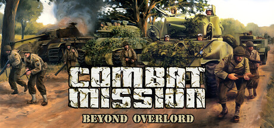

**Platforms:** Windows &nbsp;|&nbsp; **Publisher:** Battlefront.com &nbsp;|&nbsp; **Genre:** Simulation, Strategy &nbsp;|&nbsp; **Released:** May 31, 2000

> The first in the award-winning series, Combat Mission: Beyond Overlord lets you command German or Allied forces from Normandy to Germany in WWII. Battle through towns, woods, and fields in deep, immersive, turn-based and real-time tactical combat.
>
> _Synopsis source: Steam_

[Steam](https://store.steampowered.com/app/3843550)

---

### Command & Conquer: Red Alert 2

**Platforms:** Windows &nbsp;|&nbsp; **Released:** October 25

---

### Counter-Strike

**Platforms:** Windows &nbsp;|&nbsp; **Publisher:** Sierra Entertainment &nbsp;|&nbsp; **Genre:** Action &nbsp;|&nbsp; **Released:** November 9, 2000

> Play the world's number 1 online action game. Engage in an incredibly realistic brand of terrorist warfare in this wildly popular team-based game. Ally with teammates to complete strategic missions. Take out enemy sites. Rescue hostages. Your role affects your team's success. Your team's success affects your role.
>
> _Synopsis source: Steam_

[Wikipedia](https://en.wikipedia.org/wiki/Counter-Strike_(video_game)) · [Steam](https://store.steampowered.com/app/10)

---

### Counter-Strike (video game)

**Platforms:** Windows &nbsp;|&nbsp; **Released:** November 9

[Wikipedia](https://en.wikipedia.org/wiki/Counter-Strike_(video_game))

---

### Crime Cities

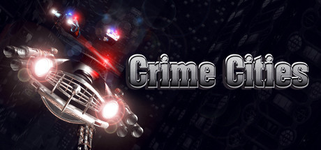

**Platforms:** Windows &nbsp;|&nbsp; **Genre:** Action, Simulation &nbsp;|&nbsp; **Released:** December 1

> Revisit Crime Cities, a revolutionary cross between a shooter and a futuristic vehicle simulator, originally published in 2000. Immerse yourself in the dense atmosphere of a grim future, as you follow a complex plot and complete a variety of deadly, unpredictable missions.
>
> _Synopsis source: Steam_

[Wikipedia](https://en.wikipedia.org/wiki/Crime_Cities) · [Steam](https://store.steampowered.com/app/1112570)

---

### Daikatana

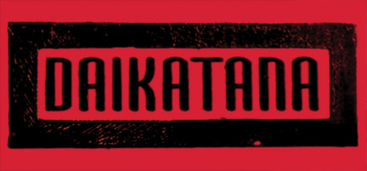

**Platforms:** Windows &nbsp;|&nbsp; **Genre:** Action &nbsp;|&nbsp; **Released:** May 24

> In 2455 AD, Kage Mishima used the magical powers of Daikatana, the most powerful sword ever forged, to alter time and establish himself as supreme dictator. You are Hiro Miyamoto, one of the few people on earth who knows what happened.
>
> _Synopsis source: Steam_

[Wikipedia](https://en.wikipedia.org/wiki/Daikatana) · [Steam](https://store.steampowered.com/app/242980)

---

### Dark Reign 2

**Platforms:** Windows &nbsp;|&nbsp; **Released:** July 3

[Wikipedia](https://en.wikipedia.org/wiki/Dark_Reign_2)

---

### Deus Ex

**Platforms:** Windows, macOS &nbsp;|&nbsp; **Publisher:** Eidos Interactive &nbsp;|&nbsp; **Genre:** Action, Adventure, RPG &nbsp;|&nbsp; **Released:** June 23, 2000

> This is Deus Ex Remastered – the definitive version of Ion Storm’s legendary cyberpunk immersive sim, modernized with visual upgrades, modern enhancements, and quality-of-life improvements for a new generation of operatives.
>
> _Synopsis source: Steam_

[Wikipedia](https://en.wikipedia.org/wiki/Deus_Ex_(video_game)) · [Steam](https://store.steampowered.com/app/3131640)

---

### Diablo II

**Platforms:** Windows, macOS &nbsp;|&nbsp; **Publisher:** Blizzard Entertainment &nbsp;|&nbsp; **Released:** June 28, 2000

[Wikipedia](https://en.wikipedia.org/wiki/Diablo_II)

---

### Disney's Aladdin in Nasira's Revenge

**Platforms:** Windows, PlayStation &nbsp;|&nbsp; **Released:** December 1

[Wikipedia](https://en.wikipedia.org/wiki/Disney%27s_Aladdin_in_Nasira%27s_Revenge)

---

### Donald Duck: Goin' Quackers

**Platforms:** Windows, PlayStation, Nintendo 64, PlayStation 2, Dreamcast, Game Boy Color &nbsp;|&nbsp; **Released:** October 19

---

### Dracula: Resurrection

**Platforms:** Windows &nbsp;|&nbsp; **Released:** June 7

---

### Earth 2150

**Platforms:** Windows &nbsp;|&nbsp; **Released:** May 22

[Wikipedia](https://en.wikipedia.org/wiki/Earth_2150)

---

### Enemy Engaged: RAH-66 Comanche vs. KA-52 Hokum

**Platforms:** Windows &nbsp;|&nbsp; **Publisher:** Empire Interactive &nbsp;|&nbsp; **Released:** July 31, 2000

---

### Escape from Monkey Island

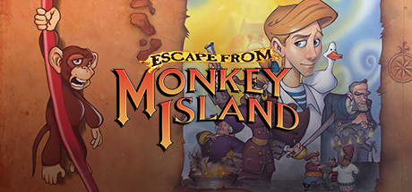

**Platforms:** Windows &nbsp;|&nbsp; **Genre:** Adventure &nbsp;|&nbsp; **Released:** November 8

> Fourth in the legendary Monkey Island series of graphic adventures!
>
> _Synopsis source: Steam_

[Wikipedia](https://en.wikipedia.org/wiki/Escape_from_Monkey_Island) · [Steam](https://store.steampowered.com/app/730830)

---

### EverQuest: The Ruins of Kunark

**Platforms:** Windows &nbsp;|&nbsp; **Publisher:** Sony Online Entertainment &nbsp;|&nbsp; **Released:** April 24, 2000

[Wikipedia](https://en.wikipedia.org/wiki/EverQuest_expansions)

---

### Evolva

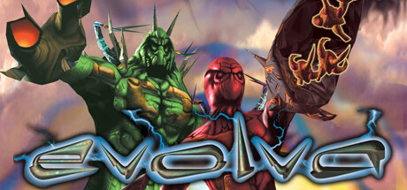

**Platforms:** Windows &nbsp;|&nbsp; **Genre:** Action, Adventure, Strategy &nbsp;|&nbsp; **Released:** June 1

> Evolva combines the excitement of a fast paced shoot-em-up with the tactical challenge of commanding a squad. Fight against the alien parasites and save the planet. This is survival of the fittest!
>
> _Synopsis source: Steam_

[Wikipedia](https://en.wikipedia.org/wiki/Evolva) · [Steam](https://store.steampowered.com/app/771430)

---

### F1 Championship Season 2000

**Platforms:** Windows, PlayStation, PlayStation 2, Game Boy Color &nbsp;|&nbsp; **Released:** September 28

[Wikipedia](https://en.wikipedia.org/wiki/F1_Championship_Season_2000)

---

### Giants: Citizen Kabuto

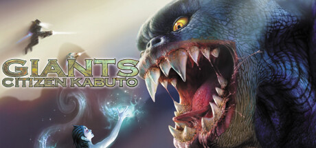

**Platforms:** Windows &nbsp;|&nbsp; **Genre:** Violent, Action, Adventure, RPG &nbsp;|&nbsp; **Released:** December 7

> Before man climbed down from the trees to shop in megastores and drink cappuccino, before the Earth wadded itself into a ball, there was the Island. A fragment from a long-lost planet. Upon the surface of this paradise wandered Kabuto the giant. Little does he know, it was home to others before him.
>
> _Synopsis source: Steam_

[Steam](https://store.steampowered.com/app/557750)

---

### Ground Control

**Platforms:** Windows &nbsp;|&nbsp; **Released:** June 1

[Wikipedia](https://en.wikipedia.org/wiki/Ground_Control_(video_game))

---

### Guilty Gear X

**Platforms:** Windows, Arcade &nbsp;|&nbsp; **Released:** July 13

[Wikipedia](https://en.wikipedia.org/wiki/Guilty_Gear_X)

---

### Heavy Metal: F.A.K.K. 2

**Platforms:** Windows, macOS &nbsp;|&nbsp; **Released:** August 1

---

### Hitman: Codename 47

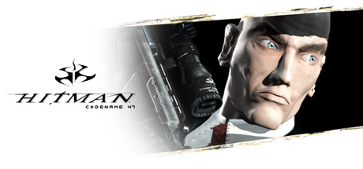

**Platforms:** Windows &nbsp;|&nbsp; **Genre:** Action &nbsp;|&nbsp; **Released:** November 19

> As the enigmatic Hitman, you must use stealth and tactical problem solving to enter, execute and exit your assignment with minimum attention and maximum effectiveness. For a price, you have access to the most devious devices, but how you use them will determine if you retire as a millionaire or get permanently retired.
>
> _Synopsis source: Steam_

[Steam](https://store.steampowered.com/app/6900)

---

### Homeworld: Cataclysm

**Platforms:** Windows &nbsp;|&nbsp; **Publisher:** Sierra Entertainment &nbsp;|&nbsp; **Released:** June 30, 2000

---

### Icewind Dale

**Platforms:** Windows &nbsp;|&nbsp; **Released:** June 29

[Wikipedia](https://en.wikipedia.org/wiki/Icewind_Dale)

---

### Jane's F/A-18

**Platforms:** Windows &nbsp;|&nbsp; **Publisher:** Electronic Arts &nbsp;|&nbsp; **Released:** January 11, 2000

[Wikipedia](https://en.wikipedia.org/wiki/Jane%27s_F/A-18)

---

### Lego Stunt Rally

**Platforms:** Windows &nbsp;|&nbsp; **Released:** September 13

[Wikipedia](https://en.wikipedia.org/wiki/Lego_Stunt_Rally)

---

### MDK2

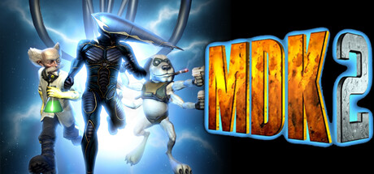

**Platforms:** Dreamcast, Windows &nbsp;|&nbsp; **Publisher:** Interplay Entertainment &nbsp;|&nbsp; **Genre:** Action &nbsp;|&nbsp; **Released:** March 31, 2000

> 3 Unlikely Heroes, 1 Ultimate Goal Kurt Hectic is back to save the universe. This time he is teamed with the genius Dr. Hawkins and the 6-legged gun-toting robotic dog, Max. Together they must out-sneak, out-blast and out-think their enemies as they attempt to reclaim earth from a vile alien menace.
>
> _Synopsis source: Steam_

[Wikipedia](https://en.wikipedia.org/wiki/MDK2) · [Steam](https://store.steampowered.com/app/38460)

---

### MechWarrior 4: Vengeance

**Platforms:** Windows, Arcade &nbsp;|&nbsp; **Released:** November 23

---

### Mega Man Legends 2

**Platforms:** Windows, PlayStation &nbsp;|&nbsp; **Released:** October 24

[Wikipedia](https://en.wikipedia.org/wiki/Mega_Man_Legends_2)

---

### Nancy Drew: Message in a Haunted Mansion

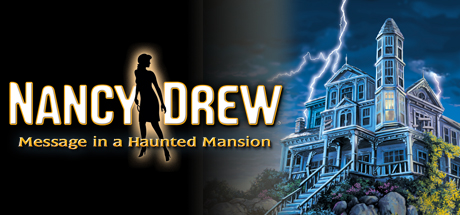

**Platforms:** Windows &nbsp;|&nbsp; **Genre:** Adventure &nbsp;|&nbsp; **Released:** November 24

> Discover who — or what — is behind the mysterious accidents in a house full of secrets!
>
> _Synopsis source: Steam_

[Steam](https://store.steampowered.com/app/615770)

---

### Need for Speed: Porsche Unleashed

**Platforms:** Windows, PlayStation &nbsp;|&nbsp; **Released:** February 29

---

### NHL 2001

**Platforms:** Windows, PlayStation, PlayStation 2 &nbsp;|&nbsp; **Publisher:** EA Sports &nbsp;|&nbsp; **Released:** September 28, 2000

[Wikipedia](https://en.wikipedia.org/wiki/NHL_2001)

---

### Nox

**Platforms:** Windows &nbsp;|&nbsp; **Released:** January 31

[Wikipedia](https://en.wikipedia.org/wiki/Nox_(video_game))

---

### PGA Championship Golf 2000

**Platforms:** Windows &nbsp;|&nbsp; **Publisher:** Sierra Entertainment &nbsp;|&nbsp; **Released:** June 1, 2000

[Wikipedia](https://en.wikipedia.org/wiki/PGA_Championship_Golf_2000)

---

### Rune

**Platforms:** Windows, macOS, Linux, PlayStation 2 &nbsp;|&nbsp; **Released:** October 27

[Wikipedia](https://en.wikipedia.org/wiki/Rune_(video_game))

---

### Sacrifice

**Platforms:** Windows &nbsp;|&nbsp; **Publisher:** Interplay Entertainment &nbsp;|&nbsp; **Released:** November 17, 2000

[Wikipedia](https://en.wikipedia.org/wiki/Sacrifice_(video_game))

---

### Scooby-Doo! Classic Creep Capers

**Platforms:** Windows, Nintendo 64 &nbsp;|&nbsp; **Released:** November 30

[Wikipedia](https://en.wikipedia.org/wiki/Scooby-Doo!_Classic_Creep_Capers)

---

### Shogun: Total War

**Platforms:** Windows &nbsp;|&nbsp; **Released:** June 13

---

### SimCity 3000 Unlimited

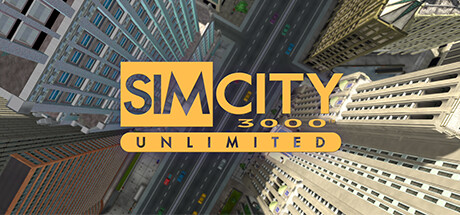

**Platforms:** Windows &nbsp;|&nbsp; **Genre:** Casual, Simulation, Strategy &nbsp;|&nbsp; **Released:** May 16

> SimCity 3000 Unlimited brings you the classic strategy gaming of SimCity 3000 with all-new scenarios that open up a whole world of city planning and building possibilities! The thrills of the classic SimCity 3000 are here again!
>
> _Synopsis source: Steam_

[Wikipedia](https://en.wikipedia.org/wiki/SimCity_3000_Unlimited) · [Steam](https://store.steampowered.com/app/2741560)

---

### Soldier of Fortune

**Platforms:** Windows &nbsp;|&nbsp; **Released:** March 27

[Wikipedia](https://en.wikipedia.org/wiki/Soldier_of_Fortune_(video_game))

---

### Spider-Man

**Platforms:** Windows, PlayStation, Game Boy Color, Nintendo 64 &nbsp;|&nbsp; **Released:** September 1

[Wikipedia](https://en.wikipedia.org/wiki/Spider-Man_(2000_video_game))

---

### Spirit of Speed 1937

**Platforms:** Windows, Dreamcast &nbsp;|&nbsp; **Released:** July 31

[Wikipedia](https://en.wikipedia.org/wiki/Spirit_of_Speed_1937)

---

### Star Trek: Deep Space Nine: The Fallen

**Platforms:** Windows &nbsp;|&nbsp; **Released:** November 23

---

### Star Trek: Voyager – Elite Force

**Platforms:** Windows &nbsp;|&nbsp; **Released:** September 15

---

### Starlancer

**Platforms:** Windows, Dreamcast &nbsp;|&nbsp; **Released:** March 31

[Wikipedia](https://en.wikipedia.org/wiki/Starlancer)

---

### Steel Beasts

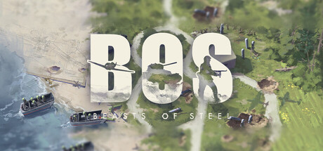

**Platforms:** Windows &nbsp;|&nbsp; **Publisher:** Shrapnel Games &nbsp;|&nbsp; **Genre:** Action, Indie, Simulation, Strategy, Early Access &nbsp;|&nbsp; **Released:** September 24, 2000

> Beasts of Steel is a semi-realistic WWII game that combines FPS and Strategy where you can battle solo or online. Experience intense combat as an infantryman, tank crew, or take to the skies as a pilot. Unleash chaos and dominate the battlefield!
>
> _Synopsis source: Steam_

[Wikipedia](https://en.wikipedia.org/wiki/Steel_Beasts) · [Steam](https://store.steampowered.com/app/1871460)

---

### Superbike 2001

**Platforms:** Windows &nbsp;|&nbsp; **Publisher:** EA Sports &nbsp;|&nbsp; **Released:** October 6, 2000

[Wikipedia](https://en.wikipedia.org/wiki/Superbike_2001)

---

### The Emperor's New Groove

**Platforms:** Windows, PlayStation, Game Boy Color &nbsp;|&nbsp; **Released:** November 13

[Wikipedia](https://en.wikipedia.org/wiki/The_Emperor%27s_New_Groove_(video_game))

---

### The King of Fighters 2000

**Platforms:** Windows, Dreamcast, PlayStation 2, Arcade &nbsp;|&nbsp; **Released:** July 26

[Wikipedia](https://en.wikipedia.org/wiki/The_King_of_Fighters_2000)

---

### The Operative: No One Lives Forever

**Platforms:** Windows &nbsp;|&nbsp; **Publisher:** Fox Interactive &nbsp;|&nbsp; **Released:** November 9, 2000

---

### The Sims

**Platforms:** Windows, macOS &nbsp;|&nbsp; **Publisher:** Electronic Arts &nbsp;|&nbsp; **Released:** February 4, 2000

[Wikipedia](https://en.wikipedia.org/wiki/The_Sims_(video_game))

---

### The World Is Not Enough

**Platforms:** Windows, PlayStation, Nintendo 64, Game Boy Color &nbsp;|&nbsp; **Released:** November 6

[Wikipedia](https://en.wikipedia.org/wiki/The_World_Is_Not_Enough_(PlayStation_video_game))

---

### Thief II

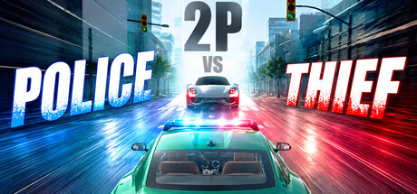

**Platforms:** Windows &nbsp;|&nbsp; **Publisher:** Eidos Interactive &nbsp;|&nbsp; **Genre:** Indie, Racing &nbsp;|&nbsp; **Released:** March 23, 2000

> Catch the thieves within a limited time, and elude the police in an even tighter window. Enjoy the fun of playing tag in a cops-and-robbers theme, available in both single-player and two-player game modes.
>
> _Synopsis source: Steam_

[Wikipedia](https://en.wikipedia.org/wiki/Thief_II) · [Steam](https://store.steampowered.com/app/4920360)

---

### Thief II: The Metal Age

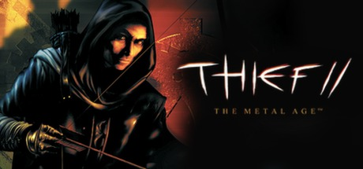

**Platforms:** Windows &nbsp;|&nbsp; **Genre:** Action, Simulation &nbsp;|&nbsp; **Released:** March 23

> The ultimate thief is back! Tread softly as you make your way through 15 new complex, non-linear levels full of loot to steal and guards to outsmart. Improved enemy AI, new gadgets and a riveting story will draw you into the world of Thief II: The Metal Age, a place of powerful new technologies, fanatical religions and corruption.
>
> _Synopsis source: Steam_

[Steam](https://store.steampowered.com/app/211740)

---

### Timeline

**Platforms:** Windows &nbsp;|&nbsp; **Released:** November 10

[Wikipedia](https://en.wikipedia.org/wiki/Timeline_(video_game))

---

### Tomb Raider: Chronicles

**Platforms:** Windows, PlayStation, Dreamcast &nbsp;|&nbsp; **Released:** November 17

---

### Tony Hawk's Pro Skater 2

**Platforms:** PlayStation, Dreamcast, Windows, Game Boy Color &nbsp;|&nbsp; **Publisher:** Activision &nbsp;|&nbsp; **Released:** September 20, 2000

[Wikipedia](https://en.wikipedia.org/wiki/Tony_Hawk%27s_Pro_Skater_2)

---

### Vampire: The Masquerade - Redemption

**Platforms:** Windows &nbsp;|&nbsp; **Released:** June 7

---

### Zeus: Master of Olympus

**Platforms:** Windows &nbsp;|&nbsp; **Released:** October

---

## 1999

[Full 1999 page](../years/1999.md)

### Age of Empires II

**Platforms:** Windows &nbsp;|&nbsp; **Publisher:** Microsoft &nbsp;|&nbsp; **Released:** September 30, 1999

[Wikipedia](https://en.wikipedia.org/wiki/Age_of_Empires_II)

---

### Age of Empires II: The Age of Kings

**Platforms:** Windows &nbsp;|&nbsp; **Released:** September 30

---

### Age of Wonders

**Platforms:** Windows &nbsp;|&nbsp; **Genre:** RPG, Strategy &nbsp;|&nbsp; **Released:** November 11

> Welcome to Age of Wonders, the authentic turn based fantasy strategy classic that started the hit series. Age of Wonders’ intimate atmosphere with painterly graphics still shines today. The game’s fully patched up, start building your fantasy empire today!
>
> _Synopsis source: Steam_

[Wikipedia](https://en.wikipedia.org/wiki/Age_of_Wonders) · [Steam](https://store.steampowered.com/app/61500)

---

### Aliens versus Predator

**Platforms:** Windows &nbsp;|&nbsp; **Released:** April 30

[Wikipedia](https://en.wikipedia.org/wiki/Aliens_versus_Predator_(1999_video_game))

---

### Asheron's Call

**Platforms:** Windows &nbsp;|&nbsp; **Released:** November 2

[Wikipedia](https://en.wikipedia.org/wiki/Asheron%27s_Call)

---

### Attack of the Saucerman

**Platforms:** Windows, PlayStation &nbsp;|&nbsp; **Released:** July 1

[Wikipedia](https://en.wikipedia.org/wiki/Attack_of_the_Saucerman)

---

### Baldur's Gate: Tales of the Sword Coast

**Platforms:** Windows &nbsp;|&nbsp; **Released:** April 30

---

### Battlezone II: Combat Commander

**Platforms:** Windows &nbsp;|&nbsp; **Released:** December 30

---

### Command & Conquer: Tiberian Sun

**Platforms:** Windows &nbsp;|&nbsp; **Released:** August 27

---

### Counter-Strike

**Platforms:** Windows &nbsp;|&nbsp; **Genre:** Action &nbsp;|&nbsp; **Released:** June 19

> Play the world's number 1 online action game. Engage in an incredibly realistic brand of terrorist warfare in this wildly popular team-based game. Ally with teammates to complete strategic missions. Take out enemy sites. Rescue hostages. Your role affects your team's success. Your team's success affects your role.
>
> _Synopsis source: Steam_

[Wikipedia](https://en.wikipedia.org/wiki/Counter-Strike_(video_game)) · [Steam](https://store.steampowered.com/app/10)

---

### Crusaders of Might and Magic

**Platforms:** Windows &nbsp;|&nbsp; **Released:** December 20

[Wikipedia](https://en.wikipedia.org/wiki/Crusaders_of_Might_and_Magic)

---

### Descent 3

**Platforms:** Windows, macOS &nbsp;|&nbsp; **Publisher:** Interplay Entertainment &nbsp;|&nbsp; **Genre:** Action &nbsp;|&nbsp; **Released:** June 17, 1999

> The vertigo continues as the highly anticipated sequel to Descent I and II takes the mind-bending, pulse-pounding experience to another level!
>
> _Synopsis source: Steam_

[Wikipedia](https://en.wikipedia.org/wiki/Descent_3) · [Steam](https://store.steampowered.com/app/273590)

---

### Disciples: Sacred Lands

**Platforms:** Windows &nbsp;|&nbsp; **Released:** October 4

---

### Driver

**Platforms:** PlayStation, Windows &nbsp;|&nbsp; **Publisher:** GT Interactive &nbsp;|&nbsp; **Released:** June 25, 1999

[Wikipedia](https://en.wikipedia.org/wiki/Driver_(video_game))

---

### Dungeon Keeper 2

**Platforms:** Windows &nbsp;|&nbsp; **Genre:** Action, Strategy &nbsp;|&nbsp; **Released:** July 7

> Bad guys have all the fun. Discover your dark side as you build an evil underground kingdom and defend it against the forces of good.
>
> _Synopsis source: Steam_

[Wikipedia](https://en.wikipedia.org/wiki/Dungeon_Keeper_2) · [Steam](https://store.steampowered.com/app/2616460)

---

### EverQuest

**Platforms:** Windows &nbsp;|&nbsp; **Publisher:** Sony Online Entertainment &nbsp;|&nbsp; **Genre:** Massively Multiplayer, RPG, Free To Play &nbsp;|&nbsp; **Released:** March 16, 1999

> Welcome to EverQuest® - the original fantasy MMORPG. Explore huge worlds, fight challenging foes, and grow your character with friends. Discover why players have quested, grouped, and raided in Norrath for more than two decades.
>
> _Synopsis source: Steam_

[Wikipedia](https://en.wikipedia.org/wiki/EverQuest) · [Steam](https://store.steampowered.com/app/205710)

---

### Flight Unlimited III

**Platforms:** Windows &nbsp;|&nbsp; **Publisher:** Electronic Arts &nbsp;|&nbsp; **Released:** September 17, 1999

[Wikipedia](https://en.wikipedia.org/wiki/Flight_Unlimited_III)

---

### FreeSpace 2

**Platforms:** Windows &nbsp;|&nbsp; **Publisher:** Interplay Entertainment &nbsp;|&nbsp; **Genre:** Action &nbsp;|&nbsp; **Released:** September 30, 1999

> FreeSpace 2, the follow up to the classic Descent: FreeSpace – The Great War is ready to engage you in the second round. Follow the Grand Terran Vasudan Alliance further into the mysteries of the Shivans. Get your flight stick and hit the flight deck. The last time was just a warm up.
>
> _Synopsis source: Steam_

[Wikipedia](https://en.wikipedia.org/wiki/FreeSpace_2) · [Steam](https://store.steampowered.com/app/273620)

---

### Gabriel Knight 3: Blood of the Sacred, Blood of the Damned

**Platforms:** Windows &nbsp;|&nbsp; **Genre:** Adventure &nbsp;|&nbsp; **Released:** November 19

> Play as both Gabriel Knight and Grace Nakimura as you learn more about what is hidden in the hills of France.
>
> _Synopsis source: Steam_

[Steam](https://store.steampowered.com/app/497360)

---

### Grand Theft Auto 2

**Platforms:** Windows, PlayStation &nbsp;|&nbsp; **Released:** October 22

[Wikipedia](https://en.wikipedia.org/wiki/Grand_Theft_Auto_2)

---

### Grand Theft Auto: London 1969

**Platforms:** Windows, PlayStation &nbsp;|&nbsp; **Released:** April 30

---

### Half-Life: Opposing Force

**Platforms:** Windows &nbsp;|&nbsp; **Genre:** Action &nbsp;|&nbsp; **Released:** November 10

> Return to the Black Mesa Research Facility as one of the military specialists assigned to eliminate Gordon Freeman. Experience an entirely new episode of single player action. Meet fierce alien opponents, and experiment with new weaponry. Named 'Game of the Year' by the Academy of Interactive Arts and Sciences.
>
> _Synopsis source: Steam_

[Steam](https://store.steampowered.com/app/50)

---

### Heavy Gear II

**Platforms:** Windows &nbsp;|&nbsp; **Released:** June 18

[Wikipedia](https://en.wikipedia.org/wiki/Heavy_Gear_II)

---

### Heroes of Might and Magic III

**Platforms:** Windows, macOS, Linux &nbsp;|&nbsp; **Genre:** Strategy &nbsp;|&nbsp; **Released:** March 3

> This is the original version of the game from 1999. The pack includes the original Heroes of Might and Magic III and its two expansions: Armageddon's Blade and The Shadow of Death.
>
> _Synopsis source: Steam_

[Wikipedia](https://en.wikipedia.org/wiki/Heroes_of_Might_and_Magic_III) · [Steam](https://store.steampowered.com/app/4921760)

---

### Homeworld

**Platforms:** Windows &nbsp;|&nbsp; **Publisher:** Sierra Entertainment &nbsp;|&nbsp; **Released:** September 28, 1999

[Wikipedia](https://en.wikipedia.org/wiki/Homeworld)

---

### Indiana Jones and the Infernal Machine [ 53 ]

**Platforms:** Windows &nbsp;|&nbsp; **Released:** November 15

[Wikipedia](https://en.wikipedia.org/wiki/Indiana_Jones_and_the_Infernal_Machine)

---

### Jagged Alliance 2

**Platforms:** Windows &nbsp;|&nbsp; **Released:** July 23

[Wikipedia](https://en.wikipedia.org/wiki/Jagged_Alliance_2)

---

### Legacy of Kain: Soul Reaver

**Platforms:** PlayStation, Windows &nbsp;|&nbsp; **Publisher:** Eidos Interactive &nbsp;|&nbsp; **Released:** August 16, 1999

---

### Madden NFL 2000

**Platforms:** Windows, macOS, PlayStation, Nintendo 64 &nbsp;|&nbsp; **Released:** August 31

[Wikipedia](https://en.wikipedia.org/wiki/Madden_NFL_2000)

---

### Midtown Madness

**Platforms:** Windows &nbsp;|&nbsp; **Released:** May 18

[Wikipedia](https://en.wikipedia.org/wiki/Midtown_Madness)

---

### Might and Magic VII: For Blood and Honor

**Platforms:** Windows &nbsp;|&nbsp; **Released:** June 8

---

### Nancy Drew: Stay Tuned for Danger

**Platforms:** Windows &nbsp;|&nbsp; **Released:** November 13

---

### NBA Live 2000

**Platforms:** Windows &nbsp;|&nbsp; **Publisher:** EA Sports &nbsp;|&nbsp; **Released:** October 31, 1999

[Wikipedia](https://en.wikipedia.org/wiki/NBA_Live_2000)

---

### Need for Speed: High Stakes

**Platforms:** Windows, PlayStation &nbsp;|&nbsp; **Released:** March 24

---

### Nocturne

**Platforms:** Windows &nbsp;|&nbsp; **Genre:** Adventure, Indie, RPG &nbsp;|&nbsp; **Released:** October 31

> The afterlife is now digital. Discover that eternal life comes with sacrifice in a genre-defying RPG with unique rhythm combat.
>
> _Synopsis source: Steam_

[Wikipedia](https://en.wikipedia.org/wiki/Nocturne_(video_game)) · [Steam](https://store.steampowered.com/app/1374860)

---

### Outcast

**Platforms:** Windows &nbsp;|&nbsp; **Released:** July 31

[Wikipedia](https://en.wikipedia.org/wiki/Outcast_(video_game))

---

### Pharaoh

**Platforms:** Windows &nbsp;|&nbsp; **Released:** October 31

[Wikipedia](https://en.wikipedia.org/wiki/Pharaoh_(video_game))

---

### Planescape: Torment

**Platforms:** Windows &nbsp;|&nbsp; **Publisher:** Interplay Entertainment &nbsp;|&nbsp; **Released:** December 12, 1999

---

### Quake III Arena

**Platforms:** Windows, Linux, Dreamcast &nbsp;|&nbsp; **Genre:** Action &nbsp;|&nbsp; **Released:** December 2

> The greatest warriors of all time and space have been summoned to battle for the amusement of an ancient alien race. Wield a variety of guns and power-ups as you fight for glory against ruthless combatants in this fast-paced single-player and multiplayer FPS.
>
> _Synopsis source: Steam_

[Wikipedia](https://en.wikipedia.org/wiki/Quake_III_Arena) · [Steam](https://store.steampowered.com/app/2200)

---

### Rayman 2: The Great Escape

**Platforms:** Windows, Nintendo 64, Dreamcast &nbsp;|&nbsp; **Publisher:** Ubisoft &nbsp;|&nbsp; **Released:** November 5, 1999

---

### Re-Volt

**Platforms:** Windows, Dreamcast, Nintendo 64, PlayStation &nbsp;|&nbsp; **Genre:** Racing &nbsp;|&nbsp; **Released:** August 18

> Re-Volt lets you guide one of 28 remote control cars through insane race tracks set in unusual environments. Curbs become huge walls, toys are obstacles, and everything is fair game to drive on, through, or over.
>
> _Synopsis source: Steam_

[Wikipedia](https://en.wikipedia.org/wiki/Re-Volt) · [Steam](https://store.steampowered.com/app/287310)

---

### Requiem: Avenging Angel [ 52 ]

**Platforms:** Windows &nbsp;|&nbsp; **Released:** March 31

---

### RollerCoaster Tycoon

**Platforms:** Windows &nbsp;|&nbsp; **Publisher:** Hasbro Interactive &nbsp;|&nbsp; **Genre:** Casual, Simulation, Strategy, Early Access &nbsp;|&nbsp; **Released:** March 22, 1999

> It’s the grand opening of a new RollerCoaster Tycoon, featuring new levels of chaos and wonder as you do whatever it takes to keep guests happy (and injury-free). Customize rides, manage guests, and build wild roller coasters in your theme parks as you boost profits and expand your empire.
>
> _Synopsis source: Steam_

[Wikipedia](https://en.wikipedia.org/wiki/RollerCoaster_Tycoon_(video_game)) · [Steam](https://store.steampowered.com/app/4734550)

---

### Septerra Core

**Platforms:** Windows &nbsp;|&nbsp; **Genre:** RPG &nbsp;|&nbsp; **Released:** October 31

> At the very heart of Septerra lies the Core, a huge Biocomputer. Seven continents at different elevations, each with its own unique people and culture, orbit around the Core.According to an ancient prophecy, Septerra's continents will one day converge and join in orbit together on one level - this is the Legacy of Marduk, the Creator's...
>
> _Synopsis source: Steam_

[Wikipedia](https://en.wikipedia.org/wiki/Septerra_Core) · [Steam](https://store.steampowered.com/app/253940)

---

### Seven Kingdoms II

**Platforms:** Windows &nbsp;|&nbsp; **Released:** July 31

[Wikipedia](https://en.wikipedia.org/wiki/Seven_Kingdoms_II)

---

### Shadow Man

**Platforms:** Windows, Dreamcast, Nintendo 64, PlayStation &nbsp;|&nbsp; **Released:** August 31

[Wikipedia](https://en.wikipedia.org/wiki/Shadow_Man_(video_game))

---

### Sid Meier's Alpha Centauri

**Platforms:** Windows &nbsp;|&nbsp; **Publisher:** Electronic Arts &nbsp;|&nbsp; **Released:** February 12, 1999

[Wikipedia](https://en.wikipedia.org/wiki/Sid_Meier%27s_Alpha_Centauri)

---

### Sim Theme Park

**Platforms:** Windows &nbsp;|&nbsp; **Genre:** Casual, Indie, Simulation &nbsp;|&nbsp; **Released:** November 3

> Build, manage, and grow your own theme park in this multiplayer simulator for 1–4 players. Buy rides, serve customers, manage cleanliness, and maximize profits with day and night cycles.
>
> _Synopsis source: Steam_

[Wikipedia](https://en.wikipedia.org/wiki/Sim_Theme_Park) · [Steam](https://store.steampowered.com/app/4162620)

---

### SimCity 3000

**Platforms:** Windows, macOS &nbsp;|&nbsp; **Released:** January 31

[Wikipedia](https://en.wikipedia.org/wiki/SimCity_3000)

---

### South Park Rally

**Platforms:** Windows, PlayStation &nbsp;|&nbsp; **Released:** November 30

[Wikipedia](https://en.wikipedia.org/wiki/South_Park_Rally)

---

### South Park: Chef's Luv Shack

**Platforms:** Windows, Dreamcast, Nintendo 64, PlayStation &nbsp;|&nbsp; **Released:** October 31

---

### Star Wars: X-Wing Alliance

**Platforms:** Windows &nbsp;|&nbsp; **Genre:** Action &nbsp;|&nbsp; **Released:** February 28

> A neutral family fights for its business - and its survival - and is swept up in the struggle against the encroaching Empire. You must defy the strong-arm tactics of a rival family who will stop at nothing to destroy your trading company.
>
> _Synopsis source: Steam_

[Steam](https://store.steampowered.com/app/361670)

---

### SWAT 3: Close Quarters Battle

**Platforms:** Windows &nbsp;|&nbsp; **Released:** November 23

---

### System Shock 2

**Platforms:** Windows &nbsp;|&nbsp; **Publisher:** Electronic Arts &nbsp;|&nbsp; **Released:** August 11, 1999

[Wikipedia](https://en.wikipedia.org/wiki/System_Shock_2)

---

### Team Fortress Classic

**Platforms:** Windows &nbsp;|&nbsp; **Genre:** Action &nbsp;|&nbsp; **Released:** April 7

> One of the most popular online action games of all time, Team Fortress Classic features over nine character classes -- from Medic to Spy to Demolition Man -- enlisted in a unique style of online team warfare. Each character class possesses unique weapons, items, and abilities, as teams compete online in a variety of game play modes.
>
> _Synopsis source: Steam_

[Wikipedia](https://en.wikipedia.org/wiki/Team_Fortress_Classic) · [Steam](https://store.steampowered.com/app/20)

---

### The Longest Journey

**Platforms:** Windows &nbsp;|&nbsp; **Publisher:** IQ Media Nordic &nbsp;|&nbsp; **Genre:** Action, Adventure, RPG &nbsp;|&nbsp; **Released:** November 18, 1999

> The Longest Journey is an amazing graphical adventure, where the player controls the protagonist, April Ryan, on her journey between parallel universes.
>
> _Synopsis source: Steam_

[Wikipedia](https://en.wikipedia.org/wiki/The_Longest_Journey_(video_game)) · [Steam](https://store.steampowered.com/app/6310)

---

### The Nomad Soul

**Platforms:** Windows &nbsp;|&nbsp; **Released:** October 31

[Wikipedia](https://en.wikipedia.org/wiki/The_Nomad_Soul)

---

### Tom Clancy's Rainbow Six: Rogue Spear

**Platforms:** Windows &nbsp;|&nbsp; **Released:** August 31

---

### Tomb Raider: The Last Revelation

**Platforms:** Windows, PlayStation &nbsp;|&nbsp; **Released:** November 22

---

### Ultima IX: Ascension

**Platforms:** Windows &nbsp;|&nbsp; **Released:** November 24

---

### Unreal Tournament

**Platforms:** Windows &nbsp;|&nbsp; **Publisher:** GT Interactive &nbsp;|&nbsp; **Released:** November 22, 1999

[Wikipedia](https://en.wikipedia.org/wiki/Unreal_Tournament)

---

### Urban Chaos

**Platforms:** Windows &nbsp;|&nbsp; **Genre:** Action &nbsp;|&nbsp; **Released:** December 10

> Urban Chaos throws you into the heart of a modern urban jungle at the turn of the millenium. To succeed you'll need a lethal combination of stealth, physical agility and martial art skills as you interact with the city around you.
>
> _Synopsis source: Steam_

[Wikipedia](https://en.wikipedia.org/wiki/Urban_Chaos) · [Steam](https://store.steampowered.com/app/243060)

---

### Warzone 2100

**Platforms:** Windows &nbsp;|&nbsp; **Genre:** Free To Play, Strategy &nbsp;|&nbsp; **Released:** April 10

> In the late 21st century, the world's civilizations are wiped out by a series of nuclear strikes, seemingly caused by a massive malfunction of the new NASDA (North American Strategic Defense Agency) strategic defense system.
>
> _Synopsis source: Steam_

[Wikipedia](https://en.wikipedia.org/wiki/Warzone_2100) · [Steam](https://store.steampowered.com/app/1241950)

---

### Worms Armageddon

**Platforms:** Windows &nbsp;|&nbsp; **Publisher:** Team17 &nbsp;|&nbsp; **Genre:** Strategy &nbsp;|&nbsp; **Released:** January 29, 1999

> The iconic intrepid invertebrates return with a vengeance in the fan-favourite classic Worms™ Armageddon. Relive their glory days once again as you blast your way into enemy territory, sweep their fields and remain the last worm standing.
>
> _Synopsis source: Steam_

[Wikipedia](https://en.wikipedia.org/wiki/Worms_Armageddon) · [Steam](https://store.steampowered.com/app/217200)

---

## 1998

[Full 1998 page](../years/1998.md)

### Baldur's Gate

**Platforms:** Windows &nbsp;|&nbsp; **Publisher:** Interplay Entertainment &nbsp;|&nbsp; **Released:** December 21, 1998

[Wikipedia](https://en.wikipedia.org/wiki/Baldur%27s_Gate_(video_game))

---

### Battlezone

**Platforms:** Windows &nbsp;|&nbsp; **Publisher:** Activision &nbsp;|&nbsp; **Released:** March 11, 1998

[Wikipedia](https://en.wikipedia.org/wiki/Battlezone_(1998_video_game))

---

### Caesar III

**Platforms:** Windows &nbsp;|&nbsp; **Publisher:** Sierra Entertainment &nbsp;|&nbsp; **Released:** September 30, 1998

[Wikipedia](https://en.wikipedia.org/wiki/Caesar_III)

---

### FIFA 99

**Platforms:** Windows, PlayStation &nbsp;|&nbsp; **Publisher:** EA Sports &nbsp;|&nbsp; **Released:** October 31, 1998

[Wikipedia](https://en.wikipedia.org/wiki/FIFA_99)

---

### Grim Fandango

**Platforms:** Windows &nbsp;|&nbsp; **Publisher:** LucasArts &nbsp;|&nbsp; **Released:** October 30, 1998

[Wikipedia](https://en.wikipedia.org/wiki/Grim_Fandango)

---

### Half-Life

**Platforms:** Windows &nbsp;|&nbsp; **Publisher:** Sierra Entertainment &nbsp;|&nbsp; **Genre:** Action &nbsp;|&nbsp; **Released:** November 19, 1998

> Named Game of the Year by over 50 publications, Valve's debut title blends action and adventure with award-winning technology to create a frighteningly realistic world where players must think to survive. Also includes an exciting multiplayer mode that allows you to play against friends and enemies around the world.
>
> _Synopsis source: Steam_

[Wikipedia](https://en.wikipedia.org/wiki/Half-Life_(video_game)) · [Steam](https://store.steampowered.com/app/70)

---

### Myth II: Soulblighter

**Platforms:** Windows &nbsp;|&nbsp; **Publisher:** Bungie &nbsp;|&nbsp; **Released:** December 28, 1998

---

### NHL 99

**Platforms:** Windows &nbsp;|&nbsp; **Publisher:** EA Sports &nbsp;|&nbsp; **Released:** September 30, 1998

[Wikipedia](https://en.wikipedia.org/wiki/NHL_99)

---

### Railroad Tycoon II

**Platforms:** Windows &nbsp;|&nbsp; **Publisher:** Gathering of Developers &nbsp;|&nbsp; **Released:** November 2, 1998

[Wikipedia](https://en.wikipedia.org/wiki/Railroad_Tycoon_II)

---

### Shogo: Mobile Armor Division

**Platforms:** Windows &nbsp;|&nbsp; **Publisher:** Monolith Productions &nbsp;|&nbsp; **Genre:** Action, Adventure, Strategy &nbsp;|&nbsp; **Released:** October 15, 1998

> Shogo is an anime-inspired first-person shooter. Fight on foot or pilot a giant mech in both open and urban levels. You will know the true power of giant robots!
>
> _Synopsis source: Steam_

[Steam](https://store.steampowered.com/app/610860)

---

### StarCraft

**Platforms:** Windows &nbsp;|&nbsp; **Publisher:** Blizzard Entertainment &nbsp;|&nbsp; **Released:** March 31, 1998

[Wikipedia](https://en.wikipedia.org/wiki/StarCraft_(video_game))

---

### Starsiege: Tribes

**Platforms:** Windows &nbsp;|&nbsp; **Publisher:** Sierra Entertainment &nbsp;|&nbsp; **Released:** December 23, 1998

---

### Thief: The Dark Project

**Platforms:** Windows &nbsp;|&nbsp; **Publisher:** Eidos Interactive &nbsp;|&nbsp; **Genre:** Action, Adventure &nbsp;|&nbsp; **Released:** December 1, 1998

> The shadows are your ally. Return to the city as Garrett, master thief, in this remastered classic by Nightdive Studios. Pickpocket, prowl, and outsmart in a world where trust is a luxury and every stolen secret comes at a price.
>
> _Synopsis source: Steam_

[Steam](https://store.steampowered.com/app/4200960)

---

### Unreal

**Platforms:** Windows &nbsp;|&nbsp; **Publisher:** GT Interactive &nbsp;|&nbsp; **Released:** May 22, 1998

[Wikipedia](https://en.wikipedia.org/wiki/Unreal_(1998_video_game))

---

## 1997

[Full 1997 page](../years/1997.md)

### 7 Wonders

**Platforms:** Windows &nbsp;|&nbsp; **Released:** Unknown

[Wikipedia](https://en.wikipedia.org/wiki/7_Wonders_(video_game))

---

### Age of Empires

**Platforms:** Windows, MS-DOS &nbsp;|&nbsp; **Released:** October 15

[Wikipedia](https://en.wikipedia.org/wiki/Age_of_Empires_(video_game))

---

### Blade Runner

**Platforms:** Windows, MS-DOS &nbsp;|&nbsp; **Released:** November 14

[Wikipedia](https://en.wikipedia.org/wiki/Blade_Runner_(1997_video_game))

---

### Blood

**Platforms:** Windows, MS-DOS &nbsp;|&nbsp; **Released:** May 21

[Wikipedia](https://en.wikipedia.org/wiki/Blood_(video_game))

---

### Carmageddon

**Platforms:** Windows, MS-DOS &nbsp;|&nbsp; **Publisher:** Sales Curve Interactive &nbsp;|&nbsp; **Genre:** Action, Indie, Racing &nbsp;|&nbsp; **Released:** June 13, 1997

> Carmageddon is the original freeform driving sensation, where pedestrians (and cows!) equal points, and your opponents are a bunch of crazies in a twisted mix of automotive killing machines. The game features anarchic drive-wherever-you-like gameplay and over-the-top surreal comedy violence. It’s the racing game where racing is for wimps.
>
> _Synopsis source: Steam_

[Wikipedia](https://en.wikipedia.org/wiki/Carmageddon) · [Steam](https://store.steampowered.com/app/282010)

---

### Close Combat: A Bridge Too Far

**Platforms:** Windows, MS-DOS &nbsp;|&nbsp; **Released:** September 30

---

### Combat Chess

**Platforms:** Windows, MS-DOS &nbsp;|&nbsp; **Genre:** Strategy &nbsp;|&nbsp; **Released:** October

> Play with living, battling characters! Combat Chess takes the basic chess game and adds an imaginative element for players. Beautifully done in rendered 3D graphics, Combat Chess adds stunning animation sequences during gameplay.
>
> _Synopsis source: Steam_

[Wikipedia](https://en.wikipedia.org/wiki/Combat_Chess) · [Steam](https://store.steampowered.com/app/1557050)

---

### Croc: Legend of the Gobbos

**Platforms:** Windows, MS-DOS, PlayStation, Sega Saturn &nbsp;|&nbsp; **Genre:** Action, Adventure &nbsp;|&nbsp; **Released:** September 29

> Join Croc in a charming 3D platforming adventure to rescue the kidnapped Gobbos from the evil sorcerer Baron Dante and his impish Dantini minions! Run, jump, climb, swim, and tail-spin through vibrant worlds in this lovingly remastered and updated version of the beloved 1997 classic.
>
> _Synopsis source: Steam_

[Steam](https://store.steampowered.com/app/3043940)

---

### Diablo

**Platforms:** Windows, MS-DOS &nbsp;|&nbsp; **Publisher:** Blizzard Entertainment &nbsp;|&nbsp; **Released:** January 3, 1997

[Wikipedia](https://en.wikipedia.org/wiki/Diablo_(video_game))

---

### Dungeon Keeper

**Platforms:** Windows, MS-DOS &nbsp;|&nbsp; **Publisher:** Electronic Arts &nbsp;|&nbsp; **Released:** June 26, 1997

[Wikipedia](https://en.wikipedia.org/wiki/Dungeon_Keeper)

---

### Ecstatica II

**Platforms:** Windows, MS-DOS &nbsp;|&nbsp; **Genre:** Action, Adventure &nbsp;|&nbsp; **Released:** June 10

> Ecstatica II is a dark fantasy action-adventure built from a one-of-a-kind ellipsoid world. Return as a prince to a kingdom sacked by demons under a blood-red sky. Cast spells and trade blows to restore the shattered Elder Sign and free the sorceress Ecstatica.
>
> _Synopsis source: Steam_

[Wikipedia](https://en.wikipedia.org/wiki/Ecstatica_II) · [Steam](https://store.steampowered.com/app/4834850)

---

### Fallout

**Platforms:** Windows, MS-DOS &nbsp;|&nbsp; **Publisher:** Interplay Productions &nbsp;|&nbsp; **Released:** October 10, 1997

[Wikipedia](https://en.wikipedia.org/wiki/Fallout_(video_game))

---

### FIFA: Road to World Cup 98

**Platforms:** Windows, MS-DOS, Nintendo 64, PlayStation, Sega Saturn &nbsp;|&nbsp; **Released:** November 30

---

### Grand Theft Auto

**Platforms:** Windows, MS-DOS, PlayStation &nbsp;|&nbsp; **Released:** November 27

[Wikipedia](https://en.wikipedia.org/wiki/Grand_Theft_Auto_(video_game))

---

### Hexen II

**Platforms:** Windows, MS-DOS &nbsp;|&nbsp; **Genre:** Action &nbsp;|&nbsp; **Released:** September 11

> The Four Horsemen of the Apocalypse lurk in the shadows before you. They are Death, Pestilence, Famine, and War. They are the root of all that is evil, but the least of your worries. The last of the three Serpent Riders yet lives.
>
> _Synopsis source: Steam_

[Wikipedia](https://en.wikipedia.org/wiki/Hexen_II) · [Steam](https://store.steampowered.com/app/9060)

---

### Imperialism

**Platforms:** Windows, MS-DOS &nbsp;|&nbsp; **Genre:** Indie, Strategy &nbsp;|&nbsp; **Released:** August 31

> It is the 19th century - an age of steam power, revolution, and imperialist expansion. Engage in turn-based gameplay as you strive to ascend to unparalleled power through astute management of trade, industry, research, diplomacy, colonization, and warfare.
>
> _Synopsis source: Steam_

[Wikipedia](https://en.wikipedia.org/wiki/Imperialism_(video_game)) · [Steam](https://store.steampowered.com/app/2766160)

---

### Independence Day

**Platforms:** Windows, MS-DOS, PlayStation, Sega Saturn &nbsp;|&nbsp; **Released:** February 28

[Wikipedia](https://en.wikipedia.org/wiki/Independence_Day_(video_game))

---

### Independence War

**Platforms:** Windows, MS-DOS &nbsp;|&nbsp; **Released:** November

[Wikipedia](https://en.wikipedia.org/wiki/I-War_(1997_video_game))

---

### Interstate '76

**Platforms:** Windows, MS-DOS &nbsp;|&nbsp; **Released:** February 28

[Wikipedia](https://en.wikipedia.org/wiki/Interstate_%2776)

---

### Jane's 688(I) Hunter/Killer

**Platforms:** Windows, MS-DOS &nbsp;|&nbsp; **Released:** July 4

[Wikipedia](https://en.wikipedia.org/wiki/688(I)_Hunter/Killer)

---

### LEGO Island

**Platforms:** Windows, MS-DOS &nbsp;|&nbsp; **Released:** September 26

[Wikipedia](https://en.wikipedia.org/wiki/LEGO_Island)

---

### Madden NFL 98

**Platforms:** Sega Saturn, Windows, MS-DOS, PlayStation &nbsp;|&nbsp; **Publisher:** EA Sports &nbsp;|&nbsp; **Released:** August 26, 1997

[Wikipedia](https://en.wikipedia.org/wiki/Madden_NFL_98)

---

### MDK

**Platforms:** Windows, MS-DOS &nbsp;|&nbsp; **Publisher:** Playmates Interactive &nbsp;|&nbsp; **Genre:** Action &nbsp;|&nbsp; **Released:** May 5, 1997

> ON A GOOD DAY, ONLY 2.5 MILLION PEOPLE WILL DIE. As vast alien mining cities suck the power and minerals from every major metropolis on Earth simultaneously, time is of the essence as millions of civilians are expiring by the second.
>
> _Synopsis source: Steam_

[Wikipedia](https://en.wikipedia.org/wiki/MDK_(video_game)) · [Steam](https://store.steampowered.com/app/38450)

---

### Myth: The Fallen Lords

**Platforms:** Windows, MS-DOS &nbsp;|&nbsp; **Publisher:** Bungie &nbsp;|&nbsp; **Released:** November 7, 1997

---

### Need for Speed II

**Platforms:** Windows, MS-DOS, PlayStation &nbsp;|&nbsp; **Released:** March 31

[Wikipedia](https://en.wikipedia.org/wiki/Need_for_Speed_II)

---

### Oddworld: Abe's Oddysee

**Platforms:** PlayStation, Windows, MS-DOS &nbsp;|&nbsp; **Publisher:** GT Interactive &nbsp;|&nbsp; **Genre:** Adventure &nbsp;|&nbsp; **Released:** September 18, 1997

> Selected by the fickle finger of fate, Abe™, floor-waxer first class for RuptureFarms, was catapulted into a life of adventure when he overheard plans by his boss, Molluck the Glukkon™, to turn Abe and his fellow Mudokons into Tasty Treats as part of a last-ditch effort to rescue Molluck's failing meat-packing empire.
>
> _Synopsis source: Steam_

[Steam](https://store.steampowered.com/app/15700)

---

### Outlaws

**Platforms:** Windows, MS-DOS &nbsp;|&nbsp; **Released:** April 7

[Wikipedia](https://en.wikipedia.org/wiki/Outlaws_(1997_video_game))

---

### Panzer General II

**Platforms:** Windows, MS-DOS &nbsp;|&nbsp; **Released:** September 30

[Wikipedia](https://en.wikipedia.org/wiki/Panzer_General_II)

---

### Postal

**Platforms:** Windows, MS-DOS &nbsp;|&nbsp; **Released:** September 24

[Wikipedia](https://en.wikipedia.org/wiki/Postal_(video_game))

---

### Quake II

**Platforms:** Windows, MS-DOS, PlayStation &nbsp;|&nbsp; **Genre:** Action &nbsp;|&nbsp; **Released:** December 6

> You are humanity’s last hope to stop the Strogg, a hostile alien race waging war against Earth. Play this military sci-fi FPS, now upgraded for modern platforms with improved visuals, new campaign content, online multiplayer/co-op, and more.
>
> _Synopsis source: Steam_

[Wikipedia](https://en.wikipedia.org/wiki/Quake_II) · [Steam](https://store.steampowered.com/app/2320)

---

### Realms of the Haunting (NA)

**Platforms:** Windows, MS-DOS &nbsp;|&nbsp; **Released:** March 24

[Wikipedia](https://en.wikipedia.org/wiki/Realms_of_the_Haunting)

---

### Redneck Rampage

**Platforms:** Windows, MS-DOS &nbsp;|&nbsp; **Genre:** Action &nbsp;|&nbsp; **Released:** April 7

> Well, we crash-landed that UFO in the desert and Bubba says he wants to go home. Heck, I don't blame him 'cause there ain't no place like Hickston. But according to my map, we're gonna have to blast our way through jack o' lope farms and a riverboat as well as a brothel 'fore we get home again.
>
> _Synopsis source: Steam_

[Wikipedia](https://en.wikipedia.org/wiki/Redneck_Rampage) · [Steam](https://store.steampowered.com/app/565550)

---

### Resident Evil

**Platforms:** Windows, MS-DOS &nbsp;|&nbsp; **Released:** September 17

[Wikipedia](https://en.wikipedia.org/wiki/Resident_Evil_(1996_video_game))

---

### Riven

**Platforms:** Windows, MS-DOS, Sega Saturn, PlayStation &nbsp;|&nbsp; **Genre:** Adventure, Casual, Indie &nbsp;|&nbsp; **Released:** October 29

> Uncover a story of intrigue, betrayal, and a civilization teetering on the brink of collapse as you solve intricate puzzles to unlock the secrets of Riven. Built from the ground-up and expanded from the award-winning original game released in 1997.
>
> _Synopsis source: Steam_

[Wikipedia](https://en.wikipedia.org/wiki/Riven) · [Steam](https://store.steampowered.com/app/1712350)

---

### Shadow Warrior

**Platforms:** Windows, MS-DOS &nbsp;|&nbsp; **Genre:** Action, Adventure &nbsp;|&nbsp; **Released:** August 25

> Shadow Warrior is a bold reimagining of the classic 3D Realms’ shooter from independent developer Flying Wild Hog (Hard Reset) starring the legendary and quick-witted warrior Lo Wang.
>
> _Synopsis source: Steam_

[Wikipedia](https://en.wikipedia.org/wiki/Shadow_Warrior_(1997_video_game)) · [Steam](https://store.steampowered.com/app/233130)

---

### Shipwreckers

**Platforms:** Windows, MS-DOS, PlayStation &nbsp;|&nbsp; **Released:** October 28

[Wikipedia](https://en.wikipedia.org/wiki/Overboard!_(1997_video_game))

---

### Sid Meier's Gettysburg!

**Platforms:** Windows, MS-DOS &nbsp;|&nbsp; **Publisher:** Electronic Arts &nbsp;|&nbsp; **Released:** October 14, 1997

[Wikipedia](https://en.wikipedia.org/wiki/Sid_Meier%27s_Gettysburg!)

---

### Star Wars Jedi Knight: Dark Forces II

**Platforms:** Windows, MS-DOS &nbsp;|&nbsp; **Publisher:** LucasArts &nbsp;|&nbsp; **Genre:** Action &nbsp;|&nbsp; **Released:** October 10, 1997

> Jedi Knight: Dark Forces II picks up where the award-winning Dark Forces™ game left off...with even more features and firepower in dazzling 3D graphics. As Kyle Katarn, you must acquire a lightsaber and learn the ways of the Force to become a Jedi Knight.
>
> _Synopsis source: Steam_

[Steam](https://store.steampowered.com/app/32380)

---

### Star Wars: Shadows of the Empire

**Platforms:** Windows, MS-DOS &nbsp;|&nbsp; **Genre:** Action, Adventure &nbsp;|&nbsp; **Released:** September 9

> As Luke Skywalker and the Rebel Alliance struggle to defeat Darth Vader and the Empire, a new threat arises. Dark Prince Xizor aspires to take Darth Vader's place at the Emperor's side. As Dash Rendar, it's up to you to protect Luke and help the Alliance. May the Force be with you!
>
> _Synopsis source: Steam_

[Steam](https://store.steampowered.com/app/560170)

---

### Star Wars: X-Wing vs. TIE Fighter

**Platforms:** Windows, MS-DOS &nbsp;|&nbsp; **Released:** April 30

---

### The Curse of Monkey Island

**Platforms:** Windows, MS-DOS &nbsp;|&nbsp; **Publisher:** LucasArts &nbsp;|&nbsp; **Genre:** Adventure &nbsp;|&nbsp; **Released:** November 1, 1997

> The only pirate adventure that asks the question: What's sharper, your sword or your wit?
>
> _Synopsis source: Steam_

[Wikipedia](https://en.wikipedia.org/wiki/The_Curse_of_Monkey_Island) · [Steam](https://store.steampowered.com/app/730820)

---

### The Last Express

**Platforms:** Windows, MS-DOS &nbsp;|&nbsp; **Released:** March 30

[Wikipedia](https://en.wikipedia.org/wiki/The_Last_Express)

---

### The Lost Vikings 2

**Platforms:** Windows, MS-DOS, Super Nintendo Entertainment System, PlayStation, Sega Saturn &nbsp;|&nbsp; **Released:** February 27

[Wikipedia](https://en.wikipedia.org/wiki/The_Lost_Vikings_2)

---

### Tomb Raider II

**Platforms:** Windows, MS-DOS, PlayStation &nbsp;|&nbsp; **Released:** November 18

[Wikipedia](https://en.wikipedia.org/wiki/Tomb_Raider_II)

---

### Total Annihilation

**Platforms:** Windows, MS-DOS &nbsp;|&nbsp; **Publisher:** GT Interactive &nbsp;|&nbsp; **Genre:** Strategy &nbsp;|&nbsp; **Released:** September 26, 1997

> What began as a conflict over the transfer of consciousness from flesh to machines escalated into a war which has decimated a million worlds. The Core and the Arm have all but exhausted the resources of a galaxy in their struggle for domination.
>
> _Synopsis source: Steam_

[Wikipedia](https://en.wikipedia.org/wiki/Total_Annihilation) · [Steam](https://store.steampowered.com/app/298030)

---

### Turok: Dinosaur Hunter

**Platforms:** Windows, MS-DOS, Nintendo 64 &nbsp;|&nbsp; **Released:** February 28

---

### Ultima Online

**Platforms:** Windows, MS-DOS &nbsp;|&nbsp; **Genre:** Adventure, Casual, Massively Multiplayer, Simulation, Sports, Free To Play &nbsp;|&nbsp; **Released:** September 24

> Ultimate Fishing® Online is a free-to-play multiplayer fishing game set in ecosystems with various fish, reactive shoals, dynamic weather &amp; day-night cycles. Explore diverse fishing spots, customize gear &amp; use various techniques! Cast, Catch &amp; Compete!
>
> _Synopsis source: Steam_

[Wikipedia](https://en.wikipedia.org/wiki/Ultima_Online) · [Steam](https://store.steampowered.com/app/2068100)

---

### Warlords III: Reign of Heroes

**Platforms:** Windows, MS-DOS &nbsp;|&nbsp; **Released:** July 31

---

### Wing Commander: Prophecy

**Platforms:** Windows, MS-DOS &nbsp;|&nbsp; **Released:** November 30

---

### Worms 2

**Platforms:** Windows, MS-DOS &nbsp;|&nbsp; **Released:** November 21

[Wikipedia](https://en.wikipedia.org/wiki/Worms_2)

---

### Zork: Grand Inquisitor

**Platforms:** Windows, MS-DOS &nbsp;|&nbsp; **Genre:** Adventure &nbsp;|&nbsp; **Released:** October 31

> Join forces with Dungeon Master Dalboz and travel throughout the Underground Empire's many locations, such as Hades, Flood Control Dam #3 and The Dungeon Master's Lair.
>
> _Synopsis source: Steam_

[Steam](https://store.steampowered.com/app/570680)

---

## 1996

[Full 1996 page](../years/1996.md)

### Area 51

**Platforms:** PlayStation, Windows, Sega Saturn &nbsp;|&nbsp; **Developer/Publisher:** Mesa Logic/ Atari Games &nbsp;|&nbsp; **Genre:** Shooter &nbsp;|&nbsp; **Released:** November 26

> Storm AREA 51 with your friends. Explore the most classified facility on earth. Discover what they've been hiding. Take selfies with aliens and smuggle evidence out before the military arrives.
>
> _Synopsis source: Steam_

[Wikipedia](https://en.wikipedia.org/wiki/Area_51_(1995_video_game)) · [Steam](https://store.steampowered.com/app/4423180)

---

### Barbie Fashion Designer

**Platforms:** Windows &nbsp;|&nbsp; **Developer/Publisher:** Digital Domain / Mattel Media &nbsp;|&nbsp; **Released:** April 20

[Wikipedia](https://en.wikipedia.org/wiki/Barbie_Fashion_Designer)

---

### Blood Omen: Legacy of Kain

**Platforms:** PlayStation, Windows &nbsp;|&nbsp; **Developer/Publisher:** Silicon Knights / Crystal Dynamics &nbsp;|&nbsp; **Released:** November 1

---

### Broken Sword: The Shadow of the Templars

**Platforms:** Windows, PlayStation &nbsp;|&nbsp; **Developer/Publisher:** Revolution Software / Virgin Interactive &nbsp;|&nbsp; **Genre:** Adventure &nbsp;|&nbsp; **Released:** September 30

---

### Bug Too!

**Platforms:** Sega Saturn, Windows &nbsp;|&nbsp; **Developer/Publisher:** Sega / Realtime Associates &nbsp;|&nbsp; **Released:** November 30

[Wikipedia](https://en.wikipedia.org/wiki/Bug_Too!)

---

### Civilization II

**Platforms:** Windows &nbsp;|&nbsp; **Developer/Publisher:** MicroProse &nbsp;|&nbsp; **Publisher:** MicroProse &nbsp;|&nbsp; **Genre:** 4X &nbsp;|&nbsp; **Released:** February 29, 1996

[Wikipedia](https://en.wikipedia.org/wiki/Civilization_II)

---

### DeathDrome

**Platforms:** Windows &nbsp;|&nbsp; **Developer/Publisher:** Zipper Interactive / Viacom &nbsp;|&nbsp; **Released:** October 31

[Wikipedia](https://en.wikipedia.org/wiki/DeathDrome)

---

### Die Hard Trilogy

**Platforms:** Windows, PlayStation, Sega Saturn &nbsp;|&nbsp; **Developer/Publisher:** Probe Entertainment / Fox Interactive &nbsp;|&nbsp; **Released:** August 31

[Wikipedia](https://en.wikipedia.org/wiki/Die_Hard_Trilogy)

---

### Drowned God

**Platforms:** Windows &nbsp;|&nbsp; **Developer/Publisher:** Epic Multimedia Group/ Inscape &nbsp;|&nbsp; **Genre:** Adventure &nbsp;|&nbsp; **Released:** October 31

[Wikipedia](https://en.wikipedia.org/wiki/Drowned_God)

---

### FIFA Soccer 97

**Platforms:** Genesis / Mega Drive, PlayStation, Windows, Super Nintendo Entertainment System, Sega Saturn, Game Boy &nbsp;|&nbsp; **Developer/Publisher:** EA Canada / Electronic Arts &nbsp;|&nbsp; **Released:** November 30

[Wikipedia](https://en.wikipedia.org/wiki/FIFA_Soccer_97)

---

### Furcadia

**Platforms:** Windows &nbsp;|&nbsp; **Developer/Publisher:** Dragon's Eye Productions, Inc. &nbsp;|&nbsp; **Genre:** MMORPG &nbsp;|&nbsp; **Released:** December 16

[Wikipedia](https://en.wikipedia.org/wiki/Furcadia)

---

### Heroes of Might and Magic II: The Succession Wars

**Platforms:** MS-DOS, Windows &nbsp;|&nbsp; **Developer/Publisher:** New World Computing / 3DO &nbsp;|&nbsp; **Released:** October 1

---

### Ignition

**Platforms:** MS-DOS, Windows &nbsp;|&nbsp; **Developer/Publisher:** Unique Development Studios/ Virgin Interactive &nbsp;|&nbsp; **Genre:** Racing &nbsp;|&nbsp; **Released:** December 12

> Sulfur Ignition is an irreverent racing game set in hell where players are condemned to compete at high speeds while battling each other, the game contains a good mix of high speed action, dark humor and lots of sarcasm!
>
> _Synopsis source: Steam_

[Steam](https://store.steampowered.com/app/3774780)

---

### Indiana Jones and His Desktop Adventures

**Platforms:** Windows, macOS &nbsp;|&nbsp; **Developer/Publisher:** LucasArts &nbsp;|&nbsp; **Genre:** Adventure &nbsp;|&nbsp; **Released:** April 30

[Wikipedia](https://en.wikipedia.org/wiki/Indiana_Jones_and_His_Desktop_Adventures)

---

### Madden NFL 97

**Platforms:** Genesis / Mega Drive, PlayStation, Windows, Super Nintendo Entertainment System, Sega Saturn, Game Boy &nbsp;|&nbsp; **Developer/Publisher:** EA Sports / Electronic Arts &nbsp;|&nbsp; **Genre:** Sports (football) &nbsp;|&nbsp; **Released:** August 31

[Wikipedia](https://en.wikipedia.org/wiki/Madden_NFL_97)

---

### Meridian 59

**Platforms:** Windows &nbsp;|&nbsp; **Developer/Publisher:** 3DO &nbsp;|&nbsp; **Genre:** MMORPG &nbsp;|&nbsp; **Released:** September 27

> Meridian 59 was the first 3D massively multiplayer game, released in 1996. It's back, and it's free to play!
>
> _Synopsis source: Steam_

[Wikipedia](https://en.wikipedia.org/wiki/Meridian_59) · [Steam](https://store.steampowered.com/app/893390)

---

### NBA Hangtime

**Platforms:** Genesis / Mega Drive, PlayStation, Windows, Nintendo 64, Arcade, Super Nintendo Entertainment System &nbsp;|&nbsp; **Developer/Publisher:** Midway &nbsp;|&nbsp; **Genre:** Sports (basketball) &nbsp;|&nbsp; **Released:** December 31

[Wikipedia](https://en.wikipedia.org/wiki/NBA_Hangtime)

---

### Phantasmagoria: A Puzzle of Flesh

**Platforms:** MS-DOS, Windows &nbsp;|&nbsp; **Developer/Publisher:** Sierra On-Line &nbsp;|&nbsp; **Released:** July 31

---

### Rise 2: Resurrection

**Platforms:** Windows, Sega Saturn, PlayStation &nbsp;|&nbsp; **Developer/Publisher:** Mirage / Acclaim &nbsp;|&nbsp; **Released:** February 29

---

### SimCopter

**Platforms:** Windows &nbsp;|&nbsp; **Developer/Publisher:** Maxis &nbsp;|&nbsp; **Genre:** Simulation (flight) &nbsp;|&nbsp; **Released:** October 31

[Wikipedia](https://en.wikipedia.org/wiki/SimCopter)

---

### Someone's in the Kitchen!

**Platforms:** Windows &nbsp;|&nbsp; **Developer/Publisher:** The Neverhood Inc./ DreamWorks &nbsp;|&nbsp; **Released:** March 24

---

### The Elder Scrolls II: Daggerfall

**Platforms:** Windows &nbsp;|&nbsp; **Developer/Publisher:** Bethesda Softworks &nbsp;|&nbsp; **Genre:** Sandbox &nbsp;|&nbsp; **Released:** September 20

> THE GREAT MACHINE AWAKENS
>
> _Synopsis source: Steam_

[Steam](https://store.steampowered.com/app/1812390)

---

### The Neverhood

**Platforms:** Windows &nbsp;|&nbsp; **Developer/Publisher:** The Neverhood Inc./DreamWorks &nbsp;|&nbsp; **Released:** October 30

[Wikipedia](https://en.wikipedia.org/wiki/The_Neverhood)

---

### Zork: Nemesis

**Platforms:** Windows &nbsp;|&nbsp; **Developer/Publisher:** Activision &nbsp;|&nbsp; **Released:** February 29

---

## 1995

[Full 1995 page](../years/1995.md)

### Flight Unlimited

**Platforms:** MS-DOS, Windows &nbsp;|&nbsp; **Developer/Publisher:** Looking Glass Studios &nbsp;|&nbsp; **Released:** June 7

[Wikipedia](https://en.wikipedia.org/wiki/Flight_Unlimited)

---

### Phantasmagoria

**Platforms:** MS-DOS, Windows, macOS &nbsp;|&nbsp; **Developer/Publisher:** Sierra Online &nbsp;|&nbsp; **Genre:** Adventure &nbsp;|&nbsp; **Released:** July 31

> Master storyteller Roberta Williams challenges you to experience the ultimate interactive nightmare.
>
> _Synopsis source: Steam_

[Wikipedia](https://en.wikipedia.org/wiki/Phantasmagoria_(video_game)) · [Steam](https://store.steampowered.com/app/501990)

---

### Star Wars: TIE Fighter (Collector's CD-ROM)

**Platforms:** Windows, macOS &nbsp;|&nbsp; **Developer/Publisher:** LucasArts &nbsp;|&nbsp; **Released:** October 31

---

### The Beast Within: A Gabriel Knight Mystery

**Platforms:** MS-DOS, Windows, macOS &nbsp;|&nbsp; **Developer/Publisher:** Sierra On-Line &nbsp;|&nbsp; **Genre:** Adventure &nbsp;|&nbsp; **Released:** December 31

> Play as both Gabriel and Grace as they are dispatched to Munich to solve a series of mutilation murders thought to be the work of werewolves.
>
> _Synopsis source: Steam_

[Steam](https://store.steampowered.com/app/496760)

---
