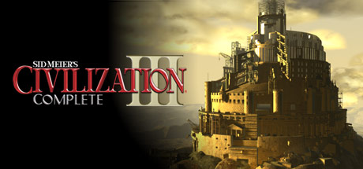
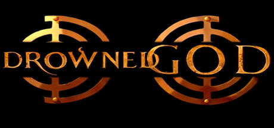
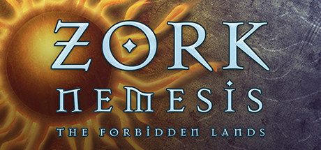

# Windows

[← Back to index](../README.md)

1491 titles across 32 years in this archive.

## 2026

[Full 2026 page](../years/2026.md)

### Big Walk

**Platforms:** macOS, PlayStation 5, Windows, Nintendo Switch 2 &nbsp;|&nbsp; **Developer:** House House &nbsp;|&nbsp; **Publisher:** Panic &nbsp;|&nbsp; **Released:** August 4, 2026

[Wikipedia](https://en.wikipedia.org/wiki/Big_Walk)

---

### Doom: The Dark Ages – Revelations

**Platforms:** PlayStation 5, Windows, Xbox Series X/S &nbsp;|&nbsp; **Developer:** id Software &nbsp;|&nbsp; **Publisher:** Bethesda Softworks &nbsp;|&nbsp; **Released:** July 6, 2026

---

### Forza Horizon 6

**Platforms:** Windows, Xbox Series X/S &nbsp;|&nbsp; **Developer:** Playground Games &nbsp;|&nbsp; **Publisher:** Xbox Game Studios &nbsp;|&nbsp; **Released:** May 19, 2026

[Wikipedia](https://en.wikipedia.org/wiki/Forza_Horizon_6)

---

### Mina the Hollower

**Platforms:** Windows, Nintendo Switch, Nintendo Switch 2, PlayStation 4, PlayStation 5, Xbox One, Xbox Series X/S &nbsp;|&nbsp; **Developer:** Yacht Club Games &nbsp;|&nbsp; **Publisher:** Yacht Club Games &nbsp;|&nbsp; **Released:** May 29, 2026

[Wikipedia](https://en.wikipedia.org/wiki/Mina_the_Hollower)

---

## 2025

[Full 2025 page](../years/2025.md)

### Blue Prince

**Platforms:** Windows, PlayStation 5, Xbox Series X/S &nbsp;|&nbsp; **Developer:** Dogubomb &nbsp;|&nbsp; **Publisher:** Raw Fury &nbsp;|&nbsp; **Released:** April 10, 2025

[Wikipedia](https://en.wikipedia.org/wiki/Blue_Prince)

---

### Clair Obscur: Expedition 33

**Platforms:** Windows, PlayStation 5, Xbox Series X/S &nbsp;|&nbsp; **Developer:** Sandfall Interactive &nbsp;|&nbsp; **Publisher:** Kepler Interactive &nbsp;|&nbsp; **Released:** April 24, 2025

---

### Hades II

**Platforms:** Windows, Nintendo Switch, Nintendo Switch 2 &nbsp;|&nbsp; **Developer:** Supergiant Games &nbsp;|&nbsp; **Publisher:** Supergiant Games &nbsp;|&nbsp; **Released:** September 25, 2025

[Wikipedia](https://en.wikipedia.org/wiki/Hades_II)

---

### Hollow Knight: Silksong

**Platforms:** Windows, PlayStation 4, PlayStation 5, Xbox One, Xbox Series X/S, Nintendo Switch, Nintendo Switch 2 &nbsp;|&nbsp; **Developer:** Team Cherry &nbsp;|&nbsp; **Publisher:** Team Cherry &nbsp;|&nbsp; **Released:** September 4, 2025

---

### Split Fiction

**Platforms:** Windows, PlayStation 5, Xbox Series X/S, Nintendo Switch 2 &nbsp;|&nbsp; **Developer:** Hazelight Studios &nbsp;|&nbsp; **Publisher:** Electronic Arts &nbsp;|&nbsp; **Released:** March 6, 2025

[Wikipedia](https://en.wikipedia.org/wiki/Split_Fiction)

---

## 2024

[Full 2024 page](../years/2024.md)

### Animal Well

**Platforms:** PlayStation 5, Nintendo Switch, Windows, Xbox Series X/S &nbsp;|&nbsp; **Developer:** Shared Memory &nbsp;|&nbsp; **Publisher:** Bigmode &nbsp;|&nbsp; **Released:** May 9, 2024

[Wikipedia](https://en.wikipedia.org/wiki/Animal_Well)

---

### Balatro

**Platforms:** Android, iOS, macOS, Nintendo Switch, PlayStation 4, PlayStation 5, Windows, Xbox One, Xbox Series X/S &nbsp;|&nbsp; **Developer:** LocalThunk &nbsp;|&nbsp; **Publisher:** Playstack &nbsp;|&nbsp; **Released:** February 20, 2024

[Wikipedia](https://en.wikipedia.org/wiki/Balatro)

---

### Caves of Qud

**Platforms:** Windows, macOS, Linux &nbsp;|&nbsp; **Developer:** Freehold Games &nbsp;|&nbsp; **Publisher:** Kitfox Games &nbsp;|&nbsp; **Released:** December 5, 2024

[Wikipedia](https://en.wikipedia.org/wiki/Caves_of_Qud)

---

### Elden Ring Shadow of the Erdtree

**Platforms:** PlayStation 4, PlayStation 5, Windows, Xbox One, Xbox Series X/S &nbsp;|&nbsp; **Developer:** FromSoftware &nbsp;|&nbsp; **Publisher:** Bandai Namco Entertainment &nbsp;|&nbsp; **Released:** June 21, 2024

[Wikipedia](https://en.wikipedia.org/wiki/Elden_Ring_Shadow_of_the_Erdtree)

---

### Metaphor: ReFantazio

**Platforms:** PlayStation 4, PlayStation 5, Windows, Xbox Series X/S &nbsp;|&nbsp; **Developer:** Studio Zero &nbsp;|&nbsp; **Publisher:** Sega , Atlus &nbsp;|&nbsp; **Released:** October 11, 2024

---

### Satisfactory

**Platforms:** Windows &nbsp;|&nbsp; **Developer:** Coffee Stain Studios &nbsp;|&nbsp; **Publisher:** Coffee Stain Studios &nbsp;|&nbsp; **Released:** September 10, 2024

[Wikipedia](https://en.wikipedia.org/wiki/Satisfactory)

---

### Slay the Princess — The Pristine Cut

**Platforms:** Linux, macOS, Nintendo Switch, PlayStation 4, PlayStation 5, Windows, Xbox One, Xbox Series X/S &nbsp;|&nbsp; **Developer:** Black Tabby Games &nbsp;|&nbsp; **Publisher:** Serenity Forge &nbsp;|&nbsp; **Released:** October 24, 2024

[Wikipedia](https://en.wikipedia.org/wiki/Slay_the_Princess_%E2%80%94_The_Pristine_Cut)

---

### Tekken 8

**Platforms:** PlayStation 5, Windows, Xbox Series X/S &nbsp;|&nbsp; **Developer:** Bandai Namco Studios / Arika [ 8 ] &nbsp;|&nbsp; **Publisher:** Bandai Namco Entertainment &nbsp;|&nbsp; **Released:** January 26, 2024

[Wikipedia](https://en.wikipedia.org/wiki/Tekken_8)

---

### UFO 50

**Platforms:** Windows &nbsp;|&nbsp; **Developer:** Mossmouth &nbsp;|&nbsp; **Publisher:** Mossmouth &nbsp;|&nbsp; **Released:** September 18, 2024

[Wikipedia](https://en.wikipedia.org/wiki/UFO_50)

---

## 2023

[Full 2023 page](../years/2023.md)

### Against the Storm

**Platforms:** Windows &nbsp;|&nbsp; **Developer:** Eremite Games &nbsp;|&nbsp; **Publisher:** Hooded Horse &nbsp;|&nbsp; **Released:** December 8, 2023

[Wikipedia](https://en.wikipedia.org/wiki/Against_the_Storm_(video_game))

---

### Baldur's Gate 3

**Platforms:** macOS, PlayStation 5, Windows, Xbox Series X/S &nbsp;|&nbsp; **Developer:** Larian Studios &nbsp;|&nbsp; **Publisher:** Larian Studios &nbsp;|&nbsp; **Released:** August 3, 2023

[Wikipedia](https://en.wikipedia.org/wiki/Baldur%27s_Gate_3)

---

### Dave the Diver

**Platforms:** macOS, Nintendo Switch, PlayStation 4, PlayStation 5, Windows &nbsp;|&nbsp; **Developer:** Mintrocket &nbsp;|&nbsp; **Publisher:** Mintrocket &nbsp;|&nbsp; **Released:** June 28, 2023

[Wikipedia](https://en.wikipedia.org/wiki/Dave_the_Diver)

---

### Resident Evil 4

**Platforms:** iOS, iPadOS, macOS, PlayStation 4, PlayStation 5, Windows, Xbox Series X/S &nbsp;|&nbsp; **Developer:** Capcom &nbsp;|&nbsp; **Publisher:** Capcom &nbsp;|&nbsp; **Released:** March 24, 2023

[Wikipedia](https://en.wikipedia.org/wiki/Resident_Evil_4_(2023_video_game))

---

### Street Fighter 6

**Platforms:** Arcade, PlayStation 4, PlayStation 5, Windows, Xbox Series X/S &nbsp;|&nbsp; **Developer:** Capcom &nbsp;|&nbsp; **Publisher:** Capcom &nbsp;|&nbsp; **Released:** June 2, 2023

[Wikipedia](https://en.wikipedia.org/wiki/Street_Fighter_6)

---

### Videoverse

**Platforms:** Linux, macOS, Windows &nbsp;|&nbsp; **Developer:** Kinmoku &nbsp;|&nbsp; **Publisher:** Kinmoku &nbsp;|&nbsp; **Released:** August 7, 2023

[Wikipedia](https://en.wikipedia.org/wiki/Videoverse)

---

## 2022

[Full 2022 page](../years/2022.md)

### Chained Echoes

**Platforms:** Windows, Nintendo Switch &nbsp;|&nbsp; **Developer:** Matthias Linda &nbsp;|&nbsp; **Publisher:** Deck13 &nbsp;|&nbsp; **Released:** December 8, 2022

[Wikipedia](https://en.wikipedia.org/wiki/Chained_Echoes)

---

### Dwarf Fortress

**Platforms:** Windows &nbsp;|&nbsp; **Developer:** Bay 12 Games &nbsp;|&nbsp; **Publisher:** Kitfox Games &nbsp;|&nbsp; **Released:** December 6, 2022

[Wikipedia](https://en.wikipedia.org/wiki/Dwarf_Fortress)

---

### Elden Ring

**Platforms:** PlayStation 5, Xbox Series X/S, Windows &nbsp;|&nbsp; **Developer:** FromSoftware &nbsp;|&nbsp; **Publisher:** Bandai Namco Entertainment &nbsp;|&nbsp; **Released:** February 25, 2022

[Wikipedia](https://en.wikipedia.org/wiki/Elden_Ring)

---

### God of War

**Platforms:** Windows &nbsp;|&nbsp; **Developer:** Jetpack Interactive &nbsp;|&nbsp; **Publisher:** Sony Interactive Entertainment &nbsp;|&nbsp; **Released:** January 14, 2022

[Wikipedia](https://en.wikipedia.org/wiki/God_of_War_(2018_video_game))

---

### Persona 5 Royal

**Platforms:** Windows, Nintendo Switch, Xbox Series X/S, PlayStation 5 &nbsp;|&nbsp; **Developer:** Atlus &nbsp;|&nbsp; **Publisher:** Sega &nbsp;|&nbsp; **Released:** October 21, 2022

[Wikipedia](https://en.wikipedia.org/wiki/Persona_5_Royal)

---

### The Legend of Heroes: Trails from Zero

**Platforms:** Windows &nbsp;|&nbsp; **Developer:** Nihon Falcom &nbsp;|&nbsp; **Publisher:** NIS America &nbsp;|&nbsp; **Released:** September 27, 2022

---

### The Stanley Parable: Ultra Deluxe

**Platforms:** Xbox Series X/S, Windows &nbsp;|&nbsp; **Developer:** Crows Crows Crows &nbsp;|&nbsp; **Publisher:** Crows Crows Crows &nbsp;|&nbsp; **Released:** April 27, 2022

---

## 2021

[Full 2021 page](../years/2021.md)

### Chicory: A Colorful Tale

**Platforms:** Windows, Nintendo Switch &nbsp;|&nbsp; **Developer:** Greg Lobarov &nbsp;|&nbsp; **Publisher:** Finji &nbsp;|&nbsp; **Genre:** Adventure, Indie, RPG &nbsp;|&nbsp; **Released:** June 10, 2021

> A top-down adventure game in a coloring book world full of vibrant characters. Use painting powers to explore, solve puzzles, make friends, and draw on anything! From creators on Wandersong + Celeste.
>
> _Synopsis source: Steam_

[Steam](https://store.steampowered.com/app/1123450)

---

### Disco Elysium: The Final Cut

**Platforms:** Windows &nbsp;|&nbsp; **Developer:** ZA/UM &nbsp;|&nbsp; **Publisher:** ZA/UM &nbsp;|&nbsp; **Genre:** RPG &nbsp;|&nbsp; **Released:** October 15, 2021

> Disco Elysium - The Final Cut is a groundbreaking role playing game. You’re a detective with a unique skill system at your disposal and a whole city to carve your path across. Interrogate unforgettable characters, crack murders or take bribes. Become a hero or an absolute disaster of a human being.
>
> _Synopsis source: Steam_

[Steam](https://store.steampowered.com/app/632470)

---

### Final Fantasy XIV: Endwalker

**Platforms:** Windows, PlayStation 5 &nbsp;|&nbsp; **Developer:** Square Enix Creative Business Unit III &nbsp;|&nbsp; **Publisher:** Square Enix &nbsp;|&nbsp; **Released:** December 7, 2021

---

### Forza Horizon 5

**Platforms:** Xbox Series X/S, Windows &nbsp;|&nbsp; **Developer:** Playground Games &nbsp;|&nbsp; **Publisher:** Xbox Game Studios &nbsp;|&nbsp; **Genre:** Action, Adventure, Racing, Simulation, Sports &nbsp;|&nbsp; **Released:** November 5, 2021

> Explore the vibrant open world landscapes of Mexico with limitless, fun driving action in the world’s greatest cars.
>
> _Synopsis source: Steam_

[Wikipedia](https://en.wikipedia.org/wiki/Forza_Horizon_5) · [Steam](https://store.steampowered.com/app/1551360)

---

### Tetris Effect: Connected

**Platforms:** Windows &nbsp;|&nbsp; **Developer:** Monstars, Resonair, Stage Games &nbsp;|&nbsp; **Publisher:** Enhance Games &nbsp;|&nbsp; **Genre:** Casual, Indie &nbsp;|&nbsp; **Released:** October 8, 2021

> Tetris® Effect: Connected adds an all-new robust multiplayer expansion to the huge variety of addictive and innovative single-player modes that Tetris Effect is known for, with all-new co-op and competitive online and local multiplayer modes!
>
> _Synopsis source: Steam_

[Steam](https://store.steampowered.com/app/1003590)

---

## 2020

[Full 2020 page](../years/2020.md)

### Crusader Kings III

**Platforms:** Windows, Linux &nbsp;|&nbsp; **Developer:** Paradox Development Studio &nbsp;|&nbsp; **Publisher:** Paradox Interactive &nbsp;|&nbsp; **Released:** September 1, 2020

[Wikipedia](https://en.wikipedia.org/wiki/Crusader_Kings_III)

---

### Hades

**Platforms:** Windows, Nintendo Switch &nbsp;|&nbsp; **Developer:** Supergiant Games &nbsp;|&nbsp; **Publisher:** Supergiant Games &nbsp;|&nbsp; **Released:** September 17, 2020

[Wikipedia](https://en.wikipedia.org/wiki/Hades_(video_game))

---

### Half-Life: Alyx

**Platforms:** Windows, Linux &nbsp;|&nbsp; **Developer:** Valve &nbsp;|&nbsp; **Publisher:** Valve &nbsp;|&nbsp; **Released:** March 23, 2020

---

### Microsoft Flight Simulator

**Platforms:** Windows &nbsp;|&nbsp; **Developer:** Asobo Studio &nbsp;|&nbsp; **Publisher:** Xbox Game Studios &nbsp;|&nbsp; **Released:** August 18, 2020

[Wikipedia](https://en.wikipedia.org/wiki/Microsoft_Flight_Simulator_(2020_video_game))

---

### Spelunky 2

**Platforms:** Windows &nbsp;|&nbsp; **Developer:** Mossmouth, BlitWorks &nbsp;|&nbsp; **Publisher:** Mossmouth &nbsp;|&nbsp; **Released:** September 29, 2020

[Wikipedia](https://en.wikipedia.org/wiki/Spelunky_2)

---

## 2019

[Full 2019 page](../years/2019.md)

### Beat Saber

**Platforms:** Windows &nbsp;|&nbsp; **Developer:** Beat Games &nbsp;|&nbsp; **Publisher:** Beat Games &nbsp;|&nbsp; **Released:** May 21, 2019

[Wikipedia](https://en.wikipedia.org/wiki/Beat_Saber)

---

### Disco Elysium

**Platforms:** Windows &nbsp;|&nbsp; **Developer:** ZA/UM &nbsp;|&nbsp; **Publisher:** ZA/UM &nbsp;|&nbsp; **Released:** October 15, 2019

[Wikipedia](https://en.wikipedia.org/wiki/Disco_Elysium)

---

### Final Fantasy XIV: Shadowbringers

**Platforms:** PlayStation 4, Windows &nbsp;|&nbsp; **Developer:** Square Enix &nbsp;|&nbsp; **Publisher:** Square Enix &nbsp;|&nbsp; **Released:** July 2, 2019

[Wikipedia](https://en.wikipedia.org/wiki/Final_Fantasy_XIV_(2010_video_game))

---

### Red Dead Redemption 2

**Platforms:** Windows &nbsp;|&nbsp; **Developer:** Rockstar Games &nbsp;|&nbsp; **Publisher:** Rockstar Games &nbsp;|&nbsp; **Released:** November 5, 2019

[Wikipedia](https://en.wikipedia.org/wiki/Red_Dead_Redemption_2)

---

### Tetris Effect

**Platforms:** Windows &nbsp;|&nbsp; **Developer:** Monstars, Resonair &nbsp;|&nbsp; **Publisher:** Enhance Games &nbsp;|&nbsp; **Released:** July 23, 2019

[Wikipedia](https://en.wikipedia.org/wiki/Tetris_Effect)

---

## 2018

[Full 2018 page](../years/2018.md)

### Into the Breach

**Platforms:** Windows &nbsp;|&nbsp; **Publisher:** Subset Games &nbsp;|&nbsp; **Released:** February 27, 2018

[Wikipedia](https://en.wikipedia.org/wiki/Into_the_Breach)

---

## 2017

[Full 2017 page](../years/2017.md)

### Bayonetta

**Platforms:** Windows &nbsp;|&nbsp; **Developer:** PlatinumGames &nbsp;|&nbsp; **Publisher:** Sega &nbsp;|&nbsp; **Released:** April 11, 2017

[Wikipedia](https://en.wikipedia.org/wiki/Bayonetta_(video_game))

---

### Divinity: Original Sin II

**Platforms:** Windows &nbsp;|&nbsp; **Developer:** Larian Studios &nbsp;|&nbsp; **Publisher:** Larian Studios &nbsp;|&nbsp; **Released:** September 14, 2017

---

### Linelight

**Platforms:** Windows &nbsp;|&nbsp; **Developer:** My Dog Zorro &nbsp;|&nbsp; **Publisher:** My Dog Zorro &nbsp;|&nbsp; **Released:** January 30, 2017

---

### Opus Magnum

**Platforms:** Windows &nbsp;|&nbsp; **Developer:** Zachtronics &nbsp;|&nbsp; **Publisher:** Zachtronics &nbsp;|&nbsp; **Released:** December 8, 2017

[Wikipedia](https://en.wikipedia.org/wiki/Opus_Magnum)

---

### Ōkami HD

**Platforms:** Windows &nbsp;|&nbsp; **Developer:** Capcom &nbsp;|&nbsp; **Publisher:** Capcom &nbsp;|&nbsp; **Released:** December 12, 2017

[Wikipedia](https://en.wikipedia.org/wiki/%C5%8Ckami#High-definition_remaster)

---

## 2016

[Full 2016 page](../years/2016.md)

### Kentucky Route Zero – Act IV

**Platforms:** Windows &nbsp;|&nbsp; **Publisher:** Cardboard Computer &nbsp;|&nbsp; **Released:** July 19, 2016

[Wikipedia](https://en.wikipedia.org/wiki/Kentucky_Route_Zero)

---

### N++

**Platforms:** Windows &nbsp;|&nbsp; **Publisher:** Metanet Software &nbsp;|&nbsp; **Released:** August 25, 2016

[Wikipedia](https://en.wikipedia.org/wiki/N%2B%2B)

---

### NBA 2K17

**Platforms:** Windows, Xbox One &nbsp;|&nbsp; **Publisher:** 2K &nbsp;|&nbsp; **Released:** September 20, 2016

[Wikipedia](https://en.wikipedia.org/wiki/NBA_2K17)

---

### Out of the Park Baseball 17

**Platforms:** Windows &nbsp;|&nbsp; **Publisher:** Out of the Park Developments &nbsp;|&nbsp; **Released:** March 22, 2016

[Wikipedia](https://en.wikipedia.org/wiki/Out_of_the_Park_Baseball)

---

### Overwatch

**Platforms:** Windows, Xbox One, PlayStation 4 &nbsp;|&nbsp; **Publisher:** Blizzard Entertainment &nbsp;|&nbsp; **Released:** May 24, 2016

[Wikipedia](https://en.wikipedia.org/wiki/Overwatch_(2016_video_game))

---

### Owlboy

**Platforms:** Windows &nbsp;|&nbsp; **Publisher:** D-Pad Studio &nbsp;|&nbsp; **Released:** November 1, 2016

[Wikipedia](https://en.wikipedia.org/wiki/Owlboy)

---

### Stephen's Sausage Roll

**Platforms:** Windows &nbsp;|&nbsp; **Publisher:** Increpare Games &nbsp;|&nbsp; **Released:** April 18, 2016

[Wikipedia](https://en.wikipedia.org/wiki/Stephen%27s_Sausage_Roll)

---

### Tadpole Treble

**Platforms:** Windows &nbsp;|&nbsp; **Publisher:** BitFinity &nbsp;|&nbsp; **Released:** May 6, 2016

[Wikipedia](https://en.wikipedia.org/wiki/Brawl_in_the_Family_(webcomic)#Tadpole_Treble)

---

### The Witcher 3: Wild Hunt – Blood and Wine

**Platforms:** Xbox One, Windows, PlayStation 4 &nbsp;|&nbsp; **Publisher:** CD Projekt &nbsp;|&nbsp; **Released:** May 31, 2016

---

## 2015

[Full 2015 page](../years/2015.md)

### 80 Days

**Platforms:** Windows &nbsp;|&nbsp; **Publisher:** Inkle &nbsp;|&nbsp; **Released:** September 29, 2015

[Wikipedia](https://en.wikipedia.org/wiki/80_Days_(2014_video_game))

---

### Divinity: Original Sin Enhanced Edition

**Platforms:** Windows &nbsp;|&nbsp; **Publisher:** Larian Studios &nbsp;|&nbsp; **Released:** October 27, 2015

---

### Grand Theft Auto V

**Platforms:** Windows &nbsp;|&nbsp; **Publisher:** Rockstar Games &nbsp;|&nbsp; **Released:** April 14, 2015

[Wikipedia](https://en.wikipedia.org/wiki/Grand_Theft_Auto_V)

---

### Metal Gear Solid V: The Phantom Pain

**Platforms:** Xbox One, PlayStation 4, Windows &nbsp;|&nbsp; **Publisher:** Konami &nbsp;|&nbsp; **Released:** September 1, 2015

---

### Nuclear Throne

**Platforms:** Windows &nbsp;|&nbsp; **Publisher:** Vlambeer &nbsp;|&nbsp; **Released:** December 5, 2015

[Wikipedia](https://en.wikipedia.org/wiki/Nuclear_Throne)

---

### Odallus: The Dark Call

**Platforms:** Windows &nbsp;|&nbsp; **Publisher:** Joymasher &nbsp;|&nbsp; **Released:** July 15, 2015

---

### Out of the Park Baseball 16

**Platforms:** Windows &nbsp;|&nbsp; **Publisher:** Out of the Park Developments &nbsp;|&nbsp; **Released:** March 23, 2015

[Wikipedia](https://en.wikipedia.org/wiki/Out_of_the_Park_Baseball)

---

### Roche Fusion

**Platforms:** Windows &nbsp;|&nbsp; **Publisher:** amulware &nbsp;|&nbsp; **Released:** January 23, 2015

---

### Shovel Knight: Plague of Shadows

**Platforms:** Windows &nbsp;|&nbsp; **Publisher:** Yacht Club Games &nbsp;|&nbsp; **Released:** September 17, 2015

[Wikipedia](https://en.wikipedia.org/wiki/Shovel_Knight)

---

### The Witcher 3: Wild Hunt

**Platforms:** Windows, PlayStation 4, Xbox One &nbsp;|&nbsp; **Publisher:** CD Projekt &nbsp;|&nbsp; **Released:** May 19, 2015

---

### Undertale

**Platforms:** Windows &nbsp;|&nbsp; **Publisher:** Toby Fox &nbsp;|&nbsp; **Released:** September 15, 2015

[Wikipedia](https://en.wikipedia.org/wiki/Undertale)

---

## 2014

[Full 2014 page](../years/2014.md)

### Dark Souls II

**Platforms:** PlayStation 3, Xbox 360, Windows &nbsp;|&nbsp; **Publisher:** Bandai Namco Games &nbsp;|&nbsp; **Released:** March 11, 2014

[Wikipedia](https://en.wikipedia.org/wiki/Dark_Souls_II)

---

### Kentucky Route Zero – Act III

**Platforms:** Windows &nbsp;|&nbsp; **Publisher:** Cardboard Computer &nbsp;|&nbsp; **Released:** May 6, 2014

[Wikipedia](https://en.wikipedia.org/wiki/Kentucky_Route_Zero)

---

### Metro Redux

**Platforms:** Windows &nbsp;|&nbsp; **Publisher:** Deep Silver &nbsp;|&nbsp; **Released:** August 25, 2014

[Wikipedia](https://en.wikipedia.org/wiki/Metro_2033_(video_game))

---

### Out of the Park Baseball 15

**Platforms:** Windows &nbsp;|&nbsp; **Publisher:** Out of the Park Developments &nbsp;|&nbsp; **Released:** April 24, 2014

[Wikipedia](https://en.wikipedia.org/wiki/Out_of_the_Park_Baseball)

---

### The Binding of Isaac: Rebirth

**Platforms:** Windows &nbsp;|&nbsp; **Publisher:** Nicalis &nbsp;|&nbsp; **Released:** November 4, 2014

---

## 2013

[Full 2013 page](../years/2013.md)

### BioShock Infinite

**Platforms:** PlayStation 3, Windows, Xbox 360 &nbsp;|&nbsp; **Publisher:** 2K Games &nbsp;|&nbsp; **Released:** March 26, 2013

[Wikipedia](https://en.wikipedia.org/wiki/BioShock_Infinite)

---

### Brothers: A Tale of Two Sons

**Platforms:** Windows &nbsp;|&nbsp; **Publisher:** 505 Games &nbsp;|&nbsp; **Released:** September 3, 2013

---

### Crusader Kings II: The Old Gods

**Platforms:** Windows &nbsp;|&nbsp; **Publisher:** Paradox Interactive &nbsp;|&nbsp; **Released:** May 28, 2013

[Wikipedia](https://en.wikipedia.org/wiki/Crusader_Kings_II)

---

### Deus Ex: Human Revolution – Director's Cut

**Platforms:** Windows &nbsp;|&nbsp; **Publisher:** Square Enix &nbsp;|&nbsp; **Released:** October 22, 2013

---

### Dota 2

**Platforms:** Windows &nbsp;|&nbsp; **Publisher:** Valve &nbsp;|&nbsp; **Released:** July 9, 2013

[Wikipedia](https://en.wikipedia.org/wiki/Dota_2)

---

### Fez

**Platforms:** Windows &nbsp;|&nbsp; **Publisher:** Trapdoor &nbsp;|&nbsp; **Released:** May 1, 2013

[Wikipedia](https://en.wikipedia.org/wiki/Fez_(video_game))

---

### Rayman Legends

**Platforms:** Wii U, PlayStation 3, Windows, Xbox 360 &nbsp;|&nbsp; **Publisher:** Ubisoft &nbsp;|&nbsp; **Released:** August 29, 2013

[Wikipedia](https://en.wikipedia.org/wiki/Rayman_Legends)

---

### Spelunky

**Platforms:** Windows &nbsp;|&nbsp; **Publisher:** Mossmouth &nbsp;|&nbsp; **Released:** August 8, 2013

[Wikipedia](https://en.wikipedia.org/wiki/Spelunky)

---

### The Stanley Parable

**Platforms:** Windows &nbsp;|&nbsp; **Publisher:** Galactic Cafe &nbsp;|&nbsp; **Released:** October 13, 2013

[Wikipedia](https://en.wikipedia.org/wiki/The_Stanley_Parable)

---

## 2012

[Full 2012 page](../years/2012.md)

### Borderlands 2

**Platforms:** PlayStation 3, Windows &nbsp;|&nbsp; **Publisher:** 2K &nbsp;|&nbsp; **Released:** September 18, 2012

[Wikipedia](https://en.wikipedia.org/wiki/Borderlands_2)

---

### Dishonored

**Platforms:** Windows &nbsp;|&nbsp; **Publisher:** Bethesda Softworks &nbsp;|&nbsp; **Released:** October 9, 2012

[Wikipedia](https://en.wikipedia.org/wiki/Dishonored)

---

### Guild Wars 2

**Platforms:** Windows &nbsp;|&nbsp; **Publisher:** NCsoft &nbsp;|&nbsp; **Released:** August 28, 2012

[Wikipedia](https://en.wikipedia.org/wiki/Guild_Wars_2)

---

### Mark of the Ninja

**Platforms:** Windows &nbsp;|&nbsp; **Publisher:** Microsoft Studios &nbsp;|&nbsp; **Released:** October 16, 2012

[Wikipedia](https://en.wikipedia.org/wiki/Mark_of_the_Ninja)

---

### NBA 2K13

**Platforms:** Windows, PlayStation 3 &nbsp;|&nbsp; **Publisher:** 2K &nbsp;|&nbsp; **Released:** October 2, 2012

[Wikipedia](https://en.wikipedia.org/wiki/NBA_2K13)

---

### Super Hexagon

**Platforms:** Windows &nbsp;|&nbsp; **Publisher:** Terry Cavanagh &nbsp;|&nbsp; **Released:** November 27, 2012

[Wikipedia](https://en.wikipedia.org/wiki/Super_Hexagon)

---

### The Lord of the Rings Online: Riders of Rohan

**Platforms:** Windows &nbsp;|&nbsp; **Publisher:** Turbine, Inc. &nbsp;|&nbsp; **Released:** October 15, 2012

---

### The Walking Dead: A Telltale Games Series

**Platforms:** PlayStation 3, Windows, Xbox 360 &nbsp;|&nbsp; **Publisher:** Telltale Games &nbsp;|&nbsp; **Released:** November 21, 2012

[Wikipedia](https://en.wikipedia.org/wiki/The_Walking_Dead_(video_game))

---

### The Walking Dead: Episode 5 – No Time Left

**Platforms:** Windows &nbsp;|&nbsp; **Publisher:** Telltale Games &nbsp;|&nbsp; **Released:** November 21, 2012

[Wikipedia](https://en.wikipedia.org/wiki/The_Walking_Dead_(video_game))

---

## 2011

[Full 2011 page](../years/2011.md)

### A Game of Thrones: Genesis

**Platforms:** Windows &nbsp;|&nbsp; **Released:** September 29

---

### Achron

**Platforms:** Windows, macOS, Linux &nbsp;|&nbsp; **Released:** August 29

[Wikipedia](https://en.wikipedia.org/wiki/Achron)

---

### Afterfall: InSanity

**Platforms:** Windows, Xbox 360, PlayStation 3 &nbsp;|&nbsp; **Released:** November 25

---

### Age of Empires Online

**Platforms:** Windows &nbsp;|&nbsp; **Released:** August 16

[Wikipedia](https://en.wikipedia.org/wiki/Age_of_Empires_Online)

---

### Alice: Madness Returns

**Platforms:** Windows, PlayStation 3, Xbox 360 &nbsp;|&nbsp; **Released:** June 14

---

### Alien Zombie Megadeath

**Platforms:** Windows, PlayStation 3 &nbsp;|&nbsp; **Released:** June 21

[Wikipedia](https://en.wikipedia.org/wiki/Alien_Zombie_Megadeath)

---

### Anno 2070

**Platforms:** Windows &nbsp;|&nbsp; **Released:** November 17

[Wikipedia](https://en.wikipedia.org/wiki/Anno_2070)

---

### Anomaly: Warzone Earth

**Platforms:** Windows, iOS &nbsp;|&nbsp; **Released:** April 8

---

### Arcania: Fall of Setarrif

**Platforms:** Windows &nbsp;|&nbsp; **Released:** October 25

---

### Assassin's Creed: Brotherhood

**Platforms:** Windows &nbsp;|&nbsp; **Released:** March 22

---

### Assassin's Creed: Revelations

**Platforms:** PlayStation 3, Xbox 360, Windows &nbsp;|&nbsp; **Released:** November 15

---

### Bastion

**Platforms:** Windows, Xbox 360 &nbsp;|&nbsp; **Publisher:** Warner Bros. Interactive Entertainment &nbsp;|&nbsp; **Released:** August 16, 2011

[Wikipedia](https://en.wikipedia.org/wiki/Bastion_(video_game))

---

### Batman: Arkham City

**Platforms:** PlayStation 3, Xbox 360, Windows &nbsp;|&nbsp; **Publisher:** Warner Bros. Interactive Entertainment &nbsp;|&nbsp; **Released:** October 18, 2011

---

### Battle High: San Bruno

**Platforms:** Windows, Xbox 360 &nbsp;|&nbsp; **Released:** February 8

---

### Battle vs. Chess

**Platforms:** Windows, Nintendo DS, PlayStation 3, PlayStation Portable, Wii, Xbox 360 &nbsp;|&nbsp; **Released:** May 17

[Wikipedia](https://en.wikipedia.org/wiki/Battle_vs._Chess)

---

### Battlefield 3

**Platforms:** Windows, PlayStation 3, Xbox 360 &nbsp;|&nbsp; **Released:** October 25

[Wikipedia](https://en.wikipedia.org/wiki/Battlefield_3)

---

### Breach

**Platforms:** Windows, Xbox 360 &nbsp;|&nbsp; **Genre:** FPS &nbsp;|&nbsp; **Released:** January 26

[Wikipedia](https://en.wikipedia.org/wiki/Breach_(2011_video_game))

---

### Brink

**Platforms:** Windows, PlayStation 3, Xbox 360 &nbsp;|&nbsp; **Released:** May 10

[Wikipedia](https://en.wikipedia.org/wiki/Brink_(video_game))

---

### Bulletstorm

**Platforms:** Windows, Xbox 360, PlayStation 3 &nbsp;|&nbsp; **Released:** February 22

[Wikipedia](https://en.wikipedia.org/wiki/Bulletstorm)

---

### Call of Duty: Modern Warfare 3

**Platforms:** Windows, PlayStation 3, Xbox 360, Wii &nbsp;|&nbsp; **Released:** November 8

---

### Call of Juarez: The Cartel

**Platforms:** PlayStation 3, Xbox 360, Windows &nbsp;|&nbsp; **Released:** July 14

---

### Cars 2

**Platforms:** Windows, Xbox 360, PlayStation 3, Wii, Nintendo DS, Nintendo 3DS, PlayStation Portable &nbsp;|&nbsp; **Released:** June 21

[Wikipedia](https://en.wikipedia.org/wiki/Cars_2_(video_game))

---

### Cave Story+

**Platforms:** Windows &nbsp;|&nbsp; **Released:** November 22

[Wikipedia](https://en.wikipedia.org/wiki/Cave_Story)

---

### Chantelise – A Tale of Two Sisters

**Platforms:** Windows &nbsp;|&nbsp; **Released:** July 30

[Wikipedia](https://en.wikipedia.org/wiki/Chantelise_%E2%80%93_A_Tale_of_Two_Sisters)

---

### Cities in Motion

**Platforms:** Windows &nbsp;|&nbsp; **Released:** February 23

[Wikipedia](https://en.wikipedia.org/wiki/Cities_in_Motion)

---

### Cities XL 2012

**Platforms:** Windows &nbsp;|&nbsp; **Released:** October 20

[Wikipedia](https://en.wikipedia.org/wiki/Cities_XL_2012)

---

### Cloning Clyde

**Platforms:** Windows &nbsp;|&nbsp; **Released:** March 15

[Wikipedia](https://en.wikipedia.org/wiki/Cloning_Clyde)

---

### Crysis 2

**Platforms:** Windows, PlayStation 3, Xbox 360 &nbsp;|&nbsp; **Released:** March 22

[Wikipedia](https://en.wikipedia.org/wiki/Crysis_2)

---

### Darkspore

**Platforms:** Windows &nbsp;|&nbsp; **Released:** April 26

[Wikipedia](https://en.wikipedia.org/wiki/Darkspore)

---

### Dawn of Fantasy

**Platforms:** Windows &nbsp;|&nbsp; **Released:** September 6

[Wikipedia](https://en.wikipedia.org/wiki/Dawn_of_Fantasy)

---

### DC Universe Online

**Platforms:** Windows, PlayStation 3 &nbsp;|&nbsp; **Genre:** Action, MMO &nbsp;|&nbsp; **Released:** January 11

[Wikipedia](https://en.wikipedia.org/wiki/DC_Universe_Online)

---

### Dead Island

**Platforms:** Windows, Xbox 360, PlayStation 3 &nbsp;|&nbsp; **Released:** September 6

[Wikipedia](https://en.wikipedia.org/wiki/Dead_Island)

---

### Dead Rising 2: Off the Record

**Platforms:** Windows, PlayStation 3, Xbox 360 &nbsp;|&nbsp; **Released:** October 11

---

### Dead Space 2

**Platforms:** Xbox 360, Windows, PlayStation 3 &nbsp;|&nbsp; **Publisher:** Electronic Arts &nbsp;|&nbsp; **Genre:** Survival horror &nbsp;|&nbsp; **Released:** January 25, 2011

[Wikipedia](https://en.wikipedia.org/wiki/Dead_Space_2)

---

### Deus Ex: Human Revolution

**Platforms:** Windows, PlayStation 3, Xbox 360 &nbsp;|&nbsp; **Publisher:** Square Enix &nbsp;|&nbsp; **Released:** August 23, 2011

---

### Dirt 3

**Platforms:** Windows, Xbox 360, PlayStation 3 &nbsp;|&nbsp; **Released:** May 24

[Wikipedia](https://en.wikipedia.org/wiki/Dirt_3)

---

### Disney Universe

**Platforms:** Windows, macOS, Wii, PlayStation 3, Xbox 360 &nbsp;|&nbsp; **Released:** October 25

[Wikipedia](https://en.wikipedia.org/wiki/Disney_Universe)

---

### Dragon Age II

**Platforms:** Windows, PlayStation 3, Xbox 360 &nbsp;|&nbsp; **Released:** March 8

[Wikipedia](https://en.wikipedia.org/wiki/Dragon_Age_II)

---

### Dream Chronicles: The Book of Water

**Platforms:** Windows &nbsp;|&nbsp; **Released:** April 24

---

### Driver: San Francisco

**Platforms:** PlayStation 3, Xbox 360, Wii, Windows &nbsp;|&nbsp; **Released:** September 6

---

### Duke Nukem Forever

**Platforms:** Windows, PlayStation 3, Xbox 360, macOS &nbsp;|&nbsp; **Released:** June 14

[Wikipedia](https://en.wikipedia.org/wiki/Duke_Nukem_Forever)

---

### Dungeon Defenders

**Platforms:** PlayStation Network, Windows, Xbox 360 &nbsp;|&nbsp; **Released:** October 18

[Wikipedia](https://en.wikipedia.org/wiki/Dungeon_Defenders)

---

### Dungeon Siege III

**Platforms:** Windows, Xbox 360, PlayStation 3 &nbsp;|&nbsp; **Released:** June 21

[Wikipedia](https://en.wikipedia.org/wiki/Dungeon_Siege_III)

---

### Dungeons

**Platforms:** Windows &nbsp;|&nbsp; **Released:** February 10

[Wikipedia](https://en.wikipedia.org/wiki/Dungeons_(video_game))

---

### Dungeons & Dragons: Daggerdale

**Platforms:** Windows, Xbox 360 &nbsp;|&nbsp; **Released:** May 25

---

### Dynasty Warriors 7: Xtreme Legends

**Platforms:** Windows, PlayStation 3 &nbsp;|&nbsp; **Released:** November 15

[Wikipedia](https://en.wikipedia.org/wiki/Dynasty_Warriors_7)

---

### Earth Defense Force: Insect Armageddon

**Platforms:** PlayStation 3, Xbox 360, Windows &nbsp;|&nbsp; **Released:** July 5

---

### Earthrise

**Platforms:** Windows &nbsp;|&nbsp; **Genre:** MMO, RPG &nbsp;|&nbsp; **Released:** February 4

[Wikipedia](https://en.wikipedia.org/wiki/Earthrise_(video_game))

---

### Elsword (NA)

**Platforms:** Windows &nbsp;|&nbsp; **Released:** March 23

[Wikipedia](https://en.wikipedia.org/wiki/Elsword)

---

### Escape Goat

**Platforms:** Windows, Xbox 360 &nbsp;|&nbsp; **Released:** November 2

[Wikipedia](https://en.wikipedia.org/wiki/Escape_Goat)

---

### F.E.A.R. 3

**Platforms:** Windows, Xbox 360, PlayStation 3 &nbsp;|&nbsp; **Released:** June 21

[Wikipedia](https://en.wikipedia.org/wiki/F.E.A.R._3)

---

### F1 2011

**Platforms:** Windows, Xbox 360, PlayStation 3, Nintendo 3DS &nbsp;|&nbsp; **Released:** September 20

[Wikipedia](https://en.wikipedia.org/wiki/F1_2011_(video_game))

---

### Fable III

**Platforms:** Windows &nbsp;|&nbsp; **Released:** May 17

[Wikipedia](https://en.wikipedia.org/wiki/Fable_III)

---

### FIFA 12

**Platforms:** PlayStation 3, Xbox 360, Windows, Wii, PlayStation 2, PlayStation Portable, Nintendo 3DS, iOS &nbsp;|&nbsp; **Publisher:** EA Sports &nbsp;|&nbsp; **Released:** September 27, 2011

[Wikipedia](https://en.wikipedia.org/wiki/FIFA_12)

---

### FIFA Manager 12

**Platforms:** Windows &nbsp;|&nbsp; **Released:** October 21

[Wikipedia](https://en.wikipedia.org/wiki/FIFA_Manager_12)

---

### FlatOut 3: Chaos & Destruction

**Platforms:** Windows &nbsp;|&nbsp; **Released:** December 13

---

### Football Manager 2012

**Platforms:** Windows, macOS &nbsp;|&nbsp; **Released:** October 21

[Wikipedia](https://en.wikipedia.org/wiki/Football_Manager_2012)

---

### From Dust

**Platforms:** Xbox 360, Windows &nbsp;|&nbsp; **Released:** July 27

[Wikipedia](https://en.wikipedia.org/wiki/From_Dust)

---

### Frozen Synapse

**Platforms:** Windows &nbsp;|&nbsp; **Released:** May 26

[Wikipedia](https://en.wikipedia.org/wiki/Frozen_Synapse)

---

### Gatling Gears

**Platforms:** Xbox 360, PlayStation Network, Windows &nbsp;|&nbsp; **Released:** May 11

[Wikipedia](https://en.wikipedia.org/wiki/Gatling_Gears)

---

### Ghostbusters: Sanctum of Slime

**Platforms:** Windows, Xbox 360, PlayStation Network &nbsp;|&nbsp; **Released:** March 23

---

### Go! Go! Nippon!

**Platforms:** Windows &nbsp;|&nbsp; **Genre:** Visual novel &nbsp;|&nbsp; **Released:** September 30

[Wikipedia](https://en.wikipedia.org/wiki/Go!_Go!_Nippon!)

---

### Gray Matter

**Platforms:** Windows, Xbox 360 &nbsp;|&nbsp; **Released:** February 22

[Wikipedia](https://en.wikipedia.org/wiki/Gray_Matter_(video_game))

---

### Hard Reset

**Platforms:** Windows &nbsp;|&nbsp; **Released:** September 13

[Wikipedia](https://en.wikipedia.org/wiki/Hard_Reset_(video_game))

---

### Harry Potter and the Deathly Hallows – Part 2

**Platforms:** Windows, Xbox 360, PlayStation 3, Wii, Nintendo DS &nbsp;|&nbsp; **Released:** July 12

[Wikipedia](https://en.wikipedia.org/wiki/Harry_Potter_and_the_Deathly_Hallows_%E2%80%93_Part_2_(video_game))

---

### Hector: Badge of Carnage - Episode 1

**Platforms:** Windows &nbsp;|&nbsp; **Released:** April 27

---

### Hector: Badge of Carnage - Episode 2

**Platforms:** Windows, iOS &nbsp;|&nbsp; **Released:** August 25

---

### Hector: Badge of Carnage - Episode 3

**Platforms:** Windows, iOS &nbsp;|&nbsp; **Released:** September 22

---

### Homefront

**Platforms:** Windows, Xbox 360, PlayStation 3 &nbsp;|&nbsp; **Released:** March 15

[Wikipedia](https://en.wikipedia.org/wiki/Homefront_(video_game))

---

### Hunted: The Demon's Forge

**Platforms:** Windows, PlayStation 3, Xbox 360 &nbsp;|&nbsp; **Released:** May 31

---

### Hydrophobia Prophecy

**Platforms:** Windows, PlayStation 3 &nbsp;|&nbsp; **Released:** May 10

[Wikipedia](https://en.wikipedia.org/wiki/Hydrophobia_(video_game)#Hydrophobia_Prophecy)

---

### Hysteria Project 2

**Platforms:** Windows, PlayStation Network &nbsp;|&nbsp; **Genre:** Adventure, Survival horror, FMV &nbsp;|&nbsp; **Released:** January 27

[Wikipedia](https://en.wikipedia.org/wiki/Hysteria_Project_2)

---

### Jamestown: Legend of the Lost Colony

**Platforms:** Windows &nbsp;|&nbsp; **Released:** June 8

---

### JASF: Jane's Advanced Strike Fighters

**Platforms:** Windows, PlayStation 3, Xbox 360 &nbsp;|&nbsp; **Released:** October 18

---

### Jurassic Park: The Game

**Platforms:** Windows, PlayStation 3, Xbox 360 &nbsp;|&nbsp; **Released:** November 15

---

### L.A. Noire

**Platforms:** PlayStation 3, Xbox 360, Windows &nbsp;|&nbsp; **Released:** May 17

[Wikipedia](https://en.wikipedia.org/wiki/L.A._Noire)

---

### Lego Harry Potter: Years 5–7

**Platforms:** Windows, Xbox 360, PlayStation 3, PlayStation Portable, Wii, Nintendo DS, Nintendo 3DS, iOS &nbsp;|&nbsp; **Released:** November 11

---

### Lego Pirates of the Caribbean: The Video Game

**Platforms:** Nintendo 3DS, Xbox 360, PlayStation 3, Wii, PlayStation Portable, Nintendo DS, Windows &nbsp;|&nbsp; **Released:** May 10

---

### Lego Star Wars III: The Clone Wars

**Platforms:** Windows, Xbox 360, PlayStation 3, PlayStation Portable, Wii, Nintendo DS, Nintendo 3DS &nbsp;|&nbsp; **Released:** March 22

---

### Limbo

**Platforms:** PlayStation 3, Xbox 360, PlayStation Network, Windows &nbsp;|&nbsp; **Publisher:** Playdead &nbsp;|&nbsp; **Released:** July 19, 2011

[Wikipedia](https://en.wikipedia.org/wiki/Limbo_(video_game))

---

### Magicka

**Platforms:** Windows &nbsp;|&nbsp; **Genre:** Action-adventure &nbsp;|&nbsp; **Released:** January 25

[Wikipedia](https://en.wikipedia.org/wiki/Magicka)

---

### Major League Baseball 2K11

**Platforms:** Windows, PlayStation 3, PlayStation 2, PlayStation Portable, Xbox 360, Wii &nbsp;|&nbsp; **Released:** March 8

[Wikipedia](https://en.wikipedia.org/wiki/Major_League_Baseball_2K11)

---

### MDK2 HD

**Platforms:** Windows &nbsp;|&nbsp; **Released:** October 12

[Wikipedia](https://en.wikipedia.org/wiki/MDK2#Wii_port_and_MDK2_HD)

---

### Men of War: Assault Squad

**Platforms:** Windows &nbsp;|&nbsp; **Released:** February 25

---

### Metal Dead

**Platforms:** Windows &nbsp;|&nbsp; **Released:** December 19

[Wikipedia](https://en.wikipedia.org/wiki/Metal_Dead)

---

### Might and Magic Heroes VI

**Platforms:** Windows &nbsp;|&nbsp; **Released:** October 13

[Wikipedia](https://en.wikipedia.org/wiki/Might_and_Magic_Heroes_VI)

---

### Minecraft

**Platforms:** iOS, Windows, Linux, macOS &nbsp;|&nbsp; **Released:** November 17

[Wikipedia](https://en.wikipedia.org/wiki/Minecraft)

---

### Monday Night Combat

**Platforms:** Windows &nbsp;|&nbsp; **Genre:** MOBA, TPS &nbsp;|&nbsp; **Released:** January 24

[Wikipedia](https://en.wikipedia.org/wiki/Monday_Night_Combat)

---

### Mount&Blade: With Fire & Sword

**Platforms:** Windows &nbsp;|&nbsp; **Released:** May 3

---

### Nancy Drew: Alibi in Ashes

**Platforms:** Windows, macOS &nbsp;|&nbsp; **Released:** October 18

---

### Nancy Drew: The Captive Curse

**Platforms:** Windows, macOS &nbsp;|&nbsp; **Released:** June 28

---

### NBA 2K12

**Platforms:** PlayStation 3, Xbox 360, Windows, Wii, PlayStation Portable, PlayStation 2 &nbsp;|&nbsp; **Publisher:** 2K &nbsp;|&nbsp; **Released:** October 4, 2011

[Wikipedia](https://en.wikipedia.org/wiki/NBA_2K12)

---

### Need for Speed: The Run

**Platforms:** Windows, PlayStation 3, Wii, Xbox 360, Nintendo 3DS &nbsp;|&nbsp; **Released:** November 15

---

### Nuclear Dawn

**Platforms:** Windows, macOS &nbsp;|&nbsp; **Released:** September 26

[Wikipedia](https://en.wikipedia.org/wiki/Nuclear_Dawn)

---

### Operation Flashpoint: Red River

**Platforms:** Windows, Xbox 360, PlayStation 3 &nbsp;|&nbsp; **Released:** June 7

---

### Orcs Must Die!

**Platforms:** Xbox 360, Windows &nbsp;|&nbsp; **Released:** October 5

[Wikipedia](https://en.wikipedia.org/wiki/Orcs_Must_Die!)

---

### Panzer Corps

**Platforms:** Windows &nbsp;|&nbsp; **Released:** July 11

[Wikipedia](https://en.wikipedia.org/wiki/Panzer_Corps_(video_game))

---

### Payday: The Heist

**Platforms:** PlayStation Network, Windows &nbsp;|&nbsp; **Released:** October 18

---

### Portal 2

**Platforms:** Windows, Xbox 360, PlayStation 3, macOS &nbsp;|&nbsp; **Publisher:** Valve &nbsp;|&nbsp; **Released:** April 19, 2011

[Wikipedia](https://en.wikipedia.org/wiki/Portal_2)

---

### Postal III

**Platforms:** Windows &nbsp;|&nbsp; **Released:** December 20

[Wikipedia](https://en.wikipedia.org/wiki/Postal_III)

---

### Pro Evolution Soccer 2012

**Platforms:** Windows, PlayStation 3, Xbox 360, Wii, PlayStation Portable, Nintendo 3DS, PlayStation 2 &nbsp;|&nbsp; **Released:** September 27

[Wikipedia](https://en.wikipedia.org/wiki/Pro_Evolution_Soccer_2012)

---

### Rage

**Platforms:** Windows, PlayStation 3, Xbox 360 &nbsp;|&nbsp; **Released:** October 4

[Wikipedia](https://en.wikipedia.org/wiki/Rage_(video_game))

---

### Red Faction: Armageddon

**Platforms:** Windows, Xbox 360, PlayStation 3 &nbsp;|&nbsp; **Released:** June 7

---

### Red Orchestra 2: Heroes of Stalingrad

**Platforms:** Windows &nbsp;|&nbsp; **Released:** September 13

---

### Renegade Ops

**Platforms:** Xbox 360, Windows &nbsp;|&nbsp; **Released:** September 14

[Wikipedia](https://en.wikipedia.org/wiki/Renegade_Ops)

---

### Rift

**Platforms:** Windows &nbsp;|&nbsp; **Released:** March 1

[Wikipedia](https://en.wikipedia.org/wiki/Rift_(video_game))

---

### Rise of Immortals

**Platforms:** Windows &nbsp;|&nbsp; **Released:** September 12

[Wikipedia](https://en.wikipedia.org/wiki/Rise_of_Immortals)

---

### Rochard

**Platforms:** Windows &nbsp;|&nbsp; **Released:** November 15

[Wikipedia](https://en.wikipedia.org/wiki/Rochard)

---

### Rock of Ages

**Platforms:** Windows, Xbox 360, PlayStation Network &nbsp;|&nbsp; **Released:** August 31

[Wikipedia](https://en.wikipedia.org/wiki/Rock_of_Ages_(video_game))

---

### Rugby Challenge

**Platforms:** Windows, PlayStation 3, Xbox 360 &nbsp;|&nbsp; **Released:** October 20

[Wikipedia](https://en.wikipedia.org/wiki/Rugby_Challenge_(video_game))

---

### Saints Row: The Third

**Platforms:** Windows, Xbox 360, PlayStation 3 &nbsp;|&nbsp; **Released:** November 15

---

### Satazius

**Platforms:** Windows &nbsp;|&nbsp; **Released:** December 16

---

### Sengoku: Way of the Warrior

**Platforms:** Windows &nbsp;|&nbsp; **Released:** September 13

[Wikipedia](https://en.wikipedia.org/wiki/Sengoku_(2011_video_game))

---

### Serious Sam 3: BFE

**Platforms:** Windows &nbsp;|&nbsp; **Released:** November 22

---

### Serious Sam Double D

**Platforms:** Windows &nbsp;|&nbsp; **Released:** August 3

[Wikipedia](https://en.wikipedia.org/wiki/Serious_Sam_Double_D)

---

### Serious Sam: The Random Encounter

**Platforms:** Windows &nbsp;|&nbsp; **Released:** October 24

---

### Shadowgun

**Platforms:** iOS, Windows &nbsp;|&nbsp; **Released:** September 29

[Wikipedia](https://en.wikipedia.org/wiki/Shadowgun)

---

### Shift 2: Unleashed

**Platforms:** Windows, PlayStation 3, Xbox 360, iOS &nbsp;|&nbsp; **Released:** March 29

---

### Shining Force II

**Platforms:** Windows &nbsp;|&nbsp; **Genre:** Tactical RPG &nbsp;|&nbsp; **Released:** January 26

[Wikipedia](https://en.wikipedia.org/wiki/Shining_Force_II)

---

### Skylanders: Spyro's Adventure

**Platforms:** Windows, Nintendo 3DS, PlayStation 3, Wii, Xbox 360 &nbsp;|&nbsp; **Released:** October 16

---

### Sonic Generations

**Platforms:** PlayStation 3, Xbox 360, Windows, Nintendo 3DS &nbsp;|&nbsp; **Released:** November 1

[Wikipedia](https://en.wikipedia.org/wiki/Sonic_Generations)

---

### Spiral Knights

**Platforms:** Windows &nbsp;|&nbsp; **Released:** April 4

[Wikipedia](https://en.wikipedia.org/wiki/Spiral_Knights)

---

### Star Wars: The Old Republic

**Platforms:** Windows &nbsp;|&nbsp; **Released:** December 20

---

### Stealth Bastard

**Platforms:** Windows &nbsp;|&nbsp; **Released:** November 4

[Wikipedia](https://en.wikipedia.org/wiki/Stealth_Bastard_Deluxe)

---

### Stoked

**Platforms:** Windows &nbsp;|&nbsp; **Released:** March 11

[Wikipedia](https://en.wikipedia.org/wiki/Stoked_(video_game))

---

### Strong Bad's Cool Game for Attractive People: Episode 1 - Homestar Ruiner

**Platforms:** Windows, Wii &nbsp;|&nbsp; **Released:** August 11

[Wikipedia](https://en.wikipedia.org/wiki/Strong_Bad%27s_Cool_Game_for_Attractive_People)

---

### Stronghold 3

**Platforms:** Windows &nbsp;|&nbsp; **Released:** October 25

[Wikipedia](https://en.wikipedia.org/wiki/Stronghold_3)

---

### Superstars V8 Next Challenge

**Platforms:** Windows, PlayStation 3, Xbox 360 &nbsp;|&nbsp; **Genre:** Racing &nbsp;|&nbsp; **Released:** January 25

[Wikipedia](https://en.wikipedia.org/wiki/Superstars_V8_Next_Challenge)

---

### Sweatshop

**Platforms:** macOS, Windows &nbsp;|&nbsp; **Released:** July 18

[Wikipedia](https://en.wikipedia.org/wiki/Sweatshop_(video_game))

---

### Sword of the Stars II: The Lords of Winter

**Platforms:** Windows &nbsp;|&nbsp; **Released:** October 28

---

### Terraria

**Platforms:** Windows &nbsp;|&nbsp; **Released:** May 16

[Wikipedia](https://en.wikipedia.org/wiki/Terraria)

---

### Test Drive Unlimited 2

**Platforms:** Windows, Xbox 360, PlayStation 3 &nbsp;|&nbsp; **Released:** February 8

[Wikipedia](https://en.wikipedia.org/wiki/Test_Drive_Unlimited_2)

---

### The Adventures of Tintin: The Game

**Platforms:** Windows, PlayStation 3, Xbox 360, Wii, Nintendo 3DS &nbsp;|&nbsp; **Released:** December 6

---

### The Binding of Isaac

**Platforms:** Windows &nbsp;|&nbsp; **Released:** September 28

[Wikipedia](https://en.wikipedia.org/wiki/The_Binding_of_Isaac_(video_game))

---

### The Cursed Crusade

**Platforms:** Windows, PlayStation 3, Xbox 360 &nbsp;|&nbsp; **Released:** October 25

[Wikipedia](https://en.wikipedia.org/wiki/The_Cursed_Crusade)

---

### The Elder Scrolls V: Skyrim

**Platforms:** Xbox 360, Windows, PlayStation 3 &nbsp;|&nbsp; **Publisher:** Bethesda Softworks &nbsp;|&nbsp; **Released:** November 11, 2011

---

### The First Templar

**Platforms:** Windows, Xbox 360 &nbsp;|&nbsp; **Released:** May 10

[Wikipedia](https://en.wikipedia.org/wiki/The_First_Templar)

---

### The Lord of the Rings: War in the North

**Platforms:** Windows, PlayStation 3, Xbox 360 &nbsp;|&nbsp; **Released:** November 1

---

### The Sims 3 Town Life Stuff

**Platforms:** macOS, Windows &nbsp;|&nbsp; **Released:** July 26

[Wikipedia](https://en.wikipedia.org/wiki/The_Sims_3_Stuff_packs#Town_Life_Stuff)

---

### The Sims 3: Generations

**Platforms:** Windows, macOS &nbsp;|&nbsp; **Released:** May 31

---

### The Sims 3: Outdoor Living Stuff

**Platforms:** macOS, Windows &nbsp;|&nbsp; **Genre:** Social sim &nbsp;|&nbsp; **Released:** February 1

[Wikipedia](https://en.wikipedia.org/wiki/The_Sims_3_Stuff_packs#Outdoor_Living_Stuff)

---

### The Sims 3: Pets

**Platforms:** macOS, Windows &nbsp;|&nbsp; **Released:** October 18

---

### The Sims Medieval

**Platforms:** Windows, macOS &nbsp;|&nbsp; **Released:** March 22

[Wikipedia](https://en.wikipedia.org/wiki/The_Sims_Medieval)

---

### The Witcher 2: Assassins of Kings

**Platforms:** Windows &nbsp;|&nbsp; **Released:** May 17

---

### To the Moon

**Platforms:** Windows &nbsp;|&nbsp; **Released:** November 1

[Wikipedia](https://en.wikipedia.org/wiki/To_the_Moon_(video_game))

---

### Total War: Shogun 2

**Platforms:** Windows &nbsp;|&nbsp; **Publisher:** Sega &nbsp;|&nbsp; **Released:** March 15, 2011

---

### Toy Soldiers: Cold War

**Platforms:** Windows, Xbox 360 &nbsp;|&nbsp; **Released:** August 17

---

### TrackMania 2: Canyon

**Platforms:** Windows &nbsp;|&nbsp; **Released:** September 14

---

### Trine 2

**Platforms:** Windows, macOS, PlayStation Network, Xbox 360 &nbsp;|&nbsp; **Released:** December 7

[Wikipedia](https://en.wikipedia.org/wiki/Trine_2)

---

### Tropico 4

**Platforms:** Windows, Xbox 360 &nbsp;|&nbsp; **Released:** August 30

[Wikipedia](https://en.wikipedia.org/wiki/Tropico_4)

---

### Two Worlds II

**Platforms:** Windows, Xbox 360, PlayStation 3 &nbsp;|&nbsp; **Genre:** Action RPG &nbsp;|&nbsp; **Released:** January 25

[Wikipedia](https://en.wikipedia.org/wiki/Two_Worlds_II)

---

### Unepic

**Platforms:** Windows &nbsp;|&nbsp; **Released:** September 30

[Wikipedia](https://en.wikipedia.org/wiki/Unepic)

---

### Venetica

**Platforms:** Windows, Xbox 360, PlayStation 3 &nbsp;|&nbsp; **Genre:** Action RPG &nbsp;|&nbsp; **Released:** January 18

[Wikipedia](https://en.wikipedia.org/wiki/Venetica)

---

### Warhammer 40,000: Dawn of War II – Retribution

**Platforms:** Windows &nbsp;|&nbsp; **Released:** March 1

---

### Warhammer 40,000: Space Marine

**Platforms:** Windows, Xbox 360, PlayStation 3 &nbsp;|&nbsp; **Released:** September 6

---

### Wasteland Angel

**Platforms:** Windows &nbsp;|&nbsp; **Released:** September 1

[Wikipedia](https://en.wikipedia.org/wiki/Wasteland_Angel)

---

### Wind and Water: Puzzle Battles

**Platforms:** Windows &nbsp;|&nbsp; **Genre:** Puzzle &nbsp;|&nbsp; **Released:** January 3

---

### World of Tanks

**Platforms:** Windows &nbsp;|&nbsp; **Released:** April 12

[Wikipedia](https://en.wikipedia.org/wiki/World_of_Tanks)

---

### Worms Ultimate Mayhem

**Platforms:** Windows, Xbox 360 &nbsp;|&nbsp; **Released:** September 28

[Wikipedia](https://en.wikipedia.org/wiki/Worms_Ultimate_Mayhem)

---

### You Don't Know Jack

**Platforms:** Windows, Nintendo DS, PlayStation 3, Wii, Xbox 360 &nbsp;|&nbsp; **Released:** February 8

[Wikipedia](https://en.wikipedia.org/wiki/You_Don%27t_Know_Jack_(2011_video_game))

---

### Zeit²

**Platforms:** Windows, Xbox 360 &nbsp;|&nbsp; **Genre:** Shoot 'em up &nbsp;|&nbsp; **Released:** January 12

[Wikipedia](https://en.wikipedia.org/wiki/Zeit%C2%B2)

---

## 2010

[Full 2010 page](../years/2010.md)

### A.R.E.S.: Extinction Agenda

**Platforms:** Windows &nbsp;|&nbsp; **Released:** December 14

---

### Alien Breed 2: Assault

**Platforms:** Xbox 360, Windows, PlayStation 3 &nbsp;|&nbsp; **Released:** September 22

---

### Alien Breed 3: Descent

**Platforms:** PlayStation Network, Windows, Xbox 360 &nbsp;|&nbsp; **Released:** November 17

---

### Alien Swarm

**Platforms:** Windows &nbsp;|&nbsp; **Released:** July 19

[Wikipedia](https://en.wikipedia.org/wiki/Alien_Swarm)

---

### Aliens vs. Predator

**Platforms:** Windows, Xbox 360, PlayStation 3 &nbsp;|&nbsp; **Released:** February 16

[Wikipedia](https://en.wikipedia.org/wiki/Aliens_vs._Predator_(2010_video_game))

---

### Alpha Protocol

**Platforms:** Windows, Xbox 360, PlayStation 3 &nbsp;|&nbsp; **Released:** June 1

[Wikipedia](https://en.wikipedia.org/wiki/Alpha_Protocol)

---

### Amnesia: The Dark Descent

**Platforms:** Windows, macOS, Linux &nbsp;|&nbsp; **Released:** September 8

---

### Apache: Air Assault

**Platforms:** PlayStation 3, Windows, Xbox 360 &nbsp;|&nbsp; **Released:** November 16

---

### APB All Points Bulletin

**Platforms:** Windows &nbsp;|&nbsp; **Released:** June 29

[Wikipedia](https://en.wikipedia.org/wiki/APB_(video_game))

---

### Arcania: Gothic 4

**Platforms:** Windows, Xbox 360 &nbsp;|&nbsp; **Released:** October 12

---

### Arsenal of Democracy

**Platforms:** Windows &nbsp;|&nbsp; **Released:** February 23

[Wikipedia](https://en.wikipedia.org/wiki/Arsenal_of_Democracy_(video_game))

---

### Assassin's Creed II

**Platforms:** Windows &nbsp;|&nbsp; **Released:** March 9

[Wikipedia](https://en.wikipedia.org/wiki/Assassin%27s_Creed_II)

---

### Back to the Future: The Game

**Platforms:** Windows, macOS &nbsp;|&nbsp; **Released:** December 22

---

### Backyard Sports: Rookie Rush

**Platforms:** Nintendo DS, Wii, Windows, Xbox 360 &nbsp;|&nbsp; **Released:** October 26

---

### Battle Dex

**Platforms:** Windows &nbsp;|&nbsp; **Released:** November 7

[Wikipedia](https://en.wikipedia.org/wiki/Battle_Dex)

---

### Battlefield Bad Company 2: Vietnam

**Platforms:** Xbox 360, PlayStation 3, Windows &nbsp;|&nbsp; **Released:** December 11

---

### Battlefield: Bad Company 2

**Platforms:** Windows, Xbox 360, PlayStation 3, iOS &nbsp;|&nbsp; **Released:** March 2

---

### Bejeweled 3

**Platforms:** Windows, macOS &nbsp;|&nbsp; **Released:** December 7

[Wikipedia](https://en.wikipedia.org/wiki/Bejeweled_3)

---

### BioShock 2

**Platforms:** Windows, Xbox 360, PlayStation 3 &nbsp;|&nbsp; **Released:** February 9

[Wikipedia](https://en.wikipedia.org/wiki/BioShock_2)

---

### Biozone

**Platforms:** Windows &nbsp;|&nbsp; **Released:** May 7

---

### Bit.Trip Beat

**Platforms:** iOS, Windows, macOS &nbsp;|&nbsp; **Released:** September 30

[Wikipedia](https://en.wikipedia.org/wiki/Bit.Trip_Beat)

---

### Blacklight: Tango Down

**Platforms:** Xbox 360, Windows, PlayStation Network &nbsp;|&nbsp; **Released:** July 7

---

### Blade Kitten

**Platforms:** PlayStation Network, Windows, Xbox 360 &nbsp;|&nbsp; **Released:** September 22

[Wikipedia](https://en.wikipedia.org/wiki/Blade_Kitten)

---

### Bloody Good Time

**Platforms:** Windows, Xbox 360 &nbsp;|&nbsp; **Released:** October 28

[Wikipedia](https://en.wikipedia.org/wiki/Bloody_Good_Time)

---

### Blur

**Platforms:** Windows, Xbox 360, PlayStation 3 &nbsp;|&nbsp; **Released:** May 25

[Wikipedia](https://en.wikipedia.org/wiki/Blur_(video_game))

---

### Call of Duty: Black Ops

**Platforms:** Xbox 360, PlayStation 3, Wii, Windows &nbsp;|&nbsp; **Released:** November 9

---

### Civilization V

**Platforms:** Windows &nbsp;|&nbsp; **Publisher:** 2K &nbsp;|&nbsp; **Released:** September 21, 2010

[Wikipedia](https://en.wikipedia.org/wiki/Civilization_V)

---

### Command & Conquer 4: Tiberian Twilight

**Platforms:** Windows &nbsp;|&nbsp; **Released:** March 16

---

### Create

**Platforms:** PlayStation 3, Wii, Windows, Xbox 360 &nbsp;|&nbsp; **Released:** November 16

[Wikipedia](https://en.wikipedia.org/wiki/Create_(video_game))

---

### Dark Void

**Platforms:** Windows, Xbox 360, PlayStation 3 &nbsp;|&nbsp; **Released:** January 19

[Wikipedia](https://en.wikipedia.org/wiki/Dark_Void)

---

### Dark Void Zero

**Platforms:** iOS, Windows &nbsp;|&nbsp; **Released:** April 12

[Wikipedia](https://en.wikipedia.org/wiki/Dark_Void_Zero)

---

### Darksiders

**Platforms:** Windows, PlayStation 3, Xbox 360 &nbsp;|&nbsp; **Genre:** Action-adventure, Hack and slash &nbsp;|&nbsp; **Released:** January 5

[Wikipedia](https://en.wikipedia.org/wiki/Darksiders)

---

### Dead Rising 2

**Platforms:** Windows, PlayStation 3, Xbox 360 &nbsp;|&nbsp; **Released:** September 28

[Wikipedia](https://en.wikipedia.org/wiki/Dead_Rising_2)

---

### DeathSpank

**Platforms:** PlayStation Network, Xbox 360, Windows &nbsp;|&nbsp; **Released:** July 13

[Wikipedia](https://en.wikipedia.org/wiki/DeathSpank)

---

### Divinity II: Ego Draconis

**Platforms:** Windows, Xbox 360 &nbsp;|&nbsp; **Genre:** Action RPG &nbsp;|&nbsp; **Released:** January 5

[Wikipedia](https://en.wikipedia.org/wiki/Divinity_II)

---

### Doctor Who: The Adventure Games – City of the Daleks

**Platforms:** Windows &nbsp;|&nbsp; **Released:** July 24

---

### Dragon Age: Origins – Awakening

**Platforms:** Windows, Xbox 360, PlayStation 3 &nbsp;|&nbsp; **Released:** March 16

---

### Dragon Age: Origins – Ultimate Edition

**Platforms:** PlayStation 3, Windows, Xbox 360 &nbsp;|&nbsp; **Released:** October 25

---

### Dream Chronicles: The Book of Air

**Platforms:** Windows &nbsp;|&nbsp; **Released:** June 24

---

### Elemental: War of Magic

**Platforms:** Windows &nbsp;|&nbsp; **Released:** August 24

---

### Eschalon: Book II

**Platforms:** Windows, macOS, Linux &nbsp;|&nbsp; **Released:** May 12

---

### F1 2010

**Platforms:** Windows, Xbox 360, PlayStation 3 &nbsp;|&nbsp; **Released:** September 22

[Wikipedia](https://en.wikipedia.org/wiki/F1_2010_(video_game))

---

### Fallout: New Vegas

**Platforms:** PlayStation 3, Xbox 360, Windows &nbsp;|&nbsp; **Released:** October 19

---

### FIFA 11

**Platforms:** Windows, Xbox 360, Wii, Nintendo DS, PlayStation 2, PlayStation 3, PlayStation Portable &nbsp;|&nbsp; **Released:** September 28

[Wikipedia](https://en.wikipedia.org/wiki/FIFA_11)

---

### FIFA Manager 11

**Platforms:** Windows &nbsp;|&nbsp; **Released:** October 28

[Wikipedia](https://en.wikipedia.org/wiki/FIFA_Manager_11)

---

### FIFA Online

**Platforms:** Windows &nbsp;|&nbsp; **Released:** June 4

[Wikipedia](https://en.wikipedia.org/wiki/FIFA_Online)

---

### Final Fantasy XIV

**Platforms:** Windows &nbsp;|&nbsp; **Released:** September 30

[Wikipedia](https://en.wikipedia.org/wiki/Final_Fantasy_XIV_(2010_video_game))

---

### Flotilla

**Platforms:** Xbox 360, Windows &nbsp;|&nbsp; **Released:** March 25

[Wikipedia](https://en.wikipedia.org/wiki/Flotilla_(video_game))

---

### Football Manager 2011

**Platforms:** Windows &nbsp;|&nbsp; **Released:** November 5

[Wikipedia](https://en.wikipedia.org/wiki/Football_Manager_2011)

---

### Front Mission Evolved

**Platforms:** Windows, Xbox 360, PlayStation 3 &nbsp;|&nbsp; **Released:** September 28

[Wikipedia](https://en.wikipedia.org/wiki/Front_Mission_Evolved)

---

### Global Agenda

**Platforms:** Windows &nbsp;|&nbsp; **Released:** February 1

[Wikipedia](https://en.wikipedia.org/wiki/Global_Agenda)

---

### Grand Theft Auto: Episodes from Liberty City

**Platforms:** PlayStation 3, Windows &nbsp;|&nbsp; **Released:** April 13

---

### Gray Matter

**Platforms:** Windows &nbsp;|&nbsp; **Released:** May 21

[Wikipedia](https://en.wikipedia.org/wiki/Gray_Matter_(video_game))

---

### Greed Corp

**Platforms:** Xbox 360, PlayStation Network, Windows &nbsp;|&nbsp; **Released:** February 24

[Wikipedia](https://en.wikipedia.org/wiki/Greed_Corp)

---

### Happy Wheels

**Platforms:** Windows &nbsp;|&nbsp; **Released:** June 4

[Wikipedia](https://en.wikipedia.org/wiki/Happy_Wheels)

---

### Harry Potter and the Deathly Hallows: Part I

**Platforms:** Windows, Nintendo DS, PlayStation 3, Xbox 360, Wii &nbsp;|&nbsp; **Released:** November 16

---

### Heroes of Newerth

**Platforms:** Windows, macOS, Linux &nbsp;|&nbsp; **Released:** May 12

[Wikipedia](https://en.wikipedia.org/wiki/Heroes_of_Newerth)

---

### James Bond 007: Blood Stone

**Platforms:** Windows, Xbox 360, PlayStation 3, Nintendo DS &nbsp;|&nbsp; **Released:** November 2

---

### Just Cause 2

**Platforms:** Windows, Xbox 360, PlayStation 3 &nbsp;|&nbsp; **Released:** March 23

[Wikipedia](https://en.wikipedia.org/wiki/Just_Cause_2)

---

### Kane & Lynch 2: Dog Days

**Platforms:** Windows, Xbox 360, PlayStation 3 &nbsp;|&nbsp; **Released:** August 17

---

### Lara Croft and the Guardian of Light

**Platforms:** Xbox 360, PlayStation Network, Windows, iOS &nbsp;|&nbsp; **Released:** August 18

[Wikipedia](https://en.wikipedia.org/wiki/Lara_Croft_and_the_Guardian_of_Light)

---

### Lead and Gold: Gangs of the Wild West

**Platforms:** Windows, PlayStation 3 &nbsp;|&nbsp; **Released:** April 8

---

### Lego Harry Potter: Years 1-4

**Platforms:** Windows, PlayStation 3, Wii, PlayStation Portable, Xbox 360, Nintendo DS &nbsp;|&nbsp; **Released:** June 29

---

### Lego Universe

**Platforms:** Windows &nbsp;|&nbsp; **Released:** October 26

[Wikipedia](https://en.wikipedia.org/wiki/Lego_Universe)

---

### Lost Horizon

**Platforms:** Windows &nbsp;|&nbsp; **Released:** September 24

[Wikipedia](https://en.wikipedia.org/wiki/Lost_Horizon_(video_game))

---

### Lost Planet 2

**Platforms:** Xbox 360, PlayStation 3, Windows &nbsp;|&nbsp; **Released:** May 11

[Wikipedia](https://en.wikipedia.org/wiki/Lost_Planet_2)

---

### M.U.D. TV

**Platforms:** Windows &nbsp;|&nbsp; **Released:** February 23

[Wikipedia](https://en.wikipedia.org/wiki/M.U.D._TV)

---

### Mafia II

**Platforms:** Windows, Xbox 360, PlayStation 3 &nbsp;|&nbsp; **Released:** August 24

[Wikipedia](https://en.wikipedia.org/wiki/Mafia_II)

---

### Mass Effect 2

**Platforms:** Xbox 360, Windows, PlayStation 3 &nbsp;|&nbsp; **Publisher:** Electronic Arts &nbsp;|&nbsp; **Released:** January 26, 2010

[Wikipedia](https://en.wikipedia.org/wiki/Mass_Effect_2)

---

### Medal of Honor

**Platforms:** Windows, PlayStation 3, Xbox 360 &nbsp;|&nbsp; **Released:** October 12

[Wikipedia](https://en.wikipedia.org/wiki/Medal_of_Honor_(2010_video_game))

---

### Metro 2033

**Platforms:** Windows, Xbox 360 &nbsp;|&nbsp; **Released:** March 16

[Wikipedia](https://en.wikipedia.org/wiki/Metro_2033_(video_game))

---

### MLB 2K10

**Platforms:** Windows, Xbox 360, PlayStation 2, PlayStation 3, Wii, PlayStation Portable &nbsp;|&nbsp; **Released:** March 2

[Wikipedia](https://en.wikipedia.org/wiki/Major_League_Baseball_2K10)

---

### nail'd

**Platforms:** PlayStation 3, Xbox 360, Windows &nbsp;|&nbsp; **Released:** November 30

[Wikipedia](https://en.wikipedia.org/wiki/Nail%27d)

---

### Nancy Drew: Secrets Can Kill Remastered

**Platforms:** Windows, macOS &nbsp;|&nbsp; **Released:** August 24

---

### Nancy Drew: Shadow at the Water's Edge

**Platforms:** Windows, macOS &nbsp;|&nbsp; **Released:** October 19

---

### Nancy Drew: Trail of the Twister

**Platforms:** Windows, macOS &nbsp;|&nbsp; **Released:** June 29

---

### Napoleon: Total War

**Platforms:** Windows &nbsp;|&nbsp; **Released:** February 23

---

### NBA 2K11

**Platforms:** Windows, PlayStation 3, Xbox 360, PlayStation Portable, PlayStation 2, Wii, iOS &nbsp;|&nbsp; **Released:** October 5

[Wikipedia](https://en.wikipedia.org/wiki/NBA_2K11)

---

### NecroVisioN: Lost Company

**Platforms:** Windows &nbsp;|&nbsp; **Released:** February 19

---

### Need for Speed: Hot Pursuit

**Platforms:** Xbox 360, PlayStation 3, Windows, Wii &nbsp;|&nbsp; **Released:** November 16

---

### Need for Speed: World

**Platforms:** Windows &nbsp;|&nbsp; **Released:** July 27

---

### Oddboxx

**Platforms:** Windows &nbsp;|&nbsp; **Released:** December 20

[Wikipedia](https://en.wikipedia.org/wiki/Oddworld#OddBoxx)

---

### Poker Night at the Inventory

**Platforms:** Windows &nbsp;|&nbsp; **Released:** November 22

[Wikipedia](https://en.wikipedia.org/wiki/Poker_Night_at_the_Inventory)

---

### Prince of Persia: The Forgotten Sands

**Platforms:** Nintendo DS, Wii, PlayStation Portable, PlayStation 3, Xbox 360, Windows &nbsp;|&nbsp; **Released:** May 18

---

### Prison Break: The Conspiracy

**Platforms:** Windows, Xbox 360, PlayStation 3 &nbsp;|&nbsp; **Released:** March 30

---

### Pro Evolution Soccer 2011

**Platforms:** Windows, Xbox 360, Wii, Nintendo DS, PlayStation 2, PlayStation 3, PlayStation Portable &nbsp;|&nbsp; **Released:** October 5

[Wikipedia](https://en.wikipedia.org/wiki/Pro_Evolution_Soccer_2011)

---

### ProtoGalaxy

**Platforms:** Windows &nbsp;|&nbsp; **Released:** October 6

[Wikipedia](https://en.wikipedia.org/wiki/ProtoGalaxy)

---

### R.U.S.E.

**Platforms:** Xbox 360, PlayStation 3, Windows &nbsp;|&nbsp; **Released:** September 17

[Wikipedia](https://en.wikipedia.org/wiki/R.U.S.E.)

---

### Recettear: An Item Shop's Tale

**Platforms:** Windows &nbsp;|&nbsp; **Released:** September 10

---

### Revenge of the Titans

**Platforms:** Windows &nbsp;|&nbsp; **Released:** December 14

[Wikipedia](https://en.wikipedia.org/wiki/Revenge_of_the_Titans)

---

### Rise of Prussia

**Platforms:** Windows &nbsp;|&nbsp; **Released:** March 9

[Wikipedia](https://en.wikipedia.org/wiki/Rise_of_Prussia)

---

### Rocket Knight

**Platforms:** Windows, Xbox 360, PlayStation Network &nbsp;|&nbsp; **Released:** May 12

[Wikipedia](https://en.wikipedia.org/wiki/Rocket_Knight)

---

### Runaway: A Twist of Fate

**Platforms:** Windows, Nintendo DS &nbsp;|&nbsp; **Released:** May 18

---

### S.T.A.L.K.E.R.: Call of Pripyat

**Platforms:** Windows &nbsp;|&nbsp; **Released:** February 2

---

### Sam & Max: The Devil's Playhouse Episode 1: The Penal Zone

**Platforms:** Windows, macOS, PlayStation 3 &nbsp;|&nbsp; **Released:** April 15

---

### Secret Files 2: Puritas Cordis

**Platforms:** Windows &nbsp;|&nbsp; **Released:** January 15

---

### Shaun White Skateboarding

**Platforms:** PlayStation 3, Wii, Windows, Xbox 360 &nbsp;|&nbsp; **Released:** October 24

[Wikipedia](https://en.wikipedia.org/wiki/Shaun_White_Skateboarding)

---

### Shrek Forever After

**Platforms:** iOS, Nintendo DS, PlayStation 3, Wii, Windows, Xbox 360 &nbsp;|&nbsp; **Released:** May 18

[Wikipedia](https://en.wikipedia.org/wiki/Shrek_Forever_After_(video_game))

---

### Silent Hunter V: Battle of the Atlantic

**Platforms:** Windows &nbsp;|&nbsp; **Released:** March 2

---

### Singularity

**Platforms:** Windows, Xbox 360, PlayStation 3 &nbsp;|&nbsp; **Released:** June 29

[Wikipedia](https://en.wikipedia.org/wiki/Singularity_(video_game))

---

### Sniper: Ghost Warrior

**Platforms:** Windows, Xbox 360 &nbsp;|&nbsp; **Released:** June 29

---

### Sonic & Sega All-Stars Racing

**Platforms:** PlayStation 3, Xbox 360, Nintendo DS, Wii, Windows &nbsp;|&nbsp; **Released:** February 23

[Wikipedia](https://en.wikipedia.org/wiki/Sonic_%26_Sega_All-Stars_Racing)

---

### Split Second: Velocity

**Platforms:** Windows, Xbox 360, PlayStation 3 &nbsp;|&nbsp; **Released:** May 18

[Wikipedia](https://en.wikipedia.org/wiki/Split_Second_(video_game))

---

### Star Trek Online

**Platforms:** Windows &nbsp;|&nbsp; **Released:** February 2

[Wikipedia](https://en.wikipedia.org/wiki/Star_Trek_Online)

---

### Star Wars: The Force Unleashed II

**Platforms:** PlayStation 3, Xbox 360, Windows, Wii, Nintendo DS &nbsp;|&nbsp; **Released:** October 26

---

### StarCraft II: Wings of Liberty

**Platforms:** Windows, macOS &nbsp;|&nbsp; **Publisher:** Blizzard Entertainment &nbsp;|&nbsp; **Released:** July 27, 2010

---

### Stargate Resistance

**Platforms:** Windows &nbsp;|&nbsp; **Released:** February 10

[Wikipedia](https://en.wikipedia.org/wiki/Stargate_Resistance)

---

### Super Meat Boy

**Platforms:** Xbox 360, Windows &nbsp;|&nbsp; **Publisher:** Team Meat &nbsp;|&nbsp; **Released:** October 20, 2010

[Wikipedia](https://en.wikipedia.org/wiki/Super_Meat_Boy)

---

### Supreme Commander 2

**Platforms:** Windows, Xbox 360 &nbsp;|&nbsp; **Released:** March 2

[Wikipedia](https://en.wikipedia.org/wiki/Supreme_Commander_2)

---

### Tangled: The Video Game

**Platforms:** Nintendo DS, Wii, Windows &nbsp;|&nbsp; **Released:** November 23

---

### The Next Star 3

**Platforms:** Windows, Xbox 360, PlayStation 2, PlayStation 3, Wii, PlayStation Portable &nbsp;|&nbsp; **Released:** September 5

---

### The Settlers 7: Paths to a Kingdom

**Platforms:** Windows &nbsp;|&nbsp; **Released:** March 23

---

### The Sims 3: Ambitions

**Platforms:** Windows &nbsp;|&nbsp; **Released:** June 1

---

### The Sims 3: High-End Loft Stuff

**Platforms:** Windows, macOS &nbsp;|&nbsp; **Released:** February 2

[Wikipedia](https://en.wikipedia.org/wiki/HELS)

---

### The Sims 3: Late Night

**Platforms:** Windows, macOS &nbsp;|&nbsp; **Released:** October 26

---

### Tom Clancy's H.A.W.X 2

**Platforms:** PlayStation 3, Xbox 360, Wii, Windows &nbsp;|&nbsp; **Released:** September 7

[Wikipedia](https://en.wikipedia.org/wiki/Tom_Clancy%27s_H.A.W.X_2)

---

### Tom Clancy's Splinter Cell: Conviction

**Platforms:** Xbox 360, Windows &nbsp;|&nbsp; **Released:** April 13

---

### Toy Story 3: The Video Game

**Platforms:** PlayStation 3, Xbox 360, Wii, PlayStation Portable, Nintendo DS, Windows, PlayStation 2 &nbsp;|&nbsp; **Released:** June 15

---

### Transformers: War for Cybertron

**Platforms:** Windows, Xbox 360, PlayStation 3, Wii, Nintendo DS &nbsp;|&nbsp; **Released:** June 22

---

### Transformice

**Platforms:** Windows &nbsp;|&nbsp; **Released:** May 1

[Wikipedia](https://en.wikipedia.org/wiki/Transformice)

---

### Tron: Evolution

**Platforms:** Windows, PlayStation 3, Xbox 360, iOS &nbsp;|&nbsp; **Released:** December 7

---

### Vancouver 2010

**Platforms:** Windows, Xbox 360, PlayStation 3 &nbsp;|&nbsp; **Released:** January 12

[Wikipedia](https://en.wikipedia.org/wiki/Vancouver_2010_(video_game))

---

### Vectorman

**Platforms:** Windows &nbsp;|&nbsp; **Released:** June 1

[Wikipedia](https://en.wikipedia.org/wiki/Vectorman)

---

### Victoria 2

**Platforms:** Windows &nbsp;|&nbsp; **Released:** August 13

[Wikipedia](https://en.wikipedia.org/wiki/Victoria_2)

---

### Vindictus

**Platforms:** Windows &nbsp;|&nbsp; **Released:** October 13

[Wikipedia](https://en.wikipedia.org/wiki/Vindictus)

---

### VVVVVV

**Platforms:** Windows &nbsp;|&nbsp; **Genre:** Puzzle-platformer &nbsp;|&nbsp; **Released:** January 11

[Wikipedia](https://en.wikipedia.org/wiki/VVVVVV)

---

### Warhammer 40,000: Dawn of War II – Chaos Rising

**Platforms:** Windows &nbsp;|&nbsp; **Released:** March 11

---

### Wonderful Everyday

**Platforms:** Windows &nbsp;|&nbsp; **Released:** March 26

[Wikipedia](https://en.wikipedia.org/wiki/Wonderful_Everyday)

---

### World of Outlaws: Sprint Cars

**Platforms:** Xbox 360, Windows, PlayStation Network &nbsp;|&nbsp; **Released:** February 9

---

### World of Tanks

**Platforms:** Windows &nbsp;|&nbsp; **Released:** September 30

[Wikipedia](https://en.wikipedia.org/wiki/World_of_Tanks)

---

### World of Warcraft: Cataclysm

**Platforms:** Windows, macOS &nbsp;|&nbsp; **Publisher:** Blizzard Entertainment &nbsp;|&nbsp; **Released:** December 7, 2010

---

### Worms Reloaded

**Platforms:** Windows, macOS &nbsp;|&nbsp; **Released:** August 26

[Wikipedia](https://en.wikipedia.org/wiki/Worms_Reloaded)

---

## 2009

[Full 2009 page](../years/2009.md)

### 51seer

**Platforms:** Windows &nbsp;|&nbsp; **Released:** December 7

---

### AaaaaAAaaaAAAaaAAAAaAAAAA!!! – A Reckless Disregard for Gravity

**Platforms:** Windows &nbsp;|&nbsp; **Released:** September 3

[Wikipedia](https://en.wikipedia.org/wiki/AaaaaAAaaaAAAaaAAAAaAAAAA!!!_%E2%80%93_A_Reckless_Disregard_for_Gravity)

---

### Adam's Venture: The Search for the Lost Garden

**Platforms:** Windows &nbsp;|&nbsp; **Released:** June 22

[Wikipedia](https://en.wikipedia.org/wiki/Adam%27s_Venture)

---

### Aion: The Tower of Eternity

**Platforms:** Windows &nbsp;|&nbsp; **Released:** September 22

---

### Alganon

**Platforms:** Windows &nbsp;|&nbsp; **Released:** December 1

---

### Anno 1404

**Platforms:** Windows, Nintendo DS, Wii &nbsp;|&nbsp; **Released:** June 23

[Wikipedia](https://en.wikipedia.org/wiki/Anno_1404)

---

### ArmA 2

**Platforms:** Windows &nbsp;|&nbsp; **Released:** July 7

[Wikipedia](https://en.wikipedia.org/wiki/ArmA_2)

---

### Ashes Cricket 2009

**Platforms:** PlayStation 3, Windows, Xbox 360, Wii &nbsp;|&nbsp; **Released:** August 7

[Wikipedia](https://en.wikipedia.org/wiki/Ashes_Cricket_2009)

---

### Batman: Arkham Asylum

**Platforms:** Xbox 360, PlayStation 3, Windows &nbsp;|&nbsp; **Publisher:** Eidos Interactive &nbsp;|&nbsp; **Released:** August 25, 2009

---

### Battlefield Heroes

**Platforms:** Windows &nbsp;|&nbsp; **Released:** June 25

[Wikipedia](https://en.wikipedia.org/wiki/Battlefield_Heroes)

---

### BattleForge

**Platforms:** Windows &nbsp;|&nbsp; **Released:** March 23

[Wikipedia](https://en.wikipedia.org/wiki/BattleForge)

---

### Battlestations: Pacific

**Platforms:** Windows, Xbox 360 &nbsp;|&nbsp; **Released:** May 12

---

### Bionic Commando

**Platforms:** PlayStation 3, Xbox 360, Windows &nbsp;|&nbsp; **Released:** May 19

[Wikipedia](https://en.wikipedia.org/wiki/Bionic_Commando_(2009_video_game))

---

### Blood Bowl

**Platforms:** PlayStation 3, Windows, Xbox 360 &nbsp;|&nbsp; **Released:** June 26

[Wikipedia](https://en.wikipedia.org/wiki/Blood_Bowl_(2009_video_game))

---

### Borderlands

**Platforms:** PlayStation 3, Xbox 360, Windows &nbsp;|&nbsp; **Released:** October 20

[Wikipedia](https://en.wikipedia.org/wiki/Borderlands_(video_game))

---

### Braid

**Platforms:** PlayStation 3, Windows, PlayStation Network &nbsp;|&nbsp; **Publisher:** Number None &nbsp;|&nbsp; **Released:** November 12, 2009

[Wikipedia](https://en.wikipedia.org/wiki/Braid_(video_game))

---

### Burnout Paradise: The Ultimate Box

**Platforms:** Windows, PlayStation 3, Xbox 360 &nbsp;|&nbsp; **Publisher:** Electronic Arts &nbsp;|&nbsp; **Released:** February 5, 2009

[Wikipedia](https://en.wikipedia.org/wiki/Burnout_Paradise)

---

### Call of Duty: Modern Warfare 2

**Platforms:** Xbox 360, PlayStation 3, Windows &nbsp;|&nbsp; **Publisher:** Activision &nbsp;|&nbsp; **Released:** November 10, 2009

---

### Call of Juarez: Bound in Blood

**Platforms:** PlayStation 3, Windows, Xbox 360 &nbsp;|&nbsp; **Released:** June 30

---

### CellFactor: Psychokinetic Wars

**Platforms:** PlayStation Network, Xbox 360, Windows &nbsp;|&nbsp; **Released:** June 1

---

### Champions Online

**Platforms:** Windows &nbsp;|&nbsp; **Released:** September 1

[Wikipedia](https://en.wikipedia.org/wiki/Champions_Online)

---

### Cities XL

**Platforms:** Windows &nbsp;|&nbsp; **Released:** October 9

[Wikipedia](https://en.wikipedia.org/wiki/Cities_XL)

---

### Codename Panzers: Cold War

**Platforms:** Windows &nbsp;|&nbsp; **Released:** March 13

---

### Colin McRae: Dirt 2

**Platforms:** Windows, Xbox 360, PlayStation 3, PlayStation Portable, Wii, Nintendo DS &nbsp;|&nbsp; **Publisher:** Codemasters &nbsp;|&nbsp; **Released:** December 4, 2009

---

### Command & Conquer Red Alert 3: Uprising

**Platforms:** Windows &nbsp;|&nbsp; **Released:** March 12

---

### Company of Heroes: Tales of Valor

**Platforms:** Windows &nbsp;|&nbsp; **Released:** April 9

---

### Damnation

**Platforms:** Windows, PlayStation 3, Xbox 360 &nbsp;|&nbsp; **Released:** May 26

[Wikipedia](https://en.wikipedia.org/wiki/Damnation_(video_game))

---

### Dark Salvation

**Platforms:** Windows &nbsp;|&nbsp; **Released:** July 28

[Wikipedia](https://en.wikipedia.org/wiki/Dark_Salvation)

---

### Dark Sector

**Platforms:** Windows &nbsp;|&nbsp; **Released:** March 23

[Wikipedia](https://en.wikipedia.org/wiki/Dark_Sector)

---

### Darkest of Days

**Platforms:** Windows, Xbox 360 &nbsp;|&nbsp; **Released:** September 8

[Wikipedia](https://en.wikipedia.org/wiki/Darkest_of_Days)

---

### Death to Spies: Moment of Truth

**Platforms:** Windows &nbsp;|&nbsp; **Released:** August 10

---

### Demigod

**Platforms:** Windows &nbsp;|&nbsp; **Released:** April 14

[Wikipedia](https://en.wikipedia.org/wiki/Demigod_(video_game))

---

### Disciples III: Renaissance

**Platforms:** Windows &nbsp;|&nbsp; **Released:** November 12

---

### Dragon Age: Origins

**Platforms:** Windows, PlayStation 3, Xbox 360 &nbsp;|&nbsp; **Publisher:** Electronic Arts &nbsp;|&nbsp; **Released:** November 3, 2009

---

### Dream Chronicles: The Chosen Child

**Platforms:** Windows &nbsp;|&nbsp; **Released:** April 16

---

### Dreamkiller

**Platforms:** Windows &nbsp;|&nbsp; **Released:** October 12

[Wikipedia](https://en.wikipedia.org/wiki/Dreamkiller_(video_game))

---

### Earthworm Jim 2

**Platforms:** Windows &nbsp;|&nbsp; **Released:** November 4

[Wikipedia](https://en.wikipedia.org/wiki/Earthworm_Jim_2)

---

### East India Company

**Platforms:** Windows &nbsp;|&nbsp; **Released:** July 31

[Wikipedia](https://en.wikipedia.org/wiki/East_India_Company_(video_game))

---

### Elven Legacy

**Platforms:** Windows &nbsp;|&nbsp; **Released:** April 7

[Wikipedia](https://en.wikipedia.org/wiki/Elven_Legacy)

---

### Empire: Total War

**Platforms:** Windows &nbsp;|&nbsp; **Publisher:** Sega &nbsp;|&nbsp; **Released:** March 3, 2009

---

### Eufloria

**Platforms:** Windows &nbsp;|&nbsp; **Released:** October 20

[Wikipedia](https://en.wikipedia.org/wiki/Eufloria)

---

### EVE Online: Special Edition

**Platforms:** Windows &nbsp;|&nbsp; **Publisher:** Atari &nbsp;|&nbsp; **Released:** March 10, 2009

[Wikipedia](https://en.wikipedia.org/wiki/Eve_Online)

---

### F.E.A.R. 2: Project Origin

**Platforms:** PlayStation 3, Windows, Xbox 360 &nbsp;|&nbsp; **Released:** February 10

---

### Fallen Earth

**Platforms:** Windows &nbsp;|&nbsp; **Released:** September 22

[Wikipedia](https://en.wikipedia.org/wiki/Fallen_Earth)

---

### FIFA 10

**Platforms:** PlayStation 3, Windows, Xbox 360 &nbsp;|&nbsp; **Released:** October 20

[Wikipedia](https://en.wikipedia.org/wiki/FIFA_10)

---

### Football Manager 2010

**Platforms:** Windows &nbsp;|&nbsp; **Publisher:** Sega &nbsp;|&nbsp; **Released:** October 30, 2009

[Wikipedia](https://en.wikipedia.org/wiki/Football_Manager_2010)

---

### Freaky Creatures

**Platforms:** Windows &nbsp;|&nbsp; **Released:** March 24

---

### Fuel

**Platforms:** PlayStation 3, Xbox 360, Windows &nbsp;|&nbsp; **Released:** June 2

[Wikipedia](https://en.wikipedia.org/wiki/Fuel_(2009_video_game))

---

### Ghostbusters: The Video Game

**Platforms:** Nintendo DS, PlayStation 2, PlayStation 3, Wii, Windows, Xbox 360, PlayStation Portable &nbsp;|&nbsp; **Released:** June 16

---

### Grand Ages: Rome

**Platforms:** Windows &nbsp;|&nbsp; **Released:** March 17

---

### Grey's Anatomy: The Video Game

**Platforms:** Windows, Nintendo DS, PlayStation 3, Wii, Xbox 360 &nbsp;|&nbsp; **Released:** March 10

---

### Guitar Hero World Tour

**Platforms:** Windows &nbsp;|&nbsp; **Released:** July 26

[Wikipedia](https://en.wikipedia.org/wiki/Guitar_Hero_World_Tour)

---

### Harry Potter and the Half Blood Prince

**Platforms:** macOS, Windows, Nintendo DS, PlayStation 2, PlayStation 3, PlayStation Portable, Wii, Xbox 360 &nbsp;|&nbsp; **Released:** June 30

[Wikipedia](https://en.wikipedia.org/wiki/Harry_Potter_and_the_Half-Blood_Prince_(video_game))

---

### Hearts of Iron III

**Platforms:** Windows &nbsp;|&nbsp; **Released:** August 7

[Wikipedia](https://en.wikipedia.org/wiki/Hearts_of_Iron_III)

---

### Heroes Over Europe

**Platforms:** Xbox 360, PlayStation 3, Windows &nbsp;|&nbsp; **Released:** September 14

[Wikipedia](https://en.wikipedia.org/wiki/Heroes_Over_Europe)

---

### Ice Age: Dawn of the Dinosaurs

**Platforms:** Nintendo DS, PlayStation 2, PlayStation 3, Wii, Windows, Xbox 360 &nbsp;|&nbsp; **Released:** June 30

---

### James Cameron's Avatar: The Game

**Platforms:** PlayStation 3, Xbox 360, Windows, Wii, Nintendo DS, iOS, PlayStation Portable &nbsp;|&nbsp; **Released:** December 1

---

### Jurassic: The Hunted

**Platforms:** PlayStation 2, PlayStation 3, Windows, Xbox 360 &nbsp;|&nbsp; **Released:** November 3

---

### Killing Floor

**Platforms:** Windows &nbsp;|&nbsp; **Released:** May 14

[Wikipedia](https://en.wikipedia.org/wiki/Killing_Floor_(2009_video_game))

---

### League of Legends: Clash of Fates

**Platforms:** Windows &nbsp;|&nbsp; **Released:** October 27

---

### Left 4 Dead 2

**Platforms:** Xbox 360, Windows &nbsp;|&nbsp; **Publisher:** Valve &nbsp;|&nbsp; **Released:** November 17, 2009

[Wikipedia](https://en.wikipedia.org/wiki/Left_4_Dead_2)

---

### Lego Indiana Jones 2: The Adventure Continues

**Platforms:** Wii, Xbox 360, PlayStation 3, Nintendo DS, PlayStation Portable, Windows &nbsp;|&nbsp; **Released:** November 17

---

### Leisure Suit Larry: Box Office Bust

**Platforms:** Windows, Xbox 360, PlayStation 3 &nbsp;|&nbsp; **Released:** March 27

---

### Lucidity

**Platforms:** Windows, Xbox 360 &nbsp;|&nbsp; **Released:** October 7

[Wikipedia](https://en.wikipedia.org/wiki/Lucidity_(video_game))

---

### Machinarium

**Platforms:** Windows, macOS, Linux &nbsp;|&nbsp; **Released:** October 16

[Wikipedia](https://en.wikipedia.org/wiki/Machinarium)

---

### Madballs in Babo: Invasion

**Platforms:** Xbox 360, Windows &nbsp;|&nbsp; **Released:** July 15

---

### Majesty 2: The Fantasy Kingdom Sim

**Platforms:** Windows &nbsp;|&nbsp; **Released:** September 18

---

### Manhunt 2 (North America)

**Platforms:** Windows &nbsp;|&nbsp; **Released:** November 6

[Wikipedia](https://en.wikipedia.org/wiki/Manhunt_2)

---

### Men of War

**Platforms:** Windows &nbsp;|&nbsp; **Released:** March 10

[Wikipedia](https://en.wikipedia.org/wiki/Men_of_War_(video_game))

---

### Metal Drift

**Platforms:** Windows &nbsp;|&nbsp; **Released:** October 22

[Wikipedia](https://en.wikipedia.org/wiki/Metal_Drift)

---

### Minecraft

**Platforms:** Windows &nbsp;|&nbsp; **Publisher:** Mojang &nbsp;|&nbsp; **Released:** May 17, 2009

[Wikipedia](https://en.wikipedia.org/wiki/Minecraft)

---

### Mini Ninjas

**Platforms:** Windows, Xbox 360, PlayStation 3, Wii, Nintendo DS &nbsp;|&nbsp; **Released:** September 8

[Wikipedia](https://en.wikipedia.org/wiki/Mini_Ninjas)

---

### Mirror's Edge

**Platforms:** Windows &nbsp;|&nbsp; **Released:** January 13

[Wikipedia](https://en.wikipedia.org/wiki/Mirror%27s_Edge)

---

### MLB Front Office Manager

**Platforms:** PlayStation 3, Windows, Xbox 360 &nbsp;|&nbsp; **Released:** January 26

[Wikipedia](https://en.wikipedia.org/wiki/MLB_Front_Office_Manager)

---

### MMA Pro Fighter

**Platforms:** Windows, macOS, iOS &nbsp;|&nbsp; **Released:** December 22

---

### MX vs. ATV Reflex

**Platforms:** Nintendo DS, PlayStation 3, PlayStation Portable, Windows, Xbox 360 &nbsp;|&nbsp; **Released:** December 1

[Wikipedia](https://en.wikipedia.org/wiki/MX_vs._ATV_Reflex)

---

### Nancy Drew: Ransom of the Seven Ships

**Platforms:** Windows &nbsp;|&nbsp; **Released:** July 14

---

### Nancy Drew: Warnings at Waverly Academy

**Platforms:** Windows &nbsp;|&nbsp; **Released:** October 13

---

### NBA 2K10

**Platforms:** Xbox 360, PlayStation 2, PlayStation 3, PlayStation Portable, Windows, Wii &nbsp;|&nbsp; **Released:** October 6

[Wikipedia](https://en.wikipedia.org/wiki/NBA_2K10)

---

### NecroVisioN

**Platforms:** Windows &nbsp;|&nbsp; **Released:** February 27

[Wikipedia](https://en.wikipedia.org/wiki/NecroVisioN)

---

### Need for Speed: Shift

**Platforms:** PlayStation 3, PlayStation Portable, Windows, Xbox 360, iOS &nbsp;|&nbsp; **Released:** September 15

---

### Night at the Museum: Battle of the Smithsonian

**Platforms:** Nintendo DS, Wii, Windows, Xbox 360 &nbsp;|&nbsp; **Released:** May 5

---

### Ninja Blade

**Platforms:** Xbox 360, Windows &nbsp;|&nbsp; **Released:** April 7

[Wikipedia](https://en.wikipedia.org/wiki/Ninja_Blade)

---

### Operation Flashpoint 2: Dragon Rising

**Platforms:** PlayStation 3, Windows, Xbox 360 &nbsp;|&nbsp; **Released:** October 6

---

### Order of War

**Platforms:** Windows &nbsp;|&nbsp; **Released:** September 22

[Wikipedia](https://en.wikipedia.org/wiki/Order_of_War)

---

### Overlord II

**Platforms:** PlayStation 3, Windows, Xbox 360 &nbsp;|&nbsp; **Released:** June 23

[Wikipedia](https://en.wikipedia.org/wiki/Overlord_II)

---

### Painkiller: Resurrection

**Platforms:** Windows, Xbox 360 &nbsp;|&nbsp; **Released:** October 27

---

### Perimeter 2: New Earth

**Platforms:** Windows &nbsp;|&nbsp; **Released:** February 13

---

### Plants vs. Zombies

**Platforms:** Windows, macOS, iOS, Xbox 360, PlayStation Network, Nintendo DS, Bada, Android, Windows Phone, PlayStation Vita, BlackBerry OS &nbsp;|&nbsp; **Publisher:** PopCap Games &nbsp;|&nbsp; **Released:** May 5, 2009

[Wikipedia](https://en.wikipedia.org/wiki/Plants_vs._Zombies)

---

### Pro Evolution Soccer 2010

**Platforms:** Windows, PlayStation 3, Xbox 360, Nintendo DS, PlayStation 2, PlayStation Portable, Wii &nbsp;|&nbsp; **Released:** October 23

[Wikipedia](https://en.wikipedia.org/wiki/Pro_Evolution_Soccer_2010)

---

### Prototype

**Platforms:** PlayStation 3, Windows, Xbox 360 &nbsp;|&nbsp; **Released:** June 9

[Wikipedia](https://en.wikipedia.org/wiki/Prototype_(video_game))

---

### Puzzle Quest: Galactrix

**Platforms:** Nintendo DS, Windows, Xbox 360, PlayStation 3 &nbsp;|&nbsp; **Released:** February 24

---

### Raven Squad: Operation Hidden Dagger

**Platforms:** Windows, Xbox 360 &nbsp;|&nbsp; **Released:** August 21

---

### Red Faction: Guerrilla

**Platforms:** PlayStation 3, Xbox 360, Windows &nbsp;|&nbsp; **Released:** June 2

---

### Resident Evil 5

**Platforms:** PlayStation 3, Xbox 360, Windows &nbsp;|&nbsp; **Released:** March 13

[Wikipedia](https://en.wikipedia.org/wiki/Resident_Evil_5)

---

### Return to Mysterious Island 2

**Platforms:** Windows &nbsp;|&nbsp; **Released:** August 14

[Wikipedia](https://en.wikipedia.org/wiki/Return_to_Mysterious_Island_2)

---

### Rogue Warrior

**Platforms:** PlayStation 3, Windows, Xbox 360 &nbsp;|&nbsp; **Released:** December 1

[Wikipedia](https://en.wikipedia.org/wiki/Rogue_Warrior_(video_game))

---

### Saints Row 2

**Platforms:** Windows &nbsp;|&nbsp; **Released:** January 6

[Wikipedia](https://en.wikipedia.org/wiki/Saints_Row_2)

---

### Saw: The Video Game

**Platforms:** PlayStation 3, Xbox 360, Windows &nbsp;|&nbsp; **Released:** October 6

[Wikipedia](https://en.wikipedia.org/wiki/Saw_(video_game))

---

### Scooby-Doo! First Frights

**Platforms:** Nintendo DS, PlayStation 2, Wii, Windows &nbsp;|&nbsp; **Released:** September 22

[Wikipedia](https://en.wikipedia.org/wiki/Scooby-Doo!_First_Frights)

---

### Secret Files 2: Puritas Cordis

**Platforms:** Windows, Wii, Nintendo DS &nbsp;|&nbsp; **Released:** May 8

---

### Section 8

**Platforms:** Windows, Xbox 360 &nbsp;|&nbsp; **Released:** September 4

[Wikipedia](https://en.wikipedia.org/wiki/Section_8_(video_game))

---

### Shellshock 2: Blood Trails

**Platforms:** PlayStation 3, Windows, Xbox 360 &nbsp;|&nbsp; **Released:** February 24

---

### Solium Infernum

**Platforms:** Windows, macOS &nbsp;|&nbsp; **Released:** November 26

[Wikipedia](https://en.wikipedia.org/wiki/Solium_Infernum)

---

### Spore Galactic Adventures

**Platforms:** Windows &nbsp;|&nbsp; **Released:** June 23

[Wikipedia](https://en.wikipedia.org/wiki/Spore_Galactic_Adventures)

---

### Stalin vs. Martians

**Platforms:** Windows &nbsp;|&nbsp; **Released:** April 29

[Wikipedia](https://en.wikipedia.org/wiki/Stalin_vs._Martians)

---

### Star Wars: The Clone Wars – Republic Heroes

**Platforms:** PlayStation 3, Windows, Xbox 360, Wii, PlayStation Portable, PlayStation 2, Nintendo DS &nbsp;|&nbsp; **Released:** October 6

---

### Star Wars: The Force Unleashed -- Ultimate Sith Edition

**Platforms:** Windows, PlayStation 3, Xbox 360 &nbsp;|&nbsp; **Released:** November 6

---

### Still Life 2

**Platforms:** Windows, macOS &nbsp;|&nbsp; **Released:** August 10

[Wikipedia](https://en.wikipedia.org/wiki/Still_Life_2)

---

### Stormrise

**Platforms:** PlayStation 3, Windows, Xbox 360 &nbsp;|&nbsp; **Released:** March 24

[Wikipedia](https://en.wikipedia.org/wiki/Stormrise)

---

### Street Fighter IV

**Platforms:** PlayStation 3, Xbox 360, Windows &nbsp;|&nbsp; **Publisher:** Capcom &nbsp;|&nbsp; **Released:** February 12, 2009

[Wikipedia](https://en.wikipedia.org/wiki/Street_Fighter_IV)

---

### Tales of Monkey Island

**Platforms:** Windows &nbsp;|&nbsp; **Released:** July 7

[Wikipedia](https://en.wikipedia.org/wiki/Tales_of_Monkey_Island)

---

### Terminator Salvation

**Platforms:** PlayStation 3, Windows, Xbox 360, iOS &nbsp;|&nbsp; **Released:** May 19

[Wikipedia](https://en.wikipedia.org/wiki/Terminator_Salvation_(video_game))

---

### The Backyardigans: Robot Rampage

**Platforms:** Windows, Xbox 360, PlayStation 3, PlayStation Portable, Wii, Nintendo DS &nbsp;|&nbsp; **Released:** September 8

---

### The Backyardigans: Singing Sensation

**Platforms:** Windows, PlayStation 3, Wii, Xbox 360 &nbsp;|&nbsp; **Released:** November 10

---

### The Chronicles of Riddick: Assault on Dark Athena

**Platforms:** PlayStation 3, Windows, Xbox 360 &nbsp;|&nbsp; **Released:** April 7

---

### The Godfather Part II: The Game

**Platforms:** PlayStation 3, Xbox 360, Windows &nbsp;|&nbsp; **Released:** April 7

[Wikipedia](https://en.wikipedia.org/wiki/The_Godfather_II_(video_game))

---

### The Last Remnant

**Platforms:** Windows &nbsp;|&nbsp; **Released:** March 24

[Wikipedia](https://en.wikipedia.org/wiki/The_Last_Remnant)

---

### The Lord of the Rings: Conquest

**Platforms:** PlayStation 3, Windows, Xbox 360, Nintendo DS &nbsp;|&nbsp; **Released:** January 13

---

### The Maw

**Platforms:** Xbox 360, Windows &nbsp;|&nbsp; **Released:** January 21

[Wikipedia](https://en.wikipedia.org/wiki/The_Maw_(video_game))

---

### The Polynomial: Space of the Music

**Platforms:** Windows, macOS, Linux &nbsp;|&nbsp; **Released:** May 28

---

### The Price is Right: 2010 Edition

**Platforms:** Nintendo DS, Wii, Windows &nbsp;|&nbsp; **Released:** September 22

---

### The Saboteur

**Platforms:** PlayStation 3, Xbox 360, Windows &nbsp;|&nbsp; **Released:** December 8

[Wikipedia](https://en.wikipedia.org/wiki/The_Saboteur_(2009_video_game))

---

### The Sims 3

**Platforms:** Windows, macOS &nbsp;|&nbsp; **Released:** June 2

[Wikipedia](https://en.wikipedia.org/wiki/The_Sims_3)

---

### The Sims 3: World Adventures

**Platforms:** Windows, macOS &nbsp;|&nbsp; **Released:** November 18

---

### The Warriors: Street Brawl

**Platforms:** Windows, Xbox 360 &nbsp;|&nbsp; **Released:** September 23

---

### The Wheelman

**Platforms:** PlayStation 3, Windows, Xbox 360 &nbsp;|&nbsp; **Released:** March 24

[Wikipedia](https://en.wikipedia.org/wiki/The_Wheelman)

---

### The Whispered World

**Platforms:** Windows, iOS, macOS, Linux &nbsp;|&nbsp; **Released:** August 28

[Wikipedia](https://en.wikipedia.org/wiki/The_Whispered_World)

---

### Tom Clancy's EndWar

**Platforms:** Windows &nbsp;|&nbsp; **Released:** February 24

[Wikipedia](https://en.wikipedia.org/wiki/Tom_Clancy%27s_EndWar)

---

### Tom Clancy's H.A.W.X.

**Platforms:** PlayStation 3, Xbox 360, iOS, Windows &nbsp;|&nbsp; **Released:** March 6

[Wikipedia](https://en.wikipedia.org/wiki/Tom_Clancy%27s_H.A.W.X.)

---

### Torchlight

**Platforms:** Windows &nbsp;|&nbsp; **Released:** October 27

[Wikipedia](https://en.wikipedia.org/wiki/Torchlight)

---

### Transformers: Revenge of the Fallen

**Platforms:** Nintendo DS, PlayStation 2, PlayStation 3, Wii, Windows, Xbox 360, PlayStation Portable &nbsp;|&nbsp; **Released:** June 23

---

### Trine

**Platforms:** Windows, PlayStation 3 &nbsp;|&nbsp; **Released:** July 3

[Wikipedia](https://en.wikipedia.org/wiki/Trine_(video_game))

---

### Tropico 3

**Platforms:** Windows &nbsp;|&nbsp; **Released:** October 20

[Wikipedia](https://en.wikipedia.org/wiki/Tropico_3)

---

### Velvet Assassin

**Platforms:** Xbox 360, Windows &nbsp;|&nbsp; **Released:** April 28

[Wikipedia](https://en.wikipedia.org/wiki/Velvet_Assassin)

---

### Venetica

**Platforms:** Windows, PlayStation 3, Xbox 360 &nbsp;|&nbsp; **Released:** September 4

[Wikipedia](https://en.wikipedia.org/wiki/Venetica)

---

### Virtua Tennis 2009

**Platforms:** Xbox 360, PlayStation 3, Wii, Windows &nbsp;|&nbsp; **Released:** June 9

[Wikipedia](https://en.wikipedia.org/wiki/Virtua_Tennis_2009)

---

### Wallace & Gromit's Grand Adventures

**Platforms:** Windows &nbsp;|&nbsp; **Released:** March 24

[Wikipedia](https://en.wikipedia.org/wiki/Wallace_%26_Gromit%27s_Grand_Adventures)

---

### Wanted: Weapons of Fate

**Platforms:** PlayStation 3, Windows, Xbox 360 &nbsp;|&nbsp; **Released:** March 17

---

### Warhammer 40,000: Dawn of War II

**Platforms:** Windows &nbsp;|&nbsp; **Released:** February 19

---

### Watchmen: The End Is Nigh

**Platforms:** PlayStation 3, Windows, Xbox 360 &nbsp;|&nbsp; **Released:** March 4

---

### Wolfenstein

**Platforms:** PlayStation 3, Windows, Xbox 360 &nbsp;|&nbsp; **Released:** August 18

[Wikipedia](https://en.wikipedia.org/wiki/Wolfenstein_(2009_video_game))

---

### World in Conflict: Soviet Assault

**Platforms:** Windows &nbsp;|&nbsp; **Released:** March 10

---

### World of Zoo

**Platforms:** Nintendo DS, Wii, Windows &nbsp;|&nbsp; **Released:** October 26

[Wikipedia](https://en.wikipedia.org/wiki/World_of_Zoo)

---

### WorldShift

**Platforms:** Windows &nbsp;|&nbsp; **Released:** November 11

[Wikipedia](https://en.wikipedia.org/wiki/WorldShift)

---

### X-Blades

**Platforms:** PlayStation 3, Windows, Xbox 360 &nbsp;|&nbsp; **Released:** February 10

[Wikipedia](https://en.wikipedia.org/wiki/X-Blades)

---

### X-Men Origins: Wolverine

**Platforms:** Nintendo DS, PlayStation 2, PlayStation 3, Wii, Windows, Xbox 360, PlayStation Portable &nbsp;|&nbsp; **Released:** May 1

---

### Zeno Clash

**Platforms:** Windows &nbsp;|&nbsp; **Released:** April 21

[Wikipedia](https://en.wikipedia.org/wiki/Zeno_Clash)

---

## 2008

[Full 2008 page](../years/2008.md)

### Age of Conan: Hyborian Adventures

**Platforms:** Windows &nbsp;|&nbsp; **Released:** May 20

---

### Alone in the Dark

**Platforms:** PlayStation 2, Wii, Windows, Xbox 360 &nbsp;|&nbsp; **Released:** June 20

[Wikipedia](https://en.wikipedia.org/wiki/Alone_in_the_Dark_(2008_video_game))

---

### Assassin's Creed

**Platforms:** Windows &nbsp;|&nbsp; **Released:** April 8

[Wikipedia](https://en.wikipedia.org/wiki/Assassin%27s_Creed_(video_game))

---

### Beyond Protocol

**Platforms:** Windows &nbsp;|&nbsp; **Released:** November 21

---

### Bionic Commando Rearmed

**Platforms:** Xbox 360, PlayStation 3, PlayStation Network, Windows &nbsp;|&nbsp; **Publisher:** Capcom &nbsp;|&nbsp; **Released:** August 13, 2008

[Wikipedia](https://en.wikipedia.org/wiki/Bionic_Commando_Rearmed)

---

### Bolt

**Platforms:** Nintendo DS, PlayStation 2, PlayStation 3, Wii, Windows, Xbox 360 &nbsp;|&nbsp; **Released:** November 18

[Wikipedia](https://en.wikipedia.org/wiki/Bolt_(video_game))

---

### Brothers in Arms: Hell's Highway

**Platforms:** PlayStation 3, Xbox 360, Windows &nbsp;|&nbsp; **Released:** September 23

---

### Bully: Scholarship Edition

**Platforms:** Wii, Xbox 360, Windows &nbsp;|&nbsp; **Released:** March 3

[Wikipedia](https://en.wikipedia.org/wiki/Bully_(video_game))

---

### Call of Duty: World at War

**Platforms:** Nintendo DS, PlayStation 3, Wii, Windows, Xbox 360, PlayStation 2 &nbsp;|&nbsp; **Released:** November 11

---

### Civilization IV: Colonization

**Platforms:** Windows &nbsp;|&nbsp; **Released:** September 22

---

### Command & Conquer 3: Kane's Wrath

**Platforms:** Windows, Xbox 360 &nbsp;|&nbsp; **Released:** March 24

---

### Command & Conquer: Red Alert 3

**Platforms:** Windows, Xbox 360 &nbsp;|&nbsp; **Released:** October 28

---

### Conflict: Denied Ops

**Platforms:** PlayStation 3, Windows, Xbox 360 &nbsp;|&nbsp; **Released:** February 12

---

### Crysis Warhead

**Platforms:** Windows &nbsp;|&nbsp; **Released:** September 12

[Wikipedia](https://en.wikipedia.org/wiki/Crysis_Warhead)

---

### CSI: NY

**Platforms:** Windows &nbsp;|&nbsp; **Released:** November 18

---

### De Blob

**Platforms:** Nintendo DS, Wii, Windows &nbsp;|&nbsp; **Released:** September 22

[Wikipedia](https://en.wikipedia.org/wiki/De_Blob)

---

### Dead Space

**Platforms:** Xbox 360, PlayStation 3, Windows &nbsp;|&nbsp; **Publisher:** Electronic Arts &nbsp;|&nbsp; **Released:** October 13, 2008

[Wikipedia](https://en.wikipedia.org/wiki/Dead_Space_(video_game))

---

### Deadliest Catch: Alaskan Storm

**Platforms:** Xbox 360, Windows &nbsp;|&nbsp; **Released:** June 17

---

### Defense Grid: The Awakening

**Platforms:** Windows &nbsp;|&nbsp; **Released:** December 8

---

### Devil May Cry 4

**Platforms:** PlayStation 3, Xbox 360, Windows &nbsp;|&nbsp; **Released:** February 5

[Wikipedia](https://en.wikipedia.org/wiki/Devil_May_Cry_4)

---

### Dream Chronicles 2: The Eternal Maze

**Platforms:** Windows &nbsp;|&nbsp; **Released:** February 14

---

### Dynasty Warriors 6

**Platforms:** PlayStation 3, Xbox 360, Windows, PlayStation 2 &nbsp;|&nbsp; **Released:** February 19

[Wikipedia](https://en.wikipedia.org/wiki/Dynasty_Warriors_6)

---

### EA Sports 08 Collection

**Platforms:** Windows &nbsp;|&nbsp; **Released:** September 22

[Wikipedia](https://en.wikipedia.org/wiki/EA_Sports_08_Collection)

---

### Elements of Destruction

**Platforms:** Xbox 360, Windows &nbsp;|&nbsp; **Released:** June 18

[Wikipedia](https://en.wikipedia.org/wiki/Elements_of_Destruction)

---

### Fallout 3

**Platforms:** Xbox 360, Windows, PlayStation 3 &nbsp;|&nbsp; **Publisher:** Bethesda Softworks &nbsp;|&nbsp; **Released:** October 28, 2008

[Wikipedia](https://en.wikipedia.org/wiki/Fallout_3)

---

### Far Cry 2

**Platforms:** PlayStation 3, Windows, Xbox 360 &nbsp;|&nbsp; **Released:** October 21

[Wikipedia](https://en.wikipedia.org/wiki/Far_Cry_2)

---

### FIFA 09

**Platforms:** Mobile phone, Nintendo DS, PlayStation 2, PlayStation 3, PlayStation Portable, Wii, Windows, Xbox 360 &nbsp;|&nbsp; **Released:** October 14

[Wikipedia](https://en.wikipedia.org/wiki/FIFA_09)

---

### FlatOut: Ultimate Carnage

**Platforms:** Windows &nbsp;|&nbsp; **Released:** August 26

---

### Football Manager 2009

**Platforms:** Windows, macOS, PlayStation Portable &nbsp;|&nbsp; **Released:** November 14

[Wikipedia](https://en.wikipedia.org/wiki/Football_Manager_2009)

---

### Frontlines: Fuel of War

**Platforms:** Windows, Xbox 360 &nbsp;|&nbsp; **Released:** February 25

---

### Galactic Civilizations II: Twilight of the Arnor

**Platforms:** Windows &nbsp;|&nbsp; **Publisher:** Stardock &nbsp;|&nbsp; **Released:** April 30, 2008

---

### Grand Chase

**Platforms:** Windows &nbsp;|&nbsp; **Released:** February 7

[Wikipedia](https://en.wikipedia.org/wiki/Grand_Chase)

---

### Grand Theft Auto IV

**Platforms:** PlayStation 3, Xbox 360, Windows &nbsp;|&nbsp; **Publisher:** Rockstar Games &nbsp;|&nbsp; **Released:** April 29, 2008

[Wikipedia](https://en.wikipedia.org/wiki/Grand_Theft_Auto_IV)

---

### Guitar Hero World Tour

**Platforms:** macOS, PlayStation 2, PlayStation 3, Wii, Windows, Xbox 360 &nbsp;|&nbsp; **Released:** October 26

[Wikipedia](https://en.wikipedia.org/wiki/Guitar_Hero_World_Tour)

---

### Happy Tree Friends: False Alarm

**Platforms:** Xbox 360, Windows &nbsp;|&nbsp; **Released:** June 25

---

### Harvest: Massive Encounter

**Platforms:** macOS, Windows &nbsp;|&nbsp; **Released:** March 5

---

### Igor: The Game

**Platforms:** Nintendo DS, Wii, Windows &nbsp;|&nbsp; **Released:** September 19

[Wikipedia](https://en.wikipedia.org/wiki/Igor_(film))

---

### Insecticide

**Platforms:** Nintendo DS, Windows &nbsp;|&nbsp; **Released:** March 11

[Wikipedia](https://en.wikipedia.org/wiki/Insecticide_(video_game))

---

### Iron Man

**Platforms:** Nintendo DS, PlayStation 2, PlayStation 3, PlayStation Portable, Wii, Windows, Xbox 360 &nbsp;|&nbsp; **Released:** May 2

[Wikipedia](https://en.wikipedia.org/wiki/Iron_Man_(video_game))

---

### King's Bounty: The Legend

**Platforms:** Windows &nbsp;|&nbsp; **Released:** April 25

---

### Kung Fu Panda

**Platforms:** Nintendo DS, PlayStation 2, PlayStation 3, Wii, Windows, Xbox 360 &nbsp;|&nbsp; **Released:** June 3

[Wikipedia](https://en.wikipedia.org/wiki/Kung_Fu_Panda_(video_game))

---

### Left 4 Dead

**Platforms:** Xbox 360, Windows &nbsp;|&nbsp; **Publisher:** Valve &nbsp;|&nbsp; **Released:** November 18, 2008

[Wikipedia](https://en.wikipedia.org/wiki/Left_4_Dead)

---

### Legendary

**Platforms:** PlayStation 3, Windows, Xbox 360 &nbsp;|&nbsp; **Released:** November 4

[Wikipedia](https://en.wikipedia.org/wiki/Legendary_(video_game))

---

### Lego Batman: The Videogame

**Platforms:** Nintendo DS, PlayStation 2, PlayStation 3, PlayStation Portable, Wii, Windows, Xbox 360 &nbsp;|&nbsp; **Released:** September 23

---

### Lego Indiana Jones: The Original Adventures

**Platforms:** Nintendo DS, PlayStation 2, PlayStation 3, PlayStation Portable, Wii, Windows, Xbox, Xbox 360 &nbsp;|&nbsp; **Released:** June 3

---

### Lost: Via Domus

**Platforms:** PlayStation 3, Windows, Xbox 360 &nbsp;|&nbsp; **Released:** February 26

---

### Madagascar: Escape 2 Africa

**Platforms:** PlayStation 3, PlayStation 2, Xbox 360, Windows, Wii, Nintendo DS &nbsp;|&nbsp; **Released:** November 4

---

### Mass Effect

**Platforms:** Windows &nbsp;|&nbsp; **Publisher:** Electronic Arts &nbsp;|&nbsp; **Released:** May 28, 2008

[Wikipedia](https://en.wikipedia.org/wiki/Mass_Effect_(video_game))

---

### Men of War

**Platforms:** Windows &nbsp;|&nbsp; **Released:** November 7

[Wikipedia](https://en.wikipedia.org/wiki/Men_of_War_(video_game))

---

### Mercenaries 2: World in Flames

**Platforms:** PlayStation 2, PlayStation 3, Windows, Xbox 360 &nbsp;|&nbsp; **Released:** August 31

---

### Microsoft Tinker

**Platforms:** Windows &nbsp;|&nbsp; **Released:** September 23

[Wikipedia](https://en.wikipedia.org/wiki/Microsoft_Tinker)

---

### MySims

**Platforms:** Windows &nbsp;|&nbsp; **Released:** October 28

[Wikipedia](https://en.wikipedia.org/wiki/MySims)

---

### Nancy Drew: The Haunting of Castle Malloy

**Platforms:** Windows &nbsp;|&nbsp; **Released:** October 16

---

### Nancy Drew: The Phantom of Venice

**Platforms:** Windows &nbsp;|&nbsp; **Released:** July 11

---

### NBA 2K9

**Platforms:** PlayStation 2, PlayStation 3, Wii, Xbox 360, Windows &nbsp;|&nbsp; **Released:** October 7

[Wikipedia](https://en.wikipedia.org/wiki/NBA_2K9)

---

### Need for Speed: Undercover

**Platforms:** Mobile phone, PlayStation 2, PlayStation 3, PlayStation Portable, Wii, Windows, Xbox 360 &nbsp;|&nbsp; **Released:** November 18

---

### NHL 09

**Platforms:** Xbox 360, PlayStation 3, Wii, Windows &nbsp;|&nbsp; **Publisher:** EA Sports &nbsp;|&nbsp; **Released:** September 9, 2008

[Wikipedia](https://en.wikipedia.org/wiki/NHL_09)

---

### Penny Arcade Adventures: On the Rain-Slick Precipice of Darkness

**Platforms:** Linux, macOS, Windows, Xbox 360 &nbsp;|&nbsp; **Released:** May 21

---

### Penny Arcade Adventures: On the Rain-Slick Precipice of Darkness – Episode 2

**Platforms:** Linux, macOS, Windows, Xbox 360 &nbsp;|&nbsp; **Released:** October 29

---

### Penumbra: Black Plague

**Platforms:** Linux, Windows &nbsp;|&nbsp; **Released:** February 12

---

### Pirates of the Burning Sea

**Platforms:** Windows &nbsp;|&nbsp; **Released:** January 22

[Wikipedia](https://en.wikipedia.org/wiki/Pirates_of_the_Burning_Sea)

---

### Prince of Persia

**Platforms:** PlayStation 3, Xbox 360, Windows &nbsp;|&nbsp; **Released:** December 2

[Wikipedia](https://en.wikipedia.org/wiki/Prince_of_Persia_(2008_video_game))

---

### Pro Evolution Soccer 2009

**Platforms:** PlayStation 2, PlayStation 3, PlayStation Portable, Wii, Windows, Xbox 360 &nbsp;|&nbsp; **Released:** November 12

[Wikipedia](https://en.wikipedia.org/wiki/Pro_Evolution_Soccer_2009)

---

### Pure

**Platforms:** PlayStation 3, Xbox 360, Windows &nbsp;|&nbsp; **Released:** September 16

[Wikipedia](https://en.wikipedia.org/wiki/Pure_(video_game))

---

### Race Driver: Grid

**Platforms:** Windows, PlayStation 3, Xbox 360, Nintendo DS &nbsp;|&nbsp; **Publisher:** Codemasters &nbsp;|&nbsp; **Released:** May 30, 2008

---

### Rail Simulator

**Platforms:** Windows &nbsp;|&nbsp; **Released:** January 16

[Wikipedia](https://en.wikipedia.org/wiki/Rail_Simulator)

---

### Requiem: Memento Mori (NA)

**Platforms:** Windows &nbsp;|&nbsp; **Released:** June 19

---

### Reset Generation

**Platforms:** Windows &nbsp;|&nbsp; **Released:** August 4

[Wikipedia](https://en.wikipedia.org/wiki/Reset_Generation)

---

### Rise of the Argonauts

**Platforms:** PlayStation 3, Windows, Xbox 360 &nbsp;|&nbsp; **Released:** December 18

[Wikipedia](https://en.wikipedia.org/wiki/Rise_of_the_Argonauts)

---

### S.T.A.L.K.E.R.: Clear Sky

**Platforms:** Windows &nbsp;|&nbsp; **Released:** September 5

---

### Sacred 2 Fallen Angel

**Platforms:** Windows &nbsp;|&nbsp; **Released:** November 7

[Wikipedia](https://en.wikipedia.org/wiki/Sacred_2_Fallen_Angel)

---

### Shaun White Snowboarding

**Platforms:** PlayStation 3, Wii, Windows, Xbox 360 &nbsp;|&nbsp; **Released:** November 16

[Wikipedia](https://en.wikipedia.org/wiki/Shaun_White_Snowboarding)

---

### Shin Megami Tensei: Imagine (NA)

**Platforms:** Windows &nbsp;|&nbsp; **Released:** December 31

---

### Silent Hill: Homecoming

**Platforms:** PlayStation 3, Windows, Xbox 360 &nbsp;|&nbsp; **Released:** September 30

---

### Sins of a Solar Empire

**Platforms:** Windows &nbsp;|&nbsp; **Publisher:** Stardock &nbsp;|&nbsp; **Released:** February 4, 2008

[Wikipedia](https://en.wikipedia.org/wiki/Sins_of_a_Solar_Empire)

---

### Space Chimps

**Platforms:** Nintendo DS, PlayStation 2, Wii, Windows, Xbox 360 &nbsp;|&nbsp; **Released:** July 15

[Wikipedia](https://en.wikipedia.org/wiki/Space_Chimps_(video_game))

---

### Space Siege

**Platforms:** Windows &nbsp;|&nbsp; **Released:** August 12

[Wikipedia](https://en.wikipedia.org/wiki/Space_Siege)

---

### Spider-Man: Web of Shadows

**Platforms:** Nintendo DS, PlayStation 2, PlayStation 3, PlayStation Portable, Wii, Windows, Xbox 360 &nbsp;|&nbsp; **Released:** October 21

---

### Spore

**Platforms:** macOS, Mobile phone, Nintendo DS, Windows &nbsp;|&nbsp; **Released:** September 5

[Wikipedia](https://en.wikipedia.org/wiki/Spore_(2008_video_game))

---

### Supreme Ruler 2020

**Platforms:** Windows &nbsp;|&nbsp; **Released:** June 17

[Wikipedia](https://en.wikipedia.org/wiki/Supreme_Ruler_2020)

---

### The Chronicles of Narnia: Prince Caspian

**Platforms:** Nintendo DS, PlayStation 2, PlayStation 3, PlayStation Portable, Wii, Windows, Xbox 360 &nbsp;|&nbsp; **Released:** May 13

---

### The Club

**Platforms:** PlayStation 3, Windows, Xbox 360 &nbsp;|&nbsp; **Released:** February 7

[Wikipedia](https://en.wikipedia.org/wiki/The_Club_(video_game))

---

### The Incredible Hulk

**Platforms:** Nintendo DS, PlayStation 2, PlayStation 3, Wii, Xbox 360, Windows &nbsp;|&nbsp; **Released:** June 5

[Wikipedia](https://en.wikipedia.org/wiki/The_Incredible_Hulk_(2008_video_game))

---

### The Naked Brothers Band: The Video Game

**Platforms:** Nintendo DS, PlayStation 2, Wii, Windows &nbsp;|&nbsp; **Released:** October 20

[Wikipedia](https://en.wikipedia.org/wiki/The_Naked_Brothers_Band_(video_game))

---

### The Sims 2: Apartment Life

**Platforms:** Windows &nbsp;|&nbsp; **Released:** August 26

---

### The Sims 2: FreeTime

**Platforms:** Windows &nbsp;|&nbsp; **Released:** February 28

---

### The Sims Castaway Stories

**Platforms:** Windows, macOS &nbsp;|&nbsp; **Released:** January 29

[Wikipedia](https://en.wikipedia.org/wiki/The_Sims_Castaway_Stories)

---

### The Witcher: Enhanced Edition

**Platforms:** Windows &nbsp;|&nbsp; **Released:** September 16

---

### Tom Clancy's Rainbow Six: Vegas 2

**Platforms:** PlayStation 3, Windows, Xbox 360 &nbsp;|&nbsp; **Released:** March 18

---

### Tomb Raider: Underworld

**Platforms:** Nintendo DS, PlayStation 2, PlayStation 3, Wii, Windows, Xbox 360 &nbsp;|&nbsp; **Released:** November 18

---

### TrackMania Nations Forever

**Platforms:** Windows &nbsp;|&nbsp; **Released:** April 16

[Wikipedia](https://en.wikipedia.org/wiki/TrackMania_Nations_Forever)

---

### Trials 2: Second Edition

**Platforms:** Windows &nbsp;|&nbsp; **Released:** March 1

---

### Turning Point: Fall of Liberty

**Platforms:** PlayStation 3, Windows, Xbox 360 &nbsp;|&nbsp; **Released:** February 26

---

### Turok

**Platforms:** PlayStation 3, Xbox 360, Windows &nbsp;|&nbsp; **Released:** February 5

[Wikipedia](https://en.wikipedia.org/wiki/Turok_(2008_video_game))

---

### WALL-E

**Platforms:** Nintendo DS, PlayStation 2, PlayStation 3, PlayStation Portable, Wii, Windows, Xbox 360 &nbsp;|&nbsp; **Released:** June 24

[Wikipedia](https://en.wikipedia.org/wiki/WALL-E_(video_game))

---

### Warhammer 40,000: Dawn of War: Soulstorm

**Platforms:** Windows &nbsp;|&nbsp; **Released:** March 5

---

### Warhammer Online: Age of Reckoning

**Platforms:** Windows &nbsp;|&nbsp; **Released:** September 18

---

### World of Goo

**Platforms:** Wii, Windows &nbsp;|&nbsp; **Publisher:** 2D Boy &nbsp;|&nbsp; **Released:** October 13, 2008

[Wikipedia](https://en.wikipedia.org/wiki/World_of_Goo)

---

### World of Warcraft: Wrath of the Lich King

**Platforms:** Windows, macOS &nbsp;|&nbsp; **Publisher:** Blizzard Entertainment &nbsp;|&nbsp; **Released:** November 13, 2008

---

### X3: Terran Conflict

**Platforms:** Windows &nbsp;|&nbsp; **Released:** October 16

---

## 2007

[Full 2007 page](../years/2007.md)

### 18 Wheels of Steel: American Long Haul

**Platforms:** Windows &nbsp;|&nbsp; **Released:** December 3

[Wikipedia](https://en.wikipedia.org/wiki/18_Wheels_of_Steel)

---

### Age of Empires III: The Asian Dynasties

**Platforms:** Windows &nbsp;|&nbsp; **Released:** October 23

---

### Alpha Prime

**Platforms:** Windows &nbsp;|&nbsp; **Released:** May 25

[Wikipedia](https://en.wikipedia.org/wiki/Alpha_Prime)

---

### Alvin and the Chipmunks

**Platforms:** Nintendo DS, PlayStation 2, Wii, Windows &nbsp;|&nbsp; **Released:** December 4

[Wikipedia](https://en.wikipedia.org/wiki/Alvin_and_the_Chipmunks_(video_game))

---

### Arkadian Warriors

**Platforms:** Windows, Xbox 360 &nbsp;|&nbsp; **Released:** December 12

[Wikipedia](https://en.wikipedia.org/wiki/Arkadian_Warriors)

---

### ArmA: Combat Operations

**Platforms:** Windows &nbsp;|&nbsp; **Released:** May 4

---

### Arthur and the Invisibles

**Platforms:** Game Boy Advance, GameCube, Nintendo DS, PlayStation 2, PlayStation 3, PlayStation Portable, Windows, Xbox, Xbox 360 &nbsp;|&nbsp; **Released:** January 9

[Wikipedia](https://en.wikipedia.org/wiki/Arthur_and_the_Invisibles_(video_game))

---

### Avencast: Rise of the Mage

**Platforms:** Windows &nbsp;|&nbsp; **Released:** October 30

---

### Battlestations: Midway

**Platforms:** Xbox 360, Windows &nbsp;|&nbsp; **Released:** January 30

---

### Bee Movie Game

**Platforms:** Windows, PlayStation 2, Xbox 360, Nintendo DS, Wii &nbsp;|&nbsp; **Released:** October 30

[Wikipedia](https://en.wikipedia.org/wiki/Bee_Movie_Game)

---

### Beowulf: The Game

**Platforms:** PlayStation 3, Windows, Xbox 360, PlayStation Portable &nbsp;|&nbsp; **Released:** November 13

---

### BioShock

**Platforms:** Xbox 360, Windows &nbsp;|&nbsp; **Publisher:** 2K Games &nbsp;|&nbsp; **Released:** August 21, 2007

[Wikipedia](https://en.wikipedia.org/wiki/BioShock)

---

### Bloons Tower Defense

**Platforms:** Windows, macOS &nbsp;|&nbsp; **Released:** August 16

[Wikipedia](https://en.wikipedia.org/wiki/Bloons_Tower_Defense#Bloons_Tower_Defense)

---

### Brian Lara International Cricket 2007 (EU)

**Platforms:** PlayStation 2, Xbox 360, Windows &nbsp;|&nbsp; **Released:** March 23

[Wikipedia](https://en.wikipedia.org/wiki/Brian_Lara_International_Cricket_2007)

---

### Call of Duty 4: Modern Warfare

**Platforms:** Xbox 360, PlayStation 3, Windows &nbsp;|&nbsp; **Publisher:** Activision &nbsp;|&nbsp; **Released:** November 5, 2007

---

### Cars Mater-National Championship

**Platforms:** Windows, PlayStation 2, Xbox 360, PlayStation 3, Nintendo DS, Wii, Game Boy Advance &nbsp;|&nbsp; **Released:** October 29

[Wikipedia](https://en.wikipedia.org/wiki/Cars_Mater-National_Championship)

---

### Civilization IV: Beyond the Sword

**Platforms:** Windows &nbsp;|&nbsp; **Released:** July 23

---

### Clive Barker's Jericho

**Platforms:** PlayStation 3, Xbox 360, Windows &nbsp;|&nbsp; **Released:** October 16

[Wikipedia](https://en.wikipedia.org/wiki/Clive_Barker%27s_Jericho)

---

### Command & Conquer 3: Tiberium Wars

**Platforms:** Windows, Xbox 360 &nbsp;|&nbsp; **Released:** March 28

---

### Company of Heroes: Opposing Fronts

**Platforms:** Windows &nbsp;|&nbsp; **Released:** September 24

---

### Crysis

**Platforms:** Windows &nbsp;|&nbsp; **Publisher:** Electronic Arts &nbsp;|&nbsp; **Released:** November 13, 2007

[Wikipedia](https://en.wikipedia.org/wiki/Crysis_(video_game))

---

### Dirt

**Platforms:** Xbox 360, Windows, PlayStation 3 &nbsp;|&nbsp; **Released:** June 19

[Wikipedia](https://en.wikipedia.org/wiki/Dirt_(video_game))

---

### Disney's Meet the Robinsons

**Platforms:** Windows, PlayStation 2, Game Boy Advance, Nintendo DS, Wii, Xbox 360, GameCube &nbsp;|&nbsp; **Released:** March 27

[Wikipedia](https://en.wikipedia.org/wiki/Meet_the_Robinsons_(video_game))

---

### Dream Chronicles

**Platforms:** Windows &nbsp;|&nbsp; **Released:** June 12

[Wikipedia](https://en.wikipedia.org/wiki/Dream_Chronicles_(video_game))

---

### Earthquake in Zipland

**Platforms:** Windows &nbsp;|&nbsp; **Released:** February 27

[Wikipedia](https://en.wikipedia.org/wiki/Earthquake_in_Zipland)

---

### Empire Earth III

**Platforms:** Windows &nbsp;|&nbsp; **Released:** November 9

[Wikipedia](https://en.wikipedia.org/wiki/Empire_Earth_III)

---

### Enemy Territory: Quake Wars

**Platforms:** Windows, Linux &nbsp;|&nbsp; **Released:** October 2

---

### Europa Universalis III

**Platforms:** Windows &nbsp;|&nbsp; **Released:** January 26

[Wikipedia](https://en.wikipedia.org/wiki/Europa_Universalis_III)

---

### F.E.A.R. Perseus Mandate

**Platforms:** Windows &nbsp;|&nbsp; **Released:** November 6

[Wikipedia](https://en.wikipedia.org/wiki/F.E.A.R._Perseus_Mandate)

---

### FIFA 08

**Platforms:** PlayStation Portable, Windows, PlayStation 2, Xbox 360, PlayStation 3, Wii, Nintendo DS &nbsp;|&nbsp; **Released:** October 8

[Wikipedia](https://en.wikipedia.org/wiki/FIFA_08)

---

### Fury

**Platforms:** Windows &nbsp;|&nbsp; **Released:** October 16

[Wikipedia](https://en.wikipedia.org/wiki/Fury_(computer_game))

---

### Galactic Civilizations II: Dark Avatar

**Platforms:** Windows &nbsp;|&nbsp; **Publisher:** Stardock &nbsp;|&nbsp; **Released:** February 8, 2007

---

### Gears of War

**Platforms:** Windows &nbsp;|&nbsp; **Released:** November 6

[Wikipedia](https://en.wikipedia.org/wiki/Gears_of_War_(video_game))

---

### Guild Wars: Eye of the North

**Platforms:** Windows &nbsp;|&nbsp; **Released:** August 31

---

### Guitar Hero III: Legends of Rock

**Platforms:** PlayStation 2, Xbox 360, PlayStation 3, Wii, Windows, macOS &nbsp;|&nbsp; **Released:** October 28

---

### Half-Life 2: Episode Two

**Platforms:** Windows, Xbox 360, PlayStation 3 &nbsp;|&nbsp; **Publisher:** Valve &nbsp;|&nbsp; **Released:** October 10, 2007

---

### Halo 2 for Windows Vista

**Platforms:** Windows &nbsp;|&nbsp; **Released:** May 31

[Wikipedia](https://en.wikipedia.org/wiki/Halo_2)

---

### Hard to Be a God

**Platforms:** Windows &nbsp;|&nbsp; **Released:** October 19

[Wikipedia](https://en.wikipedia.org/wiki/Hard_to_Be_a_God)

---

### Harry Potter and the Order of the Phoenix

**Platforms:** Windows, PlayStation 2, PlayStation 3, Xbox 360, PlayStation Portable, Nintendo DS, Wii, Game Boy Advance, macOS &nbsp;|&nbsp; **Released:** June 25

[Wikipedia](https://en.wikipedia.org/wiki/Harry_Potter_and_the_Order_of_the_Phoenix_(video_game))

---

### Hellgate: London

**Platforms:** Windows &nbsp;|&nbsp; **Released:** October 31

---

### Heroes of Might and Magic V: Tribes of the East

**Platforms:** Windows &nbsp;|&nbsp; **Released:** October 18

---

### Hired Guns: The Jagged Edge

**Platforms:** Windows &nbsp;|&nbsp; **Released:** October 19

---

### Hot Wheels: Beat That!

**Platforms:** PlayStation 2, Xbox 360, Wii, Nintendo DS, Windows &nbsp;|&nbsp; **Released:** September 25

---

### Infernal

**Platforms:** Windows &nbsp;|&nbsp; **Released:** May 8

[Wikipedia](https://en.wikipedia.org/wiki/Infernal_(video_game))

---

### Jade Empire

**Platforms:** Windows &nbsp;|&nbsp; **Released:** February 26

[Wikipedia](https://en.wikipedia.org/wiki/Jade_Empire)

---

### Juiced 2: Hot Import Nights

**Platforms:** Nintendo DS, PlayStation 2, Xbox 360, PlayStation 3, Windows &nbsp;|&nbsp; **Released:** September 17

---

### Kane & Lynch: Dead Men

**Platforms:** PlayStation 3, Windows, Xbox 360 &nbsp;|&nbsp; **Released:** November 13

---

### Lost Planet: Extreme Condition

**Platforms:** Xbox 360, PlayStation 3, Windows &nbsp;|&nbsp; **Released:** January 12

---

### Madden NFL 08

**Platforms:** GameCube, Nintendo DS, PlayStation 2, PlayStation 3, PlayStation Portable, Wii, Xbox, Xbox 360, Windows &nbsp;|&nbsp; **Released:** August 14

[Wikipedia](https://en.wikipedia.org/wiki/Madden_NFL_08)

---

### Maelstrom

**Platforms:** Windows &nbsp;|&nbsp; **Released:** February 20

[Wikipedia](https://en.wikipedia.org/wiki/Maelstrom_(video_game))

---

### Marvel Trading Card Game

**Platforms:** PlayStation Portable, Nintendo DS, Windows &nbsp;|&nbsp; **Released:** February 27

[Wikipedia](https://en.wikipedia.org/wiki/Marvel_Trading_Card_Game)

---

### Medal of Honor: Airborne

**Platforms:** PlayStation 3, Xbox 360, Windows &nbsp;|&nbsp; **Released:** September 4

---

### Medieval II: Total War: Kingdoms

**Platforms:** Windows &nbsp;|&nbsp; **Released:** August 28

---

### Microsoft Flight Simulator X: Acceleration

**Platforms:** Windows &nbsp;|&nbsp; **Released:** October 16

---

### Myst Online: Uru Live

**Platforms:** Windows &nbsp;|&nbsp; **Released:** February 15

---

### Nancy Drew: Legend of the Crystal Skull

**Platforms:** Windows &nbsp;|&nbsp; **Released:** October 8

---

### Nancy Drew: The White Wolf of Icicle Creek

**Platforms:** Windows &nbsp;|&nbsp; **Released:** June 7

---

### NBA Live 08

**Platforms:** PlayStation 2, Xbox 360, Wii, Nintendo DS, PlayStation Portable, Windows &nbsp;|&nbsp; **Released:** October 2

[Wikipedia](https://en.wikipedia.org/wiki/NBA_Live_08)

---

### Need for Speed: ProStreet

**Platforms:** Wii, Nintendo DS, PlayStation 2, PlayStation 3, PlayStation Portable, Xbox 360, Xbox, Windows &nbsp;|&nbsp; **Released:** November 14

---

### Neverwinter Nights 2: Mask of the Betrayer

**Platforms:** Windows &nbsp;|&nbsp; **Released:** September 27

---

### NHL 08

**Platforms:** PlayStation 2, PlayStation 3, Xbox 360, Windows, Wii &nbsp;|&nbsp; **Released:** September 11

[Wikipedia](https://en.wikipedia.org/wiki/NHL_08)

---

### Osu!

**Platforms:** Windows, macOS &nbsp;|&nbsp; **Released:** September 16

[Wikipedia](https://en.wikipedia.org/wiki/Osu!)

---

### Overlord

**Platforms:** Xbox 360, Windows &nbsp;|&nbsp; **Released:** June 26

[Wikipedia](https://en.wikipedia.org/wiki/Overlord_(2007_video_game))

---

### Painkiller: Overdose

**Platforms:** Windows &nbsp;|&nbsp; **Released:** October 16

[Wikipedia](https://en.wikipedia.org/wiki/Painkiller_Overdose)

---

### Peggle

**Platforms:** Windows &nbsp;|&nbsp; **Released:** February 27

[Wikipedia](https://en.wikipedia.org/wiki/Peggle)

---

### Penumbra: Overture

**Platforms:** Windows, Linux &nbsp;|&nbsp; **Released:** March 30

---

### Phantasy Star Universe: Ambition of the Illuminis

**Platforms:** PlayStation 2, Windows, Xbox 360 &nbsp;|&nbsp; **Released:** November 20

[Wikipedia](https://en.wikipedia.org/wiki/Phantasy_Star_Universe#Ambition_of_the_Illuminis)

---

### Pirates of the Caribbean Online

**Platforms:** Windows &nbsp;|&nbsp; **Released:** October 31

[Wikipedia](https://en.wikipedia.org/wiki/Pirates_of_the_Caribbean_Online)

---

### Pirates of the Caribbean: At World's End

**Platforms:** GameCube, Nintendo DS, PlayStation 2, PlayStation 3, PlayStation Portable, Wii, Windows, Xbox 360 &nbsp;|&nbsp; **Released:** May 22

---

### Portal

**Platforms:** Windows, Xbox 360, PlayStation 3 &nbsp;|&nbsp; **Publisher:** Valve &nbsp;|&nbsp; **Released:** October 10, 2007

[Wikipedia](https://en.wikipedia.org/wiki/Portal_(video_game))

---

### Power Rangers: Super Legends

**Platforms:** Nintendo DS, PlayStation 2, Windows &nbsp;|&nbsp; **Released:** October 23

---

### Ratatouille

**Platforms:** Wii, Xbox 360, PlayStation 2, Xbox, Nintendo DS, GameCube, Game Boy Advance, PlayStation Portable, Windows, macOS, PlayStation 3 &nbsp;|&nbsp; **Released:** June 26

[Wikipedia](https://en.wikipedia.org/wiki/Ratatouille_(video_game))

---

### Resident Evil 4

**Platforms:** Windows &nbsp;|&nbsp; **Released:** May 15

[Wikipedia](https://en.wikipedia.org/wiki/Resident_Evil_4)

---

### S.T.A.L.K.E.R.: Shadow of Chernobyl

**Platforms:** Windows &nbsp;|&nbsp; **Released:** March 23

---

### Sam & Max Save the World

**Platforms:** Windows &nbsp;|&nbsp; **Publisher:** Telltale Games &nbsp;|&nbsp; **Released:** August 7, 2007

[Wikipedia](https://en.wikipedia.org/wiki/Sam_%26_Max_Save_the_World)

---

### Sam & Max Season One

**Platforms:** Windows &nbsp;|&nbsp; **Released:** August 15

[Wikipedia](https://en.wikipedia.org/wiki/Sam_%26_Max_Save_the_World)

---

### Sega Rally Revo

**Platforms:** PlayStation 3, Xbox 360, PlayStation Portable, Windows &nbsp;|&nbsp; **Released:** October 9

[Wikipedia](https://en.wikipedia.org/wiki/Sega_Rally_Revo)

---

### Shadowrun

**Platforms:** Xbox 360, Windows &nbsp;|&nbsp; **Released:** May 29

[Wikipedia](https://en.wikipedia.org/wiki/Shadowrun_(2007_video_game))

---

### Silent Hunter 4: Wolves of the Pacific

**Platforms:** Windows &nbsp;|&nbsp; **Released:** March 20

---

### Silverfall

**Platforms:** Windows &nbsp;|&nbsp; **Released:** March 9

[Wikipedia](https://en.wikipedia.org/wiki/Silverfall)

---

### SimCity Societies

**Platforms:** Windows &nbsp;|&nbsp; **Released:** November 16

[Wikipedia](https://en.wikipedia.org/wiki/SimCity_Societies)

---

### Soldier of Fortune: Payback

**Platforms:** Windows, Xbox 360, PlayStation 3 &nbsp;|&nbsp; **Released:** November 14

---

### Speedball 2 Tournament

**Platforms:** Windows &nbsp;|&nbsp; **Released:** November 27

[Wikipedia](https://en.wikipedia.org/wiki/Speedball_2_Tournament)

---

### Spider-Man 3

**Platforms:** Game Boy Advance, Nintendo DS, PlayStation 2, Wii, Xbox 360, Windows, PlayStation Portable &nbsp;|&nbsp; **Released:** May 4

[Wikipedia](https://en.wikipedia.org/wiki/Spider-Man_3_(video_game))

---

### Spider-Man: Friend or Foe

**Platforms:** Windows, PlayStation 2, Xbox 360, Wii, Nintendo DS, PlayStation Portable &nbsp;|&nbsp; **Released:** October 2

---

### Supreme Commander

**Platforms:** Windows &nbsp;|&nbsp; **Released:** February 20

[Wikipedia](https://en.wikipedia.org/wiki/Supreme_Commander_(video_game))

---

### Supreme Commander: Forged Alliance

**Platforms:** Windows &nbsp;|&nbsp; **Released:** November 6

---

### Surf's Up

**Platforms:** Game Boy Advance, Nintendo DS, PlayStation 2, PlayStation 3, PlayStation Portable, Wii, Xbox 360, GameCube, Windows &nbsp;|&nbsp; **Released:** May 30

[Wikipedia](https://en.wikipedia.org/wiki/Surf%27s_Up_(video_game))

---

### Switchball

**Platforms:** Windows, Xbox 360 &nbsp;|&nbsp; **Released:** June 26

[Wikipedia](https://en.wikipedia.org/wiki/Switchball)

---

### Tabula Rasa

**Platforms:** Windows &nbsp;|&nbsp; **Released:** November 2

[Wikipedia](https://en.wikipedia.org/wiki/Tabula_Rasa_(video_game))

---

### Team Fortress 2

**Platforms:** Windows, Xbox 360, PlayStation 3 &nbsp;|&nbsp; **Publisher:** Valve &nbsp;|&nbsp; **Released:** October 10, 2007

[Wikipedia](https://en.wikipedia.org/wiki/Team_Fortress_2)

---

### Test Drive Unlimited

**Platforms:** PlayStation 2, Windows, PlayStation Portable &nbsp;|&nbsp; **Released:** March 20

[Wikipedia](https://en.wikipedia.org/wiki/Test_Drive_Unlimited)

---

### The Elder Scrolls IV: Shivering Isles

**Platforms:** Xbox 360, Windows &nbsp;|&nbsp; **Publisher:** Bethesda Softworks &nbsp;|&nbsp; **Released:** October 16, 2007

---

### The Lord of the Rings Online: Shadows of Angmar

**Platforms:** Windows &nbsp;|&nbsp; **Released:** April 24

---

### The Orange Box

**Platforms:** Xbox 360, Windows, PlayStation 3 &nbsp;|&nbsp; **Publisher:** Valve &nbsp;|&nbsp; **Released:** October 10, 2007

[Wikipedia](https://en.wikipedia.org/wiki/The_Orange_Box)

---

### The Settlers: Rise of an Empire

**Platforms:** Windows &nbsp;|&nbsp; **Released:** September 25

---

### The Shield

**Platforms:** PlayStation 2, Windows &nbsp;|&nbsp; **Released:** January 9

[Wikipedia](https://en.wikipedia.org/wiki/The_Shield_(video_game))

---

### The Sims 2: Bon Voyage

**Platforms:** Windows &nbsp;|&nbsp; **Released:** September 4

---

### The Sims Life Stories

**Platforms:** Windows &nbsp;|&nbsp; **Released:** February 6

[Wikipedia](https://en.wikipedia.org/wiki/The_Sims_Life_Stories)

---

### The Witcher

**Platforms:** Windows &nbsp;|&nbsp; **Released:** October 30

[Wikipedia](https://en.wikipedia.org/wiki/The_Witcher_(video_game))

---

### Thrillville: Off The Rails

**Platforms:** Windows, PlayStation 2, Xbox 360, PlayStation 3, Wii, Nintendo DS &nbsp;|&nbsp; **Released:** October 9

---

### TimeShift

**Platforms:** Windows, Xbox 360 &nbsp;|&nbsp; **Released:** October 30

[Wikipedia](https://en.wikipedia.org/wiki/TimeShift)

---

### TMNT

**Platforms:** GameCube, Nintendo DS, PlayStation 2, Wii, Xbox 360, PlayStation Portable, Windows &nbsp;|&nbsp; **Released:** March 20

[Wikipedia](https://en.wikipedia.org/wiki/TMNT_(video_game))

---

### Tomb Raider: Anniversary

**Platforms:** PlayStation 2, Windows, PlayStation Portable, Xbox 360, Wii, Mobile phone &nbsp;|&nbsp; **Released:** June 5

---

### Transformers: The Game

**Platforms:** PlayStation 2, PlayStation 3, Wii, Xbox 360, Windows &nbsp;|&nbsp; **Released:** June 26

---

### UFO: Extraterrestrials

**Platforms:** Windows &nbsp;|&nbsp; **Released:** May 1

---

### Universe at War: Earth Assault

**Platforms:** Windows &nbsp;|&nbsp; **Released:** December 12

---

### Unreal Tournament 3

**Platforms:** Windows &nbsp;|&nbsp; **Released:** November 19

[Wikipedia](https://en.wikipedia.org/wiki/Unreal_Tournament_3)

---

### War Front: Turning Point

**Platforms:** Windows &nbsp;|&nbsp; **Released:** February 23

---

### Winter Sports: The Ultimate Challenge

**Platforms:** PlayStation 2, Wii, Windows &nbsp;|&nbsp; **Released:** December 11

---

### World in Conflict

**Platforms:** Windows &nbsp;|&nbsp; **Publisher:** Vivendi Games &nbsp;|&nbsp; **Released:** September 18, 2007

[Wikipedia](https://en.wikipedia.org/wiki/World_in_Conflict)

---

### World of Warcraft: The Burning Crusade

**Platforms:** Windows, macOS &nbsp;|&nbsp; **Publisher:** Blizzard Entertainment &nbsp;|&nbsp; **Released:** January 16, 2007

---

### Worldwide Soccer Manager 2008

**Platforms:** Windows &nbsp;|&nbsp; **Released:** October 25

[Wikipedia](https://en.wikipedia.org/wiki/Football_Manager_2008)

---

### Zoo Tycoon 2: Extinct Animals

**Platforms:** Windows &nbsp;|&nbsp; **Released:** October 17

---

## 2006

[Full 2006 page](../years/2006.md)

### 24: The Game

**Platforms:** Windows, GameCube, PlayStation 2, Xbox 360, Nintendo DS &nbsp;|&nbsp; **Released:** March 17

---

### 25 to Life

**Platforms:** Windows, PlayStation 2, Xbox &nbsp;|&nbsp; **Released:** January 17

[Wikipedia](https://en.wikipedia.org/wiki/25_to_Life)

---

### 3D Ultra Minigolf Adventures

**Platforms:** Windows &nbsp;|&nbsp; **Released:** December 20

[Wikipedia](https://en.wikipedia.org/wiki/3D_Ultra_Minigolf_Adventures)

---

### Act of War: High Treason

**Platforms:** Windows &nbsp;|&nbsp; **Released:** March 26

---

### Age of Empires III: The War Chiefs

**Platforms:** Windows &nbsp;|&nbsp; **Released:** October 17

---

### Alex Rider: Stormbreaker

**Platforms:** Windows, GameCube, PlayStation 2, Xbox, Xbox 360, Game Boy Advance, Nintendo DS, PlayStation Portable &nbsp;|&nbsp; **Released:** September 25

---

### Armadillo Run

**Platforms:** Windows &nbsp;|&nbsp; **Publisher:** Peter Stock &nbsp;|&nbsp; **Released:** April 22, 2006

[Wikipedia](https://en.wikipedia.org/wiki/Armadillo_Run)

---

### Auto Assault

**Platforms:** Windows &nbsp;|&nbsp; **Released:** April 13

[Wikipedia](https://en.wikipedia.org/wiki/Auto_Assault)

---

### Bad Day L.A.

**Platforms:** Windows &nbsp;|&nbsp; **Released:** September 6

[Wikipedia](https://en.wikipedia.org/wiki/Bad_Day_L.A.)

---

### Barnyard (AU)

**Platforms:** Windows, PlayStation 2, Game Boy Advance &nbsp;|&nbsp; **Released:** September 14

---

### Barnyard (NA)

**Platforms:** Windows, PlayStation 2, GameCube, Game Boy Advance &nbsp;|&nbsp; **Released:** August 1

[Wikipedia](https://en.wikipedia.org/wiki/Barnyard_(video_game))

---

### Barnyard (PAL)

**Platforms:** Windows, PlayStation 2, GameCube, Game Boy Advance &nbsp;|&nbsp; **Released:** October 13

---

### Battlefield 2142

**Platforms:** Windows &nbsp;|&nbsp; **Released:** October 17

[Wikipedia](https://en.wikipedia.org/wiki/Battlefield_2142)

---

### Battlefield 2: Armored Fury

**Platforms:** Windows &nbsp;|&nbsp; **Released:** June 6

---

### Battlefield 2: Euro Force

**Platforms:** Windows &nbsp;|&nbsp; **Released:** March 15

---

### Bionicle Heroes

**Platforms:** Windows, GameCube, PlayStation 2, Xbox 360, Game Boy Advance, Nintendo DS &nbsp;|&nbsp; **Released:** November 14

[Wikipedia](https://en.wikipedia.org/wiki/Bionicle_Heroes)

---

### Black & White 2: Battle of the Gods

**Platforms:** Windows &nbsp;|&nbsp; **Released:** April 24

[Wikipedia](https://en.wikipedia.org/wiki/Black_%26_White_2)

---

### Blazing Angels: Squadrons of WWII

**Platforms:** Xbox, Xbox 360, Windows, PlayStation 3 &nbsp;|&nbsp; **Released:** March 23

---

### Broken Sword: The Angel of Death (EU)

**Platforms:** Windows &nbsp;|&nbsp; **Released:** September 15

---

### Caesar IV

**Platforms:** Windows &nbsp;|&nbsp; **Released:** September 26

[Wikipedia](https://en.wikipedia.org/wiki/Caesar_IV)

---

### Call of Cthulhu: Dark Corners of the Earth (EU)

**Platforms:** Windows &nbsp;|&nbsp; **Released:** March 17

---

### Call of Juarez

**Platforms:** Windows &nbsp;|&nbsp; **Released:** September 5

[Wikipedia](https://en.wikipedia.org/wiki/Call_of_Juarez_(video_game))

---

### Cars (AU)

**Platforms:** Windows, PlayStation 2, Xbox, GameCube, Game Boy Advance, Nintendo DS, PlayStation Portable, Xbox 360, Wii &nbsp;|&nbsp; **Released:** June 8

---

### Cars (EU)

**Platforms:** Windows, PlayStation 2, Xbox, GameCube, Game Boy Advance, Nintendo DS, PlayStation Portable, Xbox 360, Wii &nbsp;|&nbsp; **Released:** July 14

---

### Cars (USA)

**Platforms:** Windows, PlayStation 2, Xbox, GameCube, Game Boy Advance, Nintendo DS, PlayStation Portable, Xbox 360, Wii &nbsp;|&nbsp; **Released:** June 6

[Wikipedia](https://en.wikipedia.org/wiki/Cars_(video_game))

---

### Charlotte's Web

**Platforms:** Windows, PlayStation 2, Game Boy Advance, Nintendo DS &nbsp;|&nbsp; **Released:** November 14

[Wikipedia](https://en.wikipedia.org/wiki/Charlotte%27s_Web_(video_game))

---

### CivCity: Rome

**Platforms:** Windows &nbsp;|&nbsp; **Released:** July 24

---

### Civilization IV: Warlords

**Platforms:** Windows &nbsp;|&nbsp; **Released:** July 24

---

### Company of Heroes

**Platforms:** Windows &nbsp;|&nbsp; **Publisher:** THQ &nbsp;|&nbsp; **Released:** September 13, 2006

[Wikipedia](https://en.wikipedia.org/wiki/Company_of_Heroes)

---

### Condemned: Criminal Origins

**Platforms:** Windows &nbsp;|&nbsp; **Released:** April 11

---

### Dark Messiah of Might and Magic

**Platforms:** Windows &nbsp;|&nbsp; **Released:** October 24

[Wikipedia](https://en.wikipedia.org/wiki/Dark_Messiah_of_Might_and_Magic)

---

### DEFCON: Everybody Dies (EU)

**Platforms:** Windows &nbsp;|&nbsp; **Released:** September 29

---

### Desperate Housewives: The Game

**Platforms:** Windows &nbsp;|&nbsp; **Released:** October 5

---

### Disney's Chicken Little: Ace in Action

**Platforms:** PlayStation 2, Nintendo DS, Windows, Wii &nbsp;|&nbsp; **Released:** November 9

---

### Dreamfall: The Longest Journey

**Platforms:** Windows, Xbox &nbsp;|&nbsp; **Released:** April 17

---

### Dungeon Siege II: Broken World

**Platforms:** Windows &nbsp;|&nbsp; **Released:** August 1

[Wikipedia](https://en.wikipedia.org/wiki/Dungeon_Siege_II#Expansion)

---

### Dungeons & Dragons Online: Stormreach

**Platforms:** Windows &nbsp;|&nbsp; **Released:** February 28

[Wikipedia](https://en.wikipedia.org/wiki/Dungeons_%26_Dragons_Online)

---

### Empire Earth II: The Art of Supremacy

**Platforms:** Windows &nbsp;|&nbsp; **Released:** February 14

---

### Eragon

**Platforms:** Windows, PlayStation 2, Xbox, Xbox 360, Game Boy Advance, Nintendo DS, PlayStation Portable &nbsp;|&nbsp; **Released:** November 14

[Wikipedia](https://en.wikipedia.org/wiki/Eragon_(video_game))

---

### EverQuest II: Echoes of Faydwer

**Platforms:** Windows &nbsp;|&nbsp; **Released:** November 13

---

### EverQuest II: Kingdom of Sky

**Platforms:** Windows &nbsp;|&nbsp; **Released:** February 21

---

### EverQuest: The Serpent's Spine

**Platforms:** Windows &nbsp;|&nbsp; **Released:** September 19

[Wikipedia](https://en.wikipedia.org/wiki/The_Serpent%27s_Spine)

---

### F.E.A.R. Extraction Point

**Platforms:** Windows &nbsp;|&nbsp; **Released:** October 24

[Wikipedia](https://en.wikipedia.org/wiki/F.E.A.R._Extraction_Point)

---

### Final Fantasy XI: Treasures of Aht Urhgan

**Platforms:** Windows, PlayStation 2 &nbsp;|&nbsp; **Released:** April 18

[Wikipedia](https://en.wikipedia.org/wiki/Final_Fantasy_XI)

---

### Flatout 2 (EU)

**Platforms:** Windows, Xbox &nbsp;|&nbsp; **Released:** June 30

[Wikipedia](https://en.wikipedia.org/wiki/Flatout_2)

---

### Flatout 2 (NA)

**Platforms:** Windows, Xbox &nbsp;|&nbsp; **Released:** August 1

[Wikipedia](https://en.wikipedia.org/wiki/Flatout_2)

---

### Football Manager 2007

**Platforms:** Windows, macOS &nbsp;|&nbsp; **Released:** October 18

[Wikipedia](https://en.wikipedia.org/wiki/Football_Manager_2007)

---

### Galactic Civilizations II: Dread Lords

**Platforms:** Windows &nbsp;|&nbsp; **Released:** February 27

---

### Garry's Mod

**Platforms:** Windows &nbsp;|&nbsp; **Released:** November 29

[Wikipedia](https://en.wikipedia.org/wiki/Garry%27s_Mod)

---

### Gothic 3

**Platforms:** Windows &nbsp;|&nbsp; **Released:** October 13

[Wikipedia](https://en.wikipedia.org/wiki/Gothic_3)

---

### GTR 2 – FIA GT Racing Game

**Platforms:** Windows &nbsp;|&nbsp; **Publisher:** 10tacle Studios &nbsp;|&nbsp; **Released:** September 29, 2006

[Wikipedia](https://en.wikipedia.org/wiki/GTR_2_%E2%80%93_FIA_GT_Racing_Game)

---

### Guild Wars Nightfall

**Platforms:** Windows &nbsp;|&nbsp; **Released:** October 26

[Wikipedia](https://en.wikipedia.org/wiki/Guild_Wars_Nightfall)

---

### Guild Wars: Factions

**Platforms:** Windows &nbsp;|&nbsp; **Released:** April 28

---

### Half-Life 2: Episode One

**Platforms:** Windows &nbsp;|&nbsp; **Released:** June 1

---

### Half-Life Deathmatch: Source

**Platforms:** Windows &nbsp;|&nbsp; **Released:** May 1

---

### Happy Feet (EU)

**Platforms:** Windows, PlayStation 2, GameCube, Game Boy Advance, Nintendo DS, Wii &nbsp;|&nbsp; **Released:** November 24

---

### Happy Feet (USA)

**Platforms:** Windows, PlayStation 2, GameCube, Game Boy Advance, Nintendo DS, Wii &nbsp;|&nbsp; **Genre:** [ 81 ] &nbsp;|&nbsp; **Released:** November 14

[Wikipedia](https://en.wikipedia.org/wiki/Happy_Feet_(video_game))

---

### Heroes of Annihilated Empires

**Platforms:** Windows &nbsp;|&nbsp; **Released:** October 6

[Wikipedia](https://en.wikipedia.org/wiki/Heroes_of_Annihilated_Empires)

---

### Heroes of Might and Magic V

**Platforms:** Windows &nbsp;|&nbsp; **Released:** May 16

[Wikipedia](https://en.wikipedia.org/wiki/Heroes_of_Might_and_Magic_V)

---

### Heroes of Might and Magic V: Hammers of Fate

**Platforms:** Windows &nbsp;|&nbsp; **Released:** November 14

---

### Hitman: Blood Money

**Platforms:** Windows, PlayStation 2, Xbox, Xbox 360 &nbsp;|&nbsp; **Released:** May 30

---

### Ice Age 2: The Meltdown (EU)

**Platforms:** Windows, PlayStation 2, Xbox, GameCube, Game Boy Advance, Nintendo DS, Wii &nbsp;|&nbsp; **Released:** March 31

---

### Ice Age 2: The Meltdown (JP)

**Platforms:** Windows, PlayStation 2, Xbox, GameCube, Game Boy Advance, Nintendo DS &nbsp;|&nbsp; **Released:** October 6

---

### Ice Age 2: The Meltdown (USA)

**Platforms:** Windows, PlayStation 2, Xbox, GameCube, Game Boy Advance, Nintendo DS, Wii &nbsp;|&nbsp; **Released:** March 14

---

### Jaws Unleashed (US)

**Platforms:** Windows &nbsp;|&nbsp; **Released:** October 18

[Wikipedia](https://en.wikipedia.org/wiki/Jaws_Unleashed)

---

### Jaws: Unleashed (AU)

**Platforms:** Windows &nbsp;|&nbsp; **Released:** October 26

---

### Jaws: Unleashed (EU)

**Platforms:** Windows &nbsp;|&nbsp; **Released:** September 22

---

### Joint Task Force

**Platforms:** Windows &nbsp;|&nbsp; **Released:** September 12

[Wikipedia](https://en.wikipedia.org/wiki/Joint_Task_Force_(video_game))

---

### Just Cause

**Platforms:** Windows, PlayStation 2, Xbox, Xbox 360 &nbsp;|&nbsp; **Released:** September 22

[Wikipedia](https://en.wikipedia.org/wiki/Just_Cause_(video_game))

---

### Keepsake (EU)

**Platforms:** Windows &nbsp;|&nbsp; **Released:** March 17

[Wikipedia](https://en.wikipedia.org/wiki/Keepsake_(video_game))

---

### Left Behind: Eternal Forces

**Platforms:** Windows &nbsp;|&nbsp; **Released:** November 14

---

### LEGO Star Wars II: The Original Trilogy

**Platforms:** Windows, PlayStation 2, Xbox, GameCube, Xbox 360, Nintendo DS, PlayStation Portable &nbsp;|&nbsp; **Released:** September 12

---

### Marc Eckō's Getting Up: Contents Under Pressure

**Platforms:** Windows, PlayStation 2, Xbox &nbsp;|&nbsp; **Released:** February 14

---

### Marvel: Ultimate Alliance

**Platforms:** Windows, PlayStation 2, Xbox, Xbox 360, Game Boy Advance, PlayStation 3 &nbsp;|&nbsp; **Released:** October 24

---

### Medieval 2: Total War

**Platforms:** Windows &nbsp;|&nbsp; **Released:** November 13

---

### Medieval II: Total War

**Platforms:** Windows &nbsp;|&nbsp; **Publisher:** Sega &nbsp;|&nbsp; **Released:** November 10, 2006

---

### Microsoft Flight Simulator X

**Platforms:** Windows &nbsp;|&nbsp; **Released:** October 13

[Wikipedia](https://en.wikipedia.org/wiki/Microsoft_Flight_Simulator_X)

---

### Nancy Drew: Danger by Design

**Platforms:** Windows &nbsp;|&nbsp; **Released:** July 24

---

### Nancy Drew: The Creature of Kapu Cave

**Platforms:** Windows &nbsp;|&nbsp; **Released:** October 12

---

### Need for Speed: Carbon

**Platforms:** Windows, PlayStation 2, Xbox, GameCube, Xbox 360, PlayStation 3 &nbsp;|&nbsp; **Released:** October 31

---

### Neverwinter Nights 2

**Platforms:** Windows &nbsp;|&nbsp; **Released:** October 31

[Wikipedia](https://en.wikipedia.org/wiki/Neverwinter_Nights_2)

---

### NFL Head Coach

**Platforms:** Windows, PlayStation 2, Xbox &nbsp;|&nbsp; **Released:** June 20

[Wikipedia](https://en.wikipedia.org/wiki/NFL_Head_Coach)

---

### NHL 07

**Platforms:** Windows, PlayStation 2, Xbox, GameCube, Xbox 360 &nbsp;|&nbsp; **Released:** September 12

[Wikipedia](https://en.wikipedia.org/wiki/NHL_07)

---

### Open Season (AU)

**Platforms:** Windows, GameCube, PlayStation 2, Xbox, Xbox 360, Game Boy Advance, Nintendo DS, PlayStation Portable &nbsp;|&nbsp; **Released:** November 30

---

### Open Season (EU)

**Platforms:** Windows, GameCube, PlayStation 2, Xbox, Xbox 360, Game Boy Advance, Nintendo DS, PlayStation Portable, Wii &nbsp;|&nbsp; **Released:** October 6

---

### Open Season (USA)

**Platforms:** Windows, GameCube, PlayStation 2, Xbox, Xbox 360, Game Boy Advance, Nintendo DS, PlayStation Portable, Wii &nbsp;|&nbsp; **Released:** September 18

[Wikipedia](https://en.wikipedia.org/wiki/Open_Season_(video_game))

---

### Over the Hedge (AU)

**Platforms:** Windows, PlayStation 2, Xbox, GameCube, Game Boy Advance &nbsp;|&nbsp; **Released:** June 14

---

### Over the Hedge (EU)

**Platforms:** Windows, PlayStation 2, Xbox, GameCube, Game Boy Advance &nbsp;|&nbsp; **Released:** June 8

---

### Over the Hedge (NA)

**Platforms:** Windows, PlayStation 2, Xbox, GameCube, Game Boy Advance &nbsp;|&nbsp; **Released:** May 9

[Wikipedia](https://en.wikipedia.org/wiki/Over_the_Hedge_(video_game))

---

### Pac-Man World Rally

**Platforms:** Windows, PlayStation 2, GameCube, PlayStation Portable &nbsp;|&nbsp; **Released:** August 22

[Wikipedia](https://en.wikipedia.org/wiki/Pac-Man_World_Rally)

---

### Panzer Command

**Platforms:** Windows &nbsp;|&nbsp; **Released:** June 29

[Wikipedia](https://en.wikipedia.org/wiki/Panzer_Command)

---

### Pathologic (UK)

**Platforms:** Windows &nbsp;|&nbsp; **Released:** August 18

[Wikipedia](https://en.wikipedia.org/wiki/Pathologic)

---

### Phantasy Star Universe

**Platforms:** Windows, PlayStation 2, Xbox 360 &nbsp;|&nbsp; **Released:** October 24

[Wikipedia](https://en.wikipedia.org/wiki/Phantasy_Star_Universe)

---

### Pirates of the Caribbean: The Legend of Jack Sparrow

**Platforms:** Windows, PlayStation 2 &nbsp;|&nbsp; **Released:** June 28

---

### Prey

**Platforms:** Windows, Xbox 360 &nbsp;|&nbsp; **Released:** July 11

[Wikipedia](https://en.wikipedia.org/wiki/Prey_(2006_video_game))

---

### Rayman Raving Rabbids (AU)

**Platforms:** Windows, PlayStation 2, Wii &nbsp;|&nbsp; **Released:** December 7

---

### Rayman Raving Rabbids (EU)

**Platforms:** Windows, PlayStation 2, Wii &nbsp;|&nbsp; **Released:** December 8

---

### Rayman Raving Rabbids (USA)

**Platforms:** Wii, PlayStation 2, Windows &nbsp;|&nbsp; **Released:** November 19

[Wikipedia](https://en.wikipedia.org/wiki/Rayman_Raving_Rabbids)

---

### Reservoir Dogs

**Platforms:** Windows, PlayStation 2, Xbox &nbsp;|&nbsp; **Released:** October 24

[Wikipedia](https://en.wikipedia.org/wiki/Reservoir_Dogs_(video_game))

---

### Rise and Fall: Civilizations at War

**Platforms:** Windows &nbsp;|&nbsp; **Released:** June 12

---

### Rise of Nations: Rise of Legends

**Platforms:** Windows &nbsp;|&nbsp; **Released:** May 9

---

### Roblox

**Platforms:** Windows &nbsp;|&nbsp; **Released:** September 1

[Wikipedia](https://en.wikipedia.org/wiki/Roblox)

---

### Scarface: The World Is Yours

**Platforms:** Windows, PlayStation 2, Xbox &nbsp;|&nbsp; **Released:** October 8

---

### Seed

**Platforms:** Windows &nbsp;|&nbsp; **Released:** May 2

[Wikipedia](https://en.wikipedia.org/wiki/Seed_(2006_video_game))

---

### Sid Meier's Railroads! (NA)

**Platforms:** Windows &nbsp;|&nbsp; **Released:** October 17

[Wikipedia](https://en.wikipedia.org/wiki/Sid_Meier%27s_Railroads!)

---

### Sin Episodes: Emergence

**Platforms:** Windows &nbsp;|&nbsp; **Released:** May 10

---

### SpongeBob SquarePants: Creature from the Krusty Krab

**Platforms:** Windows &nbsp;|&nbsp; **Released:** August 15

---

### Star Trek: Legacy

**Platforms:** Windows &nbsp;|&nbsp; **Released:** December 5

---

### Star Wars: Empire at War

**Platforms:** Windows &nbsp;|&nbsp; **Released:** February 18

---

### Star Wars: Empire at War: Forces of Corruption

**Platforms:** Windows &nbsp;|&nbsp; **Released:** October 24

---

### The Da Vinci Code

**Platforms:** Windows, PlayStation 2, Xbox &nbsp;|&nbsp; **Released:** May 19

[Wikipedia](https://en.wikipedia.org/wiki/The_Da_Vinci_Code_(video_game))

---

### The Elder Scrolls IV: Knights of the Nine

**Platforms:** Windows &nbsp;|&nbsp; **Released:** November 21

[Wikipedia](https://en.wikipedia.org/wiki/Knights_of_the_Nine)

---

### The Elder Scrolls IV: Oblivion

**Platforms:** Xbox 360, Windows &nbsp;|&nbsp; **Publisher:** 2K Games &nbsp;|&nbsp; **Released:** March 20, 2006

---

### The Godfather: The Game

**Platforms:** Windows, PlayStation 2, Xbox, Xbox 360, PlayStation Portable &nbsp;|&nbsp; **Released:** March 21

[Wikipedia](https://en.wikipedia.org/wiki/The_Godfather_(2006_video_game))

---

### The Lord of the Rings: The Battle for Middle-earth II

**Platforms:** Windows, Xbox 360 &nbsp;|&nbsp; **Released:** March 2

---

### The Lord of the Rings: The Battle for Middle-earth II: The Rise of the Witch-king

**Platforms:** Windows &nbsp;|&nbsp; **Released:** November 28

---

### The Movies: Stunts & Effects

**Platforms:** Windows &nbsp;|&nbsp; **Released:** June 6

---

### The Ship

**Platforms:** Windows &nbsp;|&nbsp; **Released:** August 30

[Wikipedia](https://en.wikipedia.org/wiki/The_Ship_(video_game))

---

### The Sims 2: Open for Business

**Platforms:** Windows &nbsp;|&nbsp; **Released:** March 2

---

### The Sims 2: Pets

**Platforms:** Windows &nbsp;|&nbsp; **Released:** October 17

---

### Titan Quest

**Platforms:** Windows &nbsp;|&nbsp; **Released:** June 26

[Wikipedia](https://en.wikipedia.org/wiki/Titan_Quest)

---

### TOCA Race Driver 3

**Platforms:** Windows, PlayStation 2, Xbox &nbsp;|&nbsp; **Released:** February 22

[Wikipedia](https://en.wikipedia.org/wiki/TOCA_Race_Driver_3)

---

### Tom Clancy's Ghost Recon Advanced Warfighter

**Platforms:** Xbox 360, Xbox, PlayStation 2, Windows &nbsp;|&nbsp; **Publisher:** Ubisoft &nbsp;|&nbsp; **Released:** March 9, 2006

[Wikipedia](https://en.wikipedia.org/wiki/Tom_Clancy%27s_Ghost_Recon_Advanced_Warfighter)

---

### Tom Clancy's Splinter Cell: Double Agent

**Platforms:** Xbox, Xbox 360, PlayStation 2, GameCube, Windows, Wii &nbsp;|&nbsp; **Publisher:** Ubisoft &nbsp;|&nbsp; **Released:** October 24, 2006

---

### Tomb Raider: Legend

**Platforms:** Windows, PlayStation 2, Xbox, Xbox 360, PlayStation Portable, GameCube, Game Boy Advance, Nintendo DS &nbsp;|&nbsp; **Released:** April 11

---

### True Crime: New York City

**Platforms:** Windows &nbsp;|&nbsp; **Released:** March 24

---

### Warhammer 40,000: Dawn of War: Dark Crusade

**Platforms:** Windows &nbsp;|&nbsp; **Released:** October 9

---

### Warhammer: Mark of Chaos

**Platforms:** Windows &nbsp;|&nbsp; **Released:** November 14

---

### X-Men: The Official Game

**Platforms:** Windows, PlayStation 2, Xbox, GameCube, Xbox 360, Game Boy Advance, Nintendo DS, PlayStation Portable &nbsp;|&nbsp; **Released:** May 16

---

### Zoo Tycoon 2: African Adventure

**Platforms:** Windows &nbsp;|&nbsp; **Released:** May 16

---

### Zoo Tycoon 2: Marine Mania

**Platforms:** Windows &nbsp;|&nbsp; **Released:** October 17

---

### Zoo Tycoon 2: Zookeeper Collection

**Platforms:** Windows &nbsp;|&nbsp; **Released:** October 17

[Wikipedia](https://en.wikipedia.org/wiki/Zoo_Tycoon_2)

---

## 2005

[Full 2005 page](../years/2005.md)

### 7 Sins

**Platforms:** Windows, PlayStation 2 &nbsp;|&nbsp; **Released:** May 27

[Wikipedia](https://en.wikipedia.org/wiki/7_Sins_(video_game))

---

### Act of War: Direct Action

**Platforms:** Windows &nbsp;|&nbsp; **Released:** March 15

---

### Advent Rising

**Platforms:** Xbox, Windows &nbsp;|&nbsp; **Released:** May 31

[Wikipedia](https://en.wikipedia.org/wiki/Advent_Rising)

---

### Age of Empires III

**Platforms:** Windows &nbsp;|&nbsp; **Released:** October 18

[Wikipedia](https://en.wikipedia.org/wiki/Age_of_Empires_III)

---

### Area 51

**Platforms:** Windows, PlayStation 2, Xbox &nbsp;|&nbsp; **Released:** June 8

[Wikipedia](https://en.wikipedia.org/wiki/Area_51_(2005_video_game))

---

### Battlefield 2

**Platforms:** Windows &nbsp;|&nbsp; **Publisher:** Electronic Arts &nbsp;|&nbsp; **Released:** June 21, 2005

[Wikipedia](https://en.wikipedia.org/wiki/Battlefield_2)

---

### Battlefield 2: Special Forces

**Platforms:** Windows &nbsp;|&nbsp; **Released:** November 21

---

### Black & White 2

**Platforms:** Windows &nbsp;|&nbsp; **Released:** October 7

[Wikipedia](https://en.wikipedia.org/wiki/Black_%26_White_2)

---

### BloodRayne 2 (NA)

**Platforms:** Windows &nbsp;|&nbsp; **Released:** August 2

[Wikipedia](https://en.wikipedia.org/wiki/BloodRayne_2)

---

### Bratz: Rock Angelz

**Platforms:** Windows, PlayStation 2, GameCube, Game Boy Advance &nbsp;|&nbsp; **Released:** October 4

---

### Brothers in Arms: Earned in Blood

**Platforms:** Windows, PlayStation 2, Xbox &nbsp;|&nbsp; **Released:** October 26

---

### Brothers in Arms: Road to Hill 30

**Platforms:** Xbox, Windows, PlayStation 2 &nbsp;|&nbsp; **Released:** March 1

---

### Call of Duty 2

**Platforms:** Windows, Xbox 360 &nbsp;|&nbsp; **Released:** October 25

[Wikipedia](https://en.wikipedia.org/wiki/Call_of_Duty_2)

---

### Chameleon

**Platforms:** Windows &nbsp;|&nbsp; **Released:** May 19

[Wikipedia](https://en.wikipedia.org/wiki/Chameleon_(2005_video_game))

---

### Chicken Little

**Platforms:** GameCube, PlayStation 2, Xbox, Windows &nbsp;|&nbsp; **Released:** October 18

[Wikipedia](https://en.wikipedia.org/wiki/Chicken_Little_(video_game))

---

### Civilization IV

**Platforms:** Windows &nbsp;|&nbsp; **Publisher:** 2K Games &nbsp;|&nbsp; **Released:** October 25, 2005

[Wikipedia](https://en.wikipedia.org/wiki/Civilization_IV)

---

### Constantine

**Platforms:** Windows, PlayStation 2, Xbox &nbsp;|&nbsp; **Released:** February 15

[Wikipedia](https://en.wikipedia.org/wiki/Constantine_(video_game))

---

### COPS 2170: The Power of Law

**Platforms:** Windows &nbsp;|&nbsp; **Released:** January 27

---

### Doom 3: Resurrection of Evil

**Platforms:** Windows, Xbox &nbsp;|&nbsp; **Released:** April 3

---

### Driver 3

**Platforms:** Windows, Game Boy Advance &nbsp;|&nbsp; **Released:** March 15

[Wikipedia](https://en.wikipedia.org/wiki/Driver_3)

---

### Dungeon Siege II

**Platforms:** Windows &nbsp;|&nbsp; **Released:** August 16

[Wikipedia](https://en.wikipedia.org/wiki/Dungeon_Siege_II)

---

### Ed, Edd n Eddy: The Mis-Edventures

**Platforms:** Windows, PlayStation 2, Xbox, GameCube, Game Boy Advance &nbsp;|&nbsp; **Released:** November 3

---

### EverQuest II: Desert of Flames

**Platforms:** Windows &nbsp;|&nbsp; **Released:** September 13

---

### Evil Dead: Regeneration

**Platforms:** Windows, PlayStation 2, Xbox &nbsp;|&nbsp; **Released:** September 13

---

### F.E.A.R.

**Platforms:** Windows &nbsp;|&nbsp; **Released:** October 17

[Wikipedia](https://en.wikipedia.org/wiki/F.E.A.R._(video_game))

---

### Fahrenheit

**Platforms:** PlayStation 2, Xbox, Windows &nbsp;|&nbsp; **Released:** September 26

[Wikipedia](https://en.wikipedia.org/wiki/Fahrenheit_(2005_video_game))

---

### Fahrenheit: Indigo Prophecy

**Platforms:** Windows, PlayStation 2, Xbox &nbsp;|&nbsp; **Released:** September 20

[Wikipedia](https://en.wikipedia.org/wiki/Fahrenheit_(2005_video_game))

---

### Falcon 4.0: Allied Force

**Platforms:** Windows &nbsp;|&nbsp; **Publisher:** Graphsim Entertainment &nbsp;|&nbsp; **Released:** June 28, 2005

---

### Fantastic Four

**Platforms:** Windows, GameCube, PlayStation 2, Xbox, Game Boy Advance &nbsp;|&nbsp; **Released:** June 27

[Wikipedia](https://en.wikipedia.org/wiki/Fantastic_Four_(2005_video_game))

---

### Fate

**Platforms:** Windows, macOS &nbsp;|&nbsp; **Released:** May 18

[Wikipedia](https://en.wikipedia.org/wiki/Fate_(video_game))

---

### Façade

**Platforms:** Windows, macOS &nbsp;|&nbsp; **Released:** July 5

[Wikipedia](https://en.wikipedia.org/wiki/Fa%C3%A7ade_(interactive_story))

---

### FIFA 06

**Platforms:** Windows, PlayStation 2, Xbox, GameCube, Nintendo DS, Mobile phone, PlayStation Portable, Game Boy Advance &nbsp;|&nbsp; **Released:** October 4

[Wikipedia](https://en.wikipedia.org/wiki/FIFA_06)

---

### FlatOut (North America)

**Platforms:** Windows, Xbox &nbsp;|&nbsp; **Released:** July 12

[Wikipedia](https://en.wikipedia.org/wiki/FlatOut_(video_game))

---

### Grand Theft Auto: San Andreas

**Platforms:** Xbox, Windows &nbsp;|&nbsp; **Publisher:** Rockstar Games &nbsp;|&nbsp; **Released:** June 7, 2005

---

### Guild Wars

**Platforms:** Windows &nbsp;|&nbsp; **Released:** April 26

[Wikipedia](https://en.wikipedia.org/wiki/Guild_Wars_(video_game))

---

### Gun

**Platforms:** Windows, PlayStation 2, Xbox, GameCube &nbsp;|&nbsp; **Released:** November 8

[Wikipedia](https://en.wikipedia.org/wiki/Gun_(video_game))

---

### Half-Life 2: Lost Coast

**Platforms:** Windows &nbsp;|&nbsp; **Released:** October 27

---

### Harry Potter And The Goblet Of Fire

**Platforms:** Windows, PlayStation 2, Xbox, GameCube, Nintendo DS, Game Boy Advance, PlayStation Portable &nbsp;|&nbsp; **Released:** November 8

[Wikipedia](https://en.wikipedia.org/wiki/Harry_Potter_and_the_Goblet_of_Fire_(video_game))

---

### Judge Dredd: Dredd vs. Death

**Platforms:** PlayStation 2, Xbox, GameCube, Windows &nbsp;|&nbsp; **Released:** February 24

---

### Juiced

**Platforms:** Windows, PlayStation 2, Xbox &nbsp;|&nbsp; **Released:** June 13

[Wikipedia](https://en.wikipedia.org/wiki/Juiced_(video_game))

---

### Lego Star Wars: The Video Game

**Platforms:** Windows, PlayStation 2, Xbox, Game Boy Advance, GameCube &nbsp;|&nbsp; **Released:** April 5

---

### Madagascar

**Platforms:** Windows, GameCube, PlayStation 2, Xbox, Game Boy Advance, Nintendo DS &nbsp;|&nbsp; **Released:** May 24

[Wikipedia](https://en.wikipedia.org/wiki/Madagascar_(video_game))

---

### Madden NFL 06

**Platforms:** PlayStation 2, GameCube, Nintendo DS, Windows &nbsp;|&nbsp; **Released:** August 8

[Wikipedia](https://en.wikipedia.org/wiki/Madden_NFL_06)

---

### Mega Man X8 (EU)

**Platforms:** Windows &nbsp;|&nbsp; **Released:** September 21

[Wikipedia](https://en.wikipedia.org/wiki/Mega_Man_X8)

---

### MotoGP 3: Ultimate Racing Technology

**Platforms:** Windows, Xbox &nbsp;|&nbsp; **Released:** August 30

---

### MVP Baseball 2005

**Platforms:** Windows, GameCube, PlayStation 2, Xbox &nbsp;|&nbsp; **Released:** February 22

[Wikipedia](https://en.wikipedia.org/wiki/MVP_Baseball_2005)

---

### Myst V: End of Ages

**Platforms:** Windows &nbsp;|&nbsp; **Released:** September 20

---

### Nancy Drew: Last Train to Blue Moon Canyon

**Platforms:** Windows &nbsp;|&nbsp; **Released:** September 15

---

### Nancy Drew: Secret of the Old Clock

**Platforms:** Windows &nbsp;|&nbsp; **Released:** July 12

---

### Navy Field Online

**Platforms:** Windows &nbsp;|&nbsp; **Released:** October 20

---

### Need for Speed: Most Wanted

**Platforms:** Windows, PlayStation 2, Xbox, GameCube, Game Boy Advance, Nintendo DS, PlayStation Portable, Xbox 360 &nbsp;|&nbsp; **Released:** November 16

---

### Neuro Hunter (UK)

**Platforms:** Windows &nbsp;|&nbsp; **Released:** September 23

[Wikipedia](https://en.wikipedia.org/wiki/Neuro_Hunter)

---

### ObsCure

**Platforms:** Windows, PlayStation 2, Xbox &nbsp;|&nbsp; **Released:** April 26

[Wikipedia](https://en.wikipedia.org/wiki/ObsCure)

---

### Pac-Man World 3

**Platforms:** Windows, PlayStation 2, Xbox, GameCube, Nintendo DS, PlayStation Portable &nbsp;|&nbsp; **Released:** November 15

[Wikipedia](https://en.wikipedia.org/wiki/Pac-Man_World_3)

---

### Pariah

**Platforms:** Windows, Xbox &nbsp;|&nbsp; **Released:** May 3

[Wikipedia](https://en.wikipedia.org/wiki/Pariah_(video_game))

---

### Peter Jackson's King Kong: The Official Game of the Movie

**Platforms:** Windows, PlayStation 2, Xbox, GameCube, Xbox 360, PlayStation Portable &nbsp;|&nbsp; **Released:** November 17

---

### Playboy: The Mansion

**Platforms:** Windows, PlayStation 2, Xbox &nbsp;|&nbsp; **Released:** January 25

---

### Prince of Persia: The Two Thrones

**Platforms:** Windows, PlayStation 2, Xbox, GameCube &nbsp;|&nbsp; **Released:** November 30

---

### Pro Evolution Soccer 5

**Platforms:** Windows &nbsp;|&nbsp; **Publisher:** Konami &nbsp;|&nbsp; **Released:** August 4, 2005

[Wikipedia](https://en.wikipedia.org/wiki/Pro_Evolution_Soccer_5)

---

### Psychonauts

**Platforms:** Xbox, Windows, PlayStation 2 &nbsp;|&nbsp; **Publisher:** Majesco &nbsp;|&nbsp; **Released:** April 19, 2005

[Wikipedia](https://en.wikipedia.org/wiki/Psychonauts)

---

### Quake 4

**Platforms:** Windows, Xbox 360 &nbsp;|&nbsp; **Released:** October 18

[Wikipedia](https://en.wikipedia.org/wiki/Quake_4)

---

### Serious Sam 2

**Platforms:** Windows, Xbox &nbsp;|&nbsp; **Released:** October 11

[Wikipedia](https://en.wikipedia.org/wiki/Serious_Sam_2)

---

### Shrek SuperSlam

**Platforms:** Windows, GameCube, PlayStation 2, Xbox, Game Boy Advance, Nintendo DS &nbsp;|&nbsp; **Released:** October 25

[Wikipedia](https://en.wikipedia.org/wiki/Shrek_SuperSlam)

---

### Silent Hunter III

**Platforms:** Windows &nbsp;|&nbsp; **Publisher:** Ubisoft &nbsp;|&nbsp; **Released:** March 15, 2005

[Wikipedia](https://en.wikipedia.org/wiki/Silent_Hunter_III)

---

### Star Wars Battlefront 2

**Platforms:** Windows, PlayStation 2, Xbox, PlayStation Portable &nbsp;|&nbsp; **Released:** November 1

---

### Star Wars: Knights of the Old Republic II The Sith Lords

**Platforms:** Windows &nbsp;|&nbsp; **Released:** February 8

---

### Star Wars: Republic Commando

**Platforms:** Xbox, Windows &nbsp;|&nbsp; **Released:** February 28

---

### Street Racing Syndicate

**Platforms:** Windows, Game Boy Advance &nbsp;|&nbsp; **Released:** January 18

[Wikipedia](https://en.wikipedia.org/wiki/Street_Racing_Syndicate)

---

### Sudeki

**Platforms:** Windows &nbsp;|&nbsp; **Released:** March 25

[Wikipedia](https://en.wikipedia.org/wiki/Sudeki)

---

### SWAT 4

**Platforms:** Windows &nbsp;|&nbsp; **Released:** April 5

[Wikipedia](https://en.wikipedia.org/wiki/SWAT_4)

---

### The Chronicles Of Narnia: The Lion, The Witch and The Wardrobe

**Platforms:** Windows, PlayStation 2, Xbox, GameCube, Nintendo DS, Game Boy Advance &nbsp;|&nbsp; **Released:** November 14

---

### The Endless Forest

**Platforms:** Windows &nbsp;|&nbsp; **Released:** December 9

[Wikipedia](https://en.wikipedia.org/wiki/The_Endless_Forest)

---

### The Incredibles: Rise of the Underminer

**Platforms:** Windows, PlayStation 2, Xbox, GameCube, Nintendo DS, Game Boy Advance &nbsp;|&nbsp; **Released:** November 1

---

### The Matrix Online

**Platforms:** Windows &nbsp;|&nbsp; **Released:** March 22

[Wikipedia](https://en.wikipedia.org/wiki/The_Matrix_Online)

---

### The Matrix: Path of Neo

**Platforms:** Windows, PlayStation 2, Xbox &nbsp;|&nbsp; **Released:** November 7

---

### The Movies

**Platforms:** Windows &nbsp;|&nbsp; **Released:** November 8

[Wikipedia](https://en.wikipedia.org/wiki/The_Movies_(video_game))

---

### The Punisher

**Platforms:** Windows, PlayStation 2, Xbox &nbsp;|&nbsp; **Released:** January 16

[Wikipedia](https://en.wikipedia.org/wiki/The_Punisher_(2005_video_game))

---

### Tom Clancy's Splinter Cell: Chaos Theory

**Platforms:** Xbox, Windows, PlayStation 2, GameCube &nbsp;|&nbsp; **Publisher:** Ubisoft &nbsp;|&nbsp; **Released:** March 28, 2005

---

### True Crime: New York City

**Platforms:** Windows, PlayStation 2, Xbox, GameCube &nbsp;|&nbsp; **Released:** November 15

---

### Ultimate Spider-Man

**Platforms:** Windows, GameCube, PlayStation 2, Xbox, Game Boy Advance, Nintendo DS &nbsp;|&nbsp; **Released:** September 22

[Wikipedia](https://en.wikipedia.org/wiki/Ultimate_Spider-Man_(video_game))

---

### Warhammer 40,000: Dawn of War: Winter Assault

**Platforms:** Windows &nbsp;|&nbsp; **Released:** September

---

### World Series of Poker

**Platforms:** PlayStation 2, Xbox, Windows, GameCube, PlayStation Portable &nbsp;|&nbsp; **Released:** August 31

[Wikipedia](https://en.wikipedia.org/wiki/World_Series_of_Poker_(video_game))

---

### Worms 4

**Platforms:** Windows, PlayStation 2, Xbox &nbsp;|&nbsp; **Released:** July 29

[Wikipedia](https://en.wikipedia.org/wiki/Worms_4)

---

### X-Men Legends II: Rise of Apocalypse

**Platforms:** Windows, GameCube, PlayStation 2, Xbox, PlayStation Portable &nbsp;|&nbsp; **Released:** September 20

---

### Zoo Tycoon 2: Endangered Species

**Platforms:** Windows &nbsp;|&nbsp; **Released:** October 18

---

## 2004

[Full 2004 page](../years/2004.md)

### .kkrieger

**Platforms:** Windows &nbsp;|&nbsp; **Released:** April

[Wikipedia](https://en.wikipedia.org/wiki/.kkrieger)

---

### Alias

**Platforms:** Windows, PlayStation 2, Xbox &nbsp;|&nbsp; **Released:** April 5

[Wikipedia](https://en.wikipedia.org/wiki/Alias_(video_game))

---

### Armies of Exigo

**Platforms:** Windows &nbsp;|&nbsp; **Released:** November 30

[Wikipedia](https://en.wikipedia.org/wiki/Armies_of_Exigo)

---

### Battlefield Vietnam

**Platforms:** Windows &nbsp;|&nbsp; **Released:** March 14

[Wikipedia](https://en.wikipedia.org/wiki/Battlefield_Vietnam)

---

### Bejeweled 2

**Platforms:** Windows &nbsp;|&nbsp; **Released:** November 5

[Wikipedia](https://en.wikipedia.org/wiki/Bejeweled_2)

---

### Beyond Divinity

**Platforms:** Windows &nbsp;|&nbsp; **Released:** April 27

[Wikipedia](https://en.wikipedia.org/wiki/Beyond_Divinity)

---

### Call of Duty: United Offensive

**Platforms:** Windows &nbsp;|&nbsp; **Released:** September 14

---

### Catwoman

**Platforms:** Windows, GameCube, PlayStation 2, Xbox, Game Boy Advance &nbsp;|&nbsp; **Released:** July 20

[Wikipedia](https://en.wikipedia.org/wiki/Catwoman_(video_game))

---

### Cave Story

**Platforms:** Windows &nbsp;|&nbsp; **Released:** December 20

[Wikipedia](https://en.wikipedia.org/wiki/Cave_Story)

---

### City of Heroes

**Platforms:** Windows, macOS &nbsp;|&nbsp; **Released:** April 28

[Wikipedia](https://en.wikipedia.org/wiki/City_of_Heroes)

---

### Colin McRae Rally 04

**Platforms:** Windows &nbsp;|&nbsp; **Released:** March 4

[Wikipedia](https://en.wikipedia.org/wiki/Colin_McRae_Rally_04)

---

### Conflict: Vietnam

**Platforms:** Windows, PlayStation 2, Xbox &nbsp;|&nbsp; **Released:** October 5

---

### Cops 2170: The Power of Law (RU)

**Platforms:** Windows &nbsp;|&nbsp; **Released:** February

---

### Counter-Strike: Condition Zero

**Platforms:** Windows &nbsp;|&nbsp; **Released:** March 23

---

### Counter-Strike: Source

**Platforms:** Windows &nbsp;|&nbsp; **Publisher:** Valve &nbsp;|&nbsp; **Released:** November 1, 2004

---

### Delta Force: Black Hawk Down – Team Sabre

**Platforms:** Windows, PlayStation 2 &nbsp;|&nbsp; **Released:** January 20

---

### Doom 3

**Platforms:** Windows &nbsp;|&nbsp; **Released:** August 3

[Wikipedia](https://en.wikipedia.org/wiki/Doom_3)

---

### EVE Online: Exodus

**Platforms:** Windows &nbsp;|&nbsp; **Publisher:** CCP Games &nbsp;|&nbsp; **Released:** November 17, 2004

[Wikipedia](https://en.wikipedia.org/wiki/Expansions_of_Eve_Online#Exodus)

---

### EverQuest II

**Platforms:** Windows &nbsp;|&nbsp; **Released:** November 8

[Wikipedia](https://en.wikipedia.org/wiki/EverQuest_II)

---

### EverQuest: Gates of Discord

**Platforms:** Windows &nbsp;|&nbsp; **Released:** February 9

[Wikipedia](https://en.wikipedia.org/wiki/Gates_of_Discord)

---

### EverQuest: Omens of War

**Platforms:** Windows &nbsp;|&nbsp; **Released:** September 13

[Wikipedia](https://en.wikipedia.org/wiki/Omens_of_War)

---

### Far Cry

**Platforms:** Windows &nbsp;|&nbsp; **Publisher:** Ubisoft &nbsp;|&nbsp; **Released:** March 23, 2004

[Wikipedia](https://en.wikipedia.org/wiki/Far_Cry_(video_game))

---

### Feeding Frenzy

**Platforms:** Windows &nbsp;|&nbsp; **Released:** February 11

[Wikipedia](https://en.wikipedia.org/wiki/Feeding_Frenzy_(video_game))

---

### FIFA Football 2005

**Platforms:** Windows, GameCube, PlayStation, PlayStation 2, Game Boy Advance, PlayStation Portable &nbsp;|&nbsp; **Released:** October 14

[Wikipedia](https://en.wikipedia.org/wiki/FIFA_Football_2005)

---

### Final Fantasy XI: Chains of Promathia

**Platforms:** Windows, PlayStation 2 &nbsp;|&nbsp; **Released:** September 21

[Wikipedia](https://en.wikipedia.org/wiki/Final_Fantasy_XI)

---

### FirePower for Microsoft Combat Flight Simulator 3

**Platforms:** Windows &nbsp;|&nbsp; **Publisher:** Microsoft Game Studios &nbsp;|&nbsp; **Released:** June 11, 2004

---

### FlatOut (EU)

**Platforms:** Windows, Xbox &nbsp;|&nbsp; **Released:** November 5

[Wikipedia](https://en.wikipedia.org/wiki/FlatOut_(video_game))

---

### Football Manager 2005

**Platforms:** Windows &nbsp;|&nbsp; **Publisher:** Sega &nbsp;|&nbsp; **Released:** November 5, 2004

[Wikipedia](https://en.wikipedia.org/wiki/Football_Manager_2005)

---

### Garry's Mod

**Platforms:** Windows &nbsp;|&nbsp; **Released:** December 24

[Wikipedia](https://en.wikipedia.org/wiki/Garry%27s_Mod)

---

### Half-Life 2

**Platforms:** Windows &nbsp;|&nbsp; **Publisher:** Valve &nbsp;|&nbsp; **Released:** November 16, 2004

[Wikipedia](https://en.wikipedia.org/wiki/Half-Life_2)

---

### Half-Life 2: Deathmatch

**Platforms:** Windows &nbsp;|&nbsp; **Released:** November 30

---

### Half-Life: Source

**Platforms:** Windows &nbsp;|&nbsp; **Released:** June 1

---

### Harry Potter and the Prisoner of Azkaban

**Platforms:** Windows, PlayStation 2, Xbox, GameCube, Game Boy Advance &nbsp;|&nbsp; **Released:** May 25

[Wikipedia](https://en.wikipedia.org/wiki/Harry_Potter_and_the_Prisoner_of_Azkaban_(video_game))

---

### Hitman: Contracts

**Platforms:** Windows, PlayStation 2, Xbox &nbsp;|&nbsp; **Released:** April 20

---

### JFK Reloaded

**Platforms:** Windows &nbsp;|&nbsp; **Released:** November 22

[Wikipedia](https://en.wikipedia.org/wiki/JFK_Reloaded)

---

### Joint Operations: Escalation

**Platforms:** Windows &nbsp;|&nbsp; **Released:** November 16

---

### Joint Operations: Typhoon Rising

**Platforms:** Windows &nbsp;|&nbsp; **Released:** June 15

---

### Kult: Heretic Kingdoms

**Platforms:** Windows, macOS &nbsp;|&nbsp; **Released:** October 1

---

### Leisure Suit Larry: Magna Cum Laude

**Platforms:** Windows, PlayStation 2, Xbox &nbsp;|&nbsp; **Released:** October 5

---

### Lemony Snicket's A Series of Unfortunate Events

**Platforms:** Windows, GameCube, PlayStation 2, Xbox, Game Boy Advance, Nintendo DS &nbsp;|&nbsp; **Released:** November 10

[Wikipedia](https://en.wikipedia.org/wiki/Lemony_Snicket%27s_A_Series_of_Unfortunate_Events_(video_game))

---

### Manhunt

**Platforms:** Windows, Xbox &nbsp;|&nbsp; **Released:** April 20

[Wikipedia](https://en.wikipedia.org/wiki/Manhunt_(video_game))

---

### Medal of Honor: Pacific Assault

**Platforms:** Windows &nbsp;|&nbsp; **Released:** November 2

---

### MTX Mototrax

**Platforms:** PlayStation 2, Xbox, Windows &nbsp;|&nbsp; **Released:** March 2

[Wikipedia](https://en.wikipedia.org/wiki/MTX_Mototrax)

---

### Myst IV: Revelation

**Platforms:** Windows &nbsp;|&nbsp; **Released:** September 28

---

### N

**Platforms:** Windows, Nintendo DS &nbsp;|&nbsp; **Released:** March 1

[Wikipedia](https://en.wikipedia.org/wiki/N_(video_game))

---

### Nancy Drew: Curse of Blackmoor Manor

**Platforms:** Windows &nbsp;|&nbsp; **Publisher:** DreamCatcher Interactive &nbsp;|&nbsp; **Released:** October 5, 2004

---

### Nancy Drew: The Secret of Shadow Ranch

**Platforms:** Windows &nbsp;|&nbsp; **Released:** August 30

---

### Need for Speed: Underground 2

**Platforms:** Windows, GameCube, PlayStation 2, Xbox, Game Boy Advance, Nintendo DS &nbsp;|&nbsp; **Released:** November 15

---

### Out of the Park Baseball 6

**Platforms:** Windows &nbsp;|&nbsp; **Publisher:** Out of the Park Developments &nbsp;|&nbsp; **Released:** June 14, 2004

[Wikipedia](https://en.wikipedia.org/wiki/Out_of_the_Park_Baseball)

---

### Painkiller

**Platforms:** Windows &nbsp;|&nbsp; **Released:** April 12

[Wikipedia](https://en.wikipedia.org/wiki/Painkiller_(game))

---

### Painkiller: Battle out of Hell

**Platforms:** Windows &nbsp;|&nbsp; **Released:** December 1

[Wikipedia](https://en.wikipedia.org/wiki/Painkiller_(video_game)#Battle_Out_of_Hell)

---

### Prince of Persia: Warrior Within

**Platforms:** Windows, GameCube, PlayStation 2, Xbox &nbsp;|&nbsp; **Released:** December 2

---

### Pro Evolution Soccer 3

**Platforms:** Windows, PlayStation 2 &nbsp;|&nbsp; **Released:** February 17

[Wikipedia](https://en.wikipedia.org/wiki/Pro_Evolution_Soccer_3)

---

### Pro Evolution Soccer 4

**Platforms:** PlayStation 2, Xbox, Windows &nbsp;|&nbsp; **Publisher:** Konami &nbsp;|&nbsp; **Released:** August 5, 2004

[Wikipedia](https://en.wikipedia.org/wiki/Pro_Evolution_Soccer_4)

---

### Psi-Ops: The Mindgate Conspiracy

**Platforms:** Windows, PlayStation 2, Xbox &nbsp;|&nbsp; **Released:** June 14

---

### Richard Burns Rally

**Platforms:** Windows, PlayStation 2, Xbox &nbsp;|&nbsp; **Released:** July 9

[Wikipedia](https://en.wikipedia.org/wiki/Richard_Burns_Rally)

---

### Rise of Nations: Thrones and Patriots

**Platforms:** Windows &nbsp;|&nbsp; **Publisher:** Microsoft Game Studios &nbsp;|&nbsp; **Released:** April 27, 2004

---

### RollerCoaster Tycoon 3

**Platforms:** Windows &nbsp;|&nbsp; **Released:** November 2

[Wikipedia](https://en.wikipedia.org/wiki/RollerCoaster_Tycoon_3)

---

### Rome: Total War

**Platforms:** Windows &nbsp;|&nbsp; **Publisher:** Activision &nbsp;|&nbsp; **Released:** September 22, 2004

---

### Sabotain: Break the Rules

**Platforms:** Windows &nbsp;|&nbsp; **Released:** November 12

---

### Sacred (EU)

**Platforms:** Windows &nbsp;|&nbsp; **Released:** March 19

[Wikipedia](https://en.wikipedia.org/wiki/Sacred_(video_game))

---

### Sacred (NA)

**Platforms:** Windows &nbsp;|&nbsp; **Released:** March 25

[Wikipedia](https://en.wikipedia.org/wiki/Sacred_(video_game))

---

### Sacred Plus (EU)

**Platforms:** Windows &nbsp;|&nbsp; **Released:** October 22

[Wikipedia](https://en.wikipedia.org/wiki/Sacred_(video_game))

---

### Scrapland

**Platforms:** Windows &nbsp;|&nbsp; **Released:** December 1

[Wikipedia](https://en.wikipedia.org/wiki/Scrapland)

---

### Shark Tale

**Platforms:** Windows, GameCube, PlayStation 2, Xbox, Game Boy Advance &nbsp;|&nbsp; **Released:** September 27

[Wikipedia](https://en.wikipedia.org/wiki/Shark_Tale_(video_game))

---

### Sid Meier's Pirates!

**Platforms:** Windows &nbsp;|&nbsp; **Publisher:** Atari &nbsp;|&nbsp; **Released:** November 22, 2004

[Wikipedia](https://en.wikipedia.org/wiki/Sid_Meier%27s_Pirates!_(2004_video_game))

---

### Silent Hill 4: The Room

**Platforms:** Windows, PlayStation 2, Xbox &nbsp;|&nbsp; **Released:** September 7

---

### Sonic Heroes

**Platforms:** Windows, GameCube, PlayStation 2, Xbox &nbsp;|&nbsp; **Released:** March 23

[Wikipedia](https://en.wikipedia.org/wiki/Sonic_Heroes)

---

### Spider-Man 2 (EU)

**Platforms:** Windows &nbsp;|&nbsp; **Released:** July 9

[Wikipedia](https://en.wikipedia.org/wiki/Spider-Man_2_(2004_video_game))

---

### Spider-Man 2 (US)

**Platforms:** Windows &nbsp;|&nbsp; **Released:** June 29

[Wikipedia](https://en.wikipedia.org/wiki/Spider-Man_2_(2004_video_game))

---

### Star Wars Galaxies: Jump to Lightspeed

**Platforms:** Windows &nbsp;|&nbsp; **Released:** October 26

[Wikipedia](https://en.wikipedia.org/wiki/Star_Wars_Galaxies#Jump_to_Lightspeed)

---

### Star Wars: Battlefront

**Platforms:** Windows, PlayStation 2, Xbox &nbsp;|&nbsp; **Released:** September 21

---

### Star Wars: Knights of the Old Republic II The Sith Lords

**Platforms:** Windows, Xbox &nbsp;|&nbsp; **Released:** December 6

---

### Teenage Mutant Ninja Turtles 2: Battle Nexus

**Platforms:** Windows, GameCube, PlayStation 2, Xbox, Game Boy Advance &nbsp;|&nbsp; **Released:** October 19

---

### The Chronicles of Riddick: Escape from Butcher Bay

**Platforms:** Xbox, Windows &nbsp;|&nbsp; **Publisher:** Vivendi Universal Games &nbsp;|&nbsp; **Released:** June 1, 2004

---

### The Chronicles of Riddick: Escape from Butcher Bay – Developer's Cut

**Platforms:** Windows &nbsp;|&nbsp; **Publisher:** Vivendi Universal Games &nbsp;|&nbsp; **Released:** December 3, 2004

---

### The Fairly OddParents: Shadow Showdown

**Platforms:** Windows, GameCube, PlayStation 2, Game Boy Advance &nbsp;|&nbsp; **Released:** September 8

---

### The Incredibles

**Platforms:** Windows &nbsp;|&nbsp; **Released:** October 29

[Wikipedia](https://en.wikipedia.org/wiki/The_Incredibles_(video_game))

---

### The Incredibles: When Danger Calls

**Platforms:** Windows &nbsp;|&nbsp; **Released:** November 3

---

### The Lord of the Rings: The Battle for Middle-earth

**Platforms:** Windows &nbsp;|&nbsp; **Released:** December 6

---

### The Sims 2

**Platforms:** Windows &nbsp;|&nbsp; **Publisher:** Electronic Arts &nbsp;|&nbsp; **Released:** September 14, 2004

[Wikipedia](https://en.wikipedia.org/wiki/The_Sims_2)

---

### The SpongeBob SquarePants Movie

**Platforms:** Windows, GameCube, PlayStation 2, Xbox, Game Boy Advance &nbsp;|&nbsp; **Released:** October 27

[Wikipedia](https://en.wikipedia.org/wiki/The_SpongeBob_SquarePants_Movie_(video_game))

---

### The Suffering

**Platforms:** Windows, PlayStation 2, Xbox &nbsp;|&nbsp; **Released:** March 8

[Wikipedia](https://en.wikipedia.org/wiki/The_Suffering_(video_game))

---

### Thief: Deadly Shadows

**Platforms:** Windows, Xbox &nbsp;|&nbsp; **Released:** May 25

---

### Tiger Woods PGA Tour 2005

**Platforms:** Windows, GameCube, PlayStation 2, Xbox &nbsp;|&nbsp; **Publisher:** EA Sports &nbsp;|&nbsp; **Released:** September 20, 2004

[Wikipedia](https://en.wikipedia.org/wiki/Tiger_Woods_PGA_Tour_2005)

---

### TOCA Race Driver 2

**Platforms:** Windows, Xbox, PlayStation 2 &nbsp;|&nbsp; **Released:** April 13

[Wikipedia](https://en.wikipedia.org/wiki/TOCA_Race_Driver_2)

---

### Tom Clancy's Rainbow Six 3: Athena Sword

**Platforms:** Windows &nbsp;|&nbsp; **Released:** March 9

[Wikipedia](https://en.wikipedia.org/wiki/Tom_Clancy%27s_Rainbow_Six_3#Athena_Sword)

---

### Tom Clancy's Splinter Cell: Pandora Tomorrow

**Platforms:** Xbox, Windows, GameCube, PlayStation 2 &nbsp;|&nbsp; **Publisher:** Ubisoft &nbsp;|&nbsp; **Released:** March 23, 2004

---

### Tony Hawk's Underground 2

**Platforms:** Windows, GameCube, PlayStation 2, Xbox, Game Boy Advance &nbsp;|&nbsp; **Released:** October 4

[Wikipedia](https://en.wikipedia.org/wiki/Tony_Hawk%27s_Underground_2)

---

### Tribes: Vengeance

**Platforms:** Windows &nbsp;|&nbsp; **Released:** October 5

---

### Unreal Tournament 2004

**Platforms:** Windows &nbsp;|&nbsp; **Publisher:** Atari &nbsp;|&nbsp; **Released:** March 16, 2004

[Wikipedia](https://en.wikipedia.org/wiki/Unreal_Tournament_2004)

---

### Vampire: The Masquerade – Bloodlines

**Platforms:** Windows &nbsp;|&nbsp; **Released:** November 16

---

### Vietcong: Fist Alpha

**Platforms:** Windows, PlayStation 2, Xbox &nbsp;|&nbsp; **Released:** January 28

---

### Warhammer 40,000: Dawn of War

**Platforms:** Windows &nbsp;|&nbsp; **Released:** September 20

---

### Wings of Power: WWII Heavy Bombers and Jets

**Platforms:** Windows &nbsp;|&nbsp; **Publisher:** Tri Synergy &nbsp;|&nbsp; **Released:** September 13, 2004

---

### World of Warcraft

**Platforms:** Windows &nbsp;|&nbsp; **Publisher:** Blizzard Entertainment &nbsp;|&nbsp; **Released:** November 23, 2004

[Wikipedia](https://en.wikipedia.org/wiki/World_of_Warcraft)

---

### Yu-Gi-Oh! Power of Chaos: Joey the Passion

**Platforms:** Windows &nbsp;|&nbsp; **Released:** July 2

---

## 2003

[Full 2003 page](../years/2003.md)

### Airport Tycoon 2

**Platforms:** Windows &nbsp;|&nbsp; **Publisher:** Global Star Software &nbsp;|&nbsp; **Released:** February 26, 2003

[Wikipedia](https://en.wikipedia.org/wiki/Airport_Tycoon)

---

### America's 10 Most Wanted

**Platforms:** Windows, PlayStation 2 &nbsp;|&nbsp; **Released:** November 18

[Wikipedia](https://en.wikipedia.org/wiki/America%27s_10_Most_Wanted)

---

### American Idol

**Platforms:** Windows, Game Boy Advance &nbsp;|&nbsp; **Publisher:** Codemasters &nbsp;|&nbsp; **Released:** November 7, 2003

[Wikipedia](https://en.wikipedia.org/wiki/American_Idol_(video_game))

---

### Anarchy Online: The Shadowlands

**Platforms:** Windows &nbsp;|&nbsp; **Released:** September 8

[Wikipedia](https://en.wikipedia.org/wiki/Anarchy_Online#The_Shadowlands)

---

### Armed and Dangerous

**Platforms:** Windows, Xbox &nbsp;|&nbsp; **Released:** December 2

[Wikipedia](https://en.wikipedia.org/wiki/Armed_and_Dangerous_(video_game))

---

### Battlefield 1942: Secret Weapons of WWII

**Platforms:** Windows &nbsp;|&nbsp; **Released:** September 4

[Wikipedia](https://en.wikipedia.org/wiki/Battlefield_1942#Expansion_packs)

---

### Beyond Good & Evil

**Platforms:** Xbox, GameCube, PlayStation 2, Windows &nbsp;|&nbsp; **Publisher:** Ubisoft &nbsp;|&nbsp; **Released:** December 2, 2003

[Wikipedia](https://en.wikipedia.org/wiki/Beyond_Good_%26_Evil_(video_game))

---

### Big Rigs: Over the Road Racing

**Platforms:** Windows &nbsp;|&nbsp; **Publisher:** GameMill Publishing &nbsp;|&nbsp; **Released:** November 20, 2003

---

### Broken Sword: The Sleeping Dragon [ 46 ]

**Platforms:** Windows, PlayStation 2, Xbox &nbsp;|&nbsp; **Released:** November 14

---

### Call of Duty

**Platforms:** Windows &nbsp;|&nbsp; **Publisher:** Activision &nbsp;|&nbsp; **Released:** October 29, 2003

[Wikipedia](https://en.wikipedia.org/wiki/Call_of_Duty_(video_game))

---

### Celebrity Deathmatch

**Platforms:** Windows, PlayStation 2, Xbox &nbsp;|&nbsp; **Publisher:** Gotham Games &nbsp;|&nbsp; **Released:** October 14, 2003

[Wikipedia](https://en.wikipedia.org/wiki/Celebrity_Deathmatch_(video_game))

---

### Championship Manager 4

**Platforms:** Windows &nbsp;|&nbsp; **Publisher:** Eidos Interactive &nbsp;|&nbsp; **Released:** March 28, 2003

[Wikipedia](https://en.wikipedia.org/wiki/Championship_Manager_4)

---

### Chaos Legion

**Platforms:** Windows, PlayStation 2 &nbsp;|&nbsp; **Released:** August 5

[Wikipedia](https://en.wikipedia.org/wiki/Chaos_Legion)

---

### Charlie's Angels: Angel X

**Platforms:** Windows &nbsp;|&nbsp; **Publisher:** Sony Online Entertainment &nbsp;|&nbsp; **Released:** June 20, 2003

[Wikipedia](https://en.wikipedia.org/wiki/Charlie%27s_Angels_(franchise))

---

### Civilization III: Conquests

**Platforms:** Windows &nbsp;|&nbsp; **Released:** November 4

---

### Command & Conquer: Generals

**Platforms:** Windows &nbsp;|&nbsp; **Released:** February 10

---

### Command & Conquer: Generals – Zero Hour

**Platforms:** Windows &nbsp;|&nbsp; **Released:** September 22

---

### Counter-Strike (Steam and Retail)

**Platforms:** Windows &nbsp;|&nbsp; **Released:** September 9

[Wikipedia](https://en.wikipedia.org/wiki/Counter-Strike_(video_game))

---

### Day of Defeat

**Platforms:** Windows &nbsp;|&nbsp; **Released:** May 6

[Wikipedia](https://en.wikipedia.org/wiki/Day_of_Defeat)

---

### Deus Ex: Invisible War

**Platforms:** Windows, Xbox &nbsp;|&nbsp; **Released:** December 2

---

### Enter The Matrix

**Platforms:** Windows, GameCube, PlayStation 2, Xbox &nbsp;|&nbsp; **Released:** May 14

[Wikipedia](https://en.wikipedia.org/wiki/Enter_The_Matrix)

---

### Etherlords II

**Platforms:** Windows &nbsp;|&nbsp; **Released:** October 1

[Wikipedia](https://en.wikipedia.org/wiki/Etherlords#Etherlords_II)

---

### Eve Online

**Platforms:** Windows &nbsp;|&nbsp; **Released:** May 6

[Wikipedia](https://en.wikipedia.org/wiki/Eve_Online)

---

### EverQuest: Lost Dungeons of Norrath

**Platforms:** Windows &nbsp;|&nbsp; **Released:** September 9

[Wikipedia](https://en.wikipedia.org/wiki/Lost_Dungeons_of_Norrath)

---

### EverQuest: The Legacy of Ykesha

**Platforms:** Windows &nbsp;|&nbsp; **Released:** February 25

---

### Evil Dead: Hail to the King

**Platforms:** Windows, Dreamcast, PlayStation &nbsp;|&nbsp; **Released:** April 9

---

### F1 Challenge '99–'02

**Platforms:** Windows &nbsp;|&nbsp; **Publisher:** EA Sports &nbsp;|&nbsp; **Released:** June 24, 2003

[Wikipedia](https://en.wikipedia.org/wiki/EA_Sports_F1_series)

---

### Final Fantasy XI

**Platforms:** Windows &nbsp;|&nbsp; **Released:** October 28

[Wikipedia](https://en.wikipedia.org/wiki/Final_Fantasy_XI)

---

### Final Fantasy XI: Rise of the Zilart

**Platforms:** Windows, PlayStation 2 &nbsp;|&nbsp; **Released:** April 17

[Wikipedia](https://en.wikipedia.org/wiki/Final_Fantasy_XI)

---

### Freedom Fighters

**Platforms:** Windows, PlayStation 2, Xbox, GameCube &nbsp;|&nbsp; **Released:** October 1

[Wikipedia](https://en.wikipedia.org/wiki/Freedom_Fighters_(video_game))

---

### Freelancer

**Platforms:** Windows &nbsp;|&nbsp; **Released:** March 4

[Wikipedia](https://en.wikipedia.org/wiki/Freelancer_(video_game))

---

### Galactic Civilizations

**Platforms:** Windows &nbsp;|&nbsp; **Released:** March 26

[Wikipedia](https://en.wikipedia.org/wiki/Galactic_Civilizations)

---

### Ghost Master

**Platforms:** Windows &nbsp;|&nbsp; **Released:** May 23

[Wikipedia](https://en.wikipedia.org/wiki/Ghost_Master)

---

### Gods and Generals

**Platforms:** Windows &nbsp;|&nbsp; **Publisher:** Activision &nbsp;|&nbsp; **Released:** March 1, 2003

[Wikipedia](https://en.wikipedia.org/wiki/Gods_and_Generals_(video_game))

---

### Grand Theft Auto: Vice City

**Platforms:** Windows &nbsp;|&nbsp; **Publisher:** Rockstar Games &nbsp;|&nbsp; **Released:** May 12, 2003

---

### Harry Potter: Quidditch World Cup

**Platforms:** Windows, GameCube, PlayStation 2, Xbox, Game Boy Advance &nbsp;|&nbsp; **Released:** October 28

---

### Homeworld 2

**Platforms:** Windows &nbsp;|&nbsp; **Released:** September 16

[Wikipedia](https://en.wikipedia.org/wiki/Homeworld_2)

---

### Hulk

**Platforms:** Windows, PlayStation 2, GameCube, Xbox &nbsp;|&nbsp; **Released:** May 28

[Wikipedia](https://en.wikipedia.org/wiki/Hulk_(video_game))

---

### I.G.I.-2: Covert Strike

**Platforms:** Windows &nbsp;|&nbsp; **Released:** February 21

---

### Indiana Jones and the Emperor's Tomb [ 41 ]

**Platforms:** Windows &nbsp;|&nbsp; **Released:** March 26

[Wikipedia](https://en.wikipedia.org/wiki/Indiana_Jones_and_the_Emperor%27s_Tomb)

---

### Interstellar Trader 2

**Platforms:** Windows &nbsp;|&nbsp; **Publisher:** Shrapnel Games &nbsp;|&nbsp; **Released:** March 21, 2003

---

### Judge Dredd: Dredd vs. Death

**Platforms:** Windows, GameCube, PlayStation 2, Xbox &nbsp;|&nbsp; **Released:** October 17

---

### Jurassic Park: Operation Genesis

**Platforms:** Windows, PlayStation 2, Xbox &nbsp;|&nbsp; **Released:** March 10

---

### Knight Rider: The Game

**Platforms:** Windows, PlayStation 2 &nbsp;|&nbsp; **Released:** February 12

---

### Legacy of Kain: Defiance

**Platforms:** Windows, PlayStation 2, Xbox &nbsp;|&nbsp; **Released:** November 11

---

### Mace Griffin: Bounty Hunter [ 42 ]

**Platforms:** Windows, PlayStation 2, Xbox &nbsp;|&nbsp; **Released:** June 19

---

### Madden NFL 2004

**Platforms:** PlayStation 2, GameCube, Xbox, Windows &nbsp;|&nbsp; **Publisher:** EA Sports &nbsp;|&nbsp; **Released:** August 12, 2003

[Wikipedia](https://en.wikipedia.org/wiki/Madden_NFL_2004)

---

### Master of Orion III

**Platforms:** Windows &nbsp;|&nbsp; **Released:** February 25

[Wikipedia](https://en.wikipedia.org/wiki/Master_of_Orion_III)

---

### Max Payne 2: The Fall of Max Payne

**Platforms:** Windows, Xbox, PlayStation 2 &nbsp;|&nbsp; **Publisher:** Rockstar Games &nbsp;|&nbsp; **Released:** October 14, 2003

---

### Metal Gear Solid 2: Substance

**Platforms:** Windows &nbsp;|&nbsp; **Released:** March 27

---

### Microsoft Flight Simulator 2004: A Century of Flight

**Platforms:** Windows &nbsp;|&nbsp; **Publisher:** Microsoft &nbsp;|&nbsp; **Released:** July 29, 2003

---

### Midnight Club II

**Platforms:** Windows, PlayStation 2, Xbox &nbsp;|&nbsp; **Released:** April 8

[Wikipedia](https://en.wikipedia.org/wiki/Midnight_Club_II)

---

### Mistmare

**Platforms:** Windows &nbsp;|&nbsp; **Publisher:** Strategy First &nbsp;|&nbsp; **Released:** June 30, 2003

[Wikipedia](https://en.wikipedia.org/wiki/Mistmare)

---

### Mysterious Journey II

**Platforms:** Windows &nbsp;|&nbsp; **Released:** November 25

[Wikipedia](https://en.wikipedia.org/wiki/Mysterious_Journey_II)

---

### Nancy Drew: Danger on Deception Island

**Platforms:** Windows &nbsp;|&nbsp; **Released:** October 3

---

### Nancy Drew: The Haunted Carousel

**Platforms:** Windows &nbsp;|&nbsp; **Released:** August 22

---

### NASCAR Racing 2003 Season

**Platforms:** Windows &nbsp;|&nbsp; **Publisher:** Sierra Entertainment &nbsp;|&nbsp; **Released:** February 13, 2003

[Wikipedia](https://en.wikipedia.org/wiki/NASCAR_Racing_2003_Season)

---

### NASCAR Thunder 2004

**Platforms:** PlayStation 2, Windows, PlayStation, Xbox &nbsp;|&nbsp; **Publisher:** EA Sports &nbsp;|&nbsp; **Released:** September 16, 2003

[Wikipedia](https://en.wikipedia.org/wiki/NASCAR_Thunder_2004)

---

### Navy SEALs: Weapons of Mass Destruction

**Platforms:** Windows &nbsp;|&nbsp; **Publisher:** ValuSoft &nbsp;|&nbsp; **Released:** July 18, 2003

---

### Need for Speed: Underground (North America)

**Platforms:** Windows, GameCube, PlayStation 2, Xbox &nbsp;|&nbsp; **Released:** November 17

---

### Neighbours from Hell

**Platforms:** Windows &nbsp;|&nbsp; **Released:** June 20

[Wikipedia](https://en.wikipedia.org/wiki/Neighbours_from_Hell)

---

### NHL 2004

**Platforms:** Windows, GameCube, PlayStation 2, Xbox &nbsp;|&nbsp; **Released:** September 22

[Wikipedia](https://en.wikipedia.org/wiki/NHL_2004)

---

### Pirates of the Caribbean

**Platforms:** Xbox, Windows &nbsp;|&nbsp; **Released:** July 1

[Wikipedia](https://en.wikipedia.org/wiki/Pirates_of_the_Caribbean_(video_game))

---

### PlanetSide

**Platforms:** Windows &nbsp;|&nbsp; **Released:** May 20

[Wikipedia](https://en.wikipedia.org/wiki/PlanetSide_(video_game))

---

### Postal 2

**Platforms:** Windows &nbsp;|&nbsp; **Released:** April 14

[Wikipedia](https://en.wikipedia.org/wiki/Postal_2)

---

### Praetorians

**Platforms:** Windows &nbsp;|&nbsp; **Released:** February 28

[Wikipedia](https://en.wikipedia.org/wiki/Praetorians_(video_game))

---

### Prince of Persia: The Sands of Time

**Platforms:** Xbox, GameCube, PlayStation 2, Windows &nbsp;|&nbsp; **Publisher:** Ubisoft &nbsp;|&nbsp; **Released:** November 18, 2003

---

### Pro Evolution Soccer 3

**Platforms:** Windows, PlayStation 2 &nbsp;|&nbsp; **Publisher:** Konami &nbsp;|&nbsp; **Released:** October 17, 2003

[Wikipedia](https://en.wikipedia.org/wiki/Pro_Evolution_Soccer_3)

---

### Rayman 3: Hoodlum Havoc

**Platforms:** GameCube, Game Boy Advance, PlayStation 2, Xbox, Windows &nbsp;|&nbsp; **Released:** February 21

---

### Ring II: Twilight of Gods

**Platforms:** Windows &nbsp;|&nbsp; **Publisher:** Global Star Software &nbsp;|&nbsp; **Released:** September 16, 2003

[Wikipedia](https://en.wikipedia.org/wiki/Ring_(video_game)#Sequel)

---

### Rise of Nations

**Platforms:** Windows &nbsp;|&nbsp; **Publisher:** Microsoft Game Studios &nbsp;|&nbsp; **Released:** May 20, 2003

[Wikipedia](https://en.wikipedia.org/wiki/Rise_of_Nations)

---

### RoboCop

**Platforms:** Xbox, Windows &nbsp;|&nbsp; **Publisher:** Titus Interactive &nbsp;|&nbsp; **Released:** July 24, 2003

[Wikipedia](https://en.wikipedia.org/wiki/RoboCop_(2003_video_game))

---

### SeaWorld Adventure Parks Tycoon

**Platforms:** Windows &nbsp;|&nbsp; **Released:** October 22

[Wikipedia](https://en.wikipedia.org/wiki/SeaWorld_Adventure_Parks_Tycoon)

---

### Shadow of Memories (EU)

**Platforms:** Windows &nbsp;|&nbsp; **Released:** February 7

[Wikipedia](https://en.wikipedia.org/wiki/Shadow_of_Memories)

---

### Silent Hill 3

**Platforms:** PlayStation 2, Windows &nbsp;|&nbsp; **Released:** May 23

[Wikipedia](https://en.wikipedia.org/wiki/Silent_Hill_3)

---

### SimCity 4

**Platforms:** Windows &nbsp;|&nbsp; **Released:** January 14

[Wikipedia](https://en.wikipedia.org/wiki/SimCity_4)

---

### Space Station 13 [ 40 ]

**Platforms:** Windows &nbsp;|&nbsp; **Released:** February 15

[Wikipedia](https://en.wikipedia.org/wiki/Space_Station_13)

---

### SpellForce: The Order of Dawn [ 47 ]

**Platforms:** Windows &nbsp;|&nbsp; **Released:** November 28

---

### SpongeBob SquarePants: Battle for Bikini Bottom

**Platforms:** Windows, GameCube, PlayStation 2, Xbox, Game Boy Advance &nbsp;|&nbsp; **Released:** October 29

---

### Star Trek: Elite Force II [ 43 ]

**Platforms:** Windows &nbsp;|&nbsp; **Released:** June 20

---

### Star Wars Galaxies: An Empire Divided

**Platforms:** Windows &nbsp;|&nbsp; **Released:** July 9

---

### Star Wars Jedi Knight: Jedi Academy

**Platforms:** Windows, Xbox &nbsp;|&nbsp; **Released:** September 17

---

### Star Wars: Knights of the Old Republic

**Platforms:** Xbox, Windows &nbsp;|&nbsp; **Publisher:** LucasArts &nbsp;|&nbsp; **Released:** July 15, 2003

---

### Teenage Mutant Ninja Turtles

**Platforms:** Windows, GameCube, PlayStation 2, Xbox &nbsp;|&nbsp; **Released:** October 21

[Wikipedia](https://en.wikipedia.org/wiki/Teenage_Mutant_Ninja_Turtles_(2003_video_game))

---

### Terminator 3: War of the Machines

**Platforms:** Windows &nbsp;|&nbsp; **Publisher:** Atari &nbsp;|&nbsp; **Released:** November, 2003

---

### The Fairly OddParents: Breakin' da Rules

**Platforms:** Windows, GameCube, PlayStation 2, Xbox, Game Boy Advance &nbsp;|&nbsp; **Released:** November 18

---

### The Great Escape

**Platforms:** Windows, PlayStation 2, Xbox &nbsp;|&nbsp; **Released:** July 23

[Wikipedia](https://en.wikipedia.org/wiki/The_Great_Escape_(2003_video_game))

---

### The Hobbit

**Platforms:** Game Boy Advance, Windows, GameCube, PlayStation 2, Xbox &nbsp;|&nbsp; **Released:** October 24

[Wikipedia](https://en.wikipedia.org/wiki/The_Hobbit_(2003_video_game))

---

### The Lord of the Rings: The Return of the King

**Platforms:** Windows, PlayStation 2, GameCube, Xbox, Game Boy Advance &nbsp;|&nbsp; **Released:** November 3

---

### The Simpsons: Hit & Run

**Platforms:** PlayStation 2, Xbox, GameCube, Windows &nbsp;|&nbsp; **Released:** September 16

---

### The Sims: Superstar

**Platforms:** Windows &nbsp;|&nbsp; **Released:** May 12

---

### Tiger Woods PGA Tour 2004

**Platforms:** PlayStation 2, GameCube, Xbox, Windows, Game Boy Advance &nbsp;|&nbsp; **Publisher:** EA Sports &nbsp;|&nbsp; **Released:** September 22, 2003

[Wikipedia](https://en.wikipedia.org/wiki/Tiger_Woods_PGA_Tour_2004)

---

### Tom Clancy's Rainbow Six 3: Raven Shield

**Platforms:** Windows, Xbox &nbsp;|&nbsp; **Released:** March 19

---

### Tom Clancy's Splinter Cell

**Platforms:** Windows, PlayStation 2, GameCube &nbsp;|&nbsp; **Publisher:** Ubisoft &nbsp;|&nbsp; **Released:** February 19, 2003

[Wikipedia](https://en.wikipedia.org/wiki/Tom_Clancy%27s_Splinter_Cell_(video_game))

---

### Tomb Raider: The Angel of Darkness

**Platforms:** PlayStation 2, Windows &nbsp;|&nbsp; **Released:** June 20

---

### Tony Hawk's Pro Skater 4

**Platforms:** Windows &nbsp;|&nbsp; **Publisher:** Activision &nbsp;|&nbsp; **Released:** August 27, 2003

[Wikipedia](https://en.wikipedia.org/wiki/Tony_Hawk%27s_Pro_Skater_4)

---

### Tony Hawk's Pro Skater 4 [ 45 ]

**Platforms:** Windows &nbsp;|&nbsp; **Released:** August 14

[Wikipedia](https://en.wikipedia.org/wiki/Tony_Hawk%27s_Pro_Skater_4)

---

### Toontown Online

**Platforms:** Windows &nbsp;|&nbsp; **Released:** June 2

[Wikipedia](https://en.wikipedia.org/wiki/Toontown_Online)

---

### Ultimate Demolition Derby

**Platforms:** Windows &nbsp;|&nbsp; **Publisher:** Global Star Software &nbsp;|&nbsp; **Released:** September 16, 2003

---

### Unreal II: The Awakening

**Platforms:** Windows &nbsp;|&nbsp; **Released:** February 3

---

### Uru: Ages Beyond Myst

**Platforms:** Windows &nbsp;|&nbsp; **Released:** November 11

---

### Victoria: An Empire Under the Sun

**Platforms:** Windows &nbsp;|&nbsp; **Released:** November 18

---

### Warcraft III: The Frozen Throne

**Platforms:** Windows &nbsp;|&nbsp; **Publisher:** Blizzard Entertainment &nbsp;|&nbsp; **Released:** July 1, 2003

---

### XIII

**Platforms:** Windows, GameCube, PlayStation 2, Xbox &nbsp;|&nbsp; **Released:** November 18

[Wikipedia](https://en.wikipedia.org/wiki/XIII_(video_game))

---

## 2002

[Full 2002 page](../years/2002.md)

### 007: Nightfire

**Platforms:** PlayStation 2, GameCube, Xbox, Windows &nbsp;|&nbsp; **Released:** November 19

---

### Age of Mythology

**Platforms:** Windows &nbsp;|&nbsp; **Publisher:** Microsoft Game Studios &nbsp;|&nbsp; **Released:** October 30, 2002

[Wikipedia](https://en.wikipedia.org/wiki/Age_of_Mythology)

---

### Battlefield 1942

**Platforms:** Windows &nbsp;|&nbsp; **Publisher:** Electronic Arts &nbsp;|&nbsp; **Released:** September 10, 2002

[Wikipedia](https://en.wikipedia.org/wiki/Battlefield_1942)

---

### Britney's Dance Beat

**Platforms:** Game Boy Advance, PlayStation 2, Windows &nbsp;|&nbsp; **Released:** March 25

[Wikipedia](https://en.wikipedia.org/wiki/Britney_Spears_products)

---

### Combat Mission II: Barbarossa to Berlin

**Platforms:** Windows &nbsp;|&nbsp; **Publisher:** Battlefront.com &nbsp;|&nbsp; **Released:** September 20, 2002

---

### Command & Conquer: Renegade

**Platforms:** Windows &nbsp;|&nbsp; **Released:** February 26

---

### Disciples II: Dark Prophecy

**Platforms:** Windows &nbsp;|&nbsp; **Released:** January 24

---

### Divine Divinity

**Platforms:** Windows &nbsp;|&nbsp; **Released:** September 22

[Wikipedia](https://en.wikipedia.org/wiki/Divine_Divinity)

---

### Dungeon Siege

**Platforms:** Windows &nbsp;|&nbsp; **Released:** March 31

[Wikipedia](https://en.wikipedia.org/wiki/Dungeon_Siege)

---

### Embodiment of Scarlet Devil

**Platforms:** Windows &nbsp;|&nbsp; **Released:** August 11

[Wikipedia](https://en.wikipedia.org/wiki/Embodiment_of_Scarlet_Devil)

---

### F1 2002

**Platforms:** Windows, PlayStation 2 &nbsp;|&nbsp; **Publisher:** EA Sports &nbsp;|&nbsp; **Released:** June 13, 2002

[Wikipedia](https://en.wikipedia.org/wiki/F1_2002_(video_game))

---

### Freedom Force

**Platforms:** Windows &nbsp;|&nbsp; **Publisher:** Electronic Arts &nbsp;|&nbsp; **Released:** March 26, 2002

[Wikipedia](https://en.wikipedia.org/wiki/Freedom_Force_(2002_video_game))

---

### Grand Theft Auto III

**Platforms:** Windows &nbsp;|&nbsp; **Publisher:** Rockstar Games &nbsp;|&nbsp; **Released:** May 21, 2002

[Wikipedia](https://en.wikipedia.org/wiki/Grand_Theft_Auto_III)

---

### Grandia II

**Platforms:** PlayStation 2, Windows &nbsp;|&nbsp; **Released:** January 28

[Wikipedia](https://en.wikipedia.org/wiki/Grandia_II)

---

### Harry Potter and the Chamber of Secrets

**Platforms:** Windows, PlayStation, PlayStation 2, Xbox, GameCube, Game Boy Color, Game Boy Advance &nbsp;|&nbsp; **Released:** November 15

[Wikipedia](https://en.wikipedia.org/wiki/Harry_Potter_and_the_Chamber_of_Secrets_(video_game))

---

### Hitman 2: Silent Assassin

**Platforms:** Windows, PlayStation 2, Xbox &nbsp;|&nbsp; **Released:** October 1

---

### Icewind Dale II

**Platforms:** Windows &nbsp;|&nbsp; **Released:** August 27

[Wikipedia](https://en.wikipedia.org/wiki/Icewind_Dale_II)

---

### Lilo & Stitch Pinball

**Platforms:** Windows &nbsp;|&nbsp; **Released:** October 8

[Wikipedia](https://en.wikipedia.org/wiki/Lilo_%26_Stitch_(franchise)#Video_games)

---

### Lilo & Stitch: Trouble in Paradise

**Platforms:** Windows &nbsp;|&nbsp; **Released:** June 14

[Wikipedia](https://en.wikipedia.org/wiki/Lilo_%26_Stitch_(franchise)#Video_games)

---

### Madden NFL 2003

**Platforms:** PlayStation 2, GameCube, Xbox, Windows &nbsp;|&nbsp; **Publisher:** EA Sports &nbsp;|&nbsp; **Released:** August 12, 2002

[Wikipedia](https://en.wikipedia.org/wiki/Madden_NFL_2003)

---

### Mafia

**Platforms:** Windows &nbsp;|&nbsp; **Publisher:** Gathering of Developers &nbsp;|&nbsp; **Released:** August 27, 2002

[Wikipedia](https://en.wikipedia.org/wiki/Mafia_(video_game))

---

### Mafia: The City of Lost Heaven

**Platforms:** Windows &nbsp;|&nbsp; **Released:** August 28

---

### Medal of Honor: Allied Assault

**Platforms:** Windows &nbsp;|&nbsp; **Publisher:** Electronic Arts &nbsp;|&nbsp; **Released:** January 22, 2002

---

### Medieval: Total War

**Platforms:** Windows &nbsp;|&nbsp; **Publisher:** Activision &nbsp;|&nbsp; **Released:** August 19, 2002

---

### Nancy Drew: Ghost Dogs of Moon Lake

**Platforms:** Windows &nbsp;|&nbsp; **Released:** November 1

---

### Nancy Drew: Secret of the Scarlet Hand

**Platforms:** Windows &nbsp;|&nbsp; **Released:** August 12

---

### NASCAR Racing 2002 Season

**Platforms:** Windows &nbsp;|&nbsp; **Publisher:** Sierra Entertainment &nbsp;|&nbsp; **Released:** February 14, 2002

[Wikipedia](https://en.wikipedia.org/wiki/NASCAR_Racing_2002_Season)

---

### Need for Speed: Hot Pursuit 2

**Platforms:** PlayStation 2, Windows, Xbox, GameCube &nbsp;|&nbsp; **Publisher:** Electronic Arts &nbsp;|&nbsp; **Released:** October 2, 2002

---

### Neocron

**Platforms:** Windows &nbsp;|&nbsp; **Released:** October 30

[Wikipedia](https://en.wikipedia.org/wiki/Neocron)

---

### Neverwinter Nights

**Platforms:** Windows &nbsp;|&nbsp; **Publisher:** Infogrames &nbsp;|&nbsp; **Released:** June 18, 2002

[Wikipedia](https://en.wikipedia.org/wiki/Neverwinter_Nights_(2002_video_game))

---

### No One Lives Forever 2: A Spy in H.A.R.M.'s Way

**Platforms:** Windows &nbsp;|&nbsp; **Publisher:** Sierra Entertainment &nbsp;|&nbsp; **Released:** September 30, 2002

---

### Project Nomads [ 31 ]

**Platforms:** Windows &nbsp;|&nbsp; **Released:** November 5

[Wikipedia](https://en.wikipedia.org/wiki/Project_Nomads)

---

### RollerCoaster Tycoon 2

**Platforms:** Windows &nbsp;|&nbsp; **Released:** October 15

[Wikipedia](https://en.wikipedia.org/wiki/RollerCoaster_Tycoon_2)

---

### Salt Lake 2002

**Platforms:** Game Boy Advance, Windows, PlayStation 2 &nbsp;|&nbsp; **Released:** January 19

[Wikipedia](https://en.wikipedia.org/wiki/Salt_Lake_2002_(video_game))

---

### Serious Sam: The Second Encounter

**Platforms:** Windows &nbsp;|&nbsp; **Released:** February 1

---

### Shadow of Memories (USA)

**Platforms:** Windows &nbsp;|&nbsp; **Released:** December 2

[Wikipedia](https://en.wikipedia.org/wiki/Shadow_of_Memories)

---

### Sherlock Holmes: The Mystery of the Mummy [ 32 ]

**Platforms:** Windows &nbsp;|&nbsp; **Released:** December 29

---

### Soldier of Fortune II: Double Helix

**Platforms:** Windows &nbsp;|&nbsp; **Released:** May 20

---

### Star Wars Jedi Knight II: Jedi Outcast

**Platforms:** Windows, GameCube, Xbox &nbsp;|&nbsp; **Publisher:** Activision &nbsp;|&nbsp; **Released:** March 26, 2002

---

### Stronghold: Crusader

**Platforms:** Windows &nbsp;|&nbsp; **Released:** September 25

---

### Taz: Wanted

**Platforms:** PlayStation 2, Xbox, Windows, GameCube &nbsp;|&nbsp; **Released:** September 17

---

### The Elder Scrolls III: Morrowind

**Platforms:** Windows, Xbox &nbsp;|&nbsp; **Publisher:** Bethesda Softworks &nbsp;|&nbsp; **Released:** May 1, 2002

---

### The Elder Scrolls III: Tribunal

**Platforms:** Windows &nbsp;|&nbsp; **Released:** November 6

---

### The Lord of the Rings:The Fellowship of the Ring

**Platforms:** Xbox, Game Boy Advance, PlayStation 2, Windows &nbsp;|&nbsp; **Released:** September 24

---

### The Thing

**Platforms:** Windows, Xbox, PlayStation 2 &nbsp;|&nbsp; **Released:** August 20

[Wikipedia](https://en.wikipedia.org/wiki/The_Thing_(video_game))

---

### Tiger Woods PGA Tour 2003

**Platforms:** Windows, GameCube, Xbox, PlayStation 2 &nbsp;|&nbsp; **Publisher:** EA Sports &nbsp;|&nbsp; **Released:** October 31, 2002

[Wikipedia](https://en.wikipedia.org/wiki/Tiger_Woods_PGA_Tour_2003)

---

### Tony Hawk's Pro Skater 3

**Platforms:** Xbox, Windows, Game Boy Advance, Nintendo 64 &nbsp;|&nbsp; **Publisher:** Activision &nbsp;|&nbsp; **Released:** March 4, 2002

[Wikipedia](https://en.wikipedia.org/wiki/Tony_Hawk%27s_Pro_Skater_3)

---

### Unreal Tournament 2003 [ 30 ]

**Platforms:** Windows &nbsp;|&nbsp; **Released:** September 30

[Wikipedia](https://en.wikipedia.org/wiki/Unreal_Tournament_2003)

---

### Vendetta Online

**Platforms:** Windows, macOS, Linux &nbsp;|&nbsp; **Released:** April 20

[Wikipedia](https://en.wikipedia.org/wiki/Vendetta_Online)

---

### Warcraft III: Reign of Chaos

**Platforms:** Windows &nbsp;|&nbsp; **Publisher:** Blizzard Entertainment &nbsp;|&nbsp; **Released:** July 3, 2002

---

### Zapper: One Wicked Cricket

**Platforms:** Windows, PlayStation 2, Xbox, GameCube, Game Boy Advance &nbsp;|&nbsp; **Released:** November 5

---

## 2001

[Full 2001 page](../years/2001.md)

### Alchemy

**Platforms:** Windows &nbsp;|&nbsp; **Released:** August 29

[Wikipedia](https://en.wikipedia.org/wiki/Alchemy_(game))

---

### Aliens versus Predator 2

**Platforms:** Windows &nbsp;|&nbsp; **Released:** October 30

[Wikipedia](https://en.wikipedia.org/wiki/Aliens_versus_Predator_2)

---

### Anachronox

**Platforms:** Windows &nbsp;|&nbsp; **Released:** June 27

[Wikipedia](https://en.wikipedia.org/wiki/Anachronox)

---

### Anarchy Online [ 55 ]

**Platforms:** Windows &nbsp;|&nbsp; **Released:** June 27

[Wikipedia](https://en.wikipedia.org/wiki/Anarchy_Online)

---

### Arcanum: Of Steamworks and Magick Obscura

**Platforms:** Windows &nbsp;|&nbsp; **Released:** August 21

---

### Atlantis The Lost Empire: Trial by Fire

**Platforms:** Windows &nbsp;|&nbsp; **Released:** May 18

---

### Baldur's Gate II: Throne of Bhaal

**Platforms:** Windows &nbsp;|&nbsp; **Publisher:** Interplay Entertainment &nbsp;|&nbsp; **Released:** June 22, 2001

---

### Batman: Vengeance

**Platforms:** Windows, PlayStation 2, GameCube, Xbox, Game Boy Advance &nbsp;|&nbsp; **Released:** October 15

---

### Bejeweled

**Platforms:** Windows &nbsp;|&nbsp; **Released:** May 30

[Wikipedia](https://en.wikipedia.org/wiki/Bejeweled_(video_game))

---

### Black & White

**Platforms:** Windows &nbsp;|&nbsp; **Publisher:** Electronic Arts &nbsp;|&nbsp; **Released:** March 30, 2001

[Wikipedia](https://en.wikipedia.org/wiki/Black_%26_White_(video_game))

---

### Civilization III

**Platforms:** Windows &nbsp;|&nbsp; **Publisher:** Infogrames &nbsp;|&nbsp; **Released:** October 30, 2001

[Wikipedia](https://en.wikipedia.org/wiki/Civilization_III)

---

### Clive Barker's Undying

**Platforms:** Windows &nbsp;|&nbsp; **Released:** February 7

[Wikipedia](https://en.wikipedia.org/wiki/Clive_Barker%27s_Undying)

---

### Dark Age of Camelot

**Platforms:** Windows &nbsp;|&nbsp; **Publisher:** Vivendi Universal Games &nbsp;|&nbsp; **Released:** October 10, 2001

[Wikipedia](https://en.wikipedia.org/wiki/Dark_Age_of_Camelot)

---

### Diablo II: Lord of Destruction

**Platforms:** Windows &nbsp;|&nbsp; **Released:** June 29

---

### Empire Earth

**Platforms:** Windows &nbsp;|&nbsp; **Released:** November 12

[Wikipedia](https://en.wikipedia.org/wiki/Empire_Earth)

---

### Frank Herbert's Dune [ 57 ]

**Platforms:** Windows, PlayStation 2 &nbsp;|&nbsp; **Released:** November 14

[Wikipedia](https://en.wikipedia.org/wiki/Frank_Herbert%27s_Dune_(video_game))

---

### Gothic

**Platforms:** Windows &nbsp;|&nbsp; **Released:** November 23

[Wikipedia](https://en.wikipedia.org/wiki/Gothic_(video_game))

---

### Harry Potter and the Philosopher's Stone

**Platforms:** Windows, PlayStation, Game Boy Color, Game Boy Advance &nbsp;|&nbsp; **Released:** November 16

[Wikipedia](https://en.wikipedia.org/wiki/Harry_Potter_and_the_Philosopher%27s_Stone_(PC_video_game))

---

### Hostile Waters: Antaeus Rising

**Platforms:** Windows &nbsp;|&nbsp; **Released:** March 23

---

### IL-2 Sturmovik

**Platforms:** Windows &nbsp;|&nbsp; **Publisher:** 1C Company &nbsp;|&nbsp; **Released:** November 18, 2001

[Wikipedia](https://en.wikipedia.org/wiki/IL-2_Sturmovik_(video_game))

---

### Lego Island 2 The Brickster's Revenge

**Platforms:** Windows, PlayStation, Game Boy Color, Game Boy Advance &nbsp;|&nbsp; **Released:** March 1

[Wikipedia](https://en.wikipedia.org/wiki/Lego_Island_2_The_Brickster%27s_Revenge)

---

### Max Payne

**Platforms:** Windows, Xbox &nbsp;|&nbsp; **Publisher:** Gathering of Developers &nbsp;|&nbsp; **Released:** July 23, 2001

[Wikipedia](https://en.wikipedia.org/wiki/Max_Payne_(video_game))

---

### Mega Man Legends

**Platforms:** Windows &nbsp;|&nbsp; **Released:** July 14

[Wikipedia](https://en.wikipedia.org/wiki/Mega_Man_Legends_(video_game))

---

### Microsoft Flight Simulator 2002

**Platforms:** Windows &nbsp;|&nbsp; **Publisher:** Microsoft &nbsp;|&nbsp; **Released:** October 16, 2001

[Wikipedia](https://en.wikipedia.org/wiki/Microsoft_Flight_Simulator_2002)

---

### Monsters, Inc. Scream Team

**Platforms:** Windows, PlayStation, PlayStation 2 &nbsp;|&nbsp; **Released:** October 30

[Wikipedia](https://en.wikipedia.org/wiki/Monsters,_Inc._Scream_Team)

---

### Myst III: Exile

**Platforms:** Windows, PlayStation 2 &nbsp;|&nbsp; **Released:** May 8

---

### Nancy Drew: The Final Scene

**Platforms:** Windows &nbsp;|&nbsp; **Released:** November 1

---

### Nancy Drew: Treasure in the Royal Tower

**Platforms:** Windows &nbsp;|&nbsp; **Released:** August 1

---

### NASCAR Racing 4

**Platforms:** Windows &nbsp;|&nbsp; **Publisher:** Sierra Entertainment &nbsp;|&nbsp; **Released:** February 6, 2001

[Wikipedia](https://en.wikipedia.org/wiki/NASCAR_Racing_4)

---

### Oni

**Platforms:** Windows, PlayStation 2 &nbsp;|&nbsp; **Released:** January 29

[Wikipedia](https://en.wikipedia.org/wiki/Oni_(video_game))

---

### Operation Flashpoint: Cold War Crisis

**Platforms:** Windows &nbsp;|&nbsp; **Released:** June 22

---

### Pool of Radiance: Ruins of Myth Drannor

**Platforms:** Windows &nbsp;|&nbsp; **Released:** September 24

---

### Red Faction [ 56 ]

**Platforms:** Windows &nbsp;|&nbsp; **Released:** September 18

[Wikipedia](https://en.wikipedia.org/wiki/Red_Faction_(video_game))

---

### Return to Castle Wolfenstein

**Platforms:** Windows &nbsp;|&nbsp; **Publisher:** Activision &nbsp;|&nbsp; **Released:** November 19, 2001

[Wikipedia](https://en.wikipedia.org/wiki/Return_to_Castle_Wolfenstein)

---

### Runaway: A Road Adventure

**Platforms:** Windows &nbsp;|&nbsp; **Released:** July 6

---

### RuneScape

**Platforms:** Windows &nbsp;|&nbsp; **Released:** January 4

[Wikipedia](https://en.wikipedia.org/wiki/RuneScape)

---

### Serious Sam: The First Encounter

**Platforms:** Windows &nbsp;|&nbsp; **Released:** March 21

---

### Severance: Blade of Darkness

**Platforms:** Windows &nbsp;|&nbsp; **Released:** February 23

---

### Shogun: Total War : Mongol Invasion

**Platforms:** Windows &nbsp;|&nbsp; **Released:** August 8

---

### Soul Reaver 2 [ 59 ]

**Platforms:** Windows &nbsp;|&nbsp; **Released:** November 19

[Wikipedia](https://en.wikipedia.org/wiki/Soul_Reaver_2)

---

### SpongeBob SquarePants: Operation Krabby Patty

**Platforms:** Windows &nbsp;|&nbsp; **Released:** September 24

---

### Star Wars: Episode I: Battle for Naboo

**Platforms:** Windows, Nintendo 64 &nbsp;|&nbsp; **Released:** March 12

---

### Startopia [ 54 ]

**Platforms:** Windows &nbsp;|&nbsp; **Released:** June 19

[Wikipedia](https://en.wikipedia.org/wiki/Startopia)

---

### Stronghold

**Platforms:** Windows &nbsp;|&nbsp; **Released:** October 21

[Wikipedia](https://en.wikipedia.org/wiki/Stronghold_(2001_video_game))

---

### Summoner [ 53 ]

**Platforms:** Windows &nbsp;|&nbsp; **Released:** March 20

[Wikipedia](https://en.wikipedia.org/wiki/Summoner_(video_game))

---

### Survivor

**Platforms:** Windows &nbsp;|&nbsp; **Released:** November 12

[Wikipedia](https://en.wikipedia.org/wiki/Survivor_(2001_video_game))

---

### Tom Clancy's Ghost Recon

**Platforms:** Windows &nbsp;|&nbsp; **Released:** November 13

[Wikipedia](https://en.wikipedia.org/wiki/Tom_Clancy%27s_Ghost_Recon_(2001_video_game))

---

### Tribes 2

**Platforms:** Windows &nbsp;|&nbsp; **Publisher:** Sierra Entertainment &nbsp;|&nbsp; **Released:** March 28, 2001

[Wikipedia](https://en.wikipedia.org/wiki/Tribes_2)

---

### Wizardry 8 [ 58 ]

**Platforms:** Windows &nbsp;|&nbsp; **Released:** November 15

[Wikipedia](https://en.wikipedia.org/wiki/Wizardry_8)

---

### Zoo Tycoon

**Platforms:** Windows &nbsp;|&nbsp; **Released:** October 17

[Wikipedia](https://en.wikipedia.org/wiki/Zoo_Tycoon_(2001_video_game))

---

## 2000

[Full 2000 page](../years/2000.md)

### Age of Empires II: The Conquerors

**Platforms:** Windows &nbsp;|&nbsp; **Publisher:** Microsoft &nbsp;|&nbsp; **Released:** August 24, 2000

---

### American McGee's Alice

**Platforms:** Windows &nbsp;|&nbsp; **Released:** December 6

[Wikipedia](https://en.wikipedia.org/wiki/American_McGee%27s_Alice)

---

### Arcatera: The Dark Brotherhood

**Platforms:** Windows &nbsp;|&nbsp; **Released:** August 1

[Wikipedia](https://en.wikipedia.org/wiki/Arcatera)

---

### Baldur's Gate II: Shadows of Amn

**Platforms:** Windows &nbsp;|&nbsp; **Publisher:** Interplay Entertainment &nbsp;|&nbsp; **Released:** September 21, 2000

---

### Blair Witch Volume I: Rustin Parr

**Platforms:** Windows &nbsp;|&nbsp; **Released:** October 4

---

### Combat Mission: Beyond Overlord

**Platforms:** Windows &nbsp;|&nbsp; **Publisher:** Battlefront.com &nbsp;|&nbsp; **Released:** May 31, 2000

---

### Command & Conquer: Red Alert 2

**Platforms:** Windows &nbsp;|&nbsp; **Released:** October 25

---

### Counter-Strike

**Platforms:** Windows &nbsp;|&nbsp; **Publisher:** Sierra Entertainment &nbsp;|&nbsp; **Released:** November 9, 2000

[Wikipedia](https://en.wikipedia.org/wiki/Counter-Strike_(video_game))

---

### Counter-Strike (video game)

**Platforms:** Windows &nbsp;|&nbsp; **Released:** November 9

[Wikipedia](https://en.wikipedia.org/wiki/Counter-Strike_(video_game))

---

### Crime Cities

**Platforms:** Windows &nbsp;|&nbsp; **Released:** December 1

[Wikipedia](https://en.wikipedia.org/wiki/Crime_Cities)

---

### Daikatana

**Platforms:** Windows &nbsp;|&nbsp; **Released:** May 24

[Wikipedia](https://en.wikipedia.org/wiki/Daikatana)

---

### Dark Reign 2

**Platforms:** Windows &nbsp;|&nbsp; **Released:** July 3

[Wikipedia](https://en.wikipedia.org/wiki/Dark_Reign_2)

---

### Deus Ex

**Platforms:** Windows, macOS &nbsp;|&nbsp; **Publisher:** Eidos Interactive &nbsp;|&nbsp; **Released:** June 23, 2000

[Wikipedia](https://en.wikipedia.org/wiki/Deus_Ex_(video_game))

---

### Diablo II

**Platforms:** Windows, macOS &nbsp;|&nbsp; **Publisher:** Blizzard Entertainment &nbsp;|&nbsp; **Released:** June 28, 2000

[Wikipedia](https://en.wikipedia.org/wiki/Diablo_II)

---

### Disney's Aladdin in Nasira's Revenge

**Platforms:** Windows, PlayStation &nbsp;|&nbsp; **Released:** December 1

[Wikipedia](https://en.wikipedia.org/wiki/Disney%27s_Aladdin_in_Nasira%27s_Revenge)

---

### Donald Duck: Goin' Quackers

**Platforms:** Windows, PlayStation, Nintendo 64, PlayStation 2, Dreamcast, Game Boy Color &nbsp;|&nbsp; **Released:** October 19

---

### Dracula: Resurrection

**Platforms:** Windows &nbsp;|&nbsp; **Released:** June 7

---

### Earth 2150

**Platforms:** Windows &nbsp;|&nbsp; **Released:** May 22

[Wikipedia](https://en.wikipedia.org/wiki/Earth_2150)

---

### Enemy Engaged: RAH-66 Comanche vs. KA-52 Hokum

**Platforms:** Windows &nbsp;|&nbsp; **Publisher:** Empire Interactive &nbsp;|&nbsp; **Released:** July 31, 2000

---

### Escape from Monkey Island

**Platforms:** Windows &nbsp;|&nbsp; **Released:** November 8

[Wikipedia](https://en.wikipedia.org/wiki/Escape_from_Monkey_Island)

---

### EverQuest: The Ruins of Kunark

**Platforms:** Windows &nbsp;|&nbsp; **Publisher:** Sony Online Entertainment &nbsp;|&nbsp; **Released:** April 24, 2000

[Wikipedia](https://en.wikipedia.org/wiki/EverQuest_expansions)

---

### Evolva

**Platforms:** Windows &nbsp;|&nbsp; **Released:** June 1

[Wikipedia](https://en.wikipedia.org/wiki/Evolva)

---

### F1 Championship Season 2000

**Platforms:** Windows, PlayStation, PlayStation 2, Game Boy Color &nbsp;|&nbsp; **Released:** September 28

[Wikipedia](https://en.wikipedia.org/wiki/F1_Championship_Season_2000)

---

### Giants: Citizen Kabuto

**Platforms:** Windows &nbsp;|&nbsp; **Released:** December 7

---

### Ground Control

**Platforms:** Windows &nbsp;|&nbsp; **Released:** June 1

[Wikipedia](https://en.wikipedia.org/wiki/Ground_Control_(video_game))

---

### Guilty Gear X

**Platforms:** Windows, Arcade &nbsp;|&nbsp; **Released:** July 13

[Wikipedia](https://en.wikipedia.org/wiki/Guilty_Gear_X)

---

### Heavy Metal: F.A.K.K. 2

**Platforms:** Windows, macOS &nbsp;|&nbsp; **Released:** August 1

---

### Hitman: Codename 47

**Platforms:** Windows &nbsp;|&nbsp; **Released:** November 19

---

### Homeworld: Cataclysm

**Platforms:** Windows &nbsp;|&nbsp; **Publisher:** Sierra Entertainment &nbsp;|&nbsp; **Released:** June 30, 2000

---

### Icewind Dale

**Platforms:** Windows &nbsp;|&nbsp; **Released:** June 29

[Wikipedia](https://en.wikipedia.org/wiki/Icewind_Dale)

---

### Jane's F/A-18

**Platforms:** Windows &nbsp;|&nbsp; **Publisher:** Electronic Arts &nbsp;|&nbsp; **Released:** January 11, 2000

[Wikipedia](https://en.wikipedia.org/wiki/Jane%27s_F/A-18)

---

### Lego Stunt Rally

**Platforms:** Windows &nbsp;|&nbsp; **Released:** September 13

[Wikipedia](https://en.wikipedia.org/wiki/Lego_Stunt_Rally)

---

### MDK2

**Platforms:** Dreamcast, Windows &nbsp;|&nbsp; **Publisher:** Interplay Entertainment &nbsp;|&nbsp; **Released:** March 31, 2000

[Wikipedia](https://en.wikipedia.org/wiki/MDK2)

---

### MechWarrior 4: Vengeance

**Platforms:** Windows, Arcade &nbsp;|&nbsp; **Released:** November 23

---

### Mega Man Legends 2

**Platforms:** Windows, PlayStation &nbsp;|&nbsp; **Released:** October 24

[Wikipedia](https://en.wikipedia.org/wiki/Mega_Man_Legends_2)

---

### Nancy Drew: Message in a Haunted Mansion

**Platforms:** Windows &nbsp;|&nbsp; **Released:** November 24

---

### Need for Speed: Porsche Unleashed

**Platforms:** Windows, PlayStation &nbsp;|&nbsp; **Released:** February 29

---

### NHL 2001

**Platforms:** Windows, PlayStation, PlayStation 2 &nbsp;|&nbsp; **Publisher:** EA Sports &nbsp;|&nbsp; **Released:** September 28, 2000

[Wikipedia](https://en.wikipedia.org/wiki/NHL_2001)

---

### Nox

**Platforms:** Windows &nbsp;|&nbsp; **Released:** January 31

[Wikipedia](https://en.wikipedia.org/wiki/Nox_(video_game))

---

### PGA Championship Golf 2000

**Platforms:** Windows &nbsp;|&nbsp; **Publisher:** Sierra Entertainment &nbsp;|&nbsp; **Released:** June 1, 2000

[Wikipedia](https://en.wikipedia.org/wiki/PGA_Championship_Golf_2000)

---

### Rune

**Platforms:** Windows, macOS, Linux, PlayStation 2 &nbsp;|&nbsp; **Released:** October 27

[Wikipedia](https://en.wikipedia.org/wiki/Rune_(video_game))

---

### Sacrifice

**Platforms:** Windows &nbsp;|&nbsp; **Publisher:** Interplay Entertainment &nbsp;|&nbsp; **Released:** November 17, 2000

[Wikipedia](https://en.wikipedia.org/wiki/Sacrifice_(video_game))

---

### Scooby-Doo! Classic Creep Capers

**Platforms:** Windows, Nintendo 64 &nbsp;|&nbsp; **Released:** November 30

[Wikipedia](https://en.wikipedia.org/wiki/Scooby-Doo!_Classic_Creep_Capers)

---

### Shogun: Total War

**Platforms:** Windows &nbsp;|&nbsp; **Released:** June 13

---

### SimCity 3000 Unlimited

**Platforms:** Windows &nbsp;|&nbsp; **Released:** May 16

[Wikipedia](https://en.wikipedia.org/wiki/SimCity_3000_Unlimited)

---

### Soldier of Fortune

**Platforms:** Windows &nbsp;|&nbsp; **Released:** March 27

[Wikipedia](https://en.wikipedia.org/wiki/Soldier_of_Fortune_(video_game))

---

### Spider-Man

**Platforms:** Windows, PlayStation, Game Boy Color, Nintendo 64 &nbsp;|&nbsp; **Released:** September 1

[Wikipedia](https://en.wikipedia.org/wiki/Spider-Man_(2000_video_game))

---

### Spirit of Speed 1937

**Platforms:** Windows, Dreamcast &nbsp;|&nbsp; **Released:** July 31

[Wikipedia](https://en.wikipedia.org/wiki/Spirit_of_Speed_1937)

---

### Star Trek: Deep Space Nine: The Fallen

**Platforms:** Windows &nbsp;|&nbsp; **Released:** November 23

---

### Star Trek: Voyager – Elite Force

**Platforms:** Windows &nbsp;|&nbsp; **Released:** September 15

---

### Starlancer

**Platforms:** Windows, Dreamcast &nbsp;|&nbsp; **Released:** March 31

[Wikipedia](https://en.wikipedia.org/wiki/Starlancer)

---

### Steel Beasts

**Platforms:** Windows &nbsp;|&nbsp; **Publisher:** Shrapnel Games &nbsp;|&nbsp; **Released:** September 24, 2000

[Wikipedia](https://en.wikipedia.org/wiki/Steel_Beasts)

---

### Superbike 2001

**Platforms:** Windows &nbsp;|&nbsp; **Publisher:** EA Sports &nbsp;|&nbsp; **Released:** October 6, 2000

[Wikipedia](https://en.wikipedia.org/wiki/Superbike_2001)

---

### The Emperor's New Groove

**Platforms:** Windows, PlayStation, Game Boy Color &nbsp;|&nbsp; **Released:** November 13

[Wikipedia](https://en.wikipedia.org/wiki/The_Emperor%27s_New_Groove_(video_game))

---

### The King of Fighters 2000

**Platforms:** Windows, Dreamcast, PlayStation 2, Arcade &nbsp;|&nbsp; **Released:** July 26

[Wikipedia](https://en.wikipedia.org/wiki/The_King_of_Fighters_2000)

---

### The Operative: No One Lives Forever

**Platforms:** Windows &nbsp;|&nbsp; **Publisher:** Fox Interactive &nbsp;|&nbsp; **Released:** November 9, 2000

---

### The Sims

**Platforms:** Windows, macOS &nbsp;|&nbsp; **Publisher:** Electronic Arts &nbsp;|&nbsp; **Released:** February 4, 2000

[Wikipedia](https://en.wikipedia.org/wiki/The_Sims_(video_game))

---

### The World Is Not Enough

**Platforms:** Windows, PlayStation, Nintendo 64, Game Boy Color &nbsp;|&nbsp; **Released:** November 6

[Wikipedia](https://en.wikipedia.org/wiki/The_World_Is_Not_Enough_(PlayStation_video_game))

---

### Thief II

**Platforms:** Windows &nbsp;|&nbsp; **Publisher:** Eidos Interactive &nbsp;|&nbsp; **Released:** March 23, 2000

[Wikipedia](https://en.wikipedia.org/wiki/Thief_II)

---

### Thief II: The Metal Age

**Platforms:** Windows &nbsp;|&nbsp; **Released:** March 23

---

### Timeline

**Platforms:** Windows &nbsp;|&nbsp; **Released:** November 10

[Wikipedia](https://en.wikipedia.org/wiki/Timeline_(video_game))

---

### Tomb Raider: Chronicles

**Platforms:** Windows, PlayStation, Dreamcast &nbsp;|&nbsp; **Released:** November 17

---

### Tony Hawk's Pro Skater 2

**Platforms:** PlayStation, Dreamcast, Windows, Game Boy Color &nbsp;|&nbsp; **Publisher:** Activision &nbsp;|&nbsp; **Released:** September 20, 2000

[Wikipedia](https://en.wikipedia.org/wiki/Tony_Hawk%27s_Pro_Skater_2)

---

### Vampire: The Masquerade - Redemption

**Platforms:** Windows &nbsp;|&nbsp; **Released:** June 7

---

### Zeus: Master of Olympus

**Platforms:** Windows &nbsp;|&nbsp; **Released:** October

---

## 1999

[Full 1999 page](../years/1999.md)

### Age of Empires II

**Platforms:** Windows &nbsp;|&nbsp; **Publisher:** Microsoft &nbsp;|&nbsp; **Released:** September 30, 1999

[Wikipedia](https://en.wikipedia.org/wiki/Age_of_Empires_II)

---

### Age of Empires II: The Age of Kings

**Platforms:** Windows &nbsp;|&nbsp; **Released:** September 30

---

### Age of Wonders

**Platforms:** Windows &nbsp;|&nbsp; **Released:** November 11

[Wikipedia](https://en.wikipedia.org/wiki/Age_of_Wonders)

---

### Aliens versus Predator

**Platforms:** Windows &nbsp;|&nbsp; **Released:** April 30

[Wikipedia](https://en.wikipedia.org/wiki/Aliens_versus_Predator_(1999_video_game))

---

### Asheron's Call

**Platforms:** Windows &nbsp;|&nbsp; **Released:** November 2

[Wikipedia](https://en.wikipedia.org/wiki/Asheron%27s_Call)

---

### Attack of the Saucerman

**Platforms:** Windows, PlayStation &nbsp;|&nbsp; **Released:** July 1

[Wikipedia](https://en.wikipedia.org/wiki/Attack_of_the_Saucerman)

---

### Baldur's Gate: Tales of the Sword Coast

**Platforms:** Windows &nbsp;|&nbsp; **Released:** April 30

---

### Battlezone II: Combat Commander

**Platforms:** Windows &nbsp;|&nbsp; **Released:** December 30

---

### Command & Conquer: Tiberian Sun

**Platforms:** Windows &nbsp;|&nbsp; **Released:** August 27

---

### Counter-Strike

**Platforms:** Windows &nbsp;|&nbsp; **Released:** June 19

[Wikipedia](https://en.wikipedia.org/wiki/Counter-Strike_(video_game))

---

### Crusaders of Might and Magic

**Platforms:** Windows &nbsp;|&nbsp; **Released:** December 20

[Wikipedia](https://en.wikipedia.org/wiki/Crusaders_of_Might_and_Magic)

---

### Descent 3

**Platforms:** Windows, macOS &nbsp;|&nbsp; **Publisher:** Interplay Entertainment &nbsp;|&nbsp; **Released:** June 17, 1999

[Wikipedia](https://en.wikipedia.org/wiki/Descent_3)

---

### Disciples: Sacred Lands

**Platforms:** Windows &nbsp;|&nbsp; **Released:** October 4

---

### Driver

**Platforms:** PlayStation, Windows &nbsp;|&nbsp; **Publisher:** GT Interactive &nbsp;|&nbsp; **Released:** June 25, 1999

[Wikipedia](https://en.wikipedia.org/wiki/Driver_(video_game))

---

### Dungeon Keeper 2

**Platforms:** Windows &nbsp;|&nbsp; **Released:** July 7

[Wikipedia](https://en.wikipedia.org/wiki/Dungeon_Keeper_2)

---

### EverQuest

**Platforms:** Windows &nbsp;|&nbsp; **Publisher:** Sony Online Entertainment &nbsp;|&nbsp; **Released:** March 16, 1999

[Wikipedia](https://en.wikipedia.org/wiki/EverQuest)

---

### Flight Unlimited III

**Platforms:** Windows &nbsp;|&nbsp; **Publisher:** Electronic Arts &nbsp;|&nbsp; **Released:** September 17, 1999

[Wikipedia](https://en.wikipedia.org/wiki/Flight_Unlimited_III)

---

### FreeSpace 2

**Platforms:** Windows &nbsp;|&nbsp; **Publisher:** Interplay Entertainment &nbsp;|&nbsp; **Released:** September 30, 1999

[Wikipedia](https://en.wikipedia.org/wiki/FreeSpace_2)

---

### Gabriel Knight 3: Blood of the Sacred, Blood of the Damned

**Platforms:** Windows &nbsp;|&nbsp; **Released:** November 19

---

### Grand Theft Auto 2

**Platforms:** Windows, PlayStation &nbsp;|&nbsp; **Released:** October 22

[Wikipedia](https://en.wikipedia.org/wiki/Grand_Theft_Auto_2)

---

### Grand Theft Auto: London 1969

**Platforms:** Windows, PlayStation &nbsp;|&nbsp; **Released:** April 30

---

### Half-Life: Opposing Force

**Platforms:** Windows &nbsp;|&nbsp; **Released:** November 10

---

### Heavy Gear II

**Platforms:** Windows &nbsp;|&nbsp; **Released:** June 18

[Wikipedia](https://en.wikipedia.org/wiki/Heavy_Gear_II)

---

### Heroes of Might and Magic III

**Platforms:** Windows, macOS, Linux &nbsp;|&nbsp; **Released:** March 3

[Wikipedia](https://en.wikipedia.org/wiki/Heroes_of_Might_and_Magic_III)

---

### Homeworld

**Platforms:** Windows &nbsp;|&nbsp; **Publisher:** Sierra Entertainment &nbsp;|&nbsp; **Released:** September 28, 1999

[Wikipedia](https://en.wikipedia.org/wiki/Homeworld)

---

### Indiana Jones and the Infernal Machine [ 53 ]

**Platforms:** Windows &nbsp;|&nbsp; **Released:** November 15

[Wikipedia](https://en.wikipedia.org/wiki/Indiana_Jones_and_the_Infernal_Machine)

---

### Jagged Alliance 2

**Platforms:** Windows &nbsp;|&nbsp; **Released:** July 23

[Wikipedia](https://en.wikipedia.org/wiki/Jagged_Alliance_2)

---

### Legacy of Kain: Soul Reaver

**Platforms:** PlayStation, Windows &nbsp;|&nbsp; **Publisher:** Eidos Interactive &nbsp;|&nbsp; **Released:** August 16, 1999

---

### Madden NFL 2000

**Platforms:** Windows, macOS, PlayStation, Nintendo 64 &nbsp;|&nbsp; **Released:** August 31

[Wikipedia](https://en.wikipedia.org/wiki/Madden_NFL_2000)

---

### Midtown Madness

**Platforms:** Windows &nbsp;|&nbsp; **Released:** May 18

[Wikipedia](https://en.wikipedia.org/wiki/Midtown_Madness)

---

### Might and Magic VII: For Blood and Honor

**Platforms:** Windows &nbsp;|&nbsp; **Released:** June 8

---

### Nancy Drew: Stay Tuned for Danger

**Platforms:** Windows &nbsp;|&nbsp; **Released:** November 13

---

### NBA Live 2000

**Platforms:** Windows &nbsp;|&nbsp; **Publisher:** EA Sports &nbsp;|&nbsp; **Released:** October 31, 1999

[Wikipedia](https://en.wikipedia.org/wiki/NBA_Live_2000)

---

### Need for Speed: High Stakes

**Platforms:** Windows, PlayStation &nbsp;|&nbsp; **Released:** March 24

---

### Nocturne

**Platforms:** Windows &nbsp;|&nbsp; **Released:** October 31

[Wikipedia](https://en.wikipedia.org/wiki/Nocturne_(video_game))

---

### Outcast

**Platforms:** Windows &nbsp;|&nbsp; **Released:** July 31

[Wikipedia](https://en.wikipedia.org/wiki/Outcast_(video_game))

---

### Pharaoh

**Platforms:** Windows &nbsp;|&nbsp; **Released:** October 31

[Wikipedia](https://en.wikipedia.org/wiki/Pharaoh_(video_game))

---

### Planescape: Torment

**Platforms:** Windows &nbsp;|&nbsp; **Publisher:** Interplay Entertainment &nbsp;|&nbsp; **Released:** December 12, 1999

---

### Quake III Arena

**Platforms:** Windows, Linux, Dreamcast &nbsp;|&nbsp; **Released:** December 2

[Wikipedia](https://en.wikipedia.org/wiki/Quake_III_Arena)

---

### Rayman 2: The Great Escape

**Platforms:** Windows, Nintendo 64, Dreamcast &nbsp;|&nbsp; **Publisher:** Ubisoft &nbsp;|&nbsp; **Released:** November 5, 1999

---

### Re-Volt

**Platforms:** Windows, Dreamcast, Nintendo 64, PlayStation &nbsp;|&nbsp; **Released:** August 18

[Wikipedia](https://en.wikipedia.org/wiki/Re-Volt)

---

### Requiem: Avenging Angel [ 52 ]

**Platforms:** Windows &nbsp;|&nbsp; **Released:** March 31

---

### RollerCoaster Tycoon

**Platforms:** Windows &nbsp;|&nbsp; **Publisher:** Hasbro Interactive &nbsp;|&nbsp; **Released:** March 22, 1999

[Wikipedia](https://en.wikipedia.org/wiki/RollerCoaster_Tycoon_(video_game))

---

### Septerra Core

**Platforms:** Windows &nbsp;|&nbsp; **Released:** October 31

[Wikipedia](https://en.wikipedia.org/wiki/Septerra_Core)

---

### Seven Kingdoms II

**Platforms:** Windows &nbsp;|&nbsp; **Released:** July 31

[Wikipedia](https://en.wikipedia.org/wiki/Seven_Kingdoms_II)

---

### Shadow Man

**Platforms:** Windows, Dreamcast, Nintendo 64, PlayStation &nbsp;|&nbsp; **Released:** August 31

[Wikipedia](https://en.wikipedia.org/wiki/Shadow_Man_(video_game))

---

### Sid Meier's Alpha Centauri

**Platforms:** Windows &nbsp;|&nbsp; **Publisher:** Electronic Arts &nbsp;|&nbsp; **Released:** February 12, 1999

[Wikipedia](https://en.wikipedia.org/wiki/Sid_Meier%27s_Alpha_Centauri)

---

### Sim Theme Park

**Platforms:** Windows &nbsp;|&nbsp; **Released:** November 3

[Wikipedia](https://en.wikipedia.org/wiki/Sim_Theme_Park)

---

### SimCity 3000

**Platforms:** Windows, macOS &nbsp;|&nbsp; **Released:** January 31

[Wikipedia](https://en.wikipedia.org/wiki/SimCity_3000)

---

### South Park Rally

**Platforms:** Windows, PlayStation &nbsp;|&nbsp; **Released:** November 30

[Wikipedia](https://en.wikipedia.org/wiki/South_Park_Rally)

---

### South Park: Chef's Luv Shack

**Platforms:** Windows, Dreamcast, Nintendo 64, PlayStation &nbsp;|&nbsp; **Released:** October 31

---

### Star Wars: X-Wing Alliance

**Platforms:** Windows &nbsp;|&nbsp; **Released:** February 28

---

### SWAT 3: Close Quarters Battle

**Platforms:** Windows &nbsp;|&nbsp; **Released:** November 23

---

### System Shock 2

**Platforms:** Windows &nbsp;|&nbsp; **Publisher:** Electronic Arts &nbsp;|&nbsp; **Released:** August 11, 1999

[Wikipedia](https://en.wikipedia.org/wiki/System_Shock_2)

---

### Team Fortress Classic

**Platforms:** Windows &nbsp;|&nbsp; **Released:** April 7

[Wikipedia](https://en.wikipedia.org/wiki/Team_Fortress_Classic)

---

### The Longest Journey

**Platforms:** Windows &nbsp;|&nbsp; **Publisher:** IQ Media Nordic &nbsp;|&nbsp; **Released:** November 18, 1999

[Wikipedia](https://en.wikipedia.org/wiki/The_Longest_Journey_(video_game))

---

### The Nomad Soul

**Platforms:** Windows &nbsp;|&nbsp; **Released:** October 31

[Wikipedia](https://en.wikipedia.org/wiki/The_Nomad_Soul)

---

### Tom Clancy's Rainbow Six: Rogue Spear

**Platforms:** Windows &nbsp;|&nbsp; **Released:** August 31

---

### Tomb Raider: The Last Revelation

**Platforms:** Windows, PlayStation &nbsp;|&nbsp; **Released:** November 22

---

### Ultima IX: Ascension

**Platforms:** Windows &nbsp;|&nbsp; **Released:** November 24

---

### Unreal Tournament

**Platforms:** Windows &nbsp;|&nbsp; **Publisher:** GT Interactive &nbsp;|&nbsp; **Released:** November 22, 1999

[Wikipedia](https://en.wikipedia.org/wiki/Unreal_Tournament)

---

### Urban Chaos

**Platforms:** Windows &nbsp;|&nbsp; **Released:** December 10

[Wikipedia](https://en.wikipedia.org/wiki/Urban_Chaos)

---

### Warzone 2100

**Platforms:** Windows &nbsp;|&nbsp; **Released:** April 10

[Wikipedia](https://en.wikipedia.org/wiki/Warzone_2100)

---

### Worms Armageddon

**Platforms:** Windows &nbsp;|&nbsp; **Publisher:** Team17 &nbsp;|&nbsp; **Released:** January 29, 1999

[Wikipedia](https://en.wikipedia.org/wiki/Worms_Armageddon)

---

## 1998

[Full 1998 page](../years/1998.md)

### Baldur's Gate

**Platforms:** Windows &nbsp;|&nbsp; **Publisher:** Interplay Entertainment &nbsp;|&nbsp; **Released:** December 21, 1998

[Wikipedia](https://en.wikipedia.org/wiki/Baldur%27s_Gate_(video_game))

---

### Battlezone

**Platforms:** Windows &nbsp;|&nbsp; **Publisher:** Activision &nbsp;|&nbsp; **Released:** March 11, 1998

[Wikipedia](https://en.wikipedia.org/wiki/Battlezone_(1998_video_game))

---

### Caesar III

**Platforms:** Windows &nbsp;|&nbsp; **Publisher:** Sierra Entertainment &nbsp;|&nbsp; **Released:** September 30, 1998

[Wikipedia](https://en.wikipedia.org/wiki/Caesar_III)

---

### FIFA 99

**Platforms:** Windows, PlayStation &nbsp;|&nbsp; **Publisher:** EA Sports &nbsp;|&nbsp; **Released:** October 31, 1998

[Wikipedia](https://en.wikipedia.org/wiki/FIFA_99)

---

### Grim Fandango

**Platforms:** Windows &nbsp;|&nbsp; **Publisher:** LucasArts &nbsp;|&nbsp; **Released:** October 30, 1998

[Wikipedia](https://en.wikipedia.org/wiki/Grim_Fandango)

---

### Half-Life

**Platforms:** Windows &nbsp;|&nbsp; **Publisher:** Sierra Entertainment &nbsp;|&nbsp; **Released:** November 19, 1998

[Wikipedia](https://en.wikipedia.org/wiki/Half-Life_(video_game))

---

### Myth II: Soulblighter

**Platforms:** Windows &nbsp;|&nbsp; **Publisher:** Bungie &nbsp;|&nbsp; **Released:** December 28, 1998

---

### NHL 99

**Platforms:** Windows &nbsp;|&nbsp; **Publisher:** EA Sports &nbsp;|&nbsp; **Released:** September 30, 1998

[Wikipedia](https://en.wikipedia.org/wiki/NHL_99)

---

### Railroad Tycoon II

**Platforms:** Windows &nbsp;|&nbsp; **Publisher:** Gathering of Developers &nbsp;|&nbsp; **Released:** November 2, 1998

[Wikipedia](https://en.wikipedia.org/wiki/Railroad_Tycoon_II)

---

### Shogo: Mobile Armor Division

**Platforms:** Windows &nbsp;|&nbsp; **Publisher:** Monolith Productions &nbsp;|&nbsp; **Released:** October 15, 1998

---

### StarCraft

**Platforms:** Windows &nbsp;|&nbsp; **Publisher:** Blizzard Entertainment &nbsp;|&nbsp; **Released:** March 31, 1998

[Wikipedia](https://en.wikipedia.org/wiki/StarCraft_(video_game))

---

### Starsiege: Tribes

**Platforms:** Windows &nbsp;|&nbsp; **Publisher:** Sierra Entertainment &nbsp;|&nbsp; **Released:** December 23, 1998

---

### Thief: The Dark Project

**Platforms:** Windows &nbsp;|&nbsp; **Publisher:** Eidos Interactive &nbsp;|&nbsp; **Released:** December 1, 1998

---

### Unreal

**Platforms:** Windows &nbsp;|&nbsp; **Publisher:** GT Interactive &nbsp;|&nbsp; **Released:** May 22, 1998

[Wikipedia](https://en.wikipedia.org/wiki/Unreal_(1998_video_game))

---

## 1997

[Full 1997 page](../years/1997.md)

### 7 Wonders

**Platforms:** Windows &nbsp;|&nbsp; **Genre:** Casual &nbsp;|&nbsp; **Released:** Unknown

> Journey back in time with the 7 Wonders series to when magnificent structures were being built in far away lands. Enjoy challenging match-3 gameplay in a newly enhanced interactive environment where you not only learn about marvelous new wonders such as Stonehenge and Taj Mahal, but also watch them come to life piece by piece before your...
>
> _Synopsis source: Steam_

[Wikipedia](https://en.wikipedia.org/wiki/7_Wonders_(video_game)) · [Steam](https://store.steampowered.com/app/15900)

---

### Age of Empires

**Platforms:** Windows, MS-DOS &nbsp;|&nbsp; **Genre:** Strategy &nbsp;|&nbsp; **Released:** October 15

> 42 Civilizations, 229 Campaign Missions, Singleplayer, Co-Op, Multiplayer, In-Game Editor, Mods, Cross-play...It is good to be the king.
>
> _Synopsis source: Steam_

[Wikipedia](https://en.wikipedia.org/wiki/Age_of_Empires_(video_game)) · [Steam](https://store.steampowered.com/app/813780)

---

### Blade Runner

**Platforms:** Windows, MS-DOS &nbsp;|&nbsp; **Genre:** Adventure &nbsp;|&nbsp; **Released:** November 14

> Armed with your investigative skills and the tools of the Blade Runner trade, you'll be immersed in a world that lives and breathes around you with breakthrough lighting and visual effects. Your ability to survive will be put to the test in the richest game environment ever created.
>
> _Synopsis source: Steam_

[Wikipedia](https://en.wikipedia.org/wiki/Blade_Runner_(1997_video_game)) · [Steam](https://store.steampowered.com/app/1678420)

---

### Blood

**Platforms:** Windows, MS-DOS &nbsp;|&nbsp; **Genre:** Action, Adventure, RPG &nbsp;|&nbsp; **Released:** May 21

> The Blood of Dawnwalker is an open-world dark fantasy action RPG set in 14th-century Europe. You play as Coen, human by day and vampire by night, fighting to save your family in a story shaped by your actions and the secrets you uncover.
>
> _Synopsis source: Steam_

[Wikipedia](https://en.wikipedia.org/wiki/Blood_(video_game)) · [Steam](https://store.steampowered.com/app/3751260)

---

### Carmageddon

**Platforms:** Windows, MS-DOS &nbsp;|&nbsp; **Publisher:** Sales Curve Interactive &nbsp;|&nbsp; **Genre:** Action, Racing &nbsp;|&nbsp; **Released:** June 13, 1997

> Carmageddon smashes back with brutal roguelite vehicular‑combat mayhem. Adapt, upgrade, and unleash destruction on post‑apocalyptic zombie hordes. The legacy lives on, reinvented and unforgiving.
>
> _Synopsis source: Steam_

[Wikipedia](https://en.wikipedia.org/wiki/Carmageddon) · [Steam](https://store.steampowered.com/app/1712100)

---

### Close Combat: A Bridge Too Far

**Platforms:** Windows, MS-DOS &nbsp;|&nbsp; **Released:** September 30

---

### Combat Chess

**Platforms:** Windows, MS-DOS &nbsp;|&nbsp; **Genre:** Strategy &nbsp;|&nbsp; **Released:** October

> Play with living, battling characters! Combat Chess takes the basic chess game and adds an imaginative element for players. Beautifully done in rendered 3D graphics, Combat Chess adds stunning animation sequences during gameplay.
>
> _Synopsis source: Steam_

[Wikipedia](https://en.wikipedia.org/wiki/Combat_Chess) · [Steam](https://store.steampowered.com/app/1557050)

---

### Croc: Legend of the Gobbos

**Platforms:** Windows, MS-DOS, PlayStation, Sega Saturn &nbsp;|&nbsp; **Genre:** Action, Adventure &nbsp;|&nbsp; **Released:** September 29

> Join Croc in a charming 3D platforming adventure to rescue the kidnapped Gobbos from the evil sorcerer Baron Dante and his impish Dantini minions! Run, jump, climb, swim, and tail-spin through vibrant worlds in this lovingly remastered and updated version of the beloved 1997 classic.
>
> _Synopsis source: Steam_

[Steam](https://store.steampowered.com/app/3043940)

---

### Diablo

**Platforms:** Windows, MS-DOS &nbsp;|&nbsp; **Publisher:** Blizzard Entertainment &nbsp;|&nbsp; **Genre:** Action, Adventure, Casual, Massively Multiplayer, RPG &nbsp;|&nbsp; **Released:** January 3, 1997

> Join the fight for Sanctuary in Diablo® IV, the ultimate action RPG adventure. Experience the critically acclaimed campaign and new seasonal content.
>
> _Synopsis source: Steam_

[Wikipedia](https://en.wikipedia.org/wiki/Diablo_(video_game)) · [Steam](https://store.steampowered.com/app/2344520)

---

### Dungeon Keeper

**Platforms:** Windows, MS-DOS &nbsp;|&nbsp; **Publisher:** Electronic Arts &nbsp;|&nbsp; **Genre:** Action, Strategy &nbsp;|&nbsp; **Released:** June 26, 1997

> Bad guys have all the fun. Discover your dark side as you build an evil underground kingdom and defend it against the forces of good.
>
> _Synopsis source: Steam_

[Wikipedia](https://en.wikipedia.org/wiki/Dungeon_Keeper) · [Steam](https://store.steampowered.com/app/2616460)

---

### Ecstatica II

**Platforms:** Windows, MS-DOS &nbsp;|&nbsp; **Genre:** Action, Adventure &nbsp;|&nbsp; **Released:** June 10

> Ecstatica II is a dark fantasy action-adventure built from a one-of-a-kind ellipsoid world. Return as a prince to a kingdom sacked by demons under a blood-red sky. Cast spells and trade blows to restore the shattered Elder Sign and free the sorceress Ecstatica.
>
> _Synopsis source: Steam_

[Wikipedia](https://en.wikipedia.org/wiki/Ecstatica_II) · [Steam](https://store.steampowered.com/app/4834850)

---

### Fallout

**Platforms:** Windows, MS-DOS &nbsp;|&nbsp; **Publisher:** Interplay Productions &nbsp;|&nbsp; **Genre:** RPG &nbsp;|&nbsp; **Released:** October 10, 1997

> Bethesda Game Studios welcome you to Fallout 76. Twenty-five years after the bombs fall, you and your fellow Vault Dwellers emerge into post-nuclear America. Explore a vast wasteland in this open-world multiplayer addition to the Fallout story.
>
> _Synopsis source: Steam_

[Wikipedia](https://en.wikipedia.org/wiki/Fallout_(video_game)) · [Steam](https://store.steampowered.com/app/1151340)

---

### FIFA: Road to World Cup 98

**Platforms:** Windows, MS-DOS, Nintendo 64, PlayStation, Sega Saturn &nbsp;|&nbsp; **Released:** November 30

---

### Grand Theft Auto

**Platforms:** Windows, MS-DOS, PlayStation &nbsp;|&nbsp; **Genre:** Action, Adventure, Racing &nbsp;|&nbsp; **Released:** November 27

> Experience entertainment blockbusters Grand Theft Auto V and Grand Theft Auto Online — now upgraded for a new generation with stunning visuals, faster loading, 3D audio, and more, plus exclusive content for GTA Online players.
>
> _Synopsis source: Steam_

[Wikipedia](https://en.wikipedia.org/wiki/Grand_Theft_Auto_(video_game)) · [Steam](https://store.steampowered.com/app/3240220)

---

### Hexen II

**Platforms:** Windows, MS-DOS &nbsp;|&nbsp; **Genre:** Action &nbsp;|&nbsp; **Released:** September 11

> The Four Horsemen of the Apocalypse lurk in the shadows before you. They are Death, Pestilence, Famine, and War. They are the root of all that is evil, but the least of your worries. The last of the three Serpent Riders yet lives.
>
> _Synopsis source: Steam_

[Wikipedia](https://en.wikipedia.org/wiki/Hexen_II) · [Steam](https://store.steampowered.com/app/9060)

---

### Imperialism

**Platforms:** Windows, MS-DOS &nbsp;|&nbsp; **Genre:** Indie, Strategy &nbsp;|&nbsp; **Released:** August 31

> It is the 19th century - an age of steam power, revolution, and imperialist expansion. Engage in turn-based gameplay as you strive to ascend to unparalleled power through astute management of trade, industry, research, diplomacy, colonization, and warfare.
>
> _Synopsis source: Steam_

[Wikipedia](https://en.wikipedia.org/wiki/Imperialism_(video_game)) · [Steam](https://store.steampowered.com/app/2766160)

---

### Independence Day

**Platforms:** Windows, MS-DOS, PlayStation, Sega Saturn &nbsp;|&nbsp; **Genre:** Casual &nbsp;|&nbsp; **Released:** February 28

> Dive into the enchanting world of &quot;Secret Cats - Independence Day&quot; a hidden object game where your mission is to uncover every cat hidden within stunning hand-painted artwork. Let your keen eye and curiosity guide you through this captivating journey.
>
> _Synopsis source: Steam_

[Wikipedia](https://en.wikipedia.org/wiki/Independence_Day_(video_game)) · [Steam](https://store.steampowered.com/app/4821350)

---

### Independence War

**Platforms:** Windows, MS-DOS &nbsp;|&nbsp; **Genre:** Action, Simulation &nbsp;|&nbsp; **Released:** November

> Command four space vessels and a band of revolutionary pirates into an all-consuming battle against impossible odds, because there just isn't enough Space for everyone!
>
> _Synopsis source: Steam_

[Wikipedia](https://en.wikipedia.org/wiki/I-War_(1997_video_game)) · [Steam](https://store.steampowered.com/app/359630)

---

### Interstate '76

**Platforms:** Windows, MS-DOS &nbsp;|&nbsp; **Released:** February 28

[Wikipedia](https://en.wikipedia.org/wiki/Interstate_%2776)

---

### Jane's 688(I) Hunter/Killer

**Platforms:** Windows, MS-DOS &nbsp;|&nbsp; **Released:** July 4

[Wikipedia](https://en.wikipedia.org/wiki/688(I)_Hunter/Killer)

---

### LEGO Island

**Platforms:** Windows, MS-DOS &nbsp;|&nbsp; **Released:** September 26

[Wikipedia](https://en.wikipedia.org/wiki/LEGO_Island)

---

### Madden NFL 98

**Platforms:** Sega Saturn, Windows, MS-DOS, PlayStation &nbsp;|&nbsp; **Publisher:** EA Sports &nbsp;|&nbsp; **Released:** August 26, 1997

[Wikipedia](https://en.wikipedia.org/wiki/Madden_NFL_98)

---

### MDK

**Platforms:** Windows, MS-DOS &nbsp;|&nbsp; **Publisher:** Playmates Interactive &nbsp;|&nbsp; **Genre:** Action &nbsp;|&nbsp; **Released:** May 5, 1997

> 3 Unlikely Heroes, 1 Ultimate Goal Kurt Hectic is back to save the universe. This time he is teamed with the genius Dr. Hawkins and the 6-legged gun-toting robotic dog, Max. Together they must out-sneak, out-blast and out-think their enemies as they attempt to reclaim earth from a vile alien menace.
>
> _Synopsis source: Steam_

[Wikipedia](https://en.wikipedia.org/wiki/MDK_(video_game)) · [Steam](https://store.steampowered.com/app/38460)

---

### Myth: The Fallen Lords

**Platforms:** Windows, MS-DOS &nbsp;|&nbsp; **Publisher:** Bungie &nbsp;|&nbsp; **Released:** November 7, 1997

---

### Need for Speed II

**Platforms:** Windows, MS-DOS, PlayStation &nbsp;|&nbsp; **Released:** March 31

[Wikipedia](https://en.wikipedia.org/wiki/Need_for_Speed_II)

---

### Oddworld: Abe's Oddysee

**Platforms:** PlayStation, Windows, MS-DOS &nbsp;|&nbsp; **Publisher:** GT Interactive &nbsp;|&nbsp; **Genre:** Adventure &nbsp;|&nbsp; **Released:** September 18, 1997

> Selected by the fickle finger of fate, Abe™, floor-waxer first class for RuptureFarms, was catapulted into a life of adventure when he overheard plans by his boss, Molluck the Glukkon™, to turn Abe and his fellow Mudokons into Tasty Treats as part of a last-ditch effort to rescue Molluck's failing meat-packing empire.
>
> _Synopsis source: Steam_

[Steam](https://store.steampowered.com/app/15700)

---

### Outlaws

**Platforms:** Windows, MS-DOS &nbsp;|&nbsp; **Genre:** Action, Adventure &nbsp;|&nbsp; **Released:** April 7

> Experience the first-ever open world Star Wars™ game and explore distinct locations across the galaxy, both iconic and new. Risk it all as scoundrel Kay Vess, seeking freedom and the means to start a new life.
>
> _Synopsis source: Steam_

[Wikipedia](https://en.wikipedia.org/wiki/Outlaws_(1997_video_game)) · [Steam](https://store.steampowered.com/app/2842040)

---

### Panzer General II

**Platforms:** Windows, MS-DOS &nbsp;|&nbsp; **Released:** September 30

[Wikipedia](https://en.wikipedia.org/wiki/Panzer_General_II)

---

### Postal

**Platforms:** Windows, MS-DOS &nbsp;|&nbsp; **Genre:** Action, Adventure, Indie &nbsp;|&nbsp; **Released:** September 24

> Live a week in the life of &quot;The POSTAL Dude&quot;; a hapless everyman just trying to check off some chores. Buying milk, returning an overdue library book, getting Gary Coleman's autograph, what could possibly go wrong?
>
> _Synopsis source: Steam_

[Wikipedia](https://en.wikipedia.org/wiki/Postal_(video_game)) · [Steam](https://store.steampowered.com/app/223470)

---

### Quake II

**Platforms:** Windows, MS-DOS, PlayStation &nbsp;|&nbsp; **Genre:** Action &nbsp;|&nbsp; **Released:** December 6

> You are humanity’s last hope to stop the Strogg, a hostile alien race waging war against Earth. Play this military sci-fi FPS, now upgraded for modern platforms with improved visuals, new campaign content, online multiplayer/co-op, and more.
>
> _Synopsis source: Steam_

[Wikipedia](https://en.wikipedia.org/wiki/Quake_II) · [Steam](https://store.steampowered.com/app/2320)

---

### Realms of the Haunting (NA)

**Platforms:** Windows, MS-DOS &nbsp;|&nbsp; **Released:** March 24

[Wikipedia](https://en.wikipedia.org/wiki/Realms_of_the_Haunting)

---

### Redneck Rampage

**Platforms:** Windows, MS-DOS &nbsp;|&nbsp; **Genre:** Action &nbsp;|&nbsp; **Released:** April 7

> Well, we crash-landed that UFO in the desert and Bubba says he wants to go home. Heck, I don't blame him 'cause there ain't no place like Hickston. But according to my map, we're gonna have to blast our way through jack o' lope farms and a riverboat as well as a brothel 'fore we get home again.
>
> _Synopsis source: Steam_

[Wikipedia](https://en.wikipedia.org/wiki/Redneck_Rampage) · [Steam](https://store.steampowered.com/app/565550)

---

### Resident Evil

**Platforms:** Windows, MS-DOS &nbsp;|&nbsp; **Genre:** Action, Adventure &nbsp;|&nbsp; **Released:** September 17

> Survival is just the beginning. Six years have passed since the biological disaster in Raccoon City. Leon S. Kennedy, one of the survivors, tracks the president's kidnapped daughter to a secluded European village, where there is something terribly wrong with the locals.
>
> _Synopsis source: Steam_

[Wikipedia](https://en.wikipedia.org/wiki/Resident_Evil_(1996_video_game)) · [Steam](https://store.steampowered.com/app/2050650)

---

### Riven

**Platforms:** Windows, MS-DOS, Sega Saturn, PlayStation &nbsp;|&nbsp; **Genre:** Adventure, Casual, Indie &nbsp;|&nbsp; **Released:** October 29

> Uncover a story of intrigue, betrayal, and a civilization teetering on the brink of collapse as you solve intricate puzzles to unlock the secrets of Riven. Built from the ground-up and expanded from the award-winning original game released in 1997.
>
> _Synopsis source: Steam_

[Wikipedia](https://en.wikipedia.org/wiki/Riven) · [Steam](https://store.steampowered.com/app/1712350)

---

### Shadow Warrior

**Platforms:** Windows, MS-DOS &nbsp;|&nbsp; **Genre:** Action, Adventure &nbsp;|&nbsp; **Released:** August 25

> Shadow Warrior is a bold reimagining of the classic 3D Realms’ shooter from independent developer Flying Wild Hog (Hard Reset) starring the legendary and quick-witted warrior Lo Wang.
>
> _Synopsis source: Steam_

[Wikipedia](https://en.wikipedia.org/wiki/Shadow_Warrior_(1997_video_game)) · [Steam](https://store.steampowered.com/app/233130)

---

### Shipwreckers

**Platforms:** Windows, MS-DOS, PlayStation &nbsp;|&nbsp; **Released:** October 28

[Wikipedia](https://en.wikipedia.org/wiki/Overboard!_(1997_video_game))

---

### Sid Meier's Gettysburg!

**Platforms:** Windows, MS-DOS &nbsp;|&nbsp; **Publisher:** Electronic Arts &nbsp;|&nbsp; **Released:** October 14, 1997

[Wikipedia](https://en.wikipedia.org/wiki/Sid_Meier%27s_Gettysburg!)

---

### Star Wars Jedi Knight: Dark Forces II

**Platforms:** Windows, MS-DOS &nbsp;|&nbsp; **Publisher:** LucasArts &nbsp;|&nbsp; **Genre:** Action &nbsp;|&nbsp; **Released:** October 10, 1997

> Jedi Knight: Dark Forces II picks up where the award-winning Dark Forces™ game left off...with even more features and firepower in dazzling 3D graphics. As Kyle Katarn, you must acquire a lightsaber and learn the ways of the Force to become a Jedi Knight.
>
> _Synopsis source: Steam_

[Steam](https://store.steampowered.com/app/32380)

---

### Star Wars: Shadows of the Empire

**Platforms:** Windows, MS-DOS &nbsp;|&nbsp; **Genre:** Action, Adventure &nbsp;|&nbsp; **Released:** September 9

> As Luke Skywalker and the Rebel Alliance struggle to defeat Darth Vader and the Empire, a new threat arises. Dark Prince Xizor aspires to take Darth Vader's place at the Emperor's side. As Dash Rendar, it's up to you to protect Luke and help the Alliance. May the Force be with you!
>
> _Synopsis source: Steam_

[Steam](https://store.steampowered.com/app/560170)

---

### Star Wars: X-Wing vs. TIE Fighter

**Platforms:** Windows, MS-DOS &nbsp;|&nbsp; **Genre:** Action, Simulation &nbsp;|&nbsp; **Released:** April 30

> Real-time against real pilots; this is Star Wars space combat as it was meant to be! Featuring challenging real-time dogfights of 2 to 8 players, Star Wars™: X-Wing vs. TIE Fighter is one of the most historically significant space combat simulators ever made.
>
> _Synopsis source: Steam_

[Steam](https://store.steampowered.com/app/361690)

---

### The Curse of Monkey Island

**Platforms:** Windows, MS-DOS &nbsp;|&nbsp; **Publisher:** LucasArts &nbsp;|&nbsp; **Genre:** Adventure &nbsp;|&nbsp; **Released:** November 1, 1997

> The only pirate adventure that asks the question: What's sharper, your sword or your wit?
>
> _Synopsis source: Steam_

[Wikipedia](https://en.wikipedia.org/wiki/The_Curse_of_Monkey_Island) · [Steam](https://store.steampowered.com/app/730820)

---

### The Last Express

**Platforms:** Windows, MS-DOS &nbsp;|&nbsp; **Genre:** Adventure &nbsp;|&nbsp; **Released:** March 30

> Step aboard the 1914 Orient Express in this award-winning mystery adventure from Prince of Persia creator Jordan Mechner. Described as one of the best adventure games of all time, The Last Express is an intrigue-filled adventure set aboard the luxurious Orient Express.
>
> _Synopsis source: Steam_

[Wikipedia](https://en.wikipedia.org/wiki/The_Last_Express) · [Steam](https://store.steampowered.com/app/252710)

---

### The Lost Vikings 2

**Platforms:** Windows, MS-DOS, Super Nintendo Entertainment System, PlayStation, Sega Saturn &nbsp;|&nbsp; **Released:** February 27

[Wikipedia](https://en.wikipedia.org/wiki/The_Lost_Vikings_2)

---

### Tomb Raider II

**Platforms:** Windows, MS-DOS, PlayStation &nbsp;|&nbsp; **Genre:** Action, Adventure &nbsp;|&nbsp; **Released:** November 18

> The second instalment in the Tomb Raider series invites you to join Lara as she travels around the globe to retrieve a precious artefact before it falls into the wrong hands. The legendary artefact, the Dagger of Xian, is said to give its possessor the power of a fire breathing dragon.
>
> _Synopsis source: Steam_

[Wikipedia](https://en.wikipedia.org/wiki/Tomb_Raider_II) · [Steam](https://store.steampowered.com/app/225300)

---

### Total Annihilation

**Platforms:** Windows, MS-DOS &nbsp;|&nbsp; **Publisher:** GT Interactive &nbsp;|&nbsp; **Genre:** Strategy &nbsp;|&nbsp; **Released:** September 26, 1997

> What began as a conflict over the transfer of consciousness from flesh to machines escalated into a war which has decimated a million worlds. The Core and the Arm have all but exhausted the resources of a galaxy in their struggle for domination.
>
> _Synopsis source: Steam_

[Wikipedia](https://en.wikipedia.org/wiki/Total_Annihilation) · [Steam](https://store.steampowered.com/app/298030)

---

### Turok: Dinosaur Hunter

**Platforms:** Windows, MS-DOS, Nintendo 64 &nbsp;|&nbsp; **Released:** February 28

---

### Ultima Online

**Platforms:** Windows, MS-DOS &nbsp;|&nbsp; **Genre:** Adventure, Casual, Massively Multiplayer, Simulation, Sports, Free To Play &nbsp;|&nbsp; **Released:** September 24

> Ultimate Fishing® Online is a free-to-play multiplayer fishing game set in ecosystems with various fish, reactive shoals, dynamic weather &amp; day-night cycles. Explore diverse fishing spots, customize gear &amp; use various techniques! Cast, Catch &amp; Compete!
>
> _Synopsis source: Steam_

[Wikipedia](https://en.wikipedia.org/wiki/Ultima_Online) · [Steam](https://store.steampowered.com/app/2068100)

---

### Warlords III: Reign of Heroes

**Platforms:** Windows, MS-DOS &nbsp;|&nbsp; **Released:** July 31

---

### Wing Commander: Prophecy

**Platforms:** Windows, MS-DOS &nbsp;|&nbsp; **Released:** November 30

---

### Worms 2

**Platforms:** Windows, MS-DOS &nbsp;|&nbsp; **Released:** November 21

[Wikipedia](https://en.wikipedia.org/wiki/Worms_2)

---

### Zork: Grand Inquisitor

**Platforms:** Windows, MS-DOS &nbsp;|&nbsp; **Genre:** Adventure &nbsp;|&nbsp; **Released:** October 31

> Join forces with Dungeon Master Dalboz and travel throughout the Underground Empire's many locations, such as Hades, Flood Control Dam #3 and The Dungeon Master's Lair.
>
> _Synopsis source: Steam_

[Steam](https://store.steampowered.com/app/570680)

---

## 1996

[Full 1996 page](../years/1996.md)

### Area 51

**Platforms:** PlayStation, Windows, Sega Saturn &nbsp;|&nbsp; **Developer/Publisher:** Mesa Logic/ Atari Games &nbsp;|&nbsp; **Genre:** Shooter &nbsp;|&nbsp; **Released:** November 26

> Storm AREA 51 with your friends. Explore the most classified facility on earth. Discover what they've been hiding. Take selfies with aliens and smuggle evidence out before the military arrives.
>
> _Synopsis source: Steam_

[Wikipedia](https://en.wikipedia.org/wiki/Area_51_(1995_video_game)) · [Steam](https://store.steampowered.com/app/4423180)

---

### Barbie Fashion Designer

**Platforms:** Windows &nbsp;|&nbsp; **Developer/Publisher:** Digital Domain / Mattel Media &nbsp;|&nbsp; **Released:** April 20

[Wikipedia](https://en.wikipedia.org/wiki/Barbie_Fashion_Designer)

---

### Blood Omen: Legacy of Kain

**Platforms:** PlayStation, Windows &nbsp;|&nbsp; **Developer/Publisher:** Silicon Knights / Crystal Dynamics &nbsp;|&nbsp; **Released:** November 1

---

### Broken Sword: The Shadow of the Templars

**Platforms:** Windows, PlayStation &nbsp;|&nbsp; **Developer/Publisher:** Revolution Software / Virgin Interactive &nbsp;|&nbsp; **Genre:** Adventure &nbsp;|&nbsp; **Released:** September 30

---

### Bug Too!

**Platforms:** Sega Saturn, Windows &nbsp;|&nbsp; **Developer/Publisher:** Sega / Realtime Associates &nbsp;|&nbsp; **Released:** November 30

[Wikipedia](https://en.wikipedia.org/wiki/Bug_Too!)

---

### Civilization II

**Platforms:** Windows &nbsp;|&nbsp; **Developer/Publisher:** MicroProse &nbsp;|&nbsp; **Publisher:** MicroProse &nbsp;|&nbsp; **Genre:** 4X &nbsp;|&nbsp; **Released:** February 29, 1996

> Sid Meier's Civilization III: Complete, the latest offering in the Sid Meier's Civilization III franchise, provides gaming fans with Sid Meier's Civilization III, the highly-addictive journey of discovery.
>
> _Synopsis source: Steam_

[Wikipedia](https://en.wikipedia.org/wiki/Civilization_II) · [Steam](https://store.steampowered.com/app/3910)

---

### DeathDrome

**Platforms:** Windows &nbsp;|&nbsp; **Developer/Publisher:** Zipper Interactive / Viacom &nbsp;|&nbsp; **Released:** October 31

[Wikipedia](https://en.wikipedia.org/wiki/DeathDrome)

---

### Die Hard Trilogy

**Platforms:** Windows, PlayStation, Sega Saturn &nbsp;|&nbsp; **Developer/Publisher:** Probe Entertainment / Fox Interactive &nbsp;|&nbsp; **Released:** August 31

[Wikipedia](https://en.wikipedia.org/wiki/Die_Hard_Trilogy)

---

### Drowned God

**Platforms:** Windows &nbsp;|&nbsp; **Developer/Publisher:** Epic Multimedia Group/ Inscape &nbsp;|&nbsp; **Genre:** Adventure &nbsp;|&nbsp; **Released:** October 31

> The original 90's Myst style Adventure Game featuring pre rendered graphics, intricate puzzle solving and step through exploration, exactly as it was first released in 1996 but with the post launch patches added. 'Extras' include the original pitch document, pre production art and loads more.
>
> _Synopsis source: Steam_

[Wikipedia](https://en.wikipedia.org/wiki/Drowned_God) · [Steam](https://store.steampowered.com/app/3320100)

---

### FIFA Soccer 97

**Platforms:** Genesis / Mega Drive, PlayStation, Windows, Super Nintendo Entertainment System, Sega Saturn, Game Boy &nbsp;|&nbsp; **Developer/Publisher:** EA Canada / Electronic Arts &nbsp;|&nbsp; **Released:** November 30

[Wikipedia](https://en.wikipedia.org/wiki/FIFA_Soccer_97)

---

### Furcadia

**Platforms:** Windows &nbsp;|&nbsp; **Developer/Publisher:** Dragon's Eye Productions, Inc. &nbsp;|&nbsp; **Genre:** MMORPG &nbsp;|&nbsp; **Released:** December 16

[Wikipedia](https://en.wikipedia.org/wiki/Furcadia)

---

### Heroes of Might and Magic II: The Succession Wars

**Platforms:** MS-DOS, Windows &nbsp;|&nbsp; **Developer/Publisher:** New World Computing / 3DO &nbsp;|&nbsp; **Released:** October 1

---

### Ignition

**Platforms:** MS-DOS, Windows &nbsp;|&nbsp; **Developer/Publisher:** Unique Development Studios/ Virgin Interactive &nbsp;|&nbsp; **Genre:** Racing &nbsp;|&nbsp; **Released:** December 12

> Sulfur Ignition is an irreverent racing game set in hell where players are condemned to compete at high speeds while battling each other, the game contains a good mix of high speed action, dark humor and lots of sarcasm!
>
> _Synopsis source: Steam_

[Steam](https://store.steampowered.com/app/3774780)

---

### Indiana Jones and His Desktop Adventures

**Platforms:** Windows, macOS &nbsp;|&nbsp; **Developer/Publisher:** LucasArts &nbsp;|&nbsp; **Genre:** Adventure &nbsp;|&nbsp; **Released:** April 30

[Wikipedia](https://en.wikipedia.org/wiki/Indiana_Jones_and_His_Desktop_Adventures)

---

### Madden NFL 97

**Platforms:** Genesis / Mega Drive, PlayStation, Windows, Super Nintendo Entertainment System, Sega Saturn, Game Boy &nbsp;|&nbsp; **Developer/Publisher:** EA Sports / Electronic Arts &nbsp;|&nbsp; **Genre:** Sports (football) &nbsp;|&nbsp; **Released:** August 31

[Wikipedia](https://en.wikipedia.org/wiki/Madden_NFL_97)

---

### Meridian 59

**Platforms:** Windows &nbsp;|&nbsp; **Developer/Publisher:** 3DO &nbsp;|&nbsp; **Genre:** MMORPG &nbsp;|&nbsp; **Released:** September 27

> Meridian 59 was the first 3D massively multiplayer game, released in 1996. It's back, and it's free to play!
>
> _Synopsis source: Steam_

[Wikipedia](https://en.wikipedia.org/wiki/Meridian_59) · [Steam](https://store.steampowered.com/app/893390)

---

### NBA Hangtime

**Platforms:** Genesis / Mega Drive, PlayStation, Windows, Nintendo 64, Arcade, Super Nintendo Entertainment System &nbsp;|&nbsp; **Developer/Publisher:** Midway &nbsp;|&nbsp; **Genre:** Sports (basketball) &nbsp;|&nbsp; **Released:** December 31

[Wikipedia](https://en.wikipedia.org/wiki/NBA_Hangtime)

---

### Phantasmagoria: A Puzzle of Flesh

**Platforms:** MS-DOS, Windows &nbsp;|&nbsp; **Developer/Publisher:** Sierra On-Line &nbsp;|&nbsp; **Released:** July 31

---

### Rise 2: Resurrection

**Platforms:** Windows, Sega Saturn, PlayStation &nbsp;|&nbsp; **Developer/Publisher:** Mirage / Acclaim &nbsp;|&nbsp; **Released:** February 29

---

### SimCopter

**Platforms:** Windows &nbsp;|&nbsp; **Developer/Publisher:** Maxis &nbsp;|&nbsp; **Genre:** Simulation (flight) &nbsp;|&nbsp; **Released:** October 31

[Wikipedia](https://en.wikipedia.org/wiki/SimCopter)

---

### Someone's in the Kitchen!

**Platforms:** Windows &nbsp;|&nbsp; **Developer/Publisher:** The Neverhood Inc./ DreamWorks &nbsp;|&nbsp; **Released:** March 24

---

### The Elder Scrolls II: Daggerfall

**Platforms:** Windows &nbsp;|&nbsp; **Developer/Publisher:** Bethesda Softworks &nbsp;|&nbsp; **Genre:** Sandbox &nbsp;|&nbsp; **Released:** September 20

> THE GREAT MACHINE AWAKENS
>
> _Synopsis source: Steam_

[Steam](https://store.steampowered.com/app/1812390)

---

### The Neverhood

**Platforms:** Windows &nbsp;|&nbsp; **Developer/Publisher:** The Neverhood Inc./DreamWorks &nbsp;|&nbsp; **Released:** October 30

[Wikipedia](https://en.wikipedia.org/wiki/The_Neverhood)

---

### Zork: Nemesis

**Platforms:** Windows &nbsp;|&nbsp; **Developer/Publisher:** Activision &nbsp;|&nbsp; **Genre:** Nudity, Violent, Adventure &nbsp;|&nbsp; **Released:** February 29

> Travel through five mind-bending worlds to discover the ancient secret of Alchemy that will free the trapped souls from evil’s grip…Do you dare enter the Forbidden Lands?
>
> _Synopsis source: Steam_

[Steam](https://store.steampowered.com/app/571060)

---

## 1995

[Full 1995 page](../years/1995.md)

### Flight Unlimited

**Platforms:** MS-DOS, Windows &nbsp;|&nbsp; **Developer/Publisher:** Looking Glass Studios &nbsp;|&nbsp; **Genre:** Racing, Simulation &nbsp;|&nbsp; **Released:** June 7

> The popular iPhone Flight Simulator with over 4,000,000 downloads world wide is now available on the Steam Network for PC and MAC. The Steam version features enhanced lighting effects, enhanced shadow effects, and all of the aircraft unlocked and available to pilot. Experience the thrill of flight with Flight Unlimited Las Vegas.
>
> _Synopsis source: Steam_

[Wikipedia](https://en.wikipedia.org/wiki/Flight_Unlimited) · [Steam](https://store.steampowered.com/app/383620)

---

### Phantasmagoria

**Platforms:** MS-DOS, Windows, macOS &nbsp;|&nbsp; **Developer/Publisher:** Sierra Online &nbsp;|&nbsp; **Genre:** Adventure &nbsp;|&nbsp; **Released:** July 31

> Master storyteller Roberta Williams challenges you to experience the ultimate interactive nightmare.
>
> _Synopsis source: Steam_

[Wikipedia](https://en.wikipedia.org/wiki/Phantasmagoria_(video_game)) · [Steam](https://store.steampowered.com/app/501990)

---

### Star Wars: TIE Fighter (Collector's CD-ROM)

**Platforms:** Windows, macOS &nbsp;|&nbsp; **Developer/Publisher:** LucasArts &nbsp;|&nbsp; **Released:** October 31

---

### The Beast Within: A Gabriel Knight Mystery

**Platforms:** MS-DOS, Windows, macOS &nbsp;|&nbsp; **Developer/Publisher:** Sierra On-Line &nbsp;|&nbsp; **Genre:** Adventure &nbsp;|&nbsp; **Released:** December 31

> Play as both Gabriel and Grace as they are dispatched to Munich to solve a series of mutilation murders thought to be the work of werewolves.
>
> _Synopsis source: Steam_

[Steam](https://store.steampowered.com/app/496760)

---
