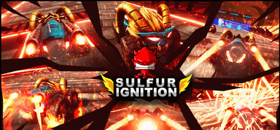
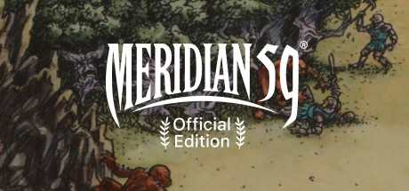
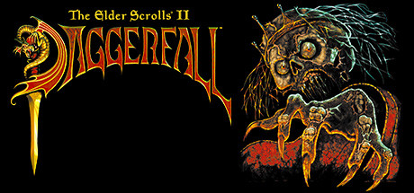

# Windows — 1996

[← All Windows years](../windows.md) · [Full 1996 page](../../years/1996.md)

281 Windows titles in 1996.

### 3 Skulls of the Toltecs

**Platforms:** MS-DOS, Windows &nbsp;|&nbsp; **Developer:** Revistronic &nbsp;|&nbsp; **Publisher:** Warner Interactive Europe &nbsp;|&nbsp; **Genre:** Graphic adventure

[Wikipedia](https://en.wikipedia.org/wiki/3_Skulls_of_the_Toltecs)

---

### 3-D Ultra Pinball: Creep Night

**Platforms:** Windows, macOS &nbsp;|&nbsp; **Developer:** Dynamix &nbsp;|&nbsp; **Publisher:** Sierra On-Line &nbsp;|&nbsp; **Genre:** Pinball

[Wikipedia](https://en.wikipedia.org/wiki/3-D_Ultra_Pinball:_Creep_Night)

---

### 3DO Games: Decathlon

**Platforms:** Windows &nbsp;|&nbsp; **Developer:** The 3DO Company &nbsp;|&nbsp; **Publisher:** The 3DO Company &nbsp;|&nbsp; **Genre:** Sports &nbsp;|&nbsp; **Released:** November 1996

[Wikipedia](https://en.wikipedia.org/wiki/3DO_Games:_Decathlon)

---

### 9: The Last Resort

**Platforms:** Windows, macOS &nbsp;|&nbsp; **Developer:** Tribeca Interactive &nbsp;|&nbsp; **Publisher:** GT Interactive &nbsp;|&nbsp; **Genre:** Adventure game &nbsp;|&nbsp; **Released:** October 4, 1996

[Wikipedia](https://en.wikipedia.org/wiki/9:_The_Last_Resort)

---

### A-10 Cuba!

**Platforms:** Windows, macOS &nbsp;|&nbsp; **Developer:** Parsoft Interactive &nbsp;|&nbsp; **Publisher:** Activision &nbsp;|&nbsp; **Genre:** Flight simulator

[Wikipedia](https://en.wikipedia.org/wiki/A-10_Cuba!)

---

### A.D.A.M. Life's Greatest Mysteries

**Platforms:** Windows &nbsp;|&nbsp; **Developer:** Columbia Healthcare Corporation &nbsp;|&nbsp; **Publisher:** Columbia Healthcare Corporation

[Wikipedia](https://en.wikipedia.org/wiki/A.D.A.M._Life's_Greatest_Mysteries)

---

### ABC Sports Monday Night Football

**Platforms:** Windows &nbsp;|&nbsp; **Developer:** OT Sports &nbsp;|&nbsp; **Publisher:** ABC Interactive &nbsp;|&nbsp; **Genre:** Sports &nbsp;|&nbsp; **Released:** September 30, 1996

[Wikipedia](https://en.wikipedia.org/wiki/ABC_Sports_Monday_Night_Football)

---

### Ace Ventura: The CD-Rom Game

**Platforms:** Windows &nbsp;|&nbsp; **Developer:** 7th Level &nbsp;|&nbsp; **Publisher:** Bomico Entertainment Software &nbsp;|&nbsp; **Genre:** Point-and-click adventure &nbsp;|&nbsp; **Released:** August 1996

[Wikipedia](https://en.wikipedia.org/wiki/Ace_Ventura:_The_CD-Rom_Game)

---

### Adidas Power Soccer

**Platforms:** PlayStation, Windows &nbsp;|&nbsp; **Developer:** Psygnosis &nbsp;|&nbsp; **Publisher:** Psygnosis &nbsp;|&nbsp; **Genre:** Sports &nbsp;|&nbsp; **Released:** June 10, 1996

[Wikipedia](https://en.wikipedia.org/wiki/Adidas_Power_Soccer)

---

### Admiral Sea Battles

**Platforms:** Windows &nbsp;|&nbsp; **Publisher:** Megamedia &nbsp;|&nbsp; **Genre:** Turn-based strategy &nbsp;|&nbsp; **Released:** September 30, 1996

[Wikipedia](https://en.wikipedia.org/wiki/Admiral_Sea_Battles)

---

### Afterlife

**Platforms:** Windows, MS-DOS, macOS &nbsp;|&nbsp; **Developer:** LucasArts &nbsp;|&nbsp; **Publisher:** LucasArts &nbsp;|&nbsp; **Genre:** God game &nbsp;|&nbsp; **Released:** June 27, 1996

[Wikipedia](https://en.wikipedia.org/wiki/Afterlife_(video_game))

---

### Age of Sail

**Platforms:** Windows &nbsp;|&nbsp; **Developer:** TalonSoft &nbsp;|&nbsp; **Publisher:** TalonSoft &nbsp;|&nbsp; **Genre:** Computer wargame &nbsp;|&nbsp; **Released:** November 23, 1996

[Wikipedia](https://en.wikipedia.org/wiki/Age_of_Sail_(video_game))

---

### Amazing Learning Games with Rayman

**Platforms:** MS-DOS, Windows &nbsp;|&nbsp; **Developer:** Ubi Soft &nbsp;|&nbsp; **Publisher:** Ubi Soft &nbsp;|&nbsp; **Genre:** Education

[Wikipedia](https://en.wikipedia.org/wiki/Amazing_Learning_Games_with_Rayman)

---

### Amazon Trail II

**Platforms:** Windows, macOS &nbsp;|&nbsp; **Developer:** The Adventure Company &nbsp;|&nbsp; **Publisher:** MECC &nbsp;|&nbsp; **Genre:** Simulation

[Wikipedia](https://en.wikipedia.org/wiki/Amazon_Trail_II)

---

### Amber: Journeys Beyond

**Platforms:** macOS, Windows &nbsp;|&nbsp; **Developer:** Hue Forest Entertainment &nbsp;|&nbsp; **Publisher:** Hue Forest Entertainment, Cendant Software, Changeling Software, Graphic Simulations Corporation &nbsp;|&nbsp; **Genre:** Adventure

[Wikipedia](https://en.wikipedia.org/wiki/Amber:_Journeys_Beyond)

---

### American Civil War: From Sumter to Appomattox

**Platforms:** Windows &nbsp;|&nbsp; **Developer:** Adanac Command Systems &nbsp;|&nbsp; **Publisher:** Interactive Magic &nbsp;|&nbsp; **Genre:** Simulation, Strategy &nbsp;|&nbsp; **Released:** May 31, 1996

[Wikipedia](https://en.wikipedia.org/wiki/American_Civil_War:_From_Sumter_to_Appomattox)

---

### Amok

**Platforms:** MS-DOS, Windows &nbsp;|&nbsp; **Developer:** Lemon &nbsp;|&nbsp; **Publisher:** Scavenger &nbsp;|&nbsp; **Genre:** Action &nbsp;|&nbsp; **Released:** October 30, 1996

[Wikipedia](https://en.wikipedia.org/wiki/Amok_(video_game))

---

### Angel Devoid: Face of the Enemy

**Platforms:** MS-DOS, macOS, PlayStation, Sega Saturn, Windows &nbsp;|&nbsp; **Developer:** Electric Dreams Inc. &nbsp;|&nbsp; **Publisher:** Mindscape &nbsp;|&nbsp; **Genre:** Adventure &nbsp;|&nbsp; **Released:** February 9, 1996

[Wikipedia](https://en.wikipedia.org/wiki/Angel_Devoid:_Face_of_the_Enemy)

---

### Animal Planet

**Platforms:** Windows &nbsp;|&nbsp; **Developer:** Discovery Channel Multimedia &nbsp;|&nbsp; **Publisher:** Discovery Channel Multimedia

[Wikipedia](https://en.wikipedia.org/wiki/Animal_Planet_(video_game))

---

### Arcade America

**Platforms:** Windows, macOS &nbsp;|&nbsp; **Developer:** 7th Level &nbsp;|&nbsp; **Publisher:** 7th Level, BMG Interactive &nbsp;|&nbsp; **Genre:** Platform

[Wikipedia](https://en.wikipedia.org/wiki/Arcade_America)

---

### Archimedean Dynasty

**Platforms:** MS-DOS, Windows &nbsp;|&nbsp; **Developer:** Massive Development &nbsp;|&nbsp; **Publisher:** Blue Byte Software &nbsp;|&nbsp; **Genre:** First-person shooter, Submarine simulator &nbsp;|&nbsp; **Released:** November 16, 1996

[Wikipedia](https://en.wikipedia.org/wiki/Archimedean_Dynasty)

---

### Area 51

**Platforms:** PlayStation, Windows, Sega Saturn &nbsp;|&nbsp; **Developer/Publisher:** Mesa Logic/ Atari Games &nbsp;|&nbsp; **Genre:** Shooter &nbsp;|&nbsp; **Released:** November 26

> Storm AREA 51 with your friends. Explore the most classified facility on earth. Discover what they've been hiding. Take selfies with aliens and smuggle evidence out before the military arrives.
>
> _Synopsis source: Steam_

[Wikipedia](https://en.wikipedia.org/wiki/Area_51_(1995_video_game)) · [Steam](https://store.steampowered.com/app/4423180) · [IGDB](https://www.igdb.com/games/area-51--1)

---

### Ashes to Ashes

**Platforms:** Windows &nbsp;|&nbsp; **Developer:** Deep River Publishing &nbsp;|&nbsp; **Publisher:** Corel Corporation

[Wikipedia](https://en.wikipedia.org/wiki/Ashes_to_Ashes_(video_game))

---

### Assassin 2015

**Platforms:** Windows &nbsp;|&nbsp; **Developer:** BlueSky Software &nbsp;|&nbsp; **Publisher:** Inscape

[Wikipedia](https://en.wikipedia.org/wiki/Assassin_2015)

---

### Bad Mojo

**Platforms:** Windows, macOS &nbsp;|&nbsp; **Developer:** Pulse Entertainment &nbsp;|&nbsp; **Publisher:** Acclaim Entertainment, Got Game Entertainment &nbsp;|&nbsp; **Genre:** Adventure &nbsp;|&nbsp; **Released:** February 23, 1996

[Wikipedia](https://en.wikipedia.org/wiki/Bad_Mojo)

---

### Banzai Bug

**Platforms:** Windows &nbsp;|&nbsp; **Developer:** Gravity &nbsp;|&nbsp; **Publisher:** Grolier Interactive &nbsp;|&nbsp; **Genre:** Action &nbsp;|&nbsp; **Released:** December 2, 1996

[Wikipedia](https://en.wikipedia.org/wiki/Banzai_Bug)

---

### Barbie Fashion Designer

**Platforms:** Windows &nbsp;|&nbsp; **Developer/Publisher:** Digital Domain / Mattel Media &nbsp;|&nbsp; **Released:** April 20

[Wikipedia](https://en.wikipedia.org/wiki/Barbie_Fashion_Designer)

---

### Battlecruiser 3000AD

**Platforms:** MS-DOS, Windows &nbsp;|&nbsp; **Developer:** 3000 AD &nbsp;|&nbsp; **Publisher:** Take-Two Interactive, GameTek, Interplay Entertainment, GT Interactive &nbsp;|&nbsp; **Genre:** Space trading and combat simulator &nbsp;|&nbsp; **Released:** October 11, 1996

[Wikipedia](https://en.wikipedia.org/wiki/Battlecruiser_3000AD)

---

### Battleground 3: Waterloo

**Platforms:** Windows &nbsp;|&nbsp; **Developer:** TalonSoft &nbsp;|&nbsp; **Publisher:** TalonSoft &nbsp;|&nbsp; **Genre:** Computer wargame &nbsp;|&nbsp; **Released:** May 23, 1996

[Wikipedia](https://en.wikipedia.org/wiki/Battleground_3:_Waterloo)

---

### Battleground 4: Shiloh

**Platforms:** Windows &nbsp;|&nbsp; **Developer:** TalonSoft &nbsp;|&nbsp; **Publisher:** TalonSoft &nbsp;|&nbsp; **Genre:** Turn-based computer wargame &nbsp;|&nbsp; **Released:** July 23, 1996

[Wikipedia](https://en.wikipedia.org/wiki/Battleground_4:_Shiloh)

---

### Battleground 5: Antietam

**Platforms:** Windows &nbsp;|&nbsp; **Developer:** TalonSoft &nbsp;|&nbsp; **Publisher:** TalonSoft &nbsp;|&nbsp; **Genre:** Computer wargame &nbsp;|&nbsp; **Released:** November 1, 1996

[Wikipedia](https://en.wikipedia.org/wiki/Battleground_5:_Antietam)

---

### Battleship

**Platforms:** Windows &nbsp;|&nbsp; **Developer:** NMS Software Ltd. &nbsp;|&nbsp; **Publisher:** Hasbro Interactive &nbsp;|&nbsp; **Genre:** Action game &nbsp;|&nbsp; **Released:** September 30, 1996

[Wikipedia](https://en.wikipedia.org/wiki/Battleship_(1996_video_game))

---

### Bedlam

**Platforms:** MS-DOS, macOS, PlayStation, Windows &nbsp;|&nbsp; **Developer:** Mirage &nbsp;|&nbsp; **Publisher:** GT Interactive &nbsp;|&nbsp; **Genre:** Run and gun

[Wikipedia](https://en.wikipedia.org/wiki/Bedlam_(1996_video_game))

---

### Beggar Prince

**Platforms:** Genesis / Mega Drive, Windows &nbsp;|&nbsp; **Developer:** C&E Inc. &nbsp;|&nbsp; **Publisher:** C&E Inc., Super Fighter Team &nbsp;|&nbsp; **Genre:** Role-playing video game

[Wikipedia](https://en.wikipedia.org/wiki/Beggar_Prince)

---

### Beyond the Limit: Ultimate Climb

**Platforms:** Windows &nbsp;|&nbsp; **Developer:** Magnet Interactive Studios &nbsp;|&nbsp; **Publisher:** Microsoft &nbsp;|&nbsp; **Genre:** Simulation

[Wikipedia](https://en.wikipedia.org/wiki/Beyond_the_Limit:_Ultimate_Climb)

---

### Bill Nye: The Science Guy - Stop the Rock!

**Platforms:** Windows, macOS &nbsp;|&nbsp; **Developer:** ImageBuilder Software &nbsp;|&nbsp; **Publisher:** Pacific Interactive Seattle &nbsp;|&nbsp; **Genre:** Educational

[Wikipedia](https://en.wikipedia.org/wiki/Bill_Nye:_The_Science_Guy_-_Stop_the_Rock!)

---

### Bishi Bashi

**Platforms:** PlayStation, Windows, Arcade, Mobile phone &nbsp;|&nbsp; **Developer:** Konami &nbsp;|&nbsp; **Publisher:** Konami

[Wikipedia](https://en.wikipedia.org/wiki/Bishi_Bashi)

---

### Blood Omen: Legacy of Kain

**Platforms:** PlayStation, Windows &nbsp;|&nbsp; **Developer/Publisher:** Silicon Knights / Crystal Dynamics &nbsp;|&nbsp; **Released:** November 1

---

### Blue Ice

**Platforms:** MS-DOS, macOS, Windows &nbsp;|&nbsp; **Developer:** Art of Mind Productions &nbsp;|&nbsp; **Publisher:** Psygnosis &nbsp;|&nbsp; **Genre:** Adventure

[Wikipedia](https://en.wikipedia.org/wiki/Blue_Ice_(video_game))

---

### Bot Soccer

**Platforms:** MS-DOS, Windows &nbsp;|&nbsp; **Developer:** CAPS Software AG &nbsp;|&nbsp; **Publisher:** Expert Software &nbsp;|&nbsp; **Genre:** Simulation

[Wikipedia](https://en.wikipedia.org/wiki/Bot_Soccer)

---

### Broken Sword: The Shadow of the Templars

**Platforms:** Windows, PlayStation &nbsp;|&nbsp; **Developer/Publisher:** Revolution Software / Virgin Interactive &nbsp;|&nbsp; **Genre:** Adventure &nbsp;|&nbsp; **Released:** September 30

---

### Bruce Jenner's World Class Decathlon

**Platforms:** Windows &nbsp;|&nbsp; **Developer:** Interactive Magic &nbsp;|&nbsp; **Publisher:** Dallas Multimedia &nbsp;|&nbsp; **Genre:** Decathlon &nbsp;|&nbsp; **Released:** June 30, 1996

[Wikipedia](https://en.wikipedia.org/wiki/Bruce_Jenner's_World_Class_Decathlon)

---

### Bug Too!

**Platforms:** Sega Saturn, Windows &nbsp;|&nbsp; **Developer/Publisher:** Sega / Realtime Associates &nbsp;|&nbsp; **Released:** November 30

[Wikipedia](https://en.wikipedia.org/wiki/Bug_Too!)

---

### BVE Trainsim

**Platforms:** Windows &nbsp;|&nbsp; **Developer:** Takashi Kojima &nbsp;|&nbsp; **Genre:** Train simulator

[Wikipedia](https://en.wikipedia.org/wiki/BVE_Trainsim)

---

### Casper

**Platforms:** PlayStation, Sega Saturn, 3DO Interactive Multiplayer, Game Boy, Super Nintendo Entertainment System, Windows &nbsp;|&nbsp; **Developer:** Funcom, Logicware, Bonsai Entertainment, Imagineering &nbsp;|&nbsp; **Publisher:** Interplay Productions, Natsume Inc., Microïds, WizardWorks &nbsp;|&nbsp; **Genre:** Action-adventure

[Wikipedia](https://en.wikipedia.org/wiki/Casper_(video_game))

---

### Castle Explorer

**Platforms:** Windows, macOS &nbsp;|&nbsp; **Developer:** DK Multimedia &nbsp;|&nbsp; **Publisher:** DK Multimedia &nbsp;|&nbsp; **Genre:** Educational

[Wikipedia](https://en.wikipedia.org/wiki/Castle_Explorer)

---

### Catfight

**Platforms:** Windows &nbsp;|&nbsp; **Developer:** Phantom Card &nbsp;|&nbsp; **Publisher:** Atlantean Interactive Games &nbsp;|&nbsp; **Genre:** Fighting

[Wikipedia](https://en.wikipedia.org/wiki/Catfight_(video_game))

---

### Championship Manager 96/97

**Platforms:** Windows, Amiga &nbsp;|&nbsp; **Developer:** Sports Interactive, Eidos Interactive &nbsp;|&nbsp; **Publisher:** Eidos Interactive &nbsp;|&nbsp; **Genre:** Sports &nbsp;|&nbsp; **Released:** September 27, 1996

[Wikipedia](https://en.wikipedia.org/wiki/Championship_Manager_96/97)

---

### Chaos Overlords

**Platforms:** Windows, macOS &nbsp;|&nbsp; **Developer:** Stick Man Games &nbsp;|&nbsp; **Publisher:** New World Computing &nbsp;|&nbsp; **Genre:** Turn-based strategy &nbsp;|&nbsp; **Released:** May 10, 1996

[Wikipedia](https://en.wikipedia.org/wiki/Chaos_Overlords)

---

### Chess Mates

**Platforms:** macOS, Windows &nbsp;|&nbsp; **Developer:** Presage Software &nbsp;|&nbsp; **Publisher:** Brainstorm &nbsp;|&nbsp; **Genre:** Chess &nbsp;|&nbsp; **Released:** September 6, 1996

[Wikipedia](https://en.wikipedia.org/wiki/Chess_Mates)

---

### Chessmaster 5000

**Platforms:** Windows &nbsp;|&nbsp; **Developer:** Mindscape &nbsp;|&nbsp; **Publisher:** Mindscape &nbsp;|&nbsp; **Genre:** Computer chess &nbsp;|&nbsp; **Released:** July 1996

[Wikipedia](https://en.wikipedia.org/wiki/Chessmaster_5000)

---

### Chronicles of the Sword

**Platforms:** Windows, PlayStation &nbsp;|&nbsp; **Developer:** Synthetic Dimensions &nbsp;|&nbsp; **Publisher:** Psygnosis &nbsp;|&nbsp; **Genre:** Adventure &nbsp;|&nbsp; **Released:** June 1996

[Wikipedia](https://en.wikipedia.org/wiki/Chronicles_of_the_Sword)

---

### Civilization II

**Platforms:** Windows &nbsp;|&nbsp; **Developer/Publisher:** MicroProse &nbsp;|&nbsp; **Publisher:** MicroProse &nbsp;|&nbsp; **Genre:** 4X &nbsp;|&nbsp; **Released:** February 29, 1996

[Wikipedia](https://en.wikipedia.org/wiki/Civilization_II)

---

### Civilization II: Conflicts in Civilization

**Platforms:** Windows, macOS &nbsp;|&nbsp; **Developer:** MicroProse &nbsp;|&nbsp; **Publisher:** MicroProse &nbsp;|&nbsp; **Genre:** Turn-based strategy

[Wikipedia](https://en.wikipedia.org/wiki/Civilization_II:_Conflicts_in_Civilization)

---

### Clandestiny

**Platforms:** Windows, macOS &nbsp;|&nbsp; **Developer:** Trilobyte &nbsp;|&nbsp; **Publisher:** Virgin Games &nbsp;|&nbsp; **Genre:** Puzzle

[Wikipedia](https://en.wikipedia.org/wiki/Clandestiny)

---

### Close Combat

**Platforms:** Windows, macOS &nbsp;|&nbsp; **Developer:** Atomic Games &nbsp;|&nbsp; **Publisher:** Microsoft &nbsp;|&nbsp; **Genre:** Computer wargame &nbsp;|&nbsp; **Released:** July 1996

[Wikipedia](https://en.wikipedia.org/wiki/Close_Combat_(video_game))

---

### Creature Crunch

**Platforms:** Windows &nbsp;|&nbsp; **Developer:** Class6 Interactive &nbsp;|&nbsp; **Publisher:** Class6 Entertainment &nbsp;|&nbsp; **Genre:** Point-and-click Adventure

[Wikipedia](https://en.wikipedia.org/wiki/Creature_Crunch)

---

### Creatures

**Platforms:** Windows, macOS &nbsp;|&nbsp; **Developer:** Creature Labs, Elo Interactive &nbsp;|&nbsp; **Publisher:** Warner Interactive Europe, Mindscape, Swing! Entertainment, Conspiracy Entertainment &nbsp;|&nbsp; **Genre:** Artificial life &nbsp;|&nbsp; **Released:** November 1996

[Wikipedia](https://en.wikipedia.org/wiki/Creatures_(1996_video_game))

---

### CyberGladiators

**Platforms:** Windows &nbsp;|&nbsp; **Developer:** K.A.A. &nbsp;|&nbsp; **Publisher:** Sierra On-Line &nbsp;|&nbsp; **Genre:** Fighting game &nbsp;|&nbsp; **Released:** November 18, 1996

[Wikipedia](https://en.wikipedia.org/wiki/CyberGladiators)

---

### Darby the Dragon

**Platforms:** Windows, macOS &nbsp;|&nbsp; **Developer:** Capitol Multimedia &nbsp;|&nbsp; **Publisher:** Broderbund &nbsp;|&nbsp; **Genre:** Graphic adventure &nbsp;|&nbsp; **Released:** August 4, 1996

[Wikipedia](https://en.wikipedia.org/wiki/Darby_the_Dragon)

---

### Dark Sun Online: Crimson Sands

**Platforms:** Windows &nbsp;|&nbsp; **Developer:** Strategic Simulations &nbsp;|&nbsp; **Publisher:** Strategic Simulations, Total Entertainment Network &nbsp;|&nbsp; **Genre:** Massively multiplayer online role-playing game &nbsp;|&nbsp; **Released:** October 2, 1996

[Wikipedia](https://en.wikipedia.org/wiki/Dark_Sun_Online:_Crimson_Sands)

---

### Deadlock: Planetary Conquest

**Platforms:** Windows, macOS &nbsp;|&nbsp; **Developer:** Accolade &nbsp;|&nbsp; **Publisher:** Accolade, Warner Interactive Europe &nbsp;|&nbsp; **Genre:** Turn-based strategy &nbsp;|&nbsp; **Released:** August 28, 1996

[Wikipedia](https://en.wikipedia.org/wiki/Deadlock:_Planetary_Conquest)

---

### Deadly Rooms of Death

**Platforms:** Windows, Linux, macOS &nbsp;|&nbsp; **Developer:** Webfoot Technologies &nbsp;|&nbsp; **Publisher:** Webfoot Technologies &nbsp;|&nbsp; **Genre:** Puzzle

[Wikipedia](https://en.wikipedia.org/wiki/Deadly_Rooms_of_Death)

---

### Deadly Tide

**Platforms:** Windows &nbsp;|&nbsp; **Developer:** Rainbow Studios &nbsp;|&nbsp; **Publisher:** Microsoft &nbsp;|&nbsp; **Genre:** Rail shooter &nbsp;|&nbsp; **Released:** November 1996

[Wikipedia](https://en.wikipedia.org/wiki/Deadly_Tide)

---

### DeathDrome

**Platforms:** Windows &nbsp;|&nbsp; **Developer/Publisher:** Zipper Interactive / Viacom &nbsp;|&nbsp; **Released:** October 31

[Wikipedia](https://en.wikipedia.org/wiki/DeathDrome)

---

### Destiny: World Domination from Stone Age to Space Age

**Platforms:** Windows &nbsp;|&nbsp; **Developer:** Dagger Interactive &nbsp;|&nbsp; **Publisher:** Interactive Magic &nbsp;|&nbsp; **Genre:** 4X &nbsp;|&nbsp; **Released:** October 15, 1996

[Wikipedia](https://en.wikipedia.org/wiki/Destiny:_World_Domination_from_Stone_Age_to_Space_Age)

---

### Devo Presents Adventures of the Smart Patrol

**Platforms:** macOS, Windows &nbsp;|&nbsp; **Developer:** Inscape &nbsp;|&nbsp; **Publisher:** Inscape &nbsp;|&nbsp; **Genre:** Adventure

[Wikipedia](https://en.wikipedia.org/wiki/Devo_Presents_Adventures_of_the_Smart_Patrol_(video_game))

---

### Die Hard Trilogy

**Platforms:** Windows, PlayStation, Sega Saturn &nbsp;|&nbsp; **Developer/Publisher:** Probe Entertainment / Fox Interactive &nbsp;|&nbsp; **Released:** August 31

[Wikipedia](https://en.wikipedia.org/wiki/Die_Hard_Trilogy)

---

### Dinosaur Hunter

**Platforms:** Windows, macOS &nbsp;|&nbsp; **Developer:** DK Interactive Learning &nbsp;|&nbsp; **Publisher:** Global Publishing Software &nbsp;|&nbsp; **Genre:** Education

[Wikipedia](https://en.wikipedia.org/wiki/Dinosaur_Hunter)

---

### Dinosaur Safari

**Platforms:** macOS, Windows &nbsp;|&nbsp; **Developer:** Creative Multimedia Corporation &nbsp;|&nbsp; **Publisher:** Mindscape &nbsp;|&nbsp; **Genre:** Edutainment

[Wikipedia](https://en.wikipedia.org/wiki/Dinosaur_Safari)

---

### Discworld II: Missing Presumed...!?

**Platforms:** MS-DOS, Windows &nbsp;|&nbsp; **Developer:** Perfect Entertainment &nbsp;|&nbsp; **Publisher:** Psygnosis, Sega &nbsp;|&nbsp; **Genre:** Point-and-click adventure &nbsp;|&nbsp; **Released:** November 29, 1996

[Wikipedia](https://en.wikipedia.org/wiki/Discworld_II:_Missing_Presumed...!%3F)

---

### Disney's Animated Storybook

**Platforms:** Windows, macOS, PlayStation &nbsp;|&nbsp; **Developer:** Media Station, Pixar, Creative Capers Entertainment, Revolution Software &nbsp;|&nbsp; **Publisher:** Disney Interactive, NewKidCo, Sony Computer Entertainment &nbsp;|&nbsp; **Genre:** Point-and-click adventure, interactive storybook

[Wikipedia](https://en.wikipedia.org/wiki/Disney's_Animated_Storybook)

---

### Down in the Dumps

**Platforms:** MS-DOS, Windows, macOS &nbsp;|&nbsp; **Developer:** Haiku Studios &nbsp;|&nbsp; **Publisher:** Philips Media &nbsp;|&nbsp; **Genre:** Adventure

[Wikipedia](https://en.wikipedia.org/wiki/Down_in_the_Dumps)

---

### Dr. Sulfur's Night Lab

**Platforms:** Windows &nbsp;|&nbsp; **Developer:** McGraw Hill Home Interactive &nbsp;|&nbsp; **Genre:** Educational &nbsp;|&nbsp; **Released:** October 22, 1996

[Wikipedia](https://en.wikipedia.org/wiki/Dr._Sulfur's_Night_Lab)

---

### Dragonheart: Fire & Steel

**Platforms:** PlayStation, Sega Saturn, Windows, Game Boy &nbsp;|&nbsp; **Developer:** Funcom, Torus Games &nbsp;|&nbsp; **Publisher:** Acclaim Entertainment &nbsp;|&nbsp; **Genre:** Hack and slash, platform &nbsp;|&nbsp; **Released:** May 1996

[Wikipedia](https://en.wikipedia.org/wiki/Dragonheart:_Fire_&_Steel)

---

### Drawing Discoveries

**Platforms:** Windows, macOS &nbsp;|&nbsp; **Developer:** Presage Software &nbsp;|&nbsp; **Publisher:** Brainstorm &nbsp;|&nbsp; **Genre:** Home

[Wikipedia](https://en.wikipedia.org/wiki/Drawing_Discoveries)

---

### Drowned God

**Platforms:** Windows &nbsp;|&nbsp; **Developer/Publisher:** Epic Multimedia Group/ Inscape &nbsp;|&nbsp; **Genre:** Adventure &nbsp;|&nbsp; **Released:** October 31

[Wikipedia](https://en.wikipedia.org/wiki/Drowned_God)

---

### Earthsiege 2

**Platforms:** Windows &nbsp;|&nbsp; **Developer:** Dynamix &nbsp;|&nbsp; **Publisher:** Sierra On-Line &nbsp;|&nbsp; **Genre:** Vehicle simulation &nbsp;|&nbsp; **Released:** March 19, 1996

[Wikipedia](https://en.wikipedia.org/wiki/Earthsiege_2)

---

### Eat My Dust

**Platforms:** Windows &nbsp;|&nbsp; **Developer:** Davidson & Associates, Inc., Funnybone Interactive, and Van Duyne Engineering &nbsp;|&nbsp; **Publisher:** Sierra On-Line &nbsp;|&nbsp; **Genre:** Racing

[Wikipedia](https://en.wikipedia.org/wiki/Eat_My_Dust)

---

### Eggerland Episode 0: Quest of Rara

**Platforms:** Windows &nbsp;|&nbsp; **Developer:** Avit &nbsp;|&nbsp; **Publisher:** HAL Laboratory &nbsp;|&nbsp; **Genre:** Puzzle game &nbsp;|&nbsp; **Released:** November 16, 1996

[Wikipedia](https://en.wikipedia.org/wiki/Eggerland_Episode_0:_Quest_of_Rara)

---

### Eraser: Turnabout

**Platforms:** Windows &nbsp;|&nbsp; **Developer:** Imagination Pilots &nbsp;|&nbsp; **Publisher:** Warner Bros. &nbsp;|&nbsp; **Genre:** Action &nbsp;|&nbsp; **Released:** October 1996

[Wikipedia](https://en.wikipedia.org/wiki/Eraser:_Turnabout)

---

### Escher Interactive

**Platforms:** Windows &nbsp;|&nbsp; **Developer:** Eyeware Interactive &nbsp;|&nbsp; **Publisher:** Byron Preiss, Harry N. Abrams Inc. &nbsp;|&nbsp; **Genre:** Educational

[Wikipedia](https://en.wikipedia.org/wiki/Escher_Interactive)

---

### Evidence: The Last Report

**Platforms:** Windows, MS-DOS &nbsp;|&nbsp; **Developer:** Microïds &nbsp;|&nbsp; **Publisher:** Microïds, Shouei System &nbsp;|&nbsp; **Genre:** Adventure

[Wikipedia](https://en.wikipedia.org/wiki/Evidence:_The_Last_Report)

---

### Fable

**Platforms:** MS-DOS, Windows &nbsp;|&nbsp; **Developer:** Simbiosis Interactive &nbsp;|&nbsp; **Publisher:** Sir-Tech, Telstar Electronic Studios &nbsp;|&nbsp; **Genre:** Point-and-click adventure

[Wikipedia](https://en.wikipedia.org/wiki/Fable_(1996_video_game))

---

### FDR

**Platforms:** Windows &nbsp;|&nbsp; **Developer:** Corbis

[Wikipedia](https://en.wikipedia.org/wiki/FDR_(video_game))

---

### FIFA 97

**Platforms:** Windows, MS-DOS, Game Boy, Genesis / Mega Drive, Super Nintendo Entertainment System, PlayStation &nbsp;|&nbsp; **Developer:** Extended Play Productions &nbsp;|&nbsp; **Publisher:** EA Sports, Black Pearl Software &nbsp;|&nbsp; **Genre:** Sports &nbsp;|&nbsp; **Released:** November 20, 1996

[Wikipedia](https://en.wikipedia.org/wiki/FIFA_97)

---

### FIFA Soccer 97

**Platforms:** Genesis / Mega Drive, PlayStation, Windows, Super Nintendo Entertainment System, Sega Saturn, Game Boy &nbsp;|&nbsp; **Developer/Publisher:** EA Canada / Electronic Arts &nbsp;|&nbsp; **Released:** November 30

[Wikipedia](https://en.wikipedia.org/wiki/FIFA_Soccer_97)

---

### Fin Fin on Teo the Magic Planet

**Platforms:** Windows &nbsp;|&nbsp; **Developer:** Fujitsu Interactive, Inc. &nbsp;|&nbsp; **Publisher:** Fujitsu Interactive, Inc. &nbsp;|&nbsp; **Genre:** Pet-raising simulation

[Wikipedia](https://en.wikipedia.org/wiki/Fin_Fin_on_Teo_the_Magic_Planet)

---

### Fire Fight

**Platforms:** Windows &nbsp;|&nbsp; **Developer:** Chaos Works &nbsp;|&nbsp; **Publisher:** Electronic Arts &nbsp;|&nbsp; **Genre:** Action &nbsp;|&nbsp; **Released:** July 3, 1996

[Wikipedia](https://en.wikipedia.org/wiki/Fire_Fight)

---

### Firo & Klawd

**Platforms:** PlayStation, MS-DOS, Windows &nbsp;|&nbsp; **Developer:** Interactive Studios Limited &nbsp;|&nbsp; **Publisher:** BMG Interactive &nbsp;|&nbsp; **Genre:** Platform &nbsp;|&nbsp; **Released:** November 1996

[Wikipedia](https://en.wikipedia.org/wiki/Firo_&_Klawd)

---

### Fisher Price Ready for School

**Platforms:** Windows &nbsp;|&nbsp; **Publisher:** Davidson & Associates

[Wikipedia](https://en.wikipedia.org/wiki/Fisher_Price_Ready_for_School)

---

### Fox Hunt

**Platforms:** Windows, PlayStation &nbsp;|&nbsp; **Developer:** 3Vision Games &nbsp;|&nbsp; **Publisher:** Capcom &nbsp;|&nbsp; **Genre:** Interactive movie &nbsp;|&nbsp; **Released:** February 1996

[Wikipedia](https://en.wikipedia.org/wiki/Fox_Hunt_(video_game))

---

### Fragile Allegiance

**Platforms:** MS-DOS, Windows &nbsp;|&nbsp; **Developer:** Gremlin Interactive &nbsp;|&nbsp; **Publisher:** Gremlin Interactive, Interplay Productions &nbsp;|&nbsp; **Genre:** 4X, real-time strategy &nbsp;|&nbsp; **Released:** December 1996

[Wikipedia](https://en.wikipedia.org/wiki/Fragile_Allegiance)

---

### Freddi Fish 2: The Case of the Haunted Schoolhouse

**Platforms:** macOS, Windows &nbsp;|&nbsp; **Developer:** Humongous Entertainment &nbsp;|&nbsp; **Publisher:** Humongous Entertainment &nbsp;|&nbsp; **Genre:** Adventure &nbsp;|&nbsp; **Released:** August 29, 1996

[Wikipedia](https://en.wikipedia.org/wiki/Freddi_Fish_2:_The_Case_of_the_Haunted_Schoolhouse)

---

### Front Page Sports: Football Pro '97

**Platforms:** Windows &nbsp;|&nbsp; **Developer:** Synergistic Software &nbsp;|&nbsp; **Publisher:** Sierra Online &nbsp;|&nbsp; **Genre:** Sports &nbsp;|&nbsp; **Released:** December 2, 1996

[Wikipedia](https://en.wikipedia.org/wiki/Front_Page_Sports:_Football_Pro_'97)

---

### Furcadia

**Platforms:** Windows &nbsp;|&nbsp; **Developer/Publisher:** Dragon's Eye Productions, Inc. &nbsp;|&nbsp; **Genre:** MMORPG &nbsp;|&nbsp; **Released:** December 16

[Wikipedia](https://en.wikipedia.org/wiki/Furcadia)

---

### Gallop Racer

**Platforms:** Arcade, PlayStation, Windows &nbsp;|&nbsp; **Developer:** Tecmo &nbsp;|&nbsp; **Publisher:** Tecmo, Koei Tecmo &nbsp;|&nbsp; **Genre:** Horse racing

[Wikipedia](https://en.wikipedia.org/wiki/Gallop_Racer)

---

### Gearheads

**Platforms:** macOS, Windows &nbsp;|&nbsp; **Developer:** Philips Media, R/GA Interactive &nbsp;|&nbsp; **Publisher:** Philips Media &nbsp;|&nbsp; **Genre:** Strategy &nbsp;|&nbsp; **Released:** June 1996

[Wikipedia](https://en.wikipedia.org/wiki/Gearheads_(video_game))

---

### Golden Nugget

**Platforms:** Windows, PlayStation &nbsp;|&nbsp; **Developer:** Abalone Entertainment and Software Development, Point of View, Inc. &nbsp;|&nbsp; **Publisher:** Virgin Interactive Entertainment &nbsp;|&nbsp; **Genre:** Gambling simulation

[Wikipedia](https://en.wikipedia.org/wiki/Golden_Nugget_(video_game))

---

### Goosebumps: Escape from Horrorland

**Platforms:** Windows &nbsp;|&nbsp; **Developer:** DreamWorks Interactive &nbsp;|&nbsp; **Publisher:** DreamWorks Interactive &nbsp;|&nbsp; **Genre:** Interactive movie

[Wikipedia](https://en.wikipedia.org/wiki/Goosebumps:_Escape_from_Horrorland)

---

### Gord@k

**Platforms:** Windows, macOS &nbsp;|&nbsp; **Developer:** Hoffmann Interactive &nbsp;|&nbsp; **Publisher:** I. Hoffmann & Associates &nbsp;|&nbsp; **Genre:** Point-and-click adventure &nbsp;|&nbsp; **Released:** November 15, 1996

[Wikipedia](https://en.wikipedia.org/wiki/Gord@k)

---

### Grand Prix Manager 2

**Platforms:** Windows &nbsp;|&nbsp; **Developer:** Edward Grabowski Communications Ltd &nbsp;|&nbsp; **Publisher:** MicroProse &nbsp;|&nbsp; **Genre:** Sports management game

[Wikipedia](https://en.wikipedia.org/wiki/Grand_Prix_Manager_2)

---

### Gregory and the Hot Air Balloon

**Platforms:** Windows, macOS &nbsp;|&nbsp; **Developer:** Capitol Multimedia &nbsp;|&nbsp; **Publisher:** Broderbund &nbsp;|&nbsp; **Genre:** Graphic adventure &nbsp;|&nbsp; **Released:** October 1996

[Wikipedia](https://en.wikipedia.org/wiki/Gregory_and_the_Hot_Air_Balloon)

---

### Grid Runner

**Platforms:** PlayStation, Sega Saturn, Windows &nbsp;|&nbsp; **Developer:** Radical Entertainment &nbsp;|&nbsp; **Publisher:** Virgin Interactive Entertainment &nbsp;|&nbsp; **Genre:** Action &nbsp;|&nbsp; **Released:** November 13, 1996

[Wikipedia](https://en.wikipedia.org/wiki/Grid_Runner)

---

### Hardline

**Platforms:** MS-DOS, Windows, macOS &nbsp;|&nbsp; **Developer:** Cryo &nbsp;|&nbsp; **Publisher:** Virgin Interactive Entertainment &nbsp;|&nbsp; **Genre:** Action &nbsp;|&nbsp; **Released:** November 13, 1996

[Wikipedia](https://en.wikipedia.org/wiki/Hardline_(video_game))

---

### Harvester

**Platforms:** MS-DOS, Windows, Linux &nbsp;|&nbsp; **Developer:** DigiFX Interactive &nbsp;|&nbsp; **Publisher:** Merit Studios, Virgin Interactive &nbsp;|&nbsp; **Genre:** Interactive film, adventure &nbsp;|&nbsp; **Released:** September 24, 1996

[Wikipedia](https://en.wikipedia.org/wiki/Harvester_(video_game))

---

### Hellbender

**Platforms:** Windows &nbsp;|&nbsp; **Developer:** Terminal Reality &nbsp;|&nbsp; **Publisher:** Microsoft Studios &nbsp;|&nbsp; **Genre:** Simulation &nbsp;|&nbsp; **Released:** September 25, 1996

[Wikipedia](https://en.wikipedia.org/wiki/Hellbender_(video_game))

---

### Heroes of Might and Magic II

**Platforms:** MS-DOS, Windows, Acorn Archimedes &nbsp;|&nbsp; **Developer:** New World Computing &nbsp;|&nbsp; **Publisher:** The 3DO Company &nbsp;|&nbsp; **Genre:** Turn-based strategy &nbsp;|&nbsp; **Released:** October 1, 1996

[Wikipedia](https://en.wikipedia.org/wiki/Heroes_of_Might_and_Magic_II)

---

### Heroes of Might and Magic II: The Succession Wars

**Platforms:** MS-DOS, Windows &nbsp;|&nbsp; **Developer/Publisher:** New World Computing / 3DO &nbsp;|&nbsp; **Released:** October 1

---

### Hind

**Platforms:** MS-DOS, Windows &nbsp;|&nbsp; **Developer:** Digital Integration &nbsp;|&nbsp; **Publisher:** Digital Integration, Interactive Magic &nbsp;|&nbsp; **Genre:** Flight simulator &nbsp;|&nbsp; **Released:** October 7, 1996

[Wikipedia](https://en.wikipedia.org/wiki/Hind_(video_game))

---

### Holiday Island

**Platforms:** Windows &nbsp;|&nbsp; **Developer:** Sunflowers Interactive Entertainment Software &nbsp;|&nbsp; **Publisher:** Sunflowers Interactive Entertainment Software &nbsp;|&nbsp; **Genre:** Strategy

[Wikipedia](https://en.wikipedia.org/wiki/Holiday_Island_(video_game))

---

### HoverRace

**Platforms:** Windows &nbsp;|&nbsp; **Developer:** GrokkSoft &nbsp;|&nbsp; **Publisher:** GrokkSoft &nbsp;|&nbsp; **Genre:** Racing video game

[Wikipedia](https://en.wikipedia.org/wiki/HoverRace)

---

### Hunter Hunted

**Platforms:** Windows &nbsp;|&nbsp; **Developer:** K.A.A. &nbsp;|&nbsp; **Publisher:** Sierra On-Line &nbsp;|&nbsp; **Genre:** Run and gun, Platform game &nbsp;|&nbsp; **Released:** November 8, 1996

[Wikipedia](https://en.wikipedia.org/wiki/Hunter_Hunted_(video_game))

---

### Huygen's Disclosure

**Platforms:** Windows &nbsp;|&nbsp; **Developer:** Microforum International &nbsp;|&nbsp; **Publisher:** Microforum International &nbsp;|&nbsp; **Genre:** Adventure &nbsp;|&nbsp; **Released:** December 1996

[Wikipedia](https://en.wikipedia.org/wiki/Huygen's_Disclosure)

---

### HyperBlade

**Platforms:** Windows &nbsp;|&nbsp; **Developer:** Wizbang! Software Productions &nbsp;|&nbsp; **Publisher:** Activision &nbsp;|&nbsp; **Genre:** Action / Sports &nbsp;|&nbsp; **Released:** November 1, 1996

[Wikipedia](https://en.wikipedia.org/wiki/HyperBlade)

---

### Ignition

**Platforms:** MS-DOS, Windows &nbsp;|&nbsp; **Developer/Publisher:** Unique Development Studios/ Virgin Interactive &nbsp;|&nbsp; **Genre:** Racing &nbsp;|&nbsp; **Released:** December 12

> Sulfur Ignition is an irreverent racing game set in hell where players are condemned to compete at high speeds while battling each other, the game contains a good mix of high speed action, dark humor and lots of sarcasm!
>
> _Synopsis source: Steam_

[Steam](https://store.steampowered.com/app/3774780) · [IGDB](https://www.igdb.com/games/ignition)

---

### Indiana Jones and His Desktop Adventures

**Platforms:** Windows, macOS &nbsp;|&nbsp; **Developer/Publisher:** LucasArts &nbsp;|&nbsp; **Genre:** Adventure &nbsp;|&nbsp; **Released:** April 30

[Wikipedia](https://en.wikipedia.org/wiki/Indiana_Jones_and_His_Desktop_Adventures)

---

### International Rugby League

**Platforms:** Windows, MS-DOS &nbsp;|&nbsp; **Developer:** Creative Assembly &nbsp;|&nbsp; **Publisher:** Electronic Arts &nbsp;|&nbsp; **Genre:** Sports

[Wikipedia](https://en.wikipedia.org/wiki/International_Rugby_League_(video_game))

---

### Invention Studio

**Platforms:** Windows, macOS &nbsp;|&nbsp; **Developer:** Music Pen &nbsp;|&nbsp; **Publisher:** Discovery Channel Multimedia

[Wikipedia](https://en.wikipedia.org/wiki/Invention_Studio)

---

### Jane's AH-64D Longbow

**Platforms:** MS-DOS, Windows &nbsp;|&nbsp; **Developer:** Origin Systems &nbsp;|&nbsp; **Publisher:** Electronic Arts &nbsp;|&nbsp; **Genre:** Combat flight simulation &nbsp;|&nbsp; **Released:** June 3, 1996

[Wikipedia](https://en.wikipedia.org/wiki/Jane's_AH-64D_Longbow)

---

### Jane's ATF: Advanced Tactical Fighters

**Platforms:** MS-DOS, Windows &nbsp;|&nbsp; **Developer:** Electronic Arts &nbsp;|&nbsp; **Publisher:** Electronic Arts &nbsp;|&nbsp; **Genre:** Combat flight simulator &nbsp;|&nbsp; **Released:** April 1, 1996

[Wikipedia](https://en.wikipedia.org/wiki/Jane's_ATF:_Advanced_Tactical_Fighters)

---

### Jonny Quest: Cover-Up at Roswell

**Platforms:** Windows, macOS &nbsp;|&nbsp; **Developer:** Virgin Sound and Vision &nbsp;|&nbsp; **Publisher:** Virgin Sound and Vision &nbsp;|&nbsp; **Genre:** Adventure &nbsp;|&nbsp; **Released:** August 1996

[Wikipedia](https://en.wikipedia.org/wiki/Jonny_Quest:_Cover-Up_at_Roswell)

---

### JumpStart 2nd Grade

**Platforms:** Windows, macOS &nbsp;|&nbsp; **Developer:** Knowledge Adventure &nbsp;|&nbsp; **Publisher:** Knowledge Adventure &nbsp;|&nbsp; **Genre:** Educational

[Wikipedia](https://en.wikipedia.org/wiki/JumpStart_2nd_Grade)

---

### JumpStart Adventures 3rd Grade: Mystery Mountain

**Platforms:** Windows, macOS &nbsp;|&nbsp; **Developer:** Knowledge Adventure &nbsp;|&nbsp; **Publisher:** Knowledge Adventure &nbsp;|&nbsp; **Genre:** Educational/adventure &nbsp;|&nbsp; **Released:** December 2, 1996

[Wikipedia](https://en.wikipedia.org/wiki/JumpStart_Adventures_3rd_Grade:_Mystery_Mountain)

---

### JumpStart Adventures 4th Grade: Haunted Island

**Platforms:** Windows, macOS &nbsp;|&nbsp; **Developer:** Knowledge Adventure, KnowWare &nbsp;|&nbsp; **Publisher:** Knowledge Adventure &nbsp;|&nbsp; **Genre:** Educational/adventure &nbsp;|&nbsp; **Released:** December 9, 1996

[Wikipedia](https://en.wikipedia.org/wiki/JumpStart_Adventures_4th_Grade:_Haunted_Island)

---

### Jungle Book

**Platforms:** Windows &nbsp;|&nbsp; **Developer:** Powerhouse Entertainment &nbsp;|&nbsp; **Publisher:** IBM &nbsp;|&nbsp; **Genre:** Adventure &nbsp;|&nbsp; **Released:** March 1996

[Wikipedia](https://en.wikipedia.org/wiki/Jungle_Book_(video_game))

---

### Kewala's Typing Adventure

**Platforms:** Windows, macOS &nbsp;|&nbsp; **Developer:** Typequick &nbsp;|&nbsp; **Publisher:** Typequick, Japan Data Pacific &nbsp;|&nbsp; **Genre:** Edutainment

[Wikipedia](https://en.wikipedia.org/wiki/Kewala's_Typing_Adventure)

---

### Kizuato

**Platforms:** PC-9800 series, Windows &nbsp;|&nbsp; **Developer:** Leaf &nbsp;|&nbsp; **Publisher:** Aquaplus &nbsp;|&nbsp; **Genre:** Visual novel, eroge &nbsp;|&nbsp; **Released:** July 26, 1996

[Wikipedia](https://en.wikipedia.org/wiki/Kizuato)

---

### Klondike Moon

**Platforms:** Windows, MS-DOS &nbsp;|&nbsp; **Developer:** TerraForm Software &nbsp;|&nbsp; **Publisher:** 21st Century Entertainment, Manaccom &nbsp;|&nbsp; **Genre:** Simulation

[Wikipedia](https://en.wikipedia.org/wiki/Klondike_Moon)

---

### Krazy Ivan

**Platforms:** PlayStation, Windows &nbsp;|&nbsp; **Developer:** Psygnosis &nbsp;|&nbsp; **Publisher:** Psygnosis &nbsp;|&nbsp; **Genre:** First-person shooter &nbsp;|&nbsp; **Released:** January 26, 1996

[Wikipedia](https://en.wikipedia.org/wiki/Krazy_Ivan)

---

### Legend of Wukong

**Platforms:** Genesis / Mega Drive, Windows, macOS &nbsp;|&nbsp; **Developer:** Gamtec &nbsp;|&nbsp; **Publisher:** Ming Technology Co., Ltd, Super Fighter Team &nbsp;|&nbsp; **Genre:** Role-playing video game

[Wikipedia](https://en.wikipedia.org/wiki/Legend_of_Wukong)

---

### Leisure Suit Larry: Love for Sail!

**Platforms:** MS-DOS, Windows &nbsp;|&nbsp; **Developer:** Sierra On-Line &nbsp;|&nbsp; **Publisher:** Sierra On-Line &nbsp;|&nbsp; **Genre:** Adventure &nbsp;|&nbsp; **Released:** November 26, 1996

[Wikipedia](https://en.wikipedia.org/wiki/Leisure_Suit_Larry:_Love_for_Sail!)

---

### Lemmings Paintball

**Platforms:** Windows &nbsp;|&nbsp; **Developer:** Visual Sciences &nbsp;|&nbsp; **Publisher:** Psygnosis &nbsp;|&nbsp; **Genre:** Action &nbsp;|&nbsp; **Released:** June 1996

[Wikipedia](https://en.wikipedia.org/wiki/Lemmings_Paintball)

---

### Lighthouse: The Dark Being

**Platforms:** MS-DOS, Windows, macOS &nbsp;|&nbsp; **Developer:** Sierra On-Line &nbsp;|&nbsp; **Publisher:** Sierra On-Line &nbsp;|&nbsp; **Genre:** Adventure &nbsp;|&nbsp; **Released:** September 20, 1996

[Wikipedia](https://en.wikipedia.org/wiki/Lighthouse:_The_Dark_Being)

---

### Lightning Warrior Raidy II: Temple of Desire

**Platforms:** Windows &nbsp;|&nbsp; **Developer:** ZyX &nbsp;|&nbsp; **Publisher:** ZyX, JAST USA &nbsp;|&nbsp; **Genre:** Role-playing game, dungeon crawler, visual novel &nbsp;|&nbsp; **Released:** March 22, 1996

[Wikipedia](https://en.wikipedia.org/wiki/Lightning_Warrior_Raidy_II:_Temple_of_Desire)

---

### Living Books

**Platforms:** Windows, macOS &nbsp;|&nbsp; **Developer:** Broderbund, Living Books, Wanderful Interactive, Houghton Mifflin Harcourt &nbsp;|&nbsp; **Publisher:** Broderbund, Random House, The Learning Company, Mattel Interactive &nbsp;|&nbsp; **Genre:** Edutainment, interactive storybook

[Wikipedia](https://en.wikipedia.org/wiki/Living_Books)

---

### Logical Journey of the Zoombinis

**Platforms:** Windows, macOS &nbsp;|&nbsp; **Developer:** Broderbund, The Learning Company &nbsp;|&nbsp; **Publisher:** Broderbund, The Learning Company &nbsp;|&nbsp; **Genre:** Educational, puzzle &nbsp;|&nbsp; **Released:** February 26, 1996

[Wikipedia](https://en.wikipedia.org/wiki/Logical_Journey_of_the_Zoombinis)

---

### Lords of the Realm II

**Platforms:** MS-DOS, Windows, macOS &nbsp;|&nbsp; **Developer:** Impressions Games &nbsp;|&nbsp; **Publisher:** Sierra On-Line &nbsp;|&nbsp; **Genre:** Turn-based strategy, Real-time strategy &nbsp;|&nbsp; **Released:** November 20, 1996

[Wikipedia](https://en.wikipedia.org/wiki/Lords_of_the_Realm_II)

---

### Madden NFL 97

**Platforms:** Genesis / Mega Drive, PlayStation, Windows, Super Nintendo Entertainment System, Sega Saturn, Game Boy &nbsp;|&nbsp; **Developer/Publisher:** EA Sports / Electronic Arts &nbsp;|&nbsp; **Genre:** Sports (football) &nbsp;|&nbsp; **Released:** August 31

[Wikipedia](https://en.wikipedia.org/wiki/Madden_NFL_97)

---

### Magestorm

**Platforms:** Windows &nbsp;|&nbsp; **Developer:** Interworld Productions &nbsp;|&nbsp; **Publisher:** Engage Games Online, WorldPlay Entertainment, GameStorm &nbsp;|&nbsp; **Genre:** First-person shooter/role-playing video game

[Wikipedia](https://en.wikipedia.org/wiki/Magestorm)

---

### Master of Orion II: Battle at Antares

**Platforms:** MS-DOS, Windows, macOS &nbsp;|&nbsp; **Developer:** Simtex &nbsp;|&nbsp; **Publisher:** MicroProse, MacSoft &nbsp;|&nbsp; **Genre:** Turn-based strategy, 4X &nbsp;|&nbsp; **Released:** November 22, 1996

[Wikipedia](https://en.wikipedia.org/wiki/Master_of_Orion_II:_Battle_at_Antares)

---

### Math Blaster Episode I: In Search of Spot

**Platforms:** MS-DOS, Windows, macOS, Super Nintendo Entertainment System, Genesis / Mega Drive &nbsp;|&nbsp; **Developer:** Davidson & Associates &nbsp;|&nbsp; **Publisher:** Davidson & Associates &nbsp;|&nbsp; **Genre:** Educational &nbsp;|&nbsp; **Released:** September 18, 1996

[Wikipedia](https://en.wikipedia.org/wiki/Math_Blaster_Episode_I:_In_Search_of_Spot)

---

### Math Blaster Jr.

**Platforms:** Windows, macOS &nbsp;|&nbsp; **Developer:** Davidson & Associates &nbsp;|&nbsp; **Publisher:** Davidson & Associates &nbsp;|&nbsp; **Genre:** Educational

[Wikipedia](https://en.wikipedia.org/wiki/Math_Blaster_Jr.)

---

### Mechanized Assault & Exploration

**Platforms:** MS-DOS, Windows &nbsp;|&nbsp; **Developer:** Interplay Productions &nbsp;|&nbsp; **Publisher:** Interplay Productions &nbsp;|&nbsp; **Genre:** Real-time strategy, turn-based strategy

[Wikipedia](https://en.wikipedia.org/wiki/Mechanized_Assault_&_Exploration)

---

### MechWarrior 2: Mercenaries

**Platforms:** MS-DOS, Windows &nbsp;|&nbsp; **Developer:** Activision &nbsp;|&nbsp; **Publisher:** Activision &nbsp;|&nbsp; **Genre:** Vehicle simulation game &nbsp;|&nbsp; **Released:** September 25, 1996

[Wikipedia](https://en.wikipedia.org/wiki/MechWarrior_2:_Mercenaries)

---

### Menlo the Frog

**Platforms:** Windows, macOS &nbsp;|&nbsp; **Developer:** Presage Software, Windy Hill Software &nbsp;|&nbsp; **Publisher:** Windy Hill Software &nbsp;|&nbsp; **Released:** January 1996

[Wikipedia](https://en.wikipedia.org/wiki/Menlo_the_Frog)

---

### Meridian 59

**Platforms:** Windows &nbsp;|&nbsp; **Developer/Publisher:** 3DO &nbsp;|&nbsp; **Genre:** MMORPG &nbsp;|&nbsp; **Released:** September 27

> Meridian 59 was the first 3D massively multiplayer game, released in 1996. It's back, and it's free to play!
>
> _Synopsis source: Steam_

[Wikipedia](https://en.wikipedia.org/wiki/Meridian_59) · [Steam](https://store.steampowered.com/app/893390)

---

### Microsoft Arcade

**Platforms:** Windows, macOS &nbsp;|&nbsp; **Developer:** Microsoft &nbsp;|&nbsp; **Publisher:** Microsoft &nbsp;|&nbsp; **Genre:** Various

[Wikipedia](https://en.wikipedia.org/wiki/Microsoft_Arcade)

---

### Microsoft Flight Simulator for Windows 95

**Platforms:** Windows &nbsp;|&nbsp; **Developer:** Microsoft &nbsp;|&nbsp; **Publisher:** Microsoft &nbsp;|&nbsp; **Genre:** Flight simulation &nbsp;|&nbsp; **Released:** October 24, 1996

[Wikipedia](https://en.wikipedia.org/wiki/Microsoft_Flight_Simulator_for_Windows_95)

---

### Mind Grind

**Platforms:** Windows &nbsp;|&nbsp; **Developer:** Microforum International &nbsp;|&nbsp; **Publisher:** Microforum International &nbsp;|&nbsp; **Genre:** Trivia Game

[Wikipedia](https://en.wikipedia.org/wiki/Mind_Grind)

---

### MissionForce: CyberStorm

**Platforms:** Windows &nbsp;|&nbsp; **Developer:** Dynamix &nbsp;|&nbsp; **Publisher:** Sierra On-Line &nbsp;|&nbsp; **Genre:** Turn-based tactics &nbsp;|&nbsp; **Released:** June 27, 1996

[Wikipedia](https://en.wikipedia.org/wiki/MissionForce:_CyberStorm)

---

### Monster Truck Madness

**Platforms:** Windows &nbsp;|&nbsp; **Developer:** Terminal Reality &nbsp;|&nbsp; **Publisher:** Microsoft &nbsp;|&nbsp; **Genre:** Racing &nbsp;|&nbsp; **Released:** September 9, 1996

[Wikipedia](https://en.wikipedia.org/wiki/Monster_Truck_Madness)

---

### Monty Python & the Quest for the Holy Grail

**Platforms:** Windows, macOS &nbsp;|&nbsp; **Developer:** 7th Level &nbsp;|&nbsp; **Publisher:** Panasonic Interactive Media &nbsp;|&nbsp; **Genre:** Adventure &nbsp;|&nbsp; **Released:** June 1996

[Wikipedia](https://en.wikipedia.org/wiki/Monty_Python_&_the_Quest_for_the_Holy_Grail)

---

### Mortimer and the Riddles of the Medallion

**Platforms:** Windows &nbsp;|&nbsp; **Developer:** LucasArts &nbsp;|&nbsp; **Publisher:** LucasArts &nbsp;|&nbsp; **Genre:** Puzzle

[Wikipedia](https://en.wikipedia.org/wiki/Mortimer_and_the_Riddles_of_the_Medallion)

---

### Mother Goose's Farm

**Platforms:** Windows, macOS &nbsp;|&nbsp; **Developer:** Albathion Software Inc &nbsp;|&nbsp; **Publisher:** Mattel Media

[Wikipedia](https://en.wikipedia.org/wiki/Mother_Goose's_Farm)

---

### Mummy: Tomb of the Pharaoh

**Platforms:** Windows, macOS &nbsp;|&nbsp; **Developer:** Amazing Media &nbsp;|&nbsp; **Publisher:** Interplay Productions, MacPlay &nbsp;|&nbsp; **Genre:** Adventure &nbsp;|&nbsp; **Released:** September 5, 1996

[Wikipedia](https://en.wikipedia.org/wiki/Mummy:_Tomb_of_the_Pharaoh)

---

### Muppet Treasure Island

**Platforms:** Windows, macOS &nbsp;|&nbsp; **Developer:** Activision &nbsp;|&nbsp; **Publisher:** Activision &nbsp;|&nbsp; **Genre:** Adventure

[Wikipedia](https://en.wikipedia.org/wiki/Muppet_Treasure_Island_(video_game))

---

### Muppets Inside

**Platforms:** Windows &nbsp;|&nbsp; **Developer:** Starwave &nbsp;|&nbsp; **Publisher:** Starwave &nbsp;|&nbsp; **Genre:** Adventure &nbsp;|&nbsp; **Released:** March 1996

[Wikipedia](https://en.wikipedia.org/wiki/Muppets_Inside)

---

### NASCAR Racing 2

**Platforms:** Windows, MS-DOS &nbsp;|&nbsp; **Developer:** Papyrus Design Group &nbsp;|&nbsp; **Publisher:** Sierra On-Line &nbsp;|&nbsp; **Genre:** Sim racing &nbsp;|&nbsp; **Released:** December 9, 1996

[Wikipedia](https://en.wikipedia.org/wiki/NASCAR_Racing_2)

---

### NBA Full Court Press

**Platforms:** Windows &nbsp;|&nbsp; **Developer:** Beam Software &nbsp;|&nbsp; **Publisher:** Microsoft &nbsp;|&nbsp; **Genre:** Sports &nbsp;|&nbsp; **Released:** September 20, 1996

[Wikipedia](https://en.wikipedia.org/wiki/NBA_Full_Court_Press)

---

### NBA Hangtime

**Platforms:** Genesis / Mega Drive, PlayStation, Windows, Nintendo 64, Arcade, Super Nintendo Entertainment System &nbsp;|&nbsp; **Developer/Publisher:** Midway &nbsp;|&nbsp; **Genre:** Sports (basketball) &nbsp;|&nbsp; **Released:** December 31

[Wikipedia](https://en.wikipedia.org/wiki/NBA_Hangtime)

---

### Necrodome

**Platforms:** Windows &nbsp;|&nbsp; **Developer:** Raven Software &nbsp;|&nbsp; **Publisher:** Strategic Simulations, Mindscape &nbsp;|&nbsp; **Genre:** First-person shooter, Vehicular combat &nbsp;|&nbsp; **Released:** October 30, 1996

[Wikipedia](https://en.wikipedia.org/wiki/Necrodome)

---

### NeoHunter

**Platforms:** MS-DOS, Windows &nbsp;|&nbsp; **Developer:** Ronin Entertainment &nbsp;|&nbsp; **Publisher:** Virgin Interactive &nbsp;|&nbsp; **Genre:** Action &nbsp;|&nbsp; **Released:** October 25, 1996

[Wikipedia](https://en.wikipedia.org/wiki/NeoHunter)

---

### Netzone

**Platforms:** MS-DOS, Windows &nbsp;|&nbsp; **Developer:** Compro Software &nbsp;|&nbsp; **Publisher:** GameTek &nbsp;|&nbsp; **Genre:** Adventure game

[Wikipedia](https://en.wikipedia.org/wiki/Netzone)

---

### Nexus: The Kingdom of the Winds

**Platforms:** Windows &nbsp;|&nbsp; **Developer:** Nexon &nbsp;|&nbsp; **Publisher:** Nexon, Kru Interactive &nbsp;|&nbsp; **Genre:** MMORPG &nbsp;|&nbsp; **Released:** April 5, 1996

[Wikipedia](https://en.wikipedia.org/wiki/Nexus:_The_Kingdom_of_the_Winds)

---

### NHL 97

**Platforms:** MS-DOS, Windows, Super Nintendo Entertainment System, PlayStation, Sega Saturn, Genesis / Mega Drive &nbsp;|&nbsp; **Developer:** High Score Entertainment, Ceris Software, EA Canada, Visual Concepts &nbsp;|&nbsp; **Publisher:** EA Sports, Black Pearl Software &nbsp;|&nbsp; **Genre:** Sports &nbsp;|&nbsp; **Released:** September 27, 1996

[Wikipedia](https://en.wikipedia.org/wiki/NHL_97)

---

### NHL Powerplay '96

**Platforms:** PlayStation, Sega Saturn, Windows &nbsp;|&nbsp; **Developer:** Radical Entertainment &nbsp;|&nbsp; **Publisher:** Virgin Interactive Entertainment &nbsp;|&nbsp; **Genre:** Sports - Ice Hockey Sim

[Wikipedia](https://en.wikipedia.org/wiki/NHL_Powerplay_'96)

---

### Noir: A Shadowy Thriller

**Platforms:** Windows &nbsp;|&nbsp; **Developer:** TSi, Inc. &nbsp;|&nbsp; **Publisher:** Cyberdreams &nbsp;|&nbsp; **Genre:** Adventure

[Wikipedia](https://en.wikipedia.org/wiki/Noir:_A_Shadowy_Thriller)

---

### Normality

**Platforms:** MS-DOS, Windows, macOS, Linux &nbsp;|&nbsp; **Developer:** Gremlin Interactive &nbsp;|&nbsp; **Publisher:** Gremlin Interactive, Interplay Productions &nbsp;|&nbsp; **Genre:** Adventure &nbsp;|&nbsp; **Released:** June 1996

[Wikipedia](https://en.wikipedia.org/wiki/Normality_(video_game))

---

### Oddballz

**Platforms:** Windows, macOS &nbsp;|&nbsp; **Developer:** PF Magic &nbsp;|&nbsp; **Publisher:** PF Magic &nbsp;|&nbsp; **Genre:** Virtual pets

[Wikipedia](https://en.wikipedia.org/wiki/Oddballz)

---

### Opera Fatal

**Platforms:** macOS, Windows &nbsp;|&nbsp; **Developer:** Ruske & Pühretmaier Design und Multimedia GmbH &nbsp;|&nbsp; **Publisher:** Heureka-Klett, index+ &nbsp;|&nbsp; **Genre:** Graphic adventure, puzzle

[Wikipedia](https://en.wikipedia.org/wiki/Opera_Fatal)

---

### Opération Teddy Bear

**Platforms:** Windows, macOS &nbsp;|&nbsp; **Developer:** Index+ &nbsp;|&nbsp; **Publisher:** Flammarion

[Wikipedia](https://en.wikipedia.org/wiki/Op%C3%A9ration_Teddy_Bear)

---

### Over the Reich

**Platforms:** Windows, macOS &nbsp;|&nbsp; **Developer:** Big Time Software &nbsp;|&nbsp; **Publisher:** Avalon Hill &nbsp;|&nbsp; **Genre:** Computer wargame &nbsp;|&nbsp; **Released:** November 26, 1996

[Wikipedia](https://en.wikipedia.org/wiki/Over_the_Reich)

---

### Pajama Sam: No Need to Hide When It's Dark Outside

**Platforms:** Windows, macOS &nbsp;|&nbsp; **Developer:** Humongous Entertainment &nbsp;|&nbsp; **Publisher:** Humongous Entertainment &nbsp;|&nbsp; **Genre:** Adventure &nbsp;|&nbsp; **Released:** October 4, 1996

[Wikipedia](https://en.wikipedia.org/wiki/Pajama_Sam:_No_Need_to_Hide_When_It's_Dark_Outside)

---

### Peter Gabriel: Eve

**Platforms:** Windows, macOS &nbsp;|&nbsp; **Developer:** Real World Multimedia &nbsp;|&nbsp; **Publisher:** Real World Multimedia &nbsp;|&nbsp; **Genre:** Adventure

[Wikipedia](https://en.wikipedia.org/wiki/Peter_Gabriel:_Eve)

---

### Phantasmagoria: A Puzzle of Flesh

**Platforms:** MS-DOS, Windows &nbsp;|&nbsp; **Developer/Publisher:** Sierra On-Line &nbsp;|&nbsp; **Released:** July 31

---

### Pinball Builder

**Platforms:** Windows &nbsp;|&nbsp; **Developer:** Spidersoft &nbsp;|&nbsp; **Publisher:** 21st Century Entertainment &nbsp;|&nbsp; **Genre:** Home &nbsp;|&nbsp; **Released:** November 1996

[Wikipedia](https://en.wikipedia.org/wiki/Pinball_Builder)

---

### Polanie

**Platforms:** MS-DOS, Windows &nbsp;|&nbsp; **Developer:** MDF &nbsp;|&nbsp; **Publisher:** USER &nbsp;|&nbsp; **Genre:** Real-time strategy

[Wikipedia](https://en.wikipedia.org/wiki/Polanie_(video_game))

---

### Power Chess

**Platforms:** Windows &nbsp;|&nbsp; **Developer:** Sierra On-Line &nbsp;|&nbsp; **Publisher:** Sierra On-Line &nbsp;|&nbsp; **Genre:** Chess &nbsp;|&nbsp; **Released:** September 30, 1996

[Wikipedia](https://en.wikipedia.org/wiki/Power_Chess)

---

### Premier Manager 97

**Platforms:** Genesis / Mega Drive, Windows &nbsp;|&nbsp; **Developer:** Gremlin Interactive &nbsp;|&nbsp; **Publisher:** Sega, Gremlin Interactive &nbsp;|&nbsp; **Genre:** Sports &nbsp;|&nbsp; **Released:** October 31, 1996

[Wikipedia](https://en.wikipedia.org/wiki/Premier_Manager_97)

---

### Private Eye

**Platforms:** Windows, macOS &nbsp;|&nbsp; **Developer:** Brooklyn Multimedia &nbsp;|&nbsp; **Publisher:** Simon & Schuster Interactive, Infogrames Entertainment &nbsp;|&nbsp; **Genre:** Adventure

[Wikipedia](https://en.wikipedia.org/wiki/Private_Eye_(1996_video_game))

---

### Pro Pinball: The Web

**Platforms:** PlayStation, MS-DOS, Windows, Sega Saturn, macOS &nbsp;|&nbsp; **Developer:** Cunning Developments &nbsp;|&nbsp; **Publisher:** Empire Interactive, Interplay Productions &nbsp;|&nbsp; **Genre:** Action &nbsp;|&nbsp; **Released:** July 1996

[Wikipedia](https://en.wikipedia.org/wiki/Pro_Pinball:_The_Web)

---

### Putt-Putt and Pep's Balloon-o-Rama

**Platforms:** MS-DOS, macOS, Windows, Linux &nbsp;|&nbsp; **Developer:** Humongous Entertainment &nbsp;|&nbsp; **Publisher:** Humongous Entertainment &nbsp;|&nbsp; **Genre:** Action &nbsp;|&nbsp; **Released:** October 18, 1996

[Wikipedia](https://en.wikipedia.org/wiki/Putt-Putt_and_Pep's_Balloon-o-Rama)

---

### Pyst

**Platforms:** macOS, Windows &nbsp;|&nbsp; **Developer:** Parroty Interactive, Bergman-Stallone, Entasis &nbsp;|&nbsp; **Publisher:** Palladium Interactive &nbsp;|&nbsp; **Genre:** Adventure &nbsp;|&nbsp; **Released:** October 30, 1996

[Wikipedia](https://en.wikipedia.org/wiki/Pyst)

---

### Rally Challenge

**Platforms:** Windows &nbsp;|&nbsp; **Developer:** Silver Lightning Software &nbsp;|&nbsp; **Publisher:** Silver Lightning Software &nbsp;|&nbsp; **Genre:** Action/Arcade

[Wikipedia](https://en.wikipedia.org/wiki/Rally_Challenge)

---

### Rama

**Platforms:** MS-DOS, Windows &nbsp;|&nbsp; **Developer:** Dynamix &nbsp;|&nbsp; **Publisher:** Sierra On-Line &nbsp;|&nbsp; **Genre:** Adventure &nbsp;|&nbsp; **Released:** November 1996

[Wikipedia](https://en.wikipedia.org/wiki/Rama_(video_game))

---

### RayStorm

**Platforms:** Arcade, Sega Saturn, PlayStation, Windows &nbsp;|&nbsp; **Developer:** Taito &nbsp;|&nbsp; **Publisher:** Taito, MediaQuest, CyberFront Corporation, Working Designs &nbsp;|&nbsp; **Genre:** Scrolling shooter &nbsp;|&nbsp; **Released:** August 1996

[Wikipedia](https://en.wikipedia.org/wiki/RayStorm)

---

### Reader Rabbit's Interactive Reading Journey 2

**Platforms:** Windows, macOS &nbsp;|&nbsp; **Developer:** The Learning Company &nbsp;|&nbsp; **Publisher:** The Learning Company &nbsp;|&nbsp; **Genre:** Adventure, edutainment &nbsp;|&nbsp; **Released:** October 15, 1996

[Wikipedia](https://en.wikipedia.org/wiki/Reader_Rabbit's_Interactive_Reading_Journey_2)

---

### Reading Blaster 2000

**Platforms:** Windows, macOS &nbsp;|&nbsp; **Developer:** Davidson & Associates &nbsp;|&nbsp; **Publisher:** Davidson & Associates, Knowledge Adventure &nbsp;|&nbsp; **Genre:** Educational

[Wikipedia](https://en.wikipedia.org/wiki/Reading_Blaster_2000)

---

### Rise 2: Resurrection

**Platforms:** Windows, Sega Saturn, PlayStation &nbsp;|&nbsp; **Developer/Publisher:** Mirage / Acclaim &nbsp;|&nbsp; **Released:** February 29

---

### Risk

**Platforms:** Windows &nbsp;|&nbsp; **Developer:** BlueSky Software, NMS Software, Runecraft &nbsp;|&nbsp; **Publisher:** Hasbro Interactive &nbsp;|&nbsp; **Genre:** Turn-based strategy &nbsp;|&nbsp; **Released:** November 26, 1996

[Wikipedia](https://en.wikipedia.org/wiki/Risk_(1996_video_game))

---

### Robert E. Lee: Civil War General

**Platforms:** Windows &nbsp;|&nbsp; **Developer:** Impressions Games &nbsp;|&nbsp; **Publisher:** Sierra On-Line &nbsp;|&nbsp; **Genre:** Computer wargame &nbsp;|&nbsp; **Released:** August 24, 1996

[Wikipedia](https://en.wikipedia.org/wiki/Robert_E._Lee:_Civil_War_General)

---

### Rocket Jockey

**Platforms:** Windows &nbsp;|&nbsp; **Developer:** Rocket Science Games &nbsp;|&nbsp; **Publisher:** SegaSoft &nbsp;|&nbsp; **Genre:** Action, Sports &nbsp;|&nbsp; **Released:** November 15, 1996

[Wikipedia](https://en.wikipedia.org/wiki/Rocket_Jockey)

---

### Santa Fe Mysteries: The Elk Moon Murder

**Platforms:** MS-DOS, macOS, Windows &nbsp;|&nbsp; **Developer:** Activision &nbsp;|&nbsp; **Publisher:** Activision &nbsp;|&nbsp; **Genre:** Adventure

[Wikipedia](https://en.wikipedia.org/wiki/Santa_Fe_Mysteries:_The_Elk_Moon_Murder)

---

### Savage: The Ultimate Quest for Survival

**Platforms:** MS-DOS, Windows &nbsp;|&nbsp; **Developer:** Viridis Corporation &nbsp;|&nbsp; **Publisher:** Discovery Channel Multimedia &nbsp;|&nbsp; **Genre:** Educational

[Wikipedia](https://en.wikipedia.org/wiki/Savage:_The_Ultimate_Quest_for_Survival)

---

### Scorched Planet

**Platforms:** Windows, MS-DOS, Arcade &nbsp;|&nbsp; **Developer:** Criterion Studios &nbsp;|&nbsp; **Publisher:** Virgin Interactive &nbsp;|&nbsp; **Genre:** Vehicular combat, first-person shooter &nbsp;|&nbsp; **Released:** November 13, 1996

[Wikipedia](https://en.wikipedia.org/wiki/Scorched_Planet)

---

### Scorcher

**Platforms:** MS-DOS, Windows &nbsp;|&nbsp; **Developer:** Zyrinx &nbsp;|&nbsp; **Publisher:** Scavenger, Sega &nbsp;|&nbsp; **Genre:** Racing &nbsp;|&nbsp; **Released:** December 1996

[Wikipedia](https://en.wikipedia.org/wiki/Scorcher_(video_game))

---

### Season of the Sakura

**Platforms:** MS-DOS, Windows &nbsp;|&nbsp; **Developer:** Tiara &nbsp;|&nbsp; **Publisher:** JAST, JAST USA &nbsp;|&nbsp; **Genre:** Dating sim &nbsp;|&nbsp; **Released:** April 1996

[Wikipedia](https://en.wikipedia.org/wiki/Season_of_the_Sakura)

---

### Secrets of the Luxor

**Platforms:** Windows, macOS &nbsp;|&nbsp; **Developer:** Mojave &nbsp;|&nbsp; **Publisher:** Ubi Soft &nbsp;|&nbsp; **Genre:** Adventure &nbsp;|&nbsp; **Released:** April 4, 1996

[Wikipedia](https://en.wikipedia.org/wiki/Secrets_of_the_Luxor)

---

### Sesame Street: Elmo's Preschool

**Platforms:** Windows, macOS &nbsp;|&nbsp; **Developer:** Children's Television Workshop &nbsp;|&nbsp; **Publisher:** Creative Wonders &nbsp;|&nbsp; **Genre:** Educational &nbsp;|&nbsp; **Released:** September 1996

[Wikipedia](https://en.wikipedia.org/wiki/Sesame_Street:_Elmo's_Preschool)

---

### Sesame Street: Get Set to Learn!

**Platforms:** Windows &nbsp;|&nbsp; **Developer:** Children's Television Workshop &nbsp;|&nbsp; **Publisher:** Creative Wonders &nbsp;|&nbsp; **Genre:** Educational &nbsp;|&nbsp; **Released:** March 1996

[Wikipedia](https://en.wikipedia.org/wiki/Sesame_Street:_Get_Set_to_Learn!)

---

### Silent Thunder: A-10 Tank Killer II

**Platforms:** Windows &nbsp;|&nbsp; **Developer:** Dynamix &nbsp;|&nbsp; **Publisher:** Sierra On-Line &nbsp;|&nbsp; **Genre:** Combat flight simulation &nbsp;|&nbsp; **Released:** March 1996

[Wikipedia](https://en.wikipedia.org/wiki/Silent_Thunder:_A-10_Tank_Killer_II)

---

### SimCopter

**Platforms:** Windows &nbsp;|&nbsp; **Developer/Publisher:** Maxis &nbsp;|&nbsp; **Genre:** Simulation (flight) &nbsp;|&nbsp; **Released:** October 31

[Wikipedia](https://en.wikipedia.org/wiki/SimCopter)

---

### SimGolf

**Platforms:** Windows &nbsp;|&nbsp; **Developer:** Tavex &nbsp;|&nbsp; **Publisher:** Maxis &nbsp;|&nbsp; **Genre:** Golf &nbsp;|&nbsp; **Released:** November 15, 1996

[Wikipedia](https://en.wikipedia.org/wiki/SimGolf)

---

### SimPark

**Platforms:** Windows, macOS &nbsp;|&nbsp; **Developer:** Maxis &nbsp;|&nbsp; **Publisher:** Maxis &nbsp;|&nbsp; **Genre:** Simulation, Education &nbsp;|&nbsp; **Released:** October 31, 1996

[Wikipedia](https://en.wikipedia.org/wiki/SimPark)

---

### SimTunes

**Platforms:** Windows &nbsp;|&nbsp; **Developer:** Maxis &nbsp;|&nbsp; **Publisher:** Maxis &nbsp;|&nbsp; **Genre:** Simulation

[Wikipedia](https://en.wikipedia.org/wiki/SimTunes)

---

### Skull Cracker

**Platforms:** Windows, macOS &nbsp;|&nbsp; **Developer:** CyberFlix &nbsp;|&nbsp; **Publisher:** GTE Entertainment &nbsp;|&nbsp; **Genre:** Beat 'em up

[Wikipedia](https://en.wikipedia.org/wiki/Skull_Cracker)

---

### Sky Trip America

**Platforms:** Windows, macOS &nbsp;|&nbsp; **Developer:** Human Code &nbsp;|&nbsp; **Publisher:** Discovery Channel Multimedia &nbsp;|&nbsp; **Released:** March 1996

[Wikipedia](https://en.wikipedia.org/wiki/Sky_Trip_America)

---

### Slamscape

**Platforms:** PlayStation, Windows &nbsp;|&nbsp; **Developer:** Viacom New Media &nbsp;|&nbsp; **Publisher:** Viacom New Media, Virgin Interactive &nbsp;|&nbsp; **Genre:** Third-person shooter &nbsp;|&nbsp; **Released:** October 11, 1996

[Wikipedia](https://en.wikipedia.org/wiki/Slamscape)

---

### Solar Crusade

**Platforms:** Windows, CD-i &nbsp;|&nbsp; **Developer:** Infogrames Multimedia &nbsp;|&nbsp; **Publisher:** Infogrames Multimedia &nbsp;|&nbsp; **Genre:** FMV game

[Wikipedia](https://en.wikipedia.org/wiki/Solar_Crusade)

---

### Solar System Explorer

**Platforms:** Windows &nbsp;|&nbsp; **Developer:** Maris Multimedia &nbsp;|&nbsp; **Publisher:** Maris Multimedia, Focus Multimedia, Piranha Interactive Publishing &nbsp;|&nbsp; **Genre:** Educational video game

[Wikipedia](https://en.wikipedia.org/wiki/Solar_System_Explorer)

---

### Someone's in the Kitchen!

**Platforms:** Windows &nbsp;|&nbsp; **Developer/Publisher:** The Neverhood Inc./ DreamWorks &nbsp;|&nbsp; **Released:** March 24

---

### SoulTrap

**Platforms:** Windows &nbsp;|&nbsp; **Developer:** Microforum International &nbsp;|&nbsp; **Genre:** First-person shooter, Action &nbsp;|&nbsp; **Released:** November 20, 1996

[Wikipedia](https://en.wikipedia.org/wiki/SoulTrap)

---

### Space Bucks

**Platforms:** Windows &nbsp;|&nbsp; **Developer:** Impressions Games &nbsp;|&nbsp; **Publisher:** Sierra On-Line &nbsp;|&nbsp; **Genre:** Simulation video game

[Wikipedia](https://en.wikipedia.org/wiki/Space_Bucks)

---

### Spycraft: The Great Game

**Platforms:** MS-DOS, Windows, macOS &nbsp;|&nbsp; **Developer:** Activision &nbsp;|&nbsp; **Publisher:** Activision &nbsp;|&nbsp; **Genre:** Adventure &nbsp;|&nbsp; **Released:** March 5, 1996

[Wikipedia](https://en.wikipedia.org/wiki/Spycraft:_The_Great_Game)

---

### Star General

**Platforms:** MS-DOS, Windows &nbsp;|&nbsp; **Developer:** Catware &nbsp;|&nbsp; **Publisher:** Strategic Simulations &nbsp;|&nbsp; **Genre:** Computer wargame &nbsp;|&nbsp; **Released:** December 6, 1996

[Wikipedia](https://en.wikipedia.org/wiki/Star_General)

---

### Star Trek: Borg

**Platforms:** macOS, Windows &nbsp;|&nbsp; **Developer:** Simon & Schuster &nbsp;|&nbsp; **Publisher:** Simon & Schuster &nbsp;|&nbsp; **Genre:** Interactive movie &nbsp;|&nbsp; **Released:** November 18, 1996

[Wikipedia](https://en.wikipedia.org/wiki/Star_Trek:_Borg)

---

### Star Trek: Klingon

**Platforms:** Windows, macOS &nbsp;|&nbsp; **Developer:** Simon & Schuster &nbsp;|&nbsp; **Publisher:** Simon & Schuster &nbsp;|&nbsp; **Genre:** Interactive movie

[Wikipedia](https://en.wikipedia.org/wiki/Star_Trek:_Klingon)

---

### Stargunner

**Platforms:** MS-DOS, Windows &nbsp;|&nbsp; **Developer:** WizardWorks &nbsp;|&nbsp; **Publisher:** Apogee Software &nbsp;|&nbsp; **Genre:** Scrolling shooter &nbsp;|&nbsp; **Released:** November 19, 1996

[Wikipedia](https://en.wikipedia.org/wiki/Stargunner)

---

### Stay Tooned!

**Platforms:** Windows, macOS &nbsp;|&nbsp; **Developer:** Funnybone Interactive &nbsp;|&nbsp; **Publisher:** Sierra On-Line &nbsp;|&nbsp; **Genre:** Action-adventure &nbsp;|&nbsp; **Released:** October 1996

[Wikipedia](https://en.wikipedia.org/wiki/Stay_Tooned!_(video_game))

---

### Steven Spielberg's Director's Chair

**Platforms:** Windows, macOS &nbsp;|&nbsp; **Developer:** Knowledge Adventure &nbsp;|&nbsp; **Publisher:** Knowledge Adventure &nbsp;|&nbsp; **Genre:** Simulation

[Wikipedia](https://en.wikipedia.org/wiki/Steven_Spielberg's_Director's_Chair)

---

### Striker '96

**Platforms:** PlayStation, MS-DOS, Sega Saturn, Windows &nbsp;|&nbsp; **Developer:** Rage Software &nbsp;|&nbsp; **Publisher:** Acclaim Entertainment, Warner Interactive Entertainment &nbsp;|&nbsp; **Genre:** Sports &nbsp;|&nbsp; **Released:** February 1996

[Wikipedia](https://en.wikipedia.org/wiki/Striker_'96)

---

### SWIV 3D

**Platforms:** Windows, MS-DOS &nbsp;|&nbsp; **Developer:** Sales Curve Interactive &nbsp;|&nbsp; **Publisher:** Sales Curve Interactive &nbsp;|&nbsp; **Genre:** Shoot 'em up

[Wikipedia](https://en.wikipedia.org/wiki/SWIV_3D)

---

### Tennis Elbow

**Platforms:** Windows, macOS, Linux &nbsp;|&nbsp; **Developer:** Mana Games &nbsp;|&nbsp; **Publisher:** Mana Games &nbsp;|&nbsp; **Genre:** Sports game

[Wikipedia](https://en.wikipedia.org/wiki/Tennis_Elbow_(video_game))

---

### Terra

**Platforms:** Windows &nbsp;|&nbsp; **Developer:** Originally Kaon Interactive, then Jacked-In, currently: TerraOutlands &nbsp;|&nbsp; **Genre:** Shooting MMOG

[Wikipedia](https://en.wikipedia.org/wiki/Terra_(video_game))

---

### The Adventures of Lomax

**Platforms:** PlayStation, Windows &nbsp;|&nbsp; **Developer:** Psygnosis &nbsp;|&nbsp; **Publisher:** Psygnosis &nbsp;|&nbsp; **Genre:** Platform &nbsp;|&nbsp; **Released:** October 22, 1996

[Wikipedia](https://en.wikipedia.org/wiki/The_Adventures_of_Lomax)

---

### The Adventures of Peter Rabbit & Benjamin Bunny

**Platforms:** macOS, Windows &nbsp;|&nbsp; **Developer:** Mindscape &nbsp;|&nbsp; **Publisher:** Mindscape

[Wikipedia](https://en.wikipedia.org/wiki/The_Adventures_of_Peter_Rabbit_&_Benjamin_Bunny)

---

### The Conveni

**Platforms:** Windows, PlayStation, Sega Saturn &nbsp;|&nbsp; **Developer:** Masterpiece &nbsp;|&nbsp; **Publisher:** Human Entertainment &nbsp;|&nbsp; **Genre:** Business simulation

[Wikipedia](https://en.wikipedia.org/wiki/The_Conveni)

---

### The Crystal Skull

**Platforms:** Windows, macOS &nbsp;|&nbsp; **Developer:** Some Interactive &nbsp;|&nbsp; **Publisher:** Maxis &nbsp;|&nbsp; **Genre:** Adventure &nbsp;|&nbsp; **Released:** October 1996

[Wikipedia](https://en.wikipedia.org/wiki/The_Crystal_Skull_(video_game))

---

### The Cypher

**Platforms:** Windows, macOS &nbsp;|&nbsp; **Developer:** EPG Multimedia &nbsp;|&nbsp; **Publisher:** LAUNCH Media, World Opponent Network, MSN &nbsp;|&nbsp; **Genre:** Interactive fiction, point-and-click adventure

[Wikipedia](https://en.wikipedia.org/wiki/The_Cypher_(video_game))

---

### The Elder Scrolls II: Daggerfall

**Platforms:** Windows &nbsp;|&nbsp; **Developer/Publisher:** Bethesda Softworks &nbsp;|&nbsp; **Genre:** Sandbox &nbsp;|&nbsp; **Released:** September 20

> THE GREAT MACHINE AWAKENS
>
> _Synopsis source: Steam_

[Steam](https://store.steampowered.com/app/1812390)

---

### The Hunchback of Notre Dame: Topsy Turvy Games

**Platforms:** Windows &nbsp;|&nbsp; **Developer:** 7th Level, Tiertex &nbsp;|&nbsp; **Publisher:** Disney Interactive, THQ &nbsp;|&nbsp; **Genre:** Party &nbsp;|&nbsp; **Released:** August 13, 1996

[Wikipedia](https://en.wikipedia.org/wiki/The_Hunchback_of_Notre_Dame:_Topsy_Turvy_Games)

---

### The Improv Presents: Don't Quit Your Day Job

**Platforms:** Windows, macOS &nbsp;|&nbsp; **Genre:** Adventure

[Wikipedia](https://en.wikipedia.org/wiki/The_Improv_Presents:_Don't_Quit_Your_Day_Job)

---

### The Neverhood

**Platforms:** Windows &nbsp;|&nbsp; **Developer/Publisher:** The Neverhood Inc./DreamWorks &nbsp;|&nbsp; **Released:** October 30

[Wikipedia](https://en.wikipedia.org/wiki/The_Neverhood)

---

### The Pink Panther: Passport to Peril

**Platforms:** Windows &nbsp;|&nbsp; **Developer:** Wanderlust Interactive &nbsp;|&nbsp; **Publisher:** BMG Interactive, Simon & Schuster Interactive, Anglia Multimedia, Ravensburger Interactive &nbsp;|&nbsp; **Genre:** Adventure, educational, Point-and-click &nbsp;|&nbsp; **Released:** October 1996

[Wikipedia](https://en.wikipedia.org/wiki/The_Pink_Panther:_Passport_to_Peril)

---

### The Realm Online

**Platforms:** Windows &nbsp;|&nbsp; **Developer:** Sierra On-Line, Codemasters, Norseman Games, Rat Labs / Realm Worlds, Digital Alchemy &nbsp;|&nbsp; **Publisher:** Sierra On-Line, World Opponent Network, Codemasters, Norseman Games, Virtual World Holding Company &nbsp;|&nbsp; **Genre:** MMORPG

[Wikipedia](https://en.wikipedia.org/wiki/The_Realm_Online)

---

### The Rise & Rule of Ancient Empires

**Platforms:** Windows &nbsp;|&nbsp; **Developer:** Impressions Games &nbsp;|&nbsp; **Publisher:** Sierra On-Line &nbsp;|&nbsp; **Genre:** 4X, Turn-based strategy, City-building &nbsp;|&nbsp; **Released:** March 25, 1996

[Wikipedia](https://en.wikipedia.org/wiki/The_Rise_&_Rule_of_Ancient_Empires)

---

### The Sacred Mirror of Kofun

**Platforms:** Windows &nbsp;|&nbsp; **Developer:** Enteractive, Inc., Future Concepts &nbsp;|&nbsp; **Publisher:** Enteractive, Inc. &nbsp;|&nbsp; **Genre:** Puzzle game/Digital encyclopedia

[Wikipedia](https://en.wikipedia.org/wiki/The_Sacred_Mirror_of_Kofun)

---

### The Simpsons: Cartoon Studio

**Platforms:** Windows, macOS &nbsp;|&nbsp; **Developer:** Big Top Productions &nbsp;|&nbsp; **Publisher:** Fox Interactive &nbsp;|&nbsp; **Genre:** Filmmaking &nbsp;|&nbsp; **Released:** July 1996

[Wikipedia](https://en.wikipedia.org/wiki/The_Simpsons:_Cartoon_Studio)

---

### The Time Warp of Dr. Brain

**Platforms:** macOS, Windows &nbsp;|&nbsp; **Developer:** Sierra On-Line &nbsp;|&nbsp; **Publisher:** Sierra On-Line &nbsp;|&nbsp; **Genre:** Educational, puzzle &nbsp;|&nbsp; **Released:** November 1996

[Wikipedia](https://en.wikipedia.org/wiki/The_Time_Warp_of_Dr._Brain)

---

### The Walt Disney World Explorer

**Platforms:** Windows, macOS &nbsp;|&nbsp; **Developer:** Disney Interactive, Mindsai Productions &nbsp;|&nbsp; **Publisher:** Disney Interactive &nbsp;|&nbsp; **Released:** September 24, 1996

[Wikipedia](https://en.wikipedia.org/wiki/The_Walt_Disney_World_Explorer)

---

### Third Reich

**Platforms:** Windows &nbsp;|&nbsp; **Publisher:** Avalon Hill &nbsp;|&nbsp; **Genre:** Strategy

[Wikipedia](https://en.wikipedia.org/wiki/Third_Reich_(video_game))

---

### Three Dirty Dwarves

**Platforms:** Windows, Sega Saturn &nbsp;|&nbsp; **Developer:** Appaloosa Interactive &nbsp;|&nbsp; **Publisher:** SegaSoft &nbsp;|&nbsp; **Genre:** Beat 'em up &nbsp;|&nbsp; **Released:** September 27, 1996

[Wikipedia](https://en.wikipedia.org/wiki/Three_Dirty_Dwarves)

---

### Three Sisters' Story

**Platforms:** MS-DOS, Windows &nbsp;|&nbsp; **Publisher:** JAST USA &nbsp;|&nbsp; **Released:** February 1996

[Wikipedia](https://en.wikipedia.org/wiki/Three_Sisters'_Story)

---

### Time Commando

**Platforms:** MS-DOS, Windows, PlayStation, Sega Saturn &nbsp;|&nbsp; **Developer:** Adeline Software International &nbsp;|&nbsp; **Publisher:** Electronic Arts, Activision &nbsp;|&nbsp; **Genre:** Action-adventure &nbsp;|&nbsp; **Released:** July 1996

[Wikipedia](https://en.wikipedia.org/wiki/Time_Commando)

---

### Timelapse

**Platforms:** Windows, macOS &nbsp;|&nbsp; **Developer:** GTE Interactive Media &nbsp;|&nbsp; **Publisher:** GTE Interactive Media, Barracuda &nbsp;|&nbsp; **Genre:** Graphic adventure, puzzle &nbsp;|&nbsp; **Released:** October 15, 1996

[Wikipedia](https://en.wikipedia.org/wiki/Timelapse_(video_game))

---

### Tiny Toon Adventures: Buster and the Beanstalk

**Platforms:** MS-DOS, macOS, Windows &nbsp;|&nbsp; **Developer:** Terraglyph Interactive Studios &nbsp;|&nbsp; **Publisher:** Terraglyph Interactive Studios &nbsp;|&nbsp; **Genre:** Point-and-click &nbsp;|&nbsp; **Released:** March 1996

[Wikipedia](https://en.wikipedia.org/wiki/Tiny_Toon_Adventures:_Buster_and_the_Beanstalk)

---

### Titanic: Adventure Out of Time

**Platforms:** Windows, macOS &nbsp;|&nbsp; **Developer:** CyberFlix &nbsp;|&nbsp; **Publisher:** GTE Entertainment, Europress &nbsp;|&nbsp; **Genre:** Point-and-click adventure &nbsp;|&nbsp; **Released:** November 20, 1996

[Wikipedia](https://en.wikipedia.org/wiki/Titanic:_Adventure_Out_of_Time)

---

### Tom Clancy's SSN

**Platforms:** Windows &nbsp;|&nbsp; **Developer:** Virtus Corporation, Clancy Interactive &nbsp;|&nbsp; **Publisher:** Simon & Schuster Interactive &nbsp;|&nbsp; **Genre:** Submarine simulator &nbsp;|&nbsp; **Released:** November 18, 1996

[Wikipedia](https://en.wikipedia.org/wiki/Tom_Clancy's_SSN)

---

### Tonka Construction

**Platforms:** Windows, macOS &nbsp;|&nbsp; **Developer:** Vortex Media Arts &nbsp;|&nbsp; **Publisher:** Hasbro Interactive &nbsp;|&nbsp; **Genre:** Simulation &nbsp;|&nbsp; **Released:** February 1996

[Wikipedia](https://en.wikipedia.org/wiki/Tonka_Construction)

---

### Tony La Russa Baseball 3: 1996 Edition

**Platforms:** MS-DOS, Windows &nbsp;|&nbsp; **Developer:** Stormfront Studios &nbsp;|&nbsp; **Publisher:** Stormfront Studios &nbsp;|&nbsp; **Released:** May 7, 1996

[Wikipedia](https://en.wikipedia.org/wiki/Tony_La_Russa_Baseball_3:_1996_Edition)

---

### Top Gun: Fire at Will

**Platforms:** MS-DOS, Windows, PlayStation &nbsp;|&nbsp; **Developer:** Spectrum HoloByte, MicroProse &nbsp;|&nbsp; **Publisher:** Spectrum HoloByte &nbsp;|&nbsp; **Genre:** Combat flight simulation &nbsp;|&nbsp; **Released:** February 21, 1996

[Wikipedia](https://en.wikipedia.org/wiki/Top_Gun:_Fire_at_Will)

---

### Total Mayhem

**Platforms:** Windows &nbsp;|&nbsp; **Developer:** Cinematix &nbsp;|&nbsp; **Publisher:** Domark &nbsp;|&nbsp; **Genre:** Shooter &nbsp;|&nbsp; **Released:** May 21, 1996

[Wikipedia](https://en.wikipedia.org/wiki/Total_Mayhem_(video_game))

---

### Tracer

**Platforms:** Windows &nbsp;|&nbsp; **Developer:** Future Endeavors &nbsp;|&nbsp; **Publisher:** 7th Level &nbsp;|&nbsp; **Genre:** Puzzle &nbsp;|&nbsp; **Released:** June 25, 1996

[Wikipedia](https://en.wikipedia.org/wiki/Tracer_(video_game))

---

### Treasure Quest

**Platforms:** Windows, macOS &nbsp;|&nbsp; **Developer:** Soggy in Seattle Productions, Sirius Entertainment Inc. &nbsp;|&nbsp; **Publisher:** Sirius Publishing Inc. &nbsp;|&nbsp; **Genre:** Puzzle &nbsp;|&nbsp; **Released:** April 10, 1996

[Wikipedia](https://en.wikipedia.org/wiki/Treasure_Quest_(video_game))

---

### Triple Play 97

**Platforms:** PlayStation, MS-DOS, Windows &nbsp;|&nbsp; **Developer:** EA Canada, Synergistic Software &nbsp;|&nbsp; **Publisher:** EA Sports &nbsp;|&nbsp; **Genre:** Sports &nbsp;|&nbsp; **Released:** August 1, 1996

[Wikipedia](https://en.wikipedia.org/wiki/Triple_Play_97)

---

### Uncle Henry's Playhouse

**Platforms:** Windows &nbsp;|&nbsp; **Developer:** Trilobyte &nbsp;|&nbsp; **Publisher:** Trilobyte &nbsp;|&nbsp; **Genre:** Puzzle &nbsp;|&nbsp; **Released:** November 18, 1996

[Wikipedia](https://en.wikipedia.org/wiki/Uncle_Henry's_Playhouse)

---

### Urban Runner

**Platforms:** MS-DOS, Windows &nbsp;|&nbsp; **Developer:** Coktel Vision &nbsp;|&nbsp; **Publisher:** Sierra On-Line &nbsp;|&nbsp; **Genre:** Interactive movie &nbsp;|&nbsp; **Released:** July 25, 1996

[Wikipedia](https://en.wikipedia.org/wiki/Urban_Runner)

---

### Valhalla and the Fortress of Eve

**Platforms:** Amiga, Windows, BlackBerry OS &nbsp;|&nbsp; **Developer:** Vulcan Software &nbsp;|&nbsp; **Publisher:** Vulcan Software &nbsp;|&nbsp; **Genre:** Adventure

[Wikipedia](https://en.wikipedia.org/wiki/Valhalla_and_the_Fortress_of_Eve)

---

### Vikings: The Strategy of Ultimate Conquest

**Platforms:** Windows, macOS &nbsp;|&nbsp; **Developer:** Random Games &nbsp;|&nbsp; **Publisher:** GT Interactive &nbsp;|&nbsp; **Released:** March 1996

[Wikipedia](https://en.wikipedia.org/wiki/Vikings:_The_Strategy_of_Ultimate_Conquest)

---

### Virtual Snooker

**Platforms:** MS-DOS, Windows &nbsp;|&nbsp; **Developer:** Celeris &nbsp;|&nbsp; **Publisher:** Interplay Productions, Softkey &nbsp;|&nbsp; **Genre:** Sports &nbsp;|&nbsp; **Released:** July 17, 1996

[Wikipedia](https://en.wikipedia.org/wiki/Virtual_Snooker)

---

### Volcanoes: Life on the Edge

**Platforms:** Windows, macOS &nbsp;|&nbsp; **Publisher:** Corbis &nbsp;|&nbsp; **Genre:** Educational

[Wikipedia](https://en.wikipedia.org/wiki/Volcanoes:_Life_on_the_Edge)

---

### Voyeur II

**Platforms:** MS-DOS, Windows, macOS, CD-i &nbsp;|&nbsp; **Developer:** InterWeave Entertainment &nbsp;|&nbsp; **Publisher:** Philips Media &nbsp;|&nbsp; **Genre:** Full Motion Video &nbsp;|&nbsp; **Released:** July 1996

[Wikipedia](https://en.wikipedia.org/wiki/Voyeur_II)

---

### VR Soccer

**Platforms:** Windows, PlayStation, Sega Saturn &nbsp;|&nbsp; **Developer:** Gremlin Interactive &nbsp;|&nbsp; **Publisher:** VR Sports &nbsp;|&nbsp; **Genre:** Simulator, Sport &nbsp;|&nbsp; **Released:** October 4, 1996

> VR Soccer (sometimes referred to as VR Soccer '96, and known as Actua Soccer in Japan and Europe) is a sports video game developed and published by Gremlin Interactive for MS-DOS, PlayStation, Sega Saturn.  This was the first sports video game to include a full 3D graphics engine. For the animations of the players, 3 players of the club Sheffield Wednesday served as motion capture models.  Actua Soccer contains only 44 national teams, each containing 22 players. However, in 1996 a new version containing clubs was released: Actua Soccer: Club Edition. It contained 20 Premier League teams from the 1996/1997 season. It became a best seller in Europe, mainly in the United Kingdom.
>
> _Synopsis source: IGDB_

[Wikipedia](https://en.wikipedia.org/wiki/VR_Soccer) · [IGDB](https://www.igdb.com/games/vr-soccer)

---

### Wages of War

**Platforms:** Windows &nbsp;|&nbsp; **Developer:** Random Games &nbsp;|&nbsp; **Publisher:** New World Computing &nbsp;|&nbsp; **Genre:** Turn-based tactics, Turn-based strategy

[Wikipedia](https://en.wikipedia.org/wiki/Wages_of_War)

---

### War Diary

**Platforms:** MS-DOS, Windows &nbsp;|&nbsp; **Developer:** Trigger Soft, HQ Team &nbsp;|&nbsp; **Publisher:** Orange Soft, The Game Factory, CDV Software &nbsp;|&nbsp; **Genre:** Real-time strategy

[Wikipedia](https://en.wikipedia.org/wiki/War_Diary_(video_game))

---

### War Wind

**Platforms:** Windows &nbsp;|&nbsp; **Developer:** DreamForge Intertainment &nbsp;|&nbsp; **Publisher:** Strategic Simulations, Inc. &nbsp;|&nbsp; **Genre:** Real-time strategy &nbsp;|&nbsp; **Released:** October 23, 1996

[Wikipedia](https://en.wikipedia.org/wiki/War_Wind)

---

### Warcraft II: Beyond the Dark Portal

**Platforms:** macOS, MS-DOS, Windows &nbsp;|&nbsp; **Developer:** Blizzard Entertainment, Cyberlore Studios &nbsp;|&nbsp; **Publisher:** Blizzard Entertainment &nbsp;|&nbsp; **Genre:** Real-time strategy &nbsp;|&nbsp; **Released:** May 16, 1996

[Wikipedia](https://en.wikipedia.org/wiki/Warcraft_II:_Beyond_the_Dark_Portal)

---

### Westworld 2000

**Platforms:** Windows &nbsp;|&nbsp; **Developer:** Brooklyn Multimedia &nbsp;|&nbsp; **Publisher:** Byron Preiss Multimedia &nbsp;|&nbsp; **Genre:** First-person shooter

[Wikipedia](https://en.wikipedia.org/wiki/Westworld_2000)

---

### Where in the U.S.A. Is Carmen Sandiego?

**Platforms:** Windows, macOS &nbsp;|&nbsp; **Developer:** Broderbund &nbsp;|&nbsp; **Publisher:** Broderbund &nbsp;|&nbsp; **Genre:** Educational

[Wikipedia](https://en.wikipedia.org/wiki/Where_in_the_U.S.A._Is_Carmen_Sandiego%3F_(1996_video_game))

---

### Where in the World Is Carmen Sandiego?

**Platforms:** Windows, macOS &nbsp;|&nbsp; **Developer:** Brøderbund Software &nbsp;|&nbsp; **Publisher:** Brøderbund Software, The Learning Company &nbsp;|&nbsp; **Genre:** Educational/strategy/side-scrolling

[Wikipedia](https://en.wikipedia.org/wiki/Where_in_the_World_Is_Carmen_Sandiego%3F_(1996_video_game))

---

### Where's Waldo?: Exploring Geography

**Platforms:** Windows &nbsp;|&nbsp; **Developer:** WarnerActive &nbsp;|&nbsp; **Publisher:** Inscape &nbsp;|&nbsp; **Genre:** Puzzle &nbsp;|&nbsp; **Released:** June 23, 1996

[Wikipedia](https://en.wikipedia.org/wiki/Where's_Waldo%3F:_Exploring_Geography)

---

### Williams Arcade's Greatest Hits

**Platforms:** MS-DOS, Windows, macOS, PlayStation, Genesis / Mega Drive, Super Nintendo Entertainment System, Sega Saturn &nbsp;|&nbsp; **Developer:** Digital Eclipse &nbsp;|&nbsp; **Publisher:** Williams Entertainment, Tiger &nbsp;|&nbsp; **Genre:** Various &nbsp;|&nbsp; **Released:** April 10, 1996

[Wikipedia](https://en.wikipedia.org/wiki/Williams_Arcade's_Greatest_Hits)

---

### Wing Commander IV: The Price of Freedom

**Platforms:** MS-DOS, Windows, macOS &nbsp;|&nbsp; **Developer:** Origin Systems &nbsp;|&nbsp; **Publisher:** Electronic Arts &nbsp;|&nbsp; **Genre:** Space combat simulator &nbsp;|&nbsp; **Released:** February 8, 1996

[Wikipedia](https://en.wikipedia.org/wiki/Wing_Commander_IV:_The_Price_of_Freedom)

---

### Wishbone and the Amazing Odyssey

**Platforms:** Windows, macOS &nbsp;|&nbsp; **Developer:** Human Code, Palladium Interactive &nbsp;|&nbsp; **Released:** September 1996

[Wikipedia](https://en.wikipedia.org/wiki/Wishbone_and_the_Amazing_Odyssey)

---

### World Series Baseball '96

**Platforms:** Genesis / Mega Drive, Windows &nbsp;|&nbsp; **Developer:** BlueSky Software, Sega &nbsp;|&nbsp; **Publisher:** Sega &nbsp;|&nbsp; **Genre:** Sports &nbsp;|&nbsp; **Released:** August 1996

[Wikipedia](https://en.wikipedia.org/wiki/World_Series_Baseball_'96)

---

### Z

**Platforms:** MS-DOS, Windows, macOS, BlackBerry OS &nbsp;|&nbsp; **Developer:** The Bitmap Brothers &nbsp;|&nbsp; **Publisher:** Renegade Software, Virgin Interactive Entertainment, Sony Computer Entertainment, GT Interactive &nbsp;|&nbsp; **Genre:** Real-time strategy &nbsp;|&nbsp; **Released:** August 24, 1996

[Wikipedia](https://en.wikipedia.org/wiki/Z_(video_game))

---

### Zapitalism

**Platforms:** Windows &nbsp;|&nbsp; **Developer:** LavaMind &nbsp;|&nbsp; **Publisher:** Ionos &nbsp;|&nbsp; **Genre:** Business simulation game

[Wikipedia](https://en.wikipedia.org/wiki/Zapitalism)

---

### Zork: Nemesis

**Platforms:** Windows &nbsp;|&nbsp; **Developer/Publisher:** Activision &nbsp;|&nbsp; **Released:** February 29

---

### ZPC

**Platforms:** macOS, Windows &nbsp;|&nbsp; **Developer:** Zombie LLC &nbsp;|&nbsp; **Publisher:** GT Interactive &nbsp;|&nbsp; **Genre:** First-person shooter &nbsp;|&nbsp; **Released:** December 14, 1996

[Wikipedia](https://en.wikipedia.org/wiki/ZPC)

---

### ZuluWar!

**Platforms:** Windows &nbsp;|&nbsp; **Developer:** Incredible Simulations &nbsp;|&nbsp; **Publisher:** Incredible Simulations &nbsp;|&nbsp; **Genre:** Computer wargame

[Wikipedia](https://en.wikipedia.org/wiki/ZuluWar!)

---
