# Windows — 1997

[← All Windows years](../windows.md) · [Full 1997 page](../../years/1997.md)

95 Windows titles in 1997.

### 7 Wonders

**Platforms:** Windows &nbsp;|&nbsp; **Released:** Unknown

[Wikipedia](https://en.wikipedia.org/wiki/7_Wonders_(video_game))

---

### Age of Empires

**Platforms:** Windows, MS-DOS &nbsp;|&nbsp; **Genre:** Strategy &nbsp;|&nbsp; **Released:** October 15

> Age of Empires (AoE) is a history-based real-time strategy video game developed by Ensemble Studios and published by Microsoft. The game uses the Genie, a 2D sprite-based game engine. The game allows the user to act as the leader of an ancient civilization by advancing it through four ages (the Stone, Tool, Bronze, and Iron Ages), gaining access to new and improved units with each advance.
>
> _Synopsis source: IGDB_

[Wikipedia](https://en.wikipedia.org/wiki/Age_of_Empires_(video_game)) · [IGDB](https://www.igdb.com/games/age-of-empires)

---

### Atlantis: The Lost Tales

**Platforms:** macOS, Windows, MS-DOS &nbsp;|&nbsp; **Developer:** Cryo Interactive &nbsp;|&nbsp; **Publisher:** Cryo Interactive &nbsp;|&nbsp; **Genre:** Puzzle, Adventure &nbsp;|&nbsp; **Released:** September 30, 1997

> Atlantis: The Lost Tales is a fantasy adventure computer game developed by Cryo Interactive and published by DreamCatcher Interactive, and released on September 30, 1997. The game is named after its initial and most important setting, Atlantis. It is the first in a Myst-like series, and is followed by Atlantis II (Beyond Atlantis outside Europe), Atlantis III: The New World (Beyond Atlantis II), Atlantis Evolution and The Secrets of Atlantis: The Sacred Legacy.
>
> _Synopsis source: IGDB_

[IGDB](https://www.igdb.com/games/atlantis-the-lost-tales)

---

### Atomic Bomberman

**Platforms:** Windows &nbsp;|&nbsp; **Developer:** Interplay Entertainment &nbsp;|&nbsp; **Publisher:** Interplay Entertainment &nbsp;|&nbsp; **Genre:** Puzzle, Arcade &nbsp;|&nbsp; **Released:** July 31, 1997

> Think you're smarter than the collective intelligence of 9 other bombers throwing bombs faster than your mind can comprehend? Try your hand at this fast paced classic from the 90's with up to 10 players filled with mayhem and blown up body parts. Bombs Away!
>
> _Synopsis source: IGDB_

[IGDB](https://www.igdb.com/games/atomic-bomberman)

---

### Backyard Baseball

**Platforms:** macOS, Windows &nbsp;|&nbsp; **Developer:** Humongous Entertainment &nbsp;|&nbsp; **Publisher:** Infogrames, Humongous Entertainment &nbsp;|&nbsp; **Genre:** Sport &nbsp;|&nbsp; **Released:** October 24, 1997

> Backyard Baseball was the first game created for the PC by Humongous Entertainment in 1997. It is a one player game. The game consists of 55 neighbourhood kids to pick from to join your baseball team. Each kid has different stats so pick wisely.
>
> _Synopsis source: IGDB_

[IGDB](https://www.igdb.com/games/backyard-baseball--2)

---

### Blade Runner

**Platforms:** Windows, MS-DOS &nbsp;|&nbsp; **Genre:** Point-and-click, Adventure &nbsp;|&nbsp; **Released:** November 14

> Blade Runner is an adventure game with an emphasis on detective work rather than on puzzles. There are very few "real" puzzles in the game, and the gameplay mainly consists of questioning suspects, gathering evidence, etc. There are also some action sequences, and throughout the game the protagonist has the ability to use his gun. The player's decisions can (and will) influence the outcome of the story, bringing the game to one of the six possible endings.
>
> _Synopsis source: IGDB_

[Wikipedia](https://en.wikipedia.org/wiki/Blade_Runner_(1997_video_game)) · [IGDB](https://www.igdb.com/games/blade-runner)

---

### Blood

**Platforms:** Windows, MS-DOS &nbsp;|&nbsp; **Genre:** Shooter &nbsp;|&nbsp; **Released:** May 21

> You carved your soul to shreds in servitude to a dark god, but false promises and betrayal were your only reward. Now you have a score to settle and it will be measured in blood! Experience the madness in one carnage-soaked package! All the gore, all the unholy war! Zombies, gargoyles, hellhounds and blood-crazed hordes of horrors await! Crush loathsome evil of the mighty Tchernobog! Or condemn yourself to eternal damnation in this leviathan of unhallowed gaming action!  Visit a dark near-future world populated by hundreds of bloodthirsty enemies. You'll engage in a nightmarish battle against the minions of an ancient god bent on wiping humanity from the face of the earth. With cultists, gargoyles, zombies, hellhounds, and an unholy host of other terrors, Blood immerses you in a world of horror unlike any you've experienced before.
>
> _Synopsis source: IGDB_

[Wikipedia](https://en.wikipedia.org/wiki/Blood_(video_game)) · [IGDB](https://www.igdb.com/games/blood)

---

### Broken Sword: The Smoking Mirror

**Platforms:** PlayStation, Windows &nbsp;|&nbsp; **Developer:** Revolution Software &nbsp;|&nbsp; **Publisher:** Crave Entertainment, Virgin Interactive Entertainment, Sony Computer Entertainment &nbsp;|&nbsp; **Genre:** Point-and-click, Puzzle, Adventure &nbsp;|&nbsp; **Released:** October 17, 1997

> Broken Sword: The Smoking Mirror is a 2D adventure game played from a third-person perspective. Via a point-and-click interface, the player guides protagonist George Stobbart through the game's world and interacts with the environment by selecting from multiple commands, while Nicole Collard is also a playable character in selected portions of the game.  The player controls George's movements and can engage in dialogue with other characters through conversation trees to gain hints of what needs to be done to solve the puzzles or to progress the plot. He also have to collect objects that can be used with either other collectible objects, parts of the scenery or with other people in order to solve puzzles and progress in the game. By right-clicking on an object, the player gets a description and clues. The player character's death is possible if he makes a wrong decision.
>
> _Synopsis source: IGDB_

[IGDB](https://www.igdb.com/games/broken-sword-the-smoking-mirror)

---

### Carmageddon

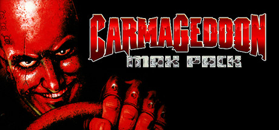

**Platforms:** Windows, MS-DOS &nbsp;|&nbsp; **Publisher:** Sales Curve Interactive &nbsp;|&nbsp; **Genre:** Action, Indie, Racing &nbsp;|&nbsp; **Released:** June 13, 1997

> Carmageddon is the original freeform driving sensation, where pedestrians (and cows!) equal points, and your opponents are a bunch of crazies in a twisted mix of automotive killing machines. The game features anarchic drive-wherever-you-like gameplay and over-the-top surreal comedy violence. It’s the racing game where racing is for wimps.
>
> _Synopsis source: Steam_

[Wikipedia](https://en.wikipedia.org/wiki/Carmageddon) · [Steam](https://store.steampowered.com/app/282010) · [IGDB](https://www.igdb.com/games/carmageddon)

---

### Chex Quest

**Platforms:** MS-DOS, Windows &nbsp;|&nbsp; **Developer:** Digital Café &nbsp;|&nbsp; **Publisher:** Ralston-Purina, General Mills, Inc. &nbsp;|&nbsp; **Genre:** Shooter &nbsp;|&nbsp; **Released:** December 31, 1997

> Set on a distant planet named Bazoik, the game follows the Chex Warrior, a humanoid in an anthropomorphic piece of Chex cereal armor, as he fights to eradicate the Flemoid invasion. These slimy, green creatures have infested the planet and captured many helpless citizens whom the Chex Warrior must save.  His only weapon is a device called a "zorcher", which teleports his enemies instead of killing them. The game starts at the landing pad of the research facility on Bazoik, after which the protagonist is teleported to the storage facility. The other levels include the laboratory, the arboretum, and finally, the underground caverns of Bazoik, where the Flemoids seem to be making a home for themselves.
>
> _Synopsis source: IGDB_

[IGDB](https://www.igdb.com/games/chex-quest)

---

### Claw

**Platforms:** Windows &nbsp;|&nbsp; **Developer:** Monolith Productions &nbsp;|&nbsp; **Publisher:** Egmont Polska, Gamestorm, Russobit-M, Monolith Productions, WizardWorks Group, Inc., Takarajimasha &nbsp;|&nbsp; **Genre:** Platform &nbsp;|&nbsp; **Released:** September 5, 1997

> Join forces with Captain Claw, the greatest cat pirate ever to challenge the Cocker Spaniard Armada! Embark on an epic quest to recover the lost gems of the Amulet of Nine Lives. Uncover hidden treasure, navigate tricky terrain, and engage in armed combat to defeat the enemies of the courageous and legendary Captain Nathaniel J. Claw.
>
> _Synopsis source: IGDB_

[IGDB](https://www.igdb.com/games/claw)

---

### Close Combat: A Bridge Too Far

**Platforms:** Windows, MS-DOS &nbsp;|&nbsp; **Released:** September 30

---

### Combat Chess

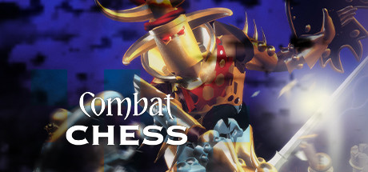

**Platforms:** Windows, MS-DOS &nbsp;|&nbsp; **Genre:** Strategy &nbsp;|&nbsp; **Released:** October

> Play with living, battling characters! Combat Chess takes the basic chess game and adds an imaginative element for players. Beautifully done in rendered 3D graphics, Combat Chess adds stunning animation sequences during gameplay.
>
> _Synopsis source: Steam_

[Wikipedia](https://en.wikipedia.org/wiki/Combat_Chess) · [Steam](https://store.steampowered.com/app/1557050)

---

### Croc: Legend of the Gobbos

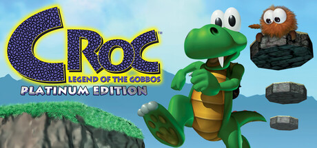

**Platforms:** Windows, MS-DOS, PlayStation, Sega Saturn &nbsp;|&nbsp; **Genre:** Action, Adventure &nbsp;|&nbsp; **Released:** September 29

> Join Croc in a charming 3D platforming adventure to rescue the kidnapped Gobbos from the evil sorcerer Baron Dante and his impish Dantini minions! Run, jump, climb, swim, and tail-spin through vibrant worlds in this lovingly remastered and updated version of the beloved 1997 classic.
>
> _Synopsis source: Steam_

[Steam](https://store.steampowered.com/app/3043940) · [IGDB](https://www.igdb.com/games/croc-legend-of-the-gobbos)

---

### Dark Colony

**Platforms:** Windows &nbsp;|&nbsp; **Developer:** Alternative Reality Technologies &nbsp;|&nbsp; **Publisher:** SSI (Strategic Simulations, Inc.) &nbsp;|&nbsp; **Genre:** Fighting, Shooter, Real Time Strategy (RTS), Strategy, Adventure &nbsp;|&nbsp; **Released:** February 1, 1997

> Dark Colony is a real-time strategy with heavy emphasis on the actual combat. Resource gathering, base construction and unit production have been made as simple and fast as possible, allowing the player to focus on decimating the enemy armies. Ancient artifacts, available in some of the missions, provide unique options for beating the odds, even when they seem to be against you (and they often will).
>
> _Synopsis source: IGDB_

[IGDB](https://www.igdb.com/games/dark-colony)

---

### Dark Reign: The Future of War

**Platforms:** Windows &nbsp;|&nbsp; **Developer:** Auran &nbsp;|&nbsp; **Publisher:** Activision &nbsp;|&nbsp; **Genre:** Real Time Strategy (RTS), Strategy &nbsp;|&nbsp; **Released:** August 31, 1997

> Dark Reign narrowly beat Total Annihilation as the first RTS to incorporate 3D movement and positioning. This increases the strategic advantage of hills and mountains. Each mission puts you in the role of commander of either the Imperial army or the Freedom fighters in a campaign to undermine and eventually destroy the opposing force. This game has many unusual features for the RTS genre. AI patterns you to simply give a unit the order "Search and Destroy" and it would drive off towards the enemy's last known location, in search for something to kill. There is also "explore" mode which let your units do all the map exploring for you. A mission/campaign editor is also provided.
>
> _Synopsis source: IGDB_

[IGDB](https://www.igdb.com/games/dark-reign-the-future-of-war)

---

### Diablo

**Platforms:** Windows, MS-DOS &nbsp;|&nbsp; **Publisher:** Blizzard Entertainment &nbsp;|&nbsp; **Released:** January 3, 1997

[Wikipedia](https://en.wikipedia.org/wiki/Diablo_(video_game))

---

### Disney's Hercules Action Game

**Platforms:** Windows, PlayStation &nbsp;|&nbsp; **Developer:** Eurocom Entertainment Software &nbsp;|&nbsp; **Publisher:** Virgin Interactive Entertainment, Disney Interactive Studios, Sony Computer Entertainment &nbsp;|&nbsp; **Genre:** Platform, Arcade &nbsp;|&nbsp; **Released:** July 3, 1997

> Disney's Hercules Action Game is a platform game mainly two-dimensional, although in many missions the player can walk to other planes via pathways or stairs. There are ten levels and three difficulty modes: Beginner, Medium, and Herculean. Hercules can jump, grab ledges, swing on poles, and jump while running. He has a variety of attack moves at his disposal.
>
> _Synopsis source: IGDB_

[IGDB](https://www.igdb.com/games/disneys-hercules-action-game)

---

### Dungeon Keeper

**Platforms:** Windows, MS-DOS &nbsp;|&nbsp; **Publisher:** Electronic Arts &nbsp;|&nbsp; **Genre:** Real Time Strategy (RTS), Strategy &nbsp;|&nbsp; **Released:** June 26, 1997

> Dungeon Keeper is a strategy video game in which the player attempts to build and manage a dungeon or lair while protecting it from invading 'hero' characters intent on stealing the player's accumulated treasures and killing various monsters. This was Peter Molyneux's final project with Bullfrog before he left the company in August 1997 to form Lionhead Studios.  The player uses a mouse, represented in-game as a hand, to interact with a bar on the left-hand side of the screen, allowing them to select which rooms to build and which spells to cast. The player can also use the hand to pick up creatures and objects in the dungeon and carry them around, allowing for tactics such as gathering an assault force and dropping off the creatures en masse once a foothold has been established. The hand also allows the player to "slap" objects and thereby interact with them: creatures will hurry up when slapped, some traps will be triggered and prisoners in the Torture Chamber can be tortured.  The main game view is in isometric perspective; this view can be zoomed and rotated. The player also has the option of possessing one of their creatures, and seeing the dungeon from that creature's first-person perspective, as well as using their attacks and abilities. The map is divided into a grid of rectangles, most of which are invisible. A smaller part of the map is shown as a minimap in the top left corner of the screen.  A world map is also available, and at the beginning of the game the player is allocated one of the 20 regions of a fictional, idyllic country to destroy. As the player progresses through these regions, each of which represents a level of the game, the areas previously conquered will appear ransacked, twisted, and evil. Before starting a new level, the Mentor will tell the player about the current region and its attributes. After completing a level, the Mentor will talk about the "improvement" of the destroyed region: "The streets run with the blood of the slain. Screams of pain and howls of anguish rip the night air like a vengeful siren's song. This really is somewhere you can take the kids for the weekend."  The Dungeon Heart represents the Dungeon Keeper's own link to the world. If it is destroyed, the player loses the level, and must restart. Along with the heart, the player begins with a small number of imps, the generic work force for all dungeon activities: they can dig tunnels into the surrounding soil, capture enemy rooms and Portals, mine gold and gems, set traps, and even attack when desperate or threatened. Slapping creatures forces them to work faster for a while, but removes some of their health and happiness.  Once the Imps are busily working, the player must then set up a basic infrastructure: Lairs for monsters, a Hatchery (where chickens, which serve as food for the minions, are bred), and a Treasury for storing gold. After connecting the dungeon to a "Portal", monsters will arrive. As the game progresses, the player moves along a technology tree, unlocking further rooms.  The dungeon has a fleshed-out ecology: some creatures are natural enemies. Flies and Spiders are often found at odds with one another, while a Horned Reaper, if it has gone berserk, will attack all creatures in its path. The goals for each level are fairly straightforward: they generally fall along the lines of eliminating the heroic force or destroying all other Dungeon Keepers on the level.
>
> _Synopsis source: IGDB_

[Wikipedia](https://en.wikipedia.org/wiki/Dungeon_Keeper) · [IGDB](https://www.igdb.com/games/dungeon-keeper)

---

### Ecstatica II

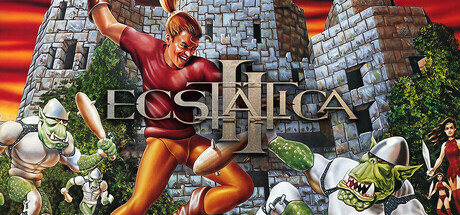

**Platforms:** Windows, MS-DOS &nbsp;|&nbsp; **Genre:** Action, Adventure &nbsp;|&nbsp; **Released:** June 10

> Ecstatica II is a dark fantasy action-adventure built from a one-of-a-kind ellipsoid world. Return as a prince to a kingdom sacked by demons under a blood-red sky. Cast spells and trade blows to restore the shattered Elder Sign and free the sorceress Ecstatica.
>
> _Synopsis source: Steam_

[Wikipedia](https://en.wikipedia.org/wiki/Ecstatica_II) · [Steam](https://store.steampowered.com/app/4834850)

---

### Fallout

**Platforms:** Windows, MS-DOS &nbsp;|&nbsp; **Publisher:** Interplay Productions &nbsp;|&nbsp; **Released:** October 10, 1997

[Wikipedia](https://en.wikipedia.org/wiki/Fallout_(video_game))

---

### Fallout: A Post Nuclear Role Playing Game

**Platforms:** macOS, MS-DOS, Windows &nbsp;|&nbsp; **Developer:** Interplay Entertainment, Black Isle Studios &nbsp;|&nbsp; **Publisher:** Edusoft, MacPlay, Interplay Entertainment, Bethesda Softworks &nbsp;|&nbsp; **Genre:** Role-playing (RPG) &nbsp;|&nbsp; **Released:** October 10, 1997

> The Vault Dweller is tasked with exploring post-nuclear California in order to retrieve a water chip to replace the broken chip of Vault 13, their home, which they are the first person to ever leave. The player will engage in Western RPG character building and turn-based tactical combat while getting to know settlements and factions of people, mutants and ghouls through branching dialogue trees.
>
> _Synopsis source: IGDB_

[IGDB](https://www.igdb.com/games/fallout-a-post-nuclear-role-playing-game)

---

### FIFA: Road to World Cup 98

**Platforms:** Windows, MS-DOS, Nintendo 64, PlayStation, Sega Saturn &nbsp;|&nbsp; **Genre:** Sport &nbsp;|&nbsp; **Released:** November 30

> The late-1997 edition of FIFA was heavily tied in with the qualifying procedure for the 1998 World Cup. In the Road to the World Cup mode, you take a team from first qualification through to the main tournament, using the varying systems in different parts of the world. The game features 16 distinct outdoor stadia. The League play features 189 clubs and 11 leagues. Each team has specific crowd chants incorporated into the ambient sound.  The action is faster than in previous versions, and AI has been expanded. Players have distinct facial feature and hair styles. Each match is introduced by Des Lynam and commentated on by John Motson and former Scotland international Andy Gray.
>
> _Synopsis source: IGDB_

[IGDB](https://www.igdb.com/games/fifa-road-to-world-cup-98)

---

### Fighting Force

**Platforms:** PlayStation, Windows &nbsp;|&nbsp; **Developer:** Core Design &nbsp;|&nbsp; **Publisher:** Eidos Interactive, Square Enix, Electronic Arts Victor &nbsp;|&nbsp; **Genre:** Fighting, Strategy, Hack and slash/Beat 'em up &nbsp;|&nbsp; **Released:** October 31, 1997

> Fighting Force players control one of four characters. They move through urban and science fiction environments, battling waves of oncoming enemies with weapons ranging from fists and bottles to knives, chairs and guns. The player can make some choices as to which territory to travel through.  The four characters have various reasons for taking on Dr. Zeng, a criminal mastermind with an army at his command. The action starts with a police cordon around Zeng's office skyscraper, moving to such locales as a shopping mall, subway and Coast Guard base before finally ending at the top of Zeng's island headquarters.
>
> _Synopsis source: IGDB_

[IGDB](https://www.igdb.com/games/fighting-force)

---

### Final Liberation: Warhammer Epic 40,000

**Platforms:** Windows &nbsp;|&nbsp; **Developer:** Holistic Design &nbsp;|&nbsp; **Publisher:** SSI (Strategic Simulations, Inc.) &nbsp;|&nbsp; **Genre:** Strategy, Turn-based strategy (TBS) &nbsp;|&nbsp; **Released:** November 30, 1997

> SSI, the masterminds behind the Five Star General Series’, bring their Midas touch to the Warhammer 40,000 world in the first ever video-game adaption of the Epic table-top game. With over 85 unit types, this addition to the 40k franchise brings the vastness and depth of an Epic-style battle to your PC, allowing you greater selection and customisation over your army. This, along with the multiple scenarios and battlefronts to fight from, will keep your strategic mind on edge for hours on end.
>
> _Synopsis source: IGDB_

[IGDB](https://www.igdb.com/games/final-liberation-warhammer-epic-40000)

---

### Frogger

**Platforms:** PlayStation, Windows &nbsp;|&nbsp; **Developer:** SCE Cambridge Studio &nbsp;|&nbsp; **Publisher:** Hasbro Interactive &nbsp;|&nbsp; **Genre:** Puzzle, Adventure, Arcade &nbsp;|&nbsp; **Released:** September 30, 1997

> A remake and reimagining of Frogger. However, unlike the original game, most of the maps are more complex and require exploration. In each level, the player must collect five baby frogs within a certain amount of time. There are various obstacles, traps, and enemies which must be avoided and usually are unique to a certain zone. There are a total of 33 levels spread out across nine different zones.
>
> _Synopsis source: IGDB_

[IGDB](https://www.igdb.com/games/frogger--1)

---

### G-Police

**Platforms:** Windows, PlayStation &nbsp;|&nbsp; **Developer:** Psygnosis &nbsp;|&nbsp; **Publisher:** Psygnosis, Sony Computer Entertainment &nbsp;|&nbsp; **Genre:** Shooter, Simulator &nbsp;|&nbsp; **Released:** September 30, 1997

> G-Police is a 1997 combat flight simulator set in a hypothetical future where corporations lead space colonies. The player is Jeff Slater, a futuristic helicopter pilot who joins the G-Police to investigate his sister's death.
>
> _Synopsis source: IGDB_

[IGDB](https://www.igdb.com/games/g-police)

---

### Game Dev Story

**Platforms:** Windows &nbsp;|&nbsp; **Developer:** Kairosoft &nbsp;|&nbsp; **Publisher:** Kairosoft &nbsp;|&nbsp; **Genre:** Role-playing (RPG), Simulator, Strategy, Adventure, Indie, Card & Board Game &nbsp;|&nbsp; **Released:** April 1, 1997

> In Game Dev Story starting from a small office and a few thousand dollars in the wallet, you will need to hire the necessary personnel to develop the first game of the newborn company. This is how the list of candidates runs: there is a good programmer, an artist a bit scarce and a designer not bad; each of them, thanks to their skills, can give a more or less relevant hand in the realization of the project. Once everything is ready you must finally choose the kind and type of game to be realized, keeping in mind that some combinations will get married much better than others. In Game Dev Story player can choose the platform on which to develop the project, and here things start to get very interesting. Game Dev Story in fact traces the last twenty years of the history of the video game industry, reproposing it in the form of an exhilarating parody: we start from the first computers, and then see almost all the major portable and home consoles announced. The names of companies, games and platforms have been revised, but are entirely traceable back to the originals; the Game Boy becomes the Game Kid and Microsoft is now Microx. However, in addition to the order in which the consoles are launched, the developers have chosen to keep even the success they have had at market level, which, on the one hand makes it even more pleasant to relive these twenty years from the inside , on the other hand, the player can easily predict big business and flop: nobody will be so crazy to develop a game for Virtual Boy (pardòn, Virtual Kid), while immediately supporting the fees of PlayStation and PlayStation 2 could lead to big boxing. There are also annual awards, in which a jury rewards the best games of the year in the various categories. In the course of developing a project, however, the player will never remain with his hands: he will have to instruct his employees in order to cultivate their skills, buy the development kits of the various consoles, send announcements and look for new staff. It is essential to keep the interest of the fans high, create hype and see the players line up days before the game, while sales can increase thanks to good reviews in specialized magazines. And yet, making a sequel to a successful game means starting the odds with good odds that the game sells, while the player can decide whether to invest everything in an ambitious project or make small titles in a very short time, until a budget has been reached. high enough to be able to make and place your console on the market.
>
> _Synopsis source: IGDB_

[IGDB](https://www.igdb.com/games/game-dev-story)

---

### Grand Theft Auto

**Platforms:** Windows, MS-DOS, PlayStation &nbsp;|&nbsp; **Genre:** Shooter, Racing, Adventure &nbsp;|&nbsp; **Released:** November 27

> Grand Theft Auto is the first game in the Grand Theft Auto series and a sandbox-crime game published by Rockstar Games.  The original Grand Theft Auto is made up of a series of levels each set in one of the three cities in the game. In each level, the player has a target number of points to achieve, and five lives to attain the score.  The score counter doubles as a money meter; the player can spend this money on paint jobs and various other things. However, any money spent is of course taken away from the score, making the goal that little bit further away.  On obtaining the target number of points, the player must then drive to a certain location to complete the level, which allows progress to the next one.
>
> _Synopsis source: IGDB_

[Wikipedia](https://en.wikipedia.org/wiki/Grand_Theft_Auto_(video_game)) · [IGDB](https://www.igdb.com/games/grand-theft-auto)

---

### Hexen II

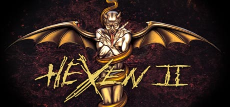

**Platforms:** Windows, MS-DOS &nbsp;|&nbsp; **Genre:** Action &nbsp;|&nbsp; **Released:** September 11

> The Four Horsemen of the Apocalypse lurk in the shadows before you. They are Death, Pestilence, Famine, and War. They are the root of all that is evil, but the least of your worries. The last of the three Serpent Riders yet lives.
>
> _Synopsis source: Steam_

[Wikipedia](https://en.wikipedia.org/wiki/Hexen_II) · [Steam](https://store.steampowered.com/app/9060) · [IGDB](https://www.igdb.com/games/hexen-ii)

---

### Imperialism

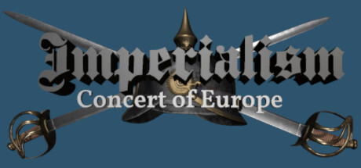

**Platforms:** Windows, MS-DOS &nbsp;|&nbsp; **Genre:** Indie, Strategy &nbsp;|&nbsp; **Released:** August 31

> It is the 19th century - an age of steam power, revolution, and imperialist expansion. Engage in turn-based gameplay as you strive to ascend to unparalleled power through astute management of trade, industry, research, diplomacy, colonization, and warfare.
>
> _Synopsis source: Steam_

[Wikipedia](https://en.wikipedia.org/wiki/Imperialism_(video_game)) · [Steam](https://store.steampowered.com/app/2766160)

---

### Incubation: Time Is Running Out

**Platforms:** Windows &nbsp;|&nbsp; **Developer:** Blue Byte Software &nbsp;|&nbsp; **Publisher:** Sega, Blue Byte Software &nbsp;|&nbsp; **Genre:** Strategy, Turn-based strategy (TBS), Tactical &nbsp;|&nbsp; **Released:** September 30, 1997

> Travel to the colonized planet of Scayra, and enter the dark and terrifying world of Incubation - the latest episode in the Battle Isle saga. Following a power plant accident, the vast energy shield that separates the Chromian colonists from the indigenous life-forms - the Scay'Ger - suffers a total shut down, allowing contact between the two races for the very first time. A human virus has not infected the Scay'Ger, mutating them into violent, blood-thirsty monsters. As commander of a squad of elite space marines, only you can stop the vicious attacks and evacuate the remaining colonists before all is lost.  The battles in this turn-based tactical game are not waged in open fields, but fought within the dark and complex industrial buildings of the colony city; Scay Hallwa. You'll enjoy the unique challenge of leading your men through various alien scenarios, never knowing what's around the next corner or behind the next door.  Incubation also features a real-time 3D environment and with detail and features never seen before in a game of this genre. The action can be viewed from the eyes of the individual soldiers, from the attacking aliens' perspective, or from any external position thanks to the complete camera freedom offered by the stunning graphics engine. All the events in the game are fully animated, as are the actions and movements of all the characters; giving them an incredibly lifelike apperance and a host of realistic mannerisms. They walk, rest, run and fight - all in glorious 3D.
>
> _Synopsis source: IGDB_

[IGDB](https://www.igdb.com/games/incubation-time-is-running-out)

---

### Independence Day

**Platforms:** Windows, MS-DOS, PlayStation, Sega Saturn &nbsp;|&nbsp; **Genre:** Shooter, Simulator, Adventure &nbsp;|&nbsp; **Released:** February 28

> Independence Day is a combat flight simulator video game based on the 1996 film of the same name. The game was developed by Radical Entertainment, published by Fox Interactive and distributed by Electronic Arts for Microsoft Windows, PlayStation and Sega Saturn.
>
> _Synopsis source: IGDB_

[Wikipedia](https://en.wikipedia.org/wiki/Independence_Day_(video_game)) · [IGDB](https://www.igdb.com/games/independence-day)

---

### Independence War

**Platforms:** Windows, MS-DOS &nbsp;|&nbsp; **Genre:** Simulator &nbsp;|&nbsp; **Released:** November

> A guerilla war has been raging in space for centuries. Human colonies are breaking away from Earth's control, declaring independence from the Commonwealth. As a Commonwealth Navy commander, your mission is to stop the Indie rebels and their attacks of terror and random piracy. It's a sophisticated, interstellar battle for life, and you must fight your way along the path between duty and justice. With luck and skill you can secure a victory for mankind.
>
> _Synopsis source: IGDB_

[Wikipedia](https://en.wikipedia.org/wiki/I-War_(1997_video_game)) · [IGDB](https://www.igdb.com/games/independence-war)

---

### International Rally Championship

**Platforms:** Windows &nbsp;|&nbsp; **Developer:** Magnetic Fields &nbsp;|&nbsp; **Publisher:** Europress Software &nbsp;|&nbsp; **Genre:** Racing, Simulator, Sport &nbsp;|&nbsp; **Released:** July 30, 1997

> International Rally Championship is a rally computer game which is part of the Rally Championship series. The game was released for Windows in 30 June 1997. It is developed by Magnetic Fields and published by Europress. Several different front covers were released for the game. The game is a sequel to the 1996 version of Network Q RAC Rally Championship. It would in turn be succeeded in 1999 by Mobil 1 Rally Championship.
>
> _Synopsis source: IGDB_

[IGDB](https://www.igdb.com/games/international-rally-championship)

---

### Interstate '76

**Platforms:** Windows, MS-DOS &nbsp;|&nbsp; **Genre:** Shooter, Racing &nbsp;|&nbsp; **Released:** February 28

> It's 1976 - a different '76. Stretched out before you are thousands of miles of desert - the American Southwest. The massive engine roars as you slam down the accelerator. It's time to get funked up. You are Groove Champion, auto-vigilante. Your agenda: Payback for your dead sister. Your weapon: A 425-horsepower '72 Picard Piranha with two 50-caliber M60 machine guns on top and a flame-thrower on the side. You're one mean dude in an even meaner ride. They've messed with the wrong Champion.
>
> _Synopsis source: IGDB_

[Wikipedia](https://en.wikipedia.org/wiki/Interstate_%2776) · [IGDB](https://www.igdb.com/games/interstate-76)

---

### Jane's 688(I) Hunter/Killer

**Platforms:** Windows, MS-DOS &nbsp;|&nbsp; **Released:** July 4

[Wikipedia](https://en.wikipedia.org/wiki/688(I)_Hunter/Killer)

---

### KKND: Krush, Kill 'N' Destroy

**Platforms:** Windows &nbsp;|&nbsp; **Developer:** Beam Software &nbsp;|&nbsp; **Publisher:** Electronic Arts &nbsp;|&nbsp; **Genre:** Real Time Strategy (RTS), Strategy &nbsp;|&nbsp; **Released:** March 25, 1997

> KKnD, or Krush, Kill 'n' Destroy is a real-time strategy games in the KKnD series. The game takes place in a post-apocalyptic setting, where two factions are fighting for control over the few natural resources left. Each faction has its own campaign consisting of 15 missions each, and there is also a multiplayer mode which allows up to 6 people to play.
>
> _Synopsis source: IGDB_

[IGDB](https://www.igdb.com/games/kknd-krush-kill-n-destroy)

---

### LEGO Island

**Platforms:** Windows, MS-DOS &nbsp;|&nbsp; **Genre:** Adventure &nbsp;|&nbsp; **Released:** September 26

> Lego Island is a nonlinear game with a first-person perspective. The game features a series of missions including pizza delivery, jet ski racing, and putting the Brickster back in jail. It also features a variety of playable characters that each have unique abilities that can help the player throughout the game.
>
> _Synopsis source: IGDB_

[Wikipedia](https://en.wikipedia.org/wiki/LEGO_Island) · [IGDB](https://www.igdb.com/games/lego-island)

---

### Lords of Magic

**Platforms:** Windows &nbsp;|&nbsp; **Developer:** Impressions Games &nbsp;|&nbsp; **Publisher:** Sierra On-Line &nbsp;|&nbsp; **Genre:** Strategy &nbsp;|&nbsp; **Released:** December 2, 1997

> In the fantasy world known as Urak, supporters of eight different religions constantly fight each other. One of them is Balkoth, known as the Lord of Death, who worships the dark deity Golgoth. Balkoth has sworn to destroy all other faiths in the name of his own god. The other lords have to expand their ranks and defend themselves against the mad zealot.  Lords of Magic is a strategy game that combines turn-based exploration and resource management with real-time combat. The player can choose to control any of the lords who oppose Balkoth. Each nation (faith) commanded by a lord has its own specific units. Before engaging in an offensive, the player must liberate a Great Temple for the faith of his/her choice. It is also necessary to build a stronghold, develop the nation's capital city, and recruit troops.  The troops are led by a champion, representing the "hero" of the game. This hero can be either a warrior, a thief, or a mage, possessing the classical advantages and disadvantages of these classes: the warrior is good in close combat, the thief can sabotage enemy armies, and the physically weak mage can cast devastating spells. The isometric combat proceeds in real-time, with an option to simply calculate the result of a battle immediately, depending on the participants' statistics.
>
> _Synopsis source: IGDB_

[IGDB](https://www.igdb.com/games/lords-of-magic)

---

### Lula: The Sexy Empire

**Platforms:** Windows &nbsp;|&nbsp; **Developer:** Interactive Strip &nbsp;|&nbsp; **Publisher:** Take-Two Interactive, CDV Software, Amber Company, United Independent Entertainment GmbH, Novitas Publishing &nbsp;|&nbsp; **Genre:** Point-and-click, Simulator &nbsp;|&nbsp; **Released:** June 26, 1997

> Lula: The Sexy Empire is a business simulation game for Windows and AmigaOS. The game revolves around building a multi-million dollar pornography and erotica industry. Character designs were done by German comic artist Carsten Wieland.
>
> _Synopsis source: IGDB_

[IGDB](https://www.igdb.com/games/lula-the-sexy-empire)

---

### Madden NFL 98

**Platforms:** Sega Saturn, Windows, MS-DOS, PlayStation &nbsp;|&nbsp; **Publisher:** EA Sports &nbsp;|&nbsp; **Released:** August 26, 1997

[Wikipedia](https://en.wikipedia.org/wiki/Madden_NFL_98)

---

### Magic: The Gathering

**Platforms:** Windows &nbsp;|&nbsp; **Developer:** MicroProse Software, Inc. &nbsp;|&nbsp; **Publisher:** MicroProse Software, Inc. &nbsp;|&nbsp; **Genre:** Strategy, Turn-based strategy (TBS), Tactical, Card & Board Game &nbsp;|&nbsp; **Released:** February 28, 1997

> Magic: The Gathering is a computer game published by MicroProse in April 1997 based on the collectible card game Magic: The Gathering. The game takes place in the plane of Shandalar, where the player must travel the land and fight random enemies to gain cards, and defeat five wizards representing the five colors. The player must prevent one color from gaining too much power, and defeat the planeswalker Arzakon, who has a deck of all five colors. Adventure game and role-playing game elements are present, including inventory, gold, towns, dungeons, random battles, and character progression in the form of new abilities and a higher life point total. An oversized version of Aswan Jaguar was included in the game box.
>
> _Synopsis source: IGDB_

[IGDB](https://www.igdb.com/games/magic-the-gathering)

---

### MDK

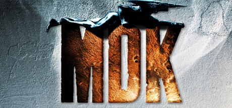

**Platforms:** Windows, MS-DOS &nbsp;|&nbsp; **Publisher:** Playmates Interactive &nbsp;|&nbsp; **Genre:** Action &nbsp;|&nbsp; **Released:** May 5, 1997

> ON A GOOD DAY, ONLY 2.5 MILLION PEOPLE WILL DIE. As vast alien mining cities suck the power and minerals from every major metropolis on Earth simultaneously, time is of the essence as millions of civilians are expiring by the second.
>
> _Synopsis source: Steam_

[Wikipedia](https://en.wikipedia.org/wiki/MDK_(video_game)) · [Steam](https://store.steampowered.com/app/38450) · [IGDB](https://www.igdb.com/games/mdk)

---

### Moto Racer

**Platforms:** PlayStation, Windows &nbsp;|&nbsp; **Developer:** Delphine Software &nbsp;|&nbsp; **Publisher:** Electronic Arts &nbsp;|&nbsp; **Genre:** Racing, Arcade &nbsp;|&nbsp; **Released:** August 1, 1997

> Moto Racer is an arcade style motorcycle racing game developed by Delphine Software International and published by Electronic Arts for Microsoft Windows and PlayStation. It features both dirt and street bikes, and a variety of tracks.
>
> _Synopsis source: IGDB_

[IGDB](https://www.igdb.com/games/moto-racer)

---

### Myth: The Fallen Lords

**Platforms:** Windows, MS-DOS &nbsp;|&nbsp; **Publisher:** Bungie &nbsp;|&nbsp; **Genre:** Real Time Strategy (RTS), Role-playing (RPG), Strategy &nbsp;|&nbsp; **Released:** November 7, 1997

> A real-time tactical game from Bungie Studios, Myth: The Fallen Lords is set in a gothic fantasy realm where the nations of men are in danger of being eradicated. With limited numbers and dwindling odds, players must overcome the impossible to defeat Balor and the powerful Fallen Lords.
>
> _Synopsis source: IGDB_

[IGDB](https://www.igdb.com/games/myth-the-fallen-lords)

---

### NBA Live 98

**Platforms:** Sega Saturn, Genesis / Mega Drive, Super Nintendo Entertainment System, Windows, PlayStation &nbsp;|&nbsp; **Developer:** Electronic Arts &nbsp;|&nbsp; **Publisher:** Electronic Arts &nbsp;|&nbsp; **Genre:** Simulator, Sport &nbsp;|&nbsp; **Released:** October 31, 1997

> NBA Live 98 is a basketball video game based on the NBA and the fourth installment of the NBA Live series. The cover features Tim Hardaway of the Miami Heat. The game was developed by EA Sports and released on November 30, 1997 for the PlayStation, October 31, 1997 for the PC and December 31, 1997 for the Sega Saturn. It was the final version of NBA Live released for the Super NES, Genesis and Sega Saturn.
>
> _Synopsis source: IGDB_

[IGDB](https://www.igdb.com/games/nba-live-98)

---

### Need for Speed II

**Platforms:** Windows, MS-DOS, PlayStation &nbsp;|&nbsp; **Genre:** Racing, Simulator &nbsp;|&nbsp; **Released:** March 31

> There are three main game types. The first two are single race and tournament and the last is a knockout race. Single races allow players to become familiar with the circuits and increase their skill of any one of the six tracks. The six tracks are called Mediterranean, Mystic Peaks, Proving Grounds, Outback, North Country, and Pacific Spirit.
>
> _Synopsis source: IGDB_

[Wikipedia](https://en.wikipedia.org/wiki/Need_for_Speed_II) · [IGDB](https://www.igdb.com/games/need-for-speed-ii)

---

### NHL 98

**Platforms:** Genesis / Mega Drive, Super Nintendo Entertainment System, PlayStation, Windows, Sega Saturn &nbsp;|&nbsp; **Developer:** EA Canada &nbsp;|&nbsp; **Publisher:** EA Sports &nbsp;|&nbsp; **Genre:** Sport, Strategy &nbsp;|&nbsp; **Released:** October 23, 1997

> NHL 98 features much faster and refined gameplay (now using four action keys instead of two, removing the need to double-tap to perform some actions), along other new features such as "in-the-fly" tactics developed by Marc Crawford, then manager of the Colorado Avalanche and new commentary lines from Jim Hughson and Darryl Reaugh and a re-worked interface. Graphics are improved from the previous version with the players being less angular, and thanks to 3Dfx support, with less pixels showing in the textures. The in-game presentation follows a TV-style script, zooming in players while displaying stats during clock stoppages.  As far as game modes go, in the year of the first Olympic Tournament with professional players, NHL 98 introduced the first real international competition, with 18 International teams to choose from. Other game modes include Season (option to pick between 25 or 82 games) and Playoff (best of 1, 3, 5 or 7 matches) and a Penalty Shootout mode.
>
> _Synopsis source: IGDB_

[IGDB](https://www.igdb.com/games/nhl-98)

---

### Nightmare Creatures

**Platforms:** Windows, PlayStation &nbsp;|&nbsp; **Developer:** Kalisto Entertainment &nbsp;|&nbsp; **Publisher:** Activision, Sony Computer Entertainment &nbsp;|&nbsp; **Genre:** Adventure &nbsp;|&nbsp; **Released:** September 30, 1997

> The story behind Nightmare Creatures draws upon gothic horror elements of the 19th century. The story begins in 1666, when a devil-worshipping cult called the Brotherhood of Hecate were conducting sinister experiments in London so as to take over the city and then the world. The Brotherhood tried to develop an elixir that would endow them with superhuman powers. However, rather than creating their intended superhumans, their experiments created only grotesque monsters. When they decided to use these creatures as an army of conquest, one of their number, Samuel Pepys, set their headquarters on fire, resulting in the First Great Fire of London. The game takes place in 1834 when London falls victim to several evil occurrences. Monster sightings are reported along with news of people mutating into ungodly creatures, and that the dead are waking from their graves and walking amongst the living. All of London is in a panic and vulnerable to the schemes of Adam Crowley, a mad scientist and occultist enlisting the help of the Brotherhood.
>
> _Synopsis source: IGDB_

[IGDB](https://www.igdb.com/games/nightmare-creatures)

---

### Nuclear Strike

**Platforms:** PlayStation, Windows &nbsp;|&nbsp; **Developer:** Granite Bay Software, EA Orlando &nbsp;|&nbsp; **Publisher:** Electronic Arts &nbsp;|&nbsp; **Genre:** Shooter &nbsp;|&nbsp; **Released:** August 31, 1997

> Nuclear Strike is a shooter video game developed and published by Electronic Arts for the PlayStation in 1997. The game is the sequel to Soviet Strike and the fifth instalment in the Strike series, which began with Desert Strike on the Sega Genesis. The Soviet Strike development team also created Nuclear Strike. EA released a PC port the same year; THQ developed and in 1999 published a Nintendo 64 version called Nuclear Strike 64.  Nuclear Strike is a helicopter-based game, with strategy elements added to the action gameplay. The plot concerns an elite special force - the player's allies - pursuing a nuclear-armed rogue spy through a fictionalised Asian setting. It retained the earlier game's engine but added several modifications to improve graphical performance and make the game more accessible. The game features 15 playable vehicles, a large increase from previous games. In addition to the main fictionalised Apache, there are secondary helicopters, jets, armour and a hovercraft. The player also commands ground troops in occasional real-time strategy sections.  The game received positive, negative and mixed reviews. Critics noted a weak storyline, though GameSpot dismissed this is as unimportant in an action game. GameSpot called the graphics - which made use of specialised hardware such as 3Dfx Voodoo video cards and the N64 Expansion Pak - "about as good as it gets", while Allgame said they are "decent" and Daily Radar called them "horrible". Critics praised the full motion video as well as the music and sound effects. Reviewers enjoyed the straightforward gameplay but several complained of a close similarity to its predecessor Soviet Strike and questioned the game's value as a result.
>
> _Synopsis source: IGDB_

[IGDB](https://www.igdb.com/games/nuclear-strike)

---

### Oddworld: Abe's Oddysee

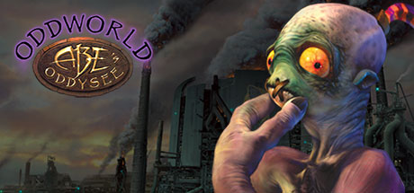

**Platforms:** PlayStation, Windows, MS-DOS &nbsp;|&nbsp; **Publisher:** GT Interactive &nbsp;|&nbsp; **Genre:** Adventure &nbsp;|&nbsp; **Released:** September 18, 1997

> Selected by the fickle finger of fate, Abe™, floor-waxer first class for RuptureFarms, was catapulted into a life of adventure when he overheard plans by his boss, Molluck the Glukkon™, to turn Abe and his fellow Mudokons into Tasty Treats as part of a last-ditch effort to rescue Molluck's failing meat-packing empire.
>
> _Synopsis source: Steam_

[Steam](https://store.steampowered.com/app/15700) · [IGDB](https://www.igdb.com/games/oddworld-abe-s-oddysee)

---

### Outlaws

**Platforms:** Windows, MS-DOS &nbsp;|&nbsp; **Genre:** Shooter &nbsp;|&nbsp; **Released:** April 7

> Outlaws is a first-person shooter released by LucasArts in 1997. It uses a Wild West setting. It follows retired U.S. Marshal James Anderson, who seeks to bring justice to a gang of criminals who killed his wife and kidnapped his daughter. The game is a first-person shooter. Players control the character as he utilizes several American Old West weapons and items, such as a rifle, shotgun, dynamite and revolver. The player can activate the lantern inventory item to lighten dark areas, and use a shovel in specific areas to dig holes.
>
> _Synopsis source: IGDB_

[Wikipedia](https://en.wikipedia.org/wiki/Outlaws_(1997_video_game)) · [IGDB](https://www.igdb.com/games/outlaws)

---

### Pandemonium 2

**Platforms:** PlayStation, Windows &nbsp;|&nbsp; **Developer:** Toys for Bob, Crystal Dynamics &nbsp;|&nbsp; **Publisher:** Virgin Interactive Entertainment (Europe) Ltd., Midway Games, Bandai, BMG Interactive, Square Enix &nbsp;|&nbsp; **Genre:** Platform, Puzzle &nbsp;|&nbsp; **Released:** October 23, 1997

> When the magic-infused "Comet of Infinite Possibilities" is about to pass over Lyr for the first time in 300 years, Sorceress Nikki decides that stealing the source of its magic is a quicker way to reach power than study. But the evil Goon Queen Zorrscha has her sights set on the comet as well. Nikki and Fargus, a pyromaniac court jester with his own special abilities, race the queen for the goal.
>
> _Synopsis source: IGDB_

[IGDB](https://www.igdb.com/games/pandemonium-2)

---

### Panzer General 2

**Platforms:** Windows &nbsp;|&nbsp; **Developer:** SSI (Strategic Simulations, Inc.) &nbsp;|&nbsp; **Publisher:** SSI (Strategic Simulations, Inc.) &nbsp;|&nbsp; **Genre:** Strategy, Turn-based strategy (TBS) &nbsp;|&nbsp; **Released:** December 31, 1997

> Will you fight as a Wehrmacht Officer, or perhaps lead your comrades in the Soviet Army? You may want to hit the beaches at Salerno and Normandy as an American or British General. No matter what path you choose, you will need all your skills to triumph. The successful Panzer General devises sound strategic plans, and carries them out with unswerving commitment. Generals who are indecisive inevitably fail. Can you forge a battle-winning command and conquer your foes? Isn't it time to find out?
>
> _Synopsis source: IGDB_

[IGDB](https://www.igdb.com/games/panzer-general-2)

---

### Panzer General II

**Platforms:** Windows, MS-DOS &nbsp;|&nbsp; **Released:** September 30

[Wikipedia](https://en.wikipedia.org/wiki/Panzer_General_II)

---

### Pilot Brothers

**Platforms:** Windows, Windows Phone &nbsp;|&nbsp; **Developer:** Gamos &nbsp;|&nbsp; **Publisher:** G5 Entertainment, 1C Company &nbsp;|&nbsp; **Genre:** Adventure &nbsp;|&nbsp; **Released:** September 22, 1997

> The case of the stolen elephant! Elephant... Rare... Striped. ...has been kept for many years by an animal trader named Karbophos. Being unable to overcome abuse, it escaped and found a home at the zoo in our city. This is definitely Karbophos's work. To the zoo!
>
> _Synopsis source: IGDB_

[IGDB](https://www.igdb.com/games/pilot-brothers)

---

### POD

**Platforms:** Windows &nbsp;|&nbsp; **Publisher:** Ubi Soft Entertainment &nbsp;|&nbsp; **Genre:** Racing &nbsp;|&nbsp; **Released:** February 28, 1997

> POD is a Futuristic Racing by Ubisoft in 1997. It was designed with the Intel MMX processors in mind and was included as a box set on many computers. A retail version called pod 2.0 was also released with support for 3Dfx voodoo, S3 virge and ATI
>
> _Synopsis source: IGDB_

[IGDB](https://www.igdb.com/games/pod--1)

---

### Postal

**Platforms:** Windows, MS-DOS &nbsp;|&nbsp; **Genre:** Shooter, Indie &nbsp;|&nbsp; **Released:** September 24

> Welcome to Paradise… Arizona. They’re out to get you. Or are they? It doesn’t matter. You don’t have time to think, only time to kill.  Blast, maim and fire-bomb your way through 17 unsuspecting locales, from a small town to a heavily guarded military complex. Don’t get too crazy – this killing spree is anything but senseless. Out here, strategy is key and the locals are packin’ - so take advantage of the third-person "premeditated" perspective that lets you see exactly who's cold and who's still able to pull a trigger.
>
> _Synopsis source: IGDB_

[Wikipedia](https://en.wikipedia.org/wiki/Postal_(video_game)) · [IGDB](https://www.igdb.com/games/postal)

---

### Pro Pinball: Timeshock!

**Platforms:** Windows, macOS, PlayStation &nbsp;|&nbsp; **Developer:** Cunning Developments &nbsp;|&nbsp; **Publisher:** Empire Interactive &nbsp;|&nbsp; **Genre:** Pinball &nbsp;|&nbsp; **Released:** December 31, 1997

> Timeshock! is a 1997 pinball computer game developed by Cunning Developments and published by Empire Interactive. It is the second game in the Pro Pinball series, and is themed around the concept of time travel.    The inclusion of a time machine fixture on the table facilitates the game's time travel theme. At any one time the player is in one of a handful of time zones, the main ones being: The Present Day, The Distant Future, Ancient Rome and The Prehistoric Age. Completion of certain objectives allows the player to travel between time zones (although some must be unlocked first, by means of completing secondary objectives).    Although the basic method of playing is persistent across time zones, the details of particular awards and objectives are themed towards the current time, for example, you might be awarded with a ray gun in the future, whilst in the present day you might be awarded with a magnet. This provides variety, and helps facilitate a wider set of goals.
>
> _Synopsis source: IGDB_

[IGDB](https://www.igdb.com/games/pro-pinball-timeshock)

---

### Putt-Putt Travels Through Time

**Platforms:** macOS, Windows &nbsp;|&nbsp; **Developer:** Humongous Entertainment &nbsp;|&nbsp; **Publisher:** Humongous Entertainment, UFO Interactive Games, Atari, Inc. &nbsp;|&nbsp; **Genre:** Point-and-click, Adventure &nbsp;|&nbsp; **Released:** November 21, 1997

> In this Junior Adventure, Putt-Putt must travel through time to rescue his dog Pep and retrieve his lunchbox, calculator, and history report. This was the first Putt-Putt game to have multiple paths — the missing objects could be in one of four locations, meaning there could be different puzzles on different playthroughs.
>
> _Synopsis source: IGDB_

[IGDB](https://www.igdb.com/games/putt-putt-travels-through-time)

---

### Quake II

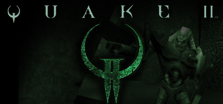

**Platforms:** Windows, MS-DOS, PlayStation &nbsp;|&nbsp; **Genre:** Action &nbsp;|&nbsp; **Released:** December 6

> You are humanity’s last hope to stop the Strogg, a hostile alien race waging war against Earth. Play this military sci-fi FPS, now upgraded for modern platforms with improved visuals, new campaign content, online multiplayer/co-op, and more.
>
> _Synopsis source: Steam_

[Wikipedia](https://en.wikipedia.org/wiki/Quake_II) · [Steam](https://store.steampowered.com/app/2320) · [IGDB](https://www.igdb.com/games/quake-ii)

---

### Rampage World Tour

**Platforms:** Windows, Sega Saturn, PlayStation &nbsp;|&nbsp; **Developer:** Saffire, Point of View, Game Refuge Inc, Digital Eclipse &nbsp;|&nbsp; **Publisher:** Midway Amusement Games &nbsp;|&nbsp; **Genre:** Platform, Arcade &nbsp;|&nbsp; **Released:** September 30, 1997

> Rampage World Tour is a updated version of the classic Rampage. Rampage World Tour starts off at Scumlabs International where three lab technicians, George, Lizzy, and Ralph have mutated in an accident involving toxic waste. George has turned into a gigantic ape, Lizzy a gigantic lizard or dinosaur, and Ralph some sort of gigantic wolf. The three destroy the lab they previously worked at and then embark on a path of destruction encompassing the entire globe.
>
> _Synopsis source: IGDB_

[IGDB](https://www.igdb.com/games/rampage-world-tour)

---

### Realms of the Haunting

**Platforms:** Windows, MS-DOS &nbsp;|&nbsp; **Released:** March 24 (NA)

[Wikipedia](https://en.wikipedia.org/wiki/Realms_of_the_Haunting)

---

### Redneck Rampage

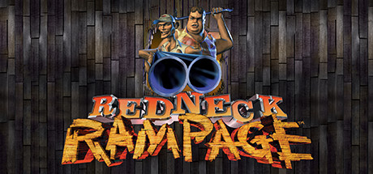

**Platforms:** Windows, MS-DOS &nbsp;|&nbsp; **Genre:** Action &nbsp;|&nbsp; **Released:** April 7

> Well, we crash-landed that UFO in the desert and Bubba says he wants to go home. Heck, I don't blame him 'cause there ain't no place like Hickston. But according to my map, we're gonna have to blast our way through jack o' lope farms and a riverboat as well as a brothel 'fore we get home again.
>
> _Synopsis source: Steam_

[Wikipedia](https://en.wikipedia.org/wiki/Redneck_Rampage) · [Steam](https://store.steampowered.com/app/565550) · [IGDB](https://www.igdb.com/games/redneck-rampage)

---

### Resident Evil

**Platforms:** Windows, MS-DOS &nbsp;|&nbsp; **Released:** September 17

[Wikipedia](https://en.wikipedia.org/wiki/Resident_Evil_(1996_video_game))

---

### Riven

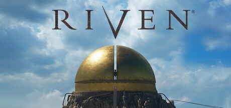

**Platforms:** Windows, MS-DOS, Sega Saturn, PlayStation &nbsp;|&nbsp; **Genre:** Adventure, Casual, Indie &nbsp;|&nbsp; **Released:** October 29

> Uncover a story of intrigue, betrayal, and a civilization teetering on the brink of collapse as you solve intricate puzzles to unlock the secrets of Riven. Built from the ground-up and expanded from the award-winning original game released in 1997.
>
> _Synopsis source: Steam_

[Wikipedia](https://en.wikipedia.org/wiki/Riven) · [Steam](https://store.steampowered.com/app/1712350)

---

### Riven: The Sequel to Myst

**Platforms:** macOS, Windows, PlayStation &nbsp;|&nbsp; **Developer:** Cyan Worlds &nbsp;|&nbsp; **Publisher:** Acclaim Entertainment, Enix, Tec Toy, Red Orb Entertainment, SUNSOFT, Mean Hamster Software, Sega Enterprises, Inc., Cyan Worlds, Ubi Soft Entertainment &nbsp;|&nbsp; **Genre:** Point-and-click, Puzzle, Adventure &nbsp;|&nbsp; **Released:** October 31, 1997

> Riven: The Sequel to Myst is a graphic adventure puzzle game developed by Cyan and released in 1997. It continues the story of Myst, following the player’s journey to rescue Atrus’s wife, Catherine, from a decaying world. The game features pre-rendered environments with complex, interconnected puzzles and minimal direct guidance. Its visuals, sound design, and world-building were praised for their depth and realism. Riven expanded on Myst’s narrative and gameplay scale, becoming one of the most acclaimed adventure games of its time.
>
> _Synopsis source: IGDB_

[IGDB](https://www.igdb.com/games/riven-the-sequel-to-myst)

---

### Shadow Warrior

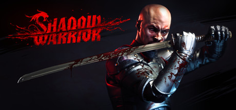

**Platforms:** Windows, MS-DOS &nbsp;|&nbsp; **Genre:** Action, Adventure &nbsp;|&nbsp; **Released:** August 25

> Shadow Warrior is a bold reimagining of the classic 3D Realms’ shooter from independent developer Flying Wild Hog (Hard Reset) starring the legendary and quick-witted warrior Lo Wang.
>
> _Synopsis source: Steam_

[Wikipedia](https://en.wikipedia.org/wiki/Shadow_Warrior_(1997_video_game)) · [Steam](https://store.steampowered.com/app/233130) · [IGDB](https://www.igdb.com/games/shadow-warrior)

---

### Shinseiki Evangelion: Koutetsu no Girlfriend

**Platforms:** Windows &nbsp;|&nbsp; **Developer:** Gainax, Gainax Network Systems &nbsp;|&nbsp; **Publisher:** Sega Enterprises, Ltd., Bandai &nbsp;|&nbsp; **Genre:** Adventure, Visual Novel &nbsp;|&nbsp; **Released:** February 13, 1997

> Neon Genesis Evangelion: Girlfriend of Steel, also known as Neon Genesis Evangelion: Iron Maiden, is a video game based on the Gainax anime/manga series Neon Genesis Evangelion, released officially only in Japan for the PlayStation, Sega Saturn, PlayStation 2, PSP, Windows (PC), and Macintosh. On January 20, 2005 a sequel was released titled "Neon Genesis Evangelion: Girlfriend of Steel 2nd" for the Playstation 2, and while it does feature much of the cast of the original game, the story is unrelated to the original's.
>
> _Synopsis source: IGDB_

[IGDB](https://www.igdb.com/games/shinseiki-evangelion-koutetsu-no-girlfriend)

---

### Shipwreckers

**Platforms:** Windows, MS-DOS, PlayStation &nbsp;|&nbsp; **Genre:** Strategy, Adventure &nbsp;|&nbsp; **Released:** October 28

> Shipwreckers is a third-person arcade-style shooter where you sail around in a pirate ship battling other pirate vessels and destroying the gun turrets and flamethrowers that are defending ports in an attempt to spread your swashbuckling reign of terror. Reward treasures and increasingly more potent weapons keep the pacing alive in this near top-down 3D action game. Shipwreckers supports solo play, head to head, and multi-person battles.
>
> _Synopsis source: IGDB_

[Wikipedia](https://en.wikipedia.org/wiki/Overboard!_(1997_video_game)) · [IGDB](https://www.igdb.com/games/shipwreckers)

---

### Sid Meier's Gettysburg!

**Platforms:** Windows, MS-DOS &nbsp;|&nbsp; **Publisher:** Electronic Arts &nbsp;|&nbsp; **Released:** October 14, 1997

[Wikipedia](https://en.wikipedia.org/wiki/Sid_Meier%27s_Gettysburg!)

---

### Spy Fox in "Dry Cereal"

**Platforms:** Windows, macOS &nbsp;|&nbsp; **Developer:** Humongous Entertainment &nbsp;|&nbsp; **Publisher:** Majesco Entertainment, Atari, Inc. &nbsp;|&nbsp; **Genre:** Point-and-click, Adventure &nbsp;|&nbsp; **Released:** October 17, 1997

> The super-suave agent, SPY Fox, must find Mr. Udderly, rescue all the cows, and stop William the Kid from depleting the worlds supply of milk. Using ingenious SPY gadgets, keen wits, and daring moves, SPY Fox, jumps out on an udderly exhilarating adventure!
>
> _Synopsis source: IGDB_

[IGDB](https://www.igdb.com/games/spy-fox-in-dry-cereal)

---

### Star Wars Jedi Knight: Dark Forces II

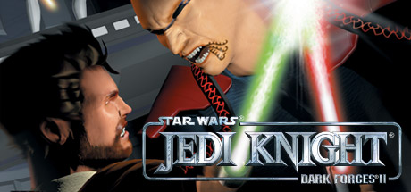

**Platforms:** Windows, MS-DOS &nbsp;|&nbsp; **Publisher:** LucasArts &nbsp;|&nbsp; **Genre:** Action &nbsp;|&nbsp; **Released:** October 10, 1997

> Jedi Knight: Dark Forces II picks up where the award-winning Dark Forces™ game left off...with even more features and firepower in dazzling 3D graphics. As Kyle Katarn, you must acquire a lightsaber and learn the ways of the Force to become a Jedi Knight.
>
> _Synopsis source: Steam_

[Steam](https://store.steampowered.com/app/32380) · [IGDB](https://www.igdb.com/games/star-wars-jedi-knight-dark-forces-ii)

---

### Star Wars: Shadows of the Empire

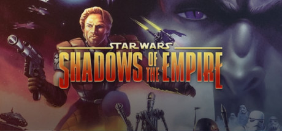

**Platforms:** Windows, MS-DOS &nbsp;|&nbsp; **Genre:** Action, Adventure &nbsp;|&nbsp; **Released:** September 9

> As Luke Skywalker and the Rebel Alliance struggle to defeat Darth Vader and the Empire, a new threat arises. Dark Prince Xizor aspires to take Darth Vader's place at the Emperor's side. As Dash Rendar, it's up to you to protect Luke and help the Alliance. May the Force be with you!
>
> _Synopsis source: Steam_

[Steam](https://store.steampowered.com/app/560170)

---

### Star Wars: X-Wing vs. TIE Fighter

**Platforms:** Windows, MS-DOS &nbsp;|&nbsp; **Genre:** Simulator &nbsp;|&nbsp; **Released:** April 30

> Star Wars: X-Wing vs. TIE Fighter is the third release of the X-Wing computer game series.  The player has the ability to choose for each mission which squadron he or she wants to fly in (e.g. either the Y-wings that disable a ship for capture or the X-wings that support them), his or her specific ship type, and the ship's armaments.
>
> _Synopsis source: IGDB_

[IGDB](https://www.igdb.com/games/star-wars-x-wing-vs-tie-fighter)

---

### Star Wars: Yoda Stories

**Platforms:** Windows &nbsp;|&nbsp; **Developer:** LucasArts, Torus Games &nbsp;|&nbsp; **Publisher:** LucasArts, THQ &nbsp;|&nbsp; **Genre:** Puzzle, Adventure &nbsp;|&nbsp; **Released:** March 31, 1997

> Grab your lightsaber and get ready for terrific Star Wars adventuring in Yoda Stories, the newest in a series of easy-to-play Desktop Adventures from LucasArts. Join Luke Skywalker as he trains to become a Jedi with Yoda, then harness the Force and cross the galaxy to meet exotic aliens, collect stange devices and weapons and deal the Galactic Empire one crippling blow after another - all within an hour!
>
> _Synopsis source: IGDB_

[IGDB](https://www.igdb.com/games/star-wars-yoda-stories)

---

### Test Drive 4

**Platforms:** PlayStation, Windows &nbsp;|&nbsp; **Developer:** Pitbull Syndicate &nbsp;|&nbsp; **Publisher:** Accolade, Electronic Arts Distribution &nbsp;|&nbsp; **Genre:** Racing &nbsp;|&nbsp; **Released:** September 30, 1997

> Test Drive 4 is a racing game featuring ten different cars - five modern supercars such as the Jaguar XJ220 and TVR Cerbera, and five vintage muscle cars including three Chevrolet models. Each car has its own realistic physics, with challenging handling.  There are five full circuits, plus a drag strip. You can contest a full world championship, plus single races and ghost-car time trials. The ability to find shortcuts which is featured in the third game in the series is not included here; you must stick to the pre-defined track layout.
>
> _Synopsis source: IGDB_

[IGDB](https://www.igdb.com/games/test-drive-4)

---

### The Crow: City of Angels

**Platforms:** PlayStation, Sega Saturn, Windows &nbsp;|&nbsp; **Developer:** Gray Matter &nbsp;|&nbsp; **Publisher:** Acclaim Entertainment &nbsp;|&nbsp; **Genre:** Hack and slash/Beat 'em up &nbsp;|&nbsp; **Released:** February 1, 1997

> The Crow: City of Angels is a 3D fighting game in which the player wanders from screen to screen, fighting everybody they come across with a wide variety of kicks and punches that vary based on your proximity to your foe. There is also a large range of weapons including pistols, shotguns, knives, pool cues, pipes and steel drums.
>
> _Synopsis source: IGDB_

[IGDB](https://www.igdb.com/games/the-crow-city-of-angels)

---

### The Curse of Monkey Island

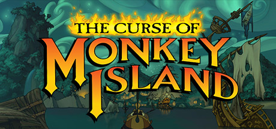

**Platforms:** Windows, MS-DOS &nbsp;|&nbsp; **Publisher:** LucasArts &nbsp;|&nbsp; **Genre:** Adventure &nbsp;|&nbsp; **Released:** November 1, 1997

> The only pirate adventure that asks the question: What's sharper, your sword or your wit?
>
> _Synopsis source: Steam_

[Wikipedia](https://en.wikipedia.org/wiki/The_Curse_of_Monkey_Island) · [Steam](https://store.steampowered.com/app/730820) · [IGDB](https://www.igdb.com/games/the-curse-of-monkey-island)

---

### The Last Express

**Platforms:** Windows, MS-DOS &nbsp;|&nbsp; **Genre:** Point-and-click, Puzzle, Adventure &nbsp;|&nbsp; **Released:** March 30

> A point-and-click adventure game that takes place on a European train shortly before the outbreak of World War I. The game attempts to simulate real time with a non-linear story and dozens of fully voiced characters.
>
> _Synopsis source: IGDB_

[Wikipedia](https://en.wikipedia.org/wiki/The_Last_Express) · [IGDB](https://www.igdb.com/games/the-last-express)

---

### The Lost Vikings 2

**Platforms:** Windows, MS-DOS, Super Nintendo Entertainment System, PlayStation, Sega Saturn &nbsp;|&nbsp; **Genre:** Platform, Puzzle &nbsp;|&nbsp; **Released:** February 27

> Will the Vikings find their way home across time and space? Will Erik lead his brothers to safety without bonking himself back into thinking he's an iguana? Will Olaf be reunited with his wife and daughters? Will Baleog ever to get a date with Freya, that Valkyrie babe on the "Resume Game" screen? Stay tuned...
>
> _Synopsis source: IGDB_

[Wikipedia](https://en.wikipedia.org/wiki/The_Lost_Vikings_2) · [IGDB](https://www.igdb.com/games/the-lost-vikings-2)

---

### Theme Hospital

**Platforms:** Windows, MS-DOS &nbsp;|&nbsp; **Developer:** Bullfrog Productions &nbsp;|&nbsp; **Publisher:** Electronic Arts &nbsp;|&nbsp; **Genre:** Real Time Strategy (RTS), Simulator, Strategy &nbsp;|&nbsp; **Released:** February 4, 1997

> Theme Hospital is a business simulation game developed by Bullfrog Productions and published by Electronic Arts in 1997, in which the player designs and operates a hospital. Like most of Bullfrog's games, Theme Hospital is permeated by an eccentric sense of humour. The game is the thematic successor to Theme Park, a game also produced by Bullfrog. The game was a massive commercial success, selling over 4 million copies worldwide.
>
> _Synopsis source: IGDB_

[IGDB](https://www.igdb.com/games/theme-hospital)

---

### Tibia

**Platforms:** Linux, macOS, Windows &nbsp;|&nbsp; **Developer:** CipSoft &nbsp;|&nbsp; **Publisher:** CipSoft &nbsp;|&nbsp; **Genre:** Role-playing (RPG), Adventure &nbsp;|&nbsp; **Released:** January 9, 1997

> One of the earliest and most successful massively multiplayer online role-playing games (MMORPGs) in history, Tibia is a two-dimensional tile-based game set in a fantasy world with pixel art graphics and a top-down perspective. There are currently 68 game servers online, of which 24 in Europe, 25 in North America, and 19 in South America.
>
> _Synopsis source: IGDB_

[IGDB](https://www.igdb.com/games/tibia)

---

### TOCA Championship Racing

**Platforms:** Windows, PlayStation &nbsp;|&nbsp; **Developer:** Codemasters Southam &nbsp;|&nbsp; **Publisher:** Codemasters, The 3DO Company, Imagineer, Lay-Up, Sold Out Sales & Marketing &nbsp;|&nbsp; **Genre:** Racing, Sport &nbsp;|&nbsp; **Released:** November 1, 1997

> Fight the pack to gain position without losing control of your car as you race on nine different original tracks of the British Touring Car Championships. This game features eight different game modes, such as single race, championship, time trial, and party play.  More commonly known as TOCA Touring Car Championship, the first game of the series was released for the PC and PlayStation platforms in late 1997 in Europe, and in summer 1998 in the United States. Featuring all the licensed cars (not including privateers) and tracks from the 1997 British Touring Car Championship, the game was critically acclaimed by the European games press - especially on console where it was widely considered the best in its genre until the release of Gran Turismo several months later.
>
> _Synopsis source: IGDB_

[IGDB](https://www.igdb.com/games/toca-championship-racing)

---

### Tomb Raider II

**Platforms:** Windows, MS-DOS, PlayStation &nbsp;|&nbsp; **Genre:** Shooter, Platform, Puzzle, Adventure &nbsp;|&nbsp; **Released:** November 18

> Tomb Raider II is the second game of the Tomb Raider games series. It is an action game with platforming and puzzle-solving elements, similar in concept and gameplay to its predecessor. Most of the gameplay consists of traversing hazardous 3D levels utilizing Lara's athletic skills and solving environmental puzzles. The sequel puts more emphasis on fighting enemies, adding many human foes to the mix. Additional weapons include a harpoon gun, a grenade launcher, and an M16 rifle. Automatic pistols replace the magnums from the first game.
>
> _Synopsis source: IGDB_

[Wikipedia](https://en.wikipedia.org/wiki/Tomb_Raider_II) · [IGDB](https://www.igdb.com/games/tomb-raider-ii)

---

### Total Annihilation

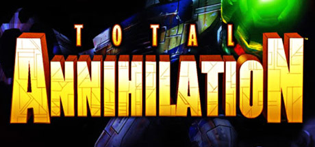

**Platforms:** Windows, MS-DOS &nbsp;|&nbsp; **Publisher:** GT Interactive &nbsp;|&nbsp; **Genre:** Strategy &nbsp;|&nbsp; **Released:** September 26, 1997

> What began as a conflict over the transfer of consciousness from flesh to machines escalated into a war which has decimated a million worlds. The Core and the Arm have all but exhausted the resources of a galaxy in their struggle for domination.
>
> _Synopsis source: Steam_

[Wikipedia](https://en.wikipedia.org/wiki/Total_Annihilation) · [Steam](https://store.steampowered.com/app/298030) · [IGDB](https://www.igdb.com/games/total-annihilation)

---

### Turok: Dinosaur Hunter

**Platforms:** Windows, MS-DOS, Nintendo 64 &nbsp;|&nbsp; **Genre:** Shooter, Adventure &nbsp;|&nbsp; **Released:** February 28

> A world where time has no meaning - and evil knows no bounds. Torn from a world long gone, the time traveling warrior Turok has found himself thrust into a savage land torn by conflict.
>
> _Synopsis source: IGDB_

[IGDB](https://www.igdb.com/games/turok-dinosaur-hunter)

---

### Twinsen's Little Big Adventure 2 Classic

**Platforms:** MS-DOS, Windows &nbsp;|&nbsp; **Developer:** Adeline Software International &nbsp;|&nbsp; **Publisher:** Electronic Arts, Activision &nbsp;|&nbsp; **Genre:** Platform, Puzzle, Adventure &nbsp;|&nbsp; **Released:** May 31, 1997

> Here comes the sequel of Twinsen's Little Big Adventure Classic. After saving the world from the evilish Doctor Funfrock, Twinsen is now ready to face a new threat coming from outer space.  Originally released in 1997 as Little Big Adventure 2 and Twinsen's Odyssey, Twinsen's Little Big Adventure 2 Classic is an action-adventure game that became an instant classic on PC. This game contains cartoon violence.
>
> _Synopsis source: IGDB_

[IGDB](https://www.igdb.com/games/twinsens-little-big-adventure-2-classic)

---

### Ultima Online

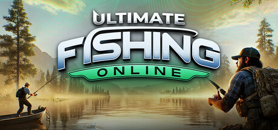

**Platforms:** Windows, MS-DOS &nbsp;|&nbsp; **Genre:** Adventure, Casual, Massively Multiplayer, Simulation, Sports, Free To Play &nbsp;|&nbsp; **Released:** September 24

> Ultimate Fishing® Online is a free-to-play multiplayer fishing game set in ecosystems with various fish, reactive shoals, dynamic weather &amp; day-night cycles. Explore diverse fishing spots, customize gear &amp; use various techniques! Cast, Catch &amp; Compete!
>
> _Synopsis source: Steam_

[Wikipedia](https://en.wikipedia.org/wiki/Ultima_Online) · [Steam](https://store.steampowered.com/app/2068100) · [IGDB](https://www.igdb.com/games/ultima-online)

---

### Warlords III: Reign of Heroes

**Platforms:** Windows, MS-DOS &nbsp;|&nbsp; **Genre:** Strategy, Turn-based strategy (TBS) &nbsp;|&nbsp; **Released:** July 31

> Warlords III: Reign of Heroes is a turn-based strategy game set in a fantasy universe.  The Selentine Empire has been overrun by undead and a number of warlords are fighting to determine who will control what remains of the world. Players must build armies to conquer cities and overwhelm their opponents. The game features 84 different unit types, each of which has different combat strengths, and movement points.  Players can use the random map generator to play single games, there are 12 stand-alone game scenarios, plus a campaign mode. Diplomacy is possible and the user can choose from a range of different victory conditions: Last Warlord Standing, Most Cities, Most Victory Points, Most Money.
>
> _Synopsis source: IGDB_

[IGDB](https://www.igdb.com/games/warlords-iii-reign-of-heroes)

---

### Wing Commander: Prophecy

**Platforms:** Windows, MS-DOS &nbsp;|&nbsp; **Genre:** Shooter, Simulator &nbsp;|&nbsp; **Released:** November 30

> Wing Commander: Prophecy, the fifth installment in the acclaimed space combat series, introduces a new generation of pilots in a post-war galaxy. Players assume the role of rookie Lance Casey aboard the TCS Midway, facing an unexpected alien threat foretold by ancient Kilrathi prophecy. Set against the backdrop of a fragile peace following the Border Worlds conflict, the game combines intense space combat with late 90s FMV storytelling. Pilots engage in dangerous missions, wielding an arsenal of advanced weaponry to defend the Confederation against a mysterious force that threatens the universe's existence.
>
> _Synopsis source: IGDB_

[IGDB](https://www.igdb.com/games/wing-commander-prophecy)

---

### Worms 2

**Platforms:** Windows, MS-DOS &nbsp;|&nbsp; **Genre:** Shooter, Platform, Strategy &nbsp;|&nbsp; **Released:** November 21

> Worms 2 is a turn-based strategy game, with each team moving in a randomly determined sequence across two-dimensional terrain. During a single turn, a team can only move one of its worms. Worms can crawl and jump, as well as swing by ninja-rope, parachute, teleport, and bungee when the appropriate items are available. The objective of a traditional match or campaign mission is to defeat all opposing teams by killing their worms. When hit with a weapon, the worm will lose health depending on the power of the weapon and the directness of the hit. A worm can be killed either by having its health reduced to zero or being knocked into the water around and below the level.
>
> _Synopsis source: IGDB_

[Wikipedia](https://en.wikipedia.org/wiki/Worms_2) · [IGDB](https://www.igdb.com/games/worms-2)

---

### X-COM: Apocalypse

**Platforms:** Windows, MS-DOS &nbsp;|&nbsp; **Developer:** Mythos Games &nbsp;|&nbsp; **Publisher:** MicroProse Software, Inc., 2K Games &nbsp;|&nbsp; **Genre:** Real Time Strategy (RTS), Strategy, Turn-based strategy (TBS), Tactical &nbsp;|&nbsp; **Released:** June 30, 1997

> Your mission, as X-COM Commander, is to combat alien aggression and uncover their deadly intentions. But Beware! Alien infiltration into the city and its politics could see you under fire from criminal gangs, religious sects, and even the police! Alien fleets fill the skies, creatures terrorise the city, chaos reigns... Welcome to the war, welcome to the Apocalypse.
>
> _Synopsis source: IGDB_

[IGDB](https://www.igdb.com/games/x-com-apocalypse)

---

### Zork: Grand Inquisitor

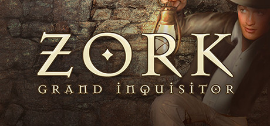

**Platforms:** Windows, MS-DOS &nbsp;|&nbsp; **Genre:** Adventure &nbsp;|&nbsp; **Released:** October 31

> Join forces with Dungeon Master Dalboz and travel throughout the Underground Empire's many locations, such as Hades, Flood Control Dam #3 and The Dungeon Master's Lair.
>
> _Synopsis source: Steam_

[Steam](https://store.steampowered.com/app/570680) · [IGDB](https://www.igdb.com/games/zork-grand-inquisitor)

---
