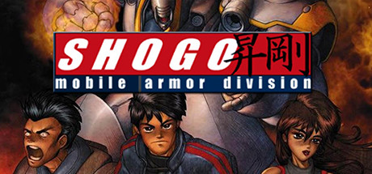

# Windows — 1998

[← All Windows years](../windows.md) · [Full 1998 page](../../years/1998.md)

82 Windows titles in 1998.

### A Bug's Life

**Platforms:** Windows, PlayStation &nbsp;|&nbsp; **Developer:** Traveller's Tales &nbsp;|&nbsp; **Publisher:** Take-Two Interactive, Activision, Disney Interactive, Sony Computer Entertainment of America, Gradiente &nbsp;|&nbsp; **Genre:** Platform, Adventure &nbsp;|&nbsp; **Released:** November 1, 1998

> A Bug's Life is a video game based on the Disney/Pixar film of the same name. It was released for various systems in 1998 and in 1999. The game's storyline is similar to that of the movie, with a few changes. After completing levels the player can unlock real clips from the movie. Its Game.com, Sega Saturn, and Dreamcast versions were cancelled.  Though the film was Roddy McDowall's final theatrical performance, the game was his final work before his death.
>
> _Synopsis source: IGDB_

[IGDB](https://www.igdb.com/games/a-bugs-life--2)

---

### Anno 1602: Creation of a New World

**Platforms:** Windows &nbsp;|&nbsp; **Developer:** Max Design &nbsp;|&nbsp; **Publisher:** Sunflowers &nbsp;|&nbsp; **Genre:** Real Time Strategy (RTS), Simulator, Strategy &nbsp;|&nbsp; **Released:** September 24, 1998

> It is the year 1602 and you find yourself in command of a sailing vessel, navigating the waters of the uncharted island world of Anker. You have aboard your ship no more than an handful of trusty followers and a limited supply of food and building materials. You are here to begin a new life. As you select which island to settle, your future is already sealed, for each one has its own special characteristics. Your goal is to create a whole new world. Explore, construct, settle, trade and defend - that is the challenge that lies before you!  Anno 1602 takes you into the world of construction strategy games. Build a realistic, living world for yourself according to your own ideas; your chosen strategy will decide the development and destiny of your towns and villages. Prove your diplomatic skills in your dealings with natives, your comrades and pirates too. Start by building up farms, plantations and small workshops to produce, then use your business acumen and begin to generate trade with your fellow players. But beware, for with riches and prosperity also comes envy and anger! Train soldiers and build defensive structures to protect your property and wealth, or perhaps it may be wise to put your negotiation skills to use outside of business?
>
> _Synopsis source: IGDB_

[IGDB](https://www.igdb.com/games/anno-1602-creation-of-a-new-world)

---

### Army Men

**Platforms:** Windows &nbsp;|&nbsp; **Developer:** The 3DO Company &nbsp;|&nbsp; **Publisher:** 2K &nbsp;|&nbsp; **Genre:** Strategy, Tactical, Adventure &nbsp;|&nbsp; **Released:** January 1, 1998

> Army Men is a mission-based combat game that has you guiding a green plastic commando named Sarge in warfare against a tan-colored toy army. Soldiers use bazookas, grenades, flamethrowers, mortars, automatic rifles, and land mines to trash each other. You can also drive jeeps and tanks across the varied terrain. To help you learn the controls, a boot camp option offers a series of eight training missions.  Once you are ready, choose from two campaigns: desert and alpine. Review your objectives before each mission on the briefing screen, and prepare for battle against an onslaught of plastic troops. A mission will fail if you exceed the time limit, allow your rivals to win, or let Sarge die. The options screen lets you view current objectives, consult a strategic map, exit vehicles, and abort your mission. You can also adjust the control scheme, select a difficulty level, and toggle music.
>
> _Synopsis source: IGDB_

[IGDB](https://www.igdb.com/games/army-men)

---

### Baldur's Gate

**Platforms:** Windows &nbsp;|&nbsp; **Publisher:** Interplay Entertainment &nbsp;|&nbsp; **Genre:** Role-playing (RPG) &nbsp;|&nbsp; **Released:** December 21, 1998

> Baldur's Gate is a fantasy role-playing video game developed by BioWare and published in 1998 by Interplay Entertainment. It is the first game in the Baldur's Gate series and takes place in the Forgotten Realms, a high fantasy campaign setting, using a modified version of the Advanced Dungeons & Dragons (AD&D) 2nd edition rules. It was the first game to use the Infinity Engine for its graphics, with Interplay using the engine for other Forgotten Realms-licensed games, including the Icewind Dale series, as well as other licensed D&D campaign worlds such as Planescape: Torment. The game's story focuses on players controlling a protagonist of their own creation who finds themselves travelling across the Sword Coast alongside a party of companions, to unravel the mystery surrounding a sudden iron crisis affecting the region and attempting to discover the culprits behind it, all while uncovering dark secrets about their origins and dealing with attempts on their life.
>
> _Synopsis source: IGDB_

[Wikipedia](https://en.wikipedia.org/wiki/Baldur%27s_Gate_(video_game)) · [IGDB](https://www.igdb.com/games/baldur-s-gate)

---

### Battlezone

**Platforms:** Windows &nbsp;|&nbsp; **Publisher:** Activision &nbsp;|&nbsp; **Genre:** Shooter, Real Time Strategy (RTS), Simulator, Strategy &nbsp;|&nbsp; **Released:** March 11, 1998

> You are the high-level Commander making decisions from your own war-ravaged tank. Lead your U.S. troops on a mission to gain control of a superior alien technology in the true "space race" against the Soviets.... or cross enemy lines to the Soviet side. It's all under your command.  *Full-Scale 3-D Action: pilot one of 25 anti-gravity war machines, and wield 25 devastating weapons - including mortars, mines, and the Thumper Device which triggers on-the-fly earthquakes on the morphable terrain.  * Complete Strategic Control: coordinate full-scale attacks with over 30 unique units, such as tanks, infantry and mobile assault turrets. Call in artillery, deploy wingmen and manage resources - all from within your tank.  * Dynamic First-Person Immersion: lose your vehicle in battle, bail out, parachute to safety; then use your sniper rifle to take over another unit. Switch vehicles right on the battlefield of one of seven distinct moons or planets!
>
> _Synopsis source: IGDB_

[Wikipedia](https://en.wikipedia.org/wiki/Battlezone_(1998_video_game)) · [IGDB](https://www.igdb.com/games/battlezone)

---

### Bio F.R.E.A.K.S.

**Platforms:** Nintendo 64, Windows, PlayStation &nbsp;|&nbsp; **Developer:** Saffire &nbsp;|&nbsp; **Publisher:** Midway Games, Gradiente &nbsp;|&nbsp; **Genre:** Fighting &nbsp;|&nbsp; **Released:** May 19, 1998

> Bio F.R.E.A.K.S. is a 3D fighting game released by Midway in 1998. It was originally planned for arcades. However, this arcade prototype was scrapped and never officially released (although it exists on MAME), and the game was later released for the PlayStation, Nintendo 64 and PC.
>
> _Synopsis source: IGDB_

[IGDB](https://www.igdb.com/games/bio-f-r-e-a-k-s)

---

### Blood II: The Chosen

**Platforms:** Windows &nbsp;|&nbsp; **Developer:** Monolith Productions &nbsp;|&nbsp; **Publisher:** GT Interactive Software, Atari, Inc. &nbsp;|&nbsp; **Genre:** Shooter &nbsp;|&nbsp; **Released:** November 25, 1998

> In a time of turmoil and decay, a dark organization with a sinister agenda casts its shadow over the world. But as their plot unfolds, an even greater evil pushes its twisted being at the very bindings of reality... Filled with hate and vengeance, Caleb has returned to face the Cabal and its minions once again - and this time he's not alone. Can he hold the Chosen together long enough to reclaim the Cabal and the heart of his one true love? Or will his actions destroy them all?  Blood started it all with its blend of terrifying monsters, powerful weapons, fast-paced multiplayer action, and enough macabre humor to get a mummy cackling. Blood II: The Chosen improves upon the realm of Blood by combining a cutting-edge 3D game engine, horrifyingly nightmarish creatures from another dimension, and more blood than Blood.
>
> _Synopsis source: IGDB_

[IGDB](https://www.igdb.com/games/blood-ii-the-chosen)

---

### Caesar III

**Platforms:** Windows &nbsp;|&nbsp; **Publisher:** Sierra Entertainment &nbsp;|&nbsp; **Genre:** Simulator, Strategy &nbsp;|&nbsp; **Released:** September 30, 1998

> Caesar III is part of Sierra's City Building Series and was released in October 1998. Cities in Caesar III try to accurately reflect the life of Roman citizens: the lowest plebians live in tents and shacks, while the richest patricians live in villas. Staple foods include wheat, fruits, vegetables, and pork, and wine is required for some festivals and houses. Citizens wander the streets in their various garbs and can tell the player their name and how they feel about the city. The city is viewed in a two-dimensional isometric view with a fixed magnification level and can be rotated ninety degrees.  Access to services such as market goods, entertainment, hygiene, education, and taxation are represented by "walkers," people sent out from their buildings to patrol the streets. Any house that a walker passes is considered to have access to the services of the walker's building. All movements of goods and coverage of walkers are accurately reflected by citizens walking the streets: a player can watch a farm's crop progress, and when it's ready, a worker will push a full cart from the farm to a nearby warehouse or granary; then return with an empty cart. Background music is played, which varies according to the situation (gentle themes to begin with, war drums during times of conflict and triumphal music when the player nears the objective). Crowd noises supplement musical themes, the sounds of manufacturing and the clash of weapons at appropriate times.  There are two ways to play the game: Mission Mode, which is equivalent to the typical "campaign" modes of other strategy games, and City Construction Mode, in which the player plays one scenario from scratch.
>
> _Synopsis source: IGDB_

[Wikipedia](https://en.wikipedia.org/wiki/Caesar_III) · [IGDB](https://www.igdb.com/games/caesar-iii)

---

### Carmageddon II: Carpocalypse Now

**Platforms:** Windows &nbsp;|&nbsp; **Developer:** Stainless Games Ltd. &nbsp;|&nbsp; **Publisher:** Interplay Entertainment, Sales Curve Interactive &nbsp;|&nbsp; **Genre:** Racing, Indie &nbsp;|&nbsp; **Released:** October 12, 1998

> Max is back!! Bigger and bader than ever before!!!!  Stainless/SCi announces the release of the eagerly awaited sequel to its 1997 smash hit Carmageddon, Carmageddon 2 - Carpocalypse now. Carmageddon 1 was released last year amongst "just a tiny bit" of controversy, with calls to "ban this killer car game" from the media around the world, and then went on to prove its critics wrong by scooping a body bag full of awards from around the globe. Developed once again, by the patients of Parkhurst prison's clinically insane wing, known as Stainless Software, Carmageddon 2 - Carpocalypse Now, is destined to make computer gaming history again. Let's face it, Carmageddon 1 caused a blood storm in a teacup, this time prepare for a full-on tidal wave.  Carmageddon 2 - Carpocalypse Now will take players to the next level of gameplay, whether you are trying to hold down your lunch after taking out those pedestrians waiting for a bus, or franticly trying to re-build your car after having your butt kicked by one of the GAME'S AI opponents, Carmageddon 2 - Carpocalypse Now will take you to the edge and further as you race your way through 1998's greatest driving game.
>
> _Synopsis source: IGDB_

[IGDB](https://www.igdb.com/games/carmageddon-ii-carpocalypse-now)

---

### Carnivores

**Platforms:** Windows &nbsp;|&nbsp; **Developer:** Action Forms Ltd. &nbsp;|&nbsp; **Publisher:** WizardWorks Software &nbsp;|&nbsp; **Genre:** Shooter, Simulator, Sport &nbsp;|&nbsp; **Released:** November 30, 1998

> Carnivores is a first person shooting video game produced by Action Forms and released by WizardWorks Software in 1998. It is the first video game in the Carnivores series.  The player takes the role of a DinoHunt customer. At the start of a new game, the player must register a new hunter or continue with a saved hunter. The point of the game is hunting dinosaurs to get trophies and accumulate score. Each dinosaur represents a set number of points. A novice hunter starts with zero points, when his points increase he'll be able to hunt new dinosaurs on additional terrains with more powerful weapons. If the player is killed by a dinosaur, all points accumulated on that specific hunt are forfeited. The player must be picked up by DinoHunt to keep the points he earned.  A hunter will become Advanced after earning 100 points, and Expert with 300. To begin a hunt, the player must choose the location, the weapon, the dinosaur and some hunting accessories which help the player but will deduct the score during that hunt. Each location is unique, with varying difficulties and terrain. The new hunter will be given three areas, with two more added for the Advanced hunter and a final area for the Expert hunter, for a total of six locations. Level locations include jungles, and deserts accompanied by pyramids and an ancient temple.  Next, the player must choose a dinosaur to hunt. A new hunter will be given the choice of four dinosaurs: Parasaurolophus, Stegosaurus, Pachycephalosaurus and Allosaurus. An Advanced hunter gains the ability to hunt the Triceratops and the Velociraptor. Only an Expert hunter can hunt the Tyrannosaurus rex. Harmless creatures such as Moschops, Gallimimus and Dimorphodon are present in each level. They are worth zero points and can be killed with a single shot.  The player must also choose a weapon, which can be set for kill or tranquilize for additional points. A beginning hunter can only use a shotgun or a crossbow. A sniper rifle is unlocked upon becoming an Advanced hunter. First time hunters can use the Observation Mode to familiarize themselves with dinosaur behavior and different terrain.
>
> _Synopsis source: IGDB_

[IGDB](https://www.igdb.com/games/carnivores)

---

### Colin McRae Rally

**Platforms:** Windows, PlayStation &nbsp;|&nbsp; **Developer:** Codemasters Southam &nbsp;|&nbsp; **Publisher:** Codemasters &nbsp;|&nbsp; **Genre:** Racing, Sport &nbsp;|&nbsp; **Released:** July 1, 1998

> Colin McRae Rally is the first entry in the Colin McRae Rally franchise. The game features twelve different laser modeled vehicles in which players can compete against the clock and your rivals over fifty unique stages from eight different countries.
>
> _Synopsis source: IGDB_

[IGDB](https://www.igdb.com/games/colin-mcrae-rally)

---

### Commandos: Behind Enemy Lines

**Platforms:** Windows &nbsp;|&nbsp; **Developer:** Pyro Studios &nbsp;|&nbsp; **Publisher:** Eidos Interactive &nbsp;|&nbsp; **Genre:** Puzzle, Strategy, Tactical &nbsp;|&nbsp; **Released:** July 31, 1998

> Engage in the ultimate battle of wits and wills with the most ruthless military force in history. Set in the backdrop of WWII, Commandos is a real-time tactical wargame that puts you in command of a squad of elite Allied Commandos whose job is to complete 24 dangerous missions behind enemy lines. Your goal is to thwart the German war effort by means of sabotage and tactical genius.This action-packed strategy war game is set apart by its revolutionary AI, and the ability to control 6 individual commandos, each with a specific skill, as they infiltrate hostile territories and engage in intense combat. Your perilous missions will take you from the parched desert of North Africa to banks of the Rhine, the mountainous fjords of Norway, and the beaches of Normandy.Experience the most realistic, visually stunning graphics with accurate 3D models of more than 350 structures, vehicles, and weapons from the WWII era.
>
> _Synopsis source: IGDB_

[IGDB](https://www.igdb.com/games/commandos-behind-enemy-lines)

---

### Deathtrap Dungeon

**Platforms:** PlayStation, Windows &nbsp;|&nbsp; **Developer:** Asylum Studios &nbsp;|&nbsp; **Publisher:** Square Enix, Eidos Interactive &nbsp;|&nbsp; **Genre:** Adventure &nbsp;|&nbsp; **Released:** March 19, 1998

> Built by a mad baron to bring notoriety to his town, only the brave or foolish would dare to enter Deathtrap Dungeon. Fabulous riches await the victor. Many adventurers have tried - none have come out alive…  As Red Lotus, the alluring assassin, or Chaindog, the savage warrior, you must battle your way to the heart of the dungeon and slay the great dragon, Melkor, mightiest of all the beasts of the underworld. If you succeed, gold and glory will be yours. If you fail, your sole reward is death.  A hellish horde of monsters await you in subterranean pits and passageways. A host of weapons, spells and charms are available - you will need them, for you are about to embark on a heart-stopping journey filled with brutal combat, deadly traps and the darkest magic.
>
> _Synopsis source: IGDB_

[IGDB](https://www.igdb.com/games/deathtrap-dungeon)

---

### Delta Force

**Platforms:** Windows &nbsp;|&nbsp; **Developer:** NovaLogic &nbsp;|&nbsp; **Publisher:** NovaLogic, Brasoft Produtos de Informática &nbsp;|&nbsp; **Genre:** Shooter, Tactical &nbsp;|&nbsp; **Released:** October 21, 1998

> As a member of Delta Force — The Army's Elite, top secret special forces unit — the word 'impossible' is not in your vocabulary. In Delta Force, you will conduct missions swiftly and silently, in every possible terrain, under every imaginable condition and through unconventional means.
>
> _Synopsis source: IGDB_

[IGDB](https://www.igdb.com/games/delta-force)

---

### Descent: Freespace - The Great War

**Platforms:** Windows &nbsp;|&nbsp; **Developer:** Volition &nbsp;|&nbsp; **Publisher:** Interplay Entertainment, Haage & Partner &nbsp;|&nbsp; **Genre:** Simulator &nbsp;|&nbsp; **Released:** June 5, 1998

> The heartless Shivans emerged through subspace near Earth, harboring technology light years ahead of anything seen before. They made no attempt to communicate. They did not respond to your heralds. They simply attacked and destroyed everything in their path.  As a pilot for the Galactic Terran Alliance (GTA) you are no stranger to war. But when racing through space to engage your new enemy for the first time, you sense something different. Suddenly, darkness blankets your craft. Your stomach sinks as your eyes pan across the Shivan flagship's massive body. Then it begins. Swarms of fighters pour from the belly of the flagship and scream towards you. You are about to discover everything you thought you knew about space combat just changed.
>
> _Synopsis source: IGDB_

[IGDB](https://www.igdb.com/games/descent-freespace-the-great-war)

---

### Die by the Sword

**Platforms:** Windows &nbsp;|&nbsp; **Developer:** Treyarch &nbsp;|&nbsp; **Publisher:** Imagineer, Interplay, Tantrum Entertainment &nbsp;|&nbsp; **Genre:** Hack and slash/Beat 'em up, Adventure &nbsp;|&nbsp; **Released:** February 28, 1998

> A third-person hack 'n' slash action game best known for enabling the player to use a variety of different sword swings to chop off limbs, heads and arms of opponents.
>
> _Synopsis source: IGDB_

[IGDB](https://www.igdb.com/games/die-by-the-sword)

---

### Dink Smallwood

**Platforms:** Windows &nbsp;|&nbsp; **Developer:** Robinson Technologies &nbsp;|&nbsp; **Publisher:** Iridon Interactive &nbsp;|&nbsp; **Genre:** Role-playing (RPG), Adventure &nbsp;|&nbsp; **Released:** December 31, 1998

> Dink Smallwood is a humorous role-playing video game. It was first released in 1998 before becoming freeware on October 17, 1999. It was developed by Robinson Technologies, at the time consisting of Seth Robinson, Justin Martin, and Greg Smith. Mitch Brink composed several of the game's music tracks, while others are MIDI forms of classical music such as Debussy's Reverie. The game has a small but dedicated fan following that continues to develop add-ons for the game more than a decade after its release.
>
> _Synopsis source: IGDB_

[IGDB](https://www.igdb.com/games/dink-smallwood)

---

### Dune 2000

**Platforms:** Windows &nbsp;|&nbsp; **Developer:** Westwood Studios &nbsp;|&nbsp; **Publisher:** Electronic Arts, Westwood Studios &nbsp;|&nbsp; **Genre:** Real Time Strategy (RTS), Strategy &nbsp;|&nbsp; **Released:** September 1, 1998

> Real-time strategy taking place in Frank Herbert's "Dune" universe. The game is a remake of a classic RTS game "Dune 2". Player can play as a commander of one of three different factions: Harkonnen, Atreides or Ordos.  Do you like the feeling you get when you have won over someone? If it was something that we had really worked hard, then the fell of victory is something precious and incalculable. The game Dune 2000 could help in giving your competitive spirit a new edge. It is an updated version of the Dune II. In this game the player would have to fight for an interesting thing; the control of the spices in the galaxy. The spices control could make you the most powerful there. The player has to choose to be one of the three houses first: Atreides, Harkonnen, or Ordos.  Each house has its own vice and virtue and the right selection could give the player right start to the game but he could learn as well as, later in the game with time. Once you choose a side, you to win the King’s challenge of producing the most amount of spice. It won’t be as easy as it sounds. For getting the control of the spices, the player has to fight over the other two houses by all means.  Dune 2000 is done with enough of stunt and live-in scenes to pep up the theme and there is a soothing sound score to add to the overall theme. It’s a game based on the Dune series book of Frank Herbert and gives the player a real pleasure of both combat and competition.
>
> _Synopsis source: IGDB_

[IGDB](https://www.igdb.com/games/dune-2000)

---

### DX-Ball 2

**Platforms:** Windows &nbsp;|&nbsp; **Developer:** Longbow Digital Arts &nbsp;|&nbsp; **Publisher:** Longbow Digital Arts &nbsp;|&nbsp; **Genre:** Arcade &nbsp;|&nbsp; **Released:** December 16, 1998

> DX-Ball 2 is a brick buster game for Microsoft Windows, developed by Longbow Games. As a follow up to DX-Ball by Michael P. Welch, the sequel is foremost remarked by the introduction of its 16-bit high-colour engine, presenting textured bricks and background graphics in vivid colours. The game also features two new Power-Ups, an easy to play "Kid-Mode", and a hotseat multiplayer mode, alongside an original soundtrack by SideWinder. DX-Ball 2 also introduces the feature of board-set selection, allowing the player to select between different sets of boards to play. The free demo thereby comes packed with a total of 24 boards divided into 6 board-sets of 4 boards search. Additional board packs can then be installed for more boards, whereas Board Pack 1 will expand the demo board-sets to 25 boards each, for a total of 150 boards. While a total of five board packs were released for the game, DX-Ball 2 was eventually succeeded by Rival Ball in 2001. A 20th Anniversary edition was announced on August 23rd, 2018 and was released on November 21st, 2018, which features a new high resolution boardset,new power ups,online leaderboard and boardset editor.
>
> _Synopsis source: IGDB_

[IGDB](https://www.igdb.com/games/dx-ball-2)

---

### Fallout 2

**Platforms:** Windows &nbsp;|&nbsp; **Developer:** Black Isle Studios &nbsp;|&nbsp; **Publisher:** Interplay Entertainment, MacPlay, Bethesda Softworks &nbsp;|&nbsp; **Genre:** Puzzle, Role-playing (RPG) &nbsp;|&nbsp; **Released:** October 29, 1998

> A turn-based tactical Western RPG in which the Chosen One is tasked with exploring post-nuclear California to locate and retrieve the fabled Garden of Eden Creation Kit for their famine-stricken tribe, while coming into contact through branching dialogue trees with numerous tribes, factions and micro-civilizations, each with their own virtues, vices, socioeconomic situations and political agendas.
>
> _Synopsis source: IGDB_

[IGDB](https://www.igdb.com/games/fallout-2)

---

### FIFA 99

**Platforms:** Windows, PlayStation &nbsp;|&nbsp; **Publisher:** EA Sports &nbsp;|&nbsp; **Genre:** Simulator, Sport &nbsp;|&nbsp; **Released:** October 31, 1998

> FIFA 99 features an elite league called the "European Dream League" in which 20 top teams from across Europe battle it out in a league format. It was also the first game to feature a block containing teams which did not pertain to any of the main leagues (back then, it was known as "Rest of Europe" since all teams were European, the vast majority of them featured either in the 1998-99 season of the UEFA Cup or Champions League).  Graphically, it is a major improvement over FIFA '98, with the inclusion of basic facial animations and different players' heights as well as certain other cosmetic features such as improved kits and emblems, although they are unlicensed. Gamers may also create their own custom cups and leagues and select the teams they wish to participate.
>
> _Synopsis source: IGDB_

[Wikipedia](https://en.wikipedia.org/wiki/FIFA_99) · [IGDB](https://www.igdb.com/games/fifa-99)

---

### Forsaken

**Platforms:** Windows, PlayStation &nbsp;|&nbsp; **Developer:** Probe Entertainment &nbsp;|&nbsp; **Publisher:** Acclaim Entertainment &nbsp;|&nbsp; **Genre:** Shooter, Simulator &nbsp;|&nbsp; **Released:** April 24, 1998

> Forsaken is a Sci-Fi First-Person Shooter game, developed by Probe Entertainment Limited and published by Acclaim, which was released in 1998.
>
> _Synopsis source: IGDB_

[IGDB](https://www.igdb.com/games/forsaken)

---

### Freddi Fish 3: The Case of the Stolen Conch Shell

**Platforms:** macOS, Windows &nbsp;|&nbsp; **Developer:** Humongous Entertainment &nbsp;|&nbsp; **Publisher:** Humongous Entertainment, Atari, Inc. &nbsp;|&nbsp; **Genre:** Point-and-click, Puzzle, Adventure &nbsp;|&nbsp; **Released:** March 6, 1998

> The Great Conch Shell has been stolen and it's up to Freddi Fish and Luther to catch the culprit!
>
> _Synopsis source: IGDB_

[IGDB](https://www.igdb.com/games/freddi-fish-3-the-case-of-the-stolen-conch-shell)

---

### Future Cop: LAPD

**Platforms:** macOS, Windows, PlayStation &nbsp;|&nbsp; **Developer:** EA Redwood Shores &nbsp;|&nbsp; **Publisher:** Electronic Arts, Dice Multi Media Europe &nbsp;|&nbsp; **Genre:** Shooter &nbsp;|&nbsp; **Released:** August 31, 1998

> Crime War is a story mode, following a day in the life of an LAPD X1-Alpha pilot. The story events range from rogue lunatics arming observatories with weapons, to a malfunctioning supercomputer. Players begin in a futuristic Griffith Park, but as they advance through the game they may unlock areas such as Venice Beach, LAX and Long Beach.
>
> _Synopsis source: IGDB_

[IGDB](https://www.igdb.com/games/future-cop-lapd)

---

### Gex: Enter the Gecko

**Platforms:** Windows, PlayStation &nbsp;|&nbsp; **Developer:** Crystal Dynamics &nbsp;|&nbsp; **Publisher:** Eidos Interactive, Midway Games &nbsp;|&nbsp; **Genre:** Platform, Adventure &nbsp;|&nbsp; **Released:** February 24, 1998

> "Is it just me, or am I engulfed in flames?" is one of the many one-liners uttered by Gex, a wise cracking gecko who should check himself into television rehab; he's addicted to it. After saving the Television Realm from the evil Rez in his first adventure, the gecko was ready to kick back, relax, and watch a little television. Little did he know his adventure was just beginning.  One day, two secret agent goons showed up at Gex's doorstep. They inform him that Rez is back and looking for vengeance; the evil monster is planning to destroy the Television Realm once more...and possibly the world. When Gex tells them that he's retired and doesn't care, one of the goons hits the gecko on the head and takes him to a secluded place.  When Gex comes to, the mystery men plead with the gecko to take the cash and help destroy Rez for good...or at least make him disappear. With that incentive (the cash), the wise cracking lizard slips into his special agent suit and plunges headfirst into the Television Realm. Watch out, Rez -- Gex is back!
>
> _Synopsis source: IGDB_

[IGDB](https://www.igdb.com/games/gex-enter-the-gecko)

---

### Glover

**Platforms:** Windows, Nintendo 64 &nbsp;|&nbsp; **Developer:** Interactive Studios &nbsp;|&nbsp; **Publisher:** Hasbro Interactive &nbsp;|&nbsp; **Genre:** Platform &nbsp;|&nbsp; **Released:** November 16, 1998

> Glover is a platforming video game featuring a magical, four-fingered glove named Glover in his quest to restore the Crystal Kingdom by retrieving crystals that were lost.
>
> _Synopsis source: IGDB_

[IGDB](https://www.igdb.com/games/glover)

---

### Grand Prix Legends

**Platforms:** Windows &nbsp;|&nbsp; **Developer:** Papyrus Design Group &nbsp;|&nbsp; **Publisher:** Sierra Entertainment &nbsp;|&nbsp; **Genre:** Racing, Simulator, Sport &nbsp;|&nbsp; **Released:** October 31, 1998

> Grand Prix Legends (nicknamed GPL) is a computer racing simulator developed by Papyrus Design Group and published in 1998 by Sierra Entertainment. At the time of its release, it simulated the 1967 Formula One season and is considered to be one of the most realistic racing games ever released.
>
> _Synopsis source: IGDB_

[IGDB](https://www.igdb.com/games/grand-prix-legends)

---

### Grim Fandango

**Platforms:** Windows &nbsp;|&nbsp; **Publisher:** LucasArts &nbsp;|&nbsp; **Genre:** Point-and-click, Puzzle, Adventure &nbsp;|&nbsp; **Released:** October 30, 1998

> A neo-noir adventure to the Land of the Dead. Something's rotten in the land of the dead, and you're being played for a sucker. Meet Manny Calavera, travel agent at the Department of Death. He sells luxury packages to souls on their four-year journey to eternal rest. But there's trouble in paradise. Help Manny untangle himself from a conspiracy that threatens his very salvation.
>
> _Synopsis source: IGDB_

[Wikipedia](https://en.wikipedia.org/wiki/Grim_Fandango) · [IGDB](https://www.igdb.com/games/grim-fandango)

---

### Half-Life

**Platforms:** Windows &nbsp;|&nbsp; **Publisher:** Sierra Entertainment &nbsp;|&nbsp; **Genre:** Action &nbsp;|&nbsp; **Released:** November 19, 1998

> Named Game of the Year by over 50 publications, Valve's debut title blends action and adventure with award-winning technology to create a frighteningly realistic world where players must think to survive. Also includes an exciting multiplayer mode that allows you to play against friends and enemies around the world.
>
> _Synopsis source: Steam_

[Wikipedia](https://en.wikipedia.org/wiki/Half-Life_(video_game)) · [Steam](https://store.steampowered.com/app/70) · [IGDB](https://www.igdb.com/games/half-life)

---

### Hard Truck: Road to Victory

**Platforms:** Windows &nbsp;|&nbsp; **Developer:** Buka Entertainment, SoftClub &nbsp;|&nbsp; **Genre:** Racing, Simulator &nbsp;|&nbsp; **Released:** March 25, 1998

> You can choose to race with other tracks in two or three simple tracks, and there is a mode where you can just drive a truck to deliver cargo to your designated location. The second mode might be bit boring, since you do nothing but drive a truck and do nothing more, but it's worth it for two reasons - primarily the extremely beautiful landscape you drive through. It is designed with the utmost care and detail and you can really feel like you're really there. And secondly, the game simulates the job of a truck driver pretty accurately. While driving, you get to experience what a real truck driver feels and does on the road. Now, multiply that by a 1000 miles. But mostly, this is a truck racing game. You can change the view from behind the wheel to outside of the truck, whatever you like. There is also a good rearview mirror that helps you while driving. Overall, this is a fantastic truck simulation and racing game and you should try this one and the games sequels, Hard Truck 2 and the rest of the game's series.
>
> _Synopsis source: IGDB_

[IGDB](https://www.igdb.com/games/hard-truck-road-to-victory)

---

### Heart of Darkness

**Platforms:** PlayStation, Windows &nbsp;|&nbsp; **Developer:** Amazing Studio &nbsp;|&nbsp; **Publisher:** Interplay Entertainment, Infogrames &nbsp;|&nbsp; **Genre:** Platform &nbsp;|&nbsp; **Released:** July 4, 1998

> Heart of Darkness places players in the role of a child named Andy as he attempts to rescue his dog who has been kidnapped by creatures known as The Dark Souls. The game has about half an hour of storytelling cinematic sequences, thousands of 2D animated frames, and uses pre-rendered background scenery. The game was supervised by game developer Éric Chahi, known for Another World, this time with a team of artists and developers. The game also features an original score by film and television composer Bruce Broughton.  A Game Boy Advance port was announced in 2001 but it was never released.
>
> _Synopsis source: IGDB_

[IGDB](https://www.igdb.com/games/heart-of-darkness)

---

### Heretic II

**Platforms:** Windows &nbsp;|&nbsp; **Developer:** Raven Software, MumboJumbo &nbsp;|&nbsp; **Publisher:** Activision, MacPlay &nbsp;|&nbsp; **Genre:** Hack and slash/Beat 'em up, Adventure &nbsp;|&nbsp; **Released:** November 1, 1998

> Heretic II is a third-person action game based on the Quake II engine that plunges you into a deep, compelling game combining brutal face-to-face combat and mystery-laden adventure. Gamers travel through complex, richly detailed environments filled with stunning special effects, wicked magic spells, detailed characters, vivid artwork and challenging level designs created by the Raven team and renowned fantasy artist Brom.
>
> _Synopsis source: IGDB_

[IGDB](https://www.igdb.com/games/heretic-ii)

---

### Hot Wheels Stunt Track Driver

**Platforms:** Windows &nbsp;|&nbsp; **Developer:** Mattel Interactive &nbsp;|&nbsp; **Publisher:** THQ &nbsp;|&nbsp; **Genre:** Racing &nbsp;|&nbsp; **Released:** October 15, 1998

> The little die-cast cars from Matchbox make their way to the Game Boy Color with HOT WHEELS STUNT TRACK DRIVER. You can choose from five different Hot Wheels cars, including Way 2 Fast, Tow Jam, Shadow Jet, Saltflat Racer and the Twin Mill each with unique strengths and weaknesses. After picking the right car, take it for a test drive on one of the six tracks in the Single Race mode. When you want some stiff competition, try to win successive races in the Tournament mode. And if your friends think they can drive better than you, make them prove it with the two-player link cable option. In all of the modes, the key to winning is to maximize your speed by pulling off big stunts. Find out if you have what it takes to become a Hot Wheels Driver in HOT WHEELS STUNT TRACK DRIVER.
>
> _Synopsis source: IGDB_

[IGDB](https://www.igdb.com/games/hot-wheels-stunt-track-driver)

---

### Incoming: The Final Conflict

**Platforms:** Dreamcast, Windows &nbsp;|&nbsp; **Developer:** Rage Software &nbsp;|&nbsp; **Publisher:** Xicat Interactive, Imagineer, Interplay, MacPlay, Funbox Media, Blue Moon Red Owl, Global VR, Rage Software, Buka Entertainment &nbsp;|&nbsp; **Genre:** Shooter, Real Time Strategy (RTS), Strategy, Arcade &nbsp;|&nbsp; **Released:** June 26, 1998

> Set in the near-future of 2009, the game primarily revolves around controlling vehicles and turrets to fight alien invaders of Earth.
>
> _Synopsis source: IGDB_

[IGDB](https://www.igdb.com/games/incoming-the-final-conflict)

---

### Jazz Jackrabbit 2

**Platforms:** Windows &nbsp;|&nbsp; **Developer:** Logicware, Orange Games, Epic MegaGames &nbsp;|&nbsp; **Publisher:** Logicware, Gathering of Developers &nbsp;|&nbsp; **Genre:** Shooter, Platform &nbsp;|&nbsp; **Released:** July 31, 1998

> Jazz Jackrabbit 2 is a platform game produced by Epic MegaGames, now known as Epic Games. It was accidentally confirmed on the 24th of august in 1994 by Arjan Brussee and released in 1998 for PCs running Windows, and later for Macintosh computers. It is the sequel to Jazz Jackrabbit.
>
> _Synopsis source: IGDB_

[IGDB](https://www.igdb.com/games/jazz-jackrabbit-2)

---

### King's Quest VIII: The Mask of Eternity

**Platforms:** Windows &nbsp;|&nbsp; **Developer:** Sierra On-Line &nbsp;|&nbsp; **Publisher:** Imagineer, Activision, Sierra On-Line &nbsp;|&nbsp; **Genre:** Point-and-click, Puzzle, Strategy, Adventure &nbsp;|&nbsp; **Released:** December 14, 1998

> King's Quest: Mask of Eternity (also known as King's Quest VIII: The Mask of Eternity) is an action-adventure video game written and designed by Roberta Williams and released in 1998 by Sierra Studios, is the eighth, and at present remains the final, official computer game in the famous King's Quest series. It is the first and only game in the series where the main character is neither King Graham nor a member of his family, the first in the series to use a full 3D engine as opposed to the 2D cartoon or pixel style of the earlier games and the first to omit the sequel numbering system on box artwork and title screen, though references to it being the eighth game appear in the file structure and the game was marketed as KQ8 on the official website, interviews, and other places.
>
> _Synopsis source: IGDB_

[IGDB](https://www.igdb.com/games/king-s-quest-viii-the-mask-of-eternity)

---

### KKnD2: Krossfire

**Platforms:** Windows &nbsp;|&nbsp; **Developer:** Beam Software &nbsp;|&nbsp; **Publisher:** Infogrames, GT Interactive Software, Melbourne House &nbsp;|&nbsp; **Genre:** Real Time Strategy (RTS), Strategy &nbsp;|&nbsp; **Released:** October 31, 1998

> It's 100 years since nuclear warheads totalled the Earth, 40 years since the militant Survivors crawled from their underground bunkers to struggle against the mutated Evolved for control of the surface. With a victory for either side seeming doubtful, many people from both sides fled the conflict 40 years ago and have spent the time regrouping, licking their wounds, and planning for the next assault.  Now the New Survivors pour out of the ground, trying to retake the surface. The 'Further Evolved' ride mutant beasts to defend the surface once again. But now there's a whole new factor no-one's accounted for. From a line of dust on the horizon, the Series 9 robotic army, once farming robots, whose purpose in life was lost when the farmland they were built to protect was burned in the nuclear annihilation, and now with revenge in their crazed visors, storm across the land killing anything they can find. The War of the Three Armies is getting underway. Pretty scary huh?
>
> _Synopsis source: IGDB_

[IGDB](https://www.igdb.com/games/kknd2-krossfire)

---

### Knights and Merchants: The Shattered Kingdom

**Platforms:** Windows &nbsp;|&nbsp; **Developer:** Joymania Entertainment &nbsp;|&nbsp; **Publisher:** Interactive Magic, Linux Game Publishing, TopWare Interactive &nbsp;|&nbsp; **Genre:** Real Time Strategy (RTS), Simulator, Strategy &nbsp;|&nbsp; **Released:** September 18, 1998

> Knights and Merchants recreates the era of the Middle Ages. Apart from the purely fictitious geography of our world, all game elements and scenes are based on the Anglo-Saxon period, 1200 A.D. And we haven't used imaginary elements like fabled creatures, either. The player takes on the role of an ordinary captain in the Palace Guard. A conspiracy against the king catapults the captain into a situation where he finds himself responsible for the defence of the last royal province. This is all that remains of the shattered kingdom, which has been split into numerous small principalities and fiefdoms. And now even the king himself, ensconced in his capital, is threatened by enemy armies. This is the starting point of your Middle Ages adventure. Now you must win back all those provinces which once belonged to your king.
>
> _Synopsis source: IGDB_

[IGDB](https://www.igdb.com/games/knights-and-merchants-the-shattered-kingdom)

---

### LEGO Chess

**Platforms:** Windows &nbsp;|&nbsp; **Developer:** Krisalis Software &nbsp;|&nbsp; **Publisher:** Lego Media &nbsp;|&nbsp; **Genre:** Strategy, Turn-based strategy (TBS), Card & Board Game &nbsp;|&nbsp; **Released:** February 4, 1998

> A Lego-themed, chess-based strategy game featuring a Western theme and a Pirates theme, all done up with classic Lego charm.
>
> _Synopsis source: IGDB_

[IGDB](https://www.igdb.com/games/lego-chess)

---

### LEGO Creator

**Platforms:** Windows &nbsp;|&nbsp; **Developer:** Superscape &nbsp;|&nbsp; **Publisher:** Lego Media &nbsp;|&nbsp; **Genre:** Simulator &nbsp;|&nbsp; **Released:** October 26, 1998

> A game that lets you build with an unlimited number of Lego pieces to construct your very own Lego world.
>
> _Synopsis source: IGDB_

[IGDB](https://www.igdb.com/games/lego-creator)

---

### LEGO Loco

**Platforms:** Windows &nbsp;|&nbsp; **Developer:** Intelligent Games &nbsp;|&nbsp; **Publisher:** Lego Media &nbsp;|&nbsp; **Genre:** Simulator &nbsp;|&nbsp; **Released:** November 11, 1998

> Create your own Lego City with trains, cars and various buildings! You can create trains to run on the railway lines and control the train's speed and direction.
>
> _Synopsis source: IGDB_

[IGDB](https://www.igdb.com/games/lego-loco)

---

### Microsoft Spider Solitaire

**Platforms:** Windows &nbsp;|&nbsp; **Publisher:** Microsoft &nbsp;|&nbsp; **Genre:** Card & Board Game &nbsp;|&nbsp; **Released:** June 25, 1998

> Spider Solitaire, also known as Microsoft Spider Solitaire (Spider in the About box in some versions), is a solitaire card game that is included in Microsoft Windows. It is a version of Spider. As of 2005, it was the most played game on Windows PCs, surpassing the shorter and less challenging Klondike-based Windows Solitaire. The game was first included as part of Windows 98's Microsoft Plus! package and has been since featured on most subsequent versions of Windows. Spider Solitaire was not included in Windows 2000, but was added to Windows ME and later on Windows XP; the game gained popularity subsequent to its inclusion in the latter. Windows Vista again saw a new version, which was mainly unchanged in Windows 7. Finally, Windows 8 has another updated version available in the Windows Store as part of Microsoft Solitaire Collection but not bundled with the operating system.
>
> _Synopsis source: IGDB_

[IGDB](https://www.igdb.com/games/microsoft-spider-solitaire)

---

### Might and Magic VI: The Mandate of Heaven

**Platforms:** Windows &nbsp;|&nbsp; **Developer:** New World Computing &nbsp;|&nbsp; **Publisher:** 3DO &nbsp;|&nbsp; **Genre:** Role-playing (RPG), Turn-based strategy (TBS) &nbsp;|&nbsp; **Released:** April 30, 1998

> The Ironfist Dynasty is tottering on the brink of ruin. As endless calamities plague the kingdom of Enroth, evil doomsday cultists plan to overthrow child Prince Nicolai and claim the throne for their charismatic leader. Fear grips the land and the people wonder if their sovereign has lost the Mandate of Heaven - the divine right to rule. The enemies of reason are at the gate and only extraordinary heroes can stem the tide of darkness. Will you answer the call?  From the depths of the deepest dungeons, to the intrigues of the royal court, you will lead a band of adventurers on a dangerous journey of amazing depth and intelligence. With a completely new 3D graphics engine and a non-linear adventure system, Might and Magic VI: The Mandate of Heaven brings a unique role-playing experience to life.
>
> _Synopsis source: IGDB_

[IGDB](https://www.igdb.com/games/might-and-magic-vi-the-mandate-of-heaven)

---

### Monster Truck Madness 2

**Platforms:** Windows &nbsp;|&nbsp; **Developer:** Terminal Reality &nbsp;|&nbsp; **Publisher:** Microsoft &nbsp;|&nbsp; **Genre:** Racing, Simulator, Sport &nbsp;|&nbsp; **Released:** April 30, 1998

> Players can race all the big name monster trucks such as Big Foot and Gravedigger as well as new custom WCW and NWO trucks. Along with classic lap and point-to-point races, there are a variety of multiplayer king of the hill and monster truck rally events.
>
> _Synopsis source: IGDB_

[IGDB](https://www.igdb.com/games/monster-truck-madness-2)

---

### Moto Racer 2

**Platforms:** PlayStation, Windows &nbsp;|&nbsp; **Developer:** Delphine Software &nbsp;|&nbsp; **Publisher:** Electronic Arts &nbsp;|&nbsp; **Genre:** Racing &nbsp;|&nbsp; **Released:** August 31, 1998

> The game has more courses than its predecessor, and added a level editor. Moto Racer 2 garnered positive reviews from critics, praising its graphics and variety of gameplay.
>
> _Synopsis source: IGDB_

[IGDB](https://www.igdb.com/games/moto-racer-2)

---

### Motocross Madness

**Platforms:** Windows &nbsp;|&nbsp; **Developer:** Rainbow Studios &nbsp;|&nbsp; **Publisher:** Microsoft &nbsp;|&nbsp; **Genre:** Racing, Sport &nbsp;|&nbsp; **Released:** August 14, 1998

> Motocross Madness is a extreme sport racing simulation.  The game is known for its realism, including terrain, audio, and "bone-chilling" motorcycle wrecks. If the player is in Stunt mode, goes out of bounds, and gets on a large cliff, an "invisible slingshot" will cause the player and the bike fly across while a funny sound plays until both objects will hit the ground.
>
> _Synopsis source: IGDB_

[IGDB](https://www.igdb.com/games/motocross-madness)

---

### Myth II: Soulblighter

**Platforms:** Windows &nbsp;|&nbsp; **Publisher:** Bungie &nbsp;|&nbsp; **Genre:** Real Time Strategy (RTS), Strategy &nbsp;|&nbsp; **Released:** December 28, 1998

> Take control of squads or individual units in order to accomplish tactically-challenging missions in the epic battle of the Forces of Light versus Dark.
>
> _Synopsis source: IGDB_

[IGDB](https://www.igdb.com/games/myth-ii-soulblighter)

---

### Nancy Drew: Secrets Can Kill

**Platforms:** Windows &nbsp;|&nbsp; **Developer:** Her Interactive &nbsp;|&nbsp; **Publisher:** DreamCatcher Games &nbsp;|&nbsp; **Genre:** Point-and-click, Puzzle, Adventure &nbsp;|&nbsp; **Released:** December 23, 1998

> Secrets Can Kill is the first of many instalments in the Nancy Drew point-and-click adventure game series by HeR Interactive. Players take on the first-person view of fictional amateur sleuth Nancy Drew and solve the mystery by interrogating suspects, solving puzzles, and discovering clues.
>
> _Synopsis source: IGDB_

[IGDB](https://www.igdb.com/games/nancy-drew-secrets-can-kill)

---

### NHL 99

**Platforms:** Windows &nbsp;|&nbsp; **Publisher:** EA Sports &nbsp;|&nbsp; **Genre:** Sport &nbsp;|&nbsp; **Released:** September 30, 1998

> Battle along the boards, feed the open man, patrol the ice! Game Features: *Beginner lever - pick up and play!; *Coaching strategies from Stanley Cup Winner Marc Crawford; *Commentary by Bill Clement; *5 game modes; *18 top international teams; *Updated 1998 roster-expansion Nashville Predators.
>
> _Synopsis source: IGDB_

[Wikipedia](https://en.wikipedia.org/wiki/NHL_99) · [IGDB](https://www.igdb.com/games/nhl-99)

---

### Pajama Sam 2: Thunder and Lightning Aren't so Frightening

**Platforms:** Windows, macOS &nbsp;|&nbsp; **Developer:** Humongous Entertainment &nbsp;|&nbsp; **Publisher:** Atari, Inc. &nbsp;|&nbsp; **Genre:** Point-and-click, Puzzle, Adventure &nbsp;|&nbsp; **Released:** October 2, 1998

> Join Pajama Sam, the world's youngest superhero as he journeys to World Wide Weather, the storm-stirring factory in the sky! Sam's spent on to many evenings cowering under the couch, so he sets out to conquest his fear of thunderstorms. Just as our little guy begins to learn that storms aren't as bad as they seem, Sam accidentally send the weather system into a frenzy. Now, there is snow in Saigon, and sunshine in Seattle! He'll need your child's help to explore this wonderful world filled with challenging puzzles, fun games, and fantastic new friends as they help Thunder and Lightning fix the broken machines and return the world's weather to normal before Mother Nature finds out!
>
> _Synopsis source: IGDB_

[IGDB](https://www.igdb.com/games/pajama-sam-2-thunder-and-lightning-aren-t-so-frightening)

---

### Polda

**Platforms:** Windows &nbsp;|&nbsp; **Developer:** SleepTeam &nbsp;|&nbsp; **Publisher:** Zima Software &nbsp;|&nbsp; **Genre:** Point-and-click, Adventure, Indie &nbsp;|&nbsp; **Released:** December 20, 1998

> Polda is a point and click adventure game developed by SleepTeam. The main character is a policeman Pankrác whose IQ is not very high but despite this fact he always manages to solve his cases. Somehow... However, he does not always use traditional investigation methods. The game provides the players with challenging puzzles and crazy humor.
>
> _Synopsis source: IGDB_

[IGDB](https://www.igdb.com/games/polda)

---

### Police Quest: SWAT 2

**Platforms:** Windows &nbsp;|&nbsp; **Developer:** Yosemite Entertainment &nbsp;|&nbsp; **Publisher:** Sierra Entertainment &nbsp;|&nbsp; **Genre:** Real Time Strategy (RTS), Simulator, Strategy, Tactical &nbsp;|&nbsp; **Released:** June 30, 1998

> Choose from 100 SWAT officers or 100 terrorists and build the ultimate SWAT team or the deadliest terrorist organization. Undergo actual SWAT tactics and marksmanship training - then strap on the Kevlar for real where adversaries pursue their criminal agenda while reacting to your every move.
>
> _Synopsis source: IGDB_

[IGDB](https://www.igdb.com/games/police-quest-swat-2)

---

### Populous: The Beginning

**Platforms:** Windows &nbsp;|&nbsp; **Developer:** Bullfrog Productions &nbsp;|&nbsp; **Publisher:** Electronic Arts, Dice Multi Media Europe, Sold Out Sales & Marketing &nbsp;|&nbsp; **Genre:** Real Time Strategy (RTS), Role-playing (RPG), Strategy &nbsp;|&nbsp; **Released:** November 30, 1998

> Populous: The Beginning is a strategy and god-style video game. It is the third entry in the Populous video game series, developed by Bullfrog Productions in 1998. The PC version of the game was released November 30, 1998 and a PlayStation version was later developed and released on April 2, 1999.  Unlike earlier games in the series, which cast the player in the role of a god influencing loyal followers, The Beginning took a radical departure and placed the player in the role of a shaman, who directly leads her tribe against opponents. Throughout the twenty-five missions of the campaign, the player leads their tribe across a solar system, dominating enemy tribes and tapping new sources of magic, with the ultimate goal of the shaman attaining godhood herself.  Populous: The Beginning was the first entry in the series to use true 3D computer graphics; Bullfrog waited four years after Populous II: Trials of the Olympian Gods so that the graphics technology could catch up to their vision for a new and different game in the series. The developers considered the addition of terrain deformation and manipulation, combined with "smart" villagers who automatically attended to tasks, to add an entirely new dimension to the series. The game's original title was Populous: The Third Coming before being changed prior to the beta release. Populous: The Beginning plays very differently from earlier titles and received mixed reviews. Reviewers positively noted the excellent graphics, while complaints were directed at the artificial intelligence and the indecision in game design between being a real time strategy title and a god game. GamePro's Peter Olafson wrote that Populous: The Beginning was not a bad game, in fact a good one; "but it's a different game—one without a quintessential quality that defined Populous."
>
> _Synopsis source: IGDB_

[IGDB](https://www.igdb.com/games/populous-the-beginning)

---

### Pro Pinball: Big Race USA

**Platforms:** Windows, MS-DOS &nbsp;|&nbsp; **Developer:** Cunning Development &nbsp;|&nbsp; **Publisher:** Empire Interactive &nbsp;|&nbsp; **Genre:** Simulator, Pinball &nbsp;|&nbsp; **Released:** December 31, 1998

> A whirlwind frenzy of color, sound, and adrenaline-pumping action. Take an exciting ride across the USA for your chance to compete in the big race and win hoards of cash. But watch out for the police car on your tail. Packed with more features than your local multiplex, Big Race USA brings a whole new dimension of mind-boggling realism to your PlayStation.  If you've always wanted a pinball machine but just didn't have the money, you'll be delighted at the real-life pinball physics now available on the PlayStation. The PRO PINBALL series strikes again, this time with an auto-themed trek across the country. All of the realistic touches of arcade pinball are present from the bumpers right down to the click of the flippers. You can adjust the camera three different ways to view the table from any angle you desire, and you can even take a gander at a pre-game slideshow that details the table's layout. It's easy to change the table rules, switch the screen position, tweak the graphics and sound, and choose a difficulty level: Extra Easy, Easy, Medium, Hard, or Extra Hard. There's also a custom difficulty level that allows you to adjust any of the game's settings to provide extra challenges or assistance for yourself. Add in magnetic ball saving, multiball, and other bonuses and you've got yourself one heck of a cross-country journey. Pinball wizards and videogamers alike will revel in the thorough attention to detail and creativity in PRO PINBALL: Big Race USA.
>
> _Synopsis source: IGDB_

[IGDB](https://www.igdb.com/games/pro-pinball-big-race-usa)

---

### Putt-Putt Enters the Race

**Platforms:** Windows, macOS &nbsp;|&nbsp; **Developer:** Humongous Entertainment &nbsp;|&nbsp; **Publisher:** Humongous Entertainment, Akella, Atari, Inc. &nbsp;|&nbsp; **Genre:** Point-and-click, Adventure &nbsp;|&nbsp; **Released:** January 1, 1998

> Putt-Putt Enters the Race is a Junior Adventure in which Putt-Putt searches for the items he needs to prepare for the Car Town 500. This point-and-click adventure game aimed at children features simple inventory puzzles as well as various minigames, including a racing minigame at the very end.
>
> _Synopsis source: IGDB_

[IGDB](https://www.igdb.com/games/putt-putt-enters-the-race)

---

### Quest for Glory V: Dragon Fire

**Platforms:** Windows &nbsp;|&nbsp; **Developer:** Yosemite Entertainment &nbsp;|&nbsp; **Publisher:** Sierra On-Line &nbsp;|&nbsp; **Genre:** Point-and-click, Puzzle, Role-playing (RPG), Adventure &nbsp;|&nbsp; **Released:** December 7, 1998

> After having survived the dangers he encountered on his previous journey, the hero travels with the wizard Erasmus to a Greece-like country called Silmaria. Its king was recently murdered, and, according to the land's traditions, the crown will be given to the one who passes a contest known as the Rites of Rulership. The hero enters the contest, aided by Erasmus, Rakeesh, and other old friends. However, as the competition progresses, contestants are being systematically killed by an unknown assassin. All the victims are murdered near the Dragon Pillars, which keep the Dragon of Silmaria in captivity. The hero must investigate the crimes and save Silmaria from a grave danger.  Dragon Fire is the final game in the Quest for Glory series. Like the previous games in the series, Dragon Fire is a hybrid between puzzle-solving adventure and role-playing game. The player talks to the world's inhabitants, gathering clues and items necessary to acquire in order to complete the quests and advance the story. Unlike all its predecessors, Dragon Fire has no separate battle screens; the action-based battles take place on the exploration screen, utilizing a simple point-and-click interface, similarly to Diablo. The game has heavier weapon and armor management than other Quest for Glory games, strengthening the RPG angle.  Many quests are optional or can be completed in different ways. The hero can also marry one of the several major female characters in the game, provided the player does the right thing to impress the girl.
>
> _Synopsis source: IGDB_

[IGDB](https://www.igdb.com/games/quest-for-glory-v-dragon-fire)

---

### Rage of Mages

**Platforms:** Windows &nbsp;|&nbsp; **Developer:** Nival Interactive &nbsp;|&nbsp; **Publisher:** Buka Entertainment, Monolith Productions &nbsp;|&nbsp; **Genre:** Role-playing (RPG), Strategy &nbsp;|&nbsp; **Released:** April 1, 1998

> Rage of Mages is a PC game that combines role-playing and real-time strategy. Produced by Nival Interactive it was first released in Russia under the name of Allods: The Seal of Mystery. While a role playing game, the game uses a real time strategy game interface rather similar to Warcraft II. First of all, a player chooses between a warrior or a mage for his or her starting character. On his journey he (or she) will meet a few more companions. There will be hirelings available for a fee should a player find any mission too challenging and need reinforcements. Each mission takes place in a game map generally full of enemies. Mission type ranges from rescue to escort to exterminate villains to treasure hunting.
>
> _Synopsis source: IGDB_

[IGDB](https://www.igdb.com/games/rage-of-mages)

---

### Railroad Tycoon II

**Platforms:** Windows &nbsp;|&nbsp; **Publisher:** Gathering of Developers &nbsp;|&nbsp; **Genre:** Simulator, Strategy &nbsp;|&nbsp; **Released:** November 2, 1998

> Sid Meier's Railroad Tycoon is a business simulation game.  Railroad Tycoon was written by game designer Sid Meier and published by MicroProse Railroad Tycoon 2 is the only game of the series that was released fr the PSX console.  You try to make it to the top of the transportation industry in Railroad Tycoon II, a simulation that takes you from a wannabe to a tycoon (if your lucky!).
>
> _Synopsis source: IGDB_

[Wikipedia](https://en.wikipedia.org/wiki/Railroad_Tycoon_II) · [IGDB](https://www.igdb.com/games/railroad-tycoon-ii)

---

### Red Comrades Save the Galaxy

**Platforms:** Windows &nbsp;|&nbsp; **Developer:** S.K.I.F. &nbsp;|&nbsp; **Publisher:** Buka Entertainment &nbsp;|&nbsp; **Genre:** Adventure &nbsp;|&nbsp; **Released:** December 31, 1998

> Red Comrades Save the Galaxy is a 1998 point-and-click graphic adventure game developed by S.K.I.F. and published by Buka Entertainment. Also, the first installment in the eponymous series.
>
> _Synopsis source: IGDB_

[IGDB](https://www.igdb.com/games/red-comrades-save-the-galaxy)

---

### Sanitarium

**Platforms:** Windows &nbsp;|&nbsp; **Developer:** DreamForge Intertainment &nbsp;|&nbsp; **Publisher:** ASC Games, DotEmu &nbsp;|&nbsp; **Genre:** Point-and-click, Puzzle, Adventure &nbsp;|&nbsp; **Released:** April 28, 1998

> A psychological horror point-and-click adventure game in which a man wakes up in a near-deserted sanitarium after a car crash without any recollection of who he is or how he got there.
>
> _Synopsis source: IGDB_

[IGDB](https://www.igdb.com/games/sanitarium)

---

### Shogo: Mobile Armor Division

**Platforms:** Windows &nbsp;|&nbsp; **Publisher:** Monolith Productions &nbsp;|&nbsp; **Genre:** Action, Adventure, Strategy &nbsp;|&nbsp; **Released:** October 15, 1998

> Shogo is an anime-inspired first-person shooter. Fight on foot or pilot a giant mech in both open and urban levels. You will know the true power of giant robots!
>
> _Synopsis source: Steam_

[Steam](https://store.steampowered.com/app/610860) · [IGDB](https://www.igdb.com/games/shogo-mobile-armor-division)

---

### SiN

**Platforms:** Windows &nbsp;|&nbsp; **Developer:** Ritual Entertainment &nbsp;|&nbsp; **Publisher:** Titan Computer, MacPlay, Activision &nbsp;|&nbsp; **Genre:** Shooter, Adventure &nbsp;|&nbsp; **Released:** November 4, 1998

> When the CEO of SinTEK Industries begins injecting the streets with a DNA-altering drug, it's time to reassess the laws of morality. When the same twisted biochemist plans to conquer the world with her army of mutated abominations, it's time to rewrite the golden rule.  You are Colonel John Blade, head of the most prominent private protection agency in Freeport. Elexis Sinclaire is waging her holy war against the security industry...and you along with it. You've made a religion out of fighting crime. Now you're going to make Elexis pay for her sins.
>
> _Synopsis source: IGDB_

[IGDB](https://www.igdb.com/games/sin)

---

### Star Wars: Jedi Knight - Mysteries of the Sith

**Platforms:** Windows &nbsp;|&nbsp; **Developer:** LucasArts &nbsp;|&nbsp; **Publisher:** LucasArts &nbsp;|&nbsp; **Genre:** Shooter &nbsp;|&nbsp; **Released:** February 24, 1998

> Kyle Katarn's adventures continue five years after the events in Dark Forces II. Invading Imperial forces advance upon a quiet Rebel outpost, interrupting Kyle's trianing of a brave new Jedi, Mara Jade.  First introduced in Timothy Zahn's award-winning Star Wars novel, Heir to the Empire, Mara Jade combines her experiences as a smuggler and Emperor's Hand with her apprenticeship as a Jedi Knight. Mara's training will continue in the field as she makes use of four new weapons and five new Force powers to secure supplies for the New Republic.  Meanwhile, Kyle pursues what he believes to be his destiny as he searches for secret treasures in an ancient Sith temple. Will you uncover the Mysteries of the Sith?
>
> _Synopsis source: IGDB_

[IGDB](https://www.igdb.com/games/star-wars-jedi-knight-mysteries-of-the-sith)

---

### Star Wars: Rebellion

**Platforms:** Windows &nbsp;|&nbsp; **Developer:** LucasArts &nbsp;|&nbsp; **Publisher:** LucasArts, Disney Interactive &nbsp;|&nbsp; **Genre:** Real Time Strategy (RTS), Strategy &nbsp;|&nbsp; **Released:** February 28, 1998

> Subvert the Empire. Crush the Alliance. Your Choice. Your Destiny.  It is a time of great upheaval. The first Death Star has been destroyed, marking a major victory for the Rebellion. But the Empire remains strong. As commander, you must choose to take control of either the Rebel Alliance or the Galactic Empire. Your goal: complete domination of the galaxy.  Take the galaxy by force. Take the galaxy through diplomacy. Take the galaxy via covert operations. Earn the loyalty (or resentment) of up to 200 worlds. Star Wars Rebellion gives you a myraid of means to implement strategy and tactics on a grand scale and in a real-time environment. With control of the entire Star Wars galaxy as the prize, will the Force be with you? Discover for yourself.
>
> _Synopsis source: IGDB_

[IGDB](https://www.igdb.com/games/star-wars-rebellion)

---

### Star Wars: Rogue Squadron

**Platforms:** Nintendo 64, Windows &nbsp;|&nbsp; **Developer:** Factor 5, LucasArts &nbsp;|&nbsp; **Publisher:** Nintendo, LucasArts, Disney Interactive Studios, Gradiente &nbsp;|&nbsp; **Genre:** Shooter &nbsp;|&nbsp; **Released:** November 17, 1998

> It is a time of great rejoicing in the galaxy. Luke Skywalker, with the help of Wedge Antilles, has blown up the Death Star. But there is little time to celebrate. The mighty Empire is gathering strength for a determined, all-out assault on the Rebel forces.  To save the Rebel Alliance from this Imperial onslaught, Luke Skywalker and Wedge Antilles have assembled the Rogue Squadron, a group of twelve of the most skilled battle-tested starfighter pilots. You will fly into battle as Luke Skywalker, to engage in intense, fast-paced planetary air-to-ground and air-to-air missions ‒ dogfights, search and destroy, reconnaissance, bombing runs, rescue assignments, and more.
>
> _Synopsis source: IGDB_

[IGDB](https://www.igdb.com/games/star-wars-rogue-squadron)

---

### StarCraft

**Platforms:** Windows &nbsp;|&nbsp; **Publisher:** Blizzard Entertainment &nbsp;|&nbsp; **Genre:** Real Time Strategy (RTS), Strategy &nbsp;|&nbsp; **Released:** March 31, 1998

> StarCraft is a real-time strategy game set in a distant sector of the Milky Way galaxy in the 26th century. Players command one of three species across separate campaigns: the Terrans, resourceful human colonists cut off from Earth; the Zerg, an insectoid swarm that assimilates other species; and the Protoss, a technologically advanced race with powerful psionic abilities. Each species features distinct units, structures, and strategic options. The game includes a story-driven single-player campaign for each faction and competitive multiplayer via Battle.net.
>
> _Synopsis source: IGDB_

[Wikipedia](https://en.wikipedia.org/wiki/StarCraft_(video_game)) · [IGDB](https://www.igdb.com/games/starcraft)

---

### Starsiege: Tribes

**Platforms:** Windows &nbsp;|&nbsp; **Publisher:** Sierra Entertainment &nbsp;|&nbsp; **Genre:** Shooter, Strategy &nbsp;|&nbsp; **Released:** December 23, 1998

> Starsiege: Tribes is a squad and class-based multiplayer first-person shooter that emphasizes teamwork across vast, open terrain in space. It established several team-based mechanics that are seen in almost every team-oriented first-person shooter today.
>
> _Synopsis source: IGDB_

[IGDB](https://www.igdb.com/games/starsiege-tribes)

---

### Test Drive 5

**Platforms:** PlayStation, Windows &nbsp;|&nbsp; **Genre:** Racing &nbsp;|&nbsp; **Released:** October 8, 1998

> Hear the roar of engines and smell the burnt rubber as you step up to take the challenge of Test Drive 5. Race on 18 different tracks in locations such as Moscow, Honolulu, Tokyo and the winding streets of San Francisco.  The interesting twist is that the courses are reversible giving you an total of 31 driving combinations. Add that to 40 cars including classics such as the Dodge Viper, Shelby Series 1, Jaguar XKR, Saleen S351, Chevrolet Corvette, Ford Mustang, and the Plymouth Hemi Barracuda among other super-charged and secret cars that will melt the asphalt beneath your tires.
>
> _Synopsis source: IGDB_

[IGDB](https://www.igdb.com/games/test-drive-5)

---

### Test Drive: Off-Road 2

**Platforms:** Windows, PlayStation &nbsp;|&nbsp; **Developer:** Pitbull Syndicate &nbsp;|&nbsp; **Publisher:** Accolade &nbsp;|&nbsp; **Genre:** Racing &nbsp;|&nbsp; **Released:** October 30, 1998

> Test Drive Off-Road 2 follows the path set by 1997's Test Drive: Off-Road as you drive across twelve courses (based on six locales: Morocco, Hawaii, Mojave, Santa Cruz, Switzerland and Wales) in your quest to win races on the World Tour. This time twenty vehicles are available to choose from, but before you can get behind the wheel, you'll have to purchase them with credits earned from winning races.  Some of the licensed vehicles include a Hummer, Dodge Ram, Jeep Wrangler, Ford Explorer, Jeep Cherokee, Range Rover, Ford F-150 and a Dodge T-Rex. The World Tour consists of five events divided by class: Hummer, Safari, SUV (Sport Utility Vehicle), Truck and Military. Each class has you competing against five similar vehicles in a series of races, where you'll need to place within the top three in order to advance to the next track.
>
> _Synopsis source: IGDB_

[IGDB](https://www.igdb.com/games/test-drive-off-road-2)

---

### The Fifth Element

**Platforms:** PlayStation, Windows &nbsp;|&nbsp; **Developer:** Kalisto Entertainment &nbsp;|&nbsp; **Publisher:** Activision &nbsp;|&nbsp; **Released:** September 30, 1998

> The Fifth Element is a third-person adventure wherein you take on the persona of one of two characters. Your two choices stem from the two main ones from the movie, Korben Dallas or Leeloo Minai Lekatariba-Lamina-Tchai Ekbat.  Korben, played by Bruce Willis in the film, is a cab driver. He lives in New York City when the game starts, and he is the one man capable of saving the world.  Leeloo is The Fifth Element. She is the only hope that the universe has against Pure Evil.
>
> _Synopsis source: IGDB_

[IGDB](https://www.igdb.com/games/the-fifth-element)

---

### The Pink Panther: Hokus Pokus Pink

**Platforms:** Windows &nbsp;|&nbsp; **Developer:** Wanderlust Interactive &nbsp;|&nbsp; **Publisher:** Ravensburger Interactive Media, Mindscape, Noviy Disk &nbsp;|&nbsp; **Genre:** Point-and-click, Adventure &nbsp;|&nbsp; **Released:** December 31, 1998

> A point and click adventure game on PC starring the Pink Panther.
>
> _Synopsis source: IGDB_

[IGDB](https://www.igdb.com/games/the-pink-panther-hokus-pokus-pink)

---

### The Settlers III

**Platforms:** Windows &nbsp;|&nbsp; **Developer:** Blue Byte Software &nbsp;|&nbsp; **Publisher:** Blue Byte Software &nbsp;|&nbsp; **Genre:** Real Time Strategy (RTS), Simulator, Strategy, Tactical &nbsp;|&nbsp; **Released:** November 30, 1998

> The gods may be crazy! First the Almighty He, the highest of all the gods, sends Jupiter, Horus, and Ch'ih-Yu off into an extremely arduous competition simply on account of some occasional drinking sprees! Then the three gods are subjected to scorn and derision: Q'nqura, the goddess of the Amazons, lets the trio win in battle out of pure spite, and then their humiliation is complete!
>
> _Synopsis source: IGDB_

[IGDB](https://www.igdb.com/games/the-settlers-iii)

---

### The X-Files Game

**Platforms:** macOS, Windows &nbsp;|&nbsp; **Developer:** HyperBole Studios &nbsp;|&nbsp; **Publisher:** Fox Interactive, Sony Computer Entertainment Europe &nbsp;|&nbsp; **Genre:** Point-and-click, Adventure &nbsp;|&nbsp; **Released:** May 31, 1998

> The X-Files Game is an interactive movie point-and-click adventure video game developed by HyperBole Studios and first published by Fox Interactive. The game was released for Microsoft Windows, Mac OS and PlayStation in 1998, and is based on the television series The X-Files.
>
> _Synopsis source: IGDB_

[IGDB](https://www.igdb.com/games/the-x-files-game--1)

---

### Thief: The Dark Project

**Platforms:** Windows &nbsp;|&nbsp; **Publisher:** Eidos Interactive &nbsp;|&nbsp; **Genre:** Action, Adventure &nbsp;|&nbsp; **Released:** December 1, 1998

> The shadows are your ally. Return to the city as Garrett, master thief, in this remastered classic by Nightdive Studios. Pickpocket, prowl, and outsmart in a world where trust is a luxury and every stolen secret comes at a price.
>
> _Synopsis source: Steam_

[Steam](https://store.steampowered.com/app/4200960) · [IGDB](https://www.igdb.com/games/thief-the-dark-project)

---

### Tom Clancy's Rainbow Six

**Platforms:** Windows &nbsp;|&nbsp; **Developer:** Red Storm Entertainment &nbsp;|&nbsp; **Publisher:** Red Storm Entertainment, MacSoft Games, Ubi Soft Entertainment, Ubisoft Entertainment, Syscom Entertainment, ak tronic, Pointsoft, Novitas Publishing, CyberFront, Infogrames, Majesco Sales &nbsp;|&nbsp; **Genre:** Shooter, Simulator, Strategy, Tactical &nbsp;|&nbsp; **Released:** August 21, 1998

> A combination of explosive action and real-life strategy!  The most revolutionary action/strategy game of its kind. Nothing comes closer to offering an exciting combination of strategy, team-building, realistic three-dimensional graphics and true-to-life special forces action. The ultimate goal is to save yourself and the world from deadly terrorists. You must successfully complete 17 unique missions. If you die, the game isn't over. The World is.
>
> _Synopsis source: IGDB_

[IGDB](https://www.igdb.com/games/tom-clancy-s-rainbow-six)

---

### Tomb Raider III: Adventures of Lara Croft

**Platforms:** macOS, Windows, PlayStation &nbsp;|&nbsp; **Developer:** Core Design &nbsp;|&nbsp; **Publisher:** Eidos Interactive, Aspyr Media &nbsp;|&nbsp; **Genre:** Shooter, Puzzle, Adventure &nbsp;|&nbsp; **Released:** November 20, 1998

> Tomb Raider III: Adventures of Lara Croft is a platform and third-person shooter game developed by Core Design and published by Eidos Interactive. It is the third installment in the Tomb Raider series and the sequel to Tomb Raider II. The gameplay system is similar to the one implemented in the previous game. Lara's abilities include running, jumping, climbing, swimming, rolling, crouching, crawling, sprinting, and swinging on bars and vines. A few new types of hazards have been added in this installment, including cold water in which Lara can swim for a limited amount of time, dangerous underwater creatures (such as piranhas), and the treacherous quicksand, which will swallow the heroine if the player isn't careful and fast enough to prevent her from falling into it.
>
> _Synopsis source: IGDB_

[IGDB](https://www.igdb.com/games/tomb-raider-iii-adventures-of-lara-croft)

---

### Trespasser

**Platforms:** Windows &nbsp;|&nbsp; **Developer:** Dreamworks Interactive &nbsp;|&nbsp; **Publisher:** Electronic Arts &nbsp;|&nbsp; **Genre:** Shooter, Puzzle, Adventure &nbsp;|&nbsp; **Released:** October 28, 1998

> Trespasser is a PC game released in 1998. Set one year after the events of the 1997 film The Lost World: Jurassic Park and published alongside the film's home video release.  The player assumes the role of Anne, the sole survivor of a plane crash on InGen's Jurassic Park "Site B" on Isla Nublar. With a fractured arm and no equipment to speak of, Anne must escape the remote island by solving puzzles and evading dangerous dinosaurs.
>
> _Synopsis source: IGDB_

[IGDB](https://www.igdb.com/games/trespasser)

---

### Unreal

**Platforms:** Windows &nbsp;|&nbsp; **Publisher:** GT Interactive &nbsp;|&nbsp; **Genre:** Shooter, Platform &nbsp;|&nbsp; **Released:** May 22, 1998

> Your prison ship has crash-landed on the fastest, sleekest, most dangerous 3D world ever created. Look around, crystal clear water shimmers, shadows dance and shift, alien architecture fades into the horizon. Discover the secret of this mysterious planet and find out what caused a peaceful race to be enslaved by vicious merciless aggressors.
>
> _Synopsis source: IGDB_

[Wikipedia](https://en.wikipedia.org/wiki/Unreal_(1998_video_game)) · [IGDB](https://www.igdb.com/games/unreal)

---

### Vangers

**Platforms:** Windows &nbsp;|&nbsp; **Developer:** K-D Lab &nbsp;|&nbsp; **Publisher:** Interactive Magic, KranX Productions, Buka Entertainment &nbsp;|&nbsp; **Genre:** Racing, Adventure &nbsp;|&nbsp; **Released:** June 19, 1998

> Mind-altering sandbox game that can be described as a racing role-playing adventure game with a complicated storyline. You’ll find a unique atmosphere, complete freedom and lots of gameplay hours to figure out what’s the game is all about.
>
> _Synopsis source: IGDB_

[IGDB](https://www.igdb.com/games/vangers)

---

### Warhammer: Dark Omen

**Platforms:** PlayStation, Windows &nbsp;|&nbsp; **Developer:** Mindscape &nbsp;|&nbsp; **Publisher:** Electronic Arts &nbsp;|&nbsp; **Genre:** Real Time Strategy (RTS), Role-playing (RPG), Strategy, Tactical &nbsp;|&nbsp; **Released:** March 31, 1998

> This sequel to Warhammer: Shadow Of The Horned Rat is an overhead role playing game in which you play Morgan Bernhardt. The game consists of a series of battles where you view the battle from overhead via a rotatable view. You go through the game managing your army, deciding whether to fight in optional battles, and advancing through a deep and engrossing storyline via a series of conversations played out by talking portraits.
>
> _Synopsis source: IGDB_

[IGDB](https://www.igdb.com/games/warhammer-dark-omen)

---

### Wetrix

**Platforms:** Nintendo 64, Windows &nbsp;|&nbsp; **Developer:** Zed Two &nbsp;|&nbsp; **Publisher:** Ocean Software, Imagineer &nbsp;|&nbsp; **Genre:** Puzzle, Strategy &nbsp;|&nbsp; **Released:** June 12, 1998

> A rainstorm so fierce, it will keep you from leaving your home for the next six months. Using randomly shaped 3D blocks as they fall from the sky, you must create a series of lakes and dams before the heavy rains appear. Because if the water drains, you lose! Sound simple? Well, mix in a few natural disasters and bomb attacks, and suddenly you need to muster all your strategy and skill to combat nature's fury!
>
> _Synopsis source: IGDB_

[IGDB](https://www.igdb.com/games/wetrix)

---

### World Cup 98

**Platforms:** Nintendo 64, PlayStation, Windows &nbsp;|&nbsp; **Developer:** EA Canada &nbsp;|&nbsp; **Publisher:** EA Sports, Gradiente &nbsp;|&nbsp; **Genre:** Sport &nbsp;|&nbsp; **Released:** March 31, 1998

> The main feature of the game is the World Cup tournament itself, where the player may use either the actual groups used in the finals, or groups composed of a random selection of the included teams. Each match takes place in a recreation of the venue it was played in the actual tournament. As in the real tournament, group games do not go to extra time or a penalty shootout but knockout matches do.
>
> _Synopsis source: IGDB_

[IGDB](https://www.igdb.com/games/world-cup-98)

---
