# Windows — 1999

[← All Windows years](../windows.md) · [Full 1999 page](../../years/1999.md)

64 Windows titles in 1999.

### Age of Empires II

**Platforms:** Windows &nbsp;|&nbsp; **Publisher:** Microsoft &nbsp;|&nbsp; **Released:** September 30, 1999

[Wikipedia](https://en.wikipedia.org/wiki/Age_of_Empires_II)

---

### Age of Empires II: The Age of Kings

**Platforms:** Windows &nbsp;|&nbsp; **Released:** September 30

---

### Age of Wonders

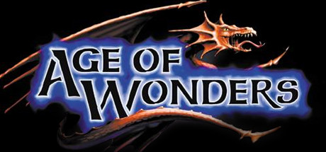

**Platforms:** Windows &nbsp;|&nbsp; **Genre:** RPG, Strategy &nbsp;|&nbsp; **Released:** November 11

> Welcome to Age of Wonders, the authentic turn based fantasy strategy classic that started the hit series. Age of Wonders’ intimate atmosphere with painterly graphics still shines today. The game’s fully patched up, start building your fantasy empire today!
>
> _Synopsis source: Steam_

[Wikipedia](https://en.wikipedia.org/wiki/Age_of_Wonders) · [Steam](https://store.steampowered.com/app/61500)

---

### Aliens versus Predator

**Platforms:** Windows &nbsp;|&nbsp; **Released:** April 30

[Wikipedia](https://en.wikipedia.org/wiki/Aliens_versus_Predator_(1999_video_game))

---

### Asheron's Call

**Platforms:** Windows &nbsp;|&nbsp; **Released:** November 2

[Wikipedia](https://en.wikipedia.org/wiki/Asheron%27s_Call)

---

### Attack of the Saucerman

**Platforms:** Windows, PlayStation &nbsp;|&nbsp; **Released:** July 1

[Wikipedia](https://en.wikipedia.org/wiki/Attack_of_the_Saucerman)

---

### Baldur's Gate: Tales of the Sword Coast

**Platforms:** Windows &nbsp;|&nbsp; **Released:** April 30

---

### Battlezone II: Combat Commander

**Platforms:** Windows &nbsp;|&nbsp; **Released:** December 30

---

### Command & Conquer: Tiberian Sun

**Platforms:** Windows &nbsp;|&nbsp; **Released:** August 27

---

### Counter-Strike

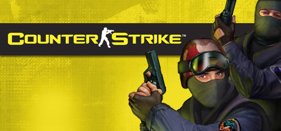

**Platforms:** Windows &nbsp;|&nbsp; **Genre:** Action &nbsp;|&nbsp; **Released:** June 19

> Play the world's number 1 online action game. Engage in an incredibly realistic brand of terrorist warfare in this wildly popular team-based game. Ally with teammates to complete strategic missions. Take out enemy sites. Rescue hostages. Your role affects your team's success. Your team's success affects your role.
>
> _Synopsis source: Steam_

[Wikipedia](https://en.wikipedia.org/wiki/Counter-Strike_(video_game)) · [Steam](https://store.steampowered.com/app/10)

---

### Crusaders of Might and Magic

**Platforms:** Windows &nbsp;|&nbsp; **Released:** December 20

[Wikipedia](https://en.wikipedia.org/wiki/Crusaders_of_Might_and_Magic)

---

### Descent 3

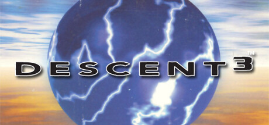

**Platforms:** Windows, macOS &nbsp;|&nbsp; **Publisher:** Interplay Entertainment &nbsp;|&nbsp; **Genre:** Action &nbsp;|&nbsp; **Released:** June 17, 1999

> The vertigo continues as the highly anticipated sequel to Descent I and II takes the mind-bending, pulse-pounding experience to another level!
>
> _Synopsis source: Steam_

[Wikipedia](https://en.wikipedia.org/wiki/Descent_3) · [Steam](https://store.steampowered.com/app/273590)

---

### Disciples: Sacred Lands

**Platforms:** Windows &nbsp;|&nbsp; **Released:** October 4

---

### Driver

**Platforms:** PlayStation, Windows &nbsp;|&nbsp; **Publisher:** GT Interactive &nbsp;|&nbsp; **Released:** June 25, 1999

[Wikipedia](https://en.wikipedia.org/wiki/Driver_(video_game))

---

### Dungeon Keeper 2

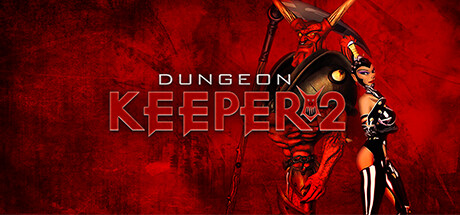

**Platforms:** Windows &nbsp;|&nbsp; **Genre:** Action, Strategy &nbsp;|&nbsp; **Released:** July 7

> Bad guys have all the fun. Discover your dark side as you build an evil underground kingdom and defend it against the forces of good.
>
> _Synopsis source: Steam_

[Wikipedia](https://en.wikipedia.org/wiki/Dungeon_Keeper_2) · [Steam](https://store.steampowered.com/app/2616460)

---

### EverQuest

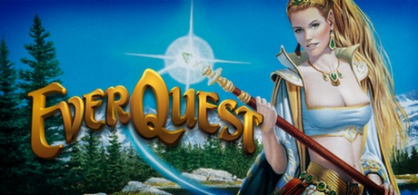

**Platforms:** Windows &nbsp;|&nbsp; **Publisher:** Sony Online Entertainment &nbsp;|&nbsp; **Genre:** Massively Multiplayer, RPG, Free To Play &nbsp;|&nbsp; **Released:** March 16, 1999

> Welcome to EverQuest® - the original fantasy MMORPG. Explore huge worlds, fight challenging foes, and grow your character with friends. Discover why players have quested, grouped, and raided in Norrath for more than two decades.
>
> _Synopsis source: Steam_

[Wikipedia](https://en.wikipedia.org/wiki/EverQuest) · [Steam](https://store.steampowered.com/app/205710)

---

### Flight Unlimited III

**Platforms:** Windows &nbsp;|&nbsp; **Publisher:** Electronic Arts &nbsp;|&nbsp; **Released:** September 17, 1999

[Wikipedia](https://en.wikipedia.org/wiki/Flight_Unlimited_III)

---

### FreeSpace 2

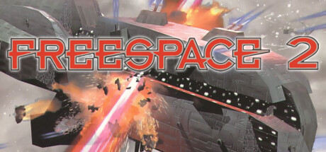

**Platforms:** Windows &nbsp;|&nbsp; **Publisher:** Interplay Entertainment &nbsp;|&nbsp; **Genre:** Action &nbsp;|&nbsp; **Released:** September 30, 1999

> FreeSpace 2, the follow up to the classic Descent: FreeSpace – The Great War is ready to engage you in the second round. Follow the Grand Terran Vasudan Alliance further into the mysteries of the Shivans. Get your flight stick and hit the flight deck. The last time was just a warm up.
>
> _Synopsis source: Steam_

[Wikipedia](https://en.wikipedia.org/wiki/FreeSpace_2) · [Steam](https://store.steampowered.com/app/273620)

---

### Gabriel Knight 3: Blood of the Sacred, Blood of the Damned

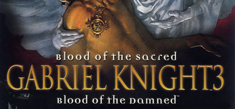

**Platforms:** Windows &nbsp;|&nbsp; **Genre:** Adventure &nbsp;|&nbsp; **Released:** November 19

> Play as both Gabriel Knight and Grace Nakimura as you learn more about what is hidden in the hills of France.
>
> _Synopsis source: Steam_

[Steam](https://store.steampowered.com/app/497360)

---

### Grand Theft Auto 2

**Platforms:** Windows, PlayStation &nbsp;|&nbsp; **Released:** October 22

[Wikipedia](https://en.wikipedia.org/wiki/Grand_Theft_Auto_2)

---

### Grand Theft Auto: London 1969

**Platforms:** Windows, PlayStation &nbsp;|&nbsp; **Released:** April 30

---

### Half-Life: Opposing Force

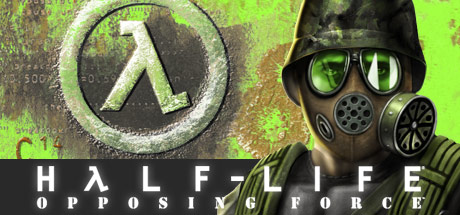

**Platforms:** Windows &nbsp;|&nbsp; **Genre:** Action &nbsp;|&nbsp; **Released:** November 10

> Return to the Black Mesa Research Facility as one of the military specialists assigned to eliminate Gordon Freeman. Experience an entirely new episode of single player action. Meet fierce alien opponents, and experiment with new weaponry. Named 'Game of the Year' by the Academy of Interactive Arts and Sciences.
>
> _Synopsis source: Steam_

[Steam](https://store.steampowered.com/app/50)

---

### Heavy Gear II

**Platforms:** Windows &nbsp;|&nbsp; **Released:** June 18

[Wikipedia](https://en.wikipedia.org/wiki/Heavy_Gear_II)

---

### Heroes of Might and Magic III

**Platforms:** Windows, macOS, Linux &nbsp;|&nbsp; **Genre:** Strategy &nbsp;|&nbsp; **Released:** March 3

> This is the original version of the game from 1999. The pack includes the original Heroes of Might and Magic III and its two expansions: Armageddon's Blade and The Shadow of Death.
>
> _Synopsis source: Steam_

[Wikipedia](https://en.wikipedia.org/wiki/Heroes_of_Might_and_Magic_III) · [Steam](https://store.steampowered.com/app/4921760)

---

### Homeworld

**Platforms:** Windows &nbsp;|&nbsp; **Publisher:** Sierra Entertainment &nbsp;|&nbsp; **Released:** September 28, 1999

[Wikipedia](https://en.wikipedia.org/wiki/Homeworld)

---

### Indiana Jones and the Infernal Machine [ 53 ]

**Platforms:** Windows &nbsp;|&nbsp; **Released:** November 15

[Wikipedia](https://en.wikipedia.org/wiki/Indiana_Jones_and_the_Infernal_Machine)

---

### Jagged Alliance 2

**Platforms:** Windows &nbsp;|&nbsp; **Released:** July 23

[Wikipedia](https://en.wikipedia.org/wiki/Jagged_Alliance_2)

---

### Legacy of Kain: Soul Reaver

**Platforms:** PlayStation, Windows &nbsp;|&nbsp; **Publisher:** Eidos Interactive &nbsp;|&nbsp; **Released:** August 16, 1999

---

### Madden NFL 2000

**Platforms:** Windows, macOS, PlayStation, Nintendo 64 &nbsp;|&nbsp; **Released:** August 31

[Wikipedia](https://en.wikipedia.org/wiki/Madden_NFL_2000)

---

### Midtown Madness

**Platforms:** Windows &nbsp;|&nbsp; **Released:** May 18

[Wikipedia](https://en.wikipedia.org/wiki/Midtown_Madness)

---

### Might and Magic VII: For Blood and Honor

**Platforms:** Windows &nbsp;|&nbsp; **Released:** June 8

---

### Nancy Drew: Stay Tuned for Danger

**Platforms:** Windows &nbsp;|&nbsp; **Released:** November 13

---

### NBA Live 2000

**Platforms:** Windows &nbsp;|&nbsp; **Publisher:** EA Sports &nbsp;|&nbsp; **Released:** October 31, 1999

[Wikipedia](https://en.wikipedia.org/wiki/NBA_Live_2000)

---

### Need for Speed: High Stakes

**Platforms:** Windows, PlayStation &nbsp;|&nbsp; **Released:** March 24

---

### Nocturne

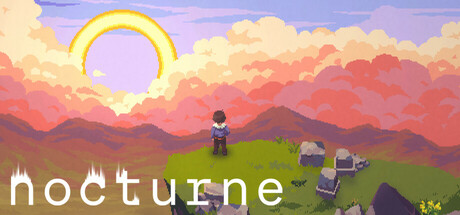

**Platforms:** Windows &nbsp;|&nbsp; **Genre:** Adventure, Indie, RPG &nbsp;|&nbsp; **Released:** October 31

> The afterlife is now digital. Discover that eternal life comes with sacrifice in a genre-defying RPG with unique rhythm combat.
>
> _Synopsis source: Steam_

[Wikipedia](https://en.wikipedia.org/wiki/Nocturne_(video_game)) · [Steam](https://store.steampowered.com/app/1374860)

---

### Outcast

**Platforms:** Windows &nbsp;|&nbsp; **Released:** July 31

[Wikipedia](https://en.wikipedia.org/wiki/Outcast_(video_game))

---

### Pharaoh

**Platforms:** Windows &nbsp;|&nbsp; **Released:** October 31

[Wikipedia](https://en.wikipedia.org/wiki/Pharaoh_(video_game))

---

### Planescape: Torment

**Platforms:** Windows &nbsp;|&nbsp; **Publisher:** Interplay Entertainment &nbsp;|&nbsp; **Released:** December 12, 1999

---

### Quake III Arena

**Platforms:** Windows, Linux, Dreamcast &nbsp;|&nbsp; **Genre:** Action &nbsp;|&nbsp; **Released:** December 2

> The greatest warriors of all time and space have been summoned to battle for the amusement of an ancient alien race. Wield a variety of guns and power-ups as you fight for glory against ruthless combatants in this fast-paced single-player and multiplayer FPS.
>
> _Synopsis source: Steam_

[Wikipedia](https://en.wikipedia.org/wiki/Quake_III_Arena) · [Steam](https://store.steampowered.com/app/2200)

---

### Rayman 2: The Great Escape

**Platforms:** Windows, Nintendo 64, Dreamcast &nbsp;|&nbsp; **Publisher:** Ubisoft &nbsp;|&nbsp; **Released:** November 5, 1999

---

### Re-Volt

**Platforms:** Windows, Dreamcast, Nintendo 64, PlayStation &nbsp;|&nbsp; **Genre:** Racing &nbsp;|&nbsp; **Released:** August 18

> Re-Volt lets you guide one of 28 remote control cars through insane race tracks set in unusual environments. Curbs become huge walls, toys are obstacles, and everything is fair game to drive on, through, or over.
>
> _Synopsis source: Steam_

[Wikipedia](https://en.wikipedia.org/wiki/Re-Volt) · [Steam](https://store.steampowered.com/app/287310)

---

### Requiem: Avenging Angel [ 52 ]

**Platforms:** Windows &nbsp;|&nbsp; **Released:** March 31

---

### RollerCoaster Tycoon

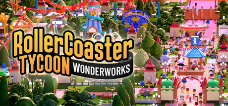

**Platforms:** Windows &nbsp;|&nbsp; **Publisher:** Hasbro Interactive &nbsp;|&nbsp; **Genre:** Casual, Simulation, Strategy, Early Access &nbsp;|&nbsp; **Released:** March 22, 1999

> It’s the grand opening of a new RollerCoaster Tycoon, featuring new levels of chaos and wonder as you do whatever it takes to keep guests happy (and injury-free). Customize rides, manage guests, and build wild roller coasters in your theme parks as you boost profits and expand your empire.
>
> _Synopsis source: Steam_

[Wikipedia](https://en.wikipedia.org/wiki/RollerCoaster_Tycoon_(video_game)) · [Steam](https://store.steampowered.com/app/4734550)

---

### Septerra Core

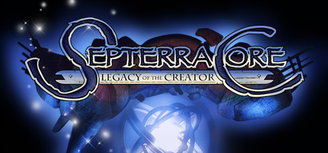

**Platforms:** Windows &nbsp;|&nbsp; **Genre:** RPG &nbsp;|&nbsp; **Released:** October 31

> At the very heart of Septerra lies the Core, a huge Biocomputer. Seven continents at different elevations, each with its own unique people and culture, orbit around the Core.According to an ancient prophecy, Septerra's continents will one day converge and join in orbit together on one level - this is the Legacy of Marduk, the Creator's...
>
> _Synopsis source: Steam_

[Wikipedia](https://en.wikipedia.org/wiki/Septerra_Core) · [Steam](https://store.steampowered.com/app/253940)

---

### Seven Kingdoms II

**Platforms:** Windows &nbsp;|&nbsp; **Released:** July 31

[Wikipedia](https://en.wikipedia.org/wiki/Seven_Kingdoms_II)

---

### Shadow Man

**Platforms:** Windows, Dreamcast, Nintendo 64, PlayStation &nbsp;|&nbsp; **Released:** August 31

[Wikipedia](https://en.wikipedia.org/wiki/Shadow_Man_(video_game))

---

### Sid Meier's Alpha Centauri

**Platforms:** Windows &nbsp;|&nbsp; **Publisher:** Electronic Arts &nbsp;|&nbsp; **Released:** February 12, 1999

[Wikipedia](https://en.wikipedia.org/wiki/Sid_Meier%27s_Alpha_Centauri)

---

### Sim Theme Park

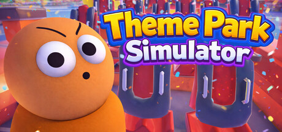

**Platforms:** Windows &nbsp;|&nbsp; **Genre:** Casual, Indie, Simulation &nbsp;|&nbsp; **Released:** November 3

> Build, manage, and grow your own theme park in this multiplayer simulator for 1–4 players. Buy rides, serve customers, manage cleanliness, and maximize profits with day and night cycles.
>
> _Synopsis source: Steam_

[Wikipedia](https://en.wikipedia.org/wiki/Sim_Theme_Park) · [Steam](https://store.steampowered.com/app/4162620)

---

### SimCity 3000

**Platforms:** Windows, macOS &nbsp;|&nbsp; **Released:** January 31

[Wikipedia](https://en.wikipedia.org/wiki/SimCity_3000)

---

### South Park Rally

**Platforms:** Windows, PlayStation &nbsp;|&nbsp; **Released:** November 30

[Wikipedia](https://en.wikipedia.org/wiki/South_Park_Rally)

---

### South Park: Chef's Luv Shack

**Platforms:** Windows, Dreamcast, Nintendo 64, PlayStation &nbsp;|&nbsp; **Released:** October 31

---

### Star Wars: X-Wing Alliance

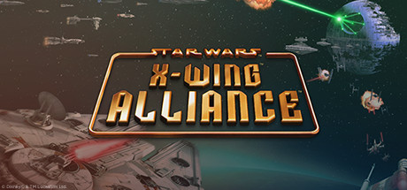

**Platforms:** Windows &nbsp;|&nbsp; **Genre:** Action &nbsp;|&nbsp; **Released:** February 28

> A neutral family fights for its business - and its survival - and is swept up in the struggle against the encroaching Empire. You must defy the strong-arm tactics of a rival family who will stop at nothing to destroy your trading company.
>
> _Synopsis source: Steam_

[Steam](https://store.steampowered.com/app/361670)

---

### SWAT 3: Close Quarters Battle

**Platforms:** Windows &nbsp;|&nbsp; **Released:** November 23

---

### System Shock 2

**Platforms:** Windows &nbsp;|&nbsp; **Publisher:** Electronic Arts &nbsp;|&nbsp; **Released:** August 11, 1999

[Wikipedia](https://en.wikipedia.org/wiki/System_Shock_2)

---

### Team Fortress Classic

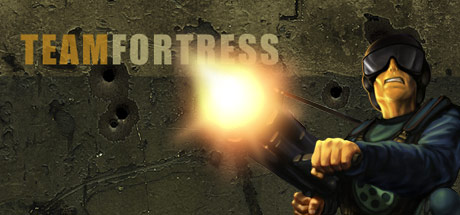

**Platforms:** Windows &nbsp;|&nbsp; **Genre:** Action &nbsp;|&nbsp; **Released:** April 7

> One of the most popular online action games of all time, Team Fortress Classic features over nine character classes -- from Medic to Spy to Demolition Man -- enlisted in a unique style of online team warfare. Each character class possesses unique weapons, items, and abilities, as teams compete online in a variety of game play modes.
>
> _Synopsis source: Steam_

[Wikipedia](https://en.wikipedia.org/wiki/Team_Fortress_Classic) · [Steam](https://store.steampowered.com/app/20)

---

### The Longest Journey

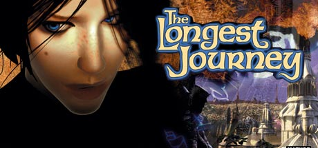

**Platforms:** Windows &nbsp;|&nbsp; **Publisher:** IQ Media Nordic &nbsp;|&nbsp; **Genre:** Action, Adventure, RPG &nbsp;|&nbsp; **Released:** November 18, 1999

> The Longest Journey is an amazing graphical adventure, where the player controls the protagonist, April Ryan, on her journey between parallel universes.
>
> _Synopsis source: Steam_

[Wikipedia](https://en.wikipedia.org/wiki/The_Longest_Journey_(video_game)) · [Steam](https://store.steampowered.com/app/6310)

---

### The Nomad Soul

**Platforms:** Windows &nbsp;|&nbsp; **Released:** October 31

[Wikipedia](https://en.wikipedia.org/wiki/The_Nomad_Soul)

---

### Tom Clancy's Rainbow Six: Rogue Spear

**Platforms:** Windows &nbsp;|&nbsp; **Released:** August 31

---

### Tomb Raider: The Last Revelation

**Platforms:** Windows, PlayStation &nbsp;|&nbsp; **Released:** November 22

---

### Ultima IX: Ascension

**Platforms:** Windows &nbsp;|&nbsp; **Released:** November 24

---

### Unreal Tournament

**Platforms:** Windows &nbsp;|&nbsp; **Publisher:** GT Interactive &nbsp;|&nbsp; **Released:** November 22, 1999

[Wikipedia](https://en.wikipedia.org/wiki/Unreal_Tournament)

---

### Urban Chaos

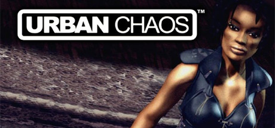

**Platforms:** Windows &nbsp;|&nbsp; **Genre:** Action &nbsp;|&nbsp; **Released:** December 10

> Urban Chaos throws you into the heart of a modern urban jungle at the turn of the millenium. To succeed you'll need a lethal combination of stealth, physical agility and martial art skills as you interact with the city around you.
>
> _Synopsis source: Steam_

[Wikipedia](https://en.wikipedia.org/wiki/Urban_Chaos) · [Steam](https://store.steampowered.com/app/243060)

---

### Warzone 2100

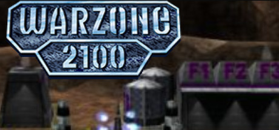

**Platforms:** Windows &nbsp;|&nbsp; **Genre:** Free To Play, Strategy &nbsp;|&nbsp; **Released:** April 10

> In the late 21st century, the world's civilizations are wiped out by a series of nuclear strikes, seemingly caused by a massive malfunction of the new NASDA (North American Strategic Defense Agency) strategic defense system.
>
> _Synopsis source: Steam_

[Wikipedia](https://en.wikipedia.org/wiki/Warzone_2100) · [Steam](https://store.steampowered.com/app/1241950)

---

### Worms Armageddon

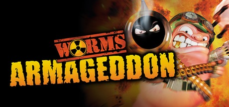

**Platforms:** Windows &nbsp;|&nbsp; **Publisher:** Team17 &nbsp;|&nbsp; **Genre:** Strategy &nbsp;|&nbsp; **Released:** January 29, 1999

> The iconic intrepid invertebrates return with a vengeance in the fan-favourite classic Worms™ Armageddon. Relive their glory days once again as you blast your way into enemy territory, sweep their fields and remain the last worm standing.
>
> _Synopsis source: Steam_

[Wikipedia](https://en.wikipedia.org/wiki/Worms_Armageddon) · [Steam](https://store.steampowered.com/app/217200)

---
