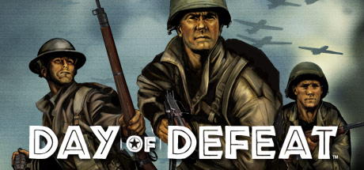
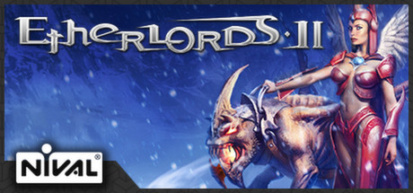
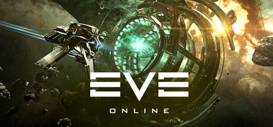
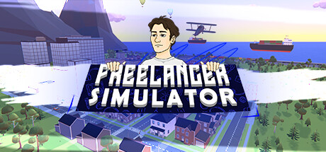
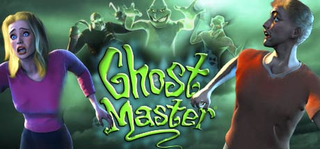
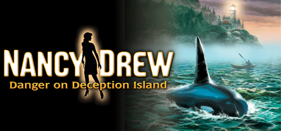
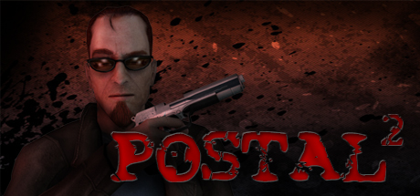
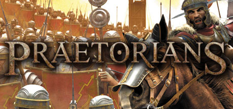

# Windows — 2003

[← All Windows years](../windows.md) · [Full 2003 page](../../years/2003.md)

338 Windows titles in 2003.

### A Tale in the Desert

**Platforms:** Windows, Linux, macOS &nbsp;|&nbsp; **Publisher:** Desert Nomad Studios &nbsp;|&nbsp; **Genre:** MMORPG

[Wikipedia](https://en.wikipedia.org/wiki/A_Tale_in_the_Desert)

---

### After...

**Platforms:** Windows, Dreamcast, PlayStation 2 &nbsp;|&nbsp; **Developer:** Ciel &nbsp;|&nbsp; **Publisher:** Ciel, Pionesoft &nbsp;|&nbsp; **Genre:** Visual novel, eroge &nbsp;|&nbsp; **Released:** June 27, 2003

[Wikipedia](https://en.wikipedia.org/wiki/After..._(video_game))

---

### Age of Mythology: The Titans

**Platforms:** Windows &nbsp;|&nbsp; **Developer:** Ensemble Studios &nbsp;|&nbsp; **Publisher:** Microsoft Game Studios &nbsp;|&nbsp; **Genre:** Real-time strategy &nbsp;|&nbsp; **Released:** September 30, 2003

[Wikipedia](https://en.wikipedia.org/wiki/Age_of_Mythology:_The_Titans)

---

### Age of Wanderer

**Platforms:** Windows &nbsp;|&nbsp; **Developer:** Joymax &nbsp;|&nbsp; **Publisher:** OSC &nbsp;|&nbsp; **Genre:** Beat 'em up &nbsp;|&nbsp; **Released:** January 27, 2003

[Wikipedia](https://en.wikipedia.org/wiki/Age_of_Wanderer)

---

### Age of Wonders: Shadow Magic

**Platforms:** Windows &nbsp;|&nbsp; **Developer:** Triumph Studios &nbsp;|&nbsp; **Publisher:** Gathering &nbsp;|&nbsp; **Genre:** Turn-based strategy &nbsp;|&nbsp; **Released:** July 24, 2003

[Wikipedia](https://en.wikipedia.org/wiki/Age_of_Wonders:_Shadow_Magic)

---

### AGON

**Platforms:** Windows, macOS &nbsp;|&nbsp; **Developer:** Private Moon Studios &nbsp;|&nbsp; **Genre:** Adventure

[Wikipedia](https://en.wikipedia.org/wiki/AGON)

---

### Airborne Assault: Highway to the Reich

**Platforms:** Windows &nbsp;|&nbsp; **Developer:** Panther Games &nbsp;|&nbsp; **Publisher:** Matrix Games &nbsp;|&nbsp; **Genre:** FPS &nbsp;|&nbsp; **Released:** July 2003

[Wikipedia](https://en.wikipedia.org/wiki/Airborne_Assault:_Highway_to_the_Reich)

---

### Airport Tycoon 2

**Platforms:** Windows &nbsp;|&nbsp; **Publisher:** Global Star Software &nbsp;|&nbsp; **Released:** February 26, 2003

[Wikipedia](https://en.wikipedia.org/wiki/Airport_Tycoon)

---

### Alien Shooter

**Platforms:** Windows &nbsp;|&nbsp; **Developer:** Sigma Team &nbsp;|&nbsp; **Publisher:** Sigma Team &nbsp;|&nbsp; **Genre:** Top-down shooter &nbsp;|&nbsp; **Released:** May 18, 2003

[Wikipedia](https://en.wikipedia.org/wiki/Alien_Shooter)

---

### America's 10 Most Wanted

**Platforms:** Windows, PlayStation 2 &nbsp;|&nbsp; **Released:** November 18

[Wikipedia](https://en.wikipedia.org/wiki/America%27s_10_Most_Wanted)

---

### American Idol

**Platforms:** Windows, Game Boy Advance &nbsp;|&nbsp; **Publisher:** Codemasters &nbsp;|&nbsp; **Released:** November 7, 2003

[Wikipedia](https://en.wikipedia.org/wiki/American_Idol_(video_game))

---

### Anarchy Online: The Shadowlands

**Platforms:** Windows &nbsp;|&nbsp; **Released:** September 8

[Wikipedia](https://en.wikipedia.org/wiki/Anarchy_Online#The_Shadowlands)

---

### Anito: Defend a Land Enraged

**Platforms:** Windows &nbsp;|&nbsp; **Developer:** Anino Entertainment &nbsp;|&nbsp; **Publisher:** Anino Entertainment &nbsp;|&nbsp; **Genre:** Adventure, role-playing &nbsp;|&nbsp; **Released:** November 20, 2003

[Wikipedia](https://en.wikipedia.org/wiki/Anito:_Defend_a_Land_Enraged)

---

### Apocalyptica

**Platforms:** Windows &nbsp;|&nbsp; **Developer:** Extreme FX &nbsp;|&nbsp; **Publisher:** Konami &nbsp;|&nbsp; **Genre:** Third-person shooter &nbsp;|&nbsp; **Released:** October 24, 2003

[Wikipedia](https://en.wikipedia.org/wiki/Apocalyptica_(video_game))

---

### Apprentice

**Platforms:** Windows &nbsp;|&nbsp; **Developer:** Herculean Effort Productions &nbsp;|&nbsp; **Publisher:** Herculean Effort Productions &nbsp;|&nbsp; **Genre:** Point-and-click adventure &nbsp;|&nbsp; **Released:** July 10, 2003

[Wikipedia](https://en.wikipedia.org/wiki/Apprentice_(video_game))

---

### Armed and Dangerous

**Platforms:** Windows, Xbox &nbsp;|&nbsp; **Released:** December 2

[Wikipedia](https://en.wikipedia.org/wiki/Armed_and_Dangerous_(video_game))

---

### Ashen Empires

**Platforms:** Windows &nbsp;|&nbsp; **Developer:** Doug Gesler, David Reese, Jeremy Mappus, Bill Money, Denis Loubet &nbsp;|&nbsp; **Publisher:** Pixel Mine, Iron Will Games, Asylumsoft Inc., TKO Software &nbsp;|&nbsp; **Genre:** Massively multiplayer online role-playing game &nbsp;|&nbsp; **Released:** March 10, 2003

[Wikipedia](https://en.wikipedia.org/wiki/Ashen_Empires)

---

### Atari Anthology

**Platforms:** Windows &nbsp;|&nbsp; **Developer:** Digital Eclipse &nbsp;|&nbsp; **Publisher:** Atari, Inc. &nbsp;|&nbsp; **Genre:** Various &nbsp;|&nbsp; **Released:** November 14, 2003

[Wikipedia](https://en.wikipedia.org/wiki/Atari_Anthology)

---

### Atlantis Underwater Tycoon

**Platforms:** Windows &nbsp;|&nbsp; **Developer:** Anarchy Enterprises &nbsp;|&nbsp; **Publisher:** Activision Value &nbsp;|&nbsp; **Genre:** City-building, construction and management, business simulation &nbsp;|&nbsp; **Released:** March 21, 2003

[Wikipedia](https://en.wikipedia.org/wiki/Atlantis_Underwater_Tycoon)

---

### Backyard Baseball 2005

**Platforms:** GameCube, Windows &nbsp;|&nbsp; **Developer:** Humongous Entertainment &nbsp;|&nbsp; **Publisher:** Infogrames/Atari &nbsp;|&nbsp; **Genre:** Sports &nbsp;|&nbsp; **Released:** April 2, 2003

[Wikipedia](https://en.wikipedia.org/wiki/Backyard_Baseball_2005)

---

### Battlefield 1942: Secret Weapons of WWII

**Platforms:** Windows &nbsp;|&nbsp; **Released:** September 4

[Wikipedia](https://en.wikipedia.org/wiki/Battlefield_1942#Expansion_packs)

---

### Battlefield 1942: The Road to Rome

**Platforms:** Windows &nbsp;|&nbsp; **Developer:** DICE &nbsp;|&nbsp; **Publisher:** EA Games &nbsp;|&nbsp; **Genre:** First-person shooter &nbsp;|&nbsp; **Released:** February 4, 2003

[Wikipedia](https://en.wikipedia.org/wiki/Battlefield_1942:_The_Road_to_Rome)

---

### Beats of Rage

**Platforms:** Windows &nbsp;|&nbsp; **Developer:** Senile Team &nbsp;|&nbsp; **Genre:** Beat 'em up &nbsp;|&nbsp; **Released:** November 2003

[Wikipedia](https://en.wikipedia.org/wiki/Beats_of_Rage)

---

### Beyond Good & Evil

**Platforms:** Xbox, GameCube, PlayStation 2, Windows &nbsp;|&nbsp; **Publisher:** Ubisoft &nbsp;|&nbsp; **Released:** December 2, 2003

[Wikipedia](https://en.wikipedia.org/wiki/Beyond_Good_%26_Evil_(video_game))

---

### Big Biz Tycoon! 2

**Platforms:** Windows &nbsp;|&nbsp; **Developer:** 4HEAD Studios &nbsp;|&nbsp; **Publisher:** Activision Value &nbsp;|&nbsp; **Genre:** Business simulation game &nbsp;|&nbsp; **Released:** June 12, 2003

[Wikipedia](https://en.wikipedia.org/wiki/Big_Biz_Tycoon!_2)

---

### Big Rigs: Over the Road Racing

**Platforms:** Windows &nbsp;|&nbsp; **Publisher:** GameMill Publishing &nbsp;|&nbsp; **Genre:** Action, Adventure, Racing &nbsp;|&nbsp; **Released:** November 20, 2003

> Get ready for some brake jamm'in, CB talk'in, convoy roll'in action across America! From Portland Oregon to Miami Florida, you'll be hauling loads and trying to stay one step ahead of the law as you climb into your Big Rig for non-stop driving action.
>
> _Synopsis source: Steam_

[Steam](https://store.steampowered.com/app/3598130)

---

### Bionicle

**Platforms:** GameCube, Game Boy Advance, PlayStation 2, Xbox, Windows &nbsp;|&nbsp; **Developer:** Argonaut Games, Argonaut Sheffield, Möbius Entertainment &nbsp;|&nbsp; **Publisher:** Electronic Arts, Lego Interactive, THQ, Feral Interactive &nbsp;|&nbsp; **Genre:** Platform &nbsp;|&nbsp; **Released:** September 9, 2003

[Wikipedia](https://en.wikipedia.org/wiki/Bionicle_(video_game))

---

### Blitzkrieg

**Platforms:** Windows, macOS &nbsp;|&nbsp; **Developer:** Nival Interactive &nbsp;|&nbsp; **Publisher:** CDV, 1C Company, Virtual Programming &nbsp;|&nbsp; **Genre:** Real-time tactics &nbsp;|&nbsp; **Released:** March 28, 2003

[Wikipedia](https://en.wikipedia.org/wiki/Blitzkrieg_(video_game))

---

### Bookworm

**Platforms:** Windows, macOS, Game Boy Advance, Mobile phone, Nintendo DS &nbsp;|&nbsp; **Developer:** PopCap Games, Black Lantern Studios &nbsp;|&nbsp; **Publisher:** PopCap Games &nbsp;|&nbsp; **Genre:** Puzzle &nbsp;|&nbsp; **Released:** February 25, 2003

[Wikipedia](https://en.wikipedia.org/wiki/Bookworm_(video_game))

---

### Broken Sword: The Sleeping Dragon

**Platforms:** Windows, PlayStation 2, Xbox &nbsp;|&nbsp; **Released:** November 14

---

### Cabela's 4x4 Off-Road Adventure

**Platforms:** Windows &nbsp;|&nbsp; **Developer:** Fun Labs &nbsp;|&nbsp; **Publisher:** Activision Value &nbsp;|&nbsp; **Genre:** Racing

[Wikipedia](https://en.wikipedia.org/wiki/Cabela's_4x4_Off-Road_Adventure)

---

### Cabela's Big Game Hunter: 2004 Season

**Platforms:** Windows &nbsp;|&nbsp; **Developer:** Sand Grain Studios &nbsp;|&nbsp; **Publisher:** Activision Value &nbsp;|&nbsp; **Genre:** Sports &nbsp;|&nbsp; **Released:** September 2003

[Wikipedia](https://en.wikipedia.org/wiki/Cabela's_Big_Game_Hunter:_2004_Season)

---

### Cabela's GrandSlam Hunting: 2004 Trophies

**Platforms:** Windows &nbsp;|&nbsp; **Publisher:** Activision Value &nbsp;|&nbsp; **Genre:** Sports

[Wikipedia](https://en.wikipedia.org/wiki/Cabela's_GrandSlam_Hunting:_2004_Trophies)

---

### Cafe Little Wish

**Platforms:** Windows, Dreamcast, PlayStation 2 &nbsp;|&nbsp; **Developer:** Patissier &nbsp;|&nbsp; **Publisher:** Digital Works, Princess Soft &nbsp;|&nbsp; **Genre:** Eroge, Visual novel &nbsp;|&nbsp; **Released:** February 14, 2003

[Wikipedia](https://en.wikipedia.org/wiki/Cafe_Little_Wish)

---

### Cal Ripken's Real Baseball

**Platforms:** Windows &nbsp;|&nbsp; **Developer:** NCK Tiger Electronic Handheld Studios &nbsp;|&nbsp; **Publisher:** Netamin Communication Corporation &nbsp;|&nbsp; **Genre:** Baseball MMOSG

[Wikipedia](https://en.wikipedia.org/wiki/Cal_Ripken's_Real_Baseball)

---

### Call of Duty

**Platforms:** Windows &nbsp;|&nbsp; **Publisher:** Activision &nbsp;|&nbsp; **Genre:** Action &nbsp;|&nbsp; **Released:** October 29, 2003

> The Call of Duty® experience supports Modern Warfare® 4, Black Ops 7 and Call of Duty®: Warzone™.
>
> _Synopsis source: Steam_

[Wikipedia](https://en.wikipedia.org/wiki/Call_of_Duty_(video_game)) · [Steam](https://store.steampowered.com/app/1938090)

---

### Car Tycoon

**Platforms:** Windows &nbsp;|&nbsp; **Developer:** Vectorcom Development &nbsp;|&nbsp; **Publisher:** JoWooD Productions &nbsp;|&nbsp; **Genre:** Business simulation game &nbsp;|&nbsp; **Released:** January 5, 2003

[Wikipedia](https://en.wikipedia.org/wiki/Car_Tycoon)

---

### Casino, Inc.

**Platforms:** Windows &nbsp;|&nbsp; **Developer:** Hothouse Creations &nbsp;|&nbsp; **Publisher:** Konami &nbsp;|&nbsp; **Genre:** Business simulation game &nbsp;|&nbsp; **Released:** March 26, 2003

[Wikipedia](https://en.wikipedia.org/wiki/Casino,_Inc.)

---

### Celebrity Deathmatch

**Platforms:** Windows, PlayStation 2, Xbox &nbsp;|&nbsp; **Publisher:** Gotham Games &nbsp;|&nbsp; **Released:** October 14, 2003

[Wikipedia](https://en.wikipedia.org/wiki/Celebrity_Deathmatch_(video_game))

---

### Championship Manager 4

**Platforms:** Windows &nbsp;|&nbsp; **Publisher:** Eidos Interactive &nbsp;|&nbsp; **Released:** March 28, 2003

[Wikipedia](https://en.wikipedia.org/wiki/Championship_Manager_4)

---

### Championship Manager: Season 03/04

**Platforms:** Windows, macOS &nbsp;|&nbsp; **Developer:** Sports Interactive &nbsp;|&nbsp; **Publisher:** Eidos Interactive &nbsp;|&nbsp; **Genre:** Sports &nbsp;|&nbsp; **Released:** November 21, 2003

[Wikipedia](https://en.wikipedia.org/wiki/Championship_Manager:_Season_03/04)

---

### Chaos Legion

**Platforms:** Windows, PlayStation 2 &nbsp;|&nbsp; **Released:** August 5

[Wikipedia](https://en.wikipedia.org/wiki/Chaos_Legion)

---

### Chariots of War

**Platforms:** Windows &nbsp;|&nbsp; **Developer:** Slitherine Software, Paradox Interactive &nbsp;|&nbsp; **Publisher:** Strategy First, Koch Media, PAN Vision &nbsp;|&nbsp; **Genre:** Computer wargame &nbsp;|&nbsp; **Released:** June 11, 2003

[Wikipedia](https://en.wikipedia.org/wiki/Chariots_of_War)

---

### Charlie's Angels: Angel X

**Platforms:** Windows &nbsp;|&nbsp; **Publisher:** Sony Online Entertainment &nbsp;|&nbsp; **Released:** June 20, 2003

[Wikipedia](https://en.wikipedia.org/wiki/Charlie%27s_Angels_(franchise))

---

### Chaser

**Platforms:** Windows &nbsp;|&nbsp; **Developer:** Cauldron &nbsp;|&nbsp; **Publisher:** JoWooD Productions NA:Encore, Inc. &nbsp;|&nbsp; **Genre:** First-person shooter &nbsp;|&nbsp; **Released:** June 20, 2003

[Wikipedia](https://en.wikipedia.org/wiki/Chaser_(video_game))

---

### Chicago 1930

**Platforms:** macOS, Windows &nbsp;|&nbsp; **Developer:** Spellbound Entertainment &nbsp;|&nbsp; **Publisher:** Wanadoo Edition, MC2-Microids &nbsp;|&nbsp; **Genre:** Action, role-playing &nbsp;|&nbsp; **Released:** November 2003

[Wikipedia](https://en.wikipedia.org/wiki/Chicago_1930)

---

### Chicken Shoot 2

**Platforms:** Windows &nbsp;|&nbsp; **Developer:** Toontraxx, Frontline Studios &nbsp;|&nbsp; **Publisher:** Zuxxez/TopWare Interactive, DSI Games, Zoo Digital Publishing &nbsp;|&nbsp; **Genre:** Shoot 'em up &nbsp;|&nbsp; **Released:** December 17, 2003

[Wikipedia](https://en.wikipedia.org/wiki/Chicken_Shoot_2)

---

### Chinese Paladin 3

**Platforms:** Windows &nbsp;|&nbsp; **Developer:** Softstar Technology Co., Ltd. &nbsp;|&nbsp; **Publisher:** Softstar Entertainment Inc., Unistar &nbsp;|&nbsp; **Genre:** Role-playing &nbsp;|&nbsp; **Released:** July 31, 2003

[Wikipedia](https://en.wikipedia.org/wiki/Chinese_Paladin_3)

---

### Chrome

**Platforms:** Windows &nbsp;|&nbsp; **Developer:** Techland &nbsp;|&nbsp; **Publisher:** Gathering, Strategy First &nbsp;|&nbsp; **Genre:** First-person shooter &nbsp;|&nbsp; **Released:** June 13, 2003

[Wikipedia](https://en.wikipedia.org/wiki/Chrome_(video_game))

---

### Civilization III: Conquests

**Platforms:** Windows &nbsp;|&nbsp; **Released:** November 4

---

### Clover Heart's

**Platforms:** Windows, PlayStation 2 &nbsp;|&nbsp; **Developer:** ALcot, HuneX, Dennō Club &nbsp;|&nbsp; **Publisher:** ALcot, Interchannel &nbsp;|&nbsp; **Genre:** Eroge, Visual novel &nbsp;|&nbsp; **Released:** November 28, 2003

[Wikipedia](https://en.wikipedia.org/wiki/Clover_Heart's)

---

### Cold War Conflicts

**Platforms:** Windows &nbsp;|&nbsp; **Developer:** Red Ice Software, Fireglow Games &nbsp;|&nbsp; **Publisher:** Russobit-M, GMX Media &nbsp;|&nbsp; **Genre:** Real-time strategy

[Wikipedia](https://en.wikipedia.org/wiki/Cold_War_Conflicts)

---

### Combat Mission 3: Afrika Korps

**Platforms:** Windows, macOS &nbsp;|&nbsp; **Developer:** Battlefront.com &nbsp;|&nbsp; **Publisher:** CDV Software &nbsp;|&nbsp; **Genre:** Computer wargame &nbsp;|&nbsp; **Released:** November 28, 2003

[Wikipedia](https://en.wikipedia.org/wiki/Combat_Mission_3:_Afrika_Korps)

---

### Command & Conquer: Generals

**Platforms:** Windows &nbsp;|&nbsp; **Genre:** Action, Strategy &nbsp;|&nbsp; **Released:** February 10

> Command &amp; Conquer Generals puts your trigger finger on the pulse of modern warfare. Prepare your forces General... it's time to engage in the next generation of real-time strategy.
>
> _Synopsis source: Steam_

[Steam](https://store.steampowered.com/app/2229870)

---

### Command & Conquer: Generals – Zero Hour

**Platforms:** Windows &nbsp;|&nbsp; **Released:** September 22

---

### Commandos 3: Destination Berlin

**Platforms:** Windows &nbsp;|&nbsp; **Developer:** Pyro Studios &nbsp;|&nbsp; **Publisher:** Eidos Interactive &nbsp;|&nbsp; **Genre:** Real-time tactics &nbsp;|&nbsp; **Released:** October 14, 2003

[Wikipedia](https://en.wikipedia.org/wiki/Commandos_3:_Destination_Berlin)

---

### Conflict: Desert Storm II

**Platforms:** PlayStation 2, Windows, Xbox &nbsp;|&nbsp; **Developer:** Pivotal Games &nbsp;|&nbsp; **Publisher:** SCi Games, Gotham Games &nbsp;|&nbsp; **Genre:** Tactical shooter &nbsp;|&nbsp; **Released:** September 18, 2003

[Wikipedia](https://en.wikipedia.org/wiki/Conflict:_Desert_Storm_II)

---

### Conspiracies

**Platforms:** Windows &nbsp;|&nbsp; **Developer:** Anima Interactive &nbsp;|&nbsp; **Publisher:** Got Game Entertainment, GMX Media &nbsp;|&nbsp; **Genre:** Adventure, Interactive movie &nbsp;|&nbsp; **Released:** October 29, 2003

[Wikipedia](https://en.wikipedia.org/wiki/Conspiracies_(video_game))

---

### Construction-Destruction

**Platforms:** Windows &nbsp;|&nbsp; **Developer:** Gabriel Entertainment &nbsp;|&nbsp; **Publisher:** ValuSoft &nbsp;|&nbsp; **Genre:** Construction game

[Wikipedia](https://en.wikipedia.org/wiki/Construction-Destruction)

---

### Contract J.A.C.K.

**Platforms:** Windows &nbsp;|&nbsp; **Developer:** Monolith Productions &nbsp;|&nbsp; **Publisher:** Vivendi Universal Games, Sierra Entertainment &nbsp;|&nbsp; **Genre:** First-person shooter &nbsp;|&nbsp; **Released:** November 11, 2003

[Wikipedia](https://en.wikipedia.org/wiki/Contract_J.A.C.K.)

---

### Corvette

**Platforms:** Windows, Xbox, Game Boy Advance &nbsp;|&nbsp; **Developer:** Steel Monkeys, Visual Impact &nbsp;|&nbsp; **Publisher:** TDK Mediactive, Global Star Software &nbsp;|&nbsp; **Genre:** Racing game &nbsp;|&nbsp; **Released:** November 11, 2003

[Wikipedia](https://en.wikipedia.org/wiki/Corvette_(video_game))

---

### Counter-Strike

**Platforms:** Windows, Xbox &nbsp;|&nbsp; **Released:** September 9 (EU)

[Wikipedia](https://en.wikipedia.org/wiki/Counter-Strike_(video_game))

---

### Crimsonland

**Platforms:** Windows, macOS, Linux &nbsp;|&nbsp; **Developer:** 10tons Entertainment &nbsp;|&nbsp; **Publisher:** Reflexive Entertainment &nbsp;|&nbsp; **Genre:** Shoot 'em up &nbsp;|&nbsp; **Released:** April 22, 2003

[Wikipedia](https://en.wikipedia.org/wiki/Crimsonland)

---

### Cross Channel

**Platforms:** Windows &nbsp;|&nbsp; **Developer:** Flying Shine &nbsp;|&nbsp; **Publisher:** Flying Shine, KID, Cyberfront, 5pb. &nbsp;|&nbsp; **Genre:** Visual novel &nbsp;|&nbsp; **Released:** September 26, 2003

[Wikipedia](https://en.wikipedia.org/wiki/Cross_Channel_(video_game))

---

### CSI: Crime Scene Investigation

**Platforms:** Windows &nbsp;|&nbsp; **Developer:** Radical Entertainment, EPCConnect &nbsp;|&nbsp; **Publisher:** Ubi Soft, Aspyr &nbsp;|&nbsp; **Genre:** Adventure &nbsp;|&nbsp; **Released:** March 25, 2003

[Wikipedia](https://en.wikipedia.org/wiki/CSI:_Crime_Scene_Investigation_(video_game))

---

### CTU: Marine Sharpshooter

**Platforms:** Windows &nbsp;|&nbsp; **Developer:** Jarhead Games &nbsp;|&nbsp; **Publisher:** Groove Games &nbsp;|&nbsp; **Genre:** First-person shooter &nbsp;|&nbsp; **Released:** March 20, 2003

[Wikipedia](https://en.wikipedia.org/wiki/CTU:_Marine_Sharpshooter)

---

### Curse: The Eye of Isis

**Platforms:** Windows, Xbox, PlayStation 2 &nbsp;|&nbsp; **Developer:** Asylum Entertainment &nbsp;|&nbsp; **Publisher:** DreamCatcher Interactive, Wanadoo Edition &nbsp;|&nbsp; **Genre:** Survival horror &nbsp;|&nbsp; **Released:** October 20, 2003

[Wikipedia](https://en.wikipedia.org/wiki/Curse:_The_Eye_of_Isis)

---

### Cyberchase: Carnival Chaos

**Platforms:** Windows, macOS &nbsp;|&nbsp; **Developer:** Basis Applied Technology &nbsp;|&nbsp; **Publisher:** The Learning Company &nbsp;|&nbsp; **Genre:** Edutainment

[Wikipedia](https://en.wikipedia.org/wiki/Cyberchase:_Carnival_Chaos)

---

### Cyberchase: Castleblanca Quest

**Platforms:** Windows, macOS &nbsp;|&nbsp; **Developer:** Basis Applied Technology &nbsp;|&nbsp; **Publisher:** The Learning Company &nbsp;|&nbsp; **Genre:** Edutainment

[Wikipedia](https://en.wikipedia.org/wiki/Cyberchase:_Castleblanca_Quest)

---

### Danger from the Deep

**Platforms:** Linux, Windows &nbsp;|&nbsp; **Genre:** Submarine simulator

[Wikipedia](https://en.wikipedia.org/wiki/Danger_from_the_Deep)

---

### Day of Defeat

**Platforms:** Windows &nbsp;|&nbsp; **Genre:** Action &nbsp;|&nbsp; **Released:** May 6

> Enlist in an intense brand of Axis vs. Allied teamplay set in the WWII European Theatre of Operations. Players assume the role of light/assault/heavy infantry, sniper or machine-gunner class, each with a unique arsenal of historical weaponry at their disposal. Missions are based on key historical operations.
>
> _Synopsis source: Steam_

[Wikipedia](https://en.wikipedia.org/wiki/Day_of_Defeat) · [Steam](https://store.steampowered.com/app/30)

---

### December When There Is No Angel

**Platforms:** Windows &nbsp;|&nbsp; **Publisher:** Leaf &nbsp;|&nbsp; **Genre:** Eroge, Visual novel &nbsp;|&nbsp; **Released:** September 26, 2003

[Wikipedia](https://en.wikipedia.org/wiki/December_When_There_Is_No_Angel)

---

### Decisive Battles of WWII: Korsun Pocket

**Platforms:** Windows &nbsp;|&nbsp; **Developer:** Strategic Studies Group &nbsp;|&nbsp; **Publisher:** Matrix Games &nbsp;|&nbsp; **Genre:** Computer wargame

[Wikipedia](https://en.wikipedia.org/wiki/Decisive_Battles_of_WWII:_Korsun_Pocket)

---

### Defense of the Ancients

**Platforms:** Windows, macOS &nbsp;|&nbsp; **Genre:** MOBA

[Wikipedia](https://en.wikipedia.org/wiki/Defense_of_the_Ancients)

---

### Delta Force: Black Hawk Down

**Platforms:** Windows &nbsp;|&nbsp; **Developer:** NovaLogic, Climax London, Rebellion Developments, Aspyr &nbsp;|&nbsp; **Publisher:** NovaLogic, Aspyr &nbsp;|&nbsp; **Genre:** First-person shooter &nbsp;|&nbsp; **Released:** March 25, 2003

[Wikipedia](https://en.wikipedia.org/wiki/Delta_Force:_Black_Hawk_Down)

---

### Deus Ex: Invisible War

**Platforms:** Windows, Xbox &nbsp;|&nbsp; **Genre:** Action &nbsp;|&nbsp; **Released:** December 2

> Approximately 20 years after Deus Ex, the world is only beginning to recover from a catastrophic worldwide depression. In this techno-nightmare, take part in the dark struggle to raise the world from its own ashes.
>
> _Synopsis source: Steam_

[Steam](https://store.steampowered.com/app/6920)

---

### Devastation

**Platforms:** Windows, Linux &nbsp;|&nbsp; **Developer:** Digitalo Studios &nbsp;|&nbsp; **Publisher:** ARUSH Entertainment, Groove Games, NovaLogic &nbsp;|&nbsp; **Genre:** First-person shooter &nbsp;|&nbsp; **Released:** March 25, 2003

[Wikipedia](https://en.wikipedia.org/wiki/Devastation_(video_game))

---

### Disney's Brother Bear

**Platforms:** Game Boy Advance, Windows &nbsp;|&nbsp; **Developer:** KnowWonder, Vicarious Visions &nbsp;|&nbsp; **Publisher:** Disney Interactive &nbsp;|&nbsp; **Genre:** Action, platformer &nbsp;|&nbsp; **Released:** November 4, 2003

[Wikipedia](https://en.wikipedia.org/wiki/Disney's_Brother_Bear_(video_game))

---

### Dogfight: Battle for the Pacific

**Platforms:** Windows, PlayStation 2 &nbsp;|&nbsp; **Developer:** InterActive Vision &nbsp;|&nbsp; **Publisher:** Midas Interactive Entertainment, ValuSoft &nbsp;|&nbsp; **Genre:** Simulation

[Wikipedia](https://en.wikipedia.org/wiki/Dogfight:_Battle_for_the_Pacific)

---

### Dominions II: The Ascension Wars

**Platforms:** Windows, Linux, macOS &nbsp;|&nbsp; **Developer:** Illwinter Game Design &nbsp;|&nbsp; **Publisher:** Shrapnel Games &nbsp;|&nbsp; **Genre:** Turn-based strategy, fantasy &nbsp;|&nbsp; **Released:** November 14, 2003

[Wikipedia](https://en.wikipedia.org/wiki/Dominions_II:_The_Ascension_Wars)

---

### Downtown Run

**Platforms:** Windows, GameCube, Mobile phone, PlayStation 2 &nbsp;|&nbsp; **Developer:** Ubi Soft Bucharest, Com2uS &nbsp;|&nbsp; **Publisher:** Ubi Soft, Com2uS &nbsp;|&nbsp; **Genre:** Racing, vehicular combat &nbsp;|&nbsp; **Released:** March 27, 2003

[Wikipedia](https://en.wikipedia.org/wiki/Downtown_Run)

---

### Dr. Blob's Organism

**Platforms:** Windows, macOS &nbsp;|&nbsp; **Developer:** Digital Eel &nbsp;|&nbsp; **Publisher:** Cheapass Games &nbsp;|&nbsp; **Genre:** Shoot 'em up &nbsp;|&nbsp; **Released:** July 4, 2003

[Wikipedia](https://en.wikipedia.org/wiki/Dr._Blob's_Organism)

---

### Dungeon Scroll

**Platforms:** Windows &nbsp;|&nbsp; **Developer:** Robinson Technologies &nbsp;|&nbsp; **Publisher:** Robinson Technologies &nbsp;|&nbsp; **Genre:** Role-playing, word

[Wikipedia](https://en.wikipedia.org/wiki/Dungeon_Scroll)

---

### Earth City demo

**Platforms:** Windows &nbsp;|&nbsp; **Developer:** Bungie &nbsp;|&nbsp; **Publisher:** Microsoft &nbsp;|&nbsp; **Genre:** First-person shooter

[Wikipedia](https://en.wikipedia.org/wiki/Earth_City_demo)

---

### Emergency 2: The Ultimate Fight for Life

**Platforms:** Windows

[Wikipedia](https://en.wikipedia.org/wiki/Emergency_2:_The_Ultimate_Fight_for_Life)

---

### Emergency Fire Response

**Platforms:** Windows &nbsp;|&nbsp; **Developer:** Monte Cristo Multimedia &nbsp;|&nbsp; **Publisher:** DreamCatcher Interactive &nbsp;|&nbsp; **Genre:** Simulation &nbsp;|&nbsp; **Released:** July 29, 2003

[Wikipedia](https://en.wikipedia.org/wiki/Emergency_Fire_Response)

---

### Empires: Dawn of the Modern World

**Platforms:** Windows &nbsp;|&nbsp; **Developer:** Stainless Steel Studios &nbsp;|&nbsp; **Publisher:** Activision &nbsp;|&nbsp; **Genre:** Real-time strategy &nbsp;|&nbsp; **Released:** October 21, 2003

[Wikipedia](https://en.wikipedia.org/wiki/Empires:_Dawn_of_the_Modern_World)

---

### Endless Ages

**Platforms:** Windows &nbsp;|&nbsp; **Developer:** Avaria Corporation &nbsp;|&nbsp; **Publisher:** SummitSoft &nbsp;|&nbsp; **Genre:** Massively multiplayer online first-person shooter/role-playing &nbsp;|&nbsp; **Released:** July 1, 2003

[Wikipedia](https://en.wikipedia.org/wiki/Endless_Ages)

---

### Enigma: Rising Tide

**Platforms:** Windows &nbsp;|&nbsp; **Developer:** Tesseraction Games &nbsp;|&nbsp; **Publisher:** Dreamcatcher Interactive, GMX Media &nbsp;|&nbsp; **Genre:** Vehicle simulation game &nbsp;|&nbsp; **Released:** August 25, 2003

[Wikipedia](https://en.wikipedia.org/wiki/Enigma:_Rising_Tide)

---

### Enigmo

**Platforms:** Windows, macOS, PlayStation Portable &nbsp;|&nbsp; **Developer:** Pangea Software, Beatshapers &nbsp;|&nbsp; **Publisher:** Pangea Software, Beatshapers &nbsp;|&nbsp; **Genre:** Puzzle

[Wikipedia](https://en.wikipedia.org/wiki/Enigmo)

---

### Enter The Matrix

**Platforms:** Windows, GameCube, PlayStation 2, Xbox &nbsp;|&nbsp; **Released:** May 14

[Wikipedia](https://en.wikipedia.org/wiki/Enter_The_Matrix)

---

### Entropia Universe

**Platforms:** Windows &nbsp;|&nbsp; **Developer:** MindArk &nbsp;|&nbsp; **Publisher:** MindArk &nbsp;|&nbsp; **Genre:** Massively multiplayer online role-playing game, first-person shooter &nbsp;|&nbsp; **Released:** January 30, 2003

[Wikipedia](https://en.wikipedia.org/wiki/Entropia_Universe)

---

### Etherlords II

**Platforms:** Windows &nbsp;|&nbsp; **Genre:** Adventure, Indie, RPG, Strategy &nbsp;|&nbsp; **Released:** October 1

> The saga continues! Etherlords II takes you back to the world of Ether and into a whole new realm of fantastic possibilities. Lead your hero on an unforgettable journey through lands filled with unsurpassed beauty and danger to unlock the ultimate mystery.
>
> _Synopsis source: Steam_

[Wikipedia](https://en.wikipedia.org/wiki/Etherlords#Etherlords_II) · [Steam](https://store.steampowered.com/app/270790)

---

### Eve Online

**Platforms:** Windows &nbsp;|&nbsp; **Genre:** Action, Massively Multiplayer, RPG, Strategy, Free To Play &nbsp;|&nbsp; **Released:** May 6 (JP)

> Over 20 years of legendary space battles! Explore a massive living universe of danger and opportunity in a challenging and highly rewarding space adventure. Fight, trade, build, and connect with a universe driven and shaped directly by players.
>
> _Synopsis source: Steam_

[Wikipedia](https://en.wikipedia.org/wiki/Eve_Online) · [Steam](https://store.steampowered.com/app/8500)

---

### EverQuest: Lost Dungeons of Norrath

**Platforms:** Windows &nbsp;|&nbsp; **Released:** September 9

[Wikipedia](https://en.wikipedia.org/wiki/Lost_Dungeons_of_Norrath)

---

### EverQuest: The Legacy of Ykesha

**Platforms:** Windows &nbsp;|&nbsp; **Released:** February 25

---

### Evil Dead: Hail to the King

**Platforms:** Windows, Dreamcast, PlayStation &nbsp;|&nbsp; **Released:** April 9

---

### Ex Zeus

**Platforms:** Arcade, Windows &nbsp;|&nbsp; **Developer:** HyperDevbox Japan, Octopus Studio &nbsp;|&nbsp; **Publisher:** HyperDevbox Japan, Metro3D, Conspiracy Entertainment, 505 Games &nbsp;|&nbsp; **Genre:** Rail shooter &nbsp;|&nbsp; **Released:** May 1, 2003

[Wikipedia](https://en.wikipedia.org/wiki/Ex_Zeus)

---

### F1 Career Challenge

**Platforms:** GameCube, Windows, PlayStation 2, Xbox &nbsp;|&nbsp; **Developer:** Visual Science, Image Space Incorporated &nbsp;|&nbsp; **Publisher:** EA Sports &nbsp;|&nbsp; **Genre:** Racing &nbsp;|&nbsp; **Released:** June 23, 2003

[Wikipedia](https://en.wikipedia.org/wiki/F1_Career_Challenge)

---

### F1 Challenge '99–'02

**Platforms:** Windows &nbsp;|&nbsp; **Publisher:** EA Sports &nbsp;|&nbsp; **Released:** June 24, 2003

[Wikipedia](https://en.wikipedia.org/wiki/EA_Sports_F1_series)

---

### FIFA Football 2004

**Platforms:** Windows, PlayStation, PlayStation 2, GameCube, Xbox, Game Boy Advance, N-Gage &nbsp;|&nbsp; **Developer:** EA Canada, Exient Entertainment &nbsp;|&nbsp; **Publisher:** EA Sports &nbsp;|&nbsp; **Genre:** Sports &nbsp;|&nbsp; **Released:** October 24, 2003

[Wikipedia](https://en.wikipedia.org/wiki/FIFA_Football_2004)

---

### Final Fantasy XI

**Platforms:** Windows &nbsp;|&nbsp; **Released:** October 28 (NA)

[Wikipedia](https://en.wikipedia.org/wiki/Final_Fantasy_XI)

---

### Final Fantasy XI: Rise of the Zilart

**Platforms:** Windows, PlayStation 2 &nbsp;|&nbsp; **Released:** April 17 (JP)

[Wikipedia](https://en.wikipedia.org/wiki/Final_Fantasy_XI)

---

### FireStarter

**Platforms:** Windows &nbsp;|&nbsp; **Developer:** GSC Game World &nbsp;|&nbsp; **Publisher:** Hip Games &nbsp;|&nbsp; **Genre:** First-person shooter &nbsp;|&nbsp; **Released:** November 28, 2003

[Wikipedia](https://en.wikipedia.org/wiki/FireStarter_(video_game))

---

### Ford Racing 2

**Platforms:** PlayStation 2, Xbox, Windows &nbsp;|&nbsp; **Developer:** Razorworks &nbsp;|&nbsp; **Publisher:** Gotham Games, Empire Interactive, Feral Interactive &nbsp;|&nbsp; **Genre:** Racing &nbsp;|&nbsp; **Released:** October 28, 2003

[Wikipedia](https://en.wikipedia.org/wiki/Ford_Racing_2)

---

### Freedom Fighters

**Platforms:** Windows, PlayStation 2, Xbox, GameCube &nbsp;|&nbsp; **Genre:** Action &nbsp;|&nbsp; **Released:** October 1

> Freedom Fighters is an intense third-person action game set in an alternate history New York during the invasion of a foreign superpower. Take on the role of Chris Stone, a hard-working plumber, and rise through the ranks of the resistance to prove yourself as a charismatic leader.
>
> _Synopsis source: Steam_

[Wikipedia](https://en.wikipedia.org/wiki/Freedom_Fighters_(video_game)) · [Steam](https://store.steampowered.com/app/1347780)

---

### Freelancer

**Platforms:** Windows &nbsp;|&nbsp; **Genre:** Indie, Simulation &nbsp;|&nbsp; **Released:** March 4

> You earn money by doing various kinds of work that you receive as a &quot;Freelance&quot; over the computer. With the money you earn, you can customize the house, improve yourself, have fun and more.
>
> _Synopsis source: Steam_

[Wikipedia](https://en.wikipedia.org/wiki/Freelancer_(video_game)) · [Steam](https://store.steampowered.com/app/2360310)

---

### Frogger's Adventures: The Rescue

**Platforms:** GameCube, PlayStation 2, Windows &nbsp;|&nbsp; **Developer:** Hudson Soft &nbsp;|&nbsp; **Publisher:** Konami &nbsp;|&nbsp; **Genre:** Action-adventure &nbsp;|&nbsp; **Released:** October 28, 2003

[Wikipedia](https://en.wikipedia.org/wiki/Frogger's_Adventures:_The_Rescue)

---

### Full Pipe

**Platforms:** Windows &nbsp;|&nbsp; **Developer:** Pipe Studio &nbsp;|&nbsp; **Publisher:** 1C Company, Daedalic Entertainment &nbsp;|&nbsp; **Genre:** Adventure &nbsp;|&nbsp; **Released:** November 28, 2003

[Wikipedia](https://en.wikipedia.org/wiki/Full_Pipe)

---

### Galactic Civilizations

**Platforms:** Windows &nbsp;|&nbsp; **Released:** March 26

[Wikipedia](https://en.wikipedia.org/wiki/Galactic_Civilizations)

---

### Gekkeiju Online

**Platforms:** Windows &nbsp;|&nbsp; **Developer:** Coolhouse Productions &nbsp;|&nbsp; **Genre:** MMORPG

[Wikipedia](https://en.wikipedia.org/wiki/Gekkeiju_Online)

---

### Geneforge 2

**Platforms:** macOS, Windows &nbsp;|&nbsp; **Developer:** Spiderweb Software &nbsp;|&nbsp; **Publisher:** Spiderweb Software &nbsp;|&nbsp; **Genre:** Role-playing &nbsp;|&nbsp; **Released:** July 25, 2003

[Wikipedia](https://en.wikipedia.org/wiki/Geneforge_2)

---

### Ghost Master

**Platforms:** Windows &nbsp;|&nbsp; **Genre:** Strategy &nbsp;|&nbsp; **Released:** May 23

> Grim spectres, howling banshees, and sly gremlins are yours to command as you unleash ghastly spirits on the town of Gravenville and scare the wits out of its citizens. In the world of the Ghost Master, spooks do your bidding, as you solve puzzles and unlock mysteries in a challenge that combines the best of strategy, adventure, and...
>
> _Synopsis source: Steam_

[Wikipedia](https://en.wikipedia.org/wiki/Ghost_Master) · [Steam](https://store.steampowered.com/app/6200)

---

### Gladiator: Sword of Vengeance

**Platforms:** PlayStation 2, Xbox, Windows &nbsp;|&nbsp; **Developer:** Acclaim Studios Manchester &nbsp;|&nbsp; **Publisher:** Acclaim Entertainment, Throwback Entertainment &nbsp;|&nbsp; **Genre:** Hack and slash &nbsp;|&nbsp; **Released:** November 4, 2003

[Wikipedia](https://en.wikipedia.org/wiki/Gladiator:_Sword_of_Vengeance)

---

### Gods and Generals

**Platforms:** Windows &nbsp;|&nbsp; **Publisher:** Activision &nbsp;|&nbsp; **Released:** March 1, 2003

[Wikipedia](https://en.wikipedia.org/wiki/Gods_and_Generals_(video_game))

---

### Gothic II: Night of the Raven

**Platforms:** Windows &nbsp;|&nbsp; **Developer:** Piranha Bytes &nbsp;|&nbsp; **Publisher:** JoWooD Productions &nbsp;|&nbsp; **Genre:** Action role-playing &nbsp;|&nbsp; **Released:** August 20, 2003

[Wikipedia](https://en.wikipedia.org/wiki/Gothic_II:_Night_of_the_Raven)

---

### Grand Chase

**Platforms:** Windows &nbsp;|&nbsp; **Developer:** KOG Studios &nbsp;|&nbsp; **Publisher:** Netmarble, Asiasoft, Nexon, Gamania, SG Interactive, Level Up! Games, Megaxus, Kill3rCombo, Axeso5 &nbsp;|&nbsp; **Genre:** Action MMORPG &nbsp;|&nbsp; **Released:** August 2003

[Wikipedia](https://en.wikipedia.org/wiki/Grand_Chase)

---

### Grand Theft Auto: Vice City

**Platforms:** Windows, Xbox &nbsp;|&nbsp; **Publisher:** Rockstar Games &nbsp;|&nbsp; **Released:** May 12, 2003

---

### GunZ: The Duel

**Platforms:** Windows &nbsp;|&nbsp; **Developer:** MAIET Entertainment &nbsp;|&nbsp; **Publisher:** MAIET Entertainment, Netmarble, Aeria Games and Entertainment, Level Up! Games &nbsp;|&nbsp; **Genre:** Third-person shooter &nbsp;|&nbsp; **Released:** June 2003

[Wikipedia](https://en.wikipedia.org/wiki/GunZ:_The_Duel)

---

### Harbinger

**Platforms:** Windows &nbsp;|&nbsp; **Developer:** Silverback Entertainment &nbsp;|&nbsp; **Publisher:** DreamCatcher Interactive &nbsp;|&nbsp; **Genre:** Role-playing &nbsp;|&nbsp; **Released:** February 25, 2003

[Wikipedia](https://en.wikipedia.org/wiki/Harbinger_(video_game))

---

### Hard Rock Casino

**Platforms:** Windows &nbsp;|&nbsp; **Developer:** MumboJumbo, Jamdat Mobile, FarSight Studios &nbsp;|&nbsp; **Publisher:** Jamdat Mobile, MacPlay, Crave Entertainment, Oxygen Games &nbsp;|&nbsp; **Genre:** Gambling

[Wikipedia](https://en.wikipedia.org/wiki/Hard_Rock_Casino_(video_game))

---

### Harry Potter: Quidditch World Cup

**Platforms:** Windows, GameCube, PlayStation 2, Xbox, Game Boy Advance &nbsp;|&nbsp; **Released:** October 28

---

### Heat Project

**Platforms:** Windows &nbsp;|&nbsp; **Developer:** DOOBIC Entertainment &nbsp;|&nbsp; **Publisher:** 22px\|South Korea ParanGAME, 22px\|Republic of China 22px\|Hong Kong Gamania, 22px\|People's Republic of China Asia Eastern &nbsp;|&nbsp; **Genre:** First-person shooter/Role-playing video game &nbsp;|&nbsp; **Released:** May 14, 2003

[Wikipedia](https://en.wikipedia.org/wiki/Heat_Project)

---

### Heaven and Hell

**Platforms:** Windows &nbsp;|&nbsp; **Developer:** MadCat Interactive &nbsp;|&nbsp; **Publisher:** CDV Software &nbsp;|&nbsp; **Genre:** Real-time strategy, god game &nbsp;|&nbsp; **Released:** June 27, 2003

[Wikipedia](https://en.wikipedia.org/wiki/Heaven_and_Hell_(video_game))

---

### Hexic

**Platforms:** Windows &nbsp;|&nbsp; **Developer:** Carbonated Games, Astraware, Other Ocean &nbsp;|&nbsp; **Publisher:** Microsoft Game Studios &nbsp;|&nbsp; **Genre:** Puzzle &nbsp;|&nbsp; **Released:** July 2003

[Wikipedia](https://en.wikipedia.org/wiki/Hexic)

---

### Hidden & Dangerous 2

**Platforms:** Windows &nbsp;|&nbsp; **Developer:** Illusion Softworks &nbsp;|&nbsp; **Publisher:** Gathering &nbsp;|&nbsp; **Genre:** Tactical shooter &nbsp;|&nbsp; **Released:** October 23, 2003

[Wikipedia](https://en.wikipedia.org/wiki/Hidden_&_Dangerous_2)

---

### High Heat Major League Baseball 2004

**Platforms:** PlayStation 2, Windows, Xbox &nbsp;|&nbsp; **Developer:** The 3DO Company &nbsp;|&nbsp; **Publisher:** The 3DO Company &nbsp;|&nbsp; **Genre:** Sports &nbsp;|&nbsp; **Released:** February 19, 2003

[Wikipedia](https://en.wikipedia.org/wiki/High_Heat_Major_League_Baseball_2004)

---

### Highland Warriors

**Platforms:** Windows &nbsp;|&nbsp; **Developer:** Soft Enterprises &nbsp;|&nbsp; **Publisher:** Data Becker &nbsp;|&nbsp; **Genre:** Real-time strategy, history &nbsp;|&nbsp; **Released:** January 20, 2003

[Wikipedia](https://en.wikipedia.org/wiki/Highland_Warriors)

---

### Highway Pursuit

**Platforms:** Windows &nbsp;|&nbsp; **Developer:** Adam Dawes/Retrospec &nbsp;|&nbsp; **Publisher:** Adam Dawes/Retrospec &nbsp;|&nbsp; **Genre:** Racing game &nbsp;|&nbsp; **Released:** November 12, 2003

[Wikipedia](https://en.wikipedia.org/wiki/Highway_Pursuit)

---

### Homeworld 2

**Platforms:** Windows &nbsp;|&nbsp; **Released:** September 16

[Wikipedia](https://en.wikipedia.org/wiki/Homeworld_2)

---

### Hot Wheels: World Race

**Platforms:** PlayStation 2, GameCube, Windows, Game Boy Advance &nbsp;|&nbsp; **Developer:** Climax Brighton &nbsp;|&nbsp; **Publisher:** THQ &nbsp;|&nbsp; **Genre:** Racing &nbsp;|&nbsp; **Released:** October 28, 2003

[Wikipedia](https://en.wikipedia.org/wiki/Hot_Wheels:_World_Race_(video_game))

---

### Hoyle Majestic Chess

**Platforms:** Windows &nbsp;|&nbsp; **Developer:** Fluent Entertainment &nbsp;|&nbsp; **Publisher:** Sierra Entertainment, JoWooD Productions &nbsp;|&nbsp; **Genre:** Computer chess &nbsp;|&nbsp; **Released:** September 8, 2003

[Wikipedia](https://en.wikipedia.org/wiki/Hoyle_Majestic_Chess)

---

### Hugo: Bukkazoom!

**Platforms:** Windows, PlayStation 2 &nbsp;|&nbsp; **Developer:** ITE Media &nbsp;|&nbsp; **Publisher:** ITE Media, Namco &nbsp;|&nbsp; **Genre:** Racing

[Wikipedia](https://en.wikipedia.org/wiki/Hugo:_Bukkazoom!)

---

### Hulk

**Platforms:** Windows, PlayStation 2, GameCube, Xbox &nbsp;|&nbsp; **Released:** May 28

[Wikipedia](https://en.wikipedia.org/wiki/Hulk_(video_game))

---

### I.G.I.-2: Covert Strike

**Platforms:** Windows &nbsp;|&nbsp; **Released:** February 21

---

### IL-2 Sturmovik: Forgotten Battles

**Platforms:** Windows &nbsp;|&nbsp; **Developer:** 1C: Maddox Games &nbsp;|&nbsp; **Publisher:** 1C, Ubi Soft &nbsp;|&nbsp; **Genre:** Combat flight simulator &nbsp;|&nbsp; **Released:** March 4, 2003

[Wikipedia](https://en.wikipedia.org/wiki/IL-2_Sturmovik:_Forgotten_Battles)

---

### Impossible Creatures

**Platforms:** Windows &nbsp;|&nbsp; **Developer:** Relic Entertainment &nbsp;|&nbsp; **Publisher:** Microsoft Game Studios &nbsp;|&nbsp; **Genre:** Real-time strategy &nbsp;|&nbsp; **Released:** January 7, 2003

[Wikipedia](https://en.wikipedia.org/wiki/Impossible_Creatures)

---

### In Memoriam

**Platforms:** Windows, macOS &nbsp;|&nbsp; **Developer:** Lexis Numérique &nbsp;|&nbsp; **Publisher:** Ubi Soft, The Adventure Company &nbsp;|&nbsp; **Genre:** Adventure, puzzle &nbsp;|&nbsp; **Released:** October 16, 2003

[Wikipedia](https://en.wikipedia.org/wiki/In_Memoriam_(video_game))

---

### Indiana Jones and the Emperor's Tomb

**Platforms:** Xbox, Windows, PlayStation 2 &nbsp;|&nbsp; **Released:** February 24

[Wikipedia](https://en.wikipedia.org/wiki/Indiana_Jones_and_the_Emperor%27s_Tomb)

---

### IndyCar Series

**Platforms:** PlayStation 2, Xbox, Windows &nbsp;|&nbsp; **Developer:** Brain in a Jar &nbsp;|&nbsp; **Publisher:** Codemasters &nbsp;|&nbsp; **Genre:** Racing &nbsp;|&nbsp; **Released:** May 20, 2003

[Wikipedia](https://en.wikipedia.org/wiki/IndyCar_Series_(video_game))

---

### International Superstar Soccer 3

**Platforms:** PlayStation 2, GameCube, Windows &nbsp;|&nbsp; **Developer:** KCEO &nbsp;|&nbsp; **Publisher:** Konami &nbsp;|&nbsp; **Genre:** Sports &nbsp;|&nbsp; **Released:** March 28, 2003

[Wikipedia](https://en.wikipedia.org/wiki/International_Superstar_Soccer_3)

---

### Interstellar Trader 2

**Platforms:** Windows &nbsp;|&nbsp; **Publisher:** Shrapnel Games &nbsp;|&nbsp; **Released:** March 21, 2003

---

### Istaria: Chronicles of the Gifted

**Platforms:** Windows &nbsp;|&nbsp; **Developer:** Virtrium LLC &nbsp;|&nbsp; **Publisher:** Virtrium LLC &nbsp;|&nbsp; **Genre:** Massively multiplayer online role-playing &nbsp;|&nbsp; **Released:** December 5, 2003

[Wikipedia](https://en.wikipedia.org/wiki/Istaria:_Chronicles_of_the_Gifted)

---

### Itaike na Kanojo

**Platforms:** Windows &nbsp;|&nbsp; **Developer:** Zero &nbsp;|&nbsp; **Publisher:** Visual Art's, AiCherry &nbsp;|&nbsp; **Genre:** Eroge, Visual novel &nbsp;|&nbsp; **Released:** October 24, 2003

[Wikipedia](https://en.wikipedia.org/wiki/Itaike_na_Kanojo)

---

### Jawbreaker

**Platforms:** Mobile phone, Windows &nbsp;|&nbsp; **Developer:** Oopdreams software, Inc. &nbsp;|&nbsp; **Publisher:** Microsoft &nbsp;|&nbsp; **Genre:** Puzzle games &nbsp;|&nbsp; **Released:** April 7, 2003

[Wikipedia](https://en.wikipedia.org/wiki/Jawbreaker_(Windows_Mobile_game))

---

### JetFighter V: Homeland Protector

**Platforms:** Windows &nbsp;|&nbsp; **Developer:** InterActive Vision &nbsp;|&nbsp; **Publisher:** Global Star Software &nbsp;|&nbsp; **Released:** October 21, 2003

[Wikipedia](https://en.wikipedia.org/wiki/JetFighter_V:_Homeland_Protector)

---

### Journey to the Center of the Earth

**Platforms:** Windows &nbsp;|&nbsp; **Developer:** Frogwares &nbsp;|&nbsp; **Publisher:** Micro Application &nbsp;|&nbsp; **Genre:** Graphic adventure &nbsp;|&nbsp; **Released:** October 16, 2003

[Wikipedia](https://en.wikipedia.org/wiki/Journey_to_the_Center_of_the_Earth_(2003_video_game))

---

### Judge Dredd: Dredd vs. Death

**Platforms:** Windows, PlayStation 2, Xbox, GameCube &nbsp;|&nbsp; **Genre:** Action &nbsp;|&nbsp; **Released:** October 17 (EU)

> Welcome to Mega-City One, a city of over 400 million people - every one of them a potential criminal. It is the third decade of the 22nd Century, unemployment is widespread, boredom is universal and only the Judges can prevent total anarchy. Empowered to dispense instant justice, they are Judge, Jury and Executioner all in one.
>
> _Synopsis source: Steam_

[Steam](https://store.steampowered.com/app/3710)

---

### Jurassic Park: Operation Genesis

**Platforms:** Windows, PlayStation 2, Xbox &nbsp;|&nbsp; **Released:** March 10

---

### Kao the Kangaroo: Round 2

**Platforms:** Windows, GameCube, PlayStation 2, Xbox &nbsp;|&nbsp; **Developer:** Tate Interactive &nbsp;|&nbsp; **Publisher:** Cenega, JoWooD Productions, Atari &nbsp;|&nbsp; **Genre:** Action-adventure, platform &nbsp;|&nbsp; **Released:** November 4, 2003

[Wikipedia](https://en.wikipedia.org/wiki/Kao_the_Kangaroo:_Round_2)

---

### Kasparov Chessmate

**Platforms:** Windows, macOS, Mobile phone &nbsp;|&nbsp; **Developer:** The Learning Company &nbsp;|&nbsp; **Publisher:** Jamdat Mobile &nbsp;|&nbsp; **Genre:** Computer chess

[Wikipedia](https://en.wikipedia.org/wiki/Kasparov_Chessmate)

---

### Knight Rider: The Game

**Platforms:** Windows, PlayStation 2 &nbsp;|&nbsp; **Released:** February 12

---

### Korea: Forgotten Conflict

**Platforms:** Windows &nbsp;|&nbsp; **Developer:** Plastic Reality Technologies &nbsp;|&nbsp; **Publisher:** Cenega Publishing &nbsp;|&nbsp; **Genre:** Real-time strategy, Stealth &nbsp;|&nbsp; **Released:** November 2, 2003

[Wikipedia](https://en.wikipedia.org/wiki/Korea:_Forgotten_Conflict)

---

### Kreed

**Platforms:** Windows &nbsp;|&nbsp; **Developer:** Burut Creative Team &nbsp;|&nbsp; **Publisher:** Russobit-M &nbsp;|&nbsp; **Genre:** First-person shooter &nbsp;|&nbsp; **Released:** August 29, 2003

[Wikipedia](https://en.wikipedia.org/wiki/Kreed_(video_game))

---

### La Terre

**Platforms:** Windows &nbsp;|&nbsp; **Developer:** Microïds &nbsp;|&nbsp; **Publisher:** Microïds

[Wikipedia](https://en.wikipedia.org/wiki/La_Terre_(video_game))

---

### Law & Order: Double or Nothing

**Platforms:** Windows &nbsp;|&nbsp; **Developer:** Legacy Interactive &nbsp;|&nbsp; **Publisher:** Legacy Interactive, The Adventure Company &nbsp;|&nbsp; **Genre:** Adventure &nbsp;|&nbsp; **Released:** October 1, 2003

[Wikipedia](https://en.wikipedia.org/wiki/Law_&_Order:_Double_or_Nothing)

---

### Legacy of Kain: Defiance

**Platforms:** Windows, PlayStation 2, Xbox &nbsp;|&nbsp; **Released:** November 11

---

### Legend of Zord

**Platforms:** Windows &nbsp;|&nbsp; **Developer:** Imaginations FZ LLC &nbsp;|&nbsp; **Publisher:** BMS Modern Games Handelsagentur GmbH, Imaginations FZ LLC, enjoy Software & Entertainment GmbH, Media-Service 2000 &nbsp;|&nbsp; **Genre:** Action-adventure

[Wikipedia](https://en.wikipedia.org/wiki/Legend_of_Zord)

---

### Line of Sight: Vietnam

**Platforms:** Windows &nbsp;|&nbsp; **Developer:** NFusion &nbsp;|&nbsp; **Publisher:** Infogrames Interactive, Atari Europe &nbsp;|&nbsp; **Genre:** Tactical shooter &nbsp;|&nbsp; **Released:** March 5, 2003

[Wikipedia](https://en.wikipedia.org/wiki/Line_of_Sight:_Vietnam)

---

### Lineage II

**Platforms:** Windows &nbsp;|&nbsp; **Developer:** NCSoft, E&G Studios &nbsp;|&nbsp; **Publisher:** NCSoft &nbsp;|&nbsp; **Genre:** Massively multiplayer online role-playing &nbsp;|&nbsp; **Released:** October 1, 2003

[Wikipedia](https://en.wikipedia.org/wiki/Lineage_II)

---

### Lionheart: Legacy of the Crusader

**Platforms:** Windows &nbsp;|&nbsp; **Developer:** Reflexive Entertainment &nbsp;|&nbsp; **Publisher:** Black Isle Studios &nbsp;|&nbsp; **Genre:** Action role-playing &nbsp;|&nbsp; **Released:** August 12, 2003

[Wikipedia](https://en.wikipedia.org/wiki/Lionheart:_Legacy_of_the_Crusader)

---

### Lords of EverQuest

**Platforms:** Windows &nbsp;|&nbsp; **Developer:** Rapid Eye Entertainment &nbsp;|&nbsp; **Publisher:** Sony Online Entertainment, Ubi Soft &nbsp;|&nbsp; **Genre:** Real-time strategy &nbsp;|&nbsp; **Released:** December 1, 2003

[Wikipedia](https://en.wikipedia.org/wiki/Lords_of_EverQuest)

---

### Mace Griffin: Bounty Hunter

**Platforms:** Windows, PlayStation 2, Xbox &nbsp;|&nbsp; **Released:** June 19

---

### Madden NFL 2004

**Platforms:** PlayStation 2, GameCube, Xbox, Windows &nbsp;|&nbsp; **Publisher:** EA Sports &nbsp;|&nbsp; **Released:** August 12, 2003

[Wikipedia](https://en.wikipedia.org/wiki/Madden_NFL_2004)

---

### Magic: The Gathering – Battlegrounds

**Platforms:** Windows, Xbox &nbsp;|&nbsp; **Developer:** Secret Level, Inc. &nbsp;|&nbsp; **Publisher:** Atari &nbsp;|&nbsp; **Genre:** Fighting &nbsp;|&nbsp; **Released:** November 19, 2003

[Wikipedia](https://en.wikipedia.org/wiki/Magic:_The_Gathering_%E2%80%93_Battlegrounds)

---

### Magnetic

**Platforms:** Windows &nbsp;|&nbsp; **Developer:** Mulawa Dreaming

[Wikipedia](https://en.wikipedia.org/wiki/Magnetic_(video_game))

---

### MapleStory

**Platforms:** Windows, macOS &nbsp;|&nbsp; **Developer:** Wizet, Nexon &nbsp;|&nbsp; **Publisher:** Nexon, Shengqu Games, AsiaSoft, Gamania &nbsp;|&nbsp; **Genre:** Massively multiplayer online role-playing game &nbsp;|&nbsp; **Released:** April 29, 2003

[Wikipedia](https://en.wikipedia.org/wiki/MapleStory)

---

### Marcel Desailly Pro Soccer

**Platforms:** Mobile phone, PlayStation, PlayStation 2, Windows &nbsp;|&nbsp; **Developer:** Gameloft S.A., G Artist, Anco Software &nbsp;|&nbsp; **Publisher:** Gameloft, Ubisoft &nbsp;|&nbsp; **Genre:** Sports &nbsp;|&nbsp; **Released:** July 22, 2003

[Wikipedia](https://en.wikipedia.org/wiki/Marcel_Desailly_Pro_Soccer)

---

### Martial Kingdoms

**Platforms:** Windows &nbsp;|&nbsp; **Developer:** T-Time Technology &nbsp;|&nbsp; **Genre:** Strategy

[Wikipedia](https://en.wikipedia.org/wiki/Martial_Kingdoms)

---

### Massive Assault

**Platforms:** Windows, macOS &nbsp;|&nbsp; **Developer:** Wargaming &nbsp;|&nbsp; **Publisher:** Matrix Games, Virtual Programming &nbsp;|&nbsp; **Genre:** Turn-based strategy

[Wikipedia](https://en.wikipedia.org/wiki/Massive_Assault)

---

### Master of Orion III

**Platforms:** Windows &nbsp;|&nbsp; **Released:** February 25

[Wikipedia](https://en.wikipedia.org/wiki/Master_of_Orion_III)

---

### Max Payne 2: The Fall of Max Payne

**Platforms:** Windows, Xbox, PlayStation 2 &nbsp;|&nbsp; **Publisher:** Rockstar Games &nbsp;|&nbsp; **Genre:** Action &nbsp;|&nbsp; **Released:** October 14, 2003

> Max Payne 2: The Fall of Max Payne is a violent, film-noir love story. Dark, tragic and intense, the in-depth story is a thrill-ride of shocking twists and revelations. Love hurts.
>
> _Synopsis source: Steam_

[Steam](https://store.steampowered.com/app/12150)

---

### Metal Gear Solid 2: Substance

**Platforms:** Windows &nbsp;|&nbsp; **Released:** March 27

---

### Mia's Language Adventure: The Kidnap Caper

**Platforms:** Windows, macOS &nbsp;|&nbsp; **Developer:** Kutoka Interactive &nbsp;|&nbsp; **Publisher:** Kutoka Interactive &nbsp;|&nbsp; **Genre:** Educational

[Wikipedia](https://en.wikipedia.org/wiki/Mia's_Language_Adventure:_The_Kidnap_Caper)

---

### Microsoft Flight Simulator 2004: A Century of Flight

**Platforms:** Windows &nbsp;|&nbsp; **Publisher:** Microsoft &nbsp;|&nbsp; **Released:** July 29, 2003

---

### Midnight Club II

**Platforms:** Windows, PlayStation 2, Xbox &nbsp;|&nbsp; **Released:** April 8

[Wikipedia](https://en.wikipedia.org/wiki/Midnight_Club_II)

---

### Mistmare

**Platforms:** Windows &nbsp;|&nbsp; **Publisher:** Strategy First &nbsp;|&nbsp; **Released:** June 30, 2003

[Wikipedia](https://en.wikipedia.org/wiki/Mistmare)

---

### MotoGP: Ultimate Racing Technology 2

**Platforms:** Xbox, Windows &nbsp;|&nbsp; **Developer:** Climax Brighton, Blue Beck &nbsp;|&nbsp; **Publisher:** THQ &nbsp;|&nbsp; **Genre:** Racing &nbsp;|&nbsp; **Released:** May 16, 2003

[Wikipedia](https://en.wikipedia.org/wiki/MotoGP:_Ultimate_Racing_Technology_2)

---

### Movie Battles

**Platforms:** macOS, Windows, Linux &nbsp;|&nbsp; **Developer:** Movie Battles Team &nbsp;|&nbsp; **Genre:** First-person shooter, third-person shooter, hack and slash

[Wikipedia](https://en.wikipedia.org/wiki/Movie_Battles)

---

### MVP Baseball 2003

**Platforms:** Xbox, PlayStation 2, Windows &nbsp;|&nbsp; **Developer:** EA Canada &nbsp;|&nbsp; **Publisher:** EA Sports &nbsp;|&nbsp; **Genre:** Sports &nbsp;|&nbsp; **Released:** March 11, 2003

[Wikipedia](https://en.wikipedia.org/wiki/MVP_Baseball_2003)

---

### Mysterious Journey II

**Platforms:** Windows &nbsp;|&nbsp; **Released:** November 25

[Wikipedia](https://en.wikipedia.org/wiki/Mysterious_Journey_II)

---

### Nancy Drew: Danger on Deception Island

**Platforms:** Windows &nbsp;|&nbsp; **Genre:** Adventure &nbsp;|&nbsp; **Released:** October 3

> Plunge into Danger to Bring a Mysterious Island’s Secrets to the Surface!
>
> _Synopsis source: Steam_

[Steam](https://store.steampowered.com/app/31840)

---

### Nancy Drew: The Haunted Carousel

**Platforms:** Windows &nbsp;|&nbsp; **Genre:** Adventure &nbsp;|&nbsp; **Released:** August 22

> Take a Spin with Danger to Unravel the Mystery of a Ghostly Merry-go-Round!
>
> _Synopsis source: Steam_

[Steam](https://store.steampowered.com/app/31820)

---

### NASCAR Racing 2003 Season

**Platforms:** Windows &nbsp;|&nbsp; **Publisher:** Sierra Entertainment &nbsp;|&nbsp; **Released:** February 13, 2003

[Wikipedia](https://en.wikipedia.org/wiki/NASCAR_Racing_2003_Season)

---

### NASCAR Thunder 2004

**Platforms:** PlayStation 2, Windows, PlayStation, Xbox &nbsp;|&nbsp; **Publisher:** EA Sports &nbsp;|&nbsp; **Released:** September 16, 2003

[Wikipedia](https://en.wikipedia.org/wiki/NASCAR_Thunder_2004)

---

### Navy SEALs: Weapons of Mass Destruction

**Platforms:** Windows &nbsp;|&nbsp; **Publisher:** ValuSoft &nbsp;|&nbsp; **Released:** July 18, 2003

---

### NBA Live 2004

**Platforms:** PlayStation 2, Xbox, GameCube, Windows &nbsp;|&nbsp; **Developer:** EA Canada &nbsp;|&nbsp; **Publisher:** Electronic Arts &nbsp;|&nbsp; **Genre:** Sports &nbsp;|&nbsp; **Released:** October 14, 2003

[Wikipedia](https://en.wikipedia.org/wiki/NBA_Live_2004)

---

### Need for Speed: Underground

**Platforms:** Windows, GameCube, PlayStation 2, Xbox &nbsp;|&nbsp; **Released:** November 17 (NA)

---

### Neighbours from Hell

**Platforms:** Windows &nbsp;|&nbsp; **Released:** June 20

[Wikipedia](https://en.wikipedia.org/wiki/Neighbours_from_Hell)

---

### Nemesis of the Roman Empire

**Platforms:** Windows &nbsp;|&nbsp; **Developer:** Haemimont Games &nbsp;|&nbsp; **Publisher:** Enlight Software, FX Interactive &nbsp;|&nbsp; **Genre:** Real-time strategy, role-playing &nbsp;|&nbsp; **Released:** November 27, 2003

[Wikipedia](https://en.wikipedia.org/wiki/Nemesis_of_the_Roman_Empire)

---

### Neon Genesis Evangelion: Girlfriend of Steel 2nd

**Platforms:** PlayStation 2, macOS, Windows, PlayStation Portable &nbsp;|&nbsp; **Developer:** Gainax Network Systems &nbsp;|&nbsp; **Publisher:** Broccoli &nbsp;|&nbsp; **Genre:** Visual novel &nbsp;|&nbsp; **Released:** May 16, 2003

[Wikipedia](https://en.wikipedia.org/wiki/Neon_Genesis_Evangelion:_Girlfriend_of_Steel_2nd)

---

### Neverwinter Nights: Hordes of the Underdark

**Platforms:** Windows, Linux &nbsp;|&nbsp; **Developer:** BioWare &nbsp;|&nbsp; **Publisher:** Atari &nbsp;|&nbsp; **Genre:** Role-playing &nbsp;|&nbsp; **Released:** December 2, 2003

[Wikipedia](https://en.wikipedia.org/wiki/Neverwinter_Nights:_Hordes_of_the_Underdark)

---

### Neverwinter Nights: Shadows of Undrentide

**Platforms:** Windows, Linux &nbsp;|&nbsp; **Developer:** Floodgate Entertainment, BioWare &nbsp;|&nbsp; **Publisher:** Atari &nbsp;|&nbsp; **Genre:** Role-playing &nbsp;|&nbsp; **Released:** June 17, 2003

[Wikipedia](https://en.wikipedia.org/wiki/Neverwinter_Nights:_Shadows_of_Undrentide)

---

### NHL 2004

**Platforms:** Windows, GameCube, PlayStation 2, Xbox &nbsp;|&nbsp; **Released:** September 22

[Wikipedia](https://en.wikipedia.org/wiki/NHL_2004)

---

### No Man's Land

**Platforms:** Windows &nbsp;|&nbsp; **Developer:** Related Designs &nbsp;|&nbsp; **Publisher:** CDV Software, Strategy First &nbsp;|&nbsp; **Genre:** Real-time strategy &nbsp;|&nbsp; **Released:** October 20, 2003

[Wikipedia](https://en.wikipedia.org/wiki/No_Man's_Land_(video_game))

---

### Nosferatu: The Wrath of Malachi

**Platforms:** Windows &nbsp;|&nbsp; **Developer:** Idol FX &nbsp;|&nbsp; **Publisher:** iGames Publishing, Mindscape &nbsp;|&nbsp; **Genre:** First-person shooter, Horror &nbsp;|&nbsp; **Released:** October 21, 2003

[Wikipedia](https://en.wikipedia.org/wiki/Nosferatu:_The_Wrath_of_Malachi)

---

### Notrium

**Platforms:** Windows, Linux &nbsp;|&nbsp; **Developer:** Ville Mönkkönen &nbsp;|&nbsp; **Genre:** Survival &nbsp;|&nbsp; **Released:** September 9, 2003

[Wikipedia](https://en.wikipedia.org/wiki/Notrium)

---

### One Must Fall: Battlegrounds

**Platforms:** Windows &nbsp;|&nbsp; **Developer:** Diversions Entertainment &nbsp;|&nbsp; **Publisher:** Diversions Publishing, Tri Synergy, GMX Media, Manaccom &nbsp;|&nbsp; **Genre:** Fighting &nbsp;|&nbsp; **Released:** December 19, 2003

[Wikipedia](https://en.wikipedia.org/wiki/One_Must_Fall:_Battlegrounds)

---

### Online Bomberman

**Platforms:** Windows &nbsp;|&nbsp; **Developer:** Hudson Soft, MGAME Corporation &nbsp;|&nbsp; **Publisher:** Hudson Soft, Wizgate, Fullerton &nbsp;|&nbsp; **Genre:** Massively multiplayer online game, maze

[Wikipedia](https://en.wikipedia.org/wiki/Online_Bomberman)

---

### Out of Order

**Platforms:** Windows, macOS, Linux &nbsp;|&nbsp; **Developer:** Tim Furnish &nbsp;|&nbsp; **Publisher:** Hungry Software &nbsp;|&nbsp; **Genre:** 2D adventure

[Wikipedia](https://en.wikipedia.org/wiki/Out_of_Order_(video_game))

---

### Pajama Sam: Life Is Rough When You Lose Your Stuff!

**Platforms:** Windows &nbsp;|&nbsp; **Developer:** Humongous Entertainment &nbsp;|&nbsp; **Publisher:** Atari &nbsp;|&nbsp; **Genre:** Adventure

[Wikipedia](https://en.wikipedia.org/wiki/Pajama_Sam:_Life_Is_Rough_When_You_Lose_Your_Stuff!)

---

### Pekka Kana 2

**Platforms:** Windows, Linux, macOS &nbsp;|&nbsp; **Developer:** Pistez Gamez &nbsp;|&nbsp; **Genre:** Platformer

[Wikipedia](https://en.wikipedia.org/wiki/Pekka_Kana_2)

---

### Perfect Cherry Blossom

**Platforms:** Windows &nbsp;|&nbsp; **Developer:** Team Shanghai Alice &nbsp;|&nbsp; **Publisher:** Team Shanghai Alice &nbsp;|&nbsp; **Genre:** Scrolling shooter, bullet hell &nbsp;|&nbsp; **Released:** August 17, 2003

[Wikipedia](https://en.wikipedia.org/wiki/Perfect_Cherry_Blossom)

---

### Pirate Hunter

**Platforms:** Windows &nbsp;|&nbsp; **Developer:** Ascaron Entertainment &nbsp;|&nbsp; **Publisher:** Encore &nbsp;|&nbsp; **Genre:** Action-adventure, strategy &nbsp;|&nbsp; **Released:** October 22, 2003

[Wikipedia](https://en.wikipedia.org/wiki/Pirate_Hunter)

---

### Pirates of the Caribbean

**Platforms:** Xbox, Windows &nbsp;|&nbsp; **Genre:** Adventure, Massively Multiplayer, RPG, Simulation, Strategy, Free To Play &nbsp;|&nbsp; **Released:** July 1

> Battle for the title of Pirate King in Pirates of the Caribbean: Tides of War, the official real-time strategy game. Live the pirate’s life: lead fearsome fleets, plunder priceless treasures, and fight alongside legendary Captains. The seas await, claim your destiny!
>
> _Synopsis source: Steam_

[Wikipedia](https://en.wikipedia.org/wiki/Pirates_of_the_Caribbean_(video_game)) · [Steam](https://store.steampowered.com/app/2591710)

---

### PlanetSide

**Platforms:** Windows &nbsp;|&nbsp; **Released:** May 20

[Wikipedia](https://en.wikipedia.org/wiki/PlanetSide_(video_game))

---

### Polanie II

**Platforms:** Windows, macOS &nbsp;|&nbsp; **Developer:** Reality Pump Studios &nbsp;|&nbsp; **Publisher:** Topware Interactive &nbsp;|&nbsp; **Genre:** Real-time strategy, role-playing

[Wikipedia](https://en.wikipedia.org/wiki/Polanie_II)

---

### Postal 2

**Platforms:** Windows &nbsp;|&nbsp; **Genre:** Action, Adventure, Indie &nbsp;|&nbsp; **Released:** April 14

> Live a week in the life of &quot;The POSTAL Dude&quot;; a hapless everyman just trying to check off some chores. Buying milk, returning an overdue library book, getting Gary Coleman's autograph, what could possibly go wrong?
>
> _Synopsis source: Steam_

[Wikipedia](https://en.wikipedia.org/wiki/Postal_2) · [Steam](https://store.steampowered.com/app/223470)

---

### Praetorians

**Platforms:** Windows &nbsp;|&nbsp; **Genre:** Indie, Strategy &nbsp;|&nbsp; **Released:** February 28

> Praetorians is set amidst the political machinations of an emerging Roman Empire. You will be transported back to the dusty battlefields of Egypt, the combat theaters of Gaul and finally to the heart of the Empire itself, Italy in the crusade to become Emperor.
>
> _Synopsis source: Steam_

[Wikipedia](https://en.wikipedia.org/wiki/Praetorians_(video_game)) · [Steam](https://store.steampowered.com/app/277460)

---

### Premier Manager 2003–04

**Platforms:** Game Boy Advance, PlayStation 2, Windows &nbsp;|&nbsp; **Developer:** Zoo Digital Publishing &nbsp;|&nbsp; **Publisher:** Zoo Digital Publishing &nbsp;|&nbsp; **Genre:** Sports &nbsp;|&nbsp; **Released:** November 28, 2003

[Wikipedia](https://en.wikipedia.org/wiki/Premier_Manager_2003%E2%80%9304)

---

### Prince of Persia: The Sands of Time

**Platforms:** Xbox, GameCube, PlayStation 2, Windows &nbsp;|&nbsp; **Publisher:** Ubisoft &nbsp;|&nbsp; **Genre:** Action, Adventure &nbsp;|&nbsp; **Released:** November 18, 2003

> Amidst the scorched sands of ancient Persia, there is a legend spun in an ancient tongue. It speaks of a time borne by blood and ruled by deceit. Drawn to the dark powers of a magic dagger, a young Prince is led to unleash a deadly evil upon a beautiful kingdom.
>
> _Synopsis source: Steam_

[Steam](https://store.steampowered.com/app/13600)

---

### Pro Evolution Soccer 3

**Platforms:** Windows, PlayStation 2 &nbsp;|&nbsp; **Publisher:** Konami &nbsp;|&nbsp; **Released:** October 17, 2003

[Wikipedia](https://en.wikipedia.org/wiki/Pro_Evolution_Soccer_3)

---

### Purge

**Platforms:** Windows &nbsp;|&nbsp; **Developer:** Freeform Interactive &nbsp;|&nbsp; **Publisher:** Tri Synergy &nbsp;|&nbsp; **Genre:** First-person shooter &nbsp;|&nbsp; **Released:** April 15, 2003

[Wikipedia](https://en.wikipedia.org/wiki/Purge_(video_game))

---

### Putt-Putt: Pep's Birthday Surprise

**Platforms:** Windows &nbsp;|&nbsp; **Developer:** Humongous Entertainment &nbsp;|&nbsp; **Publisher:** Atari &nbsp;|&nbsp; **Genre:** Adventure &nbsp;|&nbsp; **Released:** August 19, 2003

[Wikipedia](https://en.wikipedia.org/wiki/Putt-Putt:_Pep's_Birthday_Surprise)

---

### Puzzle Pirates

**Platforms:** Windows, macOS, Linux &nbsp;|&nbsp; **Developer:** Grey Havens &nbsp;|&nbsp; **Publisher:** Grey Havens &nbsp;|&nbsp; **Genre:** MMOG &nbsp;|&nbsp; **Released:** December 8, 2003

[Wikipedia](https://en.wikipedia.org/wiki/Puzzle_Pirates)

---

### Quest for Saddam

**Platforms:** Windows &nbsp;|&nbsp; **Developer:** Petrilla Entertainment &nbsp;|&nbsp; **Publisher:** Petrilla Entertainment &nbsp;|&nbsp; **Genre:** First-person shooter &nbsp;|&nbsp; **Released:** May 14, 2003

[Wikipedia](https://en.wikipedia.org/wiki/Quest_for_Saddam)

---

### Railroad Tycoon 3

**Platforms:** Windows &nbsp;|&nbsp; **Developer:** PopTop Software, Beenox &nbsp;|&nbsp; **Publisher:** Gathering &nbsp;|&nbsp; **Genre:** Business simulation &nbsp;|&nbsp; **Released:** October 27, 2003

[Wikipedia](https://en.wikipedia.org/wiki/Railroad_Tycoon_3)

---

### Rayman 3: Hoodlum Havoc

**Platforms:** GameCube, Game Boy Advance, PlayStation 2, Xbox, Windows &nbsp;|&nbsp; **Released:** February 21

---

### Rebel Trucker

**Platforms:** Windows &nbsp;|&nbsp; **Developer:** 3 Romans &nbsp;|&nbsp; **Publisher:** Global Star Software &nbsp;|&nbsp; **Genre:** Racing, Simulation &nbsp;|&nbsp; **Released:** November 25, 2003

[Wikipedia](https://en.wikipedia.org/wiki/Rebel_Trucker)

---

### Republic: The Revolution

**Platforms:** Windows &nbsp;|&nbsp; **Developer:** Elixir Studios &nbsp;|&nbsp; **Publisher:** Eidos Interactive, Feral Interactive &nbsp;|&nbsp; **Genre:** Strategy &nbsp;|&nbsp; **Released:** August 26, 2003

[Wikipedia](https://en.wikipedia.org/wiki/Republic:_The_Revolution)

---

### Restaurant Empire

**Platforms:** Windows &nbsp;|&nbsp; **Developer:** Enlight Software &nbsp;|&nbsp; **Publisher:** Enlight Software &nbsp;|&nbsp; **Genre:** Business simulation &nbsp;|&nbsp; **Released:** March 2003

[Wikipedia](https://en.wikipedia.org/wiki/Restaurant_Empire)

---

### Ring II: Twilight of Gods

**Platforms:** Windows &nbsp;|&nbsp; **Publisher:** Global Star Software &nbsp;|&nbsp; **Released:** September 16, 2003

[Wikipedia](https://en.wikipedia.org/wiki/Ring_(video_game)#Sequel)

---

### Rise of Nations

**Platforms:** Windows &nbsp;|&nbsp; **Publisher:** Microsoft Game Studios &nbsp;|&nbsp; **Released:** May 20, 2003

[Wikipedia](https://en.wikipedia.org/wiki/Rise_of_Nations)

---

### Robin Hood: Defender of the Crown

**Platforms:** PlayStation 2, Windows, Xbox &nbsp;|&nbsp; **Developer:** Cinemaware, Atomic Planet Entertainment, Simian Industries &nbsp;|&nbsp; **Publisher:** Capcom, ZOO Digital Group, I-play &nbsp;|&nbsp; **Genre:** Turn-based strategy &nbsp;|&nbsp; **Released:** September 30, 2003

[Wikipedia](https://en.wikipedia.org/wiki/Robin_Hood:_Defender_of_the_Crown)

---

### RoboCop

**Platforms:** Xbox, Windows &nbsp;|&nbsp; **Publisher:** Titus Interactive &nbsp;|&nbsp; **Released:** July 24, 2003

[Wikipedia](https://en.wikipedia.org/wiki/RoboCop_(2003_video_game))

---

### Robot Arena 2: Design and Destroy

**Platforms:** Windows &nbsp;|&nbsp; **Developer:** Gabriel Entertainment &nbsp;|&nbsp; **Publisher:** Infogrames &nbsp;|&nbsp; **Genre:** Robot combat, Action &nbsp;|&nbsp; **Released:** February 18, 2003

[Wikipedia](https://en.wikipedia.org/wiki/Robot_Arena_2:_Design_and_Destroy)

---

### Rocket Mania!

**Platforms:** Windows, Windows Mobile, Mobile phone &nbsp;|&nbsp; **Developer:** Nuclide Games &nbsp;|&nbsp; **Publisher:** PopCap Games &nbsp;|&nbsp; **Genre:** Puzzle &nbsp;|&nbsp; **Released:** August 15, 2003

[Wikipedia](https://en.wikipedia.org/wiki/Rocket_Mania!)

---

### Rubies of Eventide

**Platforms:** Windows &nbsp;|&nbsp; **Developer:** Mnemosyne, LLC &nbsp;|&nbsp; **Publisher:** Mnemosyne, LLC &nbsp;|&nbsp; **Genre:** Fantasy MMORPG &nbsp;|&nbsp; **Released:** June 2003

[Wikipedia](https://en.wikipedia.org/wiki/Rubies_of_Eventide)

---

### Rugby 2004

**Platforms:** PlayStation 2, Windows &nbsp;|&nbsp; **Developer:** HB Studios &nbsp;|&nbsp; **Publisher:** EA Sports &nbsp;|&nbsp; **Genre:** Sports &nbsp;|&nbsp; **Released:** September 18, 2003

[Wikipedia](https://en.wikipedia.org/wiki/Rugby_2004)

---

### Rugby League

**Platforms:** Windows, PlayStation 2, Xbox &nbsp;|&nbsp; **Developer:** Sidhe Interactive &nbsp;|&nbsp; **Publisher:** Tru Blu Entertainment &nbsp;|&nbsp; **Genre:** Sports &nbsp;|&nbsp; **Released:** December 12, 2003

[Wikipedia](https://en.wikipedia.org/wiki/Rugby_League_(video_game))

---

### Samorost

**Platforms:** Browser, Windows, macOS &nbsp;|&nbsp; **Developer:** Amanita Design &nbsp;|&nbsp; **Publisher:** Amanita Design &nbsp;|&nbsp; **Genre:** Adventure, art game

[Wikipedia](https://en.wikipedia.org/wiki/Samorost)

---

### Savage: The Battle for Newerth

**Platforms:** Linux, Windows &nbsp;|&nbsp; **Developer:** S2 Games &nbsp;|&nbsp; **Publisher:** iGames &nbsp;|&nbsp; **Genre:** Real-time strategy, first-person shooter &nbsp;|&nbsp; **Released:** September 9, 2003

[Wikipedia](https://en.wikipedia.org/wiki/Savage:_The_Battle_for_Newerth)

---

### Saya no Uta: The Song of Saya

**Platforms:** Windows &nbsp;|&nbsp; **Developer:** Nitroplus &nbsp;|&nbsp; **Publisher:** Nitroplus, JAST USA &nbsp;|&nbsp; **Genre:** Visual novel, eroge &nbsp;|&nbsp; **Released:** December 26, 2003

[Wikipedia](https://en.wikipedia.org/wiki/Saya_no_Uta:_The_Song_of_Saya)

---

### Seal Online

**Platforms:** Windows &nbsp;|&nbsp; **Developer:** Grigon Entertainment, PLAYWITH Games &nbsp;|&nbsp; **Publisher:** PLAYWITH Interactive &nbsp;|&nbsp; **Genre:** Fantasy MMORPG &nbsp;|&nbsp; **Released:** July 16, 2003

[Wikipedia](https://en.wikipedia.org/wiki/Seal_Online)

---

### SeaWorld Adventure Parks Tycoon

**Platforms:** Windows &nbsp;|&nbsp; **Released:** October 22

[Wikipedia](https://en.wikipedia.org/wiki/SeaWorld_Adventure_Parks_Tycoon)

---

### Secret Maryo Chronicles

**Platforms:** Amiga, Windows, Linux &nbsp;|&nbsp; **Developer:** SMC Team &nbsp;|&nbsp; **Genre:** Platform &nbsp;|&nbsp; **Released:** January 23, 2003

[Wikipedia](https://en.wikipedia.org/wiki/Secret_Maryo_Chronicles)

---

### Secret Service 2

**Platforms:** Windows &nbsp;|&nbsp; **Developer:** 4D Rulers &nbsp;|&nbsp; **Publisher:** Activision Value &nbsp;|&nbsp; **Genre:** First-person shooter

[Wikipedia](https://en.wikipedia.org/wiki/Secret_Service_2)

---

### Secret Weapons Over Normandy

**Platforms:** PlayStation 2, Xbox, Windows &nbsp;|&nbsp; **Developer:** Totally Games &nbsp;|&nbsp; **Publisher:** LucasArts &nbsp;|&nbsp; **Genre:** Combat flight simulation &nbsp;|&nbsp; **Released:** November 18, 2003

[Wikipedia](https://en.wikipedia.org/wiki/Secret_Weapons_Over_Normandy)

---

### Seiklus

**Platforms:** Windows, macOS &nbsp;|&nbsp; **Publisher:** Independent &nbsp;|&nbsp; **Genre:** Platform game

[Wikipedia](https://en.wikipedia.org/wiki/Seiklus)

---

### Shadow of Memories

**Platforms:** Windows &nbsp;|&nbsp; **Released:** February 7 (EU)

[Wikipedia](https://en.wikipedia.org/wiki/Shadow_of_Memories)

---

### Shadowbane

**Platforms:** Windows, macOS &nbsp;|&nbsp; **Developer:** Wolfpack Studios, Stray Bullet Games &nbsp;|&nbsp; **Publisher:** Ubi Soft &nbsp;|&nbsp; **Genre:** MMORPG &nbsp;|&nbsp; **Released:** March 25, 2003

[Wikipedia](https://en.wikipedia.org/wiki/Shadowbane)

---

### ShadowFlare

**Platforms:** Windows &nbsp;|&nbsp; **Developer:** Denyusha &nbsp;|&nbsp; **Publisher:** Emurasoft &nbsp;|&nbsp; **Genre:** Action role-playing, hack and slash &nbsp;|&nbsp; **Released:** February 13, 2003

[Wikipedia](https://en.wikipedia.org/wiki/ShadowFlare)

---

### Silent Hill 3

**Platforms:** PlayStation 2, Windows &nbsp;|&nbsp; **Released:** May 23

[Wikipedia](https://en.wikipedia.org/wiki/Silent_Hill_3)

---

### Silent Storm

**Platforms:** Windows &nbsp;|&nbsp; **Developer:** Nival Interactive &nbsp;|&nbsp; **Publisher:** 1C Company, JoWooD Productions, Encore Software &nbsp;|&nbsp; **Genre:** Turn-based tactics, tactical RPG &nbsp;|&nbsp; **Released:** August 22, 2003

[Wikipedia](https://en.wikipedia.org/wiki/Silent_Storm)

---

### SimCity 4

**Platforms:** Windows &nbsp;|&nbsp; **Released:** January 14

[Wikipedia](https://en.wikipedia.org/wiki/SimCity_4)

---

### SimCity 4: Rush Hour

**Platforms:** Windows &nbsp;|&nbsp; **Developer:** Maxis &nbsp;|&nbsp; **Publisher:** EA Games, Aspyr Media &nbsp;|&nbsp; **Genre:** City-building &nbsp;|&nbsp; **Released:** September 22, 2003

[Wikipedia](https://en.wikipedia.org/wiki/SimCity_4:_Rush_Hour)

---

### Singles: Flirt Up Your Life

**Platforms:** Windows &nbsp;|&nbsp; **Developer:** Rotobee &nbsp;|&nbsp; **Publisher:** Deep Silver &nbsp;|&nbsp; **Genre:** Social simulation &nbsp;|&nbsp; **Released:** April 2, 2003

[Wikipedia](https://en.wikipedia.org/wiki/Singles:_Flirt_Up_Your_Life)

---

### Snow Sakura

**Platforms:** Windows &nbsp;|&nbsp; **Developer:** D.O. &nbsp;|&nbsp; **Publisher:** D.O., G-Collections &nbsp;|&nbsp; **Genre:** Eroge, visual novel, bishōjo game, comedy &nbsp;|&nbsp; **Released:** November 28, 2003

[Wikipedia](https://en.wikipedia.org/wiki/Snow_Sakura)

---

### Space Colony

**Platforms:** Windows, macOS &nbsp;|&nbsp; **Developer:** Firefly Studios &nbsp;|&nbsp; **Publisher:** Gathering &nbsp;|&nbsp; **Genre:** Real-time strategy, life simulation &nbsp;|&nbsp; **Released:** September 26, 2003

[Wikipedia](https://en.wikipedia.org/wiki/Space_Colony_(video_game))

---

### Space Empires: Starfury

**Platforms:** Windows &nbsp;|&nbsp; **Developer:** Malfador Machinations &nbsp;|&nbsp; **Publisher:** Shrapnel Games &nbsp;|&nbsp; **Genre:** Turn-based strategy, 4X &nbsp;|&nbsp; **Released:** October 3, 2003

[Wikipedia](https://en.wikipedia.org/wiki/Space_Empires:_Starfury)

---

### Space Station 13

**Platforms:** Windows &nbsp;|&nbsp; **Released:** February 15

[Wikipedia](https://en.wikipedia.org/wiki/Space_Station_13)

---

### Space Tanks

**Platforms:** Windows &nbsp;|&nbsp; **Developer:** YawThrust Software Labs. &nbsp;|&nbsp; **Publisher:** Alten8, Akella, Pepper Games, Tewi Publishing &nbsp;|&nbsp; **Genre:** strategy game

[Wikipedia](https://en.wikipedia.org/wiki/Space_Tanks)

---

### Special Force

**Platforms:** Windows &nbsp;|&nbsp; **Developer:** Hadeel &nbsp;|&nbsp; **Publisher:** Hezbollah Central Internet Bureau &nbsp;|&nbsp; **Genre:** First-person shooter &nbsp;|&nbsp; **Released:** February 16, 2003

[Wikipedia](https://en.wikipedia.org/wiki/Special_Force_(2003_video_game))

---

### SpellForce: The Order of Dawn

**Platforms:** Windows &nbsp;|&nbsp; **Released:** November 28

---

### SpongeBob SquarePants: Battle for Bikini Bottom

**Platforms:** Windows, GameCube, PlayStation 2, Xbox, Game Boy Advance &nbsp;|&nbsp; **Released:** October 29

---

### Star Chamber: The Harbinger Saga

**Platforms:** Windows, macOS &nbsp;|&nbsp; **Developer:** Nayantara Studios &nbsp;|&nbsp; **Publisher:** Matrix Games &nbsp;|&nbsp; **Genre:** Online collectible card game, turn-based strategy &nbsp;|&nbsp; **Released:** November 13, 2003

[Wikipedia](https://en.wikipedia.org/wiki/Star_Chamber:_The_Harbinger_Saga)

---

### Star Trek: Elite Force II

**Platforms:** Windows &nbsp;|&nbsp; **Released:** June 20

---

### Star Wars Galaxies

**Platforms:** Windows &nbsp;|&nbsp; **Developer:** Sony Online Entertainment &nbsp;|&nbsp; **Publisher:** LucasArts &nbsp;|&nbsp; **Genre:** Massively multiplayer online role-playing &nbsp;|&nbsp; **Released:** June 26, 2003

[Wikipedia](https://en.wikipedia.org/wiki/Star_Wars_Galaxies)

---

### Star Wars Galaxies: An Empire Divided

**Platforms:** Windows &nbsp;|&nbsp; **Released:** July 9

---

### Star Wars Jedi Knight: Jedi Academy

**Platforms:** Windows, Xbox &nbsp;|&nbsp; **Genre:** Action &nbsp;|&nbsp; **Released:** September 17

> Forge your weapon and follow the path of the Jedi Jedi Knight: Jedi Academy is the latest installment of the highly acclaimed Jedi Knight series. Take on the role of a new student eager to learn the ways of the Force from Jedi Master Luke Skywalker.
>
> _Synopsis source: Steam_

[Steam](https://store.steampowered.com/app/6020)

---

### Star Wars: Knights of the Old Republic

**Platforms:** Xbox, Windows &nbsp;|&nbsp; **Publisher:** LucasArts &nbsp;|&nbsp; **Genre:** Adventure, RPG &nbsp;|&nbsp; **Released:** July 15, 2003

> It is four thousand years before the Galactic Empire and hundreds of Jedi Knights have fallen in battle against the ruthless Sith. You are the last hope of the Jedi Order. Can you master the awesome power of the Force on your quest to save the Republic? Or will you fall to the lure of the dark side?
>
> _Synopsis source: Steam_

[Steam](https://store.steampowered.com/app/32370)

---

### Starscape

**Platforms:** Windows &nbsp;|&nbsp; **Developer:** Moonpod &nbsp;|&nbsp; **Publisher:** Moonpod, Snowball Studios &nbsp;|&nbsp; **Genre:** Multidirectional shooter

[Wikipedia](https://en.wikipedia.org/wiki/Starscape)

---

### Stranded

**Platforms:** Windows &nbsp;|&nbsp; **Developer:** Unreal Software &nbsp;|&nbsp; **Publisher:** Unreal Software &nbsp;|&nbsp; **Genre:** Action-adventure, survival

[Wikipedia](https://en.wikipedia.org/wiki/Stranded_(video_game))

---

### Street Chaves

**Platforms:** Windows &nbsp;|&nbsp; **Developer:** CyberGamba &nbsp;|&nbsp; **Publisher:** CyberGamba &nbsp;|&nbsp; **Genre:** Fighting

[Wikipedia](https://en.wikipedia.org/wiki/Street_Chaves)

---

### Street Legal Racing: Redline

**Platforms:** Windows &nbsp;|&nbsp; **Developer:** Invictus Games &nbsp;|&nbsp; **Publisher:** Activision Value &nbsp;|&nbsp; **Genre:** Racing &nbsp;|&nbsp; **Released:** July 18, 2003

[Wikipedia](https://en.wikipedia.org/wiki/Street_Legal_Racing:_Redline)

---

### Superball Arcade

**Platforms:** Windows &nbsp;|&nbsp; **Developer:** Cheeky Monkey &nbsp;|&nbsp; **Publisher:** Cheeky Monkey &nbsp;|&nbsp; **Genre:** Breakout &nbsp;|&nbsp; **Released:** May 29, 2003

[Wikipedia](https://en.wikipedia.org/wiki/Superball_Arcade)

---

### Survival Project

**Platforms:** Windows &nbsp;|&nbsp; **Developer:** I.O. Entertainment &nbsp;|&nbsp; **Publisher:** HanbitSoft &nbsp;|&nbsp; **Genre:** Action RPG, MMORPG &nbsp;|&nbsp; **Released:** February 17, 2003

[Wikipedia](https://en.wikipedia.org/wiki/Survival_Project)

---

### TalesWeaver

**Platforms:** Windows &nbsp;|&nbsp; **Developer:** Softmax &nbsp;|&nbsp; **Publisher:** Nexon &nbsp;|&nbsp; **Genre:** MMORPG &nbsp;|&nbsp; **Released:** June 2003

[Wikipedia](https://en.wikipedia.org/wiki/TalesWeaver)

---

### Teenage Mutant Ninja Turtles

**Platforms:** Windows, GameCube, PlayStation 2, Xbox &nbsp;|&nbsp; **Released:** October 21

[Wikipedia](https://en.wikipedia.org/wiki/Teenage_Mutant_Ninja_Turtles_(2003_video_game))

---

### Terminator 3: War of the Machines

**Platforms:** Windows &nbsp;|&nbsp; **Publisher:** Atari &nbsp;|&nbsp; **Released:** November, 2003

---

### The Adventures of Fatman

**Platforms:** Windows &nbsp;|&nbsp; **Developer:** SOCKO! Entertainment &nbsp;|&nbsp; **Publisher:** SOCKO! Entertainment &nbsp;|&nbsp; **Genre:** Point-and-click adventure &nbsp;|&nbsp; **Released:** May 2003

[Wikipedia](https://en.wikipedia.org/wiki/The_Adventures_of_Fatman)

---

### The Black Mirror

**Platforms:** Windows &nbsp;|&nbsp; **Developer:** Future Games &nbsp;|&nbsp; **Publisher:** Future Games, The Adventure Company, GMX Media &nbsp;|&nbsp; **Genre:** Adventure &nbsp;|&nbsp; **Released:** March 15, 2003

[Wikipedia](https://en.wikipedia.org/wiki/The_Black_Mirror_(video_game))

---

### The Cat in the Hat

**Platforms:** Game Boy Advance, Windows, PlayStation 2, Xbox &nbsp;|&nbsp; **Developer:** Magenta Software, Digital Eclipse &nbsp;|&nbsp; **Publisher:** Vivendi Universal Games &nbsp;|&nbsp; **Genre:** Platform &nbsp;|&nbsp; **Released:** November 4, 2003

[Wikipedia](https://en.wikipedia.org/wiki/The_Cat_in_the_Hat_(video_game))

---

### The Elder Scrolls III: Bloodmoon

**Platforms:** Windows, Xbox &nbsp;|&nbsp; **Developer:** Bethesda Game Studios &nbsp;|&nbsp; **Publisher:** Bethesda Softworks &nbsp;|&nbsp; **Genre:** Action role-playing &nbsp;|&nbsp; **Released:** June 3, 2003

[Wikipedia](https://en.wikipedia.org/wiki/The_Elder_Scrolls_III:_Bloodmoon)

---

### The Entente: Battlefields WW1

**Platforms:** Windows &nbsp;|&nbsp; **Developer:** Lesta Studio &nbsp;|&nbsp; **Publisher:** Buka Entertainment, Encore, Inc. &nbsp;|&nbsp; **Genre:** Real-time strategy &nbsp;|&nbsp; **Released:** August 13, 2003

[Wikipedia](https://en.wikipedia.org/wiki/The_Entente:_Battlefields_WW1)

---

### The Fairly OddParents: Breakin' da Rules

**Platforms:** Windows, GameCube, PlayStation 2, Xbox, Game Boy Advance &nbsp;|&nbsp; **Released:** November 18

---

### The Great Escape

**Platforms:** Windows, PlayStation 2, Xbox &nbsp;|&nbsp; **Genre:** Action, Adventure, Simulation, Strategy &nbsp;|&nbsp; **Released:** July 23

> Captured, but not defeated, you are being held in the notorious Heldentod camp. This small, converted castle in the middle of nowhere will be your home for the rest of the war—unless you can escape to rejoin the Allied Armies.
>
> _Synopsis source: Steam_

[Wikipedia](https://en.wikipedia.org/wiki/The_Great_Escape_(2003_video_game)) · [Steam](https://store.steampowered.com/app/814570)

---

### The Hobbit

**Platforms:** Game Boy Advance, Windows, GameCube, PlayStation 2, Xbox &nbsp;|&nbsp; **Released:** October 24

[Wikipedia](https://en.wikipedia.org/wiki/The_Hobbit_(2003_video_game))

---

### The Jungle Book Groove Party

**Platforms:** Windows, PlayStation, PlayStation 2 &nbsp;|&nbsp; **Developer:** Ubi Soft Montreal, Ubi Soft Shanghai &nbsp;|&nbsp; **Publisher:** Ubi Soft

[Wikipedia](https://en.wikipedia.org/wiki/The_Jungle_Book_Groove_Party)

---

### The Legend of Sword and Fairy 2

**Platforms:** Windows &nbsp;|&nbsp; **Developer:** Softstar Entertainment Inc. &nbsp;|&nbsp; **Publisher:** Softstar Entertainment Inc. &nbsp;|&nbsp; **Genre:** Role-playing &nbsp;|&nbsp; **Released:** January 23, 2003

[Wikipedia](https://en.wikipedia.org/wiki/The_Legend_of_Sword_and_Fairy_2)

---

### The Lord of the Rings: The Return of the King

**Platforms:** Windows, PlayStation 2, GameCube, Xbox, Game Boy Advance &nbsp;|&nbsp; **Released:** November 3

---

### The Lord of the Rings: War of the Ring

**Platforms:** Windows &nbsp;|&nbsp; **Developer:** Liquid Entertainment &nbsp;|&nbsp; **Publisher:** Sierra Entertainment &nbsp;|&nbsp; **Genre:** Real-time strategy &nbsp;|&nbsp; **Released:** November 4, 2003

[Wikipedia](https://en.wikipedia.org/wiki/The_Lord_of_the_Rings:_War_of_the_Ring)

---

### The Muppets: On With the Show!

**Platforms:** Windows, Game Boy Advance &nbsp;|&nbsp; **Developer:** Activision Vicarious Visions &nbsp;|&nbsp; **Publisher:** TDK Mediactive &nbsp;|&nbsp; **Genre:** Action

[Wikipedia](https://en.wikipedia.org/wiki/The_Muppets:_On_With_the_Show!)

---

### The Omega Stone: Riddle of the Sphinx II

**Platforms:** Windows, macOS &nbsp;|&nbsp; **Developer:** Omni World Studios &nbsp;|&nbsp; **Publisher:** DreamCatcher Interactive &nbsp;|&nbsp; **Genre:** Adventure &nbsp;|&nbsp; **Released:** March 18, 2003

[Wikipedia](https://en.wikipedia.org/wiki/The_Omega_Stone:_Riddle_of_the_Sphinx_II)

---

### The Simpsons: Hit & Run

**Platforms:** PlayStation 2, Xbox, GameCube, Windows &nbsp;|&nbsp; **Released:** September 16

---

### The Sims: Makin' Magic

**Platforms:** Windows &nbsp;|&nbsp; **Developer:** Maxis &nbsp;|&nbsp; **Publisher:** Electronic Arts, Aspyr Media &nbsp;|&nbsp; **Genre:** Social simulation &nbsp;|&nbsp; **Released:** October 29, 2003

[Wikipedia](https://en.wikipedia.org/wiki/The_Sims:_Makin'_Magic)

---

### The Sims: Superstar

**Platforms:** Windows &nbsp;|&nbsp; **Released:** May 12

---

### The Spirit Engine

**Platforms:** Windows &nbsp;|&nbsp; **Developer:** Natomic Studios &nbsp;|&nbsp; **Genre:** Role-playing &nbsp;|&nbsp; **Released:** November 7, 2003

[Wikipedia](https://en.wikipedia.org/wiki/The_Spirit_Engine)

---

### The Sydney Mystery

**Platforms:** Windows &nbsp;|&nbsp; **Developer:** Twilight Software &nbsp;|&nbsp; **Publisher:** Twilight Software &nbsp;|&nbsp; **Genre:** Adventure &nbsp;|&nbsp; **Released:** April 13, 2003

[Wikipedia](https://en.wikipedia.org/wiki/The_Sydney_Mystery)

---

### The Temple of Elemental Evil

**Platforms:** Windows &nbsp;|&nbsp; **Developer:** Troika Games &nbsp;|&nbsp; **Publisher:** Atari &nbsp;|&nbsp; **Genre:** Role-playing, turn-based tactics &nbsp;|&nbsp; **Released:** September 16, 2003

[Wikipedia](https://en.wikipedia.org/wiki/The_Temple_of_Elemental_Evil_(video_game))

---

### The Westerner

**Platforms:** Windows &nbsp;|&nbsp; **Developer:** Revistronic &nbsp;|&nbsp; **Publisher:** Planeta DeAgostini &nbsp;|&nbsp; **Genre:** Graphic adventure &nbsp;|&nbsp; **Released:** December 21, 2003

[Wikipedia](https://en.wikipedia.org/wiki/The_Westerner_(video_game))

---

### There (virtual world)

**Platforms:** Windows, macOS &nbsp;|&nbsp; **Developer:** Makena Technologies &nbsp;|&nbsp; **Genre:** Virtual world &nbsp;|&nbsp; **Released:** January 9, 2003

[Wikipedia](https://en.wikipedia.org/wiki/There_(virtual_world))

---

### Tiger Woods PGA Tour 2004

**Platforms:** PlayStation 2, GameCube, Xbox, Windows, Game Boy Advance &nbsp;|&nbsp; **Publisher:** EA Sports &nbsp;|&nbsp; **Released:** September 22, 2003

[Wikipedia](https://en.wikipedia.org/wiki/Tiger_Woods_PGA_Tour_2004)

---

### Tom Clancy's Rainbow Six 3: Raven Shield

**Platforms:** Windows, Xbox &nbsp;|&nbsp; **Released:** March 19

---

### Tom Clancy's Splinter Cell

**Platforms:** Windows, PlayStation 2, GameCube &nbsp;|&nbsp; **Publisher:** Ubisoft &nbsp;|&nbsp; **Genre:** Action &nbsp;|&nbsp; **Released:** February 19, 2003

> Enter the world of cinematic stealth action with Splinter Cell, the game that propelled the genre to cult status. You are Sam Fisher, an elite covert agent in the NSA's top-secret division: Third Echelon.
>
> _Synopsis source: Steam_

[Wikipedia](https://en.wikipedia.org/wiki/Tom_Clancy%27s_Splinter_Cell_(video_game)) · [Steam](https://store.steampowered.com/app/13560)

---

### Tomb Raider: The Angel of Darkness

**Platforms:** PlayStation 2, Windows &nbsp;|&nbsp; **Released:** June 20

---

### Tony Hawk's Pro Skater 4

**Platforms:** Windows &nbsp;|&nbsp; **Publisher:** Activision &nbsp;|&nbsp; **Released:** August 27, 2003

[Wikipedia](https://en.wikipedia.org/wiki/Tony_Hawk%27s_Pro_Skater_4)

---

### Toontown Online

**Platforms:** Windows &nbsp;|&nbsp; **Released:** June 2

[Wikipedia](https://en.wikipedia.org/wiki/Toontown_Online)

---

### Torrente

**Platforms:** Windows &nbsp;|&nbsp; **Developer:** Virtual Toys &nbsp;|&nbsp; **Publisher:** O~3 Entertainment &nbsp;|&nbsp; **Genre:** third-person shooter

[Wikipedia](https://en.wikipedia.org/wiki/Torrente_(video_game))

---

### TrackMania

**Platforms:** Windows &nbsp;|&nbsp; **Developer:** Nadeo &nbsp;|&nbsp; **Publisher:** Focus Home Interactive, Digital Jesters, Enlight &nbsp;|&nbsp; **Genre:** Racing, puzzle &nbsp;|&nbsp; **Released:** November 21, 2003

[Wikipedia](https://en.wikipedia.org/wiki/TrackMania_(2003_video_game))

---

### Traitors Gate 2: Cypher

**Platforms:** Windows &nbsp;|&nbsp; **Developer:** 258 Productions AB, Data Ductus AB &nbsp;|&nbsp; **Publisher:** The Adventure Company &nbsp;|&nbsp; **Genre:** Graphic adventure game &nbsp;|&nbsp; **Released:** October 28, 2003

[Wikipedia](https://en.wikipedia.org/wiki/Traitors_Gate_2:_Cypher)

---

### Trickster Online

**Platforms:** Windows &nbsp;|&nbsp; **Developer:** Ntreev Soft &nbsp;|&nbsp; **Publisher:** Gamepot, Gamigo, ChineseGamer, Netmarble, ValofeThai and Smilegate &nbsp;|&nbsp; **Genre:** Fantasy MMORPG &nbsp;|&nbsp; **Released:** April 10, 2003

[Wikipedia](https://en.wikipedia.org/wiki/Trickster_Online)

---

### Tropico 2: Pirate Cove

**Platforms:** Windows &nbsp;|&nbsp; **Developer:** Frog City Software, Westlake Interactive &nbsp;|&nbsp; **Publisher:** Gathering, MacSoft &nbsp;|&nbsp; **Genre:** City-building game &nbsp;|&nbsp; **Released:** April 8, 2003

[Wikipedia](https://en.wikipedia.org/wiki/Tropico_2:_Pirate_Cove)

---

### UFO: Aftermath

**Platforms:** Windows &nbsp;|&nbsp; **Developer:** ALTAR Interactive &nbsp;|&nbsp; **Publisher:** Cenega Publishing, Tri Synergy &nbsp;|&nbsp; **Genre:** Real-time tactics, Turn-based strategy &nbsp;|&nbsp; **Released:** October 3, 2003

[Wikipedia](https://en.wikipedia.org/wiki/UFO:_Aftermath)

---

### UFO: Alien Invasion

**Platforms:** Linux, Windows, Amiga, macOS &nbsp;|&nbsp; **Developer:** UFO: Alien Invasion Team &nbsp;|&nbsp; **Genre:** Real-time strategy, turn-based tactics

[Wikipedia](https://en.wikipedia.org/wiki/UFO:_Alien_Invasion)

---

### Ultimate Beach Soccer

**Platforms:** Game Boy Advance, PlayStation 2, Xbox, Windows &nbsp;|&nbsp; **Developer:** PAM Development, Magic Pockets &nbsp;|&nbsp; **Publisher:** DreamCatcher Interactive, Wanadoo &nbsp;|&nbsp; **Genre:** Sports &nbsp;|&nbsp; **Released:** May 30, 2003

[Wikipedia](https://en.wikipedia.org/wiki/Ultimate_Beach_Soccer)

---

### Ultimate Demolition Derby

**Platforms:** Windows &nbsp;|&nbsp; **Publisher:** Global Star Software &nbsp;|&nbsp; **Released:** September 16, 2003

---

### Unreal II: The Awakening

**Platforms:** Windows &nbsp;|&nbsp; **Released:** February 3

---

### Uru: Ages Beyond Myst

**Platforms:** Windows &nbsp;|&nbsp; **Released:** November 11

---

### Vegas Tycoon

**Platforms:** Windows &nbsp;|&nbsp; **Developer:** Deep Red Games &nbsp;|&nbsp; **Publisher:** Global Star &nbsp;|&nbsp; **Genre:** Business simulation game Strategy &nbsp;|&nbsp; **Released:** October 14, 2003

[Wikipedia](https://en.wikipedia.org/wiki/Vegas_Tycoon)

---

### Venetian Blinds

**Platforms:** Atari 2600, Windows, macOS, Game Boy Advance &nbsp;|&nbsp; **Developer:** David Crane, Bob Whitehead &nbsp;|&nbsp; **Publisher:** Activision &nbsp;|&nbsp; **Genre:** Simulation

[Wikipedia](https://en.wikipedia.org/wiki/Venetian_Blinds_(video_game))

---

### Victoria: An Empire Under the Sun

**Platforms:** Windows &nbsp;|&nbsp; **Released:** November 18

---

### Vietcong

**Platforms:** Windows &nbsp;|&nbsp; **Developer:** Pterodon, Illusion Softworks, Coyote Developments &nbsp;|&nbsp; **Publisher:** Gathering &nbsp;|&nbsp; **Genre:** Tactical first-person shooter &nbsp;|&nbsp; **Released:** March 26, 2003

[Wikipedia](https://en.wikipedia.org/wiki/Vietcong_(video_game))

---

### Wakeboarding Unleashed Featuring Shaun Murray

**Platforms:** Game Boy Advance, macOS, Windows, PlayStation 2, Xbox &nbsp;|&nbsp; **Developer:** Shaba Games &nbsp;|&nbsp; **Publisher:** Activision &nbsp;|&nbsp; **Genre:** Sports &nbsp;|&nbsp; **Released:** June 10, 2003

[Wikipedia](https://en.wikipedia.org/wiki/Wakeboarding_Unleashed_Featuring_Shaun_Murray)

---

### Wallace & Gromit in Project Zoo

**Platforms:** GameCube, PlayStation 2, Xbox, Windows &nbsp;|&nbsp; **Developer:** Frontier Developments &nbsp;|&nbsp; **Publisher:** BAM! Entertainment &nbsp;|&nbsp; **Genre:** Platform &nbsp;|&nbsp; **Released:** October 3, 2003

[Wikipedia](https://en.wikipedia.org/wiki/Wallace_&_Gromit_in_Project_Zoo)

---

### War Chess

**Platforms:** Windows, PlayStation 2 &nbsp;|&nbsp; **Developer:** SuperEmpire Interactive Inc. &nbsp;|&nbsp; **Publisher:** XS Games, Big Fish Games, Piko Interactive &nbsp;|&nbsp; **Genre:** Strategy, Tactics, Fantasy Chess

[Wikipedia](https://en.wikipedia.org/wiki/War_Chess)

---

### Warblade

**Platforms:** Windows, macOS &nbsp;|&nbsp; **Genre:** Shooter

[Wikipedia](https://en.wikipedia.org/wiki/Warblade)

---

### Warcraft III: The Frozen Throne

**Platforms:** Windows &nbsp;|&nbsp; **Publisher:** Blizzard Entertainment &nbsp;|&nbsp; **Released:** July 1, 2003

---

### Warhammer 40,000: Fire Warrior

**Platforms:** PlayStation 2, Windows &nbsp;|&nbsp; **Developer:** Kuju Entertainment &nbsp;|&nbsp; **Publisher:** THQ, Chilled Mouse, SNEG &nbsp;|&nbsp; **Genre:** First-person shooter &nbsp;|&nbsp; **Released:** September 24, 2003

[Wikipedia](https://en.wikipedia.org/wiki/Warhammer_40,000:_Fire_Warrior)

---

### Warlords IV: Heroes of Etheria

**Platforms:** Windows &nbsp;|&nbsp; **Developer:** Infinite Interactive &nbsp;|&nbsp; **Publisher:** Ubi Soft &nbsp;|&nbsp; **Genre:** Turn-based strategy &nbsp;|&nbsp; **Released:** October 21, 2003

[Wikipedia](https://en.wikipedia.org/wiki/Warlords_IV:_Heroes_of_Etheria)

---

### Warning Forever

**Platforms:** Windows &nbsp;|&nbsp; **Publisher:** Hikware &nbsp;|&nbsp; **Genre:** Fixed shooter &nbsp;|&nbsp; **Released:** July 24, 2003

[Wikipedia](https://en.wikipedia.org/wiki/Warning_Forever)

---

### Warrior Kings: Battles

**Platforms:** Windows &nbsp;|&nbsp; **Developer:** Black Cactus &nbsp;|&nbsp; **Publisher:** Empire Interactive, Strategy First &nbsp;|&nbsp; **Genre:** Real-time strategy &nbsp;|&nbsp; **Released:** March 21, 2003

[Wikipedia](https://en.wikipedia.org/wiki/Warrior_Kings:_Battles)

---

### Wildlife Park

**Platforms:** Windows &nbsp;|&nbsp; **Developer:** B-Alive GmbH &nbsp;|&nbsp; **Publisher:** Deep Silver, JoWood Productions, Encore Software Inc. &nbsp;|&nbsp; **Genre:** Construction and management sim &nbsp;|&nbsp; **Released:** September 26, 2003

[Wikipedia](https://en.wikipedia.org/wiki/Wildlife_Park)

---

### Will Rock

**Platforms:** Windows &nbsp;|&nbsp; **Developer:** Saber Interactive &nbsp;|&nbsp; **Publisher:** Ubi Soft &nbsp;|&nbsp; **Genre:** First-person shooter &nbsp;|&nbsp; **Released:** June 10, 2003

[Wikipedia](https://en.wikipedia.org/wiki/Will_Rock)

---

### With Your Destiny

**Platforms:** Windows &nbsp;|&nbsp; **Developer:** JoyImpact Co., Ltd. &nbsp;|&nbsp; **Publisher:** JoyImpact Co., Ltd., Raid Hut Ltd., Vibrant Communications Ltd., HanbitSoft Inc. &nbsp;|&nbsp; **Genre:** Fantasy MMORPG &nbsp;|&nbsp; **Released:** May 2003

[Wikipedia](https://en.wikipedia.org/wiki/With_Your_Destiny)

---

### Wolfenstein: Enemy Territory

**Platforms:** Linux, Windows &nbsp;|&nbsp; **Developer:** Splash Damage &nbsp;|&nbsp; **Publisher:** Activision &nbsp;|&nbsp; **Genre:** First-person shooter &nbsp;|&nbsp; **Released:** May 29, 2003

[Wikipedia](https://en.wikipedia.org/wiki/Wolfenstein:_Enemy_Territory)

---

### World Championship Pool 2004

**Platforms:** PlayStation 2, Xbox, Windows, GameCube &nbsp;|&nbsp; **Developer:** Blade Interactive &nbsp;|&nbsp; **Publisher:** Jaleco &nbsp;|&nbsp; **Genre:** Sports simulation &nbsp;|&nbsp; **Released:** December 8, 2003

[Wikipedia](https://en.wikipedia.org/wiki/World_Championship_Pool_2004)

---

### World Championship Snooker 2003

**Platforms:** PlayStation 2, Xbox, Windows &nbsp;|&nbsp; **Developer:** Blade Interactive &nbsp;|&nbsp; **Publisher:** Codemasters &nbsp;|&nbsp; **Genre:** Sports &nbsp;|&nbsp; **Released:** June 20, 2003

[Wikipedia](https://en.wikipedia.org/wiki/World_Championship_Snooker_2003_(video_game))

---

### World Empire

**Platforms:** MS-DOS, Windows &nbsp;|&nbsp; **Developer:** Viable Software Alternatives &nbsp;|&nbsp; **Publisher:** Viable Software Alternatives &nbsp;|&nbsp; **Genre:** Turn-based strategy

[Wikipedia](https://en.wikipedia.org/wiki/World_Empire)

---

### World Racing

**Platforms:** Windows, PlayStation 2, Xbox &nbsp;|&nbsp; **Developer:** Synetic &nbsp;|&nbsp; **Publisher:** TDK Mediactive Europe &nbsp;|&nbsp; **Genre:** Racing &nbsp;|&nbsp; **Released:** February 28, 2003

[Wikipedia](https://en.wikipedia.org/wiki/World_Racing)

---

### World War II: Frontline Command

**Platforms:** Windows &nbsp;|&nbsp; **Developer:** Bitmap Brothers &nbsp;|&nbsp; **Publisher:** Koch Media, Strategy First &nbsp;|&nbsp; **Genre:** Strategy &nbsp;|&nbsp; **Released:** May 2, 2003

[Wikipedia](https://en.wikipedia.org/wiki/World_War_II:_Frontline_Command)

---

### Worms 3D

**Platforms:** GameCube, Windows, PlayStation 2, Xbox &nbsp;|&nbsp; **Developer:** Team17 &nbsp;|&nbsp; **Publisher:** Sega, Acclaim Entertainment, Feral Interactive &nbsp;|&nbsp; **Genre:** Artillery, strategy &nbsp;|&nbsp; **Released:** October 31, 2003

[Wikipedia](https://en.wikipedia.org/wiki/Worms_3D)

---

### X2: The Threat

**Platforms:** Windows, Linux &nbsp;|&nbsp; **Developer:** Egosoft, Virtual Programming &nbsp;|&nbsp; **Publisher:** Deep Silver, Enlight, Virtual Programming, Linux Game Publishing &nbsp;|&nbsp; **Genre:** Space simulation &nbsp;|&nbsp; **Released:** December 1, 2003

[Wikipedia](https://en.wikipedia.org/wiki/X2:_The_Threat)

---

### X2: Wolverine's Revenge

**Platforms:** PlayStation 2, GameCube, Xbox, Windows, Game Boy Advance, macOS &nbsp;|&nbsp; **Developer:** GenePool Software, Warthog Games, Vicarious Visions, LTI Gray Matter &nbsp;|&nbsp; **Publisher:** Activision, Aspyr &nbsp;|&nbsp; **Genre:** Action, Beat'em up &nbsp;|&nbsp; **Released:** April 15, 2003

[Wikipedia](https://en.wikipedia.org/wiki/X2:_Wolverine's_Revenge)

---

### XIII

**Platforms:** Windows, GameCube, PlayStation 2, Xbox &nbsp;|&nbsp; **Released:** November 18

[Wikipedia](https://en.wikipedia.org/wiki/XIII_(video_game))

---

### Yager

**Platforms:** Xbox, Windows &nbsp;|&nbsp; **Developer:** Yager Development &nbsp;|&nbsp; **Publisher:** THQ, Kemco, DreamCatcher Interactive &nbsp;|&nbsp; **Genre:** Air combat simulation &nbsp;|&nbsp; **Released:** May 23, 2003

[Wikipedia](https://en.wikipedia.org/wiki/Yager)

---

### Ys VI: The Ark of Napishtim

**Platforms:** Windows &nbsp;|&nbsp; **Developer:** Nihon Falcom &nbsp;|&nbsp; **Publisher:** Nihon Falcom, Konami, Taito, Xseed Games &nbsp;|&nbsp; **Genre:** Action role-playing &nbsp;|&nbsp; **Released:** September 27, 2003

[Wikipedia](https://en.wikipedia.org/wiki/Ys_VI:_The_Ark_of_Napishtim)

---

### Zuma

**Platforms:** macOS, Mobile phone, Windows, Windows Mobile, Xbox, PlayStation 2, PlayStation Portable &nbsp;|&nbsp; **Developer:** PopCap Games &nbsp;|&nbsp; **Publisher:** PopCap Games, Glu Mobile, Oberon Media &nbsp;|&nbsp; **Genre:** Puzzle &nbsp;|&nbsp; **Released:** December 12, 2003

[Wikipedia](https://en.wikipedia.org/wiki/Zuma_(video_game))

---
