# Windows — 2004

[← All Windows years](../windows.md) · [Full 2004 page](../../years/2004.md)

299 Windows titles in 2004.

### .kkrieger

**Platforms:** Windows &nbsp;|&nbsp; **Released:** April

[Wikipedia](https://en.wikipedia.org/wiki/.kkrieger)

---

### Akai Ito

**Platforms:** PlayStation 2, Windows &nbsp;|&nbsp; **Developer:** Success Corporation &nbsp;|&nbsp; **Publisher:** Success Corporation, Hamster &nbsp;|&nbsp; **Genre:** Visual novel, adventure, horror, yuri &nbsp;|&nbsp; **Released:** October 21, 2004

[Wikipedia](https://en.wikipedia.org/wiki/Akai_Ito_(video_game))

---

### Alexander

**Platforms:** Windows &nbsp;|&nbsp; **Developer:** GSC Game World &nbsp;|&nbsp; **Publisher:** Ubisoft &nbsp;|&nbsp; **Genre:** Real-time strategy &nbsp;|&nbsp; **Released:** November 23, 2004

[Wikipedia](https://en.wikipedia.org/wiki/Alexander_(video_game))

---

### Alias

**Platforms:** Windows, PlayStation 2, Xbox &nbsp;|&nbsp; **Genre:** Adventure, Casual, Indie, RPG &nbsp;|&nbsp; **Released:** April 5

> Alia’s Chronicles is a puzzle-narrative game where you play as Neniu, a semi-elf on his quest for identity. Every action you take impacts the story! Craft tools, use your powers to solve puzzles, and prove yourself to the inhabitants of this enchanting world.
>
> _Synopsis source: Steam_

[Wikipedia](https://en.wikipedia.org/wiki/Alias_(video_game)) · [Steam](https://store.steampowered.com/app/3092710)

---

### Alida

**Platforms:** Windows, macOS &nbsp;|&nbsp; **Developer:** Dejavu Worlds &nbsp;|&nbsp; **Publisher:** Got Game Entertainment &nbsp;|&nbsp; **Genre:** Adventure

[Wikipedia](https://en.wikipedia.org/wiki/Alida_(video_game))

---

### Alien Arena

**Platforms:** Windows, macOS, Linux &nbsp;|&nbsp; **Developer:** COR Entertainment, LLC &nbsp;|&nbsp; **Genre:** First-person shooter &nbsp;|&nbsp; **Released:** October 2004

[Wikipedia](https://en.wikipedia.org/wiki/Alien_Arena)

---

### Alien Sky

**Platforms:** Windows &nbsp;|&nbsp; **Developer:** KraiSoft Entertainment &nbsp;|&nbsp; **Publisher:** KraiSoft Entertainment, Oberon Media &nbsp;|&nbsp; **Genre:** Fixed shooter &nbsp;|&nbsp; **Released:** March 8, 2004

[Wikipedia](https://en.wikipedia.org/wiki/Alien_Sky)

---

### Alpha Black Zero: Intrepid Protocol

**Platforms:** Windows &nbsp;|&nbsp; **Developer:** Khaeon &nbsp;|&nbsp; **Publisher:** Playlogic &nbsp;|&nbsp; **Genre:** Tactical shooter &nbsp;|&nbsp; **Released:** July 30, 2004

[Wikipedia](https://en.wikipedia.org/wiki/Alpha_Black_Zero:_Intrepid_Protocol)

---

### Animamundi: Dark Alchemist

**Platforms:** Windows &nbsp;|&nbsp; **Developer:** Karin Entertainment &nbsp;|&nbsp; **Publisher:** Hirameki International &nbsp;|&nbsp; **Genre:** Visual novel

[Wikipedia](https://en.wikipedia.org/wiki/Animamundi:_Dark_Alchemist)

---

### Arena Wars

**Platforms:** Windows &nbsp;|&nbsp; **Developer:** exDream &nbsp;|&nbsp; **Publisher:** Ascaron Entertainment, Tri Synergy &nbsp;|&nbsp; **Genre:** Action, real-time strategy &nbsp;|&nbsp; **Released:** July 16, 2004

[Wikipedia](https://en.wikipedia.org/wiki/Arena_Wars)

---

### Armies of Exigo

**Platforms:** Windows &nbsp;|&nbsp; **Released:** November 30

[Wikipedia](https://en.wikipedia.org/wiki/Armies_of_Exigo)

---

### Army Men: Sarge's War

**Platforms:** Windows, Xbox, PlayStation 2, GameCube &nbsp;|&nbsp; **Developer:** Tactical Development &nbsp;|&nbsp; **Publisher:** Global Star Software &nbsp;|&nbsp; **Genre:** Third-person shooter &nbsp;|&nbsp; **Released:** July 20, 2004

[Wikipedia](https://en.wikipedia.org/wiki/Army_Men:_Sarge's_War)

---

### Astro Battle

**Platforms:** Windows, Linux &nbsp;|&nbsp; **Developer:** Lava Lord Games &nbsp;|&nbsp; **Publisher:** Self Published &nbsp;|&nbsp; **Genre:** Multidirectional shooter &nbsp;|&nbsp; **Released:** December 31, 2004

[Wikipedia](https://en.wikipedia.org/wiki/Astro_Battle)

---

### AstroPop

**Platforms:** PlayStation 2, Xbox, Browser, Windows, Xbox 360, Mobile phone &nbsp;|&nbsp; **Developer:** PopCap Games &nbsp;|&nbsp; **Publisher:** PopCap Games, Sorrent &nbsp;|&nbsp; **Genre:** Puzzle &nbsp;|&nbsp; **Released:** April 6, 2004

[Wikipedia](https://en.wikipedia.org/wiki/AstroPop)

---

### Atlantis Evolution

**Platforms:** Windows &nbsp;|&nbsp; **Developer:** Atlantis Interactive Entertainment &nbsp;|&nbsp; **Publisher:** The Adventure Company &nbsp;|&nbsp; **Genre:** Adventure &nbsp;|&nbsp; **Released:** October 15, 2004

[Wikipedia](https://en.wikipedia.org/wiki/Atlantis_Evolution)

---

### Audition Online

**Platforms:** Windows &nbsp;|&nbsp; **Developer:** T3 Entertainment &nbsp;|&nbsp; **Publisher:** YD Online, Hanbitsoft &nbsp;|&nbsp; **Genre:** Music video game and MMOG

[Wikipedia](https://en.wikipedia.org/wiki/Audition_Online)

---

### Aura: Fate of the Ages

**Platforms:** Windows &nbsp;|&nbsp; **Developer:** Streko-Graphics Inc. &nbsp;|&nbsp; **Publisher:** The Adventure Company &nbsp;|&nbsp; **Genre:** Adventure &nbsp;|&nbsp; **Released:** June 24, 2004

[Wikipedia](https://en.wikipedia.org/wiki/Aura:_Fate_of_the_Ages)

---

### Axis & Allies

**Platforms:** Windows &nbsp;|&nbsp; **Developer:** TimeGate Studios &nbsp;|&nbsp; **Publisher:** Atari &nbsp;|&nbsp; **Genre:** Real-time strategy &nbsp;|&nbsp; **Released:** November 2, 2004

[Wikipedia](https://en.wikipedia.org/wiki/Axis_&_Allies_(2004_video_game))

---

### Ballance

**Platforms:** Windows &nbsp;|&nbsp; **Developer:** Cyparade &nbsp;|&nbsp; **Publisher:** Atari Europe, Ziggurat Interactive &nbsp;|&nbsp; **Genre:** Puzzle &nbsp;|&nbsp; **Released:** April 2, 2004

[Wikipedia](https://en.wikipedia.org/wiki/Ballance_(video_game))

---

### Bankshot Billiards

**Platforms:** Windows &nbsp;|&nbsp; **Developer:** pixelStorm entertainment &nbsp;|&nbsp; **Publisher:** Oberon Media &nbsp;|&nbsp; **Released:** October 7, 2004

[Wikipedia](https://en.wikipedia.org/wiki/Bankshot_Billiards)

---

### Battlefield Vietnam

**Platforms:** Windows &nbsp;|&nbsp; **Released:** March 14

[Wikipedia](https://en.wikipedia.org/wiki/Battlefield_Vietnam)

---

### Bejeweled 2

**Platforms:** Windows &nbsp;|&nbsp; **Released:** November 5

[Wikipedia](https://en.wikipedia.org/wiki/Bejeweled_2)

---

### Ben Jordan: Paranormal Investigator

**Platforms:** Windows &nbsp;|&nbsp; **Developer:** Grundislav Games &nbsp;|&nbsp; **Publisher:** Grundislav Games &nbsp;|&nbsp; **Genre:** Point-and-click adventure &nbsp;|&nbsp; **Released:** May 27, 2004

[Wikipedia](https://en.wikipedia.org/wiki/Ben_Jordan:_Paranormal_Investigator)

---

### Ben's Game

**Platforms:** Windows, macOS &nbsp;|&nbsp; **Developer:** Eric Johnston &nbsp;|&nbsp; **Publisher:** Make-A-Wish Foundation &nbsp;|&nbsp; **Genre:** Action &nbsp;|&nbsp; **Released:** May 2004

[Wikipedia](https://en.wikipedia.org/wiki/Ben's_Game)

---

### Beyond Divinity

**Platforms:** Windows &nbsp;|&nbsp; **Genre:** RPG &nbsp;|&nbsp; **Released:** April 27

> Beyond Divinity is the follow-up to the award-winning Divine Divinity.
>
> _Synopsis source: Steam_

[Wikipedia](https://en.wikipedia.org/wiki/Beyond_Divinity) · [Steam](https://store.steampowered.com/app/219760)

---

### Big Kahuna Reef

**Platforms:** Windows &nbsp;|&nbsp; **Developer:** Reflexive Entertainment &nbsp;|&nbsp; **Publisher:** Reflexive Entertainment &nbsp;|&nbsp; **Genre:** Puzzle &nbsp;|&nbsp; **Released:** December 22, 2004

[Wikipedia](https://en.wikipedia.org/wiki/Big_Kahuna_Reef)

---

### Block Breaker Deluxe

**Platforms:** N-Gage, Windows, Mobile phone &nbsp;|&nbsp; **Developer:** Gameloft Romania &nbsp;|&nbsp; **Genre:** Breakout clone

[Wikipedia](https://en.wikipedia.org/wiki/Block_Breaker_Deluxe)

---

### Blockland

**Platforms:** Windows &nbsp;|&nbsp; **Developer:** Eric "Badspot" Hartman, Anthony "Rotondo" Rotondo, Ben "kompressor" Garney &nbsp;|&nbsp; **Publisher:** Step 1 Games LLC & Blockland LLC &nbsp;|&nbsp; **Genre:** Sandbox &nbsp;|&nbsp; **Released:** November 15, 2004

[Wikipedia](https://en.wikipedia.org/wiki/Blockland_(video_game))

---

### Blue Chairs

**Platforms:** Windows &nbsp;|&nbsp; **Developer:** Chris Klimas &nbsp;|&nbsp; **Publisher:** Chris Klimas &nbsp;|&nbsp; **Genre:** Interactive fiction

[Wikipedia](https://en.wikipedia.org/wiki/Blue_Chairs)

---

### BreakQuest

**Platforms:** Windows &nbsp;|&nbsp; **Developer:** Nurium Games, Beatshapers &nbsp;|&nbsp; **Publisher:** Stardock, Nurium Games, Red Marble Games, Beatshapers &nbsp;|&nbsp; **Genre:** Breakout clone &nbsp;|&nbsp; **Released:** November 15, 2004

[Wikipedia](https://en.wikipedia.org/wiki/BreakQuest)

---

### Breed

**Platforms:** Windows &nbsp;|&nbsp; **Developer:** Brat Designs &nbsp;|&nbsp; **Publisher:** CDV Software &nbsp;|&nbsp; **Genre:** Tactical shooter, tactical wargame &nbsp;|&nbsp; **Released:** March 19, 2004

[Wikipedia](https://en.wikipedia.org/wiki/Breed_(video_game))

---

### Cabela's Big Game Hunter 2005 Adventures

**Platforms:** Windows, Xbox, PlayStation 2, GameCube, Game Boy Advance &nbsp;|&nbsp; **Developer:** Magic Wand Productions, Torus Games &nbsp;|&nbsp; **Publisher:** Activision Value, Zoo Digital Publishing &nbsp;|&nbsp; **Genre:** First-person shooter, sports &nbsp;|&nbsp; **Released:** September 9, 2004

[Wikipedia](https://en.wikipedia.org/wiki/Cabela's_Big_Game_Hunter_2005_Adventures)

---

### Cabela's Deer Hunt: 2005 Season

**Platforms:** Windows, PlayStation 2, Xbox &nbsp;|&nbsp; **Developer:** Sand Grain Studios, Magic Wand Productions, Fun Labs &nbsp;|&nbsp; **Publisher:** Activision Value &nbsp;|&nbsp; **Genre:** Sports &nbsp;|&nbsp; **Released:** August 31, 2004

[Wikipedia](https://en.wikipedia.org/wiki/Cabela's_Deer_Hunt:_2005_Season)

---

### Call of Duty: United Offensive

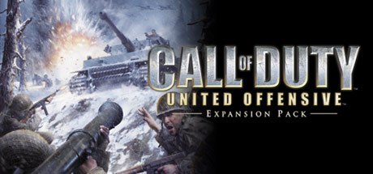

**Platforms:** Windows &nbsp;|&nbsp; **Genre:** Action &nbsp;|&nbsp; **Released:** September 14

> Award-winning developer Gray Matter Interactive follows up on the success of Infinity Ward's Call of Duty™ - winner of over 80 Game of the Year and 50 Editors' Choice awards worldwide - with Call of Duty™: United Offensive™.
>
> _Synopsis source: Steam_

[Steam](https://store.steampowered.com/app/2640)

---

### Castle Strike

**Platforms:** Windows &nbsp;|&nbsp; **Developer:** Related Designs &nbsp;|&nbsp; **Publisher:** Data Becker, Witt Interactive Studios &nbsp;|&nbsp; **Genre:** Strategy &nbsp;|&nbsp; **Released:** January 7, 2004

[Wikipedia](https://en.wikipedia.org/wiki/Castle_Strike)

---

### Cat Girl Alliance

**Platforms:** Windows &nbsp;|&nbsp; **Developer:** Sekilala &nbsp;|&nbsp; **Publisher:** CD Bros., G-Collections &nbsp;|&nbsp; **Genre:** Visual novel &nbsp;|&nbsp; **Released:** February 2, 2004

[Wikipedia](https://en.wikipedia.org/wiki/Cat_Girl_Alliance)

---

### Catwoman

**Platforms:** Windows, GameCube, PlayStation 2, Xbox, Game Boy Advance &nbsp;|&nbsp; **Released:** July 20

[Wikipedia](https://en.wikipedia.org/wiki/Catwoman_(video_game))

---

### Cave Story

**Platforms:** Windows &nbsp;|&nbsp; **Genre:** Action, Adventure, Indie &nbsp;|&nbsp; **Released:** December 20

> Run, jump, shoot, fly and explore your way through a massive action-adventure reminiscent of classic 8- and 16-bit games.
>
> _Synopsis source: Steam_

[Wikipedia](https://en.wikipedia.org/wiki/Cave_Story) · [Steam](https://store.steampowered.com/app/200900)

---

### Chaos League

**Platforms:** Windows &nbsp;|&nbsp; **Developer:** Cyanide &nbsp;|&nbsp; **Publisher:** Focus Home Interactive, Digital Jesters, Cyanide &nbsp;|&nbsp; **Genre:** Sports, management, real-time strategy &nbsp;|&nbsp; **Released:** June 25, 2004

[Wikipedia](https://en.wikipedia.org/wiki/Chaos_League)

---

### Chessmaster 10th Edition

**Platforms:** Windows, Xbox &nbsp;|&nbsp; **Developer:** Ubisoft Bucharest &nbsp;|&nbsp; **Publisher:** Ubisoft &nbsp;|&nbsp; **Genre:** Computer chess &nbsp;|&nbsp; **Released:** August 10, 2004

[Wikipedia](https://en.wikipedia.org/wiki/Chessmaster_10th_Edition)

---

### Chinese Paladin 3 Gaiden: Wenqing Pian

**Platforms:** Windows &nbsp;|&nbsp; **Developer:** Softstar Technology Co., Ltd. &nbsp;|&nbsp; **Publisher:** Softstar Entertainment Inc. &nbsp;|&nbsp; **Genre:** Role-playing &nbsp;|&nbsp; **Released:** August 6, 2004

[Wikipedia](https://en.wikipedia.org/wiki/Chinese_Paladin_3_Gaiden:_Wenqing_Pian)

---

### Chris Sawyer's Locomotion

**Platforms:** Windows &nbsp;|&nbsp; **Publisher:** Atari Interactive &nbsp;|&nbsp; **Genre:** Business simulation &nbsp;|&nbsp; **Released:** September 2004

[Wikipedia](https://en.wikipedia.org/wiki/Chris_Sawyer's_Locomotion)

---

### City of Heroes

**Platforms:** Windows, macOS &nbsp;|&nbsp; **Released:** April 28

[Wikipedia](https://en.wikipedia.org/wiki/City_of_Heroes)

---

### Clannad

**Platforms:** Windows &nbsp;|&nbsp; **Developer:** Key &nbsp;|&nbsp; **Publisher:** Visual Arts, Interchannel, Prototype, Sekai Project &nbsp;|&nbsp; **Genre:** Visual novel &nbsp;|&nbsp; **Released:** April 28, 2004

[Wikipedia](https://en.wikipedia.org/wiki/Clannad_(video_game))

---

### Close Combat: Marines

**Platforms:** Windows &nbsp;|&nbsp; **Developer:** Atomic Games &nbsp;|&nbsp; **Genre:** Real-time tactics &nbsp;|&nbsp; **Released:** September 2004

[Wikipedia](https://en.wikipedia.org/wiki/Close_Combat:_Marines)

---

### Codename: Panzers – Phase One

**Platforms:** Windows &nbsp;|&nbsp; **Developer:** StormRegion &nbsp;|&nbsp; **Publisher:** cdv Software Entertainment &nbsp;|&nbsp; **Genre:** Real-time tactics &nbsp;|&nbsp; **Released:** June 16, 2004

[Wikipedia](https://en.wikipedia.org/wiki/Codename:_Panzers_%E2%80%93_Phase_One)

---

### Colin McRae Rally 04

**Platforms:** Windows &nbsp;|&nbsp; **Released:** March 4

[Wikipedia](https://en.wikipedia.org/wiki/Colin_McRae_Rally_04)

---

### Colin McRae Rally 2005

**Platforms:** PlayStation 2, Windows, Xbox, N-Gage, Mobile phone &nbsp;|&nbsp; **Developer:** Codemasters &nbsp;|&nbsp; **Publisher:** Codemasters, Nokia, Feral Interactive &nbsp;|&nbsp; **Genre:** Racing &nbsp;|&nbsp; **Released:** September 24, 2004

[Wikipedia](https://en.wikipedia.org/wiki/Colin_McRae_Rally_2005)

---

### Combat Wings

**Platforms:** Windows, Xbox 360 &nbsp;|&nbsp; **Developer:** City Interactive Games &nbsp;|&nbsp; **Publisher:** City Interactive Games &nbsp;|&nbsp; **Genre:** Combat flight simulation

[Wikipedia](https://en.wikipedia.org/wiki/Combat_Wings)

---

### Conan

**Platforms:** Windows, Xbox, GameCube, PlayStation 2 &nbsp;|&nbsp; **Developer:** Cauldron &nbsp;|&nbsp; **Publisher:** TDK Mediactive Europe &nbsp;|&nbsp; **Genre:** Action-adventure, hack and slash &nbsp;|&nbsp; **Released:** April 7, 2004

[Wikipedia](https://en.wikipedia.org/wiki/Conan_(2004_video_game))

---

### Conflict: Vietnam

**Platforms:** Windows, PlayStation 2, Xbox &nbsp;|&nbsp; **Released:** October 5

---

### Cops 2170: The Power of Law (RU)

**Platforms:** Windows &nbsp;|&nbsp; **Released:** February

---

### Counter-Strike: Condition Zero

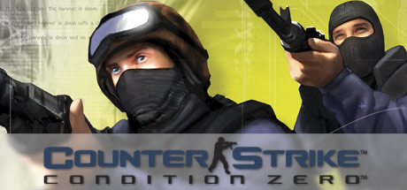

**Platforms:** Windows &nbsp;|&nbsp; **Genre:** Action &nbsp;|&nbsp; **Released:** March 23

> With its extensive Tour of Duty campaign, a near-limitless number of skirmish modes, updates and new content for Counter-Strike's award-winning multiplayer game play, plus over 12 bonus single player missions, Counter-Strike: Condition Zero is a tremendous offering of single and multiplayer content.
>
> _Synopsis source: Steam_

[Steam](https://store.steampowered.com/app/80)

---

### Counter-Strike: Source

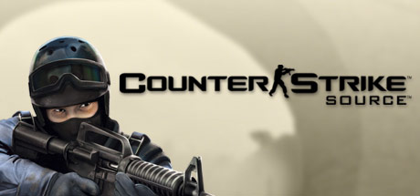

**Platforms:** Windows &nbsp;|&nbsp; **Publisher:** Valve &nbsp;|&nbsp; **Genre:** Action &nbsp;|&nbsp; **Released:** November 1, 2004

> Counter-Strike: Source blends Counter-Strike's award-winning teamplay action with the advanced technology of Source™ technology.
>
> _Synopsis source: Steam_

[Steam](https://store.steampowered.com/app/240)

---

### Crazyracing KartRider

**Platforms:** Windows &nbsp;|&nbsp; **Developer:** Lodumani Studio, Nexon, Nitro Studio &nbsp;|&nbsp; **Publisher:** Nexon, Tiancity, Gamania &nbsp;|&nbsp; **Genre:** Kart racing &nbsp;|&nbsp; **Released:** June 1, 2004

[Wikipedia](https://en.wikipedia.org/wiki/Crazyracing_KartRider)

---

### Crusader Kings

**Platforms:** Windows &nbsp;|&nbsp; **Developer:** Paradox Development Studio &nbsp;|&nbsp; **Publisher:** PAN Vision AB, Koch Media, Paradox Interactive &nbsp;|&nbsp; **Genre:** Grand strategy &nbsp;|&nbsp; **Released:** April 23, 2004

[Wikipedia](https://en.wikipedia.org/wiki/Crusader_Kings)

---

### Crystal Key 2

**Platforms:** Windows &nbsp;|&nbsp; **Developer:** Earthlight Productions, Kheops Studio &nbsp;|&nbsp; **Publisher:** The Adventure Company &nbsp;|&nbsp; **Genre:** Graphic adventure &nbsp;|&nbsp; **Released:** March 17, 2004

[Wikipedia](https://en.wikipedia.org/wiki/Crystal_Key_2)

---

### CSI: Dark Motives

**Platforms:** Windows &nbsp;|&nbsp; **Developer:** Radical Entertainment, Powerhead Games &nbsp;|&nbsp; **Publisher:** Ubisoft &nbsp;|&nbsp; **Genre:** Adventure &nbsp;|&nbsp; **Released:** March 23, 2004

[Wikipedia](https://en.wikipedia.org/wiki/CSI:_Dark_Motives)

---

### CSI: Miami

**Platforms:** Windows, Mobile phone &nbsp;|&nbsp; **Developer:** Radical Entertainment, Gameloft &nbsp;|&nbsp; **Publisher:** Ubisoft, Gameloft &nbsp;|&nbsp; **Genre:** Adventure &nbsp;|&nbsp; **Released:** November 16, 2004

[Wikipedia](https://en.wikipedia.org/wiki/CSI:_Miami_(video_game))

---

### Cube 2: Sauerbraten

**Platforms:** Windows, Linux, macOS &nbsp;|&nbsp; **Developer:** Wouter van Oortmerssen, Lee Salzman, Mike Dysart &nbsp;|&nbsp; **Genre:** First-person shooter &nbsp;|&nbsp; **Released:** May 6, 2004

[Wikipedia](https://en.wikipedia.org/wiki/Cube_2:_Sauerbraten)

---

### Cubis 2

**Platforms:** Windows, Mobile phone &nbsp;|&nbsp; **Developer:** FreshGames &nbsp;|&nbsp; **Publisher:** FreshGames &nbsp;|&nbsp; **Genre:** Puzzle, Strategy &nbsp;|&nbsp; **Released:** November 12, 2004

[Wikipedia](https://en.wikipedia.org/wiki/Cubis_2)

---

### CyberCIEGE

**Platforms:** Windows &nbsp;|&nbsp; **Developer:** Naval Postgraduate School and Rivermind, Inc. &nbsp;|&nbsp; **Publisher:** Naval Postgraduate School and Rivermind &nbsp;|&nbsp; **Genre:** Construction and management sim

[Wikipedia](https://en.wikipedia.org/wiki/CyberCIEGE)

---

### D-Day

**Platforms:** Windows &nbsp;|&nbsp; **Developer:** Digital Reality &nbsp;|&nbsp; **Publisher:** O3 Entertainment &nbsp;|&nbsp; **Genre:** Real-time tactics

[Wikipedia](https://en.wikipedia.org/wiki/D-Day_(2004_video_game))

---

### Dark Fall II: Lights Out

**Platforms:** Windows &nbsp;|&nbsp; **Developer:** XXv Productions &nbsp;|&nbsp; **Publisher:** Darkling Room, Iceberg Interactive &nbsp;|&nbsp; **Genre:** First-person adventure, psychological horror &nbsp;|&nbsp; **Released:** August 26, 2004

[Wikipedia](https://en.wikipedia.org/wiki/Dark_Fall_II:_Lights_Out)

---

### Dead Man's Hand

**Platforms:** Xbox, Windows &nbsp;|&nbsp; **Developer:** Human Head Studios &nbsp;|&nbsp; **Publisher:** Atari &nbsp;|&nbsp; **Genre:** First-person shooter &nbsp;|&nbsp; **Released:** March 2, 2004

[Wikipedia](https://en.wikipedia.org/wiki/Dead_Man's_Hand_(video_game))

---

### Decisive Battles of WWII: Battles in Normandy

**Platforms:** Windows &nbsp;|&nbsp; **Developer:** Strategic Studies Group &nbsp;|&nbsp; **Publisher:** Matrix Games &nbsp;|&nbsp; **Genre:** Computer wargame &nbsp;|&nbsp; **Released:** September 15, 2004

[Wikipedia](https://en.wikipedia.org/wiki/Decisive_Battles_of_WWII:_Battles_in_Normandy)

---

### Delta Force: Black Hawk Down – Team Sabre

**Platforms:** Windows, PlayStation 2 &nbsp;|&nbsp; **Released:** January 20

---

### Desert Rats vs. Afrika Korps

**Platforms:** Windows &nbsp;|&nbsp; **Developer:** Digital Reality &nbsp;|&nbsp; **Publisher:** Encore Software, Monte Cristo, Atari Interactive &nbsp;|&nbsp; **Genre:** Real-time tactics &nbsp;|&nbsp; **Released:** March 30, 2004

[Wikipedia](https://en.wikipedia.org/wiki/Desert_Rats_vs._Afrika_Korps)

---

### Dofus

**Platforms:** Browser, Windows, macOS, Linux &nbsp;|&nbsp; **Developer:** Ankama Games &nbsp;|&nbsp; **Genre:** Massively multiplayer online role-playing game &nbsp;|&nbsp; **Released:** September 2004

[Wikipedia](https://en.wikipedia.org/wiki/Dofus)

---

### Domino Master

**Platforms:** Windows &nbsp;|&nbsp; **Developer:** TikGames &nbsp;|&nbsp; **Publisher:** : TikGames, Real, : Microsoft Game Studios &nbsp;|&nbsp; **Genre:** Casual game

[Wikipedia](https://en.wikipedia.org/wiki/Domino_Master)

---

### Doom 3

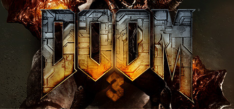

**Platforms:** Windows &nbsp;|&nbsp; **Genre:** Action &nbsp;|&nbsp; **Released:** August 3

> A demonic invasion has overwhelmed the Union Aerospace Corporation's Mars research facility. As one of only a few survivors, you must fight your way to hell and back against a horde of demons in this award-winning horror/action FPS and reimagining of the original DOOM.
>
> _Synopsis source: Steam_

[Wikipedia](https://en.wikipedia.org/wiki/Doom_3) · [Steam](https://store.steampowered.com/app/208200)

---

### Echelon: Wind Warriors

**Platforms:** Windows &nbsp;|&nbsp; **Developer:** Encore Software &nbsp;|&nbsp; **Publisher:** Buka Entertainment

[Wikipedia](https://en.wikipedia.org/wiki/Echelon:_Wind_Warriors)

---

### Egypt III

**Platforms:** Windows &nbsp;|&nbsp; **Developer:** Kheops Studio &nbsp;|&nbsp; **Publisher:** The Adventure Company &nbsp;|&nbsp; **Genre:** Adventure &nbsp;|&nbsp; **Released:** March 30, 2004

[Wikipedia](https://en.wikipedia.org/wiki/Egypt_III)

---

### Escape from Woomera

**Platforms:** Windows &nbsp;|&nbsp; **Genre:** Adventure &nbsp;|&nbsp; **Released:** May 7, 2004

[Wikipedia](https://en.wikipedia.org/wiki/Escape_from_Woomera)

---

### EVE Online: Exodus

**Platforms:** Windows &nbsp;|&nbsp; **Publisher:** CCP Games &nbsp;|&nbsp; **Released:** November 17, 2004

[Wikipedia](https://en.wikipedia.org/wiki/Expansions_of_Eve_Online#Exodus)

---

### EverQuest II

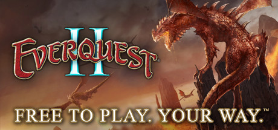

**Platforms:** Windows &nbsp;|&nbsp; **Genre:** Massively Multiplayer, RPG, Free To Play &nbsp;|&nbsp; **Released:** November 8

> EverQuest® II is a deep fantasy MMORPG with over two decades of content, a thriving world, and ongoing expansions that keep Norrath growing. Create your hero and adventure through a massively rich, ever-evolving universe.
>
> _Synopsis source: Steam_

[Wikipedia](https://en.wikipedia.org/wiki/EverQuest_II) · [Steam](https://store.steampowered.com/app/201230)

---

### EverQuest: Gates of Discord

**Platforms:** Windows &nbsp;|&nbsp; **Released:** February 9

[Wikipedia](https://en.wikipedia.org/wiki/Gates_of_Discord)

---

### EverQuest: Omens of War

**Platforms:** Windows &nbsp;|&nbsp; **Released:** September 13

[Wikipedia](https://en.wikipedia.org/wiki/Omens_of_War)

---

### Evil Genius

**Platforms:** Windows &nbsp;|&nbsp; **Developer:** Elixir Studios &nbsp;|&nbsp; **Publisher:** Sierra Entertainment &nbsp;|&nbsp; **Genre:** Real-time strategy, simulation &nbsp;|&nbsp; **Released:** September 28, 2004

[Wikipedia](https://en.wikipedia.org/wiki/Evil_Genius_(video_game))

---

### Far Cry

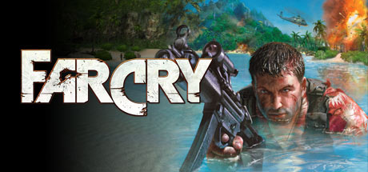

**Platforms:** Windows &nbsp;|&nbsp; **Publisher:** Ubisoft &nbsp;|&nbsp; **Genre:** Action &nbsp;|&nbsp; **Released:** March 23, 2004

> A tropical paradise seethes with hidden evil in Far Cry®, a cunningly detailed action shooter that pushes the boundaries of combat to shocking new levels. Freelance mariner Jack Carver is cursing the day he ever came to this island.
>
> _Synopsis source: Steam_

[Wikipedia](https://en.wikipedia.org/wiki/Far_Cry_(video_game)) · [Steam](https://store.steampowered.com/app/13520)

---

### Fate/Stay Night

**Platforms:** Windows &nbsp;|&nbsp; **Developer:** Type-Moon &nbsp;|&nbsp; **Publisher:** Type-Moon, Kadokawa Shoten, Aniplex &nbsp;|&nbsp; **Genre:** Visual novel &nbsp;|&nbsp; **Released:** January 30, 2004

[Wikipedia](https://en.wikipedia.org/wiki/Fate/Stay_Night)

---

### Feeding Frenzy

**Platforms:** Windows &nbsp;|&nbsp; **Released:** February 11

[Wikipedia](https://en.wikipedia.org/wiki/Feeding_Frenzy_(video_game))

---

### FIFA Football 2005

**Platforms:** Windows, GameCube, PlayStation, PlayStation 2, Game Boy Advance, PlayStation Portable &nbsp;|&nbsp; **Released:** October 14

[Wikipedia](https://en.wikipedia.org/wiki/FIFA_Football_2005)

---

### Final Fantasy XI: Chains of Promathia

**Platforms:** Windows, PlayStation 2 &nbsp;|&nbsp; **Released:** September 21

[Wikipedia](https://en.wikipedia.org/wiki/Final_Fantasy_XI)

---

### FirePower for Microsoft Combat Flight Simulator 3

**Platforms:** Windows &nbsp;|&nbsp; **Publisher:** Microsoft Game Studios &nbsp;|&nbsp; **Released:** June 11, 2004

---

### FlatOut

**Platforms:** Windows, Xbox &nbsp;|&nbsp; **Released:** November 5 (EU)

[Wikipedia](https://en.wikipedia.org/wiki/FlatOut_(video_game))

---

### Flyff

**Platforms:** Windows, Browser &nbsp;|&nbsp; **Developer:** Gala Lab Corp. &nbsp;|&nbsp; **Publisher:** Gala Lab Corp., Gala Japan Inc., Macrowell Technologies Co., Ltd., Mail.Ru Games &nbsp;|&nbsp; **Genre:** Fantasy MMORPG &nbsp;|&nbsp; **Released:** August 16, 2004

[Wikipedia](https://en.wikipedia.org/wiki/Flyff)

---

### Football Manager 2005

**Platforms:** Windows &nbsp;|&nbsp; **Publisher:** Sega &nbsp;|&nbsp; **Released:** November 5, 2004

[Wikipedia](https://en.wikipedia.org/wiki/Football_Manager_2005)

---

### Ford Racing 3

**Platforms:** Windows, PlayStation 2, Xbox &nbsp;|&nbsp; **Developer:** Razorworks, Visual Impact &nbsp;|&nbsp; **Publisher:** 2K Games, Empire Interactive, ZOO Digital &nbsp;|&nbsp; **Genre:** Racing &nbsp;|&nbsp; **Released:** October 29, 2004

[Wikipedia](https://en.wikipedia.org/wiki/Ford_Racing_3)

---

### Forever Worlds

**Platforms:** Windows &nbsp;|&nbsp; **Developer:** Hexagon Entertainment &nbsp;|&nbsp; **Publisher:** The Adventure Company &nbsp;|&nbsp; **Genre:** Adventure &nbsp;|&nbsp; **Released:** April 5, 2004

[Wikipedia](https://en.wikipedia.org/wiki/Forever_Worlds)

---

### FreeStyle Street Basketball

**Platforms:** Windows &nbsp;|&nbsp; **Developer:** JCEntertainment &nbsp;|&nbsp; **Publisher:** JCEntertainment &nbsp;|&nbsp; **Genre:** Massively multiplayer, sports

[Wikipedia](https://en.wikipedia.org/wiki/FreeStyle_Street_Basketball)

---

### Full Spectrum Warrior

**Platforms:** Xbox, Windows &nbsp;|&nbsp; **Developer:** Pandemic Studios &nbsp;|&nbsp; **Publisher:** THQ &nbsp;|&nbsp; **Genre:** Real-time tactics &nbsp;|&nbsp; **Released:** June 1, 2004

[Wikipedia](https://en.wikipedia.org/wiki/Full_Spectrum_Warrior)

---

### Gadget & the Gadgetinis

**Platforms:** PlayStation 2, Windows &nbsp;|&nbsp; **Developer:** Eko Software &nbsp;|&nbsp; **Publisher:** Hip Games &nbsp;|&nbsp; **Genre:** Action-adventure, beat 'em up, platform &nbsp;|&nbsp; **Released:** November 5, 2004

[Wikipedia](https://en.wikipedia.org/wiki/Gadget_&_the_Gadgetinis_(video_game))

---

### Gangland

**Platforms:** Windows &nbsp;|&nbsp; **Developer:** MediaMobsters &nbsp;|&nbsp; **Publisher:** Whiptail Interactive &nbsp;|&nbsp; **Genre:** Real-time strategy, simulation, role-playing video game &nbsp;|&nbsp; **Released:** February 27, 2004

[Wikipedia](https://en.wikipedia.org/wiki/Gangland_(video_game))

---

### Garfield

**Platforms:** PlayStation 2, Windows &nbsp;|&nbsp; **Developer:** The Code Monkeys &nbsp;|&nbsp; **Publisher:** Hip Games &nbsp;|&nbsp; **Released:** November 19, 2004

[Wikipedia](https://en.wikipedia.org/wiki/Garfield_(video_game))

---

### Garry's Mod

**Platforms:** Windows &nbsp;|&nbsp; **Genre:** Casual, Indie, Simulation &nbsp;|&nbsp; **Released:** December 24

> Garry's Mod is a physics sandbox. There aren't any predefined aims or goals. We give you the tools and leave you to play.
>
> _Synopsis source: Steam_

[Wikipedia](https://en.wikipedia.org/wiki/Garry%27s_Mod) · [Steam](https://store.steampowered.com/app/4000)

---

### Gish

**Platforms:** Windows, Linux, macOS &nbsp;|&nbsp; **Developer:** Chronic Logic &nbsp;|&nbsp; **Publisher:** Chronic Logic &nbsp;|&nbsp; **Genre:** Platform &nbsp;|&nbsp; **Released:** May 4, 2004

[Wikipedia](https://en.wikipedia.org/wiki/Gish_(video_game))

---

### GL-117

**Platforms:** macOS, Windows, Linux &nbsp;|&nbsp; **Developer:** Thomas Drexl, Jean-Marc Le Peuvedic, Eugene Andreeschev, Eric Cheung &nbsp;|&nbsp; **Genre:** Combat flight simulator

[Wikipedia](https://en.wikipedia.org/wiki/GL-117)

---

### Glest

**Platforms:** Windows, Linux &nbsp;|&nbsp; **Developer:** Glest Team &nbsp;|&nbsp; **Genre:** Real-time strategy &nbsp;|&nbsp; **Released:** December 25, 2004

[Wikipedia](https://en.wikipedia.org/wiki/Glest)

---

### Gotcha! Extreme Paintball

**Platforms:** Windows, Xbox &nbsp;|&nbsp; **Developer:** Sixteen Tons Entertainment &nbsp;|&nbsp; **Publisher:** Gathering, Viva Media &nbsp;|&nbsp; **Genre:** First-person shooter, sports &nbsp;|&nbsp; **Released:** July 30, 2004

[Wikipedia](https://en.wikipedia.org/wiki/Gotcha!_Extreme_Paintball)

---

### Ground Control II: Operation Exodus

**Platforms:** Windows &nbsp;|&nbsp; **Developer:** Massive Entertainment &nbsp;|&nbsp; **Publisher:** Vivendi Universal Games &nbsp;|&nbsp; **Genre:** Real-time tactics &nbsp;|&nbsp; **Released:** June 23, 2004

[Wikipedia](https://en.wikipedia.org/wiki/Ground_Control_II:_Operation_Exodus)

---

### GT Racers

**Platforms:** PlayStation 2, Windows, Game Boy Advance &nbsp;|&nbsp; **Developer:** Aqua Pacific &nbsp;|&nbsp; **Publisher:** Oxygen Interactive, GBA: Liquid Games &nbsp;|&nbsp; **Genre:** Racing

[Wikipedia](https://en.wikipedia.org/wiki/GT_Racers)

---

### Gurumin

**Platforms:** Windows &nbsp;|&nbsp; **Developer:** Nihon Falcom &nbsp;|&nbsp; **Publisher:** Nihon Falcom, Mastiff, 505 Game Street, Flyhigh Works &nbsp;|&nbsp; **Genre:** Action role-playing, Platform &nbsp;|&nbsp; **Released:** December 25, 2004

[Wikipedia](https://en.wikipedia.org/wiki/Gurumin)

---

### Half-Life 2

**Platforms:** Windows &nbsp;|&nbsp; **Publisher:** Valve &nbsp;|&nbsp; **Genre:** Action &nbsp;|&nbsp; **Released:** November 16, 2004

> Reawakened from stasis in the occupied metropolis of City 17, Gordon Freeman is joined by Alyx Vance as he leads a desperate human resistance. Experience the landmark first-person shooter packed with immersive world-building, boundary-pushing physics, and exhilarating combat.
>
> _Synopsis source: Steam_

[Wikipedia](https://en.wikipedia.org/wiki/Half-Life_2) · [Steam](https://store.steampowered.com/app/220)

---

### Half-Life 2: Deathmatch

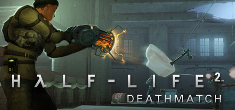

**Platforms:** Windows &nbsp;|&nbsp; **Genre:** Action &nbsp;|&nbsp; **Released:** November 30

> Fast multiplayer action set in the Half-Life 2 universe! HL2's physics adds a new dimension to deathmatch play. Play straight deathmatch or try Combine vs. Resistance teamplay. Toss a toilet at your friend today!
>
> _Synopsis source: Steam_

[Steam](https://store.steampowered.com/app/320)

---

### Half-Life: Source

**Platforms:** Windows &nbsp;|&nbsp; **Released:** June 1

---

### Hamsterball

**Platforms:** Windows &nbsp;|&nbsp; **Developer:** TikGames LLC, Raptisoft &nbsp;|&nbsp; **Publisher:** GameHouse &nbsp;|&nbsp; **Genre:** Racing, puzzle, action &nbsp;|&nbsp; **Released:** February 8, 2004

[Wikipedia](https://en.wikipedia.org/wiki/Hamsterball)

---

### Harry Potter and the Prisoner of Azkaban

**Platforms:** Windows, PlayStation 2, Xbox, GameCube, Game Boy Advance &nbsp;|&nbsp; **Released:** May 25

[Wikipedia](https://en.wikipedia.org/wiki/Harry_Potter_and_the_Prisoner_of_Azkaban_(video_game))

---

### Haru no Ashioto

**Platforms:** Windows &nbsp;|&nbsp; **Developer:** Minori, HuneX &nbsp;|&nbsp; **Publisher:** Minori, Alchemist &nbsp;|&nbsp; **Genre:** Eroge, Visual novel &nbsp;|&nbsp; **Released:** July 23, 2004

[Wikipedia](https://en.wikipedia.org/wiki/Haru_no_Ashioto)

---

### Hitman: Contracts

**Platforms:** Windows, PlayStation 2, Xbox &nbsp;|&nbsp; **Genre:** Action &nbsp;|&nbsp; **Released:** April 20

> Enter the world of a HITMAN - a world of crime, sin and greed. Delve into the mind of Agent 47 and encounter his greatest adversaries, completing the work that made him so brutally efficient and shaped him as an assassin. Eliminate your targets by any means necessary. There are no rules... only the contract, signed in blood.
>
> _Synopsis source: Steam_

[Steam](https://store.steampowered.com/app/247430)

---

### Hugo: Cannon Cruise

**Platforms:** PlayStation 2, Windows, Mobile phone &nbsp;|&nbsp; **Developer:** ITE Media &nbsp;|&nbsp; **Publisher:** ITE Media, Kiloo &nbsp;|&nbsp; **Genre:** Platform game

[Wikipedia](https://en.wikipedia.org/wiki/Hugo:_Cannon_Cruise)

---

### IHRA Professional Drag Racing 2005

**Platforms:** PlayStation 2, Windows, Xbox &nbsp;|&nbsp; **Developer:** Bethesda Game Studios &nbsp;|&nbsp; **Publisher:** Bethesda Softworks &nbsp;|&nbsp; **Genre:** Racing &nbsp;|&nbsp; **Released:** November 10, 2004

[Wikipedia](https://en.wikipedia.org/wiki/IHRA_Professional_Drag_Racing_2005)

---

### Immaterial and Missing Power

**Platforms:** Windows &nbsp;|&nbsp; **Developer:** Twilight Frontier, Team Shanghai Alice &nbsp;|&nbsp; **Publisher:** Twilight Frontier, Team Shanghai Alice &nbsp;|&nbsp; **Genre:** Fighting game &nbsp;|&nbsp; **Released:** December 30, 2004

[Wikipedia](https://en.wikipedia.org/wiki/Immaterial_and_Missing_Power)

---

### Immortal Cities: Children of the Nile

**Platforms:** Windows &nbsp;|&nbsp; **Developer:** Tilted Mill Entertainment &nbsp;|&nbsp; **Publisher:** Myelin Media, Sega &nbsp;|&nbsp; **Genre:** City building &nbsp;|&nbsp; **Released:** November 9, 2004

[Wikipedia](https://en.wikipedia.org/wiki/Immortal_Cities:_Children_of_the_Nile)

---

### Imperishable Night

**Platforms:** Windows &nbsp;|&nbsp; **Developer:** Team Shanghai Alice &nbsp;|&nbsp; **Publisher:** Team Shanghai Alice &nbsp;|&nbsp; **Genre:** Bullet hell &nbsp;|&nbsp; **Released:** August 15, 2004

[Wikipedia](https://en.wikipedia.org/wiki/Imperishable_Night)

---

### Imperivm: Great Battles of Rome

**Platforms:** Windows &nbsp;|&nbsp; **Developer:** Haemimont Games &nbsp;|&nbsp; **Publisher:** FX Interactive &nbsp;|&nbsp; **Genre:** Real-time strategy, real-time tactics &nbsp;|&nbsp; **Released:** December 21, 2004

[Wikipedia](https://en.wikipedia.org/wiki/Imperivm:_Great_Battles_of_Rome)

---

### In the Groove

**Platforms:** Arcade, macOS, PlayStation 2, Windows &nbsp;|&nbsp; **Developer:** Roxor Games &nbsp;|&nbsp; **Publisher:** Roxor Games, RedOctane &nbsp;|&nbsp; **Genre:** Music, Exercise &nbsp;|&nbsp; **Released:** August 30, 2004

[Wikipedia](https://en.wikipedia.org/wiki/In_the_Groove_(video_game))

---

### InkBall

**Platforms:** Windows &nbsp;|&nbsp; **Developer:** Microsoft &nbsp;|&nbsp; **Publisher:** Microsoft &nbsp;|&nbsp; **Genre:** Puzzle

[Wikipedia](https://en.wikipedia.org/wiki/InkBall)

---

### Iron Warriors: T-72 Tank Commander

**Platforms:** Windows &nbsp;|&nbsp; **Developer:** Crazy House &nbsp;|&nbsp; **Publisher:** Battlefront.com, Strategy First &nbsp;|&nbsp; **Genre:** Vehicle simulation game &nbsp;|&nbsp; **Released:** September 2004

[Wikipedia](https://en.wikipedia.org/wiki/Iron_Warriors:_T-72_Tank_Commander)

---

### Jack the Ripper

**Platforms:** Windows &nbsp;|&nbsp; **Developer:** Galilea Games &nbsp;|&nbsp; **Publisher:** The Adventure Company, Microids &nbsp;|&nbsp; **Released:** January 29, 2004

[Wikipedia](https://en.wikipedia.org/wiki/Jack_the_Ripper_(2004_video_game))

---

### Jets'n'Guns

**Platforms:** Windows, macOS, Linux &nbsp;|&nbsp; **Developer:** Rake in Grass &nbsp;|&nbsp; **Publisher:** Rake in Grass, Reflexive Entertainment and Stardock, Soft-World, Linux Game Publishing &nbsp;|&nbsp; **Genre:** Scrolling shooter &nbsp;|&nbsp; **Released:** November 17, 2004

[Wikipedia](https://en.wikipedia.org/wiki/Jets'n'Guns)

---

### Jewel Quest

**Platforms:** Windows, macOS &nbsp;|&nbsp; **Developer:** iWin &nbsp;|&nbsp; **Publisher:** iWin &nbsp;|&nbsp; **Genre:** Puzzle &nbsp;|&nbsp; **Released:** October 29, 2004

[Wikipedia](https://en.wikipedia.org/wiki/Jewel_Quest)

---

### JFK Reloaded

**Platforms:** Windows &nbsp;|&nbsp; **Released:** November 22

[Wikipedia](https://en.wikipedia.org/wiki/JFK_Reloaded)

---

### John Deere: American Farmer

**Platforms:** Windows &nbsp;|&nbsp; **Developer:** Gabriel Entertainment &nbsp;|&nbsp; **Publisher:** Destineer &nbsp;|&nbsp; **Genre:** Construction and management simulation &nbsp;|&nbsp; **Released:** June 29, 2004

[Wikipedia](https://en.wikipedia.org/wiki/John_Deere:_American_Farmer)

---

### Joint Operations: Escalation

**Platforms:** Windows &nbsp;|&nbsp; **Released:** November 16

---

### Joint Operations: Typhoon Rising

**Platforms:** Windows &nbsp;|&nbsp; **Released:** June 15

---

### Knights of Honor

**Platforms:** Windows &nbsp;|&nbsp; **Developer:** Black Sea Studios &nbsp;|&nbsp; **Publisher:** Sunflowers Interactive, Paradox Interactive, Atari &nbsp;|&nbsp; **Genre:** Real-time strategy &nbsp;|&nbsp; **Released:** September 30, 2004

[Wikipedia](https://en.wikipedia.org/wiki/Knights_of_Honor_(video_game))

---

### Knights of the Temple: Infernal Crusade

**Platforms:** GameCube, Windows, Xbox, PlayStation 2 &nbsp;|&nbsp; **Developer:** Starbreeze Studios &nbsp;|&nbsp; **Publisher:** TDK Mediactive Europe &nbsp;|&nbsp; **Genre:** Action-adventure, hack and slash &nbsp;|&nbsp; **Released:** March 19, 2004

[Wikipedia](https://en.wikipedia.org/wiki/Knights_of_the_Temple:_Infernal_Crusade)

---

### Kohan II: Kings of War

**Platforms:** Windows &nbsp;|&nbsp; **Developer:** TimeGate Studios &nbsp;|&nbsp; **Publisher:** Take Two Interactive, Global Star Software &nbsp;|&nbsp; **Genre:** Real-time strategy &nbsp;|&nbsp; **Released:** September 17, 2004

[Wikipedia](https://en.wikipedia.org/wiki/Kohan_II:_Kings_of_War)

---

### Konung: Legend of the North

**Platforms:** Windows &nbsp;|&nbsp; **Developer:** 1C &nbsp;|&nbsp; **Publisher:** 1C, PAN Interactive, Strategy First &nbsp;|&nbsp; **Genre:** Role-playing video game

[Wikipedia](https://en.wikipedia.org/wiki/Konung:_Legend_of_the_North)

---

### Kult: Heretic Kingdoms

**Platforms:** Windows, macOS &nbsp;|&nbsp; **Genre:** Action, Adventure, Indie, RPG &nbsp;|&nbsp; **Released:** October 1

> Kult is prequel to Shadows: Heretic Kingdoms originally released in 2005. It is isometric RPG with action combat, engaging storyline and unique RPG system. Kult has been very positively acclaimed by players and called as a sleeper hit by many...
>
> _Synopsis source: Steam_

[Steam](https://store.steampowered.com/app/277650)

---

### Kuma\War

**Platforms:** Windows &nbsp;|&nbsp; **Developer:** Kuma Reality Games &nbsp;|&nbsp; **Publisher:** Kuma Reality Games &nbsp;|&nbsp; **Genre:** Shooter &nbsp;|&nbsp; **Released:** March 2004

[Wikipedia](https://en.wikipedia.org/wiki/Kuma%5CWar)

---

### Law & Order: Justice Is Served

**Platforms:** Windows &nbsp;|&nbsp; **Developer:** Legacy Interactive &nbsp;|&nbsp; **Publisher:** Legacy Interactive, Mindscape Inc. &nbsp;|&nbsp; **Genre:** Adventure &nbsp;|&nbsp; **Released:** October 5, 2004

[Wikipedia](https://en.wikipedia.org/wiki/Law_&_Order:_Justice_Is_Served)

---

### Legacy: Dark Shadows

**Platforms:** Windows &nbsp;|&nbsp; **Developer:** Razbor Studios &nbsp;|&nbsp; **Publisher:** GMX Media &nbsp;|&nbsp; **Genre:** Adventure &nbsp;|&nbsp; **Released:** November 29, 2004

[Wikipedia](https://en.wikipedia.org/wiki/Legacy:_Dark_Shadows)

---

### Leisure Suit Larry: Magna Cum Laude

**Platforms:** Windows, PlayStation 2, Xbox &nbsp;|&nbsp; **Released:** October 5

---

### Lemonade Tycoon 2

**Platforms:** Windows, macOS &nbsp;|&nbsp; **Developer:** Jamdat Mobile &nbsp;|&nbsp; **Publisher:** MumboJumbo &nbsp;|&nbsp; **Genre:** Business simulation game &nbsp;|&nbsp; **Released:** August 2004

[Wikipedia](https://en.wikipedia.org/wiki/Lemonade_Tycoon_2)

---

### Lemony Snicket's A Series of Unfortunate Events

**Platforms:** Windows, GameCube, PlayStation 2, Xbox, Game Boy Advance, Nintendo DS &nbsp;|&nbsp; **Released:** November 10

[Wikipedia](https://en.wikipedia.org/wiki/Lemony_Snicket%27s_A_Series_of_Unfortunate_Events_(video_game))

---

### Lords of the Realm III

**Platforms:** Windows &nbsp;|&nbsp; **Developer:** Impressions Games &nbsp;|&nbsp; **Publisher:** Sierra Entertainment &nbsp;|&nbsp; **Genre:** Real-time strategy &nbsp;|&nbsp; **Released:** March 16, 2004

[Wikipedia](https://en.wikipedia.org/wiki/Lords_of_the_Realm_III)

---

### Mabinogi

**Platforms:** Windows &nbsp;|&nbsp; **Developer:** devCAT &nbsp;|&nbsp; **Publisher:** Nexon Korea &nbsp;|&nbsp; **Genre:** Massively multiplayer online role-playing game &nbsp;|&nbsp; **Released:** June 22, 2004

[Wikipedia](https://en.wikipedia.org/wiki/Mabinogi_(video_game))

---

### Maestro

**Platforms:** Windows &nbsp;|&nbsp; **Developer:** Mike Oldfield &nbsp;|&nbsp; **Genre:** Simulation, Music game, Art game &nbsp;|&nbsp; **Released:** April 12, 2004

[Wikipedia](https://en.wikipedia.org/wiki/Maestro_(2004_video_game))

---

### Mall of America Tycoon

**Platforms:** Windows &nbsp;|&nbsp; **Developer:** 4HEAD Studios &nbsp;|&nbsp; **Publisher:** Activision &nbsp;|&nbsp; **Genre:** Business simulation game &nbsp;|&nbsp; **Released:** September 28, 2004

[Wikipedia](https://en.wikipedia.org/wiki/Mall_of_America_Tycoon)

---

### Manhunt

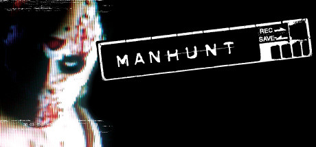

**Platforms:** Windows, Xbox &nbsp;|&nbsp; **Genre:** Action &nbsp;|&nbsp; **Released:** April 20

> You awake to the sound of your own panicked breath. In Manhunt, you must run, hide and fight to survive. If you can stay alive long enough, you may find out who did this to you. This is a brutal blood sport.
>
> _Synopsis source: Steam_

[Wikipedia](https://en.wikipedia.org/wiki/Manhunt_(video_game)) · [Steam](https://store.steampowered.com/app/12130)

---

### Martin Mystère: Operation Dorian Gray

**Platforms:** Windows &nbsp;|&nbsp; **Developer:** Artematica &nbsp;|&nbsp; **Publisher:** Leader S.p.a., GMX Media, The Adventure Company &nbsp;|&nbsp; **Genre:** Adventure game &nbsp;|&nbsp; **Released:** December 2004

[Wikipedia](https://en.wikipedia.org/wiki/Martin_Myst%C3%A8re:_Operation_Dorian_Gray)

---

### Mashed

**Platforms:** PlayStation 2, Xbox, Windows &nbsp;|&nbsp; **Developer:** Supersonic Software &nbsp;|&nbsp; **Publisher:** Empire Interactive, D3 Publisher, Vivendi Games &nbsp;|&nbsp; **Genre:** Vehicular combat, racing &nbsp;|&nbsp; **Released:** June 18, 2004

[Wikipedia](https://en.wikipedia.org/wiki/Mashed_(video_game))

---

### Medal of Honor: Pacific Assault

**Platforms:** Windows &nbsp;|&nbsp; **Released:** November 2

---

### Medieval Conquest

**Platforms:** Windows &nbsp;|&nbsp; **Developer:** Cat Daddy Games &nbsp;|&nbsp; **Publisher:** Global Star Software &nbsp;|&nbsp; **Genre:** Real-time strategy &nbsp;|&nbsp; **Released:** September 6, 2004

[Wikipedia](https://en.wikipedia.org/wiki/Medieval_Conquest)

---

### Medieval Lords: Build, Defend, Expand

**Platforms:** Windows &nbsp;|&nbsp; **Developer:** Monte Cristo Multimedia &nbsp;|&nbsp; **Publisher:** Monte Cristo Multimedia &nbsp;|&nbsp; **Genre:** Strategy &nbsp;|&nbsp; **Released:** October 29, 2004

[Wikipedia](https://en.wikipedia.org/wiki/Medieval_Lords:_Build,_Defend,_Expand)

---

### Men of Valor

**Platforms:** Xbox, Windows &nbsp;|&nbsp; **Developer:** 2015 &nbsp;|&nbsp; **Publisher:** Vivendi Universal Games &nbsp;|&nbsp; **Genre:** First-person shooter &nbsp;|&nbsp; **Released:** October 19, 2004

[Wikipedia](https://en.wikipedia.org/wiki/Men_of_Valor)

---

### Mob Enforcer

**Platforms:** Windows &nbsp;|&nbsp; **Developer:** Touchdown Entertainment &nbsp;|&nbsp; **Publisher:** ValuSoft, Kemco U.S.A. &nbsp;|&nbsp; **Genre:** First-person shooter &nbsp;|&nbsp; **Released:** June 11, 2004

[Wikipedia](https://en.wikipedia.org/wiki/Mob_Enforcer)

---

### Monster Garage

**Platforms:** Windows, Xbox &nbsp;|&nbsp; **Developer:** Invictus Games, Impulse Games &nbsp;|&nbsp; **Publisher:** Activision Value &nbsp;|&nbsp; **Genre:** Simulation &nbsp;|&nbsp; **Released:** January 21, 2004

[Wikipedia](https://en.wikipedia.org/wiki/Monster_Garage_(video_game))

---

### MTX Mototrax

**Platforms:** PlayStation 2, Xbox, Windows &nbsp;|&nbsp; **Released:** March 2

[Wikipedia](https://en.wikipedia.org/wiki/MTX_Mototrax)

---

### Mudcraft

**Platforms:** Windows &nbsp;|&nbsp; **Developer:** The LlamaPad &nbsp;|&nbsp; **Publisher:** The LlamaPad &nbsp;|&nbsp; **Genre:** Real-time strategy

[Wikipedia](https://en.wikipedia.org/wiki/Mudcraft)

---

### Myst IV: Revelation

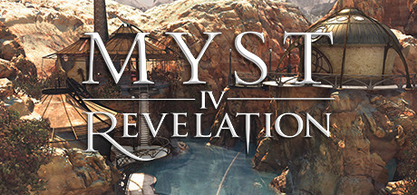

**Platforms:** Windows &nbsp;|&nbsp; **Genre:** Adventure, Casual &nbsp;|&nbsp; **Released:** September 28

> In Myst IV: Revelation, the next chapter in the greatest adventure saga of all time, you'll travel through environments pulsing with life to unearth a treacherous scheme involving two of Myst's most sinister villains.
>
> _Synopsis source: Steam_

[Steam](https://store.steampowered.com/app/925940)

---

### N

**Platforms:** Windows, Nintendo DS &nbsp;|&nbsp; **Released:** March 1

[Wikipedia](https://en.wikipedia.org/wiki/N_(video_game))

---

### Nancy Drew: Curse of Blackmoor Manor

**Platforms:** Windows &nbsp;|&nbsp; **Publisher:** DreamCatcher Interactive &nbsp;|&nbsp; **Genre:** Adventure &nbsp;|&nbsp; **Released:** October 5, 2004

> Delve into Dark Legends Lurking in the Shadow of an Old English Mansion!
>
> _Synopsis source: Steam_

[Steam](https://store.steampowered.com/app/31830)

---

### Nancy Drew: The Secret of Shadow Ranch

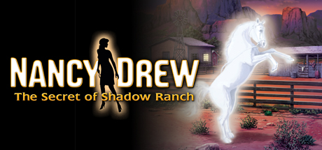

**Platforms:** Windows &nbsp;|&nbsp; **Genre:** Adventure &nbsp;|&nbsp; **Released:** August 30

> Take a Wild Ride into Terror and Trickery to Rein in a Ghostly Secret!
>
> _Synopsis source: Steam_

[Steam](https://store.steampowered.com/app/572740)

---

### Nanosaur 2: Hatchling

**Platforms:** macOS, Windows &nbsp;|&nbsp; **Developer:** Pangea Software &nbsp;|&nbsp; **Publisher:** Pangea Software &nbsp;|&nbsp; **Genre:** Third-person shooter

[Wikipedia](https://en.wikipedia.org/wiki/Nanosaur_2:_Hatchling)

---

### NBA Live 2005

**Platforms:** PlayStation 2, Xbox, GameCube, Windows &nbsp;|&nbsp; **Developer:** EA Canada &nbsp;|&nbsp; **Publisher:** Electronic Arts &nbsp;|&nbsp; **Genre:** Sports &nbsp;|&nbsp; **Released:** September 28, 2004

[Wikipedia](https://en.wikipedia.org/wiki/NBA_Live_2005)

---

### Need for Speed: Underground 2

**Platforms:** Windows, GameCube, PlayStation 2, Xbox, Game Boy Advance, Nintendo DS &nbsp;|&nbsp; **Released:** November 15

---

### Neighbours from Hell 2: On Vacation

**Platforms:** Windows &nbsp;|&nbsp; **Developer:** JoWooD Vienna &nbsp;|&nbsp; **Publisher:** JoWooD Productions, Cinemaware, THQ Nordic &nbsp;|&nbsp; **Genre:** Puzzle, strategy &nbsp;|&nbsp; **Released:** February 20, 2004

[Wikipedia](https://en.wikipedia.org/wiki/Neighbours_from_Hell_2:_On_Vacation)

---

### Neverwinter Nights: Kingmaker

**Platforms:** Windows &nbsp;|&nbsp; **Developer:** BioWare &nbsp;|&nbsp; **Publisher:** Atari Interactive &nbsp;|&nbsp; **Genre:** Role-playing &nbsp;|&nbsp; **Released:** November 10, 2004

[Wikipedia](https://en.wikipedia.org/wiki/Neverwinter_Nights:_Kingmaker)

---

### Nexus: The Jupiter Incident

**Platforms:** Windows &nbsp;|&nbsp; **Developer:** Mithis Entertainment &nbsp;|&nbsp; **Publisher:** HD Interactive, THQ Nordic &nbsp;|&nbsp; **Genre:** Real-time tactics, Space combat simulator &nbsp;|&nbsp; **Released:** November 5, 2004

[Wikipedia](https://en.wikipedia.org/wiki/Nexus:_The_Jupiter_Incident)

---

### NHL 2005

**Platforms:** Windows, PlayStation 2, GameCube, Xbox &nbsp;|&nbsp; **Developer:** EA Black Box &nbsp;|&nbsp; **Publisher:** EA Sports &nbsp;|&nbsp; **Genre:** Sports &nbsp;|&nbsp; **Released:** September 14, 2004

[Wikipedia](https://en.wikipedia.org/wiki/NHL_2005)

---

### NHL Eastside Hockey Manager

**Platforms:** Windows &nbsp;|&nbsp; **Developer:** Sports Interactive &nbsp;|&nbsp; **Publisher:** Sega &nbsp;|&nbsp; **Genre:** Sports, ice hockey &nbsp;|&nbsp; **Released:** September 2004

[Wikipedia](https://en.wikipedia.org/wiki/NHL_Eastside_Hockey_Manager)

---

### Ojamajo Adventure: Naisho no Mahō

**Platforms:** Windows &nbsp;|&nbsp; **Developer:** Amada Printing &nbsp;|&nbsp; **Genre:** Visual novel &nbsp;|&nbsp; **Released:** November 19, 2004

[Wikipedia](https://en.wikipedia.org/wiki/Ojamajo_Adventure:_Naisho_no_Mah%C5%8D)

---

### Oolite

**Platforms:** Windows, Linux, macOS &nbsp;|&nbsp; **Developer:** Giles Williams, Jens Ayton &nbsp;|&nbsp; **Publisher:** Giles Williams, Jens Ayton &nbsp;|&nbsp; **Genre:** Space trading and combat simulator &nbsp;|&nbsp; **Released:** July 2004

[Wikipedia](https://en.wikipedia.org/wiki/Oolite_(video_game))

---

### Out of the Park Baseball 6

**Platforms:** Windows &nbsp;|&nbsp; **Publisher:** Out of the Park Developments &nbsp;|&nbsp; **Released:** June 14, 2004

[Wikipedia](https://en.wikipedia.org/wiki/Out_of_the_Park_Baseball)

---

### Outdoor Life: Sportsman's Challenge

**Platforms:** Windows &nbsp;|&nbsp; **Developer:** Cat Daddy Games &nbsp;|&nbsp; **Publisher:** Take-Two Interactive &nbsp;|&nbsp; **Genre:** Business simulation game &nbsp;|&nbsp; **Released:** October 5, 2004

[Wikipedia](https://en.wikipedia.org/wiki/Outdoor_Life:_Sportsman's_Challenge)

---

### Outpost Kaloki

**Platforms:** Xbox 360, Windows &nbsp;|&nbsp; **Developer:** NinjaBee &nbsp;|&nbsp; **Publisher:** Microsoft Game Studios &nbsp;|&nbsp; **Genre:** City-building &nbsp;|&nbsp; **Released:** September 18, 2004

[Wikipedia](https://en.wikipedia.org/wiki/Outpost_Kaloki)

---

### Pacific Fighters

**Platforms:** Windows &nbsp;|&nbsp; **Developer:** 1C:Maddox Games &nbsp;|&nbsp; **Publisher:** 1C Company, Ubisoft &nbsp;|&nbsp; **Genre:** Combat flight simulation game &nbsp;|&nbsp; **Released:** October 21, 2004

[Wikipedia](https://en.wikipedia.org/wiki/Pacific_Fighters)

---

### Painkiller

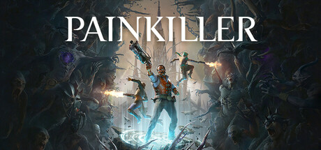

**Platforms:** Windows &nbsp;|&nbsp; **Genre:** Action &nbsp;|&nbsp; **Released:** April 12

> The classic Painkiller series is back! Battle through Purgatory in fast-paced co-op action, wielding infernal weapons against relentless demonic hordes. Condemned for your sins, the Voice of the Creator offers you a chance at redemption. Will you seize it or be lost to darkness?
>
> _Synopsis source: Steam_

[Wikipedia](https://en.wikipedia.org/wiki/Painkiller_(game)) · [Steam](https://store.steampowered.com/app/2300120)

---

### Painkiller: Battle out of Hell

**Platforms:** Windows &nbsp;|&nbsp; **Released:** December 1

[Wikipedia](https://en.wikipedia.org/wiki/Painkiller_(video_game)#Battle_Out_of_Hell)

---

### PangYa

**Platforms:** Windows &nbsp;|&nbsp; **Developer:** Ntreev Soft &nbsp;|&nbsp; **Publisher:** Smilegate Megaport, NHN Corp., Smilegate Europe &nbsp;|&nbsp; **Genre:** Golf, MMORPG &nbsp;|&nbsp; **Released:** June 2004

[Wikipedia](https://en.wikipedia.org/wiki/PangYa)

---

### Peace@Pieces

**Platforms:** Windows &nbsp;|&nbsp; **Developer:** Unisonshift &nbsp;|&nbsp; **Publisher:** Unisonshift &nbsp;|&nbsp; **Genre:** Eroge, Visual novel &nbsp;|&nbsp; **Released:** December 23, 2004

[Wikipedia](https://en.wikipedia.org/wiki/Peace@Pieces)

---

### Perimeter

**Platforms:** Windows &nbsp;|&nbsp; **Developer:** K-D Lab &nbsp;|&nbsp; **Publisher:** 1C Company, Codemasters &nbsp;|&nbsp; **Genre:** Real-time strategy &nbsp;|&nbsp; **Released:** May 21, 2004

[Wikipedia](https://en.wikipedia.org/wiki/Perimeter_(video_game))

---

### Pitfall: The Lost Expedition

**Platforms:** GameCube, PlayStation 2, Xbox, Game Boy Advance, Windows &nbsp;|&nbsp; **Developer:** Edge of Reality, Torus Games, Beenox &nbsp;|&nbsp; **Publisher:** Activision, Aspyr &nbsp;|&nbsp; **Genre:** Action, platform &nbsp;|&nbsp; **Released:** February 17, 2004

[Wikipedia](https://en.wikipedia.org/wiki/Pitfall:_The_Lost_Expedition)

---

### Planetarian: The Reverie of a Little Planet

**Platforms:** Windows &nbsp;|&nbsp; **Developer:** Key &nbsp;|&nbsp; **Publisher:** Visual Arts, KineticNovel, Prototype, Sekai Project &nbsp;|&nbsp; **Genre:** Visual novel &nbsp;|&nbsp; **Released:** November 29, 2004

[Wikipedia](https://en.wikipedia.org/wiki/Planetarian:_The_Reverie_of_a_Little_Planet)

---

### Polar Bowler

**Platforms:** Windows &nbsp;|&nbsp; **Developer:** WildTangent, Engine Software &nbsp;|&nbsp; **Publisher:** WildTangent, MumboJumbo &nbsp;|&nbsp; **Genre:** Sports &nbsp;|&nbsp; **Released:** August 3, 2004

[Wikipedia](https://en.wikipedia.org/wiki/Polar_Bowler)

---

### Polar Golfer

**Platforms:** Windows &nbsp;|&nbsp; **Developer:** WildTangent &nbsp;|&nbsp; **Publisher:** WildTangent &nbsp;|&nbsp; **Genre:** Sports &nbsp;|&nbsp; **Released:** September 1, 2004

[Wikipedia](https://en.wikipedia.org/wiki/Polar_Golfer)

---

### Pool Paradise

**Platforms:** Windows, PlayStation 2, GameCube &nbsp;|&nbsp; **Developer:** Awesome Studios &nbsp;|&nbsp; **Publisher:** Ignition Entertainment &nbsp;|&nbsp; **Genre:** Sports &nbsp;|&nbsp; **Released:** April 2, 2004

[Wikipedia](https://en.wikipedia.org/wiki/Pool_Paradise)

---

### Pool Shark 2

**Platforms:** PlayStation 2, Xbox, Windows &nbsp;|&nbsp; **Developer:** Blade Interactive &nbsp;|&nbsp; **Publisher:** Zoo Digital Publishing &nbsp;|&nbsp; **Genre:** Sports &nbsp;|&nbsp; **Released:** November 12, 2004

[Wikipedia](https://en.wikipedia.org/wiki/Pool_Shark_2)

---

### Port Royale 2

**Platforms:** Windows, Mobile phone &nbsp;|&nbsp; **Developer:** Ascaron Entertainment, Elkware &nbsp;|&nbsp; **Publisher:** Take-Two Interactive, Tri-Synergy, Capcom, Elkware &nbsp;|&nbsp; **Genre:** Business simulation game &nbsp;|&nbsp; **Released:** April 30, 2004

[Wikipedia](https://en.wikipedia.org/wiki/Port_Royale_2)

---

### Portugal 1111: A Conquista de Soure

**Platforms:** Windows &nbsp;|&nbsp; **Developer:** Ciberbit &nbsp;|&nbsp; **Publisher:** Visão &nbsp;|&nbsp; **Genre:** Real-time strategy &nbsp;|&nbsp; **Released:** April 22, 2004

[Wikipedia](https://en.wikipedia.org/wiki/Portugal_1111:_A_Conquista_de_Soure)

---

### Powerdrome

**Platforms:** Windows, PlayStation 2, Xbox &nbsp;|&nbsp; **Developer:** Argonaut Sheffield &nbsp;|&nbsp; **Publisher:** Mud Duck Productions, Evolved Games, Zoo Digital Publishing &nbsp;|&nbsp; **Genre:** Racing &nbsp;|&nbsp; **Released:** June 15, 2004

[Wikipedia](https://en.wikipedia.org/wiki/Powerdrome_(2004_video_game))

---

### Premier Manager 2004–2005

**Platforms:** Game Boy Advance, PlayStation 2, Windows &nbsp;|&nbsp; **Developer:** Zoo Digital Publishing &nbsp;|&nbsp; **Publisher:** Zoo Digital Publishing &nbsp;|&nbsp; **Genre:** Sports &nbsp;|&nbsp; **Released:** November 5, 2004

[Wikipedia](https://en.wikipedia.org/wiki/Premier_Manager_2004%E2%80%932005)

---

### Prince of Persia: Warrior Within

**Platforms:** Windows, GameCube, PlayStation 2, Xbox &nbsp;|&nbsp; **Genre:** Action, Adventure &nbsp;|&nbsp; **Released:** December 2

> Enter the dark underworld of Prince of Persia Warrior Within, the sword-slashing sequel to the critically acclaimed Prince of Persia: The Sands of Time™. Hunted by Dahaka, an immortal incarnation of Fate seeking divine retribution, the Prince embarks upon a path of both carnage and mystery to defy his preordained death.
>
> _Synopsis source: Steam_

[Steam](https://store.steampowered.com/app/13500)

---

### Pro Evolution Soccer 3

**Platforms:** Windows, PlayStation 2 &nbsp;|&nbsp; **Released:** February 17

[Wikipedia](https://en.wikipedia.org/wiki/Pro_Evolution_Soccer_3)

---

### Pro Evolution Soccer 4

**Platforms:** PlayStation 2, Xbox, Windows &nbsp;|&nbsp; **Publisher:** Konami &nbsp;|&nbsp; **Released:** August 5, 2004

[Wikipedia](https://en.wikipedia.org/wiki/Pro_Evolution_Soccer_4)

---

### Psi-Ops: The Mindgate Conspiracy

**Platforms:** Windows, PlayStation 2, Xbox &nbsp;|&nbsp; **Released:** June 14

---

### Psychotoxic

**Platforms:** Windows &nbsp;|&nbsp; **Developer:** NuClearVision Entertainment &nbsp;|&nbsp; **Publisher:** Vidis, Whiptail Interactive &nbsp;|&nbsp; **Genre:** First-person shooter &nbsp;|&nbsp; **Released:** September 3, 2004

[Wikipedia](https://en.wikipedia.org/wiki/Psychotoxic)

---

### Red Skies Over Europe

**Platforms:** Windows &nbsp;|&nbsp; **Developer:** Interactive Vision &nbsp;|&nbsp; **Publisher:** Akella &nbsp;|&nbsp; **Genre:** Action, flight simulator &nbsp;|&nbsp; **Released:** October 10, 2004

[Wikipedia](https://en.wikipedia.org/wiki/Red_Skies_Over_Europe)

---

### Red Stone

**Platforms:** Windows &nbsp;|&nbsp; **Developer:** L&K Logic Korea &nbsp;|&nbsp; **Publisher:** GamenGame, GameOn, L&K Logic Korea &nbsp;|&nbsp; **Genre:** Fantasy, MMORPG

[Wikipedia](https://en.wikipedia.org/wiki/Red_Stone)

---

### Return to Mysterious Island

**Platforms:** Windows &nbsp;|&nbsp; **Developer:** Kheops Studio &nbsp;|&nbsp; **Publisher:** The Adventure Company &nbsp;|&nbsp; **Genre:** Adventure &nbsp;|&nbsp; **Released:** November 2, 2004

[Wikipedia](https://en.wikipedia.org/wiki/Return_to_Mysterious_Island)

---

### RF Online

**Platforms:** Windows &nbsp;|&nbsp; **Developer:** CCR &nbsp;|&nbsp; **Publisher:** CCR International, Codemasters, Lyto, RedFox Games &nbsp;|&nbsp; **Genre:** Science fiction/fantasy MMORPG &nbsp;|&nbsp; **Released:** August 2004

[Wikipedia](https://en.wikipedia.org/wiki/RF_Online)

---

### Richard Burns Rally

**Platforms:** Windows, PlayStation 2, Xbox &nbsp;|&nbsp; **Released:** July 9

[Wikipedia](https://en.wikipedia.org/wiki/Richard_Burns_Rally)

---

### Ricochet Lost Worlds

**Platforms:** Windows, Xbox &nbsp;|&nbsp; **Developer:** Reflexive Entertainment &nbsp;|&nbsp; **Publisher:** Reflexive Entertainment &nbsp;|&nbsp; **Genre:** Breakout clone &nbsp;|&nbsp; **Released:** April 2004

[Wikipedia](https://en.wikipedia.org/wiki/Ricochet_Lost_Worlds)

---

### Ricochet Lost Worlds: Recharged

**Platforms:** Windows &nbsp;|&nbsp; **Developer:** Reflexive Entertainment &nbsp;|&nbsp; **Publisher:** Reflexive Entertainment &nbsp;|&nbsp; **Genre:** Breakout game &nbsp;|&nbsp; **Released:** October 2004

[Wikipedia](https://en.wikipedia.org/wiki/Ricochet_Lost_Worlds:_Recharged)

---

### Rise of Nations: Thrones and Patriots

**Platforms:** Windows &nbsp;|&nbsp; **Publisher:** Microsoft Game Studios &nbsp;|&nbsp; **Released:** April 27, 2004

---

### RocketBowl

**Platforms:** Windows &nbsp;|&nbsp; **Developer:** LargeAnimal &nbsp;|&nbsp; **Publisher:** GarageGames &nbsp;|&nbsp; **Genre:** Sports &nbsp;|&nbsp; **Released:** November 4, 2004

[Wikipedia](https://en.wikipedia.org/wiki/RocketBowl)

---

### RollerCoaster Tycoon 3

**Platforms:** Windows &nbsp;|&nbsp; **Released:** November 2

[Wikipedia](https://en.wikipedia.org/wiki/RollerCoaster_Tycoon_3)

---

### Romance of the Three Kingdoms X

**Platforms:** Windows &nbsp;|&nbsp; **Developer:** Koei &nbsp;|&nbsp; **Publisher:** Koei &nbsp;|&nbsp; **Genre:** Turn-based strategy &nbsp;|&nbsp; **Released:** July 2, 2004

[Wikipedia](https://en.wikipedia.org/wiki/Romance_of_the_Three_Kingdoms_X)

---

### Rome: Total War

**Platforms:** Windows &nbsp;|&nbsp; **Publisher:** Activision &nbsp;|&nbsp; **Released:** September 22, 2004

---

### Ryzom

**Platforms:** Windows, macOS, Linux &nbsp;|&nbsp; **Developer:** Nevrax, community contributors &nbsp;|&nbsp; **Genre:** Massively multiplayer online role-playing game &nbsp;|&nbsp; **Released:** September 16, 2004

[Wikipedia](https://en.wikipedia.org/wiki/Ryzom)

---

### Sabotain: Break the Rules

**Platforms:** Windows &nbsp;|&nbsp; **Released:** November 12

---

### Sacred

**Platforms:** Windows &nbsp;|&nbsp; **Released:** March 19 (EU/NA)

[Wikipedia](https://en.wikipedia.org/wiki/Sacred_(video_game))

---

### Sacred Plus

**Platforms:** Windows &nbsp;|&nbsp; **Released:** October 22 (EU)

[Wikipedia](https://en.wikipedia.org/wiki/Sacred_(video_game))

---

### School Tycoon

**Platforms:** Windows &nbsp;|&nbsp; **Developer:** Cat Daddy Games &nbsp;|&nbsp; **Publisher:** Global Star Software &nbsp;|&nbsp; **Genre:** Business simulation game &nbsp;|&nbsp; **Released:** January 15, 2004

[Wikipedia](https://en.wikipedia.org/wiki/School_Tycoon)

---

### Scions of Fate

**Platforms:** Windows &nbsp;|&nbsp; **Developer:** KRG Soft &nbsp;|&nbsp; **Publisher:** CDC Games, Gemscool &nbsp;|&nbsp; **Genre:** MMORPG

[Wikipedia](https://en.wikipedia.org/wiki/Scions_of_Fate)

---

### Scrapland

**Platforms:** Windows &nbsp;|&nbsp; **Released:** December 1

[Wikipedia](https://en.wikipedia.org/wiki/Scrapland)

---

### Sentinel: Descendants in Time

**Platforms:** Windows &nbsp;|&nbsp; **Developer:** Detalion &nbsp;|&nbsp; **Publisher:** The Adventure Company &nbsp;|&nbsp; **Genre:** Adventure &nbsp;|&nbsp; **Released:** December 14, 2004

[Wikipedia](https://en.wikipedia.org/wiki/Sentinel:_Descendants_in_Time)

---

### Shade: Wrath of Angels

**Platforms:** Windows &nbsp;|&nbsp; **Developer:** Black Element Software &nbsp;|&nbsp; **Publisher:** Cenega Publishing, Tri Synergy &nbsp;|&nbsp; **Genre:** Action-adventure &nbsp;|&nbsp; **Released:** October 1, 2004

[Wikipedia](https://en.wikipedia.org/wiki/Shade:_Wrath_of_Angels)

---

### Shadow Ops: Red Mercury

**Platforms:** Xbox, Windows &nbsp;|&nbsp; **Developer:** Zombie Studios &nbsp;|&nbsp; **Publisher:** Atari &nbsp;|&nbsp; **Genre:** First-person shooter &nbsp;|&nbsp; **Released:** June 15, 2004

[Wikipedia](https://en.wikipedia.org/wiki/Shadow_Ops:_Red_Mercury)

---

### Shark Tale

**Platforms:** Windows, GameCube, PlayStation 2, Xbox, Game Boy Advance &nbsp;|&nbsp; **Released:** September 27

[Wikipedia](https://en.wikipedia.org/wiki/Shark_Tale_(video_game))

---

### Shellshock: Nam '67

**Platforms:** PlayStation 2, Windows, Xbox &nbsp;|&nbsp; **Developer:** Guerrilla Games &nbsp;|&nbsp; **Publisher:** Eidos Interactive &nbsp;|&nbsp; **Genre:** Third-person shooter &nbsp;|&nbsp; **Released:** September 3, 2004

[Wikipedia](https://en.wikipedia.org/wiki/Shellshock:_Nam_'67)

---

### Sherlock Holmes: The Case of the Silver Earring

**Platforms:** Windows &nbsp;|&nbsp; **Developer:** Frogwares &nbsp;|&nbsp; **Publisher:** Digital Jesters, Ubisoft, Frogwares &nbsp;|&nbsp; **Genre:** Adventure &nbsp;|&nbsp; **Released:** August 27, 2004

[Wikipedia](https://en.wikipedia.org/wiki/Sherlock_Holmes:_The_Case_of_the_Silver_Earring)

---

### Shot Online

**Platforms:** Windows &nbsp;|&nbsp; **Developer:** WebzenOnNet Co. Ltd. &nbsp;|&nbsp; **Publisher:** Webzen &nbsp;|&nbsp; **Genre:** Sports, MMORPG

[Wikipedia](https://en.wikipedia.org/wiki/Shot_Online)

---

### Shrek 2

**Platforms:** GameCube, PlayStation 2, Xbox, Game Boy Advance, Windows, macOS, Mobile phone &nbsp;|&nbsp; **Developer:** Luxoflux, KnowWonder, Beenox, Aspyr &nbsp;|&nbsp; **Publisher:** Activision, Aspyr &nbsp;|&nbsp; **Genre:** Action-adventure, beat 'em up, platform &nbsp;|&nbsp; **Released:** May 4, 2004

[Wikipedia](https://en.wikipedia.org/wiki/Shrek_2_(video_game))

---

### Sid Meier's Pirates!

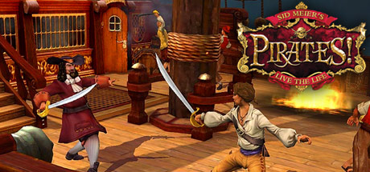

**Platforms:** Windows &nbsp;|&nbsp; **Publisher:** Atari &nbsp;|&nbsp; **Genre:** RPG &nbsp;|&nbsp; **Released:** November 22, 2004

> Sail the Caribbean, marauding all on the high seas or ally your ship and crew as a privateer in search of riches - the life you choose is up to you. Face dogged enemies, raid unsuspecting villages, woo fair maidens, avoid capture or dig for buried treasure. Discover what it takes to become one of the most famous pirates in history!
>
> _Synopsis source: Steam_

[Wikipedia](https://en.wikipedia.org/wiki/Sid_Meier%27s_Pirates!_(2004_video_game)) · [Steam](https://store.steampowered.com/app/3920)

---

### Silent Hill 4: The Room

**Platforms:** Windows, PlayStation 2, Xbox &nbsp;|&nbsp; **Released:** September 7

---

### Ski Resort Extreme

**Platforms:** Windows &nbsp;|&nbsp; **Developer:** Cat Daddy Games &nbsp;|&nbsp; **Publisher:** Global Star Software &nbsp;|&nbsp; **Genre:** Business simulation game &nbsp;|&nbsp; **Released:** October 29, 2004

[Wikipedia](https://en.wikipedia.org/wiki/Ski_Resort_Extreme)

---

### Snail Mail

**Platforms:** Windows, macOS &nbsp;|&nbsp; **Publisher:** Sandlot Games &nbsp;|&nbsp; **Genre:** Racing &nbsp;|&nbsp; **Released:** December 3, 2004

[Wikipedia](https://en.wikipedia.org/wiki/Snail_Mail_(video_game))

---

### Soldiers: Heroes of World War II

**Platforms:** Windows &nbsp;|&nbsp; **Developer:** Best Way &nbsp;|&nbsp; **Publisher:** Codemasters &nbsp;|&nbsp; **Genre:** Real-time tactics &nbsp;|&nbsp; **Released:** June 29, 2004

[Wikipedia](https://en.wikipedia.org/wiki/Soldiers:_Heroes_of_World_War_II)

---

### Sonic Heroes

**Platforms:** Windows, GameCube, PlayStation 2, Xbox &nbsp;|&nbsp; **Released:** March 23

[Wikipedia](https://en.wikipedia.org/wiki/Sonic_Heroes)

---

### Space Rangers 2: Dominators

**Platforms:** Windows &nbsp;|&nbsp; **Developer:** Elemental Games &nbsp;|&nbsp; **Publisher:** 1C Company, Excalibur Publishing, Cinemaware Marquee &nbsp;|&nbsp; **Genre:** Text adventure, real-time strategy, space trading and combat simulator, turn-based strategy, shoot 'em up, role-playing game, third-person shooter &nbsp;|&nbsp; **Released:** November 25, 2004

[Wikipedia](https://en.wikipedia.org/wiki/Space_Rangers_2:_Dominators)

---

### Spartan

**Platforms:** Windows &nbsp;|&nbsp; **Developer:** Slitherine Strategies &nbsp;|&nbsp; **Publisher:** Just Play, Graphsim Entertainment &nbsp;|&nbsp; **Genre:** Turn-based strategy &nbsp;|&nbsp; **Released:** March 24, 2004

[Wikipedia](https://en.wikipedia.org/wiki/Spartan_(video_game))

---

### Special Force

**Platforms:** Windows &nbsp;|&nbsp; **Developer:** DragonFly GF Co., Ltd. &nbsp;|&nbsp; **Publisher:** DragonFly GF Co., Ltd., True Digital Plus, LaMate Taiwan, Asiasoft Online Pte Ltd &nbsp;|&nbsp; **Genre:** First-person shooter &nbsp;|&nbsp; **Released:** July 2004

[Wikipedia](https://en.wikipedia.org/wiki/Special_Force_(2004_video_game))

---

### Spider-Man 2

**Platforms:** Windows, Nintendo DS &nbsp;|&nbsp; **Released:** July 9 (EU)

[Wikipedia](https://en.wikipedia.org/wiki/Spider-Man_2_(2004_video_game))

---

### Spider-Man 2 (US)

**Platforms:** Windows &nbsp;|&nbsp; **Released:** June 29

[Wikipedia](https://en.wikipedia.org/wiki/Spider-Man_2_(2004_video_game))

---

### Star Sonata

**Platforms:** Windows &nbsp;|&nbsp; **Developer:** Landauer Games &nbsp;|&nbsp; **Publisher:** Landauer Games &nbsp;|&nbsp; **Genre:** MMORPG Space simulation

[Wikipedia](https://en.wikipedia.org/wiki/Star_Sonata)

---

### Star Wars Galaxies: Jump to Lightspeed

**Platforms:** Windows &nbsp;|&nbsp; **Released:** October 26

[Wikipedia](https://en.wikipedia.org/wiki/Star_Wars_Galaxies#Jump_to_Lightspeed)

---

### Star Wars: Battlefront

**Platforms:** Windows, PlayStation 2, Xbox &nbsp;|&nbsp; **Genre:** Action, Adventure, Strategy &nbsp;|&nbsp; **Released:** September 21

> The STAR WARS™ Battlefront™ Ultimate Edition includes the STAR WARS™ Battlefront™ Deluxe Edition as well as the STAR WARS™ Battlefront™ Season Pass.
>
> _Synopsis source: Steam_

[Steam](https://store.steampowered.com/app/1237980)

---

### Star Wars: Knights of the Old Republic II The Sith Lords

**Platforms:** Windows, Xbox &nbsp;|&nbsp; **Genre:** RPG &nbsp;|&nbsp; **Released:** December 6

> 5 years after the events of the award winning original, the Sith are on the verge of crushing the Old Republic. As a lone Jedi, will you follow the light side or succumb to the dark?
>
> _Synopsis source: Steam_

[Steam](https://store.steampowered.com/app/208580)

---

### Star Wolves

**Platforms:** Windows &nbsp;|&nbsp; **Developer:** X-bow Software &nbsp;|&nbsp; **Publisher:** 1C Company &nbsp;|&nbsp; **Genre:** Real-time tactics, RPG, Space simulation

[Wikipedia](https://en.wikipedia.org/wiki/Star_Wolves)

---

### Star Wraith IV: Reviction

**Platforms:** Windows &nbsp;|&nbsp; **Developer:** StarWraith 3D Games LLC &nbsp;|&nbsp; **Publisher:** StarWraith 3D Games LLC &nbsp;|&nbsp; **Genre:** Space simulation

[Wikipedia](https://en.wikipedia.org/wiki/Star_Wraith_IV:_Reviction)

---

### Starshatter

**Platforms:** Windows &nbsp;|&nbsp; **Developer:** Destroyer Studios &nbsp;|&nbsp; **Publisher:** Matrix Games &nbsp;|&nbsp; **Genre:** Space flight simulator &nbsp;|&nbsp; **Released:** July 7, 2004

[Wikipedia](https://en.wikipedia.org/wiki/Starshatter)

---

### Starshatter: The Gathering Storm

**Platforms:** Windows &nbsp;|&nbsp; **Developer:** Destroyer Studios &nbsp;|&nbsp; **Publisher:** Matrix Games &nbsp;|&nbsp; **Genre:** Space combat simulator

[Wikipedia](https://en.wikipedia.org/wiki/Starshatter:_The_Gathering_Storm)

---

### Steer Madness

**Platforms:** Windows, macOS &nbsp;|&nbsp; **Developer:** Johnathan Skinner &nbsp;|&nbsp; **Publisher:** Johnathan Skinner &nbsp;|&nbsp; **Genre:** Adventure &nbsp;|&nbsp; **Released:** December 2004

[Wikipedia](https://en.wikipedia.org/wiki/Steer_Madness)

---

### Street Hacker

**Platforms:** Windows &nbsp;|&nbsp; **Developer:** VirtuWeb Interactive &nbsp;|&nbsp; **Publisher:** VirtuWeb Interactive &nbsp;|&nbsp; **Genre:** Simulation &nbsp;|&nbsp; **Released:** February 13, 2004

[Wikipedia](https://en.wikipedia.org/wiki/Street_Hacker)

---

### Strength & Honour

**Platforms:** Windows &nbsp;|&nbsp; **Developer:** Magitech &nbsp;|&nbsp; **Publisher:** Magitech &nbsp;|&nbsp; **Genre:** Real-time tactics

[Wikipedia](https://en.wikipedia.org/wiki/Strength_&_Honour)

---

### Strike Force Bowling

**Platforms:** Windows, PlayStation 2, Xbox &nbsp;|&nbsp; **Developer:** LAB Rats Games &nbsp;|&nbsp; **Publisher:** Enlight Software, Crave Entertainment, Play-It &nbsp;|&nbsp; **Genre:** Sports &nbsp;|&nbsp; **Released:** January 7, 2004

[Wikipedia](https://en.wikipedia.org/wiki/Strike_Force_Bowling)

---

### Super DX-Ball

**Platforms:** Windows, macOS &nbsp;|&nbsp; **Developer:** Michael P. Welch &nbsp;|&nbsp; **Publisher:** BlitWise Productions &nbsp;|&nbsp; **Genre:** Breakout clone &nbsp;|&nbsp; **Released:** November 10, 2004

[Wikipedia](https://en.wikipedia.org/wiki/Super_DX-Ball)

---

### SuperPower 2

**Platforms:** Windows &nbsp;|&nbsp; **Developer:** GolemLabs &nbsp;|&nbsp; **Publisher:** DreamCatcher Interactive &nbsp;|&nbsp; **Genre:** Government simulation game &nbsp;|&nbsp; **Released:** October 12, 2004

[Wikipedia](https://en.wikipedia.org/wiki/SuperPower_2)

---

### Survival Crisis Z

**Platforms:** Windows &nbsp;|&nbsp; **Developer:** Ska Studios &nbsp;|&nbsp; **Publisher:** Ska Studios &nbsp;|&nbsp; **Genre:** Role-playing video game, Survival horror

[Wikipedia](https://en.wikipedia.org/wiki/Survival_Crisis_Z)

---

### Symphonic Rain

**Platforms:** Windows &nbsp;|&nbsp; **Developer:** Kogado Studio &nbsp;|&nbsp; **Publisher:** Kogado Studio, Degica &nbsp;|&nbsp; **Genre:** Rhythm game, Visual novel &nbsp;|&nbsp; **Released:** March 26, 2004

[Wikipedia](https://en.wikipedia.org/wiki/Symphonic_Rain)

---

### Söldner: Secret Wars

**Platforms:** Windows &nbsp;|&nbsp; **Developer:** Wings Simulations &nbsp;|&nbsp; **Publisher:** JoWooD Productions, Encore, Inc., Evolved Games &nbsp;|&nbsp; **Genre:** Tactical shooter &nbsp;|&nbsp; **Released:** May 27, 2004

[Wikipedia](https://en.wikipedia.org/wiki/S%C3%B6ldner:_Secret_Wars)

---

### Teenage Mutant Ninja Turtles 2: Battle Nexus

**Platforms:** Windows, GameCube, PlayStation 2, Xbox, Game Boy Advance &nbsp;|&nbsp; **Released:** October 19

---

### The Chronicles of Riddick: Escape from Butcher Bay

**Platforms:** Xbox, Windows &nbsp;|&nbsp; **Publisher:** Vivendi Universal Games &nbsp;|&nbsp; **Released:** June 1, 2004

---

### The Chronicles of Riddick: Escape from Butcher Bay – Developer's Cut

**Platforms:** Windows &nbsp;|&nbsp; **Publisher:** Vivendi Universal Games &nbsp;|&nbsp; **Released:** December 3, 2004

---

### The Fairly OddParents: Shadow Showdown

**Platforms:** Windows, GameCube, PlayStation 2, Game Boy Advance &nbsp;|&nbsp; **Released:** September 8

---

### The Fall: Last Days of Gaia

**Platforms:** Windows &nbsp;|&nbsp; **Developer:** Silver Style Entertainment &nbsp;|&nbsp; **Publisher:** Deep Silver &nbsp;|&nbsp; **Genre:** Post-apocalyptic Tactical RPG &nbsp;|&nbsp; **Released:** November 15, 2004

[Wikipedia](https://en.wikipedia.org/wiki/The_Fall:_Last_Days_of_Gaia)

---

### The Guy Game

**Platforms:** PlayStation 2, Xbox, Windows &nbsp;|&nbsp; **Developer:** Topheavy Studios &nbsp;|&nbsp; **Publisher:** Gathering &nbsp;|&nbsp; **Genre:** Party &nbsp;|&nbsp; **Released:** August 31, 2004

[Wikipedia](https://en.wikipedia.org/wiki/The_Guy_Game)

---

### The Incredibles

**Platforms:** Windows &nbsp;|&nbsp; **Released:** October 29

[Wikipedia](https://en.wikipedia.org/wiki/The_Incredibles_(video_game))

---

### The Incredibles: When Danger Calls

**Platforms:** Windows &nbsp;|&nbsp; **Released:** November 3

---

### The Legend of Heroes: Trails in the Sky

**Platforms:** Windows &nbsp;|&nbsp; **Developer:** Nihon Falcom &nbsp;|&nbsp; **Publisher:** Nihon Falcom, Xseed Games, Ghostlight &nbsp;|&nbsp; **Genre:** Role-playing &nbsp;|&nbsp; **Released:** June 24, 2004

[Wikipedia](https://en.wikipedia.org/wiki/The_Legend_of_Heroes:_Trails_in_the_Sky)

---

### The Legend of Mir 3

**Platforms:** Windows &nbsp;|&nbsp; **Developer:** WeMade Entertainment &nbsp;|&nbsp; **Publisher:** WeMade Entertainment, Shanda, Softworld, Eye Entertainment &nbsp;|&nbsp; **Genre:** Massively multiplayer online role-playing game &nbsp;|&nbsp; **Released:** October 2004

[Wikipedia](https://en.wikipedia.org/wiki/The_Legend_of_Mir_3)

---

### The Lord of the Rings: The Battle for Middle-earth

**Platforms:** Windows &nbsp;|&nbsp; **Released:** December 6

---

### The Moment of Silence

**Platforms:** Windows &nbsp;|&nbsp; **Developer:** House of Tales &nbsp;|&nbsp; **Publisher:** Digital Jesters, The Adventure Company &nbsp;|&nbsp; **Genre:** Adventure game &nbsp;|&nbsp; **Released:** October 1, 2004

[Wikipedia](https://en.wikipedia.org/wiki/The_Moment_of_Silence)

---

### The Polar Express

**Platforms:** Game Boy Advance, GameCube, Windows, PlayStation 2 &nbsp;|&nbsp; **Developer:** Blue Tongue Entertainment, Tantalus Media &nbsp;|&nbsp; **Publisher:** THQ &nbsp;|&nbsp; **Genre:** Action-adventure &nbsp;|&nbsp; **Released:** November 2, 2004

[Wikipedia](https://en.wikipedia.org/wiki/The_Polar_Express_(video_game))

---

### The Political Machine

**Platforms:** Windows &nbsp;|&nbsp; **Developer:** Stardock &nbsp;|&nbsp; **Publisher:** Ubisoft &nbsp;|&nbsp; **Genre:** Government simulation &nbsp;|&nbsp; **Released:** August 10, 2004

[Wikipedia](https://en.wikipedia.org/wiki/The_Political_Machine)

---

### The Settlers: Heritage of Kings

**Platforms:** Windows &nbsp;|&nbsp; **Developer:** Blue Byte &nbsp;|&nbsp; **Publisher:** Ubisoft &nbsp;|&nbsp; **Genre:** Real-time strategy &nbsp;|&nbsp; **Released:** November 25, 2004

[Wikipedia](https://en.wikipedia.org/wiki/The_Settlers:_Heritage_of_Kings)

---

### The Sims 2

**Platforms:** Windows &nbsp;|&nbsp; **Publisher:** Electronic Arts &nbsp;|&nbsp; **Released:** September 14, 2004

[Wikipedia](https://en.wikipedia.org/wiki/The_Sims_2)

---

### The SpongeBob SquarePants Movie

**Platforms:** Windows, GameCube, PlayStation 2, Xbox, Game Boy Advance &nbsp;|&nbsp; **Released:** October 27

[Wikipedia](https://en.wikipedia.org/wiki/The_SpongeBob_SquarePants_Movie_(video_game))

---

### The Suffering

**Platforms:** Windows, PlayStation 2, Xbox &nbsp;|&nbsp; **Genre:** Action, Adventure, Indie &nbsp;|&nbsp; **Released:** March 8

> This game is a psychological horror in which the main character wakes up in an unfamiliar house and must pass all the levels by solving puzzles.
>
> _Synopsis source: Steam_

[Wikipedia](https://en.wikipedia.org/wiki/The_Suffering_(video_game)) · [Steam](https://store.steampowered.com/app/1726550)

---

### Thief: Deadly Shadows

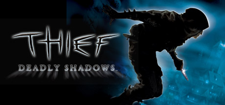

**Platforms:** Windows, Xbox &nbsp;|&nbsp; **Genre:** Action &nbsp;|&nbsp; **Released:** May 25

> You are Garrett, the master thief. Rarely seen and never caught, Garrett is the best that ever was. Able to sneak past any guard, pick any lock, and break into the most ingeniously secured residences. Garrett steals from the wealthy and gives to himself, making his living in the dark and foreboding City.
>
> _Synopsis source: Steam_

[Steam](https://store.steampowered.com/app/6980)

---

### Ticket to Ride

**Platforms:** Steam, Windows, macOS, Xbox, PlayStation &nbsp;|&nbsp; **Developer:** Next Level Games, Marmalade Game Studio, Days of Wonder, Asmodee &nbsp;|&nbsp; **Publisher:** Valve Corporation, Discord, Epic Games, Microsoft Game Studios &nbsp;|&nbsp; **Genre:** Turn-based strategy &nbsp;|&nbsp; **Released:** November 15, 2004

[Wikipedia](https://en.wikipedia.org/wiki/Ticket_to_Ride_(video_game))

---

### Tiger Woods PGA Tour 2005

**Platforms:** Windows, GameCube, PlayStation 2, Xbox &nbsp;|&nbsp; **Publisher:** EA Sports &nbsp;|&nbsp; **Released:** September 20, 2004

[Wikipedia](https://en.wikipedia.org/wiki/Tiger_Woods_PGA_Tour_2005)

---

### TOCA Race Driver 2

**Platforms:** Windows, Xbox, PlayStation 2 &nbsp;|&nbsp; **Released:** April 13

[Wikipedia](https://en.wikipedia.org/wiki/TOCA_Race_Driver_2)

---

### Tom Clancy's Rainbow Six 3: Athena Sword

**Platforms:** Windows &nbsp;|&nbsp; **Released:** March 9

[Wikipedia](https://en.wikipedia.org/wiki/Tom_Clancy%27s_Rainbow_Six_3#Athena_Sword)

---

### Tom Clancy's Splinter Cell: Pandora Tomorrow

**Platforms:** Xbox, Windows, GameCube, PlayStation 2 &nbsp;|&nbsp; **Publisher:** Ubisoft &nbsp;|&nbsp; **Genre:** Action &nbsp;|&nbsp; **Released:** March 23, 2004

> Infiltrate secure locations across the globe in this stealth-action thriller. Uncover a global conspiracy and stop a deadly bio-terror attack in the second game of the award-winning Splinter Cell series.
>
> _Synopsis source: Steam_

[Steam](https://store.steampowered.com/app/3929740)

---

### Tony Hawk's Underground 2

**Platforms:** Windows, GameCube, PlayStation 2, Xbox, Game Boy Advance &nbsp;|&nbsp; **Released:** October 4

[Wikipedia](https://en.wikipedia.org/wiki/Tony_Hawk%27s_Underground_2)

---

### Tribes: Vengeance

**Platforms:** Windows &nbsp;|&nbsp; **Released:** October 5

---

### Trivial Pursuit: Unhinged

**Platforms:** PlayStation 2, Xbox, Windows &nbsp;|&nbsp; **Developer:** Artech Studios &nbsp;|&nbsp; **Publisher:** Atari Interactive &nbsp;|&nbsp; **Genre:** Digital tabletop, quiz &nbsp;|&nbsp; **Released:** March 26, 2004

[Wikipedia](https://en.wikipedia.org/wiki/Trivial_Pursuit:_Unhinged)

---

### Two Thrones

**Platforms:** Windows &nbsp;|&nbsp; **Developer:** Paradox Interactive &nbsp;|&nbsp; **Publisher:** Strategy First, PAN Vision, Koch Media &nbsp;|&nbsp; **Genre:** Real-time strategy, Grand strategy &nbsp;|&nbsp; **Released:** January 21, 2004

[Wikipedia](https://en.wikipedia.org/wiki/Two_Thrones)

---

### UEFA Euro 2004

**Platforms:** Windows, Xbox, PlayStation 2 &nbsp;|&nbsp; **Developer:** EA Canada &nbsp;|&nbsp; **Publisher:** EA Sports &nbsp;|&nbsp; **Genre:** Sports, Football &nbsp;|&nbsp; **Released:** May 4, 2004

[Wikipedia](https://en.wikipedia.org/wiki/UEFA_Euro_2004_(video_game))

---

### Unreal Tournament 2004

**Platforms:** Windows &nbsp;|&nbsp; **Publisher:** Atari &nbsp;|&nbsp; **Released:** March 16, 2004

[Wikipedia](https://en.wikipedia.org/wiki/Unreal_Tournament_2004)

---

### Vampire: The Masquerade – Bloodlines

**Platforms:** Windows &nbsp;|&nbsp; **Released:** November 16

---

### Vendetta Online

**Platforms:** Windows, macOS, Linux &nbsp;|&nbsp; **Developer:** Guild Software &nbsp;|&nbsp; **Publisher:** Strategy First, Guild Software &nbsp;|&nbsp; **Genre:** Massively multiplayer online role-playing, space trading and combat simulator &nbsp;|&nbsp; **Released:** November 4, 2004

[Wikipedia](https://en.wikipedia.org/wiki/Vendetta_Online)

---

### Vietcong: Fist Alpha

**Platforms:** Windows, PlayStation 2, Xbox &nbsp;|&nbsp; **Released:** January 28

---

### War in the Pacific

**Platforms:** Windows &nbsp;|&nbsp; **Developer:** 2 by 3 Games &nbsp;|&nbsp; **Publisher:** Matrix Games &nbsp;|&nbsp; **Genre:** Computer wargame

[Wikipedia](https://en.wikipedia.org/wiki/War_in_the_Pacific_(video_game))

---

### War Times

**Platforms:** Windows &nbsp;|&nbsp; **Developer:** Legend Studios &nbsp;|&nbsp; **Genre:** Real-time strategy

[Wikipedia](https://en.wikipedia.org/wiki/War_Times)

---

### Warhammer 40,000: Dawn of War

**Platforms:** Windows &nbsp;|&nbsp; **Released:** September 20

---

### Warlords Battlecry III

**Platforms:** Windows &nbsp;|&nbsp; **Developer:** Infinite Interactive &nbsp;|&nbsp; **Publisher:** Enlight Software &nbsp;|&nbsp; **Genre:** Real-time strategy &nbsp;|&nbsp; **Released:** May 19, 2004

[Wikipedia](https://en.wikipedia.org/wiki/Warlords_Battlecry_III)

---

### Wars and Warriors: Joan of Arc

**Platforms:** Windows &nbsp;|&nbsp; **Developer:** Enlight &nbsp;|&nbsp; **Publisher:** Enlight &nbsp;|&nbsp; **Genre:** Action, Real-Time Strategy &nbsp;|&nbsp; **Released:** February 10, 2004

[Wikipedia](https://en.wikipedia.org/wiki/Wars_and_Warriors:_Joan_of_Arc)

---

### Wik and the Fable of Souls

**Platforms:** Windows &nbsp;|&nbsp; **Developer:** Reflexive Entertainment &nbsp;|&nbsp; **Publisher:** Reflexive Entertainment &nbsp;|&nbsp; **Genre:** Platform game &nbsp;|&nbsp; **Released:** September 14, 2004

[Wikipedia](https://en.wikipedia.org/wiki/Wik_and_the_Fable_of_Souls)

---

### Wings of Power

**Platforms:** Windows &nbsp;|&nbsp; **Developer:** Shockwave Productions &nbsp;|&nbsp; **Publisher:** Tri Synergy &nbsp;|&nbsp; **Genre:** Flight simulation &nbsp;|&nbsp; **Released:** September 13, 2004

[Wikipedia](https://en.wikipedia.org/wiki/Wings_of_Power)

---

### Wings of Power: WWII Heavy Bombers and Jets

**Platforms:** Windows &nbsp;|&nbsp; **Publisher:** Tri Synergy &nbsp;|&nbsp; **Released:** September 13, 2004

---

### Wings of War

**Platforms:** Windows, Xbox &nbsp;|&nbsp; **Developer:** Silver Wish Games &nbsp;|&nbsp; **Publisher:** Gathering &nbsp;|&nbsp; **Genre:** Combat flight simulator &nbsp;|&nbsp; **Released:** July 30, 2004

[Wikipedia](https://en.wikipedia.org/wiki/Wings_of_War_(video_game))

---

### Wings over Vietnam

**Platforms:** Windows &nbsp;|&nbsp; **Developer:** Third Wire &nbsp;|&nbsp; **Publisher:** Destineer, Bold Games &nbsp;|&nbsp; **Genre:** Combat flight simulator &nbsp;|&nbsp; **Released:** November 8, 2004

[Wikipedia](https://en.wikipedia.org/wiki/Wings_over_Vietnam)

---

### World Championship Rugby

**Platforms:** Windows, PlayStation 2, Xbox &nbsp;|&nbsp; **Developer:** Swordfish Studios &nbsp;|&nbsp; **Publisher:** Acclaim Entertainment &nbsp;|&nbsp; **Genre:** Rugby union &nbsp;|&nbsp; **Released:** April 8, 2004

[Wikipedia](https://en.wikipedia.org/wiki/World_Championship_Rugby)

---

### World Championship Snooker 2004

**Platforms:** PlayStation 2, Windows, Xbox &nbsp;|&nbsp; **Developer:** Blade Interactive &nbsp;|&nbsp; **Publisher:** Codemasters &nbsp;|&nbsp; **Genre:** Sports &nbsp;|&nbsp; **Released:** June 25, 2004

[Wikipedia](https://en.wikipedia.org/wiki/World_Championship_Snooker_2004_(video_game))

---

### World of Warcraft

**Platforms:** Windows &nbsp;|&nbsp; **Publisher:** Blizzard Entertainment &nbsp;|&nbsp; **Released:** November 23, 2004

[Wikipedia](https://en.wikipedia.org/wiki/World_of_Warcraft)

---

### Worms Forts: Under Siege

**Platforms:** Windows, PlayStation 2, Xbox &nbsp;|&nbsp; **Developer:** Team17 &nbsp;|&nbsp; **Publisher:** Sega &nbsp;|&nbsp; **Genre:** Artillery, strategy &nbsp;|&nbsp; **Released:** November 19, 2004

[Wikipedia](https://en.wikipedia.org/wiki/Worms_Forts:_Under_Siege)

---

### Xpand Rally

**Platforms:** Windows &nbsp;|&nbsp; **Developer:** Techland &nbsp;|&nbsp; **Publisher:** TopWare Interactive &nbsp;|&nbsp; **Genre:** Racing &nbsp;|&nbsp; **Released:** September 24, 2004

[Wikipedia](https://en.wikipedia.org/wiki/Xpand_Rally)

---

### Yourself!Fitness

**Platforms:** Xbox, Windows &nbsp;|&nbsp; **Developer:** Respondesign, Ubisoft &nbsp;|&nbsp; **Publisher:** Respondesign, Ubisoft &nbsp;|&nbsp; **Genre:** Exergaming &nbsp;|&nbsp; **Released:** October 8, 2004

[Wikipedia](https://en.wikipedia.org/wiki/Yourself!Fitness)

---

### Yu-Gi-Oh! Power of Chaos: Joey the Passion

**Platforms:** Windows &nbsp;|&nbsp; **Released:** July 2

---

### Yume Nikki

**Platforms:** Windows &nbsp;|&nbsp; **Developer:** Kikiyama &nbsp;|&nbsp; **Publisher:** Kikiyama, Playism &nbsp;|&nbsp; **Genre:** Adventure, walking simulator, art game &nbsp;|&nbsp; **Released:** June 26, 2004

[Wikipedia](https://en.wikipedia.org/wiki/Yume_Nikki)

---

### Zoo Empire

**Platforms:** Windows &nbsp;|&nbsp; **Developer:** Enlight Software &nbsp;|&nbsp; **Publisher:** Enlight Software &nbsp;|&nbsp; **Genre:** Construction and management simulation &nbsp;|&nbsp; **Released:** August 4, 2004

[Wikipedia](https://en.wikipedia.org/wiki/Zoo_Empire)

---

### Zoo Tycoon 2

**Platforms:** Windows &nbsp;|&nbsp; **Developer:** Blue Fang Games, Rapan &nbsp;|&nbsp; **Publisher:** Microsoft Game Studios &nbsp;|&nbsp; **Genre:** Business simulation &nbsp;|&nbsp; **Released:** November 9, 2004

[Wikipedia](https://en.wikipedia.org/wiki/Zoo_Tycoon_2)

---

### Zoo Vet

**Platforms:** Windows &nbsp;|&nbsp; **Developer:** Legacy Games &nbsp;|&nbsp; **Publisher:** Legacy Games &nbsp;|&nbsp; **Genre:** Simulation &nbsp;|&nbsp; **Released:** December 1, 2004

[Wikipedia](https://en.wikipedia.org/wiki/Zoo_Vet)

---
