# Windows — 2005

[← All Windows years](../windows.md) · [Full 2005 page](../../years/2005.md)

293 Windows titles in 2005.

### 7 Sins

**Platforms:** Windows, PlayStation 2 &nbsp;|&nbsp; **Genre:** Action, Indie, Early Access &nbsp;|&nbsp; **Released:** May 27

> 7 Sins is a 1-4 player co-op psychological horror game. Search for their items and destroy them in a ritual to stop the creatures. However, whoever touches an item falls victim to the curse of that sin and becomes trapped in mental hallucinations. Resist the curse, solve the mystery, and survive!
>
> _Synopsis source: Steam_

[Wikipedia](https://en.wikipedia.org/wiki/7_Sins_(video_game)) · [Steam](https://store.steampowered.com/app/5064890)

---

### 80 Days

**Platforms:** Windows &nbsp;|&nbsp; **Developer:** Frogwares &nbsp;|&nbsp; **Publisher:** Focus Home Interactive, Tri Synergy &nbsp;|&nbsp; **Genre:** Adventure &nbsp;|&nbsp; **Released:** November 4, 2005

[Wikipedia](https://en.wikipedia.org/wiki/80_Days_(2005_video_game))

---

### Absolute Obedience

**Platforms:** Windows &nbsp;|&nbsp; **Developer:** Langmaor &nbsp;|&nbsp; **Publisher:** Will JP JAST USA/Peach Princess US &nbsp;|&nbsp; **Genre:** BL game, dating sim &nbsp;|&nbsp; **Released:** April 22, 2005

[Wikipedia](https://en.wikipedia.org/wiki/Absolute_Obedience)

---

### Act of War: Direct Action

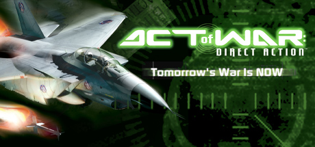

**Platforms:** Windows &nbsp;|&nbsp; **Genre:** Action &nbsp;|&nbsp; **Released:** March 15

> Tomorrow's War Is NOW Ripped from today's headlines, Act of War: Direct Action™ is a frightening tale of suspense, international intrigue and geopolitical military conflict. This real-time strategy experience puts you squarely in control of counterterrorist forces and delivers a first look at tomorrow's war.
>
> _Synopsis source: Steam_

[Steam](https://store.steampowered.com/app/2710)

---

### Advent Rising

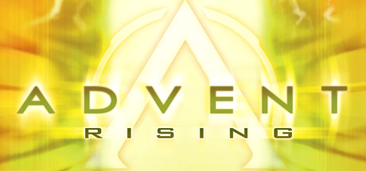

**Platforms:** Xbox, Windows &nbsp;|&nbsp; **Genre:** Action &nbsp;|&nbsp; **Released:** May 31

> A common legend pervades the galaxy-that of a powerful, highly intelligent ancient race that will one day deliver the universe. They are known as Humans. The Advent of Humanity Begins...
>
> _Synopsis source: Steam_

[Wikipedia](https://en.wikipedia.org/wiki/Advent_Rising) · [Steam](https://store.steampowered.com/app/3800)

---

### AFL Premiership 2005

**Platforms:** PlayStation 2, Xbox, Windows &nbsp;|&nbsp; **Developer:** IR Gurus &nbsp;|&nbsp; **Publisher:** Sony Computer Entertainment, THQ &nbsp;|&nbsp; **Genre:** Sports &nbsp;|&nbsp; **Released:** September 22, 2005

[Wikipedia](https://en.wikipedia.org/wiki/AFL_Premiership_2005)

---

### Agatha Christie: And Then There Were None

**Platforms:** Windows &nbsp;|&nbsp; **Developer:** AWE Productions &nbsp;|&nbsp; **Publisher:** The Adventure Company &nbsp;|&nbsp; **Genre:** Adventure &nbsp;|&nbsp; **Released:** October 27, 2005

[Wikipedia](https://en.wikipedia.org/wiki/Agatha_Christie:_And_Then_There_Were_None)

---

### Age of Empires III

**Platforms:** Windows &nbsp;|&nbsp; **Released:** October 18

[Wikipedia](https://en.wikipedia.org/wiki/Age_of_Empires_III)

---

### Alfa Romeo Racing Italiano

**Platforms:** PlayStation 2, Windows, Xbox &nbsp;|&nbsp; **Developer:** Milestone srl &nbsp;|&nbsp; **Publisher:** Black Bean Games, Valcon Games &nbsp;|&nbsp; **Genre:** Racing &nbsp;|&nbsp; **Released:** May 27, 2005

[Wikipedia](https://en.wikipedia.org/wiki/Alfa_Romeo_Racing_Italiano)

---

### Alfa: Antiterror

**Platforms:** Windows &nbsp;|&nbsp; **Developer:** MiST Land South &nbsp;|&nbsp; **Publisher:** GFI/Russobit-M, Russia &nbsp;|&nbsp; **Genre:** Strategy &nbsp;|&nbsp; **Released:** January 20, 2005

[Wikipedia](https://en.wikipedia.org/wiki/Alfa:_Antiterror)

---

### Ankh

**Platforms:** Windows &nbsp;|&nbsp; **Developer:** Deck13 Interactive, VIS Games &nbsp;|&nbsp; **Publisher:** BHV Software, Xider Games, Daedalic Entertainment &nbsp;|&nbsp; **Genre:** Adventure &nbsp;|&nbsp; **Released:** November 4, 2005

[Wikipedia](https://en.wikipedia.org/wiki/Ankh_(video_game))

---

### Anubis II

**Platforms:** PlayStation 2, Windows &nbsp;|&nbsp; **Developer:** Data Design Interactive &nbsp;|&nbsp; **Publisher:** Metro3D Europe, Data Design Interactive, Conspiracy Entertainment &nbsp;|&nbsp; **Genre:** Platform &nbsp;|&nbsp; **Released:** July 14, 2005

[Wikipedia](https://en.wikipedia.org/wiki/Anubis_II)

---

### ArchLord

**Platforms:** Windows &nbsp;|&nbsp; **Developer:** NHN Corporation, Codemasters Online Gaming &nbsp;|&nbsp; **Publisher:** Webzen, Codemasters &nbsp;|&nbsp; **Genre:** Massively multiplayer online role-playing game &nbsp;|&nbsp; **Released:** March 2005

[Wikipedia](https://en.wikipedia.org/wiki/ArchLord)

---

### Area 51

**Platforms:** Windows, PlayStation 2, Xbox &nbsp;|&nbsp; **Genre:** Action, Adventure, Casual, Indie, Simulation &nbsp;|&nbsp; **Released:** June 8

> Storm AREA 51 with your friends. Explore the most classified facility on earth. Discover what they've been hiding. Take selfies with aliens and smuggle evidence out before the military arrives.
>
> _Synopsis source: Steam_

[Wikipedia](https://en.wikipedia.org/wiki/Area_51_(2005_video_game)) · [Steam](https://store.steampowered.com/app/4423180)

---

### Asterix & Obelix XXL 2: Mission: Las Vegum

**Platforms:** Windows, PlayStation 2 &nbsp;|&nbsp; **Developer:** Étranges Libellules, OSome Studio &nbsp;|&nbsp; **Publisher:** Atari, Microids &nbsp;|&nbsp; **Genre:** Action-adventure &nbsp;|&nbsp; **Released:** September 30, 2005

[Wikipedia](https://en.wikipedia.org/wiki/Asterix_&_Obelix_XXL_2:_Mission:_Las_Vegum)

---

### Atomic Battle Dragons

**Platforms:** Windows, Windows Mobile &nbsp;|&nbsp; **Developer:** Isotope 244 &nbsp;|&nbsp; **Genre:** Jousting/Joust remake &nbsp;|&nbsp; **Released:** December 2005

[Wikipedia](https://en.wikipedia.org/wiki/Atomic_Battle_Dragons)

---

### Atomic Cannon

**Platforms:** Windows, macOS, Windows Mobile &nbsp;|&nbsp; **Developer:** Isotope 244 &nbsp;|&nbsp; **Genre:** Artillery

[Wikipedia](https://en.wikipedia.org/wiki/Atomic_Cannon)

---

### Battle of Britain II: Wings of Victory

**Platforms:** Windows &nbsp;|&nbsp; **Developer:** Shockwave Productions, Wild Hare Entertainment &nbsp;|&nbsp; **Publisher:** Tri Synergy, GMX Media, Wild Hare Entertainment &nbsp;|&nbsp; **Genre:** Combat flight simulation &nbsp;|&nbsp; **Released:** August 26, 2005

[Wikipedia](https://en.wikipedia.org/wiki/Battle_of_Britain_II:_Wings_of_Victory)

---

### Battlefield 2

**Platforms:** Windows &nbsp;|&nbsp; **Publisher:** Electronic Arts &nbsp;|&nbsp; **Released:** June 21, 2005

[Wikipedia](https://en.wikipedia.org/wiki/Battlefield_2)

---

### Battlefield 2: Special Forces

**Platforms:** Windows &nbsp;|&nbsp; **Released:** November 21

---

### Bet On Soldier: Blood Sport

**Platforms:** Windows &nbsp;|&nbsp; **Developer:** Kylotonn &nbsp;|&nbsp; **Publisher:** Frogster Interactive, Focus Home Interactive, Digital Jesters &nbsp;|&nbsp; **Genre:** First-person shooter &nbsp;|&nbsp; **Released:** August 25, 2005

[Wikipedia](https://en.wikipedia.org/wiki/Bet_On_Soldier:_Blood_Sport)

---

### Big Mutha Truckers 2: Truck Me Harder

**Platforms:** PlayStation 2, Xbox, Windows &nbsp;|&nbsp; **Developer:** Eutechnyx &nbsp;|&nbsp; **Publisher:** Empire Interactive, THQ &nbsp;|&nbsp; **Genre:** Racing &nbsp;|&nbsp; **Released:** June 24, 2005

[Wikipedia](https://en.wikipedia.org/wiki/Big_Mutha_Truckers_2:_Truck_Me_Harder)

---

### Billy Blade and the Temple of Time

**Platforms:** Windows &nbsp;|&nbsp; **Developer:** Iridon Interactive, Nerlaska Studio &nbsp;|&nbsp; **Publisher:** Nordic Softsales, Fusion Software &nbsp;|&nbsp; **Genre:** Action-adventure &nbsp;|&nbsp; **Released:** March 25, 2005

[Wikipedia](https://en.wikipedia.org/wiki/Billy_Blade_and_the_Temple_of_Time)

---

### Black & White 2

**Platforms:** Windows &nbsp;|&nbsp; **Released:** October 7

[Wikipedia](https://en.wikipedia.org/wiki/Black_%26_White_2)

---

### Bliss

**Platforms:** Linux, macOS, Windows &nbsp;|&nbsp; **Developer:** Games for Loving &nbsp;|&nbsp; **Publisher:** Games for Loving &nbsp;|&nbsp; **Genre:** Erotic &nbsp;|&nbsp; **Released:** November 10, 2005

[Wikipedia](https://en.wikipedia.org/wiki/Bliss_(video_game))

---

### Blitzkrieg 2

**Platforms:** Windows &nbsp;|&nbsp; **Developer:** Nival Interactive &nbsp;|&nbsp; **Publisher:** 1C Company, CDV Software &nbsp;|&nbsp; **Genre:** Real-time tactics &nbsp;|&nbsp; **Released:** September 23, 2005

[Wikipedia](https://en.wikipedia.org/wiki/Blitzkrieg_2)

---

### BloodRayne 2

**Platforms:** Windows &nbsp;|&nbsp; **Released:** August 2 (NA)

[Wikipedia](https://en.wikipedia.org/wiki/BloodRayne_2)

---

### Boiling Point: Road to Hell

**Platforms:** Windows &nbsp;|&nbsp; **Developer:** Deep Shadows &nbsp;|&nbsp; **Publisher:** Russobit-M, Atari &nbsp;|&nbsp; **Genre:** First-person shooter, role-playing &nbsp;|&nbsp; **Released:** May 19, 2005

[Wikipedia](https://en.wikipedia.org/wiki/Boiling_Point:_Road_to_Hell)

---

### Bone: Out from Boneville

**Platforms:** Windows &nbsp;|&nbsp; **Developer:** Telltale Games &nbsp;|&nbsp; **Publisher:** Telltale Games &nbsp;|&nbsp; **Genre:** Adventure &nbsp;|&nbsp; **Released:** September 15, 2005

[Wikipedia](https://en.wikipedia.org/wiki/Bone:_Out_from_Boneville)

---

### Bonez Adventures: Tomb of Fulaos

**Platforms:** Windows &nbsp;|&nbsp; **Developer:** Bone Artz &nbsp;|&nbsp; **Publisher:** Bone Artz &nbsp;|&nbsp; **Genre:** Action-adventure &nbsp;|&nbsp; **Released:** July 8, 2005

[Wikipedia](https://en.wikipedia.org/wiki/Bonez_Adventures:_Tomb_of_Fulaos)

---

### Bonnie's Bookstore

**Platforms:** Windows, macOS &nbsp;|&nbsp; **Developer:** New Crayon Games &nbsp;|&nbsp; **Publisher:** PopCap Games &nbsp;|&nbsp; **Genre:** Puzzle &nbsp;|&nbsp; **Released:** November 28, 2005

[Wikipedia](https://en.wikipedia.org/wiki/Bonnie's_Bookstore)

---

### Bratz: Rock Angelz

**Platforms:** Windows, PlayStation 2, GameCube, Game Boy Advance &nbsp;|&nbsp; **Released:** October 4

---

### Brian Lara International Cricket 2005

**Platforms:** Windows, PlayStation 2, Xbox &nbsp;|&nbsp; **Developer:** Swordfish Studios &nbsp;|&nbsp; **Publisher:** Codemasters &nbsp;|&nbsp; **Genre:** Sports &nbsp;|&nbsp; **Released:** July 21, 2005

[Wikipedia](https://en.wikipedia.org/wiki/Brian_Lara_International_Cricket_2005)

---

### Brigade E5: New Jagged Union

**Platforms:** Windows &nbsp;|&nbsp; **Developer:** Apeiron &nbsp;|&nbsp; **Genre:** Tactical RPG

[Wikipedia](https://en.wikipedia.org/wiki/Brigade_E5:_New_Jagged_Union)

---

### Brothers in Arms: Earned in Blood

**Platforms:** Windows, PlayStation 2, Xbox &nbsp;|&nbsp; **Genre:** Action &nbsp;|&nbsp; **Released:** October 26

> With its unprecedented combination of authenticity, compelling story and squad-based action, the Brothers in Arms franchise has established itself as a benchmark for military action games, receiving the highest average review scores of any console WWII game to date (www.gamerankings.com).
>
> _Synopsis source: Steam_

[Steam](https://store.steampowered.com/app/19800)

---

### Brothers in Arms: Road to Hill 30

**Platforms:** Xbox, Windows, PlayStation 2 &nbsp;|&nbsp; **Genre:** Action &nbsp;|&nbsp; **Released:** March 1

> Based on a true story. Set during the famous airdrop before the invasion at Normandy, where Sgt. Matt Baker and his squad of 101st Airborne Paratroopers were scattered over the French countryside.
>
> _Synopsis source: Steam_

[Steam](https://store.steampowered.com/app/15190)

---

### Cabal Online

**Platforms:** Windows &nbsp;|&nbsp; **Developer:** ESTsoft Corp. &nbsp;|&nbsp; **Publisher:** ESTsoft Inc. &nbsp;|&nbsp; **Genre:** Massively multiplayer online role-playing game &nbsp;|&nbsp; **Released:** October 2005

[Wikipedia](https://en.wikipedia.org/wiki/Cabal_Online)

---

### Cabela's Big Game Hunter 2006 Trophy Season

**Platforms:** Windows &nbsp;|&nbsp; **Developer:** Magic Wand Productions &nbsp;|&nbsp; **Publisher:** Activision Value, Zoo Digital Publishing &nbsp;|&nbsp; **Genre:** Sports &nbsp;|&nbsp; **Released:** September 27, 2005

[Wikipedia](https://en.wikipedia.org/wiki/Cabela's_Big_Game_Hunter_2006_Trophy_Season)

---

### Call of Duty 2

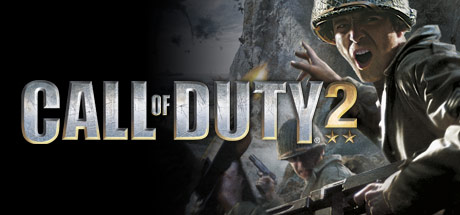

**Platforms:** Windows, Xbox 360 &nbsp;|&nbsp; **Genre:** Action &nbsp;|&nbsp; **Released:** October 25

> Call of Duty® 2 redefines the cinematic intensity and chaos of battle as seen through the eyes of ordinary soldiers fighting together in epic WWII conflicts. The sequel to 2003's Call of Duty, winner of over 80 Game of the Year awards, Call of Duty 2 offers more immense, more intense, more realistic battles than ever before, thanks to...
>
> _Synopsis source: Steam_

[Wikipedia](https://en.wikipedia.org/wiki/Call_of_Duty_2) · [Steam](https://store.steampowered.com/app/2630)

---

### Caterpillar Construction Tycoon

**Platforms:** Windows &nbsp;|&nbsp; **Developer:** Gabriel Entertainment &nbsp;|&nbsp; **Publisher:** Activision Value, Zoo Digital Publishing &nbsp;|&nbsp; **Genre:** Business simulation &nbsp;|&nbsp; **Released:** September 15, 2005

[Wikipedia](https://en.wikipedia.org/wiki/Caterpillar_Construction_Tycoon)

---

### Chameleon

**Platforms:** Windows &nbsp;|&nbsp; **Released:** May 19

[Wikipedia](https://en.wikipedia.org/wiki/Chameleon_(2005_video_game))

---

### Championship Manager 5

**Platforms:** Windows, PlayStation 2, Xbox &nbsp;|&nbsp; **Developer:** Beautiful Game Studios, Gusto Games &nbsp;|&nbsp; **Publisher:** Eidos Interactive &nbsp;|&nbsp; **Genre:** Sports &nbsp;|&nbsp; **Released:** March 18, 2005

[Wikipedia](https://en.wikipedia.org/wiki/Championship_Manager_5)

---

### Chicken Little

**Platforms:** GameCube, PlayStation 2, Xbox, Windows &nbsp;|&nbsp; **Released:** October 18

[Wikipedia](https://en.wikipedia.org/wiki/Chicken_Little_(video_game))

---

### Chuzzle

**Platforms:** Windows, macOS, Mobile phone &nbsp;|&nbsp; **Developer:** Raptisoft Games &nbsp;|&nbsp; **Publisher:** PopCap Games &nbsp;|&nbsp; **Genre:** Puzzle &nbsp;|&nbsp; **Released:** May 12, 2005

[Wikipedia](https://en.wikipedia.org/wiki/Chuzzle)

---

### Civilization IV

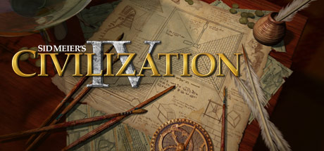

**Platforms:** Windows &nbsp;|&nbsp; **Publisher:** 2K Games &nbsp;|&nbsp; **Genre:** Strategy &nbsp;|&nbsp; **Released:** October 25, 2005

> With over 6 million units sold and unprecedented critical acclaim from fans and press around the world, Sid Meier's Civilization is recognized as one of the greatest PC game franchises of all-time. Now, Sid Meier and Firaxis Games will take this incredibly fun and addictive game to new heights by adding new ways to play and win, new...
>
> _Synopsis source: Steam_

[Wikipedia](https://en.wikipedia.org/wiki/Civilization_IV) · [Steam](https://store.steampowered.com/app/3900)

---

### Cloud

**Platforms:** Windows &nbsp;|&nbsp; **Publisher:** USC Interactive Media Division &nbsp;|&nbsp; **Genre:** Puzzle &nbsp;|&nbsp; **Released:** October 24, 2005

[Wikipedia](https://en.wikipedia.org/wiki/Cloud_(video_game))

---

### Codename: Panzers – Phase Two

**Platforms:** Windows &nbsp;|&nbsp; **Developer:** StormRegion &nbsp;|&nbsp; **Publisher:** cdv Software Entertainment &nbsp;|&nbsp; **Genre:** Real-time tactics &nbsp;|&nbsp; **Released:** July 22, 2005

[Wikipedia](https://en.wikipedia.org/wiki/Codename:_Panzers_%E2%80%93_Phase_Two)

---

### Coffee Tycoon

**Platforms:** Windows &nbsp;|&nbsp; **Developer:** Jamopolis Interactive &nbsp;|&nbsp; **Publisher:** Reflexive Arcade &nbsp;|&nbsp; **Genre:** Business simulation &nbsp;|&nbsp; **Released:** April 30, 2005

[Wikipedia](https://en.wikipedia.org/wiki/Coffee_Tycoon)

---

### Combat: Task Force 121

**Platforms:** Windows, Xbox &nbsp;|&nbsp; **Developer:** Direct Action Games &nbsp;|&nbsp; **Publisher:** Groove Games, City Interactive &nbsp;|&nbsp; **Genre:** First-person shooter &nbsp;|&nbsp; **Released:** March 22, 2005

[Wikipedia](https://en.wikipedia.org/wiki/Combat:_Task_Force_121)

---

### Conflict: Global Terror

**Platforms:** Windows, PlayStation 2, Xbox &nbsp;|&nbsp; **Developer:** Pivotal Games &nbsp;|&nbsp; **Publisher:** SCi Games, 2K, Synergenix &nbsp;|&nbsp; **Genre:** Tactical shooter &nbsp;|&nbsp; **Released:** September 30, 2005

[Wikipedia](https://en.wikipedia.org/wiki/Conflict:_Global_Terror)

---

### Conspiracy: Weapons of Mass Destruction

**Platforms:** PlayStation 2, Windows, Xbox &nbsp;|&nbsp; **Developer:** Kuju Entertainment &nbsp;|&nbsp; **Publisher:** Oxygen Interactive &nbsp;|&nbsp; **Genre:** First-person shooter &nbsp;|&nbsp; **Released:** May 19, 2005

[Wikipedia](https://en.wikipedia.org/wiki/Conspiracy:_Weapons_of_Mass_Destruction)

---

### Constantine

**Platforms:** Windows, PlayStation 2, Xbox &nbsp;|&nbsp; **Released:** February 15

[Wikipedia](https://en.wikipedia.org/wiki/Constantine_(video_game))

---

### COPS 2170: The Power of Law

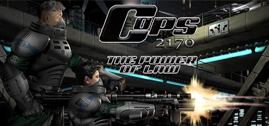

**Platforms:** Windows &nbsp;|&nbsp; **Genre:** Action, Adventure, Strategy &nbsp;|&nbsp; **Released:** January 27

> COPS 2170: The Power of Law is a hybrid of RPG and tactical strategy. The central storyline unfolds in the future where the cyberpunk culture and a highly-urban oriented society have populated North America.
>
> _Synopsis source: Steam_

[Steam](https://store.steampowered.com/app/1913160)

---

### Cossacks II: Napoleonic Wars

**Platforms:** Windows &nbsp;|&nbsp; **Developer:** GSC Game World &nbsp;|&nbsp; **Publisher:** CDV Software &nbsp;|&nbsp; **Genre:** Real-time strategy &nbsp;|&nbsp; **Released:** April 4, 2005

[Wikipedia](https://en.wikipedia.org/wiki/Cossacks_II:_Napoleonic_Wars)

---

### Crazy Frog Racer

**Platforms:** PlayStation 2, Nintendo DS, Windows, Game Boy Advance &nbsp;|&nbsp; **Developer:** Neko Entertainment &nbsp;|&nbsp; **Publisher:** Digital Jesters &nbsp;|&nbsp; **Genre:** Racing

[Wikipedia](https://en.wikipedia.org/wiki/Crazy_Frog_Racer)

---

### Crazy Machines

**Platforms:** Windows, macOS &nbsp;|&nbsp; **Developer:** FAKT Software &nbsp;|&nbsp; **Publisher:** Novitas Publishing, DTP Entertainment, Pepper Games, Viva Media &nbsp;|&nbsp; **Genre:** Puzzle &nbsp;|&nbsp; **Released:** October 2005

[Wikipedia](https://en.wikipedia.org/wiki/Crazy_Machines)

---

### Crime Life: Gang Wars

**Platforms:** PlayStation 2, Xbox, Windows &nbsp;|&nbsp; **Developer:** Hothouse Creations &nbsp;|&nbsp; **Publisher:** Konami &nbsp;|&nbsp; **Genre:** Action &nbsp;|&nbsp; **Released:** November 11, 2005

[Wikipedia](https://en.wikipedia.org/wiki/Crime_Life:_Gang_Wars)

---

### Cross Racing Championship 2005

**Platforms:** Windows &nbsp;|&nbsp; **Developer:** Invictus Games &nbsp;|&nbsp; **Publisher:** Invictus Games, Take 2 Interactive, CD Expert &nbsp;|&nbsp; **Genre:** Racing &nbsp;|&nbsp; **Released:** October 4, 2005

[Wikipedia](https://en.wikipedia.org/wiki/Cross_Racing_Championship_2005)

---

### CT Special Forces: Fire for Effect

**Platforms:** Windows, PlayStation 2, Xbox &nbsp;|&nbsp; **Developer:** Asobo Studio &nbsp;|&nbsp; **Publisher:** Hip Games &nbsp;|&nbsp; **Genre:** Third-person shooter &nbsp;|&nbsp; **Released:** March 22, 2005

[Wikipedia](https://en.wikipedia.org/wiki/CT_Special_Forces:_Fire_for_Effect)

---

### Cuban Missile Crisis: The Aftermath

**Platforms:** Windows &nbsp;|&nbsp; **Developer:** G5 Software &nbsp;|&nbsp; **Publisher:** 1C Company, Strategy First &nbsp;|&nbsp; **Genre:** Real-time tactics &nbsp;|&nbsp; **Released:** February 4, 2005

[Wikipedia](https://en.wikipedia.org/wiki/Cuban_Missile_Crisis:_The_Aftermath)

---

### Cute Knight

**Platforms:** Windows, Linux, macOS &nbsp;|&nbsp; **Developer:** Hanako Games &nbsp;|&nbsp; **Publisher:** IWin &nbsp;|&nbsp; **Genre:** Life simulation, casual, role-playing, Raising simulation &nbsp;|&nbsp; **Released:** October 13, 2005

[Wikipedia](https://en.wikipedia.org/wiki/Cute_Knight)

---

### Daemonica

**Platforms:** Windows &nbsp;|&nbsp; **Developer:** RA Images, Cinemax &nbsp;|&nbsp; **Publisher:** Cinemax, Meridian4 &nbsp;|&nbsp; **Genre:** Action-adventure game &nbsp;|&nbsp; **Released:** May 13, 2005

[Wikipedia](https://en.wikipedia.org/wiki/Daemonica)

---

### Dangerous Waters

**Platforms:** Windows &nbsp;|&nbsp; **Developer:** Sonalysts Combat Simulations &nbsp;|&nbsp; **Publisher:** Strategy First &nbsp;|&nbsp; **Genre:** Naval simulator &nbsp;|&nbsp; **Released:** February 22, 2005

[Wikipedia](https://en.wikipedia.org/wiki/Dangerous_Waters_(video_game))

---

### Darwinia

**Platforms:** Windows, Linux, macOS, Steam &nbsp;|&nbsp; **Developer:** Introversion Software &nbsp;|&nbsp; **Publisher:** Introversion Software, Ambrosia Software, Cinemaware Marquee/eGames, Stomp &nbsp;|&nbsp; **Genre:** Real-time tactics, real-time strategy &nbsp;|&nbsp; **Released:** March 4, 2005

[Wikipedia](https://en.wikipedia.org/wiki/Darwinia_(video_game))

---

### Dawn of Magic

**Platforms:** Windows &nbsp;|&nbsp; **Developer:** SkyFallen Entertainment &nbsp;|&nbsp; **Publisher:** 1C Company &nbsp;|&nbsp; **Genre:** Action role-playing game &nbsp;|&nbsp; **Released:** December 16, 2005

[Wikipedia](https://en.wikipedia.org/wiki/Dawn_of_Magic)

---

### Day of Defeat: Source

**Platforms:** Windows &nbsp;|&nbsp; **Developer:** Valve &nbsp;|&nbsp; **Publisher:** Valve &nbsp;|&nbsp; **Genre:** First-person shooter &nbsp;|&nbsp; **Released:** September 26, 2005

[Wikipedia](https://en.wikipedia.org/wiki/Day_of_Defeat:_Source)

---

### Dead to Rights II

**Platforms:** PlayStation 2, Xbox, Windows &nbsp;|&nbsp; **Developer:** Widescreen Games, Namco &nbsp;|&nbsp; **Publisher:** Namco Hometek, Electronic Arts &nbsp;|&nbsp; **Genre:** third-person shooter &nbsp;|&nbsp; **Released:** April 12, 2005

[Wikipedia](https://en.wikipedia.org/wiki/Dead_to_Rights_II)

---

### Delta Force: Xtreme

**Platforms:** Windows &nbsp;|&nbsp; **Developer:** NovaLogic &nbsp;|&nbsp; **Publisher:** NovaLogic &nbsp;|&nbsp; **Genre:** First-person shooter &nbsp;|&nbsp; **Released:** April 21, 2005

[Wikipedia](https://en.wikipedia.org/wiki/Delta_Force:_Xtreme)

---

### Democracy

**Platforms:** Linux, Windows, macOS &nbsp;|&nbsp; **Developer:** Positech Games, Red Marble Games &nbsp;|&nbsp; **Publisher:** Positech Games, Tri-Synergy &nbsp;|&nbsp; **Genre:** Government simulation, social simulation &nbsp;|&nbsp; **Released:** April 17, 2005

[Wikipedia](https://en.wikipedia.org/wiki/Democracy_(video_game))

---

### Diplomacy

**Platforms:** Windows &nbsp;|&nbsp; **Developer:** Paradox Development Studio &nbsp;|&nbsp; **Publisher:** Paradox Interactive, PAN Vision &nbsp;|&nbsp; **Genre:** Turn-based strategy &nbsp;|&nbsp; **Released:** October 4, 2005

[Wikipedia](https://en.wikipedia.org/wiki/Diplomacy_(2005_video_game))

---

### Domination

**Platforms:** Windows &nbsp;|&nbsp; **Developer:** Wargaming &nbsp;|&nbsp; **Publisher:** DreamCatcher Games &nbsp;|&nbsp; **Genre:** Turn-based tactics &nbsp;|&nbsp; **Released:** February 2005

[Wikipedia](https://en.wikipedia.org/wiki/Domination_(video_game))

---

### Doom 3: Resurrection of Evil

**Platforms:** Windows, Xbox &nbsp;|&nbsp; **Released:** April 3

---

### Down in Flames

**Platforms:** Windows &nbsp;|&nbsp; **Developer:** Dan Verssen Games &nbsp;|&nbsp; **Publisher:** Battlefront.com &nbsp;|&nbsp; **Genre:** Turn-based strategy &nbsp;|&nbsp; **Released:** September 28, 2005

[Wikipedia](https://en.wikipedia.org/wiki/Down_in_Flames_(video_game))

---

### Dragon Ball Z: Budokai Tenkaichi

**Platforms:** PlayStation 2, Wii, PlayStation Portable, Windows &nbsp;|&nbsp; **Developer:** Spike, Spike Chunsoft &nbsp;|&nbsp; **Publisher:** Bandai Namco Entertainment, Atari &nbsp;|&nbsp; **Genre:** Fighting game

[Wikipedia](https://en.wikipedia.org/wiki/Dragon_Ball_Z:_Budokai_Tenkaichi)

---

### Dream of Mirror Online

**Platforms:** Windows &nbsp;|&nbsp; **Developer:** Softstar &nbsp;|&nbsp; **Publisher:** Joypark, Gamania, Aeria Games, Goldensoft &nbsp;|&nbsp; **Genre:** MMORPG &nbsp;|&nbsp; **Released:** September 9, 2005

[Wikipedia](https://en.wikipedia.org/wiki/Dream_of_Mirror_Online)

---

### Driver 3

**Platforms:** Windows, Game Boy Advance &nbsp;|&nbsp; **Released:** March 15

[Wikipedia](https://en.wikipedia.org/wiki/Driver_3)

---

### Dungeon Fighter Online

**Platforms:** Windows &nbsp;|&nbsp; **Developer:** Neople &nbsp;|&nbsp; **Publisher:** Neople, Tencent &nbsp;|&nbsp; **Genre:** Beat 'em up &nbsp;|&nbsp; **Released:** August 2005

[Wikipedia](https://en.wikipedia.org/wiki/Dungeon_Fighter_Online)

---

### Dungeon Lords

**Platforms:** Windows &nbsp;|&nbsp; **Developer:** Heuristic Park &nbsp;|&nbsp; **Publisher:** DreamCatcher Interactive, FX Interactive, Crimson Cow, 1C, Typhoon Games &nbsp;|&nbsp; **Genre:** Action role-playing &nbsp;|&nbsp; **Released:** May 5, 2005

[Wikipedia](https://en.wikipedia.org/wiki/Dungeon_Lords_(video_game))

---

### Dungeon Siege II

**Platforms:** Windows &nbsp;|&nbsp; **Genre:** RPG &nbsp;|&nbsp; **Released:** August 16

> It’s been a generation since you vanquished the evil that plagued the Land of Ehb, and now…a new menace has awakened. In Dungeon Siege II, the sequel to the best-selling RPG from Gas Powered Games, you will be called on to again wield sword and spell to save the world from a growing abomination many years in the making.
>
> _Synopsis source: Steam_

[Wikipedia](https://en.wikipedia.org/wiki/Dungeon_Siege_II) · [Steam](https://store.steampowered.com/app/39200)

---

### Dungeons & Dragons: Dragonshard

**Platforms:** Windows &nbsp;|&nbsp; **Developer:** Liquid Entertainment &nbsp;|&nbsp; **Publisher:** Atari &nbsp;|&nbsp; **Genre:** Real-time strategy, Role-playing &nbsp;|&nbsp; **Released:** September 27, 2005

[Wikipedia](https://en.wikipedia.org/wiki/Dungeons_&_Dragons:_Dragonshard)

---

### Earth 2160

**Platforms:** Windows, Linux &nbsp;|&nbsp; **Developer:** Reality Pump Studios &nbsp;|&nbsp; **Publisher:** Zuxxez Entertainment / Deep Silver, Midway Games &nbsp;|&nbsp; **Genre:** Real-time strategy &nbsp;|&nbsp; **Released:** June 2005

[Wikipedia](https://en.wikipedia.org/wiki/Earth_2160)

---

### Echo: Secrets of the Lost Cavern

**Platforms:** Windows &nbsp;|&nbsp; **Developer:** Kheops Studio &nbsp;|&nbsp; **Publisher:** The Adventure Company, Coladia Games &nbsp;|&nbsp; **Genre:** Adventure &nbsp;|&nbsp; **Released:** June 11, 2005

[Wikipedia](https://en.wikipedia.org/wiki/Echo:_Secrets_of_the_Lost_Cavern)

---

### Ed, Edd n Eddy: The Mis-Edventures

**Platforms:** Windows, PlayStation 2, Xbox, GameCube, Game Boy Advance &nbsp;|&nbsp; **Released:** November 3

---

### Elite Warriors: Vietnam

**Platforms:** Windows &nbsp;|&nbsp; **Developer:** nFusion &nbsp;|&nbsp; **Publisher:** Bold Games &nbsp;|&nbsp; **Genre:** Tactical shooter &nbsp;|&nbsp; **Released:** March 25, 2005

[Wikipedia](https://en.wikipedia.org/wiki/Elite_Warriors:_Vietnam)

---

### Emergency 3: Mission Life

**Platforms:** Windows &nbsp;|&nbsp; **Developer:** Sixteen Tons Entertainment &nbsp;|&nbsp; **Publisher:** Take-Two Interactive, Strategy First &nbsp;|&nbsp; **Genre:** Real-time strategy, simulation &nbsp;|&nbsp; **Released:** January 21, 2005

[Wikipedia](https://en.wikipedia.org/wiki/Emergency_3:_Mission_Life)

---

### Emil Chronicle Online

**Platforms:** Windows &nbsp;|&nbsp; **Developer:** Headlock &nbsp;|&nbsp; **Publisher:** Gravity, BROCCOLI &nbsp;|&nbsp; **Genre:** MMORPG &nbsp;|&nbsp; **Released:** November 24, 2005

[Wikipedia](https://en.wikipedia.org/wiki/Emil_Chronicle_Online)

---

### Empire Earth II

**Platforms:** Windows &nbsp;|&nbsp; **Developer:** Mad Doc Software &nbsp;|&nbsp; **Publisher:** Vivendi Universal Games, Sierra Entertainment &nbsp;|&nbsp; **Genre:** Real-time strategy &nbsp;|&nbsp; **Released:** April 26, 2005

[Wikipedia](https://en.wikipedia.org/wiki/Empire_Earth_II)

---

### Europa Barbarorum

**Platforms:** Windows, macOS &nbsp;|&nbsp; **Developer:** Europa Barbarorum Development Team &nbsp;|&nbsp; **Genre:** Real-time tactics, Turn-based strategy &nbsp;|&nbsp; **Released:** December 27, 2005

[Wikipedia](https://en.wikipedia.org/wiki/Europa_Barbarorum)

---

### EverQuest II: Desert of Flames

**Platforms:** Windows &nbsp;|&nbsp; **Released:** September 13

---

### Evil Dead: Regeneration

**Platforms:** Windows, PlayStation 2, Xbox &nbsp;|&nbsp; **Released:** September 13

---

### Evochron Alliance

**Platforms:** Windows &nbsp;|&nbsp; **Developer:** StarWraith 3D Games &nbsp;|&nbsp; **Publisher:** StarWraith 3D Games &nbsp;|&nbsp; **Genre:** Space simulation

[Wikipedia](https://en.wikipedia.org/wiki/Evochron_Alliance)

---

### F.E.A.R.

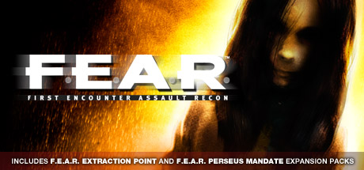

**Platforms:** Windows &nbsp;|&nbsp; **Genre:** Action &nbsp;|&nbsp; **Released:** October 17

> Experience the original F.E.A.R. along with F.E.A.R. Extraction Point and F.E.A.R. Perseus Mandate.
>
> _Synopsis source: Steam_

[Wikipedia](https://en.wikipedia.org/wiki/F.E.A.R._(video_game)) · [Steam](https://store.steampowered.com/app/21090)

---

### Fahrenheit

**Platforms:** PlayStation 2, Xbox, Windows &nbsp;|&nbsp; **Released:** September 26

[Wikipedia](https://en.wikipedia.org/wiki/Fahrenheit_(2005_video_game))

---

### Fahrenheit: Indigo Prophecy

**Platforms:** Windows, PlayStation 2, Xbox &nbsp;|&nbsp; **Released:** September 20

[Wikipedia](https://en.wikipedia.org/wiki/Fahrenheit_(2005_video_game))

---

### Falcon 4.0: Allied Force

**Platforms:** Windows &nbsp;|&nbsp; **Publisher:** Graphsim Entertainment &nbsp;|&nbsp; **Released:** June 28, 2005

---

### Fantastic Four

**Platforms:** Windows, GameCube, PlayStation 2, Xbox, Game Boy Advance &nbsp;|&nbsp; **Released:** June 27

[Wikipedia](https://en.wikipedia.org/wiki/Fantastic_Four_(2005_video_game))

---

### FASTT Math

**Platforms:** Windows &nbsp;|&nbsp; **Developer:** Tom Snyder Productions, Scholastic Corporation &nbsp;|&nbsp; **Publisher:** Scholastic Corporation, Houghton Mifflin Harcourt &nbsp;|&nbsp; **Genre:** Mathematics

[Wikipedia](https://en.wikipedia.org/wiki/FASTT_Math)

---

### Fate

**Platforms:** Windows, macOS &nbsp;|&nbsp; **Released:** May 18

[Wikipedia](https://en.wikipedia.org/wiki/Fate_(video_game))

---

### Façade

**Platforms:** Windows, macOS &nbsp;|&nbsp; **Genre:** Action, Indie &nbsp;|&nbsp; **Released:** July 5

> Broken Facade is an isometric metroidvania, inspired by Bullet Hell and Hack &amp; Slash games, with a post-apocalyptic cyberpunk 1920s vibe. Tear through brutal combat inspired by zero-to-hero fighting animes. Cross a shattered city and meet a small cast of colorful characters.
>
> _Synopsis source: Steam_

[Wikipedia](https://en.wikipedia.org/wiki/Fa%C3%A7ade_(interactive_story)) · [Steam](https://store.steampowered.com/app/4218870)

---

### FIFA 06

**Platforms:** Windows, PlayStation 2, Xbox, GameCube, Nintendo DS, Mobile phone, PlayStation Portable, Game Boy Advance &nbsp;|&nbsp; **Released:** October 4

[Wikipedia](https://en.wikipedia.org/wiki/FIFA_06)

---

### FlatOut

**Platforms:** Windows, Xbox, PlayStation 2 &nbsp;|&nbsp; **Released:** July 12 (NA/JP)

[Wikipedia](https://en.wikipedia.org/wiki/FlatOut_(video_game))

---

### Food Force

**Platforms:** Windows, macOS &nbsp;|&nbsp; **Publisher:** United Nations World Food Programme &nbsp;|&nbsp; **Genre:** Educational, serious

[Wikipedia](https://en.wikipedia.org/wiki/Food_Force)

---

### Football Manager 2006

**Platforms:** Windows, macOS, PlayStation Portable &nbsp;|&nbsp; **Developer:** Sports Interactive &nbsp;|&nbsp; **Publisher:** Sega &nbsp;|&nbsp; **Genre:** Sports management &nbsp;|&nbsp; **Released:** October 21, 2005

[Wikipedia](https://en.wikipedia.org/wiki/Football_Manager_2006)

---

### Freedom Force vs the 3rd Reich

**Platforms:** Windows &nbsp;|&nbsp; **Developer:** Irrational Games &nbsp;|&nbsp; **Publisher:** Irrational Games, Digital Jesters &nbsp;|&nbsp; **Genre:** Real-time tactics, tactical role-playing &nbsp;|&nbsp; **Released:** March 8, 2005

[Wikipedia](https://en.wikipedia.org/wiki/Freedom_Force_vs_the_3rd_Reich)

---

### Friends: The One with All the Trivia

**Platforms:** PlayStation 2, Windows &nbsp;|&nbsp; **Developer:** Artech Studios &nbsp;|&nbsp; **Publisher:** Warner Bros. Interactive Entertainment &nbsp;|&nbsp; **Genre:** Trivia &nbsp;|&nbsp; **Released:** November 21, 2005

[Wikipedia](https://en.wikipedia.org/wiki/Friends:_The_One_with_All_the_Trivia)

---

### Front Mission: Online

**Platforms:** PlayStation 2, Windows &nbsp;|&nbsp; **Developer:** Square Enix &nbsp;|&nbsp; **Publisher:** Square Enix &nbsp;|&nbsp; **Genre:** Massively multiplayer online game, Third-person shooter &nbsp;|&nbsp; **Released:** May 12, 2005

[Wikipedia](https://en.wikipedia.org/wiki/Front_Mission:_Online)

---

### Gary Grigsby's World at War

**Platforms:** Windows &nbsp;|&nbsp; **Developer:** 2 by 3 Games &nbsp;|&nbsp; **Publisher:** Matrix Games &nbsp;|&nbsp; **Genre:** Computer wargame

[Wikipedia](https://en.wikipedia.org/wiki/Gary_Grigsby's_World_at_War)

---

### Geneforge 3

**Platforms:** macOS, Windows &nbsp;|&nbsp; **Developer:** Spiderweb Software &nbsp;|&nbsp; **Publisher:** Spiderweb Software &nbsp;|&nbsp; **Genre:** Role-playing &nbsp;|&nbsp; **Released:** March 28, 2005

[Wikipedia](https://en.wikipedia.org/wiki/Geneforge_3)

---

### Geniu$: The Tech Tycoon Game

**Platforms:** Windows &nbsp;|&nbsp; **Developer:** Radon Labs &nbsp;|&nbsp; **Publisher:** Viva Media &nbsp;|&nbsp; **Genre:** Business simulation &nbsp;|&nbsp; **Released:** November 1, 2005

[Wikipedia](https://en.wikipedia.org/wiki/Geniu$:_The_Tech_Tycoon_Game)

---

### Ghost Online

**Platforms:** Windows &nbsp;|&nbsp; **Developer:** Netgame &nbsp;|&nbsp; **Publisher:** MGame, Netgame, OurGame, GameFlier, Gemscool &nbsp;|&nbsp; **Genre:** Fantasy, Massively Multiplayer Online Game

[Wikipedia](https://en.wikipedia.org/wiki/Ghost_Online)

---

### Grand Theft Auto: San Andreas

**Platforms:** Xbox, Windows &nbsp;|&nbsp; **Publisher:** Rockstar Games &nbsp;|&nbsp; **Released:** June 7, 2005

---

### GT Legends

**Platforms:** Windows &nbsp;|&nbsp; **Developer:** SimBin Studios &nbsp;|&nbsp; **Publisher:** 10tacle Publishing &nbsp;|&nbsp; **Genre:** Sim racing &nbsp;|&nbsp; **Released:** October 6, 2005

[Wikipedia](https://en.wikipedia.org/wiki/GT_Legends)

---

### GTR – FIA GT Racing Game

**Platforms:** Windows &nbsp;|&nbsp; **Developer:** Simbin Studios AB &nbsp;|&nbsp; **Publisher:** 10tacle Publishing &nbsp;|&nbsp; **Genre:** Sim racing &nbsp;|&nbsp; **Released:** March 11, 2005

[Wikipedia](https://en.wikipedia.org/wiki/GTR_%E2%80%93_FIA_GT_Racing_Game)

---

### Guild Wars

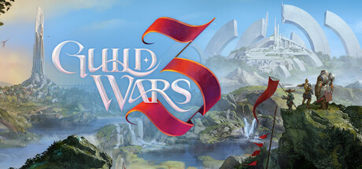

**Platforms:** Windows &nbsp;|&nbsp; **Genre:** Action, Adventure, Massively Multiplayer, RPG &nbsp;|&nbsp; **Released:** April 26

> Guild Wars 3 is an action-adventure MMORPG, a modern evolution of the genre that blends rich action-combat, character building, and skill collection. Set in the enchanting frontier of Orr, the world brims with mystery, magic, and wonder.
>
> _Synopsis source: Steam_

[Wikipedia](https://en.wikipedia.org/wiki/Guild_Wars_(video_game)) · [Steam](https://store.steampowered.com/app/4743930)

---

### Gun

**Platforms:** Windows, PlayStation 2, Xbox, GameCube &nbsp;|&nbsp; **Released:** November 8

[Wikipedia](https://en.wikipedia.org/wiki/Gun_(video_game))

---

### Half-Life 2: Capture the Flag

**Platforms:** Windows, Linux &nbsp;|&nbsp; **Developer:** HL2:CTF team &nbsp;|&nbsp; **Genre:** Action

[Wikipedia](https://en.wikipedia.org/wiki/Half-Life_2:_Capture_the_Flag)

---

### Half-Life 2: Lost Coast

**Platforms:** Windows &nbsp;|&nbsp; **Released:** October 27

---

### Hammer & Sickle

**Platforms:** Windows &nbsp;|&nbsp; **Developer:** Novik&Co, Nival Interactive &nbsp;|&nbsp; **Publisher:** CDV Software Entertainment, T-time Technology &nbsp;|&nbsp; **Genre:** Tactical RPG &nbsp;|&nbsp; **Released:** April 29, 2005

[Wikipedia](https://en.wikipedia.org/wiki/Hammer_&_Sickle)

---

### Hard Truck Apocalypse

**Platforms:** Windows &nbsp;|&nbsp; **Developer:** Targem Games &nbsp;|&nbsp; **Publisher:** Nival Interactive, CDV Software, Buka Entertainment &nbsp;|&nbsp; **Genre:** Vehicular combat, business simulation, post-apocalyptic science fiction &nbsp;|&nbsp; **Released:** December 8, 2005

[Wikipedia](https://en.wikipedia.org/wiki/Hard_Truck_Apocalypse)

---

### Harry Potter And The Goblet Of Fire

**Platforms:** Windows, PlayStation 2, Xbox, GameCube, Nintendo DS, Game Boy Advance, PlayStation Portable &nbsp;|&nbsp; **Released:** November 8

[Wikipedia](https://en.wikipedia.org/wiki/Harry_Potter_and_the_Goblet_of_Fire_(video_game))

---

### Hauntings of Mystery Manor

**Platforms:** Windows &nbsp;|&nbsp; **Developer:** Cindy Pondillo &nbsp;|&nbsp; **Publisher:** Cindy Pondillo &nbsp;|&nbsp; **Genre:** Adventure &nbsp;|&nbsp; **Released:** June 15, 2005

[Wikipedia](https://en.wikipedia.org/wiki/Hauntings_of_Mystery_Manor)

---

### Hearts of Iron II

**Platforms:** Windows, macOS &nbsp;|&nbsp; **Developer:** Paradox Development Studio &nbsp;|&nbsp; **Publisher:** Paradox Interactive, PAN Vision AB &nbsp;|&nbsp; **Genre:** Grand strategy &nbsp;|&nbsp; **Released:** January 4, 2005

[Wikipedia](https://en.wikipedia.org/wiki/Hearts_of_Iron_II)

---

### Heavy Weapon

**Platforms:** Windows, macOS, Xbox 360, PlayStation 2, PlayStation 3 &nbsp;|&nbsp; **Developer:** PopCap Games &nbsp;|&nbsp; **Publisher:** PopCap Games &nbsp;|&nbsp; **Genre:** Scrolling shooter &nbsp;|&nbsp; **Released:** March 1, 2005

[Wikipedia](https://en.wikipedia.org/wiki/Heavy_Weapon)

---

### Heroes of the Pacific

**Platforms:** PlayStation 2, Windows, Xbox &nbsp;|&nbsp; **Developer:** IR Gurus &nbsp;|&nbsp; **Publisher:** Codemasters, Ubisoft &nbsp;|&nbsp; **Genre:** Air combat simulation &nbsp;|&nbsp; **Released:** September 23, 2005

[Wikipedia](https://en.wikipedia.org/wiki/Heroes_of_the_Pacific)

---

### Imperia Online

**Platforms:** Windows, Browser, Linux &nbsp;|&nbsp; **Developer:** Imperia Online JSC &nbsp;|&nbsp; **Publisher:** Imperia Online JSC &nbsp;|&nbsp; **Genre:** MMORTS &nbsp;|&nbsp; **Released:** August 23, 2005

[Wikipedia](https://en.wikipedia.org/wiki/Imperia_Online)

---

### Imperial Glory

**Platforms:** Windows &nbsp;|&nbsp; **Developer:** Pyro Studios, Robosoft Technologies &nbsp;|&nbsp; **Publisher:** Eidos Interactive, Feral Interactive &nbsp;|&nbsp; **Genre:** Real-time tactics &nbsp;|&nbsp; **Released:** May 17, 2005

[Wikipedia](https://en.wikipedia.org/wiki/Imperial_Glory)

---

### Indigo Prophecy

**Platforms:** PlayStation 2, Windows, Xbox &nbsp;|&nbsp; **Developer:** Quantic Dream &nbsp;|&nbsp; **Publisher:** Atari &nbsp;|&nbsp; **Genre:** Action-adventure &nbsp;|&nbsp; **Released:** September 16, 2005

[Wikipedia](https://en.wikipedia.org/wiki/Indigo_Prophecy)

---

### Jade Dynasty

**Platforms:** Windows &nbsp;|&nbsp; **Developer:** Beijing Perfect World &nbsp;|&nbsp; **Publisher:** Beijing Perfect World, Perfect World Entertainment, Perfect World Europe &nbsp;|&nbsp; **Genre:** MMORPG

[Wikipedia](https://en.wikipedia.org/wiki/Jade_Dynasty_(video_game))

---

### Jingai Makyō

**Platforms:** Windows &nbsp;|&nbsp; **Developer:** Nitroplus &nbsp;|&nbsp; **Publisher:** Nitroplus &nbsp;|&nbsp; **Genre:** Visual novel, Romance &nbsp;|&nbsp; **Released:** June 24, 2005

[Wikipedia](https://en.wikipedia.org/wiki/Jingai_Maky%C5%8D)

---

### Judge Dredd: Dredd vs. Death

**Platforms:** PlayStation 2, Xbox, GameCube, Windows &nbsp;|&nbsp; **Genre:** Action &nbsp;|&nbsp; **Released:** February 24

> Welcome to Mega-City One, a city of over 400 million people - every one of them a potential criminal. It is the third decade of the 22nd Century, unemployment is widespread, boredom is universal and only the Judges can prevent total anarchy. Empowered to dispense instant justice, they are Judge, Jury and Executioner all in one.
>
> _Synopsis source: Steam_

[Steam](https://store.steampowered.com/app/3710)

---

### Juiced

**Platforms:** Windows, PlayStation 2, Xbox &nbsp;|&nbsp; **Genre:** Action, Adventure, Indie &nbsp;|&nbsp; **Released:** June 13

> Embark on an epic journey through exotic worlds to uncover the mystery of the magic crystals! An exciting retro platform adventure in the nostalgic style of the 90's DOS platformers
>
> _Synopsis source: Steam_

[Wikipedia](https://en.wikipedia.org/wiki/Juiced_(video_game)) · [Steam](https://store.steampowered.com/app/1287310)

---

### Kao the Kangaroo: Mystery of the Volcano

**Platforms:** Windows &nbsp;|&nbsp; **Developer:** Tate Interactive &nbsp;|&nbsp; **Publisher:** Cenega, 1C Company, N3V Games &nbsp;|&nbsp; **Genre:** Platform &nbsp;|&nbsp; **Released:** December 2, 2005

[Wikipedia](https://en.wikipedia.org/wiki/Kao_the_Kangaroo:_Mystery_of_the_Volcano)

---

### King Kong

**Platforms:** Mobile phone, GameCube, PlayStation 2, Windows, Xbox, Xbox 360, Game Boy Advance, Nintendo DS, PlayStation Portable &nbsp;|&nbsp; **Developer:** Ubisoft Montpellier, Ubisoft Casablanca, Ubisoft Montreal, Gameloft &nbsp;|&nbsp; **Publisher:** Ubisoft &nbsp;|&nbsp; **Genre:** First-person shooter, action-adventure &nbsp;|&nbsp; **Released:** November 14, 2005

[Wikipedia](https://en.wikipedia.org/wiki/King_Kong_(2005_video_game))

---

### Knights of the Temple II

**Platforms:** Windows, PlayStation 2, Xbox &nbsp;|&nbsp; **Developer:** Cauldron &nbsp;|&nbsp; **Publisher:** Playlogic Entertainment, TDK Mediactive Europe, Evolved Games &nbsp;|&nbsp; **Genre:** Action-adventure, hack and slash

[Wikipedia](https://en.wikipedia.org/wiki/Knights_of_the_Temple_II)

---

### Kusari

**Platforms:** Windows &nbsp;|&nbsp; **Developer:** Leaf &nbsp;|&nbsp; **Publisher:** Aquaplus &nbsp;|&nbsp; **Genre:** Visual novel, Eroge &nbsp;|&nbsp; **Released:** September 22, 2005

[Wikipedia](https://en.wikipedia.org/wiki/Kusari)

---

### Land of the Dead: Road to Fiddler's Green

**Platforms:** Windows, Xbox &nbsp;|&nbsp; **Developer:** Brainbox Games &nbsp;|&nbsp; **Publisher:** Groove Games &nbsp;|&nbsp; **Genre:** First-person shooter &nbsp;|&nbsp; **Released:** October 20, 2005

[Wikipedia](https://en.wikipedia.org/wiki/Land_of_the_Dead:_Road_to_Fiddler's_Green)

---

### Law & Order: Criminal Intent

**Platforms:** Windows &nbsp;|&nbsp; **Developer:** Legacy Interactive &nbsp;|&nbsp; **Genre:** Adventure &nbsp;|&nbsp; **Released:** November 15, 2005

[Wikipedia](https://en.wikipedia.org/wiki/Law_&_Order:_Criminal_Intent_(video_game))

---

### Legion Arena

**Platforms:** Windows &nbsp;|&nbsp; **Developer:** Slitherine Strategies &nbsp;|&nbsp; **Publisher:** Black Bean Games, Strategy First, Freeverse Software &nbsp;|&nbsp; **Genre:** Computer wargame &nbsp;|&nbsp; **Released:** November 11, 2005

[Wikipedia](https://en.wikipedia.org/wiki/Legion_Arena)

---

### Lego Star Wars: The Video Game

**Platforms:** Windows, PlayStation 2, Xbox, Game Boy Advance, GameCube &nbsp;|&nbsp; **Released:** April 5

---

### Lula 3D

**Platforms:** Windows &nbsp;|&nbsp; **Developer:** cdv Software Entertainment &nbsp;|&nbsp; **Publisher:** cdv Software Entertainment &nbsp;|&nbsp; **Genre:** Erotic, Adventure &nbsp;|&nbsp; **Released:** June 22, 2005

[Wikipedia](https://en.wikipedia.org/wiki/Lula_3D)

---

### Luxor

**Platforms:** macOS, Windows, Wii, PlayStation Portable &nbsp;|&nbsp; **Developer:** MumboJumbo, Absolutist &nbsp;|&nbsp; **Publisher:** MumboJumbo &nbsp;|&nbsp; **Genre:** Puzzle &nbsp;|&nbsp; **Released:** May 30, 2005

[Wikipedia](https://en.wikipedia.org/wiki/Luxor_(video_game))

---

### Madagascar

**Platforms:** Windows, GameCube, PlayStation 2, Xbox, Game Boy Advance, Nintendo DS &nbsp;|&nbsp; **Released:** May 24

[Wikipedia](https://en.wikipedia.org/wiki/Madagascar_(video_game))

---

### Madden NFL 06

**Platforms:** PlayStation 2, GameCube, Nintendo DS, Windows &nbsp;|&nbsp; **Released:** August 8

[Wikipedia](https://en.wikipedia.org/wiki/Madden_NFL_06)

---

### Manhattan Chase

**Platforms:** Windows &nbsp;|&nbsp; **Developer:** Team6 Game Studios &nbsp;|&nbsp; **Publisher:** Denda &nbsp;|&nbsp; **Genre:** Action-adventure, driving, third-person shooter &nbsp;|&nbsp; **Released:** June 1, 2005

[Wikipedia](https://en.wikipedia.org/wiki/Manhattan_Chase)

---

### Master of Epic

**Platforms:** Windows &nbsp;|&nbsp; **Developer:** Konami, Gonzo Rosso Online &nbsp;|&nbsp; **Genre:** MMORPG &nbsp;|&nbsp; **Released:** April 1, 2005

[Wikipedia](https://en.wikipedia.org/wiki/Master_of_Epic)

---

### Mega Man X8

**Platforms:** Windows &nbsp;|&nbsp; **Released:** September 21 (EU)

[Wikipedia](https://en.wikipedia.org/wiki/Mega_Man_X8)

---

### Memories Off 5: Togireta Film

**Platforms:** PlayStation 2, PlayStation Portable, Windows &nbsp;|&nbsp; **Developer:** KID, 5pb. &nbsp;|&nbsp; **Publisher:** CyberFront, 5pb. &nbsp;|&nbsp; **Genre:** Visual novel &nbsp;|&nbsp; **Released:** October 27, 2005

[Wikipedia](https://en.wikipedia.org/wiki/Memories_Off_5:_Togireta_Film)

---

### Midnight Pool

**Platforms:** Mobile phone, Windows, N-Gage &nbsp;|&nbsp; **Developer:** Gameloft Montreal &nbsp;|&nbsp; **Publisher:** Gameloft &nbsp;|&nbsp; **Genre:** Sports simulation – pool &nbsp;|&nbsp; **Released:** April 8, 2005

[Wikipedia](https://en.wikipedia.org/wiki/Midnight_Pool)

---

### Minerva

**Platforms:** Windows &nbsp;|&nbsp; **Developer:** Adam Foster &nbsp;|&nbsp; **Genre:** First-person shooter, puzzle &nbsp;|&nbsp; **Released:** September 2, 2005

[Wikipedia](https://en.wikipedia.org/wiki/Minerva_(video_game))

---

### Mini Desktop Racing

**Platforms:** PlayStation 2, Windows &nbsp;|&nbsp; **Developer:** Data Design Interactive &nbsp;|&nbsp; **Publisher:** Metro3D Europe, Data Design Interactive, Conspiracy Entertainment &nbsp;|&nbsp; **Genre:** Racing &nbsp;|&nbsp; **Released:** July 20, 2005

[Wikipedia](https://en.wikipedia.org/wiki/Mini_Desktop_Racing)

---

### Minions of Mirth

**Platforms:** macOS, Windows &nbsp;|&nbsp; **Developer:** Prairie Games, Inc. &nbsp;|&nbsp; **Publisher:** Prairie Games, Inc. &nbsp;|&nbsp; **Genre:** MMORPG &nbsp;|&nbsp; **Released:** December 2005

[Wikipedia](https://en.wikipedia.org/wiki/Minions_of_Mirth)

---

### Morning's Wrath

**Platforms:** Windows &nbsp;|&nbsp; **Developer:** Ethereal Darkness Interactive &nbsp;|&nbsp; **Publisher:** Ethereal Darkness Interactive &nbsp;|&nbsp; **Genre:** RPG &nbsp;|&nbsp; **Released:** October 1, 2005

[Wikipedia](https://en.wikipedia.org/wiki/Morning's_Wrath)

---

### MotoGP 3: Ultimate Racing Technology

**Platforms:** Windows, Xbox &nbsp;|&nbsp; **Released:** August 30

---

### MotoGP: Ultimate Racing Technology 3

**Platforms:** Windows, Xbox &nbsp;|&nbsp; **Developer:** Climax Racing &nbsp;|&nbsp; **Publisher:** THQ &nbsp;|&nbsp; **Genre:** Racing &nbsp;|&nbsp; **Released:** August 30, 2005

[Wikipedia](https://en.wikipedia.org/wiki/MotoGP:_Ultimate_Racing_Technology_3)

---

### MVP Baseball 2005

**Platforms:** Windows, GameCube, PlayStation 2, Xbox &nbsp;|&nbsp; **Released:** February 22

[Wikipedia](https://en.wikipedia.org/wiki/MVP_Baseball_2005)

---

### Myst V: End of Ages

**Platforms:** Windows &nbsp;|&nbsp; **Genre:** Adventure, Casual &nbsp;|&nbsp; **Released:** September 20

> The Grand Finale of the greatest adventure! Decide the fate of a civilization in this triumphant final chapter to the Myst saga. Embark on an epic journey into the heart of a shattered empire as the only explorer who can still save it— or destroy it with the wrong choices.
>
> _Synopsis source: Steam_

[Steam](https://store.steampowered.com/app/208110)

---

### Namco Museum: 50th Anniversary

**Platforms:** Game Boy Advance, PlayStation 2, Xbox, GameCube, Windows &nbsp;|&nbsp; **Developer:** Digital Eclipse &nbsp;|&nbsp; **Publisher:** Namco, Namco Hometek, Electronic Arts &nbsp;|&nbsp; **Genre:** Various &nbsp;|&nbsp; **Released:** August 30, 2005

[Wikipedia](https://en.wikipedia.org/wiki/Namco_Museum:_50th_Anniversary)

---

### Nancy Drew: Last Train to Blue Moon Canyon

**Platforms:** Windows &nbsp;|&nbsp; **Genre:** Action, Adventure, Casual, RPG, Simulation &nbsp;|&nbsp; **Released:** September 15

> Catch this train — it’s your ticket to solving a century-old mystery!
>
> _Synopsis source: Steam_

[Steam](https://store.steampowered.com/app/31810)

---

### Nancy Drew: Secret of the Old Clock

**Platforms:** Windows &nbsp;|&nbsp; **Genre:** Adventure &nbsp;|&nbsp; **Released:** July 12

> Venture into the Past and Outwit a Criminal Before Time Runs Out!
>
> _Synopsis source: Steam_

[Steam](https://store.steampowered.com/app/31880)

---

### Narbacular Drop

**Platforms:** Windows &nbsp;|&nbsp; **Developer:** Nuclear Monkey Software &nbsp;|&nbsp; **Publisher:** DigiPen Institute of Technology &nbsp;|&nbsp; **Genre:** Puzzle-platform game &nbsp;|&nbsp; **Released:** April 19, 2005

[Wikipedia](https://en.wikipedia.org/wiki/Narbacular_Drop)

---

### Narcissu

**Platforms:** macOS, Linux, Windows &nbsp;|&nbsp; **Developer:** Stage-nana &nbsp;|&nbsp; **Publisher:** Insani, Sekai Project &nbsp;|&nbsp; **Genre:** Visual novel

[Wikipedia](https://en.wikipedia.org/wiki/Narcissu)

---

### NASCAR SimRacing

**Platforms:** Windows &nbsp;|&nbsp; **Developer:** EA Tiburon &nbsp;|&nbsp; **Publisher:** EA Sports &nbsp;|&nbsp; **Genre:** Simulation, Sports, Racing &nbsp;|&nbsp; **Released:** February 15, 2005

[Wikipedia](https://en.wikipedia.org/wiki/NASCAR_SimRacing)

---

### Navy Field Online

**Platforms:** Windows &nbsp;|&nbsp; **Released:** October 20

---

### NBA Live 06

**Platforms:** GameCube, PlayStation 2, Windows, Xbox, Xbox 360, PlayStation Portable, Mobile phone &nbsp;|&nbsp; **Developer:** EA Canada &nbsp;|&nbsp; **Publisher:** EA Sports &nbsp;|&nbsp; **Genre:** Sports &nbsp;|&nbsp; **Released:** September 26, 2005

[Wikipedia](https://en.wikipedia.org/wiki/NBA_Live_06)

---

### Need for Speed: Most Wanted

**Platforms:** Windows, PlayStation 2, Xbox, GameCube, Game Boy Advance, Nintendo DS, PlayStation Portable, Xbox 360 &nbsp;|&nbsp; **Genre:** Action, Adventure, Racing &nbsp;|&nbsp; **Released:** November 15

> The open-world action in Need for Speed Most Wanted gives you the freedom to drive your way. Hit jumps and shortcuts, switch cars, lie low or head for terrain that plays to your vehicle’s unique strengths. Fight your way past cops and rivals using skill, high-end car tech and tons of nitrous.
>
> _Synopsis source: Steam_

[Steam](https://store.steampowered.com/app/1262560)

---

### Neuro Hunter

**Platforms:** Windows &nbsp;|&nbsp; **Released:** September 23 (UK)

[Wikipedia](https://en.wikipedia.org/wiki/Neuro_Hunter)

---

### Nexuiz

**Platforms:** Linux, Windows, macOS, Amiga &nbsp;|&nbsp; **Developer:** Alientrap &nbsp;|&nbsp; **Publisher:** Alientrap &nbsp;|&nbsp; **Genre:** First-person shooter &nbsp;|&nbsp; **Released:** May 31, 2005

[Wikipedia](https://en.wikipedia.org/wiki/Nexuiz)

---

### NHL 06

**Platforms:** PlayStation 2, GameCube, Windows, Xbox &nbsp;|&nbsp; **Developer:** EA Canada &nbsp;|&nbsp; **Publisher:** EA Sports &nbsp;|&nbsp; **Genre:** Sports &nbsp;|&nbsp; **Released:** September 6, 2005

[Wikipedia](https://en.wikipedia.org/wiki/NHL_06)

---

### NHL Eastside Hockey Manager 2005

**Platforms:** Windows, macOS &nbsp;|&nbsp; **Developer:** Sports Interactive &nbsp;|&nbsp; **Publisher:** Sega &nbsp;|&nbsp; **Genre:** Sports, ice hockey &nbsp;|&nbsp; **Released:** May 27, 2005

[Wikipedia](https://en.wikipedia.org/wiki/NHL_Eastside_Hockey_Manager_2005)

---

### NiBiRu: Age of Secrets

**Platforms:** Windows &nbsp;|&nbsp; **Developer:** Future Games &nbsp;|&nbsp; **Publisher:** The Adventure Company &nbsp;|&nbsp; **Genre:** Adventure &nbsp;|&nbsp; **Released:** March 11, 2005

[Wikipedia](https://en.wikipedia.org/wiki/NiBiRu:_Age_of_Secrets)

---

### Night Watch

**Platforms:** Windows &nbsp;|&nbsp; **Developer:** Nival Interactive &nbsp;|&nbsp; **Publisher:** CDV Software &nbsp;|&nbsp; **Genre:** Tactical RPG &nbsp;|&nbsp; **Released:** August 18, 2005

[Wikipedia](https://en.wikipedia.org/wiki/Night_Watch_(video_game))

---

### Ninjabread Man

**Platforms:** PlayStation 2, Windows &nbsp;|&nbsp; **Developer:** Data Design Interactive &nbsp;|&nbsp; **Publisher:** Metro3D Europe, Data Design Interactive, Conspiracy Entertainment &nbsp;|&nbsp; **Genre:** Platform, action-adventure &nbsp;|&nbsp; **Released:** July 13, 2005

[Wikipedia](https://en.wikipedia.org/wiki/Ninjabread_Man)

---

### Oasis

**Platforms:** Windows, Mobile phone &nbsp;|&nbsp; **Developer:** Mind Control Software &nbsp;|&nbsp; **Publisher:** PlayFirst, Activision &nbsp;|&nbsp; **Genre:** Turn-based strategy &nbsp;|&nbsp; **Released:** April 12, 2005

[Wikipedia](https://en.wikipedia.org/wiki/Oasis_(video_game))

---

### ObsCure

**Platforms:** Windows, PlayStation 2, Xbox &nbsp;|&nbsp; **Genre:** Action, Adventure &nbsp;|&nbsp; **Released:** April 26

> For some time now, Leafmore High School has been the setting for unexplained disappearances. In this survival horror game, you take control of a group of 5 American students. With your friends, you try to unravel the mysterious happenings at this unremarkable-looking school. The night will be long and survival not will not be easy...
>
> _Synopsis source: Steam_

[Wikipedia](https://en.wikipedia.org/wiki/ObsCure) · [Steam](https://store.steampowered.com/app/254460)

---

### Operation: Matriarchy

**Platforms:** Windows &nbsp;|&nbsp; **Developer:** MADia Entertainment &nbsp;|&nbsp; **Publisher:** Buka Entertainment &nbsp;|&nbsp; **Genre:** First-person shooter &nbsp;|&nbsp; **Released:** August 25, 2005

[Wikipedia](https://en.wikipedia.org/wiki/Operation:_Matriarchy)

---

### Pac-Man World 3

**Platforms:** Windows, PlayStation 2, Xbox, GameCube, Nintendo DS, PlayStation Portable &nbsp;|&nbsp; **Released:** November 15

[Wikipedia](https://en.wikipedia.org/wiki/Pac-Man_World_3)

---

### Pacific Storm

**Platforms:** Windows &nbsp;|&nbsp; **Developer:** Lesta Studio &nbsp;|&nbsp; **Publisher:** Buka Entertainment, CDV Software &nbsp;|&nbsp; **Genre:** Real-time strategy &nbsp;|&nbsp; **Released:** November 17, 2005

[Wikipedia](https://en.wikipedia.org/wiki/Pacific_Storm)

---

### Pariah

**Platforms:** Windows, Xbox &nbsp;|&nbsp; **Released:** May 3

[Wikipedia](https://en.wikipedia.org/wiki/Pariah_(video_game))

---

### Perfect World

**Platforms:** Windows &nbsp;|&nbsp; **Developer:** Beijing Perfect World &nbsp;|&nbsp; **Publisher:** Beijing Perfect World, Games-Masters Ltd., Arc Games, Astrum Entertainment &nbsp;|&nbsp; **Genre:** MMORPG

[Wikipedia](https://en.wikipedia.org/wiki/Perfect_World_(video_game))

---

### Peter Jackson's King Kong: The Official Game of the Movie

**Platforms:** Windows, PlayStation 2, Xbox, GameCube, Xbox 360, PlayStation Portable &nbsp;|&nbsp; **Released:** November 17

---

### Phantasmagoria of Flower View

**Platforms:** Windows &nbsp;|&nbsp; **Developer:** Team Shanghai Alice &nbsp;|&nbsp; **Publisher:** Team Shanghai Alice &nbsp;|&nbsp; **Genre:** Bullet hell &nbsp;|&nbsp; **Released:** August 14, 2005

[Wikipedia](https://en.wikipedia.org/wiki/Phantasmagoria_of_Flower_View)

---

### Pizza Frenzy

**Platforms:** Windows &nbsp;|&nbsp; **Developer:** PopCap Games &nbsp;|&nbsp; **Publisher:** PopCap Games &nbsp;|&nbsp; **Genre:** Time management &nbsp;|&nbsp; **Released:** February 2, 2005

[Wikipedia](https://en.wikipedia.org/wiki/Pizza_Frenzy)

---

### Playboy: The Mansion

**Platforms:** Windows, PlayStation 2, Xbox &nbsp;|&nbsp; **Released:** January 25

---

### Plobb!

**Platforms:** Windows &nbsp;|&nbsp; **Developer:** Nothing &nbsp;|&nbsp; **Genre:** Shoot 'em up

[Wikipedia](https://en.wikipedia.org/wiki/Plobb!)

---

### Prince of Persia: The Two Thrones

**Platforms:** Windows, PlayStation 2, Xbox, GameCube &nbsp;|&nbsp; **Genre:** Action, Adventure &nbsp;|&nbsp; **Released:** November 30

> The Prince of Persia, a seasoned warrior, returns from the Island of Time to Babylon with his love, Kaileena. Instead of the peace that he longs for, he finds his homeland ravaged by war and the kingdom turned against him.
>
> _Synopsis source: Steam_

[Steam](https://store.steampowered.com/app/13530)

---

### Prison Tycoon

**Platforms:** Windows &nbsp;|&nbsp; **Developer:** Virtual Playground &nbsp;|&nbsp; **Publisher:** ValuSoft &nbsp;|&nbsp; **Genre:** Business simulation game &nbsp;|&nbsp; **Released:** July 21, 2005

[Wikipedia](https://en.wikipedia.org/wiki/Prison_Tycoon)

---

### Pro Evolution Soccer 5

**Platforms:** Windows &nbsp;|&nbsp; **Publisher:** Konami &nbsp;|&nbsp; **Released:** August 4, 2005

[Wikipedia](https://en.wikipedia.org/wiki/Pro_Evolution_Soccer_5)

---

### Protöthea

**Platforms:** Windows &nbsp;|&nbsp; **Developer:** Digital Builders, Sabarasa &nbsp;|&nbsp; **Publisher:** ABC Entertainment, Ubisoft &nbsp;|&nbsp; **Genre:** Shoot 'em up &nbsp;|&nbsp; **Released:** June 13, 2005

[Wikipedia](https://en.wikipedia.org/wiki/Prot%C3%B6thea)

---

### Psychonauts

**Platforms:** Xbox, Windows, PlayStation 2 &nbsp;|&nbsp; **Publisher:** Majesco &nbsp;|&nbsp; **Genre:** Action &nbsp;|&nbsp; **Released:** April 19, 2005

> A Psychic Odyssey Through the Minds of Misfits, Monsters, and Madmen. This classic action/adventure platformer from acclaimed developers Double Fine Productions follows the story of a young psychic named Razputin.
>
> _Synopsis source: Steam_

[Wikipedia](https://en.wikipedia.org/wiki/Psychonauts) · [Steam](https://store.steampowered.com/app/3830)

---

### PureSim Baseball 2007

**Platforms:** Windows &nbsp;|&nbsp; **Developer:** PureSim Software Studios &nbsp;|&nbsp; **Publisher:** Matrix Games &nbsp;|&nbsp; **Genre:** Sports, Simulation

[Wikipedia](https://en.wikipedia.org/wiki/PureSim_Baseball_2007)

---

### Quake 4

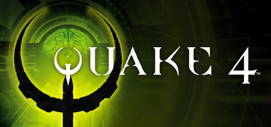

**Platforms:** Windows, Xbox 360 &nbsp;|&nbsp; **Genre:** Action &nbsp;|&nbsp; **Released:** October 18

> As part of the elite Rhino Squad, you must spearhead Earth’s military invasion of a hostile alien homeworld. But, in this desperate war for humanity’s survival against an unrelenting enemy, you may discover that the only way to defeat them...is to become one of them.
>
> _Synopsis source: Steam_

[Wikipedia](https://en.wikipedia.org/wiki/Quake_4) · [Steam](https://store.steampowered.com/app/2210)

---

### Quraish

**Platforms:** Windows &nbsp;|&nbsp; **Developer:** Afkar media Ltd. &nbsp;|&nbsp; **Publisher:** Dar al-Fiqr &nbsp;|&nbsp; **Genre:** Real-time strategy &nbsp;|&nbsp; **Released:** August 2, 2005

[Wikipedia](https://en.wikipedia.org/wiki/Quraish_(video_game))

---

### Rag Doll Kung Fu

**Platforms:** Windows, PlayStation 3 &nbsp;|&nbsp; **Developer:** Qi Creations, Tarsier Studios, Another Place Productions &nbsp;|&nbsp; **Publisher:** Merscom, Zoo Digital Publishing, Sony Computer Entertainment, Another Place Productions &nbsp;|&nbsp; **Genre:** Fighting &nbsp;|&nbsp; **Released:** October 12, 2005

[Wikipedia](https://en.wikipedia.org/wiki/Rag_Doll_Kung_Fu)

---

### Real World Golf

**Platforms:** Windows, PlayStation 2, Xbox &nbsp;|&nbsp; **Developer:** In2Games &nbsp;|&nbsp; **Publisher:** Valcon Games, Mad Catz &nbsp;|&nbsp; **Genre:** Sports &nbsp;|&nbsp; **Released:** August 26, 2005

[Wikipedia](https://en.wikipedia.org/wiki/Real_World_Golf)

---

### Rebel Raiders: Operation Nighthawk

**Platforms:** PlayStation 2, Windows &nbsp;|&nbsp; **Developer:** Kando Games &nbsp;|&nbsp; **Publisher:** Nobilis, XS Games, Kando Games &nbsp;|&nbsp; **Genre:** Action, Flight &nbsp;|&nbsp; **Released:** October 14, 2005

[Wikipedia](https://en.wikipedia.org/wiki/Rebel_Raiders:_Operation_Nighthawk)

---

### Red Light Center

**Platforms:** Windows &nbsp;|&nbsp; **Developer:** Utherverse Digital &nbsp;|&nbsp; **Publisher:** Utherverse Digital &nbsp;|&nbsp; **Genre:** Virtual world &nbsp;|&nbsp; **Released:** December 30, 2005

[Wikipedia](https://en.wikipedia.org/wiki/Red_Light_Center)

---

### RFactor

**Platforms:** Windows &nbsp;|&nbsp; **Developer:** Image Space Incorporated &nbsp;|&nbsp; **Publisher:** Image Space Incorporated &nbsp;|&nbsp; **Genre:** Racing simulation

[Wikipedia](https://en.wikipedia.org/wiki/RFactor)

---

### RHEM 2: The Cave

**Platforms:** Windows, macOS &nbsp;|&nbsp; **Developer:** Knut Müller &nbsp;|&nbsp; **Publisher:** Got Game Entertainment and Virtual Programming &nbsp;|&nbsp; **Genre:** Adventure game &nbsp;|&nbsp; **Released:** October 25, 2005

[Wikipedia](https://en.wikipedia.org/wiki/RHEM_2:_The_Cave)

---

### Rising Kingdoms

**Platforms:** Windows &nbsp;|&nbsp; **Developer:** Haemimont Games &nbsp;|&nbsp; **Publisher:** Black Bean Games &nbsp;|&nbsp; **Genre:** Real-time strategy &nbsp;|&nbsp; **Released:** June 17, 2005

[Wikipedia](https://en.wikipedia.org/wiki/Rising_Kingdoms)

---

### Robots

**Platforms:** Game Boy Advance, GameCube, Nintendo DS, PlayStation 2, Xbox, Windows &nbsp;|&nbsp; **Developer:** Eurocom, Griptonite Games &nbsp;|&nbsp; **Publisher:** Vivendi Universal Games &nbsp;|&nbsp; **Genre:** Platform &nbsp;|&nbsp; **Released:** February 22, 2005

[Wikipedia](https://en.wikipedia.org/wiki/Robots_(2005_video_game))

---

### Rome: Total Realism

**Platforms:** Windows, macOS &nbsp;|&nbsp; **Developer:** Rome: Total Realism Team; RIS Team &nbsp;|&nbsp; **Publisher:** Rome: Total Realism Team; RIS Team &nbsp;|&nbsp; **Genre:** Real-time tactics

[Wikipedia](https://en.wikipedia.org/wiki/Rome:_Total_Realism)

---

### Rome: Total War: Barbarian Invasion

**Platforms:** Windows &nbsp;|&nbsp; **Developer:** Creative Assembly &nbsp;|&nbsp; **Publisher:** Sega, Feral Interactive &nbsp;|&nbsp; **Genre:** Real-time tactics, turn-based strategy &nbsp;|&nbsp; **Released:** September 27, 2005

[Wikipedia](https://en.wikipedia.org/wiki/Rome:_Total_War:_Barbarian_Invasion)

---

### ROSE Online

**Platforms:** MS-DOS, Windows &nbsp;|&nbsp; **Developer:** Triggersoft, naROSE: Gravity Interactive, Inc., naROSE: Rednim Games, jROSE: Faith Inc. &nbsp;|&nbsp; **Publisher:** naROSE: Rednim Games, jROSE: Faith Inc., naROSE: Gravity Interactive, Inc. &nbsp;|&nbsp; **Genre:** MMORPG &nbsp;|&nbsp; **Released:** July 7, 2005

[Wikipedia](https://en.wikipedia.org/wiki/ROSE_Online)

---

### Rugby 2005

**Platforms:** PlayStation 2, Xbox, Windows &nbsp;|&nbsp; **Developer:** EA Canada &nbsp;|&nbsp; **Publisher:** EA &nbsp;|&nbsp; **Genre:** Sports &nbsp;|&nbsp; **Released:** March 11, 2005

[Wikipedia](https://en.wikipedia.org/wiki/Rugby_2005)

---

### Rugby League 2

**Platforms:** PlayStation 2, Xbox, Windows &nbsp;|&nbsp; **Developer:** Sidhe &nbsp;|&nbsp; **Publisher:** Tru Blu Entertainment &nbsp;|&nbsp; **Genre:** Sports &nbsp;|&nbsp; **Released:** December 8, 2005

[Wikipedia](https://en.wikipedia.org/wiki/Rugby_League_2)

---

### Samorost 2

**Platforms:** Linux, macOS, Windows &nbsp;|&nbsp; **Developer:** Amanita Design &nbsp;|&nbsp; **Publisher:** Amanita Design &nbsp;|&nbsp; **Genre:** Graphic adventure &nbsp;|&nbsp; **Released:** December 8, 2005

[Wikipedia](https://en.wikipedia.org/wiki/Samorost_2)

---

### Sanarara

**Platforms:** Windows &nbsp;|&nbsp; **Publisher:** NekoNeko Soft &nbsp;|&nbsp; **Genre:** Eroge, Visual novel &nbsp;|&nbsp; **Released:** April 29, 2005

[Wikipedia](https://en.wikipedia.org/wiki/Sanarara)

---

### Serious Sam 2

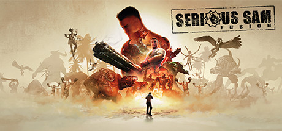

**Platforms:** Windows, Xbox &nbsp;|&nbsp; **Genre:** Action, Indie &nbsp;|&nbsp; **Released:** October 11

> Serious Sam Fusion is a central hub for several existing Serious Sam games developed by Croteam. Cool new features, engine upgrades, patches and updates will be released to existing owners for FREE!
>
> _Synopsis source: Steam_

[Wikipedia](https://en.wikipedia.org/wiki/Serious_Sam_2) · [Steam](https://store.steampowered.com/app/564310)

---

### Serious Sam II

**Platforms:** Windows, Xbox &nbsp;|&nbsp; **Developer:** Croteam &nbsp;|&nbsp; **Publisher:** 2K Games &nbsp;|&nbsp; **Genre:** First-person shooter &nbsp;|&nbsp; **Released:** October 11, 2005

[Wikipedia](https://en.wikipedia.org/wiki/Serious_Sam_II)

---

### Shadowgrounds

**Platforms:** Windows &nbsp;|&nbsp; **Developer:** Frozenbyte &nbsp;|&nbsp; **Publisher:** Plan 1, Meridian4, Linux Game Publishing &nbsp;|&nbsp; **Genre:** Top-down shooter &nbsp;|&nbsp; **Released:** November 17, 2005

[Wikipedia](https://en.wikipedia.org/wiki/Shadowgrounds)

---

### Sharin no Kuni: The Girl Among the Sunflowers

**Platforms:** Windows &nbsp;|&nbsp; **Developer:** Akabeisoft2 &nbsp;|&nbsp; **Publisher:** Akabeisoft2, 5pb., Front Wing &nbsp;|&nbsp; **Genre:** Visual novel &nbsp;|&nbsp; **Released:** November 25, 2005

[Wikipedia](https://en.wikipedia.org/wiki/Sharin_no_Kuni:_The_Girl_Among_the_Sunflowers)

---

### Shattered Union

**Platforms:** Windows, Xbox &nbsp;|&nbsp; **Developer:** PopTop Software &nbsp;|&nbsp; **Publisher:** 2K &nbsp;|&nbsp; **Genre:** Turn-based tactics &nbsp;|&nbsp; **Released:** October 17, 2005

[Wikipedia](https://en.wikipedia.org/wiki/Shattered_Union)

---

### Shoot the Bullet

**Platforms:** Windows &nbsp;|&nbsp; **Developer:** Team Shanghai Alice &nbsp;|&nbsp; **Publisher:** Team Shanghai Alice &nbsp;|&nbsp; **Genre:** Shoot 'em up photography &nbsp;|&nbsp; **Released:** December 30, 2005

[Wikipedia](https://en.wikipedia.org/wiki/Shoot_the_Bullet)

---

### Shrek SuperSlam

**Platforms:** Windows, GameCube, PlayStation 2, Xbox, Game Boy Advance, Nintendo DS &nbsp;|&nbsp; **Released:** October 25

[Wikipedia](https://en.wikipedia.org/wiki/Shrek_SuperSlam)

---

### Silent Hunter III

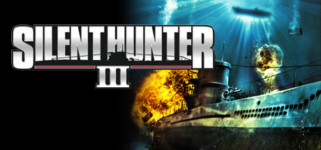

**Platforms:** Windows &nbsp;|&nbsp; **Publisher:** Ubisoft &nbsp;|&nbsp; **Genre:** Simulation &nbsp;|&nbsp; **Released:** March 15, 2005

> The king of submarine simulations returns with an all-new 3D engine, new crew command features, and more realistic WWII naval action than ever before. The movie-like graphics and simple, tension-filled gameplay make this the perfect game for the realism fanatic and the casual gamer.
>
> _Synopsis source: Steam_

[Wikipedia](https://en.wikipedia.org/wiki/Silent_Hunter_III) · [Steam](https://store.steampowered.com/app/15210)

---

### Silkroad Online

**Platforms:** Windows &nbsp;|&nbsp; **Developer:** Joymax &nbsp;|&nbsp; **Publisher:** Yahoo! Korea, Joymax1.310 &nbsp;|&nbsp; **Genre:** MMORPG

[Wikipedia](https://en.wikipedia.org/wiki/Silkroad_Online)

---

### Singles 2: Triple Trouble

**Platforms:** Windows &nbsp;|&nbsp; **Developer:** Rotobee &nbsp;|&nbsp; **Publisher:** Deep Silver &nbsp;|&nbsp; **Genre:** Social simulation &nbsp;|&nbsp; **Released:** June 2005

[Wikipedia](https://en.wikipedia.org/wiki/Singles_2:_Triple_Trouble)

---

### Sniper Elite

**Platforms:** Windows, PlayStation 2, Xbox &nbsp;|&nbsp; **Developer:** Rebellion Developments &nbsp;|&nbsp; **Publisher:** Namco Hometek, MC2 France &nbsp;|&nbsp; **Genre:** Tactical shooter, stealth &nbsp;|&nbsp; **Released:** September 30, 2005

[Wikipedia](https://en.wikipedia.org/wiki/Sniper_Elite_(video_game))

---

### Splat Magazine Renegade Paintball

**Platforms:** Windows, Xbox &nbsp;|&nbsp; **Developer:** Cat Daddy Games &nbsp;|&nbsp; **Publisher:** Global Star Software &nbsp;|&nbsp; **Genre:** First-person shooter &nbsp;|&nbsp; **Released:** October 11, 2005

[Wikipedia](https://en.wikipedia.org/wiki/Splat_Magazine_Renegade_Paintball)

---

### SpongeBob SquarePants: Lights, Camera, Pants!

**Platforms:** Xbox, PlayStation 2, GameCube, Game Boy Advance, Windows &nbsp;|&nbsp; **Developer:** THQ Studio Australia, WayForward Technologies, AWE Games &nbsp;|&nbsp; **Publisher:** THQ &nbsp;|&nbsp; **Genre:** Party &nbsp;|&nbsp; **Released:** October 19, 2005

[Wikipedia](https://en.wikipedia.org/wiki/SpongeBob_SquarePants:_Lights,_Camera,_Pants!)

---

### Stalingrad

**Platforms:** Windows &nbsp;|&nbsp; **Developer:** DTF Games &nbsp;|&nbsp; **Publisher:** BlackBean Games, 1C Games &nbsp;|&nbsp; **Genre:** Real-time tactics &nbsp;|&nbsp; **Released:** March 2005

[Wikipedia](https://en.wikipedia.org/wiki/Stalingrad_(2005_video_game))

---

### Star Wars Battlefront 2

**Platforms:** Windows, PlayStation 2, Xbox, PlayStation Portable &nbsp;|&nbsp; **Released:** November 1

---

### Star Wars: Battlefront II

**Platforms:** PlayStation 2, PlayStation Portable, Windows, Xbox &nbsp;|&nbsp; **Developer:** Pandemic Studios &nbsp;|&nbsp; **Publisher:** LucasArts &nbsp;|&nbsp; **Genre:** Action, third-person shooter, first-person shooter &nbsp;|&nbsp; **Released:** October 28, 2005

[Wikipedia](https://en.wikipedia.org/wiki/Star_Wars:_Battlefront_II_(2005_video_game))

---

### Star Wars: Knights of the Old Republic II The Sith Lords

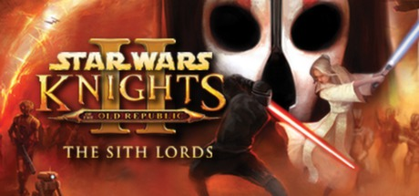

**Platforms:** Windows &nbsp;|&nbsp; **Genre:** RPG &nbsp;|&nbsp; **Released:** February 8

> 5 years after the events of the award winning original, the Sith are on the verge of crushing the Old Republic. As a lone Jedi, will you follow the light side or succumb to the dark?
>
> _Synopsis source: Steam_

[Steam](https://store.steampowered.com/app/208580)

---

### Star Wars: Republic Commando

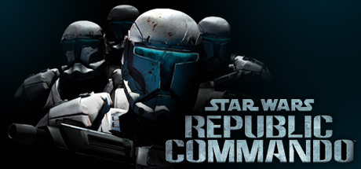

**Platforms:** Xbox, Windows &nbsp;|&nbsp; **Genre:** Action &nbsp;|&nbsp; **Released:** February 28

> You are the leader of an elite squad of Republic Commandos, your mission is to infiltrate, dominate, and ultimately, annihilate the enemy. Your squad will follow your orders and your lead, working together as a team - instinctively, intelligently, instantly. You are their leader. They are your weapon.
>
> _Synopsis source: Steam_

[Steam](https://store.steampowered.com/app/6000)

---

### Starship Troopers

**Platforms:** Windows &nbsp;|&nbsp; **Developer:** Strangelite &nbsp;|&nbsp; **Publisher:** Empire Interactive, Destineer &nbsp;|&nbsp; **Genre:** First-person shooter &nbsp;|&nbsp; **Released:** October 27, 2005

[Wikipedia](https://en.wikipedia.org/wiki/Starship_Troopers_(video_game))

---

### Still Life

**Platforms:** Windows, Xbox &nbsp;|&nbsp; **Developer:** Microids Canada &nbsp;|&nbsp; **Publisher:** MC2, The Adventure Company &nbsp;|&nbsp; **Genre:** Adventure &nbsp;|&nbsp; **Released:** April 14, 2005

[Wikipedia](https://en.wikipedia.org/wiki/Still_Life_(video_game))

---

### Stolen

**Platforms:** Windows, PlayStation 2, Xbox &nbsp;|&nbsp; **Developer:** Blue52 &nbsp;|&nbsp; **Publisher:** Hip Games &nbsp;|&nbsp; **Genre:** Stealth, platform &nbsp;|&nbsp; **Released:** April 1, 2005

[Wikipedia](https://en.wikipedia.org/wiki/Stolen_(video_game))

---

### Street Racing Syndicate

**Platforms:** Windows, Game Boy Advance &nbsp;|&nbsp; **Genre:** Racing &nbsp;|&nbsp; **Released:** January 18

> The raw, high-stakes world of illegal street racing comes to life in Street Racing Syndicate. Trick out over 40 authentic licensed cars with parts from over 15 real-world manufacturers, then turn your customized ride loose on the streets of 3 cities across the USA.
>
> _Synopsis source: Steam_

[Wikipedia](https://en.wikipedia.org/wiki/Street_Racing_Syndicate) · [Steam](https://store.steampowered.com/app/292410)

---

### Stronghold 2

**Platforms:** Windows &nbsp;|&nbsp; **Developer:** Firefly Studios &nbsp;|&nbsp; **Publisher:** 2K, Firefly Studios &nbsp;|&nbsp; **Genre:** Real-time strategy &nbsp;|&nbsp; **Released:** April 19, 2005

[Wikipedia](https://en.wikipedia.org/wiki/Stronghold_2)

---

### Sudden Attack

**Platforms:** Windows &nbsp;|&nbsp; **Developer:** Nexon GT &nbsp;|&nbsp; **Publisher:** Nexon &nbsp;|&nbsp; **Genre:** First-person shooter &nbsp;|&nbsp; **Released:** April 11, 2005

[Wikipedia](https://en.wikipedia.org/wiki/Sudden_Attack)

---

### Sudeki

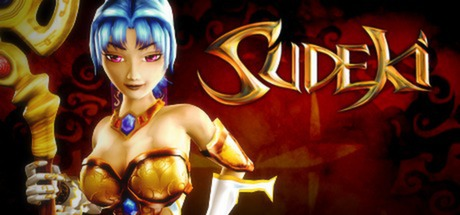

**Platforms:** Windows &nbsp;|&nbsp; **Genre:** Action, Adventure, RPG &nbsp;|&nbsp; **Released:** March 25

> Sudeki, a world torn apart into light, shadow and dark. Rent asunder by deceit and betrayal, the land cries out for a peace that only four united heroes can bring. Beyond the protective walls of Illumina Castle lie miles of pastoral, rolling countryside, though once a serene landscape, the Aklorian forces have transformed the countryside...
>
> _Synopsis source: Steam_

[Wikipedia](https://en.wikipedia.org/wiki/Sudeki) · [Steam](https://store.steampowered.com/app/233350)

---

### Super Columbine Massacre RPG!

**Platforms:** Windows &nbsp;|&nbsp; **Genre:** Role-playing &nbsp;|&nbsp; **Released:** April 20, 2005

[Wikipedia](https://en.wikipedia.org/wiki/Super_Columbine_Massacre_RPG!)

---

### Supreme Ruler 2010

**Platforms:** Windows &nbsp;|&nbsp; **Developer:** BattleGoat Studios &nbsp;|&nbsp; **Publisher:** Strategy First, Black Bean Games &nbsp;|&nbsp; **Genre:** Strategy &nbsp;|&nbsp; **Released:** May 10, 2005

[Wikipedia](https://en.wikipedia.org/wiki/Supreme_Ruler_2010)

---

### SWAT 4

**Platforms:** Windows &nbsp;|&nbsp; **Released:** April 5

[Wikipedia](https://en.wikipedia.org/wiki/SWAT_4)

---

### Tabloid Tycoon

**Platforms:** Windows &nbsp;|&nbsp; **Developer:** Black Lantern Studios &nbsp;|&nbsp; **Publisher:** ValuSoft, Global Software Publishing &nbsp;|&nbsp; **Genre:** Business simulation &nbsp;|&nbsp; **Released:** April 25, 2005

[Wikipedia](https://en.wikipedia.org/wiki/Tabloid_Tycoon)

---

### Taito Legends

**Platforms:** PlayStation 2, Windows, Xbox &nbsp;|&nbsp; **Developer:** Empire Interactive &nbsp;|&nbsp; **Publisher:** Empire Interactive, Sega &nbsp;|&nbsp; **Genre:** Various &nbsp;|&nbsp; **Released:** October 14, 2005

[Wikipedia](https://en.wikipedia.org/wiki/Taito_Legends)

---

### Telltale Texas Hold'em

**Platforms:** Windows &nbsp;|&nbsp; **Developer:** Telltale Games &nbsp;|&nbsp; **Publisher:** Telltale Games &nbsp;|&nbsp; **Genre:** Card game &nbsp;|&nbsp; **Released:** February 11, 2005

[Wikipedia](https://en.wikipedia.org/wiki/Telltale_Texas_Hold'em)

---

### Tennis Titans

**Platforms:** Windows, macOS &nbsp;|&nbsp; **Developer:** Skunk Studios &nbsp;|&nbsp; **Publisher:** Skunk Studios &nbsp;|&nbsp; **Genre:** Sports &nbsp;|&nbsp; **Released:** March 16, 2005

[Wikipedia](https://en.wikipedia.org/wiki/Tennis_Titans)

---

### The Chronicles Of Narnia: The Lion, The Witch and The Wardrobe

**Platforms:** Windows, PlayStation 2, Xbox, GameCube, Nintendo DS, Game Boy Advance &nbsp;|&nbsp; **Released:** November 14

---

### The Endless Forest

**Platforms:** Windows &nbsp;|&nbsp; **Released:** December 9

[Wikipedia](https://en.wikipedia.org/wiki/The_Endless_Forest)

---

### The Incredibles: Rise of the Underminer

**Platforms:** Windows, PlayStation 2, Xbox, GameCube, Nintendo DS, Game Boy Advance &nbsp;|&nbsp; **Released:** November 1

---

### The Matrix Online

**Platforms:** Windows &nbsp;|&nbsp; **Released:** March 22

[Wikipedia](https://en.wikipedia.org/wiki/The_Matrix_Online)

---

### The Matrix: Path of Neo

**Platforms:** Windows, PlayStation 2, Xbox &nbsp;|&nbsp; **Released:** November 7

---

### The Movies

**Platforms:** Windows &nbsp;|&nbsp; **Genre:** Video Production &nbsp;|&nbsp; **Released:** November 8

> The largest collection of categorized and rated 360°/ VR movies on the internet.
>
> _Synopsis source: Steam_

[Wikipedia](https://en.wikipedia.org/wiki/The_Movies_(video_game)) · [Steam](https://store.steampowered.com/app/922540)

---

### The Punisher

**Platforms:** Windows, PlayStation 2, Xbox &nbsp;|&nbsp; **Released:** January 16

[Wikipedia](https://en.wikipedia.org/wiki/The_Punisher_(2005_video_game))

---

### The Sims 2: Nightlife

**Platforms:** Windows &nbsp;|&nbsp; **Developer:** Maxis &nbsp;|&nbsp; **Publisher:** Electronic Arts, Aspyr Media &nbsp;|&nbsp; **Genre:** Social simulation &nbsp;|&nbsp; **Released:** September 15, 2005

[Wikipedia](https://en.wikipedia.org/wiki/The_Sims_2:_Nightlife)

---

### The Sims 2: University

**Platforms:** Windows, macOS &nbsp;|&nbsp; **Developer:** Maxis &nbsp;|&nbsp; **Publisher:** Electronic Arts, Aspyr Media &nbsp;|&nbsp; **Genre:** Social simulation &nbsp;|&nbsp; **Released:** March 1, 2005

[Wikipedia](https://en.wikipedia.org/wiki/The_Sims_2:_University)

---

### The Stalin Subway

**Platforms:** Windows &nbsp;|&nbsp; **Developer:** G5 Software &nbsp;|&nbsp; **Publisher:** Buka Entertainment &nbsp;|&nbsp; **Genre:** First-person shooter &nbsp;|&nbsp; **Released:** September 29, 2005

[Wikipedia](https://en.wikipedia.org/wiki/The_Stalin_Subway)

---

### The Suffering: Ties That Bind

**Platforms:** PlayStation 2, Windows, Xbox &nbsp;|&nbsp; **Developer:** Surreal Software &nbsp;|&nbsp; **Publisher:** Midway Games &nbsp;|&nbsp; **Genre:** First-person shooter, third-person shooter, survival horror &nbsp;|&nbsp; **Released:** September 26, 2005

[Wikipedia](https://en.wikipedia.org/wiki/The_Suffering:_Ties_That_Bind)

---

### The Three Musketeers

**Platforms:** Windows &nbsp;|&nbsp; **Developer:** Legendo Entertainment &nbsp;|&nbsp; **Publisher:** Legendo Entertainment &nbsp;|&nbsp; **Genre:** Platform &nbsp;|&nbsp; **Released:** November 2005

[Wikipedia](https://en.wikipedia.org/wiki/The_Three_Musketeers_(2006_video_game))

---

### The White Chamber

**Platforms:** Windows &nbsp;|&nbsp; **Developer:** Studio Trophis &nbsp;|&nbsp; **Genre:** Adventure &nbsp;|&nbsp; **Released:** March 2005

[Wikipedia](https://en.wikipedia.org/wiki/The_White_Chamber)

---

### Tick! Tack!

**Platforms:** Windows &nbsp;|&nbsp; **Developer:** Navel &nbsp;|&nbsp; **Publisher:** Navel, MangaGamer &nbsp;|&nbsp; **Genre:** Visual novel, Eroge &nbsp;|&nbsp; **Released:** October 16, 2005

[Wikipedia](https://en.wikipedia.org/wiki/Tick!_Tack!)

---

### TMNT: Mutant Melee

**Platforms:** GameCube, Windows, Xbox, PlayStation 2 &nbsp;|&nbsp; **Developer:** Konami Computer Entertainment Hawaii &nbsp;|&nbsp; **Publisher:** Konami &nbsp;|&nbsp; **Genre:** Fighting &nbsp;|&nbsp; **Released:** March 15, 2005

[Wikipedia](https://en.wikipedia.org/wiki/TMNT:_Mutant_Melee)

---

### Tom Clancy's Splinter Cell: Chaos Theory

**Platforms:** Xbox, Windows, PlayStation 2, GameCube &nbsp;|&nbsp; **Publisher:** Ubisoft &nbsp;|&nbsp; **Genre:** Action &nbsp;|&nbsp; **Released:** March 28, 2005

> Experience one of the most critically acclaimed stealth-action games of all time. Uncover a conspiracy that hits close to home and stop World War III.
>
> _Synopsis source: Steam_

[Steam](https://store.steampowered.com/app/13570)

---

### Tomoyo After: It's a Wonderful Life

**Platforms:** Windows &nbsp;|&nbsp; **Developer:** Key &nbsp;|&nbsp; **Publisher:** Visual Arts, Prototype &nbsp;|&nbsp; **Genre:** Eroge, visual novel &nbsp;|&nbsp; **Released:** November 25, 2005

[Wikipedia](https://en.wikipedia.org/wiki/Tomoyo_After:_It's_a_Wonderful_Life)

---

### Total Overdose

**Platforms:** Windows, PlayStation 2, Xbox &nbsp;|&nbsp; **Developer:** Deadline Games &nbsp;|&nbsp; **Publisher:** SCi Games &nbsp;|&nbsp; **Genre:** Third-person shooter &nbsp;|&nbsp; **Released:** September 16, 2005

[Wikipedia](https://en.wikipedia.org/wiki/Total_Overdose)

---

### Toy Golf

**Platforms:** Gizmondo, Windows &nbsp;|&nbsp; **Developer:** Ninai Games &nbsp;|&nbsp; **Publisher:** Fathammer, Zoo Digital Publishing &nbsp;|&nbsp; **Genre:** Golf &nbsp;|&nbsp; **Released:** May 4, 2005

[Wikipedia](https://en.wikipedia.org/wiki/Toy_Golf)

---

### TrackMania Sunrise

**Platforms:** Windows &nbsp;|&nbsp; **Developer:** Nadeo &nbsp;|&nbsp; **Publisher:** Focus Home Interactive, Digital Jesters, Enlight &nbsp;|&nbsp; **Genre:** Racing &nbsp;|&nbsp; **Released:** April 2005

[Wikipedia](https://en.wikipedia.org/wiki/TrackMania_Sunrise)

---

### Trainz Railway Simulator 2006

**Platforms:** Windows &nbsp;|&nbsp; **Developer:** Auran &nbsp;|&nbsp; **Publisher:** Auran, Just Trains, Merscom, Nordic Softsales &nbsp;|&nbsp; **Genre:** Train simulation, strategy &nbsp;|&nbsp; **Released:** August 30, 2005

[Wikipedia](https://en.wikipedia.org/wiki/Trainz_Railway_Simulator_2006)

---

### Trash

**Platforms:** Windows &nbsp;|&nbsp; **Developer:** Inhuman Games &nbsp;|&nbsp; **Publisher:** Inhuman Games &nbsp;|&nbsp; **Genre:** Real-time strategy &nbsp;|&nbsp; **Released:** September 20, 2005

[Wikipedia](https://en.wikipedia.org/wiki/Trash_(video_game))

---

### Tribal Trouble

**Platforms:** Windows, macOS, Linux &nbsp;|&nbsp; **Developer:** Oddlabs &nbsp;|&nbsp; **Publisher:** GarageGames &nbsp;|&nbsp; **Genre:** Real-time strategy &nbsp;|&nbsp; **Released:** March 31, 2005

[Wikipedia](https://en.wikipedia.org/wiki/Tribal_Trouble)

---

### True Crime: New York City

**Platforms:** Windows, PlayStation 2, Xbox, GameCube &nbsp;|&nbsp; **Released:** November 15

---

### Tumblebugs

**Platforms:** macOS, Windows, Wii &nbsp;|&nbsp; **Developer:** Wildfire Studios &nbsp;|&nbsp; **Publisher:** GameHouse, Big Fish Games &nbsp;|&nbsp; **Genre:** Puzzle &nbsp;|&nbsp; **Released:** May 18, 2005

[Wikipedia](https://en.wikipedia.org/wiki/Tumblebugs)

---

### UFO: Aftershock

**Platforms:** Windows &nbsp;|&nbsp; **Developer:** Altar Interactive &nbsp;|&nbsp; **Publisher:** Cenega Publishing, Tri Synergy &nbsp;|&nbsp; **Genre:** Real-time tactics, Strategy video game &nbsp;|&nbsp; **Released:** October 21, 2005

[Wikipedia](https://en.wikipedia.org/wiki/UFO:_Aftershock)

---

### Ultima V: Lazarus

**Platforms:** Windows, macOS &nbsp;|&nbsp; **Developer:** Team Lazarus &nbsp;|&nbsp; **Publisher:** Team Lazarus &nbsp;|&nbsp; **Genre:** Role-playing &nbsp;|&nbsp; **Released:** December 22, 2005

[Wikipedia](https://en.wikipedia.org/wiki/Ultima_V:_Lazarus)

---

### Ultimate Spider-Man

**Platforms:** Windows, GameCube, PlayStation 2, Xbox, Game Boy Advance, Nintendo DS &nbsp;|&nbsp; **Released:** September 22

[Wikipedia](https://en.wikipedia.org/wiki/Ultimate_Spider-Man_(video_game))

---

### Uncharted Waters Online

**Platforms:** Windows, PlayStation 3 &nbsp;|&nbsp; **Developer:** Koei Tecmo &nbsp;|&nbsp; **Publisher:** Netmarble→OGPlanet→Papaya Play, Koei→Koei Tecmo, Netmarble, Softstar→Cayenne Tech &nbsp;|&nbsp; **Genre:** MMORPG &nbsp;|&nbsp; **Released:** March 3, 2005

[Wikipedia](https://en.wikipedia.org/wiki/Uncharted_Waters_Online)

---

### Under Siege

**Platforms:** Windows &nbsp;|&nbsp; **Developer:** Afkar Media &nbsp;|&nbsp; **Publisher:** Dar al-Fikr &nbsp;|&nbsp; **Genre:** First-person shooter

[Wikipedia](https://en.wikipedia.org/wiki/Under_Siege_(2005_video_game))

---

### Urban Jungle

**Platforms:** Windows &nbsp;|&nbsp; **Developer:** Urban Development &nbsp;|&nbsp; **Publisher:** Autoklub Rijeka, Talented Programmers Association of Rijeka &nbsp;|&nbsp; **Genre:** Educational driving game &nbsp;|&nbsp; **Released:** December 6, 2005

[Wikipedia](https://en.wikipedia.org/wiki/Urban_Jungle)

---

### Vega Strike

**Platforms:** Linux, Windows, macOS &nbsp;|&nbsp; **Developer:** The Vega Strike Team &nbsp;|&nbsp; **Genre:** Space simulation

[Wikipedia](https://en.wikipedia.org/wiki/Vega_Strike)

---

### Vietcong 2

**Platforms:** Windows &nbsp;|&nbsp; **Developer:** Pterodon, Illusion Softworks, a.s. &nbsp;|&nbsp; **Publisher:** 2K &nbsp;|&nbsp; **Genre:** First-person shooter, tactical shooter &nbsp;|&nbsp; **Released:** October 26, 2005

[Wikipedia](https://en.wikipedia.org/wiki/Vietcong_2)

---

### Virtual Magic Kingdom

**Platforms:** Windows, macOS &nbsp;|&nbsp; **Developer:** Walt Disney Parks and Resorts, Sulake Corporation &nbsp;|&nbsp; **Publisher:** Walt Disney Parks and Resorts &nbsp;|&nbsp; **Genre:** Massively multiplayer online game &nbsp;|&nbsp; **Released:** May 23, 2005

[Wikipedia](https://en.wikipedia.org/wiki/Virtual_Magic_Kingdom)

---

### Vivisector: Beast Within

**Platforms:** Windows &nbsp;|&nbsp; **Developer:** Action Forms &nbsp;|&nbsp; **Publisher:** 1C Company &nbsp;|&nbsp; **Genre:** First-person shooter &nbsp;|&nbsp; **Released:** September 30, 2005

[Wikipedia](https://en.wikipedia.org/wiki/Vivisector:_Beast_Within)

---

### Voyage: Inspired by Jules Verne

**Platforms:** Windows &nbsp;|&nbsp; **Developer:** Kheops Studio, Microids &nbsp;|&nbsp; **Publisher:** The Adventure Company, Microids &nbsp;|&nbsp; **Genre:** Adventure &nbsp;|&nbsp; **Released:** August 16, 2005

[Wikipedia](https://en.wikipedia.org/wiki/Voyage:_Inspired_by_Jules_Verne)

---

### War World

**Platforms:** Windows &nbsp;|&nbsp; **Developer:** Third Wave Games &nbsp;|&nbsp; **Publisher:** Third Wave Games, Flashman Studios, Lighthouse Interactive &nbsp;|&nbsp; **Genre:** Action, First-person Shooter &nbsp;|&nbsp; **Released:** August 2, 2005

[Wikipedia](https://en.wikipedia.org/wiki/War_World_(video_game))

---

### Warhammer 40,000: Dawn of War: Winter Assault

**Platforms:** Windows &nbsp;|&nbsp; **Released:** September

---

### Wildlife Tycoon: Venture Africa

**Platforms:** Windows, macOS &nbsp;|&nbsp; **Developer:** Pocketwatch Games &nbsp;|&nbsp; **Publisher:** Pocketwatch Games, MumboJumbo &nbsp;|&nbsp; **Genre:** Simulation &nbsp;|&nbsp; **Released:** October 2005

[Wikipedia](https://en.wikipedia.org/wiki/Wildlife_Tycoon:_Venture_Africa)

---

### Wonderland Online

**Platforms:** Windows &nbsp;|&nbsp; **Publisher:** IGG Inc., Chinese Gamer Intl. &nbsp;|&nbsp; **Genre:** Massively Multiplayer Online Role-playing Game &nbsp;|&nbsp; **Released:** December 14, 2005

[Wikipedia](https://en.wikipedia.org/wiki/Wonderland_Online)

---

### World Racing 2

**Platforms:** PlayStation 2, Windows, Xbox &nbsp;|&nbsp; **Developer:** Synetic &nbsp;|&nbsp; **Publisher:** Playlogic Entertainment, Evolved Games, TDK &nbsp;|&nbsp; **Genre:** Racing &nbsp;|&nbsp; **Released:** September 29, 2005

[Wikipedia](https://en.wikipedia.org/wiki/World_Racing_2)

---

### World Series of Poker

**Platforms:** PlayStation 2, Xbox, Windows, GameCube, PlayStation Portable &nbsp;|&nbsp; **Released:** August 31

[Wikipedia](https://en.wikipedia.org/wiki/World_Series_of_Poker_(video_game))

---

### World Snooker Championship 2005

**Platforms:** Windows, PlayStation 2, Xbox, PlayStation Portable &nbsp;|&nbsp; **Developer:** Blade Interactive &nbsp;|&nbsp; **Publisher:** Sega &nbsp;|&nbsp; **Genre:** Sports &nbsp;|&nbsp; **Released:** April 15, 2005

[Wikipedia](https://en.wikipedia.org/wiki/World_Snooker_Championship_2005_(video_game))

---

### Worms 4

**Platforms:** Windows, PlayStation 2, Xbox &nbsp;|&nbsp; **Released:** July 29

[Wikipedia](https://en.wikipedia.org/wiki/Worms_4)

---

### Worms 4: Mayhem

**Platforms:** PlayStation 2, Xbox, Windows &nbsp;|&nbsp; **Developer:** Team17 &nbsp;|&nbsp; **Publisher:** Codemasters, Majesco &nbsp;|&nbsp; **Genre:** Artillery, strategy &nbsp;|&nbsp; **Released:** July 29, 2005

[Wikipedia](https://en.wikipedia.org/wiki/Worms_4:_Mayhem)

---

### X-Men Legends II: Rise of Apocalypse

**Platforms:** Windows, GameCube, PlayStation 2, Xbox, PlayStation Portable &nbsp;|&nbsp; **Released:** September 20

---

### X3: Reunion

**Platforms:** Windows &nbsp;|&nbsp; **Developer:** Egosoft &nbsp;|&nbsp; **Publisher:** Deep Silver, Enlight, Linux Game Publishing &nbsp;|&nbsp; **Genre:** Space simulation &nbsp;|&nbsp; **Released:** October 28, 2005

[Wikipedia](https://en.wikipedia.org/wiki/X3:_Reunion)

---

### Xanadu Next

**Platforms:** N-Gage, Windows &nbsp;|&nbsp; **Developer:** Nihon Falcom, ScriptArts &nbsp;|&nbsp; **Publisher:** Nihon Falcom, Xseed Games, Nokia &nbsp;|&nbsp; **Genre:** Action role-playing &nbsp;|&nbsp; **Released:** June 20, 2005

[Wikipedia](https://en.wikipedia.org/wiki/Xanadu_Next)

---

### Yo-Jin-Bo

**Platforms:** Windows &nbsp;|&nbsp; **Developer:** Two-Five &nbsp;|&nbsp; **Publisher:** Two-Five, Hirameki International &nbsp;|&nbsp; **Genre:** Visual novel, Otome game &nbsp;|&nbsp; **Released:** July 29, 2005

[Wikipedia](https://en.wikipedia.org/wiki/Yo-Jin-Bo)

---

### Yogurting

**Platforms:** Windows &nbsp;|&nbsp; **Developer:** NTIX Soft, Neowiz, REDDUCK Inc. &nbsp;|&nbsp; **Publisher:** GungHo &nbsp;|&nbsp; **Genre:** MMORPG &nbsp;|&nbsp; **Released:** May 10, 2005

[Wikipedia](https://en.wikipedia.org/wiki/Yogurting)

---

### Ys: The Oath in Felghana

**Platforms:** Windows &nbsp;|&nbsp; **Developer:** Nihon Falcom &nbsp;|&nbsp; **Publisher:** Xseed Games, Nihon Falcom &nbsp;|&nbsp; **Genre:** Action role-playing &nbsp;|&nbsp; **Released:** June 30, 2005

[Wikipedia](https://en.wikipedia.org/wiki/Ys:_The_Oath_in_Felghana)

---

### Yume Miru Kusuri: A Drug That Makes You Dream

**Platforms:** Windows &nbsp;|&nbsp; **Developer:** Rúf &nbsp;|&nbsp; **Publisher:** Rúf, Peach Princess &nbsp;|&nbsp; **Genre:** Eroge, visual novel &nbsp;|&nbsp; **Released:** December 22, 2005

[Wikipedia](https://en.wikipedia.org/wiki/Yume_Miru_Kusuri:_A_Drug_That_Makes_You_Dream)

---

### Zoo Tycoon 2: Endangered Species

**Platforms:** Windows &nbsp;|&nbsp; **Released:** October 18

---

### ÜberSoldier

**Platforms:** Windows &nbsp;|&nbsp; **Developer:** Burut Creative Team &nbsp;|&nbsp; **Publisher:** Russobit-M, CDV &nbsp;|&nbsp; **Genre:** First-person shooter &nbsp;|&nbsp; **Released:** November 18, 2005

[Wikipedia](https://en.wikipedia.org/wiki/%C3%9CberSoldier)

---
