# Windows — 2007

[← All Windows years](../windows.md) · [Full 2007 page](../../years/2007.md)

348 Windows titles in 2007.

### 18 Wheels of Steel: American Long Haul

**Platforms:** Windows &nbsp;|&nbsp; **Genre:** Racing &nbsp;|&nbsp; **Released:** December 3

> Your American Dream Starts Behind the Wheel of Your Own Big Rig! North America's open roads await! You ain't working for the Man any more! You're the owner of your own trucking business and you call the shots. Build your empire one rig at a time to dominate the roadways and outbid the competition. Can you handle the pressure?
>
> _Synopsis source: Steam_

[Wikipedia](https://en.wikipedia.org/wiki/18_Wheels_of_Steel) · [Steam](https://store.steampowered.com/app/12520)

---

### 1914 Shells of Fury

**Platforms:** Windows &nbsp;|&nbsp; **Developer:** Rondomedia, h2f Informationssysteme &nbsp;|&nbsp; **Publisher:** Strategy First &nbsp;|&nbsp; **Genre:** Submarine simulator &nbsp;|&nbsp; **Released:** August 14, 2007

> Set in WWI, “1914 Shells of Fury” is the first WWI submarine simulation to be released. Players have command of their very own WWI Submarine from the German Emperor’s fleet.  Prepare to participate in exciting underwater missions from WWI, and work out detailed strategies using powerful weapons. Take command and control of the various missions given, while roaming across the ocean. Players must use tactical skills in order to survive and move ahead of the opponent.
>
> _Synopsis source: IGDB_

[Wikipedia](https://en.wikipedia.org/wiki/1914_Shells_of_Fury) · [IGDB](https://www.igdb.com/games/1914-shells-of-fury)

---

### 3030 Deathwar

**Platforms:** Windows &nbsp;|&nbsp; **Developer:** Bird in Sky &nbsp;|&nbsp; **Publisher:** Crunchy Leaf Games &nbsp;|&nbsp; **Genre:** Space trading and combat simulator

> You play John Falcon, a rogueish space adventurer, down on his luck, who gets involved in uncovering a huge conspiracy that will determine the future of mankind.
>
> _Synopsis source: IGDB_

[Wikipedia](https://en.wikipedia.org/wiki/3030_Deathwar) · [IGDB](https://www.igdb.com/games/3030-deathwar)

---

### 3DiTeams

**Platforms:** Windows &nbsp;|&nbsp; **Developer:** Duke University Medical Center and Virtual Heroes &nbsp;|&nbsp; **Publisher:** Duke University Medical Center and Virtual Heroes &nbsp;|&nbsp; **Genre:** Serious game &nbsp;|&nbsp; **Released:** November 2007

[Wikipedia](https://en.wikipedia.org/wiki/3DiTeams)

---

### 4Story

**Platforms:** Windows &nbsp;|&nbsp; **Developer:** Zemi Interactive &nbsp;|&nbsp; **Publisher:** Gameforge &nbsp;|&nbsp; **Genre:** Massively multiplayer online role-playing game

[Wikipedia](https://en.wikipedia.org/wiki/4Story)

---

### A Tale of Two Kingdoms

**Platforms:** Windows &nbsp;|&nbsp; **Developer:** Crystal Shard &nbsp;|&nbsp; **Publisher:** Crystal Shard &nbsp;|&nbsp; **Genre:** Fantasy, Point-and-click adventure &nbsp;|&nbsp; **Released:** July 15, 2007

[Wikipedia](https://en.wikipedia.org/wiki/A_Tale_of_Two_Kingdoms)

---

### Agatha Christie: Evil Under the Sun

**Platforms:** Windows &nbsp;|&nbsp; **Developer:** AWE Productions &nbsp;|&nbsp; **Publisher:** The Adventure Company &nbsp;|&nbsp; **Genre:** Adventure &nbsp;|&nbsp; **Released:** October 15, 2007

> Famous detective Hercule Poirot is back in typical style, turning up at just the right time to begin an investigation into the murder of a famous actress during what should have been the start of a relaxing holiday. Taking on the role of Hercule Poirot, players can scour a stunning tropical island for clues and delve deeper into the mysterious relationships between over 20 unique characters to search out the killer...
>
> _Synopsis source: IGDB_

[Wikipedia](https://en.wikipedia.org/wiki/Agatha_Christie:_Evil_Under_the_Sun) · [IGDB](https://www.igdb.com/games/agatha-christie-evil-under-the-sun)

---

### Age of Chivalry

**Platforms:** Windows &nbsp;|&nbsp; **Developer:** Team Chivalry &nbsp;|&nbsp; **Publisher:** Team Chivalry &nbsp;|&nbsp; **Genre:** Action &nbsp;|&nbsp; **Released:** September 10, 2007

> Age of Chivalry is a mod of Half-Life 2 by Team Chivalry. Almost every aspect of the original game is modified in order to create a fun, story-driven multiplayer experience set in a fantasy world in the medieval ages. Age of Chivalry features a fast paced first person melee combat system that will take the player to a new level of immersion.
>
> _Synopsis source: IGDB_

[Wikipedia](https://en.wikipedia.org/wiki/Age_of_Chivalry) · [IGDB](https://www.igdb.com/games/age-of-chivalry)

---

### Age of Empires III: The Asian Dynasties

**Platforms:** Windows &nbsp;|&nbsp; **Released:** October 23

---

### AGEOD's American Civil War

**Platforms:** Windows &nbsp;|&nbsp; **Developer:** AGEOD &nbsp;|&nbsp; **Publisher:** Matrix Games, Ascaron, Take-Two Interactive &nbsp;|&nbsp; **Genre:** Turn-based strategy &nbsp;|&nbsp; **Released:** June 26, 2007

[Wikipedia](https://en.wikipedia.org/wiki/AGEOD's_American_Civil_War)

---

### Alice in the Country of Hearts

**Platforms:** Windows &nbsp;|&nbsp; **Genre:** Visual Novel

> Heart no Kuni no Alice: Wonderful Wonder World is the first installment in the Heart no Kuni no Alice series. It was originally released in February 2007 for PC and a version for the PS2 and PSP was released later.  Alice is realistic; especially about love. One day, she is taken to the world of heart, which is full of danger. For example, an owner of a hat shop is a gangster, and every theme park worker carries a gun; almost all of the people are dangerous.  She somehow starts to enjoy her life there, after she is forced to take a drug which prevents her from returning to her original world. Will she find a way back? Will she fall in love?
>
> _Synopsis source: IGDB_

[Wikipedia](https://en.wikipedia.org/wiki/Alice_in_the_Country_of_Hearts) · [IGDB](https://www.igdb.com/games/heart-no-kuni-no-alice-wonderful-wonder-world)

---

### Alliance of Valiant Arms

**Platforms:** Windows &nbsp;|&nbsp; **Developer:** Neowiz, Red Duck, Inc. &nbsp;|&nbsp; **Genre:** First-person shooter

> A.V.A. is a free-to-play, team-based, military shooter that plunges you into the middle of a world at war. Fight in brutal 5 vs 5 combat across dozens of maps wielding authentic military weapons. Side with the European Union (E.U.) or the Neo-Russian Federation (N.R.F.) to determine control of the battlefield. Test your skills against your friends and see if you have what it takes to come out on top!
>
> _Synopsis source: IGDB_

[Wikipedia](https://en.wikipedia.org/wiki/Alliance_of_Valiant_Arms) · [IGDB](https://www.igdb.com/games/alliance-of-valiant-arms)

---

### Alpha Prime

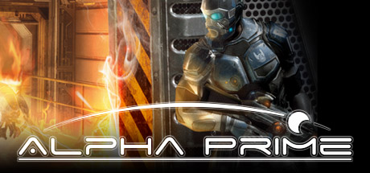

**Platforms:** Windows &nbsp;|&nbsp; **Genre:** Action &nbsp;|&nbsp; **Released:** May 25

> Somewhere in deep space, at an apparently abandoned mining base on the asteriod Alpha Prime, something has gone terribly wrong. Miners were warned that the hubbardium they were mining was too dangerous, but the lure of unimaginable wealth was too strong.
>
> _Synopsis source: Steam_

[Wikipedia](https://en.wikipedia.org/wiki/Alpha_Prime) · [Steam](https://store.steampowered.com/app/2590)

---

### Alvin and the Chipmunks

**Platforms:** Nintendo DS, PlayStation 2, Wii, Windows &nbsp;|&nbsp; **Released:** December 4

[Wikipedia](https://en.wikipedia.org/wiki/Alvin_and_the_Chipmunks_(video_game))

---

### Animal Genius

**Platforms:** Nintendo DS, Windows, macOS &nbsp;|&nbsp; **Developer:** Big Blue Bubble, Artech Digital Entertainment &nbsp;|&nbsp; **Publisher:** Scholastic, Ubisoft &nbsp;|&nbsp; **Genre:** Puzzle game &nbsp;|&nbsp; **Released:** September 25, 2007

[Wikipedia](https://en.wikipedia.org/wiki/Animal_Genius) · [IGDB](https://www.igdb.com/games/animal-genius)

---

### Ankh: Battle of the Gods

**Platforms:** Windows, macOS &nbsp;|&nbsp; **Developer:** Deck13 &nbsp;|&nbsp; **Publisher:** BHV Software &nbsp;|&nbsp; **Genre:** Adventure

> The omens of the Battle of the Gods have been many, signaling the impending fight for supremacy over all other gods of Egypt. And of course, Assil will be caught in the middle of it all again. Together with his girlfriend Thara, he will have to prevent the sinister Seth from winning the battle and subjecting Egypt to his regime of terror. With the typical Ankh humour, numerous bizarre characters and gags by the wagonload, Ankh - Battle Of The Gods is again a candidate for the adventure gaming throne. Battle Of The Gods feature several new locations, including Luxor, the gambling capital of ancient Egypt. And an unexpected trip takes Assil to a far-away, exotic location, where he will have to deal with the entirely unfamiliar conventions of its native people. The new Ankh features even more detailed character models and smoother animations.
>
> _Synopsis source: IGDB_

[Wikipedia](https://en.wikipedia.org/wiki/Ankh:_Battle_of_the_Gods) · [IGDB](https://www.igdb.com/games/ankh-3-battle-of-the-gods)

---

### Aquaria

**Platforms:** Windows &nbsp;|&nbsp; **Developer:** Bit Blot &nbsp;|&nbsp; **Publisher:** Bit Blot, Ambrosia Software &nbsp;|&nbsp; **Genre:** Action-adventure, Metroidvania &nbsp;|&nbsp; **Released:** December 7, 2007

> A massive ocean world, teeming with life and filled with ancient secrets. Join Naija, a lone underwater dweller in search of her family, as she explores the depths of Aquaria. She'll travel from hidden caves, shrouded in darkness, to beautiful, sunlit oases, all lovingly handcrafted by its two creators.  Naija's story, narrated fully with voice overs, will become yours, as you join her on this magnificent adventure.
>
> _Synopsis source: IGDB_

[Wikipedia](https://en.wikipedia.org/wiki/Aquaria_(video_game)) · [IGDB](https://www.igdb.com/games/aquaria)

---

### Arkadian Warriors

**Platforms:** Windows, Xbox 360 &nbsp;|&nbsp; **Released:** December 12

[Wikipedia](https://en.wikipedia.org/wiki/Arkadian_Warriors)

---

### ArmA: Combat Operations

**Platforms:** Windows &nbsp;|&nbsp; **Released:** May 4

---

### Arma: Queen's Gambit

**Platforms:** Windows &nbsp;|&nbsp; **Developer:** Bohemia Interactive, Black Element Software &nbsp;|&nbsp; **Publisher:** 505 Games &nbsp;|&nbsp; **Genre:** Tactical shooter &nbsp;|&nbsp; **Released:** September 28, 2007

[Wikipedia](https://en.wikipedia.org/wiki/Arma:_Queen's_Gambit)

---

### Armageddon Empires

**Platforms:** Windows, macOS &nbsp;|&nbsp; **Developer:** Cryptic Comet &nbsp;|&nbsp; **Publisher:** Cryptic Comet &nbsp;|&nbsp; **Genre:** Turn-based strategy &nbsp;|&nbsp; **Released:** July 16, 2007

> Armageddon Empires is a post-apocalyptic, turn-based, strategy game where players can play as one of four factions. The game plays like a combination of a board game and a collectible card game.
>
> _Synopsis source: IGDB_

[Wikipedia](https://en.wikipedia.org/wiki/Armageddon_Empires) · [IGDB](https://www.igdb.com/games/armageddon-empires)

---

### Arthur and the Invisibles

**Platforms:** Game Boy Advance, GameCube, Nintendo DS, PlayStation 2, PlayStation 3, PlayStation Portable, Windows, Xbox, Xbox 360 &nbsp;|&nbsp; **Released:** January 9

[Wikipedia](https://en.wikipedia.org/wiki/Arthur_and_the_Invisibles_(video_game))

---

### Ascension to the Throne

**Platforms:** Windows &nbsp;|&nbsp; **Developer:** DVS &nbsp;|&nbsp; **Publisher:** 1C Publishing &nbsp;|&nbsp; **Genre:** Turn-based strategy game &nbsp;|&nbsp; **Released:** January 26, 2007

> Ascension to the Throne is a turn-based strategy game with RPG elements. In a vast fantasy world the hero will have to pass many tests on his way to victory. Enemies seek to stop players from regaining power and taking revenge. Gain new friends to aid you in reclaiming the throne. Become the King you were born to be - wise, brave and courageous.
>
> _Synopsis source: IGDB_

[Wikipedia](https://en.wikipedia.org/wiki/Ascension_to_the_Throne) · [IGDB](https://www.igdb.com/games/ascension-to-the-throne)

---

### Asterix at the Olympic Games

**Platforms:** Windows, Wii, PlayStation 2, Nintendo DS &nbsp;|&nbsp; **Developer:** Étranges Libellules &nbsp;|&nbsp; **Publisher:** Atari &nbsp;|&nbsp; **Genre:** Sports, platform, adventure, action &nbsp;|&nbsp; **Released:** November 9, 2007

> The game follows Asterix, Obelix and the faithful Dogmatix as they travel to Greece in aid of their lovesick friend Alafolix. Their journey takes them to the Olympic Games where they find themselves pitted against the athletic might of the Roman Empire. Adventure and hilarity ensue as Asterix and friends compete to get the better of Brutus, his muscle-bound champion, and their long-time nemesis, Julius Caesar himself.
>
> _Synopsis source: IGDB_

[Wikipedia](https://en.wikipedia.org/wiki/Asterix_at_the_Olympic_Games_(video_game)) · [IGDB](https://www.igdb.com/games/asterix-at-the-olympic-games)

---

### AstroMenace

**Platforms:** Windows &nbsp;|&nbsp; **Genre:** Shooter

> Immerse into a decisive battle against tons of cunning foes, face the terrifying bosses and protect your homeland throughout 15 diverse levels of the game. The hardcore gameplay of AstroMenace, packed with pure non-stop action, will become a full scale test for your basic instinct of survival.
>
> _Synopsis source: IGDB_

[Wikipedia](https://en.wikipedia.org/wiki/AstroMenace) · [IGDB](https://www.igdb.com/games/astromenace)

---

### Asura

**Platforms:** Windows &nbsp;|&nbsp; **Developer:** Debuz Co., Ltd. &nbsp;|&nbsp; **Genre:** Fantasy MMORPG &nbsp;|&nbsp; **Released:** March 15, 2007

[Wikipedia](https://en.wikipedia.org/wiki/Asura_(video_game))

---

### Attack on Pearl Harbor

**Platforms:** Windows &nbsp;|&nbsp; **Developer:** Legendo Entertainment &nbsp;|&nbsp; **Publisher:** Ascaron, CDV Software &nbsp;|&nbsp; **Genre:** Action-adventure, combat flight simulation &nbsp;|&nbsp; **Released:** June 22, 2007

> In this historic war game you can play as either the Axis or the Allies on that day which will live in infamy.
>
> _Synopsis source: IGDB_

[Wikipedia](https://en.wikipedia.org/wiki/Attack_on_Pearl_Harbor_(video_game)) · [IGDB](https://www.igdb.com/games/attack-on-pearl-harbor)

---

### Aura II: The Sacred Rings

**Platforms:** Windows &nbsp;|&nbsp; **Developer:** Streko-Graphics Inc. &nbsp;|&nbsp; **Publisher:** The Adventure Company &nbsp;|&nbsp; **Genre:** Adventure &nbsp;|&nbsp; **Released:** May 4, 2007

[Wikipedia](https://en.wikipedia.org/wiki/Aura_II:_The_Sacred_Rings)

---

### Avencast: Rise of the Mage

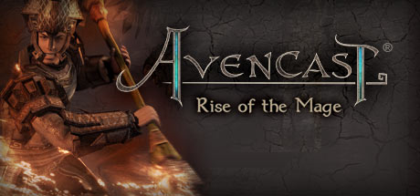

**Platforms:** Windows &nbsp;|&nbsp; **Genre:** Action, Adventure, Indie, RPG &nbsp;|&nbsp; **Released:** October 30

> Play Avencast, the epic roguelike action-RPG with tons of combat moves, spells, and equipment. Fight against evil forces to save your academy and vanquish the darkness. As you progress, learn powerful spells and combos to increase your chances of victory.
>
> _Synopsis source: Steam_

[Steam](https://store.steampowered.com/app/46410)

---

### Azada

**Platforms:** Windows, macOS &nbsp;|&nbsp; **Developer:** Big Fish Studios Europe &nbsp;|&nbsp; **Publisher:** Big Fish Games &nbsp;|&nbsp; **Genre:** Puzzle &nbsp;|&nbsp; **Released:** June 2007

> Trapped in a magical puzzle book, the adventurous Titus needs your help to release him from his spell. To do this, you must solve the tricky puzzles of Azada. Crack the series of puzzles and fill in the missing pages of the enchanted book to free Titus from his prison. Loads of unique puzzles to solve.
>
> _Synopsis source: IGDB_

[Wikipedia](https://en.wikipedia.org/wiki/Azada_(video_game)) · [IGDB](https://www.igdb.com/games/azada)

---

### Band of Bugs

**Platforms:** Xbox 360, Windows &nbsp;|&nbsp; **Developer:** NinjaBee &nbsp;|&nbsp; **Publisher:** Microsoft Game Studios &nbsp;|&nbsp; **Genre:** Turn-based tactics &nbsp;|&nbsp; **Released:** June 20, 2007

> Maal is an unhappy bug who needs structure and a purpose in his life, so he joins the royal army under the tutelage of the battle-hardened mantis warrior Tiernan. Now, he must begin his quest to save the Queen and the kingdom. NinjaBee's Band of Bugs puts you in Maal's shoes er, footpads, and sets you in the middle of a fast-playing, accessible, tactical strategy game designed specifically for Xbox LIVE Arcade. This turn-based tactics game expands the genre by providing a unique Level Editor, allowing gamers to create levels and play them online with friends.
>
> _Synopsis source: IGDB_

[Wikipedia](https://en.wikipedia.org/wiki/Band_of_Bugs) · [IGDB](https://www.igdb.com/games/band-of-bugs)

---

### Battlefront

**Platforms:** Windows &nbsp;|&nbsp; **Developer:** Strategic Studies Group &nbsp;|&nbsp; **Publisher:** Matrix Games &nbsp;|&nbsp; **Genre:** Wargame, turn-based strategy &nbsp;|&nbsp; **Released:** February 7, 2007

[Wikipedia](https://en.wikipedia.org/wiki/Battlefront_(2007_video_game)) · [IGDB](https://www.igdb.com/games/battlefront--1)

---

### Battleships Forever

**Platforms:** Windows &nbsp;|&nbsp; **Developer:** Sean "th15" Chan &nbsp;|&nbsp; **Publisher:** Independent &nbsp;|&nbsp; **Genre:** Real-time tactics

[Wikipedia](https://en.wikipedia.org/wiki/Battleships_Forever)

---

### Battlestations: Midway

**Platforms:** Xbox 360, Windows &nbsp;|&nbsp; **Genre:** Action &nbsp;|&nbsp; **Released:** January 30

> Battlestations: Midway is an immense action game that drops players into massive air, sea, and undersea battles from Pearl Harbor to the Battle of Midway.
>
> _Synopsis source: Steam_

[Steam](https://store.steampowered.com/app/6870)

---

### Bee Movie Game

**Platforms:** Windows, PlayStation 2, Xbox 360, Nintendo DS, Wii &nbsp;|&nbsp; **Released:** October 30

[Wikipedia](https://en.wikipedia.org/wiki/Bee_Movie_Game)

---

### Beowulf: The Game

**Platforms:** PlayStation 3, Windows, Xbox 360, PlayStation Portable &nbsp;|&nbsp; **Released:** November 13

---

### Beyond the Red Line

**Platforms:** Windows, Linux, macOS &nbsp;|&nbsp; **Genre:** Space simulation &nbsp;|&nbsp; **Released:** March 31, 2007

[Wikipedia](https://en.wikipedia.org/wiki/Beyond_the_Red_Line)

---

### Big Bang Beat

**Platforms:** Windows &nbsp;|&nbsp; **Developer:** NRF &nbsp;|&nbsp; **Publisher:** AliceSoft &nbsp;|&nbsp; **Genre:** 2D fighting game &nbsp;|&nbsp; **Released:** May 26, 2007

[Wikipedia](https://en.wikipedia.org/wiki/Big_Bang_Beat)

---

### BioShock

**Platforms:** Xbox 360, Windows &nbsp;|&nbsp; **Publisher:** 2K Games &nbsp;|&nbsp; **Genre:** Action, RPG &nbsp;|&nbsp; **Released:** August 21, 2007

> BioShock is a shooter unlike any you've ever played, loaded with weapons and tactics never seen. You'll have a complete arsenal at your disposal from simple revolvers to grenade launchers and chemical throwers, but you'll also be forced to genetically modify your DNA to create an even more deadly weapon: you.
>
> _Synopsis source: Steam_

[Wikipedia](https://en.wikipedia.org/wiki/BioShock) · [Steam](https://store.steampowered.com/app/7670)

---

### BlackShot

**Platforms:** Windows &nbsp;|&nbsp; **Developer:** Vertigo Games &nbsp;|&nbsp; **Publisher:** Papaya Play, Ntreev Soft, PlayOne Asia, C&C Media Co., Ltd &nbsp;|&nbsp; **Genre:** First-person shooter &nbsp;|&nbsp; **Released:** November 15, 2007

[Wikipedia](https://en.wikipedia.org/wiki/BlackShot)

---

### BlackSite: Area 51

**Platforms:** Windows, Xbox 360, PlayStation 3 &nbsp;|&nbsp; **Developer:** Midway Studios Austin &nbsp;|&nbsp; **Publisher:** Midway Games &nbsp;|&nbsp; **Genre:** First-person shooter &nbsp;|&nbsp; **Released:** November 12, 2007

> Modern day fears explode onto the streets of a small American town swarming with alien life. The government is desparate, struggling to contain secrets so terrible they can no longer be kept. You are Aeran Pierce, a Special Forces assassin thrown into one of the most explosive moments in American history. Everything hinges on your actions in BlackSite: Area 51.
>
> _Synopsis source: IGDB_

[Wikipedia](https://en.wikipedia.org/wiki/BlackSite:_Area_51) · [IGDB](https://www.igdb.com/games/blacksite-area-51)

---

### Blackwell Unbound

**Platforms:** Windows, Android, iOS, Linux, macOS &nbsp;|&nbsp; **Developer:** Wadjet Eye Games &nbsp;|&nbsp; **Publisher:** Wadjet Eye Games &nbsp;|&nbsp; **Genre:** Adventure &nbsp;|&nbsp; **Released:** September 4, 2007

> The year is 1973. The sound of a lone, ethereal saxophone drifts over the Roosevelt Island promenade, while a series of accidents plague a midtown construction site. The citizens of Manhattan take no notice of these events, let alone think they are connected. Embittered medium Lauren Blackwell and her spirit guide Joey Mallone are the only ones who believe that there is anything strange going on, and they are the only ones who can stop an enigmatic killer from striking again...
>
> _Synopsis source: IGDB_

[Wikipedia](https://en.wikipedia.org/wiki/Blackwell_Unbound) · [IGDB](https://www.igdb.com/games/blackwell-unbound)

---

### Blade Wars

**Platforms:** Windows &nbsp;|&nbsp; **Developer:** Changyou.com &nbsp;|&nbsp; **Publisher:** Sohu &nbsp;|&nbsp; **Genre:** MMORPG

[Wikipedia](https://en.wikipedia.org/wiki/Blade_Wars)

---

### Blazing Angels 2: Secret Missions of WWII

**Platforms:** Windows, PlayStation 3, Xbox 360 &nbsp;|&nbsp; **Developer:** Ubisoft Bucharest &nbsp;|&nbsp; **Publisher:** Ubisoft &nbsp;|&nbsp; **Genre:** Flight combat &nbsp;|&nbsp; **Released:** September 6, 2007

> Blazing Angels 2: Secret Missions of WWII is a 2007 flight-combat video game for the personal computer, PlayStation 3, and Xbox 360; developed by Ubisoft Romania; and published by Ubisoft. It was released on September 7 in Europe, September 18 in North America, and October 4 in Australasia. A sequel of Blazing Angels: Squadrons of WWII, the game puts the player in an elite Allied squadron trying to prevent Nazi Germany from creating a weapon of mass destruction. As the player progresses, he or she will travel around the world and battle the enemy with a list of prototype fighter aircraft and upgrades. Multiplayer mode includes deathmatch, cooperative, capture-the-flag, and epic battle. A demo was released on the PlayStation Network and Xbox Live on August 23, 2007.
>
> _Synopsis source: IGDB_

[Wikipedia](https://en.wikipedia.org/wiki/Blazing_Angels_2:_Secret_Missions_of_WWII) · [IGDB](https://www.igdb.com/games/blazing-angels-2-secret-missions-of-wwii)

---

### Blockland

**Platforms:** Windows &nbsp;|&nbsp; **Developer:** Eric "Badspot" Hartman, Anthony "Rotondo" Rotondo, Ben "kompressor" Garney &nbsp;|&nbsp; **Publisher:** Step 1 Games LLC & Blockland LLC &nbsp;|&nbsp; **Genre:** Sandbox &nbsp;|&nbsp; **Released:** February 24, 2007

> Blockland is a non-linear sandbox game with no set goals, giving players the freedom to design and construct elaborate structures. Styled as a tiny minifigure, players build inside of the virtual world using bricks reminiscent of toy blocks.
>
> _Synopsis source: IGDB_

[Wikipedia](https://en.wikipedia.org/wiki/Blockland_(video_game)) · [IGDB](https://www.igdb.com/games/blockland)

---

### Bloons Tower Defense

**Platforms:** Windows, macOS &nbsp;|&nbsp; **Released:** August 16

[Wikipedia](https://en.wikipedia.org/wiki/Bloons_Tower_Defense#Bloons_Tower_Defense)

---

### Brian Lara International Cricket 2007

**Platforms:** PlayStation 2, Xbox 360, Windows &nbsp;|&nbsp; **Released:** March 23 (EU)

[Wikipedia](https://en.wikipedia.org/wiki/Brian_Lara_International_Cricket_2007)

---

### Build-a-lot

**Platforms:** Windows &nbsp;|&nbsp; **Developer:** HipSoft &nbsp;|&nbsp; **Publisher:** HipSoft, MumboJumbo &nbsp;|&nbsp; **Genre:** Business simulation &nbsp;|&nbsp; **Released:** October 3, 2007

> Send the housing market through the roof as you build, buy, and sell houses in the new strategy game, Build-a-lot! You can flip houses for quick cash or sit back and watch the rental income pile up. Become a real estate mogul as you visit scenic towns, earn huge profits and perform special favors for the colorful local mayors. Can you build a new cinema for the local movie star? Build a new ice rink for the Olympics? Install a bowling alley in the Mayor’s Mansion? No problem! There’s plenty to do and lots of fun ahead in Build-a-lot.
>
> _Synopsis source: IGDB_

[Wikipedia](https://en.wikipedia.org/wiki/Build-a-lot) · [IGDB](https://www.igdb.com/games/build-a-lot)

---

### Bus Driver

**Platforms:** Windows &nbsp;|&nbsp; **Developer:** SCS Software &nbsp;|&nbsp; **Publisher:** SCS Software, Meridian4 &nbsp;|&nbsp; **Genre:** Vehicle simulation &nbsp;|&nbsp; **Released:** March 22, 2007

> In Bus Driver, your job is to transport passengers around an attractive and realistic city. You must drive to a timetable on a planned route, whilst obeying traffic rules, and taking care not to upset or injure your passengers. This makes Bus Driver unlike any other driving game - the experience of driving a bus is very different from blazing through a racing circuit.  Bus Driver offers 12 different kinds of buses to drive, an expansive city environment with various districts, and 30 routes with varying weather conditions set at differing times of day.
>
> _Synopsis source: IGDB_

[Wikipedia](https://en.wikipedia.org/wiki/Bus_Driver_(video_game)) · [IGDB](https://www.igdb.com/games/bus-driver)

---

### Cabela's Trophy Bucks

**Platforms:** Windows, PlayStation 2, Wii, Xbox 360 &nbsp;|&nbsp; **Developer:** Fun Labs, Magic Wand Productions, Sand Grain Studios &nbsp;|&nbsp; **Publisher:** Activision Value &nbsp;|&nbsp; **Genre:** Sports, first-person shooter &nbsp;|&nbsp; **Released:** September 25, 2007

> Experience fast paced hunting action in pursuit of record trophy bucks across 24 state and provinces in North America. Gameplay starts at the most critical and exciting parts of each hunting mission where you are immediately presented with a challenge. Paired with incredibly realistic gameplay and North America's most popular deer, waterfowl, upland birds, small game and varmint species, you will be able to hunt for animals in places that most hunters could only dream of experiencing in a lifetime. Your well-honed hunting instinct, keen observation and quick decision making will be essential in your quest to become the ultimate North American hunter!
>
> _Synopsis source: IGDB_

[Wikipedia](https://en.wikipedia.org/wiki/Cabela's_Trophy_Bucks) · [IGDB](https://www.igdb.com/games/cabela-s-trophy-bucks)

---

### Call for Heroes: Pompolic Wars

**Platforms:** Windows &nbsp;|&nbsp; **Developer:** Quotix Software &nbsp;|&nbsp; **Publisher:** Strategy First &nbsp;|&nbsp; **Genre:** Action role-playing &nbsp;|&nbsp; **Released:** June 26, 2007

> Call for Heroes Pompolic Wars is a fantasy/medieval game divided into 15 levels.
>
> _Synopsis source: IGDB_

[Wikipedia](https://en.wikipedia.org/wiki/Call_for_Heroes:_Pompolic_Wars) · [IGDB](https://www.igdb.com/games/call-for-heroes-pompolic-wars)

---

### Call of Duty 4: Modern Warfare

**Platforms:** Xbox 360, PlayStation 3, Windows &nbsp;|&nbsp; **Publisher:** Activision &nbsp;|&nbsp; **Genre:** Action &nbsp;|&nbsp; **Released:** November 5, 2007

> The new action-thriller from the award-winning team at Infinity Ward, the creators of the Call of Duty® series, delivers the most intense and cinematic action experience ever. Call of Duty 4: Modern Warfare arms gamers with an arsenal of advanced and powerful modern day firepower and transports them to the most treacherous hotspots...
>
> _Synopsis source: Steam_

[Steam](https://store.steampowered.com/app/7940)

---

### Cars Mater-National Championship

**Platforms:** Windows, PlayStation 2, Xbox 360, PlayStation 3, Nintendo DS, Wii, Game Boy Advance &nbsp;|&nbsp; **Released:** October 29

[Wikipedia](https://en.wikipedia.org/wiki/Cars_Mater-National_Championship)

---

### CellFactor: Revolution

**Platforms:** Windows &nbsp;|&nbsp; **Developer:** Timeline Interactive, Artificial Studios, Immersion Games &nbsp;|&nbsp; **Genre:** First-person shooter &nbsp;|&nbsp; **Released:** May 8, 2007

> CellFactor: Revolution is a tech demo based physics game that was eventually released for free.
>
> _Synopsis source: IGDB_

[Wikipedia](https://en.wikipedia.org/wiki/CellFactor:_Revolution) · [IGDB](https://www.igdb.com/games/cellfactor-revolution)

---

### Champions of Regnum

**Platforms:** Windows, macOS, Linux &nbsp;|&nbsp; **Developer:** Nimble Giant Entertainment &nbsp;|&nbsp; **Publisher:** Nimble Giant Entertainment &nbsp;|&nbsp; **Genre:** Massively multiplayer online role-playing game &nbsp;|&nbsp; **Released:** May 24, 2007

[Wikipedia](https://en.wikipedia.org/wiki/Champions_of_Regnum)

---

### Championship Manager 2008

**Platforms:** Windows, macOS &nbsp;|&nbsp; **Developer:** Beautiful Game Studios &nbsp;|&nbsp; **Publisher:** Eidos Interactive &nbsp;|&nbsp; **Genre:** Sports management &nbsp;|&nbsp; **Released:** November 2, 2007

> Think you can do better? It's your decisions that count: your budget, your buys, your formation, your tactics... your chance to prove it! Use your skills and knowledge to manage your club the way you feel it should be - now it's your turn.  All football fans around the world, believe they know more about football than anybody else. More than the guy sat next to them at the match, more than the people commentating on the game, more than the manager of their local team.  Championship Manager is the closest you'll ever come to the highs and lows of real football management.
>
> _Synopsis source: IGDB_

[Wikipedia](https://en.wikipedia.org/wiki/Championship_Manager_2008) · [IGDB](https://www.igdb.com/games/championship-manager-2008)

---

### Cheggers Party Quiz

**Platforms:** PlayStation 2, Windows, Wii &nbsp;|&nbsp; **Developer:** Oxygen Games &nbsp;|&nbsp; **Publisher:** Oxygen Games &nbsp;|&nbsp; **Genre:** Party &nbsp;|&nbsp; **Released:** October 26, 2007

[Wikipedia](https://en.wikipedia.org/wiki/Cheggers_Party_Quiz)

---

### Chessmaster: Grandmaster Edition

**Platforms:** Windows, Nintendo DS, PlayStation Portable &nbsp;|&nbsp; **Developer:** Ubisoft Bucharest, Ubisoft Sofia &nbsp;|&nbsp; **Publisher:** Ubisoft &nbsp;|&nbsp; **Genre:** Computer chess &nbsp;|&nbsp; **Released:** October 23, 2007

> Chessmaster: Grandmaster Edition expands the scope of chess to include broader principles of learning. Josh Waitzkin's much-anticipated book The Art of Learning (Free Press) is designed to pave the road to successful long-term growth on and off the chessboard. The eight-time National Chess Champion and two-time martial arts World Champion puts users in his shoes in some of the most riveting and formative moments of his chess career, including the legendary climactic game from the book and film Searching for Bobby Fischer. Waitzkin then turns to the classics, introducing beginners to brilliant games from some of the most important players in the history of chess. In his most revealing commentary ever, Waitzkin not only teaches the beginning chess player the fundamentals of the game, but also humanizes the road to mastery. Never has chess been so exciting.
>
> _Synopsis source: IGDB_

[Wikipedia](https://en.wikipedia.org/wiki/Chessmaster:_Grandmaster_Edition) · [IGDB](https://www.igdb.com/games/chessmaster-grandmaster-edition)

---

### Chocolate Castle

**Platforms:** macOS, Windows, Linux &nbsp;|&nbsp; **Developer:** Lexaloffle &nbsp;|&nbsp; **Publisher:** Lexaloffle &nbsp;|&nbsp; **Genre:** Puzzle &nbsp;|&nbsp; **Released:** April 2, 2007

> Chocolate Castle is a puzzle game for Mac & PC. It was released in 2007 by Lexaloffle.
>
> _Synopsis source: IGDB_

[Wikipedia](https://en.wikipedia.org/wiki/Chocolate_Castle) · [IGDB](https://www.igdb.com/games/chocolate-castle)

---

### Chocolatier

**Platforms:** Windows, macOS, Nintendo DS &nbsp;|&nbsp; **Developer:** Big Splash Games LLC &nbsp;|&nbsp; **Publisher:** PlayFirst &nbsp;|&nbsp; **Genre:** Business simulation, action &nbsp;|&nbsp; **Released:** May 1, 2007

> Oh the gloriously rich and delectable life of a chocolatier! Constantly surrounded by mounds of white, dark and mile chocolate, by coffee beans, sugar and milk, and by boxes and boxes of mouth-watering truffles. Yum! But in order to be a great chocolatier you must first travel the world for the best ingredients, barter for the most marketable recipes, manage production of multiple types of confections at multiple factories, and pay attention to the latest trends and market demands. That AND deal with employees, suppliers, vendors and customers...not to mention warding off your adversaries! Do you have what it takes to conquer the world through chocolate?
>
> _Synopsis source: IGDB_

[Wikipedia](https://en.wikipedia.org/wiki/Chocolatier_(video_game)) · [IGDB](https://www.igdb.com/games/chocolatier)

---

### Civilization IV: Beyond the Sword

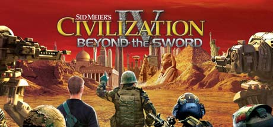

**Platforms:** Windows &nbsp;|&nbsp; **Genre:** Strategy &nbsp;|&nbsp; **Released:** July 23

> Sid Meier's Civilization IV®: Beyond the Sword is the second expansion pack for Civilization IV - the 2005 PC Game of the Year that has become a worldwide hit.
>
> _Synopsis source: Steam_

[Steam](https://store.steampowered.com/app/8800)

---

### Clean Asia!

**Platforms:** Windows &nbsp;|&nbsp; **Developer:** Jonatan Söderström &nbsp;|&nbsp; **Genre:** Scrolling shooter &nbsp;|&nbsp; **Released:** February 1, 2007

> Clean Asia! is a freeware vertical shooter video game.
>
> _Synopsis source: IGDB_

[Wikipedia](https://en.wikipedia.org/wiki/Clean_Asia!) · [IGDB](https://www.igdb.com/games/clean-asia)

---

### Cleopatra: Riddle of the Tomb

**Platforms:** Windows &nbsp;|&nbsp; **Developer:** Kheops Studio &nbsp;|&nbsp; **Publisher:** Nobilis France, The Adventure Company &nbsp;|&nbsp; **Genre:** Adventure &nbsp;|&nbsp; **Released:** June 27, 2007

> Cleopatra: Riddle of the Tomb is a PC adventure game set it ancient Egypt.
>
> _Synopsis source: IGDB_

[Wikipedia](https://en.wikipedia.org/wiki/Cleopatra:_Riddle_of_the_Tomb) · [IGDB](https://www.igdb.com/games/cleopatra-riddle-of-the-tomb)

---

### Clive Barker's Jericho

**Platforms:** PlayStation 3, Xbox 360, Windows &nbsp;|&nbsp; **Released:** October 16

[Wikipedia](https://en.wikipedia.org/wiki/Clive_Barker%27s_Jericho)

---

### Colin McRae: Dirt

**Platforms:** Windows, Xbox 360, PlayStation 3 &nbsp;|&nbsp; **Developer:** Codemasters &nbsp;|&nbsp; **Publisher:** Codemasters &nbsp;|&nbsp; **Genre:** Racing &nbsp;|&nbsp; **Released:** June 15, 2007

> Become the king of off-road racing! Race rally and hill climb events as well as multi-car rally raid, rally cross and Corr buggy and truck racing. Unprecedented next-gen racing visuals and devastating car damage. 100 player online mode.  Note: Following his death in a helicopter accident in September 2007, Colin McRae's name was removed from future titles in the series, as well subsequent re-releases following DiRT 3.
>
> _Synopsis source: IGDB_

[Wikipedia](https://en.wikipedia.org/wiki/Colin_McRae:_Dirt) · [IGDB](https://www.igdb.com/games/colin-mcrae-dirt)

---

### Combat Mission: Shock Force

**Platforms:** Windows &nbsp;|&nbsp; **Developer:** Battlefront.com &nbsp;|&nbsp; **Publisher:** Paradox Interactive &nbsp;|&nbsp; **Genre:** Computer wargame &nbsp;|&nbsp; **Released:** August 3, 2007

> Combat Mission: Shock Force is the fourth game in the Combat Mission series, and the first one not to take place during World War II. Instead the setting this time is Syria in the near future.  As with previous games in the series the focus lies on tactical ground combat battles. Each battle starts with a mission briefing where the player gets to study the strategic and operational maps and gets a description of the mission. After this the player is moved to the 3D battlefield and the Setup Phase where the action is paused. Here the battlefield has setup zones where the player can position his units. The player can here issue commands to his units, which will be activated once the battle begins. When happy with this the player can choose to start the actual battle.  The game features a number of gameplay styles. In it's most basic form the game is played in simultaneous time, meaning that a second of play time equals a second of real time. Players can however choose to change this to an alternative playing style. In the real-time mode the battles starts after the setup has been completed and only stops if the player chooses to pause the action. In the turn-based mode, each turn of the battle (except for the first) has three phases. It starts with an command phase where the player issues orders. After this comes the action phase where the units execute their orders. This consists of 60 seconds of real-time action. Last is the replay phase where the player can rewind and replay the action. For the first turn of the battle, the action phase is based on the commands given in the setup phase. The player is not able to issue any more commands in the action and replay phases.  Each battle can have a number of different victory conditions based on different objectives. Three main types of objectives exist: terrain-based, unit-based and force-wide objectives. Terrain-based objectives include occupying an area, destroying a building, defend an area or reaching an area. Unit-based objectives can be tied both to single units or to a group of units and include destroying or spotting specific units. Force-wide objectives include the number of casualties, condition of troops and amount of ammo left.  Combat Mission: Shock Force contains two campaign played from the US side: Yakima Training Center and Task Force Thunder. Yakima Training Center is a training mode for new players that teaches the game mechanics. In the Task Force Thunder campaign players take command of a battalion-sized combined arms Task Force across the Syrian border with the goal of splitting the country in two. Combat Mission campaigns are semi-dynamic which means that they consist of both predetermined elements, as well as some that are based on the actions of the player. Each battle's starting conditions depend on the result of the previous battle.  The game also has QuickBattles, which is battles where the units and the map are randomly generated depending on what parameters are set by the player. Options include environment, size and weather as well as unit types and quality.  The game supports two player multiplayer. The real-time mode can be played through LAN or Internet, while the turn-based mode can be played in hotseat (two players on the same computer) or through E-mail.
>
> _Synopsis source: IGDB_

[Wikipedia](https://en.wikipedia.org/wiki/Combat_Mission:_Shock_Force) · [IGDB](https://www.igdb.com/games/combat-mission-shock-force)

---

### Command & Conquer 3: Tiberium Wars

**Platforms:** Windows, Xbox 360 &nbsp;|&nbsp; **Genre:** Action, Strategy &nbsp;|&nbsp; **Released:** March 28

> The year is 2047. A massive nuclear fireball explodes high in the night sky, marking the dramatic beginning of the Third Tiberium War and the long-awaited return of the most groundbreaking Real-Time Strategy franchise of all time
>
> _Synopsis source: Steam_

[Steam](https://store.steampowered.com/app/24790)

---

### Commander: Europe at War

**Platforms:** Windows, macOS, Nintendo DS, PlayStation Portable &nbsp;|&nbsp; **Developer:** Slitherine Software, Firepower Entertainment, Freeverse, Impressionware &nbsp;|&nbsp; **Publisher:** Matrix Games &nbsp;|&nbsp; **Genre:** Turn-based strategy &nbsp;|&nbsp; **Released:** June 2007

[Wikipedia](https://en.wikipedia.org/wiki/Commander:_Europe_at_War)

---

### Company of Heroes: Opposing Fronts

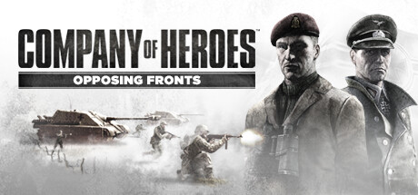

**Platforms:** Windows &nbsp;|&nbsp; **Genre:** Action, Strategy &nbsp;|&nbsp; **Released:** September 24

> The next chapter in the #1 rated RTS franchise thrusts players into a hellish war torn landscape to command two battle-hardened armies in relentless campaigns for honor and country. Players lead the tenacious British 2nd Army during the heroic World War II liberation of Caen, France, and command the German Panzer Elite as they struggle...
>
> _Synopsis source: Steam_

[Steam](https://store.steampowered.com/app/9340)

---

### Concerto Gate

**Platforms:** Windows &nbsp;|&nbsp; **Developer:** Square Enix, Ponsbic &nbsp;|&nbsp; **Publisher:** Gamepot, OnNet USA &nbsp;|&nbsp; **Genre:** MMORPG &nbsp;|&nbsp; **Released:** April 2007

[Wikipedia](https://en.wikipedia.org/wiki/Concerto_Gate)

---

### Cosmic Osmo's Hex Isle

**Platforms:** Windows, macOS, Xbox 360 &nbsp;|&nbsp; **Developer:** Cyan Worlds &nbsp;|&nbsp; **Publisher:** Fanista &nbsp;|&nbsp; **Genre:** Puzzle game &nbsp;|&nbsp; **Released:** November 30, 2007

> Cyan World's sequel to Cosmic Osmo and the Worlds Beyond the Mackerel.
>
> _Synopsis source: IGDB_

[Wikipedia](https://en.wikipedia.org/wiki/Cosmic_Osmo's_Hex_Isle) · [IGDB](https://www.igdb.com/games/cosmic-osmos-hex-isle)

---

### Crash Time: Autobahn Pursuit

**Platforms:** Windows &nbsp;|&nbsp; **Developer:** Synetic &nbsp;|&nbsp; **Publisher:** RTL Playtainment, Crave Entertainment &nbsp;|&nbsp; **Genre:** Driving &nbsp;|&nbsp; **Released:** November 2, 2007

> Solve cases on the infamous Autobahn highway in this laughable title by taking down dangerous criminals without stepping out of your vehicle in over 70 fascinating missions. Also features a local multiplayer race mode.
>
> _Synopsis source: IGDB_

[Wikipedia](https://en.wikipedia.org/wiki/Crash_Time:_Autobahn_Pursuit) · [IGDB](https://www.igdb.com/games/crash-time)

---

### Crazy Machines 2

**Platforms:** Windows &nbsp;|&nbsp; **Developer:** Fakt Software, DTP Entertainment &nbsp;|&nbsp; **Publisher:** Viva Media, DTP Entertainment &nbsp;|&nbsp; **Genre:** Puzzle &nbsp;|&nbsp; **Released:** October 15, 2007

> Crazy Machines 2 is packed with all new features to help you create your wackiest "Rube Goldberg-style" contraptions yet! All new elements, plus an amazing 3D physics engine lets you craft even more complex gadgets and effects.
>
> _Synopsis source: IGDB_

[Wikipedia](https://en.wikipedia.org/wiki/Crazy_Machines_2) · [IGDB](https://www.igdb.com/games/crazy-machines-2)

---

### Crazy Penguin Catapult

**Platforms:** Mobile phone, Windows, iOS, BlackBerry OS &nbsp;|&nbsp; **Developer:** Sumea, Digital Chocolate &nbsp;|&nbsp; **Publisher:** Digital Chocolate &nbsp;|&nbsp; **Genre:** Action, Artillery, Strategy

> Crazy Penguin Catapult is an iOS action game developed by Digital Chocolate and released on Dec 12, 2008. Gameplay is comprised of multiple missions, each broken up into two parts. The first half involves using a catapult to fling penguins through a gap in the wall. Those penguins that make it through are then brought into the second half, in which the player drops the penguins into an area filled with polar bears. If enough polar bears are hit by the penguins, the missions is completed.
>
> _Synopsis source: IGDB_

[Wikipedia](https://en.wikipedia.org/wiki/Crazy_Penguin_Catapult) · [IGDB](https://www.igdb.com/games/crazy-penguin-catapult)

---

### Crossfire

**Platforms:** Windows &nbsp;|&nbsp; **Developer:** Smilegate Entertainment &nbsp;|&nbsp; **Publisher:** Smilegate, Tencent &nbsp;|&nbsp; **Genre:** First-person shooter, tactical shooter &nbsp;|&nbsp; **Released:** June 3, 2007

> CrossFire is a first-person shooter that features two mercenary corporations named the "Black List" and "Global Risk," fighting each other in an epic global conflict. Players assume the role of either a Black List or Global Risk mercenary, joining an online team that must work together to complete objective-based scenarios. With the exception of the Zombie mode and Wave mode, each mode can support a maximum of 16 players (except Wave mode), each divided into an 8-man team (5 for Wave mode).  There are more than ten online modes: Team Death Match, Search and Destroy, Elimination Match, Ghost Mode, Free-For-All, Mutation Mode, Escape Mode, Hero Mode, Hero Mode X, Zombie mode, Elite mode, Wave Mode, Shadow Mode, Biochemical Knight Mode, Ghosts vs Mutants, RPG/Melee Mode, Soccer Mode, Light Mode, and Super Soldiers TD.  Based on their performance in-game, players will receive experience points and be promoted through various Military Ranks. The lowest rank is trainee first class, the highest is Marshall. Players also have the ability to customize their character's equipment and appearance through CrossFire's in-game item shop and from the Mall in the website.  CrossFire is free to download and playable online. It has a free currency which is called Game Points (GP), which are earned through playing and completing matches, buying premium items that grant bonus GP, or fulfilling certain missions. Premium and special items like modified weapons can only be bought using points which are obtained using real money in the form of cards or online transactions. The content and the name of the points tends to vary from version to version.
>
> _Synopsis source: IGDB_

[Wikipedia](https://en.wikipedia.org/wiki/Crossfire_(2007_video_game)) · [IGDB](https://www.igdb.com/games/crossfire)

---

### Crysis

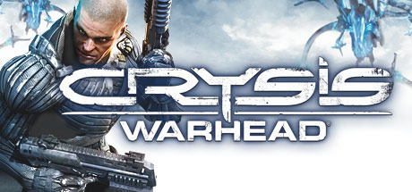

**Platforms:** Windows &nbsp;|&nbsp; **Publisher:** Electronic Arts &nbsp;|&nbsp; **Genre:** Action &nbsp;|&nbsp; **Released:** November 13, 2007

> Pulse-racing new installment from 2007's PC Game of the Year*: Play as Sergeant Sykes and experience a whole new side of the battle. A standard combat mission behind enemy lines becomes critical when you discover your enemies have captured something of vital importance to the ensuing war.
>
> _Synopsis source: Steam_

[Wikipedia](https://en.wikipedia.org/wiki/Crysis_(video_game)) · [Steam](https://store.steampowered.com/app/17330)

---

### Culpa Innata

**Platforms:** Windows &nbsp;|&nbsp; **Developer:** Momentum AS &nbsp;|&nbsp; **Publisher:** Strategy First &nbsp;|&nbsp; **Genre:** Adventure &nbsp;|&nbsp; **Released:** October 19, 2007

> Culpa Innata (Latin: Innate Sin or Innate Fault) is a third person point-and-click adventure game by Istanbul-based developer Momentum AS and published by Strategy First. The game, according to the developer, was inspired by Alev Alatlı's novel Schrödinger's Cat.
>
> _Synopsis source: IGDB_

[Wikipedia](https://en.wikipedia.org/wiki/Culpa_Innata) · [IGDB](https://www.igdb.com/games/culpa-innata)

---

### Dancing with the Stars

**Platforms:** PlayStation 2, Wii, Windows, Mobile phone &nbsp;|&nbsp; **Developer:** Zoë Mode, Aurona, n-Space, Donut Publishing Ltd &nbsp;|&nbsp; **Publisher:** Activision, THQ and Valusoft &nbsp;|&nbsp; **Genre:** Music video game &nbsp;|&nbsp; **Released:** October 23, 2007

[Wikipedia](https://en.wikipedia.org/wiki/Dancing_with_the_Stars_(video_game)) · [IGDB](https://www.igdb.com/games/dancing-with-the-stars)

---

### Darkness Within: In Pursuit of Loath Nolder

**Platforms:** Windows &nbsp;|&nbsp; **Developer:** Zoetrope Interactive &nbsp;|&nbsp; **Publisher:** Lighthouse Interactive, Iceberg Interactive &nbsp;|&nbsp; **Genre:** Adventure &nbsp;|&nbsp; **Released:** November 6, 2007

> Explore disturbing corners of the human psyche. Delve into a dimension of nightmares, the occult and a tense psychological world created in classic Lovecraftian style.  As police detective Howard E. Loreid, you are tasked to solve the murder of Clark Field, a wealthy man involved in the occult. Your number one suspect is Loath Nolder; a highly respected private investigator. After mysteriously abandoning his last case and abruptly resurfacing five years later, one wonders how venerated P.I. Loath Nolder has turned fugitive murder suspect. Your seemingly routine investigation takes a dramatic twist as terrifying happenings begin to plague your psyche. Horrifying dreams and paranormal experiences torment your very being and the line between sanity and insanity becomes frighteningly blurred. Face dire truths hidden deep within the recesses of your mind, as you embark on a surreal adventure.Key features:A chilling point and click Puzzle Horror Adventure inspired by the Works of H.P. Lovecraft, now brought to Steam for the first time as a slightly enhanced edition with Chromatic Aberration and cinematic effects applied to the game's graphics.
>
> _Synopsis source: IGDB_

[Wikipedia](https://en.wikipedia.org/wiki/Darkness_Within:_In_Pursuit_of_Loath_Nolder) · [IGDB](https://www.igdb.com/games/darkness-within-in-pursuit-of-loath-nolder)

---

### Darkwind: War on Wheels

**Platforms:** macOS, Windows &nbsp;|&nbsp; **Developer:** Sam Redfern &nbsp;|&nbsp; **Publisher:** Psychic Software &nbsp;|&nbsp; **Genre:** Turn-based tactics racing MMO &nbsp;|&nbsp; **Released:** May 4, 2007

[Wikipedia](https://en.wikipedia.org/wiki/Darkwind:_War_on_Wheels)

---

### Dawn of Magic

**Platforms:** Windows &nbsp;|&nbsp; **Developer:** SkyFallen Entertainment &nbsp;|&nbsp; **Publisher:** 1C Company &nbsp;|&nbsp; **Genre:** Action role-playing game &nbsp;|&nbsp; **Released:** April 27, 2007

> Dawn of Magic is a third-person RPG where the weapon of choice is magic. Unlike any other Action RPG, player characters in Dawn of Magic are all of one type: Mage. However, with dozens of different fields of magic available, players will have plenty of opportunities to customize their characters and specialize in the magic of their choice. The game is set in a richly detailed, medieval fantasy world, allowing the player a wide variety of choices both in individual quests and character development.
>
> _Synopsis source: IGDB_

[Wikipedia](https://en.wikipedia.org/wiki/Dawn_of_Magic) · [IGDB](https://www.igdb.com/games/dawn-of-magic)

---

### Day Watch

**Platforms:** Windows &nbsp;|&nbsp; **Developer:** Nival Interactive &nbsp;|&nbsp; **Publisher:** CDV Software Entertainment &nbsp;|&nbsp; **Genre:** Tactical role-playing game

> Day Watch is a turn-based tactics game with RPG elements. It is the sequel to Night Watch.
>
> _Synopsis source: IGDB_

[Wikipedia](https://en.wikipedia.org/wiki/Day_Watch_(video_game)) · [IGDB](https://www.igdb.com/games/day-watch)

---

### Dead Reefs

**Platforms:** Windows &nbsp;|&nbsp; **Developer:** Streko-Graphics &nbsp;|&nbsp; **Publisher:** The Adventure Company &nbsp;|&nbsp; **Genre:** Adventure &nbsp;|&nbsp; **Released:** June 29, 2007

> Dead Reefs is a beautiful mystery adventure which takes place on an island off of England's coast, set in the tumultuous 18th century. In the course of a murder investigation, Dead Reefs will take gamers through a world of intrigue and suspense! Features atmospheric sound, music, and visual set in the 18th century will immerse gamers into story. Over 40 minutes of high-quality cut-scenes Dynamically evolving events keep the player entertained. Player choices affect the advancement and outcome of the game. Unique devices and contraptions are used for traveling within the game. Characters have real-life personalities and unique mannerisms. More than 16 characters with which to interact, 1st-person 3D adventure with a murder mystery storyline.
>
> _Synopsis source: IGDB_

[Wikipedia](https://en.wikipedia.org/wiki/Dead_Reefs) · [IGDB](https://www.igdb.com/games/dead-reefs)

---

### Death to Spies

**Platforms:** Windows &nbsp;|&nbsp; **Developer:** Haggard Games &nbsp;|&nbsp; **Publisher:** 1C Company &nbsp;|&nbsp; **Genre:** Stealth, third-person shooter &nbsp;|&nbsp; **Released:** March 2, 2007

> Smersh is the Russian for Death to Spies and was the name of a set of counterintelligence departments in the Soviet Army formed during World War II. Their mission was to secure the rear of the active Red Army by arresting traitors, deserters, spies and criminal elements. During the war these agents became the main force combating the German intelligence service. The game's main character is a captain in the 4th department of the Soviet counterintelligence service. He is a professional spy trained to execute dangerous operations on his own.  During missions he will have to complete various tasks in the heart of enemy territory including stealing important documents, eliminating different enemy officers or high-ranking officials, kidnapping and sabotage. Game missions are based on real historical events and operations which were executed by the military intelligence and counterintelligence during the war.
>
> _Synopsis source: IGDB_

[Wikipedia](https://en.wikipedia.org/wiki/Death_to_Spies) · [IGDB](https://www.igdb.com/games/death-to-spies)

---

### Depths of Peril

**Platforms:** Windows, macOS &nbsp;|&nbsp; **Developer:** Soldak Entertainment &nbsp;|&nbsp; **Genre:** Action RPG &nbsp;|&nbsp; **Released:** September 5, 2007

> Depths of Peril is a single player action RPG (role-playing game) with strong strategy elements. You play as a faction leader protecting the barbarian city, Jorvik, by destroying threatening monsters and completing quests. At the same time, you compete with rival factions to see who will rule the city. Barbarians choose their leaders by fighting to the death!  As a faction leader, you must deal with rival factions through diplomacy, trade, and in time, war. Between battles and raids against other barbarian factions, you build the most powerful faction possible, to withstand your enemies. Building the power of a faction involves exploring a fantasy world, slaying dangerous monsters, solving quests for the city, avoiding deadly traps, and plundering loot to share within your faction.
>
> _Synopsis source: IGDB_

[Wikipedia](https://en.wikipedia.org/wiki/Depths_of_Peril) · [IGDB](https://www.igdb.com/games/depths-of-peril)

---

### Dies irae

**Platforms:** Windows, PlayStation Portable, Android, iOS &nbsp;|&nbsp; **Developer:** Light &nbsp;|&nbsp; **Publisher:** Views &nbsp;|&nbsp; **Genre:** Visual novel &nbsp;|&nbsp; **Released:** December 21, 2007

[Wikipedia](https://en.wikipedia.org/wiki/Dies_irae_(video_game))

---

### Dig Dug Island

**Platforms:** Windows &nbsp;|&nbsp; **Developer:** VerX &nbsp;|&nbsp; **Publisher:** Namco Bandai Games &nbsp;|&nbsp; **Genre:** MMO &nbsp;|&nbsp; **Released:** December 17, 2007

> A short-lived MMO based on Dig Dug II, developed by VerX.
>
> _Synopsis source: IGDB_

[Wikipedia](https://en.wikipedia.org/wiki/Dig_Dug_Island) · [IGDB](https://www.igdb.com/games/dig-dug-island-minami-no-jima-no-pukapukapon)

---

### Diner Dash: Flo on the Go

**Platforms:** macOS, Windows &nbsp;|&nbsp; **Developer:** PlayFirst &nbsp;|&nbsp; **Publisher:** PlayFirst, Glu Mobile, Zoo Games &nbsp;|&nbsp; **Genre:** Strategy

> The famous Flo is back but this time she's traded in her apron for a passport to paradise! With all the hustle and bustle ... will our hard-working waitress get a chance to relax? Help Flo seat customers, take orders, collect tips and dress her up in hundreds of vacation outfits in the all-new Flo's Closet. New thrills, spills, and a surprise restaurant await you in the third episode of the original smash hit.
>
> _Synopsis source: IGDB_

[Wikipedia](https://en.wikipedia.org/wiki/Diner_Dash:_Flo_on_the_Go) · [IGDB](https://www.igdb.com/games/diner-dash-flo-on-the-go)

---

### Diner Dash: Hometown Hero

**Platforms:** Windows, macOS &nbsp;|&nbsp; **Developer:** PlayFirst &nbsp;|&nbsp; **Publisher:** PlayFirst &nbsp;|&nbsp; **Genre:** Strategy &nbsp;|&nbsp; **Released:** November 8, 2007

> On a visit to her hometown, Flo and her Grandma Florence take a stroll down memory lane. Bring five restaurants back to life, and meet new customers like the Hungry Man and the Celebrity. Take special care of customers with reservations and place flowers at tables in order to make diners happier. Stuck with a 4-person group and no 4-person tables? Now you can move tables together to create a larger table. Help restore Flo's hometown now!
>
> _Synopsis source: IGDB_

[Wikipedia](https://en.wikipedia.org/wiki/Diner_Dash:_Hometown_Hero) · [IGDB](https://www.igdb.com/games/diner-dash-hometown-hero)

---

### Dirt

**Platforms:** Xbox 360, Windows, PlayStation 3 &nbsp;|&nbsp; **Released:** June 19

[Wikipedia](https://en.wikipedia.org/wiki/Dirt_(video_game))

---

### Disney Magicboard Online

**Platforms:** Windows &nbsp;|&nbsp; **Developer:** Shanda &nbsp;|&nbsp; **Publisher:** The Walt Disney Company &nbsp;|&nbsp; **Genre:** Racing &nbsp;|&nbsp; **Released:** December 10, 2007

[Wikipedia](https://en.wikipedia.org/wiki/Disney_Magicboard_Online)

---

### Disney Princess: Enchanted Journey

**Platforms:** PlayStation 2, Wii, Windows &nbsp;|&nbsp; **Developer:** Papaya Studio &nbsp;|&nbsp; **Publisher:** Disney Interactive Studios &nbsp;|&nbsp; **Genre:** Action-adventure &nbsp;|&nbsp; **Released:** October 16, 2007

> Meet and interact with the popular Disney Princesses while expanding your creativity and exploring important themes, such as courage, friendship, trust and discovery. Customize your own unique heroine character and enter a thrilling adventure through four fun-filled levels. Help these amazing princesses restore order in their enchanted kingdoms and overcome the forces of evil.
>
> _Synopsis source: IGDB_

[Wikipedia](https://en.wikipedia.org/wiki/Disney_Princess:_Enchanted_Journey) · [IGDB](https://www.igdb.com/games/disney-princess-enchanted-journey)

---

### Disney's Meet the Robinsons

**Platforms:** Windows, PlayStation 2, Game Boy Advance, Nintendo DS, Wii, Xbox 360, GameCube &nbsp;|&nbsp; **Released:** March 27

[Wikipedia](https://en.wikipedia.org/wiki/Meet_the_Robinsons_(video_game))

---

### Dragon Ball Z: Budokai Tenkaichi

**Platforms:** PlayStation 2, Wii, PlayStation Portable, Windows &nbsp;|&nbsp; **Developer:** Spike, Spike Chunsoft &nbsp;|&nbsp; **Publisher:** Bandai Namco Entertainment, Atari &nbsp;|&nbsp; **Genre:** Fighting game

[Wikipedia](https://en.wikipedia.org/wiki/Dragon_Ball_Z:_Budokai_Tenkaichi)

---

### Dragon Oath

**Platforms:** Windows &nbsp;|&nbsp; **Developer:** ChangYou.com &nbsp;|&nbsp; **Publisher:** Sohu &nbsp;|&nbsp; **Genre:** MMORPG

> Dragon Oath, also known as Tian Long Ba Bu in China, is a free-to-play MMORPG developed and published by Changyou.com and Sohu and launched in May 2007. The game's story is based on the novel Demi-Gods and Semi-Devils by Louis Cha.
>
> _Synopsis source: IGDB_

[Wikipedia](https://en.wikipedia.org/wiki/Dragon_Oath) · [IGDB](https://www.igdb.com/games/dragon-oath)

---

### Dream Chronicles

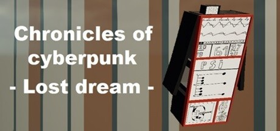

**Platforms:** Windows &nbsp;|&nbsp; **Genre:** Adventure &nbsp;|&nbsp; **Released:** June 12

> Chronicles of cyberpunk - Lost dream - exciting finale of the story about the search for Big Brother and the Supercomputer
>
> _Synopsis source: Steam_

[Wikipedia](https://en.wikipedia.org/wiki/Dream_Chronicles_(video_game)) · [Steam](https://store.steampowered.com/app/2138240)

---

### Dreamlords

**Platforms:** Windows &nbsp;|&nbsp; **Developer:** LockPick Entertainment &nbsp;|&nbsp; **Publisher:** LockPick Entertainment, Paradox interactive, Gamigo AG, Akella &nbsp;|&nbsp; **Genre:** Massively multiplayer online real-time strategy &nbsp;|&nbsp; **Released:** February 15, 2007

[Wikipedia](https://en.wikipedia.org/wiki/Dreamlords)

---

### Drift City

**Platforms:** Windows &nbsp;|&nbsp; **Developer:** NPluto &nbsp;|&nbsp; **Publisher:** NPluto &nbsp;|&nbsp; **Genre:** MMO, racing &nbsp;|&nbsp; **Released:** September 5, 2007

> Developed by NHN Games Corporation, Drift City is a free to play arcade style racer available on ijji.com for North American users. It opts out of a realistic look for a more stylized cell shaded look.
>
> _Synopsis source: IGDB_

[Wikipedia](https://en.wikipedia.org/wiki/Drift_City) · [IGDB](https://www.igdb.com/games/drift-city)

---

### Dungeon Runners

**Platforms:** Windows &nbsp;|&nbsp; **Developer:** NCSOFT &nbsp;|&nbsp; **Publisher:** NCSOFT &nbsp;|&nbsp; **Genre:** Massively multiplayer online role-playing &nbsp;|&nbsp; **Released:** May 29, 2007

> A now-closed free-to-play hack and slash MMO which parodied MMORPGs and the fantasy genre in general.
>
> _Synopsis source: IGDB_

[Wikipedia](https://en.wikipedia.org/wiki/Dungeon_Runners) · [IGDB](https://www.igdb.com/games/dungeon-runners)

---

### Dystopia

**Platforms:** Windows &nbsp;|&nbsp; **Developer:** Team Dystopia, Puny Human &nbsp;|&nbsp; **Genre:** First-person shooter &nbsp;|&nbsp; **Released:** February 25, 2007

[Wikipedia](https://en.wikipedia.org/wiki/Dystopia_(video_game))

---

### EA Sports GameShow

**Platforms:** Windows &nbsp;|&nbsp; **Developer:** EA Tiburon &nbsp;|&nbsp; **Publisher:** EA Sports &nbsp;|&nbsp; **Genre:** Sports, Trivia &nbsp;|&nbsp; **Released:** October 23, 2007

[Wikipedia](https://en.wikipedia.org/wiki/EA_Sports_GameShow)

---

### Earthquake in Zipland

**Platforms:** Windows &nbsp;|&nbsp; **Released:** February 27

[Wikipedia](https://en.wikipedia.org/wiki/Earthquake_in_Zipland)

---

### Elona

**Platforms:** Android, Windows, iOS &nbsp;|&nbsp; **Developer:** Noa &nbsp;|&nbsp; **Genre:** Roguelike &nbsp;|&nbsp; **Released:** August 31, 2007

> Elona is a roguelike game created by Japanese developer Noa. Its name is short for "Eternal League of Nefia". Noa began developing Elona in 2006, and based it on roguelikes such as Ancient Domains of Mystery (ADOM) and Angband. Noa had previously made two other role-playing games, Shade and Etherwind. A reviewer at Insert Credit praised Elona as "very well-made" and compared its character development system to that of ADOM.
>
> _Synopsis source: IGDB_

[Wikipedia](https://en.wikipedia.org/wiki/Elona_(video_game)) · [IGDB](https://www.igdb.com/games/elona)

---

### Elsword

**Platforms:** Windows &nbsp;|&nbsp; **Developer:** KOG Studios &nbsp;|&nbsp; **Publisher:** Nexon, Gamania, NHN Japan, KOG Games &nbsp;|&nbsp; **Genre:** Fantasy, action, MMORPG &nbsp;|&nbsp; **Released:** December 27, 2007

[Wikipedia](https://en.wikipedia.org/wiki/Elsword)

---

### Elven Legacy

**Platforms:** Windows, macOS &nbsp;|&nbsp; **Developer:** 1C: Ino-Co &nbsp;|&nbsp; **Publisher:** Paradox Interactive &nbsp;|&nbsp; **Genre:** Strategy &nbsp;|&nbsp; **Released:** December 21, 2007

> The shadows of destruction begin to loom on the horizon once a human mage uncovers a dark and powerful secret dating back to the remote past of the Elven race.
>
> _Synopsis source: IGDB_

[Wikipedia](https://en.wikipedia.org/wiki/Elven_Legacy) · [IGDB](https://www.igdb.com/games/elven-legacy)

---

### Empire Earth III

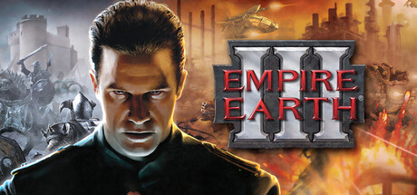

**Platforms:** Windows &nbsp;|&nbsp; **Genre:** Strategy &nbsp;|&nbsp; **Released:** November 9

> In Empire Earth III it’s you who creates history. Build your empire from three distinct factions or create a custom faction of your choosing. Lead your people to supremacy in technology, politics and economy, from ancient times to the future. Your quest for world domination is finally at hand.
>
> _Synopsis source: Steam_

[Wikipedia](https://en.wikipedia.org/wiki/Empire_Earth_III) · [Steam](https://store.steampowered.com/app/254800)

---

### Empire of Sports

**Platforms:** Windows &nbsp;|&nbsp; **Developer:** F4 &nbsp;|&nbsp; **Publisher:** F4 Group &nbsp;|&nbsp; **Genre:** Sports MMORPG

[Wikipedia](https://en.wikipedia.org/wiki/Empire_of_Sports)

---

### Enemy Engaged 2

**Platforms:** Windows &nbsp;|&nbsp; **Developer:** Gameyus Interactive &nbsp;|&nbsp; **Publisher:** G2 Games, Strategy First &nbsp;|&nbsp; **Genre:** Combat flight simulation &nbsp;|&nbsp; **Released:** May 25, 2007

[Wikipedia](https://en.wikipedia.org/wiki/Enemy_Engaged_2)

---

### Enemy Territory: Quake Wars

**Platforms:** Windows, Linux &nbsp;|&nbsp; **Released:** October 2

---

### Escape from Paradise City

**Platforms:** Windows &nbsp;|&nbsp; **Developer:** Sirius Games &nbsp;|&nbsp; **Publisher:** CDV Software, Focus Home Interactive &nbsp;|&nbsp; **Genre:** Real time strategy, role-playing &nbsp;|&nbsp; **Released:** October 24, 2007

> In Paradise City, the player takes on the role of a young, ambitious gangster with the single goal of becoming the most successful and influential criminal in the entire city. Move through the city, robbing, intimidating and killing all that stand in your way, gaining notoriety and cool cash. As the player becomes more and more notorious, his influence grows and other criminals flock to him and become the core of this gang, his own criminal organization. Leading his small but vicious crew of hardcore criminals, the player begins to take over the neighbourhoods of the city, forcing the innocent citizens to pay him tribute and the local criminals to serve him, fighting against his rivals and defending his territories.
>
> _Synopsis source: IGDB_

[Wikipedia](https://en.wikipedia.org/wiki/Escape_from_Paradise_City) · [IGDB](https://www.igdb.com/games/escape-from-paradise-city)

---

### Eschalon: Book I

**Platforms:** Windows, macOS, Linux &nbsp;|&nbsp; **Developer:** Basilisk Games &nbsp;|&nbsp; **Publisher:** Basilisk Games &nbsp;|&nbsp; **Genre:** Role-playing video game &nbsp;|&nbsp; **Released:** November 19, 2007

> Classic turn-based role-playing game, played with one customizable character. The player travels between towns, does quests and explores dungeons.
>
> _Synopsis source: IGDB_

[Wikipedia](https://en.wikipedia.org/wiki/Eschalon:_Book_I) · [IGDB](https://www.igdb.com/games/eschalon-book-i)

---

### Eternal Fantasy

**Platforms:** Windows &nbsp;|&nbsp; **Developer:** Circus &nbsp;|&nbsp; **Genre:** Eroge, visual novel, role-playing video game &nbsp;|&nbsp; **Released:** November 22, 2007

[Wikipedia](https://en.wikipedia.org/wiki/Eternal_Fantasy)

---

### Europa Universalis III

**Platforms:** Windows &nbsp;|&nbsp; **Released:** January 26

[Wikipedia](https://en.wikipedia.org/wiki/Europa_Universalis_III)

---

### EverQuest II: Rise of Kunark

**Platforms:** Windows &nbsp;|&nbsp; **Developer:** Sony Online Entertainment &nbsp;|&nbsp; **Publisher:** Sony Online Entertainment, Koch Media &nbsp;|&nbsp; **Genre:** MMORPG &nbsp;|&nbsp; **Released:** November 13, 2007

[Wikipedia](https://en.wikipedia.org/wiki/EverQuest_II:_Rise_of_Kunark)

---

### Evochron Renegades

**Platforms:** Windows &nbsp;|&nbsp; **Developer:** StarWraith 3D Games LLC &nbsp;|&nbsp; **Publisher:** StarWraith 3D Games LLC &nbsp;|&nbsp; **Genre:** Space simulation &nbsp;|&nbsp; **Released:** September 28, 2007

[Wikipedia](https://en.wikipedia.org/wiki/Evochron_Renegades)

---

### EXperience112

**Platforms:** Windows &nbsp;|&nbsp; **Developer:** Lexis Numérique &nbsp;|&nbsp; **Publisher:** Micro Application, The Adventure Company &nbsp;|&nbsp; **Genre:** Adventure &nbsp;|&nbsp; **Released:** October 11, 2007

[Wikipedia](https://en.wikipedia.org/wiki/EXperience112)

---

### Exteel

**Platforms:** Windows &nbsp;|&nbsp; **Developer:** NCSOFT &nbsp;|&nbsp; **Publisher:** NCSOFT &nbsp;|&nbsp; **Genre:** Third-person shooter, multiplayer online game &nbsp;|&nbsp; **Released:** December 4, 2007

> Exteel is a (Now cancelled) free-to-play online game centering on mech-on-mech combat between players.
>
> _Synopsis source: IGDB_

[Wikipedia](https://en.wikipedia.org/wiki/Exteel) · [IGDB](https://www.igdb.com/games/exteel--1)

---

### F.E.A.R. Perseus Mandate

**Platforms:** Windows &nbsp;|&nbsp; **Released:** November 6

[Wikipedia](https://en.wikipedia.org/wiki/F.E.A.R._Perseus_Mandate)

---

### Fairway Solitaire

**Platforms:** Windows, macOS, iOS, Android &nbsp;|&nbsp; **Developer:** Big Fish Studios, Babaroga &nbsp;|&nbsp; **Publisher:** Big Fish Games &nbsp;|&nbsp; **Genre:** Card

> Fairway Solitaire is a casual video game based on the classic solitaire card game.
>
> _Synopsis source: IGDB_

[Wikipedia](https://en.wikipedia.org/wiki/Fairway_Solitaire) · [IGDB](https://www.igdb.com/games/fairway-solitaire)

---

### Fairy Godmother Tycoon

**Platforms:** Windows &nbsp;|&nbsp; **Developer:** Pogo.com/Electronic Arts &nbsp;|&nbsp; **Publisher:** Electronic Arts &nbsp;|&nbsp; **Genre:** Business simulation game &nbsp;|&nbsp; **Released:** April 30, 2007

> Fairy Godmother Tycoon is a business tycoon game
>
> _Synopsis source: IGDB_

[Wikipedia](https://en.wikipedia.org/wiki/Fairy_Godmother_Tycoon) · [IGDB](https://www.igdb.com/games/fairy-godmother-tycoon)

---

### Falling Stars

**Platforms:** Windows, PlayStation 2 &nbsp;|&nbsp; **Developer:** Ivolgamus &nbsp;|&nbsp; **Publisher:** Agetec, Nordcurrent &nbsp;|&nbsp; **Genre:** Action role-playing video game &nbsp;|&nbsp; **Released:** August 24, 2007

> An ancient spirit has detected a dark power awakening in the peaceful world of Dazzleon. Realizing the impact this could have, it sends a young spirit, who takes over the body of a young girl named Luna. As Luna, your mission is to destroy evil and restore peace; however, this will not be an easy task. You'll have to complete various quests, participate in challenges, and train your pet for the ultimate battle against Luna's wicked uncle, Matt.  Falling Stars is a role-playing game that features an engrossing story with many hours of exciting and fun gameplay. Go on quests, play mini-games, and customize your character with a huge wardrobe of clothes. Fighting evil has never been so fashionable!
>
> _Synopsis source: IGDB_

[Wikipedia](https://en.wikipedia.org/wiki/Falling_Stars_(video_game)) · [IGDB](https://www.igdb.com/games/falling-stars)

---

### Fantasy Wars

**Platforms:** Windows &nbsp;|&nbsp; **Developer:** Ino-Co &nbsp;|&nbsp; **Publisher:** 1C Company / Nobilis France, Atari SA &nbsp;|&nbsp; **Genre:** Turn-based tactics &nbsp;|&nbsp; **Released:** August 31, 2007

> Fantasy Wars is a classic turn-based strategy game set in a fantasy world. The project is based on The Engine from developer SkyFallen Entertainment and combines 3D graphics, classical gameplay and a smart plot that tells about the bloody and destructive war in a world where Human kingdoms, Orc barrens, underground fortresses of Dwarves and magic Elven forests exist side by side.  The game consists of three connected campaigns with an integral storyline. In each of them you, as a leader of one of the races, will create a powerful army, improve the combat skills of your soldiers, search for magic artifacts and use crushing spells.  Special Features Hexagonal battles in the 3D environment Great variety of tactical possibilities Original storyline Vivid heroes that reveal their character during the game More than 70 units and 9 types of armies Advanced system of upgrading units Multiplayer mode (LAN, Internet, Hotseat)
>
> _Synopsis source: IGDB_

[Wikipedia](https://en.wikipedia.org/wiki/Fantasy_Wars) · [IGDB](https://www.igdb.com/games/fantasy-wars)

---

### Fatal Hearts

**Platforms:** Windows &nbsp;|&nbsp; **Developer:** Hanako Games &nbsp;|&nbsp; **Publisher:** Hanako Games &nbsp;|&nbsp; **Genre:** Visual Novel, Otome game &nbsp;|&nbsp; **Released:** October 23, 2007

> Fatal Hearts is an English-language visual novel/adventure game in which players control a teenage female protagonist who is having strange dreams while people are being murdered. It was released in October 2007 for Microsoft Windows.
>
> _Synopsis source: IGDB_

[Wikipedia](https://en.wikipedia.org/wiki/Fatal_Hearts) · [IGDB](https://www.igdb.com/games/fatal-hearts)

---

### Fate by Numbers

**Platforms:** Windows &nbsp;|&nbsp; **Developer:** Revival &nbsp;|&nbsp; **Publisher:** Revival &nbsp;|&nbsp; **Genre:** Adventure &nbsp;|&nbsp; **Released:** July 30, 2007

> Set in a futuristic city, the protagonist Alice Sanger, an ex-cop whose career and marriage went down when she tried to uncover corruption in her bureau, now a private detective gets a new assignment from an anonymous client. Her task is to get a briefcase. While trying to get that briefcase at the Sainsbury Station, she met her presumed dead ex-husband again, who is now working for the other side. To make matters worse, she also get shot by a sniper. Now Alice has to find out what's about the briefcase, what her ex-husband has to do with it and who shot her.    Fate by Numbers is a film-noir Interactive Movie mixed with a point&click Adventure system.    After the intro you start in your office. Like all other places in the game, the locations are "static" - you have animations here and there, but you can't walk around. Alice always stands on the same place. But of course you can interact with the environment on fixed locations, including looking at, using it, talking to or using any equipped stuff. If the action is not possible (i.e. talking to the computer), Alice will say so. Otherwise, almost all other actions resulting in full motion video-sequences - leaving a building, "driving" with your car, speaking with people, breaking in buildings, hacking in computers etc. An exception for example is analyzing photos in your computer, there you must manually looking for clues by zooming parts of the photos.    When leaving places, you are presented with a city map showing the current places you can visit. The places grow over time, but a few are only there briefly (i.e. breaking in the surveillance centers server room).
>
> _Synopsis source: IGDB_

[Wikipedia](https://en.wikipedia.org/wiki/Fate_by_Numbers) · [IGDB](https://www.igdb.com/games/fate-by-numbers)

---

### Fate of Hellas

**Platforms:** Windows &nbsp;|&nbsp; **Developer:** World Forge &nbsp;|&nbsp; **Publisher:** Russobit-M, JoWooD, DreamCatcher Interactive, n3vrf41l Publishing &nbsp;|&nbsp; **Genre:** Real-time strategy &nbsp;|&nbsp; **Released:** December 20, 2007

[Wikipedia](https://en.wikipedia.org/wiki/Fate_of_Hellas) · [IGDB](https://www.igdb.com/games/fate-of-hellas)

---

### Fiesta Online

**Platforms:** Windows &nbsp;|&nbsp; **Developer:** gamigo AG &nbsp;|&nbsp; **Publisher:** gamigo AG &nbsp;|&nbsp; **Genre:** MMORPG &nbsp;|&nbsp; **Released:** November 7, 2007

> A free MMORPG developed by the Korean company Ons On Soft. It is hosted for the North American market by Outspark and by gamigo for the EU territories.  Experience the fantastic free2play Anime MMORPG Fiesta Online and dive into the magical world of Isya. Fight together with your friends and save the world of Fiesta Online while you enjoy exciting quests that will develop your character according to your wishes and find many new friends. Fiesta Online offers you as a free2play Anime MMORPG not only an active and friendly community but also many daily challenges.
>
> _Synopsis source: IGDB_

[Wikipedia](https://en.wikipedia.org/wiki/Fiesta_Online) · [IGDB](https://www.igdb.com/games/fiesta)

---

### FIFA 08

**Platforms:** PlayStation Portable, Windows, PlayStation 2, Xbox 360, PlayStation 3, Wii, Nintendo DS &nbsp;|&nbsp; **Released:** October 8

[Wikipedia](https://en.wikipedia.org/wiki/FIFA_08)

---

### Flipside

**Platforms:** Windows &nbsp;|&nbsp; **Developer:** Team 3 &nbsp;|&nbsp; **Genre:** Platform &nbsp;|&nbsp; **Released:** June 18, 2007

> You have just escaped from a mental institution. You’re on the run. The sun is shining, the birds are singing. You are jumping happily from cloud to cloud. You know that the only way to freedom is by reaching the ship at the end of the level. A cute bunny is jumping towards you, blocking your path. By pushing a button the whole world flips around and shows its dark side. The bunny is now an evil nurse who is trying to stop you from getting away. You headbutt her, clearing your path. With a push of the button the world flips back and shows its light side again. “Play FLIPSIDE and see the world through the eyes of a madman” FLIPSIDE is a platform game that allows you to experience the world from two sides. Pick a side!
>
> _Synopsis source: IGDB_

[Wikipedia](https://en.wikipedia.org/wiki/Flipside_(video_game)) · [IGDB](https://www.igdb.com/games/flipside--1)

---

### Fortress Forever

**Platforms:** Windows &nbsp;|&nbsp; **Developer:** Fortress Forever Development Team &nbsp;|&nbsp; **Genre:** First-person shooter &nbsp;|&nbsp; **Released:** September 13, 2007

> Fortress Forever is a Source mod inspired by the earlier versions of the Team Fortress series (Team Fortress Classic and QuakeWorld Team Fortress). Our all-volunteer team has created this mod entirely from scratch and continued to develop it since late 2004. It was originally released in September of 2007.  Fortress Forever involves two or more teams, each with 9 available classes, competing in a variety of map-determined objectives (capture the flag, territorial control, invade and defend, etc). Each class has its own unique abilities and strengths that offer extremely varied playstyles. The gameplay ranges from fast-paced, competitive, and deep to absurd and chaotic.
>
> _Synopsis source: IGDB_

[Wikipedia](https://en.wikipedia.org/wiki/Fortress_Forever) · [IGDB](https://www.igdb.com/games/fortress-forever)

---

### Freak Out: Extreme Freeride

**Platforms:** PlayStation 2, Windows, PlayStation Portable &nbsp;|&nbsp; **Developer:** ColdWood Interactive &nbsp;|&nbsp; **Publisher:** JoWooD Productions &nbsp;|&nbsp; **Genre:** Sports &nbsp;|&nbsp; **Released:** February 9, 2007

[Wikipedia](https://en.wikipedia.org/wiki/Freak_Out:_Extreme_Freeride)

---

### Fury

**Platforms:** Windows &nbsp;|&nbsp; **Released:** October 16

[Wikipedia](https://en.wikipedia.org/wiki/Fury_(computer_game))

---

### Galactic Assault: Prisoner of Power

**Platforms:** Windows &nbsp;|&nbsp; **Developer:** Paradox Interactive &nbsp;|&nbsp; **Publisher:** Wargaming.net &nbsp;|&nbsp; **Genre:** Turn-based strategy &nbsp;|&nbsp; **Released:** September 2007

> Claim the role of supreme commander and assault the enemy from different sides of the battle, as three rival factions - the Khonties, Barbarians and the Insular Empire - become embroiled in a fierce struggle to destroy the entire race of the Land of the Unknown Fathers.
>
> _Synopsis source: IGDB_

[Wikipedia](https://en.wikipedia.org/wiki/Galactic_Assault:_Prisoner_of_Power) · [IGDB](https://www.igdb.com/games/galactic-assault-prisoner-of-power)

---

### Galactic Civilizations II: Dark Avatar

**Platforms:** Windows &nbsp;|&nbsp; **Publisher:** Stardock &nbsp;|&nbsp; **Released:** February 8, 2007

---

### Garfield: Lasagna World Tour

**Platforms:** PlayStation 2, Windows &nbsp;|&nbsp; **Developer:** Blast Entertainment, Eko Software &nbsp;|&nbsp; **Publisher:** Conspiracy Entertainment &nbsp;|&nbsp; **Genre:** Action-adventure &nbsp;|&nbsp; **Released:** November 30, 2007

> Garfield: Lasagna World Tour for the PlayStation 2 challenges players to jump into the world of the comic cat in a quest to win the Lasagna World Tour - dressing up Garfield in a variety of humorous costumes (each granting him special powers) while playing a variety of mini-games that everyone in the family can enjoy in single- and multiplayer modes.
>
> _Synopsis source: IGDB_

[Wikipedia](https://en.wikipedia.org/wiki/Garfield:_Lasagna_World_Tour) · [IGDB](https://www.igdb.com/games/garfield-lasagna-world-tour)

---

### Gears of War

**Platforms:** Windows &nbsp;|&nbsp; **Released:** November 6

[Wikipedia](https://en.wikipedia.org/wiki/Gears_of_War_(video_game))

---

### Gemsweeper

**Platforms:** Windows &nbsp;|&nbsp; **Developer:** Lobstersoft &nbsp;|&nbsp; **Publisher:** Lobstersoft &nbsp;|&nbsp; **Genre:** Puzzle &nbsp;|&nbsp; **Released:** May 29, 2007

> In Gemsweeper the player assumes the role of a treasure hunter. When working in a museum putting together the pieces of a broken Olmec statue, the statue becomes alive and asks the player and old professor McGuffog to rebuild the mystical city of El Dorado. By solving over 225 puzzles, the player gradually rebuilds the ruins of the city and progresses his treasure hunter rank.
>
> _Synopsis source: IGDB_

[Wikipedia](https://en.wikipedia.org/wiki/Gemsweeper) · [IGDB](https://www.igdb.com/games/gemsweeper)

---

### Genesis Rising: The Universal Crusade

**Platforms:** Windows &nbsp;|&nbsp; **Developer:** Metamorf Studios &nbsp;|&nbsp; **Publisher:** DreamCatcher Interactive &nbsp;|&nbsp; **Genre:** RTS &nbsp;|&nbsp; **Released:** March 19, 2007

> Three thousand years in the future, mankind has carved a bloody path towards domination of the known universe. Self-proclaimed as a divine race and beyond reproach as a species, they view all alien races as inferior. With fleets of organic starships genetically engineered for war, humanity sets out to conquer the last remaining independent galaxy - The Universal Heart. As Captain Iconah, you are commissioned to uncover the location and purpose of the Heart. Take command of a living fleet, altering your starship's DNA in real-time as you grant them new and powerful abilities. The Universal Crusade has just begun!
>
> _Synopsis source: IGDB_

[Wikipedia](https://en.wikipedia.org/wiki/Genesis_Rising:_The_Universal_Crusade) · [IGDB](https://www.igdb.com/games/genesis-rising-the-universal-crusade)

---

### Genetos

**Platforms:** Windows &nbsp;|&nbsp; **Developer:** Tatsuya Koyama &nbsp;|&nbsp; **Publisher:** Tatsuya Koyama &nbsp;|&nbsp; **Genre:** Shoot 'em up &nbsp;|&nbsp; **Released:** December 20, 2007

[Wikipedia](https://en.wikipedia.org/wiki/Genetos)

---

### Ghost in the Sheet

**Platforms:** Windows &nbsp;|&nbsp; **Developer:** CBE Software &nbsp;|&nbsp; **Publisher:** Tri Synergy &nbsp;|&nbsp; **Genre:** Adventure game &nbsp;|&nbsp; **Released:** November 20, 2007

> Ghost in the Sheet is a debut title for CBE software, formerly known as Cardboard Box Entertainment, based upon an original story about a ghost who finds out that the Afterlife is not that much fun if, even in your astral body, you’re commanded by a new and very unpleasant boss.
>
> _Synopsis source: IGDB_

[Wikipedia](https://en.wikipedia.org/wiki/Ghost_in_the_Sheet) · [IGDB](https://www.igdb.com/games/ghost-in-the-sheet)

---

### Global Conflicts: Palestine

**Platforms:** macOS, Windows &nbsp;|&nbsp; **Developer:** Serious Games Interactive &nbsp;|&nbsp; **Genre:** Adventure &nbsp;|&nbsp; **Released:** July 5, 2007

> The player assumes the role of a freelance journalist who has just arrived in Jerusalem facing challenges. The goal is to create and get an article published for a newspaper by collecting quotes from the dialog in the game. The player can either get information by building up trust with each side or take a more confrontational approach to dig out information. In the end, the story with the most news-value will get the best exposure. The player must be careful what they submit for print, because it will affect their standings with both sides.
>
> _Synopsis source: IGDB_

[Wikipedia](https://en.wikipedia.org/wiki/Global_Conflicts:_Palestine) · [IGDB](https://www.igdb.com/games/global-conflicts-palestine)

---

### Guild Wars: Eye of the North

**Platforms:** Windows &nbsp;|&nbsp; **Released:** August 31

---

### Guitar Hero III: Legends of Rock

**Platforms:** PlayStation 2, Xbox 360, PlayStation 3, Wii, Windows, macOS &nbsp;|&nbsp; **Released:** October 28

---

### H-Craft Championship

**Platforms:** Android, Windows, Linux &nbsp;|&nbsp; **Developer:** Irrgheist &nbsp;|&nbsp; **Publisher:** Manifesto Games, Akella &nbsp;|&nbsp; **Genre:** Racing game &nbsp;|&nbsp; **Released:** May 24, 2007

[Wikipedia](https://en.wikipedia.org/wiki/H-Craft_Championship) · [IGDB](https://www.igdb.com/games/h-craft-championship)

---

### Half-Life 2: Episode Two

**Platforms:** Windows, Xbox 360, PlayStation 3 &nbsp;|&nbsp; **Publisher:** Valve &nbsp;|&nbsp; **Released:** October 10, 2007

---

### Halo 2 for Windows Vista

**Platforms:** Windows &nbsp;|&nbsp; **Released:** May 31

[Wikipedia](https://en.wikipedia.org/wiki/Halo_2)

---

### Hard to Be a God

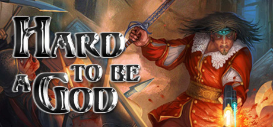

**Platforms:** Windows &nbsp;|&nbsp; **Genre:** RPG &nbsp;|&nbsp; **Released:** October 19

> Hard to be a God is a Sci-Fi RPG with adventure and espionage elements.
>
> _Synopsis source: Steam_

[Wikipedia](https://en.wikipedia.org/wiki/Hard_to_Be_a_God) · [Steam](https://store.steampowered.com/app/391030)

---

### Harry Potter and the Order of the Phoenix

**Platforms:** Windows, PlayStation 2, PlayStation 3, Xbox 360, PlayStation Portable, Nintendo DS, Wii, Game Boy Advance, macOS &nbsp;|&nbsp; **Released:** June 25

[Wikipedia](https://en.wikipedia.org/wiki/Harry_Potter_and_the_Order_of_the_Phoenix_(video_game))

---

### Helldorado

**Platforms:** Windows &nbsp;|&nbsp; **Developer:** Spellbound Entertainment &nbsp;|&nbsp; **Publisher:** DTP Entertainment, Viva Media &nbsp;|&nbsp; **Genre:** Real-time tactics &nbsp;|&nbsp; **Released:** May 25, 2007

> Helldorado is a brand-new, standalone 3D-real-time tactics game at highest level. The story leads the six heroes around John Cooper into a dusky precipice of a deadly conspiracy and through completely new and thrilling locations of the Wild West.  Clever combo-actions offer the player numerous unimagined tactical possibilities to put the fear of God into the opponents using tricky teamwork.  With the integrated movie-mode planned actions of the heroes can be recorded Hollywood-like with slow-motion and changing camera views, watched afterwards or even exported and shared with friends.  A mature and clear interface makes tactical planning and quick reactions on the opponents' behaviour easier. With an integrated tutorial mission and with three elaborated difficulty levels players will find their appropriate challenge in the Wild West.  Join the heroes and lead John Cooper and his five companions in thrilling and diversified missions through their most dangerous adventure.  Real-time strategy and tactics in a hard-edged adventure in the old American Wild West. Breathtaking scenarios including the forgotten Rochester’s Jail, a stormy train robbery in a relay station, a bloody sunset in Santa Fe, an ambush in the dark and gruesome Blackwater, and a visit to the beautiful New Orleans Enhanced Quick Actions: Unique to Spellbound games, this feature allows players to pre-schedule their heroes’ movements. Helldorado introduces a visual representation of intended actions combined with pause mode, keywords overview and tactical waypoint display Combo Actions pair skills from any combination of two heroes for added tactical versatility Movie Mode for recording, watching and exporting of your own heroic deeds. Be your own Hollywood director! Switch instantly between freely rotatable and zoomable isometric and 3rd person views to gain the greatest tactical advantage. Powerful, effective and fast-paced hero control using an extremely reactive and easy to learn interface Exciting step-by-step tutorial gets you into the action fast – for beginners and experienced heroes, both. 3 well-balanced difficulty levels – tailor-made for your basic tenderfoot, average cow puncher, or hard-drivin’ gunslingers. More than one way to play… and more than one way to score your reward. Play it your way… or all ways! Avoid unpleasant – and deadly – surprises with Helldorado’s intelligent early warning system. If you’re clever and observant, you’ll survive longer. 60 different enemies with tactical behavior driven by our advanced AI system. Use your enemies’ weaknesses against them. Use alcohol or seduction as weapons in a game of deadly cat and mouse.
>
> _Synopsis source: IGDB_

[Wikipedia](https://en.wikipedia.org/wiki/Helldorado_(video_game)) · [IGDB](https://www.igdb.com/games/helldorado)

---

### Hellgate: London

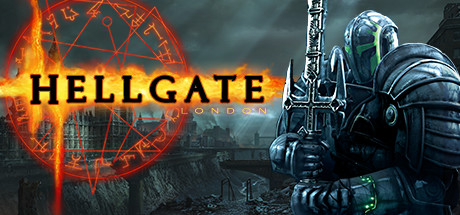

**Platforms:** Windows &nbsp;|&nbsp; **Genre:** Action, RPG &nbsp;|&nbsp; **Released:** October 31

> The return of a sensational game! Hellgate is an action RPG game you have been waiting for. Since its first release Hellgate won the hearts of thousands of fans and now it's time to bring back memories and dip into the near future of 2038. For all mankind!
>
> _Synopsis source: Steam_

[Steam](https://store.steampowered.com/app/939520)

---

### Heroes of Might and Magic V: Tribes of the East

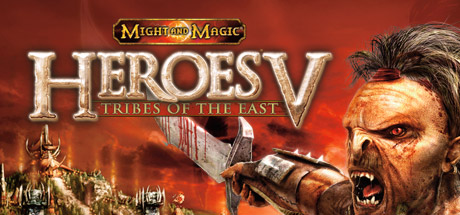

**Platforms:** Windows &nbsp;|&nbsp; **Genre:** Strategy &nbsp;|&nbsp; **Released:** October 18

> For the first time, play as the Orc faction and recruit heroes, build armies and manage cities as you explore and conquer legendary lands. Use tactics, skills and magic to outsmart fantasy armies while developing your heroes and unveiling the dark plot that threatens to tear the world of Ashan apart.
>
> _Synopsis source: Steam_

[Steam](https://store.steampowered.com/app/15370)

---

### Hired Guns: The Jagged Edge

**Platforms:** Windows &nbsp;|&nbsp; **Released:** October 19

---

### Home Sweet Home

**Platforms:** Windows &nbsp;|&nbsp; **Developer:** Big Blue Bubble &nbsp;|&nbsp; **Publisher:** Big Blue Bubble &nbsp;|&nbsp; **Genre:** Simulation &nbsp;|&nbsp; **Released:** December 12, 2007

> Picture this scene... You move into your new home, and every room is perfect. Every room, except one. Here is the blank canvas for your vision, but you lack the know-how. Who do you call? The Home Sweet Home team! Home Sweet Home will give you the chance to unleash your hidden talents as an interior designer. You choose the furniture, patterns and colors to create a masterpiece that will blow your client away. With simple controls, a fun graphical style and an easy-to-use interface, Home Sweet Home allows you to nurture your creative side. Remember, a house is not a home until it is a Home Sweet Home.
>
> _Synopsis source: IGDB_

[Wikipedia](https://en.wikipedia.org/wiki/Home_Sweet_Home_(2007_video_game)) · [IGDB](https://www.igdb.com/games/home-sweet-home--1)

---

### Hospital Tycoon

**Platforms:** Windows &nbsp;|&nbsp; **Developer:** DR Studios &nbsp;|&nbsp; **Publisher:** Codemasters &nbsp;|&nbsp; **Genre:** Business simulation &nbsp;|&nbsp; **Released:** June 5, 2007

[Wikipedia](https://en.wikipedia.org/wiki/Hospital_Tycoon)

---

### Hot Wheels: Beat That!

**Platforms:** PlayStation 2, Xbox 360, Wii, Nintendo DS, Windows &nbsp;|&nbsp; **Released:** September 25

---

### I Wanna Be the Guy

**Platforms:** Windows &nbsp;|&nbsp; **Genre:** Platform &nbsp;|&nbsp; **Released:** October 2007

> I Wanna Be the Guy: The Movie: The Game is a 2D platform indie freeware video game created by independent developer Michael "Kayin" O'Reilly for Microsoft Windows using Multimedia Fusion 2. First released in October 2007, the game is not in active development despite being listed as a beta, though the source code for the game was released by Kayin in November 2011.  IWBTG is most famous for its difficulty. Most of the landscape is engineered specifically to kill the player character. Alongside a traditional range of recognizable dangers, such as spikes and pits, there are many less obvious threats as well, most of which are all but impossible to avoid without either previous knowledge or trial and error.
>
> _Synopsis source: IGDB_

[Wikipedia](https://en.wikipedia.org/wiki/I_Wanna_Be_the_Guy) · [IGDB](https://www.igdb.com/games/i-wanna-be-the-guy)

---

### Infernal

**Platforms:** Windows &nbsp;|&nbsp; **Released:** May 8

[Wikipedia](https://en.wikipedia.org/wiki/Infernal_(video_game))

---

### Inhabited Island: The Earthling

**Platforms:** Windows &nbsp;|&nbsp; **Developer:** Step Creative Group &nbsp;|&nbsp; **Publisher:** Akella &nbsp;|&nbsp; **Genre:** Adventure

[Wikipedia](https://en.wikipedia.org/wiki/Inhabited_Island:_The_Earthling)

---

### Insurgency: Modern Infantry Combat

**Platforms:** Windows, macOS, Linux &nbsp;|&nbsp; **Developer:** Insurgency Development Team &nbsp;|&nbsp; **Publisher:** New World Interactive &nbsp;|&nbsp; **Genre:** First-person shooter &nbsp;|&nbsp; **Released:** January 7, 2007

> Grab your rifle, join your team mates, and enter the fight. Take to the modern battlefield and engage in intense, realistic battles. Choose your side between a highly organized conventional army or the partisan insurgents. Teamwork, tactics, bravery and discipline are the keys to your success in a deadly and treacherous modern war environment.  Insurgency: Modern Infantry Combat represents the modern battlefield on the individual and tactical levels. Only the best players will become commanders and get the chance to lead its entire team towards victory. This is a game where real-world squad and guerrilla tactics are necessary to stay alive and repel the enemy, and is geared towards clans and organized teams of players.
>
> _Synopsis source: IGDB_

[Wikipedia](https://en.wikipedia.org/wiki/Insurgency:_Modern_Infantry_Combat) · [IGDB](https://www.igdb.com/games/insurgency-modern-infantry-combat)

---

### Interpol: The Trail of Dr. Chaos

**Platforms:** Windows, macOS, PlayStation 3 &nbsp;|&nbsp; **Developer:** TikGames &nbsp;|&nbsp; **Publisher:** Sierra Online &nbsp;|&nbsp; **Genre:** Puzzle, strategy &nbsp;|&nbsp; **Released:** September 5, 2007

> Track down the evil and destructive fugitive Dr. Chaos, as you hunt down clues in the exciting seek and find game Interpol: The Trail of Dr. Chaos. As an elite agent for Interpol, it is your mission to eradicate his trail of corruption as it takes you around the world from one international city to the next. Use your investigative skills to quickly gather the evidence needed to bring him to justice.
>
> _Synopsis source: IGDB_

[Wikipedia](https://en.wikipedia.org/wiki/Interpol:_The_Trail_of_Dr._Chaos) · [IGDB](https://www.igdb.com/games/interpol-the-trail-of-dr-chaos)

---

### Jack Keane

**Platforms:** Windows, Linux, macOS &nbsp;|&nbsp; **Developer:** Deck13 Interactive &nbsp;|&nbsp; **Publisher:** 10tacle Studios, Strategy First, RuneSoft &nbsp;|&nbsp; **Genre:** Adventure &nbsp;|&nbsp; **Released:** August 1, 2007

> Colonial England. Under a certain amount of duress... Jack takes on a job, which will not only cause him a great deal of trouble, but also bring to light the answer to a mystery out of his distant past. A lack of money leads Jack to accept a charter to take a British secret agent to mysterious 'Tooth Island'. When Jack's ship shatters on the mysterious island's cliffs on arrival and the secret agent quickly becomes a meal for a monster in the jungle, Jack is soon left to cope with the situation on his own.  Tooth Island is ruled by the strange Doctor T, who is cultivating man-eating plants and has his own dastardly plans for the British Empire. And why does he seem to know Jack, who can't remember ever having been on Tooth Island? What are Doctor T's plans? And what does he know about Jack's past?  And then there's the young and naive Amanda, who is filled by an almost fanatical drive to prove her worth. In the beginning the young lady is employed by Doctor T, and part of her task is to track Jack down and take him prisoner. It doesn't take long before she begins to wonder if she is really on the right side, or if she shouldn't join her opponent, the charming Captain Jack, instead.  A hair-raising hunt across the length and breadth of the dangerous island finally airs the mystery surrounding Jack's past and leads to a spectacular showdown with a dark and deadly enemy and his nefarious henchmen.
>
> _Synopsis source: IGDB_

[Wikipedia](https://en.wikipedia.org/wiki/Jack_Keane_(video_game)) · [IGDB](https://www.igdb.com/games/jack-keane)

---

### Jade Dynasty

**Platforms:** Windows &nbsp;|&nbsp; **Developer:** Beijing Perfect World &nbsp;|&nbsp; **Publisher:** Beijing Perfect World, Perfect World Entertainment, Perfect World Europe &nbsp;|&nbsp; **Genre:** MMORPG &nbsp;|&nbsp; **Released:** May 28, 2007

> Jade Dynasty is a Fantasy Online Role-Playing game, developed and published by Perfect World Entertainment, which was released in 2007.
>
> _Synopsis source: IGDB_

[Wikipedia](https://en.wikipedia.org/wiki/Jade_Dynasty_(video_game)) · [IGDB](https://www.igdb.com/games/jade-dynasty)

---

### Jade Empire

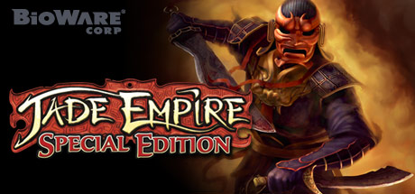

**Platforms:** Windows &nbsp;|&nbsp; **Genre:** RPG &nbsp;|&nbsp; **Released:** February 26

> Step into the role of an aspiring martial-arts master and follow the path of the open palm or the closed fist.
>
> _Synopsis source: Steam_

[Wikipedia](https://en.wikipedia.org/wiki/Jade_Empire) · [Steam](https://store.steampowered.com/app/7110)

---

### Jailbreak: Source

**Platforms:** Windows &nbsp;|&nbsp; **Developer:** Jailbreak Team &nbsp;|&nbsp; **Genre:** First-person action &nbsp;|&nbsp; **Released:** February 19, 2007

[Wikipedia](https://en.wikipedia.org/wiki/Jailbreak:_Source)

---

### Juiced 2: Hot Import Nights

**Platforms:** Nintendo DS, PlayStation 2, Xbox 360, PlayStation 3, Windows &nbsp;|&nbsp; **Released:** September 17

---

### Kane & Lynch: Dead Men

**Platforms:** PlayStation 3, Windows, Xbox 360 &nbsp;|&nbsp; **Genre:** Action &nbsp;|&nbsp; **Released:** November 13

> Kane and Lynch: Dead Men is the new action shooter franchise by Io-Interactive, creators of the multi-million selling Hitman series. Kane &amp; Lynch: Dead Men follows the violent and chaotic journey of two men - a flawed mercenary and a medicated psychopath - and their brutal attitude towards right and wrong.
>
> _Synopsis source: Steam_

[Steam](https://store.steampowered.com/app/8080)

---

### Kichiku Megane

**Platforms:** Windows &nbsp;|&nbsp; **Genre:** Visual Novel

> The story follows our protagonist Katsuya Saeki, and his life as an unsuccesful salary-man going nowhere...until one day, he is approached by a man in black, offering him glasses that will change his life from the moment he wears them.  From then on, Katsuya's life is determined by the role the glasses play, and whether he wants to give up on his current self, to be the brutal, but succesful man he could be, or stay as the incompetent but caring man he is.
>
> _Synopsis source: IGDB_

[Wikipedia](https://en.wikipedia.org/wiki/Kichiku_Megane) · [IGDB](https://www.igdb.com/games/kichiku-megane)

---

### King of Clubs

**Platforms:** PlayStation 2, Windows &nbsp;|&nbsp; **Developer:** Oxygen Studios &nbsp;|&nbsp; **Publisher:** Oxygen Games, Crave Entertainment &nbsp;|&nbsp; **Genre:** Sports &nbsp;|&nbsp; **Released:** October 26, 2007

> Miniature golf with an attitude.  In King of Clubs, you'll tee-off against the wackiest golfers this side of Augusta – including Bubba, the Elvis impersonator. Take advantage of a magic bag full of tricky golf accessories – like special balls and trick clubs.  Laugh through 96 competitive mini golf holes that will leave you in stitches.  Thank you.  Thank you very much.
>
> _Synopsis source: IGDB_

[Wikipedia](https://en.wikipedia.org/wiki/King_of_Clubs_(video_game)) · [IGDB](https://www.igdb.com/games/king-of-clubs)

---

### Kirakira

**Platforms:** Windows &nbsp;|&nbsp; **Genre:** Music, Visual Novel

> Kira Kira is a musical erotic visual novel about a group of students at a missionary school who decided to start a punk rock band.
>
> _Synopsis source: IGDB_

[Wikipedia](https://en.wikipedia.org/wiki/Kirakira_(video_game)) · [IGDB](https://www.igdb.com/games/kira-kira--1)

---

### Knytt Stories

**Platforms:** Windows &nbsp;|&nbsp; **Developer:** Nifflas &nbsp;|&nbsp; **Publisher:** Nifflas &nbsp;|&nbsp; **Genre:** Adventure game, metroidvania &nbsp;|&nbsp; **Released:** August 28, 2007

> Knytt Stories is a platform game consisting of five original shorter stories about Knytts in their universe and hundreds of custom made stories.
>
> _Synopsis source: IGDB_

[Wikipedia](https://en.wikipedia.org/wiki/Knytt_Stories) · [IGDB](https://www.igdb.com/games/knytt-stories)

---

### Legends of Norrath

**Platforms:** Windows, macOS &nbsp;|&nbsp; **Developer:** Sony Online Entertainment &nbsp;|&nbsp; **Publisher:** Sony Online Entertainment &nbsp;|&nbsp; **Genre:** Collectible card game &nbsp;|&nbsp; **Released:** September 5, 2007

> Legends of Norrath is an online Collectible Card Game (CCG) developed by Sony Online Entertainment. It is based on the world of Norrath from EverQuest and EverQuest II.
>
> _Synopsis source: IGDB_

[Wikipedia](https://en.wikipedia.org/wiki/Legends_of_Norrath) · [IGDB](https://www.igdb.com/games/legends-of-norrath)

---

### Little Britain: The Video Game

**Platforms:** PlayStation 2, Windows, PlayStation Portable &nbsp;|&nbsp; **Developer:** Gamerholix, Gamesauce &nbsp;|&nbsp; **Publisher:** Mastertronic Group &nbsp;|&nbsp; **Genre:** Party &nbsp;|&nbsp; **Released:** February 2, 2007

> Little Britain: The Video Game is a collection of mini-games presented in the format of an episode from the TV show and players can get interactive with the sketch show characters in a series of eight mini-games featuring Lou and Andy, Vicky Pollard, Mr. Mann, Emily and Florence, Marjorie Dawes, Daffyd Thomas, Judy & Maggie and Letty. Each mini game plays like a sketch from the TV show and to win the game, the player must progress through all the sketches to the end of the show, where the credits will roll.
>
> _Synopsis source: IGDB_

[Wikipedia](https://en.wikipedia.org/wiki/Little_Britain:_The_Video_Game) · [IGDB](https://www.igdb.com/games/little-britain-the-video-game)

---

### Little Busters!

**Platforms:** Windows &nbsp;|&nbsp; **Developer:** Key &nbsp;|&nbsp; **Publisher:** Visual Arts, Prototype &nbsp;|&nbsp; **Genre:** Eroge, visual novel &nbsp;|&nbsp; **Released:** July 27, 2007

> Little Busters! is a Japanese visual novel developed by Key. The story follows the life of Riki Naoe, a high school student who has been a member of a group of friends named the Little Busters since childhood. Riki brings multiple girls at his school into the Little Busters to have enough people to play a baseball game. The game is rated for all ages in Japan, but a version containing adult content named Little Busters! Ecstasy exists as well.
>
> _Synopsis source: IGDB_

[Wikipedia](https://en.wikipedia.org/wiki/Little_Busters!) · [IGDB](https://www.igdb.com/games/little-busters)

---

### Loki

**Platforms:** Windows &nbsp;|&nbsp; **Developer:** Cyanide &nbsp;|&nbsp; **Publisher:** Focus Home Interactive, DreamCatcher Interactive &nbsp;|&nbsp; **Genre:** Action role-playing &nbsp;|&nbsp; **Released:** June 12, 2007

> A fantasy voyage through the great mythologies, Loki allows the player to take on the role of one of the four heroes of the game, each drawn from a different mythology: a mighty Norse fighter, a fierce Greek warrior, a powerful Egyptian magician or an Aztec shaman who masters the secrets of the spirit world.    Whatever hero the player adopts, he must come to the aid of the gods he worships. He will come to realize that behind the chaos that is threatening his world lies Seth, the Egyptian god of darkness and evil, who has returned from the kingdom of the dead.    The hero must therefore undertake an epic journey across the various epochs and myths. He will fight a multitude of monsters of all shapes and sizes, and even overthrow a few gods, on his way to preventing Seth establish his wicked reign.    An epic adventure across four great mythologies - Aztec, Egyptian, Greek and Norse - allowing the player to live through many of the key episodes that mark these cultures (the siege of Troy, Ragnarok, ......) and setting him in the path of the most prominent figures within each episode (Achilles, Thor, Akhenaton...).    Choose from four different heroes with radically different attributes and powers. Each hero has a vast array of spells and skills to help him through his quest.    Innumerable story lines through random generation of decors and items, so that nobody lives the same experience and allowing the game to be played many times without the hero ever having the same set of weapons, armour or spells.
>
> _Synopsis source: IGDB_

[Wikipedia](https://en.wikipedia.org/wiki/Loki_(video_game)) · [IGDB](https://www.igdb.com/games/loki)

---

### Lost Empire

**Platforms:** Windows &nbsp;|&nbsp; **Developer:** Pollux Gamelabs &nbsp;|&nbsp; **Publisher:** Paradox Interactive &nbsp;|&nbsp; **Genre:** 4X, turn-based strategy &nbsp;|&nbsp; **Released:** June 14, 2007

[Wikipedia](https://en.wikipedia.org/wiki/Lost_Empire)

---

### Lost Pig

**Platforms:** macOS, Windows, Linux, Browser &nbsp;|&nbsp; **Developer:** Admiral Jota &nbsp;|&nbsp; **Publisher:** Self published &nbsp;|&nbsp; **Genre:** Interactive Fiction, Adventure

> A text adventure game about an orc named Grunk and a pig who would much prefer to remain lost.
>
> _Synopsis source: IGDB_

[Wikipedia](https://en.wikipedia.org/wiki/Lost_Pig) · [IGDB](https://www.igdb.com/games/lost-pig-and-place-under-ground)

---

### Lost Planet: Extreme Condition

**Platforms:** Xbox 360, PlayStation 3, Windows &nbsp;|&nbsp; **Genre:** Action, Adventure &nbsp;|&nbsp; **Released:** January 12

> Driven to the brink of extinction on ice-covered wastelands, humankind fights to survive. Battle to survive against gargantuan alien Akrid and treacherous Snow Pirates on the vast and frozen landscape of EDN III.
>
> _Synopsis source: Steam_

[Steam](https://store.steampowered.com/app/6510)

---

### Luna Online

**Platforms:** Windows &nbsp;|&nbsp; **Developer:** EYA Interactive &nbsp;|&nbsp; **Publisher:** EYA Interactive, Jaya Soft Vision, Asiasoft, gPotato, GameCyber &nbsp;|&nbsp; **Genre:** Massively multiplayer online role-playing

> Luna Online is a free-to-play massively multiplayer online role-playing video game developed by South Korean studio EYA Interactive. An expansion pack, titled Luna Plus, that includes additional game areas and levels, as well as cosmetic items, was released on January 20, 2011.  On April 1, 2016, SubaGames relaunched the game via Steam, titling it "Luna Online: Reborn".
>
> _Synopsis source: IGDB_

[Wikipedia](https://en.wikipedia.org/wiki/Luna_Online) · [IGDB](https://www.igdb.com/games/luna-online)

---

### Luxor 3

**Platforms:** Windows &nbsp;|&nbsp; **Developer:** MumboJumbo &nbsp;|&nbsp; **Publisher:** MumboJumbo &nbsp;|&nbsp; **Genre:** Puzzle &nbsp;|&nbsp; **Released:** October 30, 2007

> A brave young Pharaoh, killed prematurely by a fierce sandstorm and embodied by the gods as a skillful scarab, must battle the powerful god of Chaos, Set, to free the essences of other Egyptian gods contained within colorful magical spheres.  Stop the procession of approaching spheres as they journey through the maze by matching three or more. Call upon the gods, denoted by color, to release specific power-ups and purchase upgrades with Ankh coins collected during gameplay. Free all the gods from captivity before they reach the pyramid at the end of their path, or all is forever lost.
>
> _Synopsis source: IGDB_

[Wikipedia](https://en.wikipedia.org/wiki/Luxor_3) · [IGDB](https://www.igdb.com/games/luxor-3)

---

### Machines at War

**Platforms:** Windows, macOS, Windows Mobile &nbsp;|&nbsp; **Developer:** Isotope 244 &nbsp;|&nbsp; **Genre:** Real-time strategy

[Wikipedia](https://en.wikipedia.org/wiki/Machines_at_War)

---

### Madden NFL 08

**Platforms:** GameCube, Nintendo DS, PlayStation 2, PlayStation 3, PlayStation Portable, Wii, Xbox, Xbox 360, Windows &nbsp;|&nbsp; **Released:** August 14

[Wikipedia](https://en.wikipedia.org/wiki/Madden_NFL_08)

---

### Maelstrom

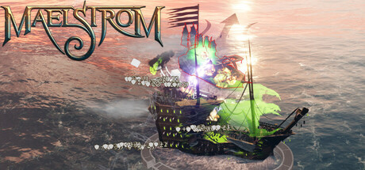

**Platforms:** Windows &nbsp;|&nbsp; **Genre:** Action, Adventure, Indie, Massively Multiplayer, Simulation, Strategy, Free To Play &nbsp;|&nbsp; **Released:** February 20

> Command the seas in Maelstrom! Engage in fast-paced naval battles with powerful warships and colossal sea monsters. Customize your fleet and dominate the Abyssal Ocean. Are you ruthless enough to survive?
>
> _Synopsis source: Steam_

[Wikipedia](https://en.wikipedia.org/wiki/Maelstrom_(video_game)) · [Steam](https://store.steampowered.com/app/764050)

---

### Maelstrom: The Battle for Earth Begins

**Platforms:** Windows &nbsp;|&nbsp; **Developer:** KD Vision &nbsp;|&nbsp; **Publisher:** Codemasters &nbsp;|&nbsp; **Genre:** Real-time strategy, third-person shooter &nbsp;|&nbsp; **Released:** February 9, 2007

> In the space of fifty years, Earth changed from a planet on cusp of a challenging future to a world a breath away from lifelessness and plunged into an apocalyptic time of ecological disaster, global warfare and the meltdown of human civilization. This is the time of the Maelstrom. In this ravaged world, the planet's dwindling resources have divided what remains of mankind in two: the urban freedom fighting 'Remnants' and the technologically advanced 'Ascension'. Now they must wage war against a new threat, the invasion of a savage alien race, the Hai-Genti, and each other in a desperate struggle for supremacy and survival. Through the game's missions, take command from different viewpoints and employ faction-specific tactics and weaponry to achieve your objectives. Complete with the ability to terraform landscapes and transform units, Maelstrom provides gamers with the power to harness the forces of nature in the most frantic, destructive, action-packed RTS game yet.
>
> _Synopsis source: IGDB_

[Wikipedia](https://en.wikipedia.org/wiki/Maelstrom:_The_Battle_for_Earth_Begins) · [IGDB](https://www.igdb.com/games/maelstrom-the-battle-for-earth-begins)

---

### Mahjong Tales: Ancient Wisdom

**Platforms:** PlayStation Network, Windows &nbsp;|&nbsp; **Developer:** Creat Studios &nbsp;|&nbsp; **Publisher:** Creat Studios & TikGames, Microsoft Game Studios &nbsp;|&nbsp; **Genre:** Board &nbsp;|&nbsp; **Released:** March 7, 2007

[Wikipedia](https://en.wikipedia.org/wiki/Mahjong_Tales:_Ancient_Wisdom)

---

### Making History: The Calm & The Storm

**Platforms:** Windows &nbsp;|&nbsp; **Developer:** Muzzy Lane &nbsp;|&nbsp; **Publisher:** Strategy First, Factus Games, FriendWare, BigBen Interactive &nbsp;|&nbsp; **Genre:** Turn-based strategy &nbsp;|&nbsp; **Released:** March 13, 2007

> Making History delivers the open-ended gameplay of strategy-game classics, but with compelling new economic, military, and diplomatic systems and deep research that lets you play with real historical challenges.
>
> _Synopsis source: IGDB_

[Wikipedia](https://en.wikipedia.org/wiki/Making_History:_The_Calm_&_The_Storm) · [IGDB](https://www.igdb.com/games/making-history-the-calm-and-the-storm)

---

### Manga Fighter

**Platforms:** Windows &nbsp;|&nbsp; **Developer:** OnNet &nbsp;|&nbsp; **Publisher:** OnNet, GamesCampus, Realfogs &nbsp;|&nbsp; **Genre:** Action, MMO Third-person shooter &nbsp;|&nbsp; **Released:** December 3, 2007

[Wikipedia](https://en.wikipedia.org/wiki/Manga_Fighter)

---

### Marvel Trading Card Game

**Platforms:** PlayStation Portable, Nintendo DS, Windows &nbsp;|&nbsp; **Released:** February 27

[Wikipedia](https://en.wikipedia.org/wiki/Marvel_Trading_Card_Game)

---

### MechQuest

**Platforms:** Windows &nbsp;|&nbsp; **Developer:** Artix Entertainment &nbsp;|&nbsp; **Publisher:** Artix Entertainment &nbsp;|&nbsp; **Genre:** Role-playing &nbsp;|&nbsp; **Released:** October 1, 2007

> MechQuest is a FREE browser-based fantasy giant destructive war machine battle game. Sound fun? You bet! Heavily inspired by the art from every mecha & giant robot series ever created (and we are throwing in magic and laser swords too!) we will be putting a true 'Anything Goes' build and battle 'Lunchbreak-sized' game. Keep your holivids tuned in for more... *Bizzzzzzipwhip...kccccht!*
>
> _Synopsis source: IGDB_

[Wikipedia](https://en.wikipedia.org/wiki/MechQuest) · [IGDB](https://www.igdb.com/games/mechquest)

---

### Medal of Honor: Airborne

**Platforms:** PlayStation 3, Xbox 360, Windows &nbsp;|&nbsp; **Released:** September 4

---

### Medieval II: Total War: Kingdoms

**Platforms:** Windows &nbsp;|&nbsp; **Released:** August 28

---

### Mia's Reading Adventure: The Bugaboo Bugs

**Platforms:** Windows, macOS &nbsp;|&nbsp; **Developer:** Kutoka Interactive &nbsp;|&nbsp; **Publisher:** Kutoka Interactive &nbsp;|&nbsp; **Genre:** Educational

[Wikipedia](https://en.wikipedia.org/wiki/Mia's_Reading_Adventure:_The_Bugaboo_Bugs)

---

### Microsoft Flight Simulator X: Acceleration

**Platforms:** Windows &nbsp;|&nbsp; **Released:** October 16

---

### Mondo Medicals

**Platforms:** Windows &nbsp;|&nbsp; **Genre:** Puzzle &nbsp;|&nbsp; **Released:** September 13, 2007

> Difficult puzzle game with an unsettling mood and often unorthodox puzzle solutions. There is no save feature: you play through or you quit.
>
> _Synopsis source: IGDB_

[Wikipedia](https://en.wikipedia.org/wiki/Mondo_Medicals) · [IGDB](https://www.igdb.com/games/mondo-medicals)

---

### Monster Hunter Frontier Z

**Platforms:** Windows &nbsp;|&nbsp; **Developer:** Capcom &nbsp;|&nbsp; **Publisher:** Capcom &nbsp;|&nbsp; **Genre:** Action role-playing &nbsp;|&nbsp; **Released:** June 21, 2007

[Wikipedia](https://en.wikipedia.org/wiki/Monster_Hunter_Frontier_Z)

---

### Monster Madness: Battle for Suburbia

**Platforms:** Xbox 360, Windows &nbsp;|&nbsp; **Developer:** Artificial Studios, Immersion Games &nbsp;|&nbsp; **Publisher:** SouthPeak Games &nbsp;|&nbsp; **Genre:** Shoot 'em up

> Monster Madness is an action adventure game following a group of teens as they fight to rid their town of an undead menace.
>
> _Synopsis source: IGDB_

[Wikipedia](https://en.wikipedia.org/wiki/Monster_Madness:_Battle_for_Suburbia) · [IGDB](https://www.igdb.com/games/monster-madness-battle-for-suburbia)

---

### MoonBaseOne

**Platforms:** Windows &nbsp;|&nbsp; **Developer:** WeCreateGames Studios &nbsp;|&nbsp; **Publisher:** Federation of Galaxy Explorers &nbsp;|&nbsp; **Genre:** Action-adventure game &nbsp;|&nbsp; **Released:** July 15, 2007

[Wikipedia](https://en.wikipedia.org/wiki/MoonBaseOne)

---

### MotoGP '07

**Platforms:** Xbox 360, Windows, Mobile phone &nbsp;|&nbsp; **Developer:** Climax Racing, Rockpool Games &nbsp;|&nbsp; **Publisher:** THQ &nbsp;|&nbsp; **Genre:** Racing &nbsp;|&nbsp; **Released:** August 24, 2007

> MotoGP '07 features complete rider and team data, new 800cc MotoGP bikes and all 18 circuit of the 2007 MotoGP season. The title also features interactive track-side crowds, on-line tournament features, on-line "pink slip" racing, and a revamped Extreme mode. The revamped Extreme mode allows for over one million possible bike customizations.  In addition, minor gameplay changes have been made to the handling and braking to allow for easier player accessibility. Changes to acceleration and deceleration have been made to add to the realism which will make turns easier to navigate through. Slight fishtailing with hard braking has been put in to give a better feel for the handling of the bike and to let the player know how effective their braking is.
>
> _Synopsis source: IGDB_

[Wikipedia](https://en.wikipedia.org/wiki/MotoGP_'07) · [IGDB](https://www.igdb.com/games/motogp-07)

---

### Mountain of Faith

**Platforms:** Windows &nbsp;|&nbsp; **Developer:** Team Shanghai Alice &nbsp;|&nbsp; **Publisher:** Team Shanghai Alice &nbsp;|&nbsp; **Genre:** Bullet hell &nbsp;|&nbsp; **Released:** August 17, 2007

[Wikipedia](https://en.wikipedia.org/wiki/Mountain_of_Faith)

---

### Mr. Robot

**Platforms:** Windows &nbsp;|&nbsp; **Developer:** Moonpod &nbsp;|&nbsp; **Publisher:** Moonpod &nbsp;|&nbsp; **Genre:** Adventure, RPG, platformer &nbsp;|&nbsp; **Released:** January 10, 2007

> Mr. Robot is a 3D action-puzzle-adventure-rpg. Inspired by classic filmation games such as Knight Lore and Alien8 and mixed with 'Ghost Hack' — an abstract RPG in which the player hacks into computer terminals and battles defensive computer programs.
>
> _Synopsis source: IGDB_

[Wikipedia](https://en.wikipedia.org/wiki/Mr._Robot_(video_game)) · [IGDB](https://www.igdb.com/games/mr-robot)

---

### My Horse & Me

**Platforms:** Wii, Nintendo DS, Windows &nbsp;|&nbsp; **Developer:** Woedend! Games &nbsp;|&nbsp; **Publisher:** Atari Europe &nbsp;|&nbsp; **Genre:** Simulation &nbsp;|&nbsp; **Released:** November 23, 2007

> Delivering all the excitement and fun of the equestrian life, from sports and leisure riding to horse care, My Horse and Me is a unique gaming experience for anyone with an interest or passion for horses. The game features the most accurate horse models and animations yet realized in a video game, alongside a richly rewarding game play experience, all set against a beautiful backdrop of charming indoor and outdoor environments.
>
> _Synopsis source: IGDB_

[Wikipedia](https://en.wikipedia.org/wiki/My_Horse_&_Me) · [IGDB](https://www.igdb.com/games/my-horse-me)

---

### Myst Online: Uru Live

**Platforms:** Windows &nbsp;|&nbsp; **Released:** February 15

---

### Mystery P.I.: The Lottery Ticket

**Platforms:** Windows &nbsp;|&nbsp; **Developer:** SpinTop Games &nbsp;|&nbsp; **Publisher:** PopCap Games &nbsp;|&nbsp; **Genre:** Puzzle &nbsp;|&nbsp; **Released:** June 25, 2007

> You are the world-famous Mystery P.I. and you've been hired by Grandma Rose to find her $488 million dollar winning lottery ticket that has gone missing! Retrace Grandma's steps to collect clues by finding hidden objects and solving puzzles. Search the city for the clues and piece them together to solve the case. Grandma Rose has agreed to pay you $20 million if you find the ticket before the deadline. Hurry, you only have 12 hours to find the ticket.  Investigate 20 unique locations to find over 2100 cleverly hidden objects! As your investigation skills improve your P.I. rank increases -- strive for a "Perfect Investigation" to get big bonus points.
>
> _Synopsis source: IGDB_

[Wikipedia](https://en.wikipedia.org/wiki/Mystery_P.I.:_The_Lottery_Ticket) · [IGDB](https://www.igdb.com/games/mystery-p-dot-i-the-lottery-ticket)

---

### Nancy Drew: Legend of the Crystal Skull

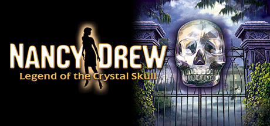

**Platforms:** Windows &nbsp;|&nbsp; **Genre:** Adventure &nbsp;|&nbsp; **Released:** October 8

> The Search is on for an Unearthly Artifact in New Orleans!
>
> _Synopsis source: Steam_

[Steam](https://store.steampowered.com/app/31860)

---

### Nancy Drew: The White Wolf of Icicle Creek

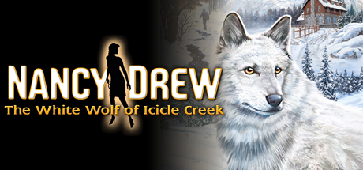

**Platforms:** Windows &nbsp;|&nbsp; **Genre:** Adventure &nbsp;|&nbsp; **Released:** June 7

> Follow a Trail to Hidden Secrets and Sabotage!
>
> _Synopsis source: Steam_

[Steam](https://store.steampowered.com/app/31930)

---

### NBA Live 08

**Platforms:** PlayStation 2, Xbox 360, Wii, Nintendo DS, PlayStation Portable, Windows &nbsp;|&nbsp; **Released:** October 2

[Wikipedia](https://en.wikipedia.org/wiki/NBA_Live_08)

---

### Nee Pon? × Rai Pon!

**Platforms:** Windows &nbsp;|&nbsp; **Developer:** Navel, Lime &nbsp;|&nbsp; **Genre:** Eroge, Mahjong, Visual novel &nbsp;|&nbsp; **Released:** August 31, 2007

[Wikipedia](https://en.wikipedia.org/wiki/Nee_Pon%3F_%C3%97_Rai_Pon!)

---

### Need for Speed: ProStreet

**Platforms:** Wii, Nintendo DS, PlayStation 2, PlayStation 3, PlayStation Portable, Xbox 360, Xbox, Windows &nbsp;|&nbsp; **Released:** November 14

---

### Nelly Cootalot: Spoonbeaks Ahoy!

**Platforms:** Windows &nbsp;|&nbsp; **Developer:** Alasdair Beckett-King &nbsp;|&nbsp; **Genre:** Point-and-click adventure &nbsp;|&nbsp; **Released:** March 6, 2007

> A downloadable indie point and click adventure game with a few minigames.
>
> _Synopsis source: IGDB_

[Wikipedia](https://en.wikipedia.org/wiki/Nelly_Cootalot:_Spoonbeaks_Ahoy!) · [IGDB](https://www.igdb.com/games/nelly-cootalot-spoonbeaks-ahoy)

---

### Neverwinter Nights 2: Mask of the Betrayer

**Platforms:** Windows &nbsp;|&nbsp; **Released:** September 27

---

### Next Life

**Platforms:** Windows &nbsp;|&nbsp; **Developer:** Future Games &nbsp;|&nbsp; **Publisher:** The Adventure Company &nbsp;|&nbsp; **Genre:** Point-and-click, Adventure &nbsp;|&nbsp; **Released:** November 20, 2007

> Next Life is an adventure game where a man wakes up on a mysterious island after a car crash. As he explores the island, he begins to encounter many strange people all from different time periods.
>
> _Synopsis source: IGDB_

[Wikipedia](https://en.wikipedia.org/wiki/Next_Life) · [IGDB](https://www.igdb.com/games/next-life)

---

### NHL 08

**Platforms:** PlayStation 2, PlayStation 3, Xbox 360, Windows, Wii &nbsp;|&nbsp; **Released:** September 11

[Wikipedia](https://en.wikipedia.org/wiki/NHL_08)

---

### Nitro Stunt Racing

**Platforms:** Windows &nbsp;|&nbsp; **Developer:** GameSeed &nbsp;|&nbsp; **Publisher:** GameSeed &nbsp;|&nbsp; **Genre:** Racing &nbsp;|&nbsp; **Released:** December 28, 2007

[Wikipedia](https://en.wikipedia.org/wiki/Nitro_Stunt_Racing)

---

### Nostradamus: The Last Prophecy

**Platforms:** Windows &nbsp;|&nbsp; **Developer:** Kheops Studio, Mzone Studio, TOTM Studio, Anuman Interactive &nbsp;|&nbsp; **Publisher:** Elektrogames, Kheops Studio, Mzone Studio, TOTM Studio, MC2, Encore, Anuman Interactive &nbsp;|&nbsp; **Genre:** Adventure &nbsp;|&nbsp; **Released:** November 14, 2007

> tA historical fiction based on the life and works of Nostradamus. This first-person, point-and-click adventure will defy logic.  The art of cross-dressing. Madeleine must confront the prejudice of a “man’s world”. Her father’s mastery of cosmetics allows her to take on the identity her younger brother, Caesar. Toggle between identities to uncover the truth.
>
> _Synopsis source: IGDB_

[Wikipedia](https://en.wikipedia.org/wiki/Nostradamus:_The_Last_Prophecy) · [IGDB](https://www.igdb.com/games/nostradamus-the-last-prophecy)

---

### Osu!

**Platforms:** Windows, macOS &nbsp;|&nbsp; **Released:** September 16

[Wikipedia](https://en.wikipedia.org/wiki/Osu!)

---

### Overclocked: A History of Violence

**Platforms:** Windows &nbsp;|&nbsp; **Developer:** House of Tales &nbsp;|&nbsp; **Publisher:** Lighthouse Interactive &nbsp;|&nbsp; **Genre:** Adventure &nbsp;|&nbsp; **Released:** October 12, 2007

> Set against the backdrop of a catastrophic thunderstorm raging over New York City, Overclocked explores an archetypical, yet actual condition of mankind: violence. This psychological thriller mixes frightening fictional thriller elements using innovative narrative structures. Overclocked charts the diffuse areas where memories and illusions; dreams and reality; perpetrators and victims; collide.  Army psychiatrist, David McNamara, is called to the Staten Island Forensic Hospital in New York City to consult on a case that requires his expertise in forensic psychiatry. Tasked with exploring the minds of five young men and women who were found scared, screaming, and without memory, he makes alarming discoveries as he begins to cautiously explore the psyches of his young patients. Throughout the game, players will switch between six different characters in this chilling interactive psycho thriller.
>
> _Synopsis source: IGDB_

[Wikipedia](https://en.wikipedia.org/wiki/Overclocked:_A_History_of_Violence) · [IGDB](https://www.igdb.com/games/overclocked-a-history-of-violence)

---

### Overlord

**Platforms:** Xbox 360, Windows &nbsp;|&nbsp; **Genre:** RPG &nbsp;|&nbsp; **Released:** June 26

> How evil can you get? Discover how corruptible you are in Overlord, the twisted fantasy action adventure where you can be evil (or really evil). In the game's seriously warped fantasy world, players will become the Overlord and get first-hand experience of how absolute power corrupts absolutely.
>
> _Synopsis source: Steam_

[Wikipedia](https://en.wikipedia.org/wiki/Overlord_(2007_video_game)) · [Steam](https://store.steampowered.com/app/12710)

---

### Painkiller: Overdose

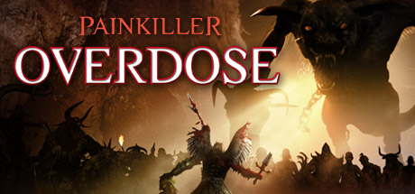

**Platforms:** Windows &nbsp;|&nbsp; **Genre:** Action &nbsp;|&nbsp; **Released:** October 16

> The critically-acclaimed and award-winning FPS franchise is back! Packed with tons of fast-paced, adrenaline-fueled single player and multiplayer action, Painkiller Overdose brings with it 6 innovative new demonic weapons, mind-bending physics, lightning-player maps, over 40 demented and sickly-twisted monsters from Hell and gigantic end...
>
> _Synopsis source: Steam_

[Wikipedia](https://en.wikipedia.org/wiki/Painkiller_Overdose) · [Steam](https://store.steampowered.com/app/3270)

---

### Panzer Elite Action: Dunes of War

**Platforms:** Windows &nbsp;|&nbsp; **Developer:** ZootFly &nbsp;|&nbsp; **Publisher:** JoWood, GFI, Russobit-M &nbsp;|&nbsp; **Genre:** Real-time strategy &nbsp;|&nbsp; **Released:** January 26, 2007

[Wikipedia](https://en.wikipedia.org/wiki/Panzer_Elite_Action:_Dunes_of_War)

---

### Passage

**Platforms:** Windows, macOS, Linux, Nintendo DS &nbsp;|&nbsp; **Genre:** Art game &nbsp;|&nbsp; **Released:** November 1, 2007

> A "memento mori" game in which the player travels from young adulthood to death within 5 minutes while carving their own path.
>
> _Synopsis source: IGDB_

[Wikipedia](https://en.wikipedia.org/wiki/Passage_(video_game)) · [IGDB](https://www.igdb.com/games/passage)

---

### Patriots: A Nation Under Fire

**Platforms:** Windows &nbsp;|&nbsp; **Developer:** 4D Rulers &nbsp;|&nbsp; **Publisher:** THQ Nordic GmbH, SilverLine Software &nbsp;|&nbsp; **Genre:** First-person shooter &nbsp;|&nbsp; **Released:** January 23, 2007

> Terrorists have just invaded US soil in an attempt to overthrow the superpower and achieve global supremacy. 50 major cities have already been devastated by nuclear attacks while others are left in total chaos. Join the Resistance as you grab your weapon and take to the streets to fend off the powerful surprise attack. From urban downtown city streets to rural residential parks, you'll engage in countless battles as you help fight for America's freedom.
>
> _Synopsis source: IGDB_

[Wikipedia](https://en.wikipedia.org/wiki/Patriots:_A_Nation_Under_Fire) · [IGDB](https://www.igdb.com/games/patriots-a-nation-under-fire)

---

### PeaceMaker

**Platforms:** macOS, Windows, Android &nbsp;|&nbsp; **Developer:** ImpactGames &nbsp;|&nbsp; **Genre:** Government simulation, turn-based strategy &nbsp;|&nbsp; **Released:** February 1, 2007

> PeaceMaker is a government simulation game which simulates the Israeli–Palestinian conflict.
>
> _Synopsis source: IGDB_

[Wikipedia](https://en.wikipedia.org/wiki/PeaceMaker) · [IGDB](https://www.igdb.com/games/peacemaker)

---

### Peggle

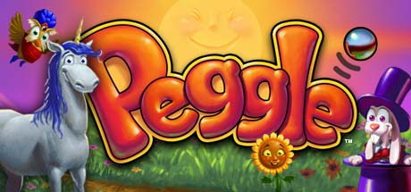

**Platforms:** Windows &nbsp;|&nbsp; **Genre:** Casual &nbsp;|&nbsp; **Released:** February 27

> Take your best shot with energizing arcade fun! Aim, shoot, clear the orange pegs, then sit back and cheer as 10 whimsical teachers guide you to Peggle greatness.
>
> _Synopsis source: Steam_

[Wikipedia](https://en.wikipedia.org/wiki/Peggle) · [Steam](https://store.steampowered.com/app/3480)

---

### Penumbra: Overture

**Platforms:** Windows, Linux &nbsp;|&nbsp; **Genre:** Action, Adventure, Indie &nbsp;|&nbsp; **Released:** March 30

> Penumbra: Overture is a first person survival horror game, emphasizing on survival and problem solving instead of mindless violence and gore.
>
> _Synopsis source: Steam_

[Steam](https://store.steampowered.com/app/22180)

---

### Petz: Dogz 2 and Catz 2

**Platforms:** Windows, Nintendo DS &nbsp;|&nbsp; **Developer:** ImaginEngine &nbsp;|&nbsp; **Publisher:** Ubisoft &nbsp;|&nbsp; **Genre:** virtual pet

[Wikipedia](https://en.wikipedia.org/wiki/Petz:_Dogz_2_and_Catz_2_(virtual_pet_video_games))

---

### Phantasy Star Universe: Ambition of the Illuminis

**Platforms:** PlayStation 2, Windows, Xbox 360 &nbsp;|&nbsp; **Released:** November 20

[Wikipedia](https://en.wikipedia.org/wiki/Phantasy_Star_Universe#Ambition_of_the_Illuminis)

---

### Phoenix Dynasty Online

**Platforms:** Windows &nbsp;|&nbsp; **Developer:** Object Software Limited &nbsp;|&nbsp; **Publisher:** Ingle Games Ltd, Vinagame &nbsp;|&nbsp; **Genre:** Fantasy MMORPG &nbsp;|&nbsp; **Released:** August 1, 2007

[Wikipedia](https://en.wikipedia.org/wiki/Phoenix_Dynasty_Online)

---

### Pirates of the Caribbean Online

**Platforms:** Windows &nbsp;|&nbsp; **Released:** October 31

[Wikipedia](https://en.wikipedia.org/wiki/Pirates_of_the_Caribbean_Online)

---

### Pirates of the Caribbean: At World's End

**Platforms:** GameCube, Nintendo DS, PlayStation 2, PlayStation 3, PlayStation Portable, Wii, Windows, Xbox 360 &nbsp;|&nbsp; **Released:** May 22

---

### Plasma Pong

**Platforms:** macOS, Windows &nbsp;|&nbsp; **Genre:** Pong &nbsp;|&nbsp; **Released:** April 20, 2007

> Plasma Pong is a clone of the classic arcade game Pong. What makes it different from the original is the use of computational fluid dynamics to drive the environment. To use this as a weapon in the game you shoot plasma from your paddle to push around the fluid. This will in turn affect the movement of the ball. You can also suction fluid into the paddle. By doing this, possession of the ball can be controlled by the player. When the ball is sucked into the paddle, the ball can be blasted across the screen in full speed.  When starting a game, you have ten lives. You will lose one every time your opponent scores. The game is level based. For every score you make you will get to a new level. For each level the game gets more difficult, and the ball gets more reactive to the fluid, and there more unpredictable.  The game can be played in both single and multiplayer (on the same computer). In addition to this, there is a sandbox mode, where players can play around as they wish with the fluid dynamics.
>
> _Synopsis source: IGDB_

[Wikipedia](https://en.wikipedia.org/wiki/Plasma_Pong) · [IGDB](https://www.igdb.com/games/plasma-pong)

---

### Poptropica

**Platforms:** iOS, Android, Nintendo DS, Windows, macOS, Browser &nbsp;|&nbsp; **Developer:** Jeff Kinney Group, StoryArc Media &nbsp;|&nbsp; **Publisher:** Pearson Education, Sandbox Networks &nbsp;|&nbsp; **Genre:** Educational, adventure, single-player with massively multiplayer online game elements &nbsp;|&nbsp; **Released:** June 5, 2007

> Poptropica is a virtual online game which kids can travel, play games, and customize their characters. Poptropica is a problem solving game.
>
> _Synopsis source: IGDB_

[Wikipedia](https://en.wikipedia.org/wiki/Poptropica) · [IGDB](https://www.igdb.com/games/poptropica)

---

### Portal

**Platforms:** Windows, Xbox 360, PlayStation 3 &nbsp;|&nbsp; **Publisher:** Valve &nbsp;|&nbsp; **Genre:** Action &nbsp;|&nbsp; **Released:** October 10, 2007

> Portal™ is a new single player game from Valve. Set in the mysterious Aperture Science Laboratories, Portal has been called one of the most innovative new games on the horizon and will offer gamers hours of unique gameplay.
>
> _Synopsis source: Steam_

[Wikipedia](https://en.wikipedia.org/wiki/Portal_(video_game)) · [Steam](https://store.steampowered.com/app/400)

---

### Power Rangers: Super Legends

**Platforms:** Nintendo DS, PlayStation 2, Windows &nbsp;|&nbsp; **Released:** October 23

---

### Princess Maker 5

**Platforms:** Windows, PlayStation 2, PlayStation Portable &nbsp;|&nbsp; **Developer:** Gainax &nbsp;|&nbsp; **Publisher:** CyberFront Corporation, TTIME Technology, CFK Co., Ltd. &nbsp;|&nbsp; **Genre:** Social simulation game, Raising simulation

> Welcome to the world of 「Princess Maker 5」!  The stage of 「Princess Maker 5」 is the world we are living in now. There is not only a TV, but we use the cellphone and the Internet as well. But something is a bit different than those. It's a world where the demons and fairies are living together. And for you living in such world comes an orphan girl by nature. This girl was the only Princess candidate survivor of the Kingdom that you served in the past. At that time, you decided to take the girl and raise her as your daughter. And your and your daughter's story starts.
>
> _Synopsis source: IGDB_

[Wikipedia](https://en.wikipedia.org/wiki/Princess_Maker_5) · [IGDB](https://www.igdb.com/games/princess-maker-5)

---

### Puppet Guardian

**Platforms:** Windows, macOS &nbsp;|&nbsp; **Developer:** Cold Breath, Co., Ltd. &nbsp;|&nbsp; **Publisher:** Artifact, Co., Ltd. and Mirror Realms, LLC &nbsp;|&nbsp; **Genre:** MMORPG, Board Game &nbsp;|&nbsp; **Released:** April 1, 2007

[Wikipedia](https://en.wikipedia.org/wiki/Puppet_Guardian)

---

### Purble Place

**Platforms:** Windows &nbsp;|&nbsp; **Developer:** Oberon Media &nbsp;|&nbsp; **Publisher:** Microsoft Corporation &nbsp;|&nbsp; **Genre:** Action, mysteries, puzzle, strategies &nbsp;|&nbsp; **Released:** January 30, 2007

> Purble Place is a minigame collection aimed at young children; the game comes pre-installed on both Windows Vista and Windows 7 systems. The three minigames included with Purble Place are:  - Comfy Cakes - This involves the user pressing the correct sequence of buttons to create the cake displayed by the game. - Purble Shop - This involves the user selecting different facial features and trying to find the correct ones to recreate the animated character correctly. - Purble Pairs - This requires the user to match up different tiles of the same type.
>
> _Synopsis source: IGDB_

[Wikipedia](https://en.wikipedia.org/wiki/Purble_Place) · [IGDB](https://www.igdb.com/games/purble-place)

---

### R.U.R.U.R.

**Platforms:** Windows &nbsp;|&nbsp; **Developer:** light &nbsp;|&nbsp; **Publisher:** light, Views &nbsp;|&nbsp; **Genre:** Eroge, Visual novel &nbsp;|&nbsp; **Released:** April 27, 2007

[Wikipedia](https://en.wikipedia.org/wiki/R.U.R.U.R.)

---

### Race 07

**Platforms:** Windows &nbsp;|&nbsp; **Developer:** SimBin Studios &nbsp;|&nbsp; **Publisher:** SimBin Studios &nbsp;|&nbsp; **Genre:** Racing simulation &nbsp;|&nbsp; **Released:** October 2, 2007

> RACE 07 is a racing simulation video game that covers the 2006 and 2007 World Touring Car Championship seasons. It offers over 300 cars across 9 different racing classes, including touring cars, Formula 3000, Formula BMW, and Radical sports cars. Players can race on 32 international tracks with multiple layout options, featuring a sophisticated damage system and flexible race formats. It represents a significant expansion from previous SimBin racing titles, introducing single-seater racing classes and enhanced community-oriented features.
>
> _Synopsis source: IGDB_

[Wikipedia](https://en.wikipedia.org/wiki/Race_07) · [IGDB](https://www.igdb.com/games/race-07)

---

### Ragnarok Battle Offline

**Platforms:** Windows &nbsp;|&nbsp; **Developer:** French-Bread &nbsp;|&nbsp; **Publisher:** French-Bread, Gravity &nbsp;|&nbsp; **Genre:** Beat 'em up

[Wikipedia](https://en.wikipedia.org/wiki/Ragnarok_Battle_Offline)

---

### Ratatouille

**Platforms:** Wii, Xbox 360, PlayStation 2, Xbox, Nintendo DS, GameCube, Game Boy Advance, PlayStation Portable, Windows, macOS, PlayStation 3 &nbsp;|&nbsp; **Released:** June 26

[Wikipedia](https://en.wikipedia.org/wiki/Ratatouille_(video_game))

---

### Recettear: An Item Shop's Tale

**Platforms:** Windows &nbsp;|&nbsp; **Developer:** EasyGameStation &nbsp;|&nbsp; **Publisher:** Carpe Fulgur &nbsp;|&nbsp; **Genre:** Action role-playing, business simulation &nbsp;|&nbsp; **Released:** December 2007

> Recettear is the story of an item shop, the girl who lives in it, and the fairy who turned her life upside down. Recette Lemongrass finds herself in charge of an item shop built into her house, in order to pay back a loan her father took and then skipped out on - and Tear, her newfound fairy "companion", won't take no for an answer! As Recette, you have to decide how you'll get your stock - either through playing the markets in town or going out into the wild with an adventuring friend and thrashing beasts until they give up the goodies - how much to sell things for, what the shop should look like, and how to best go about getting the money Tear needs to pay off the loan. If you can't come up with the money... well, hope you like living in a cardboard box.
>
> _Synopsis source: IGDB_

[Wikipedia](https://en.wikipedia.org/wiki/Recettear:_An_Item_Shop's_Tale) · [IGDB](https://www.igdb.com/games/recettear-an-item-shops-tale)

---

### Red Ocean

**Platforms:** Windows &nbsp;|&nbsp; **Developer:** Collision Studios &nbsp;|&nbsp; **Publisher:** DTP Entertainment &nbsp;|&nbsp; **Genre:** First-person shooter &nbsp;|&nbsp; **Released:** March 16, 2007

> Red Ocean is a 2007 first-person shooter video game created by Collision Studios
>
> _Synopsis source: IGDB_

[Wikipedia](https://en.wikipedia.org/wiki/Red_Ocean) · [IGDB](https://www.igdb.com/games/red-ocean)

---

### Resident Evil 4

**Platforms:** Windows &nbsp;|&nbsp; **Genre:** Action, Adventure &nbsp;|&nbsp; **Released:** May 15

> Survival is just the beginning. Six years have passed since the biological disaster in Raccoon City. Leon S. Kennedy, one of the survivors, tracks the president's kidnapped daughter to a secluded European village, where there is something terribly wrong with the locals.
>
> _Synopsis source: Steam_

[Wikipedia](https://en.wikipedia.org/wiki/Resident_Evil_4) · [Steam](https://store.steampowered.com/app/2050650)

---

### Ricochet Infinity

**Platforms:** Windows, macOS, PlayStation 3 &nbsp;|&nbsp; **Developer:** Reflexive Entertainment &nbsp;|&nbsp; **Publisher:** Reflexive Entertainment &nbsp;|&nbsp; **Genre:** Breakout &nbsp;|&nbsp; **Released:** July 31, 2007

> Ricochet around the Galaxy in this dynamically brilliant breakout action game! Trek across 216 awesome levels, with thousands more online, earning new ranks in the Galactic Tournament, by yourself or with a friend. Play the re-energized Ring Game, winning new balls and ships with unique specialties to give you the edge! Control your ball with the wildly innovative Recall feature...once you’ve tried it, you can’t go back! Travel to the stars and beyond in your glorious quest to become the Ringmaster Grand Champion!
>
> _Synopsis source: IGDB_

[Wikipedia](https://en.wikipedia.org/wiki/Ricochet_Infinity) · [IGDB](https://www.igdb.com/games/ricochet-infinity)

---

### Root After and Another

**Platforms:** Windows &nbsp;|&nbsp; **Developer:** Makura &nbsp;|&nbsp; **Publisher:** Makura &nbsp;|&nbsp; **Genre:** Eroge, Visual novel &nbsp;|&nbsp; **Released:** October 26, 2007

> An adult visual novel, and the sequel to H2O: Footprints in the Sand. This game contains new after stories for the original heroines, Yui's and Maki's routes and several short stories.
>
> _Synopsis source: IGDB_

[Wikipedia](https://en.wikipedia.org/wiki/Root_After_and_Another) · [IGDB](https://www.igdb.com/games/root-after-and-another)

---

### Rugby 08

**Platforms:** PlayStation 2, Windows &nbsp;|&nbsp; **Developer:** HB Studios &nbsp;|&nbsp; **Publisher:** Electronic Arts &nbsp;|&nbsp; **Genre:** Sports &nbsp;|&nbsp; **Released:** July 17, 2007

> The most recent of EA's Rugby games, Rugby 08 features new play modes such as the Rugby World Cup and the World Cup Challenge mode.
>
> _Synopsis source: IGDB_

[Wikipedia](https://en.wikipedia.org/wiki/Rugby_08) · [IGDB](https://www.igdb.com/games/rugby-08)

---

### Rumble Fighter

**Platforms:** Windows &nbsp;|&nbsp; **Developer:** Nimonix &nbsp;|&nbsp; **Publisher:** OGPlanet, GamesCampus, RedFox Games &nbsp;|&nbsp; **Genre:** Fighting, Online multiplayer &nbsp;|&nbsp; **Released:** August 2007

> Rumble Fighter is a free-to-play online fighting game by OGPlanet
>
> _Synopsis source: IGDB_

[Wikipedia](https://en.wikipedia.org/wiki/Rumble_Fighter) · [IGDB](https://www.igdb.com/games/rumble-fighter)

---

### S.T.A.L.K.E.R.: Shadow of Chernobyl

**Platforms:** Windows &nbsp;|&nbsp; **Released:** March 23

---

### Sam & Max Beyond Time and Space

**Platforms:** Windows &nbsp;|&nbsp; **Developer:** Telltale Games &nbsp;|&nbsp; **Publisher:** Telltale Games, Microsoft Game Studios &nbsp;|&nbsp; **Genre:** Graphic adventure &nbsp;|&nbsp; **Released:** November 8, 2007

[Wikipedia](https://en.wikipedia.org/wiki/Sam_&_Max_Beyond_Time_and_Space)

---

### Sam & Max Save the World

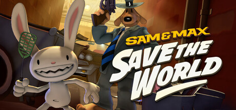

**Platforms:** Windows &nbsp;|&nbsp; **Publisher:** Telltale Games &nbsp;|&nbsp; **Genre:** Adventure, Indie &nbsp;|&nbsp; **Released:** August 7, 2007

> An open-and-shut case of petty vandalism balloons into a far-flung mind-control conspiracy involving former child stars, the media, the mafia, the government, the internet, and the bright side of the moon. Telltale's episodic classic, lovingly remastered by members of the original development team.
>
> _Synopsis source: Steam_

[Wikipedia](https://en.wikipedia.org/wiki/Sam_%26_Max_Save_the_World) · [Steam](https://store.steampowered.com/app/1440440)

---

### Sam & Max Season One

**Platforms:** Windows &nbsp;|&nbsp; **Released:** August 15

[Wikipedia](https://en.wikipedia.org/wiki/Sam_%26_Max_Save_the_World)

---

### SD Gundam Capsule Fighter Online

**Platforms:** Windows &nbsp;|&nbsp; **Developer:** Softmax &nbsp;|&nbsp; **Publisher:** Netmarble &nbsp;|&nbsp; **Genre:** MMOTPS

> A free to play MMO shooter put out by OGPlanet. Players can take control of chibi versions of mobile suits from the many different Mobile Suit Gundam cartoons to fight it out in PvP, or work together on PvE missions.
>
> _Synopsis source: IGDB_

[Wikipedia](https://en.wikipedia.org/wiki/SD_Gundam_Capsule_Fighter_Online) · [IGDB](https://www.igdb.com/games/sd-gundam-capsule-fighter-online)

---

### Sea Life Safari

**Platforms:** Windows &nbsp;|&nbsp; **Developer:** WildTangent, Wanako Games &nbsp;|&nbsp; **Publisher:** Vivendi Games &nbsp;|&nbsp; **Genre:** Photography &nbsp;|&nbsp; **Released:** August 16, 2007

> Sealife Safari is an XBLA game that takes place under water. In the mysterious depths of the water you take photographs of different sealife with there certain reactions. Varying from Sharks to Moorish Idols your bound to get a good photo!
>
> _Synopsis source: IGDB_

[Wikipedia](https://en.wikipedia.org/wiki/Sea_Life_Safari) · [IGDB](https://www.igdb.com/games/sea-life-safari)

---

### Sega Rally Revo

**Platforms:** PlayStation 3, Xbox 360, PlayStation Portable, Windows &nbsp;|&nbsp; **Released:** October 9

[Wikipedia](https://en.wikipedia.org/wiki/Sega_Rally_Revo)

---

### Shadowgrounds: Survivor

**Platforms:** Windows &nbsp;|&nbsp; **Developer:** Frozenbyte &nbsp;|&nbsp; **Publisher:** Frozenbyte, Meridian4, Linux Game Publishing &nbsp;|&nbsp; **Genre:** Top-down shooter &nbsp;|&nbsp; **Released:** November 14, 2007

[Wikipedia](https://en.wikipedia.org/wiki/Shadowgrounds:_Survivor)

---

### Shadowrun

**Platforms:** Xbox 360, Windows &nbsp;|&nbsp; **Released:** May 29

[Wikipedia](https://en.wikipedia.org/wiki/Shadowrun_(2007_video_game))

---

### Sherlock Holmes Versus Arsène Lupin

**Platforms:** Windows &nbsp;|&nbsp; **Developer:** Frogwares &nbsp;|&nbsp; **Publisher:** Frogwares, Focus Home Interactive &nbsp;|&nbsp; **Genre:** Adventure &nbsp;|&nbsp; **Released:** October 25, 2007

> Sherlock Holmes: Nemesis sends us to 19th Century London where Arséne Lupin, a young French burglar with an impressive track record, has just challenged Scotland Yard and the most famous of detectives - Sherlock Holmes.
>
> _Synopsis source: IGDB_

[Wikipedia](https://en.wikipedia.org/wiki/Sherlock_Holmes_Versus_Ars%C3%A8ne_Lupin) · [IGDB](https://www.igdb.com/games/sherlock-holmes-nemesis)

---

### Shrek the Third

**Platforms:** Windows, Wii, Xbox 360, PlayStation 2, PlayStation Portable, Game Boy Advance, Nintendo DS &nbsp;|&nbsp; **Developer:** Amaze Entertainment, Vicarious Visions &nbsp;|&nbsp; **Publisher:** Activision &nbsp;|&nbsp; **Genre:** Action-adventure, platform &nbsp;|&nbsp; **Released:** May 15, 2007

> An action video game based from the third installment of the Shrek movie series.  The Frog King has died and Shrek has inherited the throne. Since Shrek's not a big fan of this idea, he and his friends journey to the Worcestershire academy to recruit Fiona's cousin, Artie, for the job. Unfortunately, while he's away the dastardly Prince Charming has big plans to take over the kingdom.
>
> _Synopsis source: IGDB_

[Wikipedia](https://en.wikipedia.org/wiki/Shrek_the_Third_(video_game)) · [IGDB](https://www.igdb.com/games/shrek-the-third)

---

### Silent Hunter 4: Wolves of the Pacific

**Platforms:** Windows &nbsp;|&nbsp; **Released:** March 20

---

### Silverfall

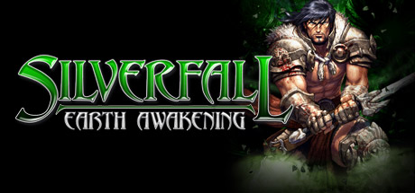

**Platforms:** Windows &nbsp;|&nbsp; **Genre:** RPG &nbsp;|&nbsp; **Released:** March 9

> Silverfall Earth Awakening is an action RPG with unique graphical feel offering a fantastic quest to explore the new territories of Nelwë. In this heroic fantasy world where nature and technology collide you will have to make important choices which will lead you to side with one or the other.
>
> _Synopsis source: Steam_

[Wikipedia](https://en.wikipedia.org/wiki/Silverfall) · [Steam](https://store.steampowered.com/app/4470)

---

### SimCity Societies

**Platforms:** Windows &nbsp;|&nbsp; **Released:** November 16

[Wikipedia](https://en.wikipedia.org/wiki/SimCity_Societies)

---

### Simon the Sorcerer 4: Chaos Happens

**Platforms:** Windows &nbsp;|&nbsp; **Developer:** Silver Style Entertainment &nbsp;|&nbsp; **Publisher:** RTL Enterprises, Playlogic Entertainment &nbsp;|&nbsp; **Genre:** Adventure &nbsp;|&nbsp; **Released:** February 23, 2007

> In "Simon the Sorcerer 4: Chaos Happens" players take control of the witty sorcerer during his new quest in the Magic World. In this point and click adventure the story unravels when Simon travels around and interacts with dozens of characters, solves puzzles and brings order to the chaos his double has caused.
>
> _Synopsis source: IGDB_

[Wikipedia](https://en.wikipedia.org/wiki/Simon_the_Sorcerer_4:_Chaos_Happens) · [IGDB](https://www.igdb.com/games/simon-the-sorcerer-4-chaos-happens)

---

### SimPort

**Platforms:** Windows, macOS &nbsp;|&nbsp; **Developer:** Tygron, Port of Rotterdam, TU Delft &nbsp;|&nbsp; **Genre:** Construction and Management Simulation, Serious games &nbsp;|&nbsp; **Released:** January 1, 2007

[Wikipedia](https://en.wikipedia.org/wiki/SimPort)

---

### Sinking Island

**Platforms:** Windows &nbsp;|&nbsp; **Developer:** White Birds Productions &nbsp;|&nbsp; **Publisher:** Microids/Encore, Micro Application &nbsp;|&nbsp; **Genre:** Adventure &nbsp;|&nbsp; **Released:** October 4, 2007

> This traditional point-and-click adventure game is a classical Who Dunnit. As inspector Jack Norm, you have to investigate which of the suspects might have a reason to want Walter Jones dead, talk to everybody, collect evidence or compare fingerprints. Your PPA (Personal Police Assistant), a kind of inventory/recording device, helps you during your inquiries.  Sinking Island can be played in two modes: in real-time mode, it's a race against time. In adventure mode, you can go through each place at your own pace.
>
> _Synopsis source: IGDB_

[Wikipedia](https://en.wikipedia.org/wiki/Sinking_Island) · [IGDB](https://www.igdb.com/games/sinking-island)

---

### Soldier of Fortune: Payback

**Platforms:** Windows, Xbox 360, PlayStation 3 &nbsp;|&nbsp; **Released:** November 14

---

### Space Force: Rogue Universe

**Platforms:** Windows &nbsp;|&nbsp; **Developer:** Provox Games &nbsp;|&nbsp; **Publisher:** JoWooD Productions, DreamCatcher Interactive, N3VRF4IL &nbsp;|&nbsp; **Genre:** Space combat simulator &nbsp;|&nbsp; **Released:** June 5, 2007

> In this Space Simulation by Provox Games you take the role of Jim Andersson who sets out to find his sister. You will have to fight, explore, trade and develop your ships to survive in the treacherous universe of Spaceforce.
>
> _Synopsis source: IGDB_

[Wikipedia](https://en.wikipedia.org/wiki/Space_Force:_Rogue_Universe) · [IGDB](https://www.igdb.com/games/space-force-rogue-universe)

---

### Space Trader

**Platforms:** Windows, macOS &nbsp;|&nbsp; **Developer:** HermitWorks Entertainment &nbsp;|&nbsp; **Publisher:** HermitWorks Entertainment &nbsp;|&nbsp; **Genre:** First-person shooter, space trading and combat simulator &nbsp;|&nbsp; **Released:** July 25, 2007

> In the far future, humanity is ruled by The Ministry of Accounts, an oppressive bureaucracy that tracks, records and taxes every transaction of daily life. A new breed of marketeer arises to challenge the authority and make a profit: the Space Trader is born! As a Trader, you will attempt to amass a fortune, buying and selling commodities and taking up arms against the oppressors or even accepting bounty missions.
>
> _Synopsis source: IGDB_

[Wikipedia](https://en.wikipedia.org/wiki/Space_Trader) · [IGDB](https://www.igdb.com/games/space-trader)

---

### Speedball 2 Tournament

**Platforms:** Windows &nbsp;|&nbsp; **Released:** November 27

[Wikipedia](https://en.wikipedia.org/wiki/Speedball_2_Tournament)

---

### SpellForce 2: Dragon Storm

**Platforms:** Windows &nbsp;|&nbsp; **Developer:** Phenomic &nbsp;|&nbsp; **Publisher:** JoWooD, Auran, DreamCatcher Interactive &nbsp;|&nbsp; **Genre:** Real-time strategy, role-playing &nbsp;|&nbsp; **Released:** March 23, 2007

[Wikipedia](https://en.wikipedia.org/wiki/SpellForce_2:_Dragon_Storm)

---

### Spider-Man 3

**Platforms:** Game Boy Advance, Nintendo DS, PlayStation 2, Wii, Xbox 360, Windows, PlayStation Portable &nbsp;|&nbsp; **Released:** May 4

[Wikipedia](https://en.wikipedia.org/wiki/Spider-Man_3_(video_game))

---

### Spider-Man: Friend or Foe

**Platforms:** Windows, PlayStation 2, Xbox 360, Wii, Nintendo DS, PlayStation Portable &nbsp;|&nbsp; **Released:** October 2

---

### StarQuest Online

**Platforms:** Windows &nbsp;|&nbsp; **Developer:** NeXeon Technologies Inc &nbsp;|&nbsp; **Publisher:** NeXeon Technologies Inc &nbsp;|&nbsp; **Genre:** MMORPG

[Wikipedia](https://en.wikipedia.org/wiki/StarQuest_Online)

---

### Steel Fury

**Platforms:** Windows &nbsp;|&nbsp; **Developer:** Discus Games, Graviteam &nbsp;|&nbsp; **Publisher:** Buka, Lighthouse Interactive &nbsp;|&nbsp; **Genre:** Simulation &nbsp;|&nbsp; **Released:** November 2007

[Wikipedia](https://en.wikipedia.org/wiki/Steel_Fury)

---

### Storm Online

**Platforms:** Windows &nbsp;|&nbsp; **Developer:** Chengdu Aurora Technology Development Co. Ltd &nbsp;|&nbsp; **Genre:** Fantasy MMORPG &nbsp;|&nbsp; **Released:** July 2007

[Wikipedia](https://en.wikipedia.org/wiki/Storm_Online)

---

### Stranded II

**Platforms:** Windows &nbsp;|&nbsp; **Developer:** Unreal Software &nbsp;|&nbsp; **Publisher:** Unreal Software &nbsp;|&nbsp; **Genre:** Action-adventure, survival &nbsp;|&nbsp; **Released:** June 2007

> Stranded II washes you onto a deserted island with nothing but your wits and a few basic items. By hunting, gathering, crafting, and building, you must attempt to survive and eventually make it back home.
>
> _Synopsis source: IGDB_

[Wikipedia](https://en.wikipedia.org/wiki/Stranded_II) · [IGDB](https://www.igdb.com/games/stranded-ii)

---

### Stranger

**Platforms:** Windows &nbsp;|&nbsp; **Developer:** Fireglow Games &nbsp;|&nbsp; **Publisher:** Fireglow Games, Empire Interactive &nbsp;|&nbsp; **Genre:** Real-time strategy &nbsp;|&nbsp; **Released:** November 30, 2007

> A real-time strategy game without base-building.
>
> _Synopsis source: IGDB_

[Wikipedia](https://en.wikipedia.org/wiki/Stranger_(video_game)) · [IGDB](https://www.igdb.com/games/stranger)

---

### Sudden Strike 3: Arms for Victory

**Platforms:** Windows &nbsp;|&nbsp; **Developer:** Fireglow Games &nbsp;|&nbsp; **Publisher:** Empire Interactive, 1C Company, Cdv Software Entertainment &nbsp;|&nbsp; **Genre:** Real-time tactics &nbsp;|&nbsp; **Released:** December 7, 2007

> Experience the hit World War 2 real-time strategy game for the first time in full 3D glory, expanding on all strategic and tactical options. Command joint operations of naval, land-based and airborne units on the largest maps in the series. Newcomers and veterans alike will be right at home with an innovative user interface and improved AI.
>
> _Synopsis source: IGDB_

[Wikipedia](https://en.wikipedia.org/wiki/Sudden_Strike_3:_Arms_for_Victory) · [IGDB](https://www.igdb.com/games/sudden-strike-3-arms-for-victory)

---

### Sumotori Dreams

**Platforms:** Windows &nbsp;|&nbsp; **Developer:** Peter Soltesz &nbsp;|&nbsp; **Publisher:** Peter Soltesz, Gravitysensation &nbsp;|&nbsp; **Genre:** Sports video game &nbsp;|&nbsp; **Released:** April 2007

> According to the website where it is located, Sumotori Dreams is: A little but very serious ragdoll game in small size. This is the game where beginners can beat hardcore players.
>
> _Synopsis source: IGDB_

[Wikipedia](https://en.wikipedia.org/wiki/Sumotori_Dreams) · [IGDB](https://www.igdb.com/games/sumotori-dreams)

---

### SunAge

**Platforms:** Windows &nbsp;|&nbsp; **Developer:** Vertex4 &nbsp;|&nbsp; **Publisher:** Lighthouse Interactive &nbsp;|&nbsp; **Genre:** Real Time Strategy &nbsp;|&nbsp; **Released:** November 30, 2007

> A return to the roots of real-time strategy, providing beautiful 2D visuals combined with all the features that we came to expect from old school classics. This remastered version is a culmination of all the improvements and new features based upon suggestions from the community.
>
> _Synopsis source: IGDB_

[Wikipedia](https://en.wikipedia.org/wiki/SunAge) · [IGDB](https://www.igdb.com/games/sunage)

---

### SuperTuxKart

**Platforms:** Linux, macOS, Windows, Android, iOS &nbsp;|&nbsp; **Developer:** Alayan, Sven Andreas Belting, Jean-Manuel Clemençon &nbsp;|&nbsp; **Publisher:** SuperTuxKart Team &nbsp;|&nbsp; **Genre:** Racing &nbsp;|&nbsp; **Released:** August 6, 2007

> SuperTuxKart, also known as STK, is a free and open-source kart racing video game featuring the Linux mascot Tux. SuperTuxKart is cross-platform, running on Windows, OS X, Linux, AmigaOS 4, AROS, MorphOS and other Unix systems. The latest stable version of the game is version 1.3 and was released on September 28, 2021. SuperTuxKart started as TuxKart, an open source game for Linux by Steve Baker which stopped being developed after version 0.4.0
>
> _Synopsis source: IGDB_

[Wikipedia](https://en.wikipedia.org/wiki/SuperTuxKart) · [IGDB](https://www.igdb.com/games/supertuxkart)

---

### Supreme Commander

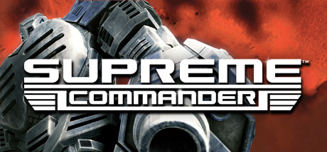

**Platforms:** Windows &nbsp;|&nbsp; **Genre:** Strategy &nbsp;|&nbsp; **Released:** February 20

> For a thousand years, three opposing forces have waged war for what they believe is true. There can be no room for compromise: their way is the only way. Dubbed The Infinite War, this devastating conflict has taken its toll on a once-peaceful galaxy and has only served to deepen the hatred between the factions.
>
> _Synopsis source: Steam_

[Wikipedia](https://en.wikipedia.org/wiki/Supreme_Commander_(video_game)) · [Steam](https://store.steampowered.com/app/9350)

---

### Supreme Commander: Forged Alliance

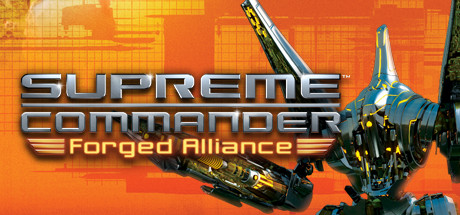

**Platforms:** Windows &nbsp;|&nbsp; **Genre:** Strategy &nbsp;|&nbsp; **Released:** November 6

> The last days of man are at hand.. Two years after the Infinite War the once great warring nations now lie in ruins, and humanity’s hope for a brighter future is nothing but a bitter memory. A new, seemingly unstoppable enemy, supported by the zealots of The Order, now seeks to eradicate mankind: UEF, Aeon Loyalist, and Cybran alike.
>
> _Synopsis source: Steam_

[Steam](https://store.steampowered.com/app/9420)

---

### Surf's Up

**Platforms:** Game Boy Advance, Nintendo DS, PlayStation 2, PlayStation 3, PlayStation Portable, Wii, Xbox 360, GameCube, Windows &nbsp;|&nbsp; **Genre:** Action, Casual, Indie, Racing, Sports, Free To Play &nbsp;|&nbsp; **Released:** May 30

> SurfsUp is a free-to-play, standalone recreation of Counter-Strike Surf where precision movement and air-surfing are the keys to setting a new personal best or even breaking a world record. Surf, bhop, and climb across 125+ maps, all for free, with unique leaderboards for every way to play.
>
> _Synopsis source: Steam_

[Wikipedia](https://en.wikipedia.org/wiki/Surf%27s_Up_(video_game)) · [Steam](https://store.steampowered.com/app/3454830)

---

### Swashbucklers: Blue vs. Grey

**Platforms:** Windows, PlayStation 2 &nbsp;|&nbsp; **Developer:** TM Studios, Akella &nbsp;|&nbsp; **Publisher:** 1C Company, Atari &nbsp;|&nbsp; **Genre:** Role-playing

> Naval action/rpg set in the time of the american civil war from 1C and Akella. Looks a bit like a Pirates game, with several different 'modes' of play-- ship to ship combat, third person adventuring, 1 on 1 fighting.
>
> _Synopsis source: IGDB_

[Wikipedia](https://en.wikipedia.org/wiki/Swashbucklers:_Blue_vs._Grey) · [IGDB](https://www.igdb.com/games/swashbucklers-blue-vs-grey)

---

### Switchball

**Platforms:** Windows, Xbox 360 &nbsp;|&nbsp; **Released:** June 26

[Wikipedia](https://en.wikipedia.org/wiki/Switchball)

---

### Synaesthete

**Platforms:** Windows &nbsp;|&nbsp; **Developer:** DigiPen Institute of Technology, Rolling Without Slipping &nbsp;|&nbsp; **Genre:** Music &nbsp;|&nbsp; **Released:** October 1, 2007

> Synaesthete is a combination of arcade shooter and music/rhythm game made by students at DigiPen.
>
> _Synopsis source: IGDB_

[Wikipedia](https://en.wikipedia.org/wiki/Synaesthete_(video_game)) · [IGDB](https://www.igdb.com/games/synaesthete)

---

### Syobon Action

**Platforms:** Windows, Android, iOS &nbsp;|&nbsp; **Developer:** Chiku &nbsp;|&nbsp; **Genre:** Platform &nbsp;|&nbsp; **Released:** February 2007

> Commonly known as "Cat Mario", Shobon no Action is a 'masocore' parody of Super Mario Bros., featuring an anthropomorphic cat. The game deliberately subverts many of the mechanics that one would expect to find in a platformer. Players must use trial and error to figure out how to pass the game's myriad traps.
>
> _Synopsis source: IGDB_

[Wikipedia](https://en.wikipedia.org/wiki/Syobon_Action) · [IGDB](https://www.igdb.com/games/shobon-no-action)

---

### Tabula Rasa

**Platforms:** Windows &nbsp;|&nbsp; **Released:** November 2

[Wikipedia](https://en.wikipedia.org/wiki/Tabula_Rasa_(video_game))

---

### Tales of Pirates

**Platforms:** Windows &nbsp;|&nbsp; **Developer:** MOLI &nbsp;|&nbsp; **Publisher:** I Got Games &nbsp;|&nbsp; **Genre:** Fantasy massively multiplayer online role-playing game &nbsp;|&nbsp; **Released:** March 15, 2007

> Tales of Pirates is a 3D massively multiplayer online role-playing game with anime-style graphics. Set in a pirate-themed environment, the game features a top-view camera and draws inspiration from manga series like One Piece. Players can explore a fantasy world, engage in ship battles, and embark on quests in search of treasure.
>
> _Synopsis source: IGDB_

[Wikipedia](https://en.wikipedia.org/wiki/Tales_of_Pirates) · [IGDB](https://www.igdb.com/games/tales-of-pirates)

---

### Talvisota: Icy Hell

**Platforms:** Windows &nbsp;|&nbsp; **Developer:** Blitzfront Game Studio &nbsp;|&nbsp; **Publisher:** Nival Interactive, Blitzfront Game Studio &nbsp;|&nbsp; **Genre:** Real-time tactics, educational game &nbsp;|&nbsp; **Released:** November 16, 2007

> RTS based on the Winter War conflict between Finland and the Soviet Union.
>
> _Synopsis source: IGDB_

[Wikipedia](https://en.wikipedia.org/wiki/Talvisota:_Icy_Hell) · [IGDB](https://www.igdb.com/games/talvisota-icy-hell)

---

### Tarr Chronicles

**Platforms:** Windows &nbsp;|&nbsp; **Developer:** Quazar Studio, Akella &nbsp;|&nbsp; **Publisher:** Paradox Interactive, cdv Software &nbsp;|&nbsp; **Genre:** Space combat simulator &nbsp;|&nbsp; **Released:** September 28, 2007

> In Tarr Chronicles humanity is at war with an alien race. The player flies a space ship and is part of an expedition to retrieve an important artifact but just before the goal they get attacked by aliens.
>
> _Synopsis source: IGDB_

[Wikipedia](https://en.wikipedia.org/wiki/Tarr_Chronicles) · [IGDB](https://www.igdb.com/games/tarr-chronicles)

---

### Team Fortress 2

**Platforms:** Windows, Xbox 360, PlayStation 3 &nbsp;|&nbsp; **Publisher:** Valve &nbsp;|&nbsp; **Genre:** Action, Free To Play &nbsp;|&nbsp; **Released:** October 10, 2007

> Nine distinct classes provide a broad range of tactical abilities and personalities. Constantly updated with new game modes, maps, equipment and, most importantly, hats!
>
> _Synopsis source: Steam_

[Wikipedia](https://en.wikipedia.org/wiki/Team_Fortress_2) · [Steam](https://store.steampowered.com/app/440)

---

### Teeworlds

**Platforms:** Linux, Windows, macOS &nbsp;|&nbsp; **Developer:** Teeworlds.com &nbsp;|&nbsp; **Genre:** 2D Shooter &nbsp;|&nbsp; **Released:** May 27, 2007

> Teeworlds is a free online multiplayer game, available for all major operating systems. Battle with up to 16 players in a variety of game modes, including Team Deathmatch and Capture The Flag. You can even design your own maps!
>
> _Synopsis source: IGDB_

[Wikipedia](https://en.wikipedia.org/wiki/Teeworlds) · [IGDB](https://www.igdb.com/games/teeworlds)

---

### Terrorist Takedown 2

**Platforms:** Windows &nbsp;|&nbsp; **Developer:** City Interactive &nbsp;|&nbsp; **Publisher:** City Interactive &nbsp;|&nbsp; **Genre:** First-person shooter &nbsp;|&nbsp; **Released:** December 4, 2007

> Terrorist Takedown 2: US Navy Seals is an Action game, developed and published by City Interactive, which was released in 2008.
>
> _Synopsis source: IGDB_

[Wikipedia](https://en.wikipedia.org/wiki/Terrorist_Takedown_2) · [IGDB](https://www.igdb.com/games/terrorist-takedown-2-us-navy-seals)

---

### Test Drive Unlimited

**Platforms:** PlayStation 2, Windows, PlayStation Portable &nbsp;|&nbsp; **Released:** March 20

[Wikipedia](https://en.wikipedia.org/wiki/Test_Drive_Unlimited)

---

### The Elder Scrolls IV: Shivering Isles

**Platforms:** Xbox 360, Windows &nbsp;|&nbsp; **Publisher:** Bethesda Softworks &nbsp;|&nbsp; **Released:** October 16, 2007

---

### The Hell in Vietnam

**Platforms:** Windows &nbsp;|&nbsp; **Developer:** City Interactive &nbsp;|&nbsp; **Publisher:** City Interactive &nbsp;|&nbsp; **Genre:** First-person shooter &nbsp;|&nbsp; **Released:** June 1, 2007

> The Hell in Vietnam is a Vietnam war-oriented first-person shooter video game developed and published by Polish studio City Interactive for Microsoft Windows on June 1, 2007. The Hell in Vietnam is a first-person shooter that tasks the player with completing various objectives to progress further in the game.
>
> _Synopsis source: IGDB_

[Wikipedia](https://en.wikipedia.org/wiki/The_Hell_in_Vietnam) · [IGDB](https://www.igdb.com/games/the-hell-in-vietnam)

---

### The History Channel: Great Battles of Rome

**Platforms:** Windows, PlayStation 2, PlayStation Portable &nbsp;|&nbsp; **Developer:** Slitherine &nbsp;|&nbsp; **Publisher:** Black Bean Games &nbsp;|&nbsp; **Genre:** Real-time tactics &nbsp;|&nbsp; **Released:** June 8, 2007

> A real-time strategy game based around historical Roman battles.
>
> _Synopsis source: IGDB_

[Wikipedia](https://en.wikipedia.org/wiki/The_History_Channel:_Great_Battles_of_Rome) · [IGDB](https://www.igdb.com/games/the-history-channel-great-battles-of-rome)

---

### The Legend of Heroes: Trails in the Sky the 3rd

**Platforms:** Windows &nbsp;|&nbsp; **Developer:** Nihon Falcom, Paon DP &nbsp;|&nbsp; **Publisher:** Xseed Games, Nihon Falcom, Kadokawa Games, Broadmedia &nbsp;|&nbsp; **Genre:** Role-playing &nbsp;|&nbsp; **Released:** June 28, 2007

> The Legend of Heroes: Trails in the Sky the 3rd is the third installment in the main Trails series, serving as a direct sequel to the events of The Legend of Heroes: Trails in the Sky SC and the ending to the Liberl arc. The game follows Kevin Graham and Ries Argent in their quest to retrieve an ancient artifact for the Septian Church.  Featuring the largest cast of playable characters in the Trails series up to that point, new minigames and even more gameplay features. This game teasing many new plot developments across the continent of Zemuria.
>
> _Synopsis source: IGDB_

[Wikipedia](https://en.wikipedia.org/wiki/The_Legend_of_Heroes:_Trails_in_the_Sky_the_3rd) · [IGDB](https://www.igdb.com/games/the-legend-of-heroes-trails-in-the-sky-the-3rd)

---

### The Legend of Sword and Fairy 4

**Platforms:** Windows &nbsp;|&nbsp; **Developer:** Softstar Technology Co., Ltd. &nbsp;|&nbsp; **Publisher:** Softstar Entertainment Inc. &nbsp;|&nbsp; **Genre:** Role-playing video game &nbsp;|&nbsp; **Released:** August 1, 2007

> The Legend of Sword and Fairy 4 is an action role-playing game developed by Softstar Technology (Shanghai) Co., Ltd.. It is the fifth installment in The Legend of Sword and Fairy (or Chinese Paladin) video game series, and serves as a prequel to the third game. The game incorporates elements of wuxia, shenmo and fantasy.
>
> _Synopsis source: IGDB_

[Wikipedia](https://en.wikipedia.org/wiki/The_Legend_of_Sword_and_Fairy_4) · [IGDB](https://www.igdb.com/games/the-legend-of-sword-and-fairy-4)

---

### The Lord of the Rings Online

**Platforms:** Windows, macOS &nbsp;|&nbsp; **Developer:** Turbine, Codemasters, Midway Games, Standing Stone Games &nbsp;|&nbsp; **Publisher:** Daybreak Game Company &nbsp;|&nbsp; **Genre:** Massively multiplayer online role-playing game &nbsp;|&nbsp; **Released:** April 24, 2007

> Lord of the Rings Online is the premier MMORPG set in J.R.R. Tolkien's wondrous world of Middle-earth. LOTRO brings you into the timeline of the events of The Lord of the Rings story, and sets you on a path that parallels the Fellowship of the Ring, aiding them on their journey to Mordor by performing tasks and adventurous deeds surrounding their path across Middle-earth.
>
> _Synopsis source: IGDB_

[Wikipedia](https://en.wikipedia.org/wiki/The_Lord_of_the_Rings_Online) · [IGDB](https://www.igdb.com/games/the-lord-of-the-rings-online)

---

### The Lord of the Rings Online: Shadows of Angmar

**Platforms:** Windows &nbsp;|&nbsp; **Released:** April 24

---

### The Marriage

**Platforms:** Windows &nbsp;|&nbsp; **Genre:** Art game &nbsp;|&nbsp; **Released:** March 2007

> The Marriage is a PC game developed by Rod Humble as a purely video-interactive piece of art. It's general concept is to represent the flow of a masculine/feminine marriage, but beyond that is intended to be left open to personal interpretation by each user, as all artwork is.
>
> _Synopsis source: IGDB_

[Wikipedia](https://en.wikipedia.org/wiki/The_Marriage_(video_game)) · [IGDB](https://www.igdb.com/games/the-marriage)

---

### The Orange Box

**Platforms:** Xbox 360, Windows, PlayStation 3 &nbsp;|&nbsp; **Publisher:** Valve &nbsp;|&nbsp; **Released:** October 10, 2007

[Wikipedia](https://en.wikipedia.org/wiki/The_Orange_Box)

---

### The Settlers: Rise of an Empire

**Platforms:** Windows &nbsp;|&nbsp; **Released:** September 25

---

### The Shield

**Platforms:** PlayStation 2, Windows &nbsp;|&nbsp; **Released:** January 9

[Wikipedia](https://en.wikipedia.org/wiki/The_Shield_(video_game))

---

### The Sims 2: Bon Voyage

**Platforms:** Windows &nbsp;|&nbsp; **Released:** September 4

---

### The Sims 2: Seasons

**Platforms:** Windows, macOS &nbsp;|&nbsp; **Developer:** Maxis &nbsp;|&nbsp; **Publisher:** Electronic Arts, Aspyr Media &nbsp;|&nbsp; **Released:** March 1, 2007

[Wikipedia](https://en.wikipedia.org/wiki/The_Sims_2:_Seasons)

---

### The Sims Life Stories

**Platforms:** Windows &nbsp;|&nbsp; **Released:** February 6

[Wikipedia](https://en.wikipedia.org/wiki/The_Sims_Life_Stories)

---

### The Tuttles Madcap Misadventures

**Platforms:** Windows &nbsp;|&nbsp; **Developer:** Legacy Interactive &nbsp;|&nbsp; **Publisher:** Legacy Interactive &nbsp;|&nbsp; **Genre:** Action

[Wikipedia](https://en.wikipedia.org/wiki/The_Tuttles_Madcap_Misadventures)

---

### The Witcher

**Platforms:** Windows &nbsp;|&nbsp; **Released:** October 30

[Wikipedia](https://en.wikipedia.org/wiki/The_Witcher_(video_game))

---

### Thrillville: Off The Rails

**Platforms:** Windows, PlayStation 2, Xbox 360, PlayStation 3, Wii, Nintendo DS &nbsp;|&nbsp; **Genre:** Action, Adventure, Racing, Simulation, Strategy &nbsp;|&nbsp; **Released:** October 9

> Thrillville™: Off the Rails lives up to its name with 20 death-defying rides! Players can build incredible coasters to leap from one track to another, launch through the air like cannonballs, blast through a burning rings of fire and more!
>
> _Synopsis source: Steam_

[Steam](https://store.steampowered.com/app/6080)

---

### Tiger Woods PGA Tour 08

**Platforms:** Windows, Nintendo DS, PlayStation 2, Wii, Xbox 360, PlayStation 3, PlayStation Portable, macOS &nbsp;|&nbsp; **Developer:** EA Tiburon, Exient Entertainment &nbsp;|&nbsp; **Publisher:** EA Sports &nbsp;|&nbsp; **Genre:** Sports &nbsp;|&nbsp; **Released:** August 28, 2007

> The game incorporates the FedExCup championship format (a collection of tournaments) with rounds of golf at Westchester Country Club, TPC Boston, Cog Hill, and East Lake. The putt preview has been improved, allowing the player to simulate the ball's path once per individual spot, taking into accounts elements such as power, speed and elevation. On the Xbox 360 and the PS3, shots are not performed using the analog stick, but with the 3-point timed principle for start, power and accuracy. Shot Confidence is a new addition, keeping track of the player's performance on certain courses, for specific puts and using certain clubs. Great performances raise the confidence, which translates into experience and better performance on specific courses. Low confidence leads to lower accuracy, a pumping heartbeat, and rumbling controls on the Wii.  On the Wii, players can shake the controls to taunt the opponents with 4 different moves, to throw them off. It can be used to influence air conditions, spin, or adds audio distractions. The controls are available in 3 modes: Full Swing (wii remote), Sitting Swing (new, waggle the wii remote) or the classic controls using the nunchuck for analog play. In Full Swing, twisting the wii remote adds hooks and slices prior to shots. Also exclusive to the Wii is a Miniputt mode.
>
> _Synopsis source: IGDB_

[Wikipedia](https://en.wikipedia.org/wiki/Tiger_Woods_PGA_Tour_08) · [IGDB](https://www.igdb.com/games/tiger-woods-pga-tour-08)

---

### TimeShift

**Platforms:** Windows, Xbox 360 &nbsp;|&nbsp; **Genre:** Adventure, Casual, Indie &nbsp;|&nbsp; **Released:** October 30

> Don the trenchcoat of private eye Harrison Steel and dive deep into a futuristic crime-noir story sprawling with clues to track down. Crime and corruption run rampant in the city and above all looms the mysterious phenomenon known as &quot;Timeshifts&quot;. Can you rise to the challenge and crack the case?
>
> _Synopsis source: Steam_

[Wikipedia](https://en.wikipedia.org/wiki/TimeShift) · [Steam](https://store.steampowered.com/app/2682630)

---

### Titan Quest: Immortal Throne

**Platforms:** Windows &nbsp;|&nbsp; **Developer:** Iron Lore Entertainment &nbsp;|&nbsp; **Publisher:** THQ, THQ Nordic &nbsp;|&nbsp; **Genre:** Action role-playing &nbsp;|&nbsp; **Released:** March 2, 2007

[Wikipedia](https://en.wikipedia.org/wiki/Titan_Quest:_Immortal_Throne)

---

### TMNT

**Platforms:** GameCube, Nintendo DS, PlayStation 2, Wii, Xbox 360, PlayStation Portable, Windows &nbsp;|&nbsp; **Released:** March 20

[Wikipedia](https://en.wikipedia.org/wiki/TMNT_(video_game))

---

### Tomb Raider: Anniversary

**Platforms:** PlayStation 2, Windows, PlayStation Portable, Xbox 360, Wii, Mobile phone &nbsp;|&nbsp; **Genre:** Action, Adventure &nbsp;|&nbsp; **Released:** June 5 (EU/AU)

> Tomb Raider: Anniversary retraces Lara Croft's original genre-defining adventure — globe-trotting 3rd person action-adventure in pursuit of the legendary Scion artifact. Using an enhanced 'Tomb Raider: Legend' game engine, the graphics, technology and physics bring Lara's adventure and pursuit of a mystical artifact known only as the...
>
> _Synopsis source: Steam_

[Steam](https://store.steampowered.com/app/8000)

---

### Tortuga: Two Treasures

**Platforms:** Windows &nbsp;|&nbsp; **Developer:** Ascaron Entertainment &nbsp;|&nbsp; **Publisher:** CDV Software &nbsp;|&nbsp; **Genre:** Action adventure &nbsp;|&nbsp; **Released:** February 16, 2007

[Wikipedia](https://en.wikipedia.org/wiki/Tortuga:_Two_Treasures) · [IGDB](https://www.igdb.com/games/tortuga-two-treasures)

---

### Transformers: The Game

**Platforms:** PlayStation 2, PlayStation 3, Wii, Xbox 360, Windows &nbsp;|&nbsp; **Released:** June 26

---

### Trouble Witches

**Platforms:** Windows &nbsp;|&nbsp; **Developer:** Rocket-Engine &nbsp;|&nbsp; **Genre:** Shoot 'em up &nbsp;|&nbsp; **Released:** August 17, 2007

[Wikipedia](https://en.wikipedia.org/wiki/Trouble_Witches)

---

### Twelve Sky

**Platforms:** Windows &nbsp;|&nbsp; **Developer:** GigasSoft, BEGA Games &nbsp;|&nbsp; **Publisher:** Aeria Games and Entertainment, GXCW &nbsp;|&nbsp; **Genre:** Wuxia, Oriental Fantasy Massively Multiplayer Online Role Playing Game

> Twelve Sky is a Massively Multi-Player Online Role Playing Game. It takes place in a 3D-representation of the world of Middle Ages China that players can interact with through their characters.  The game features three main homelands, one for each faction. In this game world, players use their characters to explore locations, defeat creatures and complete quests, among other such activities.
>
> _Synopsis source: IGDB_

[Wikipedia](https://en.wikipedia.org/wiki/Twelve_Sky) · [IGDB](https://www.igdb.com/games/twelve-sky)

---

### Two Worlds

**Platforms:** Windows, Xbox 360 &nbsp;|&nbsp; **Developer:** Reality Pump &nbsp;|&nbsp; **Publisher:** Zuxxez Entertainment, SouthPeak Games &nbsp;|&nbsp; **Genre:** Action role-playing &nbsp;|&nbsp; **Released:** May 9, 2007

> This is a fantasy RPG. At the beginning of your epic adventure, a mercenary task takes you to the far north - but you're also following up a mysterious lead at the same time - the first clue you've been given since Kyra's disappearance. You get a shock during a meeting with the delegates of a dark Brotherhood - your sister's kidnappers are indeed after your family's relict. Whether there's any truth in your family being chosen ones or not, the others obviously believe it - and if you ever want to see Kyra alive again, you'll have to act swiftly...
>
> _Synopsis source: IGDB_

[Wikipedia](https://en.wikipedia.org/wiki/Two_Worlds_(video_game)) · [IGDB](https://www.igdb.com/games/two-worlds)

---

### U.B. Funkeys

**Platforms:** Windows &nbsp;|&nbsp; **Genre:** Simulator, Adventure

> U.B. Funkeys is a computer game that is played in combination with USB toys called Funkeys. There are 45 toys in all.
>
> _Synopsis source: IGDB_

[Wikipedia](https://en.wikipedia.org/wiki/U.B._Funkeys) · [IGDB](https://www.igdb.com/games/ub-funkeys)

---

### UFO: Afterlight

**Platforms:** Windows &nbsp;|&nbsp; **Developer:** Altar Games &nbsp;|&nbsp; **Publisher:** Cenega Publishing, TopWare Interactive &nbsp;|&nbsp; **Genre:** Real-time tactics, Turn-based strategy &nbsp;|&nbsp; **Released:** February 9, 2007

> UFO: Afterlight is the third in a three-game squad-based tactical strategy-RPG series clearly inspired by the original X-COM games, with similar themes and gameplay, but with its own post-apocalyptic horror spin on the concept. The game is rendered in isometric 3D and features tactical combat in real-time with pause.  UFO: Afterlight takes us to Mars, where a human colony has been built with the help of the Reticulans not long before the events of UFO: Aftershock took place.  The Martian base is self-sustainable and provides all the necessities for the survival of humans on a foreign planet, mainly breathable air, water and food. Although the people inhabiting this colony have the technologies and knowledge required for their further development, basic survival is their major concern. Their only activity is research of a nearby excavation site, which proves the existence of an ancient, intelligent and highly developed alien civilization.
>
> _Synopsis source: IGDB_

[Wikipedia](https://en.wikipedia.org/wiki/UFO:_Afterlight) · [IGDB](https://www.igdb.com/games/ufo-afterlight)

---

### UFO: Extraterrestrials

**Platforms:** Windows &nbsp;|&nbsp; **Released:** May 1

---

### Universe at War: Earth Assault

**Platforms:** Windows &nbsp;|&nbsp; **Released:** December 12

---

### Unreal Tournament 3

**Platforms:** Windows &nbsp;|&nbsp; **Released:** November 19

[Wikipedia](https://en.wikipedia.org/wiki/Unreal_Tournament_3)

---

### Upshift Strikeracer

**Platforms:** Windows &nbsp;|&nbsp; **Developer:** NChannel &nbsp;|&nbsp; **Publisher:** Gala-net inc. &nbsp;|&nbsp; **Genre:** MMO racing &nbsp;|&nbsp; **Released:** September 12, 2007

> Upshift Strikeracer is an online combat racing game where players battle at high speeds using armed vehicles. Combining intense car racing with explosive weapon-based combat, the game features fast-paced action, customizable cars, and thrilling multiplayer modes where victory depends on both driving skill and firepower.
>
> _Synopsis source: IGDB_

[Wikipedia](https://en.wikipedia.org/wiki/Upshift_Strikeracer) · [IGDB](https://www.igdb.com/games/upshift-strikeracer)

---

### Vanguard: Saga of Heroes

**Platforms:** Windows &nbsp;|&nbsp; **Developer:** Sigil Games Online, Sony Online Entertainment &nbsp;|&nbsp; **Publisher:** Sony Online Entertainment &nbsp;|&nbsp; **Genre:** MMORPG &nbsp;|&nbsp; **Released:** January 26, 2007

> A massively multiplayer online RPG powered by a heavily modified Unreal engine and produced by former team members of the Everquest franchise. Facing the challenges of a war-torn world, the diverse people here struggle to rebuild their once great civilizations. A fragile alliance has been struck, with the lands set upon by invading forces, the races must band together to survive. In the north, the sprawling green hills of Thestra are plagued by an unstoppable undead menace. To the south, the deserts of Qalia have been besieged by an elemental threat spawned from the depths of the earth and to the east; inhabitants of the tumultuous jungles of Kojan fiercely battle encroaching otherworldly fiends.
>
> _Synopsis source: IGDB_

[Wikipedia](https://en.wikipedia.org/wiki/Vanguard:_Saga_of_Heroes) · [IGDB](https://www.igdb.com/games/vanguard-saga-of-heroes)

---

### Venice

**Platforms:** Windows &nbsp;|&nbsp; **Developer:** Retro64 &nbsp;|&nbsp; **Publisher:** PopCap Games &nbsp;|&nbsp; **Genre:** Puzzle &nbsp;|&nbsp; **Released:** June 22, 2007

> Venice is sinking and only you can save it! From the floating fortress of your golden gondola, you'll restore the city by returning its lost treasures. Sling costly coins, launch lovely lyres and ricochet ruby rings into the corresponding spaces overhead. Use your arsenal of special shots to create cascading combos and earn bonus points along the way. But beware shelves, chutes, swirlies and other traps will make things tricky, so you'll need power-ups like Wild Shot and Wings to help you sail through the levels. So grab your gondola and get ready with a majestic soundtrack, gloriously ornate artwork and four enduring game modes, Venice is a classic test of wits, will and skill.
>
> _Synopsis source: IGDB_

[Wikipedia](https://en.wikipedia.org/wiki/Venice_(video_game)) · [IGDB](https://www.igdb.com/games/venice)

---

### Venture Arctic

**Platforms:** Windows, macOS &nbsp;|&nbsp; **Developer:** Pocketwatch Games &nbsp;|&nbsp; **Publisher:** Pocketwatch Games, Brighter Minds Media &nbsp;|&nbsp; **Genre:** Simulation &nbsp;|&nbsp; **Released:** May 2007

[Wikipedia](https://en.wikipedia.org/wiki/Venture_Arctic)

---

### Virtual Skipper 5: 32nd America's Cup: The Game

**Platforms:** Windows &nbsp;|&nbsp; **Developer:** Ubisoft Nadeo &nbsp;|&nbsp; **Publisher:** Focus &nbsp;|&nbsp; **Genre:** Racing game, Simulation

[Wikipedia](https://en.wikipedia.org/wiki/Virtual_Skipper_5:_32nd_America's_Cup:_The_Game)

---

### War Front: Turning Point

**Platforms:** Windows &nbsp;|&nbsp; **Released:** February 23

---

### War Wound

**Platforms:** Windows &nbsp;|&nbsp; **Developer:** Apothecary Studios &nbsp;|&nbsp; **Genre:** Real-time tactics

[Wikipedia](https://en.wikipedia.org/wiki/War_Wound)

---

### Warmonger: Operation Downtown Destruction

**Platforms:** Windows &nbsp;|&nbsp; **Developer:** NetDevil &nbsp;|&nbsp; **Publisher:** NetDevil &nbsp;|&nbsp; **Genre:** First-person shooter

[Wikipedia](https://en.wikipedia.org/wiki/Warmonger:_Operation_Downtown_Destruction)

---

### Wedding Dash

**Platforms:** macOS, Windows &nbsp;|&nbsp; **Developer:** ImaginEngine &nbsp;|&nbsp; **Publisher:** PlayFirst, Glu Mobile, Zoo Games &nbsp;|&nbsp; **Genre:** Strategy, action &nbsp;|&nbsp; **Released:** September 4, 2007

> Manage a wedding while trying to keep guests happy.
>
> _Synopsis source: IGDB_

[Wikipedia](https://en.wikipedia.org/wiki/Wedding_Dash) · [IGDB](https://www.igdb.com/games/wedding-dash)

---

### Winnie the Pooh's Home Run Derby

**Platforms:** Browser, Windows &nbsp;|&nbsp; **Publisher:** Walt Disney Japan, Yahoo! Kids, Disney.com &nbsp;|&nbsp; **Genre:** Sports game

[Wikipedia](https://en.wikipedia.org/wiki/Winnie_the_Pooh's_Home_Run_Derby)

---

### Winter Sports: The Ultimate Challenge

**Platforms:** PlayStation 2, Wii, Windows &nbsp;|&nbsp; **Released:** December 11

---

### WolfQuest

**Platforms:** Windows, macOS, Android, iOS &nbsp;|&nbsp; **Developer:** Minnesota Zoo, Eduweb &nbsp;|&nbsp; **Publisher:** Eduweb &nbsp;|&nbsp; **Genre:** 3D Life simulation &nbsp;|&nbsp; **Released:** October 31, 2007

[Wikipedia](https://en.wikipedia.org/wiki/WolfQuest)

---

### WonderKing Online

**Platforms:** Windows &nbsp;|&nbsp; **Developer:** To Win Games &nbsp;|&nbsp; **Publisher:** Toz Game, GameHeart &nbsp;|&nbsp; **Genre:** Fantasy MMORPG &nbsp;|&nbsp; **Released:** February 19, 2007

[Wikipedia](https://en.wikipedia.org/wiki/WonderKing_Online)

---

### World in Conflict

**Platforms:** Windows &nbsp;|&nbsp; **Publisher:** Vivendi Games &nbsp;|&nbsp; **Released:** September 18, 2007

[Wikipedia](https://en.wikipedia.org/wiki/World_in_Conflict)

---

### World of Padman

**Platforms:** Amiga, Linux, macOS, Windows &nbsp;|&nbsp; **Developer:** Padworld Entertainment &nbsp;|&nbsp; **Genre:** First-person shooter, Third-person shooter &nbsp;|&nbsp; **Released:** April 1, 2007

> World of Padman is an open source first-person shooter computer game available in both English and German. Originally it was a modification for the game Quake III Arena titled PadMod created in the year 2004. After the source code for Quake III Arena was released, the game became standalone. The idea is based on the Padman comic strip for the magazine PlayStation Games created by the professional cartoon artist Andreas 'ENTE' (German for "Duck") Endres, who is also the man who made many of the maps included with the game in 1998. The current version runs on an enhanced version of the ioquake3 engine, which is based on the Quake III Arena engine.
>
> _Synopsis source: IGDB_

[Wikipedia](https://en.wikipedia.org/wiki/World_of_Padman) · [IGDB](https://www.igdb.com/games/world-of-padman)

---

### World of Warcraft: The Burning Crusade

**Platforms:** Windows, macOS &nbsp;|&nbsp; **Publisher:** Blizzard Entertainment &nbsp;|&nbsp; **Released:** January 16, 2007

---

### World Series of Poker 2008: Battle for the Bracelets

**Platforms:** Xbox 360, PlayStation 2, PlayStation 3, PlayStation Portable, Nintendo DS, Windows &nbsp;|&nbsp; **Developer:** Left Field Productions &nbsp;|&nbsp; **Publisher:** Activision &nbsp;|&nbsp; **Genre:** Card game &nbsp;|&nbsp; **Released:** September 25, 2007

> World Series of Poker 2008: Battle for the Bracelets is a video game based on the popular gambling tournament World Series of Poker. It is the sequel to World Series of Poker: Tournament of Champions and is available for the Xbox 360, PlayStation 2, PlayStation 3, PlayStation Portable, Nintendo DS and PC. There are many well-recognized professional poker players in this game, such as Scotty Nguyen, Phil Hellmuth, Chris Ferguson, and Johnny Chan.
>
> _Synopsis source: IGDB_

[Wikipedia](https://en.wikipedia.org/wiki/World_Series_of_Poker_2008:_Battle_for_the_Bracelets) · [IGDB](https://www.igdb.com/games/world-series-of-poker-2008-battle-for-the-bracelets)

---

### Worldwide Soccer Manager 2008

**Platforms:** Windows &nbsp;|&nbsp; **Released:** October 25

[Wikipedia](https://en.wikipedia.org/wiki/Football_Manager_2008)

---

### X Motor Racing

**Platforms:** Windows &nbsp;|&nbsp; **Developer:** Exotypos &nbsp;|&nbsp; **Publisher:** Exotypos &nbsp;|&nbsp; **Genre:** Sim racing

[Wikipedia](https://en.wikipedia.org/wiki/X_Motor_Racing)

---

### X-Blades

**Platforms:** PlayStation 3, Windows, Xbox 360 &nbsp;|&nbsp; **Developer:** Gaijin Entertainment, TopWare Interactive &nbsp;|&nbsp; **Publisher:** SouthPeak Games, 1C Company, TopWare Interactive &nbsp;|&nbsp; **Genre:** Action-adventure, hack and slash &nbsp;|&nbsp; **Released:** November 23, 2007

> In X-Blades, the player takes on the role of the enchanting heroine Ayumi, who survives a breathtaking dance of blades through the Hordes of Darkness. The long-haired beautiful anime, with her pistol blades and mind-blowing leaps, whirls and swirls from one fantastic level to the next.
>
> _Synopsis source: IGDB_

[Wikipedia](https://en.wikipedia.org/wiki/X-Blades) · [IGDB](https://www.igdb.com/games/x-blades)

---

### Zombie Panic! Source

**Platforms:** Windows &nbsp;|&nbsp; **Developer:** Zombie Panic! Team &nbsp;|&nbsp; **Publisher:** Zombie Panic! Team &nbsp;|&nbsp; **Genre:** First-person shooter, survival horror &nbsp;|&nbsp; **Released:** December 28, 2007

> Dive into the zombie apocalypse with Zombie Panic! Source: a cooperative, survival-horror first-person-shooter. One of the most popular Half-Life 2 modifications of all time.
>
> _Synopsis source: IGDB_

[Wikipedia](https://en.wikipedia.org/wiki/Zombie_Panic!_Source) · [IGDB](https://www.igdb.com/games/zombie-panic-source)

---

### Zoo Tycoon 2: Extinct Animals

**Platforms:** Windows &nbsp;|&nbsp; **Released:** October 17

---

### Zynga Poker

**Platforms:** Facebook, Android, iOS, Windows &nbsp;|&nbsp; **Developer:** Zynga &nbsp;|&nbsp; **Genre:** Poker card game

> Zynga Poker is a popular online card game that falls under the casino genre. The game's theme centers around Texas Hold 'Em poker and allows players to play against other online users. It features various special features, including tournaments, daily bonuses, leaderboards, and social networking options. Additionally, players can purchase virtual chips using real money to continue playing the game.
>
> _Synopsis source: IGDB_

[Wikipedia](https://en.wikipedia.org/wiki/Zynga_Poker) · [IGDB](https://www.igdb.com/games/zynga-poker)

---
