# Windows — 2008

[← All Windows years](../windows.md) · [Full 2008 page](../../years/2008.md)

332 Windows titles in 2008.

### 007: Quantum of Solace

**Platforms:** Nintendo DS, PlayStation 2, PlayStation 3, Wii, Windows, Xbox 360 &nbsp;|&nbsp; **Developer:** Treyarch, Eurocom, Vicarious Visions &nbsp;|&nbsp; **Publisher:** Activision &nbsp;|&nbsp; **Genre:** First-person shooter, Third-person shooter &nbsp;|&nbsp; **Released:** October 31, 2008

[Wikipedia](https://en.wikipedia.org/wiki/007:_Quantum_of_Solace)

---

### 12Riven: The Psi-Climinal of Integral

**Platforms:** PlayStation 2, Windows &nbsp;|&nbsp; **Developer:** KID, CyberFront, SDR Project &nbsp;|&nbsp; **Publisher:** CyberFront &nbsp;|&nbsp; **Genre:** Visual novel &nbsp;|&nbsp; **Released:** March 13, 2008

> 12Riven is a visual novel in which the player makes progress by reading the game's story. At certain points during conversations with other characters, the player is given a set of choices. Depending on what the player chooses, the story diverges into different branches, eventually leading to different endings; there is only one "true ending"
>
> _Synopsis source: IGDB_

[Wikipedia](https://en.wikipedia.org/wiki/12Riven:_The_Psi-Climinal_of_Integral) · [IGDB](https://www.igdb.com/games/12riven-the-psi-climinal-of-integral)

---

### 1453–1821: The Coming of Liberation

**Platforms:** Windows &nbsp;|&nbsp; **Developer:** S.D.S. Game Studios &nbsp;|&nbsp; **Publisher:** Centric Multimedia &nbsp;|&nbsp; **Genre:** Real-time strategy, Turn-based strategy &nbsp;|&nbsp; **Released:** May 9, 2008

[Wikipedia](https://en.wikipedia.org/wiki/1453%E2%80%931821:_The_Coming_of_Liberation)

---

### 5

**Platforms:** Windows &nbsp;|&nbsp; **Developer:** Ram &nbsp;|&nbsp; **Publisher:** Visual Art's &nbsp;|&nbsp; **Genre:** Eroge, visual novel &nbsp;|&nbsp; **Released:** July 25, 2008

[Wikipedia](https://en.wikipedia.org/wiki/5_(video_game))

---

### 8 Ball Pool

**Platforms:** Windows &nbsp;|&nbsp; **Developer:** Miniclip &nbsp;|&nbsp; **Publisher:** Miniclip &nbsp;|&nbsp; **Genre:** Sports

[Wikipedia](https://en.wikipedia.org/wiki/8_Ball_Pool)

---

### A Second Face

**Platforms:** Windows &nbsp;|&nbsp; **Developer:** Jospin Le Woltaire &nbsp;|&nbsp; **Genre:** Point-and-click adventure &nbsp;|&nbsp; **Released:** December 23, 2008

[Wikipedia](https://en.wikipedia.org/wiki/A_Second_Face)

---

### A Vampyre Story

**Platforms:** Windows, macOS &nbsp;|&nbsp; **Developer:** Autumn Moon Entertainment &nbsp;|&nbsp; **Publisher:** Crimson Cow, The Adventure Company, Jordan Freeman Group &nbsp;|&nbsp; **Genre:** Adventure &nbsp;|&nbsp; **Released:** November 21, 2008

> Help Mona De Lafitte escape from Baron Shrowdy von Kiefer and return to Paris!
>
> _Synopsis source: IGDB_

[Wikipedia](https://en.wikipedia.org/wiki/A_Vampyre_Story) · [IGDB](https://www.igdb.com/games/a-vampyre-story)

---

### Aces of the Galaxy

**Platforms:** Xbox 360, Windows &nbsp;|&nbsp; **Developer:** Artech Digital Entertainment &nbsp;|&nbsp; **Publisher:** Vivendi Games &nbsp;|&nbsp; **Genre:** Rail shooter &nbsp;|&nbsp; **Released:** June 4, 2008

> 3, 2, 1 Blast-Off! Launch yourself into the intense space-shooter Aces of the Galaxy — A non-stop, old-school arcade thrill-ride for the 21st century and beyond. Utilize an impressive arsenal of upgradeable weapons including high powered missile launchers, devastating torpedoes and the ever-reliant chain gun to annihilate the ships of the wretched Skurgian Empire.
>
> _Synopsis source: IGDB_

[Wikipedia](https://en.wikipedia.org/wiki/Aces_of_the_Galaxy) · [IGDB](https://www.igdb.com/games/aces-of-the-galaxy)

---

### Adventure Rock

**Platforms:** Windows &nbsp;|&nbsp; **Developer:** BBC, Larian Studios, through Vlaamse Radio- en Televisieomroep &nbsp;|&nbsp; **Publisher:** BBC and Vlaamse Radio- en Televisieomroep &nbsp;|&nbsp; **Genre:** Adventure, educational &nbsp;|&nbsp; **Released:** April 2008

> Imagine a place like nowhere else, where anything could happen. It's waiting for you. Adventure Rock, play, create, explore.
>
> _Synopsis source: IGDB_

[Wikipedia](https://en.wikipedia.org/wiki/Adventure_Rock) · [IGDB](https://www.igdb.com/games/adventure-rock)

---

### Age of Conan

**Platforms:** Windows &nbsp;|&nbsp; **Developer:** Funcom &nbsp;|&nbsp; **Publisher:** Funcom, Eidos Interactive &nbsp;|&nbsp; **Genre:** Massively multiplayer online role-playing game &nbsp;|&nbsp; **Released:** May 20, 2008

[Wikipedia](https://en.wikipedia.org/wiki/Age_of_Conan)

---

### Age of Conan: Hyborian Adventures

**Platforms:** Windows &nbsp;|&nbsp; **Released:** May 20

---

### Aggression – Reign over Europe

**Platforms:** Windows &nbsp;|&nbsp; **Developer:** Lesta Studio &nbsp;|&nbsp; **Publisher:** Buka Entertainment, Playlogic Entertainment &nbsp;|&nbsp; **Genre:** Real-time strategy

[Wikipedia](https://en.wikipedia.org/wiki/Aggression_%E2%80%93_Reign_over_Europe)

---

### Ai Space

**Platforms:** Windows &nbsp;|&nbsp; **Developer:** Ai Space Production Committee &nbsp;|&nbsp; **Publisher:** Ai Space Production Committee &nbsp;|&nbsp; **Genre:** MMOSG, Virtual world &nbsp;|&nbsp; **Released:** October 15, 2008

> A now defunct Japanese 3D MMO social game. Formed by a partnership between several companies, players had the chance to interact with characters and visit locations from the worlds of "Clannad", "Shuffle!", and "Da Capo II".  Players could furnish their own dwellings, and meet up with one another on Akihabara Island to socialize. There were also online events such as water gun battles for players to participate in.
>
> _Synopsis source: IGDB_

[Wikipedia](https://en.wikipedia.org/wiki/Ai_Space) · [IGDB](https://www.igdb.com/games/ai-space)

---

### Aion

**Platforms:** Windows &nbsp;|&nbsp; **Developer:** NCSoft &nbsp;|&nbsp; **Publisher:** NCSoft, Gameforge &nbsp;|&nbsp; **Genre:** Massively multiplayer online role-playing game &nbsp;|&nbsp; **Released:** November 25, 2008

> A massively multiplayer online role-playing game released by NCSOFT. The game combines PvP and PvE in a fantasy game environment.
>
> _Synopsis source: IGDB_

[Wikipedia](https://en.wikipedia.org/wiki/Aion_(video_game)) · [IGDB](https://www.igdb.com/games/aion)

---

### Air Traffic Controller 3

**Platforms:** Windows &nbsp;|&nbsp; **Developer:** TechnoBrain &nbsp;|&nbsp; **Publisher:** TechnoBrain &nbsp;|&nbsp; **Genre:** Simulation

[Wikipedia](https://en.wikipedia.org/wiki/Air_Traffic_Controller_3)

---

### Airport Mania: First Flight

**Platforms:** Windows, macOS &nbsp;|&nbsp; **Developer:** Reflexive Entertainment, South Wind Games &nbsp;|&nbsp; **Publisher:** Reflexive Entertainment, Lemon Games &nbsp;|&nbsp; **Genre:** Time management &nbsp;|&nbsp; **Released:** April 2008

> Pack your bags for an exciting trip to fun with Airport Mania!  Pack your bags for a trip through the skies in Airport Mania! Travel through eight amusing airports while you land a variety of planes, purchase upgrades, and avoid delays. Stay on your toes as some planes carry precious cargo and will need to land in a hurry, while others might need a trip to the repair shop. But, with good planning, you're sure to make it to the gate on time! With unique challenges, whimsical characters, and fun that'll put a smile on your face, Airport Mania is one flight you can't miss!
>
> _Synopsis source: IGDB_

[Wikipedia](https://en.wikipedia.org/wiki/Airport_Mania:_First_Flight) · [IGDB](https://www.igdb.com/games/airport-mania-first-flight)

---

### Alone in the Dark

**Platforms:** PlayStation 2, Wii, Windows, Xbox 360 &nbsp;|&nbsp; **Genre:** Action, Adventure &nbsp;|&nbsp; **Released:** June 20

> Return to Derceto Manor in this reimagination of Alone in the Dark, a love letter to the 90’s cult classic horror game.
>
> _Synopsis source: Steam_

[Wikipedia](https://en.wikipedia.org/wiki/Alone_in_the_Dark_(2008_video_game)) · [Steam](https://store.steampowered.com/app/1310410)

---

### American McGee's Grimm

**Platforms:** Windows &nbsp;|&nbsp; **Developer:** Spicy Horse &nbsp;|&nbsp; **Publisher:** GameTap &nbsp;|&nbsp; **Genre:** Action-adventure &nbsp;|&nbsp; **Released:** July 31, 2008

> Experience an incredible adventure built around the world's best-known fairy tales. As Grimm, you will transform the classic tales of Little Red Riding Hood, Cinderella, Jack and the Beanstalk, and more of your favorites into darkly twisted Grimm versions of themselves in 23 episodes. Each game episode is centered around one of the world's best-known fairy tales and provides 30 minutes of gameplay. Each episode is a complete, standalone experience and the episodes can be played in any order.
>
> _Synopsis source: IGDB_

[Wikipedia](https://en.wikipedia.org/wiki/American_McGee's_Grimm) · [IGDB](https://www.igdb.com/games/grimm)

---

### Aoi Shiro

**Platforms:** PlayStation 2, Windows &nbsp;|&nbsp; **Developer:** Success Corporation &nbsp;|&nbsp; **Genre:** Visual novel, adventure, horror, yuri &nbsp;|&nbsp; **Released:** April 5, 2008

> The Seijou Girls’ Academy Kendo Club is traveling to Shoushinji for a Summer training camp. Near there is an island, Urashima, where legend has it a demon extermination took place long ago.  They arrive around the time of a festival which honors a god that is worshipped by the people of Urashima; it celebrates the onitaiji and ensure another year of health for the people. Around the time of the festival, the weather around Urashima worsens and storms will come.  A few days into their training, Osanai Shouko finds a girl washed up on the shores near the location of the training camp. She cannot speak and doesn’t seem to know much about herself...
>
> _Synopsis source: IGDB_

[Wikipedia](https://en.wikipedia.org/wiki/Aoi_Shiro) · [IGDB](https://www.igdb.com/games/aoi-shiro)

---

### Art of Murder: FBI Confidential

**Platforms:** Windows &nbsp;|&nbsp; **Developer:** City Interactive &nbsp;|&nbsp; **Publisher:** City Interactive &nbsp;|&nbsp; **Genre:** Adventure &nbsp;|&nbsp; **Released:** May 16, 2008

> This is the story of young FBI agent Nicole Bonnet. Her first task is to solve a series of macabre murders where the victims are targeted as the wealthy and prominent of the community. The culprit’s weaponry is rare and leaves an unusual calling card by removing the heart of those they choose. The adventure begins in New York, but the clues will lead ambitious agent Bonnet as far as the Peruvian city of Cusco – the ancient capital of the Inca Empire, as well as on the border of the Amazon jungle.
>
> _Synopsis source: IGDB_

[Wikipedia](https://en.wikipedia.org/wiki/Art_of_Murder:_FBI_Confidential) · [IGDB](https://www.igdb.com/games/art-of-murder-fbi-confidential)

---

### Asda Story

**Platforms:** Windows &nbsp;|&nbsp; **Developer:** MaxOn Soft Corp &nbsp;|&nbsp; **Publisher:** mGame, Play Media Group, GamesCampus, OnGame &nbsp;|&nbsp; **Genre:** Fantasy MMORPG &nbsp;|&nbsp; **Released:** July 15, 2008

> Asda Story is a new MMORPG title developed by MaxOnSoft. It is a game intermediate between alternate reality game and casual game, with fresh and bright style. The game has been shutdown.
>
> _Synopsis source: IGDB_

[Wikipedia](https://en.wikipedia.org/wiki/Asda_Story) · [IGDB](https://www.igdb.com/games/asda-story)

---

### Assassin's Creed

**Platforms:** Windows &nbsp;|&nbsp; **Released:** April 8

[Wikipedia](https://en.wikipedia.org/wiki/Assassin%27s_Creed_(video_game))

---

### AssaultCube

**Platforms:** Windows, Linux, macOS, Android &nbsp;|&nbsp; **Developer:** Rabid Viper Productions &nbsp;|&nbsp; **Genre:** First-person shooter &nbsp;|&nbsp; **Released:** November 21, 2008

> AssaultCube is a FREE, multiplayer, first-person shooter game, based on the CUBE engine. Taking place in realistic environments, with fast, arcade gameplay, it's addictive and fun!
>
> _Synopsis source: IGDB_

[Wikipedia](https://en.wikipedia.org/wiki/AssaultCube) · [IGDB](https://www.igdb.com/games/assaultcube)

---

### Atlantica Online

**Platforms:** Windows &nbsp;|&nbsp; **Developer:** NDOORS Corporation &nbsp;|&nbsp; **Publisher:** Valofe, Other publishers, 1=NA Valofe, 2=JP Nexon Co., Ltd. &nbsp;|&nbsp; **Genre:** MMORPG, tactical RPG &nbsp;|&nbsp; **Released:** January 2008

> Atlantica Online is a turn-based tactical MMORPG in which the player primarily assumes the role of a descendant of the Atlantean people. The primary goal of the game is to search for your ancestral home to save the world from the effects of Oriharukon, a substance created by the ancient Atlanteans. To accomplish this goal, the player must embark upon a journey spanning the globe and transcending time in search of clues that will lead to the lost civilization, battling men, monsters, and machines along the way that have been corrupted by the Oriharukon’s Influence.
>
> _Synopsis source: IGDB_

[Wikipedia](https://en.wikipedia.org/wiki/Atlantica_Online) · [IGDB](https://www.igdb.com/games/atlantica-online)

---

### Audiosurf

**Platforms:** Windows &nbsp;|&nbsp; **Developer:** Dylan Fitterer &nbsp;|&nbsp; **Publisher:** Audiosurf, LLC &nbsp;|&nbsp; **Genre:** Puzzle, music &nbsp;|&nbsp; **Released:** February 15, 2008

> Audiosurf is a puzzle/rhythm hybrid game created by Invisible Handlebar, a personal company created by Dylan Fitterer. It's track-like stages visually mimic the music the player chooses, while the player races across several lanes collecting colored blocks that appear in sync with the music. The music used in the game is chosen from the user's own library, from almost any DRM-free format, as well as standard redbook CDs; in addition, Audiosurf includes the entire soundtrack to The Orange Box as part of the download.
>
> _Synopsis source: IGDB_

[Wikipedia](https://en.wikipedia.org/wiki/Audiosurf) · [IGDB](https://www.igdb.com/games/audiosurf)

---

### Auditorium

**Platforms:** Browser, Windows, macOS, Steam, iOS, PlayStation 3, PlayStation Portable &nbsp;|&nbsp; **Developer:** Cipher Prime &nbsp;|&nbsp; **Genre:** Puzzle, strategy &nbsp;|&nbsp; **Released:** April 2008

> In Auditorium, the player uses various game mechanics to bend streams of light particles to fill audio containers. As each of the audio containers is filled, an audio channel introducing an instrument or sound is added to the game's music. In most levels, the audio containers are a variety of colors which the particle stream must match in order to fill it. The player changes the color of the stream by manipulating it over fixed areas of the level which dye the particles as they pass through them. The goal of each level is to direct and split the stream in such a way that each audio container is filled simultaneously, revealing the level's full soundtrack.
>
> _Synopsis source: IGDB_

[Wikipedia](https://en.wikipedia.org/wiki/Auditorium_(video_game)) · [IGDB](https://www.igdb.com/games/auditorium)

---

### Barkley, Shut Up and Jam: Gaiden

**Platforms:** Windows, macOS &nbsp;|&nbsp; **Developer:** Tales of Game's Studios &nbsp;|&nbsp; **Genre:** Role-playing &nbsp;|&nbsp; **Released:** January 22, 2008

> Years after basketball was outlawed due to Charles Barkley causing the Great B-Ball Purge of 2041 by performing a Chaos Dunk, Barkley is framed for causing another such incident. In this turn-based JRPG and unofficial parodic sequel to Barkley: Shut Up and Jam! (1994) and the movie Space Jam (1996), he and a group of unlikely heroes set off to discover the truth of the matter and to relegalize basketball.
>
> _Synopsis source: IGDB_

[Wikipedia](https://en.wikipedia.org/wiki/Barkley,_Shut_Up_and_Jam:_Gaiden) · [IGDB](https://www.igdb.com/games/barkley-shut-up-and-jam-gaiden)

---

### Bejeweled Twist

**Platforms:** Windows, Mobile phone, Zeebo, Browser, Nintendo DS &nbsp;|&nbsp; **Developer:** PopCap Games, Griptonite Games &nbsp;|&nbsp; **Publisher:** PopCap Games, Square Enix, Media Sales & Licensing &nbsp;|&nbsp; **Genre:** Puzzle &nbsp;|&nbsp; **Released:** October 27, 2008

> Spin, match, explode... WOW! It's a brilliant new way to play Bejeweled! Get set for a vivid sensory rush as you spin and match explosive gems for shockwaves of fun. Rotate jewels freely to set up electrifying combos, outwit surprising obstacles like Locks and Bombs, and create high-voltage Flame and Lightning gems. When you need to dial up the intensity or fine-tune your skills, turn to Challenge mode or five-minute Blitz. And if relaxing is more your style, kick up your feet with stress-free Zen. No matter the mode, you'll discover new strategies, improve your moves, and find endless ways to win!
>
> _Synopsis source: IGDB_

[Wikipedia](https://en.wikipedia.org/wiki/Bejeweled_Twist) · [IGDB](https://www.igdb.com/games/bejeweled-twist)

---

### Bella Sara

**Platforms:** Nintendo DS, Windows &nbsp;|&nbsp; **Developer:** Hidden City Games &nbsp;|&nbsp; **Publisher:** Codemasters &nbsp;|&nbsp; **Genre:** Life simulation, puzzle &nbsp;|&nbsp; **Released:** October 3, 2008

> The Bella Sara games will immerse players in an interactive world of fantasy horses. Players will be able to ride, care for, accessorise and trade the horses with friends whilst discovering secret items and exclusive cards to activate on the official website.
>
> _Synopsis source: IGDB_

[Wikipedia](https://en.wikipedia.org/wiki/Bella_Sara_(video_game)) · [IGDB](https://www.igdb.com/games/bella-sara--2)

---

### Ben Jordan: Paranormal Investigator

**Platforms:** Windows &nbsp;|&nbsp; **Developer:** Grundislav Games &nbsp;|&nbsp; **Publisher:** Grundislav Games &nbsp;|&nbsp; **Genre:** Point-and-click adventure &nbsp;|&nbsp; **Released:** August 13, 2008

[Wikipedia](https://en.wikipedia.org/wiki/Ben_Jordan:_Paranormal_Investigator)

---

### Ben There, Dan That!

**Platforms:** Windows &nbsp;|&nbsp; **Developer:** Zombie Cow Studios &nbsp;|&nbsp; **Publisher:** Zombie Cow Studios &nbsp;|&nbsp; **Genre:** Point and click adventure &nbsp;|&nbsp; **Released:** July 14, 2008

> Ben There, Dan That! and Time Gentlemen, Please! are a couple of rip-roaring point-and-click adventure games . With tongue firmly in cheek, sit back, relax, and put your mind to work solving puzzles, and reading some very funny dialogue. It's like a book, only good!  From an horrific and untimely death in deep, dark Peru, via preposterous-and-suspect alien invasions, to whipping back-and-forth in time to stop Hitler and his army of robot Nazi dinosaur clones, this is one set of adventures you're unlikely to forget.
>
> _Synopsis source: IGDB_

[Wikipedia](https://en.wikipedia.org/wiki/Ben_There,_Dan_That!) · [IGDB](https://www.igdb.com/games/ben-there-dan-that)

---

### Beyond Protocol

**Platforms:** Windows &nbsp;|&nbsp; **Released:** November 21

---

### Bionic Commando Rearmed

**Platforms:** Xbox 360, PlayStation 3, PlayStation Network, Windows &nbsp;|&nbsp; **Publisher:** Capcom &nbsp;|&nbsp; **Genre:** Action &nbsp;|&nbsp; **Released:** August 13, 2008

> Classic side-scrolling gameplay is reporting back for duty with Bionic Commando Rearmed, a remake of the classic NES game, out now on PC.20 years after the 8-bit classic was released, Bionic Commando Rearmed recreates the world of the original with a complete &quot;2.5D&quot; visual revamp.
>
> _Synopsis source: Steam_

[Wikipedia](https://en.wikipedia.org/wiki/Bionic_Commando_Rearmed) · [Steam](https://store.steampowered.com/app/21680)

---

### Bolt

**Platforms:** Nintendo DS, PlayStation 2, PlayStation 3, Wii, Windows, Xbox 360 &nbsp;|&nbsp; **Genre:** Strategy &nbsp;|&nbsp; **Released:** November 18

> Step into the boots of a battlefield commander in Bolt Action, a turn-based WWII strategy inspired by Warlord Games’ tabletop classic.
>
> _Synopsis source: Steam_

[Wikipedia](https://en.wikipedia.org/wiki/Bolt_(video_game)) · [Steam](https://store.steampowered.com/app/3856030)

---

### BoneTown

**Platforms:** Windows &nbsp;|&nbsp; **Developer:** D-Dub Software &nbsp;|&nbsp; **Publisher:** D-Dub Software &nbsp;|&nbsp; **Genre:** Action-adventure &nbsp;|&nbsp; **Released:** November 12, 2008

[Wikipedia](https://en.wikipedia.org/wiki/BoneTown) · [IGDB](https://www.igdb.com/games/bonetown)

---

### Boogie Bunnies

**Platforms:** Xbox 360, Windows &nbsp;|&nbsp; **Developer:** Artech Studios &nbsp;|&nbsp; **Publisher:** Vivendi Games &nbsp;|&nbsp; **Genre:** Puzzle game &nbsp;|&nbsp; **Released:** January 16, 2008

> Boogie Bunnies is a Puzzle game produced by Sierra Online and Artech Studios.
>
> _Synopsis source: IGDB_

[Wikipedia](https://en.wikipedia.org/wiki/Boogie_Bunnies) · [IGDB](https://www.igdb.com/games/boogie-bunnies)

---

### BrainPipe

**Platforms:** PlayStation Portable, macOS, Windows &nbsp;|&nbsp; **Developer:** Digital Eel &nbsp;|&nbsp; **Publisher:** Shrapnel Games &nbsp;|&nbsp; **Genre:** Action &nbsp;|&nbsp; **Released:** December 24, 2008

> BRAINPIPE is a unique gaming experience. The ultimate objective is to transcend humanity. You do this by navigating the tunnels of your mind, exercising your hand-eye coordination while relishing in the funkadelic sights and sounds of your inner self. Collect the illuminated glyphs while avoiding the nasty obstacles. They may look all nice and shiny, even warm and inviting, but each brush with them brings you one step closer to eternal darkness!
>
> _Synopsis source: IGDB_

[Wikipedia](https://en.wikipedia.org/wiki/BrainPipe) · [IGDB](https://www.igdb.com/games/brainpipe-a-plunge-to-unhumanity)

---

### Bratz: Super Babyz

**Platforms:** Nintendo DS, Windows &nbsp;|&nbsp; **Developer:** Creat Studios and AWE Productions &nbsp;|&nbsp; **Publisher:** THQ and ValuSoft &nbsp;|&nbsp; **Genre:** Action-adventure &nbsp;|&nbsp; **Released:** February 26, 2008

> Aliens have landed on Earth at the Stylesville Adventure Planet and one of their alien devices fell into the wrong hands and transformed the Babyz into Super Heroz! With their newfound Super Powers, the Babyz use their abilities to help the citizens of Stylesville and battle the evil invading aliens.
>
> _Synopsis source: IGDB_

[Wikipedia](https://en.wikipedia.org/wiki/Bratz:_Super_Babyz) · [IGDB](https://www.igdb.com/games/bratz-super-babyz)

---

### Broken Sword 2.5: The Return of the Templars

**Platforms:** Windows &nbsp;|&nbsp; **Developer:** mindFactory &nbsp;|&nbsp; **Publisher:** mindFactory &nbsp;|&nbsp; **Genre:** Adventure &nbsp;|&nbsp; **Released:** September 28, 2008

> Broken Sword 2.5: The Return of the Templars is a fan made sequel to continue the storyline after the first two games in the Broken Sword adventure series, and ties up the events leading up to the third game. Like the first two games, a 2d view is used with point-and-click gameplay instead of the full 3d from the later games.  Familiar locations all over the world are mixed with new settings and characters. George, Nico and André all return, but new ones such as Christophe Brai and English historian Jimmy McLaugh also play an important role. Movement is done with the mouse, while the cursor changes automatically to an available action when hovering over a hotspot. Items are stored in an inventory and dialogues trees are shown as icons representing items or characters. Players will control George and Nico intermittently throughout the story. It is also possible to die in the game.  Although it is a tribute to the original series, the production values are high with entirely new environments, characters, rendered cut-scenes, sounds and a storyline that match the original games. Some people involved with the original game have contributed and there is full German (with a few of the voices of the original games) and English voice acting.
>
> _Synopsis source: IGDB_

[Wikipedia](https://en.wikipedia.org/wiki/Broken_Sword_2.5:_The_Return_of_the_Templars) · [IGDB](https://www.igdb.com/games/broken-sword-2-dot-5-the-return-of-the-templars)

---

### Brothers in Arms: Hell's Highway

**Platforms:** PlayStation 3, Xbox 360, Windows &nbsp;|&nbsp; **Genre:** Action &nbsp;|&nbsp; **Released:** September 23

> Brothers in Arms Hell's Highway brings the critically acclaimed squad-based WWII shooter into the next generation of gaming with amazing graphics and sound, new cutting-edge gameplay features and a totally redesigned online component.
>
> _Synopsis source: Steam_

[Steam](https://store.steampowered.com/app/15390)

---

### Buccaneer: The Pursuit of Infamy

**Platforms:** Windows &nbsp;|&nbsp; **Developer:** Stickman Studios &nbsp;|&nbsp; **Publisher:** Blitz Arcade &nbsp;|&nbsp; **Genre:** Shooter game &nbsp;|&nbsp; **Released:** December 6, 2008

> Buccaneer is a single and multiplayer game where players strive to become the most infamous pirate captain of all time and etch their name in The Hall of Infamy.Set against a backdrop of the sunny Caribbean, players will control a variety of classic tall ships, bristling with cannons, as they plunder their way through a 50 mission campaign and go head to head against other cut-throats online.Employing a simple and intuitive control system, players will be able to jump straight into the action and begin their career in piracy.With a wide variety of non-linear single player missions and a choice of more than a dozen fully customisable ships, Buccaneer will have budding pirate captains clamouring for more!
>
> _Synopsis source: IGDB_

[Wikipedia](https://en.wikipedia.org/wiki/Buccaneer:_The_Pursuit_of_Infamy) · [IGDB](https://www.igdb.com/games/buccaneer-the-pursuit-of-infamy)

---

### Bully: Scholarship Edition

**Platforms:** Wii, Xbox 360, Windows &nbsp;|&nbsp; **Genre:** Action, Adventure &nbsp;|&nbsp; **Released:** March 3

> Bully tells the story of mischievous 15-year-old Jimmy Hopkins as he goes through the hilarity and awkwardness of adolescence. Beat the jocks at dodge ball, play pranks on the preppies, save the nerds, kiss the girl and navigate the social hierarchy in the worst school around.
>
> _Synopsis source: Steam_

[Wikipedia](https://en.wikipedia.org/wiki/Bully_(video_game)) · [Steam](https://store.steampowered.com/app/12200)

---

### Call of Duty: World at War

**Platforms:** Nintendo DS, PlayStation 3, Wii, Windows, Xbox 360, PlayStation 2 &nbsp;|&nbsp; **Genre:** Action &nbsp;|&nbsp; **Released:** November 11

> Call of Duty is back, redefining war like you've never experienced before. Building on the Call of Duty 4®: Modern Warfare engine, Call of Duty: World at War immerses players into the most gritty and chaotic WWII combat ever experienced.
>
> _Synopsis source: Steam_

[Steam](https://store.steampowered.com/app/10090)

---

### Calvin Tucker's Redneck Jamboree

**Platforms:** Wii, Windows &nbsp;|&nbsp; **Developer:** Humagade &nbsp;|&nbsp; **Publisher:** Zoo Games &nbsp;|&nbsp; **Genre:** Various &nbsp;|&nbsp; **Released:** December 19, 2008

> Every year, the people of Redneck County gather to compete in the great Redneck Jamboree! Come join them and test your redneck skills in 12 hilarious events to gain more bottle caps than any of the four families participating to become the greatest family of the county for a year. Not only will you get bragging rights, but you'll also get the privilege to move in "The Big Trailer" where fabulous redneck style luxuries await!
>
> _Synopsis source: IGDB_

[Wikipedia](https://en.wikipedia.org/wiki/Calvin_Tucker's_Redneck_Jamboree) · [IGDB](https://www.igdb.com/games/calvin-tucker-s-redneck-jamboree)

---

### Casebook

**Platforms:** Windows &nbsp;|&nbsp; **Developer:** Areo Cinematic Games &nbsp;|&nbsp; **Publisher:** Big Fish Games &nbsp;|&nbsp; **Genre:** Interactive movie, Point-and-click adventure &nbsp;|&nbsp; **Released:** December 1, 2008

[Wikipedia](https://en.wikipedia.org/wiki/Casebook_(video_game))

---

### Catching Features

**Platforms:** Windows &nbsp;|&nbsp; **Developer:** Greg Walker &nbsp;|&nbsp; **Publisher:** Biggins Game Programming &nbsp;|&nbsp; **Genre:** Sports/Simulation

[Wikipedia](https://en.wikipedia.org/wiki/Catching_Features)

---

### Cate West: The Vanishing Files

**Platforms:** Windows, Nintendo DS &nbsp;|&nbsp; **Developer:** Gamenauts &nbsp;|&nbsp; **Publisher:** Real Arcade, Destineer, Oxygen Games &nbsp;|&nbsp; **Genre:** Adventure &nbsp;|&nbsp; **Released:** February 6, 2008

> A series of unsolvable crimes, nicknamed The Vanishing Files, have bewildered the police and paralyzed the city of Arcadia. Cate West, a mystery novelist haunted by strange dreams, has psychic visions that might just hold the key to solving the crimes. Step into the role of Cate and find clues, compile evidence, bring criminals to justice and discover the link between The Vanishing Files and the mystery in her past.
>
> _Synopsis source: IGDB_

[Wikipedia](https://en.wikipedia.org/wiki/Cate_West:_The_Vanishing_Files) · [IGDB](https://www.igdb.com/games/cate-west-the-vanishing-files)

---

### Chaos;Head

**Platforms:** Windows &nbsp;|&nbsp; **Developer:** 5pb., Nitroplus &nbsp;|&nbsp; **Publisher:** Nitroplus, 5pb., Spike Chunsoft &nbsp;|&nbsp; **Genre:** Visual novel &nbsp;|&nbsp; **Released:** April 25, 2008

> Chaos;Head is a Japanese visual novel. It is the first game in the Science Adventure series.
>
> _Synopsis source: IGDB_

[Wikipedia](https://en.wikipedia.org/wiki/Chaos;Head) · [IGDB](https://www.igdb.com/games/chaos-head)

---

### Chex Quest 3

**Platforms:** Windows &nbsp;|&nbsp; **Genre:** Shooter

> Chex Quest 3 is the newest edition to Chex Quest, a series of comedic sci-fi shooter games. It contains slightly updated versions of the maps from Chex Quest and Chex Quest 2, in addition to new maps.
>
> _Synopsis source: IGDB_

[Wikipedia](https://en.wikipedia.org/wiki/Chex_Quest_3) · [IGDB](https://www.igdb.com/games/chex-quest-3)

---

### Chicktionary

**Platforms:** Windows &nbsp;|&nbsp; **Developer:** Blockdot &nbsp;|&nbsp; **Publisher:** Kewlbox &nbsp;|&nbsp; **Genre:** Word game

[Wikipedia](https://en.wikipedia.org/wiki/Chicktionary)

---

### Chocolatier 2: Secret Ingredients

**Platforms:** Windows, macOS &nbsp;|&nbsp; **Developer:** Big Splash Games LLC &nbsp;|&nbsp; **Publisher:** PlayFirst &nbsp;|&nbsp; **Genre:** Business simulation, strategy

> Another simple trading game where players buy chocolate materials and create and sell finished chocolate. Help save Baumeister confections from bankruptcy...again!
>
> _Synopsis source: IGDB_

[Wikipedia](https://en.wikipedia.org/wiki/Chocolatier_2:_Secret_Ingredients) · [IGDB](https://www.igdb.com/games/chocolatier-2-secret-ingredients)

---

### Chronicles of Mystery: The Scorpio Ritual

**Platforms:** Windows &nbsp;|&nbsp; **Developer:** City Interactive &nbsp;|&nbsp; **Publisher:** City Interactive &nbsp;|&nbsp; **Genre:** Adventure &nbsp;|&nbsp; **Released:** November 10, 2008

> Uncover the darkest secret of humanity! Young archeologist Sylvie Leroux accidentally stumbles upon an ancient secret. What she doesn't realize is that her research will put her in deadly peril. Who wants to prevent her from finishing her research? Are mere humans standing in her way, or is it a supernatural power?
>
> _Synopsis source: IGDB_

[Wikipedia](https://en.wikipedia.org/wiki/Chronicles_of_Mystery:_The_Scorpio_Ritual) · [IGDB](https://www.igdb.com/games/chronicles-of-mystery-the-scorpio-ritual)

---

### Civilization IV: Colonization

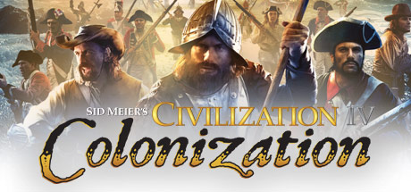

**Platforms:** Windows &nbsp;|&nbsp; **Genre:** Strategy &nbsp;|&nbsp; **Released:** September 22

> Sid Meier's Civilization IV: Colonization is the third offering in the award winning Civilization IV series. A re-imagining of the classic Colonization game Sid Meier created in 1994, Sid Meier's Civilization IV: Colonization is a total conversion of the Civilization IV engine into a game experience in which players will lead a European...
>
> _Synopsis source: Steam_

[Steam](https://store.steampowered.com/app/16810)

---

### Classic British Motor Racing

**Platforms:** Wii, PlayStation 2, Windows &nbsp;|&nbsp; **Developer:** Data Design Interactive &nbsp;|&nbsp; **Publisher:** Metro3D Europe, Data Design Interactive, Bold Games &nbsp;|&nbsp; **Genre:** Racing &nbsp;|&nbsp; **Released:** January 2, 2008

> Classic British Motor Racing is a racing simulation game. Choose from an amazing range of 13 high performance classic cars, including Austin Mini, Austin-Healy, MG, Rover and Triumph. Each car is accurately recreated under license and features the real handling characteristics of the vehicles. Race through six different courses throughout the British Isles, including the heart-stopping thrills of the traditional 'Westminster Run' around the streets of London. Take on various game modes, including Time Trial and Grand Prix. Try and beat the track records or race against friends in the insanely addictive multiplayer mode.
>
> _Synopsis source: IGDB_

[Wikipedia](https://en.wikipedia.org/wiki/Classic_British_Motor_Racing) · [IGDB](https://www.igdb.com/games/classic-british-motor-racing)

---

### Clue Classic

**Platforms:** Windows, macOS &nbsp;|&nbsp; **Developer:** Games Cafe &nbsp;|&nbsp; **Publisher:** Reflexive Entertainment &nbsp;|&nbsp; **Genre:** Puzzle game &nbsp;|&nbsp; **Released:** June 3, 2008

> Clue Classic is a video game based on Hasbro's Cluedo franchise. It was developed by Games Cafe and published by Reflexive Entertainment on June 3, 2008. The single-player interactive game was inspired by the artwork in the 2002/2003 Classic Detective Game version, featuring the original six characters, weapons and nine original rooms. Producer was Rob Adams, designer was Rob Adams, programmer was Chad Sterling, lead Artist was Erin Miller, and Music & Sound was by Staffan Melin and David Chan.
>
> _Synopsis source: IGDB_

[Wikipedia](https://en.wikipedia.org/wiki/Clue_Classic) · [IGDB](https://www.igdb.com/games/clue-classic)

---

### Collapse

**Platforms:** Windows &nbsp;|&nbsp; **Developer:** Creoteam &nbsp;|&nbsp; **Publisher:** Buka Entertainment &nbsp;|&nbsp; **Genre:** Action-adventure, third-person shooter, hack and slash &nbsp;|&nbsp; **Released:** September 25, 2008

> In 2013 the Central Europe (Ukraine, Kyiv) witnessed a catastrophe. Everybody was mystified by its cause. What happened was beyond our comprehension. Somebody called it the collision of worlds or the stratification of two dimensions.
>
> _Synopsis source: IGDB_

[Wikipedia](https://en.wikipedia.org/wiki/Collapse_(2008_video_game)) · [IGDB](https://www.igdb.com/games/collapse--1)

---

### Combat Arms

**Platforms:** Windows &nbsp;|&nbsp; **Developer:** Nexon &nbsp;|&nbsp; **Publisher:** Nexon, VALOFE &nbsp;|&nbsp; **Genre:** First-person shooter &nbsp;|&nbsp; **Released:** July 11, 2008

> Combat Arms is a fast-paced, multiplayer shooter, designed for non-stop action on various battlefields, recruiting players to get engaged with their opponents in multiple game modes. Whilst integrating the traditional attributes of the FPS genre, Combat Arms advances it further by evolving a whole new set of striking features, allowing character customization as well as weapon modification, enabling the player to adjust their weapons with attachments such as scopes, silencers, and extended magazines.  An additional eye-catching feature is the unique backpack system, which allows players to combine a set of multiple weapons from the extensive armoury for a more sophisticated combat experience on the battlefield. Moreover, the extensive community features within the game actively support the clan system, where players can easily recruit, manage, and communicate with their other clan members.
>
> _Synopsis source: IGDB_

[Wikipedia](https://en.wikipedia.org/wiki/Combat_Arms) · [IGDB](https://www.igdb.com/games/combat-arms)

---

### Command & Conquer 3: Kane's Wrath

**Platforms:** Windows, Xbox 360 &nbsp;|&nbsp; **Genre:** Action, Strategy &nbsp;|&nbsp; **Released:** March 24

> In the name of Kane! The Command &amp; Conquer™ series continues to thrive with Command &amp; Conquer™ 3: Kane’s Wrath.
>
> _Synopsis source: Steam_

[Steam](https://store.steampowered.com/app/24810)

---

### Command & Conquer: Red Alert 3

**Platforms:** Windows, Xbox 360 &nbsp;|&nbsp; **Genre:** Action, Strategy &nbsp;|&nbsp; **Released:** October 28

> The desperate leadership of a doomed Soviet Union travels back in time to change history and restore the glory of Mother Russia.
>
> _Synopsis source: Steam_

[Steam](https://store.steampowered.com/app/17480)

---

### Commander in Chief

**Platforms:** Windows &nbsp;|&nbsp; **Developer:** Eversim &nbsp;|&nbsp; **Publisher:** Interactive Gaming Software &nbsp;|&nbsp; **Genre:** Government simulation game, Real-time Strategy &nbsp;|&nbsp; **Released:** July 25, 2008

[Wikipedia](https://en.wikipedia.org/wiki/Commander_in_Chief_(video_game))

---

### Conflict: Denied Ops

**Platforms:** PlayStation 3, Windows, Xbox 360 &nbsp;|&nbsp; **Genre:** Action &nbsp;|&nbsp; **Released:** February 12

> *This is a single player only title*Venezuela is left in a state of civil war after the government was brutally overthrown by a military coup. With factions fighting to reinstate democracy, the U.S. government has offered their assistance, though the new government regime has threatened to deploy nuclear weapons if the U.S.
>
> _Synopsis source: Steam_

[Steam](https://store.steampowered.com/app/8100)

---

### Corpse Party

**Platforms:** Windows &nbsp;|&nbsp; **Developer:** Team GrisGris, 5pb. &nbsp;|&nbsp; **Publisher:** Team GrisGris, Xseed Games, 5pb., Marvelous USA &nbsp;|&nbsp; **Genre:** Adventure &nbsp;|&nbsp; **Released:** March 8, 2008

> Corpse Party (Corpse Party BloodCovered in Japan) is a part of the Corpse Party survival horror adventure game series created by Team GrisGris for the PC. It is the remake of the original Corpse Party released in 1996 for the NEC PC-9801 with a reworked plot and new characters.
>
> _Synopsis source: IGDB_

[Wikipedia](https://en.wikipedia.org/wiki/Corpse_Party_(2008_video_game)) · [IGDB](https://www.igdb.com/games/corpse-party--4)

---

### Cosmic Break

**Platforms:** Windows &nbsp;|&nbsp; **Developer:** CyberStep &nbsp;|&nbsp; **Publisher:** CyberStep &nbsp;|&nbsp; **Genre:** Third-person shooter &nbsp;|&nbsp; **Released:** December 19, 2008

> Cosmic Break (Japanese: コズミックブレイク, Hepburn: Kozumikku Bureiku, also stylized as CosmicBreak) is a free to play 3D MMO third-person shooter with big robots and colorful, explosive battles in an anime style. The game was developed and published by the Japanese company CyberStep, Inc. and was officially released in several countries. As is the case with GetAmped2, Cosmic Break also has various NPCs and playable characters voiced by famous Japanese voice-over artists.
>
> _Synopsis source: IGDB_

[Wikipedia](https://en.wikipedia.org/wiki/Cosmic_Break) · [IGDB](https://www.igdb.com/games/cosmic-break)

---

### Counter-Strike Online

**Platforms:** Windows, Browser &nbsp;|&nbsp; **Developer:** Nexon &nbsp;|&nbsp; **Publisher:** Nexon &nbsp;|&nbsp; **Genre:** Tactical first-person shooter &nbsp;|&nbsp; **Released:** July 24, 2008

> Counter-Strike Online is a first-person shooter video game, targeted towards Asia's gaming market released in 2008. It is based on Counter-Strike and was developed by Nexon with oversight from license-holder Valve. It uses a micropayment model that is managed by a custom version of Steam.
>
> _Synopsis source: IGDB_

[Wikipedia](https://en.wikipedia.org/wiki/Counter-Strike_Online) · [IGDB](https://www.igdb.com/games/counter-strike-online)

---

### Cryostasis: Sleep of Reason

**Platforms:** Windows &nbsp;|&nbsp; **Developer:** Action Forms &nbsp;|&nbsp; **Publisher:** 1C Company, 505 Games, Aspyr, Zoo Corporation &nbsp;|&nbsp; **Genre:** Psychological horror &nbsp;|&nbsp; **Released:** December 5, 2008

[Wikipedia](https://en.wikipedia.org/wiki/Cryostasis:_Sleep_of_Reason)

---

### Crysis Warhead

**Platforms:** Windows &nbsp;|&nbsp; **Genre:** Action &nbsp;|&nbsp; **Released:** September 12

> Pulse-racing new installment from 2007's PC Game of the Year*: Play as Sergeant Sykes and experience a whole new side of the battle. A standard combat mission behind enemy lines becomes critical when you discover your enemies have captured something of vital importance to the ensuing war.
>
> _Synopsis source: Steam_

[Wikipedia](https://en.wikipedia.org/wiki/Crysis_Warhead) · [Steam](https://store.steampowered.com/app/17330)

---

### CSI: NY

**Platforms:** Windows &nbsp;|&nbsp; **Released:** November 18

---

### Dangerous High School Girls in Trouble!

**Platforms:** Windows, macOS &nbsp;|&nbsp; **Publisher:** Mousechief &nbsp;|&nbsp; **Genre:** Puzzle

> Explore four beautiful game boards, dozens of character cards, and thousands of dialog cards (worn and aged from decades of neglect) which comprise the zany world of an American small town in the 1920s. Encounter nearly a hundred individual personalities. These denizens form the core culture of intolerance and repression your girls can overcome with wit, charm, and brazenness.
>
> _Synopsis source: IGDB_

[Wikipedia](https://en.wikipedia.org/wiki/Dangerous_High_School_Girls_in_Trouble!) · [IGDB](https://www.igdb.com/games/dangerous-high-school-girls-in-trouble)

---

### Dark Horizon

**Platforms:** Windows &nbsp;|&nbsp; **Developer:** Quazar Studio &nbsp;|&nbsp; **Publisher:** Paradox Interactive, Akella &nbsp;|&nbsp; **Genre:** Space combat simulator &nbsp;|&nbsp; **Released:** September 23, 2008

> Dark Horizon is a space combat simulator develped by Quazar Studio for the PC.  Dark Horizon is the sequel to Tarr Chronicles.
>
> _Synopsis source: IGDB_

[Wikipedia](https://en.wikipedia.org/wiki/Dark_Horizon) · [IGDB](https://www.igdb.com/games/dark-horizon)

---

### Dark Room Sex Game

**Platforms:** Windows, macOS &nbsp;|&nbsp; **Developer:** Students at the IT University of Copenhagen for the Nordic Game Jam &nbsp;|&nbsp; **Released:** February 2008

[Wikipedia](https://en.wikipedia.org/wiki/Dark_Room_Sex_Game)

---

### Darkest Hour: Europe '44-'45

**Platforms:** Windows, Linux &nbsp;|&nbsp; **Developer:** Darklight Games &nbsp;|&nbsp; **Genre:** Tactical first-person shooter &nbsp;|&nbsp; **Released:** June 6, 2008

> Darkest Hour: Europe ‘44-’45 is a World War 2 tactical squad shooter based on Tripwire Interactive’s award-winning Red Orchestra: Ostfront. Starting as a humble modification, the game has grown and evolved into one of the most formidable and intense WW2 shooter experiences available on any platform.
>
> _Synopsis source: IGDB_

[Wikipedia](https://en.wikipedia.org/wiki/Darkest_Hour:_Europe_'44-'45) · [IGDB](https://www.igdb.com/games/darkest-hour-europe-44-45)

---

### De Blob

**Platforms:** Nintendo DS, Wii, Windows &nbsp;|&nbsp; **Genre:** Action, Adventure, Casual, Indie &nbsp;|&nbsp; **Released:** September 22

> The evil I.N.K.T. Corporation has declared 'Color is a Crime!' and leeched Chroma City of all its beauty and interest. The race to rescue Chroma City has just begun, and only de Blob can save the world from a black-and-white future with his unique abilities to color the world back to life.
>
> _Synopsis source: Steam_

[Wikipedia](https://en.wikipedia.org/wiki/De_Blob) · [Steam](https://store.steampowered.com/app/532320)

---

### Dead Space

**Platforms:** Xbox 360, PlayStation 3, Windows &nbsp;|&nbsp; **Publisher:** Electronic Arts &nbsp;|&nbsp; **Genre:** Action, Adventure &nbsp;|&nbsp; **Released:** October 13, 2008

> The sci-fi survival-horror classic returns, completely rebuilt to offer an even more immersive experience — including visual, audio, and gameplay improvements — while staying faithful to the original game’s thrilling vision.
>
> _Synopsis source: Steam_

[Wikipedia](https://en.wikipedia.org/wiki/Dead_Space_(video_game)) · [Steam](https://store.steampowered.com/app/1693980)

---

### Deadliest Catch: Alaskan Storm

**Platforms:** Xbox 360, Windows &nbsp;|&nbsp; **Released:** June 17

---

### Death Track: Resurrection

**Platforms:** Windows, Steam, PlayStation 3, PlayStation Network &nbsp;|&nbsp; **Developer:** SkyFallen Entertainment &nbsp;|&nbsp; **Publisher:** 1C Company, 505 Games, Aspyr Media &nbsp;|&nbsp; **Genre:** Racing, vehicular combat &nbsp;|&nbsp; **Released:** February 22, 2008

> Do you have what it takes to Survive?  Resurrection is a racing/action title that takes players into a post-apocalyptic, not-too-distant future where traditional sports have been replaced by far more violent entertainment. The main event, The Survival Race, is a deadly combat racing tournament that draws the world's best drivers to compete in spectacular road battles with powerful, weapons-laden hot rods. Gamers will drive, battle and try to survive in races that take place in twisted future versions of the planet's biggest cities.  Features: - Combat racing across post apocalyptic versions of 10 major cities: Bangkok, Vatican City, London, Moscow, New York, Paris, Prague, San Diego, Istanbul and Tokyo. - Destructible environments add to the chaotic destruction surrounding each race. - 10 powerful car models, customizable with multiple weapons, upgrades and paint jobs. - Thrilling suspense story drives the single-player narrative.
>
> _Synopsis source: IGDB_

[Wikipedia](https://en.wikipedia.org/wiki/Death_Track:_Resurrection) · [IGDB](https://www.igdb.com/games/death-track-resurrection)

---

### Defense Grid: The Awakening

**Platforms:** Windows &nbsp;|&nbsp; **Genre:** Indie, Strategy &nbsp;|&nbsp; **Released:** December 8

> Defense Grid: The Awakening is a unique spin on tower defense gameplay that will appeal to players of all skill levels. A horde of enemies is invading, and it's up to the player to stop them by strategically building fortification towers around their base.
>
> _Synopsis source: Steam_

[Steam](https://store.steampowered.com/app/18500)

---

### Devil May Cry 4

**Platforms:** PlayStation 3, Xbox 360, Windows &nbsp;|&nbsp; **Released:** February 5

[Wikipedia](https://en.wikipedia.org/wiki/Devil_May_Cry_4)

---

### Diamonds in the Rough

**Platforms:** Windows &nbsp;|&nbsp; **Developer:** Atropos Studios &nbsp;|&nbsp; **Publisher:** Atropos Studios &nbsp;|&nbsp; **Genre:** Adventure &nbsp;|&nbsp; **Released:** March 17, 2008

[Wikipedia](https://en.wikipedia.org/wiki/Diamonds_in_the_Rough_(video_game))

---

### Digital Combat Simulator

**Platforms:** Windows &nbsp;|&nbsp; **Developer:** Eagle Dynamics &nbsp;|&nbsp; **Publisher:** The Fighter Collection &nbsp;|&nbsp; **Genre:** Combat flight simulator &nbsp;|&nbsp; **Released:** October 17, 2008

> Feel the excitement of flying the Su-25T "Frogfoot" attack jet and the TF-51D "Mustang" in the free-to-play Digital Combat Simulator World!
>
> _Synopsis source: IGDB_

[Wikipedia](https://en.wikipedia.org/wiki/Digital_Combat_Simulator) · [IGDB](https://www.igdb.com/games/dcs-world)

---

### Disney Sing It

**Platforms:** PlayStation 2, PlayStation 3, Wii, Xbox 360, Windows &nbsp;|&nbsp; **Developer:** Zoë Mode &nbsp;|&nbsp; **Publisher:** Disney Interactive Studios &nbsp;|&nbsp; **Genre:** Karaoke &nbsp;|&nbsp; **Released:** October 21, 2008

> Disney Sing It is a karaoke video game and sequel to High School Musical: Sing It!. It was released on October 28, 2008 across multiple platforms. The game's product description refers to additional downloadable song packs being available. However, as of 28 April 2009, Disney Interactive Support has replied (to a query): "Thank you for contacting us.In some circumstances we need to make some business decisions and drop certain projects that might have been planned or even announced previously. This case falls in one of those situations and currently we don't have any plans on adding any downloadable contents for either Disney Sing It title."  The game has received mixed reviews, with both 1UP.com and IGN praising its accessibility towards kids but finding serious fault with the gameplay, with Official Xbox Magazine ultimately calling it a "gateway game" at best.  Track List  Aly & AJ - Like Whoa Aly & AJ - Potential Break-Up song Aly & AJ - Chemicals React Billy Ray Cyrus - Ready, Set, Don't Go Camp Rock - We Rock Camp Rock - Start the Party Camp Rock - This is Me Camp Rock - Gotta Find You Camp Rock - Play My Music Camp Rock - Hasta La Vista Camp Rock - Here I Am Cheetah Girls 3 - One World Cheetah Girls 2 - Dance with Me Cheetah Girls 2 - The Party's Just Begun Corbin Bleu - Push It To The Limit Everlife - Find Yourself In You Everlife - Real Wild Child Hannah Montana - Best of Both Worlds Hannah Montana - Life is What You Make It Hannah Montana - Nobody's Perfect Hannah Montana - Rock Star High School Musical - Breaking Free High School Musical - Get'cha Head in the Game High School Musical - Start of Something New High School Musical 2 - Bet On It High School Musical 2 - Fabulous High School Musical 2 - What Time Is It High School Musical 2 - You Are the Music in Me Jesse McCartney - She's No You Jordan Pruitt - Jump to the Rhythm Jordan Pruitt - Outside Looking In Miley Cyrus - Girls Night Out Miley Cyrus - See You Again Miley Cyrus - Start All Over Vanessa Hudgens - Say OK
>
> _Synopsis source: IGDB_

[Wikipedia](https://en.wikipedia.org/wiki/Disney_Sing_It) · [IGDB](https://www.igdb.com/games/disney-sing-it)

---

### DJMax Trilogy

**Platforms:** Windows &nbsp;|&nbsp; **Developer:** Pentavision &nbsp;|&nbsp; **Publisher:** Neowiz Games &nbsp;|&nbsp; **Genre:** Music &nbsp;|&nbsp; **Released:** December 24, 2008

> DJMax Trilogy is a rhythm action game with five difficulty modes ranging from limited four-key gameplay to a challenging eight-key setup. As notes are played with perfect accuracy, a "fever gauge" will be charged. When it is fully charged, Fever can be activated. Fever acts as a multiplier to score and it varies between x2 and x5.
>
> _Synopsis source: IGDB_

[Wikipedia](https://en.wikipedia.org/wiki/DJMax_Trilogy) · [IGDB](https://www.igdb.com/games/djmax-trilogy)

---

### Dracula 3: The Path of the Dragon

**Platforms:** Windows &nbsp;|&nbsp; **Developer:** Kheops Studio &nbsp;|&nbsp; **Publisher:** MC2 France, Encore, Chillingo, Coladia &nbsp;|&nbsp; **Genre:** Point-and-click adventure &nbsp;|&nbsp; **Released:** April 10, 2008

> There is obviously no such thing as vampires... at least according to the official line of the Catholic Church.  The trilogy continues as the Prince of Darkness rises again.
>
> _Synopsis source: IGDB_

[Wikipedia](https://en.wikipedia.org/wiki/Dracula_3:_The_Path_of_the_Dragon) · [IGDB](https://www.igdb.com/games/dracula-3-the-path-of-the-dragon)

---

### Dracula: Origin

**Platforms:** Windows &nbsp;|&nbsp; **Developer:** Frogwares &nbsp;|&nbsp; **Publisher:** Focus Home Interactive, The Adventure Company, 93GAMES, QVS International &nbsp;|&nbsp; **Genre:** Adventure &nbsp;|&nbsp; **Released:** May 29, 2008

> Dracula: Origin reveals the dark origins of the Dracula curse. Once the ardent defender of Christendom, Dracula loses his faith in God when he is abandoned by his one true love after she marries. Dracula then makes a pact with the Prince of Darkness, and becomes a vampire.
>
> _Synopsis source: IGDB_

[Wikipedia](https://en.wikipedia.org/wiki/Dracula:_Origin) · [IGDB](https://www.igdb.com/games/dracula-origin)

---

### Drakensang: The Dark Eye

**Platforms:** Windows &nbsp;|&nbsp; **Developer:** Radon Labs &nbsp;|&nbsp; **Publisher:** dtp entertainment, THQ, Eidos Interactive, Fx Interactive &nbsp;|&nbsp; **Genre:** Role-playing &nbsp;|&nbsp; **Released:** August 1, 2008

> Drakensang is a third-person party-based RPG based on the pen & paper role-play rules of The Dark Eye. Drakensang is the first PC game for over 10 years to be based on Germany's most successful and popular role-play system.  Drakensang builds on the pen & paper rules as applied in version 4.0. The developers have optimized the rulebook specially for the PC realization in order to make the game more accessible. But the essential qualities and the depth of the original rules have not been compromised.
>
> _Synopsis source: IGDB_

[Wikipedia](https://en.wikipedia.org/wiki/Drakensang:_The_Dark_Eye) · [IGDB](https://www.igdb.com/games/drakensang-the-dark-eye)

---

### Dream Chronicles 2: The Eternal Maze

**Platforms:** Windows &nbsp;|&nbsp; **Released:** February 14

---

### Droid Assault

**Platforms:** Windows, macOS, Linux &nbsp;|&nbsp; **Developer:** Puppy Games &nbsp;|&nbsp; **Publisher:** Puppy Games &nbsp;|&nbsp; **Genre:** Multidirectional shooter &nbsp;|&nbsp; **Released:** May 2, 2008

[Wikipedia](https://en.wikipedia.org/wiki/Droid_Assault)

---

### Dynasty Warriors 6

**Platforms:** PlayStation 3, Xbox 360, Windows, PlayStation 2 &nbsp;|&nbsp; **Released:** February 19

[Wikipedia](https://en.wikipedia.org/wiki/Dynasty_Warriors_6)

---

### EA Sports 08 Collection

**Platforms:** Windows &nbsp;|&nbsp; **Released:** September 22

[Wikipedia](https://en.wikipedia.org/wiki/EA_Sports_08_Collection)

---

### Edna & Harvey: The Breakout

**Platforms:** Windows &nbsp;|&nbsp; **Developer:** Daedalic Entertainment &nbsp;|&nbsp; **Publisher:** Lace Mamba Global, Application Systems Heidelberg, Daedalic Entertainment &nbsp;|&nbsp; **Genre:** Point-and-click adventure &nbsp;|&nbsp; **Released:** June 5, 2008

> Edna & Harvey: The Breakout is an adventure game for Windows and Mac about a girl and her toy rabbit. Players of the game have to escape from a mental hostpital.  The Gameplay is similar to LucasArts' early 90's games using the SCUMM engine. The player finds himself in a 2D world. At the bottom of the screen is a list of verbs to be used and combined for solving puzzles.  The game began as a university project in Germany (Wikipedia). Although that version received an outstanding reception, the English game merely received a mixed reception with both average and low review scores, mostly due to the sloppy translation.
>
> _Synopsis source: IGDB_

[Wikipedia](https://en.wikipedia.org/wiki/Edna_&_Harvey:_The_Breakout) · [IGDB](https://www.igdb.com/games/edna-and-harvey-the-breakout)

---

### Elements of Destruction

**Platforms:** Xbox 360, Windows &nbsp;|&nbsp; **Released:** June 18

[Wikipedia](https://en.wikipedia.org/wiki/Elements_of_Destruction)

---

### Eternal Eden

**Platforms:** Windows &nbsp;|&nbsp; **Developer:** Blossomsoft &nbsp;|&nbsp; **Publisher:** Blossomsoft &nbsp;|&nbsp; **Genre:** Role-playing game &nbsp;|&nbsp; **Released:** December 11, 2008

[Wikipedia](https://en.wikipedia.org/wiki/Eternal_Eden) · [IGDB](https://www.igdb.com/games/eternal-eden)

---

### Ether Saga Odyssey

**Platforms:** Windows &nbsp;|&nbsp; **Developer:** Beijing Perfect World &nbsp;|&nbsp; **Publisher:** Perfect World Entertainment &nbsp;|&nbsp; **Genre:** Fantasy MMORPG &nbsp;|&nbsp; **Released:** June 26, 2008

[Wikipedia](https://en.wikipedia.org/wiki/Ether_Saga_Odyssey)

---

### Euro Truck Simulator

**Platforms:** Windows &nbsp;|&nbsp; **Developer:** SCS Software &nbsp;|&nbsp; **Publisher:** Meridian4, Excalibur Publishing, n3vrf41l Publishing, SCS Software &nbsp;|&nbsp; **Genre:** Vehicle simulation &nbsp;|&nbsp; **Released:** August 6, 2008

> The original Euro Truck Simulator - the game which has become the classic of the genre and is still relevant today. The first truck simulation game in a European setting, with European long haul trucks!  Drive freight from London to Rome to Berlin to Madrid to Prague - and many more cities - in realistic vehicles. Faithful reproduction of driving trucks on the European road. Pick up a variety of cargoes, and deliver them on time! Highly realistic, meticulously detailed models based on real trucks. Actual working instruments such as flashing indicators, temperature and low fuel warning lights, wipers, and a full set of gauges. Pan the camera around the cabin, just as if you were actually sitting at the wheel.
>
> _Synopsis source: IGDB_

[Wikipedia](https://en.wikipedia.org/wiki/Euro_Truck_Simulator) · [IGDB](https://www.igdb.com/games/euro-truck-simulator)

---

### Europa Universalis: Rome

**Platforms:** Windows, macOS &nbsp;|&nbsp; **Developer:** Paradox Development Studio &nbsp;|&nbsp; **Publisher:** Paradox Interactive &nbsp;|&nbsp; **Genre:** Grand strategy &nbsp;|&nbsp; **Released:** April 15, 2008

> Experience one of the most defining periods in world history in an experience crafted by the masters of Grand Strategy. The greatest cultural and military civilizations are brought to life through this epic title rife with great strategic and tactical depth.  Set during the golden age of the Roman Republic when the Senate ruled the Empire, Vae Victis features a massive number of additions and improvements to Europa Universalis: Rome, a game that was already one of the most prominent to depict that era in the widest scope. An overview of these key changes begins with government, which has received a lot of attention for the expansion in order to produce more fluid and balanced gameplay. The cast of historical characters of the ancient world have also had a significant overhaul across a variety of areas and with the addition of missions, decisions and laws.
>
> _Synopsis source: IGDB_

[Wikipedia](https://en.wikipedia.org/wiki/Europa_Universalis:_Rome) · [IGDB](https://www.igdb.com/games/europa-universalis-rome)

---

### Eversion

**Platforms:** Windows &nbsp;|&nbsp; **Developer:** Zaratustra Productions &nbsp;|&nbsp; **Publisher:** Zaratustra Productions &nbsp;|&nbsp; **Genre:** Platform &nbsp;|&nbsp; **Released:** December 29, 2008

> The Princess of the Flower Kingdom has vanished! She was taken by the Ghulibas of the north, and it is up to brave Zee Tee to rescue her. On his quest, he - and you - will discover the hidden lands behind the peaceful kingdom, and come face to face with secrets that will set you on edge!
>
> _Synopsis source: IGDB_

[Wikipedia](https://en.wikipedia.org/wiki/Eversion_(video_game)) · [IGDB](https://www.igdb.com/games/eversion)

---

### Fallout 3

**Platforms:** Xbox 360, Windows, PlayStation 3 &nbsp;|&nbsp; **Publisher:** Bethesda Softworks &nbsp;|&nbsp; **Genre:** RPG &nbsp;|&nbsp; **Released:** October 28, 2008

> Vault-Tec engineers have worked around the clock on an interactive reproduction of Wasteland life for you to enjoy from the comfort of your own vault. Included is an expansive world, unique combat, shockingly realistic visuals, tons of player choice, and an incredible cast of dynamic characters.
>
> _Synopsis source: Steam_

[Wikipedia](https://en.wikipedia.org/wiki/Fallout_3) · [Steam](https://store.steampowered.com/app/22300)

---

### Far Cry 2

**Platforms:** PlayStation 3, Windows, Xbox 360 &nbsp;|&nbsp; **Genre:** Action &nbsp;|&nbsp; **Released:** October 21

> You are a gun for hire, trapped in a war-torn African state, stricken with malaria and forced to make deals with corrupt warlords on both sides of the conflict in order to make this country your home. You must identify and exploit your enemies' weaknesses, neutralizing their superior numbers and firepower with surprise, subversion,...
>
> _Synopsis source: Steam_

[Wikipedia](https://en.wikipedia.org/wiki/Far_Cry_2) · [Steam](https://store.steampowered.com/app/19900)

---

### Fate: Undiscovered Realms

**Platforms:** Windows &nbsp;|&nbsp; **Developer:** WildStudios, WildTangent &nbsp;|&nbsp; **Publisher:** WildTangent, Encore Software &nbsp;|&nbsp; **Genre:** Action role-playing, roguelike &nbsp;|&nbsp; **Released:** July 17, 2008

> An all new adventure temps your Fate Product Information Your valor has won freedom for the people of Grove and the manxome scourge has retreated into the shadows. In the midst of celebration a stranger appears warning of new evil that will ensnare your peaceful town. He speaks of ancient secrets locked within a temple and of gateways to mysterious yet Undiscovered Realms. Typhon an outpost built around cold snowy dungeons and Druantia a land of lush forests and endless beauty. Of the temple's secrets he divulges only the greatest: hidden within is an ancient tome - the Book of Fate which maintains the balance between all realms. The townsfolk look to you their new champion to take up this perilous quest and guide the stranger through the dungeon in search of the ancient temple. You will encounter new dungeons pet transformations weapons monsters and five completely new quests to test your mettle. New features include Hardcore mode (cheats disabled more difficult monsters) and a level cap of 199 - import characters from the original FATE and continue your quest. It is time once again to determine Explore two new realms with all new art and music. Transform your pets into new ally creatures! Fight an onslaught of monsters while protecting sacred places.Imprison evil foes and bring them to justice. Use your powers to lead allies to safety. Import your original Fate hero into the Undiscovered Realms.
>
> _Synopsis source: IGDB_

[Wikipedia](https://en.wikipedia.org/wiki/Fate:_Undiscovered_Realms) · [IGDB](https://www.igdb.com/games/fate-undiscovered-realms)

---

### Fenimore Fillmore's Revenge

**Platforms:** Windows &nbsp;|&nbsp; **Developer:** Revistronic &nbsp;|&nbsp; **Publisher:** Nobilis &nbsp;|&nbsp; **Genre:** Graphic adventure

> Fenimore Fillmore's Revenge is a classic point and click adventure game in a full 3D environment. It is the third in the Fenimore Fillmore franchise, after 3 Skulls of the Toltecs and The Westerner.  The mechanics in the game are quite different from the previous games. The player is thrown into a series of "levels" where he (taking part as Fenimore or Rhiannon) will have to solve a few puzzles in order to get to the next level. Also a few action scenes are present in the form of small shooting sequences.  In this episode, Fenimore and Rhiannon find a dying man in the middle of the desert, who tells them of the whereabouts of a treasure from a recent theft hidden inside a tomb, just before passing out.  Just after that a gang of outlaws lay an ambush on them, kidnapping Rhiannon. Our objective will be not only to rescue the poor girl and getting hold of the treasure, but also to pay vengeance on the villains.
>
> _Synopsis source: IGDB_

[Wikipedia](https://en.wikipedia.org/wiki/Fenimore_Fillmore's_Revenge) · [IGDB](https://www.igdb.com/games/fenimore-fillmores-revenge)

---

### FIFA 09

**Platforms:** Mobile phone, Nintendo DS, PlayStation 2, PlayStation 3, PlayStation Portable, Wii, Windows, Xbox 360 &nbsp;|&nbsp; **Released:** October 14

[Wikipedia](https://en.wikipedia.org/wiki/FIFA_09)

---

### FlatOut: Ultimate Carnage

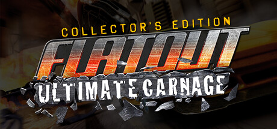

**Platforms:** Windows &nbsp;|&nbsp; **Genre:** Racing &nbsp;|&nbsp; **Released:** August 26

> Ready for the aggressive, adrenaline-filled ride that leaves you breathless? FlatOut: Ultimate Carnage Collector's Edition is all about destructive action. With carnage modes like the Deathmatch derby, Carnage Race and Head-on races are pure wreck-filled, adrenaline-pumping rides of maximum mayhem.
>
> _Synopsis source: Steam_

[Steam](https://store.steampowered.com/app/12360)

---

### Foldit

**Platforms:** Linux, macOS, Windows &nbsp;|&nbsp; **Genre:** Puzzle

> Foldit is an online puzzle video game about protein folding. It is part of an experimental research project developed by the University of Washington, Center for Game Science, in collaboration with the UW Department of Biochemistry. The objective of Foldit is to fold the structures of selected proteins as perfectly as possible, using tools provided in the game. The highest scoring solutions are analyzed by researchers, who determine whether or not there is a native structural configuration (native state) that can be applied to relevant proteins in the real world. Scientists can then use these solutions to target and eradicate diseases and create biological innovations.
>
> _Synopsis source: IGDB_

[Wikipedia](https://en.wikipedia.org/wiki/Foldit) · [IGDB](https://www.igdb.com/games/foldit)

---

### Football Manager 2009

**Platforms:** Windows, macOS, PlayStation Portable &nbsp;|&nbsp; **Released:** November 14

[Wikipedia](https://en.wikipedia.org/wiki/Football_Manager_2009)

---

### Football Manager Live

**Platforms:** Windows, macOS &nbsp;|&nbsp; **Developer:** Sports Interactive &nbsp;|&nbsp; **Publisher:** Sega &nbsp;|&nbsp; **Genre:** Sports management &nbsp;|&nbsp; **Released:** November 4, 2008

> Football Manager Live is a online-only managerial soccer simulation where the player is responsible for the financial and athletic success of his club. The main difference to regular games of this genre is that the players don't manage an existing club but create their own.
>
> _Synopsis source: IGDB_

[Wikipedia](https://en.wikipedia.org/wiki/Football_Manager_Live) · [IGDB](https://www.igdb.com/games/football-manager-live)

---

### Football Superstars

**Platforms:** Windows &nbsp;|&nbsp; **Developer:** Monumental Games, Coli Games UK &nbsp;|&nbsp; **Publisher:** Cybersports [now defunct] / Coli Games UK &nbsp;|&nbsp; **Genre:** Association football, Sports simulation &nbsp;|&nbsp; **Released:** December 31, 2008

[Wikipedia](https://en.wikipedia.org/wiki/Football_Superstars)

---

### Fortune Arterial

**Platforms:** Windows &nbsp;|&nbsp; **Genre:** Adventure, Visual Novel

> Fortune Arterial is an erotic fantasy themed visual novel.
>
> _Synopsis source: IGDB_

[Wikipedia](https://en.wikipedia.org/wiki/Fortune_Arterial) · [IGDB](https://www.igdb.com/games/fortune-arterial)

---

### Fortune Summoners: Secret of the Elemental Stone

**Platforms:** Windows &nbsp;|&nbsp; **Developer:** Lizsoft &nbsp;|&nbsp; **Publisher:** Lizsoft, Carpe Fulgur &nbsp;|&nbsp; **Genre:** Dungeon crawler, action RPG, Metroidvania

> "Fortune Summoners is a side-scrolling, real-time Action RPG made from the mold of some of gaming's most famous and beloved classic side-scrollers and combined with modern design sensibilities. In it, you will guide Arche Plumfield and her friends through great adventures to uncover the secret of something Arche has discovered - and maybe engage in some Real Heroics on the way!"
>
> _Synopsis source: IGDB_

[Wikipedia](https://en.wikipedia.org/wiki/Fortune_Summoners:_Secret_of_the_Elemental_Stone) · [IGDB](https://www.igdb.com/games/fortune-summoners-secret-of-the-elemental-stone)

---

### Frontlines: Fuel of War

**Platforms:** Windows, Xbox 360 &nbsp;|&nbsp; **Genre:** Action &nbsp;|&nbsp; **Released:** February 25

> Frontlines™: Fuel of War™ is an open-world First Person Shooter set on the frontlines of tomorrow. In a world ravaged by a global energy crisis, environmental decay, and economic depression, players assume the role of an elite soldier in the Western Coalition Army on an epic crusade against the Red Star Alliance to control the last of...
>
> _Synopsis source: Steam_

[Steam](https://store.steampowered.com/app/9460)

---

### Furifuri

**Platforms:** Windows &nbsp;|&nbsp; **Developer:** 130cm &nbsp;|&nbsp; **Publisher:** Visual Art's &nbsp;|&nbsp; **Genre:** Eroge, Visual novel &nbsp;|&nbsp; **Released:** August 29, 2008

[Wikipedia](https://en.wikipedia.org/wiki/Furifuri)

---

### FutureU

**Platforms:** macOS, Nintendo DS, Windows &nbsp;|&nbsp; **Developer:** Aspyr Media &nbsp;|&nbsp; **Publisher:** Aspyr Media &nbsp;|&nbsp; **Genre:** Educational &nbsp;|&nbsp; **Released:** August 25, 2008

[Wikipedia](https://en.wikipedia.org/wiki/FutureU)

---

### Galactic Civilizations II: Twilight of the Arnor

**Platforms:** Windows &nbsp;|&nbsp; **Publisher:** Stardock &nbsp;|&nbsp; **Released:** April 30, 2008

---

### Galcon

**Platforms:** Android, iOS, Mobile phone, Windows, macOS, Linux, Browser, PlayStation Portable &nbsp;|&nbsp; **Developer:** Phil Hassey &nbsp;|&nbsp; **Publisher:** galcon.com &nbsp;|&nbsp; **Genre:** Action, strategy &nbsp;|&nbsp; **Released:** July 12, 2008

> Galcon is a real time strategy video game developed by Phil Hassey. It is set in space and involves maneuvering fleets of ships to capture enemy planets.
>
> _Synopsis source: IGDB_

[Wikipedia](https://en.wikipedia.org/wiki/Galcon) · [IGDB](https://www.igdb.com/games/galcon)

---

### Gang Garrison 2

**Platforms:** Windows &nbsp;|&nbsp; **Genre:** Shooter

> Originally conceived for the 2008 TIGSource.com 'Bootleg Demake' competition, Gang Garrison 2 is a free multiplayer 'demake' of Valve's Team Fortress 2. Gang Garrison 2 presents the player with 9 unique classes to use in frenetic, cooperative multiplayer action in a stylish and unique 8-bit style.
>
> _Synopsis source: IGDB_

[Wikipedia](https://en.wikipedia.org/wiki/Gang_Garrison_2) · [IGDB](https://www.igdb.com/games/gang-garrison-2)

---

### Gary Grigsby's War Between the States

**Platforms:** Windows &nbsp;|&nbsp; **Developer:** 2 by 3 Games &nbsp;|&nbsp; **Publisher:** Matrix Games &nbsp;|&nbsp; **Genre:** Computer wargame &nbsp;|&nbsp; **Released:** June 12, 2008

[Wikipedia](https://en.wikipedia.org/wiki/Gary_Grigsby's_War_Between_the_States)

---

### Ghajini – The Game

**Platforms:** Windows, Mobile phone &nbsp;|&nbsp; **Developer:** FXLabs, Indiagames &nbsp;|&nbsp; **Publisher:** FXLabs and Geetha Arts &nbsp;|&nbsp; **Genre:** Action &nbsp;|&nbsp; **Released:** December 25, 2008

[Wikipedia](https://en.wikipedia.org/wiki/Ghajini_%E2%80%93_The_Game)

---

### Goin' Downtown

**Platforms:** Windows &nbsp;|&nbsp; **Developer:** Silver Style Entertainment &nbsp;|&nbsp; **Publisher:** The Games Company, Kalypso Media &nbsp;|&nbsp; **Genre:** Adventure game &nbsp;|&nbsp; **Released:** May 22, 2008

> An explosion outside 21st century New York cop Jake McCorly's apartment sets up a larger mystery in this scifi, cel-shaded adventure game.
>
> _Synopsis source: IGDB_

[Wikipedia](https://en.wikipedia.org/wiki/Goin'_Downtown) · [IGDB](https://www.igdb.com/games/goin-downtown)

---

### Gothic 3: Forsaken Gods

**Platforms:** Windows &nbsp;|&nbsp; **Developer:** Trine Games &nbsp;|&nbsp; **Publisher:** JoWooD Productions &nbsp;|&nbsp; **Genre:** Action role-playing &nbsp;|&nbsp; **Released:** November 18, 2008

> Forsaken Gods is a standalone expansion for Gothic 3.
>
> _Synopsis source: IGDB_

[Wikipedia](https://en.wikipedia.org/wiki/Gothic_3:_Forsaken_Gods) · [IGDB](https://www.igdb.com/games/gothic-3-forsaken-gods)

---

### Grand Chase

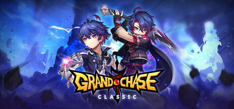

**Platforms:** Windows &nbsp;|&nbsp; **Genre:** Action, Casual, Free To Play &nbsp;|&nbsp; **Released:** February 7

> Grand Chase is a free side-scrolling online action RPG with anime inspired graphics. Enjoy exciting adventures in dungeons and PvP with unique characters.
>
> _Synopsis source: Steam_

[Wikipedia](https://en.wikipedia.org/wiki/Grand_Chase) · [Steam](https://store.steampowered.com/app/985810)

---

### Grand Theft Auto IV

**Platforms:** PlayStation 3, Xbox 360, Windows &nbsp;|&nbsp; **Publisher:** Rockstar Games &nbsp;|&nbsp; **Released:** April 29, 2008

[Wikipedia](https://en.wikipedia.org/wiki/Grand_Theft_Auto_IV)

---

### Gravity Bone

**Platforms:** Windows &nbsp;|&nbsp; **Developer:** Blendo Games &nbsp;|&nbsp; **Publisher:** Blendo Games &nbsp;|&nbsp; **Genre:** Adventure &nbsp;|&nbsp; **Released:** August 28, 2008

> Gravity Bone is a freeware first-person adventure video game developed by Brendon Chung under his studio, Blendo Games, and released in August 2008. The game employs a modified version of id Software's id Tech 2 engine—originally used for Quake 2—and incorporates music from films by director Wong Kar-wai, which were originally performed by Xavier Cugat. Four incarnations of the game were produced during its one-year development; the first featured more common first-person shooter elements than the released version. Subsequent versions shifted in a new direction, with the inclusion of more spy-oriented gameplay.  Gravity Bone received critical acclaim from video game journalists. It was called "a pleasure to experience" by Charles Onyett from IGN, and received comparisons to games such as Team Fortress 2 and Portal. The game was praised for its cohesive story, atmosphere and its ability to catch the player's interest over a very short time span without feeling rushed or incomplete. It received the "Best Arthouse Game" award in Game Tunnel's Special Awards of 2008. A sequel, Thirty Flights of Loving, was released in 2012.
>
> _Synopsis source: IGDB_

[Wikipedia](https://en.wikipedia.org/wiki/Gravity_Bone) · [IGDB](https://www.igdb.com/games/gravity-bone)

---

### GTR Evolution

**Platforms:** Windows &nbsp;|&nbsp; **Developer:** SimBin Studios &nbsp;|&nbsp; **Publisher:** Atari, Viva Media &nbsp;|&nbsp; **Genre:** Sim racing &nbsp;|&nbsp; **Released:** September 1, 2008

[Wikipedia](https://en.wikipedia.org/wiki/GTR_Evolution)

---

### Guitar Hero World Tour

**Platforms:** macOS, PlayStation 2, PlayStation 3, Wii, Windows, Xbox 360 &nbsp;|&nbsp; **Released:** October 26

[Wikipedia](https://en.wikipedia.org/wiki/Guitar_Hero_World_Tour)

---

### Guitar Praise

**Platforms:** Windows, macOS &nbsp;|&nbsp; **Developer:** Digital Praise &nbsp;|&nbsp; **Publisher:** Digital Praise &nbsp;|&nbsp; **Genre:** Rhythm game &nbsp;|&nbsp; **Released:** September 25, 2008

[Wikipedia](https://en.wikipedia.org/wiki/Guitar_Praise)

---

### Happy Farm

**Platforms:** Windows, macOS &nbsp;|&nbsp; **Developer:** 5 Minutes &nbsp;|&nbsp; **Publisher:** 5 Minutes &nbsp;|&nbsp; **Genre:** Farm management, MMORPG, social network game &nbsp;|&nbsp; **Released:** November 2008

[Wikipedia](https://en.wikipedia.org/wiki/Happy_Farm)

---

### Happy Tree Friends: False Alarm

**Platforms:** Xbox 360, Windows &nbsp;|&nbsp; **Released:** June 25

---

### Harpooned

**Platforms:** Windows, macOS &nbsp;|&nbsp; **Developer:** Conor O'Kane &nbsp;|&nbsp; **Genre:** Shoot 'em up, serious game

> Harpooned is a socially conscious shoot 'em up that puts you at the helm of a Japanese whaling boat. The game was created by developer Conor O'Kane to critique the Japanese government's whaling program and its claims that the practice is scientific in nature.
>
> _Synopsis source: IGDB_

[Wikipedia](https://en.wikipedia.org/wiki/Harpooned) · [IGDB](https://www.igdb.com/games/harpooned)

---

### Haruiro Ouse

**Platforms:** Windows &nbsp;|&nbsp; **Developer:** Purple software &nbsp;|&nbsp; **Genre:** Drama, Romance, Eroge, Visual novel &nbsp;|&nbsp; **Released:** July 31, 2008

[Wikipedia](https://en.wikipedia.org/wiki/Haruiro_Ouse)

---

### Harvest Moon DS: Grand Bazaar

**Platforms:** Nintendo DS, Windows &nbsp;|&nbsp; **Developer:** Marvelous Interactive &nbsp;|&nbsp; **Publisher:** Marvelous Interactive, Natsume Inc., Rising Star Games &nbsp;|&nbsp; **Genre:** Simulation, role-playing &nbsp;|&nbsp; **Released:** December 18, 2008

> Harvest Moon DS: Grand Bazaar is a video game released on December 18, 2008 by Marvelous Interactive in Japan, and released on August 24, 2010 by Natsume in North America. It was also released in Europe on September 30, 2011 by Rising Star Games.[2] The game is the nineteenth game in the Story of Seasons series and the fifth game in the series for the Nintendo DS.
>
> _Synopsis source: IGDB_

[Wikipedia](https://en.wikipedia.org/wiki/Harvest_Moon_DS:_Grand_Bazaar) · [IGDB](https://www.igdb.com/games/harvest-moon-ds-grand-bazaar)

---

### Harvest: Massive Encounter

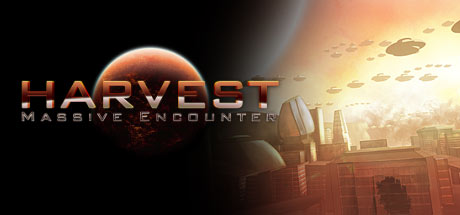

**Platforms:** macOS, Windows &nbsp;|&nbsp; **Genre:** Strategy, Indie &nbsp;|&nbsp; **Released:** March 5

> Harvest: Massive Encounter is an award-winning real-time strategy game with battles of epic proportions and a unique style of resource management and exploration. Build power plants, mineral harvesters and defense towers and make sure they have sufficient energy to fend off endless hordes of evil aliens.
>
> _Synopsis source: Steam_

[Steam](https://store.steampowered.com/app/15400)

---

### Hello Kitty Online

**Platforms:** Windows &nbsp;|&nbsp; **Developer:** Sanrio Digital, Typhoon Games &nbsp;|&nbsp; **Publisher:** Sanrio Digital &nbsp;|&nbsp; **Genre:** Fantasy MMORPG

> Hello Kitty Online is a non-violent MMO that focuses on crafting and collecting. Set in the Hello Kitty universe, players wander a pastel world inhabited by the cute and lovable Hello Kitty characters.
>
> _Synopsis source: IGDB_

[Wikipedia](https://en.wikipedia.org/wiki/Hello_Kitty_Online) · [IGDB](https://www.igdb.com/games/hello-kitty-online)

---

### High School Musical 3: Senior Year Dance

**Platforms:** Windows, PlayStation 2, Wii, Xbox 360 &nbsp;|&nbsp; **Developer:** Page 44 Studios &nbsp;|&nbsp; **Publisher:** Disney Interactive Studios &nbsp;|&nbsp; **Genre:** Music video game, Adventure, Rhythm &nbsp;|&nbsp; **Released:** October 21, 2008

> High School Musical 3: Senior Year DANCE lets fans experience the energy, fun, and music of all three "High School Musical" movies. Players can dance to the beat of favorite "High School Musical" songs in familiar movie locations alongside their favorite characters.
>
> _Synopsis source: IGDB_

[Wikipedia](https://en.wikipedia.org/wiki/High_School_Musical_3:_Senior_Year_Dance) · [IGDB](https://www.igdb.com/games/high-school-musical-3-senior-year-dance)

---

### Hinterland

**Platforms:** Windows &nbsp;|&nbsp; **Developer:** Tilted Mill Entertainment &nbsp;|&nbsp; **Publisher:** Tilted Mill Entertainment &nbsp;|&nbsp; **Genre:** RPG, City-Builder &nbsp;|&nbsp; **Released:** September 30, 2008

> Loot, level and build with fast paced RPG combat and strategic base building.  Can you build a vibrant settlement, lead your people to prosperity, and tame the wild Hinterland.  A variety of characters, weapons, and strategies are at your disposal -- will you lead the charge with a devastating two-handed strike, or stand behind the herder in plate mail with your trusty bow?  Choose your settlers from a huge cast of characters and arm them for defense, or give them tools for production.  Each game of Hinterland takes place in a new location with different resources, items, and challenges. Different challenges feature a range of enemies, including orc war camps, dark elf raiding parties, goblin infested mines, ruined cities filled with undead, and more.
>
> _Synopsis source: IGDB_

[Wikipedia](https://en.wikipedia.org/wiki/Hinterland_(video_game)) · [IGDB](https://www.igdb.com/games/hinterland)

---

### History Civil War: Secret Missions

**Platforms:** Windows, PlayStation 2, PlayStation 3, Xbox 360 &nbsp;|&nbsp; **Developer:** Cauldron Ltd &nbsp;|&nbsp; **Publisher:** Activision Value &nbsp;|&nbsp; **Genre:** First-person shooter &nbsp;|&nbsp; **Released:** November 4, 2008

> Experience secret missions of the American Civil War.
>
> _Synopsis source: IGDB_

[Wikipedia](https://en.wikipedia.org/wiki/History_Civil_War:_Secret_Missions) · [IGDB](https://www.igdb.com/games/history-civil-war-secret-missions)

---

### Iced!

**Platforms:** Windows, macOS &nbsp;|&nbsp; **Developer:** GarageGames, Breakthrough &nbsp;|&nbsp; **Genre:** Life simulation &nbsp;|&nbsp; **Released:** January 2008

[Wikipedia](https://en.wikipedia.org/wiki/Iced!)

---

### Igor: The Game

**Platforms:** Nintendo DS, Wii, Windows &nbsp;|&nbsp; **Released:** September 19

[Wikipedia](https://en.wikipedia.org/wiki/Igor_(film))

---

### Iji

**Platforms:** Windows, macOS &nbsp;|&nbsp; **Genre:** Platform, shooter, Metroidvania &nbsp;|&nbsp; **Released:** September 1, 2008

> Iji is an action-packed strategic platform shooter with a detailed story, large levels with multiple paths, powerful bosses and lots of secrets. There are alternate gameplay events, dialogues and scenes depending on what you do, a wealth of extras and bonus features, and seven stats to upgrade through a leveling system. Iji herself has superhuman strength and abilities, and can crack Nanotechnology, use her enemies' most devastating weapons against them, and be a pacifist or a killer - the story adapts to how you play.
>
> _Synopsis source: IGDB_

[Wikipedia](https://en.wikipedia.org/wiki/Iji) · [IGDB](https://www.igdb.com/games/iji)

---

### Imperium Romanum

**Platforms:** Windows &nbsp;|&nbsp; **Developer:** Haemimont Games &nbsp;|&nbsp; **Publisher:** Kalypso Media, SouthPeak Games, FX Interactive &nbsp;|&nbsp; **Genre:** City-building, real-time strategy &nbsp;|&nbsp; **Released:** February 22, 2008

> The city builder strategy game Imperium Romanum is set in the time-honoured Roman Empire and players will marvel in the incredible attention to detail when working on a strategy to build a well organised, prosperous and commanding settlement. As governor of a Roman province, the fortune very much lies in the players own hands.  Imperium Romanum is the sequel to Glory of the Roman Empire.
>
> _Synopsis source: IGDB_

[Wikipedia](https://en.wikipedia.org/wiki/Imperium_Romanum_(video_game)) · [IGDB](https://www.igdb.com/games/imperium-romanum)

---

### Insecticide

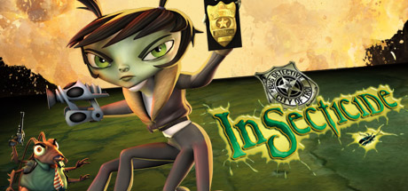

**Platforms:** Nintendo DS, Windows &nbsp;|&nbsp; **Genre:** Action, Adventure &nbsp;|&nbsp; **Released:** March 11

> Enter the fast shooting world of INSECTICIDE as hot shot rookie Detective Chrys Liszt and help solve a crime of epic proportions. Lead your team on a bug hunt, collecting clues and solving puzzles. Use old-fashioned street smarts, unique insect abilities and an arsenal of ingenious bug weapons to confront your suspects.
>
> _Synopsis source: Steam_

[Wikipedia](https://en.wikipedia.org/wiki/Insecticide_(video_game)) · [Steam](https://store.steampowered.com/app/16710)

---

### IRacing

**Platforms:** Windows &nbsp;|&nbsp; **Developer:** iRacing Studios &nbsp;|&nbsp; **Publisher:** iRacing Studios &nbsp;|&nbsp; **Genre:** Sim racing &nbsp;|&nbsp; **Released:** August 26, 2008

> From NASCAR, rallycross, and Aussie Supercars to sports cars and Grand Prix racing, iRacing has it all. All you need is a computer, a gaming wheel or game pad that simply plugs into the USB port of your computer and an Internet connection. iRacing centrally organizes all of the racing for you with over 150 cars and tracks, 40 official series , or you can choose to host your own race or race in one of over 800 private leagues.
>
> _Synopsis source: IGDB_

[Wikipedia](https://en.wikipedia.org/wiki/IRacing) · [IGDB](https://www.igdb.com/games/iracing)

---

### Iron Grip: Warlord

**Platforms:** Windows &nbsp;|&nbsp; **Developer:** ISOTX &nbsp;|&nbsp; **Publisher:** ISOTX &nbsp;|&nbsp; **Genre:** First-person shooter, tower defense &nbsp;|&nbsp; **Released:** November 5, 2008

> Iron Grip: Warlord invigorates tower defense with first-person shooter elements to give a new twist to the genre.It puts you in the heat of the battle, fighting off hordes of AI-controlled invaders. Play alone or with friends, in a diverse and challenging struggle to save all of Atelia.
>
> _Synopsis source: IGDB_

[Wikipedia](https://en.wikipedia.org/wiki/Iron_Grip:_Warlord) · [IGDB](https://www.igdb.com/games/iron-grip-warlord)

---

### Iron Man

**Platforms:** Nintendo DS, PlayStation 2, PlayStation 3, PlayStation Portable, Wii, Windows, Xbox 360 &nbsp;|&nbsp; **Released:** May 2

[Wikipedia](https://en.wikipedia.org/wiki/Iron_Man_(video_game))

---

### Ironclads: American Civil War

**Platforms:** Windows &nbsp;|&nbsp; **Developer:** Totem Games &nbsp;|&nbsp; **Publisher:** Totem Games, Strategy First &nbsp;|&nbsp; **Genre:** 3D naval historical turned-based strategy &nbsp;|&nbsp; **Released:** October 2008

> Battle of the civil war ironclads. Take part in battles from USS Monitor vs CSS Virginia before battles between armored squadrons of steamships and other vessels. The flow of time is organized into rounds. Within the limits of each round, the player and the computer opponent take turns executing all actions possible within five minutes of real time combat for each of their ships. At the moment when the selected active ship is carrying out an action, all other game units are motionless. Time for decision-making is not limited.
>
> _Synopsis source: IGDB_

[Wikipedia](https://en.wikipedia.org/wiki/Ironclads:_American_Civil_War) · [IGDB](https://www.igdb.com/games/ironclads-american-civil-war)

---

### Kara no Shōjo

**Platforms:** Windows &nbsp;|&nbsp; **Developer:** Innocent Grey &nbsp;|&nbsp; **Publisher:** Innocent Grey, MangaGamer, Shiravune &nbsp;|&nbsp; **Genre:** Adventure, eroge, visual novel &nbsp;|&nbsp; **Released:** July 4, 2008

[Wikipedia](https://en.wikipedia.org/wiki/Kara_no_Sh%C5%8Djo)

---

### Karoshi

**Platforms:** Windows, Browser, iOS, Android, PlayStation Portable, PlayStation 3 &nbsp;|&nbsp; **Developer:** YoYo Games &nbsp;|&nbsp; **Genre:** Puzzle-platform

> The original freeware puzzle-platformer in which the goal is to find out how to kill yourself.
>
> _Synopsis source: IGDB_

[Wikipedia](https://en.wikipedia.org/wiki/Karoshi_(video_game)) · [IGDB](https://www.igdb.com/games/karoshi--1)

---

### Kawasaki Jet Ski

**Platforms:** Wii, Windows &nbsp;|&nbsp; **Developer:** Data Design Interactive &nbsp;|&nbsp; **Publisher:** Data Design Interactive, Bold Games &nbsp;|&nbsp; **Genre:** Racing &nbsp;|&nbsp; **Released:** January 22, 2008

> It's time to get your feet wet. Choose your character, jump aboard your Jet Ski and rip through the waves to the finish line. In this Kawasaki officially licensed game you get to race around scenic water way locations such as The Thames in London, the Canadian Rockies, through exotic islets in Taiwan, and of course the canals of Venice. There are also 8 Jet Skis to unlock as well as a few more characters, and you can even play with friends in multiplayer. There are usual racing tracks and modes such as Time Trials and Tournaments but there is also a stunt mode where you get to ride around modified layouts of the four locations and do various tricks off of ramps. This mode is also available in multiplayer mode.
>
> _Synopsis source: IGDB_

[Wikipedia](https://en.wikipedia.org/wiki/Kawasaki_Jet_Ski_(video_game)) · [IGDB](https://www.igdb.com/games/kawasaki-jet-ski)

---

### King's Bounty: The Legend

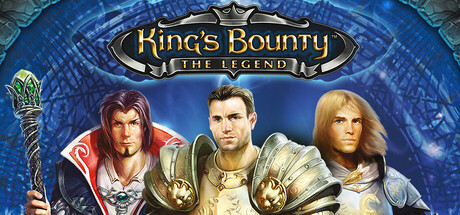

**Platforms:** Windows &nbsp;|&nbsp; **Genre:** RPG, Strategy &nbsp;|&nbsp; **Released:** April 25

> King’s Bounty: The Legend is a fan-favorite classic fantasy adventure and an early entry into the modern King’s Bounty era, built around tough battles, smart decisions, and turn-based tactics.
>
> _Synopsis source: Steam_

[Steam](https://store.steampowered.com/app/25900)

---

### Kivi's Underworld

**Platforms:** Windows, macOS &nbsp;|&nbsp; **Developer:** Soldak Entertainment &nbsp;|&nbsp; **Genre:** action role-playing game &nbsp;|&nbsp; **Released:** November 4, 2008

> Kivi's Underworld is a casual, hack and slash game.
>
> _Synopsis source: IGDB_

[Wikipedia](https://en.wikipedia.org/wiki/Kivi's_Underworld) · [IGDB](https://www.igdb.com/games/kivis-underworld)

---

### Kudos 2

**Platforms:** Windows &nbsp;|&nbsp; **Developer:** Positech Games &nbsp;|&nbsp; **Genre:** Social simulation &nbsp;|&nbsp; **Released:** October 1, 2008

> Kudos 2 is the life-simulation strategy game from Positech Games (makers of Kudos, Democracy and Rock Legend). Kudos is the original inspiration for the game SimSocial by EA (also known as the myspace sims game). Kudos is a turn-based game that puts you in control of a single character and manages their life from age 20 to 30. You get to pick their friends, their job, and how they spend their free time, but there is a catch! You can only choose to do one thing each day, or two at the weekends. This makes Kudos 2 a game of agonizing choices. Do you turn down an invitation from a friend because you are too tired from work? Do you put more time into your friends or your career? When do you find time to look for a better job, or to spend time with your pet?  Kudos 2 is unlike any strategy or casual game you have played before. The game has a totally original style, and uses artwork by legendary comic artist Jamie McKelvie. Every game of Kudos is unique. Did you become a high-flying corporate lawyer who cruises to the office each morning in a luxury car, but has no social life, or do you become a popular, trendy and much loved guitar-player, who works as a waitress to pay the bills? Will you have the money to splash out on a burglar alarm, or rely on your martial arts (or your faithful pet dog) to protect you from crime?
>
> _Synopsis source: IGDB_

[Wikipedia](https://en.wikipedia.org/wiki/Kudos_2) · [IGDB](https://www.igdb.com/games/kudos-2)

---

### Kung Fu Panda

**Platforms:** Nintendo DS, PlayStation 2, PlayStation 3, Wii, Windows, Xbox 360 &nbsp;|&nbsp; **Released:** June 3

[Wikipedia](https://en.wikipedia.org/wiki/Kung_Fu_Panda_(video_game))

---

### Kwari

**Platforms:** Windows &nbsp;|&nbsp; **Developer:** Micro Forte &nbsp;|&nbsp; **Publisher:** Kwari Limited &nbsp;|&nbsp; **Genre:** First-person shooter &nbsp;|&nbsp; **Released:** January 7, 2008

[Wikipedia](https://en.wikipedia.org/wiki/Kwari)

---

### Larva Mortus

**Platforms:** Windows, macOS &nbsp;|&nbsp; **Developer:** Rake in Grass &nbsp;|&nbsp; **Publisher:** Meridian4 &nbsp;|&nbsp; **Genre:** Top-down shooter, role-playing &nbsp;|&nbsp; **Released:** May 13, 2008

> Larva Mortus is a fast-paced action horror game that has you hunting monsters of the supernatural in a dark and ominous atmosphere full of undead, terrifying and demonic nightmares. A horrific atmosphere goes hand in hand with furious action packed splatter fest. Everything accompanied by creepy, first class soundtrack!
>
> _Synopsis source: IGDB_

[Wikipedia](https://en.wikipedia.org/wiki/Larva_Mortus) · [IGDB](https://www.igdb.com/games/larva-mortus)

---

### Left 4 Dead

**Platforms:** Xbox 360, Windows &nbsp;|&nbsp; **Publisher:** Valve &nbsp;|&nbsp; **Genre:** Action &nbsp;|&nbsp; **Released:** November 18, 2008

> Set in the zombie apocalypse, Left 4 Dead 2 is a co-operative action horror FPS takes you and your friends through the cities, swamps and cemeteries of the Deep South, from Savannah to New Orleans across five expansive campaigns.
>
> _Synopsis source: Steam_

[Wikipedia](https://en.wikipedia.org/wiki/Left_4_Dead) · [Steam](https://store.steampowered.com/app/550)

---

### Legend of the Galactic Heroes

**Platforms:** Windows &nbsp;|&nbsp; **Developer:** MicroVision &nbsp;|&nbsp; **Publisher:** Bandai Namco Games &nbsp;|&nbsp; **Genre:** Real-time tactics &nbsp;|&nbsp; **Released:** October 16, 2008

> A PC strategy game based on the series of novels, manga, and anime of the same name.
>
> _Synopsis source: IGDB_

[Wikipedia](https://en.wikipedia.org/wiki/Legend_of_the_Galactic_Heroes_(2008_video_game)) · [IGDB](https://www.igdb.com/games/ginga-eiyuu-densetsu--1)

---

### Legendary

**Platforms:** PlayStation 3, Windows, Xbox 360 &nbsp;|&nbsp; **Released:** November 4

[Wikipedia](https://en.wikipedia.org/wiki/Legendary_(video_game))

---

### Legions: Overdrive

**Platforms:** Windows &nbsp;|&nbsp; **Genre:** Shooter, Sport

> Developed at GarageGames, Inc. Legions is a Tribes-like shooter for InstantAction.com, currently being developed by the community.
>
> _Synopsis source: IGDB_

[Wikipedia](https://en.wikipedia.org/wiki/Legions:_Overdrive) · [IGDB](https://www.igdb.com/games/legions-overdrive)

---

### Lego Batman: The Videogame

**Platforms:** Nintendo DS, PlayStation 2, PlayStation 3, PlayStation Portable, Wii, Windows, Xbox 360 &nbsp;|&nbsp; **Genre:** Action, Adventure &nbsp;|&nbsp; **Released:** September 23

> When all the villains in Arkham Asylum team up and break loose, only the dynamic duo is bold enough to take them on to save Gotham City. The fun of LEGO, the drama of Batman and the uniqueness of the combination makes for a comical and exciting adventure in LEGO Batman: The Videogame.
>
> _Synopsis source: Steam_

[Steam](https://store.steampowered.com/app/21000)

---

### Lego Indiana Jones: The Original Adventures

**Platforms:** Nintendo DS, PlayStation 2, PlayStation 3, PlayStation Portable, Wii, Windows, Xbox, Xbox 360 &nbsp;|&nbsp; **Genre:** Action, Adventure &nbsp;|&nbsp; **Released:** June 3

> Build, Battle and Brawl your way out of trouble! Play through all three classic Indiana Jones™ movies and relive your favorite Indy adventures in the tongue-in-cheek worlds of LEGO®. Explore and Discover - Battle enemies, solve puzzles, and seek out the world's greatest treasures.
>
> _Synopsis source: Steam_

[Steam](https://store.steampowered.com/app/32330)

---

### Limbo of the Lost

**Platforms:** Windows &nbsp;|&nbsp; **Developer:** Majestic Studios &nbsp;|&nbsp; **Publisher:** G2 Games, Tri Synergy &nbsp;|&nbsp; **Genre:** Graphic adventure &nbsp;|&nbsp; **Released:** February 29, 2008

> Do you believe in Fate or Destiny? If not, maybe you should reconsider as the twin brothers, Fate and Destiny, are battling for supremacy over Mankind! Their battleground: a vast citadel called The Keep of Lost Souls, created before time and in a realm known as LIMBO. If Fate wins, the 7th Gate to the Kingdom of Shadows will be opened, Armageddon shall be birthed and Mankind will suffer for all eternity. If Destiny wins, mankind prospers.
>
> _Synopsis source: IGDB_

[Wikipedia](https://en.wikipedia.org/wiki/Limbo_of_the_Lost) · [IGDB](https://www.igdb.com/games/limbo-of-the-lost)

---

### Littlest Pet Shop

**Platforms:** Windows, Wii &nbsp;|&nbsp; **Developer:** EA Salt Lake, Full Fat &nbsp;|&nbsp; **Publisher:** Electronic Arts &nbsp;|&nbsp; **Genre:** Simulation &nbsp;|&nbsp; **Released:** October 14, 2008

> Littlest Pet Shop puts you right in the middle of all the fun in the Littlest Pet Shop world. Collect some of the newest and cutest pets from the Littlest Pet Shop. Have your pet explore the four separate environments in the Littlest Pet Shop world, where you can care for and play with your pets in a variety of mini-games too. You can even share your pets with your friends. The more time you spend with your pet having fun, the more great stuff you earn for your pet shop, including new pets, playsets, accessories, and more. Experience your Littlest Pet Shop in a whole new way.  Key Game Features: Collect and name 32 pets—all your soon to be favorite Littlest Pet Shop friends including brand new Fanciest, Cuddliest, Sportiest, and Chilliest pets, and many others too. Dress up your pets with over 100 accessories to make them even cuter with tons of unique pet accessories like scarves, glasses, and more. Play with your pets in three unique pet-sized worlds. Engage in all of your favorite winter activities, explore the depths of a thriving jungle, and enjoy a day out in the garden. Plus you’ll manage your pet shop through the hopping Pet Plaza. Compete in mini-games with your little pets. Play 16 fun and challenging games with your pet to unlock accessories, playsets, and new pets too! With a number of difficulty levels for each game, you can replay them over and over again.
>
> _Synopsis source: IGDB_

[Wikipedia](https://en.wikipedia.org/wiki/Littlest_Pet_Shop_(video_game)) · [IGDB](https://www.igdb.com/games/littlest-pet-shop)

---

### Lost: Via Domus

**Platforms:** PlayStation 3, Windows, Xbox 360 &nbsp;|&nbsp; **Released:** February 26

---

### Love

**Platforms:** Windows &nbsp;|&nbsp; **Developer:** Fred Wood &nbsp;|&nbsp; **Publisher:** Fred Wood, Mokuzai Studio &nbsp;|&nbsp; **Genre:** Platform &nbsp;|&nbsp; **Released:** May 2008

> Love is a minimalistic platformer consisting of twenty playable levels, 11 ambient musical pieces, seven endings, and four secret levels.
>
> _Synopsis source: IGDB_

[Wikipedia](https://en.wikipedia.org/wiki/Love_(2008_video_game)) · [IGDB](https://www.igdb.com/games/love--3)

---

### Luxor: Quest for the Afterlife

**Platforms:** Windows &nbsp;|&nbsp; **Developer:** MumboJumbo &nbsp;|&nbsp; **Publisher:** MumboJumbo &nbsp;|&nbsp; **Genre:** Puzzle &nbsp;|&nbsp; **Released:** November 11, 2008

> LUXOR, the #1-selling, action-puzzle game, blasts outside Egypt's borders and onto the Silk Road in search of riches beyond imagination. One of the most beautiful and well-known faces in history is also one of its greatest mysteries.
>
> _Synopsis source: IGDB_

[Wikipedia](https://en.wikipedia.org/wiki/Luxor:_Quest_for_the_Afterlife) · [IGDB](https://www.igdb.com/games/luxor-quest-for-the-afterlife--1)

---

### Madagascar: Escape 2 Africa

**Platforms:** PlayStation 3, PlayStation 2, Xbox 360, Windows, Wii, Nintendo DS &nbsp;|&nbsp; **Released:** November 4

---

### Mafia Wars

**Platforms:** Windows, macOS, iOS, Mobile phone &nbsp;|&nbsp; **Developer:** Zynga &nbsp;|&nbsp; **Publisher:** Zynga &nbsp;|&nbsp; **Genre:** Role-playing, casual

> Zynga's flagship game
>
> _Synopsis source: IGDB_

[Wikipedia](https://en.wikipedia.org/wiki/Mafia_Wars) · [IGDB](https://www.igdb.com/games/mafia-wars)

---

### Magical Battle Arena

**Platforms:** Windows &nbsp;|&nbsp; **Developer:** Fly-System &nbsp;|&nbsp; **Publisher:** Fly-System, AreaZERO &nbsp;|&nbsp; **Genre:** Third-person shooter &nbsp;|&nbsp; **Released:** August 17, 2008

> Magical Battle Arena is a crossover third-person shooter game developed by Fly-System in 2008. The game features characters from Magical Girl Lyrical Nanoha, Magic Knight Rayearth, Cardcaptor Sakura, Slayers, and Mahoujin Guru Guru.    Magical Battle Arena is primarily an arena third-person shooter where the players choose a character and try and defeat everyone else. The game offers the Story, VS, and Survival modes, the Network Play up to four players, and the Mission Mode, where specific requirements are needed in order to succeed in the mission, given the grade of how well one did.    Each character has basic attacks (both ranged and melee), a defense power, and a sprint. In addition to each of these basic skills each character has their own special attacks, the effects of which differ greatly between characters. The battlefield where this takes place is in the airspace above a given map. Some places are naught but open area, whereas others may provide cover and obstructions, usually in the form of tall buildings or geological formations. The characters all share a common control scheme, including frequent use of 'charging' attacks.
>
> _Synopsis source: IGDB_

[Wikipedia](https://en.wikipedia.org/wiki/Magical_Battle_Arena) · [IGDB](https://www.igdb.com/games/magical-battle-arena)

---

### Mare Nostrum

**Platforms:** Windows, Linux &nbsp;|&nbsp; **Developer:** Sandstorm Productions &nbsp;|&nbsp; **Genre:** First-person action &nbsp;|&nbsp; **Released:** March 1, 2008

[Wikipedia](https://en.wikipedia.org/wiki/Mare_Nostrum_(video_game))

---

### Mass Effect

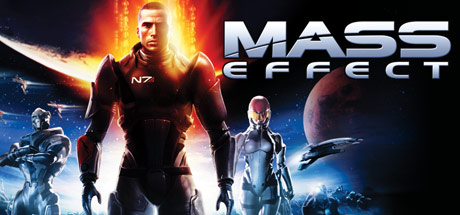

**Platforms:** Windows &nbsp;|&nbsp; **Publisher:** Electronic Arts &nbsp;|&nbsp; **Genre:** Action, RPG &nbsp;|&nbsp; **Released:** May 28, 2008

> As Commander Shepard, you lead an elite squad on a heroic, action-packed adventure throughout the galaxy.
>
> _Synopsis source: Steam_

[Wikipedia](https://en.wikipedia.org/wiki/Mass_Effect_(video_game)) · [Steam](https://store.steampowered.com/app/17460)

---

### Mata Hari

**Platforms:** Windows &nbsp;|&nbsp; **Developer:** Cranberry Production &nbsp;|&nbsp; **Publisher:** DTP Entertainment, Viva Media &nbsp;|&nbsp; **Genre:** Adventure &nbsp;|&nbsp; **Released:** November 21, 2008

> TRUST NO ONE BUT YOURSELF as you adventure into the dark world of espionage amidst the volatile atmosphere of impending war.  As a double agent, you must find clever ways to pit enemy factions against each other while eluding pursuers in each of your increasingly dangerous missions. As a femme fatale, your notorious charm can entice any man. Yet, will the one man who holds the key to your heart ever be yours?
>
> _Synopsis source: IGDB_

[Wikipedia](https://en.wikipedia.org/wiki/Mata_Hari_(video_game)) · [IGDB](https://www.igdb.com/games/mata-hari)

---

### Memento Mori

**Platforms:** Windows &nbsp;|&nbsp; **Developer:** Centauri Production &nbsp;|&nbsp; **Publisher:** Cinemax, Dtp entertainment, Lace Mamba Global, Got Game Entertainment &nbsp;|&nbsp; **Genre:** Point-and-click adventure game

> Colonel Ostankovich, the commander of a special police department in St Petersburg, and the man who put his honesty at stake by swearing that under his command not an item will get lost in the Hermitage, receives a report of a short alarm failure in the Hermitage. He suspects that something happened. To avoid losing his reputation, he contacts Maxim Durand through Larisa Svetlova. Due to his past, Maxim is at his disposal and has to help him.
>
> _Synopsis source: IGDB_

[Wikipedia](https://en.wikipedia.org/wiki/Memento_Mori_(video_game)) · [IGDB](https://www.igdb.com/games/memento-mori)

---

### Men of War

**Platforms:** Windows &nbsp;|&nbsp; **Genre:** Strategy &nbsp;|&nbsp; **Released:** November 7

> Red Tide blends deep RTS tactics with the raw intensity of third-person combat. Created in collaboration with author Alexander Zorich, this standalone expansion tells the story of the Black Coats – Soviet Naval Infantry famed for their ruthless precision in the Black Sea campaigns.
>
> _Synopsis source: Steam_

[Wikipedia](https://en.wikipedia.org/wiki/Men_of_War_(video_game)) · [Steam](https://store.steampowered.com/app/3130)

---

### Mercenaries 2: World in Flames

**Platforms:** PlayStation 2, PlayStation 3, Windows, Xbox 360 &nbsp;|&nbsp; **Released:** August 31

---

### Microsoft Tinker

**Platforms:** Windows &nbsp;|&nbsp; **Released:** September 23

[Wikipedia](https://en.wikipedia.org/wiki/Microsoft_Tinker)

---

### Mighty Jill Off

**Platforms:** Windows, macOS &nbsp;|&nbsp; **Developer:** Anna Anthropy &nbsp;|&nbsp; **Genre:** Platformer &nbsp;|&nbsp; **Released:** February 29, 2008

> Jill wants to please the Queen but Jill always fails. Jill has to punish herself to reach the top of the dungeon and reunite with the Queen.
>
> _Synopsis source: IGDB_

[Wikipedia](https://en.wikipedia.org/wiki/Mighty_Jill_Off) · [IGDB](https://www.igdb.com/games/mighty-jill-off)

---

### Monster Trucks Nitro

**Platforms:** Browser, Windows, macOS, iOS &nbsp;|&nbsp; **Developer:** Ubisoft RedLynx &nbsp;|&nbsp; **Publisher:** Miniclip, Ubisoft RedLynx &nbsp;|&nbsp; **Genre:** Racing, Simulator, Sport, Indie &nbsp;|&nbsp; **Released:** December 19, 2008

> Race, jump and nitroboost your way pass thrilling dynamic levels with your monster trucks. Earn medals and unlock new levels and vehicles.
>
> _Synopsis source: IGDB_

[Wikipedia](https://en.wikipedia.org/wiki/Monster_Trucks_Nitro) · [IGDB](https://www.igdb.com/games/monster-trucks-nitro)

---

### MorphX

**Platforms:** Windows, Xbox 360 &nbsp;|&nbsp; **Developer:** Targem Games &nbsp;|&nbsp; **Publisher:** Buka Entertainment, 505 Games &nbsp;|&nbsp; **Genre:** Action-adventure, third-person shooter &nbsp;|&nbsp; **Released:** October 23, 2008

> An action-packed third-person shooter, MorphX drops players into the middle of the fallout in Moscow, Russia. As part of the new resistance, players awaken in an alien laboratory with the option to enhance their stamina and health with Alien DNA, but at the cost of gradually turning into a monster. In an effort to fight the aliens and find an antidote to the mutation, players can choose to either use the Alien DNA to their advantage, or reject it and focus solely on collecting a variety of weapons to take down their enemies.
>
> _Synopsis source: IGDB_

[Wikipedia](https://en.wikipedia.org/wiki/MorphX_(video_game)) · [IGDB](https://www.igdb.com/games/morphx)

---

### Mosby's Confederacy

**Platforms:** Windows &nbsp;|&nbsp; **Developer:** Tilted Mill Entertainment &nbsp;|&nbsp; **Publisher:** Tilted Mill Entertainment &nbsp;|&nbsp; **Genre:** turn based strategy, real time tactics &nbsp;|&nbsp; **Released:** November 19, 2008

> As John Singleton Mosby, one of the Civil War's most interesting and dynamic leaders, you are charged, not with leading vast armies into battle, but with commanding small bands of skirmishers, scouts, and guerilla fighters on opportunistic missions to scout, ambush, steal supplies, and harass a larger and better-armed force of Union soldiers, in this game of turn-based strategy and real-time tactical combat for the PC.  Missions and their objectives are randomized, so you'll need to approach each game differently, carefully planning your strategy for success. You draw your soldiers from local towns, then, through hard-won battlefield experience, transform them into fighting men — scouts, cavalry, rangers, and riflemen. Between battles you'll invest in local towns, so they can serve as field hospitals, stables and munitions caches, helping to keep your forces fit and able to fight, and so that they remain confident and supportive of your ongoing efforts and willingly supply men to fight for your cause - and as the war rages on this becomes increasingly challenging.  Throughout the campaign your progress is tracked, with a full report of your accomplishments provided at its completion. Can you build a name for yourself, just like Mosby?
>
> _Synopsis source: IGDB_

[Wikipedia](https://en.wikipedia.org/wiki/Mosby's_Confederacy_(video_game)) · [IGDB](https://www.igdb.com/games/mosbys-confederacy)

---

### MotoGP '08

**Platforms:** PlayStation 3, Windows, PlayStation 2, Wii, Xbox 360 &nbsp;|&nbsp; **Developer:** Milestone &nbsp;|&nbsp; **Publisher:** Capcom &nbsp;|&nbsp; **Genre:** Racing, sports &nbsp;|&nbsp; **Released:** October 24, 2008

> For the first time in recent years, the game includes the addition of playable 125cc and 250cc support classes.  MotoGP '07 for the PlayStation 2 had a reputation for emphasis on simulation in contrast to the MotoGP titles published by THQ, which have a reputation for arcade gameplay. MotoGP '08 is reported to balance these different styles and allow the player to configure an emphasis towards their desired gameplay.
>
> _Synopsis source: IGDB_

[Wikipedia](https://en.wikipedia.org/wiki/MotoGP_'08) · [IGDB](https://www.igdb.com/games/motogp-08)

---

### Mount & Blade

**Platforms:** Windows &nbsp;|&nbsp; **Developer:** TaleWorlds Entertainment &nbsp;|&nbsp; **Publisher:** Paradox Interactive &nbsp;|&nbsp; **Genre:** Action role-playing &nbsp;|&nbsp; **Released:** September 16, 2008

> Mount & Blade is an immersive medieval action/tactics game taking place in a fictitious land named Calradia. Enriched with RPG elements, Mount & Blade offers a captivating environment, beautifully detailed with hundreds of castles, towns, and villages to explore.
>
> _Synopsis source: IGDB_

[Wikipedia](https://en.wikipedia.org/wiki/Mount_&_Blade) · [IGDB](https://www.igdb.com/games/mount-blade)

---

### Multiwinia

**Platforms:** Windows &nbsp;|&nbsp; **Developer:** Introversion Software &nbsp;|&nbsp; **Publisher:** Introversion Software, Ambrosia Software &nbsp;|&nbsp; **Genre:** Real-time strategy &nbsp;|&nbsp; **Released:** September 19, 2008

[Wikipedia](https://en.wikipedia.org/wiki/Multiwinia)

---

### Murder in the Abbey

**Platforms:** Windows, macOS &nbsp;|&nbsp; **Developer:** Alcachofa Soft &nbsp;|&nbsp; **Publisher:** DreamCatcher Interactive, Crimson Cow &nbsp;|&nbsp; **Genre:** Adventure &nbsp;|&nbsp; **Released:** August 26, 2008

[Wikipedia](https://en.wikipedia.org/wiki/Murder_in_the_Abbey)

---

### Muslim Massacre

**Platforms:** Windows &nbsp;|&nbsp; **Developer:** Eric 'Sigvatr' Vaughn &nbsp;|&nbsp; **Genre:** Shoot 'em up &nbsp;|&nbsp; **Released:** January 2008

[Wikipedia](https://en.wikipedia.org/wiki/Muslim_Massacre_(video_game))

---

### My Horse & Me 2

**Platforms:** Xbox 360, PlayStation 2, Wii, Windows, Nintendo DS &nbsp;|&nbsp; **Developer:** Tate Interactive, Mistic Software &nbsp;|&nbsp; **Publisher:** Atari Europe &nbsp;|&nbsp; **Genre:** Racing &nbsp;|&nbsp; **Released:** October 31, 2008

[Wikipedia](https://en.wikipedia.org/wiki/My_Horse_&_Me_2)

---

### MySims

**Platforms:** Windows &nbsp;|&nbsp; **Genre:** Casual, Simulation &nbsp;|&nbsp; **Released:** October 28

> Explore a new world with MySims™ — it's your world to transform in this retro re-release with updated graphics! Move to an adorable town. With a little creativity and some help from the locals, you can make this place thrive!
>
> _Synopsis source: Steam_

[Wikipedia](https://en.wikipedia.org/wiki/MySims) · [Steam](https://store.steampowered.com/app/3328900)

---

### Nancy Drew Dossier: Lights, Camera, Curses

**Platforms:** Windows &nbsp;|&nbsp; **Developer:** Her Interactive &nbsp;|&nbsp; **Publisher:** Big Fish Games, Her Interactive &nbsp;|&nbsp; **Genre:** Puzzle &nbsp;|&nbsp; **Released:** November 11, 2008

[Wikipedia](https://en.wikipedia.org/wiki/Nancy_Drew_Dossier:_Lights,_Camera,_Curses)

---

### Nancy Drew: The Haunting of Castle Malloy

**Platforms:** Windows &nbsp;|&nbsp; **Genre:** Adventure &nbsp;|&nbsp; **Released:** October 16

> Unveil a Ghostly Legend and Find a Vanished Groom!
>
> _Synopsis source: Steam_

[Steam](https://store.steampowered.com/app/31910)

---

### Nancy Drew: The Phantom of Venice

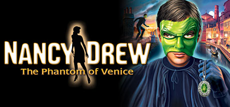

**Platforms:** Windows &nbsp;|&nbsp; **Genre:** Adventure &nbsp;|&nbsp; **Released:** July 11

> Infiltrate a Carnevale of Criminals in Italy!
>
> _Synopsis source: Steam_

[Steam](https://store.steampowered.com/app/31920)

---

### NBA 2K9

**Platforms:** PlayStation 2, PlayStation 3, Wii, Xbox 360, Windows &nbsp;|&nbsp; **Released:** October 7

[Wikipedia](https://en.wikipedia.org/wiki/NBA_2K9)

---

### Need for Speed: Undercover

**Platforms:** Mobile phone, PlayStation 2, PlayStation 3, PlayStation Portable, Wii, Windows, Xbox 360 &nbsp;|&nbsp; **Released:** November 18

---

### Neverwinter Nights 2: Storm of Zehir

**Platforms:** Windows &nbsp;|&nbsp; **Developer:** Obsidian Entertainment &nbsp;|&nbsp; **Publisher:** Atari Interactive &nbsp;|&nbsp; **Genre:** Role-playing video game &nbsp;|&nbsp; **Released:** November 18, 2008

[Wikipedia](https://en.wikipedia.org/wiki/Neverwinter_Nights_2:_Storm_of_Zehir)

---

### NHL 09

**Platforms:** Xbox 360, PlayStation 3, Wii, Windows &nbsp;|&nbsp; **Publisher:** EA Sports &nbsp;|&nbsp; **Released:** September 9, 2008

[Wikipedia](https://en.wikipedia.org/wiki/NHL_09)

---

### Nikopol: Secrets of the Immortals

**Platforms:** Windows &nbsp;|&nbsp; **Developer:** White Birds Productions &nbsp;|&nbsp; **Publisher:** Got Game Entertainment &nbsp;|&nbsp; **Genre:** Adventure &nbsp;|&nbsp; **Released:** September 20, 2008

> Set in France, 2023, a country governed by a dictator who rules by religious absolute power. A mysterious ship shaped like a pyramid has just appeared in the sky and sent representatives to speak with the French government.  As Nikopol, you will find yourself in a suspenseful adventure to find your father and thwart a dangerous conspiracy. Entangled in political intrigue you’re caught between two worlds, one of anarchy and one of Immortality.
>
> _Synopsis source: IGDB_

[Wikipedia](https://en.wikipedia.org/wiki/Nikopol:_Secrets_of_the_Immortals) · [IGDB](https://www.igdb.com/games/nikopol-secrets-of-the-immortals)

---

### Nostradamus ni Kiite Miro

**Platforms:** Windows &nbsp;|&nbsp; **Developer:** Lime &nbsp;|&nbsp; **Publisher:** Lime &nbsp;|&nbsp; **Genre:** Visual novel, Eroge &nbsp;|&nbsp; **Released:** February 29, 2008

[Wikipedia](https://en.wikipedia.org/wiki/Nostradamus_ni_Kiite_Miro)

---

### NoviCraft

**Platforms:** Windows &nbsp;|&nbsp; **Developer:** LudoCraft &nbsp;|&nbsp; **Publisher:** TeamingStream &nbsp;|&nbsp; **Genre:** Serious game

[Wikipedia](https://en.wikipedia.org/wiki/NoviCraft)

---

### Off

**Platforms:** Windows, macOS &nbsp;|&nbsp; **Developer:** Unproductive Fun Time, Fangamer &nbsp;|&nbsp; **Publisher:** Unproductive Fun Time, Fangamer &nbsp;|&nbsp; **Genre:** Role-playing &nbsp;|&nbsp; **Released:** May 14, 2008

> The player is tasked with controlling the Batter and guiding him on his quest to "purify" the world of spirits. The player must take the Batter through the various Zones, collect battle partners, solve puzzles and partake in turn-based Active Time Battles in order to get to the source of the impurity.
>
> _Synopsis source: IGDB_

[Wikipedia](https://en.wikipedia.org/wiki/Off_(video_game)) · [IGDB](https://www.igdb.com/games/off)

---

### Off Road

**Platforms:** Windows, PlayStation 2, PlayStation Portable, Wii &nbsp;|&nbsp; **Developer:** Razorworks &nbsp;|&nbsp; **Publisher:** Empire Interactive &nbsp;|&nbsp; **Genre:** Racing &nbsp;|&nbsp; **Released:** March 20, 2008

[Wikipedia](https://en.wikipedia.org/wiki/Off_Road_(video_game))

---

### Off-Road Velociraptor Safari

**Platforms:** macOS, Windows &nbsp;|&nbsp; **Developer:** Flashbang Studios &nbsp;|&nbsp; **Publisher:** Flashbang Studios &nbsp;|&nbsp; **Genre:** Vehicular combat &nbsp;|&nbsp; **Released:** January 29, 2008

[Wikipedia](https://en.wikipedia.org/wiki/Off-Road_Velociraptor_Safari)

---

### Officers

**Platforms:** Windows &nbsp;|&nbsp; **Developer:** 3A Games &nbsp;|&nbsp; **Publisher:** Tri Synergy &nbsp;|&nbsp; **Genre:** Real-time strategy &nbsp;|&nbsp; **Released:** November 28, 2008

> Officers is a Real Time Strategy Game for the PC set during World War II and features three distinct campaigns to play.
>
> _Synopsis source: IGDB_

[Wikipedia](https://en.wikipedia.org/wiki/Officers_(video_game)) · [IGDB](https://www.igdb.com/games/officers)

---

### Oiligarchy

**Platforms:** macOS, Browser, Windows &nbsp;|&nbsp; **Genre:** Simulator, Strategy

> Now you can be the protagonist of the petroleum era: explore and drill around the world, corrupt politicians, stop alternative energies and increase the oil addiction. Be sure to have fun before the resources begin to deplete.
>
> _Synopsis source: IGDB_

[Wikipedia](https://en.wikipedia.org/wiki/Oiligarchy) · [IGDB](https://www.igdb.com/games/oiligarchy)

---

### On the Rain-Slick Precipice of Darkness: Episode One and Two

**Platforms:** Windows, macOS, Xbox 360, PlayStation 3 &nbsp;|&nbsp; **Developer:** Hothead Games &nbsp;|&nbsp; **Publisher:** Hothead Games &nbsp;|&nbsp; **Genre:** Adventure, role-playing &nbsp;|&nbsp; **Released:** May 21, 2008

[Wikipedia](https://en.wikipedia.org/wiki/On_the_Rain-Slick_Precipice_of_Darkness:_Episode_One_and_Two)

---

### Outcry

**Platforms:** Windows &nbsp;|&nbsp; **Developer:** Phantomery Interactive &nbsp;|&nbsp; **Genre:** Point-and-click adventure &nbsp;|&nbsp; **Released:** August 26, 2008

> Outcry is a first person psychological thriller point-and-click adventure video game. You receive a letter from your brother, a scientist, who invites you to his home so that he can show you the results of his project, and you can get some ideas for your next book. However, once you arrive you find that your brother has mysteriously vanished, leaving all his material possessions to you - including a large, strange machine and a message telling you not to reproduce his experiments.
>
> _Synopsis source: IGDB_

[Wikipedia](https://en.wikipedia.org/wiki/Outcry_(video_game)) · [IGDB](https://www.igdb.com/games/outcry)

---

### Overlord: Raising Hell

**Platforms:** Windows, PlayStation 3, Xbox 360, macOS, Linux &nbsp;|&nbsp; **Developer:** Triumph Studios, 4J Studios &nbsp;|&nbsp; **Publisher:** Codemasters &nbsp;|&nbsp; **Genre:** Action role-playing &nbsp;|&nbsp; **Released:** February 15, 2008

> Overlord is an action role-playing video game set in an alternate world, where the player takes the role of a resurrected warrior known as "The Overlord" who has control over hordes of gremlin-like creatures known as "Minions". The player must defeat seven corrupt ruling heroes in order to reconquer the lands and establish his lordship over its inhabitants. The game features a corruption feature, similar to that of the Fable games, but allowing the player to "be evil... or really evil", where certain actions and choices affect different aspects of the story and gameplay. While the Overlord is controlled in a third person perspective, the way minions are controlled brings elements of real-time strategy and upgrades bring those of role-playing games. The game uses dark humour, and is a satirical parody of the traditional fantasy setting and plot
>
> _Synopsis source: IGDB_

[Wikipedia](https://en.wikipedia.org/wiki/Overlord:_Raising_Hell) · [IGDB](https://www.igdb.com/games/overlord)

---

### PDC World Championship Darts 2008

**Platforms:** PlayStation 2, Windows, PlayStation Portable, Wii, Xbox 360 &nbsp;|&nbsp; **Developer:** Mere Mortals &nbsp;|&nbsp; **Publisher:** Oxygen Games, Red Ant Enterprises &nbsp;|&nbsp; **Genre:** Sports &nbsp;|&nbsp; **Released:** January 25, 2008

> Go head-to-head with the greatest PDC Champions and be part of the year's most fierce console Championship with PDC World Championship Darts 2008. Starring even more Champions, the full line up of electrifying tournaments, exceptional graphic enhancements, even more play modes and additional formats.
>
> _Synopsis source: IGDB_

[Wikipedia](https://en.wikipedia.org/wiki/PDC_World_Championship_Darts_2008) · [IGDB](https://www.igdb.com/games/pdc-world-championship-darts-2008)

---

### Peggle Nights

**Platforms:** Windows, PlayStation Network, iOS &nbsp;|&nbsp; **Developer:** PopCap Games &nbsp;|&nbsp; **Publisher:** PopCap Games &nbsp;|&nbsp; **Genre:** Puzzle &nbsp;|&nbsp; **Released:** September 16, 2008

> The sun has set at the Peggle Institute, but the bouncy delight has just begun! Join the Peggle Masters on a dreamtime adventure of alter egos and peg-tastic action. Stay up late to aim, shoot and clear orange pegs, and bask in Extreme Fever glory under the silver moon. Then, put your Peggle skills to the ultimate test in Challenge mode. If you can master all that fevered action, play to your heart's content with Duel mode and Quick Play. Plus, you can stock your Trophy Room and revel in clickable replays for even more rebounding joy!  Explore all 60 levels in Adventure mode Meet a new Peggle Master and learn a new Magic Power Test your skills in 60 challenges Unlock Duel mode to compete against friends and the computer Celebrate your Peggle prowess with clickable replays and a Trophy Room!
>
> _Synopsis source: IGDB_

[Wikipedia](https://en.wikipedia.org/wiki/Peggle_Nights) · [IGDB](https://www.igdb.com/games/peggle-nights)

---

### Penny Arcade Adventures: On the Rain-Slick Precipice of Darkness

**Platforms:** Linux, macOS, Windows, Xbox 360 &nbsp;|&nbsp; **Released:** May 21

---

### Penny Arcade Adventures: On the Rain-Slick Precipice of Darkness – Episode 2

**Platforms:** Linux, macOS, Windows, Xbox 360 &nbsp;|&nbsp; **Released:** October 29

---

### Penumbra: Black Plague

**Platforms:** Linux, Windows &nbsp;|&nbsp; **Genre:** Action, Adventure, Indie &nbsp;|&nbsp; **Released:** February 12

> Surrounded by enemies and assaulted by terror from all sides, Philip must collect clues and solve vexing puzzles while combating the gnawing psychological terrors that assail his mind and threaten to strip him of his sanity.
>
> _Synopsis source: Steam_

[Steam](https://store.steampowered.com/app/22120)

---

### Penumbra: Requiem

**Platforms:** Windows, Linux, macOS &nbsp;|&nbsp; **Developer:** Frictional Games &nbsp;|&nbsp; **Publisher:** Paradox Interactive &nbsp;|&nbsp; **Genre:** Survival horror &nbsp;|&nbsp; **Released:** August 27, 2008

[Wikipedia](https://en.wikipedia.org/wiki/Penumbra:_Requiem)

---

### Petz Sports: Dog Playground

**Platforms:** Wii, macOS, Windows &nbsp;|&nbsp; **Developer:** Ubisoft Montreal &nbsp;|&nbsp; **Publisher:** Ubisoft &nbsp;|&nbsp; **Genre:** Virtual life

[Wikipedia](https://en.wikipedia.org/wiki/Petz_Sports:_Dog_Playground)

---

### Pirates of the Burning Sea

**Platforms:** Windows &nbsp;|&nbsp; **Released:** January 22

[Wikipedia](https://en.wikipedia.org/wiki/Pirates_of_the_Burning_Sea)

---

### Pixie Hollow

**Platforms:** Windows, macOS &nbsp;|&nbsp; **Developer:** Disney Interactive Studios, Schell Games, SilverTree Media &nbsp;|&nbsp; **Publisher:** Disney Interactive Studios &nbsp;|&nbsp; **Genre:** Massive multiplayer online role-playing &nbsp;|&nbsp; **Released:** September 20, 2008

> Pixie Hollow Online was a MMO (massively multiplayer online) game from Disney Online (PixieHollow.com). Players could create a Fairy or Sparrow Man character and play as them and participate in events, complete quests, shop, dress up, collect ingredients, play mini-games, earn talent points, choose an animal friend, chat, host a party, earn badges, and more.
>
> _Synopsis source: IGDB_

[Wikipedia](https://en.wikipedia.org/wiki/Pixie_Hollow_(video_game)) · [IGDB](https://www.igdb.com/games/pixie-hollow)

---

### Point Blank

**Platforms:** Windows &nbsp;|&nbsp; **Developer:** Zepetto Co. &nbsp;|&nbsp; **Publisher:** Zepetto Co., NfinityGames, Zepetto Co. NA., OnGame &nbsp;|&nbsp; **Genre:** First-person shooter &nbsp;|&nbsp; **Released:** October 2008

> Point Blank is a fast-paced online first-person shooter, where players join either the Free Rebels or CT-Force team (the Free Rebels are based on the Terrorists from Counter-Strike, while CT-Force is based on the Counter-Terrorists). Each team attempts to complete their mission objective and/or eliminate the opposing team. Each round starts with the two teams spawning simultaneously, usually at opposite ends of the map from each other.  A player can choose to play as one of four different default character models (Acid and Keen Eyes for CT-Force, and Red Bull and Tarantula for the Free Rebels). There are four purchasable deluxe character models: Fennec and Pit Viper for CT-Force or Cheshire and Shadow for the Free Rebels. Players are generally given a few seconds before the round begins, or before respawning, to change weapons and/or equipment.  Game points and experience are awarded for winning a round, losing a round, killing enemies, and completing mini missions.
>
> _Synopsis source: IGDB_

[Wikipedia](https://en.wikipedia.org/wiki/Point_Blank_(2008_video_game)) · [IGDB](https://www.igdb.com/games/point-blank--1)

---

### Poker Smash

**Platforms:** Xbox 360, iOS, Windows &nbsp;|&nbsp; **Developer:** Void Star Creations &nbsp;|&nbsp; **Publisher:** Void Star Creations &nbsp;|&nbsp; **Genre:** puzzle game &nbsp;|&nbsp; **Released:** February 6, 2008

> Poker Smash a fast and frenetic puzzle game similar to Tetris Attack, where the player must gain as many chips as possible as the level becomes steadily more hectic.
>
> _Synopsis source: IGDB_

[Wikipedia](https://en.wikipedia.org/wiki/Poker_Smash) · [IGDB](https://www.igdb.com/games/poker-smash)

---

### Prince of Persia

**Platforms:** PlayStation 3, Xbox 360, Windows &nbsp;|&nbsp; **Genre:** Action, Adventure &nbsp;|&nbsp; **Released:** December 2

> The critically acclaimed Prince of Persia® franchise returns for the first time on next-generation platforms with an all-new epic journey. Built by the same award-winning Ubisoft Montreal studio that created Assassin's Creed™, Prince of Persia has been in development for over three years to deliver a whole new action-adventure gaming...
>
> _Synopsis source: Steam_

[Wikipedia](https://en.wikipedia.org/wiki/Prince_of_Persia_(2008_video_game)) · [Steam](https://store.steampowered.com/app/19980)

---

### Princess Lover!

**Platforms:** Windows &nbsp;|&nbsp; **Genre:** Adventure, Visual Novel

> Princess Lover! is a visual novel blending romance, drama, and character-driven choices. Players follow a young protagonist drawn into noble society, building relationships with multiple heroines through dialogue choices, branching routes, and emotionally charged scenes that shape different endings.
>
> _Synopsis source: IGDB_

[Wikipedia](https://en.wikipedia.org/wiki/Princess_Lover!) · [IGDB](https://www.igdb.com/games/princess-lover)

---

### Prius Online

**Platforms:** Windows &nbsp;|&nbsp; **Developer:** CJI &nbsp;|&nbsp; **Publisher:** Wasabii, Netmarble &nbsp;|&nbsp; **Genre:** Free-to-play 3D computer graphics, cinematic, fantasy, MMORPG

[Wikipedia](https://en.wikipedia.org/wiki/Prius_Online)

---

### Pro Evolution Soccer 2009

**Platforms:** PlayStation 2, PlayStation 3, PlayStation Portable, Wii, Windows, Xbox 360 &nbsp;|&nbsp; **Released:** November 12

[Wikipedia](https://en.wikipedia.org/wiki/Pro_Evolution_Soccer_2009)

---

### Professor Heinz Wolff's Gravity

**Platforms:** Nintendo DS, Wii, Windows &nbsp;|&nbsp; **Developer:** Extra Mile Studios &nbsp;|&nbsp; **Publisher:** Deep Silver, Namco Networks &nbsp;|&nbsp; **Genre:** Puzzle &nbsp;|&nbsp; **Released:** November 28, 2008

> Professor Heinz Wolff's Gravity is an exciting puzzle game released on Nintendo Wii and Nintendo DS. Although there are subtle differences between each version, they all contain 100 puzzles of varying difficulty for you to solve. As the name suggests, these puzzles involve using gravity and other properties of physics to solve them. Gravity is suitable for the whole family and is a fun way to keep your mind at its sharpest!
>
> _Synopsis source: IGDB_

[Wikipedia](https://en.wikipedia.org/wiki/Professor_Heinz_Wolff's_Gravity) · [IGDB](https://www.igdb.com/games/professor-heinz-wolff-s-gravity)

---

### Project Torque

**Platforms:** Windows &nbsp;|&nbsp; **Developer:** Invictus Games &nbsp;|&nbsp; **Publisher:** Aeria Games & Entertainment, Jogara Ltd. &nbsp;|&nbsp; **Genre:** Racing MMO &nbsp;|&nbsp; **Released:** April 30, 2008

> Classic Free to Play MMO Racer from the late 2000s is coming back online with all your favourite game modes like Sim, Drift, Drag, CTF and Thunder Alley.
>
> _Synopsis source: IGDB_

[Wikipedia](https://en.wikipedia.org/wiki/Project_Torque) · [IGDB](https://www.igdb.com/games/project-torque)

---

### Pure

**Platforms:** PlayStation 3, Xbox 360, Windows &nbsp;|&nbsp; **Released:** September 16

[Wikipedia](https://en.wikipedia.org/wiki/Pure_(video_game))

---

### Puzzlegeddon

**Platforms:** Windows, Xbox 360, PlayStation Network &nbsp;|&nbsp; **Developer:** Pieces Interactive &nbsp;|&nbsp; **Publisher:** Tecmo &nbsp;|&nbsp; **Genre:** Puzzle, Strategy &nbsp;|&nbsp; **Released:** November 27, 2008

> Puzzle Geddon a puzzle brawler
>
> _Synopsis source: IGDB_

[Wikipedia](https://en.wikipedia.org/wiki/Puzzlegeddon) · [IGDB](https://www.igdb.com/games/puzzlegeddon)

---

### Pyroblazer

**Platforms:** Windows &nbsp;|&nbsp; **Developer:** Eipix Entertainment &nbsp;|&nbsp; **Publisher:** Candella Software, City Interactive &nbsp;|&nbsp; **Genre:** Combat racing &nbsp;|&nbsp; **Released:** November 13, 2008

> Pyroblazer is a futuristic combat racing game. Set amidst the awe-inspiring locations of New Apeiron, players get the opportunity to race through a multitude of environments using a wide selection of anti-gravity craft known as Blazers. In their quest for glory, players can blast their way through the scorched valleys of Gnosis, the deserted cities of Haedra or the densely populated Underdome of Evelads.  As the players fight their way through the championship, improved Blazers with better speed, handling and superior firepower become available. Players also have the ability to pick up weapon and ammo upgrades during the race, further enhancing their ability to land the killer blow.
>
> _Synopsis source: IGDB_

[Wikipedia](https://en.wikipedia.org/wiki/Pyroblazer) · [IGDB](https://www.igdb.com/games/pyroblazer)

---

### Race Driver: Grid

**Platforms:** Windows, PlayStation 3, Xbox 360, Nintendo DS &nbsp;|&nbsp; **Publisher:** Codemasters &nbsp;|&nbsp; **Released:** May 30, 2008

---

### Rail Simulator

**Platforms:** Windows &nbsp;|&nbsp; **Released:** January 16

[Wikipedia](https://en.wikipedia.org/wiki/Rail_Simulator)

---

### Ranch Rush

**Platforms:** Windows, iOS, macOS &nbsp;|&nbsp; **Developer:** Aliasworlds Entertainment &nbsp;|&nbsp; **Publisher:** FreshGames &nbsp;|&nbsp; **Genre:** Simulation &nbsp;|&nbsp; **Released:** July 10, 2008

> In this time-management game, you play Sara, a worker at a greenhouse. Unfortunately, the greenhouse is failing, and the owner is going to sell to a developer in eight weeks. Sara's only chance of saving the nursery is to take over a vacant three acres and turn it into a productive farm.  Each week consists of five missions (where you need to harvest certain amounts of each crop) taking place on Monday through Friday, plus a Saturday farmer's market, where each item you sell gives bonus cash.  Some items take more time than others to grow, and other items, such as milk, require you to take crops and process them in some way. (For example, taking clover to a cow to get milk in return, or turning tomatoes into ketchup.)
>
> _Synopsis source: IGDB_

[Wikipedia](https://en.wikipedia.org/wiki/Ranch_Rush) · [IGDB](https://www.igdb.com/games/ranch-rush)

---

### Requiem: Memento Mori

**Platforms:** Windows &nbsp;|&nbsp; **Released:** June 19 (NA)

---

### Reset Generation

**Platforms:** Windows &nbsp;|&nbsp; **Released:** August 4

[Wikipedia](https://en.wikipedia.org/wiki/Reset_Generation)

---

### Restaurant Rush

**Platforms:** Windows, iOS &nbsp;|&nbsp; **Developer:** Menara Games &nbsp;|&nbsp; **Publisher:** Gamenauts &nbsp;|&nbsp; **Genre:** Puzzle video game, Matching &nbsp;|&nbsp; **Released:** August 16, 2008

> The long-awaited sequel to Burger Rush is here!  Join Heidi in here quest to become a world-class chef by cooking over 50 international dishes such as Filet Mignon, Dim Sum, and Pizza Marinara.  With brand new features such as the Farmer`s Market, Cooking Competitions and Bonus Challenges, Restaurant Rush is 2x as addicting as Burger Rush!
>
> _Synopsis source: IGDB_

[Wikipedia](https://en.wikipedia.org/wiki/Restaurant_Rush) · [IGDB](https://www.igdb.com/games/restaurant-rush)

---

### Return to Dark Castle

**Platforms:** macOS, Windows, Linux &nbsp;|&nbsp; **Developer:** Z Sculpt Entertainment, Delta Tao Software &nbsp;|&nbsp; **Publisher:** 2008 Super Happy Fun Fun, Inc., 2026 Re-Release: Ludit Games &nbsp;|&nbsp; **Genre:** Platform &nbsp;|&nbsp; **Released:** March 14, 2008

> The third installment of this classic Mac series.
>
> _Synopsis source: IGDB_

[Wikipedia](https://en.wikipedia.org/wiki/Return_to_Dark_Castle) · [IGDB](https://www.igdb.com/games/return-to-dark-castle)

---

### RHEM 3: The Secret Library

**Platforms:** Windows, macOS &nbsp;|&nbsp; **Developer:** Knut Müller &nbsp;|&nbsp; **Publisher:** Got Game Entertainment, Micro Application &nbsp;|&nbsp; **Genre:** Graphic adventure &nbsp;|&nbsp; **Released:** February 28, 2008

> In this third installment of the popular RHEM series of intricate pure-puzzle first-person adventure games, the adventures of brothers Kales and Zetais continue in the mysterious land of RHEM.
>
> _Synopsis source: IGDB_

[Wikipedia](https://en.wikipedia.org/wiki/RHEM_3:_The_Secret_Library) · [IGDB](https://www.igdb.com/games/rhem-3-the-secret-library)

---

### Rhiannon: Curse of the Four Branches

**Platforms:** Windows &nbsp;|&nbsp; **Developer:** Arberth Studios &nbsp;|&nbsp; **Publisher:** Got Game Entertainment, Lighthouse Interactive &nbsp;|&nbsp; **Genre:** Adventure &nbsp;|&nbsp; **Released:** October 6, 2008

[Wikipedia](https://en.wikipedia.org/wiki/Rhiannon:_Curse_of_the_Four_Branches)

---

### Rise of the Argonauts

**Platforms:** PlayStation 3, Windows, Xbox 360 &nbsp;|&nbsp; **Released:** December 18

[Wikipedia](https://en.wikipedia.org/wiki/Rise_of_the_Argonauts)

---

### Rohan: Blood Feud

**Platforms:** Windows &nbsp;|&nbsp; **Developer:** YNK Korea &nbsp;|&nbsp; **Publisher:** YNK Interactive &nbsp;|&nbsp; **Genre:** Fantasy MMORPG &nbsp;|&nbsp; **Released:** May 28, 2008

> International version of a Korean MMORPG which was released into public beta on May 28, 2008. It uses a cash shop system, and it's key selling points include township battles and its unique PvP system.
>
> _Synopsis source: IGDB_

[Wikipedia](https://en.wikipedia.org/wiki/Rohan:_Blood_Feud) · [IGDB](https://www.igdb.com/games/rohan-blood-feud)

---

### Rooms: The Main Building

**Platforms:** Windows, macOS &nbsp;|&nbsp; **Developer:** HandMade Game &nbsp;|&nbsp; **Publisher:** Big Fish Games, Hudson Entertainment &nbsp;|&nbsp; **Genre:** Puzzle &nbsp;|&nbsp; **Released:** August 11, 2008

> Use object inside rooms and move the rooms to escape. 100 challenging sliding puzzles with a twist! The solution is only a doorstep away!
>
> _Synopsis source: IGDB_

[Wikipedia](https://en.wikipedia.org/wiki/Rooms:_The_Main_Building) · [IGDB](https://www.igdb.com/games/rooms-the-main-building)

---

### Rui wa Tomo o Yobu

**Platforms:** Windows, PlayStation 3 &nbsp;|&nbsp; **Developer:** Akatsuki Works &nbsp;|&nbsp; **Publisher:** Akatsuki Works &nbsp;|&nbsp; **Genre:** Eroge, Visual novel &nbsp;|&nbsp; **Released:** June 26, 2008

> kutsu Tomo was brought up by his mother as a girl due to a small mark he has on his body. After his mother's death, he discovers via her will that she emphasizes Tomo continue to live as a female, and following this, Tomo starts to go through more troubles in his life. Tomo soon discovers that he is linked with five girls who are around his age as a second year high school student. These girls happen to have the same mark he has, and also have been going through hardships in their lives. Tomo and these five girls decide to form a pact to stay together and support each other to solve each of their problems and to bring peace to their lives.
>
> _Synopsis source: IGDB_

[Wikipedia](https://en.wikipedia.org/wiki/Rui_wa_Tomo_o_Yobu) · [IGDB](https://www.igdb.com/games/rui-wa-tomo-o-yobu)

---

### S.T.A.L.K.E.R.: Clear Sky

**Platforms:** Windows &nbsp;|&nbsp; **Released:** September 5

---

### Sacred 2 Fallen Angel

**Platforms:** Windows &nbsp;|&nbsp; **Released:** November 7

[Wikipedia](https://en.wikipedia.org/wiki/Sacred_2_Fallen_Angel)

---

### Saga

**Platforms:** Windows &nbsp;|&nbsp; **Developer:** Silverlode Interactive &nbsp;|&nbsp; **Genre:** Massively multiplayer online real-time strategy, collectible card game &nbsp;|&nbsp; **Released:** March 4, 2008

[Wikipedia](https://en.wikipedia.org/wiki/Saga_(2008_video_game))

---

### Sakura Strasse

**Platforms:** Windows &nbsp;|&nbsp; **Developer:** Palette &nbsp;|&nbsp; **Publisher:** Palette &nbsp;|&nbsp; **Genre:** Eroge, Visual novel &nbsp;|&nbsp; **Released:** January 25, 2008

[Wikipedia](https://en.wikipedia.org/wiki/Sakura_Strasse)

---

### Sangokushi Online

**Platforms:** Windows &nbsp;|&nbsp; **Developer:** Koei &nbsp;|&nbsp; **Publisher:** Koei &nbsp;|&nbsp; **Genre:** MMORPG &nbsp;|&nbsp; **Released:** February 29, 2008

[Wikipedia](https://en.wikipedia.org/wiki/Sangokushi_Online)

---

### SAS: Secure Tomorrow

**Platforms:** Windows &nbsp;|&nbsp; **Developer:** City Interactive &nbsp;|&nbsp; **Publisher:** City Interactive &nbsp;|&nbsp; **Genre:** Tactical first-person shooter &nbsp;|&nbsp; **Released:** September 30, 2008

[Wikipedia](https://en.wikipedia.org/wiki/SAS:_Secure_Tomorrow)

---

### Savage 2: A Tortured Soul

**Platforms:** Linux, Windows, macOS &nbsp;|&nbsp; **Developer:** S2 Games &nbsp;|&nbsp; **Publisher:** S2 Games &nbsp;|&nbsp; **Genre:** First-person shooter, Real-time strategy, Action role-playing game &nbsp;|&nbsp; **Released:** January 16, 2008

> Building upon the story from the original, Savage 2: A Tortured Soul relies heavily on multiplayer action with only a single-player tutorial and practice mode for solo play. Each side in a single game is allowed up to 62 players, and gamers select a commander, game parameters, wait for a minimum amount of players, designate officers, set up battle squads, and then begin the game.  Features  •Play as the Legion of Man or the Beast Horde, and unlock the Hellbourne, a race that is playable by both factions •Includes a single-player "Tutorial," and "Practice" mode, and a large multiplayer "Conquest" option •Get together with 62 conquest-loving gamers and battle online for resources, gold, and power
>
> _Synopsis source: IGDB_

[Wikipedia](https://en.wikipedia.org/wiki/Savage_2:_A_Tortured_Soul) · [IGDB](https://www.igdb.com/games/savage-2-a-tortured-soul)

---

### SBK-08: Superbike World Championship

**Platforms:** PlayStation 2, PlayStation 3, PlayStation Portable, Xbox 360, Windows &nbsp;|&nbsp; **Developer:** Black Bean Games &nbsp;|&nbsp; **Publisher:** Milestone srl &nbsp;|&nbsp; **Genre:** Racing &nbsp;|&nbsp; **Released:** August 1, 2008

> SBK-X: Superbike World Championship is a motorcycle racing game developed by Milestone s.r.l. and published by Black Bean Games in 2010. The game features three modes of gameplay: the arcade mode, the simulation mode and the multiplayer mode. Also for the first time in the series the game features the Superstock and Supersport championships. There are also the new career mode, composed of eight years, starting at the STK.
>
> _Synopsis source: IGDB_

[Wikipedia](https://en.wikipedia.org/wiki/SBK-08:_Superbike_World_Championship) · [IGDB](https://www.igdb.com/games/sbk-08-superbike-world-championship--1)

---

### Scarlet Weather Rhapsody

**Platforms:** Windows &nbsp;|&nbsp; **Developer:** Twilight Frontier, Team Shanghai Alice &nbsp;|&nbsp; **Publisher:** Twilight Frontier &nbsp;|&nbsp; **Genre:** Fighting &nbsp;|&nbsp; **Released:** May 25, 2008

[Wikipedia](https://en.wikipedia.org/wiki/Scarlet_Weather_Rhapsody)

---

### Secret of the Solstice

**Platforms:** Windows &nbsp;|&nbsp; **Developer:** DNC Entertainment &nbsp;|&nbsp; **Publisher:** DNC Entertainment, Outspark &nbsp;|&nbsp; **Genre:** Fantasy Massively Multiplayer Online Role-playing Game

> Secret of the Solstice is a Korean MMORPG developed by DNC Entertainment. Players pick a class, fight monsters, and complete quests to level up in a world of cute 2D sprites.  US Secret of the Solstice was subsequently shut down by its publisher 'Outspark' for 'undisclosed reasons'. Any and all time and real money that players put into the game was lost. However Outspark offered a character merge to 'Solstice Reborn' a beta of a new release of Solstice. On October 24, 2011, the Beta was released for 1 week until it closed and Outspark removed all traces of its existence. Outspark also shut down their forums for comments on 'Solstice'.
>
> _Synopsis source: IGDB_

[Wikipedia](https://en.wikipedia.org/wiki/Secret_of_the_Solstice) · [IGDB](https://www.igdb.com/games/secret-of-the-solstice)

---

### Secret Service

**Platforms:** Windows, PlayStation 2, Xbox 360 &nbsp;|&nbsp; **Developer:** Cauldron HQ &nbsp;|&nbsp; **Publisher:** Activision &nbsp;|&nbsp; **Genre:** First-person shooter &nbsp;|&nbsp; **Released:** November 4, 2008

> Secret Service puts you in the role of a Secret Service agent trying to bring order after the newly inaugurated United States President is shot on Inauguration Day.
>
> _Synopsis source: IGDB_

[Wikipedia](https://en.wikipedia.org/wiki/Secret_Service_(2008_video_game)) · [IGDB](https://www.igdb.com/games/secret-service)

---

### Shattered Suns

**Platforms:** Windows &nbsp;|&nbsp; **Developer:** Clear Crown &nbsp;|&nbsp; **Publisher:** Clear Crown &nbsp;|&nbsp; **Genre:** Real-time strategy &nbsp;|&nbsp; **Released:** August 19, 2008

> One brave captain defies an empire as billions hunger for liberty. As hope is awakened, so too is wrath. In the fact of imperial power, some will fight, many will surrender, and a few will betray all.
>
> _Synopsis source: IGDB_

[Wikipedia](https://en.wikipedia.org/wiki/Shattered_Suns) · [IGDB](https://www.igdb.com/games/shattered-suns)

---

### Shaun White Snowboarding

**Platforms:** PlayStation 3, Wii, Windows, Xbox 360 &nbsp;|&nbsp; **Released:** November 16

[Wikipedia](https://en.wikipedia.org/wiki/Shaun_White_Snowboarding)

---

### Shikkoku no Sharnoth: What a Beautiful Tomorrow

**Platforms:** Windows &nbsp;|&nbsp; **Developer:** Liar-soft &nbsp;|&nbsp; **Publisher:** Liar-soft &nbsp;|&nbsp; **Genre:** Eroge, visual novel &nbsp;|&nbsp; **Released:** November 21, 2008

> The player assumes the role of Mary Clarissa Christie. Mary has heterochromia eyes, her right eye is gold while her left eye is blue. She originally had blue eyes but her right eye changed colours one year prior to the game's events and she has been seeing strange visions since.
>
> _Synopsis source: IGDB_

[Wikipedia](https://en.wikipedia.org/wiki/Shikkoku_no_Sharnoth:_What_a_Beautiful_Tomorrow) · [IGDB](https://www.igdb.com/games/shikkoku-no-sharnoth-what-a-beautiful-tomorrow)

---

### Shin Megami Tensei: Imagine

**Platforms:** Windows &nbsp;|&nbsp; **Released:** December 31 (NA)

---

### Shotest Shogi

**Platforms:** Windows, Xbox 360 &nbsp;|&nbsp; **Developer:** AI Factory / Rubicon Development &nbsp;|&nbsp; **Publisher:** AI Factory / Rubicon Development &nbsp;|&nbsp; **Genre:** Board game &nbsp;|&nbsp; **Released:** June 2008

> Now that you understand why Japan is so fascinated with Shogi, upgrade to the full version of Shotest Shogi and try your hand at the intermediate and advanced tutorials, 16 different AI opponents with a wide range of skill levels, and multiplayer challenge. Make your way up the leaderboards, earn achievements, and develop your tactical skills in this magnificent strategy board game!
>
> _Synopsis source: IGDB_

[Wikipedia](https://en.wikipedia.org/wiki/Shotest_Shogi) · [IGDB](https://www.igdb.com/games/shotest-shogi)

---

### Shrek's Carnival Craze

**Platforms:** Wii, PlayStation 2, Windows, Nintendo DS &nbsp;|&nbsp; **Developer:** Ivolgamus &nbsp;|&nbsp; **Publisher:** Activision &nbsp;|&nbsp; **Genre:** Party &nbsp;|&nbsp; **Released:** October 28, 2008

> Play through 28 carnival minigames with your favorite Shrek character.
>
> _Synopsis source: IGDB_

[Wikipedia](https://en.wikipedia.org/wiki/Shrek's_Carnival_Craze) · [IGDB](https://www.igdb.com/games/shreks-carnival-craze)

---

### Silent Hill: Homecoming

**Platforms:** PlayStation 3, Windows, Xbox 360 &nbsp;|&nbsp; **Released:** September 30

---

### Sins of a Solar Empire

**Platforms:** Windows &nbsp;|&nbsp; **Publisher:** Stardock &nbsp;|&nbsp; **Released:** February 4, 2008

[Wikipedia](https://en.wikipedia.org/wiki/Sins_of_a_Solar_Empire)

---

### Sniper: Art of Victory

**Platforms:** Windows &nbsp;|&nbsp; **Developer:** City Interactive &nbsp;|&nbsp; **Publisher:** City Interactive &nbsp;|&nbsp; **Genre:** Tactical shooter &nbsp;|&nbsp; **Released:** June 13, 2008

> WW II was a theatre of war for many specialized combat units, working together to ensure an army’s victory. Among them a unique role was played by hidden and deadly marksmen. Their ability to lay motionless waiting for the perfect shot together with their professional equipment allowed them to change the course of the history with one pull of a trigger. Become a sharpshooter and take part in the turning points of the WW II. Eliminate the Nazi general, who came to support the Germans lying siege to Stalingrad. Make your way through areas occupied by the Third Reich to your unit. Aid the Alliance forces during their offensive on the Italian Peninsula to break the resistance of the retreating Wehrmacht forces.
>
> _Synopsis source: IGDB_

[Wikipedia](https://en.wikipedia.org/wiki/Sniper:_Art_of_Victory) · [IGDB](https://www.igdb.com/games/sniper-art-of-victory)

---

### So Blonde

**Platforms:** Windows &nbsp;|&nbsp; **Developer:** Wizarbox &nbsp;|&nbsp; **Publisher:** Anaconda, Eidos Interactive &nbsp;|&nbsp; **Genre:** Adventure &nbsp;|&nbsp; **Released:** March 14, 2008

> So Blonde is a classic 3rd person point & click adventure where the player takes the role of young and cute Sunny Blonde, who survives a ship catastrophe and awakes at a beautiful beach – only to find out that she has travelled to a time when pirates ruled the Caribbean Sea. She has to use all her charm and wit to find back into her own time. The game is full of humoristic allusions not only to classic adventures, but also to Sunny being a naïve blonde girl thrown into an environment that is too rough for her manicured nails and make up lifestyle. So Blonde is a game that will attract all kinds of players from all ages, female and male, who will not be able to resist Sunny’s irresistible charm.
>
> _Synopsis source: IGDB_

[Wikipedia](https://en.wikipedia.org/wiki/So_Blonde) · [IGDB](https://www.igdb.com/games/so-blonde)

---

### Space Chimps

**Platforms:** Nintendo DS, PlayStation 2, Wii, Windows, Xbox 360 &nbsp;|&nbsp; **Released:** July 15

[Wikipedia](https://en.wikipedia.org/wiki/Space_Chimps_(video_game))

---

### Space Shuttle Mission 2007

**Platforms:** Windows &nbsp;|&nbsp; **Developer:** Exciting Simulations &nbsp;|&nbsp; **Publisher:** Simsquared Ltd. &nbsp;|&nbsp; **Genre:** Simulation &nbsp;|&nbsp; **Released:** January 2008

> A Space Shuttle Simulator for PC. Experience Space Shuttle missions in detail, from pre-launch to in-orbit operations, to re-entry and landing safely on earth.
>
> _Synopsis source: IGDB_

[Wikipedia](https://en.wikipedia.org/wiki/Space_Shuttle_Mission_2007) · [IGDB](https://www.igdb.com/games/space-shuttle-mission-2007)

---

### Space Siege

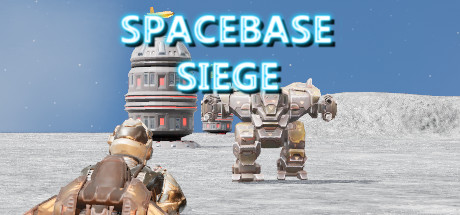

**Platforms:** Windows &nbsp;|&nbsp; **Genre:** Action, Indie, Massively Multiplayer, Strategy &nbsp;|&nbsp; **Released:** August 12

> Third person shooter with strategy elements.
>
> _Synopsis source: Steam_

[Wikipedia](https://en.wikipedia.org/wiki/Space_Siege) · [Steam](https://store.steampowered.com/app/2011170)

---

### Spectromancer

**Platforms:** Windows, iOS &nbsp;|&nbsp; **Developer:** Three Donkeys LLC, Apus Software, Jagdish Chanda &nbsp;|&nbsp; **Genre:** Turn-based strategy &nbsp;|&nbsp; **Released:** October 2008

> Open your mind and discover your power as you explore the world of Spectromancer! A turn-based online fantasy card game, co-designed by Magic: The Gathering's Richard Garfield and Alexey Stankevich, creator of Astral Tournament and Astral Masters, Spectromancer allows players to participate in a magical duel against other mages by strategically summoning creatures and casting spells.
>
> _Synopsis source: IGDB_

[Wikipedia](https://en.wikipedia.org/wiki/Spectromancer) · [IGDB](https://www.igdb.com/games/spectromancer)

---

### Spelunky

**Platforms:** Windows &nbsp;|&nbsp; **Developer:** Mossmouth &nbsp;|&nbsp; **Publisher:** Mossmouth, Microsoft Studios &nbsp;|&nbsp; **Genre:** Platform, roguelike &nbsp;|&nbsp; **Released:** December 21, 2008

> Spelunky is a cave exploration / treasure-hunting game inspired by classic platform games and roguelikes, where the goal is to grab as much treasure from the cave as possible. Every time you play the cave's layout will be different. Use your wits, your reflexes, and the items available to you to survive and go ever deeper! Perhaps at the end you may find what you're looking for...  Don't be afraid to die! But also don't be afraid to live! Happy Spelunky-ing!
>
> _Synopsis source: IGDB_

[Wikipedia](https://en.wikipedia.org/wiki/Spelunky) · [IGDB](https://www.igdb.com/games/spelunky-classic)

---

### Spider-Man: Web of Shadows

**Platforms:** Nintendo DS, PlayStation 2, PlayStation 3, PlayStation Portable, Wii, Windows, Xbox 360 &nbsp;|&nbsp; **Released:** October 21

---

### Spore

**Platforms:** macOS, Mobile phone, Nintendo DS, Windows &nbsp;|&nbsp; **Genre:** Action, Adventure, Casual, RPG, Simulation, Strategy &nbsp;|&nbsp; **Released:** September 5

> Be the architect of your own universe with Spore, an exciting single-player adventure. From Single Cell to Galactic God, evolve your creature in a universe of your own creations.
>
> _Synopsis source: Steam_

[Wikipedia](https://en.wikipedia.org/wiki/Spore_(2008_video_game)) · [Steam](https://store.steampowered.com/app/17390)

---

### Spore Creature Creator

**Platforms:** Windows, macOS &nbsp;|&nbsp; **Developer:** Maxis &nbsp;|&nbsp; **Publisher:** Electronic Arts &nbsp;|&nbsp; **Genre:** Character editor &nbsp;|&nbsp; **Released:** June 17, 2008

> The Spore Creature Creator is a software that allows players to create their own creatures with a standalone version of the Creature Editor from Spore.
>
> _Synopsis source: IGDB_

[Wikipedia](https://en.wikipedia.org/wiki/Spore_Creature_Creator) · [IGDB](https://www.igdb.com/games/spore-creature-creator)

---

### Sting: The Secret Operations

**Platforms:** Windows &nbsp;|&nbsp; **Developer:** YNK Games, YNK Korea &nbsp;|&nbsp; **Genre:** First-person shooter

[Wikipedia](https://en.wikipedia.org/wiki/Sting:_The_Secret_Operations)

---

### StoneLoops! of Jurassica

**Platforms:** Windows, macOS, iOS &nbsp;|&nbsp; **Developer:** Codeminion &nbsp;|&nbsp; **Publisher:** Game Club Cafe &nbsp;|&nbsp; **Genre:** Bubble shooter

> The rumble of grinding stones, a dinosaur's roar, meteor showers and cheers of victory. StoneLoops! calls brave explorers to visit the wild land of Jurassica. Do you have what it takes to face tough challenges and pterodactyls?
>
> _Synopsis source: IGDB_

[Wikipedia](https://en.wikipedia.org/wiki/StoneLoops!_of_Jurassica) · [IGDB](https://www.igdb.com/games/stoneloops-of-jurassica)

---

### Strategic Command WWII Pacific Theater

**Platforms:** Windows &nbsp;|&nbsp; **Developer:** Fury Software &nbsp;|&nbsp; **Publisher:** Battlefront.com &nbsp;|&nbsp; **Genre:** Turn-based strategy

[Wikipedia](https://en.wikipedia.org/wiki/Strategic_Command_WWII_Pacific_Theater)

---

### Street Fighter Online: Mouse Generation

**Platforms:** Windows &nbsp;|&nbsp; **Developer:** Daletto, Revoltech &nbsp;|&nbsp; **Genre:** Fighting

> The game uses a PC mouse for combat, and the characters are customizable to some degree. The player chooses between action-figure versions of Street Fighter characters, and licensed characters based on novels, manga and anime.
>
> _Synopsis source: IGDB_

[Wikipedia](https://en.wikipedia.org/wiki/Street_Fighter_Online:_Mouse_Generation) · [IGDB](https://www.igdb.com/games/street-fighter-online-mouse-generation)

---

### Strike Fighters 2

**Platforms:** Windows &nbsp;|&nbsp; **Developer:** Third Wire Productions &nbsp;|&nbsp; **Publisher:** Third Wire Productions &nbsp;|&nbsp; **Genre:** Flight simulation &nbsp;|&nbsp; **Released:** December 22, 2008

> Combat flight sim focusing on the early jet age, when aviation technology was still primitive but advancing rapidly, this game, along with its many standalone expansions (that can be combined into one game), encompasses the range of air combat from the mid-1950s to the late 1970s (and beyond with mods).
>
> _Synopsis source: IGDB_

[Wikipedia](https://en.wikipedia.org/wiki/Strike_Fighters_2) · [IGDB](https://www.igdb.com/games/strike-fighters-2)

---

### Strong Bad's Cool Game for Attractive People

**Platforms:** Wii, Windows &nbsp;|&nbsp; **Developer:** Telltale Games &nbsp;|&nbsp; **Publisher:** Telltale Games &nbsp;|&nbsp; **Genre:** Graphic adventure &nbsp;|&nbsp; **Released:** August 11, 2008

> You may already know Strong Bad from his regular appearances answering emails and doling out not-so-useful advice on Homestarrunner.com. Now he's the star of a five episode comedy series, Strong Bad's Cool Game for Attractive People. With all new storylines co-written by the guys from Homestarrunner.com, you'll feel like you're inside Strong Bad's world. (You may even start to talk like him!) Each episode has a different theme and you get to hang out with with Homestar, The Cheat, Bubs — the whole crew. It's like a Strong Bad cartoon on steroids. As Strong Bad would say, what the crap are you waiting for?
>
> _Synopsis source: IGDB_

[Wikipedia](https://en.wikipedia.org/wiki/Strong_Bad's_Cool_Game_for_Attractive_People) · [IGDB](https://www.igdb.com/games/strong-bads-cool-game-for-attractive-people)

---

### Subterranean Animism

**Platforms:** Windows &nbsp;|&nbsp; **Developer:** Team Shanghai Alice &nbsp;|&nbsp; **Publisher:** Team Shanghai Alice &nbsp;|&nbsp; **Genre:** Bullet hell, scrolling shooter &nbsp;|&nbsp; **Released:** August 16, 2008

[Wikipedia](https://en.wikipedia.org/wiki/Subterranean_Animism)

---

### Summer Athletics

**Platforms:** Wii, Xbox 360, PlayStation 2, Windows &nbsp;|&nbsp; **Developer:** 49Games &nbsp;|&nbsp; **Publisher:** dtp entertainment &nbsp;|&nbsp; **Genre:** Sports &nbsp;|&nbsp; **Released:** August 4, 2008

> Get ready, set, go! Summer Athletics brings the action and excitement of the 26 most popular summer sporting disciplines right into your living room! The charming 3D comic style and varying levels of difficulty makes Summer Athletics great fun for the whole family. Become fully immersed in the sporting atmosphere with vibrant visual effects and awe-inspiring sporting arenas. Customize your character to make them your very own with the comprehensive customization tools within Summer Athletics. Develop your career as a professional athlete in Career Mode or challenge your friends in head-to-head competition. The intuitive controls will make Summer Athletics both a great game for beginners and a fun challenge for the more experienced player.  Exciting competitions within more than 25 summer sports events Action-packed experience jammed full of amazing effects Two main game modes: Arcade & Simulation Unique career mode Four different difficulty levels Innovative & varied controls design Comprehensive customization tool for unique character design Special focus on the multiplayer experience
>
> _Synopsis source: IGDB_

[Wikipedia](https://en.wikipedia.org/wiki/Summer_Athletics) · [IGDB](https://www.igdb.com/games/summer-athletics)

---

### Summer Session

**Platforms:** Windows, macOS, Linux &nbsp;|&nbsp; **Developer:** Hanako Games, Tycoon Games &nbsp;|&nbsp; **Genre:** Dating simulation &nbsp;|&nbsp; **Released:** July 2, 2008

[Wikipedia](https://en.wikipedia.org/wiki/Summer_Session)

---

### Supreme Ruler 2020

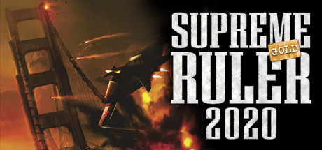

**Platforms:** Windows &nbsp;|&nbsp; **Genre:** Strategy &nbsp;|&nbsp; **Released:** June 17

> Supreme Ruler 2020 Gold contains Supreme Ruler 2020 and the expansion, Global Crisis: SUPREME RULER 2020 Overnight, the US dollar crashes AND the sound echoes across the globe. The economic crisis amplifies global instabilities and regional disputes, tearing the world asunder. Nations dissolve, economies collapse, and tensions escalate.
>
> _Synopsis source: Steam_

[Wikipedia](https://en.wikipedia.org/wiki/Supreme_Ruler_2020) · [Steam](https://store.steampowered.com/app/25910)

---

### Sweet Pool

**Platforms:** Windows &nbsp;|&nbsp; **Developer:** NITRO CHiRAL &nbsp;|&nbsp; **Publisher:** NITRO CHiRAL, JAST USA &nbsp;|&nbsp; **Genre:** BL game, visual novel, horror &nbsp;|&nbsp; **Released:** December 19, 2008

> The third Boys Love Game by Nitro+CHiRAL of Togainu no Chi fame, sweet pool begins with the return of Youji Sakiyama to his Catholic high school after being confined in hospital for a year. Suddenly he finds his life changing in unbelievable ways as his fate becomes entangled with his classmate Tetsuo Shironuma, upperclassman Zenya Okinaga and best friend Makoto Mita. Sounds like your typical school boys' love setting right? Except that this being a Nitro+ production means that the story is also infused with horror of the most potent kind. Filled to the brim with Primal Fear and Body Horror, all heightened with a brilliantly creepy soundtrack, this is definitely not a game for the faint-hearted.
>
> _Synopsis source: IGDB_

[Wikipedia](https://en.wikipedia.org/wiki/Sweet_Pool) · [IGDB](https://www.igdb.com/games/sweet-pool)

---

### Tag: The Power of Paint

**Platforms:** Windows &nbsp;|&nbsp; **Developer:** Tag Team &nbsp;|&nbsp; **Publisher:** DigiPen Institute of Technology &nbsp;|&nbsp; **Genre:** Puzzle-platform &nbsp;|&nbsp; **Released:** May 1, 2008

> The world is your canvas in this innovative first-person puzzle platformer. Tag walls and other surfaces with different colors of spray paint to reveal new ways to navigate each level, including bouncing off, sliding across, and sticking to the surfaces you paint.
>
> _Synopsis source: IGDB_

[Wikipedia](https://en.wikipedia.org/wiki/Tag:_The_Power_of_Paint) · [IGDB](https://www.igdb.com/games/tag-the-power-of-paint)

---

### Taikodom

**Platforms:** Windows &nbsp;|&nbsp; **Developer:** Hoplon Infotainment &nbsp;|&nbsp; **Publisher:** Hoplon Infotainment &nbsp;|&nbsp; **Genre:** MMOSG &nbsp;|&nbsp; **Released:** October 15, 2008

> Humanity is awakened in the year 2234, inhabited by a new space civilization. Taikodom is a Massive Multiplayer Online where players explore the farthest reaches of space by boarding starships, collecting raw materials, manufacturing crafts, and equipment. The universe is at war, it is your duty to save the universe from economic domination from fighting corporations and warring factions. The MMO Taikodom, launched in 2008, is no longer available as of May 2015.
>
> _Synopsis source: IGDB_

[Wikipedia](https://en.wikipedia.org/wiki/Taikodom) · [IGDB](https://www.igdb.com/games/taikodom)

---

### Tank Universal

**Platforms:** Windows &nbsp;|&nbsp; **Developer:** Dialogue Design &nbsp;|&nbsp; **Publisher:** Meridian4 &nbsp;|&nbsp; **Genre:** Action &nbsp;|&nbsp; **Released:** August 21, 2008

> Tank Universal creates a huge virtual 'Tron-like' world where you take part in immense 3D tank battles involving scores of units both friendly and not so friendly in wide open levels! Players can bombard the enemy from a distance or close the gap and dodge shells point blank - all in an immersive first person perspective.
>
> _Synopsis source: IGDB_

[Wikipedia](https://en.wikipedia.org/wiki/Tank_Universal) · [IGDB](https://www.igdb.com/games/tank-universal)

---

### Tayutama: Kiss on my Deity

**Platforms:** Windows &nbsp;|&nbsp; **Genre:** Adventure, Visual Novel

> Yuuri is a high school student and his father runs a shrine. He is interested in cars and motorcycles, but he thinks of succeeding him after graduation. One day, an old piece of pottery is found at his school. Students don't know what it is, but he's seen it before at his shrine. His shrine has a local legend called Tayutayu. He used to rule this area and he brought misfortune when treated badly. Yuuri, Ameri, and Sankuro think something bad will happen if they treat it mistakenly, but nobody believes them. A while later, a girl, Mashiro, comes to his school and she suddenly says to him, "Well, we can now make a dream come true!" Like this, Yuuri's school life dramatically changes. Who is Mashiro? What will happen to Yuuri?
>
> _Synopsis source: IGDB_

[Wikipedia](https://en.wikipedia.org/wiki/Tayutama:_Kiss_on_my_Deity) · [IGDB](https://www.igdb.com/games/tayutama-kiss-on-my-deity)

---

### Temporal

**Platforms:** Windows &nbsp;|&nbsp; **Developer:** Oren Bartal &nbsp;|&nbsp; **Publisher:** Oren Bartal &nbsp;|&nbsp; **Genre:** platform, puzzle &nbsp;|&nbsp; **Released:** October 2, 2008

[Wikipedia](https://en.wikipedia.org/wiki/Temporal_(video_game))

---

### Tetris Friends

**Platforms:** Windows, macOS, Linux &nbsp;|&nbsp; **Developer:** Tetris Online, Inc. &nbsp;|&nbsp; **Genre:** Puzzle &nbsp;|&nbsp; **Released:** November 21, 2008

> A browser-based online version of Tetris with leaderboards and multiple game modes. It was the only official Flash version of Tetris.
>
> _Synopsis source: IGDB_

[Wikipedia](https://en.wikipedia.org/wiki/Tetris_Friends) · [IGDB](https://www.igdb.com/games/tetris-friends)

---

### The Chronicles of Narnia: Prince Caspian

**Platforms:** Nintendo DS, PlayStation 2, PlayStation 3, PlayStation Portable, Wii, Windows, Xbox 360 &nbsp;|&nbsp; **Released:** May 13

---

### The Chronicles of Spellborn

**Platforms:** Windows &nbsp;|&nbsp; **Developer:** Spellborn International &nbsp;|&nbsp; **Publisher:** Frogster Interactive, Mindscape, Acclaim Games &nbsp;|&nbsp; **Genre:** Massively multiplayer online role-playing &nbsp;|&nbsp; **Released:** November 27, 2008

> Set within a unique post-apocalyptic fantasy universe, The Chronicles of Spellborn provides an immersive combat system along with a well fleshed out and unique storyline.
>
> _Synopsis source: IGDB_

[Wikipedia](https://en.wikipedia.org/wiki/The_Chronicles_of_Spellborn) · [IGDB](https://www.igdb.com/games/the-chronicles-of-spellborn)

---

### The Club

**Platforms:** PlayStation 3, Windows, Xbox 360 &nbsp;|&nbsp; **Genre:** Action &nbsp;|&nbsp; **Released:** February 7

> The Club™, created by critically acclaimed developer Bizarre Creations, is a new breed of third-person shooter, combining fast-paced run and gun gameplay, destructive environments, and lethal weapons. You will fight to survive in a shadowy underground blood-sport controlled by a faceless, obscenely wealthy and influential elite who place...
>
> _Synopsis source: Steam_

[Wikipedia](https://en.wikipedia.org/wiki/The_Club_(video_game)) · [Steam](https://store.steampowered.com/app/10460)

---

### The Devil on G-String

**Platforms:** Windows &nbsp;|&nbsp; **Developer:** Akabeisoft2 &nbsp;|&nbsp; **Publisher:** Akabeisoft2, Sekai Project &nbsp;|&nbsp; **Genre:** Eroge, Visual novel &nbsp;|&nbsp; **Released:** May 29, 2008

> You play the role of Azai Kyousuke, the son of a legendary gangster infamous in the underworld. You spend your time listening to Bach, playing God at school and covertly working for your stepfather, a ruthless financial heavyweight. This idyllic existence is broken when two individuals appear in the city - a beautiful girl named Usami Haru with hair you could get lost in for days, and a powerful international gangster known only as "Maou". Almost without delay, the two begin a deadly cat-and-mouse game, bringing you and your friends into the crossfire. Plotting, political intrigue and layer upon layer of interlocking traps are the weapons in this epic battle of wits.
>
> _Synopsis source: IGDB_

[Wikipedia](https://en.wikipedia.org/wiki/The_Devil_on_G-String) · [IGDB](https://www.igdb.com/games/the-devil-on-g-string)

---

### The Golden Horde

**Platforms:** Windows &nbsp;|&nbsp; **Developer:** World Forge &nbsp;|&nbsp; **Publisher:** Russobit-M, JoWooD, DreamCatcher Interactive, n3vrf41l Publishing &nbsp;|&nbsp; **Genre:** Real-time strategy &nbsp;|&nbsp; **Released:** February 1, 2008

> The Golden Horde is a real-time strategy game, based on events that took place in Central Asia, Russia and western Europe at the beginning of the XIII century.
>
> _Synopsis source: IGDB_

[Wikipedia](https://en.wikipedia.org/wiki/The_Golden_Horde_(video_game)) · [IGDB](https://www.igdb.com/games/the-golden-horde)

---

### The Graveyard

**Platforms:** Windows, macOS, iOS, Android &nbsp;|&nbsp; **Developer:** Tale of Tales &nbsp;|&nbsp; **Publisher:** Valve, Apple &nbsp;|&nbsp; **Genre:** Adventure, Indie

> The Graveyard is a very short computer game. You play an old lady who visits a graveyard. You walk around, sit on a bench and listen to a song. It's more like an explorable painting than an actual game. An experiment with poetry and storytelling but without words.  Buying the full version of The Graveyard adds only one feature, the possibility of death. The full version of the game is exactly the same as the trial, except, every time you play she may die.
>
> _Synopsis source: IGDB_

[Wikipedia](https://en.wikipedia.org/wiki/The_Graveyard_(video_game)) · [IGDB](https://www.igdb.com/games/the-graveyard)

---

### The Hardy Boys: The Hidden Theft

**Platforms:** Windows, Wii &nbsp;|&nbsp; **Developer:** XPEC Entertainment &nbsp;|&nbsp; **Publisher:** The Adventure Company &nbsp;|&nbsp; **Genre:** Adventure &nbsp;|&nbsp; **Released:** September 30, 2008

> The Hardy Boys: The Hidden Theft is a point-and-click adventure, based on the book "The Tower Treasure".
>
> _Synopsis source: IGDB_

[Wikipedia](https://en.wikipedia.org/wiki/The_Hardy_Boys:_The_Hidden_Theft) · [IGDB](https://www.igdb.com/games/the-hardy-boys-the-hidden-theft)

---

### The Immortals of Terra: A Perry Rhodan Adventure

**Platforms:** Windows &nbsp;|&nbsp; **Developer:** Braingame &nbsp;|&nbsp; **Publisher:** Koch Media, Viva Media &nbsp;|&nbsp; **Genre:** Adventure &nbsp;|&nbsp; **Released:** February 29, 2008

> The Immortals of Terra is an epic space adventure set in 1346 New Galactic Era, 4934 AD, starring Perry Rhodan. This breathtaking story takes the player from the very top of a majestic floating palace, through the midst of intergalactic intrigue, to deep below the surface of incredible alien worlds. The goal is to unravel the mystery of the disappearance of Perry's beloved, Mondra Diamond, but soon the plot thickens and the stakes get higher.
>
> _Synopsis source: IGDB_

[Wikipedia](https://en.wikipedia.org/wiki/The_Immortals_of_Terra:_A_Perry_Rhodan_Adventure) · [IGDB](https://www.igdb.com/games/the-immortals-of-terra-a-perry-rhodan-adventure)

---

### The Incredible Hulk

**Platforms:** Nintendo DS, PlayStation 2, PlayStation 3, Wii, Xbox 360, Windows &nbsp;|&nbsp; **Released:** June 5

[Wikipedia](https://en.wikipedia.org/wiki/The_Incredible_Hulk_(2008_video_game))

---

### The Lord of the Rings Online: Mines of Moria

**Platforms:** Windows &nbsp;|&nbsp; **Developer:** Turbine, Inc. &nbsp;|&nbsp; **Publisher:** Turbine, Inc., Warner Bros. Interactive Entertainment, Codemasters &nbsp;|&nbsp; **Genre:** Massively multiplayer online role-playing game &nbsp;|&nbsp; **Released:** November 18, 2008

[Wikipedia](https://en.wikipedia.org/wiki/The_Lord_of_the_Rings_Online:_Mines_of_Moria)

---

### The Lost Crown: A Ghost-Hunting Adventure

**Platforms:** Windows &nbsp;|&nbsp; **Developer:** Darkling Room, Shadow Tor Studios &nbsp;|&nbsp; **Publisher:** Got Game Entertainment, Akella, Mamba Games, Iceberg Interactive &nbsp;|&nbsp; **Genre:** Third & First-person adventure &nbsp;|&nbsp; **Released:** March 3, 2008

> Unravel an ancient mystery and search for an ancient treasure on England's fog-shrouded coastline, famed for its legends of smugglers, pirates and ghosts. Join ghost-hunters Nigel Danvers and Lucy Reubans as they investigate a tale of horror and haunting. Wielding the tools of the modern-day ghost-hunter in a cinematic, richly detailed interactive world of wind-swept coastlines and crumbling crypts, you will be captivated, taunted and teased by mind-bending puzzles and interactions with the town 'locals'. But, be warned, there are those who will stop at nothing to prevent Nigel discovering "that which should stay hidden". With nerves of steel and wits to match, in your search for The Lost Crown you will soon discover long lost secrets previously known only to the dead!
>
> _Synopsis source: IGDB_

[Wikipedia](https://en.wikipedia.org/wiki/The_Lost_Crown:_A_Ghost-Hunting_Adventure) · [IGDB](https://www.igdb.com/games/the-lost-crown)

---

### The Naked Brothers Band: The Video Game

**Platforms:** Nintendo DS, PlayStation 2, Wii, Windows &nbsp;|&nbsp; **Released:** October 20

[Wikipedia](https://en.wikipedia.org/wiki/The_Naked_Brothers_Band_(video_game))

---

### The Political Machine 2008

**Platforms:** Windows &nbsp;|&nbsp; **Developer:** Stardock &nbsp;|&nbsp; **Publisher:** Ubisoft &nbsp;|&nbsp; **Genre:** Government simulation &nbsp;|&nbsp; **Released:** June 24, 2008

> Take your place inside the Political Machine.  Tackle today's most controversial issues, battling your opponents for the hearts and minds of the American voter. Only you can take your candidate all the way to the White House.
>
> _Synopsis source: IGDB_

[Wikipedia](https://en.wikipedia.org/wiki/The_Political_Machine_2008) · [IGDB](https://www.igdb.com/games/the-political-machine-2008)

---

### The Sims 2: Apartment Life

**Platforms:** Windows &nbsp;|&nbsp; **Released:** August 26

---

### The Sims 2: FreeTime

**Platforms:** Windows &nbsp;|&nbsp; **Released:** February 28

---

### The Sims Castaway Stories

**Platforms:** Windows, macOS &nbsp;|&nbsp; **Released:** January 29

[Wikipedia](https://en.wikipedia.org/wiki/The_Sims_Castaway_Stories)

---

### The Spiderwick Chronicles

**Platforms:** Windows, Nintendo DS, PlayStation 2, Wii, Xbox 360 &nbsp;|&nbsp; **Developer:** Stormfront Studios &nbsp;|&nbsp; **Publisher:** Vivendi Games &nbsp;|&nbsp; **Genre:** Action-adventure &nbsp;|&nbsp; **Released:** February 5, 2008

> Based loosely on the events of the motion picture, The Spiderwick Chronicles puts you in control as Jared, Simon and Mallory.
>
> _Synopsis source: IGDB_

[Wikipedia](https://en.wikipedia.org/wiki/The_Spiderwick_Chronicles_(video_game)) · [IGDB](https://www.igdb.com/games/the-spiderwick-chronicles)

---

### The Spirit Engine 2

**Platforms:** Windows &nbsp;|&nbsp; **Developer:** Natomic Studios &nbsp;|&nbsp; **Genre:** Role-playing video game &nbsp;|&nbsp; **Released:** July 30, 2008

> Sequel to The Spirit Engine, this is a strong improvement on the original game's formula. Form a three person party out of nine available characters, and uncover the secrets of both the world you're exploring and your own party members.
>
> _Synopsis source: IGDB_

[Wikipedia](https://en.wikipedia.org/wiki/The_Spirit_Engine_2) · [IGDB](https://www.igdb.com/games/the-spirit-engine-2)

---

### The Tale of Despereaux

**Platforms:** Nintendo DS, Wii, PlayStation 2, Windows &nbsp;|&nbsp; **Developer:** Sensory Sweep Studios, The Fizz Factor &nbsp;|&nbsp; **Publisher:** Atari, Universal Pictures Digital Platforms Group, Warner Bros. Interactive Entertainment &nbsp;|&nbsp; **Genre:** Action &nbsp;|&nbsp; **Released:** December 2, 2008

> Small Mouse. Big Dreams. In this epic adventure, play as the courageous mouse Despereaux on a heroic quest to save the Princess Pea. Discover a magical world in this tale of bravery where the tiniest mouse finds the courage of knight in shining armor.
>
> _Synopsis source: IGDB_

[Wikipedia](https://en.wikipedia.org/wiki/The_Tale_of_Despereaux_(video_game)) · [IGDB](https://www.igdb.com/games/the-tale-of-despereaux)

---

### The Truth About 9th Company

**Platforms:** Windows &nbsp;|&nbsp; **Developer:** Extreme Developers and Kranx Productions &nbsp;|&nbsp; **Publisher:** 1C &nbsp;|&nbsp; **Genre:** First-person shooter, documentary &nbsp;|&nbsp; **Released:** February 15, 2008

> The Truth About 9th Company is the first Russian documentary computer game. The game simulates the historical battle for Hill 3234 which took place on 7–8 January 1988 in southern Afghanistan between Soviet paratroop units of the 345th Independent Guards Airborne Regiment and mujahideen.
>
> _Synopsis source: IGDB_

[Wikipedia](https://en.wikipedia.org/wiki/The_Truth_About_9th_Company) · [IGDB](https://www.igdb.com/games/the-truth-about-9th-company)

---

### The Void

**Platforms:** Windows &nbsp;|&nbsp; **Developer:** Ice-Pick Lodge &nbsp;|&nbsp; **Publisher:** ND Games, Mamba Games, Techland, Atari &nbsp;|&nbsp; **Genre:** Adventure &nbsp;|&nbsp; **Released:** April 17, 2008

> A first-person game in which after starving to death, the player wakes up in the Void, a dying land housing numerous Sisters and long-absent Brothers, all of whom subsist on Color, the essence of life in the Void. With the player's arrival, a resurgence of Color is observed in the Void, prompting the Brothers to return and subject the player to various trials so that he may also become a Brother by using and sharing Color.
>
> _Synopsis source: IGDB_

[Wikipedia](https://en.wikipedia.org/wiki/The_Void_(video_game)) · [IGDB](https://www.igdb.com/games/the-void)

---

### The Witcher: Enhanced Edition

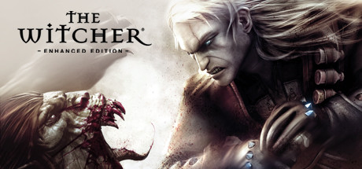

**Platforms:** Windows &nbsp;|&nbsp; **Genre:** Action, RPG &nbsp;|&nbsp; **Released:** September 16

> Become The Witcher, Geralt of Rivia, a legendary monster slayer caught in a web of intrigue woven by forces vying for control of the world. Make difficult decisions and live with the consequences in a game that will immerse you in an extraordinary tale like no other.
>
> _Synopsis source: Steam_

[Steam](https://store.steampowered.com/app/20900)

---

### The Wonderful End of the World

**Platforms:** Windows &nbsp;|&nbsp; **Developer:** Dejobaan Games &nbsp;|&nbsp; **Genre:** Action &nbsp;|&nbsp; **Released:** January 25, 2008

> You can't save the whole world. It's going to be eaten by a mythological demon with the head of a fish. But as a puppet that absorbs all it touches, you can try to rescue as much of Earth's greatness as you can before the end arrives.  In the beginning, you roam the Earth, capable of absorbing only the tiniest of objects. A glass marble you collect becomes your head, and a pair of jellybeans becomes your hands. Small creatures overwhelm you, with rats kicking you around and golden retrievers threatening to stomp you to pieces. But with every object you collect, your puppet self grows larger. Eventually, you'll become a towering behemoth with fire engines for arms and the ability to absorb entire buildings.  The Wonderful End of the World takes you through 12 unique locations, with over a thousand treasures to gather before the end comes. Steal some sweets from the candy store, where gummi fish swim in a blueberry river; visit a surrealist library to find that the words have literally leapt out of their books; and explore the Megalopolis, where you'll watch a lively end-of-the-world parade and then gobble it up before making your way to grab the tallest skyscraper ever built.
>
> _Synopsis source: IGDB_

[Wikipedia](https://en.wikipedia.org/wiki/The_Wonderful_End_of_the_World) · [IGDB](https://www.igdb.com/games/the-wonderful-end-of-the-world)

---

### TiQal

**Platforms:** Xbox 360, Windows &nbsp;|&nbsp; **Developer:** Slapdash Games &nbsp;|&nbsp; **Publisher:** Microsoft Game Studios &nbsp;|&nbsp; **Genre:** Puzzle game &nbsp;|&nbsp; **Released:** March 26, 2008

> Tinker is an isometric puzzle game released originally as part of the Windows Vista Ultimate Extras program, then re-released and upgraded as a free Games For Windows - LIVE title for their Games On Demand service.
>
> _Synopsis source: IGDB_

[Wikipedia](https://en.wikipedia.org/wiki/TiQal) · [IGDB](https://www.igdb.com/games/tiqal)

---

### Tom Clancy's Rainbow Six: Vegas 2

**Platforms:** PlayStation 3, Windows, Xbox 360 &nbsp;|&nbsp; **Genre:** Action &nbsp;|&nbsp; **Released:** March 18

> Tom Clancy's Rainbow Six® Vegas 2 - the sequel to the award-winning next-generation first-person shooter - returns to Sin City. Tom Clancy's Rainbow Six Vegas 2 is your last chance to rescue America's sexiest city from an escalating terrorist siege that will force you into heart-pounding action from beginning to end.
>
> _Synopsis source: Steam_

[Steam](https://store.steampowered.com/app/15120)

---

### Tomb Raider: Underworld

**Platforms:** Nintendo DS, PlayStation 2, PlayStation 3, Wii, Windows, Xbox 360 &nbsp;|&nbsp; **Genre:** Action, Adventure &nbsp;|&nbsp; **Released:** November 18

> Tomb Raider: Underworld represents a new advancement in exploration-based gameplay. As fearless adventurer Lara Croft explore exotic locations around the world, each designed with an incredible attention to detail resulting in breathtaking high-definition visual fidelity that creates a truly believable world and delivers a new level of...
>
> _Synopsis source: Steam_

[Steam](https://store.steampowered.com/app/8140)

---

### Top Trumps: Doctor Who

**Platforms:** Mobile phone, Nintendo DS, PlayStation 2, Windows, Wii &nbsp;|&nbsp; **Developer:** Team 3 Games, Rockpool Games &nbsp;|&nbsp; **Publisher:** Eidos Interactive &nbsp;|&nbsp; **Genre:** Card game &nbsp;|&nbsp; **Released:** May 16, 2008

> Eidos creates a virtual version of the card game populated by the weird denizens of Dr. Who.
>
> _Synopsis source: IGDB_

[Wikipedia](https://en.wikipedia.org/wiki/Top_Trumps:_Doctor_Who) · [IGDB](https://www.igdb.com/games/top-trumps-doctor-who)

---

### TrackMania Nations Forever

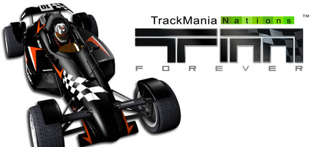

**Platforms:** Windows &nbsp;|&nbsp; **Genre:** Racing &nbsp;|&nbsp; **Released:** April 16

> A free game in the truest sense of the word, TrackMania Nations Forever lets you drive at mind-blowing speeds on fun and spectacular tracks in solo and multiplayer modes.TrackMania Nations Forever offers a new &quot;Forever&quot; version of the Stadium environment, a solid solo mode and 65 brand new, progressively challenging tracks.
>
> _Synopsis source: Steam_

[Wikipedia](https://en.wikipedia.org/wiki/TrackMania_Nations_Forever) · [Steam](https://store.steampowered.com/app/11020)

---

### Trials 2: Second Edition

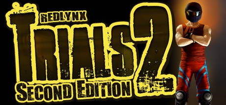

**Platforms:** Windows &nbsp;|&nbsp; **Genre:** Indie, Racing, Sports &nbsp;|&nbsp; **Released:** March 1

> RedLynx Trials 2 Second Edition is a spectacular motorcycle game featuring stunning graphics and addictive gameplay! 4 game types (race, flip, wheelie, dynamic)Race: Race against other players to compete levels as fast as possibleFlip: Try to make as many backflips or frontflips with your bikeWheelie: Drive on your backwheel for longest...
>
> _Synopsis source: Steam_

[Steam](https://store.steampowered.com/app/16600)

---

### Turning Point: Fall of Liberty

**Platforms:** PlayStation 3, Windows, Xbox 360 &nbsp;|&nbsp; **Released:** February 26

---

### Turok

**Platforms:** PlayStation 3, Xbox 360, Windows &nbsp;|&nbsp; **Genre:** Action, Adventure &nbsp;|&nbsp; **Released:** February 5

> Play as the legendary Turok warriors to face off against ferocious dinosaurs and a terrifying alien threat that seeks to destroy all human life across the galaxy.
>
> _Synopsis source: Steam_

[Wikipedia](https://en.wikipedia.org/wiki/Turok_(2008_video_game)) · [Steam](https://store.steampowered.com/app/1967610)

---

### Twelve Sky 2

**Platforms:** Windows &nbsp;|&nbsp; **Developer:** BEGA Games &nbsp;|&nbsp; **Publisher:** Genius Orc Entertainment, Red Fox Games &nbsp;|&nbsp; **Genre:** Fantasy MMORPG

> Set in Ancient China, players are thrown into an age old conflict between three warring Clans. Centered on the reemergence of a new faction, players must fight for the honor of their brothers or turn their backs in their hour of need.
>
> _Synopsis source: IGDB_

[Wikipedia](https://en.wikipedia.org/wiki/Twelve_Sky_2) · [IGDB](https://www.igdb.com/games/twelve-sky-2)

---

### Twinity

**Platforms:** Windows &nbsp;|&nbsp; **Developer:** Metaversum GmbH, ExitReality &nbsp;|&nbsp; **Genre:** Massively multiplayer online social game &nbsp;|&nbsp; **Released:** September 5, 2008

[Wikipedia](https://en.wikipedia.org/wiki/Twinity)

---

### UEFA Euro 2008

**Platforms:** Windows, PlayStation 2, PlayStation 3, PlayStation Portable, Xbox 360 &nbsp;|&nbsp; **Developer:** EA Canada, HB Studios &nbsp;|&nbsp; **Publisher:** EA Sports &nbsp;|&nbsp; **Genre:** Sports &nbsp;|&nbsp; **Released:** April 17, 2008

> UEFA EURO 2008 will feature stunning visual representations of the world's most famous football players, playing in a more accessible, faster paced and responsive version of the market-leading EA SPORTS football engine, and all of the teams and official stadiums that will be part of UEFA EURO 2008. The videogame will enable gamers to play as their favorite country from qualification right through to a virtual reproduction of the championship tournament. Take on the challenge of leading one of over 50 European national teams to glory as UEFA EURO 2008 recreates all the drama and excitement of the official tournament. « less
>
> _Synopsis source: IGDB_

[Wikipedia](https://en.wikipedia.org/wiki/UEFA_Euro_2008_(video_game)) · [IGDB](https://www.igdb.com/games/uefa-euro-2008)

---

### Universe Sandbox

**Platforms:** Windows, macOS, Linux &nbsp;|&nbsp; **Developer:** Giant Army &nbsp;|&nbsp; **Publisher:** Giant Army &nbsp;|&nbsp; **Genre:** Simulation &nbsp;|&nbsp; **Released:** May 2008

> Create and destroy on an unimaginable scale... with a space simulator that merges real-time gravity, climate, collision, and material interactions to reveal the beauty of our universe and the fragility of our planet. Includes VR support for HTC Vive, Oculus Rift+Touch, and Windows Mixed Reality.
>
> _Synopsis source: IGDB_

[Wikipedia](https://en.wikipedia.org/wiki/Universe_Sandbox) · [IGDB](https://www.igdb.com/games/universe-sandbox)

---

### Unknown Horizons

**Platforms:** Windows, Linux &nbsp;|&nbsp; **Developer:** The Unknown Horizons Team &nbsp;|&nbsp; **Genre:** City-building, real-time strategy &nbsp;|&nbsp; **Released:** October 2008

[Wikipedia](https://en.wikipedia.org/wiki/Unknown_Horizons)

---

### Violet

**Platforms:** Browser, Linux, macOS, Windows &nbsp;|&nbsp; **Developer:** Jeremy Freese &nbsp;|&nbsp; **Publisher:** Jeremy Freese &nbsp;|&nbsp; **Genre:** Interactive Fiction, Adventure

> Calm down. All you have to do is write a thousand words and everything will be fine. And you have all day, except it's already noon. A piece of interactive fiction written by Jeremy Freese.
>
> _Synopsis source: IGDB_

[Wikipedia](https://en.wikipedia.org/wiki/Violet_(video_game)) · [IGDB](https://www.igdb.com/games/violet)

---

### WALL-E

**Platforms:** Nintendo DS, PlayStation 2, PlayStation 3, PlayStation Portable, Wii, Windows, Xbox 360 &nbsp;|&nbsp; **Released:** June 24

[Wikipedia](https://en.wikipedia.org/wiki/WALL-E_(video_game))

---

### Warhammer 40,000: Dawn of War: Soulstorm

**Platforms:** Windows &nbsp;|&nbsp; **Released:** March 5

---

### Warhammer Online: Age of Reckoning

**Platforms:** Windows &nbsp;|&nbsp; **Released:** September 18

---

### Warspear Online

**Platforms:** iOS, Android, macOS, Windows, Linux &nbsp;|&nbsp; **Genre:** MMORPG &nbsp;|&nbsp; **Released:** June 12, 2008

[Wikipedia](https://en.wikipedia.org/wiki/Warspear_Online)

---

### White Gold: War in Paradise

**Platforms:** Windows &nbsp;|&nbsp; **Developer:** Deep Shadows &nbsp;|&nbsp; **Publisher:** CIS: Russobit-M &nbsp;|&nbsp; **Genre:** First-person shooter, role playing &nbsp;|&nbsp; **Released:** October 24, 2008

> Caribbean islands; islands full of secrets, mystery and the spirit of romance. These islands are both beautiful and lethally dangerous. Centuries ago the waters of this region were teeming with pirates and adventurers... and frankly, not much has changed since then. Many books have been written about the Caribbean basin and many films have depicted it. Now you have a unique chance to visit these places yourself and personally witness the everyday life of drug-dealers, bandits and the Mafioso. You'll be able to take part in various mysterious events and get involved in fights between various hostile forces, or just admire the luscious tropical environment while drinking the traditional pirate's liquor - rum. The Caribs are waiting for you!
>
> _Synopsis source: IGDB_

[Wikipedia](https://en.wikipedia.org/wiki/White_Gold:_War_in_Paradise) · [IGDB](https://www.igdb.com/games/xenus-2-white-gold)

---

### Wings Over Israel

**Platforms:** Windows &nbsp;|&nbsp; **Developer:** Third Wire Productions &nbsp;|&nbsp; **Publisher:** Third Wire Productions &nbsp;|&nbsp; **Genre:** Flight simulation &nbsp;|&nbsp; **Released:** February 18, 2008

[Wikipedia](https://en.wikipedia.org/wiki/Wings_Over_Israel)

---

### Winning Post 7 Maximum 2008

**Platforms:** PlayStation 3, PlayStation 2, Wii, Windows &nbsp;|&nbsp; **Developer:** Koei &nbsp;|&nbsp; **Publisher:** Koei &nbsp;|&nbsp; **Genre:** Horse racing &nbsp;|&nbsp; **Released:** March 13, 2008

> A horse-racing management sim focused on breeding, training, and racing to produce champion thoroughbreds. Players balance detailed pedigree and bloodline systems, training plans, and race tactics across seasonal competitions, with expanded race conditions, track variety, and deeper jockey/horse interactions.
>
> _Synopsis source: IGDB_

[Wikipedia](https://en.wikipedia.org/wiki/Winning_Post_7_Maximum_2008) · [IGDB](https://www.igdb.com/games/winning-post-7-maximum-2008)

---

### Wizard101

**Platforms:** Windows, macOS, Xbox &nbsp;|&nbsp; **Developer:** KingsIsle Entertainment &nbsp;|&nbsp; **Publisher:** KingsIsle Entertainment &nbsp;|&nbsp; **Genre:** Massively multiplayer online role-playing game &nbsp;|&nbsp; **Released:** September 2, 2008

> Wizard101 is a 2008 massively multiplayer online role-playing game created by KingsIsle Entertainment. In the game, players take on the role of students of Ravenwood School of Magical Arts in order to save the Spiral, the fictional galaxy in which the game is set, from various threats.
>
> _Synopsis source: IGDB_

[Wikipedia](https://en.wikipedia.org/wiki/Wizard101) · [IGDB](https://www.igdb.com/games/wizard101)

---

### World of Goo

**Platforms:** Wii, Windows &nbsp;|&nbsp; **Publisher:** 2D Boy &nbsp;|&nbsp; **Genre:** Indie &nbsp;|&nbsp; **Released:** October 13, 2008

> World of Goo is a multiple award winning physics based puzzle / construction game made entirely by two guys.
>
> _Synopsis source: Steam_

[Wikipedia](https://en.wikipedia.org/wiki/World_of_Goo) · [Steam](https://store.steampowered.com/app/22000)

---

### World of Warcraft: Wrath of the Lich King

**Platforms:** Windows, macOS &nbsp;|&nbsp; **Publisher:** Blizzard Entertainment &nbsp;|&nbsp; **Released:** November 13, 2008

---

### World War One

**Platforms:** Windows &nbsp;|&nbsp; **Developer:** AGEOD &nbsp;|&nbsp; **Publisher:** Ascaron Entertainment &nbsp;|&nbsp; **Genre:** Strategy &nbsp;|&nbsp; **Released:** November 14, 2008

[Wikipedia](https://en.wikipedia.org/wiki/World_War_One_(video_game))

---

### X3: Terran Conflict

**Platforms:** Windows &nbsp;|&nbsp; **Genre:** Action, Simulation, Strategy &nbsp;|&nbsp; **Released:** October 16

> It is the year 2938. The long wished-for encounter of the X Universe and the Earth holds both joy and sorrow for the people. Despite flourishing trade, the clash of the diverse races, cultures and life forms creates new tensions, mistrust and open conflict that need to be overcome!
>
> _Synopsis source: Steam_

[Steam](https://store.steampowered.com/app/2820)

---

### Yo Frankie!

**Platforms:** Linux, macOS, Windows &nbsp;|&nbsp; **Developer:** Blender Institute &nbsp;|&nbsp; **Genre:** Platform &nbsp;|&nbsp; **Released:** November 14, 2008

> Yo Frankie! is an open source video game based on the universe and characters of the free film produced in 2008, Big Buck Bunny.
>
> _Synopsis source: IGDB_

[Wikipedia](https://en.wikipedia.org/wiki/Yo_Frankie!) · [IGDB](https://www.igdb.com/games/yo-frankie)

---

### Zak McKracken: Between Time and Space

**Platforms:** Windows, macOS, Linux &nbsp;|&nbsp; **Developer:** Artificial Hair Bros. &nbsp;|&nbsp; **Publisher:** Artificial Hair Bros. &nbsp;|&nbsp; **Genre:** Point-and-click adventure &nbsp;|&nbsp; **Released:** April 20, 2008

> Zak McKracken: Between Time and Space is a point-and-click adventure game, originally released in 2008. It is an unofficial fan sequel of the 1988 adventure game Zak McKracken and the Alien Mindbenders by LucasArts. It was developed without the involvement or approval of the latter. It contains numerous references to the original game, including easter eggs.
>
> _Synopsis source: IGDB_

[Wikipedia](https://en.wikipedia.org/wiki/Zak_McKracken:_Between_Time_and_Space) · [IGDB](https://www.igdb.com/games/zak-mckracken-between-time-and-space)

---

### Zwei: The Ilvard Insurrection

**Platforms:** Windows &nbsp;|&nbsp; **Developer:** Nihon Falcom &nbsp;|&nbsp; **Publisher:** Xseed Games, Nihon Falcom &nbsp;|&nbsp; **Genre:** Action role-playing game &nbsp;|&nbsp; **Released:** September 25, 2008

> In a world where magic and technology exist side by side, vampire princess Alwen must reclaim her ancestral castle and her magic alongside her unlikely ally, treasure hunter Ragna Valentine. They may make for an odd pair, but when they combine their talents, the sky’s the limit!
>
> _Synopsis source: IGDB_

[Wikipedia](https://en.wikipedia.org/wiki/Zwei:_The_Ilvard_Insurrection) · [IGDB](https://www.igdb.com/games/zwei-the-ilvard-insurrection)

---
