# Windows — 2009

[← All Windows years](../windows.md) · [Full 2009 page](../../years/2009.md)

148 Windows titles in 2009.

### 51seer

**Platforms:** Windows &nbsp;|&nbsp; **Released:** December 7

---

### AaaaaAAaaaAAAaaAAAAaAAAAA!!! – A Reckless Disregard for Gravity

**Platforms:** Windows &nbsp;|&nbsp; **Released:** September 3

[Wikipedia](https://en.wikipedia.org/wiki/AaaaaAAaaaAAAaaAAAAaAAAAA!!!_%E2%80%93_A_Reckless_Disregard_for_Gravity)

---

### Adam's Venture: The Search for the Lost Garden

**Platforms:** Windows &nbsp;|&nbsp; **Released:** June 22

[Wikipedia](https://en.wikipedia.org/wiki/Adam%27s_Venture)

---

### Aion: The Tower of Eternity

**Platforms:** Windows &nbsp;|&nbsp; **Released:** September 22

---

### Alganon

**Platforms:** Windows &nbsp;|&nbsp; **Released:** December 1

---

### Anno 1404

**Platforms:** Windows, Nintendo DS, Wii &nbsp;|&nbsp; **Released:** June 23

[Wikipedia](https://en.wikipedia.org/wiki/Anno_1404)

---

### ArmA 2

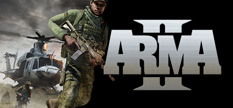

**Platforms:** Windows &nbsp;|&nbsp; **Genre:** Action, Simulation, Strategy &nbsp;|&nbsp; **Released:** July 7

> Building on 10 years of constant engine development, ARMA II boasts the most realistic combat environment in the world. It models real world ballistics &amp; round deflection, materials penetration, features a realtime day/night cycle and dynamic wind, weather and environmental effects.
>
> _Synopsis source: Steam_

[Wikipedia](https://en.wikipedia.org/wiki/ArmA_2) · [Steam](https://store.steampowered.com/app/33900)

---

### Ashes Cricket 2009

**Platforms:** PlayStation 3, Windows, Xbox 360, Wii &nbsp;|&nbsp; **Released:** August 7

[Wikipedia](https://en.wikipedia.org/wiki/Ashes_Cricket_2009)

---

### Batman: Arkham Asylum

**Platforms:** Xbox 360, PlayStation 3, Windows &nbsp;|&nbsp; **Publisher:** Eidos Interactive &nbsp;|&nbsp; **Genre:** Action, Adventure &nbsp;|&nbsp; **Released:** August 25, 2009

> Experience what it’s like to be Batman and face off against Gotham's greatest villians. Explore every inch of Arkham Asylum and roam freely on the infamous island.
>
> _Synopsis source: Steam_

[Steam](https://store.steampowered.com/app/35140)

---

### Battlefield Heroes

**Platforms:** Windows &nbsp;|&nbsp; **Released:** June 25

[Wikipedia](https://en.wikipedia.org/wiki/Battlefield_Heroes)

---

### BattleForge

**Platforms:** Windows &nbsp;|&nbsp; **Released:** March 23

[Wikipedia](https://en.wikipedia.org/wiki/BattleForge)

---

### Battlestations: Pacific

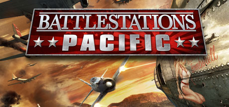

**Platforms:** Windows, Xbox 360 &nbsp;|&nbsp; **Genre:** Action, Strategy &nbsp;|&nbsp; **Released:** May 12

> Experience one war through two epic sagas where you will be a part of history or change it. Feel the power of the historically authentic and decisive battles of the Pacific War. Relive some of the grandest and most critical naval battles of recent history and for the first time, choose to lead your fleet to a completely different ending...
>
> _Synopsis source: Steam_

[Steam](https://store.steampowered.com/app/8170)

---

### Bionic Commando

**Platforms:** PlayStation 3, Xbox 360, Windows &nbsp;|&nbsp; **Genre:** Action, Adventure &nbsp;|&nbsp; **Released:** May 19

> The first true sequel to the classic 1988 Nintendo Entertainment System original, Bionic Commando sees the return of the bionically-enhanced Nathan &quot;R.A.D.&quot; Spencer. Time has not been kind to Spencer: Five years after his heroic defeat of the Imperials, he has been betrayed by the government he swore to serve, imprisoned for...
>
> _Synopsis source: Steam_

[Wikipedia](https://en.wikipedia.org/wiki/Bionic_Commando_(2009_video_game)) · [Steam](https://store.steampowered.com/app/21670)

---

### Blood Bowl

**Platforms:** PlayStation 3, Windows, Xbox 360 &nbsp;|&nbsp; **Released:** June 26

[Wikipedia](https://en.wikipedia.org/wiki/Blood_Bowl_(2009_video_game))

---

### Borderlands

**Platforms:** PlayStation 3, Xbox 360, Windows &nbsp;|&nbsp; **Released:** October 20

[Wikipedia](https://en.wikipedia.org/wiki/Borderlands_(video_game))

---

### Braid

**Platforms:** PlayStation 3, Windows, PlayStation Network &nbsp;|&nbsp; **Publisher:** Number None &nbsp;|&nbsp; **Genre:** Casual, Indie, Strategy &nbsp;|&nbsp; **Released:** November 12, 2009

> This is the original version of Braid from 2009, which may not work well on newer systems. For an updated version of the game with nicer graphics, more levels and a large amount of developer commentary, see Braid, Anniversary Edition.
>
> _Synopsis source: Steam_

[Wikipedia](https://en.wikipedia.org/wiki/Braid_(video_game)) · [Steam](https://store.steampowered.com/app/26800)

---

### Burnout Paradise: The Ultimate Box

**Platforms:** Windows, PlayStation 3, Xbox 360 &nbsp;|&nbsp; **Publisher:** Electronic Arts &nbsp;|&nbsp; **Released:** February 5, 2009

[Wikipedia](https://en.wikipedia.org/wiki/Burnout_Paradise)

---

### Call of Duty: Modern Warfare 2

**Platforms:** Xbox 360, PlayStation 3, Windows &nbsp;|&nbsp; **Publisher:** Activision &nbsp;|&nbsp; **Genre:** Action &nbsp;|&nbsp; **Released:** November 10, 2009

> The most-anticipated game of the year and the sequel to the best-selling first-person action game of all time, Modern Warfare 2 continues the gripping and heart-racing action as players face off against a new threat dedicated to bringing the world to the brink of collapse.
>
> _Synopsis source: Steam_

[Steam](https://store.steampowered.com/app/10180)

---

### Call of Juarez: Bound in Blood

**Platforms:** PlayStation 3, Windows, Xbox 360 &nbsp;|&nbsp; **Genre:** Action &nbsp;|&nbsp; **Released:** June 30

> THE OLD WEST, 1864. In order to save their family, the McCall brothers will kill anyone who stands between them and the legendary Gold of Juarez.
>
> _Synopsis source: Steam_

[Steam](https://store.steampowered.com/app/21980)

---

### CellFactor: Psychokinetic Wars

**Platforms:** PlayStation Network, Xbox 360, Windows &nbsp;|&nbsp; **Released:** June 1

---

### Champions Online

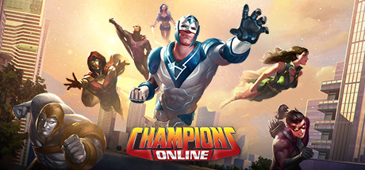

**Platforms:** Windows &nbsp;|&nbsp; **Genre:** Massively Multiplayer, RPG, Free To Play &nbsp;|&nbsp; **Released:** September 1

> Grab your cape and defend Millennium City in this comic book-style action MMORPG! Design your hero and costume from thousands of costume pieces, face super-villains like Dr. Destroyer, and create your own unique nemesis.
>
> _Synopsis source: Steam_

[Wikipedia](https://en.wikipedia.org/wiki/Champions_Online) · [Steam](https://store.steampowered.com/app/9880)

---

### Cities XL

**Platforms:** Windows &nbsp;|&nbsp; **Released:** October 9

[Wikipedia](https://en.wikipedia.org/wiki/Cities_XL)

---

### Codename Panzers: Cold War

**Platforms:** Windows &nbsp;|&nbsp; **Genre:** Simulation, Strategy &nbsp;|&nbsp; **Released:** March 13

> Tempelhof, Berlin, dawn of 8th April 1949.A major armed conflict is brewing between the Western powers and the Soviet bloc. The Red Army has been growing ever stronger since the end of World War II. With the growth of their army the Soviets realize that they hold the advantage, and are only waiting for the right moment to attack.
>
> _Synopsis source: Steam_

[Steam](https://store.steampowered.com/app/9850)

---

### Colin McRae: Dirt 2

**Platforms:** Windows, Xbox 360, PlayStation 3, PlayStation Portable, Wii, Nintendo DS &nbsp;|&nbsp; **Publisher:** Codemasters &nbsp;|&nbsp; **Released:** December 4, 2009

---

### Command & Conquer Red Alert 3: Uprising

**Platforms:** Windows &nbsp;|&nbsp; **Genre:** Action, Strategy &nbsp;|&nbsp; **Released:** March 12

> Red Alert 3: Uprising features four new mini-campaigns, giving players a deeper dive into the storyline's of the Soviets, the Allies, the Empire of the Rising Sun and a unique campaign centered on the origins of everyone’s favorite psionic Japanese schoolgirl commando, Yuriko Omega.
>
> _Synopsis source: Steam_

[Steam](https://store.steampowered.com/app/24800)

---

### Company of Heroes: Tales of Valor

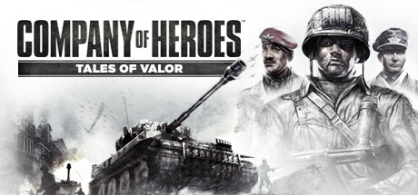

**Platforms:** Windows &nbsp;|&nbsp; **Genre:** Strategy &nbsp;|&nbsp; **Released:** April 9

> Company of Heroes®: Tales of Valor™ is the expansion to the Game of the Year winner and highest rated real time strategy franchise Company of Heroes®. Featuring new campaigns to overcome, units to command, and battlefields to conquer, Company of Heroes®: Tales of Valor™ delivers evolved gameplay mechanics and 3 episodic adventures...
>
> _Synopsis source: Steam_

[Steam](https://store.steampowered.com/app/20540)

---

### Damnation

**Platforms:** Windows, PlayStation 3, Xbox 360 &nbsp;|&nbsp; **Genre:** Action, Adventure, Indie &nbsp;|&nbsp; **Released:** May 26

> Damnation84 is a fast-paced FPS game that uses impulse and propulsion weapons as a means of movement and combat. In this devastated world, eliminate enemies in sequence and complete the levels before your oxygen runs out. You are the last hope, survive and cause damnation.
>
> _Synopsis source: Steam_

[Wikipedia](https://en.wikipedia.org/wiki/Damnation_(video_game)) · [Steam](https://store.steampowered.com/app/4418990)

---

### Dark Salvation

**Platforms:** Windows &nbsp;|&nbsp; **Released:** July 28

[Wikipedia](https://en.wikipedia.org/wiki/Dark_Salvation)

---

### Dark Sector

**Platforms:** Windows &nbsp;|&nbsp; **Genre:** Action &nbsp;|&nbsp; **Released:** March 23

> A third-person Action/Shooter that thrusts players into a sci-fi flavored nightmare scenario set in the post Cold War era.
>
> _Synopsis source: Steam_

[Wikipedia](https://en.wikipedia.org/wiki/Dark_Sector) · [Steam](https://store.steampowered.com/app/29900)

---

### Darkest of Days

**Platforms:** Windows, Xbox 360 &nbsp;|&nbsp; **Released:** September 8

[Wikipedia](https://en.wikipedia.org/wiki/Darkest_of_Days)

---

### Death to Spies: Moment of Truth

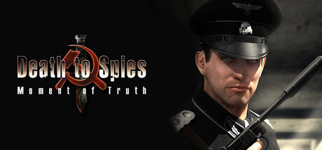

**Platforms:** Windows &nbsp;|&nbsp; **Genre:** Action &nbsp;|&nbsp; **Released:** August 10

> The Most Mysterious Secret Service Agency of WWII This is a third-person stealth-action game describing the activities of the SMERSH, the most mysterious secret service agency of World War II. Moment of Truth is a sequel to the popular stealth action title Death to Spies.
>
> _Synopsis source: Steam_

[Steam](https://store.steampowered.com/app/34410)

---

### Demigod

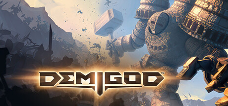

**Platforms:** Windows &nbsp;|&nbsp; **Genre:** Action, Indie, RPG, Strategy &nbsp;|&nbsp; **Released:** April 14

> Set in a magical world where gods walk among mortals, Demigod blends action, strategy and role-playing elements into a thrilling new experience.
>
> _Synopsis source: Steam_

[Wikipedia](https://en.wikipedia.org/wiki/Demigod_(video_game)) · [Steam](https://store.steampowered.com/app/202710)

---

### Disciples III: Renaissance

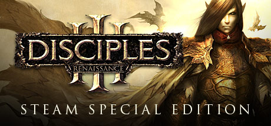

**Platforms:** Windows &nbsp;|&nbsp; **Genre:** RPG, Strategy &nbsp;|&nbsp; **Released:** November 12

> Disciples III: Renaissance is the next title in the award-winning Disciples series and represents a leap forward in the evolution of the turn-based strategy RPG genre.
>
> _Synopsis source: Steam_

[Steam](https://store.steampowered.com/app/33670)

---

### Dragon Age: Origins

**Platforms:** Windows, PlayStation 3, Xbox 360 &nbsp;|&nbsp; **Publisher:** Electronic Arts &nbsp;|&nbsp; **Genre:** RPG &nbsp;|&nbsp; **Released:** November 3, 2009

> Explore a stunning world, make complex moral choices, and engage in bone-crushing combat against massive and terrifying creatures. The Ultimate Edition includes Dragon Age: Origins, Dragon Age: Origins - Awakening and all nine content packs.
>
> _Synopsis source: Steam_

[Steam](https://store.steampowered.com/app/47810)

---

### Dream Chronicles: The Chosen Child

**Platforms:** Windows &nbsp;|&nbsp; **Released:** April 16

---

### Dreamkiller

**Platforms:** Windows &nbsp;|&nbsp; **Released:** October 12

[Wikipedia](https://en.wikipedia.org/wiki/Dreamkiller_(video_game))

---

### Earthworm Jim 2

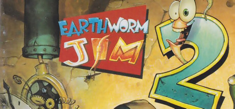

**Platforms:** Windows &nbsp;|&nbsp; **Genre:** Action, Adventure &nbsp;|&nbsp; **Released:** November 4

> Earthworm Jim is back with more side-scrolling platform action. Whip, run, jump, fly, and Snott swing your way to victory!
>
> _Synopsis source: Steam_

[Wikipedia](https://en.wikipedia.org/wiki/Earthworm_Jim_2) · [Steam](https://store.steampowered.com/app/38490)

---

### East India Company

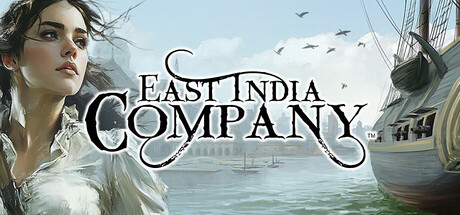

**Platforms:** Windows &nbsp;|&nbsp; **Genre:** Strategy &nbsp;|&nbsp; **Released:** July 31

> Trade exotic goods, command fleets, and dominate 17th-century seas. This blend of real-time strategy and naval warfare lets you build a trading empire across Europe and Asia. Strategize trade routes, engage in epic naval battles, and expand your influence to become the ultimate maritime force.
>
> _Synopsis source: Steam_

[Wikipedia](https://en.wikipedia.org/wiki/East_India_Company_(video_game)) · [Steam](https://store.steampowered.com/app/25930)

---

### Elven Legacy

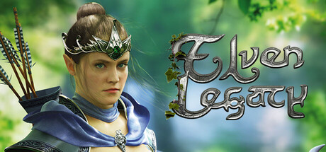

**Platforms:** Windows &nbsp;|&nbsp; **Genre:** RPG, Strategy &nbsp;|&nbsp; **Released:** April 7

> This sequel to Fantasy Wars continues its story after banishing the archdemon. The shadows of destruction begin to loom on the horizon once a human mage uncovers a dark and powerful secret dating back to the remote past of the Elven race.
>
> _Synopsis source: Steam_

[Wikipedia](https://en.wikipedia.org/wiki/Elven_Legacy) · [Steam](https://store.steampowered.com/app/25850)

---

### Empire: Total War

**Platforms:** Windows &nbsp;|&nbsp; **Publisher:** Sega &nbsp;|&nbsp; **Released:** March 3, 2009

---

### Eufloria

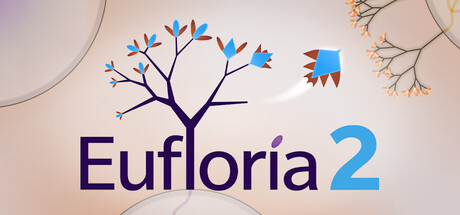

**Platforms:** Windows &nbsp;|&nbsp; **Genre:** Action, Casual, Indie, Simulation, Strategy &nbsp;|&nbsp; **Released:** October 20

> Eufloria 2 is the sequel to 2009's indie hit &quot;Eufloria&quot;, featuring major gameplay additions and innovations, and a powerful level editor. Intergalactic floral conquest has EVOLVED to the next level!
>
> _Synopsis source: Steam_

[Wikipedia](https://en.wikipedia.org/wiki/Eufloria) · [Steam](https://store.steampowered.com/app/4415060)

---

### EVE Online: Special Edition

**Platforms:** Windows &nbsp;|&nbsp; **Publisher:** Atari &nbsp;|&nbsp; **Released:** March 10, 2009

[Wikipedia](https://en.wikipedia.org/wiki/Eve_Online)

---

### F.E.A.R. 2: Project Origin

**Platforms:** PlayStation 3, Windows, Xbox 360 &nbsp;|&nbsp; **Genre:** Action &nbsp;|&nbsp; **Released:** February 10

> Assume the role of Special Forces Sgt. Becket as your routine mission quickly turns into a fight for survival against the wrath of Alma Wade. As Alma's terrifying power surges out of control, your squad is forced to battle through an apocalyptic landscape in search of clues for how to destroy her!
>
> _Synopsis source: Steam_

[Steam](https://store.steampowered.com/app/16450)

---

### Fallen Earth

**Platforms:** Windows &nbsp;|&nbsp; **Released:** September 22

[Wikipedia](https://en.wikipedia.org/wiki/Fallen_Earth)

---

### FIFA 10

**Platforms:** PlayStation 3, Windows, Xbox 360 &nbsp;|&nbsp; **Released:** October 20

[Wikipedia](https://en.wikipedia.org/wiki/FIFA_10)

---

### Football Manager 2010

**Platforms:** Windows &nbsp;|&nbsp; **Publisher:** Sega &nbsp;|&nbsp; **Released:** October 30, 2009

[Wikipedia](https://en.wikipedia.org/wiki/Football_Manager_2010)

---

### Freaky Creatures

**Platforms:** Windows &nbsp;|&nbsp; **Released:** March 24

---

### Fuel

**Platforms:** PlayStation 3, Xbox 360, Windows &nbsp;|&nbsp; **Released:** June 2

[Wikipedia](https://en.wikipedia.org/wiki/Fuel_(2009_video_game))

---

### Ghostbusters: The Video Game

**Platforms:** Nintendo DS, PlayStation 2, PlayStation 3, Wii, Windows, Xbox 360, PlayStation Portable &nbsp;|&nbsp; **Released:** June 16

---

### Grand Ages: Rome

**Platforms:** Windows &nbsp;|&nbsp; **Genre:** Simulation, Strategy &nbsp;|&nbsp; **Released:** March 17

> As Governor of a Roman Province in the time-honoured Roman Empire, its fortune very much lies in your hands. Choose one of five Roman noble families such as Caesar’s Julii with different abilities to accomplish the comprehensive missions.
>
> _Synopsis source: Steam_

[Steam](https://store.steampowered.com/app/23450)

---

### Grey's Anatomy: The Video Game

**Platforms:** Windows, Nintendo DS, PlayStation 3, Wii, Xbox 360 &nbsp;|&nbsp; **Released:** March 10

---

### Guitar Hero World Tour

**Platforms:** Windows &nbsp;|&nbsp; **Released:** July 26

[Wikipedia](https://en.wikipedia.org/wiki/Guitar_Hero_World_Tour)

---

### Harry Potter and the Half Blood Prince

**Platforms:** macOS, Windows, Nintendo DS, PlayStation 2, PlayStation 3, PlayStation Portable, Wii, Xbox 360 &nbsp;|&nbsp; **Released:** June 30

[Wikipedia](https://en.wikipedia.org/wiki/Harry_Potter_and_the_Half-Blood_Prince_(video_game))

---

### Hearts of Iron III

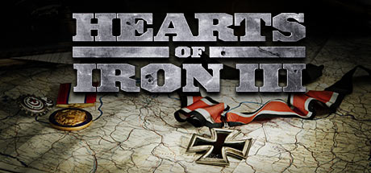

**Platforms:** Windows &nbsp;|&nbsp; **Genre:** Strategy &nbsp;|&nbsp; **Released:** August 7

> Hearts of Iron III lets you play the most engaging conflict in world history, World War 2, on all fronts as any country and through multiple different scenarios. Guide your nation to glory between 1936 and 1948 and wage war, conduct diplomacy and build your industry in the most detailed World War 2 game ever made.
>
> _Synopsis source: Steam_

[Wikipedia](https://en.wikipedia.org/wiki/Hearts_of_Iron_III) · [Steam](https://store.steampowered.com/app/25890)

---

### Heroes Over Europe

**Platforms:** Xbox 360, PlayStation 3, Windows &nbsp;|&nbsp; **Released:** September 14

[Wikipedia](https://en.wikipedia.org/wiki/Heroes_Over_Europe)

---

### Ice Age: Dawn of the Dinosaurs

**Platforms:** Nintendo DS, PlayStation 2, PlayStation 3, Wii, Windows, Xbox 360 &nbsp;|&nbsp; **Released:** June 30

---

### James Cameron's Avatar: The Game

**Platforms:** PlayStation 3, Xbox 360, Windows, Wii, Nintendo DS, iOS, PlayStation Portable &nbsp;|&nbsp; **Released:** December 1

---

### Jurassic: The Hunted

**Platforms:** PlayStation 2, PlayStation 3, Windows, Xbox 360 &nbsp;|&nbsp; **Released:** November 3

---

### Killing Floor

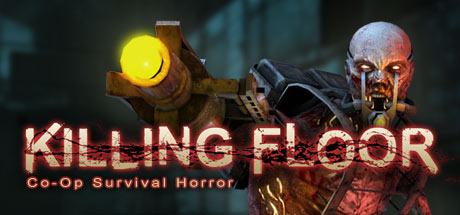

**Platforms:** Windows &nbsp;|&nbsp; **Genre:** Action &nbsp;|&nbsp; **Released:** May 14

> 6-player co-op survival horror at its finest! Free updates, free special events and a ridiculous amount of fun!
>
> _Synopsis source: Steam_

[Wikipedia](https://en.wikipedia.org/wiki/Killing_Floor_(2009_video_game)) · [Steam](https://store.steampowered.com/app/1250)

---

### League of Legends: Clash of Fates

**Platforms:** Windows &nbsp;|&nbsp; **Released:** October 27

---

### Left 4 Dead 2

**Platforms:** Xbox 360, Windows &nbsp;|&nbsp; **Publisher:** Valve &nbsp;|&nbsp; **Genre:** Action &nbsp;|&nbsp; **Released:** November 17, 2009

> Set in the zombie apocalypse, Left 4 Dead 2 is a co-operative action horror FPS takes you and your friends through the cities, swamps and cemeteries of the Deep South, from Savannah to New Orleans across five expansive campaigns.
>
> _Synopsis source: Steam_

[Wikipedia](https://en.wikipedia.org/wiki/Left_4_Dead_2) · [Steam](https://store.steampowered.com/app/550)

---

### Lego Indiana Jones 2: The Adventure Continues

**Platforms:** Wii, Xbox 360, PlayStation 3, Nintendo DS, PlayStation Portable, Windows &nbsp;|&nbsp; **Genre:** Adventure &nbsp;|&nbsp; **Released:** November 17

> LEGO® Indy is back in his biggest adventure yet. Battle through all four movies, including all-new levels from the original adventures and your favorite new moments from The Kingdom of the Crystal Skull... or in true LEGO® fashion, get creative and build your own levels to play with friends!
>
> _Synopsis source: Steam_

[Steam](https://store.steampowered.com/app/32450)

---

### Leisure Suit Larry: Box Office Bust

**Platforms:** Windows, Xbox 360, PlayStation 3 &nbsp;|&nbsp; **Released:** March 27

---

### Lucidity

**Platforms:** Windows, Xbox 360 &nbsp;|&nbsp; **Released:** October 7

[Wikipedia](https://en.wikipedia.org/wiki/Lucidity_(video_game))

---

### Machinarium

**Platforms:** Windows, macOS, Linux &nbsp;|&nbsp; **Genre:** Adventure, Indie &nbsp;|&nbsp; **Released:** October 16

> Machinarium is the award-winning independent adventure game developed by the makers of Samorost series, Botanicula and CHUCHEL. Help Josef the robot save his girlfriend Berta kidnapped by the Black Cap Brotherhood gang!
>
> _Synopsis source: Steam_

[Wikipedia](https://en.wikipedia.org/wiki/Machinarium) · [Steam](https://store.steampowered.com/app/40700)

---

### Madballs in Babo: Invasion

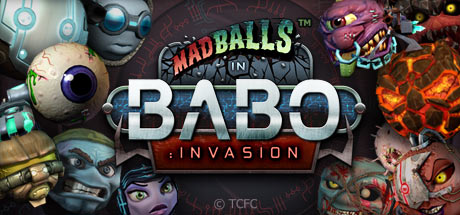

**Platforms:** Xbox 360, Windows &nbsp;|&nbsp; **Genre:** Action, Casual, Indie &nbsp;|&nbsp; **Released:** July 15

> Now with cross-platform multiplayer! PC vs. Mac at last.
>
> _Synopsis source: Steam_

[Steam](https://store.steampowered.com/app/25700)

---

### Majesty 2: The Fantasy Kingdom Sim

**Platforms:** Windows &nbsp;|&nbsp; **Released:** September 18

---

### Manhunt 2

**Platforms:** Windows &nbsp;|&nbsp; **Released:** November 6 (NA)

[Wikipedia](https://en.wikipedia.org/wiki/Manhunt_2)

---

### Men of War

**Platforms:** Windows &nbsp;|&nbsp; **Genre:** Strategy &nbsp;|&nbsp; **Released:** March 10

> Red Tide blends deep RTS tactics with the raw intensity of third-person combat. Created in collaboration with author Alexander Zorich, this standalone expansion tells the story of the Black Coats – Soviet Naval Infantry famed for their ruthless precision in the Black Sea campaigns.
>
> _Synopsis source: Steam_

[Wikipedia](https://en.wikipedia.org/wiki/Men_of_War_(video_game)) · [Steam](https://store.steampowered.com/app/3130)

---

### Metal Drift

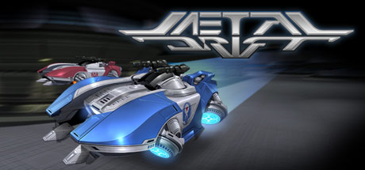

**Platforms:** Windows &nbsp;|&nbsp; **Genre:** Action, Indie, Racing, Sports &nbsp;|&nbsp; **Released:** October 22

> Multiplayer team-based vehicular combat
>
> _Synopsis source: Steam_

[Wikipedia](https://en.wikipedia.org/wiki/Metal_Drift) · [Steam](https://store.steampowered.com/app/32200)

---

### Minecraft

**Platforms:** Windows &nbsp;|&nbsp; **Publisher:** Mojang &nbsp;|&nbsp; **Released:** May 17, 2009

[Wikipedia](https://en.wikipedia.org/wiki/Minecraft)

---

### Mini Ninjas

**Platforms:** Windows, Xbox 360, PlayStation 3, Wii, Nintendo DS &nbsp;|&nbsp; **Genre:** Action, Adventure &nbsp;|&nbsp; **Released:** September 8

> Mini Ninjas is a game that combines furious action with stealth and exploration for an experience that appeals to a wide audience across age groups and preferences. It’s an action-adventure with a strong focus on allowing the player freedom to explore the world and has the depth to allow for very varied gameplay and approaches to getting...
>
> _Synopsis source: Steam_

[Wikipedia](https://en.wikipedia.org/wiki/Mini_Ninjas) · [Steam](https://store.steampowered.com/app/35000)

---

### Mirror's Edge

**Platforms:** Windows &nbsp;|&nbsp; **Genre:** Action, Adventure &nbsp;|&nbsp; **Released:** January 13

> In a city where information is heavily monitored, couriers called Runners transport sensitive data. In this seemingly utopian paradise, a crime has been committed, &amp; you are being hunted. You are a Runner called Faith and this innovative first-person action-adventure is your story.
>
> _Synopsis source: Steam_

[Wikipedia](https://en.wikipedia.org/wiki/Mirror%27s_Edge) · [Steam](https://store.steampowered.com/app/17410)

---

### MLB Front Office Manager

**Platforms:** PlayStation 3, Windows, Xbox 360 &nbsp;|&nbsp; **Released:** January 26

[Wikipedia](https://en.wikipedia.org/wiki/MLB_Front_Office_Manager)

---

### MMA Pro Fighter

**Platforms:** Windows, macOS, iOS &nbsp;|&nbsp; **Released:** December 22

---

### MX vs. ATV Reflex

**Platforms:** Nintendo DS, PlayStation 3, PlayStation Portable, Windows, Xbox 360 &nbsp;|&nbsp; **Genre:** Racing &nbsp;|&nbsp; **Released:** December 1

> Think fast and hang on to your ride as you take independent control of the rider and take the ultimate test of mettle. Dual controls let you tear it up with death-defying tricks and high-flying freestyle action. Fight for traction and dig up the track to leave your mark.
>
> _Synopsis source: Steam_

[Wikipedia](https://en.wikipedia.org/wiki/MX_vs._ATV_Reflex) · [Steam](https://store.steampowered.com/app/55140)

---

### Nancy Drew: Ransom of the Seven Ships

**Platforms:** Windows &nbsp;|&nbsp; **Released:** July 14

---

### Nancy Drew: Warnings at Waverly Academy

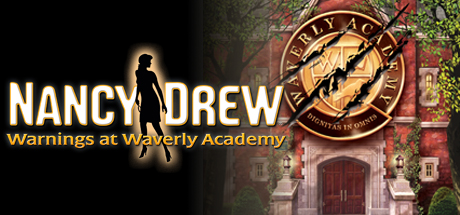

**Platforms:** Windows &nbsp;|&nbsp; **Genre:** Adventure &nbsp;|&nbsp; **Released:** October 13

> Enroll in a School Plagued by Suspicions and Lies!
>
> _Synopsis source: Steam_

[Steam](https://store.steampowered.com/app/43600)

---

### NBA 2K10

**Platforms:** Xbox 360, PlayStation 2, PlayStation 3, PlayStation Portable, Windows, Wii &nbsp;|&nbsp; **Released:** October 6

[Wikipedia](https://en.wikipedia.org/wiki/NBA_2K10)

---

### NecroVisioN

**Platforms:** Windows &nbsp;|&nbsp; **Genre:** Action &nbsp;|&nbsp; **Released:** February 27

> War is Hell. NecroVision is a first-person shooter that takes gamers across the frantic battlegrounds of World War I and into a dark underworld of vampires, demons and dark magic.
>
> _Synopsis source: Steam_

[Wikipedia](https://en.wikipedia.org/wiki/NecroVisioN) · [Steam](https://store.steampowered.com/app/7860)

---

### Need for Speed: Shift

**Platforms:** PlayStation 3, PlayStation Portable, Windows, Xbox 360, iOS &nbsp;|&nbsp; **Released:** September 15

---

### Night at the Museum: Battle of the Smithsonian

**Platforms:** Nintendo DS, Wii, Windows, Xbox 360 &nbsp;|&nbsp; **Released:** May 5

---

### Ninja Blade

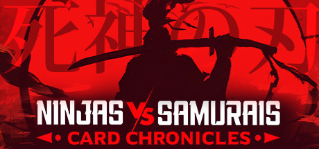

**Platforms:** Xbox 360, Windows &nbsp;|&nbsp; **Genre:** Action, Indie, RPG, Strategy, Early Access &nbsp;|&nbsp; **Released:** April 7

> Ninjas vs Samurais Card Chronicles: 死神の刃 is a beautiful story rich Jrpg, roguelike, card battling gameing. Combining both strategy &amp; skill, players will need to craft unique decks &amp; use their chosen heroes unique abilities, in hopes to restore balance &amp; bring peace to this war torn land.
>
> _Synopsis source: Steam_

[Wikipedia](https://en.wikipedia.org/wiki/Ninja_Blade) · [Steam](https://store.steampowered.com/app/1929300)

---

### Operation Flashpoint 2: Dragon Rising

**Platforms:** PlayStation 3, Windows, Xbox 360 &nbsp;|&nbsp; **Released:** October 6

---

### Order of War

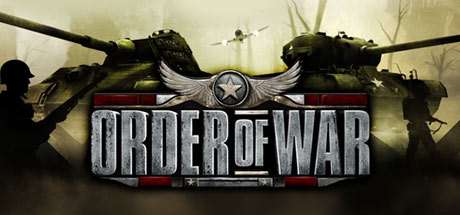

**Platforms:** Windows &nbsp;|&nbsp; **Genre:** Strategy &nbsp;|&nbsp; **Released:** September 22

> October 22, 2009 - Update has released free Downloadable Content for Order of War. The DLC will download automatically the next time you launch the game. This DLC contains all the formerly exclusive pre-order items which include: Heavy Bomber Squadrons - Addition of German Arado and Allied B-24 Marauder heavy bomber units to air support...
>
> _Synopsis source: Steam_

[Wikipedia](https://en.wikipedia.org/wiki/Order_of_War) · [Steam](https://store.steampowered.com/app/34600)

---

### Overlord II

**Platforms:** PlayStation 3, Windows, Xbox 360 &nbsp;|&nbsp; **Genre:** RPG &nbsp;|&nbsp; **Released:** June 23

> Overlord II, sequel to the critically acclaimed cult hit, sees the return of the chaotic Minions and their new Dark Master. Bigger, badder and more beautifully destructive, Overlord 2 has a Glorious Empire to smash, a massive Netherworld to revive, Minion mounts to mobilize, a trio of mistresses to woo, War Machines to crush opposition...
>
> _Synopsis source: Steam_

[Wikipedia](https://en.wikipedia.org/wiki/Overlord_II) · [Steam](https://store.steampowered.com/app/12810)

---

### Painkiller: Resurrection

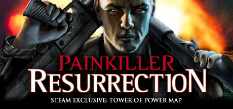

**Platforms:** Windows, Xbox 360 &nbsp;|&nbsp; **Genre:** Action &nbsp;|&nbsp; **Released:** October 27

> William &quot;Bill&quot; Sherman has a problem - he's dead. Blown to pieces by his own C4 payload, which he wanted to eliminate a South American druglord with on behalf of some shady secret service people.
>
> _Synopsis source: Steam_

[Steam](https://store.steampowered.com/app/39560)

---

### Perimeter 2: New Earth

**Platforms:** Windows &nbsp;|&nbsp; **Genre:** Strategy &nbsp;|&nbsp; **Released:** February 13

> &lt;p&gt;&lt;i&gt;Perimeter 2: New Earth&lt;/i&gt; is the long-awaited sequel of the critically acclaimed RTS &lt;i&gt;Perimeter&lt;/i&gt;. Ideas of territorial gameplay and landscape modification, introduced in the original game, are now realized on a new concept &amp; technology level.
>
> _Synopsis source: Steam_

[Steam](https://store.steampowered.com/app/12420)

---

### Plants vs. Zombies

**Platforms:** Windows, macOS, iOS, Xbox 360, PlayStation Network, Nintendo DS, Bada, Android, Windows Phone, PlayStation Vita, BlackBerry OS &nbsp;|&nbsp; **Publisher:** PopCap Games &nbsp;|&nbsp; **Genre:** Strategy &nbsp;|&nbsp; **Released:** May 5, 2009

> Zombies are invading your home, and the only defense is your arsenal of plants! Armed with an alien nursery-worth of zombie-zapping plants like peashooters and cherry bombs, you'll need to think fast and plant faster to stop dozens of types of zombies dead in their tracks.
>
> _Synopsis source: Steam_

[Wikipedia](https://en.wikipedia.org/wiki/Plants_vs._Zombies) · [Steam](https://store.steampowered.com/app/3590)

---

### Pro Evolution Soccer 2010

**Platforms:** Windows, PlayStation 3, Xbox 360, Nintendo DS, PlayStation 2, PlayStation Portable, Wii &nbsp;|&nbsp; **Released:** October 23

[Wikipedia](https://en.wikipedia.org/wiki/Pro_Evolution_Soccer_2010)

---

### Prototype

**Platforms:** PlayStation 3, Windows, Xbox 360 &nbsp;|&nbsp; **Genre:** Action, Adventure &nbsp;|&nbsp; **Released:** June 9

> You are the Prototype, Alex Mercer, a man without memory armed with amazing shape-shifting abilities, hunting your way to the heart of the conspiracy which created you; making those responsible pay. Fast &amp; Deadly Shape-Shifting Combat: Reconfigure your body to the situation at hand.
>
> _Synopsis source: Steam_

[Wikipedia](https://en.wikipedia.org/wiki/Prototype_(video_game)) · [Steam](https://store.steampowered.com/app/10150)

---

### Puzzle Quest: Galactrix

**Platforms:** Nintendo DS, Windows, Xbox 360, PlayStation 3 &nbsp;|&nbsp; **Genre:** Casual, RPG &nbsp;|&nbsp; **Released:** February 24

> The puzzle game of the future has arrived! The original best-selling new Puzzle franchise is back in an all new dimension with its signature Match-3, turn based battles in an insanely addictive and masterful hybrid of RPG and Puzzle genres.
>
> _Synopsis source: Steam_

[Steam](https://store.steampowered.com/app/23500)

---

### Raven Squad: Operation Hidden Dagger

**Platforms:** Windows, Xbox 360 &nbsp;|&nbsp; **Released:** August 21

---

### Red Faction: Guerrilla

**Platforms:** PlayStation 3, Xbox 360, Windows &nbsp;|&nbsp; **Genre:** Action &nbsp;|&nbsp; **Released:** June 2

> Set 50 years after the climactic events of the original Red Faction, Red Faction: Guerrilla allows players to take the role of an insurgent fighter with the newly re-established Red Faction movement as they battle for liberation from the oppressive Earth Defense Force.
>
> _Synopsis source: Steam_

[Steam](https://store.steampowered.com/app/20500)

---

### Resident Evil 5

**Platforms:** PlayStation 3, Xbox 360, Windows &nbsp;|&nbsp; **Genre:** Action, Adventure &nbsp;|&nbsp; **Released:** March 13

> This game is a port of the Games for Windows - Live version that was released in 2009. If you buy the Untold Stories Bundle here on Steam, it will be the same as upgrading to Resident Evil 5 Gold Edition.
>
> _Synopsis source: Steam_

[Wikipedia](https://en.wikipedia.org/wiki/Resident_Evil_5) · [Steam](https://store.steampowered.com/app/21690)

---

### Return to Mysterious Island 2

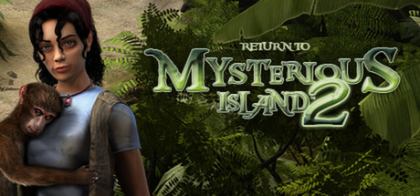

**Platforms:** Windows &nbsp;|&nbsp; **Genre:** Adventure, Casual &nbsp;|&nbsp; **Released:** August 14

> Mina’s rescue from the end of the first game is cut dramatically short and she and primate pal Jep are left again on the mysterious island to fend for themselves! Mina needs to dress her wounds and keep safe against the local wildlife, but now she has the assistance of the player controlled Jep who can fit in smaller spaces, move deftly...
>
> _Synopsis source: Steam_

[Wikipedia](https://en.wikipedia.org/wiki/Return_to_Mysterious_Island_2) · [Steam](https://store.steampowered.com/app/277270)

---

### Rogue Warrior

**Platforms:** PlayStation 3, Windows, Xbox 360 &nbsp;|&nbsp; **Genre:** Action &nbsp;|&nbsp; **Released:** December 1

> Rogue Warrior is a character-driven, first-person-shooter, featuring Richard 'Demo Dick' Marcinko's explosive personality in an action-packed single player campaign, and intense multiplayer combat. Playing as Richard 'Demo Dick' Marcinko, you go behind the iron curtain to disrupt a suspected North Korean ballistic missile program.
>
> _Synopsis source: Steam_

[Wikipedia](https://en.wikipedia.org/wiki/Rogue_Warrior_(video_game)) · [Steam](https://store.steampowered.com/app/22310)

---

### Saints Row 2

**Platforms:** Windows &nbsp;|&nbsp; **Genre:** Action &nbsp;|&nbsp; **Released:** January 6

> Saints Row 2 brings true freedom to open-world gaming. Players can play as who they want, how they want, and with whomever they want in this sequel to the much acclaimed and tremendously successful Saints Row.
>
> _Synopsis source: Steam_

[Wikipedia](https://en.wikipedia.org/wiki/Saints_Row_2) · [Steam](https://store.steampowered.com/app/9480)

---

### Saw: The Video Game

**Platforms:** PlayStation 3, Xbox 360, Windows &nbsp;|&nbsp; **Released:** October 6

[Wikipedia](https://en.wikipedia.org/wiki/Saw_(video_game))

---

### Scooby-Doo! First Frights

**Platforms:** Nintendo DS, PlayStation 2, Wii, Windows &nbsp;|&nbsp; **Released:** September 22

[Wikipedia](https://en.wikipedia.org/wiki/Scooby-Doo!_First_Frights)

---

### Secret Files 2: Puritas Cordis

**Platforms:** Windows, Wii, Nintendo DS &nbsp;|&nbsp; **Genre:** Adventure &nbsp;|&nbsp; **Released:** May 8

> The sequel to the award winning adventure hit Secret Files Tunguska. Famine in Africa, floods in Southeast Asia, economic crisis in Europe, and civil wars in South America, the world is on the brink of disaster.
>
> _Synopsis source: Steam_

[Steam](https://store.steampowered.com/app/40340)

---

### Section 8

**Platforms:** Windows, Xbox 360 &nbsp;|&nbsp; **Released:** September 4

[Wikipedia](https://en.wikipedia.org/wiki/Section_8_(video_game))

---

### Shellshock 2: Blood Trails

**Platforms:** PlayStation 3, Windows, Xbox 360 &nbsp;|&nbsp; **Released:** February 24

---

### Solium Infernum

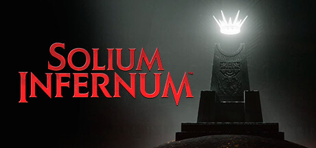

**Platforms:** Windows, macOS &nbsp;|&nbsp; **Genre:** Indie, Strategy &nbsp;|&nbsp; **Released:** November 26

> Take the Infernal Throne in this hellish turn-based grand strategy game. The Prince of Darkness has vanished, leaving Archfiends to conspire: muster your legions while intoning dark sorceries, devilish schemes, and machiavellian plots. Who will be the new ruler of Hell and ascend the Throne?
>
> _Synopsis source: Steam_

[Wikipedia](https://en.wikipedia.org/wiki/Solium_Infernum) · [Steam](https://store.steampowered.com/app/1893810)

---

### Spore Galactic Adventures

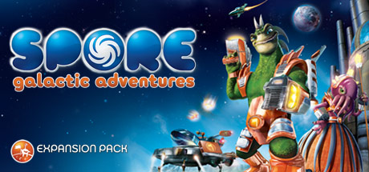

**Platforms:** Windows &nbsp;|&nbsp; **Genre:** Action, Simulation &nbsp;|&nbsp; **Released:** June 23

> Take Your Creature From Zero To Galactic HeroGet out of your starship and turn your Spore creatures into legendary Space Captains. For the first time, beam down with your allies to take on action-packed, planetside adventures. Complete quests, collect rewards, and even create your own missions.
>
> _Synopsis source: Steam_

[Wikipedia](https://en.wikipedia.org/wiki/Spore_Galactic_Adventures) · [Steam](https://store.steampowered.com/app/24720)

---

### Stalin vs. Martians

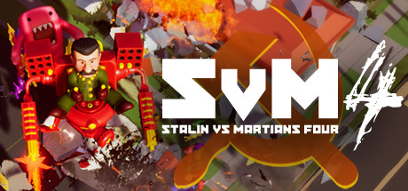

**Platforms:** Windows &nbsp;|&nbsp; **Genre:** Action, Adventure, Indie &nbsp;|&nbsp; **Released:** April 29

> Stalin vs. Martians 4 is an unlikely sequel to the infamous Stalin vs. Martians game. This time it is a (mostly) isometric action/shooter game with multi-genre features, campy humor, insane video intermissions, ridiculous narrative and a “sketch comedy” approach.
>
> _Synopsis source: Steam_

[Wikipedia](https://en.wikipedia.org/wiki/Stalin_vs._Martians) · [Steam](https://store.steampowered.com/app/1347870)

---

### Star Wars: The Clone Wars – Republic Heroes

**Platforms:** PlayStation 3, Windows, Xbox 360, Wii, PlayStation Portable, PlayStation 2, Nintendo DS &nbsp;|&nbsp; **Released:** October 6

---

### Star Wars: The Force Unleashed -- Ultimate Sith Edition

**Platforms:** Windows, PlayStation 3, Xbox 360 &nbsp;|&nbsp; **Released:** November 6

---

### Still Life 2

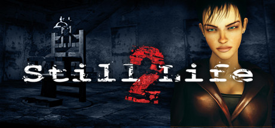

**Platforms:** Windows, macOS &nbsp;|&nbsp; **Genre:** Adventure &nbsp;|&nbsp; **Released:** August 10

> Who is hiding behind Mr. X? Still Life 2 reveals the long-awaited ending of Still Life and spells a new investigation for Agent Victoria McPherson. In Fall 2008, Victoria is sent to Maine where Ellen Dunnigan's body has just been found.
>
> _Synopsis source: Steam_

[Wikipedia](https://en.wikipedia.org/wiki/Still_Life_2) · [Steam](https://store.steampowered.com/app/46490)

---

### Stormrise

**Platforms:** PlayStation 3, Windows, Xbox 360 &nbsp;|&nbsp; **Released:** March 24

[Wikipedia](https://en.wikipedia.org/wiki/Stormrise)

---

### Street Fighter IV

**Platforms:** PlayStation 3, Xbox 360, Windows &nbsp;|&nbsp; **Publisher:** Capcom &nbsp;|&nbsp; **Genre:** Action &nbsp;|&nbsp; **Released:** February 12, 2009

> Street Fighter® IV brings the legendary fighting series back to its roots by taking the beloved fighting moves and techniques of the original Street Fighter® II, and infusing them with Capcom's latest advancements in next generation technology.
>
> _Synopsis source: Steam_

[Wikipedia](https://en.wikipedia.org/wiki/Street_Fighter_IV) · [Steam](https://store.steampowered.com/app/21660)

---

### Tales of Monkey Island

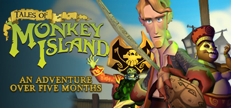

**Platforms:** Windows &nbsp;|&nbsp; **Genre:** Adventure, RPG &nbsp;|&nbsp; **Released:** July 7

> While explosively stripping the evil pirate LeChuck of his demonic mojo, Guybrush Threepwood inadvertently infects the entire Caribbean with the arch-fiend's expelled voodoo, which threatens to transform buccaneers into unruly pirate monsters.
>
> _Synopsis source: Steam_

[Wikipedia](https://en.wikipedia.org/wiki/Tales_of_Monkey_Island) · [Steam](https://store.steampowered.com/app/31170)

---

### Terminator Salvation

**Platforms:** PlayStation 3, Windows, Xbox 360, iOS &nbsp;|&nbsp; **Released:** May 19

[Wikipedia](https://en.wikipedia.org/wiki/Terminator_Salvation_(video_game))

---

### The Backyardigans: Robot Rampage

**Platforms:** Windows, Xbox 360, PlayStation 3, PlayStation Portable, Wii, Nintendo DS &nbsp;|&nbsp; **Released:** September 8

---

### The Backyardigans: Singing Sensation

**Platforms:** Windows, PlayStation 3, Wii, Xbox 360 &nbsp;|&nbsp; **Released:** November 10

---

### The Chronicles of Riddick: Assault on Dark Athena

**Platforms:** PlayStation 3, Windows, Xbox 360 &nbsp;|&nbsp; **Released:** April 7

---

### The Godfather Part II: The Game

**Platforms:** PlayStation 3, Xbox 360, Windows &nbsp;|&nbsp; **Released:** April 7

[Wikipedia](https://en.wikipedia.org/wiki/The_Godfather_II_(video_game))

---

### The Last Remnant

**Platforms:** Windows &nbsp;|&nbsp; **Released:** March 24

[Wikipedia](https://en.wikipedia.org/wiki/The_Last_Remnant)

---

### The Lord of the Rings: Conquest

**Platforms:** PlayStation 3, Windows, Xbox 360, Nintendo DS &nbsp;|&nbsp; **Released:** January 13

---

### The Maw

**Platforms:** Xbox 360, Windows &nbsp;|&nbsp; **Genre:** Action, Indie &nbsp;|&nbsp; **Released:** January 21

> The pinnacle of alien evolution, Maw is a cowardly fat blob concerned mostly with snacking and lounging. He can, however, absorb the traits of anything he eats, is virtually indestructible, and can grow to unlimited size. If he wasn't a danger to all life in the universe, he'd make the perfect pet.
>
> _Synopsis source: Steam_

[Wikipedia](https://en.wikipedia.org/wiki/The_Maw_(video_game)) · [Steam](https://store.steampowered.com/app/26000)

---

### The Polynomial: Space of the Music

**Platforms:** Windows, macOS, Linux &nbsp;|&nbsp; **Genre:** Action, Casual, Indie &nbsp;|&nbsp; **Released:** May 28

> Experience the music in a new way. Feel it pulse around you. The Polynomial is a 3D space shooter with unique, fractal based scenery that animates to the music.
>
> _Synopsis source: Steam_

[Steam](https://store.steampowered.com/app/67000)

---

### The Price is Right: 2010 Edition

**Platforms:** Nintendo DS, Wii, Windows &nbsp;|&nbsp; **Released:** September 22

---

### The Saboteur

**Platforms:** PlayStation 3, Xbox 360, Windows &nbsp;|&nbsp; **Genre:** Action, Adventure &nbsp;|&nbsp; **Released:** December 8

> This open-world action thriller takes you through the seedy streets of Paris as you seek to undermine the German authority and lead a rebellion. Fight across rooftops and through dangerous alleys, and operate a wide variety of vehicles as you navigate your terrain.
>
> _Synopsis source: Steam_

[Wikipedia](https://en.wikipedia.org/wiki/The_Saboteur_(2009_video_game)) · [Steam](https://store.steampowered.com/app/24880)

---

### The Sims 3

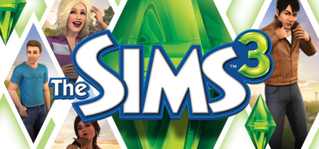

**Platforms:** Windows, macOS &nbsp;|&nbsp; **Genre:** Simulation &nbsp;|&nbsp; **Released:** June 2

> The Sims 3: Create the perfect world with full customization at your fingertips. Refine personalities and help fulfill destinies.
>
> _Synopsis source: Steam_

[Wikipedia](https://en.wikipedia.org/wiki/The_Sims_3) · [Steam](https://store.steampowered.com/app/47890)

---

### The Sims 3: World Adventures

**Platforms:** Windows, macOS &nbsp;|&nbsp; **Released:** November 18

---

### The Warriors: Street Brawl

**Platforms:** Windows, Xbox 360 &nbsp;|&nbsp; **Released:** September 23

---

### The Wheelman

**Platforms:** PlayStation 3, Windows, Xbox 360 &nbsp;|&nbsp; **Released:** March 24

[Wikipedia](https://en.wikipedia.org/wiki/The_Wheelman)

---

### The Whispered World

**Platforms:** Windows, iOS, macOS, Linux &nbsp;|&nbsp; **Released:** August 28

[Wikipedia](https://en.wikipedia.org/wiki/The_Whispered_World)

---

### Tom Clancy's EndWar

**Platforms:** Windows &nbsp;|&nbsp; **Genre:** Strategy &nbsp;|&nbsp; **Released:** February 24

> Live the thrilling career of an army commander and lead your army to victory in a massive online World War III! Take control of the U.S.-led Joint Strike Force, the European Enforcers Corps, or the Russian Spetsnaz Guards Brigade in a persistent ongoing World War.
>
> _Synopsis source: Steam_

[Wikipedia](https://en.wikipedia.org/wiki/Tom_Clancy%27s_EndWar) · [Steam](https://store.steampowered.com/app/21800)

---

### Tom Clancy's H.A.W.X.

**Platforms:** PlayStation 3, Xbox 360, iOS, Windows &nbsp;|&nbsp; **Released:** March 6

[Wikipedia](https://en.wikipedia.org/wiki/Tom_Clancy%27s_H.A.W.X.)

---

### Torchlight

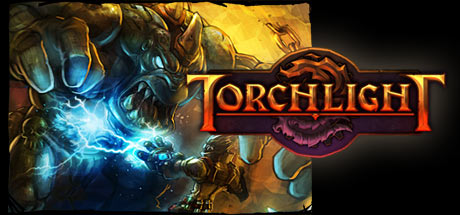

**Platforms:** Windows &nbsp;|&nbsp; **Genre:** RPG &nbsp;|&nbsp; **Released:** October 27

> Adventure awaits in the award-winning Action RPG debut from Runic Games! Explore the randomized depths of this boom town, collect loot, and level up to save Torchlight - and possibly the world.
>
> _Synopsis source: Steam_

[Wikipedia](https://en.wikipedia.org/wiki/Torchlight) · [Steam](https://store.steampowered.com/app/41500)

---

### Transformers: Revenge of the Fallen

**Platforms:** Nintendo DS, PlayStation 2, PlayStation 3, Wii, Windows, Xbox 360, PlayStation Portable &nbsp;|&nbsp; **Released:** June 23

---

### Trine

**Platforms:** Windows, PlayStation 3 &nbsp;|&nbsp; **Genre:** Action, Adventure, Casual, Indie, RPG, Strategy &nbsp;|&nbsp; **Released:** July 3

> Three heroes are bound to a magic artifact and sent to save a kingdom in this physics puzzle platformer. The wizard conjures, the knight smashes, the thief grapples — and you switch between them freely, or hand two of them to friends.
>
> _Synopsis source: Steam_

[Wikipedia](https://en.wikipedia.org/wiki/Trine_(video_game)) · [Steam](https://store.steampowered.com/app/35700)

---

### Tropico 3

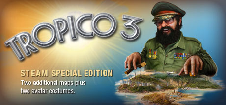

**Platforms:** Windows &nbsp;|&nbsp; **Genre:** Simulation, Strategy &nbsp;|&nbsp; **Released:** October 20

> Become the dictator of a remote island during the Cold War. Charm, persuade, intimidate, oppress, or cheat your people to stay in power! Are you a kind and generous leader? A corrupt and ruthless tyrant ruling with an iron fist?
>
> _Synopsis source: Steam_

[Wikipedia](https://en.wikipedia.org/wiki/Tropico_3) · [Steam](https://store.steampowered.com/app/23490)

---

### Velvet Assassin

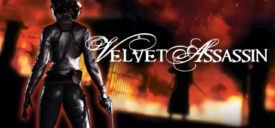

**Platforms:** Xbox 360, Windows &nbsp;|&nbsp; **Genre:** Action &nbsp;|&nbsp; **Released:** April 28

> Inspired by the fascinating story and unbreakable spirit of British secret agent Violette Szabo, players take control of Violette Summer, a beautiful World War II spy deep behind enemy lines with no support or official backing from the British Government.
>
> _Synopsis source: Steam_

[Wikipedia](https://en.wikipedia.org/wiki/Velvet_Assassin) · [Steam](https://store.steampowered.com/app/16720)

---

### Venetica

**Platforms:** Windows, PlayStation 3, Xbox 360 &nbsp;|&nbsp; **Released:** September 4

[Wikipedia](https://en.wikipedia.org/wiki/Venetica)

---

### Virtua Tennis 2009

**Platforms:** Xbox 360, PlayStation 3, Wii, Windows &nbsp;|&nbsp; **Released:** June 9

[Wikipedia](https://en.wikipedia.org/wiki/Virtua_Tennis_2009)

---

### Wallace & Gromit's Grand Adventures

**Platforms:** Windows &nbsp;|&nbsp; **Genre:** Adventure, Casual &nbsp;|&nbsp; **Released:** March 24

> Enter the colorful world of West Wallaby Street in a series of four cracking adventures brought to you by Aardman Animations, the creators of the Wallace &amp; Gromit animated films, and award-winning Telltale Games.
>
> _Synopsis source: Steam_

[Wikipedia](https://en.wikipedia.org/wiki/Wallace_%26_Gromit%27s_Grand_Adventures) · [Steam](https://store.steampowered.com/app/31100)

---

### Wanted: Weapons of Fate

**Platforms:** PlayStation 3, Windows, Xbox 360 &nbsp;|&nbsp; **Released:** March 17

---

### Warhammer 40,000: Dawn of War II

**Platforms:** Windows &nbsp;|&nbsp; **Genre:** Strategy &nbsp;|&nbsp; **Released:** February 19

> All of Warhammer 40,000: Dawn of War II in one package. Play the award-winning real-time strategy game in all its glory, including three full campaigns, six multiplayer factions, and a full co-op Last Stand mode with eight unique heroes.
>
> _Synopsis source: Steam_

[Steam](https://store.steampowered.com/app/15620)

---

### Watchmen: The End Is Nigh

**Platforms:** PlayStation 3, Windows, Xbox 360 &nbsp;|&nbsp; **Genre:** Action &nbsp;|&nbsp; **Released:** March 4

> The lines between good and bad have been blurred and crime and terror run rampant in the streets. The alleys, rooftops and sewers are crawling with criminals and brutal gangs. And now, Underboss — in a daring escape — has broken out of prison and is ruling with vicious darkness.
>
> _Synopsis source: Steam_

[Steam](https://store.steampowered.com/app/21010)

---

### Wolfenstein

**Platforms:** PlayStation 3, Windows, Xbox 360 &nbsp;|&nbsp; **Released:** August 18

[Wikipedia](https://en.wikipedia.org/wiki/Wolfenstein_(2009_video_game))

---

### World in Conflict: Soviet Assault

**Platforms:** Windows &nbsp;|&nbsp; **Released:** March 10

---

### World of Zoo

**Platforms:** Nintendo DS, Wii, Windows &nbsp;|&nbsp; **Genre:** Simulation &nbsp;|&nbsp; **Released:** October 26

> What would you do if you had the keys to the zoo? World of Zoo is the only life sim game that pushes you past the fences and into a world of your own zoo. Create and customize your zoo experience and develop hands on relationships to earn the trust and love of your animals.
>
> _Synopsis source: Steam_

[Wikipedia](https://en.wikipedia.org/wiki/World_of_Zoo) · [Steam](https://store.steampowered.com/app/43100)

---

### WorldShift

**Platforms:** Windows &nbsp;|&nbsp; **Released:** November 11

[Wikipedia](https://en.wikipedia.org/wiki/WorldShift)

---

### X-Blades

**Platforms:** PlayStation 3, Windows, Xbox 360 &nbsp;|&nbsp; **Genre:** Nudity, Violent, Action, Adventure, RPG &nbsp;|&nbsp; **Released:** February 10

> In X-Blades, the player takes on the role of the enchanting heroine Ayumi, who survives a breathtaking dance of blades through the Hordes of Darkness. The long-haired beautiful anime, with her pistol blades and mind-blowing leaps, whirls and swirls from one fantastic level to the next.
>
> _Synopsis source: Steam_

[Wikipedia](https://en.wikipedia.org/wiki/X-Blades) · [Steam](https://store.steampowered.com/app/7510)

---

### X-Men Origins: Wolverine

**Platforms:** Nintendo DS, PlayStation 2, PlayStation 3, Wii, Windows, Xbox 360, PlayStation Portable &nbsp;|&nbsp; **Released:** May 1

---

### Zeno Clash

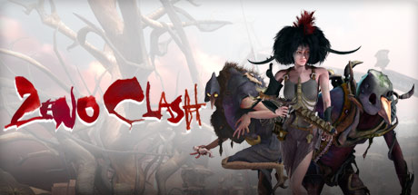

**Platforms:** Windows &nbsp;|&nbsp; **Genre:** Action, Indie &nbsp;|&nbsp; **Released:** April 21

> Zeno Clash is an action/fighting game set in a punk fantasy world. The game is played from a first person perspective and the combat is generally up close and brutal. Experience a deep storyline set in a fantastic world.
>
> _Synopsis source: Steam_

[Wikipedia](https://en.wikipedia.org/wiki/Zeno_Clash) · [Steam](https://store.steampowered.com/app/22200)

---
