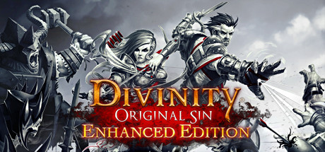
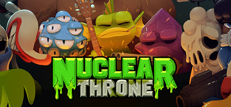
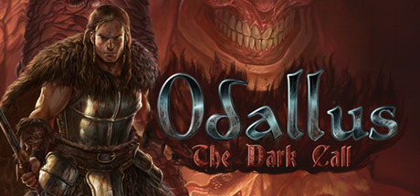
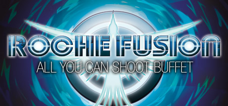
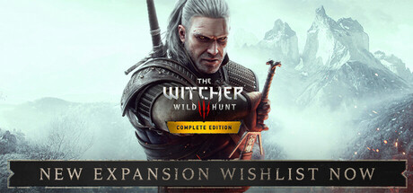
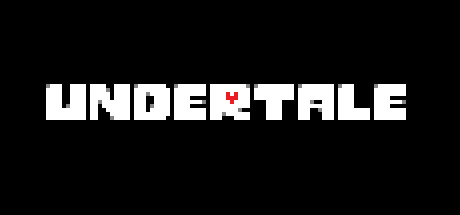

# Windows — 2015

[← All Windows years](../windows.md) · [Full 2015 page](../../years/2015.md)

496 Windows titles in 2015.

### 12 is Better than 6

**Platforms:** Windows, Linux, macOS &nbsp;|&nbsp; **Developer:** Ink Stains Games &nbsp;|&nbsp; **Publisher:** Pinkapp games, HypeTrain Digital &nbsp;|&nbsp; **Genre:** Shooter, Adventure, Indie, Arcade &nbsp;|&nbsp; **Released:** November 20, 2015

> 12 is Better Than 6 is a dynamic top-down hardcore shooter with stealth elements, presented in a Wild West theme. The action takes place in 1873, the noon of lawless and cruelty all over North America.
>
> _Synopsis source: IGDB_

[IGDB](https://www.igdb.com/games/12-is-better-than-6)

---

### 2064: Read Only Memories

**Platforms:** Windows, macOS, Linux &nbsp;|&nbsp; **Genre:** Graphic adventure &nbsp;|&nbsp; **Released:** October 6

> In Neo-San Francisco, a vibrant city of low life and high tech, you will witness the world’s first sapient robot learning to grow and live as you become embroiled in the darkest scandal of 2064.
>
> _Synopsis source: IGDB_

[IGDB](https://www.igdb.com/games/2064-read-only-memories)

---

### 60 Seconds!

**Platforms:** Windows, macOS &nbsp;|&nbsp; **Developer:** Robot Gentleman &nbsp;|&nbsp; **Publisher:** Robot Gentleman &nbsp;|&nbsp; **Genre:** Survival &nbsp;|&nbsp; **Released:** May 25, 2015

> As Ted, a responsible citizen and a family man, you are faced with a slight disturbance to your happy, suburban lifestyle. THE NUCLEAR APOCALYPSE.  With only 60 seconds left to impact, guide Ted in a mad, intense and action packed dash through his house in search of his family and useful supplies. Everything will be against you - time, your very own furniture, the house that's different every time you play and the fundamental question - what to take with you and who to leave behind?  Reaching the fallout shelter in time and alive is only the beginning. Whatever you scavenged and whoever you saved will play a vital role in your survival. Each survival story will be different, with every day surprising you with unexpected events. Will all of these stories end well? It's up to you. Ration food and water, make best use of your supplies, face difficult choices and even venture into the wasteland.
>
> _Synopsis source: IGDB_

[Wikipedia](https://en.wikipedia.org/wiki/60_Seconds!) · [IGDB](https://www.igdb.com/games/60-seconds)

---

### 80 Days

**Platforms:** Windows &nbsp;|&nbsp; **Publisher:** Inkle &nbsp;|&nbsp; **Genre:** Interactive fiction &nbsp;|&nbsp; **Released:** September 29, 2015

> 1872, with a steampunk twist. Phileas Fogg has wagered he can circumnavigate the world in just 80 days. Travel by airship, submarine, mechanical camel, steam-train and more. Race other players and a clock that never stops in TIME Magazine's Game of 2014.
>
> _Synopsis source: Steam_

[Wikipedia](https://en.wikipedia.org/wiki/80_Days_(2014_video_game)) · [Steam](https://store.steampowered.com/app/381780) · [IGDB](https://www.igdb.com/games/80-days)

---

### 8:46

**Platforms:** Windows &nbsp;|&nbsp; **Developer:** Anthony Krafft &nbsp;|&nbsp; **Genre:** Simulation

[Wikipedia](https://en.wikipedia.org/wiki/8:46_(video_game))

---

### A Bastard's Tale

**Platforms:** Windows &nbsp;|&nbsp; **Developer:** No Pest Productions &nbsp;|&nbsp; **Publisher:** No Pest Productions &nbsp;|&nbsp; **Genre:** Action-adventure &nbsp;|&nbsp; **Released:** May 28, 2015

> A game about parrying, attacking, and overcoming difficult foes
>
> _Synopsis source: IGDB_

[Wikipedia](https://en.wikipedia.org/wiki/A_Bastard's_Tale) · [IGDB](https://www.igdb.com/games/a-bastards-tale)

---

### A Blind Legend

**Platforms:** Windows, iOS, macOS, Android &nbsp;|&nbsp; **Developer:** Dowino &nbsp;|&nbsp; **Publisher:** Plug In Digital &nbsp;|&nbsp; **Genre:** Action-adventure &nbsp;|&nbsp; **Released:** June 10, 2015

> A Blind Legend is the first-ever action-adventure game without video – where ears replace eyes! Discover the original, innovative sensory experience of binaural 3D sound.
>
> _Synopsis source: IGDB_

[Wikipedia](https://en.wikipedia.org/wiki/A_Blind_Legend) · [IGDB](https://www.igdb.com/games/a-blind-legend)

---

### A Fistful of Gun

**Platforms:** Windows &nbsp;|&nbsp; **Genre:** Shoot 'em up &nbsp;|&nbsp; **Released:** September 23

[Wikipedia](https://en.wikipedia.org/wiki/A_Fistful_of_Gun)

---

### A Good Snowman Is Hard to Build

**Platforms:** Linux, macOS, Windows, Android, iOS &nbsp;|&nbsp; **Developer:** Benjamin Davis, Alan Hazelden &nbsp;|&nbsp; **Publisher:** Draknek &nbsp;|&nbsp; **Genre:** Puzzle &nbsp;|&nbsp; **Released:** February 25, 2015

> A puzzle game about being a monster and making snowmen. Lovingly crafted by the mind of Alan Hazelden and the hands of Benjamin Davis. With enchanting soundscapes from the heart of Priscilla Snow.
>
> _Synopsis source: IGDB_

[Wikipedia](https://en.wikipedia.org/wiki/A_Good_Snowman_Is_Hard_to_Build) · [IGDB](https://www.igdb.com/games/a-good-snowman-is-hard-to-build)

---

### A-Men 2

**Platforms:** Windows, PlayStation 3, PlayStation Vita &nbsp;|&nbsp; **Developer:** Bloober Team &nbsp;|&nbsp; **Publisher:** Bloober Team &nbsp;|&nbsp; **Genre:** Puzzle-platform &nbsp;|&nbsp; **Released:** June 24, 2015

[Wikipedia](https://en.wikipedia.org/wiki/A-Men_2)

---

### Act of Aggression

**Platforms:** Windows &nbsp;|&nbsp; **Genre:** RTS &nbsp;|&nbsp; **Released:** September 2

[Wikipedia](https://en.wikipedia.org/wiki/Act_of_Aggression)

---

### Adventure Time: Finn & Jake Investigations

**Platforms:** Windows, PlayStation 3, PlayStation 4, Xbox 360, Xbox One, Wii U, Nintendo 3DS &nbsp;|&nbsp; **Genre:** Action-adventure, RPG &nbsp;|&nbsp; **Released:** October 20

---

### AdvertCity

**Platforms:** Windows, Linux, macOS &nbsp;|&nbsp; **Developer:** VoxelStorm &nbsp;|&nbsp; **Publisher:** VoxelStorm &nbsp;|&nbsp; **Genre:** Tycoon game &nbsp;|&nbsp; **Released:** April 17, 2015

> A cyberpunk advertising tycoon game. Explore a massive procedural city, and plaster your adverts all over it. Float around cyberspace and post links online. Watch the economy of the city evolve with the effects of your decisions.
>
> _Synopsis source: IGDB_

[Wikipedia](https://en.wikipedia.org/wiki/AdvertCity) · [IGDB](https://www.igdb.com/games/advertcity)

---

### Afro Samurai 2

**Platforms:** PlayStation 4, Windows &nbsp;|&nbsp; **Developer:** Redacted Studios &nbsp;|&nbsp; **Publisher:** Versus Evil &nbsp;|&nbsp; **Genre:** Action-adventure &nbsp;|&nbsp; **Released:** September 22, 2015

[Wikipedia](https://en.wikipedia.org/wiki/Afro_Samurai_2)

---

### Afterfall: Reconquest

**Platforms:** Windows &nbsp;|&nbsp; **Developer:** Intoxicate Studios &nbsp;|&nbsp; **Publisher:** Nicolas Entertainment Group &nbsp;|&nbsp; **Genre:** Third-person shooter, action, adventure &nbsp;|&nbsp; **Released:** February 19, 2015

> Afterfall: Reconquest (previously titled as Afterfall: Pearl of the Wastelands) is an episodic story-driven third-person shooter video game with action and adventure elements, developed by Intoxicate Studios and published by Nicolas Entertainment Group for Microsoft Windows. It is the sequel to the video game Afterfall: Insanity. The game will consist of 9 episodes. The first episode was released on February 19, 2015.
>
> _Synopsis source: IGDB_

[Wikipedia](https://en.wikipedia.org/wiki/Afterfall:_Reconquest) · [IGDB](https://www.igdb.com/games/afterfall-reconquest)

---

### Agarest: Generations of War 2

**Platforms:** Windows &nbsp;|&nbsp; **Genre:** Tactical RPG &nbsp;|&nbsp; **Released:** February 19

[Wikipedia](https://en.wikipedia.org/wiki/Record_of_Agarest_War_2)

---

### Airscape: The Fall of Gravity

**Platforms:** Windows &nbsp;|&nbsp; **Developer:** Cross-Product &nbsp;|&nbsp; **Publisher:** EQ Games &nbsp;|&nbsp; **Genre:** Platform &nbsp;|&nbsp; **Released:** August 11, 2015

> Airscape is a fast-paced, ultra-challenging 60 level action platformer. You play a deep-sea octopus, kidnapped by a mechanical alien race. Jump, dodge, and swim through a skybound environment full of floating islands, water formations, and robotic terrors.
>
> _Synopsis source: IGDB_

[Wikipedia](https://en.wikipedia.org/wiki/Airscape:_The_Fall_of_Gravity) · [IGDB](https://www.igdb.com/games/airscape-the-fall-of-gravity)

---

### Akiba's Trip: Undead & Undressed

**Platforms:** Windows &nbsp;|&nbsp; **Genre:** Action-adventure, Brawler &nbsp;|&nbsp; **Released:** May 26

---

### Albert & Otto

**Platforms:** Windows, macOS &nbsp;|&nbsp; **Developer:** K Bros Games &nbsp;|&nbsp; **Publisher:** K Bros Games &nbsp;|&nbsp; **Genre:** Puzzle-platform &nbsp;|&nbsp; **Released:** October 28, 2015

[Wikipedia](https://en.wikipedia.org/wiki/Albert_&_Otto)

---

### Alone in the Dark: Illumination

**Platforms:** Windows &nbsp;|&nbsp; **Genre:** TPS &nbsp;|&nbsp; **Released:** June 11

---

### Angel Beats! 1st Beat

**Platforms:** Windows &nbsp;|&nbsp; **Developer:** Key &nbsp;|&nbsp; **Publisher:** Visual Arts &nbsp;|&nbsp; **Genre:** Visual novel &nbsp;|&nbsp; **Released:** June 26, 2015

> Angel Beats! 1st Beat is a Japanese visual novel based on the 2010 anime television series Angel Beats!, developed by Key and the first in a planned series of six volumes. It takes place in the afterlife and focuses on Otonashi, a boy who lost his memories of his life after dying. He is enrolled in the afterlife school and meets a girl named Yuri who invites him to join the Afterlife Battlefront, an organization she leads that fights against God. The Battlefront fights against the student council president Angel, a girl with supernatural powers.
>
> _Synopsis source: IGDB_

[Wikipedia](https://en.wikipedia.org/wiki/Angel_Beats!_1st_Beat) · [IGDB](https://www.igdb.com/games/angel-beats-1st-beat)

---

### Angels Fall First

**Platforms:** Windows &nbsp;|&nbsp; **Genre:** FPS &nbsp;|&nbsp; **Released:** October 10

[Wikipedia](https://en.wikipedia.org/wiki/Angels_Fall_First_(video_game))

---

### Anna's Quest

**Platforms:** Windows &nbsp;|&nbsp; **Developer:** Krams Design &nbsp;|&nbsp; **Publisher:** Daedalic Entertainment &nbsp;|&nbsp; **Genre:** Adventure &nbsp;|&nbsp; **Released:** July 2, 2015

> Dragons, witches, trolls... No one can stop Anna. With her telekinesis, unorthodox use of torture instruments, a knack for improvisation and the help of a shady fox she just makes her way. She communes with the dead, shuts off the local taverns beer supply and gets old ladies behind bars...  The world of author Dane Krams' debut on the game development stage isn't as cuddly as it may seem. Anna however, is actually perfectly nice - or is she? It all starts with freeing talking teddy bear... Anna's Quest unfolds a hand-drawn, grim tale with a good dash of self-irony.
>
> _Synopsis source: IGDB_

[Wikipedia](https://en.wikipedia.org/wiki/Anna's_Quest) · [IGDB](https://www.igdb.com/games/annas-quest)

---

### Anno 2205

**Platforms:** Windows &nbsp;|&nbsp; **Genre:** City builder, RTS &nbsp;|&nbsp; **Released:** November 3

> In Anno 2205, you join humankind‘s next step into the future with the promise to build a better tomorrow. You conquer Earth, establishing rich, bustling cities and grand industrial complexes, but to secure the prosperity of your people, you must travel into space.  A scientific breakthrough in fusion energy promises to revolutionise all aspects of society. The necessary isotope, helium-3, can only be found in harvestable quantities on the Moon. Venture into space and settle on the Moon in the thrilling race for resource and power.  Anno’s masterful economic gameplay is back and taking strategic city-building simulation to new heights, launching into space!
>
> _Synopsis source: IGDB_

[Wikipedia](https://en.wikipedia.org/wiki/Anno_2205) · [IGDB](https://www.igdb.com/games/anno-2205)

---

### Apotheon

**Platforms:** Windows, macOS, Linux, PlayStation 4 &nbsp;|&nbsp; **Genre:** Platformer, Metroidvania &nbsp;|&nbsp; **Released:** February 3

> Apotheon is a heroic action game set within the vibrant world of Ancient Greek Mythology. Ascend Mount Olympus, wrestle the divine powers from the Pantheon of Gods, and save mankind.
>
> _Synopsis source: IGDB_

[Wikipedia](https://en.wikipedia.org/wiki/Apotheon) · [IGDB](https://www.igdb.com/games/apotheon)

---

### Armello

**Platforms:** Windows, macOS, Linux, PlayStation 4 &nbsp;|&nbsp; **Genre:** RPG, Digital tabletop &nbsp;|&nbsp; **Released:** September 1

> Armello is a grand swashbuckling adventure that combines three styles of play; The deep tactics of card games with the rich strategy of table top board games, combined with a character role-playing system.  As a hero from one of the clans of Armello, you'll quest, scheme, hire agents, explore, vanquish monsters, cast spells and face off against other players, with one ultimate end goal in mind — storming the palace and becoming King or Queen of Armello. The Kingdom of Armello is as dangerous as it is beautiful, perils, banes and bandits hide around every corner and a spreading corruption known as the rot is leaving no creature untouched.  Armello is League of Geeks’ attempt to revolutionise digital board and card games, whilst providing players a rich world within which they can craft their own stories of epic adventure. The aim was to create a rich game full of backstabbing, close shaves, shattered alliances, ruses and empty promises - a perfect game to play with your friends.
>
> _Synopsis source: IGDB_

[Wikipedia](https://en.wikipedia.org/wiki/Armello) · [IGDB](https://www.igdb.com/games/armello)

---

### Armikrog

**Platforms:** Windows, macOS, Linux &nbsp;|&nbsp; **Genre:** PCA &nbsp;|&nbsp; **Released:** September 30

[Wikipedia](https://en.wikipedia.org/wiki/Armikrog)

---

### Armored Warfare

**Platforms:** Windows &nbsp;|&nbsp; **Developer:** Obsidian Entertainment, My.Games, Wishlist Games &nbsp;|&nbsp; **Publisher:** Wishlist Games &nbsp;|&nbsp; **Genre:** Vehicular combat &nbsp;|&nbsp; **Released:** October 8, 2015

> Armored Warfare, is a free-to-play massively multiplayer online tactical military video game that puts you in control of some of the most incredible, modern destructive machines to grace a battlefield. Drive modern tanks, armored vehicles and more.  MODERN MILITARY HARDWARE Use steel giants to wipe the enemy from the face of the earth! Operate the most powerful tools of destruction invented by mankind: heavily armed tanks and artillery.In Armored Warfare you will be able to drive and do battle in the mightiest armored vehicles from dozens of countries around the world.  JOIN CO-OP MISSIONS Team up with friends to carry out the most difficult missions sent down to you by command. These missions will differ depending on the vehicle selected. Only well coordinated squads will be able to outwit the enemy! The enemy's superior forces, controlled by artificial intelligence, will present a serious obstacle to victory.  MODERN GRAPHICS Armored Warfare uses CryENGINE 3 technology, which ensures the feeling of complete immersion in the game. See the glare in the crosshairs, the spray from water hazards, drops of rain shrouding the enemy, smoking ruins and other obstacles - step into a virtual world that is in no way inferior to reality!  LARGE-SCALE BATTLES Engage in challenging, fast-paced player versus player combat. Collaborate with your allies and execute clever tactics and maneuvers to emerge from battle victorious and your enemies ground beneath your treads. Armored Warfare is easy to learn, but challenging to master.  MODERN BATTLEFIELD Fight in hotspots around the world from frozen tundras to sun-scorched deserts. Do battle in locations that might be the focus of a modern military conflict, such as oil refineries, port facilities and population centers. Bring the fight to the 21st Century.
>
> _Synopsis source: IGDB_

[Wikipedia](https://en.wikipedia.org/wiki/Armored_Warfare) · [IGDB](https://www.igdb.com/games/armored-warfare)

---

### Asker

**Platforms:** Windows &nbsp;|&nbsp; **Developer:** Neowiz &nbsp;|&nbsp; **Publisher:** Pmang &nbsp;|&nbsp; **Genre:** MMORPG &nbsp;|&nbsp; **Released:** August 25

---

### Assassin's Creed Chronicles: China

**Platforms:** Windows, PlayStation 4, Xbox One &nbsp;|&nbsp; **Genre:** Action-adventure, Stealth &nbsp;|&nbsp; **Released:** April 21

> Chronicles: China takes place after the film Assassin's Creed: Embers. It features the Chinese assassin Shao Jun in 1526. After being trained by legendary Italian assassin Ezio Auditore da Firenze, Shao Jun returns to her homeland to exact vengeance against the Templar group Eight Tigers, who wiped out the Chinese brotherhood. Shao Jun's quest took her through Macau, Nan'an, the Forbidden City and the Great Wall, as she killed the Tigers one by one and finally assassinating the final target, Zhang Yong. Years later, Shao Jun, who became an Assassin Mentor and had rebuilt the brotherhood, plotted the assassination of Jiajing Emperor by sending him an elixir of life.  Chronicles: China was originally announced in September 2014 as part of the season pass for Assassin's Creed Unity. It was released on April 21, 2015, in North America and April 22, 2015, in other territories, on Microsoft Windows, PlayStation 4 and Xbox One. Chronicles: China is the first title in the franchise to utilize Epic Games' Unreal Engine 3.
>
> _Synopsis source: IGDB_

[Wikipedia](https://en.wikipedia.org/wiki/Assassin%27s_Creed_Chronicles) · [IGDB](https://www.igdb.com/games/assassins-creed-chronicles-china--1)

---

### Assassin's Creed Rogue

**Platforms:** Windows &nbsp;|&nbsp; **Genre:** Action-adventure, Stealth &nbsp;|&nbsp; **Released:** March 10

[Wikipedia](https://en.wikipedia.org/wiki/Assassin%27s_Creed_Rogue)

---

### Assassin's Creed Syndicate

**Platforms:** PlayStation 4, Xbox One, Windows &nbsp;|&nbsp; **Genre:** Action-adventure, Stealth &nbsp;|&nbsp; **Released:** October 23

> Assassin's Creed Syndicate is a third-person action-adventure stealth game set in London during the Industrial Revolution of 1868. Players control twin Assassins Jacob and Evie Frye, each with distinct abilities: Jacob specializes in brawling and close combat while Evie excels at stealth. Gameplay features open-world exploration of Victorian London using parkour, carriages, a rope launcher, and gang warfare mechanics. The city is divided into boroughs that players liberate from enemy control by completing missions and building their own street gang, the Rooks. Weapons include brass knuckles, revolvers, cane-swords, and kukri knives, all of which can be upgraded.
>
> _Synopsis source: IGDB_

[Wikipedia](https://en.wikipedia.org/wiki/Assassin%27s_Creed_Syndicate) · [IGDB](https://www.igdb.com/games/assassins-creed-syndicate)

---

### Assassin's Creed Syndicate: Jack the Ripper

**Platforms:** PlayStation 4, Xbox One, Windows &nbsp;|&nbsp; **Developer:** Ubisoft Montpellier &nbsp;|&nbsp; **Publisher:** Ubisoft &nbsp;|&nbsp; **Genre:** Action-adventure &nbsp;|&nbsp; **Released:** December 15, 2015

[Wikipedia](https://en.wikipedia.org/wiki/Assassin's_Creed_Syndicate:_Jack_the_Ripper)

---

### Assault Android Cactus

**Platforms:** Windows, macOS, Linux &nbsp;|&nbsp; **Released:** September 23

---

### Audiosurf 2

**Platforms:** Windows &nbsp;|&nbsp; **Genre:** Puzzle, Rhythm &nbsp;|&nbsp; **Released:** May 26

> By blending gameplay with music visualization, Audiosurf puts you inside your music in a way nothing else can. Use your own music to create your own experience. The shape, the speed, and the mood of each ride is determined by the song you choose.
>
> _Synopsis source: IGDB_

[Wikipedia](https://en.wikipedia.org/wiki/Audiosurf_2) · [IGDB](https://www.igdb.com/games/audiosurf-2)

---

### Autobahn Police Simulator

**Platforms:** Windows, iOS, PlayStation 4 &nbsp;|&nbsp; **Developer:** Z-Software &nbsp;|&nbsp; **Genre:** Simulation, casual, open-world &nbsp;|&nbsp; **Released:** August 26, 2015

> Autobahn Police Simulator is the first simulation to realistically reflect the working life of a police officer on the German Autobahn. In numerous and diverse operations the player is responsible for enforcing law and order on Europe’s fastest roads.
>
> _Synopsis source: IGDB_

[Wikipedia](https://en.wikipedia.org/wiki/Autobahn_Police_Simulator) · [IGDB](https://www.igdb.com/games/autobahn-police-simulator)

---

### Automation

**Platforms:** Windows &nbsp;|&nbsp; **Developer:** Camshaft Software &nbsp;|&nbsp; **Publisher:** Camshaft Software &nbsp;|&nbsp; **Genre:** Simulation &nbsp;|&nbsp; **Released:** March 12, 2015

> Make your dream cars a reality with Automation’s unparalleled car and engine design tools. Gain a competitive edge through smart engineering and business decisions to help you build an automotive empire. Will you become an industry leader, or just a footnote in automotive history?
>
> _Synopsis source: IGDB_

[Wikipedia](https://en.wikipedia.org/wiki/Automation_(video_game)) · [IGDB](https://www.igdb.com/games/automation-the-car-company-tycoon-game)

---

### Avernum 2: Crystal Souls

**Platforms:** Windows, macOS, iOS &nbsp;|&nbsp; **Developer:** Spiderweb Software &nbsp;|&nbsp; **Genre:** Role-playing &nbsp;|&nbsp; **Released:** January 14, 2015

> Huge indie fantasy role-playing adventure in a massive, underground land. Packed with over 100 towns and dungeons and an epic story. Fight to complete up to three distinct game-winning quests. Master over 60 spells and abilities. Hunt for hundreds of magical artifacts. Over 50 hours of gameplay.
>
> _Synopsis source: IGDB_

[Wikipedia](https://en.wikipedia.org/wiki/Avernum_2:_Crystal_Souls) · [IGDB](https://www.igdb.com/games/avernum-2-crystal-souls)

---

### Aviary Attorney

**Platforms:** Windows, macOS &nbsp;|&nbsp; **Developer:** Sketchy Logic &nbsp;|&nbsp; **Publisher:** Sketchy Logic, Vertical Reach &nbsp;|&nbsp; **Genre:** Adventure game &nbsp;|&nbsp; **Released:** December 22, 2015

> Aviary Attorney is an adventure game in the style of the Ace Attorney series. The player takes the role of a defence lawyer, and must investigate crimes and then defend their clients in court.
>
> _Synopsis source: IGDB_

[Wikipedia](https://en.wikipedia.org/wiki/Aviary_Attorney) · [IGDB](https://www.igdb.com/games/aviary-attorney)

---

### Axiom Verge

**Platforms:** PlayStation 4, Windows &nbsp;|&nbsp; **Genre:** Metroidvania &nbsp;|&nbsp; **Released:** March 31

> After a lab accident, a scientist awakens in a mysterious, alien world. Is this a distant planet? The far future? Or a complex virtual-reality computer simulation?  Plumb the recesses of a large, labyrinthine world in order to learn its secrets and uncover your role within it. Discover tons of weapons, items, and abilities, each with their own unique behaviors and usage. You’ll need your wits to find them all. Combat bizarre biomechanoid constructs, the deadly fallout of an ancient war, and the demons of your own psyche.  And finally, break the game itself by using glitches to corrupt foes and solve puzzles in the environment. Life. Afterlife. Real. Virtual. Dream. Nightmare. It's a thin line.  It's Axiom Verge.
>
> _Synopsis source: IGDB_

[Wikipedia](https://en.wikipedia.org/wiki/Axiom_Verge) · [IGDB](https://www.igdb.com/games/axiom-verge)

---

### Badland: Game of the Year Edition

**Platforms:** PlayStation 3, PlayStation 4, PlayStation Vita, Windows, macOS, Linux, Xbox One, Wii U &nbsp;|&nbsp; **Genre:** Adventure &nbsp;|&nbsp; **Released:** May 26

[Wikipedia](https://en.wikipedia.org/wiki/Badland_(video_game))

---

### Batman: Arkham Knight

**Platforms:** Windows, PlayStation 4, Xbox One &nbsp;|&nbsp; **Genre:** Action-adventure &nbsp;|&nbsp; **Released:** June 23

> Batman: Arkham Knight is an action-adventure game developed by Rocksteady Studios, released in 2015. It is the final installment in the Arkham series. Players control Batman as he faces Scarecrow, who unites Gotham's criminals to destroy the Dark Knight. The mysterious Arkham Knight, a new adversary, aids Scarecrow in his plan.  The game features open-world exploration, stealth, combat, and puzzle-solving. A key addition is the Batmobile, used for traversal and combat. The story explores Batman’s psychological struggles and the collapse of his alliances as Gotham spirals into chaos.
>
> _Synopsis source: IGDB_

[IGDB](https://www.igdb.com/games/batman-arkham-knight)

---

### Battlefield Hardline

**Platforms:** Windows, PlayStation 3, PlayStation 4, Xbox 360, Xbox One &nbsp;|&nbsp; **Genre:** FPS &nbsp;|&nbsp; **Released:** March 17

> Battlefield: Hardline features a whole new variety of gameplay that breaks away from the traditional Battlefield game modes. The new game modes are Heist Mode, Rescue Mode, Hotwire Mode and Bloodmoney Mode. The focus of the game has been shifted to police rather than the millitary background that has spanned the whole series up to now. Players will have access to various millitary grade weapons and vehicles as well as having police equipment such as tasers and handcuffs.
>
> _Synopsis source: IGDB_

[Wikipedia](https://en.wikipedia.org/wiki/Battlefield_Hardline) · [IGDB](https://www.igdb.com/games/battlefield-hardline)

---

### BeamNG.drive

**Platforms:** Windows &nbsp;|&nbsp; **Developer:** BeamNG &nbsp;|&nbsp; **Publisher:** BeamNG &nbsp;|&nbsp; **Genre:** Racing, Simulator &nbsp;|&nbsp; **Released:** April 5, 2015

> BeamNG.drive is a sandbox vehicle simulation game built around soft-body physics that simulate realistic vehicle handling, deformation, and damage in real time. The game originated as a spiritual successor to the open-source project Rigs of Rods and was initially released as a tech demo in 2013 before moving to Steam Early Access in 2015. Players can engage in campaigns, time trials, and free roam across various open-world maps, experimenting with vehicle collisions, environmental physics, and user-created mods. The game supports VR, features an integration with the car-building game Automation, and has native modding support with a community repository.
>
> _Synopsis source: IGDB_

[IGDB](https://www.igdb.com/games/beamng-dot-drive)

---

### Bedlam

**Platforms:** PlayStation 4, Xbox One, Windows, macOS &nbsp;|&nbsp; **Developer:** RedBedlam &nbsp;|&nbsp; **Publisher:** Standfast Interactive &nbsp;|&nbsp; **Genre:** First-person shooter &nbsp;|&nbsp; **Released:** October 13, 2015

> Bedlam is a first-person shooter based on a novel of the same name by award winning British author Christopher Brookmyre.  In Bedlam, players take on the role of Heather Quinn (aka Athena), a programmer at medical scanning developer Neurosphere, who finds herself transported into the world of Starfire: a nineties FPS she remembers from her teen years. Searching for an explanation and a way home, she ventures beyond Starfire, to discover a vast realm of interconnected game worlds documenting the evolution of the FPS genre and of video games in general.
>
> _Synopsis source: IGDB_

[Wikipedia](https://en.wikipedia.org/wiki/Bedlam_(2015_video_game)) · [IGDB](https://www.igdb.com/games/bedlam--1)

---

### Ben and Ed

**Platforms:** Windows &nbsp;|&nbsp; **Released:** December 8

---

### Big Pharma

**Platforms:** Windows, macOS, Linux &nbsp;|&nbsp; **Developer:** Twice Circled &nbsp;|&nbsp; **Publisher:** Positech Games, Klabater &nbsp;|&nbsp; **Genre:** Puzzle game, construction and management simulation &nbsp;|&nbsp; **Released:** August 27, 2015

> What if you had it in your power to rid the world of disease, to improve the lives of millions, to ease suffering and cure the sick… and earn a tidy profit? As the head of your own Pharmaceutical Conglomerate you have this power resting in your hands. Will you use it for good?
>
> _Synopsis source: IGDB_

[Wikipedia](https://en.wikipedia.org/wiki/Big_Pharma_(video_game)) · [IGDB](https://www.igdb.com/games/big-pharma)

---

### Black Closet

**Platforms:** Windows, macOS, Linux &nbsp;|&nbsp; **Developer:** Hanako Games &nbsp;|&nbsp; **Publisher:** Hanako Games &nbsp;|&nbsp; **Genre:** Visual novel, Strategy RPG, Life simulation &nbsp;|&nbsp; **Released:** September 16, 2015

> Command your minions to solve mysteries and cover up scandals in a high-class boarding school, where the competition is cut-throat and image is everything. But be careful - one of your minions is a traitor.
>
> _Synopsis source: IGDB_

[Wikipedia](https://en.wikipedia.org/wiki/Black_Closet) · [IGDB](https://www.igdb.com/games/black-closet)

---

### Blackguards 2

**Platforms:** Windows, macOS &nbsp;|&nbsp; **Released:** January 20

[Wikipedia](https://en.wikipedia.org/wiki/Daedalic_Entertainment)

---

### Blackhole

**Platforms:** Windows, macOS, Linux &nbsp;|&nbsp; **Genre:** Puzzle-platformer &nbsp;|&nbsp; **Released:** February 27

[Wikipedia](https://en.wikipedia.org/wiki/Blackhole_(video_game))

---

### Blade Kitten Episode 2

**Platforms:** Windows &nbsp;|&nbsp; **Genre:** Platformer &nbsp;|&nbsp; **Released:** March 17

[Wikipedia](https://en.wikipedia.org/wiki/Blade_Kitten)

---

### Block N Load

**Platforms:** Windows &nbsp;|&nbsp; **Genre:** FPS, Sandbox &nbsp;|&nbsp; **Released:** April 30

[Wikipedia](https://en.wikipedia.org/wiki/Block_N_Load)

---

### Blood Bowl 2

**Platforms:** Windows, PlayStation 4, Xbox One &nbsp;|&nbsp; **Genre:** Sports, TBS &nbsp;|&nbsp; **Released:** September 22

[Wikipedia](https://en.wikipedia.org/wiki/Blood_Bowl_2)

---

### Bloodsports. TV

**Platforms:** Windows &nbsp;|&nbsp; **Genre:** MOBA &nbsp;|&nbsp; **Released:** April 8

---

### Blues and Bullets

**Platforms:** Windows, Xbox One, macOS, Linux &nbsp;|&nbsp; **Developer:** A Crowd of Monsters &nbsp;|&nbsp; **Publisher:** A Crowd of Monsters &nbsp;|&nbsp; **Genre:** Action-adventure &nbsp;|&nbsp; **Released:** July 23, 2015

> Eliot Ness, the former leader of the legendary Untouchables, wished only to spend the rest of his days working in his diner, not dwelling too much on the cesspit of corruption his city, Santa Esperanza, had degenerated into. But things rarely go as planned
>
> _Synopsis source: IGDB_

[Wikipedia](https://en.wikipedia.org/wiki/Blues_and_Bullets) · [IGDB](https://www.igdb.com/games/blues-and-bullets)

---

### Breach and Clear: Deadline

**Platforms:** Windows, macOS, Linux &nbsp;|&nbsp; **Released:** July 21

---

### Broforce

**Platforms:** Windows, macOS, Linux &nbsp;|&nbsp; **Genre:** Run and gun &nbsp;|&nbsp; **Released:** October 15

> When evil threatens the world, the world calls on Broforce - an under-funded, over-powered paramilitary organization dealing exclusively in excessive force. Brace your loins with up to four players to run ‘n’ gun as dozens of different bros and eliminate the opposing terrorist forces that threaten our way of life. Unleash scores of unique weapons and set off incredible chain reactions of fire, napalm, and limbs in the name of freedom.
>
> _Synopsis source: IGDB_

[Wikipedia](https://en.wikipedia.org/wiki/Broforce) · [IGDB](https://www.igdb.com/games/broforce)

---

### Broken Age Act 2

**Platforms:** Windows, macOS, Linux &nbsp;|&nbsp; **Genre:** PCA &nbsp;|&nbsp; **Released:** April 28

[Wikipedia](https://en.wikipedia.org/wiki/Broken_Age)

---

### Bulb Boy

**Platforms:** macOS, Windows &nbsp;|&nbsp; **Developer:** Bulbware &nbsp;|&nbsp; **Publisher:** Bulbware &nbsp;|&nbsp; **Genre:** Point-and-click adventure &nbsp;|&nbsp; **Released:** October 29, 2015

> One gloomy night, Bulb Boy wakes suddenly from a frightening nightmare to discover that evil has overshadowed the Bulbhouse. His family has disappeared and there are horrid monsters lurking in the shadows. Gather the courage and use his glass head to save everything he loves.
>
> _Synopsis source: IGDB_

[Wikipedia](https://en.wikipedia.org/wiki/Bulb_Boy) · [IGDB](https://www.igdb.com/games/bulb-boy)

---

### Caffeine

**Platforms:** Windows, macOS, Linux &nbsp;|&nbsp; **Developer:** Incandescent Imaging &nbsp;|&nbsp; **Publisher:** Incandescent Imaging &nbsp;|&nbsp; **Genre:** Adventure game, action &nbsp;|&nbsp; **Released:** October 5, 2015

> Caffeine is a quirky first person adventure game with environmental puzzles and a touch of psychological horror. Set in the near future, the entire population of Earth is vigorously addicted to coffee. Massive space stations built by the biggest corporations roam the stars mining minerals to create a synthetic caffeine.
>
> _Synopsis source: IGDB_

[Wikipedia](https://en.wikipedia.org/wiki/Caffeine_(video_game)) · [IGDB](https://www.igdb.com/games/caffeine)

---

### Call of Duty: Black Ops III

**Platforms:** Windows, PlayStation 3, PlayStation 4, Xbox 360, Xbox One &nbsp;|&nbsp; **Genre:** FPS &nbsp;|&nbsp; **Released:** November 6

> Call of Duty: Black Ops III deploys players into a dark, twisted future where a new breed of Black Ops soldier emerges and the lines are blurred between our own humanity and the technology we created to stay ahead, in a world where cutting-edge military robotics define warfare. With three unique game modes: Campaign, Multiplayer and Zombies, providing fans with the deepest and most ambitious Call of Duty ever.
>
> _Synopsis source: IGDB_

[IGDB](https://www.igdb.com/games/call-of-duty-black-ops-iii)

---

### Calvino Noir

**Platforms:** PlayStation 4, iOS, Windows, macOS &nbsp;|&nbsp; **Developer:** Calvino Noir, Ltd. &nbsp;|&nbsp; **Publisher:** Calvino Noir, Ltd. &nbsp;|&nbsp; **Genre:** Stealth &nbsp;|&nbsp; **Released:** August 25, 2015

> The film noir stealth game. Calvino Noir is the exploratory, sneaking adventure through the 1930s European criminal underworld. Architecture meets Noir as you become unwillingly entangled in a revolutionist plot. Sneak through sewers, across rooftops, and past guards in this dark and mysterious journey.
>
> _Synopsis source: IGDB_

[Wikipedia](https://en.wikipedia.org/wiki/Calvino_Noir) · [IGDB](https://www.igdb.com/games/calvino-noir)

---

### Candy Crush Saga

**Platforms:** Windows &nbsp;|&nbsp; **Genre:** Puzzle &nbsp;|&nbsp; **Released:** July 29

[Wikipedia](https://en.wikipedia.org/wiki/Candy_Crush_Saga)

---

### Car Mechanic Simulator 2015

**Platforms:** Windows, Android &nbsp;|&nbsp; **Developer:** Red Dot Games &nbsp;|&nbsp; **Publisher:** PlayWay S.A. &nbsp;|&nbsp; **Genre:** Simulation, automotive &nbsp;|&nbsp; **Released:** April 23, 2015

> New cars, new tools, new options, more parts and much more fun in the next version of Car Mechanic Simulator! Take your wrench! Create and expand your auto repairs service empire. Car Mechanic Simulator 2015 will take you behind the scenes of daily routine in car workshop.
>
> _Synopsis source: IGDB_

[Wikipedia](https://en.wikipedia.org/wiki/Car_Mechanic_Simulator_2015) · [IGDB](https://www.igdb.com/games/car-mechanic-simulator-2015)

---

### Carmageddon: Reincarnation

**Platforms:** Windows, macOS, Linux &nbsp;|&nbsp; **Genre:** Vehicular combat, Racing &nbsp;|&nbsp; **Released:** May 21

---

### Carmen Sandiego Returns

**Platforms:** Windows, iOS &nbsp;|&nbsp; **Developer:** The Learning Company &nbsp;|&nbsp; **Publisher:** Houghton Mifflin Harcourt &nbsp;|&nbsp; **Genre:** Puzzle, adventure &nbsp;|&nbsp; **Released:** May 14, 2015

[Wikipedia](https://en.wikipedia.org/wiki/Carmen_Sandiego_Returns)

---

### Castaway Paradise

**Platforms:** Windows &nbsp;|&nbsp; **Genre:** Life sim &nbsp;|&nbsp; **Released:** May 19

[Wikipedia](https://en.wikipedia.org/wiki/Castaway_Paradise)

---

### Catlateral Damage

**Platforms:** Windows, macOS, Linux &nbsp;|&nbsp; **Genre:** Simulation &nbsp;|&nbsp; **Released:** May 27

[Wikipedia](https://en.wikipedia.org/wiki/Catlateral_Damage)

---

### Celeste Classic

**Platforms:** Linux, macOS, Windows, Browser &nbsp;|&nbsp; **Genre:** Platform, Indie

> A hardcore platform game for the PICO-8 fantasy console.
>
> _Synopsis source: IGDB_

[Wikipedia](https://en.wikipedia.org/wiki/Celeste_Classic) · [IGDB](https://www.igdb.com/games/celeste-classic)

---

### Chaos Reborn

**Platforms:** Windows &nbsp;|&nbsp; **Genre:** Tactical RPG &nbsp;|&nbsp; **Released:** October 26

[Wikipedia](https://en.wikipedia.org/wiki/Chaos_Reborn)

---

### Chroma Squad

**Platforms:** Windows &nbsp;|&nbsp; **Genre:** Tactical RPG &nbsp;|&nbsp; **Released:** April 30

> Chroma Squad is a tactical RPG about five stunt actors who decide to quit their jobs and start their own Power Rangers-inspired TV show! Cast actors, purchase equipment and upgrades for your studio, craft weapons and giant Mechas out of cardboard and duct tape.
>
> _Synopsis source: IGDB_

[Wikipedia](https://en.wikipedia.org/wiki/Chroma_Squad) · [IGDB](https://www.igdb.com/games/chroma-squad)

---

### Chronicles of Teddy: Harmony of Exidus

**Platforms:** Windows, macOS &nbsp;|&nbsp; **Developer:** Storybird Games &nbsp;|&nbsp; **Publisher:** LookAtMyGame, Plug In Digital, Aksys Games, Storybird Games &nbsp;|&nbsp; **Genre:** Platform-adventure, metroidvania &nbsp;|&nbsp; **Released:** April 2, 2015

> Chronicles of Teddy : Harmony of Exidus is a 2D Adventure / Action game with a Pixel Art Retro finish. Help Tarant in a quest, in which you will have to fight, use your sense of direction and hearing to accomplish your mission.
>
> _Synopsis source: IGDB_

[Wikipedia](https://en.wikipedia.org/wiki/Chronicles_of_Teddy:_Harmony_of_Exidus) · [IGDB](https://www.igdb.com/games/chronicles-of-teddy-harmony-of-exidus)

---

### Cibele

**Platforms:** Windows, macOS &nbsp;|&nbsp; **Developer:** Star Maid Games &nbsp;|&nbsp; **Genre:** Adventure

> Cibele is a game about love, sex, and the internet. You play as a 19 year old girl who has become close with a young man she met in an online game. Her relationship with him heats up, becoming more and more intimate with each phone call and private chat.
>
> _Synopsis source: IGDB_

[Wikipedia](https://en.wikipedia.org/wiki/Cibele_(video_game)) · [IGDB](https://www.igdb.com/games/cibele)

---

### Circa Infinity

**Platforms:** Windows, macOS, Linux &nbsp;|&nbsp; **Developer:** Kenny Sun &nbsp;|&nbsp; **Publisher:** Kenny Sun, RedDeerGames &nbsp;|&nbsp; **Genre:** Puzzle-platform &nbsp;|&nbsp; **Released:** September 9, 2015

> Circa Infinity is an arcade puzzle platformer filled with action. Reach the core of each level by slipping through a series of circular layers. Time your jumps carefully to avoid the creatures that reside within the circles and reach the next layer. As you go deeper, the action gets faster and more challenging! Can you keep up? The standard mode includes 50 stages of mind-bending action, with 5 bosses that will test your nerves. You can also measure your time yourself in speedrun mode.
>
> _Synopsis source: IGDB_

[Wikipedia](https://en.wikipedia.org/wiki/Circa_Infinity) · [IGDB](https://www.igdb.com/games/circa-infinity)

---

### Cities XXL

**Platforms:** Windows &nbsp;|&nbsp; **Genre:** City builder &nbsp;|&nbsp; **Released:** February 5

[Wikipedia](https://en.wikipedia.org/wiki/Cities_XXL)

---

### Cities: Skylines

**Platforms:** Windows, macOS, Linux &nbsp;|&nbsp; **Genre:** City builder, CMS &nbsp;|&nbsp; **Released:** March 10

> Cities: Skylines is a single-player city-building simulation game. Players manage all aspects of a growing city including zoning residential, commercial, and industrial areas, constructing infrastructure such as roads, public transit, and utilities, and balancing budgets through taxation and services. The game features a transport system, modding support through the Steam Workshop, and a progression system that unlocks new buildings and services as the city's population grows.
>
> _Synopsis source: IGDB_

[IGDB](https://www.igdb.com/games/cities-skylines)

---

### Citizens of Earth

**Platforms:** Windows, PlayStation 4, PlayStation Vita, Wii U, Nintendo 3DS &nbsp;|&nbsp; **Released:** January 20

[Wikipedia](https://en.wikipedia.org/wiki/Citizens_of_Earth)

---

### Civilization: Beyond Earth – Rising Tide

**Platforms:** Windows, macOS, Linux &nbsp;|&nbsp; **Developer:** Firaxis Games &nbsp;|&nbsp; **Publisher:** 2K Games &nbsp;|&nbsp; **Genre:** Turn-based strategy, 4X &nbsp;|&nbsp; **Released:** October 9, 2015

[Wikipedia](https://en.wikipedia.org/wiki/Civilization:_Beyond_Earth_%E2%80%93_Rising_Tide)

---

### Cluck Yegger in Escape from the Planet of the Poultroid

**Platforms:** Windows, Linux, macOS, iOS &nbsp;|&nbsp; **Developer:** Guys From Andromeda LLC &nbsp;|&nbsp; **Genre:** Strategy &nbsp;|&nbsp; **Released:** November 9, 2015

> As space-faring free ranger, Cluck Yegger, you’ve been shot out of the sky by none other than your old arch nemesis, Colonel Zanderz. Your disabled ship is running on limited auxiliary solar power that charges during the daytime. But at night, confined to the cockpit, you must survive unwelcomed visits from a brood of peckish genetically modified poultroid looking for a late night snack. Can you survive seven nights to ESCAPE PLANET POULTROID?  This is a Five Nights at Freddy style parody game with some new mechanics, fun artwork, humor and VO based on characters from the upcoming adventure game, SpaceVenture, being released by the Two Guys From Andromeda(original creators of the Space Quest series)
>
> _Synopsis source: IGDB_

[Wikipedia](https://en.wikipedia.org/wiki/Cluck_Yegger_in_Escape_from_the_Planet_of_the_Poultroid) · [IGDB](https://www.igdb.com/games/cluck-yegger-in-escape-from-the-planet-of-the-poultroid)

---

### Cobra Club

**Platforms:** Linux, macOS, Windows &nbsp;|&nbsp; **Developer:** Robert Yang &nbsp;|&nbsp; **Genre:** Simulator &nbsp;|&nbsp; **Released:** May 18, 2015

> Cobra Club HD is a free photo studio game about body image, privacy, and dick pics.
>
> _Synopsis source: IGDB_

[Wikipedia](https://en.wikipedia.org/wiki/Cobra_Club) · [IGDB](https://www.igdb.com/games/cobra-club)

---

### Concrete Jungle

**Platforms:** Windows &nbsp;|&nbsp; **Genre:** City builder &nbsp;|&nbsp; **Released:** September 23

[Wikipedia](https://en.wikipedia.org/wiki/Concrete_Jungle_(video_game))

---

### Construction Simulator

**Platforms:** Windows &nbsp;|&nbsp; **Developer:** weltenbauer. Software Entwicklung &nbsp;|&nbsp; **Publisher:** Astragon &nbsp;|&nbsp; **Genre:** Simulation

[Wikipedia](https://en.wikipedia.org/wiki/Construction_Simulator)

---

### Contradiction: Spot the Liar!

**Platforms:** iOS, macOS, Windows, Amazon Fire TV &nbsp;|&nbsp; **Developer:** Baggy Cat &nbsp;|&nbsp; **Publisher:** Baggy Cat &nbsp;|&nbsp; **Genre:** Adventure &nbsp;|&nbsp; **Released:** January 14, 2015

> "Contradiction is an interactive crime drama game that uses live-action video for the entirety of the game play. It’s a brand new take on the concept of an interactive movie and brings the genre to a whole new level of playability.  Contradiction plays as smoothly as a 3D graphic game. You can wander freely around the game environment, collecting evidence and witnessing constantly changing events.  However, the centrepiece of the game is interviewing the characters you meet, who can be questioned about all the evidence you’ve collected and things you’ve seen. The name of the game is then spotting contradictions in their answers, catching them out and moving the game along."
>
> _Synopsis source: IGDB_

[Wikipedia](https://en.wikipedia.org/wiki/Contradiction:_Spot_the_Liar!) · [IGDB](https://www.igdb.com/games/contradiction-spot-the-liar)

---

### Convoy

**Platforms:** Windows, macOS &nbsp;|&nbsp; **Genre:** Roguelike, Strategy &nbsp;|&nbsp; **Released:** April 21

[Wikipedia](https://en.wikipedia.org/wiki/Convoy_(video_game))

---

### Cosmonautica

**Platforms:** Windows, iOS, Android &nbsp;|&nbsp; **Developer:** Chasing Carrots &nbsp;|&nbsp; **Genre:** Life simulation game, space trading &nbsp;|&nbsp; **Released:** July 31, 2015

> Cast off! Cosmonautica is a fresh take on space trading in a procedurally generated universe, paired with quirky humor for your intergalactic enjoyment. Are you ready for some hilarious adventures in outer space? Start by boarding a washed-up space cruiser and fulfill your destiny as an aspiring captain on the hunt for fame and fortune. Cosmonautica combines elements of space trading and crew simulation to create a unique experience. Only if you take good care of your crew you will be able to succeed. Do you have what it takes to become the best trader, smuggler, pirate or even space taxi? It’s your choice!
>
> _Synopsis source: IGDB_

[Wikipedia](https://en.wikipedia.org/wiki/Cosmonautica) · [IGDB](https://www.igdb.com/games/cosmonautica)

---

### Cradle

**Platforms:** Windows &nbsp;|&nbsp; **Developer:** Flying Cafe for Semianimals &nbsp;|&nbsp; **Publisher:** Flying Cafe for Semianimals &nbsp;|&nbsp; **Genre:** Adventure game &nbsp;|&nbsp; **Released:** July 24, 2015

> Cradle is a sci-fi first-person-view quest designed for the player to explore the surrounding world. The story is built around the relations of the protagonist and a mechanical girl who by quirk of fate found themselves amidst the desert. The player’s task is to repair the mechanical body of his companion and solve the mystery of the neglected entertainment park located not far from the yurt together.
>
> _Synopsis source: IGDB_

[Wikipedia](https://en.wikipedia.org/wiki/Cradle_(video_game)) · [IGDB](https://www.igdb.com/games/cradle)

---

### Cross of the Dutchman

**Platforms:** Windows, macOS, Linux &nbsp;|&nbsp; **Released:** September 10

[Wikipedia](https://en.wikipedia.org/wiki/Cross_of_the_Dutchman)

---

### Crypt of the Necrodancer

**Platforms:** Windows &nbsp;|&nbsp; **Genre:** Roguelike, Rhythm &nbsp;|&nbsp; **Released:** April 23

> Crypt of the NecroDancer is a hardcore roguelike rhythm game. Can you survive this deadly dungeon of dance, slay the NecroDancer, and recapture your still beating heart? Or will you be a slave to the rhythm for all eternity?
>
> _Synopsis source: IGDB_

[Wikipedia](https://en.wikipedia.org/wiki/Crypt_of_the_Necrodancer) · [IGDB](https://www.igdb.com/games/crypt-of-the-necrodancer)

---

### Cube Escape: Seasons

**Platforms:** macOS, Browser, Windows, iOS, Android &nbsp;|&nbsp; **Developer:** Rusty Lake &nbsp;|&nbsp; **Publisher:** Rusty Lake &nbsp;|&nbsp; **Genre:** Point-and-click, Puzzle, Adventure, Indie &nbsp;|&nbsp; **Released:** April 1, 2015

> Cube Escape: Arles is the first episode of the Cube Escape series and part of the Rusty Lake story.  You find yourself trapped inside your bedroom in Arles. Gather your art supplies, get inspired by your surroundings and make your art come to life. However, you might have to make a greater sacrifice in order to escape...
>
> _Synopsis source: IGDB_

[IGDB](https://www.igdb.com/games/cube-escape-seasons)

---

### Curses N Chaos

**Platforms:** Windows, PlayStation 4, PlayStation Vita &nbsp;|&nbsp; **Released:** August 18

[Wikipedia](https://en.wikipedia.org/wiki/Tribute_Games)

---

### D4: Dark Dreams Don't Die

**Platforms:** Windows &nbsp;|&nbsp; **Genre:** Adventure &nbsp;|&nbsp; **Released:** June 5

---

### Dan the Man

**Platforms:** iOS, Android, tvOS, Windows &nbsp;|&nbsp; **Developer:** Halfbrick Studios &nbsp;|&nbsp; **Publisher:** Halfbrick Studios &nbsp;|&nbsp; **Genre:** Beat-'em up, platform &nbsp;|&nbsp; **Released:** November 26, 2015

> Halfbrick Studios, the creators of Fruit Ninja and Jetpack Joyride, go back to their N64 roots to bring you an action platformer like no other. Featuring a Mario-like hero, weapons that go boom and action that hits you like a slug to the chest, Dan The Man is the genesis of a new style of mobile game.  Play your way in Story Mode, Endless Survival Mode and Battle Mode to unlock costumes and upgrades and use arcade style controls to defeat super difficult bosses that will make you shake like jelly!  Ever wish you could take your favorite arcade game on the bus, train, plane or to the beach? Well now you can!  Download Dan The Man, the best retro arcade action game on mobile now.
>
> _Synopsis source: IGDB_

[Wikipedia](https://en.wikipedia.org/wiki/Dan_the_Man) · [IGDB](https://www.igdb.com/games/dan-the-man)

---

### Dariusburst Chronicle Saviours

**Platforms:** Windows &nbsp;|&nbsp; **Genre:** Scrolling shooter (horizontal) &nbsp;|&nbsp; **Released:** December 3

[Wikipedia](https://en.wikipedia.org/wiki/Dariusburst)

---

### Dark Souls II: Scholar of the First Sin

**Platforms:** PlayStation 3, Xbox 360, Windows, PlayStation 4, Xbox One &nbsp;|&nbsp; **Genre:** Action RPG &nbsp;|&nbsp; **Released:** February 5 (JP)

> Dark Souls II: Scholar of the First Sin is an enhanced edition of Dark Souls II, released in April 2015 by FromSoftware and Bandai Namco Entertainment. This version includes updated graphics, improved performance, and all previously released DLC expansions (Crown of the Sunken King, Crown of the Old Iron King, and Crown of the Ivory King). It also features rebalanced gameplay, new enemy placements, additional NPCs, and expanded lore,
>
> _Synopsis source: IGDB_

[Wikipedia](https://en.wikipedia.org/wiki/Dark_Souls_II) · [IGDB](https://www.igdb.com/games/dark-souls-ii-scholar-of-the-first-sin)

---

### Daydreamer

**Platforms:** Windows &nbsp;|&nbsp; **Developer:** Roland Studios &nbsp;|&nbsp; **Publisher:** Atlus &nbsp;|&nbsp; **Genre:** Side-scrolling video game &nbsp;|&nbsp; **Released:** August 21, 2015

> Daydreamer is a classic platformer focused around Boss fights, blowing up Aliens and Robots, and using speed and abilities to evade attacks as you traverse mind-blowing alien landscapes.
>
> _Synopsis source: IGDB_

[Wikipedia](https://en.wikipedia.org/wiki/Daydreamer_(video_game)) · [IGDB](https://www.igdb.com/games/daydreamer)

---

### Dead Man's Draw

**Platforms:** iOS, Windows &nbsp;|&nbsp; **Developer:** Stardock &nbsp;|&nbsp; **Publisher:** Stardock &nbsp;|&nbsp; **Genre:** Strategy &nbsp;|&nbsp; **Released:** October 8, 2015

> The critically acclaimed card game is now available on PC! Dead Man’s Draw is a simple and strategic game of luck and skill that boils down strategy gameplay into a single, tense decision: to play it safe or risk everything in pursuit of killer combos and boundless treasure.
>
> _Synopsis source: IGDB_

[Wikipedia](https://en.wikipedia.org/wiki/Dead_Man's_Draw) · [IGDB](https://www.igdb.com/games/dead-mans-draw)

---

### Dead or Alive 5 Last Round

**Platforms:** PlayStation 3, PlayStation 4, Xbox 360, Xbox One, Windows &nbsp;|&nbsp; **Genre:** Fighting &nbsp;|&nbsp; **Released:** February 17 (JP)

> Dead or Alive 5 Last Round is a fighting game developed. It is the third updated version of the 2012 game Dead or Alive 5, following the 2013 games Dead or Alive 5 Plus and Dead or Alive 5 Ultimate. Dead or Alive 5 Last Round features all the content from Dead or Alive 5 Ultimate, adding new costumes and customizable hairstyles, as well as two new characters and two new stages. The PlayStation 4 and Xbox One versions received upgraded graphics, running at 1080p resolution and 60 frames per second. These two version also use the new game engine called Soft Engine and designed to better depict "softness" of characters' bodies.
>
> _Synopsis source: IGDB_

[Wikipedia](https://en.wikipedia.org/wiki/Dead_or_Alive_5_Last_Round) · [IGDB](https://www.igdb.com/games/dead-or-alive-5-last-round)

---

### Dead Realm

**Platforms:** Windows, macOS &nbsp;|&nbsp; **Developer:** Section Studios &nbsp;|&nbsp; **Publisher:** 3BLACKDOT &nbsp;|&nbsp; **Genre:** Action, Adventure, Indie, Strategy &nbsp;|&nbsp; **Released:** August 3, 2015

> It's been almost 100 years since a reclusive electricity tycoon named William Huxley murdered his family and staff in the most grisly fashion. Among the dead were Huxley’s son, Baby William, and his henchman, the “Wolfman.” Now you and your friends must enter Huxley’s shadowy world to find special artifacts and uncover his secrets before you are killed.  Dead Realm is a creepy, multiplayer action game with beautiful, immersive environments. You can play as either a Ghost or a Human character and work with your friends to run, hide, survive… or die.
>
> _Synopsis source: IGDB_

[Wikipedia](https://en.wikipedia.org/wiki/Dead_Realm) · [IGDB](https://www.igdb.com/games/dead-realm)

---

### Dead Synchronicity

**Platforms:** Linux, macOS, Windows, iOS &nbsp;|&nbsp; **Developer:** Fictiorama Studios &nbsp;|&nbsp; **Publisher:** Daedalic Entertainment &nbsp;|&nbsp; **Genre:** Point-and-click adventure &nbsp;|&nbsp; **Released:** April 10, 2015

> "Dead Synchronicity: Tomorrow Comes Today" is the first part of the "Dead Synchronicity" series: help Michael face a dying reality, a universe that’s fading away. Face a merciless world that gets sick and vanishes. Face no past, no present, no future. Face the impending moment of “dead synchronicity”. And you’d better hurry. Because, otherwise... what will you do when Time dissolves itself? A terrible pandemic is turning all of humanity into “the dissolved” - the sick whose deliria provide them with supernatural cognitive powers... but also steer them towards a gruesome death.  The root of this illness seems to be “the Great Wave”, an inexplicable chain of natural disasters that destroyed all energy sources and communications and plunged the world into a chaos ruthlessly controlled by both the authorities and the army alike. Michael, a man with no past, will have to recover his identity and decode the events that brought the world to the edge of collapse. Because, if he doesn’t hurry, he won’t be able to avoid the impending moment of “dead synchronicity”, when Time itself dissolves…
>
> _Synopsis source: IGDB_

[Wikipedia](https://en.wikipedia.org/wiki/Dead_Synchronicity) · [IGDB](https://www.igdb.com/games/dead-synchronicity-tomorrow-comes-today)

---

### Deathtrap

**Platforms:** Windows, macOS &nbsp;|&nbsp; **Developer:** NeocoreGames &nbsp;|&nbsp; **Publisher:** NeocoreGames &nbsp;|&nbsp; **Genre:** tower defense, action role-playing game &nbsp;|&nbsp; **Released:** February 4, 2015

> Deathtrap is a Tower Defense game with strong action-RPG elements, a game of vicious tricks, killing machines, rotating blades and splattering blood. It shares the gothic fiction setting with NeocoreGames' The Incredible Adventures of Van Helsing and features a lone protagonist who is sent to a border world in an alternate dimension ("Ink") to defend a series of ancient strongholds against a horde of monsters invading from the depths of that dimension and trying to break through to the physical world.
>
> _Synopsis source: IGDB_

[Wikipedia](https://en.wikipedia.org/wiki/Deathtrap_(video_game)) · [IGDB](https://www.igdb.com/games/deathtrap)

---

### Devil May Cry 4: Special Edition

**Platforms:** Windows, PlayStation 4, Xbox One &nbsp;|&nbsp; **Genre:** Action-adventure, Hack and slash &nbsp;|&nbsp; **Released:** June 23

> Devil May Cry 4: Special Edition is a remastered version of Devil May Cry 4. It adds new content and new playable characters, as well as improvements in general.
>
> _Synopsis source: IGDB_

[IGDB](https://www.igdb.com/games/devil-may-cry-4-special-edition)

---

### Devilian

**Platforms:** Windows &nbsp;|&nbsp; **Developer:** Bluehole Ginno Games &nbsp;|&nbsp; **Publisher:** Trion Worlds-Krafton &nbsp;|&nbsp; **Genre:** Action role-playing &nbsp;|&nbsp; **Released:** December 10, 2015

> Play as a half-devil hero fighting to save your world from a fallen god and join thousands of others in a vast free-to-play Massively Multiplayer Online Action RPG.
>
> _Synopsis source: IGDB_

[Wikipedia](https://en.wikipedia.org/wiki/Devilian) · [IGDB](https://www.igdb.com/games/devilian)

---

### Dex

**Platforms:** Linux, macOS, Windows &nbsp;|&nbsp; **Developer:** Dreadlocks Ltd &nbsp;|&nbsp; **Publisher:** Dreadlocks Ltd &nbsp;|&nbsp; **Genre:** Action role-playing &nbsp;|&nbsp; **Released:** May 7, 2015

> Discover the truth behind an enigmatic AI striving to reach the Singularity, a theoretical “event horizon” in which artificial intelligence will surpass human intelligence and all bets about the future will be off. How will you play your part in the story?  Explore the futuristic city of Harbor Prime and meet its many inhabitants, answer the challenges the city has to offer, roam the neon-lit streets, and augment your character with skills and implants.  Designed as a tribute to the classic RPGs from the ‘90s, updated for a modern audience, Dex invites you to become part of a living, breathing cyberpunk universe as you decide which ultimate path you will embrace.
>
> _Synopsis source: IGDB_

[Wikipedia](https://en.wikipedia.org/wiki/Dex_(video_game)) · [IGDB](https://www.igdb.com/games/dex)

---

### Dirt Rally

**Platforms:** Windows &nbsp;|&nbsp; **Genre:** Racing (sim) &nbsp;|&nbsp; **Released:** December 7

> Dirt Rally is a racing video game focused on rallying. Players compete in timed stage events on tarmac and off-road terrain in varying weather conditions. On release, the game features 17 cars, 36 stages from three real world locations, and asynchronous multiplayer. Rallycross and player versus player multiplayer modes are planned. Codemasters announced a partnership with the FIA World Rallycross Championship in July 2015. The early access version contains cars from the 1960's, 70's, 80's, Group B, Group A, 2010s Modern Rally, and Pikes Peak.
>
> _Synopsis source: IGDB_

[Wikipedia](https://en.wikipedia.org/wiki/Dirt_Rally) · [IGDB](https://www.igdb.com/games/dirt-rally)

---

### Dirty Bomb

**Platforms:** Windows &nbsp;|&nbsp; **Developer:** Splash Damage &nbsp;|&nbsp; **Publisher:** Nexon, WarChest &nbsp;|&nbsp; **Genre:** First-person shooter &nbsp;|&nbsp; **Released:** June 2, 2015

[Wikipedia](https://en.wikipedia.org/wiki/Dirty_Bomb_(video_game))

---

### DiscStorm

**Platforms:** Windows &nbsp;|&nbsp; **Released:** August 20

[Wikipedia](https://en.wikipedia.org/wiki/Mastertronic)

---

### Disney Infinity 3.0

**Platforms:** Windows, PlayStation 4, PlayStation 3, Xbox 360, Xbox One, Wii U, iOS, Android &nbsp;|&nbsp; **Genre:** Action-adventure &nbsp;|&nbsp; **Released:** August 30

[Wikipedia](https://en.wikipedia.org/wiki/Disney_Infinity_3.0)

---

### Distraint

**Platforms:** Windows, Android, iOS, PlayStation 4, Xbox One &nbsp;|&nbsp; **Developer:** Jesse Makkonen &nbsp;|&nbsp; **Genre:** Psychological horror &nbsp;|&nbsp; **Released:** October 21, 2015

> Distraint is a 2D psychological horror adventure game for PC. You step into the shoes of an ambitious young man named Price. In order to forge a partnership from a famous company, Price seizes a property of an elderly woman. In that very moment he finds out the price of his humanity.
>
> _Synopsis source: IGDB_

[Wikipedia](https://en.wikipedia.org/wiki/Distraint_(video_game)) · [IGDB](https://www.igdb.com/games/distraint)

---

### Divinity: Original Sin Enhanced Edition

**Platforms:** Windows, macOS, Linux, PlayStation 4, Xbox One &nbsp;|&nbsp; **Publisher:** Larian Studios &nbsp;|&nbsp; **Genre:** RPG &nbsp;|&nbsp; **Released:** October 27, 2015

> Gather your party and get ready for the kick-ass new version of GameSpot's PC Game of the Year 2014. With hours of new content, new game modes, full voiceovers, split-screen multiplayer, and thousands of improvements, there's never been a better time to explore the epic world of Rivellon!
>
> _Synopsis source: Steam_

[Steam](https://store.steampowered.com/app/373420) · [IGDB](https://www.igdb.com/games/divinity-original-sin-enhanced-edition)

---

### Downwell

**Platforms:** Windows, iOS, Android &nbsp;|&nbsp; **Genre:** Scrolling shooter (vertical), Roguelike, Platformer &nbsp;|&nbsp; **Released:** October 15

> Downwell is a curious game about a young man with guns for boots venturing down a well in search of untold treasures. Make your way further and further down into a darkness filled with nasty creatures and mysterious secrets and collect the spectacular red gems scattered about the rocks. Step into an oddly placed shop to buy some helpful items or level up between caverns to battle well dwelling monsters and uncover hidden caves filled with riches and relics. No two trips down the well are ever the same!
>
> _Synopsis source: IGDB_

[Wikipedia](https://en.wikipedia.org/wiki/Downwell_(video_game)) · [IGDB](https://www.igdb.com/games/downwell)

---

### Dr. Langeskov, The Tiger, and The Terribly Cursed Emerald: A Whirlwind Heist

**Platforms:** Windows &nbsp;|&nbsp; **Genre:** Adventure &nbsp;|&nbsp; **Released:** December 4

> A 15 minute heist game by Crows Crows Crows & Directed by William Pugh (The Stanley Parable). Slip into the soft-soled shoes of the mastermind responsible for the greatest heist- oh god I can’t do this any more, i’m joining the strike. good luck writing the steam description. -tina
>
> _Synopsis source: IGDB_

[IGDB](https://www.igdb.com/games/dr-langeskov-the-tiger-and-the-terribly-cursed-emerald-a-whirlwind-heist)

---

### Dragon Age: Inquisition – Jaws of Hakkon

**Platforms:** Windows, Xbox One, PlayStation 3, PlayStation 4, Xbox 360 &nbsp;|&nbsp; **Developer:** BioWare &nbsp;|&nbsp; **Publisher:** Electronic Arts &nbsp;|&nbsp; **Genre:** Action role-playing &nbsp;|&nbsp; **Released:** March 24, 2015

[Wikipedia](https://en.wikipedia.org/wiki/Dragon_Age:_Inquisition_%E2%80%93_Jaws_of_Hakkon)

---

### Dragon Age: Inquisition – The Descent

**Platforms:** Windows, PlayStation 4, Xbox One &nbsp;|&nbsp; **Developer:** BioWare &nbsp;|&nbsp; **Publisher:** Electronic Arts &nbsp;|&nbsp; **Genre:** Action role-playing &nbsp;|&nbsp; **Released:** August 11, 2015

[Wikipedia](https://en.wikipedia.org/wiki/Dragon_Age:_Inquisition_%E2%80%93_The_Descent)

---

### Dragon Age: Inquisition – Trespasser

**Platforms:** Windows, PlayStation 4, Xbox One &nbsp;|&nbsp; **Developer:** BioWare &nbsp;|&nbsp; **Publisher:** Electronic Arts &nbsp;|&nbsp; **Genre:** Action role-playing &nbsp;|&nbsp; **Released:** September 8, 2015

[Wikipedia](https://en.wikipedia.org/wiki/Dragon_Age:_Inquisition_%E2%80%93_Trespasser)

---

### Dragon Ball: Xenoverse

**Platforms:** PlayStation 4, PlayStation 3, Xbox 360, Xbox One, Windows &nbsp;|&nbsp; **Genre:** RPG &nbsp;|&nbsp; **Released:** February 5 (JP)

> Dragon Ball Xenoverse is the first installment of the Xenoverse series and the Dragon Ball game developed by Dimps. It is the first fighting game to feature full 3D battles similar to the Budokai Tenkaichi series. Fighters can traverse the levels free-roaming in large spaces and can fight on ground, in the air and underwater. The game features spoken dialogue from a majority of main characters while in battle, and characters show facial expressions when they strike an opponent or take damage. Although limited, the players have some freedom to explore the planet Earth as it exists in the Dragon Ball universe along with a handful of other locations.
>
> _Synopsis source: IGDB_

[Wikipedia](https://en.wikipedia.org/wiki/Dragon_Ball_Xenoverse) · [IGDB](https://www.igdb.com/games/dragon-ball-xenoverse)

---

### Dragon Fin Soup

**Platforms:** Windows, macOS, Linux, PlayStation 3, PlayStation 4, PlayStation Vita &nbsp;|&nbsp; **Genre:** Roguelike, Action RPG &nbsp;|&nbsp; **Released:** November 3

[Wikipedia](https://en.wikipedia.org/wiki/Dragon_Fin_Soup)

---

### Dragon Mania Legends

**Platforms:** Windows Phone, Windows, iOS, Android &nbsp;|&nbsp; **Developer:** Gameloft Budapest &nbsp;|&nbsp; **Publisher:** Gameloft &nbsp;|&nbsp; **Genre:** Casual &nbsp;|&nbsp; **Released:** January 8, 2015

> A dragon raising game from Gameloft. Hundreds of dragons are waiting for you to build them a home, take care of them and help them grow from cute little hatchlings into powerful warriors.
>
> _Synopsis source: IGDB_

[Wikipedia](https://en.wikipedia.org/wiki/Dragon_Mania_Legends) · [IGDB](https://www.igdb.com/games/dragon-mania-legends)

---

### Dragon Quest Heroes: Digital Slime Edition

**Platforms:** Windows &nbsp;|&nbsp; **Genre:** Hack and slash &nbsp;|&nbsp; **Released:** December 3

---

### DreadOut act 2

**Platforms:** Windows &nbsp;|&nbsp; **Genre:** Survival horror &nbsp;|&nbsp; **Released:** February 14

[Wikipedia](https://en.wikipedia.org/wiki/DreadOut)

---

### Dreamfall Chapters Book 2 - Rebels

**Platforms:** Windows &nbsp;|&nbsp; **Genre:** Adventure &nbsp;|&nbsp; **Released:** March 12

---

### Dreamfall Chapters: Book Four — Revelations

**Platforms:** Windows, macOS, Linux &nbsp;|&nbsp; **Genre:** Adventure &nbsp;|&nbsp; **Released:** December 3

[Wikipedia](https://en.wikipedia.org/wiki/Dreamfall_Chapters)

---

### Dreamfall Chapters: Book Three — Realms

**Platforms:** Windows &nbsp;|&nbsp; **Genre:** Adventure &nbsp;|&nbsp; **Released:** June 25

[Wikipedia](https://en.wikipedia.org/wiki/Dreamfall_Chapters)

---

### Dropsy

**Platforms:** Windows, macOS, Linux, iOS &nbsp;|&nbsp; **Developer:** Tendershoot, A Jolly Corpse &nbsp;|&nbsp; **Publisher:** Devolver Digital &nbsp;|&nbsp; **Genre:** Point-and-click adventure &nbsp;|&nbsp; **Released:** September 10, 2015

> After a deadly circus fire shatters his world and tarnishes his name, Dropsy the Clown finds himself on a journey of self-discovery through a story that harnesses powerful themes of love and kindness. With his father gravely ill and the world turning its back on a once happy-go-lucky clown, Dropsy will need to help those in need, hug total strangers, and unravel dark and shameful secrets from his past on the way to redemption. Oh, and Dropsy can also talk to animals.  Dropsy is a non-traditional take on the classic point and click adventure formula starring the game’s perpetually carefree namesake clown as he explores a richly detailed world full of colorful characters and sinister secrets, doling out hugs along the way. Rather than lead players on a singular narrative path, players are free to choose which avenues of adventure they want to explore in an open world setting and can piece the puzzles and story together however they choose.
>
> _Synopsis source: IGDB_

[Wikipedia](https://en.wikipedia.org/wiki/Dropsy_(video_game)) · [IGDB](https://www.igdb.com/games/dropsy)

---

### Dungeons 2

**Platforms:** Windows, macOS &nbsp;|&nbsp; **Genre:** Strategy, Simulation, Dungeon management &nbsp;|&nbsp; **Released:** April 24

[Wikipedia](https://en.wikipedia.org/wiki/Dungeons_2)

---

### Dying Light

**Platforms:** Windows, Linux, PlayStation 4, Xbox One &nbsp;|&nbsp; **Genre:** Survival horror, Action-adventure &nbsp;|&nbsp; **Released:** January 27

> Dying Light is a first-person, action survival horror game set in a vast and dangerous open world. During the day, players traverse an expansive urban environment overrun by a vicious outbreak, scavenging the world for supplies and crafting weapons to defend against the growing infected population. At night, the hunter becomes the hunted, as the infected become aggressive and more dangerous. Most frightening are the predators which only appear after sundown. Players must use everything in their power to survive until the morning’s first light.
>
> _Synopsis source: IGDB_

[Wikipedia](https://en.wikipedia.org/wiki/Dying_Light) · [IGDB](https://www.igdb.com/games/dying-light)

---

### Dynasty Warriors 8 Empires

**Platforms:** Windows, PlayStation 3, PlayStation 4, Xbox One &nbsp;|&nbsp; **Genre:** Hack and slash, Action &nbsp;|&nbsp; **Released:** February 27

[Wikipedia](https://en.wikipedia.org/wiki/Dynasty_Warriors_8)

---

### Dyscourse

**Platforms:** Linux, macOS, Windows &nbsp;|&nbsp; **Developer:** Owlchemy Labs &nbsp;|&nbsp; **Publisher:** Owlchemy Labs &nbsp;|&nbsp; **Genre:** Adventure, survival &nbsp;|&nbsp; **Released:** March 25, 2015

> Dyscourse is an interactive choice-based narrative adventure game where you journey through a stylized world of choice and consequence. You play as Rita, an unfortunate art school grad turned barista, who is now stuck on a desert island with a crew of oddball travelers after a plane crash. That last choice you just made? It may end up being integral to your group’s survival, or it may lead you down a path to murder and cannibalism.  Stories in Dyscourse are emergent, and choices made in the game directly tie to the survival or downfall of the group. As players get to know their fellow castaways and make critical and interpersonal decisions, drama dynamically unfolds, and your choices author your own unique story.  We've designed Dyscourse so that players will end up with vastly different stories forged from their choices - everyone’s playthrough will have a unique story to tell. With over 120,000 words and many hours of replayable content, each playthrough allows players to explore more of the overall “story space” and learn more about the crash and their fellow survivors. There are no ‘good’ or ‘bad’ choices and endings to Dyscourse - how to best survive the island is a decision left up to the player. Choose wisely.
>
> _Synopsis source: IGDB_

[Wikipedia](https://en.wikipedia.org/wiki/Dyscourse) · [IGDB](https://www.igdb.com/games/dyscourse)

---

### Eastside Hockey Manager

**Platforms:** Windows &nbsp;|&nbsp; **Released:** December 1

---

### Else Heart. Break()

**Platforms:** Windows, macOS, Linux &nbsp;|&nbsp; **Genre:** Adventure &nbsp;|&nbsp; **Released:** September 24

---

### Emily Is Away

**Platforms:** Windows, macOS, Linux &nbsp;|&nbsp; **Genre:** Visual novel, Romance &nbsp;|&nbsp; **Released:** November 20, 2015

> Sign In again.  Remember a time before Facebook and Skype? When Windows XP was the next big thing and AIM was king. Relive that era with Emily is Away, an interactive story. Create a screenname and browse buddy infos in this chat-bot meets adventure game. Explore your relationship with Emily, a fellow high school student, in a branching narrative where you choose the outcome. And most importantly, change your text color to lime green so people know you're the coolest kid in school.
>
> _Synopsis source: IGDB_

[Wikipedia](https://en.wikipedia.org/wiki/Emily_Is_Away) · [IGDB](https://www.igdb.com/games/emily-is-away)

---

### Emily Wants to Play

**Platforms:** macOS, Windows &nbsp;|&nbsp; **Developer:** Shawn Hitchcock &nbsp;|&nbsp; **Publisher:** Hitchcock Games &nbsp;|&nbsp; **Genre:** Survival horror &nbsp;|&nbsp; **Released:** December 10, 2015

> Emily Wants to Play is a unique horror game released on December 10th, 2015. Emily Wants to Play is a game based around you, a pizza delivery boy, making your way through an abandoned house, trying to survive until the large clock in the den hits the next hour. Every hour, another one of Emily's 'toys' becomes hostile, and will attempt to attack you.
>
> _Synopsis source: IGDB_

[Wikipedia](https://en.wikipedia.org/wiki/Emily_Wants_to_Play) · [IGDB](https://www.igdb.com/games/emily-wants-to-play)

---

### Environmental Station Alpha

**Platforms:** Windows, macOS, Linux &nbsp;|&nbsp; **Developer:** Hempuli Oy &nbsp;|&nbsp; **Publisher:** Hempuli Oy &nbsp;|&nbsp; **Genre:** Metroidvania &nbsp;|&nbsp; **Released:** April 22, 2015

> Environmental Station Alpha is an action adventure platformer with a retro aesthetic and heavy emphasis on exploration. In the game the player controls a robot sent to investigate a mysterious, abandoned space station with the mission to find out what exactly took place there.
>
> _Synopsis source: IGDB_

[Wikipedia](https://en.wikipedia.org/wiki/Environmental_Station_Alpha) · [IGDB](https://www.igdb.com/games/environmental-station-alpha)

---

### Evoland 2

**Platforms:** Windows &nbsp;|&nbsp; **Genre:** Action-adventure, RPG &nbsp;|&nbsp; **Released:** August 25

> Evoland 2 is the spiritual successor to the original Evoland with its graphics style changing as you travel through time and its gameplay evolving as you move along the storyline. It is also a much bigger game and a classic RPG at heart, with a complex scenario based on time travel, dozens of characters with their own backgrounds and ambitions and vastly different gameplay styles that are linked to the story and the player’s actions.
>
> _Synopsis source: IGDB_

[Wikipedia](https://en.wikipedia.org/wiki/Evoland_2) · [IGDB](https://www.igdb.com/games/evoland-2)

---

### Evolve

**Platforms:** Windows, PlayStation 4, Xbox One &nbsp;|&nbsp; **Genre:** FPS &nbsp;|&nbsp; **Released:** February 10

> In a savage world of man vs nature, are you the hunter or the hunted? The creators of Left 4 Dead, Turtle Rock Studios, bring you Evolve, the next-generation of multiplayer shooters where four hunters face-off against a single, player-controlled monster. Stalk your prey, execute your attack and prove you are the apex predator in adrenaline-pumping 4V1 matches.  4V1 – Grab three friends and hunt the monster or stalk the humans as the evolving beast. Whichever side you choose, you will have access to powerful weapons and abilities that deliver balanced, competitive gameplay.  Hunt Together or Die Alone – Choose a hunter that fits your play style. Whether you play as the Trapper, Support, Assault, or Medic, every role is vital and teamwork is key in surviving an encounter with the monster.  Beast of Prey – As the monster – the lone predator – you are the boss battle. Use savage abilities and an animalistic sense to wreak havoc, kill the humans and prove you are the dominant species.  Savage Planet – Neither flora nor fauna are friendly on planet Shear. Fall victim to natural hazards or use them strategically against your prey.  Character Customization – Level up to unlock new upgrades, skins and perks for your favorite class: hunter or monster. Earn your infamy on the leaderboards and become the apex predator.
>
> _Synopsis source: IGDB_

[Wikipedia](https://en.wikipedia.org/wiki/Evolve_(video_game)) · [IGDB](https://www.igdb.com/games/evolve)

---

### F1 2015

**Platforms:** Windows, PlayStation 4, Xbox One &nbsp;|&nbsp; **Genre:** Racing &nbsp;|&nbsp; **Released:** July 10

> Race like a champion in F1 2015 and get closer than ever before to the experience of racing in the world’s most glamorous, exciting and prestigious motorsport. F1 2015 puts you in the heart of the action with a stunning new game engine that recreates the blisteringly fast and highly responsive racing cars of Formula One and features all-new ‘broadcast presentation’ that immerses you in the unique race day atmosphere.  Compete as your favourite Formula One star in the new Championship Season and push yourself to the limit in the challenging Pro Season mode. Hone your skills in the new Online Practice Session, and then challenge your friends and racing rivals from across the world in Online Multiplayer.
>
> _Synopsis source: IGDB_

[Wikipedia](https://en.wikipedia.org/wiki/F1_2015_(video_game)) · [IGDB](https://www.igdb.com/games/f1-2015)

---

### Fahrenheit: Indigo Prophecy Remastered

**Platforms:** Windows, macOS, Linux, iOS &nbsp;|&nbsp; **Genre:** Action-adventure &nbsp;|&nbsp; **Released:** January 29

> Fahrenheit: Indigo Prophecy Remastered is a remastered version of the 2005 interactive drama, originally released as Fahrenheit and titled Indigo Prophecy in North America. It features updated graphics, controller support, and content based on the uncut international version.  The game follows a supernatural murder mystery presented through multiple playable characters, branching narrative sequences, and music composed by Angelo Badalamenti.
>
> _Synopsis source: IGDB_

[Wikipedia](https://en.wikipedia.org/wiki/Fahrenheit_(2005_video_game)) · [IGDB](https://www.igdb.com/games/fahrenheit-indigo-prophecy-remastered)

---

### Fairy Fencer F

**Platforms:** Windows &nbsp;|&nbsp; **Genre:** RPG &nbsp;|&nbsp; **Released:** August 4

[Wikipedia](https://en.wikipedia.org/wiki/Fairy_Fencer_F)

---

### Fallout 4

**Platforms:** Windows, PlayStation 4, Xbox One &nbsp;|&nbsp; **Genre:** Action RPG &nbsp;|&nbsp; **Released:** November 10

> Bethesda Game Studios welcome you to the world of Fallout 4, their most ambitious game ever, and the next generation of open-world gaming. As the sole survivor of Vault 111, you enter a world destroyed by nuclear war. Every second is a fight for survival, and every choice is yours. Only you can rebuild and determine the fate of the Wasteland. Welcome home.
>
> _Synopsis source: IGDB_

[Wikipedia](https://en.wikipedia.org/wiki/Fallout_4) · [IGDB](https://www.igdb.com/games/fallout-4)

---

### Far Cry 4

**Platforms:** Windows, PlayStation 3, PlayStation 4, Xbox 360, Xbox One &nbsp;|&nbsp; **Released:** January 29 (JP)

[Wikipedia](https://en.wikipedia.org/wiki/Far_Cry_4)

---

### Fault Milestone Two

**Platforms:** Windows, macOS, Linux, PlayStation 4 &nbsp;|&nbsp; **Developer:** Alice in Dissonance &nbsp;|&nbsp; **Publisher:** Sekai Project, Alice in Dissonance &nbsp;|&nbsp; **Genre:** Visual novel &nbsp;|&nbsp; **Released:** August 16, 2015

[Wikipedia](https://en.wikipedia.org/wiki/Fault_Milestone_Two)

---

### FIFA 16

**Platforms:** Windows, PlayStation 3, PlayStation 4, Xbox 360, Xbox One, iOS, Android &nbsp;|&nbsp; **Genre:** Sports &nbsp;|&nbsp; **Released:** September 22

> FIFA 16 innovates across the entire pitch to deliver a balanced, authentic, and exciting football experience that lets you play your way, and compete at a higher level. You'll have Confidence in Defending, take Control in Midfield, and you'll produce more Moments of Magic than ever before. FIFA 16 - Play Beautiful.  With innovative gameplay features, FIFA 16 brings Confidence in Defending, Control in Midfield, and gives you the tools to create more Moments of Magic than ever before. Fans new to the franchise, or skilled players looking to improve their game will have a chance to Compete at a Higher Level using the all new FIFA Trainer. Innovation Across the Entire Pitch. New Ways to Play. Compete at a Higher Level.
>
> _Synopsis source: IGDB_

[Wikipedia](https://en.wikipedia.org/wiki/FIFA_16) · [IGDB](https://www.igdb.com/games/fifa-16)

---

### FIM Speedway Grand Prix 15

**Platforms:** Windows &nbsp;|&nbsp; **Released:** December 1

[Wikipedia](https://en.wikipedia.org/wiki/Techland)

---

### Final Fantasy IV: The After Years

**Platforms:** Windows &nbsp;|&nbsp; **Genre:** RPG &nbsp;|&nbsp; **Released:** May 12

---

### Final Fantasy Type-0 HD

**Platforms:** PlayStation 4, Xbox One, Windows &nbsp;|&nbsp; **Genre:** Action RPG &nbsp;|&nbsp; **Released:** March 17 (JP)

> Final Fantasy Type-0 HD is a high-definition remaster of the Japan-exclusive PlayStation Portable game Final Fantasy Type-0.  Set in the war-torn world of Orience, the game follows Class Zero, a group of fourteen students from the Dominion of Rubrum's elite military academy. They are thrust into a conflict against the invading Militesi Empire, uncovering the secrets behind the war and the existence of powerful crystals.  Gameplay features real-time combat, allowing players to control three active party members from the fourteen available, each possessing unique weapons and abilities. The game includes mission-based progression, exploration of the Akademeia hub, and strategic battles on the world map. The HD version introduced improved graphics, additional difficulty levels, and the removal of the original multiplayer functionality, integrating previously multiplayer-exclusive content into the single-player experience.
>
> _Synopsis source: IGDB_

[Wikipedia](https://en.wikipedia.org/wiki/Final_Fantasy_Type-0) · [IGDB](https://www.igdb.com/games/final-fantasy-type-0-hd)

---

### Final Fantasy VI

**Platforms:** Windows &nbsp;|&nbsp; **Genre:** RPG &nbsp;|&nbsp; **Released:** December 16

[Wikipedia](https://en.wikipedia.org/wiki/Final_Fantasy_VI)

---

### Final Fantasy XIV: Heavensward

**Platforms:** macOS, PlayStation 3, PlayStation 4, Windows &nbsp;|&nbsp; **Developer:** Square Enix Business Division 5 &nbsp;|&nbsp; **Publisher:** Square Enix &nbsp;|&nbsp; **Genre:** MMORPG &nbsp;|&nbsp; **Released:** June 23, 2015

[Wikipedia](https://en.wikipedia.org/wiki/Final_Fantasy_XIV:_Heavensward)

---

### Fire: Ungh's Quest

**Platforms:** Windows, iOS, macOS, Linux &nbsp;|&nbsp; **Developer:** Daedalic Entertainment &nbsp;|&nbsp; **Publisher:** Daedalic Entertainment &nbsp;|&nbsp; **Genre:** Puzzle, Adventure game &nbsp;|&nbsp; **Released:** April 9, 2015

> Point-and-click adventure game
>
> _Synopsis source: IGDB_

[Wikipedia](https://en.wikipedia.org/wiki/Fire:_Ungh's_Quest) · [IGDB](https://www.igdb.com/games/fire-unghs-quest)

---

### Fishing Planet

**Platforms:** Linux, Windows, macOS &nbsp;|&nbsp; **Developer:** Fishing Planet LLC &nbsp;|&nbsp; **Publisher:** Fishing Planet LLC &nbsp;|&nbsp; **Genre:** Simulator, Sport &nbsp;|&nbsp; **Released:** August 11, 2015

> Fishing Planet is a FREE to play unique and highly realistic online first-person multiplayer fishing simulator developed for anglers to bring you the full thrill of actual fishing! Choose your lures, make your trophy catches, discover new possibilities and sharpen your real angling skills anywhere, anytime
>
> _Synopsis source: IGDB_

[IGDB](https://www.igdb.com/games/fishing-planet)

---

### Five Nights at Freddy's 3

**Platforms:** Windows &nbsp;|&nbsp; **Genre:** Survival horror, PCA &nbsp;|&nbsp; **Released:** March 2

> Thirty years after Freddy Fazbear's Pizza closed it's doors, the events that took place there have become nothing more than a rumor and a childhood memory, but the owners of "Fazbear's Fright: The Horror Attraction" are determined to revive the legend and make the experience as authentic as possible for patrons, going to great lengths to find anything that might have survived decades of neglect and ruin.  At first there were only empty shells, a hand, a hook, an old paper-plate doll, but then a remarkable discovery was made...  The attraction now has one animatronic.
>
> _Synopsis source: IGDB_

[Wikipedia](https://en.wikipedia.org/wiki/Five_Nights_at_Freddy%27s_3) · [IGDB](https://www.igdb.com/games/five-nights-at-freddys-3)

---

### Five Nights at Freddy's 4

**Platforms:** Windows &nbsp;|&nbsp; **Genre:** Survival horror &nbsp;|&nbsp; **Released:** July 23

> This time, the terror has followed you home.  In this last chapter of the Five Nights at Freddy's original story, you must once again defend yourself against Freddy Fazbear, Chica, Bonnie, Foxy, and even worse things that lurk in the shadows. Playing as a child whose role is yet unknown, you must safeguard yourself until 6am by watching the doors, as well as warding off unwanted creatures that may venture into your closet or onto the bed behind you.  You have only a flashlight to protect yourself. It will scare away things that may be creeping at the far end of the hallways, but be careful, and listen. If something has crept too close, then shining lights in its eyes will be your end.
>
> _Synopsis source: IGDB_

[Wikipedia](https://en.wikipedia.org/wiki/Five_Nights_at_Freddy%27s_4) · [IGDB](https://www.igdb.com/games/five-nights-at-freddys-4)

---

### Flywrench

**Platforms:** Windows, macOS, Linux &nbsp;|&nbsp; **Genre:** Action &nbsp;|&nbsp; **Released:** August 24

[Wikipedia](https://en.wikipedia.org/wiki/Flywrench)

---

### Football Manager 2016

**Platforms:** Windows, macOS, Linux &nbsp;|&nbsp; **Genre:** Sports, Business sim &nbsp;|&nbsp; **Released:** November 13

> Football Manager is the most realistic, in-depth and immersive football management simulation available – it’s the closest thing to doing the job for real. Taking control of any squad from more than 50 countries across the world, you decide who plays and who sits on the bench, deal with the media and solve player problems. You're in total control of tactics, team-talks, substitutions and pitch-side instructions as you follow the match live with the acclaimed 3D match engine.
>
> _Synopsis source: IGDB_

[Wikipedia](https://en.wikipedia.org/wiki/Football_Manager_2016) · [IGDB](https://www.igdb.com/games/football-manager-2016)

---

### Fran Bow

**Platforms:** Windows, macOS, Linux &nbsp;|&nbsp; **Developer:** Killmonday Games &nbsp;|&nbsp; **Publisher:** Killmonday Games &nbsp;|&nbsp; **Genre:** Point-and-click adventure &nbsp;|&nbsp; **Released:** August 27, 2015

> Fran Bow is a creepy adventure game that tells the story of Fran, a young girl struggling with a mental disorder and an unfair destiny.
>
> _Synopsis source: IGDB_

[Wikipedia](https://en.wikipedia.org/wiki/Fran_Bow) · [IGDB](https://www.igdb.com/games/fran-bow)

---

### Galactic Civilizations III

**Platforms:** Windows &nbsp;|&nbsp; **Genre:** 4X, TBS &nbsp;|&nbsp; **Released:** May 14

[Wikipedia](https://en.wikipedia.org/wiki/Galactic_Civilizations_III)

---

### Galak-Z: The Dimensional

**Platforms:** PlayStation 4, Windows &nbsp;|&nbsp; **Genre:** Shooter, Roguelike &nbsp;|&nbsp; **Released:** August 4

---

### Game of Thrones: Episode 2 - The Lost Lords

**Platforms:** Windows, macOS, PlayStation 3, PlayStation 4, Xbox 360, Xbox One, iOS, Android &nbsp;|&nbsp; **Genre:** Graphic adventure, Interactive film &nbsp;|&nbsp; **Released:** February 3

[Wikipedia](https://en.wikipedia.org/wiki/Game_of_Thrones_(2014_video_game))

---

### Game of Thrones: Episode 3 - The Sword in the Darkness

**Platforms:** Windows, macOS, PlayStation 3, PlayStation 4, Xbox 360, Xbox One, iOS, Android &nbsp;|&nbsp; **Genre:** Graphic adventure, Interactive film &nbsp;|&nbsp; **Released:** March 24

[Wikipedia](https://en.wikipedia.org/wiki/Game_of_Thrones_(2014_video_game))

---

### Game of Thrones: Episode 4 - Sons of Winter

**Platforms:** Windows, PlayStation 3, PlayStation 4, Xbox 360, Xbox One, iOS &nbsp;|&nbsp; **Genre:** Graphic adventure, Interactive film &nbsp;|&nbsp; **Released:** May 26

[Wikipedia](https://en.wikipedia.org/wiki/Game_of_Thrones_(2014_video_game))

---

### Game of Thrones: Episode 5 - A Nest of Vipers

**Platforms:** Windows, macOS, PlayStation 3, PlayStation 4, Xbox 360, Xbox One, iOS, Android &nbsp;|&nbsp; **Genre:** Graphic adventure, Interactive film &nbsp;|&nbsp; **Released:** July 21

[Wikipedia](https://en.wikipedia.org/wiki/Game_of_Thrones_(2014_video_game))

---

### Game of Thrones: Episode 6 — The Ice Dragon

**Platforms:** Windows, PlayStation 3, PlayStation 4, Xbox 360, Xbox One &nbsp;|&nbsp; **Genre:** Graphic adventure &nbsp;|&nbsp; **Released:** November 17

[Wikipedia](https://en.wikipedia.org/wiki/Game_of_Thrones_(2014_video_game))

---

### Giana Sisters 2D

**Platforms:** Windows &nbsp;|&nbsp; **Genre:** Puzzle-platformer &nbsp;|&nbsp; **Released:** October 23

---

### Giana Sisters: Dream Runners

**Platforms:** PlayStation 4, Xbox One, Windows &nbsp;|&nbsp; **Developer:** Black Forest Games &nbsp;|&nbsp; **Publisher:** EuroVideo Medien &nbsp;|&nbsp; **Genre:** Platformer, Racing game &nbsp;|&nbsp; **Released:** August 19, 2015

> Race to the finish in Giana Sisters: Dream Runners, a fast-paced, head-to-head platformer for up to four players.
>
> _Synopsis source: IGDB_

[Wikipedia](https://en.wikipedia.org/wiki/Giana_Sisters:_Dream_Runners) · [IGDB](https://www.igdb.com/games/giana-sisters-dream-runners)

---

### Grand Ages: Medieval

**Platforms:** Windows &nbsp;|&nbsp; **Genre:** City builder, RTS &nbsp;|&nbsp; **Released:** September 25

---

### Grand Theft Auto Online

**Platforms:** Windows &nbsp;|&nbsp; **Genre:** Action-adventure &nbsp;|&nbsp; **Type:** Port &nbsp;|&nbsp; **Released:** April 14

[Wikipedia](https://en.wikipedia.org/wiki/Grand_Theft_Auto_Online)

---

### Grand Theft Auto V

**Platforms:** Windows &nbsp;|&nbsp; **Publisher:** Rockstar Games &nbsp;|&nbsp; **Genre:** Action-adventure &nbsp;|&nbsp; **Type:** Port &nbsp;|&nbsp; **Released:** April 14, 2015

[Wikipedia](https://en.wikipedia.org/wiki/Grand_Theft_Auto_V)

---

### Grandia 2 Anniversary Edition

**Platforms:** Windows &nbsp;|&nbsp; **Genre:** RPG &nbsp;|&nbsp; **Released:** August 24

[Wikipedia](https://en.wikipedia.org/wiki/Grandia_II)

---

### Gravity Ghost

**Platforms:** Windows &nbsp;|&nbsp; **Genre:** Physics &nbsp;|&nbsp; **Released:** January 29

[Wikipedia](https://en.wikipedia.org/wiki/Gravity_Ghost)

---

### Grey Goo

**Platforms:** Windows &nbsp;|&nbsp; **Genre:** RTS &nbsp;|&nbsp; **Released:** January 23

[Wikipedia](https://en.wikipedia.org/wiki/Grey_Goo_(video_game))

---

### Grim Fandango: Remastered

**Platforms:** Windows, macOS, Linux, PlayStation 4, PlayStation Vita, iOS, Android &nbsp;|&nbsp; **Genre:** Graphic adventure &nbsp;|&nbsp; **Released:** January 27

> Something's rotten in the land of the dead, and you're being played for a sucker. Meet Manny Calavera, travel agent at the Department of Death. He sells luxury packages to souls on their four-year journey to eternal rest. But there's trouble in paradise. Help Manny untangle himself from a conspiracy that threatens his very salvation.  One of the most acclaimed adventure games of all time is now back, better than ever. Grim Fandango's epic story of four years in the life (or death) of Manny Calavera, travel agent to the dead, has been remastered to look, sound, and control even better than when it won GameSpot's Game of the Year award upon its original launch. Grim Fandango still stands as a classic of the genre, with unforgettable characters and unique combination of film noir and Mexican folklore.
>
> _Synopsis source: IGDB_

[IGDB](https://www.igdb.com/games/grim-fandango-remastered)

---

### Grow Home

**Platforms:** Windows, PlayStation 4 &nbsp;|&nbsp; **Genre:** Adventure, Platformer &nbsp;|&nbsp; **Released:** February 4

> In Grow Home you play as BUD (Botanical Utility Droid), a robot on a mission to save his home planet by harvesting the seeds of a giant alien plant. On his quest BUD will discover a beautiful world of floating islands that are home to some rather strange plants and animals. Grow the giant plant and use your unique climbing abilities to reach ever higher ground, but be careful…one wrong move and it’s a long way down!
>
> _Synopsis source: IGDB_

[Wikipedia](https://en.wikipedia.org/wiki/Grow_Home) · [IGDB](https://www.igdb.com/games/grow-home)

---

### Guild of Dungeoneering

**Platforms:** Windows, macOS &nbsp;|&nbsp; **Developer:** Gambrinous &nbsp;|&nbsp; **Publisher:** Versus Evil &nbsp;|&nbsp; **Genre:** Role-playing &nbsp;|&nbsp; **Released:** July 14, 2015

> Guild of Dungeoneering is a turn-based dungeon crawler with a twist: instead of controlling the hero you build the dungeon around him. Using cards drawn from your Guild decks you lay down rooms, monsters, traps and of course loot!
>
> _Synopsis source: IGDB_

[Wikipedia](https://en.wikipedia.org/wiki/Guild_of_Dungeoneering) · [IGDB](https://www.igdb.com/games/guild-of-dungeoneering)

---

### Guild Wars 2: Heart of Thorns

**Platforms:** Windows, macOS &nbsp;|&nbsp; **Genre:** MMO, RPG &nbsp;|&nbsp; **Released:** October 23

---

### Guilty Gear Xrd -SIGN-

**Platforms:** Windows &nbsp;|&nbsp; **Genre:** Fighting &nbsp;|&nbsp; **Released:** December 10

[Wikipedia](https://en.wikipedia.org/wiki/Guilty_Gear_Xrd)

---

### Guilty Gear XX Accent Core Plus R

**Platforms:** Windows &nbsp;|&nbsp; **Released:** May 26

[Wikipedia](https://en.wikipedia.org/wiki/Guilty_Gear_X2_updated_versions#Guilty_Gear_XX_Accent_Core_Plus_R)

---

### Gunman Clive 2

**Platforms:** Nintendo 3DS, Windows &nbsp;|&nbsp; **Genre:** Action, Platformer &nbsp;|&nbsp; **Released:** January 29

[Wikipedia](https://en.wikipedia.org/wiki/Gunman_Clive_2)

---

### Guns, Gore & Cannoli

**Platforms:** macOS, Windows, Xbox One, PlayStation 4 &nbsp;|&nbsp; **Developer:** Crazy Monkey Studios &nbsp;|&nbsp; **Publisher:** Crazy Monkey Studios &nbsp;|&nbsp; **Genre:** Shooter, Platform, Indie, Arcade &nbsp;|&nbsp; **Released:** April 30, 2015

> Welcome to Thugtown circa 1920, the height of Prohibition. Prepare yourself for a non-stop, action-packed, completely over-the-top, fast-paced, platform game. Set against the gangster heyday of the roaring twenties. Lose yourself in an exciting, elaborate tale of the underground and underworld. Experience friendship, betrayal, vengeance, and witness first hand the rise and fall of a criminal mastermind. This is survival horror, wiseguy style... Capiche?
>
> _Synopsis source: IGDB_

[IGDB](https://www.igdb.com/games/guns-gore-and-cannoli)

---

### H1Z1

**Platforms:** Windows &nbsp;|&nbsp; **Developer:** Sony Online Entertainment &nbsp;|&nbsp; **Publisher:** Sony Online Entertainment &nbsp;|&nbsp; **Genre:** Shooter, Adventure &nbsp;|&nbsp; **Released:** January 15, 2015

> Offering a total sandbox experience, H1Z1 is a zombie survival MMO set in a post-apocalyptic world where thousands of players must strategically align with friends and against enemies in order to survive the worldwide infection.  Daybreak Games announced in early 2016 that H1Z1 has been split into two games: H1Z1: King of the Kill & H1Z1: Just Survive.
>
> _Synopsis source: IGDB_

[IGDB](https://www.igdb.com/games/h1z1)

---

### Hacknet

**Platforms:** Windows, macOS, Linux &nbsp;|&nbsp; **Developer:** Team Fractal Alligator &nbsp;|&nbsp; **Publisher:** Fellow Traveller &nbsp;|&nbsp; **Genre:** Simulation &nbsp;|&nbsp; **Released:** August 12, 2015

> Hacknet is an immersive, terminal-based hacking simulator for PC. Dive down a rabbit hoIe as you follow the instructions of a recently deceased hacker, whose death may not have been the accident the media reports. Using old school command prompts and real hacking processes, you’ll solve the mystery with minimal hand-holding and a rich world full of secrets to explore.  Exploring the volatile nature of personal privacy, the prevalence of corporate greed, and the hidden powers of hackers on the internet, Hacknet delivers a true hacking simulation, while offering a support system that allows total beginners get a grasp of the real-world applications and commands found throughout the game.
>
> _Synopsis source: IGDB_

[Wikipedia](https://en.wikipedia.org/wiki/Hacknet) · [IGDB](https://www.igdb.com/games/hacknet)

---

### Halo: Spartan Strike

**Platforms:** Windows, iOS, Windows Phone &nbsp;|&nbsp; **Genre:** Shoot 'em up (twin-stick) &nbsp;|&nbsp; **Released:** April 16

---

### Hand of Fate

**Platforms:** Windows, macOS, Linux, PlayStation 4, Xbox One &nbsp;|&nbsp; **Genre:** Action RPG &nbsp;|&nbsp; **Released:** February 17

> Inspired by tarot and fantasy, all bets are off as you create your own journey by building a collection of cards used to deal out a boardgame-like dungeon teeming with enemies, treasure, and adventure. Upon entering combat, the cards come to life as the player is propelled into a beautiful 3D environment to brawl it out with foes. Draw your cards, play your hand, and discover your fate.
>
> _Synopsis source: IGDB_

[Wikipedia](https://en.wikipedia.org/wiki/Hand_of_Fate_(video_game)) · [IGDB](https://www.igdb.com/games/hand-of-fate)

---

### Hard West

**Platforms:** Windows &nbsp;|&nbsp; **Released:** November 18

[Wikipedia](https://en.wikipedia.org/wiki/Hard_West)

---

### Hatoful Boyfriend: Holiday Star

**Platforms:** Windows, macOS, Linux, PlayStation 4, PlayStation Vita &nbsp;|&nbsp; **Genre:** Otome, Dating sim &nbsp;|&nbsp; **Released:** December 15

---

### Hatred

**Platforms:** Windows &nbsp;|&nbsp; **Genre:** Shoot 'em up &nbsp;|&nbsp; **Released:** June 1

> Hatred is an isometric shooter with disturbing atmosphere of mass killing, where player takes the role of a cold blood antagonist, who is full of hatred for humanity. It's a horror, but here YOU are the villain. Wander the outskirts of New York State, seek for victims on seven free-roam levels. Fight against law enforcement and take a journey into the antagonist's hateful mind. Gather equipment of the dead ‘human shields’ to spread Armageddon upon society. Destroy everything on your way of hunt and fight back when it's disturbed...
>
> _Synopsis source: IGDB_

[Wikipedia](https://en.wikipedia.org/wiki/Hatred_(video_game)) · [IGDB](https://www.igdb.com/games/hatred)

---

### Hegemony III: Clash of the Ancients

**Platforms:** Windows &nbsp;|&nbsp; **Developer:** Longbow Games &nbsp;|&nbsp; **Publisher:** Longbow Games &nbsp;|&nbsp; **Genre:** Grand strategy, Real-time Strategy &nbsp;|&nbsp; **Released:** August 25, 2015

> Centuries before Caesar, Alexander and Philip, the forested hills and rocky coasts of ancient Italy draw cultures from across the Mediterranean with promises of wealth and prosperity. Bronze-clad hoplites from the powerful Greek city-states set sail across the Adriatic to carve out bridgeheads of Hellenic culture amongst the native Italic hill tribes, while aggressive bands of Gallic skirmishers make the trek South across the Alps in search of fertile new land. And along the marshy banks of the Tiber river, a small upstart city called Rome battles for independence from the ruling Etruscan confederacy.  But only one faction can rise to become the greatest empire the Mediterranean has ever seen. Will Rome fulfil its destiny to rule the ancient world or will history be rewritten to forge a new Etruscan, Gallic, or Greek hegemony!  Command your army in a time when the arms and tactics evolve with every conflict. Tribal warriors must take up the hoplon shields of their enemies to fight back against the invading Greeks, while early Roman legions learn to adapt the time-tested phalanx in order to survive the Gallic assault.
>
> _Synopsis source: IGDB_

[Wikipedia](https://en.wikipedia.org/wiki/Hegemony_III:_Clash_of_the_Ancients) · [IGDB](https://www.igdb.com/games/hegemony-iii-clash-of-the-ancients)

---

### Helldivers

**Platforms:** PlayStation 3, PlayStation 4, PlayStation Vita, Windows &nbsp;|&nbsp; **Genre:** Shoot 'em up &nbsp;|&nbsp; **Released:** March 3

> Helldivers is a topdown shooter set in a satirical dystopian future where mankind is ruled by a managed democracy. You are part of the Helldivers – the spearhead of humanity’s defense against the perpetual alien threat on Super Earth.  With up to four player co-op missions, working together as a team is vital, whether calling in strikes or placing weapons, each action must be totally synchronized to achieve the objectives. This isn’t just a four player co-op game; it’s a co-op game that relies on the global efforts of the entire Helldivers community!
>
> _Synopsis source: IGDB_

[Wikipedia](https://en.wikipedia.org/wiki/Helldivers) · [IGDB](https://www.igdb.com/games/helldivers)

---

### Her Story

**Platforms:** Windows, macOS, iOS &nbsp;|&nbsp; **Genre:** Interactive film &nbsp;|&nbsp; **Released:** June 24

> Her Story is the new video game from Sam Barlow, creator of Silent Hill: Shattered Memories and Aisle. A crime fiction game with non-linear storytelling, Her Story revolves around a police database full of live action video footage. It stars Viva Seifert, actress and one half of the band Joe Gideon and the Shark.
>
> _Synopsis source: IGDB_

[Wikipedia](https://en.wikipedia.org/wiki/Her_Story_(video_game)) · [IGDB](https://www.igdb.com/games/her-story)

---

### Heroes of Might and Magic III: HD Edition

**Platforms:** Windows, iOS, Android &nbsp;|&nbsp; **Genre:** TBS &nbsp;|&nbsp; **Released:** January 29

[Wikipedia](https://en.wikipedia.org/wiki/Heroes_of_Might_and_Magic_III)

---

### Heroes of the Storm

**Platforms:** Windows, macOS &nbsp;|&nbsp; **Genre:** MOBA &nbsp;|&nbsp; **Released:** June 2

> Heroes of the Storm is a multiplayer online battle arena video game by Blizzard Entertainment. The game brings together characters (known in the game as heroes) from multiple Blizzard universes, such as Warcraft and StarCraft and puts them against each other in an arena in a 5 versus 5 battle. Heroes of the Storm features multiple game modes, such as co-op (PCs vs. NPCs) and versus (PCs vs. PCs).
>
> _Synopsis source: IGDB_

[Wikipedia](https://en.wikipedia.org/wiki/Heroes_of_the_Storm) · [IGDB](https://www.igdb.com/games/heroes-of-the-storm)

---

### Highrise

**Platforms:** iOS, Android, Windows, macOS &nbsp;|&nbsp; **Developer:** Pocket Worlds &nbsp;|&nbsp; **Publisher:** Pocket Worlds &nbsp;|&nbsp; **Genre:** Social simulation, Virtual world

> Highrise is your virtual home, where over 50 million users connect, play, and express their digital selves. Create a unique avatar, design custom spaces, and join vibrant communities for gaming, chatting, and events. With creativity, and a thriving community, Highrise offers endless possibilities.
>
> _Synopsis source: IGDB_

[Wikipedia](https://en.wikipedia.org/wiki/Highrise_(video_game)) · [IGDB](https://www.igdb.com/games/highrise--2)

---

### Hitman Go

**Platforms:** Windows, Windows Phone &nbsp;|&nbsp; **Genre:** Puzzle &nbsp;|&nbsp; **Released:** April 27

[Wikipedia](https://en.wikipedia.org/wiki/Hitman_Go)

---

### Homeworld Remastered Collection

**Platforms:** Windows &nbsp;|&nbsp; **Genre:** RTS &nbsp;|&nbsp; **Released:** February 25

[Wikipedia](https://en.wikipedia.org/wiki/Homeworld)

---

### Hot Tin Roof: The Cat That Wore a Fedora

**Platforms:** Windows, Linux, macOS &nbsp;|&nbsp; **Developer:** Glass Bottom Games &nbsp;|&nbsp; **Publisher:** Glass Bottom Games &nbsp;|&nbsp; **Genre:** Platformer, Metroidvania &nbsp;|&nbsp; **Released:** February 20

---

### Hotline Miami 2: Wrong Number

**Platforms:** Windows, macOS, Linux, PlayStation 4, PlayStation Vita &nbsp;|&nbsp; **Genre:** Shoot 'em up &nbsp;|&nbsp; **Released:** March 10 (JP)

> Hotline Miami 2: Wrong Number is the brutal conclusion to the Hotline Miami saga, set against a backdrop of escalating violence and retribution over spilled blood in the original game. Follow the paths of several distinct factions – each with their own questionable methods and uncertain motivations – as unforeseen consequences intersect and reality once again slips back into a brilliant haze of neon and bloodshed.
>
> _Synopsis source: IGDB_

[IGDB](https://www.igdb.com/games/hotline-miami-2-wrong-number)

---

### Human Resource Machine

**Platforms:** Windows, Wii U &nbsp;|&nbsp; **Genre:** Puzzle &nbsp;|&nbsp; **Released:** October 29

> "Human Resource Machine is a puzzle game. In each level, your boss gives you a job. Automate it by programming your little office worker! If you succeed, you'll be promoted up to the next level for another year of work in the vast office building. Congratulations!  Don't worry if you've never programmed before - programming is just puzzle solving. If you strip away all the 1's and 0's and scary squiggly brackets, programming is actually simple, logical, beautiful, and something that anyone can understand and have fun with!"
>
> _Synopsis source: IGDB_

[Wikipedia](https://en.wikipedia.org/wiki/Human_Resource_Machine) · [IGDB](https://www.igdb.com/games/human-resource-machine)

---

### HuniePop

**Platforms:** Windows, macOS, Linux &nbsp;|&nbsp; **Genre:** Tile-matching , Dating sim &nbsp;|&nbsp; **Released:** January 19

> HuniePop is a 2015 adult dating sim/match-3 puzzle game published and developed by HuniePot. Funding for the game was raised via Kickstarter. It is available in two versions, one censored and one uncensored, although the censored one can easily be patched. The game follows a player (can be male/female) trying to woo a variety of women by going on dates with them, giving them gifts and talking to them.
>
> _Synopsis source: IGDB_

[Wikipedia](https://en.wikipedia.org/wiki/HuniePop) · [IGDB](https://www.igdb.com/games/huniepop)

---

### Hylics

**Platforms:** Windows &nbsp;|&nbsp; **Developer:** Mason Lindroth &nbsp;|&nbsp; **Publisher:** Mason Lindroth &nbsp;|&nbsp; **Genre:** Role-playing &nbsp;|&nbsp; **Released:** August 4, 2015

> Hylics is a recreational program with light JRPG elements.
>
> _Synopsis source: IGDB_

[Wikipedia](https://en.wikipedia.org/wiki/Hylics) · [IGDB](https://www.igdb.com/games/hylics)

---

### Hyperdimension Neptunia Re;Birth2: Sisters Generation

**Platforms:** PlayStation Vita, Windows &nbsp;|&nbsp; **Genre:** RPG &nbsp;|&nbsp; **Released:** January 27

[Wikipedia](https://en.wikipedia.org/wiki/Hyperdimension_Neptunia_Mk2#Hyperdimension_Neptunia_Re;Birth_2)

---

### Hyperdimension Neptunia Re;Birth3: V Generation

**Platforms:** PlayStation Vita, Windows &nbsp;|&nbsp; **Genre:** RPG &nbsp;|&nbsp; **Released:** June 30

[Wikipedia](https://en.wikipedia.org/wiki/Hyperdimension_Neptunia_Victory)

---

### I am Bread

**Platforms:** Windows, PlayStation 4 &nbsp;|&nbsp; **Genre:** Action-adventure, Simulation &nbsp;|&nbsp; **Released:** April 9

[Wikipedia](https://en.wikipedia.org/wiki/I_am_Bread)

---

### In Verbis Virtus

**Platforms:** Windows &nbsp;|&nbsp; **Developer:** Indomitus Games &nbsp;|&nbsp; **Publisher:** Indomitus Games &nbsp;|&nbsp; **Genre:** Adventure, Puzzle &nbsp;|&nbsp; **Released:** April 3, 2015

> Use your real voice to cast spells in In Verbis Virtus, a fantasy adventure unlike any other. Step into the shoes of a wizard in search of an ancient power. Explore a lost temple, making your way through forgotten chambers brimming with unspeakable beauty and terror. Unlock spells and use them to solve the temple’s enigmas and battle the monsters that lurk in its depths.
>
> _Synopsis source: IGDB_

[Wikipedia](https://en.wikipedia.org/wiki/In_Verbis_Virtus) · [IGDB](https://www.igdb.com/games/in-verbis-virtus)

---

### Infinifactory

**Platforms:** Windows, macOS, Linux &nbsp;|&nbsp; **Genre:** Puzzle &nbsp;|&nbsp; **Released:** June 30

> Infinifactory is a sandbox puzzle game by Zachtronics, the creators of SpaceChem and Infiniminer. Build factories that assemble products for your alien overlords, and try not to die in the process.  LIKE SPACECHEM… IN 3D! Design and run factories in a first-person, fully 3D environment. HISTOGRAMS ARE BACK! Optimize your solutions, and then optimize them more when you see how much better your friends did. VISIT EXOTIC ALIEN LOCALES! Explore a story-driven campaign with 30+ puzzles, audio logs, and more. BLOCKS THAT MOVE! Go beyond the campaign and push the limits of Infinifactory’s next-generation block engine in the sandbox. STEAM WORKSHOP INTEGRATION! Create, share, and play custom puzzles on Steam Workshop.
>
> _Synopsis source: IGDB_

[Wikipedia](https://en.wikipedia.org/wiki/Infinifactory) · [IGDB](https://www.igdb.com/games/infinifactory)

---

### Infinite Crisis

**Platforms:** Windows &nbsp;|&nbsp; **Genre:** MOBA &nbsp;|&nbsp; **Released:** March 26

[Wikipedia](https://en.wikipedia.org/wiki/Infinite_Crisis_(video_game))

---

### Inside My Radio

**Platforms:** Windows, PlayStation 4, Xbox One &nbsp;|&nbsp; **Developer:** Seaven Studio &nbsp;|&nbsp; **Publisher:** Iceberg Interactive &nbsp;|&nbsp; **Genre:** Rhythm, platform &nbsp;|&nbsp; **Released:** May 11, 2015

> Can you beat the beat? Journey as a green LED mysteriously trapped inside a dying boombox and play the ultimate musical experience. In this rhythmic platform adventure where your every action needs to be right on the beat, bring electro, dub and disco music back to life!
>
> _Synopsis source: IGDB_

[Wikipedia](https://en.wikipedia.org/wiki/Inside_My_Radio) · [IGDB](https://www.igdb.com/games/inside-my-radio--1)

---

### Invisible, Inc.

**Platforms:** Windows, macOS, Linux &nbsp;|&nbsp; **Genre:** TBT, Stealth &nbsp;|&nbsp; **Released:** May 12

> "Take control of Invisible's agents in the field and infiltrate the world's most dangerous corporations. Stealth, precision, and teamwork are essential in high-stakes, high-profit missions, where every move may cost an agent their life."
>
> _Synopsis source: IGDB_

[Wikipedia](https://en.wikipedia.org/wiki/Invisible,_Inc.) · [IGDB](https://www.igdb.com/games/invisible-inc)

---

### Ironcast

**Platforms:** Linux, Windows, macOS &nbsp;|&nbsp; **Developer:** Dreadbit &nbsp;|&nbsp; **Publisher:** Ripstone &nbsp;|&nbsp; **Genre:** Match-three, roguelike, turn-based strategy &nbsp;|&nbsp; **Released:** March 26, 2015

> Puzzlequest meets FTL in this Steampunk Victorian era roguelite.
>
> _Synopsis source: IGDB_

[Wikipedia](https://en.wikipedia.org/wiki/Ironcast) · [IGDB](https://www.igdb.com/games/ironcast)

---

### Jotun

**Platforms:** Windows &nbsp;|&nbsp; **Genre:** Action-adventure &nbsp;|&nbsp; **Released:** September 29

[Wikipedia](https://en.wikipedia.org/wiki/Jotun_(video_game))

---

### Jotun: Valhalla Edition

**Platforms:** Linux, Windows, macOS &nbsp;|&nbsp; **Developer:** Thunder Lotus &nbsp;|&nbsp; **Publisher:** Thunder Lotus &nbsp;|&nbsp; **Genre:** Adventure, Indie &nbsp;|&nbsp; **Released:** September 29, 2015

> Jotun is a hand-drawn action-exploration game set in Norse mythology. In Jotun, you play Thora, a Norse warrior who has died an inglorious death and must prove herself to the Gods to enter Valhalla.
>
> _Synopsis source: IGDB_

[IGDB](https://www.igdb.com/games/jotun-valhalla-edition--2)

---

### JumpJet Rex

**Platforms:** Linux, macOS, Windows &nbsp;|&nbsp; **Developer:** TreeFortress Games &nbsp;|&nbsp; **Publisher:** TreeFortress Games, Loot Interactive &nbsp;|&nbsp; **Genre:** Platformer &nbsp;|&nbsp; **Released:** April 22, 2015

> JumpJet Rex is a punishing, old school 2-D platformer where players take control of a Tyrannosaurus Rex with extraterrestrial jump boots to save dino-kind from extinction by a giant asteroid.  As Rex, players will jump, drop and dash through more than 40 challenging levels and race against the clock to not only preserve life during the Mesozoic era, but also prove their platforming prowess against other dino enthusiasts.  Players can explore the galaxy and unlock new worlds alone or team up with a friend in co-op mode, where players will need to coordinate movements to get past challenges.
>
> _Synopsis source: IGDB_

[Wikipedia](https://en.wikipedia.org/wiki/JumpJet_Rex) · [IGDB](https://www.igdb.com/games/jumpjet-rex)

---

### Just Cause 3

**Platforms:** Windows, PlayStation 4, Xbox One &nbsp;|&nbsp; **Genre:** Action-adventure &nbsp;|&nbsp; **Released:** December 1

> Just Cause 3 is a third-person, open-world action-adventure game set on the fictional Mediterranean island nation of Medici. Players explore a large open environment spanning several biomes, using a grappling hook, parachute, and wingsuit to move quickly across land, sea, and air. Gameplay centers on physics-driven destruction and player freedom, with a wide range of weapons, vehicles, and explosives used to dismantle enemy installations and liberate towns and bases. It is the third entry in the Just Cause series and was followed by Just Cause 4.
>
> _Synopsis source: IGDB_

[Wikipedia](https://en.wikipedia.org/wiki/Just_Cause_3) · [IGDB](https://www.igdb.com/games/just-cause-3)

---

### Kalimba

**Platforms:** Windows &nbsp;|&nbsp; **Genre:** Puzzle-platformer &nbsp;|&nbsp; **Released:** April 22

[Wikipedia](https://en.wikipedia.org/wiki/Kalimba_(video_game))

---

### Karmaflow

**Platforms:** Windows &nbsp;|&nbsp; **Developer:** BaseCamp Games &nbsp;|&nbsp; **Genre:** Adventure game &nbsp;|&nbsp; **Released:** January 16, 2015

> Karmaflow is a unique spin on the traditional gaming experience. In Karmaflow, the game’s story is presented entirely in the form of a rock opera, sung by some of the world’s most talented rock voices.  Karmaflow: The Rock Opera Videogame is a puzzle platformer featuring music performed by various musicians. Simone Simons (Epica), Dani Filth (Cradle of Filth), Marc Hudson (Dragonforce), Tony Kakko (Sonata Artica) and Alissa White-Gluz (Arch Enemy) all have lent their vocal talents to Karmaflow, along with the Metropole Orkest (the world’s biggest – Grammy-award winning – professional pop and jazz orchestra) working on the game’s score.  The aesthetic of Karmaflow is inspired by games such as the Zelda-series, Journey and the darker tone of Darksiders. The first world starts out rather dark and mysterious, while the third world has got plenty of crimson and its character design is directly influenced by the culture and legends of the Tibetan people. The sung narrative itself will have real depth and cover fascinating themes such as balance and contradictions.
>
> _Synopsis source: IGDB_

[Wikipedia](https://en.wikipedia.org/wiki/Karmaflow) · [IGDB](https://www.igdb.com/games/karmaflow-the-rock-opera-videogame)

---

### Keep Talking and Nobody Explodes

**Platforms:** Windows &nbsp;|&nbsp; **Genre:** Puzzle &nbsp;|&nbsp; **Released:** October 8

> One player is trapped in a virtual room with a ticking time bomb they must defuse. The other players are the “Experts” who must give the instructions to defuse the bomb by deciphering the information found in the bomb defusal manual. But there’s a catch: the experts can’t see the bomb, so everyone will need to talk it out – fast!
>
> _Synopsis source: IGDB_

[Wikipedia](https://en.wikipedia.org/wiki/Keep_Talking_and_Nobody_Explodes) · [IGDB](https://www.igdb.com/games/keep-talking-and-nobody-explodes)

---

### Kerbal Space Program

**Platforms:** Windows, macOS, Linux &nbsp;|&nbsp; **Genre:** Vehicle sim (spaceship) &nbsp;|&nbsp; **Released:** April 27

> In Kerbal Space Program, take charge of the space program for the alien race known as the Kerbals. You have access to an array of parts to assemble fully-functional spacecraft that flies (or doesn’t) based on realistic aerodynamic and orbital physics. Launch your Kerbal crew into orbit and beyond (while keeping them alive) to explore moons and planets in the Kerbol solar system, constructing bases and space stations to expand the reach of your expedition.
>
> _Synopsis source: IGDB_

[Wikipedia](https://en.wikipedia.org/wiki/Kerbal_Space_Program) · [IGDB](https://www.igdb.com/games/kerbal-space-program)

---

### King's Quest

**Platforms:** Xbox One, Windows, PlayStation 3, PlayStation 4, Xbox 360 &nbsp;|&nbsp; **Developer:** The Odd Gentlemen &nbsp;|&nbsp; **Publisher:** Sierra &nbsp;|&nbsp; **Genre:** Point-and-click, Puzzle, Adventure &nbsp;|&nbsp; **Released:** July 28, 2015

> King’s Quest is a collection of five different chapter releases, each focusing on an untold tale in Graham’s past. In each chapter, an aging King Graham reflects on his life of adventure with his granddaughter, Gwendolyn, while players are transported back to influence first-hand the decisions and events that shaped a kingdom. Embark on an extraordinary journey across the world of Daventry.
>
> _Synopsis source: IGDB_

[IGDB](https://www.igdb.com/games/kings-quest)

---

### King's Quest: Chapter 2 — Rubble Without a Cause

**Platforms:** PlayStation 3, PlayStation 4, Windows, Xbox 360, Xbox One &nbsp;|&nbsp; **Genre:** Adventure &nbsp;|&nbsp; **Released:** December 15

[Wikipedia](https://en.wikipedia.org/wiki/King%27s_Quest_(2015_video_game))

---

### King's Quest: Chapter I - A Knight to Remember

**Platforms:** Windows, PlayStation 3, PlayStation 4, Xbox 360, Xbox One &nbsp;|&nbsp; **Genre:** Adventure &nbsp;|&nbsp; **Released:** July 28

[Wikipedia](https://en.wikipedia.org/wiki/King%27s_Quest_(2015_video_game))

---

### Kingdom

**Platforms:** Windows &nbsp;|&nbsp; **Released:** October 21

[Wikipedia](https://en.wikipedia.org/wiki/Kingdom_(video_game))

---

### Kingdom: Classic

**Platforms:** macOS, Linux, Windows &nbsp;|&nbsp; **Developer:** Licorice, Noio &nbsp;|&nbsp; **Publisher:** Raw Fury &nbsp;|&nbsp; **Genre:** Simulator, Strategy, Adventure, Indie &nbsp;|&nbsp; **Released:** October 21, 2015

> Kingdom is a 2D side-scrolling strategy/resource management hybrid with a minimalist feel wrapped in a beautiful, modern pixel art aesthetic.
>
> _Synopsis source: IGDB_

[IGDB](https://www.igdb.com/games/kingdom-classic--1)

---

### Knee Deep

**Platforms:** Windows, macOS, Linux &nbsp;|&nbsp; **Released:** July 6

---

### Kung Fu Panda: Showdown of Legendary Legends

**Platforms:** Windows, PlayStation 3, PlayStation 4, Nintendo 3DS, Wii U, Xbox 360, Xbox One &nbsp;|&nbsp; **Genre:** Fighting &nbsp;|&nbsp; **Released:** December 1

---

### Lakeview Cabin Collection

**Platforms:** Windows, macOS &nbsp;|&nbsp; **Genre:** Action, Puzzle, Horror &nbsp;|&nbsp; **Released:** March 25

[Wikipedia](https://en.wikipedia.org/wiki/Lakeview_Cabin_Collection)

---

### Laserlife

**Platforms:** Windows, macOS, PlayStation 4 &nbsp;|&nbsp; **Released:** September 22

[Wikipedia](https://en.wikipedia.org/wiki/Choice_Provisions)

---

### Legacy of Lunatic Kingdom

**Platforms:** Windows &nbsp;|&nbsp; **Developer:** Team Shanghai Alice &nbsp;|&nbsp; **Publisher:** Team Shanghai Alice &nbsp;|&nbsp; **Genre:** Bullet hell &nbsp;|&nbsp; **Released:** August 14, 2015

[Wikipedia](https://en.wikipedia.org/wiki/Legacy_of_Lunatic_Kingdom)

---

### Legend of Kay HD

**Platforms:** Windows, macOS, PlayStation 3, PlayStation 4, Wii U, Xbox 360 &nbsp;|&nbsp; **Genre:** Action-adventure, Platformer &nbsp;|&nbsp; **Released:** July 28

[Wikipedia](https://en.wikipedia.org/wiki/Legend_of_Kay)

---

### Legends of Eisenwald

**Platforms:** Windows &nbsp;|&nbsp; **Developer:** Aterdux Entertainment &nbsp;|&nbsp; **Publisher:** Aterdux Entertainment &nbsp;|&nbsp; **Genre:** Role-playing &nbsp;|&nbsp; **Released:** July 2, 2015

> Legends of Eisenwald is an original mix of RPG and strategy. Gather your troops and embark on a dangerous journey to carve your name into the legends of the grim lands of Eisenwald where all the supernatural superstitions of medieval times are found to be true.
>
> _Synopsis source: IGDB_

[Wikipedia](https://en.wikipedia.org/wiki/Legends_of_Eisenwald) · [IGDB](https://www.igdb.com/games/legends-of-eisenwald)

---

### Lego Jurassic World

**Platforms:** Windows, PlayStation 3, PlayStation 4, PlayStation Vita, Xbox 360, Xbox One, Wii U, Nintendo 3DS &nbsp;|&nbsp; **Genre:** Action-adventure &nbsp;|&nbsp; **Released:** June 12

> Following the epic storylines of Jurassic Park, The Lost World: Jurassic Park and Jurassic Park III, as well as Jurassic World, LEGO Jurassic World is the first videogame where players will be able to relive and experience all four Jurassic films.
>
> _Synopsis source: IGDB_

[Wikipedia](https://en.wikipedia.org/wiki/Lego_Jurassic_World) · [IGDB](https://www.igdb.com/games/lego-jurassic-world)

---

### Lego Minifigures Online

**Platforms:** Windows, macOS, Linux, iOS, Android &nbsp;|&nbsp; **Developer:** Funcom &nbsp;|&nbsp; **Publisher:** Funcom &nbsp;|&nbsp; **Genre:** Massively multiplayer online &nbsp;|&nbsp; **Released:** June 29, 2015

> LEGO Minifigures Online is an online game for LEGO fans of all ages, where you get to collect awesome Minifigures, build your own unique team and go on exciting adventures through classic LEGO worlds! Smash your enemies with your awesome guitar riffs as the Rock Star, or transform yourself into a spider with Spooky Girl! There are over one hundred Minifigures to collect and play with in LEGO Minifigures Online! You can even use codes found in real Minifigures bags to unlock and play with them in-game!
>
> _Synopsis source: IGDB_

[Wikipedia](https://en.wikipedia.org/wiki/Lego_Minifigures_Online) · [IGDB](https://www.igdb.com/games/lego-minifigures-online)

---

### Life Is Strange

**Platforms:** PlayStation 3, Windows, PlayStation 4, Xbox One, Xbox 360, Linux, macOS &nbsp;|&nbsp; **Developer:** DON'T NOD &nbsp;|&nbsp; **Publisher:** Feral Interactive, Square Enix &nbsp;|&nbsp; **Genre:** Puzzle, Adventure, Indie &nbsp;|&nbsp; **Released:** January 29, 2015

> Life Is Strange is a five part episodic game that sets out to revolutionize story based choice and consequence games by allowing the player to rewind time and affect the past, present and future.
>
> _Synopsis source: IGDB_

[IGDB](https://www.igdb.com/games/life-is-strange)

---

### Life Is Strange: Episode 1 - Chrysalis

**Platforms:** Windows, PlayStation 3, PlayStation 4, Xbox 360, Xbox One &nbsp;|&nbsp; **Genre:** Graphic adventure &nbsp;|&nbsp; **Released:** January 30

[Wikipedia](https://en.wikipedia.org/wiki/Life_Is_Strange_(video_game))

---

### Life Is Strange: Episode 2 - Out of Time

**Platforms:** Windows, PlayStation 3, PlayStation 4, Xbox 360, Xbox One &nbsp;|&nbsp; **Genre:** Graphic adventure &nbsp;|&nbsp; **Released:** March 24

[Wikipedia](https://en.wikipedia.org/wiki/Life_Is_Strange_(video_game))

---

### Life Is Strange: Episode 3 - Chaos Theory

**Platforms:** Windows, PlayStation 3, PlayStation 4, Xbox 360, Xbox One &nbsp;|&nbsp; **Genre:** Graphic adventure &nbsp;|&nbsp; **Released:** May 19

[Wikipedia](https://en.wikipedia.org/wiki/Life_Is_Strange_(video_game))

---

### Life Is Strange: Episode 4 - Dark Room

**Platforms:** Windows, PlayStation 3, PlayStation 4, Xbox 360, Xbox One &nbsp;|&nbsp; **Genre:** Graphic adventure &nbsp;|&nbsp; **Released:** July 28

[Wikipedia](https://en.wikipedia.org/wiki/Life_Is_Strange_(video_game))

---

### Life Is Strange: Episode 5 — Polarized

**Platforms:** Windows, PlayStation 3, PlayStation 4, Xbox 360, Xbox One &nbsp;|&nbsp; **Genre:** Graphic adventure &nbsp;|&nbsp; **Released:** October 20

[Wikipedia](https://en.wikipedia.org/wiki/Life_Is_Strange_(video_game))

---

### Lightning Returns: Final Fantasy XIII

**Platforms:** Windows &nbsp;|&nbsp; **Genre:** Action RPG &nbsp;|&nbsp; **Released:** December 10

---

### Lost Horizon 2

**Platforms:** Windows &nbsp;|&nbsp; **Genre:** Adventure &nbsp;|&nbsp; **Released:** October 1

[Wikipedia](https://en.wikipedia.org/wiki/Lost_Horizon_(video_game))

---

### Lovers in a Dangerous Spacetime

**Platforms:** Windows, macOS, Linux, Xbox One &nbsp;|&nbsp; **Genre:** Action, Platformer &nbsp;|&nbsp; **Released:** September 9

> Lovers in a Dangerous Spacetime is a frantic 1- or 4-player couch co-op action space shooter set in a massive neon battleship. Only through teamwork can you triumph over the evil forces of Anti-Love, rescue kidnapped space-bunnies, and avoid a vacuumy demise. Deep space is a dangerous place, but you don’t have to face it alone!
>
> _Synopsis source: IGDB_

[Wikipedia](https://en.wikipedia.org/wiki/Lovers_in_a_Dangerous_Spacetime) · [IGDB](https://www.igdb.com/games/lovers-in-a-dangerous-spacetime)

---

### Lucius II: The Prophecy

**Platforms:** Windows, Linux &nbsp;|&nbsp; **Developer:** Shiver Games &nbsp;|&nbsp; **Publisher:** Shiver Games &nbsp;|&nbsp; **Genre:** Horror, action-adventure, stealth, sandbox &nbsp;|&nbsp; **Released:** February 13, 2015

[Wikipedia](https://en.wikipedia.org/wiki/Lucius_II:_The_Prophecy)

---

### Mad Max

**Platforms:** Windows, Linux, PlayStation 4, Xbox One &nbsp;|&nbsp; **Genre:** Action-adventure, Vehicular combat &nbsp;|&nbsp; **Released:** September 1

> In Mad Max, the player takes on the role of titular character Mad Max; a dangerous melee fighter and can use his attacks to kill almost anyone. His weapon of choice is his shotgun. He is assisted by another man called Chumbucket. Chum mainly works with Max to build and upgrade the Magnum Opus vehicle.  Mad Max will feature a variety of weapons which Max can use to defeat enemies. Though the shotgun is Max's weapon of choice, ammo is scarce, and so melee options are the smarter way to go. The 'thunderstick' is an explosive weapon that can be lanced into an enemy's chest, crackling like a lit dynamite fuse before blowing the victim to smithereens. The Harpoon is also one of Max's favorite weapon though it can only be used in-vehicle with Chum riding along. Max's Magnum Opus can be combined with a speedy V12 engine and powerful ramming ability to destroy enemies's vehicles and weaponry. When simultaneously driving and aiming, the game enters slow-motion and allows you to toggle between targets. Not much is known about the vehicular combat and its features.  Mad Max will feature crafting system which can be used to craft new weapons and tools. Max's garage can also be used to change and modify the car's engines, chassis, wheels, body works including paint treatment and the “shell” of the auto-mobile and the car’s weight and attributes update accordingly. Max can also be upgraded though it's plans hasn't fully been implemented.  Many choices are given in the game, such as, either playing silently or aggressively. Max can also get guidance from Chum about how he can complete his objectives strategically. However, its largely up to the player how he can complete the objectives.
>
> _Synopsis source: IGDB_

[Wikipedia](https://en.wikipedia.org/wiki/Mad_Max_(2015_video_game)) · [IGDB](https://www.igdb.com/games/mad-max)

---

### Magic Duels

**Platforms:** Windows, Xbox One, iOS &nbsp;|&nbsp; **Developer:** Stainless Games &nbsp;|&nbsp; **Publisher:** Wizards of the Coast &nbsp;|&nbsp; **Genre:** Collectible card game &nbsp;|&nbsp; **Released:** July 29, 2015

> Join tens of millions of Magic: The Gathering fans playing the world’s best strategy card game with Magic Duels! With an ever-growing library of collectible cards, multiple game modes, and robust deck-building tools, Magic Duels provides an epic Magic experience for new and veteran players alike.
>
> _Synopsis source: IGDB_

[Wikipedia](https://en.wikipedia.org/wiki/Magic_Duels) · [IGDB](https://www.igdb.com/games/magic-duels)

---

### Magicka 2

**Platforms:** Windows, PlayStation 4 &nbsp;|&nbsp; **Genre:** Action-adventure &nbsp;|&nbsp; **Released:** May 26

> The world’s most irreverent co-op action adventure returns! To rid the world of evil, again, up to four Wizards, and their guide Vlad, will traverse Midgård armed with the next iteration of the famous Magicka dynamic spellcasting system, as players reprise their roles as the most overpowered, unpredictably funny Wizards ever known to fantasy!
>
> _Synopsis source: IGDB_

[Wikipedia](https://en.wikipedia.org/wiki/Magicka_2) · [IGDB](https://www.igdb.com/games/magicka-2)

---

### Magicka: Wizard Wars

**Platforms:** Windows &nbsp;|&nbsp; **Genre:** Action-adventure &nbsp;|&nbsp; **Released:** April 28

[Wikipedia](https://en.wikipedia.org/wiki/Magicka)

---

### MapleStory 2

**Platforms:** Windows &nbsp;|&nbsp; **Developer:** NSquare &nbsp;|&nbsp; **Publisher:** Nexon &nbsp;|&nbsp; **Genre:** MMORPG &nbsp;|&nbsp; **Released:** July 7, 2015

> MapleStory 2 is a new MMORPG set in a colorful 3D block universe. Embark on epic quests, build your dream world, and explore a new dimension of MapleStory!
>
> _Synopsis source: IGDB_

[Wikipedia](https://en.wikipedia.org/wiki/MapleStory_2) · [IGDB](https://www.igdb.com/games/maplestory-2)

---

### Massive Chalice

**Platforms:** Windows, macOS, Linux, Xbox One &nbsp;|&nbsp; **Genre:** TBS, TBT &nbsp;|&nbsp; **Released:** June 1

[Wikipedia](https://en.wikipedia.org/wiki/Massive_Chalice)

---

### Mega Man Legacy Collection

**Platforms:** Windows, PlayStation 4, Xbox One &nbsp;|&nbsp; **Released:** August 25

[Wikipedia](https://en.wikipedia.org/wiki/Mega_Man_Legacy_Collection)

---

### Metal Gear Solid V: The Phantom Pain

**Platforms:** Xbox One, PlayStation 4, Windows, PlayStation 3, Xbox 360 &nbsp;|&nbsp; **Publisher:** Konami &nbsp;|&nbsp; **Genre:** Action-adventure, Stealth &nbsp;|&nbsp; **Released:** September 1, 2015

> Ushering in a new era for the METAL GEAR franchise with cutting-edge technology powered by the Fox Engine, METAL GEAR SOLID V: The Phantom Pain, will provide players a first-rate gaming experience as they are offered tactical freedom to carry out open-world missions.
>
> _Synopsis source: Steam_

[Steam](https://store.steampowered.com/app/287700) · [IGDB](https://www.igdb.com/games/metal-gear-solid-v-the-phantom-pain)

---

### Metamorphabet

**Platforms:** iOS, Android, Windows, macOS &nbsp;|&nbsp; **Developer:** Vectorpark &nbsp;|&nbsp; **Publisher:** Vectorpark &nbsp;|&nbsp; **Genre:** Puzzle, Indie &nbsp;|&nbsp; **Released:** February 12, 2015

> Metamorphabet is a playful, interactive alphabet for all ages.
>
> _Synopsis source: IGDB_

[Wikipedia](https://en.wikipedia.org/wiki/Metamorphabet) · [IGDB](https://www.igdb.com/games/metamorphabet)

---

### Microsoft Solitaire Collection

**Platforms:** Windows &nbsp;|&nbsp; **Released:** July 29

[Wikipedia](https://en.wikipedia.org/wiki/Microsoft_Solitaire_Collection)

---

### Might & Magic Heroes VII

**Platforms:** Windows &nbsp;|&nbsp; **Genre:** TBS &nbsp;|&nbsp; **Released:** September 29

> Our story takes place during a war of succession. The Empress’ murder has left a realm in flames with many hungry rivals ready to seize the throne by force. The Duke Ivan then calls together a prestigious council of six trusted advisors to restore order and end the conflict that set ablaze Ashan’s lands.  Might & Magic Heroes VII makes a triumphant return bringing you the essence of turn based strategy gaming. Set in a fantasy universe with RPG progression with a strong story narrative, you will embark on a journey that you will never forget!
>
> _Synopsis source: IGDB_

[Wikipedia](https://en.wikipedia.org/wiki/Might_%26_Magic_Heroes_VII) · [IGDB](https://www.igdb.com/games/might-magic-heroes-vii)

---

### Minecraft: Story Mode

**Platforms:** Android, iOS, Fire OS, tvOS, Windows, macOS, PlayStation 3, PlayStation 4, Xbox 360, Xbox One &nbsp;|&nbsp; **Developer:** Telltale Games &nbsp;|&nbsp; **Publisher:** Telltale Games &nbsp;|&nbsp; **Genre:** Graphic adventure, Interactive film &nbsp;|&nbsp; **Released:** October 13, 2015

> Minecraft: Story Mode is a five-part adventure series based on the sandbox building and exploration game Minecraft. Typical for Telltale games, it is a cinematic adventure where the story is driven through the player's choices. Decisions are carried over and influence characters and events. The game uses the original title's block design and introduces a story for the game world as there was none for the original title. At the start of the game the player can choose between six characters, three male and three female, with different appearances.
>
> _Synopsis source: IGDB_

[Wikipedia](https://en.wikipedia.org/wiki/Minecraft:_Story_Mode) · [IGDB](https://www.igdb.com/games/minecraft-story-mode)

---

### Minecraft: Story Mode: Episode 1 — The Order of the Stone

**Platforms:** Windows, PlayStation 3, PlayStation 4, Xbox 360, Xbox One, iOS, Android &nbsp;|&nbsp; **Genre:** Graphic adventure &nbsp;|&nbsp; **Released:** October 13

---

### Minecraft: Story Mode: Episode 2 — Assembly Required

**Platforms:** Windows, PlayStation 3, PlayStation 4, Xbox 360, Xbox One, iOS, Android &nbsp;|&nbsp; **Genre:** Graphic adventure &nbsp;|&nbsp; **Released:** October 27

---

### Minecraft: Story Mode: Episode 3 — The Last Place You Look

**Platforms:** Windows, PlayStation 3, PlayStation 4, Xbox 360, Xbox One, iOS, Android &nbsp;|&nbsp; **Genre:** Graphic adventure &nbsp;|&nbsp; **Released:** November 24

---

### Minecraft: Story Mode: Episode 4 — A Block and a Hard Place

**Platforms:** Windows, PlayStation 3, PlayStation 4, Xbox 360, Xbox One, iOS, Android &nbsp;|&nbsp; **Genre:** Graphic adventure &nbsp;|&nbsp; **Released:** December 22

---

### Miracle Fly

**Platforms:** Ouya, Windows, macOS &nbsp;|&nbsp; **Genre:** Puzzle-platformer, Action-adventure &nbsp;|&nbsp; **Released:** January 8

---

### Mordheim: City of the Damned

**Platforms:** Windows &nbsp;|&nbsp; **Released:** November 19

[Wikipedia](https://en.wikipedia.org/wiki/Focus_Home_Interactive)

---

### Mortal Kombat X

**Platforms:** iOS, Android, Windows, PlayStation 4, Xbox One &nbsp;|&nbsp; **Genre:** Fighting &nbsp;|&nbsp; **Released:** April 7

> Mortal Kombat X is the tenth main game in the one-on-one fighting series and a sequel to the 2011 title Mortal Kombat. The game stays close to the visual style and the mechanics of the 2011 reboot. The main controls are still based on two types of punches and kicks, and blocking, to form combos with uppercuts, teleports, special moves that incorporate weapons and fatalities. The three-tiered energy from the previous title returns, making available X-Ray moves, powered up EX moves and combo breakers. As introduced in Injustice: Gods Among Us, characters can use the environment to re-position themselves or optionally use parts as weapons. Each character now has three variations with different moves and weapons. There is once again a sprinting gauge, returning from Mortal Kombat 4.
>
> _Synopsis source: IGDB_

[Wikipedia](https://en.wikipedia.org/wiki/Mortal_Kombat_X) · [IGDB](https://www.igdb.com/games/mortal-kombat-x)

---

### MotoGP 15

**Platforms:** Windows, PlayStation 3, PlayStation 4, Xbox 360, Xbox One &nbsp;|&nbsp; **Genre:** Racing &nbsp;|&nbsp; **Released:** June 24

[Wikipedia](https://en.wikipedia.org/wiki/MotoGP_15)

---

### Mugen Souls

**Platforms:** Windows &nbsp;|&nbsp; **Genre:** RPG &nbsp;|&nbsp; **Released:** October 22

[Wikipedia](https://en.wikipedia.org/wiki/Mugen_Souls)

---

### Mushihimesama

**Platforms:** Windows &nbsp;|&nbsp; **Genre:** Scrolling shooter (vertical), Bullet hell &nbsp;|&nbsp; **Released:** November 5

[Wikipedia](https://en.wikipedia.org/wiki/Mushihimesama)

---

### Mushroom 11

**Platforms:** Windows &nbsp;|&nbsp; **Genre:** Puzzle-platformer &nbsp;|&nbsp; **Released:** October 15

[Wikipedia](https://en.wikipedia.org/wiki/Mushroom_11)

---

### Mushroom Men: Truffle Trouble

**Platforms:** Windows &nbsp;|&nbsp; **Genre:** Action-adventure, Platformer &nbsp;|&nbsp; **Released:** March 10

[Wikipedia](https://en.wikipedia.org/wiki/Mushroom_Men)

---

### MX vs. ATV Supercross Encore

**Platforms:** Windows, PlayStation 4, Xbox One &nbsp;|&nbsp; **Genre:** Racing &nbsp;|&nbsp; **Released:** October 27

[Wikipedia](https://en.wikipedia.org/wiki/MX_vs._ATV_Supercross_Encore)

---

### Mystik Belle

**Platforms:** Linux, Windows &nbsp;|&nbsp; **Developer:** Last Dimension &nbsp;|&nbsp; **Publisher:** Last Dimension, WayForward &nbsp;|&nbsp; **Genre:** Platform &nbsp;|&nbsp; **Released:** May 15, 2015

> A lighthearted hybrid of a point-and-click adventure and a metroidvania platformer, the game takes place in a spooky, ancient Hagmore School of Magic on the night of an important ritual. The preparations are sabotaged, and you, Belle Macfae have been scapegoated into fixing it.
>
> _Synopsis source: IGDB_

[Wikipedia](https://en.wikipedia.org/wiki/Mystik_Belle) · [IGDB](https://www.igdb.com/games/mystik-belle)

---

### Nancy Drew: Sea of Darkness

**Platforms:** Windows, macOS &nbsp;|&nbsp; **Developer:** Her Interactive &nbsp;|&nbsp; **Publisher:** Her Interactive &nbsp;|&nbsp; **Genre:** Adventure &nbsp;|&nbsp; **Released:** May 19, 2015

> Set a Course for Danger and Discovery!
>
> _Synopsis source: IGDB_

[Wikipedia](https://en.wikipedia.org/wiki/Nancy_Drew:_Sea_of_Darkness) · [IGDB](https://www.igdb.com/games/nancy-drew-sea-of-darkness)

---

### NASCAR '15

**Platforms:** Windows, PlayStation 3, Xbox 360 &nbsp;|&nbsp; **Genre:** Racing (sim) &nbsp;|&nbsp; **Released:** May 22

[Wikipedia](https://en.wikipedia.org/wiki/NASCAR_%2715)

---

### NBA 2K16

**Platforms:** Windows, PlayStation 3, PlayStation 4, Xbox 360, Xbox One &nbsp;|&nbsp; **Genre:** Sports &nbsp;|&nbsp; **Released:** September 29

> The NBA 2K franchise is back with the most true-to-life NBA experience to date with NBA 2K16. Guide your MyPLAYER through the complete NBA journey, take control of an entire NBA franchise, or hone your skills online competing against gamers from around the world. With animations that provide smoother movement and more realistic articulation, it’s certain to be the most authentic NBA gaming experience yet.
>
> _Synopsis source: IGDB_

[Wikipedia](https://en.wikipedia.org/wiki/NBA_2K16) · [IGDB](https://www.igdb.com/games/nba-2k16)

---

### Nekopara Vol. 0

**Platforms:** Windows &nbsp;|&nbsp; **Developer:** NEKO WORKs &nbsp;|&nbsp; **Publisher:** Sekai Project, CFK Co., Ltd., NEKO WORKs &nbsp;|&nbsp; **Genre:** Adventure, Indie, Visual Novel &nbsp;|&nbsp; **Released:** August 16, 2015

> This prequel to Vol. 1 provides a look at a day in the life of Shigure and the six catgirls in the family home. With little to no involvement of the previous protagonist Kashou Minaduki.
>
> _Synopsis source: IGDB_

[IGDB](https://www.igdb.com/games/nekopara-vol-0)

---

### Neon Struct

**Platforms:** Windows, macOS, Linux &nbsp;|&nbsp; **Genre:** Stealth &nbsp;|&nbsp; **Released:** May 20

[Wikipedia](https://en.wikipedia.org/wiki/Neon_Struct)

---

### Nevermind

**Platforms:** Windows, macOS &nbsp;|&nbsp; **Developer:** Flying Mollusk &nbsp;|&nbsp; **Publisher:** Flying Mollusk &nbsp;|&nbsp; **Genre:** Horror &nbsp;|&nbsp; **Released:** September 29, 2015

> Nevermind ushers you into dark and surreal worlds within the minds of trauma victims. When played with an (optional) biofeedback sensor, Nevermind senses your fear - lashing out if you allow your feelings of anxiety to get the better of you. Can you brave the terrors within Nevermind...and yourself?
>
> _Synopsis source: IGDB_

[Wikipedia](https://en.wikipedia.org/wiki/Nevermind_(2015_video_game)) · [IGDB](https://www.igdb.com/games/nevermind)

---

### Nobunaga's Ambition: Sphere of Influence

**Platforms:** Windows, PlayStation 3, PlayStation 4 &nbsp;|&nbsp; **Genre:** Wargame, TBS, Tactical RPG &nbsp;|&nbsp; **Released:** September 1

[Wikipedia](https://en.wikipedia.org/wiki/Nobunaga%27s_Ambition)

---

### Nom Nom Galaxy

**Platforms:** PlayStation 4, Windows, macOS &nbsp;|&nbsp; **Released:** May 12

[Wikipedia](https://en.wikipedia.org/wiki/PixelJunk#Series_1)

---

### Not a Hero

**Platforms:** Windows &nbsp;|&nbsp; **Genre:** Shooter &nbsp;|&nbsp; **Released:** May 14

> Professional assassin turned amateur campaign manager Steve is charged with cleaning up the city by an anthropomorphic rabbit and mayoral candidate from the future named BunnyLord. Now Steve and his expanding roster of dubious heroes must wield their unique skills to shoot, slide, dive and take cover behind a political platform built on ethics, accountability, and an inordinate amount of gunfire. Eliminate the criminal underworld of the city’s three major districts and persuade undecided voters to your cause, tackling the issues that matter by putting a gun in the mouth of those issues. Through the power of ISO-Slant technology and a wasted youth, London-based developer Roll7 (OlliOlli) delivers the greatest 2¼D cover-based indie shooter of all-time, ever.
>
> _Synopsis source: IGDB_

[Wikipedia](https://en.wikipedia.org/wiki/Not_a_Hero) · [IGDB](https://www.igdb.com/games/not-a-hero)

---

### NotGTAV

**Platforms:** Windows, Android, iOS, macOS, Linux &nbsp;|&nbsp; **Developer:** NotGames &nbsp;|&nbsp; **Publisher:** NotGames &nbsp;|&nbsp; **Genre:** Casual &nbsp;|&nbsp; **Released:** July 2, 2015

> NotTheNameWeWanted, originally known as NotGTAV, is a Snake-like parody of Grand Theft Auto V set in the UK.
>
> _Synopsis source: IGDB_

[Wikipedia](https://en.wikipedia.org/wiki/NotGTAV) · [IGDB](https://www.igdb.com/games/notthenamewewanted)

---

### Nova-111

**Platforms:** Windows, PlayStation 3, PlayStation 4, PlayStation Vita, Xbox One &nbsp;|&nbsp; **Released:** August 25

[Wikipedia](https://en.wikipedia.org/wiki/Curve_Digital)

---

### Nuclear Throne

**Platforms:** Windows, macOS, Linux, PlayStation 4, PlayStation Vita &nbsp;|&nbsp; **Publisher:** Vlambeer &nbsp;|&nbsp; **Genre:** Shoot 'em up, Roguelike &nbsp;|&nbsp; **Released:** December 5, 2015

> Nuclear Throne is a post-apocalyptic roguelike-like top-down shooter. Not 'the final hope of humanity' post-apocalyptic, but 'humanity is extinct and mutants and monsters now roam the world' post-apocalyptic. Can you reach the Nuclear Throne?
>
> _Synopsis source: Steam_

[Wikipedia](https://en.wikipedia.org/wiki/Nuclear_Throne) · [Steam](https://store.steampowered.com/app/242680) · [IGDB](https://www.igdb.com/games/nuclear-throne)

---

### Oceanhorn: Monster of Uncharted Seas

**Platforms:** Windows &nbsp;|&nbsp; **Genre:** Action-adventure &nbsp;|&nbsp; **Released:** March 17

> You wake up and find a letter from your father. He is gone… The only lead is his old notebook and a mysterious necklace. What happened?  Oceanhorn: Monster of Uncharted Seas combines captivating storytelling, breathtaking 3D visuals and exciting gameplay into one epic action-adventure experience. In the game you explore the islands of Uncharted Seas, a world filled with many dangers, puzzles and secrets. You must fight monsters, learn to use magic and discover ancient treasures, which will help you on your quest. Use all of your wits and skill to unravel the mysteries of the ancient kingdom of Arcadia and the sea monster, Oceanhorn.
>
> _Synopsis source: IGDB_

[IGDB](https://www.igdb.com/games/oceanhorn-monster-of-uncharted-seas)

---

### Odallus: The Dark Call

**Platforms:** Windows &nbsp;|&nbsp; **Publisher:** Joymasher &nbsp;|&nbsp; **Genre:** Action, Indie &nbsp;|&nbsp; **Released:** July 15, 2015

> The old gods have forgotten this land. No one could save our people when darkness started spreading and collecting human souls for its army. Odallus is a classic exploration/action game, inspired by Ghosts’n Goblins, Demon’s Crest and Castlevania.
>
> _Synopsis source: Steam_

[Steam](https://store.steampowered.com/app/319480)

---

### Oddworld: New 'n' Tasty

**Platforms:** Windows, macOS, Linux, Xbox One &nbsp;|&nbsp; **Genre:** Cinematic platformer &nbsp;|&nbsp; **Released:** February 25

---

### Off-Peak

**Platforms:** Linux, macOS, Windows &nbsp;|&nbsp; **Developer:** Cosmo D &nbsp;|&nbsp; **Publisher:** Cosmo D &nbsp;|&nbsp; **Genre:** Adventure game &nbsp;|&nbsp; **Released:** February 15, 2015

> You're stranded at a cathedral-like train station in the near future, searching for a ticket out of town. Explore the secret passageways, interact with strangers, dig for records, and get hypnotized by the soundtrack – a batch of original music courtesy of the band, Archie Pelago.
>
> _Synopsis source: IGDB_

[Wikipedia](https://en.wikipedia.org/wiki/Off-Peak) · [IGDB](https://www.igdb.com/games/off-peak)

---

### OlliOlli2: Welcome to Olliwood

**Platforms:** PlayStation 4, PlayStation Vita, Windows &nbsp;|&nbsp; **Genre:** Sports &nbsp;|&nbsp; **Released:** March 3

> Drop in to Olliwood and prepare for finger-flippin’ mayhem in this follow up to cult skateboarding smashOlliOlli. The iconic skater is going all green-screen with a stunning new look, plucking you from the street and dropping you squarely in the middle of the big screen’s most bodacious cinematic locations.
>
> _Synopsis source: IGDB_

[IGDB](https://www.igdb.com/games/olliolli2-welcome-to-olliwood)

---

### One Piece: Pirate Warriors 3

**Platforms:** PlayStation 3, PlayStation 4, PlayStation Vita, Windows &nbsp;|&nbsp; **Genre:** Action-adventure, Brawler &nbsp;|&nbsp; **Released:** March 26 (JP)

> Enjoy the original story of ONE PIECE from Fuschia village, where everything has started, to the kingdom of Dressrosa, a mysterious island dominated by the evil Donquixote.  Will your resolution be strong enough to defeat the most dangerous foes, including Doflamingo, Hordy. Jones, Ceasar. Clown and many more?  Gather every member of the Straw Hat Crew, like in the original story, sail to the most emblematic places and enter the most epic battles: Marineford, Fish-Man Island, Punk Hazard and Dressrosa!
>
> _Synopsis source: IGDB_

[IGDB](https://www.igdb.com/games/one-piece-pirate-warriors-3)

---

### Orchids to Dusk

**Platforms:** Windows, macOS, Linux &nbsp;|&nbsp; **Developer:** Pol Clarissou &nbsp;|&nbsp; **Publisher:** KO_OP &nbsp;|&nbsp; **Genre:** Adventure &nbsp;|&nbsp; **Released:** December 3, 2015

> A short networked wandering experience about an astronaut stranded on an alien planet, with only a few minutes left to live.
>
> _Synopsis source: IGDB_

[Wikipedia](https://en.wikipedia.org/wiki/Orchids_to_Dusk) · [IGDB](https://www.igdb.com/games/orchids-to-dusk)

---

### Order & Chaos 2: Redemption

**Platforms:** Android, iOS, Windows, Windows Phone &nbsp;|&nbsp; **Developer:** Gameloft Beijing &nbsp;|&nbsp; **Publisher:** Gameloft &nbsp;|&nbsp; **Genre:** Massively multiplayer online role-playing &nbsp;|&nbsp; **Released:** September 17, 2015

> An action adventure MMORPG from Gameloft.
>
> _Synopsis source: IGDB_

[Wikipedia](https://en.wikipedia.org/wiki/Order_&_Chaos_2:_Redemption) · [IGDB](https://www.igdb.com/games/order-and-chaos-2-redemption)

---

### Order of Battle: Pacific

**Platforms:** Windows &nbsp;|&nbsp; **Genre:** Wargame &nbsp;|&nbsp; **Released:** April 30

---

### Ori and the Blind Forest

**Platforms:** Windows, Xbox One &nbsp;|&nbsp; **Genre:** Platformer, Metroidvania &nbsp;|&nbsp; **Released:** March 11

> The forest of Nibel is dying. After a powerful storm sets a series of devastating events in motion, an unlikely hero must journey to find his courage and confront a dark nemesis to save his home. Ori and the Blind Forest tells the tale of a young orphan destined for heroics, through a visually stunning action-platformer crafted by Moon Studios for Xbox One and PC. Featuring hand-painted artwork, meticulously animated character performance, and a fully orchestrated score, Ori and the Blind Forest explores a deeply emotional story about love and sacrifice, and the hope that exists in us all.
>
> _Synopsis source: IGDB_

[Wikipedia](https://en.wikipedia.org/wiki/Ori_and_the_Blind_Forest) · [IGDB](https://www.igdb.com/games/ori-and-the-blind-forest)

---

### Out of the Park Baseball 16

**Platforms:** Windows &nbsp;|&nbsp; **Publisher:** Out of the Park Developments &nbsp;|&nbsp; **Released:** March 23, 2015

[Wikipedia](https://en.wikipedia.org/wiki/Out_of_the_Park_Baseball)

---

### Overlord: Fellowship of Evil

**Platforms:** Windows, PlayStation 4, Xbox One &nbsp;|&nbsp; **Genre:** Action RPG &nbsp;|&nbsp; **Released:** October 20

---

### Overture

**Platforms:** Windows &nbsp;|&nbsp; **Developer:** Black Shell Games &nbsp;|&nbsp; **Publisher:** Black Shell Media &nbsp;|&nbsp; **Genre:** Roguelike &nbsp;|&nbsp; **Released:** January 1, 2015

> Overture is an action-adventure roguelike which draws heavy inspiration from hits such as Diablo, Realm of The Mad God, Zelda, and The Binding of Isaac. Explore vast randomly generated dungeons and slay hordes of cunning enemies!
>
> _Synopsis source: IGDB_

[Wikipedia](https://en.wikipedia.org/wiki/Overture_(video_game)) · [IGDB](https://www.igdb.com/games/overture)

---

### Panoramical

**Platforms:** Windows, macOS &nbsp;|&nbsp; **Genre:** Adventure &nbsp;|&nbsp; **Released:** September 17, 2015

> Panoramical is a videogame-like interactive experience where you manipulate abstract musical landscapes.  Immerse yourself in synaesthetic alien vistas and control them like an ambient disco-god.  Manipulate the look, sound, and feel of more than a dozen mesmerizing landscapes in this immersive musical adventure through space and time. Turn peaceful mountains into thumping valleys into jazz solo forests into ominous caves, turn day into night, turn oceans into deserts into atmosphere and the soundscape transforms with you. Each of the 15 unique worlds consists of 18 different audio-visual dimensions under your control.  Explore the shifting and ethereal universe of Panoramical at your own pace. It's easy to learn and easy to play, with straightforward controls compatible with keyboard + mouse, gamepad, and even MIDI controllers.
>
> _Synopsis source: IGDB_

[Wikipedia](https://en.wikipedia.org/wiki/Panoramical) · [IGDB](https://www.igdb.com/games/panoramical)

---

### Paparazzi

**Platforms:** Windows, PlayStation 4, Wii U &nbsp;|&nbsp; **Released:** February 17

---

### Paperbound

**Platforms:** Windows, PlayStation 4 &nbsp;|&nbsp; **Released:** March 31

---

### Particle Mace

**Platforms:** Windows, macOS, iOS &nbsp;|&nbsp; **Developer:** Andy Wallace &nbsp;|&nbsp; **Publisher:** EQG &nbsp;|&nbsp; **Genre:** Action game &nbsp;|&nbsp; **Released:** January 22, 2015

> Particle Mace is explosive arcade fun for 1-4 players that pays homage to twitch games of the past, but replaces the typical guns with an unruly physics-based weapon. Take control of a tiny ship in an extremely hostile universe, and defend yourself as long as possible from enemy ships and asteroids using a collection of trash particles tethered to the ship. To survive, you must carefully navigate around the many hazards while building up momentum to swing your weapon into your foes or your friends, all in a field of brightly abstracted visuals and an entrancing procedural background.
>
> _Synopsis source: IGDB_

[Wikipedia](https://en.wikipedia.org/wiki/Particle_Mace) · [IGDB](https://www.igdb.com/games/particle-mace)

---

### Party Hard

**Platforms:** Fire OS, Linux, Windows, macOS &nbsp;|&nbsp; **Developer:** Pinokl Games &nbsp;|&nbsp; **Publisher:** tinyBuild &nbsp;|&nbsp; **Genre:** Action, stealth &nbsp;|&nbsp; **Released:** August 25, 2015

> Party Hard is a tactical game about stopping parties. Playing as someone who got sick of neighbors having loud parties, you decide to take matters into your own hands with the help of your faithful knife. The story follows a series of mass murders around the USA, with parties taking place in various locations including Las Vegas, Miami, San Francisco, and more.
>
> _Synopsis source: IGDB_

[Wikipedia](https://en.wikipedia.org/wiki/Party_Hard_(video_game)) · [IGDB](https://www.igdb.com/games/party-hard)

---

### PewDiePie: Legend of the Brofist

**Platforms:** iOS, Android, Windows, macOS &nbsp;|&nbsp; **Genre:** Action-adventure, Platformer &nbsp;|&nbsp; **Released:** September 24

---

### Phantom Breaker: Battle Grounds

**Platforms:** Windows &nbsp;|&nbsp; **Genre:** Brawler &nbsp;|&nbsp; **Released:** January 23

---

### Pillars of Eternity

**Platforms:** Windows, macOS, Linux &nbsp;|&nbsp; **Genre:** RPG &nbsp;|&nbsp; **Released:** March 26

> Prepare to be enchanted by a world where the choices you make and the paths you choose shape your destiny. Recapture the deep sense of exploration, the joy of a pulsating adventure, and the thrill of leading your own band of companions across a new fantasy realm and into the depths of monster-infested dungeons in search of lost treasures and ancient mysteries.  So gather your party, venture forth, and embrace adventure as you delve into a realm of wonder, nostalgia, and the excitement of classic RPGs with Obsidian’s Pillars of Eternity!
>
> _Synopsis source: IGDB_

[Wikipedia](https://en.wikipedia.org/wiki/Pillars_of_Eternity) · [IGDB](https://www.igdb.com/games/pillars-of-eternity)

---

### Pillars of Eternity: The White March

**Platforms:** Windows, macOS, Linux &nbsp;|&nbsp; **Developer:** Obsidian Entertainment &nbsp;|&nbsp; **Publisher:** Paradox Interactive &nbsp;|&nbsp; **Genre:** Role-playing &nbsp;|&nbsp; **Released:** August 25, 2015

[Wikipedia](https://en.wikipedia.org/wiki/Pillars_of_Eternity:_The_White_March)

---

### Pix the Cat

**Platforms:** Windows &nbsp;|&nbsp; **Genre:** Snake , Puzzle &nbsp;|&nbsp; **Released:** January 29

[Wikipedia](https://en.wikipedia.org/wiki/Pix_the_Cat)

---

### PixelJunk Shooter Ultimate

**Platforms:** Windows &nbsp;|&nbsp; **Genre:** Shoot 'em up &nbsp;|&nbsp; **Released:** October 21

[Wikipedia](https://en.wikipedia.org/wiki/PixelJunk_Shooter)

---

### Planetbase

**Platforms:** Windows &nbsp;|&nbsp; **Developer:** Madruga Works &nbsp;|&nbsp; **Publisher:** Madruga Works &nbsp;|&nbsp; **Genre:** Indie, simulation, strategy &nbsp;|&nbsp; **Released:** October 16, 2015

> Guide a group of space settlers trying to establish an outpost on a remote planet. Grow food, collect energy, mine resources, manufacture bots, and build a fully self-sufficient colony.
>
> _Synopsis source: IGDB_

[Wikipedia](https://en.wikipedia.org/wiki/Planetbase) · [IGDB](https://www.igdb.com/games/planetbase)

---

### Please, Don't Touch Anything

**Platforms:** Windows, macOS, Linux, iOS, PlayStation 4, Xbox One &nbsp;|&nbsp; **Developer:** Four Quarters, Escalation Studios, ForwardXP &nbsp;|&nbsp; **Publisher:** Bulkypix, Plug In Digital, ForwardXP &nbsp;|&nbsp; **Genre:** Puzzle &nbsp;|&nbsp; **Released:** March 26, 2015

> Please, Don’t Touch Anything is a cryptic, brain-racking button-pushing simulation.  Covering for a colleague who is taking a bathroom break, you find yourself in front of a mysterious panel which only component is a red button. And since you’ve clearly been instructed not to touch anything, the only thing you want to do now is push that damn button.  Push it and expect to be held liable for any unintended aftermath. And there will be many.
>
> _Synopsis source: IGDB_

[Wikipedia](https://en.wikipedia.org/wiki/Please,_Don't_Touch_Anything) · [IGDB](https://www.igdb.com/games/please-dont-touch-anything)

---

### Plug & Play

**Platforms:** Windows, macOS, Linux, iOS, Android &nbsp;|&nbsp; **Developer:** Michael Frei, Mario von Rickenbach &nbsp;|&nbsp; **Publisher:** Etter Studio &nbsp;|&nbsp; **Genre:** Puzzle, Adventure, Indie &nbsp;|&nbsp; **Released:** January 20, 2015

> Run, hit, switch, fall, love, plug, pull. And push.
>
> _Synopsis source: IGDB_

[Wikipedia](https://en.wikipedia.org/wiki/Plug_&_Play_(video_game)) · [IGDB](https://www.igdb.com/games/plug-and-play)

---

### Poncho

**Platforms:** Windows, macOS, Linux, PlayStation 4 &nbsp;|&nbsp; **Developer:** Delve Interactive &nbsp;|&nbsp; **Publisher:** Rising Star Games &nbsp;|&nbsp; **Genre:** Action &nbsp;|&nbsp; **Released:** November 3, 2015

> A Platformer like nothing seen before in games, explore this open-world puzzler in multiple dimensions on a journey to find your maker.  Humanity has been extinct for centuries, leaving their robotic creations behind to fend for themselves. These robots have formed tribes and communities of their own, trying to make a way of life without purpose now their masters are gone.  On your journey, you will have to make some hard choices and ultimately decide the fate of humankind. With multiple areas and paths to explore, you’ll never be able to see everything in a single play through. Poncho is about making you feel like a kid again, exploring outside and looking under rocks to see what you find. There’s treasure in every nook and cranny in this world, and nothing is quite as it seems… There’s always more than one way to accomplish your goals.
>
> _Synopsis source: IGDB_

[Wikipedia](https://en.wikipedia.org/wiki/Poncho_(video_game)) · [IGDB](https://www.igdb.com/games/poncho)

---

### Portal Stories: Mel

**Platforms:** Windows, macOS, Linux &nbsp;|&nbsp; **Developer:** Prism Studios &nbsp;|&nbsp; **Publisher:** Prism Studios &nbsp;|&nbsp; **Genre:** Puzzle-platform &nbsp;|&nbsp; **Released:** June 25, 2015

> Portal Stories: Mel is a community made, free modification for Portal 2 based in the Portal universe. It tells the story of Mel, who meets a new personality core and faces an undiscovered threat to the Aperture facility.
>
> _Synopsis source: IGDB_

[Wikipedia](https://en.wikipedia.org/wiki/Portal_Stories:_Mel) · [IGDB](https://www.igdb.com/games/portal-stories-mel)

---

### Prison Architect

**Platforms:** Windows, macOS, Linux &nbsp;|&nbsp; **Genre:** CMS &nbsp;|&nbsp; **Released:** October 6

> The game is a top-down 2D construction and management simulation where the player takes control of building and running a prison. The player is responsible for managing various aspects of their prison including building cells and facilities, planning and connecting utilities, hiring and assigning staff, including a warden, guards, workers, and more. The player needs to recruit staff to unlock more aspects of the game. The player is also responsible for the finance, and keeping their inmates content.
>
> _Synopsis source: IGDB_

[Wikipedia](https://en.wikipedia.org/wiki/Prison_Architect) · [IGDB](https://www.igdb.com/games/prison-architect)

---

### Pro Evolution Soccer 2016

**Platforms:** Windows, PlayStation 3, PlayStation 4 &nbsp;|&nbsp; **Genre:** Sports &nbsp;|&nbsp; **Released:** September 15

> Pro Evolution Soccer 2016 is a football simulation game. It is the fifteenth edition of the Pro Evolution Soccer series. The game features improved artificial intelligence, dynamic match weather, larger set of player animations, new night time lightning and a revamped Master League.
>
> _Synopsis source: IGDB_

[Wikipedia](https://en.wikipedia.org/wiki/Pro_Evolution_Soccer_2016) · [IGDB](https://www.igdb.com/games/pro-evolution-soccer-2016)

---

### Project CARS

**Platforms:** Windows, PlayStation 4, Xbox One &nbsp;|&nbsp; **Genre:** Racing &nbsp;|&nbsp; **Released:** May 7

> Project CARS is the most authentic, beautiful, intense, and technically-advanced racing game on the planet.  Create a driver, pick from a variety of motorsports, and shift into high gear to chase a number of Historic Goals and enter the Hall Of Fame. Then test your skills online either in competitive fully-loaded race weekends, leaderboard-based time challenges, or continually-updated community events. Featuring world-class graphics and handling, a ground-breaking dynamic time of day & weather system, and deep tuning & pit stop functionality, Project CARS leaves the competition behind in the dust.
>
> _Synopsis source: IGDB_

[Wikipedia](https://en.wikipedia.org/wiki/Project_CARS) · [IGDB](https://www.igdb.com/games/project-cars)

---

### Prominence

**Platforms:** Windows &nbsp;|&nbsp; **Developer:** Digital Media Workshop &nbsp;|&nbsp; **Genre:** Adventure &nbsp;|&nbsp; **Released:** November 6, 2015

> After living for generations as persecuted refugees, the Letarri people set their sights on a far-off planet as a promising new home. But when the interstellar mission to colonize the new world goes terribly awry, the fate of their people falls into the hands of a lone adventurer. Now it's up to you to unravel the mystery of what happened. Can you save them and their mission, or is it already too late?  Prominence is a first-person, point-and-click adventure game for the PC filled with puzzle-solving goodness, compelling character arcs, and an engaging story of hope and humanity in the best traditions of good science-fiction.
>
> _Synopsis source: IGDB_

[Wikipedia](https://en.wikipedia.org/wiki/Prominence_(video_game)) · [IGDB](https://www.igdb.com/games/prominence)

---

### Pumped BMX

**Platforms:** Windows, PlayStation 4, PlayStation 3, PlayStation Vita, Wii U, Xbox One &nbsp;|&nbsp; **Developer:** Yeah Us! &nbsp;|&nbsp; **Publisher:** Curve Digital &nbsp;|&nbsp; **Genre:** Sport, Racing &nbsp;|&nbsp; **Released:** September 18, 2015

[Wikipedia](https://en.wikipedia.org/wiki/Pumped_BMX)

---

### Quiplash

**Platforms:** Windows, PlayStation 3, PlayStation 4, Xbox One &nbsp;|&nbsp; **Developer:** Jackbox Games &nbsp;|&nbsp; **Publisher:** Jackbox Games &nbsp;|&nbsp; **Genre:** Party &nbsp;|&nbsp; **Released:** June 30

[Wikipedia](https://en.wikipedia.org/wiki/Quiplash)

---

### Rainbow Six Siege

**Platforms:** Windows, Xbox One, PlayStation 4 &nbsp;|&nbsp; **Developer:** Ubisoft Montreal &nbsp;|&nbsp; **Publisher:** Ubisoft Entertainment &nbsp;|&nbsp; **Genre:** Shooter, Tactical &nbsp;|&nbsp; **Released:** December 1, 2015

> Tom Clancy's Rainbow Six Siege is a tactical first-person shooter focused on close-quarters combat between teams of five. Players select from a roster of operators drawn from counter-terrorism units around the world, each with unique gadgets and abilities. One team attacks objectives such as defusing bombs or rescuing hostages, while the other team fortifies and defends. The game emphasizes destructible environments, with players able to breach walls, ceilings, and floors to create new lines of sight. There is no respawning within rounds, making each player's survival critical. The title has no single-player campaign but includes training modes and cooperative scenarios against AI opponents.
>
> _Synopsis source: IGDB_

[IGDB](https://www.igdb.com/games/rainbow-six-siege)

---

### Rampage Knights

**Platforms:** Windows, macOS &nbsp;|&nbsp; **Developer:** Rake in Grass &nbsp;|&nbsp; **Genre:** Roguelike &nbsp;|&nbsp; **Released:** September 4, 2015

> Rampage Knights is a cooperative beat 'em up game mixed up with randomized dungeon crawling and exploration which you can play alone or with a friend online.  You play as a hero trapped by a spell in a magical forest. All paths lead you to a nearby ruined castle, infested with goblins, skeletons and other foul creatures. Gear up with awesome and ridiculous weapons and spells and descend into the deep labyrinth below the ruin to face its sinister master!  Try to get as far as possible in a dungeon with randomized items, spells, traps and encounters. Your hero is upgraded along the way (both visually and gameplay-wise) as you find better weapons, items, magic powers and fight harder and harder monsters.
>
> _Synopsis source: IGDB_

[Wikipedia](https://en.wikipedia.org/wiki/Rampage_Knights) · [IGDB](https://www.igdb.com/games/rampage-knights)

---

### Raven's Cry

**Platforms:** Windows, macOS, Linux, PlayStation 3, PlayStation 4, Xbox 360 &nbsp;|&nbsp; **Genre:** Action-adventure &nbsp;|&nbsp; **Released:** January 30

[Wikipedia](https://en.wikipedia.org/wiki/Raven%27s_Cry)

---

### Reassembly

**Platforms:** Windows, macOS, Linux &nbsp;|&nbsp; **Developer:** Anisoptera Games &nbsp;|&nbsp; **Genre:** Strategy, shooter, simulation &nbsp;|&nbsp; **Released:** February 19, 2015

> A spaceship building and universe-exploration game. Collect resources, expand and grow your fleet, and conquer your personal galaxy. Stellar ambience by Peaks.
>
> _Synopsis source: IGDB_

[Wikipedia](https://en.wikipedia.org/wiki/Reassembly_(video_game)) · [IGDB](https://www.igdb.com/games/reassembly)

---

### Rebel Galaxy

**Platforms:** Windows &nbsp;|&nbsp; **Genre:** Vehicle sim (plane) &nbsp;|&nbsp; **Released:** October 20

> Rebel Galaxy is an action-packed, swashbuckling space opera. You'll battle pirates, explore anomalies, befriend aliens, scavenge battle wreckage, mine asteroids, and discover artifacts. Choose your path as a roguish do-gooder, crafty space-trader or power-hungry privateer - or maybe a little of each! Buy larger and more powerful craft with your hard-earned credits, and outfit them with a variety of wicked weapons and defenses. Set in a galaxy of fantastic sights, and secrets to be found, Rebel Galaxy is above all a space epic of adventure, exploration, and combat.
>
> _Synopsis source: IGDB_

[Wikipedia](https://en.wikipedia.org/wiki/Rebel_Galaxy) · [IGDB](https://www.igdb.com/games/rebel-galaxy)

---

### Rebuild 3: Gangs of Deadsville

**Platforms:** Windows, macOS, iOS, Android &nbsp;|&nbsp; **Developer:** Northway Games &nbsp;|&nbsp; **Genre:** Strategy, City builder, Survival &nbsp;|&nbsp; **Released:** May 29, 2015

> Rebuild 3 is a strategy sim game with a good helping of narrative and dark humor. It's a thoughtful game that'll make you fond of your survivors before you send them to their deaths for the greater good. As you expand your fort to new buildings, you'll decide between farms or fortifications, housing or hospitals, and make tough decisions to fend off raiders, illness, starvation, and madness. And the dead are still out there wandering the streets, hungrier than ever.
>
> _Synopsis source: IGDB_

[Wikipedia](https://en.wikipedia.org/wiki/Rebuild_3:_Gangs_of_Deadsville) · [IGDB](https://www.igdb.com/games/rebuild-3-gangs-of-deadsville)

---

### Refunct

**Platforms:** Windows &nbsp;|&nbsp; **Developer:** Dominique Grieshofer &nbsp;|&nbsp; **Publisher:** Dominique Grieshofer &nbsp;|&nbsp; **Genre:** Platform, Puzzle, Adventure, Indie, Arcade &nbsp;|&nbsp; **Released:** October 16, 2015

> Refunct is a peaceful, short first-person platformer about restoring a vibrant world.
>
> _Synopsis source: IGDB_

[IGDB](https://www.igdb.com/games/refunct)

---

### Rememoried

**Platforms:** Windows, macOS, Linux &nbsp;|&nbsp; **Developer:** Hangonit &nbsp;|&nbsp; **Genre:** Art, adventure, platform &nbsp;|&nbsp; **Released:** August 31, 2015

> Rememoried is an independent video game, a virtual place where memories change to dreams and the only possible way is forgetting, which becomes a mechanism for proceeding to the next layer of dreams. The Surrealist explorative first-person adventure game.
>
> _Synopsis source: IGDB_

[Wikipedia](https://en.wikipedia.org/wiki/Rememoried) · [IGDB](https://www.igdb.com/games/rememoried)

---

### Renowned Explorers

**Platforms:** Linux, Windows, macOS &nbsp;|&nbsp; **Developer:** Abbey Games &nbsp;|&nbsp; **Genre:** Strategy &nbsp;|&nbsp; **Released:** September 2, 2015

[Wikipedia](https://en.wikipedia.org/wiki/Renowned_Explorers)

---

### Replay: VHS is not dead

**Platforms:** Windows &nbsp;|&nbsp; **Released:** July 9

---

### Resident Evil 5: Gold Edition

**Platforms:** Windows &nbsp;|&nbsp; **Genre:** TPS &nbsp;|&nbsp; **Released:** March 26

[Wikipedia](https://en.wikipedia.org/wiki/Resident_Evil_5#Additional_content)

---

### Resident Evil HD Remaster

**Platforms:** Windows, PlayStation 3, PlayStation 4, Xbox 360, Xbox One &nbsp;|&nbsp; **Genre:** Survival horror &nbsp;|&nbsp; **Type:** Remaster &nbsp;|&nbsp; **Released:** January 20

[Wikipedia](https://en.wikipedia.org/wiki/Resident_Evil_(2002_video_game))

---

### Resident Evil: Revelations 2: Episode 1 - Penal Colony

**Platforms:** PlayStation 3, PlayStation 4, Windows, Xbox 360, Xbox One &nbsp;|&nbsp; **Genre:** Survival horror &nbsp;|&nbsp; **Released:** February 24

---

### Resident Evil: Revelations 2: Episode 2 - Contemplation

**Platforms:** PlayStation 3, PlayStation 4, Windows, Xbox 360, Xbox One &nbsp;|&nbsp; **Genre:** Survival horror &nbsp;|&nbsp; **Released:** March 3

---

### Resident Evil: Revelations 2: Episode 3 - Judgment

**Platforms:** PlayStation 3, PlayStation 4, Windows, Xbox 360, Xbox One &nbsp;|&nbsp; **Genre:** Survival horror &nbsp;|&nbsp; **Released:** March 10

---

### Resident Evil: Revelations 2: Episode 4 - Metamorphosis

**Platforms:** PlayStation 3, PlayStation 4, Windows, Xbox 360, Xbox One &nbsp;|&nbsp; **Genre:** Survival horror &nbsp;|&nbsp; **Released:** March 17

---

### Revelation Online

**Platforms:** Windows &nbsp;|&nbsp; **Developer:** NetEase &nbsp;|&nbsp; **Publisher:** NetEase, My.com &nbsp;|&nbsp; **Genre:** MMORPG &nbsp;|&nbsp; **Released:** June 2015

> Revelation Online is a free-to-play massive multiplayer online role-playing game developed by NetEase, under the title "Revelation" in China and Revelation Online in the rest of the world. It is published by My.com in Europe and North America, and received an open release worldwide on March 6, 2017.
>
> _Synopsis source: IGDB_

[Wikipedia](https://en.wikipedia.org/wiki/Revelation_Online) · [IGDB](https://www.igdb.com/games/revelation-online)

---

### Ride

**Platforms:** Windows, PlayStation 3, PlayStation 4, Xbox 360, Xbox One &nbsp;|&nbsp; **Genre:** Racing &nbsp;|&nbsp; **Released:** May 19

[Wikipedia](https://en.wikipedia.org/wiki/Ride_(video_game))

---

### Rinse and Repeat

**Platforms:** Linux, macOS, Windows &nbsp;|&nbsp; **Developer:** Robert Yang &nbsp;|&nbsp; **Genre:** Simulator, Indie &nbsp;|&nbsp; **Released:** September 18, 2015

> A locker room shower simulator.
>
> _Synopsis source: IGDB_

[Wikipedia](https://en.wikipedia.org/wiki/Rinse_and_Repeat) · [IGDB](https://www.igdb.com/games/rinse-and-repeat)

---

### Rise of Incarnates

**Platforms:** Windows &nbsp;|&nbsp; **Genre:** Fighting &nbsp;|&nbsp; **Released:** July 1

[Wikipedia](https://en.wikipedia.org/wiki/Rise_of_Incarnates)

---

### Robot Roller-Derby Disco Dodgeball

**Platforms:** Windows, Linux, macOS &nbsp;|&nbsp; **Released:** February 19

[Wikipedia](https://en.wikipedia.org/wiki/Robot_Roller-Derby_Disco_Dodgeball)

---

### Roche Fusion

**Platforms:** Windows &nbsp;|&nbsp; **Publisher:** amulware &nbsp;|&nbsp; **Genre:** Action, Casual, Indie &nbsp;|&nbsp; **Released:** January 23, 2015

> Roche Fusion is a retro, over the top space shooter. An all you can shoot buffet; fast paced and procedurally generated; with crazy waves of enemies, awesome upgrades and wicked boss-fights! Also: Explosions. Lots of explosions.
>
> _Synopsis source: Steam_

[Steam](https://store.steampowered.com/app/334140)

---

### Rocket League

**Platforms:** Windows, PlayStation 4 &nbsp;|&nbsp; **Genre:** Sports &nbsp;|&nbsp; **Released:** July 7

> Rocket League is a high-powered hybrid of arcade-style soccer and vehicular mayhem with easy-to-understand controls and fluid, physics-driven competition. Rocket League includes casual and competitive Online Matches, a fully-featured offline Season Mode, special “Mutators” that let you change the rules entirely, hockey and basketball-inspired Extra Modes, and more than 500 trillion possible cosmetic customization combinations.
>
> _Synopsis source: IGDB_

[Wikipedia](https://en.wikipedia.org/wiki/Rocket_League) · [IGDB](https://www.igdb.com/games/rocket-league)

---

### Rockets Rockets Rockets

**Platforms:** Windows, macOS, Linux, PlayStation 4 &nbsp;|&nbsp; **Developer:** Radial Games &nbsp;|&nbsp; **Publisher:** Radial Games &nbsp;|&nbsp; **Genre:** Action, casual, sports, strategy

[Wikipedia](https://en.wikipedia.org/wiki/Rockets_Rockets_Rockets)

---

### Ronin

**Platforms:** Windows, Linux, macOS &nbsp;|&nbsp; **Genre:** Action, Platformer &nbsp;|&nbsp; **Released:** June 30

[Wikipedia](https://en.wikipedia.org/wiki/Ronin_(video_game))

---

### Royal Quest

**Platforms:** Windows &nbsp;|&nbsp; **Developer:** Katauri Interactive, 1C Online Games &nbsp;|&nbsp; **Genre:** fantasy, massively multiplayer online role-playing game &nbsp;|&nbsp; **Released:** December 8, 2015

> Royal Quest offers a fresh MMO experience from the creators of Space Rangers and King's Bounty series. Join Guild Wars, conquer Castles, and battle other players in unique PvPvE locations, or explore the vast world of Aura and enjoy the story on your own.
>
> _Synopsis source: IGDB_

[Wikipedia](https://en.wikipedia.org/wiki/Royal_Quest) · [IGDB](https://www.igdb.com/games/royal-quest)

---

### Rugby 15

**Platforms:** Windows, PlayStation 3, PlayStation 4, PlayStation Vita, Xbox 360, Xbox One &nbsp;|&nbsp; **Genre:** Sports &nbsp;|&nbsp; **Released:** February 10

[Wikipedia](https://en.wikipedia.org/wiki/Rugby_15)

---

### Rugby League Live 3

**Platforms:** Windows, PlayStation 3, PlayStation 4, Xbox 360, Xbox One, Steam &nbsp;|&nbsp; **Developer:** Big Ant Studios &nbsp;|&nbsp; **Publisher:** Tru Blu Entertainment &nbsp;|&nbsp; **Genre:** Sports &nbsp;|&nbsp; **Released:** September 10, 2015

> Rugby League enters the next-generation with Rugby League Live 3! Featuring an all new Be A Pro career mode and FanHub Player Sharing system, the game is a a must-have for any footy fan!
>
> _Synopsis source: IGDB_

[Wikipedia](https://en.wikipedia.org/wiki/Rugby_League_Live_3) · [IGDB](https://www.igdb.com/games/rugby-league-live-3)

---

### Rugby World Cup 2015

**Platforms:** Windows, PlayStation 3, PlayStation 4, PlayStation Vita, Xbox 360, Xbox One &nbsp;|&nbsp; **Developer:** HB Studios &nbsp;|&nbsp; **Publisher:** Bigben Interactive, Plug In Digital &nbsp;|&nbsp; **Genre:** Sports, simulation &nbsp;|&nbsp; **Released:** September 4, 2015

> Experience the passion of rugby in the official 2015 Rugby World Cup video game. Choose from among the 20 teams competing in the World Cup and take part in the most prestigious rugby competition to win the Webb Ellis Cup.
>
> _Synopsis source: IGDB_

[Wikipedia](https://en.wikipedia.org/wiki/Rugby_World_Cup_2015_(video_game)) · [IGDB](https://www.igdb.com/games/rugby-world-cup-2015)

---

### Runestone Keeper

**Platforms:** Windows, macOS, iOS, Android, Xbox One, PlayStation 4 &nbsp;|&nbsp; **Developer:** Blackfire Games, Cimu &nbsp;|&nbsp; **Publisher:** Blackfire Games &nbsp;|&nbsp; **Genre:** Roguelike &nbsp;|&nbsp; **Released:** March 23, 2015

> Runestone Keeper is a roguelike dungeon crawler that blends classic RPG elements and turn based strategy. Heroes, monsters, equipment, events, magic and skills, traps and devices, shrines and altars, Goddesses and merchants. Choose your weapon and begin an epic adventure!
>
> _Synopsis source: IGDB_

[Wikipedia](https://en.wikipedia.org/wiki/Runestone_Keeper) · [IGDB](https://www.igdb.com/games/runestone-keeper)

---

### Running with Rifles

**Platforms:** Windows, macOS, Linux &nbsp;|&nbsp; **Developer:** Osumia Games &nbsp;|&nbsp; **Genre:** Action &nbsp;|&nbsp; **Released:** April 2, 2015

> Pick up your rifle and join the Greenbelts, Graycollars or Brownpants in their mission to send the enemy home in a box! RWR is an open world, top-down, tactical shooter for single player and multiplayer online, that puts you right in the middle of chaos in towns, trenches and forests turned into ruthless battlefields, controlling just one soldier in an army of several hundreds.  In a war where men die like flies and endless streams of reinforcements run to fill the void, it takes tactics and marksmanship to capture territories effectively. The open world nature of the game enables you to use a multitude of approaches to help the front line move – it’s up to you to shape your role. Experience the complete arc starting as a private hardening into a high ranking officer with a squad under command, arming yourself with a variety of weapons and vehicles on your way to glory!
>
> _Synopsis source: IGDB_

[Wikipedia](https://en.wikipedia.org/wiki/Running_with_Rifles) · [IGDB](https://www.igdb.com/games/running-with-rifles)

---

### Rusty Lake Hotel

**Platforms:** Windows, iOS, Android &nbsp;|&nbsp; **Genre:** Puzzle &nbsp;|&nbsp; **Released:** December 15

> Rusty Lake Hotel is a mysterious point and click game developed by the creators of the intriguing Cube Escape series.
>
> _Synopsis source: IGDB_

[Wikipedia](https://en.wikipedia.org/wiki/Rusty_Lake_Hotel) · [IGDB](https://www.igdb.com/games/rusty-lake-hotel)

---

### Sad Satan

**Platforms:** Windows &nbsp;|&nbsp; **Developer:** ZK &nbsp;|&nbsp; **Genre:** Horror, psychological horror, surrealism, postmodernism

> Sad Satan is a PC game built with the Terror Engine that was allegedly made by Gary Graves. While a version with illegal content does exist, this page tracks the unofficial sanitized release that removed the illegal content.
>
> _Synopsis source: IGDB_

[Wikipedia](https://en.wikipedia.org/wiki/Sad_Satan) · [IGDB](https://www.igdb.com/games/sad-satan)

---

### Saint Seiya: Soldiers' Soul

**Platforms:** PlayStation 3, PlayStation 4, Windows &nbsp;|&nbsp; **Genre:** Fighting &nbsp;|&nbsp; **Released:** October 6

---

### Saints Row: Gat out of Hell

**Platforms:** Windows, PlayStation 3, PlayStation 4, Xbox 360, Xbox One, Linux &nbsp;|&nbsp; **Genre:** Action-adventure &nbsp;|&nbsp; **Released:** January 20

> After the space faring antics of Saints Row IV, many fans asked what we could do next… the answer? Shoot The Devil in the face. Play as either Johnny Gat or Kinzie Kensington as you tear apart Hell in a quest to save the leader of the Saints’ soul. Historical icons, old friends, older enemies, a talking gun, a full length musical number, and a whole lot of other shenanigans all await you in the open world standalone expansion playground that is Saints Row: Gat Out Of Hell.
>
> _Synopsis source: IGDB_

[IGDB](https://www.igdb.com/games/saints-row-gat-out-of-hell)

---

### Sakura no Uta

**Platforms:** Windows &nbsp;|&nbsp; **Developer:** Makura &nbsp;|&nbsp; **Publisher:** Makura, Shiravune &nbsp;|&nbsp; **Genre:** Eroge, Visual novel &nbsp;|&nbsp; **Released:** October 23, 2015

[Wikipedia](https://en.wikipedia.org/wiki/Sakura_no_Uta)

---

### Salem

**Platforms:** Windows, Linux, macOS &nbsp;|&nbsp; **Developer:** Mortal Moments &nbsp;|&nbsp; **Publisher:** Mortal Moments &nbsp;|&nbsp; **Genre:** MMORPG &nbsp;|&nbsp; **Released:** June 19, 2015

> Salem is a fully open sandbox MMO with deep crafting elements. The game features permadeath as one of its main ingredients, along with an in-depth character development system without set roles, where the player can chose which kind of game to play. Taking place in the time of the first Pilgrims, Salem lets you live as an explorer in the new world; building your settlement, learning new skills and maybe fight with your neighbours.  The only place in Salem not built by the players is the main city Providence, which is a safe-zone where one can meet other players, trade, converse and enjoy the social aspects of the game. Outside of Providence only wilderness awaits, and the further you come from civilization the darker and more dangerous the world around you becomes. Until you reach the deep lumberwoods and no longer have to fear Pilgrims but instead witches and hidebehinds...
>
> _Synopsis source: IGDB_

[Wikipedia](https://en.wikipedia.org/wiki/Salem_(video_game)) · [IGDB](https://www.igdb.com/games/salem)

---

### Samurai Warriors 4-II

**Platforms:** PlayStation 3, PlayStation 4, PlayStation Vita, Windows &nbsp;|&nbsp; **Genre:** Hack and slash &nbsp;|&nbsp; **Released:** February 11 (JP)

[Wikipedia](https://en.wikipedia.org/wiki/Samurai_Warriors_4)

---

### Satellite Reign

**Platforms:** Windows, macOS, Linux &nbsp;|&nbsp; **Genre:** Tactical RPG, RTT &nbsp;|&nbsp; **Released:** August 28

[Wikipedia](https://en.wikipedia.org/wiki/Satellite_Reign)

---

### SC2VN

**Platforms:** Windows &nbsp;|&nbsp; **Developer:** Team Eleven Eleven &nbsp;|&nbsp; **Publisher:** Team Eleven Eleven &nbsp;|&nbsp; **Genre:** Visual novel &nbsp;|&nbsp; **Released:** September 22, 2015

[Wikipedia](https://en.wikipedia.org/wiki/SC2VN)

---

### Secret Ponchos

**Platforms:** Windows &nbsp;|&nbsp; **Genre:** Shoot 'em up &nbsp;|&nbsp; **Released:** October 13

[Wikipedia](https://en.wikipedia.org/wiki/Secret_Ponchos)

---

### Sentris

**Platforms:** Windows &nbsp;|&nbsp; **Genre:** Music &nbsp;|&nbsp; **Released:** August 12

[Wikipedia](https://en.wikipedia.org/wiki/Sentris)

---

### Serpent in the Staglands

**Platforms:** Windows, macOS, Linux &nbsp;|&nbsp; **Developer:** Whalenought Studios &nbsp;|&nbsp; **Genre:** Role-playing &nbsp;|&nbsp; **Released:** May 28, 2015

> A true role-playing adventure. Set in the icy Staglands, this party-based CRPG has you take the role of a trapped god on a perilous journey across a beautiful, deadly peninsula.
>
> _Synopsis source: IGDB_

[Wikipedia](https://en.wikipedia.org/wiki/Serpent_in_the_Staglands) · [IGDB](https://www.igdb.com/games/serpent-in-the-staglands)

---

### Shadow Complex Remastered

**Platforms:** Windows &nbsp;|&nbsp; **Genre:** Metroidvania &nbsp;|&nbsp; **Released:** December 3

[Wikipedia](https://en.wikipedia.org/wiki/Shadow_Complex)

---

### Shadowrun Chronicles: Boston Lockdown

**Platforms:** Windows, macOS, Linux &nbsp;|&nbsp; **Genre:** TBT, Scrolling shooter (isometric) &nbsp;|&nbsp; **Released:** April 28

---

### Shadowrun: Hong Kong

**Platforms:** Windows, macOS, Linux &nbsp;|&nbsp; **Genre:** Tactical RPG &nbsp;|&nbsp; **Released:** August 25

> Shadowrun: Hong Kong is the third standalone game in Harebrained Schemes’ critically-acclaimed Shadowrun cRPG series. Experience the most impressive Shadowrun yet with an all new crew, expanded magic and cyberware, a revamped Matrix, an upgraded Shadowrun Editor, and much more!
>
> _Synopsis source: IGDB_

[IGDB](https://www.igdb.com/games/shadowrun-hong-kong)

---

### Shantae and the Pirate's Curse

**Platforms:** Windows &nbsp;|&nbsp; **Genre:** Platformer, Metroidvania &nbsp;|&nbsp; **Released:** April 24

[Wikipedia](https://en.wikipedia.org/wiki/Shantae_and_the_Pirate%27s_Curse)

---

### ShellShock Live

**Platforms:** Windows &nbsp;|&nbsp; **Publisher:** kChamp Games &nbsp;|&nbsp; **Genre:** Artillery, Strategy &nbsp;|&nbsp; **Released:** March 11, 2015

[Wikipedia](https://en.wikipedia.org/wiki/ShellShock_Live)

---

### Shelter 2

**Platforms:** Windows, macOS &nbsp;|&nbsp; **Genre:** Survival &nbsp;|&nbsp; **Released:** March 9

[Wikipedia](https://en.wikipedia.org/wiki/Shelter_2)

---

### Shiftlings

**Platforms:** Windows, PlayStation 4, Xbox One &nbsp;|&nbsp; **Released:** March 3

[Wikipedia](https://en.wikipedia.org/wiki/Sierra_Entertainment)

---

### Shooty Skies

**Platforms:** iOS, Android, Windows, macOS, Linux &nbsp;|&nbsp; **Developer:** Mighty Games &nbsp;|&nbsp; **Publisher:** Mighty Games &nbsp;|&nbsp; **Genre:** Shoot 'em up

> Shooty Skies is an endless arcade flyer from the creators of Crossy Road.
>
> _Synopsis source: IGDB_

[Wikipedia](https://en.wikipedia.org/wiki/Shooty_Skies) · [IGDB](https://www.igdb.com/games/shooty-skies)

---

### Shovel Knight: Plague of Shadows

**Platforms:** Windows &nbsp;|&nbsp; **Publisher:** Yacht Club Games &nbsp;|&nbsp; **Released:** September 17, 2015

[Wikipedia](https://en.wikipedia.org/wiki/Shovel_Knight)

---

### Sid Meier's Starships

**Platforms:** Windows, macOS, iOS &nbsp;|&nbsp; **Genre:** TBS &nbsp;|&nbsp; **Released:** March 12

[Wikipedia](https://en.wikipedia.org/wiki/Sid_Meier%27s_Starships)

---

### Skyforge

**Platforms:** Windows &nbsp;|&nbsp; **Developer:** Allods Team, Obsidian Entertainment &nbsp;|&nbsp; **Publisher:** My.com &nbsp;|&nbsp; **Genre:** Massively multiplayer online role-playing game &nbsp;|&nbsp; **Released:** July 16, 2015

[Wikipedia](https://en.wikipedia.org/wiki/Skyforge)

---

### Skyshine's Bedlam

**Platforms:** Windows, macOS &nbsp;|&nbsp; **Developer:** Skyshine Games &nbsp;|&nbsp; **Publisher:** Versus Evil &nbsp;|&nbsp; **Genre:** Turn-based tactical roguelike, simulation &nbsp;|&nbsp; **Released:** September 16, 2015

> BEDLAM is a strategic turn-based strategy game set in a post-apocalyptic wasteland. Now with more battle strategy!!
>
> _Synopsis source: IGDB_

[Wikipedia](https://en.wikipedia.org/wiki/Skyshine's_Bedlam) · [IGDB](https://www.igdb.com/games/skyshines-bedlam)

---

### Slow Down, Bull

**Platforms:** Windows &nbsp;|&nbsp; **Released:** April 20

[Wikipedia](https://en.wikipedia.org/wiki/Insomniac_Games)

---

### Snakebird

**Platforms:** Linux, macOS, Windows &nbsp;|&nbsp; **Developer:** Noumenon Games &nbsp;|&nbsp; **Publisher:** Noumenon Games &nbsp;|&nbsp; **Genre:** Puzzle &nbsp;|&nbsp; **Released:** May 4, 2015

> What is the longest possible length a bird can be? Obviously a question only all the fruit in the world can answer! But where could all this fruit be hiding? Follow Redbird, Greenbird and Bluebird on a quest for an amount of fruit beyond any birds wildest dreams.  Snakebird is a very simple but deceptively challenging puzzle game about assuming the right shapes for the task at hand, be it pushing, lifting, teleporting or just defying the laws of physics.
>
> _Synopsis source: IGDB_

[Wikipedia](https://en.wikipedia.org/wiki/Snakebird_(video_game)) · [IGDB](https://www.igdb.com/games/snakebird)

---

### Sniper Fury

**Platforms:** Android, iOS, Windows Phone, Windows &nbsp;|&nbsp; **Developer:** Gameloft &nbsp;|&nbsp; **Publisher:** Gameloft &nbsp;|&nbsp; **Genre:** First-person shooter &nbsp;|&nbsp; **Released:** December 2, 2015

> The time for diplomacy is gone. The time for drastic action is now. We are calling for the best sniper in the world to join us as we take aim at evil, wherever it hides. This is not a game. There is no room for remorse here, so shoot to kill.
>
> _Synopsis source: IGDB_

[Wikipedia](https://en.wikipedia.org/wiki/Sniper_Fury) · [IGDB](https://www.igdb.com/games/sniper-fury)

---

### Solarix

**Platforms:** Windows &nbsp;|&nbsp; **Developer:** Pulsetense Games &nbsp;|&nbsp; **Publisher:** KISS Ltd &nbsp;|&nbsp; **Genre:** First-person shooter, stealth &nbsp;|&nbsp; **Released:** April 30, 2015

> Solarix is a science-fiction stealth-horror game featuring open-ended levels for both combative and stealth-focused playstyles. Solarix combines old-school sci-fi horror with next-gen style and graphics. The story follows an electrical engineer desperately fighting for his life after an infection wipes out an interstellar research station. He must contain the disease, battling both the remnants of the crew and his own fracturing mind. Our goal is to go beyond jumpscares and cheap thrills. Solarix is about a world that overpowers you with unease, insecurity, and desperation, forcing you to confront your own role in the horrors to come.
>
> _Synopsis source: IGDB_

[Wikipedia](https://en.wikipedia.org/wiki/Solarix) · [IGDB](https://www.igdb.com/games/solarix)

---

### Soma

**Platforms:** Windows, macOS, Linux, PlayStation 4, Xbox One &nbsp;|&nbsp; **Genre:** Survival horror &nbsp;|&nbsp; **Released:** September 22

> SOMA is a sci-fi horror game from Frictional Games, the creators of Amnesia: The Dark Descent. It is an unsettling story about identity, consciousness, and what it means to be human.  Enter the world of SOMA and face horrors buried deep beneath the ocean waves. Delve through locked terminals and secret documents to uncover the truth behind the chaos. Seek out the last remaining inhabitants and take part in the events that will ultimately shape the fate of the station. But be careful, danger lurks in every corner: corrupted humans, twisted creatures, insane robots, and even an inscrutable omnipresent A.I. You will need to figure out how to deal with each one of them. Just remember there’s no fighting back, either you outsmart your enemies or you get ready to run.
>
> _Synopsis source: IGDB_

[Wikipedia](https://en.wikipedia.org/wiki/Soma_(video_game)) · [IGDB](https://www.igdb.com/games/soma)

---

### Sonic Dreams Collection

**Platforms:** macOS, Windows &nbsp;|&nbsp; **Developer:** Arcane Kids, Cyborgdino &nbsp;|&nbsp; **Publisher:** Arcane Kids &nbsp;|&nbsp; **Genre:** Parody, art &nbsp;|&nbsp; **Released:** August 10, 2015

> A mock collection of unreleased Sonic games for the Sega Dreamcast.
>
> _Synopsis source: IGDB_

[Wikipedia](https://en.wikipedia.org/wiki/Sonic_Dreams_Collection) · [IGDB](https://www.igdb.com/games/sonic-dreams-collection)

---

### Sonic Lost World

**Platforms:** Windows &nbsp;|&nbsp; **Genre:** Platformer &nbsp;|&nbsp; **Released:** November 2

[Wikipedia](https://en.wikipedia.org/wiki/Sonic_Lost_World)

---

### Sorcerer King

**Platforms:** Windows &nbsp;|&nbsp; **Released:** July 16

[Wikipedia](https://en.wikipedia.org/wiki/Stardock)

---

### Sparkle 3 Genesis

**Platforms:** Windows, macOS, Linux &nbsp;|&nbsp; **Developer:** Madman Theory Games, Plastic Games &nbsp;|&nbsp; **Genre:** Arcade &nbsp;|&nbsp; **Released:** April 24, 2015

> Step into the amazing world of Sparkle – a surreal ocean, where life is thriving and conditions are perfect to make an evolutionary leap.
>
> _Synopsis source: IGDB_

[Wikipedia](https://en.wikipedia.org/wiki/Sparkle_3_Genesis) · [IGDB](https://www.igdb.com/games/sparkle-3-genesis)

---

### Spider: Rite of the Shrouded Moon

**Platforms:** Android, iOS, Linux, macOS, Windows &nbsp;|&nbsp; **Developer:** Tiger Style &nbsp;|&nbsp; **Publisher:** Tiger Style &nbsp;|&nbsp; **Genre:** Puzzle &nbsp;|&nbsp; **Released:** August 6, 2015

> You are a spider on the hunt! Build webs of your own design to trap and eat a wide variety of dynamic insects, each with its own behaviors and vulnerabilities. You must possess the agility and cunning of a spider to master the deep scoring system and top the per-level leaderboards in this unique, innovative blend of action, strategy, and puzzle gameplay.Your Real World Time and Weather .. Inside The Game!  Prepare to be immersed as never before. Spider uses your location to reflect the time of day and weather in the game with that outside your window. Moths, fireflies, and crickets only come out at night. When it rains in real life, the rain also falls on Blackbird Estate. Play on a stormy night when lightning electrifies the top of the tower, or explore during a full moon when rare moths can be found.Hours and Months of Replayable Content Over 30 unique levels, each of which features redesigned gameplay in all 4 conditions, along with shuffled content and multiple areas, leading to countless combinations of challenges, collectibles, environments, secrets to discover, and high scores to master.  Collect dozens of insects, multiple spider skins, and 48 achievements of increasing difficulty.Solve Cryptic Puzzles and Unravel the Mystery Welcome to Blackbird Estate, an abandoned mansion built long ago by an enigmatic secret society for a mysterious purpose, unknown even to the family who until recently lived here. Use the map to explore the grounds, collecting clues that can be pieced together to open hidden passages, decrypt secret messages, and uncover long-buried secrets. The clues may help you solve the estate's 7 puzzles, but you're on your own when it comes to the ultimate mystery: The Rite of the Shrouded Moon.
>
> _Synopsis source: IGDB_

[Wikipedia](https://en.wikipedia.org/wiki/Spider:_Rite_of_the_Shrouded_Moon) · [IGDB](https://www.igdb.com/games/spider-rite-of-the-shrouded-moon)

---

### SquareCells

**Platforms:** Windows, macOS &nbsp;|&nbsp; **Developer:** Matthew Brown Games &nbsp;|&nbsp; **Publisher:** Matthew Brown Games &nbsp;|&nbsp; **Genre:** Puzzle &nbsp;|&nbsp; **Released:** December 7, 2015

> SquareCells is an ambient logic puzzle game.
>
> _Synopsis source: IGDB_

[Wikipedia](https://en.wikipedia.org/wiki/SquareCells) · [IGDB](https://www.igdb.com/games/squarecells)

---

### Stairs

**Platforms:** Windows &nbsp;|&nbsp; **Developer:** GreyLight Entertainment &nbsp;|&nbsp; **Publisher:** Digital Tribe Games &nbsp;|&nbsp; **Genre:** Survival horror game &nbsp;|&nbsp; **Released:** September 28, 2015

> STAIRS is a first-person atmospheric psychological horror game, inspired by real-life events, that takes players through the stories of three missing people as seen through the eyes of journalist Christopher Adams.
>
> _Synopsis source: IGDB_

[Wikipedia](https://en.wikipedia.org/wiki/Stairs_(video_game)) · [IGDB](https://www.igdb.com/games/stairs)

---

### Star Hammer: The Vanguard Prophecy

**Platforms:** Windows, macOS, iOS, Xbox One, PlayStation 4 &nbsp;|&nbsp; **Developer:** Black Lab Games &nbsp;|&nbsp; **Publisher:** Slitherine Software &nbsp;|&nbsp; **Genre:** Turn-based strategy &nbsp;|&nbsp; **Released:** June 4, 2015

> Take command of Naval Strike Group 7 and lead your fleet to victory in full 3D tactical space combat. Star Hammer: The Vanguard Prophecy is a sci-fi strategy saga that will test your skills as both capital assault ship Captain and naval fleet Commander.
>
> _Synopsis source: IGDB_

[Wikipedia](https://en.wikipedia.org/wiki/Star_Hammer:_The_Vanguard_Prophecy) · [IGDB](https://www.igdb.com/games/star-hammer-the-vanguard-prophecy)

---

### Star Ruler 2

**Platforms:** Windows, Linux &nbsp;|&nbsp; **Developer:** Blind Mind Studios &nbsp;|&nbsp; **Publisher:** Blind Mind Studios &nbsp;|&nbsp; **Genre:** 4X, real-time strategy

> Massive scale 4X-RTS set in space. Control hundreds of planets, manipulate galactic politics, research numerous advanced technologies, and command thousands of units and hundreds of planets in your quest for galactic dominance.
>
> _Synopsis source: IGDB_

[Wikipedia](https://en.wikipedia.org/wiki/Star_Ruler_2) · [IGDB](https://www.igdb.com/games/star-ruler-2)

---

### Star Wars: Battlefront

**Platforms:** Windows, PlayStation 4, Xbox One &nbsp;|&nbsp; **Genre:** FPS, TPS &nbsp;|&nbsp; **Released:** November 17

> Star Wars Battlefront is a first- and third-person shooter set in the fictional universe of the original Star Wars trilogy, and a reboot of the Battlefront series. Players fight as Rebel Alliance or Imperial soldiers across planets such as Hoth, Endor, and Tatooine, using a mix of infantry combat, ground and air vehicles, and unlockable "hero" characters drawn from the films. The game focuses on multiplayer across a range of objective-based modes, and also includes cooperative and solo missions that can be played offline.
>
> _Synopsis source: IGDB_

[Wikipedia](https://en.wikipedia.org/wiki/Star_Wars_Battlefront_(2015_video_game)) · [IGDB](https://www.igdb.com/games/star-wars-battlefront--1)

---

### StarCraft II: Legacy of the Void

**Platforms:** Windows, macOS &nbsp;|&nbsp; **Genre:** RTS &nbsp;|&nbsp; **Released:** November 10

> You are Hierarch Artanis, leader of the mighty protoss race. Years ago, your homeworld of Aiur fell to the merciless zerg Swarm. Now, at long last, you have raised a powerful fleet of warships known as the Golden Armada, and are poised to reclaim your world. But an ancient evil—Amon—threatens this destiny and the fate of the entire galaxy. Only you can reunite the protoss factions and defeat the coming darkness before it consumes all life in the sector.
>
> _Synopsis source: IGDB_

[IGDB](https://www.igdb.com/games/starcraft-ii-legacy-of-the-void)

---

### StarDrive 2

**Platforms:** Windows, macOS, Linux &nbsp;|&nbsp; **Developer:** Zero Sum Games &nbsp;|&nbsp; **Publisher:** Iceberg Interactive &nbsp;|&nbsp; **Genre:** 4X &nbsp;|&nbsp; **Released:** April 9, 2015

> StarDrive 2 is a 4X Turn Based Strategy game built in the classic style of the singular and incredible Master of Orion 2. In StarDrive 2 you will explore a vibrant galaxy filled with danger and intrigue in a deep turn-based strategy layer. You will design custom spaceships and deploy them into real-time battles with spectacular graphics and effects. You will conquer worlds in a turn-based tactical ground combat mode. You'll deal with aliens, pirates, monsters, and ancient threats, most of whom want to kill you to make room for their own empires.  StarDrive 2 also features a "Battle Arena" mode where you can get right to the action by designing ships and playing through story-based campaigns with your fleet. Earn money as you work through the challenges to unlock new ships and weapons.  And of course, you can customize your race for a unique experience, engage in deep diplomatic negotiations, research hundreds of different technologies (or maybe steal them with your spies), control strategic resources for the benefit of your empire, enslave enemy citizens, build armies of giant mechs, and so much more.  In the end, StarDrive 2 provides a comprehensive and beautiful 4X experience. Check out our screenshots and our videos and come join us on the forums. We have a large and active community and would love to have you come share your thoughts and questions with us.
>
> _Synopsis source: IGDB_

[Wikipedia](https://en.wikipedia.org/wiki/StarDrive_2) · [IGDB](https://www.igdb.com/games/stardrive-2)

---

### Stasis

**Platforms:** Windows, macOS &nbsp;|&nbsp; **Developer:** The Brotherhood &nbsp;|&nbsp; **Publisher:** The Brotherhood, Daedalic Entertainment, Feardemic &nbsp;|&nbsp; **Genre:** Graphic adventure &nbsp;|&nbsp; **Released:** August 31, 2015

> Stasis is a point-and-click, sci-fi, horror adventure game played from a unique isometric perspective. Stasis intertwines a gruesome narrative with retro adventure gameplay. Combine items, interact with computers and solve puzzles while experiencing the gritty atmosphere.  In the distant future, aboard a seemingly abandoned spacecraft, John Maracheck awakes from stasis. He must push himself to new physical and emotional limits and unravel the mysteries around him.  John is in tremendous pain, his wife and daughter are missing, and time is running out as the Groomlake plunges further into the swirling blue methane clouds of Neptune.
>
> _Synopsis source: IGDB_

[Wikipedia](https://en.wikipedia.org/wiki/Stasis_(video_game)) · [IGDB](https://www.igdb.com/games/stasis--1)

---

### Stealth Inc. 2: A Game of Clones

**Platforms:** Windows, Xbox One, PlayStation 3, PlayStation 4, PlayStation Vita &nbsp;|&nbsp; **Genre:** Platformer, Stealth &nbsp;|&nbsp; **Released:** April 3

---

### Stick Shift

**Platforms:** Linux, macOS, Windows &nbsp;|&nbsp; **Developer:** Robert Yang &nbsp;|&nbsp; **Genre:** Simulator, Indie &nbsp;|&nbsp; **Released:** April 3, 2015

> Short driving game about pleasuring a gay car and bringing it to climax. Manual transmission as activist autoerotica.
>
> _Synopsis source: IGDB_

[Wikipedia](https://en.wikipedia.org/wiki/Stick_Shift_(video_game)) · [IGDB](https://www.igdb.com/games/stick-shift)

---

### Stranded Deep

**Platforms:** Windows, macOS &nbsp;|&nbsp; **Developer:** Beam Team Games &nbsp;|&nbsp; **Publisher:** Beam Team Games &nbsp;|&nbsp; **Genre:** Simulator, Adventure, Indie &nbsp;|&nbsp; **Released:** January 23, 2015

> Stranded Deep will feature a unique physically-based crafting and building system. Great care has been taken to minimize, even eliminate, most of the in-game UI. You will be able to craft a variety of crude weapons and tools such as spears, axes, knives, bows and even crossbows. And then there’s an assortment of everyday items to figure out how to craft. You will also be able to build a diverse range of unique shelters and rafts.
>
> _Synopsis source: IGDB_

[IGDB](https://www.igdb.com/games/stranded-deep)

---

### Strania -The Stella Machina-

**Platforms:** Windows &nbsp;|&nbsp; **Released:** November 25

[Wikipedia](https://en.wikipedia.org/wiki/G.rev)

---

### Strawberry Cubes

**Platforms:** Windows, macOS &nbsp;|&nbsp; **Developer:** Loren Schmidt &nbsp;|&nbsp; **Publisher:** Loren Schmidt &nbsp;|&nbsp; **Genre:** Platformer &nbsp;|&nbsp; **Released:** July 4

[Wikipedia](https://en.wikipedia.org/wiki/Strawberry_Cubes)

---

### Stray Cat Crossing

**Platforms:** Windows &nbsp;|&nbsp; **Released:** August 28

---

### Strife

**Platforms:** Linux, macOS, Windows &nbsp;|&nbsp; **Developer:** S2 Games &nbsp;|&nbsp; **Publisher:** S2 Games &nbsp;|&nbsp; **Genre:** Multiplayer online battle arena &nbsp;|&nbsp; **Released:** May 22, 2015

> Strife pits two teams of players against each other, both teams are based at opposite corners of the map in their respective bases. Bases consist of one central structure, creep spawn points, three generators and a hero spawning pool. The goal of the game is to destroy the central structure of the opposite base.  Players achieve this by selecting heroes with unique skills to combat the other team, both teams can select the same heroes. Each game, a player chooses one hero to be for the duration of the match. Every hero has four abilities that may be acquired and upgraded as the hero gains experience and levels up.
>
> _Synopsis source: IGDB_

[Wikipedia](https://en.wikipedia.org/wiki/Strife_(2015_video_game)) · [IGDB](https://www.igdb.com/games/strife)

---

### Subject 13

**Platforms:** Windows, macOS &nbsp;|&nbsp; **Developer:** Microids &nbsp;|&nbsp; **Publisher:** Microids &nbsp;|&nbsp; **Genre:** Point-and-click adventure &nbsp;|&nbsp; **Released:** May 28, 2015

> Subject 13 is the new adventure game developed by Paul Cuisset—the man behind "Flashback", "Future Wars: Adventures in Time" and "Moto Racer" - in partnership with Microïds. This is a true adventure game. It depicts a mysterious universe filled with secret hiding places and all kinds of mechanisms that the player discovers, analyzes, and activates. There are also objects to collect and to figure out how to use in the backdrops…  Subject 13 will make you travel from a secret base that has been abandoned to a strange and mysterious island, and in other places, so you can discover the real story. Therefore, you will have to manipulate several items in details to unveil their secrets. You'll have to muster all your insight and intelligence for this daunting challenge.
>
> _Synopsis source: IGDB_

[Wikipedia](https://en.wikipedia.org/wiki/Subject_13_(video_game)) · [IGDB](https://www.igdb.com/games/subject-13)

---

### Submerged

**Platforms:** Windows, PlayStation 4, Xbox One &nbsp;|&nbsp; **Developer:** Uppercut Games &nbsp;|&nbsp; **Publisher:** Uppercut Games &nbsp;|&nbsp; **Genre:** Adventure &nbsp;|&nbsp; **Released:** August 4, 2015

> Submerged is a third-person combat-free game in which you explore a mysterious flooded city and discover the beauty of desolation in vast outdoor environments. You take on the role of Miku, a young girl who has brought her wounded brother to the city in their small fishing boat. Navigate the flooded city streets by boat, scale the drowned buildings, and use your telescope to scour the city for the supplies needed to save your dying sibling. As you explore the city at your own pace, you encounter the habitat that flourishes in this colorful place and discover hidden objects that piece together the story of a broken world and a broken family.
>
> _Synopsis source: IGDB_

[Wikipedia](https://en.wikipedia.org/wiki/Submerged_(video_game)) · [IGDB](https://www.igdb.com/games/submerged)

---

### Sunless Sea

**Platforms:** Linux, Windows, macOS, iOS &nbsp;|&nbsp; **Developer:** Failbetter Games &nbsp;|&nbsp; **Publisher:** Failbetter Games &nbsp;|&nbsp; **Genre:** Roguelike &nbsp;|&nbsp; **Released:** February 6, 2015

> Play as the captain of a steamship on an underwater ocean surrounding the fictional city of Fallen London. Manage your ship's fuel and food supplies as you try not to go mad fighting off Lovecraftian monsters.
>
> _Synopsis source: IGDB_

[Wikipedia](https://en.wikipedia.org/wiki/Sunless_Sea) · [IGDB](https://www.igdb.com/games/sunless-sea)

---

### Sunset

**Platforms:** Windows, macOS, Linux &nbsp;|&nbsp; **Genre:** Adventure &nbsp;|&nbsp; **Released:** May 21

[Wikipedia](https://en.wikipedia.org/wiki/Sunset_(video_game))

---

### Super Cane Magic Zero

**Platforms:** Windows, PlayStation 4, macOS, Linux &nbsp;|&nbsp; **Developer:** Studio Evil &nbsp;|&nbsp; **Publisher:** Intragames &nbsp;|&nbsp; **Genre:** Action RPG &nbsp;|&nbsp; **Released:** August 26, 2015

[Wikipedia](https://en.wikipedia.org/wiki/Super_Cane_Magic_Zero)

---

### Super Mega Baseball: Extra Innings

**Platforms:** Xbox One, Windows &nbsp;|&nbsp; **Genre:** Sports &nbsp;|&nbsp; **Released:** August 14

[Wikipedia](https://en.wikipedia.org/wiki/Super_Mega_Baseball)

---

### Survarium

**Platforms:** Windows &nbsp;|&nbsp; **Developer:** Vostok Games &nbsp;|&nbsp; **Publisher:** Vostok Games &nbsp;|&nbsp; **Genre:** First-person shooter &nbsp;|&nbsp; **Released:** April 2, 2015

> Survarium is a post apocalyptic Free to play FPS game, currently in steam early access. In its current state, Survarium offers three playable competitive gamemodes in a FPS style. With interesting map design, character progression and balanced pay to win methods, Survarium is proving to be a hit. The Survarium development team is also releasing an open world gamemode which just like Dayz, requires players to scavenge, loot and survive. This gamemode is currently in development, and not yet released. No release date has been issued.
>
> _Synopsis source: IGDB_

[Wikipedia](https://en.wikipedia.org/wiki/Survarium) · [IGDB](https://www.igdb.com/games/survarium)

---

### Sword Coast Legends

**Platforms:** Windows, macOS, Linux &nbsp;|&nbsp; **Genre:** Action RPG &nbsp;|&nbsp; **Released:** October 20

[Wikipedia](https://en.wikipedia.org/wiki/Sword_Coast_Legends)

---

### Sword of Asumi

**Platforms:** Windows &nbsp;|&nbsp; **Released:** January 8

[Wikipedia](https://en.wikipedia.org/wiki/List_of_PC_exclusive_games)

---

### Sylvio

**Platforms:** Windows, macOS &nbsp;|&nbsp; **Developer:** Stroboskop &nbsp;|&nbsp; **Publisher:** Stroboskop &nbsp;|&nbsp; **Genre:** Survival horror &nbsp;|&nbsp; **Released:** June 5, 2015

> Sylvio is a psychological horror game set in a tranquil, disturbing atmosphere. Help ghost recorder Juliette Waters face an evil curse and a wicked family cult with her microphone and the voices of the dead.
>
> _Synopsis source: IGDB_

[Wikipedia](https://en.wikipedia.org/wiki/Sylvio_(video_game)) · [IGDB](https://www.igdb.com/games/sylvio)

---

### System Shock: Enhanced Edition

**Platforms:** Windows &nbsp;|&nbsp; **Genre:** Shooter, Puzzle, Role-playing (RPG), Adventure

> Exactly twenty one years after its first release, System Shock is back! The Enhanced Edition adds a modern touch to this true classic gem, without taking anything from its unmistakable atmosphere. See for yourself that the game that has been called the benchmark for intelligent first-person gaming, has lost nothing of its ability to keep you on the edge of your seat.  You're a renowned hacker, the most notorious cyberspace thief in the corporate world. Caught during a risky break-in, you become indentured to Diego, a greedy Trioptium exec who bankrolls a rare cyberjack implant operation. After six months in a healing coma, you awaken to the twisted aftermath of a terrible disaster. Where are the surgeons? Why is the station in such disrepair? Slowly, the chilling realization that something is very wrong creeps over you.  Once a prime corporate research facility, Citadel now teems with mindless cyborgs, robots and terribly mutated beings, all programmed to serve SHODAN, a ruthless A.I. There's scarcely time to think before it unleashes the first terror...
>
> _Synopsis source: IGDB_

[Wikipedia](https://en.wikipedia.org/wiki/System_Shock:_Enhanced_Edition) · [IGDB](https://www.igdb.com/games/system-shock-enhanced-edition)

---

### Tabletop Simulator

**Platforms:** Windows, Linux, macOS &nbsp;|&nbsp; **Developer:** Berserk Games &nbsp;|&nbsp; **Publisher:** Berserk Games &nbsp;|&nbsp; **Genre:** Tabletop game simulation &nbsp;|&nbsp; **Released:** June 5, 2015

> Tabletop Simulator is the only simulator where you can let your aggression out by flipping the table! There are no rules to follow: just you, a physics sandbox, and your friends. Make your own games and play how you want! Unlimited gaming possibilities!
>
> _Synopsis source: IGDB_

[Wikipedia](https://en.wikipedia.org/wiki/Tabletop_Simulator) · [IGDB](https://www.igdb.com/games/tabletop-simulator)

---

### Tales from the Borderlands: Episode 2 - Atlas Mugged

**Platforms:** Windows, PlayStation 3, PlayStation 4, Xbox 360, Xbox One, iOS &nbsp;|&nbsp; **Genre:** Graphic adventure &nbsp;|&nbsp; **Released:** March 17

[Wikipedia](https://en.wikipedia.org/wiki/Tales_from_the_Borderlands)

---

### Tales from the Borderlands: Episode 3 - Catch A Ride

**Platforms:** Windows, PlayStation 3, PlayStation 4, Xbox 360, Xbox One &nbsp;|&nbsp; **Genre:** Graphic adventure &nbsp;|&nbsp; **Released:** June 23

[Wikipedia](https://en.wikipedia.org/wiki/Tales_from_the_Borderlands)

---

### Tales from the Borderlands: Episode 4 - Escape Plan Bravo

**Platforms:** Windows, macOS, PlayStation 3, PlayStation 4, Xbox 360, Xbox One, iOS, Android &nbsp;|&nbsp; **Genre:** Graphic adventure &nbsp;|&nbsp; **Released:** August 18

[Wikipedia](https://en.wikipedia.org/wiki/Tales_from_the_Borderlands)

---

### Tales from the Borderlands: Episode 5 – The Vault of the Traveler

**Platforms:** PlayStation 4, Windows, PlayStation 3, Xbox 360, Xbox One, iOS, Android &nbsp;|&nbsp; **Publisher:** Telltale Games &nbsp;|&nbsp; **Genre:** Graphic adventure &nbsp;|&nbsp; **Released:** October 20, 2015

[Wikipedia](https://en.wikipedia.org/wiki/Tales_from_the_Borderlands)

---

### Tales of Zestiria

**Platforms:** PlayStation 3, Windows, PlayStation 4 &nbsp;|&nbsp; **Genre:** RPG &nbsp;|&nbsp; **Released:** January 22 (JP)

> Tales of Zestiria is a Japanese role-playing game. It is the fifteenth main entry in the Tales series. As with previous entries in the Tales series, the game uses a variation of the action-based Linear Motion Battle System, with additional elements including a navigable open world, and the ability for certain characters to fuse into a single entity in battle to deliver powerful attacks. The story follows Sorey, a young man blessed with powers by a mystical spirit race known as the Seraphim who act as a stabilizing force in the land, as he travels to free the land of Glenwood from the threat of the Hellion, creatures spawned by negative emotions.
>
> _Synopsis source: IGDB_

[Wikipedia](https://en.wikipedia.org/wiki/Tales_of_Zestiria) · [IGDB](https://www.igdb.com/games/tales-of-zestiria)

---

### Technobabylon

**Platforms:** Windows &nbsp;|&nbsp; **Developer:** Technocrat Games &nbsp;|&nbsp; **Publisher:** Wadjet Eye Games &nbsp;|&nbsp; **Genre:** Adventure game &nbsp;|&nbsp; **Released:** May 21, 2015

> A cyberpunk adventure game from the studio that brought you Gemini Rue and Blackwell! The year is 2087. Genetic engineering is the norm, and an omnipresent AI powers the city. Take control of three citizens of this world as they struggle to understand a deadly conspiracy.
>
> _Synopsis source: IGDB_

[Wikipedia](https://en.wikipedia.org/wiki/Technobabylon) · [IGDB](https://www.igdb.com/games/technobabylon)

---

### Tembo the Badass Elephant

**Platforms:** Windows, PlayStation 4, Xbox One &nbsp;|&nbsp; **Genre:** Platformer &nbsp;|&nbsp; **Released:** July 21

[Wikipedia](https://en.wikipedia.org/wiki/Tembo_the_Badass_Elephant)

---

### Tengami

**Platforms:** Windows &nbsp;|&nbsp; **Genre:** Adventure, Puzzle &nbsp;|&nbsp; **Released:** January 15

[Wikipedia](https://en.wikipedia.org/wiki/Tengami)

---

### The Age of Decadence

**Platforms:** Windows &nbsp;|&nbsp; **Genre:** RPG &nbsp;|&nbsp; **Released:** October 14

[Wikipedia](https://en.wikipedia.org/wiki/The_Age_of_Decadence)

---

### The Beginner's Guide

**Platforms:** Windows, macOS &nbsp;|&nbsp; **Genre:** Interactive drama &nbsp;|&nbsp; **Released:** October 1

> A metafictional account of Davey Wreden, creator of the Stanley Parable (2013), who takes the player through the games of his old friend, Coda, while giving his commentary and interpretations of them, in order to understand why he makes the bizarre, often melancholic games that he makes, and decipher Coda's personality and inner struggles.
>
> _Synopsis source: IGDB_

[Wikipedia](https://en.wikipedia.org/wiki/The_Beginner%27s_Guide) · [IGDB](https://www.igdb.com/games/the-beginners-guide)

---

### The Black Watchmen

**Platforms:** Windows, macOS &nbsp;|&nbsp; **Genre:** Role-playing (RPG), Adventure, Indie

> In the first ever Permanent Alternate Reality Game, you join the ranks of The Black Watchmen, a paramilitary group dedicated to protecting the public from dangerous phenomena beyond human understanding: ritualistic murder, occult secret societies, and the paranormal, to name but a few.
>
> _Synopsis source: IGDB_

[Wikipedia](https://en.wikipedia.org/wiki/The_Black_Watchmen) · [IGDB](https://www.igdb.com/games/the-black-watchmen)

---

### The Book of Unwritten Tales 2

**Platforms:** Windows, macOS, Linux &nbsp;|&nbsp; **Genre:** PCA &nbsp;|&nbsp; **Released:** February 20

[Wikipedia](https://en.wikipedia.org/wiki/The_Book_of_Unwritten_Tales_2)

---

### The Charnel House Trilogy

**Platforms:** Windows &nbsp;|&nbsp; **Developer:** Owl Cave &nbsp;|&nbsp; **Publisher:** Mastertronic Group &nbsp;|&nbsp; **Genre:** Adventure &nbsp;|&nbsp; **Released:** April 16, 2015

> Witness The Charnel House Trilogy, the chronicle of one fateful night aboard a train bound for Augur Peak. Three thrilling, horrifying adventure games in one, from the depths of the Sepulchre, starring Madeleine Roux, Peter Willington, Jonathan Grier, Jim Sterling, and Ben Chandler as Grub. With art by Ivan Ulyanov and Ben Chandler, and music by Jack de Quidt, nervous_testpilot and Bryan Henderson.
>
> _Synopsis source: IGDB_

[Wikipedia](https://en.wikipedia.org/wiki/The_Charnel_House_Trilogy) · [IGDB](https://www.igdb.com/games/the-charnel-house-trilogy)

---

### The Coma: Cutting Class

**Platforms:** Linux, Windows, macOS, PlayStation 4, Xbox One &nbsp;|&nbsp; **Developer:** Devespresso Games &nbsp;|&nbsp; **Publisher:** Devespresso Games, Digerati Distribution &nbsp;|&nbsp; **Genre:** Horror side scroller &nbsp;|&nbsp; **Released:** October 19, 2015

> The Coma: Cutting Class is a survival horror adventure game. You are Youngho, a Korean high school student trapped and relentlessly pursued by a psychotic killer in the hellish corridors of Sehwa High. Run, hide, explore, and survive while piecing together the mystery of how and why you're here.
>
> _Synopsis source: IGDB_

[Wikipedia](https://en.wikipedia.org/wiki/The_Coma:_Cutting_Class) · [IGDB](https://www.igdb.com/games/the-coma-cutting-class)

---

### The Crew: Wild Run

**Platforms:** Windows, PlayStation 4, Xbox One &nbsp;|&nbsp; **Genre:** Racing &nbsp;|&nbsp; **Released:** November 17

[Wikipedia](https://en.wikipedia.org/wiki/The_Crew_(video_game))

---

### The Escapists: The Walking Dead

**Platforms:** Windows, Xbox One &nbsp;|&nbsp; **Genre:** Strategy, RPG &nbsp;|&nbsp; **Released:** September 30

[Wikipedia](https://en.wikipedia.org/wiki/The_Escapists#Legacy)

---

### The Flock

**Platforms:** Windows &nbsp;|&nbsp; **Genre:** Survival horror &nbsp;|&nbsp; **Released:** August 21

[Wikipedia](https://en.wikipedia.org/wiki/The_Flock_(video_game))

---

### The Forgotten City

**Platforms:** Windows, PlayStation 4, Xbox One &nbsp;|&nbsp; **Developer:** Modern Storyteller &nbsp;|&nbsp; **Publisher:** Dear Villagers &nbsp;|&nbsp; **Genre:** Adventure &nbsp;|&nbsp; **Released:** October 4, 2015

> The Forgotten City is the first mod in history to win a national Writers' Guild award for its script. It is a critically acclaimed expansion mod offering a unique 6 - 8 hour experience: a murder mystery investigation set in an ancient underground city. You'll need to solve it using your wits, and the ability to travel through time...
>
> _Synopsis source: IGDB_

[Wikipedia](https://en.wikipedia.org/wiki/The_Forgotten_City) · [IGDB](https://www.igdb.com/games/the-forgotten-city--1)

---

### The Fruit of Grisaia

**Platforms:** Windows &nbsp;|&nbsp; **Genre:** Eroge , Visual novel &nbsp;|&nbsp; **Released:** May 29

[Wikipedia](https://en.wikipedia.org/wiki/The_Fruit_of_Grisaia)

---

### The Idolmaster Cinderella Girls: Starlight Stage

**Platforms:** Android, iOS, Windows &nbsp;|&nbsp; **Developer:** Cygames &nbsp;|&nbsp; **Publisher:** Bandai Namco Entertainment &nbsp;|&nbsp; **Genre:** Collectible card, rhythm &nbsp;|&nbsp; **Released:** September 3, 2015

[Wikipedia](https://en.wikipedia.org/wiki/The_Idolmaster_Cinderella_Girls:_Starlight_Stage)

---

### The Incredible Adventures of Van Helsing III

**Platforms:** Windows, macOS &nbsp;|&nbsp; **Genre:** Role-playing (RPG), Adventure, Indie

> In Van Helsing III, the civil war is over in Borgovia, but the future looks grim. The city of weird science is in ruins, squabbling factions and criminals fight for power and a strange cult prophesizes the coming of "The end of times."
>
> _Synopsis source: IGDB_

[Wikipedia](https://en.wikipedia.org/wiki/The_Incredible_Adventures_of_Van_Helsing_III) · [IGDB](https://www.igdb.com/games/the-incredible-adventures-of-van-helsing-iii)

---

### The Isle

**Platforms:** Windows &nbsp;|&nbsp; **Developer:** Afterthought Games &nbsp;|&nbsp; **Publisher:** Afterthought Games &nbsp;|&nbsp; **Genre:** Fighting, Role-playing (RPG), Simulator, Strategy, Adventure, Indie &nbsp;|&nbsp; **Released:** December 1, 2015

> The Isle is intended to be a gritty, open-world survival horror game. Explore vast landscapes of dense forest and open plains, traverse treacherous mountains and wade through dark swamps where horrors lurk. Hidden within are ruins that hold insight as to what came before. Through it all, keep in mind there is only one goal: survive.
>
> _Synopsis source: IGDB_

[IGDB](https://www.igdb.com/games/the-isle)

---

### The Jackbox Party Pack 2

**Platforms:** Windows, PlayStation 3, PlayStation 4, Xbox One &nbsp;|&nbsp; **Developer:** Jackbox Games &nbsp;|&nbsp; **Publisher:** Jackbox Games &nbsp;|&nbsp; **Genre:** Party &nbsp;|&nbsp; **Released:** October 13

> The sequel to the party game The Jackbox Party Pack, featuring 5 new party games! Phones or tablets can be used as controllers. For up to 8 players plus an Audience of up to 10,000. Games included: Earwax Fibbage 2 Bidiots Quiplash XL Bomb Corp.
>
> _Synopsis source: IGDB_

[Wikipedia](https://en.wikipedia.org/wiki/The_Jackbox_Party_Pack_2) · [IGDB](https://www.igdb.com/games/the-jackbox-party-pack-2)

---

### The Last Door

**Platforms:** Android, iOS, Windows, macOS, Linux, Windows Phone, PlayStation 4, Xbox One &nbsp;|&nbsp; **Developer:** The Game Kitchen &nbsp;|&nbsp; **Publisher:** The Game Kitchen &nbsp;|&nbsp; **Genre:** Graphic adventure

[Wikipedia](https://en.wikipedia.org/wiki/The_Last_Door)

---

### The Legend of Heroes: Trails in the Sky SC

**Platforms:** Windows &nbsp;|&nbsp; **Genre:** RPG &nbsp;|&nbsp; **Released:** October 29

---

### The Legend of Sword and Fairy 6

**Platforms:** Windows, Xbox One &nbsp;|&nbsp; **Developer:** Softstar Technology Co. Ltd. &nbsp;|&nbsp; **Publisher:** Softstar, Changyou, EastAsiaSoft &nbsp;|&nbsp; **Genre:** Role-playing &nbsp;|&nbsp; **Released:** July 8, 2015

> The Legend of Sword and Fairy 6 is a role-playing game. It is the eighth installment in The Legend of Sword and Fairy video game series and its story is set years after the events of The Legend of Sword and Fairy 5. The game incorporates elements of wuxia, shenmo and fantasy.
>
> _Synopsis source: IGDB_

[Wikipedia](https://en.wikipedia.org/wiki/The_Legend_of_Sword_and_Fairy_6) · [IGDB](https://www.igdb.com/games/the-legend-of-sword-and-fairy-6)

---

### The Magic Circle

**Platforms:** Windows, macOS, Linux &nbsp;|&nbsp; **Developer:** Question &nbsp;|&nbsp; **Publisher:** Question &nbsp;|&nbsp; **Genre:** Sandbox &nbsp;|&nbsp; **Released:** July 9, 2015

> You are the protagonist of an unfinished 1st person fantasy game, trapped in development hell. The designers (played by James Urbaniak, Ashly Burch, and Karen Dyer) are god-like, but so indecisive that they've given you no powers whatsoever. With the help of a mysterious disembodied voice (Stephen Russell) you must seize the tools of game development from these unworthy 'gods', uncovering more of the darkly comic story as you go.
>
> _Synopsis source: IGDB_

[Wikipedia](https://en.wikipedia.org/wiki/The_Magic_Circle_(video_game)) · [IGDB](https://www.igdb.com/games/the-magic-circle)

---

### The Mighty Quest for Epic Loot

**Platforms:** Windows &nbsp;|&nbsp; **Genre:** Action RPG &nbsp;|&nbsp; **Released:** February 5

[Wikipedia](https://en.wikipedia.org/wiki/The_Mighty_Quest_for_Epic_Loot)

---

### The Park

**Platforms:** Windows &nbsp;|&nbsp; **Genre:** Horror (psych) &nbsp;|&nbsp; **Released:** October 27

> Set in a creepy amusement park hiding a dark and sinister secret, The Park is a first-person psychological horror experience focused on exploration and storytelling.
>
> _Synopsis source: IGDB_

[Wikipedia](https://en.wikipedia.org/wiki/The_Park_(video_game)) · [IGDB](https://www.igdb.com/games/the-park)

---

### The Static Speaks My Name

**Platforms:** Windows, macOS, Linux &nbsp;|&nbsp; **Genre:** Adventure &nbsp;|&nbsp; **Released:** August 10, 2015

> A dark/sad/weird/funny first person exploration game. You play a man on his last night alive as he obsesses over a mysterious painting. More of a story game in that it emphasizes mood and character over gameplay. Takes ten minutes to play and has "next-gen" features like a shrimp tank.
>
> _Synopsis source: IGDB_

[Wikipedia](https://en.wikipedia.org/wiki/The_Static_Speaks_My_Name) · [IGDB](https://www.igdb.com/games/the-static-speaks-my-name)

---

### The Vanishing of Ethan Carter Redux

**Platforms:** Windows &nbsp;|&nbsp; **Developer:** The Astronauts &nbsp;|&nbsp; **Publisher:** The Astronauts &nbsp;|&nbsp; **Genre:** Adventure, Indie &nbsp;|&nbsp; **Released:** September 11, 2015

> An Unreal Engine 4 remaster of the original game.  Apart from the new engine, the revised version includes a new save system and eliminates the backtracking from the ending sequence of the game.
>
> _Synopsis source: IGDB_

[IGDB](https://www.igdb.com/games/the-vanishing-of-ethan-carter-redux)

---

### The Walking Dead: No Man's Land

**Platforms:** iOS, Android, Windows &nbsp;|&nbsp; **Developer:** Next Games, Deca Games &nbsp;|&nbsp; **Publisher:** Next Games, Deca Games, AMC &nbsp;|&nbsp; **Genre:** Strategy &nbsp;|&nbsp; **Released:** October 2015

> Join Rick, Daryl, Michonne and other iconic characters from AMC's The Walking Dead in the official mobile game of the show. Do you have what it takes to stay alive?  The Walking Dead: No Man's Land is a thrilling, action-packed RPG where tactical choices make the difference between life and death. Only the strongest will survive so choose your team wisely: bring Michonne and dominate in close-quarter combat or send Rick to dispatch enemies from afar. Or perhaps you'll choose to snipe from a distance with Daryl's crossbow, or mow the herd down with Abraham's assault rifle.
>
> _Synopsis source: IGDB_

[Wikipedia](https://en.wikipedia.org/wiki/The_Walking_Dead:_No_Man's_Land) · [IGDB](https://www.igdb.com/games/the-walking-dead-no-mans-land)

---

### The Witcher 3: Wild Hunt

**Platforms:** Windows, PlayStation 4, Xbox One &nbsp;|&nbsp; **Publisher:** CD Projekt &nbsp;|&nbsp; **Genre:** Action RPG &nbsp;|&nbsp; **Released:** May 19, 2015

> You are Geralt of Rivia, mercenary monster slayer. Before you stands a war-torn, monster-infested continent you can explore at will. Your current contract? Tracking down Ciri — the Child of Prophecy, a living weapon that can alter the shape of the world.
>
> _Synopsis source: Steam_

[Steam](https://store.steampowered.com/app/292030) · [IGDB](https://www.igdb.com/games/the-witcher-3-wild-hunt)

---

### Thea: The Awakening

**Platforms:** Windows &nbsp;|&nbsp; **Developer:** MuHa Games &nbsp;|&nbsp; **Publisher:** MuHa Games &nbsp;|&nbsp; **Genre:** Strategy &nbsp;|&nbsp; **Released:** November 20, 2015

> Thea: The Awakening is a survival game in a Fantasy setting with hexagonal, turn-based strategic gameplay!
>
> _Synopsis source: IGDB_

[Wikipedia](https://en.wikipedia.org/wiki/Thea:_The_Awakening) · [IGDB](https://www.igdb.com/games/thea-the-awakening)

---

### theHunter: Primal

**Platforms:** Windows &nbsp;|&nbsp; **Genre:** Simulation &nbsp;|&nbsp; **Released:** March 31

---

### There Came an Echo

**Platforms:** Windows, macOS, Linux, PlayStation 4, Xbox One &nbsp;|&nbsp; **Genre:** RTT &nbsp;|&nbsp; **Released:** February 24

[Wikipedia](https://en.wikipedia.org/wiki/There_Came_an_Echo)

---

### Three Fourths Home

**Platforms:** Windows, Linux, macOS, PlayStation 4, PlayStation Vita, Xbox One &nbsp;|&nbsp; **Developer:** Bracket Games &nbsp;|&nbsp; **Publisher:** Bracket Games &nbsp;|&nbsp; **Genre:** Visual novel &nbsp;|&nbsp; **Released:** March 20, 2015

> In her mid-20's, Kelly has been forced to move back to Nebraska. Back to that flat expanse, that seemingly endless sea of rustling cornstalks peppered by rusty silos and rustier towns. A typically intense Midwestern storm is approaching while Kelly is out; she needs to get home.  Three Fourths Home is a visual short story in which you assume the role of Kelly during her drive through the storm. In the 20 miles between her grandparents' crumbling barn and her parents' home, she receives a phone call from her mother. While driving through a stylized representation of rural Nebraska, you must navigate an extended conversation between Kelly and her parents and younger brother.  Three Fourths Home takes a look into a specific moment of these characters' lives and their relationships with one another. The narrative touches on a variety of issues affecting Kelly and her family, including disability, adulthood, and familial obligation.
>
> _Synopsis source: IGDB_

[Wikipedia](https://en.wikipedia.org/wiki/Three_Fourths_Home) · [IGDB](https://www.igdb.com/games/three-fourths-home)

---

### TIS-100

**Platforms:** Windows &nbsp;|&nbsp; **Genre:** Puzzle, Programming &nbsp;|&nbsp; **Released:** July 21

[Wikipedia](https://en.wikipedia.org/wiki/TIS-100)

---

### Titan Souls

**Platforms:** Windows, PlayStation 4, PlayStation Vita &nbsp;|&nbsp; **Genre:** Action-adventure &nbsp;|&nbsp; **Released:** April 14

> Titan Souls is an indie action-adventure game centered around battling powerful bosses in a minimalist world. Players are equipped with a single arrow and one hit point, emphasizing precision, timing, and strategic movement. The game features pixel-art visuals, atmospheric environments, and a focus on trial-and-error gameplay.
>
> _Synopsis source: IGDB_

[Wikipedia](https://en.wikipedia.org/wiki/Titan_Souls) · [IGDB](https://www.igdb.com/games/titan-souls)

---

### Toby: The Secret Mine

**Platforms:** Windows, Linux, macOS &nbsp;|&nbsp; **Developer:** Lukáš Navrátil &nbsp;|&nbsp; **Genre:** Puzzle-platform &nbsp;|&nbsp; **Released:** October 20, 2015

> A challenging puzzle platformer inspired by games like Limbo and Badland.
>
> _Synopsis source: IGDB_

[Wikipedia](https://en.wikipedia.org/wiki/Toby:_The_Secret_Mine) · [IGDB](https://www.igdb.com/games/toby-the-secret-mine)

---

### Tom Clancy's EndWar Online

**Platforms:** Windows, macOS &nbsp;|&nbsp; **Developer:** Ubisoft Shanghai &nbsp;|&nbsp; **Publisher:** Ubisoft &nbsp;|&nbsp; **Genre:** MMO, browser-based &nbsp;|&nbsp; **Released:** December 3, 2015

> Tom Clancy's End War Online is a Tactical & Strategic MMO that offers next stage browser technology, delivering an unrivaled gameplay experience. Lead a faction in the fight for control over what is left of the world's resources. Set in the thrilling Tom Clancy universe, End War Online is the latest iteration of the acclaimed strategy series, finally back and available directly in your browser.
>
> _Synopsis source: IGDB_

[Wikipedia](https://en.wikipedia.org/wiki/Tom_Clancy's_EndWar_Online) · [IGDB](https://www.igdb.com/games/tom-clancys-endwar-online)

---

### Tom Clancy's Rainbow Six Siege

**Platforms:** Windows, PlayStation 4, Xbox One &nbsp;|&nbsp; **Genre:** Tactical shooter &nbsp;|&nbsp; **Released:** December 1

[Wikipedia](https://en.wikipedia.org/wiki/Tom_Clancy%27s_Rainbow_Six_Siege)

---

### Toren

**Platforms:** PlayStation 4, Windows, macOS &nbsp;|&nbsp; **Developer:** Swordtales &nbsp;|&nbsp; **Genre:** Action-adventure, puzzle &nbsp;|&nbsp; **Released:** May 12, 2015

> Toren brings poetry to life in an epic journey of growth, discovery and overcoming great hurdles. In Toren players guide Moonchild from birth to coming-of-age as she embarks on a dangerous journey of revelation and transformation. A distinct and unique art style, dark fantasy storytelling, innovative puzzles and beautiful soundtrack combine to make Toren a memorable gaming experience.
>
> _Synopsis source: IGDB_

[Wikipedia](https://en.wikipedia.org/wiki/Toren_(video_game)) · [IGDB](https://www.igdb.com/games/toren)

---

### Tormentum – Dark Sorrow

**Platforms:** Windows, macOS &nbsp;|&nbsp; **Developer:** OhNoo Studio &nbsp;|&nbsp; **Publisher:** OhNoo Studio &nbsp;|&nbsp; **Genre:** Point-and-click adventure &nbsp;|&nbsp; **Released:** March 4, 2015

> TORMENTUM is a dark Point & Click adventure game.  The dreamlike, nightmarish atmosphere of the game was inspired by works of painters H.R. Giger and Zdzislaw Beksinski. The game's final look and feel was also strongly influenced by the universes of games such as Demon's Souls or Dark Seed. This unique mixture gave life to a bleak and depressing world.  Those are however the least of his problems as the airship lowers its flight towards a huge gloomy castle which soon becomes his prison. Thus begins the surreal story bordering somewhere between dream and reality...  Key features:THE GAME WORLD: 3 realms, differing in architecture and creatures inhabiting them. You'll meet characters with unique personalities who will help you - or try to prevent you from - reaching your goal. ART: 75 hand-painted stages. The game also features over a hundred additional screens as well as dozens of paintings created by the mad painter residing in the cathedral. PUZZLES: During your journey you will come against 24 varied logical puzzles and minigames. STORY: A dark adventure between dream and reality. MUSIC: Exceptional soundtrack with over 40 tracks. Moreover:Moral choices which will affect the game's ending. 34 achievements to complete. 4-6 hours gameplay. Languages: English, German, French, Spanish, Polish, Russian, Italian.
>
> _Synopsis source: IGDB_

[Wikipedia](https://en.wikipedia.org/wiki/Tormentum_%E2%80%93_Dark_Sorrow) · [IGDB](https://www.igdb.com/games/tormentum-dark-sorrow)

---

### Total War: Attila

**Platforms:** Windows, macOS &nbsp;|&nbsp; **Genre:** RTS, TBS &nbsp;|&nbsp; **Released:** February 17

> The next installment in the turn-based strategy game with real-time tactics, Total War: Attila casts players back to 395 AD. A time of apocalyptic turmoil at the very dawn of the Dark Ages. How far will you go to survive? Will you sweep oppression from the world and carve out a barbarian or Eastern kingdom of your own? Or will you brace against the coming storm as the last remnants of the Roman Empire, in the ultimate survival-strategy challenge? The Scourge of God is coming. Your world will burn.
>
> _Synopsis source: IGDB_

[IGDB](https://www.igdb.com/games/total-war-attila)

---

### Toto Temple Deluxe

**Platforms:** Windows, PlayStation 4 &nbsp;|&nbsp; **Released:** September 29

---

### Touhou 14: Double Dealing Character

**Platforms:** Windows &nbsp;|&nbsp; **Genre:** Scrolling shooter &nbsp;|&nbsp; **Released:** May 7

[Wikipedia](https://en.wikipedia.org/wiki/Double_Dealing_Character)

---

### Toukiden: Kiwami

**Platforms:** PlayStation 4, PlayStation Vita, Windows &nbsp;|&nbsp; **Genre:** Action RPG &nbsp;|&nbsp; **Released:** March 31

---

### Toy Soldiers: War Chest

**Platforms:** Windows, Xbox One, PlayStation 4 &nbsp;|&nbsp; **Genre:** Action, Strategy &nbsp;|&nbsp; **Released:** August 11

---

### Train Valley

**Platforms:** Windows, Linux, macOS &nbsp;|&nbsp; **Developer:** Flazm &nbsp;|&nbsp; **Publisher:** Flazm, Blitworks &nbsp;|&nbsp; **Genre:** Puzzle, strategy, train simulator &nbsp;|&nbsp; **Released:** September 16, 2015

> Build railways, manage traffic and stay accident-free! Play in Europe, America, Japan and USSR in the period from 1830 to 2020. Complete the story mode from the Gold Rush of 1849 to the first manned spaceflight, and then explore the random mode. Management. Construction. Trains. Welcome to Train Valley!
>
> _Synopsis source: IGDB_

[Wikipedia](https://en.wikipedia.org/wiki/Train_Valley) · [IGDB](https://www.igdb.com/games/train-valley)

---

### Transformers: Devastation

**Platforms:** Windows, PlayStation 4, PlayStation 3, Xbox 360, Xbox One &nbsp;|&nbsp; **Genre:** Action, Hack and slash &nbsp;|&nbsp; **Released:** October 6

> The Transformers are back in over-the-top brawler action with comic book inspired art to create a Transformers game like none other.
>
> _Synopsis source: IGDB_

[IGDB](https://www.igdb.com/games/transformers-devastation)

---

### Trine 3: The Artifacts of Power

**Platforms:** Windows, PlayStation 4 &nbsp;|&nbsp; **Genre:** Puzzle-platformer, Action-adventure &nbsp;|&nbsp; **Released:** August 20

> Trine 3: The Artifacts of Power is a fairytale journey which takes you on a quest with three heroes: Amadeus the Wizard, Pontius the Knight, and Zoya the Thief. Playable in singleplayer and online or local co-op - test your skills in combat and solve puzzles in the most creative ways!
>
> _Synopsis source: IGDB_

[IGDB](https://www.igdb.com/games/trine-3-the-artifacts-of-power)

---

### Trove

**Platforms:** Windows &nbsp;|&nbsp; **Genre:** Hack and slash &nbsp;|&nbsp; **Released:** July 9

> Thirsting for danger and lusting for loot? Grab your friends, hone your blades, and set off for adventure in this free-to-play action MMO. The Sun Goddess has shattered the world into infinite realms. Now they're yours to explore, build, and protect – all in the name of fun!
>
> _Synopsis source: IGDB_

[Wikipedia](https://en.wikipedia.org/wiki/Trove_(video_game)) · [IGDB](https://www.igdb.com/games/trove)

---

### Turok

**Platforms:** Windows &nbsp;|&nbsp; **Developer:** Nightdive Studios &nbsp;|&nbsp; **Publisher:** Limited Run Games, Nightdive Studios &nbsp;|&nbsp; **Genre:** Shooter, Platform, Adventure &nbsp;|&nbsp; **Released:** December 17, 2015

> A world where time has no meaning - and evil knows no bounds. Torn from a world long gone, the time traveling warrior Turok has found himself thrust into a savage land torn by conflict.
>
> _Synopsis source: IGDB_

[IGDB](https://www.igdb.com/games/turok--1)

---

### Ty the Tasmanian Tiger 4

**Platforms:** Windows &nbsp;|&nbsp; **Developer:** Krome Studios &nbsp;|&nbsp; **Publisher:** Krome Studios &nbsp;|&nbsp; **Genre:** Platform &nbsp;|&nbsp; **Released:** September 17, 2015

[Wikipedia](https://en.wikipedia.org/wiki/Ty_the_Tasmanian_Tiger_4)

---

### Underrail

**Platforms:** Windows &nbsp;|&nbsp; **Genre:** RPG &nbsp;|&nbsp; **Released:** December 18

[Wikipedia](https://en.wikipedia.org/wiki/Underrail)

---

### Undertale

**Platforms:** Windows, macOS &nbsp;|&nbsp; **Publisher:** Toby Fox &nbsp;|&nbsp; **Genre:** RPG &nbsp;|&nbsp; **Released:** September 15, 2015

> UNDERTALE! The RPG game where you don't have to destroy anyone.
>
> _Synopsis source: Steam_

[Wikipedia](https://en.wikipedia.org/wiki/Undertale) · [Steam](https://store.steampowered.com/app/391540) · [IGDB](https://www.igdb.com/games/undertale)

---

### Urban Legend in Limbo

**Platforms:** Windows, PlayStation 4 &nbsp;|&nbsp; **Developer:** Twilight Frontier, Team Shanghai Alice &nbsp;|&nbsp; **Publisher:** Twilight Frontier &nbsp;|&nbsp; **Genre:** Fighting &nbsp;|&nbsp; **Released:** May 10, 2015

[Wikipedia](https://en.wikipedia.org/wiki/Urban_Legend_in_Limbo)

---

### Valhalla Hills

**Platforms:** Windows &nbsp;|&nbsp; **Released:** December 2

[Wikipedia](https://en.wikipedia.org/wiki/Daedalic_Entertainment)

---

### Velocity 2X

**Platforms:** Windows, macOS, Linux, Xbox One &nbsp;|&nbsp; **Genre:** Shoot 'em up, Puzzle &nbsp;|&nbsp; **Released:** August 19

[Wikipedia](https://en.wikipedia.org/wiki/Velocity_2X)

---

### Verdun

**Platforms:** Windows &nbsp;|&nbsp; **Genre:** FPS &nbsp;|&nbsp; **Released:** April 28

> Verdun is the first multiplayer FPS set in a realistic World War One setting, the game which started the 1914-1918 WW1 Game series. The merciless trench warfare offers a unique battlefield experience, immersing you and your squad into intense battles of attack and defense.
>
> _Synopsis source: IGDB_

[Wikipedia](https://en.wikipedia.org/wiki/Verdun_(video_game)) · [IGDB](https://www.igdb.com/games/verdun)

---

### Victor Vran

**Platforms:** Windows, macOS, Linux &nbsp;|&nbsp; **Genre:** Action RPG &nbsp;|&nbsp; **Released:** July 24

> Victor Vran is an isometric Action-RPG with a massive selection of weapons, items, outfits, demon powers and destiny cards. Experience intense combat action with dozens of enemies attacking you from all sides and unleash powerful skills to finish them off!  Victor Vran lets you decide how to play the game. Forge your own personal version of Victor thanks to a vast array of powerful weapons, game-changing outfits, wicked demon powers and destiny cards. Use special moves, combine skills and weapons to wipe out hordes of hideous beasts and clever boss monsters.
>
> _Synopsis source: IGDB_

[Wikipedia](https://en.wikipedia.org/wiki/Victor_Vran) · [IGDB](https://www.igdb.com/games/victor-vran)

---

### Viridi

**Platforms:** macOS, Windows &nbsp;|&nbsp; **Developer:** Ice Water Games &nbsp;|&nbsp; **Publisher:** Ice Water Games &nbsp;|&nbsp; **Genre:** Simulation &nbsp;|&nbsp; **Released:** August 20, 2015

> Viridi is a simulation video game developed by Ice Water Games. It tasks players to look after a pot of succulents.  While not fully realistic (they're very forgiving), your succulents will require some maintenance and can die from over- or under-watering. Name your favorite plants, give them special care and attention, and they might even flower for you.
>
> _Synopsis source: IGDB_

[Wikipedia](https://en.wikipedia.org/wiki/Viridi) · [IGDB](https://www.igdb.com/games/viridi)

---

### Viscera Cleanup Detail

**Platforms:** Windows, macOS &nbsp;|&nbsp; **Developer:** RuneStorm &nbsp;|&nbsp; **Publisher:** RuneStorm &nbsp;|&nbsp; **Genre:** Simulation &nbsp;|&nbsp; **Released:** October 23, 2015

> In Viscera Cleanup Detail, you step into the boots of a space-station janitor tasked with cleaning up after various horrific sci-fi horror events. Instead of machineguns and plasma-rifles, your tools are a mop and bucket. That hero left a mess, and it's up to you to deal with the aftermath.
>
> _Synopsis source: IGDB_

[Wikipedia](https://en.wikipedia.org/wiki/Viscera_Cleanup_Detail) · [IGDB](https://www.igdb.com/games/viscera-cleanup-detail)

---

### Void Destroyer

**Platforms:** Windows &nbsp;|&nbsp; **Developer:** Paul Zakrzewski &nbsp;|&nbsp; **Genre:** Real-time strategy Space combat &nbsp;|&nbsp; **Released:** January 20, 2015

> Combining the best of space combat and real time strategy. Victory can be tactical, a dogfight or capital ship slugging match - depending on how you decide to achieve it.    A desolate asteroid field on the edge of the solar system erupts in war. Your forces rely on you to take the battle to the enemy. Build up defenses and fleets, repair and upgrade your command ship, lead your forces to reclaim and conquer territory.Game play:  The seat of a fighter, the bridge of a cruiser and a tactical battle map are your tools of war. Void Destroyer puts you in command and gives you ultimate freedom over the your forces and the art of war.
>
> _Synopsis source: IGDB_

[Wikipedia](https://en.wikipedia.org/wiki/Void_Destroyer) · [IGDB](https://www.igdb.com/games/void-destroyer)

---

### Volume

**Platforms:** Windows, macOS, PlayStation 4, PlayStation Vita &nbsp;|&nbsp; **Genre:** Stealth &nbsp;|&nbsp; **Released:** August 18

[Wikipedia](https://en.wikipedia.org/wiki/Volume_(video_game))

---

### Wander

**Platforms:** Windows, PlayStation 4 &nbsp;|&nbsp; **Genre:** MMO &nbsp;|&nbsp; **Released:** June 4

[Wikipedia](https://en.wikipedia.org/wiki/Wander_(2015_video_game))

---

### War for the Overworld

**Platforms:** Windows, macOS, Linux &nbsp;|&nbsp; **Genre:** RTS, God game , Dungeon management &nbsp;|&nbsp; **Released:** April 2

[Wikipedia](https://en.wikipedia.org/wiki/War_for_the_Overworld)

---

### Warhammer 40,000: Deathwatch

**Platforms:** iOS, Windows, PlayStation 4 &nbsp;|&nbsp; **Developer:** Rodeo Games &nbsp;|&nbsp; **Publisher:** Rodeo Games &nbsp;|&nbsp; **Genre:** Turn-based tactics &nbsp;|&nbsp; **Released:** July 16, 2015

[Wikipedia](https://en.wikipedia.org/wiki/Warhammer_40,000:_Deathwatch)

---

### Warhammer 40,000: Freeblade

**Platforms:** iOS, Android, Windows, tvOS &nbsp;|&nbsp; **Developer:** Pixel Toys &nbsp;|&nbsp; **Genre:** Shooter &nbsp;|&nbsp; **Released:** November 19, 2015

> A rail-shooter for iOS that puts the player in command of an Imperial Knight combat mech.
>
> _Synopsis source: IGDB_

[Wikipedia](https://en.wikipedia.org/wiki/Warhammer_40,000:_Freeblade) · [IGDB](https://www.igdb.com/games/warhammer-40000-freeblade)

---

### Warhammer 40,000: Regicide

**Platforms:** Windows &nbsp;|&nbsp; **Genre:** Strategy &nbsp;|&nbsp; **Released:** September 8

---

### Warhammer Quest

**Platforms:** Windows, macOS, Linux &nbsp;|&nbsp; **Genre:** Tactical RPG &nbsp;|&nbsp; **Released:** January 7

[Wikipedia](https://en.wikipedia.org/wiki/Warhammer_Quest_(video_game_series))

---

### Warhammer: End Times - Vermintide

**Platforms:** Windows &nbsp;|&nbsp; **Genre:** FPS, Action &nbsp;|&nbsp; **Released:** October 23

> Vermintide is a co-operative action first person shooter and melee combat adventure set in the End Times of the iconic Warhammer Fantasy universe.  Vermintide takes place in and around Ubersreik, a city overrun by Skaven. You will assume the role of one of five heroes, each featuring different play-styles, abilities, gear and personality. Working cooperatively, you must use their individual attributes to survive an apocalyptic invasion from the hordes of relentless rat-men, known as the Skaven. Battles will take place across a range of environments stretching from the top of the Magnus Tower to the bowels of the Under Empire.
>
> _Synopsis source: IGDB_

[IGDB](https://www.igdb.com/games/warhammer-end-times-vermintide)

---

### Warhammer: The End Times – Vermintide

**Platforms:** Windows &nbsp;|&nbsp; **Developer:** Fatshark &nbsp;|&nbsp; **Publisher:** Fatshark &nbsp;|&nbsp; **Genre:** Action &nbsp;|&nbsp; **Released:** October 23, 2015

[Wikipedia](https://en.wikipedia.org/wiki/Warhammer:_The_End_Times_%E2%80%93_Vermintide)

---

### Wasteland 2: Director's Cut

**Platforms:** Windows, macOS, Linux, PlayStation 4, Xbox One &nbsp;|&nbsp; **Genre:** RPG &nbsp;|&nbsp; **Released:** October 13

> From the Producer of the original Fallout comes Wasteland 2, the sequel to the first-ever post-apocalyptic computer RPG.  The Wasteland's hellish landscape is waiting for you to make your mark... or die trying. With over 80 hours of gameplay, you will deck out your Desert Ranger squad with the most devastating weaponry this side of the fallout zone, test the limits of your strategy skills, and bring justice to the wasteland.
>
> _Synopsis source: IGDB_

[Wikipedia](https://en.wikipedia.org/wiki/Wasteland_2) · [IGDB](https://www.igdb.com/games/wasteland-2-directors-cut)

---

### Way of the Samurai 4

**Platforms:** Windows &nbsp;|&nbsp; **Genre:** Action-adventure &nbsp;|&nbsp; **Released:** July 23

[Wikipedia](https://en.wikipedia.org/wiki/Way_of_the_Samurai_4)

---

### We Know the Devil

**Platforms:** Windows, macOS &nbsp;|&nbsp; **Developer:** Date Nighto &nbsp;|&nbsp; **Publisher:** Date Nighto &nbsp;|&nbsp; **Genre:** Visual novel &nbsp;|&nbsp; **Released:** September 12, 2015

> We Know the Devil is a visual novel about teens reluctantly fighting the devil at summer camp. Follow meangirl Neptune, tomboy Jupiter, and shy shy Venus as they get to know each other--but one always gets left out.
>
> _Synopsis source: IGDB_

[Wikipedia](https://en.wikipedia.org/wiki/We_Know_the_Devil) · [IGDB](https://www.igdb.com/games/we-know-the-devil)

---

### Westerado: Double Barreled

**Platforms:** Windows &nbsp;|&nbsp; **Developer:** Ostrich Banditos &nbsp;|&nbsp; **Publisher:** Adult Swim Games &nbsp;|&nbsp; **Genre:** Action &nbsp;|&nbsp; **Released:** April 15, 2015

> Westerado: Double Barreled is Ostrich Banditos' homage to Spaghetti Westerns about dirty pasts, consequences and taking a hold of your future. When your family is murdered by a mysterious desperado, you set out into the world to take revenge. Take control of your own fate and that of others, all using your trusty shooting iron. If words aren't enough to persuade a character, draw your revolver and see what happens. You can shoot whomever, whenever you like. Be an outlaw or a saint, explore the open world, meet a varied cast of characters and decide how you want your revenge story to unfold.
>
> _Synopsis source: IGDB_

[Wikipedia](https://en.wikipedia.org/wiki/Westerado:_Double_Barreled) · [IGDB](https://www.igdb.com/games/westerado-double-barreled)

---

### White Night

**Platforms:** Windows, PlayStation 4, Xbox One &nbsp;|&nbsp; **Genre:** Survival horror, Puzzle &nbsp;|&nbsp; **Released:** March 3

[Wikipedia](https://en.wikipedia.org/wiki/White_Night_(video_game))

---

### Wolfenstein: The Old Blood

**Platforms:** Windows, PlayStation 4, Xbox One &nbsp;|&nbsp; **Genre:** FPS, Action-adventure, Stealth &nbsp;|&nbsp; **Released:** May 5

> Wolfenstein: The Old Blood is a prequel to the critically acclaimed first-person action-adventure shooter, Wolfenstein: The New Order. The adventure, which spans eight chapters and two interconnected stories, features the hallmarks of MachineGames – thrilling action, immersive story and intense first-person combat. As war hero B.J. Blazkowicz, arm yourself with new weapons such as the bolt-action rifle and grenade-launching Kampfpistole as you attempt to thwart the advancing Nazi war machine, and take advantage of duel-wielding pipes that can be used for wall climbing – or for vicious take-downs of never-before-seen Nazi adversaries.
>
> _Synopsis source: IGDB_

[IGDB](https://www.igdb.com/games/wolfenstein-the-old-blood)

---

### Woolfe: The Red Hood Diaries

**Platforms:** Windows, PlayStation 4, Xbox One &nbsp;|&nbsp; **Genre:** Platformer, Hack and slash &nbsp;|&nbsp; **Released:** March 17

---

### World of Warships

**Platforms:** Windows &nbsp;|&nbsp; **Genre:** MMO, Vehicular combat, TPS &nbsp;|&nbsp; **Released:** September 17

> World of Warships is a free to play online naval combat game by Wargaming.net. Players compete in a variety of historic warships from numerous national origins. Take control of Destroyers, Cruisers, Battleships, Submarines and Aircraft Carriers in competitive game modes, or cooperatively sail into historic operations.
>
> _Synopsis source: IGDB_

[Wikipedia](https://en.wikipedia.org/wiki/World_of_Warships) · [IGDB](https://www.igdb.com/games/world-of-warships)

---

### Worlds of Magic

**Platforms:** Windows &nbsp;|&nbsp; **Genre:** 4X, TBS &nbsp;|&nbsp; **Released:** March 19

[Wikipedia](https://en.wikipedia.org/wiki/Master_of_Magic#Legacy)

---

### Worms World Party Remastered

**Platforms:** Windows &nbsp;|&nbsp; **Genre:** Artillery , Strategy &nbsp;|&nbsp; **Released:** July 8

[Wikipedia](https://en.wikipedia.org/wiki/Worms_World_Party)

---

### WRC 5

**Platforms:** Windows, PlayStation 3, PlayStation 4, Xbox 360, Xbox One, PlayStation Vita &nbsp;|&nbsp; **Developer:** Kylotonn &nbsp;|&nbsp; **Publisher:** Bigben Interactive &nbsp;|&nbsp; **Genre:** Racing &nbsp;|&nbsp; **Released:** October 13, 2015

> Find all the cars, all the drivers and all the official rallies of the 2015 FIA World Rally Championship in THE racing simulation standard. Realistic driving on different road surfaces, dynamic damage, day/night system, weather… Experience all the sensations of rally racing in WRC 5!
>
> _Synopsis source: IGDB_

[Wikipedia](https://en.wikipedia.org/wiki/WRC_5) · [IGDB](https://www.igdb.com/games/wrc-5-fia-world-rally-championship)

---

### WRC 5: FIA World Rally Championship

**Platforms:** Windows, PlayStation 3, PlayStation 4, PlayStation Vita, Xbox 360, Xbox One &nbsp;|&nbsp; **Genre:** Racing &nbsp;|&nbsp; **Released:** October 16

---

### WWE 2K15

**Platforms:** Windows &nbsp;|&nbsp; **Genre:** Sports &nbsp;|&nbsp; **Released:** April 28

[Wikipedia](https://en.wikipedia.org/wiki/WWE_2K15)

---

### Xuan-Yuan Sword: The Gate of Firmament

**Platforms:** Windows &nbsp;|&nbsp; **Genre:** Action RPG &nbsp;|&nbsp; **Released:** March 26 (AS)

---

### You Must Build a Boat

**Platforms:** iOS, Android, Windows, macOS &nbsp;|&nbsp; **Developer:** EightyEight Games LTD &nbsp;|&nbsp; **Genre:** Puzzle, role-playing &nbsp;|&nbsp; **Released:** June 4, 2015

> You Must Build A Boat is the sequel to the award winning "10000000". Travel the world, run procedurally generated dungeons finding artifacts, capturing monsters and recruiting crew for your...
>
> _Synopsis source: IGDB_

[Wikipedia](https://en.wikipedia.org/wiki/You_Must_Build_a_Boat) · [IGDB](https://www.igdb.com/games/you-must-build-a-boat)

---

### Ys VI: The Ark of Napishtim

**Platforms:** Windows &nbsp;|&nbsp; **Genre:** Action RPG &nbsp;|&nbsp; **Released:** April 28

---

### Zombi

**Platforms:** Windows, PlayStation 4, Xbox One &nbsp;|&nbsp; **Genre:** Survival horror &nbsp;|&nbsp; **Released:** August 18

[Wikipedia](https://en.wikipedia.org/wiki/ZombiU)

---

### Zombie Army Trilogy

**Platforms:** Windows, PlayStation 4, Xbox One &nbsp;|&nbsp; **Genre:** Tactical shooter , Survival horror &nbsp;|&nbsp; **Released:** March 6

> Zombie Army Trilogy is a third-person tactical shooter stealth video game developed and published by Rebellion Developments. It is a spin-off to the Sniper Elite series, released on March 6, 2015 for Microsoft Windows, PlayStation 4 and Xbox One. The premise of the game is that, in an alternative version of the final days of World War II, with the German army close to defeat, Adolf Hitler deploys a last resort plan to raise the fallen as zombies through occult rituals and turn them against Allied forces, thus causing Germany to become overrun with the undead.
>
> _Synopsis source: IGDB_

[Wikipedia](https://en.wikipedia.org/wiki/Zombie_Army_Trilogy) · [IGDB](https://www.igdb.com/games/zombie-army-trilogy)

---

### Zombie Vikings

**Platforms:** Windows &nbsp;|&nbsp; **Released:** December 7

---

### Zotrix

**Platforms:** Windows &nbsp;|&nbsp; **Developer:** ZeroBit Games &nbsp;|&nbsp; **Genre:** Multidirectional shooter

> Zotrix is a modern take on the classic arcade shooter. The game introduces resource trading economy and system of upgrades between number of space stations bringing the classic experience into modern generation. Aliens are attacking and Solar Division Command needs You!
>
> _Synopsis source: IGDB_

[Wikipedia](https://en.wikipedia.org/wiki/Zotrix) · [IGDB](https://www.igdb.com/games/zotrix)

---
