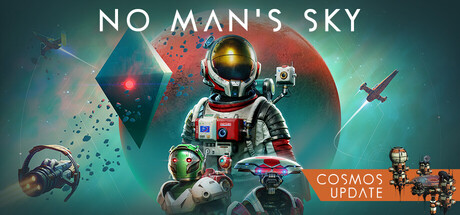
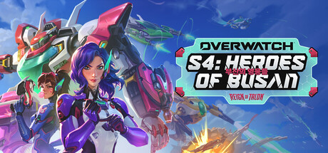
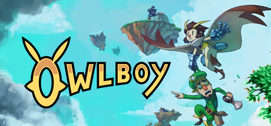
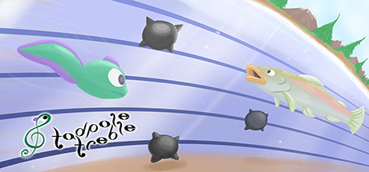

# Windows — 2016

[← All Windows years](../windows.md) · [Full 2016 page](../../years/2016.md)

154 Windows titles in 2016.

### 10 Second Ninja X

**Platforms:** Windows, PlayStation 4, PlayStation Vita, Xbox One &nbsp;|&nbsp; **Developer:** Four Circle Interactive &nbsp;|&nbsp; **Publisher:** Curve Digital &nbsp;|&nbsp; **Genre:** Fighting, Platform, Puzzle, Indie, Arcade &nbsp;|&nbsp; **Released:** July 19, 2016

> 10 SECOND NINJA X is a blisteringly fast, satisfyingly difficult and surprisingly methodical sidescroller which tasks you with completing each level in ten seconds or less. No lengthy checkpoint gaps. No cluttered control scheme. No hand holding. Get that three star rating, yo! You got this.  1 star. Again. 1 star. Again. 2 stars! Again. Back to 1 star. DAMN IT. Again...  100 levels including all 40 original 10 Second Ninja levels remastered in HD. Individual leaderboards for each level. Unlockables and collectibles.
>
> _Synopsis source: IGDB_

[IGDB](https://www.igdb.com/games/10-second-ninja-x)

---

### Abzu

**Platforms:** Windows, PlayStation 4, Xbox One &nbsp;|&nbsp; **Developer:** Giant Squid &nbsp;|&nbsp; **Publisher:** 505 Games &nbsp;|&nbsp; **Genre:** Puzzle, Adventure, Indie &nbsp;|&nbsp; **Released:** August 2, 2016

> Abzu is an exploration game where you are a lone diver in a lush ocean world. The diver descends deeper and deeper into the depths, where she will encounter majestic creatures, discover ancient secrets, and search for her true purpose. Abzu roughly translates to "The Ocean of Wisdom" from ancient Sumerian.
>
> _Synopsis source: IGDB_

[IGDB](https://www.igdb.com/games/abzu)

---

### Adr1ft

**Platforms:** PlayStation 4, Xbox One, PlayStation VR, Windows, SteamVR &nbsp;|&nbsp; **Developer:** Three One Zero &nbsp;|&nbsp; **Publisher:** 505 Games &nbsp;|&nbsp; **Genre:** Puzzle, Adventure, Indie &nbsp;|&nbsp; **Released:** March 28, 2016

> Adr1ft is an immersive First Person Experience (FPX) that tells the story of an astronaut in peril. Floating silently amongst the wreckage of a destroyed space station with no memory and a severely damaged EVA suit slowly leaking oxygen, the only survivor struggles to determine the cause of the catastrophic event that took the lives of everyone on board. The player fights to stay alive by exploring the wreckage for precious resources, and overcomes the challenges of an unforgiving environment to repair the damaged EEV and safely return home.
>
> _Synopsis source: IGDB_

[IGDB](https://www.igdb.com/games/adr1ft)

---

### Agatha Christie: The ABC Murders

**Platforms:** Xbox One, PlayStation 4, Windows, Linux, macOS &nbsp;|&nbsp; **Developer:** Artefacts Studio &nbsp;|&nbsp; **Publisher:** Microids, Anuman &nbsp;|&nbsp; **Genre:** Point-and-click, Puzzle, Adventure &nbsp;|&nbsp; **Released:** February 4, 2016

> The ABC Murders is an adventure and investigation game adapted from the classic Agatha Christie novel. You are the famous private detective Hercule Poirot and, once again, you find yourself up against a mysterious serial killer who goes by the name of "ABC".
>
> _Synopsis source: IGDB_

[IGDB](https://www.igdb.com/games/agatha-christie-the-abc-murders--1)

---

### AM2R: Return of Samus

**Platforms:** Windows &nbsp;|&nbsp; **Developer:** DoctorM64 &nbsp;|&nbsp; **Publisher:** DoctorM64 &nbsp;|&nbsp; **Genre:** Platform, Adventure, Indie &nbsp;|&nbsp; **Released:** August 6, 2016

> AM2R, short for Another Metroid 2 Remake, is an action-adventure video game developed by Milton Guasti under the pseudonym DoctorM64, and released in August 2016 for Microsoft Windows, coinciding with the 30th anniversary of the Metroid series. It is an unofficial, enhanced remake of Nintendo's Game Boy game Metroid II: Return of Samus (1991), borrowing the art style and overall feeling of the Game Boy Advance game Metroid: Zero Mission (2004). Shortly after the game's release, Nintendo sent DMCA notices to websites hosting AM2R; download links to the game were removed from its official website, but Guasti said that he still planned to continue working on the game privately. In September 2016, Guasti ended the development of AM2R after he received a DMCA takedown request from Nintendo.  The game follows Samus Aran, who aims to eradicate the parasitic Metroids from their home planet SR388. It includes several new features, including redone graphics and music, a map system, and new areas and minibosses. The controls were changed to be less "floaty", in line with the gameplay of later titles in the series. Video game journalists appreciated the game, frequently calling it impressive and commenting on the improved visuals compared to those of the original Metroid II, although one thought the conditions required to win battles against Metroids were too specific considering how often they occur. The game was nominated for The Game Awards 2016, but was later removed from the nominations page without notice.
>
> _Synopsis source: IGDB_

[IGDB](https://www.igdb.com/games/am2r-return-of-samus)

---

### American Truck Simulator

**Platforms:** Linux, macOS, Windows &nbsp;|&nbsp; **Developer:** SCS Software &nbsp;|&nbsp; **Publisher:** SCS Software &nbsp;|&nbsp; **Genre:** Racing, Simulator, Indie &nbsp;|&nbsp; **Released:** February 2, 2016

> American Truck Simulator puts you in the seat of a driver for hire entering the local freight market, making you work your way up to become an owner-operator, and go on to create one of the largest transportation companies in the United States.
>
> _Synopsis source: IGDB_

[IGDB](https://www.igdb.com/games/american-truck-simulator)

---

### Aragami

**Platforms:** macOS, PlayStation 4, Windows, Linux &nbsp;|&nbsp; **Developer:** Lince Works &nbsp;|&nbsp; **Publisher:** Merge Games, Lince Works &nbsp;|&nbsp; **Genre:** Adventure, Indie &nbsp;|&nbsp; **Released:** October 4, 2016

> Aragami is a third person stealth game that casts you as an undead assassin with the power to control the shadows. Teleport to any shadow, become invisible, materialize weapons or even summon a shadow dragon to infiltrate the enemy ranks and dispose of your targets.
>
> _Synopsis source: IGDB_

[IGDB](https://www.igdb.com/games/aragami)

---

### Assassin's Creed Chronicles: India

**Platforms:** PlayStation Vita, Xbox One, PlayStation 4, Windows &nbsp;|&nbsp; **Developer:** Climax Studios &nbsp;|&nbsp; **Publisher:** Ubisoft Entertainment &nbsp;|&nbsp; **Genre:** Platform, Adventure &nbsp;|&nbsp; **Released:** January 12, 2016

> Chronicles: India will feature Indian assassin Arbaaz Mir in 1841, while the Sikh Empire was at war with the East India Company. When a Master Templar arrives with a mysterious item that used to belong to the Assassin Order, Mir must discover why he has come, steal back the item, and protect his friends and his lover.
>
> _Synopsis source: IGDB_

[IGDB](https://www.igdb.com/games/assassins-creed-chronicles-india)

---

### Assassin's Creed Chronicles: Russia

**Platforms:** PlayStation Vita, Windows, PlayStation 4, Xbox One &nbsp;|&nbsp; **Developer:** Climax Studios &nbsp;|&nbsp; **Publisher:** Ubisoft Entertainment &nbsp;|&nbsp; **Genre:** Platform, Adventure &nbsp;|&nbsp; **Released:** February 9, 2016

> Chronicles: Russia will feature the Russian assassin Nikolai Orelov in 1918, during the aftermath of the October Revolution. Orelov wants to leave with his family, but is required to perform one last mission for the Assassin Order: infiltrate the house where the Tsar's family is being held by the Bolsheviks, and steal an artifact that has been fought over by Assassins and Templars for centuries. Along the way, he witnesses the massacre of the Tsar Nicholas II's children, but manages to save the princess, Anastasia. He must escape the Templars while protecting the artifact and Anastasia
>
> _Synopsis source: IGDB_

[IGDB](https://www.igdb.com/games/assassins-creed-chronicles-russia)

---

### Attack on Titan

**Platforms:** PlayStation 4, Xbox One, PlayStation Vita, Windows, PlayStation 3 &nbsp;|&nbsp; **Developer:** Omega Force &nbsp;|&nbsp; **Publisher:** Koei Tecmo Games &nbsp;|&nbsp; **Genre:** Hack and slash/Beat 'em up &nbsp;|&nbsp; **Released:** February 18, 2016

> Attack on Titan closely follows the riveting story line of Attack on Titan’s first season and focuses on the exploits of various key characters, putting the player in a position to relive the anime’s most shocking, courageous, and exhilarating moments. It revolves around the story of three young people who survive the destruction of their walled city district by enormous, man-eating Titans and eventually go on to join the Scout Regiment in order to protect humanity from this overpowering foe.
>
> _Synopsis source: IGDB_

[IGDB](https://www.igdb.com/games/attack-on-titan)

---

### Batman: The Telltale Series

**Platforms:** Xbox 360, iOS, Xbox One, Windows, PlayStation 3, PlayStation 4, Android &nbsp;|&nbsp; **Developer:** Telltale Games &nbsp;|&nbsp; **Publisher:** Telltale Games, LCG Entertainment &nbsp;|&nbsp; **Genre:** Point-and-click, Adventure &nbsp;|&nbsp; **Released:** August 2, 2016

> Batman: The Telltale Series is an episodic graphic adventure game developed by Telltale Games, first released in 2016. The game offers a narrative-focused experience, where players control Bruce Wayne and his alter ego, Batman, making choices that shape the story and relationships with characters.  The plot explores Bruce Wayne’s struggle to uncover corruption in Gotham City, while confronting revelations about his family’s past. The game features dialogue-driven gameplay, quick-time combat, and detective sequences. Decisions carry over across episodes, influencing the narrative’s direction and character arcs.
>
> _Synopsis source: IGDB_

[IGDB](https://www.igdb.com/games/batman-the-telltale-series)

---

### Battleborn

**Platforms:** Xbox One, Windows, PlayStation 4 &nbsp;|&nbsp; **Developer:** Gearbox Software &nbsp;|&nbsp; **Publisher:** 2K Games &nbsp;|&nbsp; **Genre:** Shooter, Strategy, Hack and slash/Beat 'em up, MOBA &nbsp;|&nbsp; **Released:** May 3, 2016

> "Battleborn is a next-gen hero-shooter brought to you by the creators of the award-winning and best-selling Borderlands franchise. In Battleborn’s distant future, the only hope for the last star in a dying universe is a new breed of warriors, who must put aside their differences to drive back an unstoppable menace. Choose from a myriad of powerful heroes and fight together alongside your friends in an intense co-operative campaign, or battle against them in fast-paced competitive multiplayer matches."  Console versions of the game allow for split-screen co-op in all game modes.
>
> _Synopsis source: IGDB_

[IGDB](https://www.igdb.com/games/battleborn)

---

### Battlefield 1

**Platforms:** Windows, PlayStation 4, Xbox One &nbsp;|&nbsp; **Developer:** EA Digital Illusions CE &nbsp;|&nbsp; **Publisher:** Electronic Arts &nbsp;|&nbsp; **Genre:** Shooter &nbsp;|&nbsp; **Released:** October 21, 2016

> Discover classic Battlefield gameplay with epic multiplayer and an adventure-filled campaign. Experience the dawn of all-out war, only in Battlefield 1. Fight your way through epic battles going from tight urban combat in a besieged French city to big open spaces in the Italian Alps or frantic combats in the Arabic sand dunes. Experience large-scale battles as infantry or piloting vehicles on land, air and sea, from the tanks and bikes on the ground, to bi-planes and gigantic battleships.
>
> _Synopsis source: IGDB_

[IGDB](https://www.igdb.com/games/battlefield-1)

---

### Beholder

**Platforms:** Windows, macOS, Linux &nbsp;|&nbsp; **Developer:** Warm Lamp Games &nbsp;|&nbsp; **Publisher:** Alawar Entertainment &nbsp;|&nbsp; **Genre:** Role-playing (RPG), Simulator, Strategy, Adventure, Indie &nbsp;|&nbsp; **Released:** November 9, 2016

> A totalitarian State controls every aspect of private and social life. Laws are oppressive. Surveillance is total. Privacy is dead. You are a State-installed manager of an apartment house. The State requires you to spy on your tenants, and report any illegal or subversive activity. However, you can also choose to keep the information to yourself, or use it to blackmail the residents, resulting in a multitude of choices and endings.
>
> _Synopsis source: IGDB_

[IGDB](https://www.igdb.com/games/beholder)

---

### BioShock 2 Remastered

**Platforms:** Xbox One, macOS, Windows &nbsp;|&nbsp; **Developer:** 2K Australia, 2K China, Digital Extremes, Feral Interactive &nbsp;|&nbsp; **Publisher:** 2K Games, Feral Interactive &nbsp;|&nbsp; **Genre:** Shooter, Role-playing (RPG) &nbsp;|&nbsp; **Released:** September 14, 2016

> BioShock 2 Remastered was released as a part of BioShock: The Collection and also available separately for PC. The remastered version has achievements, full controller support, high resolution textures, models and interface, and 4K resolution support.
>
> _Synopsis source: IGDB_

[IGDB](https://www.igdb.com/games/bioshock-2-remastered)

---

### BioShock Remastered

**Platforms:** Windows, Xbox One, macOS &nbsp;|&nbsp; **Developer:** 2K Australia, 2K Boston, Feral Interactive &nbsp;|&nbsp; **Publisher:** 2K Games, Feral Interactive &nbsp;|&nbsp; **Genre:** Shooter, Role-playing (RPG), Adventure &nbsp;|&nbsp; **Released:** September 14, 2016

> BioShock Remastered was released as a part of BioShock: The Collection and also available separately for PC. The remastered version has achievements, full controller support, high resolution textures, models and interface, and 4K resolution support.
>
> _Synopsis source: IGDB_

[IGDB](https://www.igdb.com/games/bioshock-remastered)

---

### Burly Men at Sea

**Platforms:** Android, iOS, macOS, Windows &nbsp;|&nbsp; **Developer:** Brain&Brain &nbsp;|&nbsp; **Publisher:** Plug In Digital, Brain&Brain &nbsp;|&nbsp; **Genre:** Puzzle, Role-playing (RPG), Adventure, Indie &nbsp;|&nbsp; **Released:** September 29, 2016

> Burly Men at Sea is a folktale about a trio of large, bearded fishermen who step away from the ordinary to seek adventure. Set in early 20th-century Scandinavia, the game's story branches through a series of encounters with creatures from folklore.
>
> _Synopsis source: IGDB_

[IGDB](https://www.igdb.com/games/burly-men-at-sea)

---

### Call of Duty: Infinite Warfare

**Platforms:** PlayStation 4, Windows, Xbox One &nbsp;|&nbsp; **Developer:** Infinity Ward &nbsp;|&nbsp; **Publisher:** Activision &nbsp;|&nbsp; **Genre:** Shooter, Adventure &nbsp;|&nbsp; **Released:** November 4, 2016

> Call of Duty: Infinite Warfare delivers three unique game modes: Campaign, Multiplayer, and Zombies. Campaign is a return to the gritty, military roots of the franchise, while boldly looking ahead, delivering a rich and engaging narrative that is unlike anything to date in a Call of Duty game. The player will embark on a classically-styled story about grand scale warfare, set in a future where human conflict has spread throughout our solar system.  Multiplayer combines popular mechanics such as the chained-based movement system, with a load of gameplay innovations to deliver one of the deepest and most engaging online experiences in gaming. The new Zombies mode will thrill co-op players with an original, distinctive approach and an uproarious narrative sure to excite fans. The title introduces stunning, multi-planetary environments, new weaponry, and all-new player abilities.
>
> _Synopsis source: IGDB_

[IGDB](https://www.igdb.com/games/call-of-duty-infinite-warfare)

---

### Call of Duty: Modern Warfare Remastered

**Platforms:** Windows, PlayStation 4, Xbox One &nbsp;|&nbsp; **Developer:** Certain Affinity, Raven Software, Beenox &nbsp;|&nbsp; **Publisher:** Activision &nbsp;|&nbsp; **Genre:** Shooter &nbsp;|&nbsp; **Released:** November 4, 2016

> One of the most critically-acclaimed games in history. Call of Duty 4: Modern Warfare is back, remastered in true high-definition, featuring enhanced textures, rendering, high-dynamic range lighting, and much more to bring a new generation experience to fans.
>
> _Synopsis source: IGDB_

[IGDB](https://www.igdb.com/games/call-of-duty-modern-warfare-remastered)

---

### Clustertruck

**Platforms:** macOS, Xbox One, Linux, PlayStation 4, Windows &nbsp;|&nbsp; **Developer:** Landfall Games &nbsp;|&nbsp; **Publisher:** tinyBuild &nbsp;|&nbsp; **Genre:** Platform, Indie &nbsp;|&nbsp; **Released:** September 27, 2016

> Clustertruck is a chaotic physics based truckformer. Jump your way through insane levels in a game of "the floor is lava" on top of speeding trucks driven by terrible drivers.
>
> _Synopsis source: IGDB_

[IGDB](https://www.igdb.com/games/clustertruck)

---

### Darkest Dungeon

**Platforms:** Windows, Linux, PlayStation Vita, macOS, PlayStation 4 &nbsp;|&nbsp; **Developer:** Red Hook Studios &nbsp;|&nbsp; **Publisher:** Red Hook Studios &nbsp;|&nbsp; **Genre:** Role-playing (RPG), Strategy, Turn-based strategy (TBS), Tactical, Adventure, Indie &nbsp;|&nbsp; **Released:** January 19, 2016

> Darkest Dungeon is a challenging gothic roguelike turn-based RPG about the psychological stresses of adventuring. Recruit, train, and lead a team of flawed heroes against unimaginable horrors, stress, disease, and the ever-encroaching dark. Can you keep your heroes together when all hope is lost?
>
> _Synopsis source: IGDB_

[IGDB](https://www.igdb.com/games/darkest-dungeon)

---

### Darksiders: Warmastered Edition

**Platforms:** Windows, Xbox One, PlayStation 4, Wii U &nbsp;|&nbsp; **Developer:** Kaiko &nbsp;|&nbsp; **Publisher:** Nordic Games Group, THQ Nordic &nbsp;|&nbsp; **Genre:** Role-playing (RPG), Hack and slash/Beat 'em up, Adventure &nbsp;|&nbsp; **Released:** November 22, 2016

> Deceived by the forces of evil into prematurely bringing about the end of the world, War – the first Horseman of the Apocalypse – stands accused of breaking the sacred law by inciting a war between Heaven and Hell. In the slaughter that ensued, the demonic forces defeated the heavenly hosts and laid claim to the Earth.  Brought before the sacred Charred Council, War is indicted for his crimes and stripped of his powers. Dishonored and facing his own death, War is given the opportunity to return to Earth to search for the truth and punish those responsible.  Hunted by a vengeful group of Angels, War must take on the forces of Hell, forge uneasy alliances with the very demons he hunts, and journey across the ravaged remains of the Earth on his quest for vengeance and vindication.
>
> _Synopsis source: IGDB_

[IGDB](https://www.igdb.com/games/darksiders-warmastered-edition)

---

### Day of the Tentacle Remastered

**Platforms:** macOS, Windows, PlayStation Vita, Linux, PlayStation 4, iOS &nbsp;|&nbsp; **Developer:** Double Fine Productions &nbsp;|&nbsp; **Publisher:** Double Fine Productions &nbsp;|&nbsp; **Genre:** Point-and-click, Puzzle, Adventure &nbsp;|&nbsp; **Released:** March 21, 2016

> Originally released by LucasArts in 1993 as a sequel to Ron Gilbert’s ground breaking Maniac Mansion, Day of the Tentacle is a mind-bending, time travel, cartoon puzzle adventure game in which three unlikely friends work together to prevent an evil mutated purple tentacle from taking over the world!  Now, over twenty years later, Day of the Tentacle is back in a remastered edition that features all new hand-drawn, high resolution artwork, with remastered audio, music and sound effects (which the original 90s marketing blurb described as "zany!")  Players are able to switch back and forth between classic and remastered modes, and mix and match audio, graphics and user interface to their heart's desire. We’ve also included a concept art browser, and recorded a commentary track with the game’s original creators Tim Schafer, Dave Grossman, Larry Ahern, Peter Chan, Peter McConnell and Clint Bajakian.  Day of the Tentacle was Tim Schafer’s first game as co-project lead, and a much beloved cult classic! This special edition has been lovingly restored and remade with the care and attention that can only come from involving the game's original creators. It’s coming to Windows, OSX, PlayStation 4 and PlayStation Vita early next year!
>
> _Synopsis source: IGDB_

[IGDB](https://www.igdb.com/games/day-of-the-tentacle-remastered)

---

### Dead by Daylight

**Platforms:** Windows &nbsp;|&nbsp; **Developer:** Behaviour Interactive &nbsp;|&nbsp; **Publisher:** Behaviour Interactive, 505 Games, Deep Silver, Starbreeze Studios, NetEase Games &nbsp;|&nbsp; **Genre:** Strategy &nbsp;|&nbsp; **Released:** June 14, 2016

> Trapped forever in a realm of eldritch evil where even death is not an escape, four determined Survivors face a bloodthirsty Killer in a vicious game of nerve and wits. Pick a side and step into a world of tension and terror with horror gaming's best asymmetrical multiplayer.  Survivors play in third-person and have the advantage of better situational awareness. The Killer plays in first-person and is more focused on their prey.  The Survivors' goal in each encounter is to escape the Killing Ground without getting caught by the Killer - something that sounds easier than it is, especially when the environment changes every time you play.
>
> _Synopsis source: IGDB_

[IGDB](https://www.igdb.com/games/dead-by-daylight)

---

### Dead Island: Definitive Edition

**Platforms:** Linux, Windows, PlayStation 4, Xbox One &nbsp;|&nbsp; **Developer:** Techland &nbsp;|&nbsp; **Publisher:** Deep Silver &nbsp;|&nbsp; **Genre:** Shooter, Hack and slash/Beat 'em up &nbsp;|&nbsp; **Released:** May 31, 2016

> Welcome to the zombie apocalypse experience of a lifetime – and now more beautiful than ever. Caught in the midst of an epic zombie outbreak on the tropical island of Banoi, your only thought is: Survive!
>
> _Synopsis source: IGDB_

[IGDB](https://www.igdb.com/games/dead-island-definitive-edition)

---

### Dead Rising 4

**Platforms:** Xbox One, Windows &nbsp;|&nbsp; **Developer:** Capcom Game Studio Vancouver, Inc. &nbsp;|&nbsp; **Publisher:** Capcom, Microsoft Studios &nbsp;|&nbsp; **Genre:** Shooter, Hack and slash/Beat 'em up, Adventure &nbsp;|&nbsp; **Released:** December 6, 2016

> It’s the holiday season in Willamette, Colorado and a mysterious outbreak has overrun the Willamette Memorial Megaplex Mall and surrounding town with dangerous and deadly predators. Join Frank West as you explore a vast, open world sandbox filled with dangerous new zombies and a million ways to kill them as you seek to uncover the truth behind the outbreak – or die trying.
>
> _Synopsis source: IGDB_

[IGDB](https://www.igdb.com/games/dead-rising-4)

---

### Deadlight: Director's Cut

**Platforms:** Xbox One, Windows, PlayStation 4 &nbsp;|&nbsp; **Developer:** Abstraction Games, Tequila Works &nbsp;|&nbsp; **Publisher:** Deep Silver &nbsp;|&nbsp; **Genre:** Platform, Adventure &nbsp;|&nbsp; **Released:** June 21, 2016

> A zombie outbreak eradicated all hope of returning life back to normal, now only survival lives on. Run, hide and fight your way through the undead as Randall searches for his family in this gorgeous, gritty, destroyed world.
>
> _Synopsis source: IGDB_

[IGDB](https://www.igdb.com/games/deadlight-directors-cut)

---

### Death Road to Canada

**Platforms:** macOS, Linux, Windows &nbsp;|&nbsp; **Developer:** Rocketcat Games &nbsp;|&nbsp; **Publisher:** Ukiyo Publishing, Noodlecake Studios, Rocketcat Games &nbsp;|&nbsp; **Genre:** Role-playing (RPG), Adventure, Indie &nbsp;|&nbsp; **Released:** July 21, 2016

> Death Road to Canada is a Permadeath Randomized Road Trip Simulator. You manage a group of survivors through decision making events as you travel from Florida to Ontario, Canada. This is mixed in with exploring, sneaking around, or fighting in randomly generated cities and other locations.  Scavenge for supplies, find survivors, and deal with massive hordes of classic-style zombies. Recruit up to four survivors with their own random names, appearances, personalities, and quirks that can both help and hinder your journey to safety. Make your own characters to put in the game, and customize them to be based on whoever you'd like.
>
> _Synopsis source: IGDB_

[IGDB](https://www.igdb.com/games/death-road-to-canada)

---

### Deponia Doomsday

**Platforms:** Windows, macOS, Linux &nbsp;|&nbsp; **Developer:** Daedalic Entertainment &nbsp;|&nbsp; **Publisher:** Daedalic Entertainment &nbsp;|&nbsp; **Genre:** Point-and-click, Puzzle, Adventure, Indie &nbsp;|&nbsp; **Released:** March 1, 2016

> One fateful night, Rufus awakes from a haunting nightmare: he sacrificed himself to save Deponia. But at what price? Elysium, the floating city crash-landed on the planet. As the last surviving Deponian, he fought savage fewlocks, but in the end, there was only one way out: He had to blow up Deponia! And... He grew a mustache. Of course he realized that these gruesome events -especially the mustache part- had to be prevented from ever happening. Deponia and his well-shaved face had to survive!But was this really just a dream? With the help of McChronicle, a quirky temporal scientist, who discovered strange time-anomalies, Rufus discovers that some time travelers from the future carelessly parked their time machine in his neighborhood. Just imagine if this amazing technology would fall into the wrong hands!Dive right into this frantic sequel of the Deponia cult-trilogy and join the chaotic anti-hero Rufus on his most peculiar adventure. Even without knowing the previous installment, the hilarity of Deponia Doomsday will have you cracking smiles and burst with laughter.Get enthralled by the bizarre humor and the uniquely designed world and enjoy the largest and longest Deponia adventure of all time.
>
> _Synopsis source: IGDB_

[IGDB](https://www.igdb.com/games/deponia-doomsday)

---

### Deus Ex: Mankind Divided

**Platforms:** PlayStation 4, Windows, Xbox One, Linux &nbsp;|&nbsp; **Developer:** Eidos Montréal &nbsp;|&nbsp; **Publisher:** Feral Interactive, Eidos Montréal, Square Enix &nbsp;|&nbsp; **Genre:** Shooter, Puzzle, Role-playing (RPG), Adventure &nbsp;|&nbsp; **Released:** August 23, 2016

> Deus Ex: Mankind Divided directly follows the aftermath of the Aug Incident, a day when mechanically augmented citizens all over the world were stripped of control over their minds and bodies, resulting in the deaths of millions of innocents. The year is now 2029, and the golden era of augmentations is over. Mechanically augmented humans have been deemed outcasts and segregated from the rest of society. Crime and acts of terror serve as a thin veil to cover up an overarching conspiracy aimed at controlling the future of mankind…
>
> _Synopsis source: IGDB_

[IGDB](https://www.igdb.com/games/deus-ex-mankind-divided)

---

### Devil Daggers

**Platforms:** Windows, macOS, Linux &nbsp;|&nbsp; **Developer:** Sorath &nbsp;|&nbsp; **Publisher:** Sorath &nbsp;|&nbsp; **Genre:** Shooter, Indie &nbsp;|&nbsp; **Released:** February 18, 2016

> Inspired by 1990s FPS and arcade games, Devil Daggers is a fast-paced shooter that places you in an abyssal arena to face endless legions of demons. Armed with versatile magic daggers and a fluid movement system, fight to survive as long as you can. Compete for precious seconds with Steam Friends or on global leaderboards. Your spirit and skill will be tested.
>
> _Synopsis source: IGDB_

[IGDB](https://www.igdb.com/games/devil-daggers)

---

### Dishonored 2

**Platforms:** Windows, PlayStation 4, Xbox One &nbsp;|&nbsp; **Developer:** Arkane Studios &nbsp;|&nbsp; **Publisher:** Bethesda Softworks &nbsp;|&nbsp; **Genre:** Shooter, Role-playing (RPG), Adventure &nbsp;|&nbsp; **Released:** November 11, 2016

> Dishonored 2 is a first-person action video game and the sequel to Dishonored. It borrows many of the gameplay elements from the first opus: players define their own play style by blending action, assassination, stealth, mobility and combat. Combining tools at their disposal, players are allowed options to eliminate enemies, whether they choose to pursue them unseen or ruthlessly attack head on. Dishonored 2 features the same campaign style as its predecessor in which the protagonist must advance through a series of missions.
>
> _Synopsis source: IGDB_

[IGDB](https://www.igdb.com/games/dishonored-2)

---

### Don't Starve Together

**Platforms:** macOS, Windows, Linux &nbsp;|&nbsp; **Developer:** Klei Entertainment &nbsp;|&nbsp; **Publisher:** Klei Entertainment &nbsp;|&nbsp; **Genre:** Simulator, Strategy, Adventure, Indie &nbsp;|&nbsp; **Released:** April 21, 2016

> Fight, Farm, Build and Explore Together in the standalone multiplayer expansion to the uncompromising wilderness survival game, Don't Starve. Discover and explore a massive procedurally generated and biome-rich world with countless resources and threats. Whether you stick to the surface world, go spelunking in the caves, dive deeper into the Ancient Archive, or set sail for the Lunar islands, it will be a long time before you run out of things to do.
>
> _Synopsis source: IGDB_

[IGDB](https://www.igdb.com/games/dont-starve-together)

---

### Doom

**Platforms:** Windows, PlayStation 4, Xbox One &nbsp;|&nbsp; **Developer:** id Software &nbsp;|&nbsp; **Publisher:** Bethesda Softworks &nbsp;|&nbsp; **Genre:** Shooter &nbsp;|&nbsp; **Released:** May 12, 2016

> Developed by id software, the studio that pioneered the first-person shooter genre and created multiplayer Deathmatch, Doom returns as a brutally fun and challenging modern-day shooter experience. Relentless demons, impossibly destructive guns, and fast, fluid movement provide the foundation for intense, first-person combat – whether you’re obliterating demon hordes through the depths of Hell in the single-player campaign, or competing against your friends in numerous multiplayer modes. Expand your gameplay experience using Doom SnapMap game editor to easily create, play, and share your content with the world.
>
> _Synopsis source: IGDB_

[IGDB](https://www.igdb.com/games/doom--2)

---

### Downfall

**Platforms:** Windows &nbsp;|&nbsp; **Developer:** Harvester Games &nbsp;|&nbsp; **Publisher:** Screen 7 &nbsp;|&nbsp; **Genre:** Point-and-click, Adventure, Indie &nbsp;|&nbsp; **Released:** February 15, 2016

> There is nothing Joe wouldn't do for his wife. But as they try to save their marriage with a romantic getaway, things go from bad to worse, and from worse... to insanity.  In this tale of love, madness and murder - Joe will prove what kind of man he is. But what kind of man is he exactly? A loving husband? A cold realist? A bitter skeptic? That is something YOU will decide, as you join him on his journey for redemption...
>
> _Synopsis source: IGDB_

[IGDB](https://www.igdb.com/games/downfall)

---

### Dragon Ball: Xenoverse 2

**Platforms:** Xbox One, PlayStation 4, Windows &nbsp;|&nbsp; **Developer:** Dimps &nbsp;|&nbsp; **Publisher:** Bandai Namco Entertainment &nbsp;|&nbsp; **Genre:** Fighting, Role-playing (RPG), Simulator, Adventure &nbsp;|&nbsp; **Released:** October 25, 2016

> DRAGON BALL XENOVERSE 2 builds upon the highly popular DRAGON BALL XENOVERSE with enhanced graphics that will further immerse players into the largest and most detailed Dragon Ball world ever developed.  DRAGON BALL XENOVERSE 2 will deliver a new hub city and the most character customization choices to date among a multitude of new features and special upgrades.
>
> _Synopsis source: IGDB_

[IGDB](https://www.igdb.com/games/dragon-ball-xenoverse-2)

---

### Drawful 2

**Platforms:** Windows, macOS, PlayStation 4, Xbox One, Amazon Fire TV, Linux &nbsp;|&nbsp; **Developer:** Jackbox Games &nbsp;|&nbsp; **Publisher:** Jackbox Games &nbsp;|&nbsp; **Genre:** Strategy, Quiz/Trivia, Indie, Card & Board Game &nbsp;|&nbsp; **Released:** June 21, 2016

> The team behind the hit party games Fibbage, Quiplash, and YOU DON’T KNOW JACK presents Drawful 2, the game of terrible drawings and hilariously wrong answers!  You use your phone or tablet to draw weird and funny things like “pitcher of nachos” or “death by trombone.” The other players type in what they think the (probably terrible) drawing is and those become the multiple-choice wrong answers. Then everyone - even an audience of potentially thousands – tries to guess the REAL answer.  Drawful 2 is a go-to party game that everyone can play and enjoy!
>
> _Synopsis source: IGDB_

[IGDB](https://www.igdb.com/games/drawful-2)

---

### Duke Nukem 3D: 20th Anniversary World Tour

**Platforms:** Xbox One, PlayStation 4, Windows &nbsp;|&nbsp; **Developer:** Nerve Software, Gearbox Software &nbsp;|&nbsp; **Publisher:** Gearbox Publishing &nbsp;|&nbsp; **Genre:** Shooter, Puzzle, Adventure &nbsp;|&nbsp; **Released:** October 11, 2016

> Frag like it’s 1996 – this time with even more asses to kick! Join the world’s greatest action hero in Duke Nukem 3D: 20th Anniversary World Tour as he saves Earth once again, kicking alien ass and saving babes across the globe along the way.
>
> _Synopsis source: IGDB_

[IGDB](https://www.igdb.com/games/duke-nukem-3d-20th-anniversary-world-tour)

---

### Enter the Gungeon

**Platforms:** macOS, Windows, PlayStation 4, Linux &nbsp;|&nbsp; **Developer:** Dodge Roll &nbsp;|&nbsp; **Publisher:** Devolver Digital &nbsp;|&nbsp; **Genre:** Shooter, Adventure, Indie, Arcade &nbsp;|&nbsp; **Released:** April 5, 2016

> Enter the Gungeon is a top-down bullet hell roguelike where players take control of one of several characters known as Gungeoneers and fight their way through the procedurally generated floors of the Gungeon. Combat revolves around shooting bullet-shaped enemies with an extensive arsenal of both conventional and exotic firearms, while using dodge rolls, table flips, and environmental cover to avoid dense patterns of projectiles. The game features permadeath, meaning all items and weapons are lost upon dying, and players must start again from the first floor. Between runs, a hub area called the Breach allows players to unlock new items and interact with non-player characters.
>
> _Synopsis source: IGDB_

[IGDB](https://www.igdb.com/games/enter-the-gungeon)

---

### Epistory: Typing Chronicles

**Platforms:** Windows, macOS, Linux &nbsp;|&nbsp; **Developer:** Fishing Cactus &nbsp;|&nbsp; **Publisher:** Plug In Digital, Fishing Cactus &nbsp;|&nbsp; **Genre:** Puzzle, Role-playing (RPG), Adventure, Indie &nbsp;|&nbsp; **Released:** March 30, 2016

> Epistory is an atmospheric adventure typing game that tells the story of a writer lacking inspiration who asks her muse to help write her latest book.  In Epistory you play the muse, a fictional character in a world where everything is untold. Your adventure begins on a blank page, but the world will soon become larger and livelier as you gather inspiration, solve its mysteries and defeat its enemies. From movement to opening chests and fighting in epic battles, every element in the game is controlled exclusively with the keyboard.  As you progress and explore the fantasy origami world, the story literally unfolds in the writer’s mind and the mysteries of the magic power of the words are revealed.
>
> _Synopsis source: IGDB_

[IGDB](https://www.igdb.com/games/epistory-typing-chronicles)

---

### Event[0]

**Platforms:** macOS, Windows &nbsp;|&nbsp; **Developer:** Ocelot Society &nbsp;|&nbsp; **Publisher:** Ocelot Society &nbsp;|&nbsp; **Genre:** Puzzle, Adventure, Indie &nbsp;|&nbsp; **Released:** September 14, 2016

> "Event[0] is a game about building a personal relationship with a machine.  You type messages into a computer, and Kaizen answers. As in any relationship, you experience gratitude, disappointment, and sometimes jealousy. It is by working through fears and anxieties of your virtual companion that you will find your way back to Earth."
>
> _Synopsis source: IGDB_

[IGDB](https://www.igdb.com/games/event-0)

---

### Far Cry: Primal

**Platforms:** Windows, PlayStation 4, Xbox One &nbsp;|&nbsp; **Developer:** Ubisoft Montreal &nbsp;|&nbsp; **Publisher:** Ubisoft Entertainment &nbsp;|&nbsp; **Genre:** Shooter, Adventure &nbsp;|&nbsp; **Released:** February 23, 2016

> Far Cry Primal is a first-person action game set in 10,000 BC during the transition from the Upper Paleolithic to the Mesolithic period. As part of the Far Cry series, it replaces modern firearms with prehistoric weapons including spears, clubs, and bows. Players take the role of Takkar, a Wenja tribesman who can tame wild animals such as sabertooth cats and wolves to use as companions in combat. The open world takes place in the fictional Oros valley and features a day-night cycle with dynamic wildlife behavior, tribal warfare, and resource crafting. The game's characters speak a constructed language based on reconstructed Proto-Indo-European.
>
> _Synopsis source: IGDB_

[IGDB](https://www.igdb.com/games/far-cry-primal)

---

### FIFA 17

**Platforms:** Windows, Xbox One, PlayStation 4 &nbsp;|&nbsp; **Developer:** EA Vancouver, EA Romania &nbsp;|&nbsp; **Publisher:** EA Sports &nbsp;|&nbsp; **Genre:** Sport &nbsp;|&nbsp; **Released:** September 27, 2016

> For the first time ever in FIFA, live your story on and off the pitch as the Premier League’s next rising star, Alex Hunter. Play on any club in the Premier league, for authentic managers and alongside some of the best players on the planet. Experience brand new worlds in FIFA 17, all while navigating your way through the emotional highs and lows of The Journey.
>
> _Synopsis source: IGDB_

[IGDB](https://www.igdb.com/games/fifa-17)

---

### Firewatch

**Platforms:** Xbox One, Linux, macOS, Windows, PlayStation 4 &nbsp;|&nbsp; **Developer:** Campo Santo &nbsp;|&nbsp; **Publisher:** Panic &nbsp;|&nbsp; **Genre:** Adventure, Indie &nbsp;|&nbsp; **Released:** February 9, 2016

> Firewatch is a single-player first-person video game where you, as a man named Henry, explore the Wyoming wilderness after taking a summer job as a fire lookout. What is supposed to be a peaceful respite from your complicated life takes a turn when you start to question some of the things that are happening to you.  Your only human connection is over a handheld radio, which you’ll use to speak with your supervisor Delilah about the things both of you are experiencing.
>
> _Synopsis source: IGDB_

[IGDB](https://www.igdb.com/games/firewatch)

---

### Five Nights at Freddy's: Sister Location

**Platforms:** Windows &nbsp;|&nbsp; **Developer:** Scottgames &nbsp;|&nbsp; **Publisher:** Scottgames &nbsp;|&nbsp; **Genre:** Point-and-click, Simulator, Strategy, Adventure, Indie &nbsp;|&nbsp; **Released:** October 7, 2016

> Welcome to Circus Baby's Pizza World, where family fun and interactivity go beyond anything you've seen at those other pizza places! With cutting-edge animatronic entertainers that will knock your kids' socks off, as well as customized pizza catering, no party is complete without Circus Baby and the gang!  Now hiring: Late night technician. Must enjoy cramped spaces and be comfortable around active machinery. Not responsible for death or dismemberment.
>
> _Synopsis source: IGDB_

[IGDB](https://www.igdb.com/games/five-nights-at-freddys-sister-location)

---

### Football Manager 2017

**Platforms:** Windows, macOS, Linux &nbsp;|&nbsp; **Developer:** Sports Interactive &nbsp;|&nbsp; **Publisher:** Sega Games &nbsp;|&nbsp; **Genre:** Simulator, Sport &nbsp;|&nbsp; **Released:** November 4, 2016

> Take control of your favourite football team in Football Manager 2017, the most realistic and immersive football management game to date. It’s the closest thing to doing the job for real!
>
> _Synopsis source: IGDB_

[IGDB](https://www.igdb.com/games/football-manager-2017)

---

### Furi

**Platforms:** Windows, Xbox One, PlayStation 4 &nbsp;|&nbsp; **Developer:** The Game Bakers &nbsp;|&nbsp; **Publisher:** The Game Bakers &nbsp;|&nbsp; **Genre:** Shooter, Hack and slash/Beat 'em up, Adventure, Indie &nbsp;|&nbsp; **Released:** July 5, 2016

> Fight your way free in our frenzied all-boss fighter, and discover what’s waiting behind the last gate. Furi is all about the tension of one-on-one fights against deadly adversaries. It’s an intense, ultra-responsive hack-and-slash with a unique mix of fast-paced sword fighting and dual-stick shooting. Each of the formidable guardians —designed by Afro Samurai creator Takashi Okazaki— has a unique and surprising combat style that requires focus and skill to defeat. The high-energy action gets a boost from an explosive soundtrack composed by electro musicians including Carpenter Brut, who created the trailer’s theme.
>
> _Synopsis source: IGDB_

[IGDB](https://www.igdb.com/games/furi)

---

### Gears of War 4

**Platforms:** Windows, Xbox One &nbsp;|&nbsp; **Developer:** The Coalition &nbsp;|&nbsp; **Publisher:** Microsoft Studios &nbsp;|&nbsp; **Genre:** Shooter &nbsp;|&nbsp; **Released:** October 11, 2016

> A new saga begins for one of the most acclaimed video game franchises in history. After narrowly escaping an attack on their village, JD Fenix and his friends, Kait and Del, must rescue the ones they love and discover the source of a monstrous new enemy.
>
> _Synopsis source: IGDB_

[IGDB](https://www.igdb.com/games/gears-of-war-4)

---

### Grim Dawn

**Platforms:** Windows &nbsp;|&nbsp; **Developer:** Crate Entertainment &nbsp;|&nbsp; **Publisher:** Crate Entertainment &nbsp;|&nbsp; **Genre:** Role-playing (RPG), Hack and slash/Beat 'em up, Adventure, Indie &nbsp;|&nbsp; **Released:** February 25, 2016

> Enter an apocalyptic fantasy world where humanity is on the brink of extinction, iron is valued above gold and trust is hard earned. This ARPG features complex character development, hundreds of unique items, crafting and quests with choice & consequence.
>
> _Synopsis source: IGDB_

[IGDB](https://www.igdb.com/games/grim-dawn)

---

### Grow Up

**Platforms:** Windows, PlayStation 4, Xbox One &nbsp;|&nbsp; **Developer:** Ubisoft Reflections &nbsp;|&nbsp; **Publisher:** Ubisoft Entertainment, Atari &nbsp;|&nbsp; **Genre:** Platform, Adventure &nbsp;|&nbsp; **Released:** August 16, 2016

> BUD is back! Join this adorable wobbly robot on his fantastical acroBUDic adventure to the moon.  "Grow Up is a joyful and ageless fantasy game. BUD, a clumsy and charming robot, is on a mission to find MOM, his parental spaceship. Leap, bounce, and float in a vast open world as BUD explores the new planet in this beautiful acrobatic adventure."
>
> _Synopsis source: IGDB_

[IGDB](https://www.igdb.com/games/grow-up)

---

### Headlander

**Platforms:** macOS, Windows, PlayStation 4, Xbox One &nbsp;|&nbsp; **Developer:** Double Fine Productions &nbsp;|&nbsp; **Publisher:** Adult Swim Games &nbsp;|&nbsp; **Genre:** Shooter, Platform, Adventure, Indie &nbsp;|&nbsp; **Released:** July 25, 2016

> Launch into the ultimate head trip as you blast through psychotic robots in a retro 70's sci-fi action adventure from Double Fine Productions. It is a world of automation, a utopia gone wrong in which all of humanity have transferred their minds into robotic imposter bodies and are ruled by a computer.
>
> _Synopsis source: IGDB_

[IGDB](https://www.igdb.com/games/headlander)

---

### Hearts of Iron IV

**Platforms:** macOS, Linux, Windows &nbsp;|&nbsp; **Developer:** Paradox Development Studio &nbsp;|&nbsp; **Publisher:** Paradox Interactive &nbsp;|&nbsp; **Genre:** Real Time Strategy (RTS), Simulator, Strategy &nbsp;|&nbsp; **Released:** June 6, 2016

> Victory is at your fingertips! Your ability to lead your nation is your supreme weapon, the strategy game Hearts of Iron IV lets you take command of any nation in World War II; the most engaging conflict in world history.  From the heart of the battlefield to the command center, you will guide your nation to glory and wage war, negotiate or invade. You hold the power to tip the very balance of WWII. It is time to show your ability as the greatest military leader in the world. Will you relive or change history? Will you change the fate of the world?
>
> _Synopsis source: IGDB_

[IGDB](https://www.igdb.com/games/hearts-of-iron-iv)

---

### Heroes & Generals

**Platforms:** Windows &nbsp;|&nbsp; **Developer:** Reto-Moto &nbsp;|&nbsp; **Publisher:** Reto-Moto &nbsp;|&nbsp; **Genre:** Shooter, Strategy, Tactical, Indie &nbsp;|&nbsp; **Released:** September 23, 2016

> Heroes & Generals is the ultimate WW2 game. A free-to-play MMOFPS, where Germany, the United States and the Soviet Union fight for victory in one grand, persistent online war fought by players across the world with access to a huge arsenal of vehicles and weapons. You fight and make friends as a team and as part of a huge and growing community. No matter if you play as Infantry, Tank crew, Fighter pilot, Paratrooper, Recon or as a General taking strategic decisions – everything you do makes a difference in the war.
>
> _Synopsis source: IGDB_

[IGDB](https://www.igdb.com/games/heroes-generals)

---

### Hitman

**Platforms:** PlayStation 4, Windows, Xbox One &nbsp;|&nbsp; **Developer:** IO Interactive &nbsp;|&nbsp; **Publisher:** Square Enix, IO Interactive &nbsp;|&nbsp; **Genre:** Shooter, Tactical, Adventure &nbsp;|&nbsp; **Released:** March 11, 2016

> Hitman is a stealth game and the sixth mainline entry in the Hitman franchise, serving as the first installment of the World of Assassination trilogy. Players control the genetically engineered assassin Agent 47 from a third-person perspective as he carries out contract killings across large, open-ended sandbox levels set in locations around the globe including Paris, Italy, Morocco, Bangkok, Colorado, and Japan. Each level presents numerous approaches to eliminating targets, from disguises and environmental manipulation to staged accidents and direct confrontation.  The game features a classless system where players unlock new tools, starting locations, and gear by completing challenges. Originally released episodically, the game was later delisted from standalone sale in 2023 when IO Interactive consolidated the trilogy under a single package titled Hitman: World of Assassination.
>
> _Synopsis source: IGDB_

[IGDB](https://www.igdb.com/games/hitman)

---

### Homefront: The Revolution

**Platforms:** Xbox One, Windows, PlayStation 4 &nbsp;|&nbsp; **Developer:** Dambuster Studios &nbsp;|&nbsp; **Publisher:** Deep Silver &nbsp;|&nbsp; **Genre:** Shooter, Adventure &nbsp;|&nbsp; **Released:** May 17, 2016

> Homefront: The Revolution is an open-world first person shooter where you must lead the Resistance movement in guerrilla warfare against a superior military force.A living, breathing, open world responds to your actions - you and your Resistance Cell can inspire a rebellion on the streets and turn Occupation into Revolution, as oppressed civilians take up the fight.
>
> _Synopsis source: IGDB_

[IGDB](https://www.igdb.com/games/homefront-the-revolution)

---

### Homeworld: Deserts of Kharak

**Platforms:** macOS, Windows &nbsp;|&nbsp; **Developer:** Blackbird Interactive &nbsp;|&nbsp; **Publisher:** Gearbox Software &nbsp;|&nbsp; **Genre:** Real Time Strategy (RTS), Strategy &nbsp;|&nbsp; **Released:** January 20, 2016

> Before you can find your Homeworld, you must first unlock the secrets of the desert.  Blackbird Interactive and Gearbox Software invite you to visit the deserts of Kharak in this new Homeworld story, where danger lurks behind every dune. Homeworld: Deserts of Kharak is set for release on January 20th on Windows PC.  The planet is dying, but deep in the southern sands of Kharak, an anomaly has been discovered. Could Kharak’s salvation lie in the desert? Led by chief science officer Rachel S’jet, the Coalition of the Northern Kiithid sends an expedition deep within enemy-controlled territory to investigate the finding, which could forever alter the fate of humanity.
>
> _Synopsis source: IGDB_

[IGDB](https://www.igdb.com/games/homeworld-deserts-of-kharak)

---

### Hue

**Platforms:** Linux, macOS, Windows, PlayStation 4, PlayStation Vita, Xbox One &nbsp;|&nbsp; **Developer:** Fiddlesticks &nbsp;|&nbsp; **Publisher:** Curve Digital &nbsp;|&nbsp; **Genre:** Platform, Puzzle, Adventure, Indie &nbsp;|&nbsp; **Released:** August 30, 2016

> Hue is a stark puzzle platformer where you shift the hue of the world, creating rifts when colours collide.  In this world, everyone sees in grayscale. Anne, a researcher specialising in colour theory, has created a mysterious ring which grants the ability to perceive and alter colour. After a fracas with her research assistant, she disappears into a coloured void. You play as Hue, Anne’s son, as he discovers fragments of his missing mother’s research and learns to perceive and alter colour for the first time.
>
> _Synopsis source: IGDB_

[IGDB](https://www.igdb.com/games/hue)

---

### Human: Fall Flat

**Platforms:** Windows, macOS, Linux &nbsp;|&nbsp; **Developer:** No Brakes Games &nbsp;|&nbsp; **Publisher:** Curve Digital, 505 Games &nbsp;|&nbsp; **Genre:** Platform, Puzzle, Simulator, Adventure, Indie &nbsp;|&nbsp; **Released:** July 22, 2016

> Human: Fall Flat is a physics-based puzzle platformer where players control a customizable wobbly human character named Bob. Using intentionally clumsy arm controls for grabbing, climbing, and interacting with objects, players navigate open-ended levels that each contain multiple solutions to their puzzles. The game supports up to eight players in online or LAN multiplayer. Originally created by a solo Lithuanian developer as a prototype for a motion-sensing camera before transitioning to traditional controls, the game became a major commercial success partly through streaming popularity.
>
> _Synopsis source: IGDB_

[IGDB](https://www.igdb.com/games/human-fall-flat)

---

### Hyper Light Drifter

**Platforms:** Linux, Windows, Xbox One, PlayStation 4, macOS &nbsp;|&nbsp; **Developer:** Heart Machine &nbsp;|&nbsp; **Publisher:** Heart Machine &nbsp;|&nbsp; **Genre:** Shooter, Role-playing (RPG), Hack and slash/Beat 'em up, Adventure, Indie &nbsp;|&nbsp; **Released:** March 31, 2016

> Echoes of a dark and violent past resonate throughout a savage land, steeped in treasure and blood. Hyper Light Drifter is an action adventure RPG in the vein of the best 16­-bit classics, with modernized mechanics and designs on a much grander scale.
>
> _Synopsis source: IGDB_

[IGDB](https://www.igdb.com/games/hyper-light-drifter)

---

### I Am Setsuna

**Platforms:** PlayStation 4, Windows, PlayStation Vita &nbsp;|&nbsp; **Developer:** Tokyo RPG Factory &nbsp;|&nbsp; **Publisher:** Square Enix &nbsp;|&nbsp; **Genre:** Role-playing (RPG), Adventure &nbsp;|&nbsp; **Released:** February 18, 2016

> I Am Setsuna introduces the authentic JRPG style of yesteryear to PlayStation4 and Steam! Journey with Setsuna as she prepares to make the ultimate sacrifice and save the people of her land. A powerfully nostalgic experience, blending a classic style of story-telling, battle system and gameplay.
>
> _Synopsis source: IGDB_

[IGDB](https://www.igdb.com/games/i-am-setsuna)

---

### Just Dance 2017

**Platforms:** Wii U, PlayStation 3, Windows, PlayStation 4, Xbox One, Xbox 360, Wii &nbsp;|&nbsp; **Developer:** Ubisoft Milan, Ubisoft Pune, Ubisoft Paris &nbsp;|&nbsp; **Publisher:** Ubisoft Entertainment &nbsp;|&nbsp; **Genre:** Music &nbsp;|&nbsp; **Released:** October 25, 2016

> Grab your friends and family: it’s time to dance! Just Dance is back with over 40 new tracks, 6 games modes, and ever more songs through Just Dance Unlimited subscription service! Featuring the ultimate tracklist including Cheap Thrills by Sia Ft. Sean Paul, Sorry by Justin Bieber and many more!
>
> _Synopsis source: IGDB_

[IGDB](https://www.igdb.com/games/just-dance-2017)

---

### Kathy Rain

**Platforms:** iOS, Windows, macOS, Android &nbsp;|&nbsp; **Developer:** Clifftop Games &nbsp;|&nbsp; **Publisher:** Raw Fury &nbsp;|&nbsp; **Genre:** Point-and-click, Puzzle, Adventure, Indie &nbsp;|&nbsp; **Released:** May 5, 2016

> "Set in the 90's, Kathy Rain tells the story of a strong-willed journalism major who has to come to terms with her own troubled past as she investigates the mysterious death of her recently deceased grandfather. Armed with her motorcycle, a pack of cigs, and a notepad, Kathy begins to delve into a local mystery surrounding her hometown that will take her on a harrowing journey full of emotional and personal turmoil.  As she follows a trail of clues he left behind, questions emerge… What was Joseph Rain really looking for that night all those years ago? What turned him into a mere shell of a man, confined to a wheelchair? What secret did a suicidal young artist take with her to the grave, and why are so many people in Conwell Springs going mad? The truth is dark and sinister…"
>
> _Synopsis source: IGDB_

[IGDB](https://www.igdb.com/games/kathy-rain)

---

### Kentucky Route Zero – Act IV

**Platforms:** Windows &nbsp;|&nbsp; **Publisher:** Cardboard Computer &nbsp;|&nbsp; **Released:** July 19, 2016

[Wikipedia](https://en.wikipedia.org/wiki/Kentucky_Route_Zero)

---

### Killing Floor 2

**Platforms:** Windows, PlayStation 4 &nbsp;|&nbsp; **Developer:** Tripwire Interactive &nbsp;|&nbsp; **Publisher:** Iceberg Interactive, Deep Silver, Tripwire Interactive &nbsp;|&nbsp; **Genre:** Shooter &nbsp;|&nbsp; **Released:** November 18, 2016

> In Killing Floor 2 players descend into Europe where the Zed outbreak has quickly spread and gained unstoppable momentum. Just one month after the conclusion of the events in the original Killing Floor, the clones are everywhere and civilization is in disarray; governments have collapsed, and military forces are gone.
>
> _Synopsis source: IGDB_

[IGDB](https://www.igdb.com/games/killing-floor-2)

---

### Kingdom: New Lands

**Platforms:** macOS, Xbox One, Linux, Windows &nbsp;|&nbsp; **Developer:** Licorice, Noio &nbsp;|&nbsp; **Publisher:** Raw Fury &nbsp;|&nbsp; **Genre:** Simulator, Strategy, Adventure, Indie, Arcade &nbsp;|&nbsp; **Released:** August 9, 2016

> "Tales spread of far off isles with mysteries waiting to be discovered. Rulers will need all the strength of their subjects to sail away and find new kingdoms in these New Lands.  Kingdom: New Lands builds upon the award-winning gameplay and mystery of Kingdom by introducing an abundance of new content to the IGF-nominated title while maintaining the simplicity and depth that legions of monarchs have come to experience and enjoy. Travel to the New Lands and welcome the deluge of new mounts, merchants, and vagrants that call these isles home, but be wary of the new obstacles that threaten your arrival -- for not just the greedy creatures block your way but even the environment itself can defeat you.  Be brave, ruler, and fight to the bitter end, lest these New Lands conquer you instead."
>
> _Synopsis source: IGDB_

[IGDB](https://www.igdb.com/games/kingdom-new-lands)

---

### Layers of Fear

**Platforms:** macOS, PlayStation 4, Xbox One, Linux, Windows &nbsp;|&nbsp; **Developer:** Bloober Team, EXNOA LLC &nbsp;|&nbsp; **Publisher:** Bloober Team &nbsp;|&nbsp; **Genre:** Puzzle, Adventure, Indie &nbsp;|&nbsp; **Released:** February 15, 2016

> Layers of Fear is a psychedelic horror that will keep you on-edge for the reminder of the game. Delve deep into the mind of an insane painter and discover the secret of his madness, as you walk through a constantly shifting house.  Heavily inspired by the masterpiece paintings from the past centuries, and the architecture and décor from the XIX century. Layers of Fear is a truly unique experience, where each move of the camera can change your surroundings.  Layer by layer uncover the visions, fears and horrors that entwine the protagonist and finish the masterpiece he has strived so long to create.
>
> _Synopsis source: IGDB_

[IGDB](https://www.igdb.com/games/layers-of-fear)

---

### LEGO Marvel's Avengers

**Platforms:** PlayStation 4, Xbox One, Nintendo 3DS, Windows, PlayStation 3, PlayStation Vita, Wii U, Xbox 360, macOS &nbsp;|&nbsp; **Developer:** Traveller's Tales &nbsp;|&nbsp; **Publisher:** Feral Interactive, WB Games &nbsp;|&nbsp; **Genre:** Platform, Puzzle, Hack and slash/Beat 'em up, Adventure &nbsp;|&nbsp; **Released:** January 26, 2016

> Lego Marvel's Avengers is a Lego-themed action-adventure video game developed by Traveller's Tales and published by Warner Bros. Interactive Entertainment. It is the spin-off to Lego Marvel Super Heroes and the second instalment of the Lego Marvel franchise. The game is based on the Marvel Cinematic Universe.
>
> _Synopsis source: IGDB_

[IGDB](https://www.igdb.com/games/lego-marvels-avengers)

---

### LEGO Star Wars: The Force Awakens

**Platforms:** PlayStation 3, Xbox One, Xbox 360, Wii U, PlayStation Vita, Windows, PlayStation 4, iOS, Android, macOS, Nintendo 3DS &nbsp;|&nbsp; **Developer:** Traveller's Tales &nbsp;|&nbsp; **Publisher:** WB Games &nbsp;|&nbsp; **Genre:** Platform, Puzzle, Hack and slash/Beat 'em up, Adventure &nbsp;|&nbsp; **Released:** June 27, 2016

> LEGO Star Wars: The Force Awakens takes players deeper into the new film than any other game with all of the heroic characters from the movie, including Rey, Finn, Poe Dameron, Han Solo, Chewbacca, C-3PO, and BB-8, as well as Kylo Ren, General Hux and Captain Phasma, while also exploring iconic Star Wars locales, such as Jakku and Starkiller Base.  This game introduces new gameplay features, including the enhanced “Multi-Builds” system, where players can choose from multiple building options to advance the game. Gamers will be able to engage in intense new Blaster Battles for the first time, utilizing surrounding environments to drive back the First Order. Fans can also experience the thrill of high-speed flight gameplay through arena-based battles and dogfights in space, while utilizing a multitude of vehicles along the way, including the legendary Millennium Falcon.
>
> _Synopsis source: IGDB_

[IGDB](https://www.igdb.com/games/lego-star-wars-the-force-awakens)

---

### Mafia III

**Platforms:** PlayStation 4, Windows, Xbox One &nbsp;|&nbsp; **Developer:** Hangar 13 &nbsp;|&nbsp; **Publisher:** Take-Two Interactive, Aspyr Media, 2K Games &nbsp;|&nbsp; **Genre:** Shooter, Racing, Adventure &nbsp;|&nbsp; **Released:** October 7, 2016

> Mafia III is an open-world action-adventure game played from a third-person perspective and the third entry in the Mafia series. Players control Lincoln Clay across a large recreation of the fictional city of New Bordeaux, modeled on New Orleans, tackling missions with a mix of gunplay, melee combat, stealth, and a cover system. Objectives can be approached in different ways, and players seize territory from rival criminal outfits and hand districts to their lieutenants. Period cars can be driven across the city, and the setting and licensed soundtrack draw heavily on the late 1960s American South.
>
> _Synopsis source: IGDB_

[IGDB](https://www.igdb.com/games/mafia-iii)

---

### Manual Samuel

**Platforms:** Windows, Linux, macOS, PlayStation 4, Xbox One &nbsp;|&nbsp; **Developer:** Perfectly Paranormal &nbsp;|&nbsp; **Publisher:** Curve Digital &nbsp;|&nbsp; **Genre:** Simulator, Adventure, Indie &nbsp;|&nbsp; **Released:** October 11, 2016

> Manual Samuel is about the rich daddy’s boy Samuel, who hasn’t worked a day in his life. After an unfortunate encounter with a septic tank truck and Death, Sam is forced to live manually for 24 hours to be able to go on with his life. Breathe, blink, walk and simply exist for Samuel as he experiences the worst day of his life. QWOP meets Monkey Island in this hilarious narrative adventure game for the whole family (minus grandma and the kids).
>
> _Synopsis source: IGDB_

[IGDB](https://www.igdb.com/games/manual-samuel)

---

### Mighty No. 9

**Platforms:** Nintendo 3DS, PlayStation Vita, Linux, macOS, Windows, PlayStation 3, PlayStation 4, Wii U, Xbox 360, Xbox One &nbsp;|&nbsp; **Developer:** Inti Creates, Abstraction Games, Comcept &nbsp;|&nbsp; **Publisher:** Deep Silver &nbsp;|&nbsp; **Genre:** Shooter, Platform, Adventure, Arcade &nbsp;|&nbsp; **Released:** June 21, 2016

> Mighty No. 9 is a Japanese 2D Side-scrolling Action game that takes the best elements from 8 and 16-bit classics that you know and love and transforms them with modern tech, fresh mechanics, and fan input into something fresh and amazing!  You play as Beck, the 9th in a line of powerful robots, and the only one not infected by a mysterious computer virus that has caused mechanized creatures the world over to go berserk. Run, jump, blast, and transform your way through twelve stages using weapons and abilities stolen from your enemies to take down your fellow Mighty Number robots and confront the final evil that threatens the planet!
>
> _Synopsis source: IGDB_

[IGDB](https://www.igdb.com/games/mighty-no-9)

---

### Mirror's Edge Catalyst

**Platforms:** Xbox One, Windows, PlayStation 4 &nbsp;|&nbsp; **Developer:** EA Digital Illusions CE &nbsp;|&nbsp; **Publisher:** Electronic Arts &nbsp;|&nbsp; **Genre:** Platform, Adventure &nbsp;|&nbsp; **Released:** June 7, 2016

> Mirror's Edge Catalyst is an action-adventure game and the reboot to Mirror's Edge. The story in the game explores the past of the protagonist Faith. Like in the previous game, the main gameplay in Mirror's Edge Catalyst involves traversing the city using parkour to reach certain objectives. Unlike the linear levels in Mirror's Edge, Mirror's Edge Catalyst features an open-world free-roaming environment. Combat has been overhauled and emphasized compared to the first game and Catalyst no longer allows the player to use weapons, instead focusing on melee attacks.
>
> _Synopsis source: IGDB_

[IGDB](https://www.igdb.com/games/mirrors-edge-catalyst)

---

### Momodora: Reverie Under the Moonlight

**Platforms:** macOS, Windows, Linux &nbsp;|&nbsp; **Developer:** Bombservice, Active Gaming Media &nbsp;|&nbsp; **Publisher:** PLAYISM, DANGEN Entertainment &nbsp;|&nbsp; **Genre:** Platform, Role-playing (RPG), Adventure, Indie &nbsp;|&nbsp; **Released:** March 4, 2016

> Momodora: Reverie Under the Moonlight is a sidescrolling platformer, and is the fourth installment of the Momodora series. Focusing on gameplay, melee combos, dodge mechanics, travel forwards in the search to save everyone. With your trusty leave, find a variety of items and spells to use to assist you on your journey.  This game is a prequel to the previous Momodora games.
>
> _Synopsis source: IGDB_

[IGDB](https://www.igdb.com/games/momodora-reverie-under-the-moonlight)

---

### Moon Hunters

**Platforms:** Linux, macOS, Windows, PlayStation 4 &nbsp;|&nbsp; **Publisher:** Kitfox Games &nbsp;|&nbsp; **Genre:** Role-playing (RPG), Adventure, Indie &nbsp;|&nbsp; **Released:** March 10, 2016

> "Moon Hunters is a myth-weaving adventure for 1-4 players, solving ancient mysteries and building mythologies. Explore a hand-painted pixel art world that's randomly generated yet rich with legends, non-linear stories, and secrets. How will you be remembered?  Players must rely on one another in a dangerous, ever-changing world. As the days and nights cycle past, players use every last scrap of their wits, weapons, and magical studies to survive, craft, explore, and ultimately triumph. How you express your personality in difficult decisions shapes your reputation and, ultimately, how your tribe remembers you in the generations to come. What constellation would be your symbol?  Moon Hunters is a procedural world to explore, populated with hand-crafted stories and memorable characters. From howling mountains to lapping ocean waves, the world of Moon Hunters is brimming with ancient stories and myths."
>
> _Synopsis source: IGDB_

[IGDB](https://www.igdb.com/games/moon-hunters--1)

---

### Mother Russia Bleeds

**Platforms:** Windows, Linux, macOS, PlayStation 4 &nbsp;|&nbsp; **Developer:** Le Cartel Studio &nbsp;|&nbsp; **Publisher:** Devolver Digital &nbsp;|&nbsp; **Genre:** Fighting, Hack and slash/Beat 'em up, Indie, Arcade &nbsp;|&nbsp; **Released:** September 5, 2016

> Mother Russia Bleeds is an ultra-violent co-op brawler overflowing with an unmistakable style and unforgettably brutal action for up to four players at once. Set in an alternate U.S.S.R, the story centers on a desperate crew of imprisoned street fighters that must overcome an oppressive criminal authority and crippling drug addictions through any means necessary. Battle solo or alongside friends locally and online in an exceptional story mode campaign or harden your resolve in a multitude of formidable challenge and versus modes.
>
> _Synopsis source: IGDB_

[IGDB](https://www.igdb.com/games/mother-russia-bleeds)

---

### Move or Die

**Platforms:** macOS, Linux, Windows &nbsp;|&nbsp; **Developer:** Those Awesome Guys &nbsp;|&nbsp; **Publisher:** Those Awesome Guys &nbsp;|&nbsp; **Genre:** Platform, Indie, Arcade &nbsp;|&nbsp; **Released:** January 21, 2016

> 20 seconds, constantly changing mechanics and a lot of yelling. These are the keywords that perfectly describe a round of Move or Die, the 4-player friendship ruining party game where rules change every single round.  Slap your friends’ controllers out of their hands while playing on the same couch, challenge players online from around the world or pretend to practice offline with AI bots. Select what game modes you want to play from an ever-growing list of developer and community-generated modes, each with their own outrageous mechanics and level design crafted to promote hours of good old friendship-ruining fun.  Play online to gain XP and level up, unlocking awesome characters and game modes in the process, or try to work your way up the daily challenge leader boards where players go against AI bots in survival-like matches.  As its name suggests, Move or Die forces players to take action. In fact, not moving literally makes your character explode. And, with just 20 seconds per round, Move or Die is a quick game to pick up, but a hard one to put down.
>
> _Synopsis source: IGDB_

[IGDB](https://www.igdb.com/games/move-or-die)

---

### N++

**Platforms:** Windows &nbsp;|&nbsp; **Publisher:** Metanet Software &nbsp;|&nbsp; **Genre:** Action, Adventure &nbsp;|&nbsp; **Released:** August 25, 2016

> No Man's Sky is a game about exploration and survival in an infinite procedurally generated universe.
>
> _Synopsis source: Steam_

[Wikipedia](https://en.wikipedia.org/wiki/N%2B%2B) · [Steam](https://store.steampowered.com/app/275850) · [IGDB](https://www.igdb.com/games/n-plus-plus)

---

### Naruto Shippuden: Ultimate Ninja Storm 4

**Platforms:** PlayStation 4, Windows, Xbox One &nbsp;|&nbsp; **Developer:** CyberConnect2 &nbsp;|&nbsp; **Publisher:** Bandai Namco Entertainment &nbsp;|&nbsp; **Genre:** Fighting, Adventure &nbsp;|&nbsp; **Released:** February 4, 2016

> Experience the exhilarating full-adventure Naruto Shippuden and follow Naruto Uzumaki on all his fights.  With more than 12 million Naruto Shippuden Ultimate Ninja STORM games sold worldwide, this series established itself among the pinnacle of Anime & Manga adaptations on videogames! As every good story comes to an end Naruto Shippuden: Ultimate Ninja Storm 4 is going to be the ultimate STORM game! For the first time ever, a Naruto/Naruto Shippuden game will take advantage of the graphics power of the new generation of consoles.
>
> _Synopsis source: IGDB_

[IGDB](https://www.igdb.com/games/naruto-shippuden-ultimate-ninja-storm-4)

---

### NBA 2K17

**Platforms:** Windows, Xbox One &nbsp;|&nbsp; **Publisher:** 2K &nbsp;|&nbsp; **Genre:** Sport &nbsp;|&nbsp; **Released:** September 20, 2016

> Following the record-breaking launch of NBA 2K16, the NBA 2K franchise continues to stake its claim as the most authentic sports video game with NBA 2K17. As the franchise that “all sports video games should aspire to be” (GamesRadar), NBA 2K17 will take the game to new heights and continue to blur the lines between video game and reality.
>
> _Synopsis source: IGDB_

[Wikipedia](https://en.wikipedia.org/wiki/NBA_2K17) · [IGDB](https://www.igdb.com/games/nba-2k17)

---

### No Man's Sky

**Platforms:** Windows, PlayStation 4 &nbsp;|&nbsp; **Developer:** Hello Games &nbsp;|&nbsp; **Publisher:** 505 Games, Sony Interactive Entertainment, Hello Games &nbsp;|&nbsp; **Genre:** Shooter, Simulator, Adventure, Indie, Arcade &nbsp;|&nbsp; **Released:** August 9, 2016

> No Man's Sky is an action-adventure survival game set in a procedurally generated universe containing over 18 quintillion planets. Players explore star systems, gather resources, trade with alien species, and upgrade their equipment while following an overarching narrative involving a mysterious entity called the Atlas. The game is built around four pillars: exploration, survival, combat, and trading. Since its 2016 launch, it has received numerous free updates adding multiplayer, base building, fleet management, and virtual reality support.
>
> _Synopsis source: IGDB_

[IGDB](https://www.igdb.com/games/no-man-s-sky)

---

### Obduction

**Platforms:** Windows, macOS, Windows Mixed Reality, Oculus Rift, SteamVR &nbsp;|&nbsp; **Developer:** Cyan Worlds &nbsp;|&nbsp; **Publisher:** Cyan Worlds &nbsp;|&nbsp; **Genre:** Point-and-click, Puzzle, Adventure, Indie &nbsp;|&nbsp; **Released:** August 24, 2016

> From Cyan, the indie studio that brought you Myst and Riven comes a whole new adventure that will become your world.  The new worlds of Obduction reveal their secrets only as you explore, coax, and consider them. And as you bask in the otherworldly beauty and explore through the enigmatic landscapes, remember that the choices you make will have substantial consequences. This is your story now.
>
> _Synopsis source: IGDB_

[IGDB](https://www.igdb.com/games/obduction)

---

### One Piece: Burning Blood

**Platforms:** PlayStation 4, PlayStation Vita, Xbox One, Windows &nbsp;|&nbsp; **Developer:** Spike Chunsoft &nbsp;|&nbsp; **Publisher:** Bandai Namco Entertainment &nbsp;|&nbsp; **Genre:** Fighting, Adventure &nbsp;|&nbsp; **Released:** April 21, 2016

> The game that all One Piece fans have been waiting for. One Piece Burning Blood is a dynamic and colourful new fighting game featuring the worlds most famous pirate: Monkey D. Luffy.
>
> _Synopsis source: IGDB_

[IGDB](https://www.igdb.com/games/one-piece-burning-blood)

---

### OneShot

**Platforms:** Windows &nbsp;|&nbsp; **Developer:** Future Cat &nbsp;|&nbsp; **Publisher:** Degica Games, Komodo &nbsp;|&nbsp; **Genre:** Puzzle, Role-playing (RPG), Adventure, Indie &nbsp;|&nbsp; **Released:** December 8, 2016

> OneShot is a surreal top down puzzle/adventure game with unique gameplay capabilities. You are to guide a child through a mysterious world on a mission to restore its long-dead sun. The world knows you exist.
>
> _Synopsis source: IGDB_

[IGDB](https://www.igdb.com/games/oneshot)

---

### Ori and the Blind Forest: Definitive Edition

**Platforms:** Xbox One, Windows &nbsp;|&nbsp; **Developer:** Moon Studios &nbsp;|&nbsp; **Publisher:** Xbox Game Studios &nbsp;|&nbsp; **Genre:** Platform, Adventure &nbsp;|&nbsp; **Released:** March 11, 2016

> The forest of Nibel is dying. After a powerful storm sets a series of devastating events in motion, Ori must journey to find courage and confront a dark nemesis to save the forest of Nibel. “Ori and the Blind Forest” tells the tale of a young orphan destined for heroics, through a visually stunning Action-Platformer crafted by Moon Studios. Featuring hand-painted artwork, meticulously animated character performance, a fully orchestrated score and dozens of new features in the Definitive Edition, “Ori and the Blind Forest” explores a deeply emotional story about love and sacrifice, and the hope that exists in us all.  NEW IN THE DEFINITIVE EDITION • Packed with new and additional content: New areas, new secrets, new abilities, more story sequences, multiple difficulty modes, full backtracking support and much more! • Discover Naru’s past in two brand new environments. • Master two powerful new abilities – Dash and Light Burst. • Find new secret areas and explore Nibel faster by teleporting between Spirit Wells.
>
> _Synopsis source: IGDB_

[IGDB](https://www.igdb.com/games/ori-and-the-blind-forest-definitive-edition)

---

### Orwell: Keeping an Eye on You

**Platforms:** Windows, Linux, macOS &nbsp;|&nbsp; **Developer:** Osmotic Studios &nbsp;|&nbsp; **Publisher:** Surprise Attack Games &nbsp;|&nbsp; **Genre:** Simulator, Adventure, Indie, Visual Novel &nbsp;|&nbsp; **Released:** October 27, 2016

> Using the new governmental security program that has the power to survey the online presence of every person in The Nation, you investigate the lives of citizens to find those responsible for a series of terror attacks. Information from the internet, personal communications and private files are all accessible to you. But, be warned, the information you supply will have consequences…
>
> _Synopsis source: IGDB_

[IGDB](https://www.igdb.com/games/orwell-keeping-an-eye-on-you--1)

---

### Out of the Park Baseball 17

**Platforms:** Windows &nbsp;|&nbsp; **Publisher:** Out of the Park Developments &nbsp;|&nbsp; **Released:** March 22, 2016

[Wikipedia](https://en.wikipedia.org/wiki/Out_of_the_Park_Baseball)

---

### Overcooked!

**Platforms:** Windows, PlayStation 4, Xbox One &nbsp;|&nbsp; **Developer:** Ghost Town Games &nbsp;|&nbsp; **Publisher:** Team17 &nbsp;|&nbsp; **Genre:** Simulator, Indie, Arcade &nbsp;|&nbsp; **Released:** August 3, 2016

> Overcooked! is a co-op cooking game for 1-4 players. Working as a team, you and your fellow chefs must prepare, cook and serve up a variety of tasty orders before the baying customers storm out. Take part in an epic journey across the Onion Kingdom and tackle an increasingly challenging and bizarre gauntlet of kitchens which will push your skills of co-operation and co-ordination to the very limits.
>
> _Synopsis source: IGDB_

[IGDB](https://www.igdb.com/games/overcooked)

---

### Overwatch

**Platforms:** Windows, Xbox One, PlayStation 4 &nbsp;|&nbsp; **Publisher:** Blizzard Entertainment &nbsp;|&nbsp; **Genre:** Action, Free To Play &nbsp;|&nbsp; **Released:** May 24, 2016

> Overwatch®, A FUTURE WORTH FIGHTING FOR! Overwatch® is an always-on and ever-evolving free-to-play, team-based action game set in an optimistic future, where every match is the ultimate 5v5 or 6v6 battlefield brawl.
>
> _Synopsis source: Steam_

[Wikipedia](https://en.wikipedia.org/wiki/Overwatch_(2016_video_game)) · [Steam](https://store.steampowered.com/app/2357570) · [IGDB](https://www.igdb.com/games/overwatch)

---

### Owlboy

**Platforms:** Windows &nbsp;|&nbsp; **Publisher:** D-Pad Studio &nbsp;|&nbsp; **Genre:** Action, Adventure, Indie &nbsp;|&nbsp; **Released:** November 1, 2016

> Owlboy is a story-driven platform adventure game, where you can fly and explore a brand new world in the clouds! Pick up your friends, and bring them with you as you explore the open skies, in one of the most detailed adventures of this era.
>
> _Synopsis source: Steam_

[Wikipedia](https://en.wikipedia.org/wiki/Owlboy) · [Steam](https://store.steampowered.com/app/115800) · [IGDB](https://www.igdb.com/games/owlboy)

---

### Oxenfree

**Platforms:** macOS, Windows, Linux, PlayStation 4, Xbox One &nbsp;|&nbsp; **Developer:** Night School Studio &nbsp;|&nbsp; **Publisher:** Night School Studio &nbsp;|&nbsp; **Genre:** Role-playing (RPG), Adventure, Indie &nbsp;|&nbsp; **Released:** January 14, 2016

> Oxenfree is a single-player graphic adventure game played from a 2.5D perspective, with the player controlling a teenager named Alex. Its central mechanic is a "walk and talk" system, where dialogue appears as speech bubbles and the player chooses responses in real time while still moving and exploring, shaping relationships with the other characters. Puzzles are solved largely by tuning a handheld radio to specific frequencies or adjusting tape recorders. The game has no fail state, and the player's choices lead to one of several possible endings. It was followed by a sequel, Oxenfree II: Lost Signals.
>
> _Synopsis source: IGDB_

[IGDB](https://www.igdb.com/games/oxenfree)

---

### Planet Coaster

**Platforms:** Windows &nbsp;|&nbsp; **Developer:** Frontier Developments &nbsp;|&nbsp; **Publisher:** Frontier Developments &nbsp;|&nbsp; **Genre:** Simulator, Strategy &nbsp;|&nbsp; **Released:** November 17, 2016

> Planet Coaster is a construction and management simulation video game. Similar to its spiritual predecessor, RollerCoaster Tycoon 3 (also developed by Frontier), the game allows players to build different theme park rides and roller-coasters.
>
> _Synopsis source: IGDB_

[IGDB](https://www.igdb.com/games/planet-coaster--1)

---

### Plants vs. Zombies: Garden Warfare 2

**Platforms:** PlayStation 4, Windows, Xbox One &nbsp;|&nbsp; **Developer:** PopCap Games &nbsp;|&nbsp; **Publisher:** Electronic Arts &nbsp;|&nbsp; **Genre:** Shooter &nbsp;|&nbsp; **Released:** February 23, 2016

> The battle for suburbia grows to crazy new heights in Plants vs. Zombies Garden Warfare 2! In this hilarious, action-packed shooter, zombie leader Dr. Zomboss has strengthened his horde and rebuilt suburbia as a zombie utopia. But hope remains, because for the first time the plants are taking the offensive in an all-out attack to reclaim their turf. Play as the plants in the all-new 24-player Herbal Assault mode, or choose your side in 4-player co-op or Solo Play!
>
> _Synopsis source: IGDB_

[IGDB](https://www.igdb.com/games/plants-vs-zombies-garden-warfare-2)

---

### Poly Bridge

**Platforms:** Windows, macOS, Linux &nbsp;|&nbsp; **Developer:** Dry Cactus &nbsp;|&nbsp; **Publisher:** Dry Cactus &nbsp;|&nbsp; **Genre:** Puzzle, Simulator, Indie &nbsp;|&nbsp; **Released:** July 12, 2016

> Unleash your engineering creativity with an engaging and fresh bridge-building simulator with all the bells and whistles. Enjoy hours of physics-based puzzle solving in the Campaign and then jump in the Sandbox to create your own bridge designs and puzzles. Challenge friends and the rest of the Steam Workshop community to solve your puzzles and download more levels submitted by other players.
>
> _Synopsis source: IGDB_

[IGDB](https://www.igdb.com/games/poly-bridge)

---

### Pony Island

**Platforms:** macOS, Windows, Linux &nbsp;|&nbsp; **Developer:** Daniel Mullins Games &nbsp;|&nbsp; **Publisher:** Daniel Mullins Games &nbsp;|&nbsp; **Genre:** Puzzle, Simulator, Adventure, Indie &nbsp;|&nbsp; **Released:** January 4, 2016

> Pony Island is a suspense puzzle game in disguise. You are in limbo, trapped in a malevolent and malfunctioning arcade machine devised by the devil himself. It is not a game about ponies.
>
> _Synopsis source: IGDB_

[IGDB](https://www.igdb.com/games/pony-island)

---

### Pro Evolution Soccer 2017

**Platforms:** PlayStation 3, Xbox One, PlayStation 4, Xbox 360, Windows &nbsp;|&nbsp; **Developer:** Konami Digital Entertainment &nbsp;|&nbsp; **Publisher:** Konami &nbsp;|&nbsp; **Genre:** Simulator, Sport &nbsp;|&nbsp; **Released:** September 13, 2016

> Pro Evolution Soccer 2017 is a sports video game developed by PES Productions and published by Konami for Microsoft Windows, PlayStation 3, PlayStation 4, Xbox 360 and Xbox One. The game is the sixteenth installment in the Pro Evolution Soccer series.
>
> _Synopsis source: IGDB_

[IGDB](https://www.igdb.com/games/pro-evolution-soccer-2017)

---

### Punch Club

**Platforms:** macOS, Windows, iOS, Android, Linux &nbsp;|&nbsp; **Developer:** Lazy Bear Games &nbsp;|&nbsp; **Publisher:** tinyBuild &nbsp;|&nbsp; **Genre:** Fighting, Role-playing (RPG), Simulator, Sport, Strategy, Indie &nbsp;|&nbsp; **Released:** January 8, 2016

> Train hard, fight crocodiles and find love. Earn your place in the Punch Club ranks, and discover who brutally murdered your father, in this choose your own adventure boxing management tycoon.  Punch Club is a boxing tycoon management game with multiple branching story lines. Your goal is clear, but how you get there depends on whether you want to legitimately climb the rankings, or take the more ridiculous, shady route.  Along the way you'll want to focus your talents. Will you take the Way of the Tiger, the Way of the Turtle, or the Way of the [other one?]? Your strength, accuracy and agility all depends on whichever Way enlightens your path. Do you have stripes, or flippers?  And every decision will matter, especially in your social life. You'll be juggling friendships, love life, work, recreational time, relationships, and possible stardom, all alongside your gym time and fighting aligators. It's not all just pumping iron, you know.
>
> _Synopsis source: IGDB_

[IGDB](https://www.igdb.com/games/punch-club)

---

### Quantum Break

**Platforms:** Xbox One, Windows &nbsp;|&nbsp; **Developer:** Remedy Entertainment &nbsp;|&nbsp; **Publisher:** Microsoft Studios &nbsp;|&nbsp; **Genre:** Shooter, Adventure &nbsp;|&nbsp; **Released:** April 5, 2016

> Fix Time Before It Destroys Everything!  When time breaks, catastrophe becomes your playground. As hero Jack Joyce, you'll fight your way through epic disasters that stutter back and forth in time. But surviving this unstable world--and halting the end of time itself--is only possible by mastering your new time powers.
>
> _Synopsis source: IGDB_

[IGDB](https://www.igdb.com/games/quantum-break)

---

### Rec Room

**Platforms:** Oculus Rift, Windows, SteamVR &nbsp;|&nbsp; **Developer:** Against Gravity &nbsp;|&nbsp; **Publisher:** Against Gravity &nbsp;|&nbsp; **Genre:** Fighting, Shooter, Music, Platform, Role-playing (RPG), Simulator, Sport, Strategy, Adventure, Arcade &nbsp;|&nbsp; **Released:** June 28, 2016

> Rec Room is a virtual reality online game platform to build and play games together. Party up with friends from all around the world to chat, hang out, explore millions of player-created rooms, or build something new and amazing to share with us all.  On June 1, 2026, following financial issues within the Rec Room Inc. company, Rec Room officially ceased operations and shut down all game servers.
>
> _Synopsis source: IGDB_

[IGDB](https://www.igdb.com/games/rec-room)

---

### ReCore

**Platforms:** Windows, Xbox One &nbsp;|&nbsp; **Developer:** Armature Studio, Comcept &nbsp;|&nbsp; **Publisher:** Microsoft Studios &nbsp;|&nbsp; **Genre:** Platform, Adventure &nbsp;|&nbsp; **Released:** September 13, 2016

> Presenting ReCore a game from the legendary creator Keiji Inafune and the makers of Metroid Prime. As one of the last remaining humans, forge friendships with courageous robot companions and lead them on an epic adventure through a mysterious, dynamic world.
>
> _Synopsis source: IGDB_

[IGDB](https://www.igdb.com/games/recore--1)

---

### Reigns

**Platforms:** Android, Windows, macOS, Linux, iOS &nbsp;|&nbsp; **Developer:** Nerial &nbsp;|&nbsp; **Publisher:** Devolver Digital &nbsp;|&nbsp; **Genre:** Role-playing (RPG), Simulator, Strategy, Adventure, Indie, Card & Board Game &nbsp;|&nbsp; **Released:** August 10, 2016

> Reigns is a strategy video game developed by Nerial and published by Devolver Digital. Set in a fictional medieval world, it places the player in the role of a monarch who rules the kingdom by accepting or rejecting suggestions from advisors.
>
> _Synopsis source: IGDB_

[IGDB](https://www.igdb.com/games/reigns)

---

### Resident Evil 0

**Platforms:** Xbox One, Windows, PlayStation 4, PlayStation 3, Xbox 360 &nbsp;|&nbsp; **Developer:** Capcom Production Studio 3 &nbsp;|&nbsp; **Publisher:** Capcom &nbsp;|&nbsp; **Genre:** Shooter, Puzzle, Adventure &nbsp;|&nbsp; **Released:** January 19, 2016

> Be prepared to relive the first nightmare in Resident Evil 0, a remastered version of the popular prequel to the original Resident Evil game. This remastered version takes the fear-inducing atmosphere from the original 2002 release and transforms it with stunning new HD visuals, improved sound, widescreen support and an optional modernized control system and more. It's the best way to experience the story of what really happened before the iconic mansion incident that was the catalyst for the entire Resident Evil saga.
>
> _Synopsis source: IGDB_

[IGDB](https://www.igdb.com/games/resident-evil-0)

---

### Rusty Lake: Roots

**Platforms:** Android, macOS, iOS, Windows &nbsp;|&nbsp; **Developer:** Rusty Lake &nbsp;|&nbsp; **Publisher:** Rusty Lake &nbsp;|&nbsp; **Genre:** Point-and-click, Puzzle, Adventure, Indie &nbsp;|&nbsp; **Released:** October 20, 2016

> James Vanderboom's life drastically changes when he plants a special seed in the garden of the house he has inherited. Expand your bloodline by unlocking portraits in the tree of life.
>
> _Synopsis source: IGDB_

[IGDB](https://www.igdb.com/games/rusty-lake-roots)

---

### Sally Face

**Platforms:** Windows, Linux, macOS &nbsp;|&nbsp; **Developer:** Portable Moose &nbsp;|&nbsp; **Publisher:** Portable Moose &nbsp;|&nbsp; **Genre:** Point-and-click, Puzzle, Adventure, Indie &nbsp;|&nbsp; **Released:** December 14, 2016

> Delve into a dark adventure following the boy with a prosthetic face and a tragic past. Unravel the sinister mysteries of Sally's world to find the truth that lies hidden beneath the shadows.
>
> _Synopsis source: IGDB_

[IGDB](https://www.igdb.com/games/sally-face)

---

### Salt and Sanctuary

**Platforms:** Linux, macOS, PlayStation 4, Windows &nbsp;|&nbsp; **Developer:** Ska Studios &nbsp;|&nbsp; **Publisher:** Ska Studios &nbsp;|&nbsp; **Genre:** Platform, Role-playing (RPG), Adventure, Indie &nbsp;|&nbsp; **Released:** March 15, 2016

> Salt and Sanctuary is a 2D action role-playing game developed by Ska Studios and released in 2016. It combines side-scrolling combat with mechanics inspired by action RPGs, including stamina management and character builds. Players explore a dark, interconnected world filled with hostile enemies and challenging bosses. Progression is based on skill trees, equipment upgrades, and exploration-driven discovery.
>
> _Synopsis source: IGDB_

[IGDB](https://www.igdb.com/games/salt-and-sanctuary)

---

### Samorost 3

**Platforms:** Android, iOS, macOS, Windows &nbsp;|&nbsp; **Developer:** Amanita Design &nbsp;|&nbsp; **Publisher:** Amanita Design &nbsp;|&nbsp; **Genre:** Point-and-click, Puzzle, Adventure, Indie &nbsp;|&nbsp; **Released:** March 14, 2016

> Samorost 3 is an exploration adventure and puzzle game from the award-winning creators of Machinarium and Botanicula. Travel across space to nine unique worlds teeming with colorful challenges, creatures and surprises to discover, brought to life with beautiful artwork, sound and music.
>
> _Synopsis source: IGDB_

[IGDB](https://www.igdb.com/games/samorost-3)

---

### Seasons after Fall

**Platforms:** macOS, Linux, Windows &nbsp;|&nbsp; **Developer:** Swing Swing Submarine &nbsp;|&nbsp; **Publisher:** Focus Entertainment &nbsp;|&nbsp; **Genre:** Platform, Puzzle, Role-playing (RPG), Adventure, Indie &nbsp;|&nbsp; **Released:** September 2, 2016

> Seasons after Fall is a game about adventure and exploration, crafted with gorgeous two-dimensional visuals.  The spirits of the four seasons are gone. Something is definitely happening in the forest, something that never happened before. Is this true? Travel in search of the spirits to bring them back in their steles and use their power to explore the world of Seasons after Fall.  You are a wild fox embarked upon a perilous adventure, with mystical powers that allow you to manipulate the seasons, and the life of the forest. Powers that allow you to modify the environment by summoning one of the four seasons, whenever and wherever you wants.  Changing the seasons will modify organic platforming elements that will move or expand based on which season you switch too, altering your relationship with the game and its characters. Seasons after Fall encourages the player to explore a gorgeous 2D graphical world, accompanied by an enchanting soundtrack recorded by a live string quartet. Travel in search of the Four Guardians of Seasons, and become the master of the seasons they protect.  Summon winter to freeze a waterfall to pass, or call for Spring to feed a plant that will guide you to a previously inaccessible zone. Travel across forests, rivers and caves, and manipulate an ecosystem that is as disturbing as it is marvelous to unveil the secrets of this world.
>
> _Synopsis source: IGDB_

[IGDB](https://www.igdb.com/games/seasons-after-fall)

---

### Shadow Tactics: Blades of the Shogun

**Platforms:** Windows, Linux, macOS &nbsp;|&nbsp; **Developer:** Mimimi Games &nbsp;|&nbsp; **Publisher:** Daedalic Entertainment, Kalypso &nbsp;|&nbsp; **Genre:** Real Time Strategy (RTS), Simulator, Strategy, Tactical, Indie &nbsp;|&nbsp; **Released:** December 6, 2016

> Skillfully hide from and sneak past the enemies fields of view, take their formations apart and hide their bodies to cover your tracks. Quick Save will enable you to execute your plans perfectly. Tactically plan actions for your whole team and execute them all at once. Make use of the vertical gameplay and jump from roof to roof to silently kill your foes from above.
>
> _Synopsis source: IGDB_

[IGDB](https://www.igdb.com/games/shadow-tactics-blades-of-the-shogun)

---

### Shadow Warrior 2

**Platforms:** Windows &nbsp;|&nbsp; **Developer:** Flying Wild Hog &nbsp;|&nbsp; **Publisher:** Devolver Digital &nbsp;|&nbsp; **Genre:** Shooter, Puzzle, Role-playing (RPG), Adventure &nbsp;|&nbsp; **Released:** October 13, 2016

> "Shadow Warrior 2 is the stunning evolution of Flying Wild Hog’s offbeat first-person shooter following the further misadventures of former corporate shogun Lo Wang. Now surviving as a reclusive mercenary on the edge of a corrupted world, the formidable warrior must again wield a devastating combination of guns, blades, magic and wit to strike down the demonic legions overwhelming the world. Battle alongside allies online in four-player co-op or go it alone in spectacular procedurally-generated landscapes to complete daring missions and collect powerful new weapons, armor, and arcane relics of legend."
>
> _Synopsis source: IGDB_

[IGDB](https://www.igdb.com/games/shadow-warrior-2)

---

### Shantae: Half-Genie Hero

**Platforms:** PlayStation Vita, PlayStation 4, Xbox One, Wii U, Windows &nbsp;|&nbsp; **Developer:** WayForward &nbsp;|&nbsp; **Publisher:** XSEED Games, WayForward &nbsp;|&nbsp; **Genre:** Platform, Adventure, Indie &nbsp;|&nbsp; **Released:** December 20, 2016

> Shantae embarks on her first full HD adventure! After three highly successful outings with Shantae, Shantae: Risky's Revenge, and Shantae and the Pirate's Curse, Shantae and her friends finally get a full HD console-based sequel! Boasting vivid, detailed high-definition graphics that retain the 2D hand-drawn sprites the series is known for, this newest entry in the Shantae series almost looks like a playable TV show! Presented as a stage-based 2.5D platformer with heavy exploration elements, Shantae uses her trademark Hair-Whip Attack to dispatch enemies, then takes advantage of her Belly Dance Magic to transform into 8 different forms that each have their own unique abilities and move sets. As new forms are mastered, old stages can be re-explored to unearth new items and secrets, ensuring there's plenty of content on offer for novices and platforming gurus alike. Topple the villainous Baron behind each criminal caper afflicting Sequin Land, and prepare for the ultimate showdown against Shantae's arch-nemesis: that bodacious buccaneer, Risky Boots!
>
> _Synopsis source: IGDB_

[IGDB](https://www.igdb.com/games/shantae-half-genie-hero)

---

### Sherlock Holmes: The Devil's Daughter

**Platforms:** Xbox One, PlayStation 4, Windows &nbsp;|&nbsp; **Developer:** Frogwares &nbsp;|&nbsp; **Publisher:** Bigben Interactive &nbsp;|&nbsp; **Genre:** Puzzle, Adventure &nbsp;|&nbsp; **Released:** June 10, 2016

> Sherlock Holmes: The Devil’s Daughter is a fantastic adventure with unique gameplay that blends investigation, action and exploration for an extraordinary experience that will test the limits of your nerves and intelligence.  Track down evil in the darkest corners of London and the human soul while playing as the great detective, as you untangle a web of intrigue leading to the final stunning revelation.  Each of your deductions and actions affects the rest of the story, for better or for worse…
>
> _Synopsis source: IGDB_

[IGDB](https://www.igdb.com/games/sherlock-holmes-the-devils-daughter)

---

### Sid Meier's Civilization VI

**Platforms:** Linux, macOS, Windows &nbsp;|&nbsp; **Developer:** Firaxis Games &nbsp;|&nbsp; **Publisher:** Aspyr Media, 2K Games &nbsp;|&nbsp; **Genre:** Simulator, Strategy, Turn-based strategy (TBS) &nbsp;|&nbsp; **Released:** October 20, 2016

> Civilization VI is a 4X turn-based strategy game in which players guide a civilization from its founding as a small settlement through multiple eras of development. Players explore a procedurally generated map, found cities, research technologies, develop culture, engage in diplomacy, and compete against AI or human opponents to achieve victory through military dominance, scientific advancement, cultural influence, religious conversion, or diplomatic consensus. A key design change from its predecessor is the "unstacking" of cities, requiring players to place districts on surrounding tiles rather than stacking all improvements in the city center, making terrain and geography central to strategic planning. The game received two major expansions, Rise and Fall and Gathering Storm, which introduced mechanics like city loyalty, golden/dark ages, climate change, and natural disasters. It was succeeded by Civilization VII in 2025.
>
> _Synopsis source: IGDB_

[IGDB](https://www.igdb.com/games/sid-meiers-civilization-vi)

---

### Song of the Deep

**Platforms:** PlayStation 4, Windows, Xbox One &nbsp;|&nbsp; **Developer:** Insomniac Games &nbsp;|&nbsp; **Publisher:** GameTrust &nbsp;|&nbsp; **Genre:** Puzzle, Adventure &nbsp;|&nbsp; **Released:** July 12, 2016

> A metroidvania-style action-adventure game following a young girl’s quest into the unknown to find her missing father.
>
> _Synopsis source: IGDB_

[IGDB](https://www.igdb.com/games/song-of-the-deep)

---

### SpeedRunners

**Platforms:** macOS, Linux, Windows &nbsp;|&nbsp; **Developer:** DoubleDutch Games &nbsp;|&nbsp; **Publisher:** tinyBuild &nbsp;|&nbsp; **Genre:** Platform, Racing, Indie, Arcade &nbsp;|&nbsp; **Released:** April 19, 2016

> Cut-throat multiplayer running game that pits 4 players against each other, locally and/or online. Run, jump, swing around, and use devious weapons and pick-ups to knock opponents off-screen
>
> _Synopsis source: IGDB_

[IGDB](https://www.igdb.com/games/speedrunners)

---

### Starbound

**Platforms:** macOS, Windows, Linux &nbsp;|&nbsp; **Developer:** Chucklefish Games &nbsp;|&nbsp; **Publisher:** Chucklefish Games &nbsp;|&nbsp; **Genre:** Platform, Role-playing (RPG), Adventure, Indie &nbsp;|&nbsp; **Released:** July 22, 2016

> You’ve fled your home, only to find yourself lost in space with a damaged ship. Your only option is to beam down to the planet below and gather the resources you need to repair your ship and set off to explore the vast, infinite universe…  In Starbound, you create your own story - there’s no wrong way to play! You may choose to save the universe from the forces that destroyed your home, uncovering greater galactic mysteries in the process, or you may wish to forego a heroic journey entirely in favor of colonizing uncharted planets.
>
> _Synopsis source: IGDB_

[IGDB](https://www.igdb.com/games/starbound)

---

### Stardew Valley

**Platforms:** PlayStation 4, Linux, Windows, macOS, Xbox One, Wii U &nbsp;|&nbsp; **Developer:** ConcernedApe &nbsp;|&nbsp; **Publisher:** Chucklefish Games, ConcernedApe, 505 Games &nbsp;|&nbsp; **Genre:** Role-playing (RPG), Simulator, Strategy, Adventure, Indie &nbsp;|&nbsp; **Released:** February 26, 2016

> Stardew Valley is an open-ended country-life RPG! You’ve inherited your grandfather’s old farm plot in Stardew Valley. Armed with hand-me-down tools and a few coins, you set out to begin your new life. Can you learn to live off the land and turn these overgrown fields into a thriving home? It won’t be easy. Ever since Joja Corporation came to town, the old ways of life have all but disappeared. The community center, once the town’s most vibrant hub of activity, now lies in shambles. But the valley seems full of opportunity. With a little dedication, you might just be the one to restore Stardew Valley to greatness!
>
> _Synopsis source: IGDB_

[IGDB](https://www.igdb.com/games/stardew-valley)

---

### Steep

**Platforms:** Windows, PlayStation 4, Xbox One &nbsp;|&nbsp; **Developer:** Ubisoft Annecy &nbsp;|&nbsp; **Genre:** Simulator, Sport, Adventure &nbsp;|&nbsp; **Released:** December 1, 2016

> Ride a massive open world of the Alps and Alaska, where the powder is always fresh and the run never ends.Defy and master the world’s most epic mountains on skis, wingsuit, snowboard, and in paraglide. Go solo or drop in side by side with other players. Record and share the most insane stunts ever captured, then challenge the world to beat your best tricks, ride your custom lines, and relive your most epic wipeouts.
>
> _Synopsis source: IGDB_

[IGDB](https://www.igdb.com/games/steep)

---

### Stellaris

**Platforms:** macOS, Linux, Windows &nbsp;|&nbsp; **Developer:** Paradox Development Studio &nbsp;|&nbsp; **Publisher:** Paradox Interactive, DMM GAMES &nbsp;|&nbsp; **Genre:** Real Time Strategy (RTS), Simulator, Strategy &nbsp;|&nbsp; **Released:** May 9, 2016

> Stellaris is a real-time 4X grand strategy game set in a procedurally generated galaxy. Players control an interstellar civilization, exploring star systems connected by hyperlane networks, colonizing habitable worlds, and managing their empire's economy across resources like energy, minerals, and alloys. The game emphasizes empire customization through species traits, ethics, government types, and civics that shape both aesthetics and mechanics. Gameplay progresses through diplomacy, trade, and warfare with other civilizations, while mid-game and late-game galactic crises introduce escalating threats such as extragalactic invasions or hostile artificial intelligence awakenings. Players can pursue ascension paths including genetic engineering, cybernetic augmentation, or psionic abilities. Originally released for PC, the game later received a console edition and has been supported with numerous expansions adding megastructures, new empire types, espionage mechanics, and additional crisis scenarios.
>
> _Synopsis source: IGDB_

[IGDB](https://www.igdb.com/games/stellaris)

---

### Stephen's Sausage Roll

**Platforms:** Windows &nbsp;|&nbsp; **Publisher:** Increpare Games &nbsp;|&nbsp; **Genre:** Indie &nbsp;|&nbsp; **Released:** April 18, 2016

> A simple 3d puzzle game.
>
> _Synopsis source: Steam_

[Wikipedia](https://en.wikipedia.org/wiki/Stephen%27s_Sausage_Roll) · [Steam](https://store.steampowered.com/app/353540)

---

### Stories: The Path of Destinies

**Platforms:** PlayStation 4, Windows &nbsp;|&nbsp; **Developer:** Spearhead Games &nbsp;|&nbsp; **Publisher:** Spearhead Games &nbsp;|&nbsp; **Genre:** Role-playing (RPG), Adventure, Indie &nbsp;|&nbsp; **Released:** April 12, 2016

> Reynardo the Fox is a clever rogue, but he’s not as clever as he thinks. He's got himself sucked into a Rebellion against the mad Emperor, and now he’s got fateful choices to make. Should he rescue his oldest friend, the shiftless Lapino; wield a gem cursed by a dead god; or resurrect a weapon lost at the beginning of time? Worse, he’s still in love with the Emperor’s adopted daughter, who he met in sword fu school. He’s got dozens of ways to screw this up; but is can he find a way to win his war?  Stories: The Path of Destinies is madcap epic fantasy where each choice you make takes you into a different story. But each story — some dark, some romantic, all action-packed — is true in its way, and will lead you to victory if you pay enough attention...
>
> _Synopsis source: IGDB_

[IGDB](https://www.igdb.com/games/stories-the-path-of-destinies)

---

### Street Fighter V

**Platforms:** Windows, PlayStation 4 &nbsp;|&nbsp; **Developer:** Capcom &nbsp;|&nbsp; **Publisher:** Capcom &nbsp;|&nbsp; **Genre:** Fighting, Arcade &nbsp;|&nbsp; **Released:** February 15, 2016

> Experience the intensity of head-to-head battle with Street Fighter V! Choose from 16 iconic characters, each with their own personal story and unique training challenges, then battle against friends online or offline with a robust variety of match options. Earn Fight Money in Ranked Matches, play for fun in Casual Matches or invite friends into a Battle Lounge and see who comes out on top!
>
> _Synopsis source: IGDB_

[IGDB](https://www.igdb.com/games/street-fighter-v)

---

### SuperHot

**Platforms:** Xbox One, macOS, Windows, Linux &nbsp;|&nbsp; **Developer:** SUPERHOT Team &nbsp;|&nbsp; **Publisher:** SUPERHOT Team, IMGN.PRO &nbsp;|&nbsp; **Genre:** Shooter, Puzzle, Tactical, Indie &nbsp;|&nbsp; **Released:** February 25, 2016

> Superhot is an independent first-person shooter built around a single core mechanic: time only moves when the player moves. Without health regeneration or ammo drops, players must navigate through enemies using improvised tactics, grabbing weapons from fallen opponents, and carefully planning movements through slow-motion bullet trajectories. The game features a minimalist visual style using only white, black, and red to highlight interactive elements and threats. It originated from a 2013 game jam prototype that was later expanded through a successful Kickstarter campaign. Modes include a story campaign, endless survival, and challenge variations with specific restrictions.
>
> _Synopsis source: IGDB_

[IGDB](https://www.igdb.com/games/superhot)

---

### Tadpole Treble

**Platforms:** Windows &nbsp;|&nbsp; **Publisher:** BitFinity &nbsp;|&nbsp; **Genre:** Action, Adventure, Indie &nbsp;|&nbsp; **Released:** May 6, 2016

> Embark on a thrilling adventure through sheet music in Tadpole Treble! Escape predatory piranhas, flirtatious tadpoles and more as you make your way back home. Shoot for the top of the leaderboards, or create your own stages and music in Composition Mode!
>
> _Synopsis source: Steam_

[Wikipedia](https://en.wikipedia.org/wiki/Brawl_in_the_Family_(webcomic)#Tadpole_Treble) · [Steam](https://store.steampowered.com/app/354400)

---

### The Banner Saga 2

**Platforms:** macOS, Xbox One, Windows, iOS, Android, PlayStation 4 &nbsp;|&nbsp; **Developer:** Stoic &nbsp;|&nbsp; **Publisher:** Versus Evil &nbsp;|&nbsp; **Genre:** Role-playing (RPG), Simulator, Strategy, Tactical, Adventure, Indie &nbsp;|&nbsp; **Released:** April 19, 2016

> The award winning and BAFTA nominated saga continues in The Banner Saga 2. Continue your journey soon after the climactic events of The Banner Saga. The choices you made in the first game will affect who is alive and who is dead in this exciting sequel.
>
> _Synopsis source: IGDB_

[IGDB](https://www.igdb.com/games/the-banner-saga-2)

---

### The Bunker

**Platforms:** macOS, Windows, PlayStation 4, Xbox One &nbsp;|&nbsp; **Developer:** Splendy Interactive, Wales Interactive &nbsp;|&nbsp; **Publisher:** Green Man Gaming Publishing, Wales Interactive, All 4 Games &nbsp;|&nbsp; **Genre:** Simulator, Adventure, Indie &nbsp;|&nbsp; **Released:** September 20, 2016

> The Bunker is a completely live action experience with point-and-click interactivity. Filmed on location in a decommissioned government nuclear bunker, it features a plot crafted by writers and designers behind titles like The Witcher, SOMA and Broken Sword, and incredible cast including Adam Brown (The Hobbit) and Sarah Greene (Penny Dreadful, Assassin’s Creed 3).
>
> _Synopsis source: IGDB_

[IGDB](https://www.igdb.com/games/the-bunker)

---

### The Deadly Tower of Monsters

**Platforms:** PlayStation 4, Windows &nbsp;|&nbsp; **Developer:** ACE Team &nbsp;|&nbsp; **Publisher:** Atlus &nbsp;|&nbsp; **Genre:** Shooter, Adventure, Indie &nbsp;|&nbsp; **Released:** January 19, 2016

> The Deadly Tower of Monsters is an action-packed adventure, full of time-honored literary themes: the daughter versus the tyrant father, the planet full of innocent ape-creatures, the dashing space-age liberator, the robot companion, the tower full of treacherous mutations... A timeless classic for all ages!
>
> _Synopsis source: IGDB_

[IGDB](https://www.igdb.com/games/the-deadly-tower-of-monsters)

---

### The Elder Scrolls V: Skyrim - Special Edition

**Platforms:** Windows, PlayStation 4, Xbox One &nbsp;|&nbsp; **Developer:** Bethesda Game Studios &nbsp;|&nbsp; **Publisher:** Bethesda Softworks &nbsp;|&nbsp; **Genre:** Role-playing (RPG), Adventure &nbsp;|&nbsp; **Released:** October 27, 2016

> Skyrim special edition is a remaster of the classic from 2011. Now with upgraded visuals. Skyrim reimagines and revolutionises the open-world fantasy epic, bringing to life a complete virtual world open for you to explore any way you choose.
>
> _Synopsis source: IGDB_

[IGDB](https://www.igdb.com/games/the-elder-scrolls-v-skyrim-special-edition)

---

### The Final Station

**Platforms:** Linux, Windows, macOS, Xbox One, PlayStation 4 &nbsp;|&nbsp; **Developer:** Do My Best Games &nbsp;|&nbsp; **Publisher:** tinyBuild &nbsp;|&nbsp; **Genre:** Shooter, Platform, Role-playing (RPG), Simulator, Adventure, Indie &nbsp;|&nbsp; **Released:** August 30, 2016

> Travel by train through a dying world. Look after your passengers, keep your train operational, and make sure you can always reach the next station. Make your way through swarms of infected at each station. Explore mysterious and abandoned stations looking for supplies and survivors. This is The Final Station.
>
> _Synopsis source: IGDB_

[IGDB](https://www.igdb.com/games/the-final-station)

---

### The Flame in the Flood

**Platforms:** macOS, Windows, Xbox One &nbsp;|&nbsp; **Developer:** The Molasses Flood &nbsp;|&nbsp; **Publisher:** The Molasses Flood, Curve Digital &nbsp;|&nbsp; **Genre:** Adventure, Indie &nbsp;|&nbsp; **Released:** February 24, 2016

> A rogue-lite river journey through the backwaters of a forgotten post-societal America. Forage, craft, evade predators.  Travel by foot and by raft down a procedurally-generated river as you scrounge for resources, craft tools, remedy afflictions, evade the vicious wildlife, and most importantly, stay ahead of the coming rains.
>
> _Synopsis source: IGDB_

[IGDB](https://www.igdb.com/games/the-flame-in-the-flood)

---

### The Jackbox Party Pack 3

**Platforms:** macOS, PlayStation 4, Windows, Xbox One, Linux, Amazon Fire TV, Android &nbsp;|&nbsp; **Developer:** Jackbox Games &nbsp;|&nbsp; **Publisher:** Jackbox Games &nbsp;|&nbsp; **Genre:** Puzzle, Strategy, Quiz/Trivia, Indie &nbsp;|&nbsp; **Released:** October 18, 2016

> The threequel to the party game phenomenon features the deadly quiz show Trivia Murder Party, the say-anything sequel Quiplash 2, the surprising survey game Guesspionage, the t-shirt slugfest Tee K.O., and the sneaky trickster game Fakin' It.
>
> _Synopsis source: IGDB_

[IGDB](https://www.igdb.com/games/the-jackbox-party-pack-3)

---

### The Technomancer

**Platforms:** Windows, PlayStation 4, Xbox One &nbsp;|&nbsp; **Developer:** Spiders &nbsp;|&nbsp; **Publisher:** Focus Entertainment &nbsp;|&nbsp; **Genre:** Role-playing (RPG), Adventure &nbsp;|&nbsp; **Released:** June 28, 2016

> The Technomancer is a Sci-fi RPG set on Mars during the War of Water, where an aspiring Technomancer faces a myriad of questions as his future grows threatened by the secrets of his past.  An RPG, The Technomancer will offer players action-oriented combat gameplay along four different skill trees, focusing on 3 different fighting styles and the destructive electric-focused powers of the Technomancers. But all situations aren't necessarily to be dealt with brute strength, with dynamic conversation dialogue playing a deep role in quests, changing the story depending on the decisions you make. Craft equipment, weapons and armor for yourself and for the companions you'll recruit along your adventure, nurturing relationships with them.
>
> _Synopsis source: IGDB_

[IGDB](https://www.igdb.com/games/the-technomancer)

---

### The Turing Test

**Platforms:** Xbox One, Windows &nbsp;|&nbsp; **Developer:** Bulkhead &nbsp;|&nbsp; **Publisher:** Square Enix Europe, Square Enix Collective &nbsp;|&nbsp; **Genre:** Puzzle, Adventure &nbsp;|&nbsp; **Released:** August 30, 2016

> The Turing Test is a first person puzzler that explores the phenomena of consciousness and challenges the meaning of human intuition. Take control of Ava Turing, an engineer for the International Space Agency (ISA), and progress through a narrated story of introspection and morality whilst uncovering the hidden mysteries of Europa.
>
> _Synopsis source: IGDB_

[IGDB](https://www.igdb.com/games/the-turing-test)

---

### The Walking Dead: A New Frontier

**Platforms:** PlayStation 4, Windows, Xbox One, iOS, Android, macOS &nbsp;|&nbsp; **Developer:** Telltale Games &nbsp;|&nbsp; **Publisher:** Skybound Games &nbsp;|&nbsp; **Genre:** Point-and-click, Adventure &nbsp;|&nbsp; **Released:** December 20, 2016

> The Walking Dead: A New Frontieris an episodic graphic adventure game based on Robert Kirkman's The Walking Dead comic book series developed by Telltale Games. It is Telltale's third season of its The Walking Dead series. The game employs the same narrative structure as the past seasons, where player choice in one episode will have a permanent impact on future story elements. The player choices recorded in save files from the first two seasons and the additional episode "400 Days" carry over into the third season.  Clementine, who was the player's companion during the first season and the player-character in season two returns as a player-character along with another player-character, Javier "Javi" Garcia.  The game takes place in the same fictional world as the comic, with the zombie apocalypse having occurred. The main characters of the game are original characters, however due to time skips in season two and between seasons two and three, the timeline is caught up to where the comics are.
>
> _Synopsis source: IGDB_

[IGDB](https://www.igdb.com/games/the-walking-dead-a-new-frontier)

---

### The Walking Dead: Michonne

**Platforms:** PlayStation 4, PlayStation 3, Android, iOS, Windows, macOS, Xbox One, Xbox 360 &nbsp;|&nbsp; **Developer:** Telltale Games &nbsp;|&nbsp; **Publisher:** Telltale Games &nbsp;|&nbsp; **Genre:** Point-and-click, Adventure &nbsp;|&nbsp; **Released:** February 3, 2016

> The Walking Dead: Michonne - A Telltale Games Mini-Series stars the iconic character from the comic book series haunted by her past and coping with unimaginable loss and regret. The story explores her untold journey during the time between issues #126 and #139. Through this Telltale Games mini-series of 3 episodes, players will discover what took Michonne away from Rick, Ezekiel, and the rest of her trusted group... and what brought her back.
>
> _Synopsis source: IGDB_

[IGDB](https://www.igdb.com/games/the-walking-dead-michonne)

---

### The Witcher 3: Wild Hunt – Blood and Wine

**Platforms:** Xbox One, Windows, PlayStation 4 &nbsp;|&nbsp; **Publisher:** CD Projekt &nbsp;|&nbsp; **Released:** May 31, 2016

---

### The Witness

**Platforms:** Xbox One, Windows, PlayStation 4 &nbsp;|&nbsp; **Developer:** Thekla, Inc &nbsp;|&nbsp; **Publisher:** Thekla, Inc &nbsp;|&nbsp; **Genre:** Puzzle, Adventure, Indie &nbsp;|&nbsp; **Released:** January 26, 2016

> The Witness is a single-player game in an open world with dozens of locations to explore and over 500 puzzles. This game respects you as an intelligent player and it treats your time as precious. There's no filler; each of those puzzles brings its own new idea into the mix. So, this is a game full of ideas.
>
> _Synopsis source: IGDB_

[IGDB](https://www.igdb.com/games/the-witness)

---

### This Is the Police

**Platforms:** Windows, Linux, PlayStation 4, Xbox One, macOS &nbsp;|&nbsp; **Developer:** Weappy Studio &nbsp;|&nbsp; **Publisher:** EuroVideo Medien, THQ Nordic &nbsp;|&nbsp; **Genre:** Simulator, Strategy, Adventure, Indie &nbsp;|&nbsp; **Released:** July 27, 2016

> Jack Boyd, beloved police chief of Freeburg, has 180 days before he's forced to retire. But Jack won't be going out quietly. Over the next six months, he'll be going all out to fulfill a dream: earn half a million dollars, any way he can. That might be play money for a corrupt cop, but up until now, Jack has been playing by the book. Even with overtime, in six months he wouldn't make fifty grand. But a police chief has access to all sorts of… informal income. Bribes, weapons and drug sales, deals with the Mafia, skimming off the budget, kickbacks – you name it. And Jack is tired of playing nice. He's is ready for anything, but only you can decide how far he'll go.
>
> _Synopsis source: IGDB_

[IGDB](https://www.igdb.com/games/this-is-the-police)

---

### Thumper

**Platforms:** Oculus Rift, PlayStation VR, Windows, PlayStation 4, SteamVR &nbsp;|&nbsp; **Developer:** Drool &nbsp;|&nbsp; **Publisher:** Drool &nbsp;|&nbsp; **Genre:** Music, Adventure, Indie, Arcade &nbsp;|&nbsp; **Released:** October 10, 2016

> Thumper is a rhythm violence game. It combines classic rhythm-action with breakneck speed and brutal physicality. Thumper strips rhythm gaming down to its core. Classic rhythm-action is combined with breakneck speed and brutal physicality. With one analog stick and one button, you control a space beetle while hurtling through stunning and treacherous worlds. There's no blood or gore, but you'll feel the violence.
>
> _Synopsis source: IGDB_

[IGDB](https://www.igdb.com/games/thumper)

---

### Titan Quest Anniversary Edition

**Platforms:** Windows &nbsp;|&nbsp; **Developer:** Iron Lore Entertainment &nbsp;|&nbsp; **Publisher:** THQ Nordic &nbsp;|&nbsp; **Genre:** Role-playing (RPG), Hack and slash/Beat 'em up &nbsp;|&nbsp; **Released:** August 31, 2016

> For its 10 year anniversary, Titan Quest will shine in new splendour. This Anniversary Edition combines both Titan Quest and Titan Quest Immortal Throne in one game, and has been given a massive overhaul for the ultimate ARPG experience.
>
> _Synopsis source: IGDB_

[IGDB](https://www.igdb.com/games/titan-quest-anniversary-edition)

---

### Titanfall 2

**Platforms:** Windows, PlayStation 4, Xbox One &nbsp;|&nbsp; **Developer:** Respawn Entertainment &nbsp;|&nbsp; **Publisher:** Electronic Arts &nbsp;|&nbsp; **Genre:** Shooter, Adventure &nbsp;|&nbsp; **Released:** October 28, 2016

> Titanfall 2 is a first-person shooter with both a single-player campaign and competitive multiplayer. The campaign follows a Militia rifleman who bonds with a Titan, a large bipedal mech, after his pilot is killed. Gameplay combines fast-paced infantry movement, including wall-running and double-jumping, with sections where the player controls the Titan in combat. Multiplayer features team-based modes with players fighting as both Pilots and Titans on the same battlefield.
>
> _Synopsis source: IGDB_

[IGDB](https://www.igdb.com/games/titanfall-2)

---

### Tom Clancy's The Division

**Platforms:** Windows, PlayStation 4, Xbox One &nbsp;|&nbsp; **Developer:** Massive Entertainment &nbsp;|&nbsp; **Publisher:** Ubisoft Entertainment &nbsp;|&nbsp; **Genre:** Shooter, Role-playing (RPG), Strategy, Tactical, Adventure &nbsp;|&nbsp; **Released:** March 8, 2016

> Tom Clancy’s The Division is a revolutionary experience that combines robust RPG customization with tactical action combat. There’s never been a better time to jump in and join the fight to save NYC.  Join other agents to combat the outbreak in Manhattan across a wide-range of story missions and open-world activities.  Enter the Dark Zone to earn high-level gear and face off against other players. Just be sure to watch your back.  Customize your agent, get cutting-edge gear, build a unique arsenal to gain an edge on Manhattan’s deadliest inhabitants.
>
> _Synopsis source: IGDB_

[IGDB](https://www.igdb.com/games/tom-clancy-s-the-division)

---

### Total War: Warhammer

**Platforms:** Linux, Windows, macOS &nbsp;|&nbsp; **Developer:** The Creative Assembly &nbsp;|&nbsp; **Publisher:** Feral Interactive, Sega Games, Sega &nbsp;|&nbsp; **Genre:** Real Time Strategy (RTS), Role-playing (RPG), Strategy, Turn-based strategy (TBS) &nbsp;|&nbsp; **Released:** May 24, 2016

> A unique combination of colossal real-time battles and an addictive turn-based sandbox campaign game of statecraft, politics and empire building, Total War: WARHAMMER will deliver hundreds of hours of absorbing gameplay.  What is more, this title will go on to combine with two further standalone instalments and additional content packs to create the largest Total War experience ever. An epic trilogy of titles that will redefine fantasy strategy gaming.  This is the dawn of a new era. Total War: WARHAMMER brings to life a world of legendary heroes, towering monsters, flying creatures, storms of magical power and regiments of nightmarish warriors.
>
> _Synopsis source: IGDB_

[IGDB](https://www.igdb.com/games/total-war-warhammer)

---

### TrackMania Turbo

**Platforms:** Windows, Xbox One, PlayStation 4, PlayStation VR &nbsp;|&nbsp; **Developer:** Nadeo &nbsp;|&nbsp; **Publisher:** Ubisoft Entertainment &nbsp;|&nbsp; **Genre:** Racing, Arcade &nbsp;|&nbsp; **Released:** March 22, 2016

> Trackmania offers you the ultimate arcade racing universe where everything is about reaching the perfect racing time. Test your skills in over 200 tracks, experience immediate fun by challenging your friends at home (offline splitscreen) or online. The competition lasts forever: design and share your own tracks with other players in the Trackbuilder!
>
> _Synopsis source: IGDB_

[IGDB](https://www.igdb.com/games/trackmania-turbo)

---

### Tricky Towers

**Platforms:** Windows, macOS, Linux, PlayStation 4 &nbsp;|&nbsp; **Developer:** WeirdBeard &nbsp;|&nbsp; **Publisher:** WeirdBeard &nbsp;|&nbsp; **Genre:** Puzzle, Indie, Arcade &nbsp;|&nbsp; **Released:** August 2, 2016

> Tricky Towers is a multiplayer physics-based tower building game. In a game of Tricky Towers you stack your bricks to create a stable tower and try to topple those of your opponents. To spice it up you can cast magic to support your structure and fend off the dark spells of your rivals in this frantic physics party game.
>
> _Synopsis source: IGDB_

[IGDB](https://www.igdb.com/games/tricky-towers)

---

### Turmoil

**Platforms:** macOS, Linux, Windows &nbsp;|&nbsp; **Developer:** Gamious &nbsp;|&nbsp; **Publisher:** Playdigious, LTGames Global &nbsp;|&nbsp; **Genre:** Simulator, Strategy, Indie &nbsp;|&nbsp; **Released:** June 2, 2016

> Turmoil is a simulation game set during the 19th century oil rush in North America. Get a taste of the rush and rivalry of the time as you earn your way to become a successful oil entrepreneur. As you make money digging up and selling oil, the town will grow along with you. Acquire more town shares than your competitors in a bid to become the new mayor.
>
> _Synopsis source: IGDB_

[IGDB](https://www.igdb.com/games/turmoil--1)

---

### Tyranny

**Platforms:** Linux, Windows, macOS &nbsp;|&nbsp; **Developer:** Obsidian Entertainment &nbsp;|&nbsp; **Publisher:** Paradox Interactive &nbsp;|&nbsp; **Genre:** Real Time Strategy (RTS), Role-playing (RPG), Strategy, Adventure &nbsp;|&nbsp; **Released:** November 10, 2016

> Experience a story-driven RPG where your choices mean all the difference in the world.
>
> _Synopsis source: IGDB_

[IGDB](https://www.igdb.com/games/tyranny)

---

### Ultimate Chicken Horse

**Platforms:** Windows, Linux, macOS &nbsp;|&nbsp; **Developer:** Clever Endeavour Games &nbsp;|&nbsp; **Publisher:** Clever Endeavour Games, Merge Games &nbsp;|&nbsp; **Genre:** Shooter, Platform, Racing, Adventure, Indie, Arcade &nbsp;|&nbsp; **Released:** March 4, 2016

> Ever wish you were a wall-jumping, arrow-dodging, trap-setting horse, besting your animal pals in a race through a peril-laden obstacle course that you all built together?  Wish granted!  Ultimate Chicken Horse is a party platformer where you and your friends build the level as you play, placing deadly traps before trying to reach the end of the level. If you can make it but your friends can't, you score points! Play online or locally with your animal buddies and experiment with a wide variety of platforms in all sorts of strange locations to find new ways to mess with your friends.  Key Features: - Online and local play for up to 4 players - Cross-platform play between PC, PS4, and Switch - Unique game flow, from strategic block placement to twitch control platforming - 15 levels with different features - Build and share custom levels - Compete for global best times on Challenge levels across all platforms - Huge library of blocks to create an infinite variety of levels - Customizable rule sets and game modes - Shared controller mode to play multiplayer with one controller or keyboard - Play as a chicken, horse, sheep, raccoon and other wonderful animals - Fun, cartoony art style - Sweet funky soundtrack  Please note: this is primarily a multiplayer game. Challenge levels can be created and played alone, but unlocking characters and levels requires playing one of the main game modes (like Party Mode) which are only multiplayer.
>
> _Synopsis source: IGDB_

[IGDB](https://www.igdb.com/games/ultimate-chicken-horse)

---

### Unravel

**Platforms:** Xbox One, Windows, PlayStation 4 &nbsp;|&nbsp; **Developer:** ColdWood Interactive &nbsp;|&nbsp; **Publisher:** Electronic Arts &nbsp;|&nbsp; **Genre:** Platform, Puzzle, Adventure &nbsp;|&nbsp; **Released:** February 9, 2016

> Unravel is a game about Yarny, a tiny character born from a single thread. Yarny embarks on a big adventure into the nature, inspired by the beauty of Northern Scandinavia. Without any spoken words, the character will have to solve puzzles and use tools to overcome tough challenges. All this, in order to find memories of his lost family. Only Yarny can be the bond that ties everything together in the end.
>
> _Synopsis source: IGDB_

[IGDB](https://www.igdb.com/games/unravel)

---

### VA-11 Hall-A: Cyberpunk Bartender Action

**Platforms:** Linux, macOS, Windows &nbsp;|&nbsp; **Developer:** SUKEBAN &nbsp;|&nbsp; **Publisher:** Ysbryd Games &nbsp;|&nbsp; **Genre:** Simulator, Adventure, Indie, Visual Novel &nbsp;|&nbsp; **Released:** June 21, 2016

> Learn about daily life in a cyberpunk dystopia.  A branching storyline where your decisions do not depend on traditional choices, but through the drinks you prepare.  Visuals inspired by old japanese adventure games for the PC-98, with a modern touch for an other-wordly experience.  A beatiful soundtrack composed entirely by Garoad.  Get to know your clients, their tastes, and prepare the drink that will change their lives.
>
> _Synopsis source: IGDB_

[IGDB](https://www.igdb.com/games/va-11-hall-a-cyberpunk-bartender-action)

---

### Virginia

**Platforms:** macOS, Windows, PlayStation 4, Xbox One &nbsp;|&nbsp; **Developer:** Variable State &nbsp;|&nbsp; **Publisher:** 505 Games &nbsp;|&nbsp; **Genre:** Adventure, Indie &nbsp;|&nbsp; **Released:** September 22, 2016

> Virginia is a first person interactive drama. It is the story of a recently graduated FBI agent and her partner as they seek to uncover the mystery surrounding the disappearance of a young boy. In the birthplace of America nothing is quite what it seems.
>
> _Synopsis source: IGDB_

[IGDB](https://www.igdb.com/games/virginia)

---

### Watch Dogs 2

**Platforms:** Windows, PlayStation 4, Xbox One &nbsp;|&nbsp; **Developer:** Ubisoft Montreal &nbsp;|&nbsp; **Publisher:** Ubisoft Entertainment &nbsp;|&nbsp; **Genre:** Shooter, Adventure &nbsp;|&nbsp; **Released:** November 15, 2016

> Explore a massive and dynamic open world offering an incredible variety of gameplay possibilities. Hack your way through traffic while you engage in dangerous car chases through the winding streets of San Francisco, traverse the rooftops of the colorful and vibrant neighborhoods of Oakland, and infiltrate the cutting-edge offices of Silicon Valley companies. There are many secrets to uncover in the birthplace of the tech revolution.
>
> _Synopsis source: IGDB_

[IGDB](https://www.igdb.com/games/watch-dogs-2)

---

### Worms W.M.D

**Platforms:** Windows, macOS, PlayStation 4, Linux, Xbox One &nbsp;|&nbsp; **Developer:** Team17 &nbsp;|&nbsp; **Publisher:** Team17 &nbsp;|&nbsp; **Genre:** Strategy, Turn-based strategy (TBS), Arcade &nbsp;|&nbsp; **Released:** August 23, 2016

> The worms are back in their most destructive game yet! With a gorgeous, hand-drawn 2D look, brand new weapons, the introduction of crafting, vehicles and buildings plus the return of some much-loved classic weapons and gameplay, Worms W.M.D is the best worms experience ever.
>
> _Synopsis source: IGDB_

[IGDB](https://www.igdb.com/games/worms-wmd)

---

### XCOM 2

**Platforms:** PlayStation 4, Windows, Linux, macOS, Xbox One &nbsp;|&nbsp; **Developer:** Firaxis Games &nbsp;|&nbsp; **Publisher:** 2K Games, Feral Interactive &nbsp;|&nbsp; **Genre:** Role-playing (RPG), Simulator, Strategy, Turn-based strategy (TBS), Tactical &nbsp;|&nbsp; **Released:** February 4, 2016

> XCOM 2 is the sequel to XCOM: Enemy Unknown, the 2012 award-winning strategy game of the year. Earth has changed and is now under alien rule. Facing impossible odds you must rebuild XCOM, and ignite a global resistance to reclaim our world and save humanity.
>
> _Synopsis source: IGDB_

[IGDB](https://www.igdb.com/games/xcom-2)

---

### Youtubers Life

**Platforms:** Windows &nbsp;|&nbsp; **Developer:** U-Play online &nbsp;|&nbsp; **Publisher:** U-Play online &nbsp;|&nbsp; **Genre:** Simulator, Strategy, Adventure, Indie &nbsp;|&nbsp; **Released:** May 18, 2016

> Youtubers Life is the ultimate vlogger tycoon/life-sim videogame. The main aim of this title is to become the world’s greatest youtuber in history. To achieve it, you will have to edit videos, get in touch with other video bloggers and try that fame doesn’t overload you. Create your own online video channel and upload videos to increase your fanbase, but keep an eye on your daily tasks while you don’t lose track of your social life! You'll have to deal with fans, friends, family and time management! Increase your popularity so you can move to a new place and manage your own video content creators network company.
>
> _Synopsis source: IGDB_

[IGDB](https://www.igdb.com/games/youtubers-life)

---

### Zero Escape: Zero Time Dilemma

**Platforms:** Windows, Nintendo 3DS, PlayStation Vita &nbsp;|&nbsp; **Developer:** Spike Chunsoft &nbsp;|&nbsp; **Publisher:** Aksys Games, Spike Chunsoft &nbsp;|&nbsp; **Genre:** Puzzle, Adventure, Visual Novel &nbsp;|&nbsp; **Released:** June 28, 2016

> Zero Time Dilemma is the third and final entry in the Zero Escape series. It is a story focused mystery/thriller visual novel with multiple endings that involves player choices and puzzle rooms.
>
> _Synopsis source: IGDB_

[IGDB](https://www.igdb.com/games/zero-escape-zero-time-dilemma)

---
