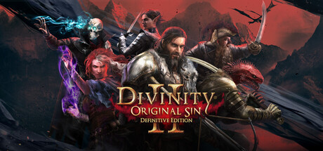
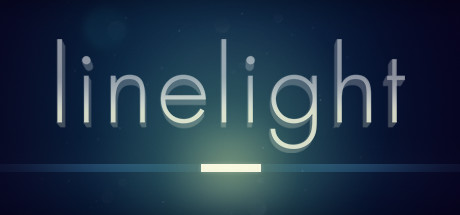

# Windows — 2017

[← All Windows years](../windows.md) · [Full 2017 page](../../years/2017.md)

154 Windows titles in 2017.

### 20XX

**Platforms:** Windows &nbsp;|&nbsp; **Developer:** Fire Hose Games, Batterystaple Games &nbsp;|&nbsp; **Publisher:** Batterystaple Games &nbsp;|&nbsp; **Genre:** Shooter, Platform, Adventure, Indie, Arcade &nbsp;|&nbsp; **Released:** August 16, 2017

> 20XX is a co-op-friendly action platformer roguelite. Explore procedurally generated levels, collect new weapons and abilities, purchase upgrades, and crush ferocious bosses! If you are a fan of roguelikes or Mega Man, 20XX is for you!
>
> _Synopsis source: IGDB_

[IGDB](https://www.igdb.com/games/20xx)

---

### 911 Operator

**Platforms:** Windows, Linux, macOS, iOS, Android, PlayStation 4, Xbox One &nbsp;|&nbsp; **Developer:** Jutsu Games &nbsp;|&nbsp; **Publisher:** SONKA, Code Horizon, PlayWay &nbsp;|&nbsp; **Genre:** Simulator, Strategy, Indie &nbsp;|&nbsp; **Released:** February 24, 2017

> 911 Operator is a game about the difficult work of people that manage emergency lines and services. Main task is to answer incoming calls and to react properly - give first aid instructions, advise, dispatch correct number of firemen / police / ambulances, or sometimes just ignore the call.
>
> _Synopsis source: IGDB_

[IGDB](https://www.igdb.com/games/911-operator)

---

### A Hat in Time

**Platforms:** macOS, Windows, PlayStation 4, Xbox One &nbsp;|&nbsp; **Developer:** Gears for Breakfast &nbsp;|&nbsp; **Publisher:** Gears for Breakfast, Humble Games &nbsp;|&nbsp; **Genre:** Platform, Adventure, Indie &nbsp;|&nbsp; **Released:** October 5, 2017

> A Hat in Time is a cute-as-heck 3D platformer featuring a little girl who stitches hats for wicked powers! Freely explore giant worlds and recover Time Pieces to travel to new heights!
>
> _Synopsis source: IGDB_

[IGDB](https://www.igdb.com/games/a-hat-in-time)

---

### A Normal Lost Phone

**Platforms:** iOS, macOS, Linux, Windows, Android &nbsp;|&nbsp; **Developer:** Accidental Queens, Seaven Studio &nbsp;|&nbsp; **Publisher:** Plug In Digital &nbsp;|&nbsp; **Genre:** Puzzle, Adventure, Indie &nbsp;|&nbsp; **Released:** January 26, 2017

> A Normal Lost Phone is a game about exploring the intimacy of an unknown person whose phone was found by the player.
>
> _Synopsis source: IGDB_

[IGDB](https://www.igdb.com/games/a-normal-lost-phone)

---

### Absolver

**Platforms:** PlayStation 4, Windows &nbsp;|&nbsp; **Developer:** Sloclap &nbsp;|&nbsp; **Publisher:** Devolver Digital &nbsp;|&nbsp; **Genre:** Fighting, Role-playing (RPG), Adventure, Indie &nbsp;|&nbsp; **Released:** August 29, 2017

> Absolver is an online multiplayer combat RPG where players are placed behind the mask of a Prospect under control of the Guides, the new rulers of the fallen Adal Empire, who have placed you here to determine your worth in joining their elite corps of Absolvers.
>
> _Synopsis source: IGDB_

[IGDB](https://www.igdb.com/games/absolver)

---

### AER: Memories of Old

**Platforms:** PlayStation 4, macOS, Linux, Xbox One, Windows &nbsp;|&nbsp; **Developer:** Forgotten Key, Daedalic Entertainment &nbsp;|&nbsp; **Publisher:** Daedalic Entertainment &nbsp;|&nbsp; **Genre:** Puzzle, Adventure, Indie &nbsp;|&nbsp; **Released:** October 25, 2017

> Transform into a bird and fly to explore and experience a vibrant world of floating islands in the sky. Venture down into lost ancient ruins where each step leads you closer to the end of the world.  AER puts you in the shoes of Auk, a magical shape-shifting girl who can transform between human and bird.
>
> _Synopsis source: IGDB_

[IGDB](https://www.igdb.com/games/aer-memories-of-old)

---

### Agents of Mayhem

**Platforms:** PlayStation 4, Windows, Xbox One &nbsp;|&nbsp; **Developer:** Volition &nbsp;|&nbsp; **Publisher:** Deep Silver &nbsp;|&nbsp; **Genre:** Shooter, Adventure &nbsp;|&nbsp; **Released:** August 15, 2017

> Agents of Mayhem is the new open world game from Volition, the studio that brought you the Saints Row franchise. Play as a cast of unique and diverse Super Agents from all over the world, and lead them in MAYHEM’s epic fight to save the city of Seoul from the destructive schemes of the evil supervillain organization LEGION!
>
> _Synopsis source: IGDB_

[IGDB](https://www.igdb.com/games/agents-of-mayhem)

---

### Albion Online

**Platforms:** Windows, Linux, macOS &nbsp;|&nbsp; **Developer:** Sandbox Interactive &nbsp;|&nbsp; **Publisher:** Sandbox Interactive &nbsp;|&nbsp; **Genre:** Role-playing (RPG) &nbsp;|&nbsp; **Released:** July 17, 2017

> Albion Online is a free-to-play sandbox MMORPG set in a medieval fantasy world inspired by Arthurian legends. The game uses a classless system where a player's equipped gear determines their abilities and playstyle. Items span eight tiers and are entirely player-crafted, forming a fully player-driven economy. The open world features zones with varying levels of PvP risk, from safe areas to full-loot zones where defeated players lose their equipment. Players can join guilds of up to 300 members to fight over territories and castles in large-scale battles. The game also offers PvE combat and various gathering and crafting activities.
>
> _Synopsis source: IGDB_

[IGDB](https://www.igdb.com/games/albion-online)

---

### Ark: Survival Evolved

**Platforms:** Xbox One, Windows, PlayStation 4, Linux, macOS &nbsp;|&nbsp; **Developer:** Studio Wildcard &nbsp;|&nbsp; **Publisher:** Studio Wildcard, Snail Games, Snail Games USA &nbsp;|&nbsp; **Genre:** Shooter, Role-playing (RPG), Simulator, Adventure, Indie &nbsp;|&nbsp; **Released:** August 27, 2017

> Ark: Survival Evolved is an open-world action-adventure survival game where players awaken stranded on a mysterious island populated by dinosaurs, prehistoric creatures, and mythical beasts. Gameplay revolves around gathering resources, crafting tools and structures, and taming creatures that can be ridden or used for combat and transportation. The game supports both single-player and multiplayer modes, with multiplayer servers allowing players to form tribes and compete or cooperate. Several expansion packs add new maps and storylines, and the game spawned an animated series, a remaster in Unreal Engine 5 titled Ark: Survival Ascended, and a planned sequel.
>
> _Synopsis source: IGDB_

[IGDB](https://www.igdb.com/games/ark-survival-evolved)

---

### Assassin's Creed Origins

**Platforms:** Xbox One, Windows, PlayStation 4 &nbsp;|&nbsp; **Developer:** Ubisoft Montreal &nbsp;|&nbsp; **Publisher:** Ubisoft Entertainment &nbsp;|&nbsp; **Genre:** Role-playing (RPG), Adventure &nbsp;|&nbsp; **Released:** October 26, 2017

> Assassin’s Creed Origins is an action-adventure game set in ancient Egypt at the end of the Ptolemaic era. The story follows Bayek, a Medjay tasked with protecting the people, as personal tragedy draws him into a wider conflict that leads to the origins of the Assassin Brotherhood.  The game features a large open-world recreation of Egypt, including cities, deserts, and the Nile, with an increased emphasis on exploration. Gameplay combines stealth, melee and ranged combat, and role-playing elements such as character leveling, skill trees, and gear progression.
>
> _Synopsis source: IGDB_

[IGDB](https://www.igdb.com/games/assassins-creed-origins)

---

### Aven Colony

**Platforms:** Xbox One, Windows, PlayStation 4 &nbsp;|&nbsp; **Developer:** Mothership Entertainment &nbsp;|&nbsp; **Publisher:** Team17 &nbsp;|&nbsp; **Genre:** Simulator, Strategy, Indie &nbsp;|&nbsp; **Released:** July 25, 2017

> Aven Colony is a city-building and management sim that tells the story of humanity’s first settlement of an extrasolar world. Land on exotic Aven Prime, where you must construct and maintain the infrastructure and ensure the well-being of your citizens, all while dealing with the often harsh realities of an exotic alien world.  On top of this, you’ll face the greatest challenge of all — keeping your people happy. How will you feed your people? Will you be able to provide them with enough jobs, entertainment, retail outlets, and other services while protecting them from the planet’s many dangers? What social policies will you enact to influence your people? The future of the colony rests on your decisions.
>
> _Synopsis source: IGDB_

[IGDB](https://www.igdb.com/games/aven-colony)

---

### Batman: The Enemy Within

**Platforms:** Android, Windows, Xbox One, PlayStation 4, macOS, iOS &nbsp;|&nbsp; **Developer:** Telltale Games &nbsp;|&nbsp; **Publisher:** Telltale Games &nbsp;|&nbsp; **Genre:** Point-and-click, Adventure &nbsp;|&nbsp; **Released:** August 8, 2017

> In this latest chapter, both Bruce Wayne and Batman will be forced into precarious new roles. The Riddler has returned to terrorize Gotham City, but his gruesome puzzles merely foreshadow an even greater crisis. With the arrival of a ruthless federal agent and the return of a still nascent Joker, Batman must navigate uneasy alliances while Bruce Wayne undertakes a perilous series of deceptions. Which of Batman's new allies will you choose to trust? And how deep into the darkness will you let Bruce descend?
>
> _Synopsis source: IGDB_

[IGDB](https://www.igdb.com/games/batman-the-enemy-within)

---

### Battle Brothers

**Platforms:** Windows &nbsp;|&nbsp; **Developer:** Overhype Studios &nbsp;|&nbsp; **Publisher:** Ukiyo Publishing &nbsp;|&nbsp; **Genre:** Role-playing (RPG), Simulator, Strategy, Turn-based strategy (TBS), Tactical, Adventure, Indie &nbsp;|&nbsp; **Released:** March 24, 2017

> Battle Brothers is a turn based strategy RPG mix which has you leading a mercenary company in a gritty, low-power, medieval fantasy world. You decide where to go, whom to hire or to fight, what contracts to take and how to train and equip your men in a procedurally generated open world campaign. Do you have what it takes to lead them through bloody battles and to victory? The game consists of a strategic worldmap and a tactical combat layer. On the worldmap you can freely travel in order to take contracts that earn you good coin, find places worth looting, enemies worth pursuing or towns to resupply and hire men at. This is also where you manage, level up and equip your Battle Brothers. Once you engage a hostile party the game will switch to a tactical map where the actual fighting takes place as detailed turn based combat.
>
> _Synopsis source: IGDB_

[IGDB](https://www.igdb.com/games/battle-brothers)

---

### Battle Chasers: Nightwar

**Platforms:** Xbox One, PlayStation 4, Windows, macOS &nbsp;|&nbsp; **Developer:** Airship Syndicate &nbsp;|&nbsp; **Publisher:** THQ Nordic &nbsp;|&nbsp; **Genre:** Role-playing (RPG), Strategy, Turn-based strategy (TBS), Indie &nbsp;|&nbsp; **Released:** October 3, 2017

> Battle Chasers: Nightwar is an American made JPRG and dungeon-crawler, based on the best-selling Battle Chasers comic series by Joe Maduriera and inspired by JPRG greats such as Final Fantasy, Suikoden, Chrono Trigger, and Phantasy Star. It was developed by Airship Syndicate, funded through Kickstarter and published by THQ Nordic. The game features beautiful environments; a gorgeously animated strategic turn-based combat system; and hand-crafted dungeon rooms which are randomly arranged for a different experience each time. Players will battle enemies, find secrets, solve puzzles and explore the world.
>
> _Synopsis source: IGDB_

[IGDB](https://www.igdb.com/games/battle-chasers-nightwar)

---

### Battlerite

**Platforms:** Windows &nbsp;|&nbsp; **Developer:** Stunlock Studios &nbsp;|&nbsp; **Publisher:** Stunlock Studios &nbsp;|&nbsp; **Genre:** Fighting, Real Time Strategy (RTS), Strategy, Hack and slash/Beat 'em up, MOBA &nbsp;|&nbsp; **Released:** November 8, 2017

> Battlerite is a Team Arena Brawler focused on adrenaline-fueled player vs player combat. Short and intense matches, stripped of random elements to optimize the action. Welcome to a world where champions dedicate their lives to the arena.
>
> _Synopsis source: IGDB_

[IGDB](https://www.igdb.com/games/battlerite)

---

### Bayonetta

**Platforms:** Windows &nbsp;|&nbsp; **Developer:** PlatinumGames &nbsp;|&nbsp; **Publisher:** Sega &nbsp;|&nbsp; **Genre:** Action, Adventure &nbsp;|&nbsp; **Released:** April 11, 2017

> PlatinumGames’ universally acclaimed action masterpiece finally comes to PC. Experience the over-the-top stylish action in 60fps at unlocked HD resolutions. The definitive way to play: being bad never felt so good.
>
> _Synopsis source: Steam_

[Wikipedia](https://en.wikipedia.org/wiki/Bayonetta_(video_game)) · [Steam](https://store.steampowered.com/app/460790)

---

### Beat Cop

**Platforms:** Linux, macOS, Windows &nbsp;|&nbsp; **Developer:** Pixel Crow &nbsp;|&nbsp; **Publisher:** 11 bit studios &nbsp;|&nbsp; **Genre:** Point-and-click, Puzzle, Simulator, Adventure, Indie &nbsp;|&nbsp; **Released:** March 30, 2017

> A retro, pixel art style adventure in New York, inspired by 80’s cop shows. You are Jack Kelly and you’ve been framed into murder. Now as a regular beat cop you have to find out, who did that. Expect thick crime story, a lot of black humour and all the other things you can find on the streets of Brooklyn.
>
> _Synopsis source: IGDB_

[IGDB](https://www.igdb.com/games/beat-cop)

---

### Bendy and the Ink Machine

**Platforms:** macOS, Linux, Windows &nbsp;|&nbsp; **Developer:** TheMeatly Games, Ltd., Joey Drew Studios &nbsp;|&nbsp; **Publisher:** Rooster Teeth Games, TheMeatly Games, Ltd., Joey Drew Studios &nbsp;|&nbsp; **Genre:** Puzzle, Adventure, Indie &nbsp;|&nbsp; **Released:** February 10, 2017

> Bendy and the Ink Machine is an indie first person puzzle-action-horror game with a unique cartoon atmosphere and an intense, frightening story line that keeps you guessing throughout.
>
> _Synopsis source: IGDB_

[IGDB](https://www.igdb.com/games/bendy-and-the-ink-machine)

---

### Brawlhalla

**Platforms:** macOS, PlayStation 4, Windows &nbsp;|&nbsp; **Developer:** Blue Mammoth Games &nbsp;|&nbsp; **Publisher:** Ubisoft Entertainment &nbsp;|&nbsp; **Genre:** Fighting, Platform, Indie, Arcade &nbsp;|&nbsp; **Released:** October 17, 2017

> Brawlhalla is a free platform fighting game with over 100 million players that supports up to 8 players online in a single match with full cross-play. Frequent updates. 50 unique characters and counting. Come fight for glory in the halls of Valhalla!
>
> _Synopsis source: IGDB_

[IGDB](https://www.igdb.com/games/brawlhalla)

---

### Bridge Constructor Portal

**Platforms:** iOS, macOS, Android, Linux, Windows &nbsp;|&nbsp; **Developer:** ClockStone Studios &nbsp;|&nbsp; **Publisher:** Headup Games &nbsp;|&nbsp; **Genre:** Puzzle, Simulator, Strategy &nbsp;|&nbsp; **Released:** December 20, 2017

> Enter the Aperture Science Enrichment Center and experience Bridge Constructor Portal – the unique merging of the classic Portal and Bridge Constructor games.
>
> _Synopsis source: IGDB_

[IGDB](https://www.igdb.com/games/bridge-constructor-portal)

---

### Call of Duty: WWII

**Platforms:** Windows, PlayStation 4, Xbox One &nbsp;|&nbsp; **Developer:** Sledgehammer Games &nbsp;|&nbsp; **Publisher:** Activision &nbsp;|&nbsp; **Genre:** Shooter &nbsp;|&nbsp; **Released:** November 2, 2017

> Call of Duty: WWII creates the definitive World War II next generation experience across three different game modes: Campaign, Multiplayer, and Co-Operative. Featuring stunning visuals, the Campaign transports players to the European theater as they engage in an all-new Call of Duty story set in iconic World War II battles. Multiplayer marks a return to original, boots-on-the ground Call of Duty gameplay. Authentic weapons and traditional run-and-gun action immerse you in a vast array of World War II-themed locations. The Co-Operative mode unleashes a new and original story in a standalone game experience full of unexpected, adrenaline-pumping moments.
>
> _Synopsis source: IGDB_

[IGDB](https://www.igdb.com/games/call-of-duty-wwii)

---

### Car Mechanic Simulator 2018

**Platforms:** macOS, Windows &nbsp;|&nbsp; **Developer:** Red Dot Games &nbsp;|&nbsp; **Publisher:** PlayWay S.A. &nbsp;|&nbsp; **Genre:** Racing, Simulator &nbsp;|&nbsp; **Released:** July 28, 2017

> Build and expand your repair service empire in this incredibly detailed and highly realistic simulation game, where attention to car detail is astonishing. Find classic, unique cars in the new Barn Find module and Junkyard module. You can even add your self-made car in the Car Editor.
>
> _Synopsis source: IGDB_

[IGDB](https://www.igdb.com/games/car-mechanic-simulator-2018)

---

### Cat Quest

**Platforms:** Android, iOS, Nintendo Switch, PlayStation 4, macOS, Windows &nbsp;|&nbsp; **Developer:** The Gentlebros &nbsp;|&nbsp; **Publisher:** The Gentlebros, PQube, Kepler Interactive &nbsp;|&nbsp; **Genre:** Role-playing (RPG), Adventure, Indie &nbsp;|&nbsp; **Released:** August 8, 2017

> Cat Quest is a 2D open world RPG with the exploration of Skyrim, but set in the visual style of an overworld. This is a fantasy world that asks the question of how different it would be if cats lived in it instead of humans! Go to places like the Catpital where the Lion King rules, or experience delicacies like the catnip pie! Talk to the locals, some already on their 7th or 8th lives(what? not all cats have nine lives y'know), and go on a catventure through a world you've never seen before!
>
> _Synopsis source: IGDB_

[IGDB](https://www.igdb.com/games/cat-quest)

---

### Cayne

**Platforms:** Linux, macOS, Windows &nbsp;|&nbsp; **Developer:** The Brotherhood Games &nbsp;|&nbsp; **Publisher:** The Brotherhood Games &nbsp;|&nbsp; **Genre:** Point-and-click, Adventure, Indie &nbsp;|&nbsp; **Released:** January 24, 2017

> In this grim return to the STASIS universe, expectant protagonist, Hadley, wakes up in a facility. Where is she? Why is she there? And, why do they want her baby?  Help panicked and anxious Hadley find her feet and brave stomach-churning situations to break free, by solving puzzles in this FREE horror adventure game.
>
> _Synopsis source: IGDB_

[IGDB](https://www.igdb.com/games/cayne)

---

### Conarium

**Platforms:** Windows &nbsp;|&nbsp; **Developer:** Zoetrope Interactive &nbsp;|&nbsp; **Publisher:** Iceberg Interactive &nbsp;|&nbsp; **Genre:** Puzzle, Adventure, Indie &nbsp;|&nbsp; **Released:** June 6, 2017

> Conarium is a chilling Lovecraftian game, which follows a gripping story involving four scientists and their endeavor to challenge what we normally consider to be the ‘absolute’ limits of nature. Inspired by H.P. Lovecraft’s novella "At the Mountains of Madness", but largely set after the original story.  You, as Frank Gilman, open your eyes inside a room filled with strange, pulsating noises. Patterns of lights executing a Danse Macabre on the walls is presented by a queer device on the table. Having recalled nothing other than that you’re in Upuaut, an Antarctic base located near south pole, you find the place deserted and have a distinct feeling of something being terribly wrong. Somehow knowing that your memories cannot guide you enforces a strange feeling of vulnerability, a familiar yet alien sensation of being a part of a peculiar whole... Soon you will discover that having used the device during the expedition, you have died but then returned subtly changed, speaking of strange memories and of strange places. You have lost something important or gained something sinister...  Explore the antarctic base, as well as dreams and visions. Study clues, unlock secrets but avoid macabre beings at all cost.
>
> _Synopsis source: IGDB_

[IGDB](https://www.igdb.com/games/conarium)

---

### Crawl

**Platforms:** Nintendo Switch, Linux, macOS, Xbox One, PlayStation 4, Windows &nbsp;|&nbsp; **Developer:** Powerhoof &nbsp;|&nbsp; **Publisher:** Powerhoof &nbsp;|&nbsp; **Genre:** Role-playing (RPG), Hack and slash/Beat 'em up, Indie, Arcade &nbsp;|&nbsp; **Released:** April 11, 2017

> Crawl is the local multiplayer dungeon crawler where your friends control the monsters! It’s bullet-hell beat-em-up meets old-school RPG, in an arcadey party-game for up to 4 players. One player is the hero, exploring a randomly generated dungeon full of traps and monsters - all controlled by the other players. If you slay the hero you take their place and it’s your turn to crawl! Then it's a race to gain enough XP and loot to reach the final battle, where it's all on one as the other players collectively control the hulking final boss!
>
> _Synopsis source: IGDB_

[IGDB](https://www.igdb.com/games/crawl)

---

### Crossout

**Platforms:** Windows, PlayStation 4, Xbox One &nbsp;|&nbsp; **Developer:** Targem Games &nbsp;|&nbsp; **Publisher:** Gaijin Entertainment &nbsp;|&nbsp; **Genre:** Shooter, Racing, Simulator &nbsp;|&nbsp; **Released:** May 30, 2017

> Crossout - the postapocalyptic MMO action game where you can create a unique design for an armoured vehicle from dozens of parts and then drive it into multiplayer battles raging on land and in the skies alike.
>
> _Synopsis source: IGDB_

[IGDB](https://www.igdb.com/games/crossout)

---

### Cuphead

**Platforms:** Xbox One, Windows &nbsp;|&nbsp; **Developer:** Studio MDHR &nbsp;|&nbsp; **Publisher:** Studio MDHR &nbsp;|&nbsp; **Genre:** Shooter, Platform, Adventure, Indie, Arcade &nbsp;|&nbsp; **Released:** September 29, 2017

> Cuphead is a run-and-gun action game focused primarily on boss battles. Its visual style is modeled after 1930s cartoons, using traditional hand-drawn cel animation, watercolor backgrounds, and original jazz recordings. Players control Cuphead or Mugman in single-player or local co-op, traversing themed worlds, acquiring new weapons, and unlocking super moves. The game includes both boss encounters and side-scrolling platforming stages.
>
> _Synopsis source: IGDB_

[IGDB](https://www.igdb.com/games/cuphead)

---

### Danganronpa V3: Killing Harmony

**Platforms:** PlayStation Vita, Windows, PlayStation 4 &nbsp;|&nbsp; **Developer:** Spike Chunsoft &nbsp;|&nbsp; **Publisher:** Spike Chunsoft, NIS America &nbsp;|&nbsp; **Genre:** Point-and-click, Adventure, Visual Novel &nbsp;|&nbsp; **Released:** January 12, 2017

> Welcome to a new world of Danganronpa, and prepare yourself for the biggest, most exhilarating episode yet. Set in a “psycho-cool” environment, a new cast of 16 characters find themselves kidnapped and imprisoned in a school. Inside, some will kill, some will die, and some will be punished. Reimagine what you thought high-stakes, fast-paced investigation was as you investigate twisted murder cases and condemn your new friends to death.
>
> _Synopsis source: IGDB_

[IGDB](https://www.igdb.com/games/danganronpa-v3-killing-harmony--1)

---

### Darkwood

**Platforms:** Linux, macOS, Windows &nbsp;|&nbsp; **Developer:** Acid Wizard Studio &nbsp;|&nbsp; **Publisher:** Crunching Koalas &nbsp;|&nbsp; **Genre:** Role-playing (RPG), Strategy, Adventure, Indie &nbsp;|&nbsp; **Released:** August 17, 2017

> Darkwood is a unforgiving survival horror with a procedurally generated, open world. By blending RPG, roguelike and adventure elements together with a challenging difficulty, Darkwood aims to please players craving for a deep and rewarding experience.  The fear of unknown is powerful. Your senses will be deceived by Darkwood's surreal terrors. No answer will be given to you for free, yet somewhere in the woods lies the truth, an explanation to what has happened in this godforsaken place.  By day, explore the randomly generated woods, scavenge for materials and weapons, discover secrets, solve mysteries and talk, trade with or kill the various inhabitants of Darkwood. By night, return to your hideout, barricade, set up traps and hide or defend yourself from the horrors that lurk in the dark.
>
> _Synopsis source: IGDB_

[IGDB](https://www.igdb.com/games/darkwood)

---

### Deceit

**Platforms:** Linux, Windows &nbsp;|&nbsp; **Developer:** Automaton, World Makers &nbsp;|&nbsp; **Publisher:** Automaton, World Makers &nbsp;|&nbsp; **Genre:** Shooter, Tactical, Indie &nbsp;|&nbsp; **Released:** March 3, 2017

> Deceit tests your instincts at trust and deception in a multiplayer first-person shooter. You wake up in an asylum to the sound of an unfamiliar voice, surrounded by five others. A third of your group have been infected with a virus, but who will escape?
>
> _Synopsis source: IGDB_

[IGDB](https://www.igdb.com/games/deceit)

---

### Destiny 2

**Platforms:** Windows, PlayStation 4, Xbox One &nbsp;|&nbsp; **Developer:** Bungie &nbsp;|&nbsp; **Publisher:** Activision, Bungie &nbsp;|&nbsp; **Genre:** Shooter, Role-playing (RPG), Adventure &nbsp;|&nbsp; **Released:** September 6, 2017

> Dive into the world of Destiny 2 to explore the mysteries of the solar system and experience responsive first-person shooter combat. Unlock powerful elemental abilities and collect unique gear to customize your Guardian's look and playstyle. Enjoy Destiny 2’s cinematic story, challenging co-op missions, and a variety of PvP modes alone or with friends. Download for free today and write your legend in the stars.
>
> _Synopsis source: IGDB_

[IGDB](https://www.igdb.com/games/destiny-2)

---

### Detention

**Platforms:** Windows, PlayStation 4, macOS, Linux &nbsp;|&nbsp; **Developer:** Red Candle Games &nbsp;|&nbsp; **Publisher:** Coconut Island Games, Red Candle Games &nbsp;|&nbsp; **Genre:** Point-and-click, Puzzle, Role-playing (RPG), Adventure, Indie &nbsp;|&nbsp; **Released:** January 12, 2017

> Detention is a atmospheric horror game set in 1960s Taiwan under martial law. Incorporated religious elements based in Taiwanese/Chinese culture and mythology, the game provided players with unique graphics and gaming experience.
>
> _Synopsis source: IGDB_

[IGDB](https://www.igdb.com/games/detention)

---

### Dirt 4

**Platforms:** PlayStation 4, Windows, Xbox One &nbsp;|&nbsp; **Developer:** Codemasters &nbsp;|&nbsp; **Publisher:** Codemasters, Feral Interactive &nbsp;|&nbsp; **Genre:** Racing, Simulator, Sport &nbsp;|&nbsp; **Released:** June 6, 2017

> Dirt 4 is all about embracing danger. It’s about the thrill, exhilaration and adrenaline that is absolutely vital to off-road racing. It’s about loving the feeling of pushing flat out next to a sheer cliff drop, going for the gap that’s too small and seeing how much air you can get. Be Fearless.
>
> _Synopsis source: IGDB_

[IGDB](https://www.igdb.com/games/dirt-4)

---

### Dishonored: Death of the Outsider

**Platforms:** PlayStation 4, Xbox One, Windows &nbsp;|&nbsp; **Developer:** Arkane Studios &nbsp;|&nbsp; **Publisher:** Bethesda Softworks &nbsp;|&nbsp; **Genre:** Puzzle, Role-playing (RPG), Adventure &nbsp;|&nbsp; **Released:** September 14, 2017

> Dishonored: Death of the Outsider is a stand-alone expansion pack and a sequel to Dishonored 2. The game features all the series' hallmarks, including brutal combat systems, unique level design and immersive story-telling that responds to your every choice. With compelling characters and exhilarating action, Death of the Outsider is the perfect entry point for those new to the Dishonored series, while delivering a significant expansion of the world and gameplay for long-time fans.
>
> _Synopsis source: IGDB_

[IGDB](https://www.igdb.com/games/dishonored-death-of-the-outsider)

---

### Divinity: Original Sin II

**Platforms:** Windows &nbsp;|&nbsp; **Developer:** Larian Studios &nbsp;|&nbsp; **Publisher:** Larian Studios &nbsp;|&nbsp; **Genre:** Adventure, RPG, Strategy &nbsp;|&nbsp; **Released:** September 14, 2017

> The critically acclaimed RPG that raised the bar, from the creators of Baldur's Gate 3. Gather your party. Master deep, tactical combat. Venture as a party of up to four - but know that only one of you will have the chance to become a God.
>
> _Synopsis source: Steam_

[Steam](https://store.steampowered.com/app/435150) · [IGDB](https://www.igdb.com/games/divinity-original-sin-ii)

---

### Doki Doki Literature Club!

**Platforms:** macOS, Linux, Windows &nbsp;|&nbsp; **Developer:** Team Salvato &nbsp;|&nbsp; **Publisher:** Team Salvato, Serenity Forge &nbsp;|&nbsp; **Genre:** Adventure, Indie, Visual Novel &nbsp;|&nbsp; **Released:** September 22, 2017

> The Literature Club is full of cute girls! Will you write the way into their heart? This game is not suitable for children or those who are easily disturbed.
>
> _Synopsis source: IGDB_

[IGDB](https://www.igdb.com/games/doki-doki-literature-club)

---

### Dude Simulator

**Platforms:** Windows &nbsp;|&nbsp; **Developer:** Kiddy &nbsp;|&nbsp; **Publisher:** Kiddy &nbsp;|&nbsp; **Genre:** Simulator, Adventure, Indie &nbsp;|&nbsp; **Released:** July 13, 2017

> Dude Simulator is an open world sandbox game. This is a life simulator. The main objective is to enjoy what you are doing.
>
> _Synopsis source: IGDB_

[IGDB](https://www.igdb.com/games/dude-simulator)

---

### Echo

**Platforms:** PlayStation 4, Windows &nbsp;|&nbsp; **Developer:** Ultra Ultra &nbsp;|&nbsp; **Genre:** Shooter, Role-playing (RPG), Adventure, Indie &nbsp;|&nbsp; **Released:** September 19, 2017

> After a century in stasis the girl En arrives at her destination: A Palace out of legend, a marvel of the old civilization eons gone, still awaiting its first human occupants. Out here, using forgotten technologies, she hopes to bring back a life that shouldn’t have been lost.  In Echo everything has consequence: As you try to wield its magical technologies it becomes apparent that the Palace has a will of its own… It studies everything you do, everything you are – to use it against you.
>
> _Synopsis source: IGDB_

[IGDB](https://www.igdb.com/games/echo)

---

### Elex

**Platforms:** Windows, PlayStation 4, Xbox One &nbsp;|&nbsp; **Developer:** Piranha Bytes &nbsp;|&nbsp; **Publisher:** THQ Nordic &nbsp;|&nbsp; **Genre:** Role-playing (RPG), Adventure &nbsp;|&nbsp; **Released:** October 17, 2017

> An action, role-playing open world game for PC and Consoles, Elex was developed by Piranha Bytes, creators of the award winning Gothic series and is set in a brand new, post-apocalyptic, Science-Fantasy universe where magic meets mechs.  "Advanced in technology, civilized and with a population of billions, Magalan was a planet looking to the future. Then the meteor hit.  Those who survived are now trapped in a battle to survive, a struggle to decide the fate of a planet. At the center of this fight is the element “Elex”. A precious, limited resource that arrived with the meteor, Elex can power machines, open the door to magic, or re-sculpt life into new, different forms.  But which of these choices should be the future of Magalan? Can technology or magic save this world? Or will this new power destroy all those left alive amongst the ruins?"
>
> _Synopsis source: IGDB_

[IGDB](https://www.igdb.com/games/elex)

---

### Emily Is Away Too

**Platforms:** macOS, Linux, Windows &nbsp;|&nbsp; **Developer:** Kyle Seeley &nbsp;|&nbsp; **Publisher:** Kyle Seeley &nbsp;|&nbsp; **Genre:** Role-playing (RPG), Simulator, Adventure, Indie, Visual Novel &nbsp;|&nbsp; **Released:** May 26, 2017

> Emily is Away Too is the spiritual successor to the critically acclaimed original. Message both Emily and Evelyn as you determine the outcome of your senior year. Extend the story past the chat window with youtube links, facebook profiles and file transfers. And most importantly, change your text color to lime green so everyone knows you're the coolest kid in school.
>
> _Synopsis source: IGDB_

[IGDB](https://www.igdb.com/games/emily-is-away-too)

---

### Endless Space 2

**Platforms:** Windows, macOS &nbsp;|&nbsp; **Developer:** Amplitude Studios &nbsp;|&nbsp; **Publisher:** Sega, Sega Games &nbsp;|&nbsp; **Genre:** Strategy, Turn-based strategy (TBS) &nbsp;|&nbsp; **Released:** May 18, 2017

> In Endless Space you play the role of the leader of one of the many intelligent beings of a galaxy at the beginning of the space age. Very quickly, you discover the remnants of an older civilization. That civilization called themselves the Endless, among their ruins, a matter called Dust with amazing proprieties is found. It shapes into whatever its user thinks of, it gives a reality to dreams… dreams that lead to the extinction of the Endless.  Since then that matter became the most precious matter of the universe, and therefore the universal currency… but in front of the power of the Dust it is hard, even for the purest beings, not to fall under its charm…  We want the players to live an experience that goes beyond just strategy. You will live your own story of space conquest, with your own randomly generated galaxy full of civilizations, lifeforms, technologies and unknown worlds for you to conquer.
>
> _Synopsis source: IGDB_

[IGDB](https://www.igdb.com/games/endless-space-2)

---

### Everspace

**Platforms:** Xbox One, Linux, macOS, Windows, SteamVR &nbsp;|&nbsp; **Developer:** ROCKFISH Games &nbsp;|&nbsp; **Publisher:** ROCKFISH Games &nbsp;|&nbsp; **Genre:** Fighting, Shooter, Simulator, Indie &nbsp;|&nbsp; **Released:** May 25, 2017

> Everspace is an action-focused single-player space shooter with rock solid 6DOF controls combining roguelike elements with top-notch visuals and a captivating non-linear story as well as VR support in the final version.
>
> _Synopsis source: IGDB_

[IGDB](https://www.igdb.com/games/everspace)

---

### Everything

**Platforms:** PlayStation Vita, Windows, macOS, Linux, PlayStation 4 &nbsp;|&nbsp; **Developer:** David OReilly &nbsp;|&nbsp; **Publisher:** David OReilly, Double Fine Productions &nbsp;|&nbsp; **Genre:** Role-playing (RPG), Simulator, Adventure, Indie &nbsp;|&nbsp; **Released:** March 21, 2017

> Everything is an interactive experience where everything you see is a thing you can be, from animals to planets to galaxies and beyond. Travel between outer and inner space, and explore a vast, interconnected universe of things without enforced goals, scores, or tasks to complete. Everything is a procedural, AI-driven simulation of the systems of nature, seen from the points of view of everything in the Universe. Narrated by the late British philosopher Alan Watts.
>
> _Synopsis source: IGDB_

[IGDB](https://www.igdb.com/games/everything)

---

### F1 2017

**Platforms:** Xbox One, Windows, PlayStation 4, macOS &nbsp;|&nbsp; **Developer:** Codemasters &nbsp;|&nbsp; **Publisher:** Feral Interactive, Codemasters &nbsp;|&nbsp; **Genre:** Racing, Simulator, Sport &nbsp;|&nbsp; **Released:** August 25, 2017

> Win the 2017 World Championship, break every record in the fastest ever F1 cars, and race some of the most iconic F1 cars of the last 30 years. With an even deeper ten year Career, more varied gameplay in the new ‘Championships’ mode, and a host of other new features, both online and offline, F1 2017 is the most complete and thrilling F1 videogame ever.
>
> _Synopsis source: IGDB_

[IGDB](https://www.igdb.com/games/f1-2017)

---

### FIFA 18

**Platforms:** Windows, PlayStation 4, Xbox One &nbsp;|&nbsp; **Developer:** EA Romania, EA Vancouver &nbsp;|&nbsp; **Publisher:** EA Sports &nbsp;|&nbsp; **Genre:** Sport &nbsp;|&nbsp; **Released:** September 29, 2017

> Powered by Frostbite, EA SPORTS FIFA 18 blurs the line between the virtual and real worlds, bringing to life the players, teams, and atmospheres that immerse you in the emotion of The World’s Game. The biggest step in gameplay innovation in franchise history, FIFA 18 introduces Real Player Motion Technology, an all-new animation system which unlocks a new level of responsiveness, and player personality – now Cristiano Ronaldo and other top players feel and move exactly like they do on the real pitch. Player Control combined with new Team Styles and Positioning give you the tools to deliver Dramatic Moments that ignite Immersive Atmospheres around the world. The World’s Game also takes you on a global journey as Alex Hunter Returns along with a star-studded cast of characters, including Cristiano Ronaldo and other European football stars. And in FIFA Ultimate Team, FUT ICONS, featuring Ronaldo Nazário and other football legends, are coming to FIFA 18 on PlayStation 4, Xbox One, and PC when the game launches on September 29, 2017.
>
> _Synopsis source: IGDB_

[IGDB](https://www.igdb.com/games/fifa-18)

---

### Figment

**Platforms:** Linux, macOS, Windows &nbsp;|&nbsp; **Developer:** Bedtime Digital Games &nbsp;|&nbsp; **Publisher:** Bedtime Digital Games &nbsp;|&nbsp; **Genre:** Music, Platform, Puzzle, Adventure, Indie &nbsp;|&nbsp; **Released:** September 22, 2017

> A musical action-adventure set in the recesses of the human mind... Welcome to the world of Figment. A strange and surreal world; a place filled with our deepest thoughts, urges and memories, populated by the many voices we hear in our heads.  This mind has been quiet and calm for many years. But something has changed. New thoughts have started to emerge - taking the shape of nightmarish creatures who spread fear wherever they go. The only hope is for the grumpy Dusty, the mind's former voice of courage, to get back to his old self and help the mind to face its fears.  Join Dusty and his ever-optimistic friend, Piper, on an adventure through the different sides of the mind, solving puzzles to set things straight, beating back the nightmares and seeking to restore the courage that's been lost.
>
> _Synopsis source: IGDB_

[IGDB](https://www.igdb.com/games/figment)

---

### Finding Paradise

**Platforms:** Linux, Windows, macOS &nbsp;|&nbsp; **Developer:** Freebird Games &nbsp;|&nbsp; **Publisher:** Freebird Games &nbsp;|&nbsp; **Genre:** Point-and-click, Puzzle, Role-playing (RPG), Adventure, Indie, Arcade &nbsp;|&nbsp; **Released:** December 14, 2017

> A story-driven experience about two doctors traversing through a dying man's memories to artificially fulfill his last wish.
>
> _Synopsis source: IGDB_

[IGDB](https://www.igdb.com/games/finding-paradise)

---

### Football Manager 2018

**Platforms:** Windows, Linux, macOS &nbsp;|&nbsp; **Developer:** Sports Interactive &nbsp;|&nbsp; **Publisher:** Sega Games &nbsp;|&nbsp; **Genre:** Simulator, Sport &nbsp;|&nbsp; **Released:** November 10, 2017

> They say football is a game of opinions and everyone has theirs, but it’s only yours that counts around here.  You make the decisions now, from who you sign and who you sell, to how you manage your budget. Will you build tactics around the players at your disposal or train them in your vision of how the game should be played? Who you pick and who you bench will affect squad harmony, and it’s up to you to manage it. Every decision comes back to you.  Get it right and you’ll be the star of the show, grabbing the newspaper headlines and dominating trends on social media. They’ll write your name in footballing folklore…if you succeed, of course.  With unparalleled choices both on and off the pitch, all within the immersive footballing world, it’s time to decide what kind of manager do you want to be?  Try your hand in 50 of the biggest footballing countries Win the title with any one of world’s top 2500 clubs Play the transfer market with over 600,000 real players and staff Watch your football vision come to life before your very eyes  All purchases of Football Manager 2018 also include a free copy of Football Manager Touch 2018 for PC/Mac and Linux.  New for this season!  Dynamics – A harmonious squad produces better results on the pitch. By building partnerships amongst your players – both on and off the pitch – and maintaining a good dressing room atmosphere you’ll get the best performances out of your squad.  Matchday Live – A brand new graphics engine produces the best lighting, stadiums and player models in the series’ history, alongside a sleeker match interface and modernised presentation that bring your fixtures to life.  Real World Scouting System – A true-to-life representation of the techniques used by the world’s biggest clubs including more detailed data analysis that, combined with a wider range of scouting options, give you a better overview of any potential signing.  Sports Science – The new Medical Centre gives you a more complete overview of your squad’s injury situation, with your medical team providing advice on feedback on individual players’ injury risks and how to avoid injuries occurring during training.  Tactics – A redesigned tactics screen puts analysis at its heart, giving you a clear view of whether your tactic is working. The new pre-match briefing allows you to be better prepared for your upcoming fixtures, while new player roles give you more ways to exploit your players’ abilities.  Fantasy Draft – Redesigned with a new interface that is perfect for streaming and with several new setup options that help tailor the Fantasy Draft experience to you, including a bigger squad budget and a Quick Start option.  Football Intelligence – A realistic transfer market that reflects the inflated transfer fees and contract values, more clauses to help finalise that blockbuster deal and the more intelligent transfer and board AI that take into account more contextual information from the game world.
>
> _Synopsis source: IGDB_

[IGDB](https://www.igdb.com/games/football-manager-2018)

---

### For Honor

**Platforms:** PlayStation 4, Windows, Xbox One &nbsp;|&nbsp; **Developer:** Ubisoft Montreal &nbsp;|&nbsp; **Publisher:** Ubisoft Entertainment &nbsp;|&nbsp; **Genre:** Fighting, Hack and slash/Beat 'em up &nbsp;|&nbsp; **Released:** February 13, 2017

> Enter the chaos of war as a bold Knight, a brutal Viking, or a deadly Samurai. Play the thrilling story campaign or fight in brutal PvP modes, all on new dedicated servers. Enjoy an evolved experience with 18 Heroes, 18 maps, new PvP and ranked modes, thousands of gear items, and more.
>
> _Synopsis source: IGDB_

[IGDB](https://www.igdb.com/games/for-honor)

---

### Forza Motorsport 7

**Platforms:** Xbox One, Windows &nbsp;|&nbsp; **Developer:** Turn 10 Studios &nbsp;|&nbsp; **Publisher:** Microsoft Studios &nbsp;|&nbsp; **Genre:** Racing, Simulator &nbsp;|&nbsp; **Released:** October 3, 2017

> Forza Motorsport 7 immerses players in the exhilarating thrill of competitive racing. From mastering the new motorsport-inspired campaign to collecting a wide range of cars to experiencing the excitement of driving at the limit, this is Forza reimagined.
>
> _Synopsis source: IGDB_

[IGDB](https://www.igdb.com/games/forza-motorsport-7)

---

### Freddy Fazbear's Pizzeria Simulator

**Platforms:** Windows &nbsp;|&nbsp; **Developer:** Scottgames &nbsp;|&nbsp; **Publisher:** Scottgames &nbsp;|&nbsp; **Genre:** Simulator, Strategy, Indie &nbsp;|&nbsp; **Released:** December 4, 2017

> Presenting a fun Five Nights at Freddy's adventure with a lighter touch for the holidays, Freddy Fazbear's Pizzeria Simulator puts you in charge of developing your own restaurant! Design pizzas, feed kids, and get high scores!
>
> _Synopsis source: IGDB_

[IGDB](https://www.igdb.com/games/freddy-fazbears-pizzeria-simulator)

---

### Friday the 13th: The Game

**Platforms:** Windows, Xbox One, PlayStation 4 &nbsp;|&nbsp; **Developer:** Illfonic &nbsp;|&nbsp; **Publisher:** Gun Interactive &nbsp;|&nbsp; **Genre:** Indie &nbsp;|&nbsp; **Released:** May 25, 2017

> Friday the 13th: The Game is a third-person horror, survival game where players take on the role of a teen counselor, or for the first time ever, Jason Voorhees. You and six other unlucky souls will do everything possible to escape and survive while the most well-known killer in the world tracks you down and brutally slaughters you.
>
> _Synopsis source: IGDB_

[IGDB](https://www.igdb.com/games/friday-the-13th-the-game)

---

### Full Throttle Remastered

**Platforms:** Windows, Linux, PlayStation 4, macOS, PlayStation Vita, iOS &nbsp;|&nbsp; **Developer:** Double Fine Productions &nbsp;|&nbsp; **Publisher:** Double Fine Productions &nbsp;|&nbsp; **Genre:** Point-and-click, Adventure &nbsp;|&nbsp; **Released:** April 18, 2017

> Originally released by LucasArts in 1995, Full Throttle is a classic graphic adventure game from industry legend Tim Schafer, telling the story of Ben Throttle; butt-kicking leader of biker gang the Polecats, who gets caught up in a tale of Motorcycles, Mayhem and Murder.
>
> _Synopsis source: IGDB_

[IGDB](https://www.igdb.com/games/full-throttle-remastered)

---

### Gang Beasts

**Platforms:** Linux, PlayStation 4, macOS, PlayStation VR, Windows &nbsp;|&nbsp; **Developer:** Boneloaf &nbsp;|&nbsp; **Publisher:** Double Fine Productions &nbsp;|&nbsp; **Genre:** Fighting, Indie &nbsp;|&nbsp; **Released:** December 12, 2017

> Gang Beasts is a silly multiplayer party game with surly gelatinous characters, brutal slapstick fight sequences, and absurd hazardous environments, set in the mean streets of Beef City.
>
> _Synopsis source: IGDB_

[IGDB](https://www.igdb.com/games/gang-beasts)

---

### Get Even

**Platforms:** Xbox One, PlayStation 4, Windows &nbsp;|&nbsp; **Developer:** The Farm 51 &nbsp;|&nbsp; **Publisher:** Bandai Namco Entertainment &nbsp;|&nbsp; **Genre:** Shooter, Adventure &nbsp;|&nbsp; **Released:** June 23, 2017

> "Take a deep breath..." Try to remember: a girl, a chair, a bomb. Just keep... calm. Follow the voice into the depths of your memory. Relax... and search for the darkest memories in the deepest recesses of your mind. Can you find her? The clock is ticking... And this is just a part of the treatment.
>
> _Synopsis source: IGDB_

[IGDB](https://www.igdb.com/games/get-even)

---

### Getting Over It with Bennett Foddy

**Platforms:** Linux, macOS, Windows, iOS &nbsp;|&nbsp; **Developer:** Bennett Foddy &nbsp;|&nbsp; **Publisher:** Bennett Foddy, Humble Bundle, zplay &nbsp;|&nbsp; **Genre:** Platform, Simulator, Adventure, Indie &nbsp;|&nbsp; **Released:** December 6, 2017

> Getting Over It with Bennett Foddy is a punishing climbing game, a homage to Jazzuo's 2002 B-Game classic 'Sexy Hiking'. You move the hammer with the mouse, and that's all there is. With practice, you'll be able to jump, swing, climb and fly. Great mysteries and a wonderful reward await the master hikers who reach the top of the mountain.  To quote Jazzuo himself: "The hiking action is very similar to way you would do it in real life, remember that and you will do well".
>
> _Synopsis source: IGDB_

[IGDB](https://www.igdb.com/games/getting-over-it-with-bennett-foddy)

---

### Gorogoa

**Platforms:** macOS, Windows, iOS, Nintendo Switch &nbsp;|&nbsp; **Developer:** Jason Roberts &nbsp;|&nbsp; **Publisher:** Annapurna Interactive &nbsp;|&nbsp; **Genre:** Point-and-click, Puzzle, Adventure, Indie &nbsp;|&nbsp; **Released:** December 13, 2017

> Gorogoa is a beautiful hand-drawn story suspended inside a completely unique puzzle. Arrange and combine lavishly illustrated panels, each one a separate interactive window into a living game world.
>
> _Synopsis source: IGDB_

[IGDB](https://www.igdb.com/games/gorogoa)

---

### Halo Wars 2

**Platforms:** Xbox One, Windows &nbsp;|&nbsp; **Developer:** 343 Industries, The Creative Assembly &nbsp;|&nbsp; **Publisher:** Microsoft Studios &nbsp;|&nbsp; **Genre:** Real Time Strategy (RTS), Strategy &nbsp;|&nbsp; **Released:** February 21, 2017

> After decades adrift and declared “lost with all hands,” the brave crew of the UNSC Spirit of Fire are mysteriously awoken above an ancient Forerunner haven known as the Ark. In Halo Wars 2, Captain Cutter and his crew will face one of humanity’s most formidable threats yet: The Banished – a fierce and powerful Brute faction led by a cunning and lethal warrior known as Atriox.  Halo Wars 2 delivers real-time strategy at the speed of Halo combat. Get ready to lead armies of Spartans and other Halo fighting forces like Warthogs, Scorpions and exciting new units in a brutal war against a terrifying new enemy on the biggest Halo battlefield yet.
>
> _Synopsis source: IGDB_

[IGDB](https://www.igdb.com/games/halo-wars-2)

---

### Hand of Fate 2

**Platforms:** macOS, PlayStation 4, Xbox One, Linux, Windows &nbsp;|&nbsp; **Developer:** Defiant Development &nbsp;|&nbsp; **Publisher:** Unbroken Studios, Defiant Development, H2 Interactive Co., Ltd. &nbsp;|&nbsp; **Genre:** Role-playing (RPG), Turn-based strategy (TBS), Hack and slash/Beat 'em up, Adventure, Indie, Card & Board Game &nbsp;|&nbsp; **Released:** November 7, 2017

> Hand of Fate 2 is a dungeon crawler set in a world of dark fantasy. Master a living boardgame where every stage of the adventure is drawn from a deck of legendary encounters chosen by you! Choose wisely - your opponent, the enigmatic Dealer, will pull no punches as he shapes you into the instrument of his revenge.  The table has changed, but the stakes remain the same: life or death!  KEY GAME FEATURES  A world transformed - 100 years have passed since the Dealer was usurped and the Game of Life and Death gained a new master.  22 exciting new challenges that will push your deck-building skills to the limit - Hunt fiendish assassins, reunite star-crossed lovers or build up a fortress to withstand a raider assault!  Enlist the aid of all new companion characters - team up with them in battle, or have them bend the rules of the boardgame in your favor!  Hundreds of new encounters, artifacts and items to earn and upgrade.  Enhanced action-RPG combat - shred foes with quick dual-wielded daggers or brutalize them with heavy two-handed hammers. Build up your combo meter to unleash powerful special attacks!  Engage new foes united by all-new card suits - Cross swords with disciplined Imperial soldiers, purge corrupted mutants and fend off northern raiders.
>
> _Synopsis source: IGDB_

[IGDB](https://www.igdb.com/games/hand-of-fate-2)

---

### Hellblade: Senua's Sacrifice

**Platforms:** Windows, PlayStation 4 &nbsp;|&nbsp; **Developer:** Ninja Theory &nbsp;|&nbsp; **Publisher:** Ninja Theory, Xbox Game Studios &nbsp;|&nbsp; **Genre:** Simulator, Hack and slash/Beat 'em up, Adventure, Indie &nbsp;|&nbsp; **Released:** August 7, 2017

> Hellblade: Senua's Sacrifice is a single-player action-adventure game set in a dark fantasy world inspired by Norse mythology and Celtic culture. Players control Senua, a Pict warrior who journeys into the Norse underworld to rescue the soul of her dead lover from the goddess Hela. The game blends melee combat, puzzle solving, and psychological horror, with Senua's psychosis shaping how the world is perceived, including voices that provide guidance or attempt to mislead the player.  The game was developed by a team of around twenty people and features no heads-up display or tutorials. Instead, audio cues from voices in Senua's head guide the player through combat and environmental challenges. The portrayal of psychosis was developed in collaboration with neuroscientists and people who experience the condition.
>
> _Synopsis source: IGDB_

[IGDB](https://www.igdb.com/games/hellblade-senuas-sacrifice)

---

### Hello Neighbor

**Platforms:** Xbox One, Windows &nbsp;|&nbsp; **Developer:** DYNAMIC PIXELS &nbsp;|&nbsp; **Publisher:** tinyBuild &nbsp;|&nbsp; **Genre:** Puzzle, Role-playing (RPG), Strategy, Adventure, Indie &nbsp;|&nbsp; **Released:** December 8, 2017

> Hello Neighbor is a stealth horror game about sneaking into your creepy neighbor's house to figure out what horrible secrets he's hiding in his basement. You play against an AI that adapts from your actions. Really enjoying climbing through that backyard window? Expect a bear trap there. Sneaking through the front door? There'll be cameras there soon. Trying to escape? Your neighbor will find a shortcut and catch you.
>
> _Synopsis source: IGDB_

[IGDB](https://www.igdb.com/games/hello-neighbor)

---

### Hidden Folks

**Platforms:** Linux, Windows, Android, iOS, macOS &nbsp;|&nbsp; **Developer:** Adriaan de Jongh &nbsp;|&nbsp; **Publisher:** Adriaan de Jongh &nbsp;|&nbsp; **Genre:** Point-and-click, Puzzle, Adventure, Indie &nbsp;|&nbsp; **Released:** February 15, 2017

> Search for hidden folks in hand-drawn, interactive, miniature landscapes. Unfurl tent flaps, cut through bushes, slam doors, and poke some crocodiles!
>
> _Synopsis source: IGDB_

[IGDB](https://www.igdb.com/games/hidden-folks)

---

### Hob

**Platforms:** Windows, PlayStation 4 &nbsp;|&nbsp; **Developer:** Runic Games &nbsp;|&nbsp; **Publisher:** Runic Games &nbsp;|&nbsp; **Genre:** Platform, Puzzle, Adventure, Indie &nbsp;|&nbsp; **Released:** September 26, 2017

> Hob is set on a beautiful and dangerous unknown world, with buzzing life above and the whirrs of mysterious machinery below. The more players delve into the world’s design, the more they uncover a planet in peril. Players must learn to survive, understand their true purpose through acquiring skills, and ultimately transform the nature of the world itself.  Hob is presented without text or dialogue. Narrative is revealed as players explore and interact with their mysterious planet, and the strange life forms that inhabit it. Hob features smooth controller gameplay, multi-layered puzzles, and striking visuals.
>
> _Synopsis source: IGDB_

[IGDB](https://www.igdb.com/games/hob)

---

### Injustice 2

**Platforms:** Xbox One, PlayStation 4, Windows &nbsp;|&nbsp; **Developer:** NetherRealm Studios &nbsp;|&nbsp; **Publisher:** WB Games &nbsp;|&nbsp; **Genre:** Fighting &nbsp;|&nbsp; **Released:** May 16, 2017

> Power up and build the ultimate version of your favorite DC legends in INJUSTICE 2. With a massive selection of DC Super Heroes and Super-Villains, INJUSTICE 2 allows you to equip every iconic character with unique and powerful gear earned throughout the game. Experience an unprecedented level of control over how your favorite characters look, how they fight, and how they develop across a huge variety of game modes. This is your super Hero. Your Journey. Your Injustice.
>
> _Synopsis source: IGDB_

[IGDB](https://www.igdb.com/games/injustice-2)

---

### Ken Follett's The Pillars of the Earth

**Platforms:** Xbox One, Linux, macOS, PlayStation 4, Windows &nbsp;|&nbsp; **Developer:** Daedalic Entertainment &nbsp;|&nbsp; **Publisher:** Daedalic Entertainment &nbsp;|&nbsp; **Genre:** Point-and-click, Puzzle, Adventure, Indie, Visual Novel &nbsp;|&nbsp; **Released:** August 15, 2017

> England, 12th century: Philip the monk becomes Prior of the small abbey of Kingsbridge. At the same time, a boy called Jack is raised by his outlawed mother in the woods. His apprenticeship as a stonemason paves his way to become a great architect. Soon, his steps lead him to Kingsbridge where he will build one of the greatest cathedrals England has ever seen. Aliena and Richard have to survive on their own, after the sibling's father, the Earl of Shiring, has been incarcerated and murdered. Aliena vows to make her brother the rightful heir and Earl of Shiring. Like Jack, their way leads them to Kingsbridge. Aliena puts her expertise as a tradeswoman to good use, supporting the cathedral's construction and falls in love with Jack. But Kingsbridge and its people are in grave danger. Philip's rivals, Bishop Waleran and Wiliam, a vengeful noble rejected by Aliena, see the town and its rise to importance as a thorn in their flesh. They want to see Kingsbridge burn.  The game-adaption of the world-bestseller "The Pillars of the Earth" is the first co-operative project of Daedalic Entertainment and Bastei Lübbe. This game will be more than just complementary media to the book and will instead retell the story in a new, interactive way. A team of about 20 people works to create a multi-platform adaption of this bestseller. The writers are also in contact and co-operation with the Follett Office and Ken Follett himself. Daedalic is the only studio at the time adapting such an epic reading-experience into an interactive format.  The game itself will be released in 2017, at the same time the third novel of the Kingsbridge-Series will be published. The game will be internationally available for PC, Mac, Linux, PS4, Xbox One and mobile devices.
>
> _Synopsis source: IGDB_

[IGDB](https://www.igdb.com/games/ken-folletts-the-pillars-of-the-earth)

---

### Kona

**Platforms:** Linux, macOS, Windows, PlayStation 4, PlayStation Vita, Xbox One &nbsp;|&nbsp; **Developer:** Parabole &nbsp;|&nbsp; **Publisher:** Ravenscourt, Deep Silver &nbsp;|&nbsp; **Genre:** Puzzle, Adventure, Indie &nbsp;|&nbsp; **Released:** March 17, 2017

> A story-driven survival game set in 1970's Quebec in which Carl Flaubert, a private detective sent to the fictional Atamipek Lake to investigate a deceptively simple case, must solve the mystery surrounding the region while surviving the harsh Northern Canadian winter.
>
> _Synopsis source: IGDB_

[IGDB](https://www.igdb.com/games/kona)

---

### Last Day of June

**Platforms:** PlayStation 4, Windows &nbsp;|&nbsp; **Developer:** Ovosonico &nbsp;|&nbsp; **Publisher:** 505 Games &nbsp;|&nbsp; **Genre:** Puzzle, Role-playing (RPG), Adventure, Indie &nbsp;|&nbsp; **Released:** August 31, 2017

> A deep, interactive adventure about love and loss, beautifully depicted and offering an intense cinematic experience. What would you do to save the one you love?
>
> _Synopsis source: IGDB_

[IGDB](https://www.igdb.com/games/last-day-of-june)

---

### LEGO Marvel Super Heroes 2

**Platforms:** Nintendo Switch, PlayStation 4, Windows, Xbox One &nbsp;|&nbsp; **Developer:** Traveller's Tales &nbsp;|&nbsp; **Publisher:** WB Games, Feral Interactive &nbsp;|&nbsp; **Genre:** Platform, Puzzle, Hack and slash/Beat 'em up, Adventure &nbsp;|&nbsp; **Released:** November 14, 2017

> Lego Marvel Super Heroes 2 is a Lego-themed action-adventure video game developed by Traveller's Tales. It is the sequel to 2013's Lego Marvel Super Heroes and the third instalment of the Lego Marvel franchise.  With the core gameplay following the same style of past Lego titles, the game features the ability to manipulate time and a four-player competitive Super Hero battle mode. Lego Marvel Super Heroes 2's storyline centers around superheroes from different eras and realities of the Marvel Universe as they fight against the time-travelling villain Kang the Conqueror in a battle across space and time.
>
> _Synopsis source: IGDB_

[IGDB](https://www.igdb.com/games/lego-marvel-super-heroes-2)

---

### LEGO Worlds

**Platforms:** Xbox One, Nintendo Switch, PlayStation 4, Windows &nbsp;|&nbsp; **Developer:** Traveller's Tales &nbsp;|&nbsp; **Publisher:** WB Games &nbsp;|&nbsp; **Genre:** Puzzle, Adventure &nbsp;|&nbsp; **Released:** March 7, 2017

> LEGO Worlds is an open environment of procedurally-generated Worlds made entirely of LEGO bricks which you can freely manipulate and dynamically populate with LEGO models. Create anything you can imagine one brick at a time, or use large-scale landscaping tools to create vast mountain ranges and dot your world with tropical islands. Drop in prefabricated structures to build and customize any world to your liking. Explore using helicopters, dragons, motorbikes or even gorillas and unlock treasures that enhance your gameplay. Watch your creations come to life through characters and creatures that interact with you and each other in unexpected ways. In LEGO Worlds, anything is possible!
>
> _Synopsis source: IGDB_

[IGDB](https://www.igdb.com/games/lego-worlds)

---

### Life is Strange: Before the Storm

**Platforms:** PlayStation 4, Xbox One, macOS, Windows, Linux &nbsp;|&nbsp; **Developer:** Deck Nine &nbsp;|&nbsp; **Publisher:** Square Enix &nbsp;|&nbsp; **Genre:** Adventure, Indie &nbsp;|&nbsp; **Released:** August 31, 2017

> Life is Strange: Before the Storm is a new three part standalone story adventure set three years before the events of the first game. This time play as Chloe Price, a rebel who forms an unlikely friendship with Rachel Amber in dramatic new story in the BAFTA award winning franchise.
>
> _Synopsis source: IGDB_

[IGDB](https://www.igdb.com/games/life-is-strange-before-the-storm)

---

### Linelight

**Platforms:** Windows &nbsp;|&nbsp; **Developer:** My Dog Zorro &nbsp;|&nbsp; **Publisher:** My Dog Zorro &nbsp;|&nbsp; **Genre:** Action, Adventure, Casual, Indie &nbsp;|&nbsp; **Released:** January 30, 2017

> Linelight is an elegant puzzle game set in a world of lines.
>
> _Synopsis source: Steam_

[Steam](https://store.steampowered.com/app/469790)

---

### Little Nightmares

**Platforms:** Xbox One, PlayStation 4, Windows &nbsp;|&nbsp; **Developer:** Tarsier Studios &nbsp;|&nbsp; **Publisher:** Bandai Namco Entertainment &nbsp;|&nbsp; **Genre:** Platform, Puzzle, Adventure, Indie &nbsp;|&nbsp; **Released:** April 28, 2017

> Little Nightmares is a puzzle-platform horror adventure game developed by Tarsier Studios and published by Bandai Namco Entertainment. Set in a mysterious world, Little Nightmares follows the journey of Six, a hungry little girl who must escape the Maw, an iron vessel inhabited by monstrous, twisted beings.
>
> _Synopsis source: IGDB_

[IGDB](https://www.igdb.com/games/little-nightmares)

---

### Marvel vs. Capcom: Infinite

**Platforms:** Windows, Xbox One, PlayStation 4 &nbsp;|&nbsp; **Developer:** Capcom &nbsp;|&nbsp; **Publisher:** Capcom &nbsp;|&nbsp; **Genre:** Fighting &nbsp;|&nbsp; **Released:** September 19, 2017

> Marvel vs. Capcom: Infinite will feature a variety of exciting and accessible single player modes and rich multi-player content for new players and longtime fans alike. In addition to single player Arcade, Training and Mission modes, a visually stunning and immersive cinematic Story Mode will put players at the center of both universes as they battle for survival against a sinister new threat. Marvel vs. Capcom: Infinite is being built to highlight a combination of iconic locations and fan favorite characters from both universes, including Captain Marvel and Iron Man from the Marvel side, and Ryu and Mega Man X from Capcom.
>
> _Synopsis source: IGDB_

[IGDB](https://www.igdb.com/games/marvel-vs-capcom-infinite)

---

### Marvel's Guardians of the Galaxy: The Telltale Series

**Platforms:** iOS, Xbox One, Windows, macOS, PlayStation 4, Android &nbsp;|&nbsp; **Developer:** Telltale Games &nbsp;|&nbsp; **Publisher:** Telltale Games &nbsp;|&nbsp; **Genre:** Point-and-click, Role-playing (RPG), Adventure &nbsp;|&nbsp; **Released:** April 18, 2017

> Marvel's Guardians of the Galaxy: The Telltale Series is a brand new story of the universe's unlikeliest heroes: Star-Lord, Gamora, Drax, Rocket, and Groot. In the wake of an epic battle, the Guardians discover an artifact of unspeakable power. Each of them has a reason to desire this relic, as does a ruthless enemy who is the last of her kind, and who will stop at nothing to tear it from their hands.  From Earth to the Milano to Knowhere and beyond, and set to the beat of awesome music, you wear the rocket-powered boots of Star-Lord in an original Guardians adventure, where your decisions and actions drive the story you experience.
>
> _Synopsis source: IGDB_

[IGDB](https://www.igdb.com/games/marvels-guardians-of-the-galaxy-the-telltale-series)

---

### Mass Effect: Andromeda

**Platforms:** Xbox One, Windows, PlayStation 4 &nbsp;|&nbsp; **Developer:** BioWare Montréal &nbsp;|&nbsp; **Publisher:** Electronic Arts &nbsp;|&nbsp; **Genre:** Shooter, Role-playing (RPG), Adventure &nbsp;|&nbsp; **Released:** March 21, 2017

> A new adventure awaits in the Mass Effect universe. With stunning visuals and a new galaxy to discover, BioWare delivers the next generation of space exploration.  Commander Shepard's story may be over, but there are many more stories to tell in the Mass Effect universe. Mass Effect Andromeda will be set in a new galaxy, with new characters, new quests and a whole load of new consequence-laden decisions to make.  Mass Effect: Andromeda takes you to the Andromeda galaxy, far beyond the Milky Way. There, you'll lead our fight for a new home in hostile territory - where WE are the aliens.  Play as the Pathfinder - a leader of a squad of military-trained explorers - with deep progression and customisation systems. This is the story of humanity’s next chapter, and your choices throughout the game will ultimately determine our survival in the Andromeda Galaxy.  As you unfold the mysteries of the Andromeda Galaxy and the hope for humanity lies on your shoulders – You must ask yourself… How far will you go?  Key Features:  Return to the Mass Effect universe. Lead the first humans in Andromeda on a desperate search for our new home. In this new chapter of Mass Effect, meet and recruit all-new, interesting characters caught up in an epic space saga filled with mystery and galactic conflict.  Fight for survival. Battle with your Pathfinder team against terrifying enemies and creatures. New additions like destructible environments, boosted jumps for added verticality, and all-new weapons and Biotics make combat more thrilling than ever.  Build your hero. Create a formidable hero with amazing weapons, powers and tech. A much more flexible skill and weapon progression tree means you can replicate your play style to make you unstoppable against new, powerful alien enemies.  Explore a new galaxy. Chart your own course in a dangerous new region. Unravel the mysteries of the Andromeda galaxy as you discover rich, alien worlds in the search for humanity’s new home.
>
> _Synopsis source: IGDB_

[IGDB](https://www.igdb.com/games/mass-effect-andromeda--1)

---

### Middle-earth: Shadow of War

**Platforms:** Xbox One, PlayStation 4, Windows &nbsp;|&nbsp; **Developer:** Monolith Productions &nbsp;|&nbsp; **Publisher:** WB Games &nbsp;|&nbsp; **Genre:** Role-playing (RPG), Adventure &nbsp;|&nbsp; **Released:** October 10, 2017

> Go behind enemy lines to forge your army, conquer Fortresses and dominate Mordor from within. Experience how the award winning Nemesis System creates unique personal stories with every enemy and follower, and confront the full power of the Dark Lord Sauron and his Ringwraiths in this epic new story of Middle-earth.
>
> _Synopsis source: IGDB_

[IGDB](https://www.igdb.com/games/middle-earth-shadow-of-war)

---

### Minecraft: Story Mode - Season Two

**Platforms:** Android, iOS, macOS, Windows, PlayStation 4, Xbox 360, Xbox One &nbsp;|&nbsp; **Developer:** Telltale Games, Mojang Studios &nbsp;|&nbsp; **Publisher:** Telltale Games &nbsp;|&nbsp; **Genre:** Point-and-click, Adventure &nbsp;|&nbsp; **Released:** July 11, 2017

> Minecraft: Story Mode - Season Two continues Jesse's saga in a five-part, narrative-driven, episodic game series developed by Telltale in collaboration with Mojang and members of the Minecraft community. Though players' choices from the first season will carry over into season two, this new season will be accessible to both returning fans and newcomers alike. This second season will also include Telltale's unique multiplayer 'Crowd Play' feature, which allows friends and family to engage with the adventure together by helping to decide the direction of the story from any mobile device with an online connection.  Now that Jesse and the gang have vanquished the Wither Storm, saved the world, and become totally super famous heroes, life has gotten a bit more...complicated. With more responsibilities and less time for adventure, old friendships have started to fade -- at least until Jesse's hand gets stuck in a creepy gauntlet that belongs to an ancient underwater temple. Together with old pals and new comrades alike, Jesse embarks on a brand new journey filled with tough choices, good times, and at least one temperamental llama.
>
> _Synopsis source: IGDB_

[IGDB](https://www.igdb.com/games/minecraft-story-mode-season-two)

---

### MudRunner

**Platforms:** Windows, PlayStation 4, Xbox One &nbsp;|&nbsp; **Developer:** Saber Interactive &nbsp;|&nbsp; **Publisher:** Focus Entertainment &nbsp;|&nbsp; **Genre:** Racing, Simulator, Strategy &nbsp;|&nbsp; **Released:** October 31, 2017

> Like Spintires before it, Spintires: MudRunner puts players in the driver seat and dares them to take charge of incredible all-terrain vehicles, venturing across extreme Siberian landscapes with only a map and compass as guides! This edition comes complete with a brand new Sandbox Map joining the original game's 5 environments, a total graphical overhaul, a new Challenge mode with 9 new dedicated maps, 13 new vehicles and other comprehensive improvements.
>
> _Synopsis source: IGDB_

[IGDB](https://www.igdb.com/games/mudrunner)

---

### NBA 2K18

**Platforms:** iOS, Windows, Nintendo Switch, Android, PlayStation 4, Xbox One &nbsp;|&nbsp; **Developer:** Visual Concepts &nbsp;|&nbsp; **Publisher:** 2K Games &nbsp;|&nbsp; **Genre:** Simulator, Sport &nbsp;|&nbsp; **Released:** September 15, 2017

> The highest rated annual sports title of this generation returns with NBA 2K18, featuring unparalleled authenticity and improvements on the court.
>
> _Synopsis source: IGDB_

[IGDB](https://www.igdb.com/games/nba-2k18)

---

### Need for Speed: Payback

**Platforms:** PlayStation 4, Windows, Xbox One &nbsp;|&nbsp; **Developer:** Ghost Games &nbsp;|&nbsp; **Publisher:** Electronic Arts &nbsp;|&nbsp; **Genre:** Racing, Sport &nbsp;|&nbsp; **Released:** November 10, 2017

> "This explosive adventure is filled with intense heist missions, high stakes car battles, epic cop pursuits and jaw dropping set pieces. It’s blockbuster gameplay never before seen from the series, fueled by a gripping story of betrayal and revenge. With Need for Speed: Payback, it’s no longer just about being the first to cross the finish line or racing to prove to be the best, it’s about building the perfect ride, getting behind the wheel and playing out an action driving fantasy.  Set in the underworld of Fortune Valley, players will drive as three distinct characters reunited by a quest for vengeance against The House, a nefarious cartel that rules the city’s casinos, criminals and cops. They will take on a variety of challenges and events as Tyler, the Racer; Mac, the Showman; and Jess, the Wheelman to earn the respect of the underground. Featuring the deepest customization from the series, players can truly craft a personalized and unique ride, or spend hours finding and tuning an abandoned derelict into a supercar. They can then push their cars to the limit and raise the stakes by betting on their own performance, where they can either multiply their winnings or risk losing it all."
>
> _Synopsis source: IGDB_

[IGDB](https://www.igdb.com/games/need-for-speed-payback)

---

### Nex Machina

**Platforms:** PlayStation 4, Windows &nbsp;|&nbsp; **Developer:** Housemarque &nbsp;|&nbsp; **Publisher:** Housemarque &nbsp;|&nbsp; **Genre:** Shooter, Indie, Arcade &nbsp;|&nbsp; **Released:** June 20, 2017

> From the collaboration between Housemarque (Resogun, Alienation, Matterfall), and Robotron and Smash TV legendary creator Eugene Jarvis comes Nex Machina, an explosive arcade experience created with competition in mind.
>
> _Synopsis source: IGDB_

[IGDB](https://www.igdb.com/games/nex-machina)

---

### Nidhogg 2

**Platforms:** PlayStation 4, macOS, Windows &nbsp;|&nbsp; **Developer:** Messhof &nbsp;|&nbsp; **Publisher:** Messhof &nbsp;|&nbsp; **Genre:** Fighting, Indie, Arcade &nbsp;|&nbsp; **Released:** August 15, 2017

> Return of the wurm! The next installment of the epic award-winning dueling tug-of-war is coming! Destroy your opponents with all new moves and weapons across ten different arenas.
>
> _Synopsis source: IGDB_

[IGDB](https://www.igdb.com/games/nidhogg-2)

---

### NieR: Automata

**Platforms:** PlayStation 4, Windows &nbsp;|&nbsp; **Developer:** PlatinumGames, Square Enix Business Division 6 &nbsp;|&nbsp; **Publisher:** Square Enix &nbsp;|&nbsp; **Genre:** Role-playing (RPG), Hack and slash/Beat 'em up &nbsp;|&nbsp; **Released:** February 23, 2017

> NieR: Automata tells the story of androids 2B, 9S and A2 and their battle to reclaim the machine-driven dystopia overrun by powerful machines.
>
> _Synopsis source: IGDB_

[IGDB](https://www.igdb.com/games/nier-automata)

---

### Night in the Woods

**Platforms:** PlayStation 4, Windows, Linux, macOS, Xbox One &nbsp;|&nbsp; **Developer:** Infinite Fall &nbsp;|&nbsp; **Publisher:** Finji, PLAYISM &nbsp;|&nbsp; **Genre:** Platform, Adventure, Indie &nbsp;|&nbsp; **Released:** February 21, 2017

> Night In The Woods is an adventure game heavily focused on story, characters and exploration, with some platforming to get around town. Mae's a cat so the roofs and ledges and powerlines are all her playground, and she's not the only one up there by a long shot. You'll also be doing various activities and interacting with the world in different ways, getting to know the townspeople, hanging out with friends, exploring Possum Springs inside and out, and venturing into the surrounding areas.
>
> _Synopsis source: IGDB_

[IGDB](https://www.igdb.com/games/night-in-the-woods)

---

### Observer

**Platforms:** macOS, Xbox One, Linux, Windows, PlayStation 4 &nbsp;|&nbsp; **Developer:** Bloober Team &nbsp;|&nbsp; **Publisher:** Aspyr Media &nbsp;|&nbsp; **Genre:** Adventure, Indie &nbsp;|&nbsp; **Released:** August 15, 2017

> Observer is a first person perspective horror game that focuses on a dark, atmospheric environment and deep story telling.
>
> _Synopsis source: IGDB_

[IGDB](https://www.igdb.com/games/observer)

---

### Old Man's Journey

**Platforms:** Android, Windows, iOS, macOS &nbsp;|&nbsp; **Developer:** Broken Rules &nbsp;|&nbsp; **Publisher:** Tilt Games Asia, Broken Rules &nbsp;|&nbsp; **Genre:** Puzzle, Adventure, Indie &nbsp;|&nbsp; **Released:** May 16, 2017

> Old Man’s Journey, a soul-searching puzzle adventure, tells a story of life, loss, reconciliation, and hope. Entrenched in a beautifully sunkissed and handcrafted world, embark on a heartfelt journey interwoven with lighthearted and pressure-free puzzle solving.  During this compact gameplay experience, you’ll be transported to a vibrant and wishful world, exploring life’s complexities through the old man’s eyes. Meditatively delightful and reflective, Old Man’s Journey invites you to immerse yourself in quiet and inquisitive puzzles, and experience the old man’s heartache, regret, and hope.
>
> _Synopsis source: IGDB_

[IGDB](https://www.igdb.com/games/old-mans-journey)

---

### Opus Magnum

**Platforms:** Windows &nbsp;|&nbsp; **Developer:** Zachtronics &nbsp;|&nbsp; **Publisher:** Zachtronics &nbsp;|&nbsp; **Genre:** Indie, Simulation &nbsp;|&nbsp; **Released:** December 8, 2017

> Opus Magnum is the latest open-ended puzzle game from Zachtronics, the creators of SpaceChem, Infinifactory, and SHENZHEN I/O. Design and build machines that assemble potions, poisons, and more using the alchemical engineer’s most advanced tool: the transmutation engine!
>
> _Synopsis source: Steam_

[Wikipedia](https://en.wikipedia.org/wiki/Opus_Magnum) · [Steam](https://store.steampowered.com/app/558990) · [IGDB](https://www.igdb.com/games/opus-magnum)

---

### Outlast II

**Platforms:** Xbox One, macOS, Windows, PlayStation 4 &nbsp;|&nbsp; **Developer:** Red Barrels &nbsp;|&nbsp; **Publisher:** Red Barrels &nbsp;|&nbsp; **Genre:** Adventure, Indie &nbsp;|&nbsp; **Released:** April 25, 2017

> Outlast 2 is the sequel to the acclaimed survival horror game Outlast. Set in the same universe as the first game, but with different characters and a different setting, Outlast 2 is a twisted new journey into the depths of the human mind and its dark secrets. No conflict is ever black and white.
>
> _Synopsis source: IGDB_

[IGDB](https://www.igdb.com/games/outlast-ii)

---

### Pinstripe

**Platforms:** Windows, macOS, Linux &nbsp;|&nbsp; **Developer:** Armor Games, Atmos Games &nbsp;|&nbsp; **Publisher:** Armor Games, Serenity Forge &nbsp;|&nbsp; **Genre:** Platform, Puzzle, Adventure, Indie &nbsp;|&nbsp; **Released:** April 24, 2017

> Pinstripe is an emotionally charged adventure about Hell created entirely by a one-man team over the course of five years. Play as Teddy, an estranged ex-minister forced to venture through the frozen afterlife in search of Bo, his three year old daughter, and her perverse kidnapper. Discover the dark secrets of Teddy's past, and confront his sleazy, demonic nemesis, Mr. Pinstripe.
>
> _Synopsis source: IGDB_

[IGDB](https://www.igdb.com/games/pinstripe)

---

### Planescape: Torment - Enhanced Edition

**Platforms:** Android, Windows, macOS, Linux &nbsp;|&nbsp; **Developer:** Beamdog &nbsp;|&nbsp; **Publisher:** Beamdog &nbsp;|&nbsp; **Genre:** Role-playing (RPG), Strategy, Adventure &nbsp;|&nbsp; **Released:** April 11, 2017

> "Discover an incredibly rich story and a unique setting unlike anything else in fantasy. Defeat strange and alien creatures, engage in rich dialogue, and explore the dark and dangerous Planescape setting in this 50+ hour RPG classic.  Millions of Planescape: Torment fans have enjoyed the strange and dangerous city of Sigil and surrounding planes through the Nameless One's eyes. Now it’s your turn. This is Planescape: Torment like you’ve never seen before.  Enhanced Edition - Key Features: - Enhanced Planescape: Chris Avellone, Lead Designer on Planescape Torment, has partnered with Beamdog to curate gameplay updates, bug fixes, and enhancements to best capture his original vision for the game.  - Remastered Music: The full Planescape: Torment soundtrack has been remastered in-game to add more depth to Sigil and the multiverse.  - 4K Interface: Sigil has never looked this good! The interface of Planescape: Torment has been rebuilt in high definition with tons of new convenience features.  - A Planescape For Today: The Enhanced Edition includes modern features such as tab highlighting, area zooming, combat log, quickloot, and more!"
>
> _Synopsis source: IGDB_

[IGDB](https://www.igdb.com/games/planescape-torment-enhanced-edition)

---

### Portal Knights

**Platforms:** Xbox One, Nintendo Switch, Windows, PlayStation 4, Android, iOS &nbsp;|&nbsp; **Developer:** Keen Games &nbsp;|&nbsp; **Publisher:** Digital Bros, 505 Games &nbsp;|&nbsp; **Genre:** Role-playing (RPG), Adventure, Indie &nbsp;|&nbsp; **Released:** May 18, 2017

> Leave the familiar world behind and step into the fantastic unknown with Portal Knights! Play with your friends in this action-packed crafting adventure across dozens of sandbox islands connected by ancient portals. No one can remember how long it’s been since the peaceful world was torn apart by The Fracture, plummeting it into darkness. Is there any soul brave enough to reunite the shattered realm? Craft your adventure. Forge your hero. Become the ultimate Portal Knight!
>
> _Synopsis source: IGDB_

[IGDB](https://www.igdb.com/games/portal-knights)

---

### Prey

**Platforms:** Xbox One, Windows, PlayStation 4 &nbsp;|&nbsp; **Developer:** Arkane Studios &nbsp;|&nbsp; **Publisher:** Bethesda Softworks &nbsp;|&nbsp; **Genre:** Shooter, Puzzle, Role-playing (RPG), Adventure &nbsp;|&nbsp; **Released:** May 4, 2017

> In Prey, you awaken aboard Talos I, a space station orbiting the moon in the year 2032. You are the key subject of an experiment meant to alter humanity forever – but things have gone terribly wrong. The space station has been overrun by hostile aliens and you are now being hunted. As you dig into the dark secrets of Talos I and your own past, you must survive using the tools found on the station, your wits, weapons, and mind-bending abilities.
>
> _Synopsis source: IGDB_

[IGDB](https://www.igdb.com/games/prey--1)

---

### Pro Evolution Soccer 2018

**Platforms:** Xbox One, Windows, PlayStation 4, Xbox 360, PlayStation 3 &nbsp;|&nbsp; **Developer:** Konami, Konami Digital Entertainment &nbsp;|&nbsp; **Publisher:** Konami, Konami Digital Entertainment &nbsp;|&nbsp; **Genre:** Simulator, Sport &nbsp;|&nbsp; **Released:** September 12, 2017

> Pro Evolution Soccer 2018 is a football simulation game developed and published by Konami in 2017. It features updated teams, players, and competitions with a focus on realistic gameplay and presentation. The game introduces improved ball control, dribbling mechanics, and enhanced player animations. Modes include Master League, Become a Legend, online multiplayer, and licensed tournaments such as the UEFA Champions League.
>
> _Synopsis source: IGDB_

[IGDB](https://www.igdb.com/games/pro-evolution-soccer-2018)

---

### Project CARS 2

**Platforms:** PlayStation 4, Xbox One, Windows &nbsp;|&nbsp; **Developer:** Slightly Mad Studios &nbsp;|&nbsp; **Publisher:** Bandai Namco Entertainment &nbsp;|&nbsp; **Genre:** Racing, Simulator &nbsp;|&nbsp; **Released:** September 22, 2017

> Project CARS 2 is the next evolution in the award-winning racing series, featuring the most iconic cars under the most thrilling of conditions to deliver the “Ultimate Driver Journey” experience. Created by gamers, tested by world-class racing drivers, and the definitive choice of e-Sports pros – Project CARS 2 brings together the essence of motorsports racing in the most beautiful, authentically crafted, and technically advanced racing game on the planet.
>
> _Synopsis source: IGDB_

[IGDB](https://www.igdb.com/games/project-cars-2)

---

### PUBG: Battlegrounds

**Platforms:** Windows &nbsp;|&nbsp; **Developer:** PUBG Corp &nbsp;|&nbsp; **Publisher:** Bluehole Studio, Microsoft Studios &nbsp;|&nbsp; **Genre:** Shooter &nbsp;|&nbsp; **Released:** December 20, 2017

> PUBG: Battlegrounds is a battle royale shooter that pits 100 players against each other in a struggle for survival. Gather supplies and outwit your opponents to become the last person standing.
>
> _Synopsis source: IGDB_

[IGDB](https://www.igdb.com/games/pubg-battlegrounds)

---

### Pyre

**Platforms:** Windows, macOS, Linux, PlayStation 4 &nbsp;|&nbsp; **Developer:** Supergiant Games &nbsp;|&nbsp; **Publisher:** Supergiant Games &nbsp;|&nbsp; **Genre:** Role-playing (RPG), Adventure, Indie, Visual Novel &nbsp;|&nbsp; **Released:** July 25, 2017

> A party-based RPG/visual novel/sports game hybrid wherein the player, dubbed the Reader for their literacy by the group of scavengers who discovers them, is sent in exile to a lawless wasteland called the Downside and has to lead their ever-growing party of misfits to locations wherein many similar parties compete in Rites in order to attain freedom and be absolved of their crimes.
>
> _Synopsis source: IGDB_

[IGDB](https://www.igdb.com/games/pyre)

---

### Rain World

**Platforms:** PlayStation 4, Windows &nbsp;|&nbsp; **Developer:** Videocult &nbsp;|&nbsp; **Publisher:** Adult Swim Games &nbsp;|&nbsp; **Genre:** Platform, Adventure, Indie &nbsp;|&nbsp; **Released:** March 28, 2017

> Rain World is a survival platformer set in an abandoned industrial environment ravaged by a shattered ecosystem. Bone-crushingly intense rains pound the surface, making life as we know it almost impossible. The creatures in this world hibernate most of the time, but in the few brief dry periods they go out in search of food.
>
> _Synopsis source: IGDB_

[IGDB](https://www.igdb.com/games/rain-world)

---

### Resident Evil 7: Biohazard

**Platforms:** PlayStation 4, Windows, PlayStation VR, Xbox One &nbsp;|&nbsp; **Developer:** Capcom Development Division 1 &nbsp;|&nbsp; **Publisher:** Capcom &nbsp;|&nbsp; **Genre:** Shooter, Puzzle, Adventure &nbsp;|&nbsp; **Released:** January 24, 2017

> Resident Evil 7: Biohazard is the first game of the Resident Evil series to switch from 3rd-person to fully 1st-person perspective. A complete refresh of gameplay systems simultaneously propels the survival horror experience to another level. It is as much horror as it is survival, boosting up scare elements and minimizing downright shooting action. The game allows use of Sony's PSVR Headset to play in VR mode.
>
> _Synopsis source: IGDB_

[IGDB](https://www.igdb.com/games/resident-evil-7-biohazard)

---

### RiME

**Platforms:** Windows, Nintendo Switch, Xbox One, PlayStation 4 &nbsp;|&nbsp; **Developer:** Tequila Works &nbsp;|&nbsp; **Publisher:** Six Foot, Grey Box &nbsp;|&nbsp; **Genre:** Platform, Puzzle, Adventure, Indie &nbsp;|&nbsp; **Released:** May 26, 2017

> A third-person exploratory action/adventure title in which a boy ends up on a mysterious island and makes his way through its highly stylized environments, containing puzzles and slight navigation challenges, to get to the bottom of why he's ended up there and to reach the end of the road he's inadvertently begun to travel.
>
> _Synopsis source: IGDB_

[IGDB](https://www.igdb.com/games/rime)

---

### Rise & Shine

**Platforms:** PlayStation 4, Xbox One, Linux, Windows &nbsp;|&nbsp; **Developer:** Super Awesome Hyper Dimensional Mega Team &nbsp;|&nbsp; **Publisher:** Adult Swim Games &nbsp;|&nbsp; **Genre:** Shooter, Platform, Puzzle, Adventure, Indie, Arcade &nbsp;|&nbsp; **Released:** January 13, 2017

> The game mixes pure shooting arcade with the use of different bullets to solve all the situations Rise will find on his path. Think of a more arcadey Another World, also with a very tight relationship between gameplay and story.
>
> _Synopsis source: IGDB_

[IGDB](https://www.igdb.com/games/rise-and-shine)

---

### Rising Storm 2: Vietnam

**Platforms:** Windows &nbsp;|&nbsp; **Developer:** Antimatter Games, Tripwire Interactive &nbsp;|&nbsp; **Publisher:** Tripwire Interactive &nbsp;|&nbsp; **Genre:** Shooter, Simulator, Strategy, Indie &nbsp;|&nbsp; **Released:** May 30, 2017

> Rising Storm 2: Vietnam is a sequel to the stand-alone expansion pack to Rising Storm and focuses on the Vietnam War.
>
> _Synopsis source: IGDB_

[IGDB](https://www.igdb.com/games/rising-storm-2-vietnam)

---

### Rivals of Aether

**Platforms:** Windows, Xbox One &nbsp;|&nbsp; **Developer:** Aether Studios, Dan Fornace &nbsp;|&nbsp; **Publisher:** Aether Studios, Dan Fornace &nbsp;|&nbsp; **Genre:** Fighting, Platform, Indie &nbsp;|&nbsp; **Released:** March 28, 2017

> Rivals of Aether is an indie fighting game set in a world where warring civilizations summon the power of Fire, Water, Air, and Earth. Play with up to four players locally or up to two players online.
>
> _Synopsis source: IGDB_

[IGDB](https://www.igdb.com/games/rivals-of-aether)

---

### Robocraft

**Platforms:** Windows, macOS, Linux &nbsp;|&nbsp; **Developer:** Freejam Games &nbsp;|&nbsp; **Publisher:** Freejam Games &nbsp;|&nbsp; **Genre:** Shooter, Role-playing (RPG), Simulator, Indie &nbsp;|&nbsp; **Released:** August 24, 2017

> Robocraft is a sandbox building and vehicular combat game where players get to create their own robots/vehicles and use them to fight others. The wide variety of components allows for many types of creations, including ground vehicles, planes and hover-tanks.
>
> _Synopsis source: IGDB_

[IGDB](https://www.igdb.com/games/robocraft)

---

### Ruiner

**Platforms:** macOS, Windows, PlayStation 4, Linux, Xbox One &nbsp;|&nbsp; **Developer:** Reikon Games &nbsp;|&nbsp; **Publisher:** Devolver Digital &nbsp;|&nbsp; **Genre:** Shooter, Strategy, Adventure, Indie &nbsp;|&nbsp; **Released:** September 26, 2017

> Ruiner is a top-down action shooter created in the spirit of cult cyberpunk anime and game classics. Ruiner is quick and brutal but sophisticated gameplay, original world with mature storyline and unique visual style.
>
> _Synopsis source: IGDB_

[IGDB](https://www.igdb.com/games/ruiner)

---

### SCP: Secret Laboratory

**Platforms:** Windows &nbsp;|&nbsp; **Developer:** Northwood Studios &nbsp;|&nbsp; **Publisher:** Northwood Studios &nbsp;|&nbsp; **Genre:** Shooter, Role-playing (RPG), Strategy, Indie &nbsp;|&nbsp; **Released:** December 28, 2017

> Deep within a secure underground facility, a sudden containment breach allows many of the secured anomalies to escape from their chambers. Assist the Foundation in re-securing the facility, help the Insurgency in their goal to capture it, or wreak havoc as an SCP in a frantic bid to escape.
>
> _Synopsis source: IGDB_

[IGDB](https://www.igdb.com/games/scp-secret-laboratory)

---

### Serial Cleaner

**Platforms:** Nintendo Switch, PlayStation 4, Xbox One, Linux, macOS, Windows &nbsp;|&nbsp; **Developer:** iFun4All, Draw Distance &nbsp;|&nbsp; **Publisher:** Curve Digital, iFun4All, Plug In Digital &nbsp;|&nbsp; **Genre:** Puzzle, Role-playing (RPG), Simulator, Adventure, Indie &nbsp;|&nbsp; **Released:** July 11, 2017

> Serial Cleaner is a story-driven, fast-paced stealth/action game, characterized by a 1970s theme and aesthetics.
>
> _Synopsis source: IGDB_

[IGDB](https://www.igdb.com/games/serial-cleaner)

---

### Shovel Knight: Specter of Torment

**Platforms:** macOS, Nintendo Switch, Xbox One, PlayStation Vita, Wii U, Windows, Linux, Nintendo 3DS, PlayStation 3, PlayStation 4 &nbsp;|&nbsp; **Developer:** Yacht Club Games &nbsp;|&nbsp; **Publisher:** Yacht Club Games &nbsp;|&nbsp; **Genre:** Platform, Adventure, Indie &nbsp;|&nbsp; **Released:** March 3, 2017

> This game is a free expansion included in the main game, Shovel Knight, and its updated title, Shovel Knight: Treasure Trove. The game will also be available as a standalone title on PC, PS4, Xbox One, and Nintendo Switch.
>
> _Synopsis source: IGDB_

[IGDB](https://www.igdb.com/games/shovel-knight-specter-of-torment)

---

### Simulacra

**Platforms:** macOS, Windows, iOS, Android &nbsp;|&nbsp; **Developer:** Kaigan Games &nbsp;|&nbsp; **Publisher:** Wales Interactive, Kaigan Games &nbsp;|&nbsp; **Genre:** Role-playing (RPG), Simulator, Adventure, Indie, Visual Novel &nbsp;|&nbsp; **Released:** October 26, 2017

> An interactive horror experience of exploring a missing woman’s phone.
>
> _Synopsis source: IGDB_

[IGDB](https://www.igdb.com/games/simulacra)

---

### Slime Rancher

**Platforms:** Xbox One, Windows &nbsp;|&nbsp; **Developer:** Monomi Park &nbsp;|&nbsp; **Publisher:** Skybound Games, Monomi Park &nbsp;|&nbsp; **Genre:** Shooter, Simulator, Strategy, Adventure, Indie &nbsp;|&nbsp; **Released:** August 1, 2017

> Slime Rancher is a charming, first-person, sandbox experience. Play as Beatrix LeBeau: a plucky, young rancher who sets out for a life a thousand light years away from Earth on the 'Far, Far Range.' Each day will present new challenges and risky opportunities as you attempt to amass a great fortune in the business of slime ranching. Collect colorful slimes, grow crops, harvest resources, and explore the untamed wilds through the mastery of your all-purpose vacpack.
>
> _Synopsis source: IGDB_

[IGDB](https://www.igdb.com/games/slime-rancher)

---

### Snake Pass

**Platforms:** Nintendo Switch, Windows, PlayStation 4, Xbox One &nbsp;|&nbsp; **Developer:** Sumo Digital &nbsp;|&nbsp; **Publisher:** Sumo Digital &nbsp;|&nbsp; **Genre:** Platform, Puzzle, Simulator, Adventure, Indie, Arcade &nbsp;|&nbsp; **Released:** March 28, 2017

> Welcome to Snake Pass; a physical action-puzzle game that sees the player slither, curl and climb their way through increasingly challenging worlds filled with evermore intricate obstacles and fiendishly mind-bending objectives!  Snake Pass is the wriggling brain-child of Seb Liese, who originally came to Sumo from Holland to work on the LittleBigPlanet team. His prototype of ‘real snake physics’ captured the entire studio’s imagination and we’re really proud of the results so far!
>
> _Synopsis source: IGDB_

[IGDB](https://www.igdb.com/games/snake-pass)

---

### Sniper Elite 4

**Platforms:** Windows, PlayStation 4, Xbox One &nbsp;|&nbsp; **Developer:** Rebellion Developments &nbsp;|&nbsp; **Publisher:** Rebellion Developments &nbsp;|&nbsp; **Genre:** Shooter, Tactical, Adventure &nbsp;|&nbsp; **Released:** February 13, 2017

> Sniper Elite 4 combines genre-defining ballistics, breathless emergent stealth, and gripping third person action across the largest and most diverse environments ever seen in a Sniper Elite game.  Set in the aftermath of its award-winning predecessor, Sniper Elite 4 continues the series’ World War Two heritage by transporting players across the beautiful Italian peninsula, from sun-drenched Mediterranean coastal towns, to colossal Nazi mega structures, daunting forests and giddying mountain monasteries inspired by Monte Cassino.  Covert agent and elite marksman Karl Fairburne must fight alongside the brave men and women of the Italian Resistance to help free their country from the yoke of Fascism, and defeat a terrifying new threat with the potential to halt the Allied fightback in Europe before it’s even begun.  If his mission fails, there will be no Operation Overlord, no D-Day landings, and no Victory in Europe.
>
> _Synopsis source: IGDB_

[IGDB](https://www.igdb.com/games/sniper-elite-4)

---

### Sniper: Ghost Warrior 3

**Platforms:** Windows, Xbox One, PlayStation 4 &nbsp;|&nbsp; **Developer:** CI Games &nbsp;|&nbsp; **Publisher:** CI Games &nbsp;|&nbsp; **Genre:** Shooter, Tactical &nbsp;|&nbsp; **Released:** April 25, 2017

> Go behind enemy lines with the ultimate modern military shooter. Play as an American sniper dropped in Georgia, near Russian border. Choose your own path to accomplish your missions across an unforgiven open world.
>
> _Synopsis source: IGDB_

[IGDB](https://www.igdb.com/games/sniper-ghost-warrior-3)

---

### Sonic Forces

**Platforms:** Nintendo Switch, PlayStation 4, Xbox One, Windows &nbsp;|&nbsp; **Developer:** Sonic Team &nbsp;|&nbsp; **Publisher:** Sega Games, Sega &nbsp;|&nbsp; **Genre:** Platform &nbsp;|&nbsp; **Released:** November 7, 2017

> Fight through a world destroyed by Dr. Eggman and a powerful new villain in Sonic Forces, the new fast-paced action platformer from the team that brought you Sonic Colors and Sonic Generations. Sonic Forces lets you speed through rolling ruined landscapes as Modern Sonic, catapult past perilous platforms as Classic Sonic, and use powerful new gadgets as your own Custom Hero Character.
>
> _Synopsis source: IGDB_

[IGDB](https://www.igdb.com/games/sonic-forces)

---

### Sonic Mania

**Platforms:** Windows, Nintendo Switch, PlayStation 4, Xbox One &nbsp;|&nbsp; **Developer:** Headcannon, PagodaWest Games, Christian Whitehead &nbsp;|&nbsp; **Publisher:** Sega, Sega Games &nbsp;|&nbsp; **Genre:** Platform, Adventure &nbsp;|&nbsp; **Released:** August 15, 2017

> Sonic Mania is a side-scrolling platformer that pays homage to the original Sega Genesis Sonic the Hedgehog games. Players choose from Sonic, Tails, or Knuckles, each with unique abilities, and speed through 13 zones that include redesigned stages from past games alongside original levels. The game features special stages for collecting Chaos Emeralds, time attack with online leaderboards, and split-screen competitive multiplayer.
>
> _Synopsis source: IGDB_

[IGDB](https://www.igdb.com/games/sonic-mania)

---

### South Park: The Fractured But Whole

**Platforms:** Xbox One, Windows, PlayStation 4 &nbsp;|&nbsp; **Developer:** Ubisoft San Francisco &nbsp;|&nbsp; **Publisher:** Ubisoft Entertainment &nbsp;|&nbsp; **Genre:** Role-playing (RPG), Strategy, Adventure &nbsp;|&nbsp; **Released:** October 17, 2017

> Players will once again assume the role of the New Kid, and join South Park favorites Stan, Kyle, Kenny and Cartman in a new hilarious and outrageous adventure. This time, players will delve into the crime-ridden underbelly of South Park with Coon and Friends.  This dedicated group of crime fighters was formed by Eric Cartman whose superhero alter-ego, The Coon, is half man, half raccoon. As the New Kid, players will join Mysterion, Toolshed, Human Kite, Mosquito, Mint Berry Crunch and a host of others to battle the forces of evil while Coon strives to make his team the most beloved superheroes in history.
>
> _Synopsis source: IGDB_

[IGDB](https://www.igdb.com/games/south-park-the-fractured-but-whole)

---

### Star Wars Battlefront II

**Platforms:** Windows, Xbox One, PlayStation 4 &nbsp;|&nbsp; **Developer:** EA Digital Illusions CE &nbsp;|&nbsp; **Publisher:** Electronic Arts &nbsp;|&nbsp; **Genre:** Shooter, Adventure &nbsp;|&nbsp; **Released:** November 17, 2017

> Star Wars Battlefront II is a first- and third-person shooter set across all three eras of the Star Wars saga. Players engage in large-scale ground and space battles using class-based soldiers, reinforcements, vehicles, and iconic heroes or villains from the franchise. Multiplayer modes span maps drawn from locations across the films, while a single-player campaign follows an original story set between Return of the Jedi and The Force Awakens. The game launched in 2017 amid a major loot box controversy that led to the removal of microtransactions and a complete overhaul of its progression system, after which it received years of free content updates that substantially expanded its offerings.
>
> _Synopsis source: IGDB_

[IGDB](https://www.igdb.com/games/star-wars-battlefront-ii--1)

---

### StarCraft: Remastered

**Platforms:** macOS, Windows &nbsp;|&nbsp; **Developer:** Blizzard Entertainment &nbsp;|&nbsp; **Publisher:** Blizzard Entertainment &nbsp;|&nbsp; **Genre:** Real Time Strategy (RTS), Strategy &nbsp;|&nbsp; **Released:** August 14, 2017

> StarCraft: Remastered is a reverently crafted modernization of Blizzard Entertainment’s original sci-fi real-time strategy game. StarCraft: Remastered will offer a full graphical overhaul of the original StarCraft and the StarCraft: Brood War expansion, bringing a modern look and feel to the timeless classic with widescreen UHD support for up to 4K resolution.  StarCraft: Remastered will include all of StarCraft’s and Brood War’s campaign missions with enhanced storytelling via new comic-book style interludes. While this rejuvenated version of StarCraft is locked and loaded for the modern era, the gameplay and balance have been precisely preserved, for an experience that will feel identical to veteran players.  4K Ultra HD Graphics and Upgraded Audio: StarCraft: Remastered will include high-resolution unit models, buildings, doodads, and tilesets, as well as high-fidelity music and sound effects to bring the original game into the modern era, while retaining the classic StarCraft style.  Same Timeless Gameplay: The gameplay balance and idiosyncrasies have been painstakingly preserved from the original game. Mutalisk stacking, magic-boxing, unit pathfinding, control-group limitations, and more will all remain intact, allowing veteran players to enjoy playing and watching high-level competitive matches as before.  Includes Original and Expansion Campaigns: Return to the planetary battlefields of the war-torn Koprulu Sector and command the forces of the terran, zerg, and protoss across more than 50 story-driven single-player missions.  Fall in Love Again: Relive the epic saga of some of gaming’s most memorable and beloved heroes and villains, including Marshal Jim Raynor, Lieutenant Sarah Kerrigan, and Praetor Fenix.  Enhanced Storytelling: Original cinematics will be improved to 1080p resolution, while mission interludes and introductions will feature new comic-book style illustrations.  Blizzard’s Gaming Network Brings a Bevy of Features: In addition to accurate matchmaking and enhanced ladder functionality, players will also be able to stay in touch with and chat with friends playing other Blizzard games. The classic functionality of named custom games and custom game lobbies will be retained, for the familiarity of long-time StarCraft players.  Localized in 13 Languages: English, German, French, Brazilian Portuguese, Spanish (LatAm), Spanish (European), Polish, Italian, Russian, Korean, Simplified Chinese, Traditional Chinese, and Japanese.
>
> _Synopsis source: IGDB_

[IGDB](https://www.igdb.com/games/starcraft-remastered)

---

### SteamWorld Dig 2

**Platforms:** Windows, PlayStation Vita, Linux, macOS, PlayStation 4, Nintendo Switch &nbsp;|&nbsp; **Developer:** Image & Form &nbsp;|&nbsp; **Publisher:** Image & Form &nbsp;|&nbsp; **Genre:** Platform, Puzzle, Adventure, Indie &nbsp;|&nbsp; **Released:** September 21, 2017

> SteamWorld Dig 2 takes you on a platform mining adventure forged in Metroidvania flames. When an old trading town is struck by mysterious earthquakes, it’s up to a lone steambot and her unlikely companion to uncover what trembling terrors lie beneath.  Dig your way underground and explore vivid worlds riddled with treasure, secrets and traps.  Combat dangerous enemies at every turn of the underworld’s twisted paths, including shadowy creatures and the haunted remains of an ancient electrical threat.  Upgrade your gear to forge deeper into the earth and take on bigger challenges.  Swing across large chasms with your Hookshot and fly through caves with the Jet Engine!  And finally, learn the truth about your long lost friend…
>
> _Synopsis source: IGDB_

[IGDB](https://www.igdb.com/games/steamworld-dig-2)

---

### Stick Fight: The Game

**Platforms:** Windows, macOS &nbsp;|&nbsp; **Developer:** Landfall Games &nbsp;|&nbsp; **Publisher:** NetEase Games, Landfall Games &nbsp;|&nbsp; **Genre:** Fighting, Shooter, Simulator, Strategy, Indie &nbsp;|&nbsp; **Released:** September 28, 2017

> Stick Fight is a physics-based couch/online fighting game where you battle it out as the iconic stick figures from the golden age of the internet
>
> _Synopsis source: IGDB_

[IGDB](https://www.igdb.com/games/stick-fight-the-game)

---

### Stories Untold

**Platforms:** macOS, Windows &nbsp;|&nbsp; **Developer:** No Code &nbsp;|&nbsp; **Publisher:** Devolver Digital &nbsp;|&nbsp; **Genre:** Puzzle, Adventure, Indie &nbsp;|&nbsp; **Released:** February 27, 2017

> Stories Untold is a compilation tape of four episodes from the now cancelled series of the same name, including a remaster of the original pilot episode “The House Abandon”.
>
> _Synopsis source: IGDB_

[IGDB](https://www.igdb.com/games/stories-untold)

---

### Styx: Shards of Darkness

**Platforms:** Windows, PlayStation 4, Xbox One &nbsp;|&nbsp; **Developer:** Cyanide Studio &nbsp;|&nbsp; **Publisher:** Focus Entertainment &nbsp;|&nbsp; **Genre:** Role-playing (RPG), Adventure &nbsp;|&nbsp; **Released:** March 14, 2017

> Embark upon a stealthy adventure with new enemies, new environments, and a plethora of new mechanics aimed at refining the abilities and movement of Styx; grappling around corners, climbing ropes, and using his trusty knife as a zip-wire. Shards of Darkness aims to offer unparalleled freedom of movement, along with refined stealth and assassination mechanics, expanding and improving on the strengths of Styx: Master of Shadows
>
> _Synopsis source: IGDB_

[IGDB](https://www.igdb.com/games/styx-shards-of-darkness)

---

### Sundered

**Platforms:** Linux, macOS, PlayStation 4, Windows &nbsp;|&nbsp; **Developer:** Thunder Lotus &nbsp;|&nbsp; **Publisher:** Thunder Lotus &nbsp;|&nbsp; **Genre:** Platform, Adventure, Indie &nbsp;|&nbsp; **Released:** July 28, 2017

> Sundered is a horrifying fight for survival and sanity, a hand­-drawn epic from the ​creators of ​Jotun. You play Eshe, a wanderer in a ruined world, trapped in ever­-changing caverns teeming with eldritch horrors. Harness the power of corrupted relics to defeat gigantic bosses, at the cost of your humanity.
>
> _Synopsis source: IGDB_

[IGDB](https://www.igdb.com/games/sundered)

---

### Super Lucky's Tale

**Platforms:** Windows, Xbox One &nbsp;|&nbsp; **Developer:** Playful &nbsp;|&nbsp; **Publisher:** Microsoft Studios &nbsp;|&nbsp; **Genre:** Platform, Adventure &nbsp;|&nbsp; **Released:** November 7, 2017

> Super Lucky’s Tale is a delightful, playground platformer for all ages that follows Lucky, the ever-optimistic and lovable hero, on his quest to find his inner strength and help his beloved sister rescue the Book of Ages from the nefarious Jinx. Head back to the era of classic platformers with challenges players of all skill levels and all ages can enjoy.
>
> _Synopsis source: IGDB_

[IGDB](https://www.igdb.com/games/super-luckys-tale)

---

### Syberia 3

**Platforms:** macOS, Xbox One, Android, PlayStation 4, Windows, iOS &nbsp;|&nbsp; **Developer:** Anuman Interactive, Microids &nbsp;|&nbsp; **Publisher:** Microids &nbsp;|&nbsp; **Genre:** Point-and-click, Puzzle, Adventure &nbsp;|&nbsp; **Released:** April 20, 2017

> Syberia 3 takes you inside an enchanting, mysterious universe full of life for you to explore in 3D. Plunged into the heart of a world inhabited by a cast of interesting characters, you'll discover and experience a fabulous tale as imagined by Benoit Sokal.
>
> _Synopsis source: IGDB_

[IGDB](https://www.igdb.com/games/syberia-3)

---

### Tacoma

**Platforms:** Linux, Windows, Xbox One, macOS &nbsp;|&nbsp; **Developer:** Fullbright &nbsp;|&nbsp; **Publisher:** Fullbright &nbsp;|&nbsp; **Genre:** Adventure, Indie &nbsp;|&nbsp; **Released:** August 2, 2017

> Tacoma is a sci-fi narrative adventure set aboard a high-tech space station in the year 2088. Explore every detail of how the station's crew lived and worked, finding the clues that add up to a gripping story of trust, fear, and resolve in the face of disaster.
>
> _Synopsis source: IGDB_

[IGDB](https://www.igdb.com/games/tacoma)

---

### Tekken 7

**Platforms:** Windows, PlayStation 4, Xbox One, PlayStation VR &nbsp;|&nbsp; **Developer:** Bandai Namco Studios &nbsp;|&nbsp; **Publisher:** Bandai Namco Entertainment &nbsp;|&nbsp; **Genre:** Fighting &nbsp;|&nbsp; **Released:** June 1, 2017

> Experience the epic conclusion of the Mishima clan and unravel the reasons behind each step of their ceaseless fight. Powered by Unreal Engine 4, Tekken 7 features stunning story-driven cinematic battles and intense duels that can be enjoyed with friends and rivals alike through innovative fight mechanics.
>
> _Synopsis source: IGDB_

[IGDB](https://www.igdb.com/games/tekken-7)

---

### The Binding of Isaac: Afterbirth+

**Platforms:** macOS, Nintendo Switch, Windows, Linux, PlayStation 4 &nbsp;|&nbsp; **Developer:** Edmund McMillen, Nicalis, Inc. &nbsp;|&nbsp; **Publisher:** Nicalis, Inc. &nbsp;|&nbsp; **Genre:** Shooter, Role-playing (RPG), Adventure, Indie &nbsp;|&nbsp; **Released:** January 3, 2017

> The Binding of Isaac: Afterbirth+ is a dungeon-crawling shoot-'em-up that's literally a different game each and every time you play it! The randomly generated maps are built with over 11,000 unique room configurations, each populated with a nearly endless variety of enemies, items, challenges and secrets!
>
> _Synopsis source: IGDB_

[IGDB](https://www.igdb.com/games/the-binding-of-isaac-afterbirth-plus)

---

### The Darkside Detective

**Platforms:** macOS, Linux, Windows &nbsp;|&nbsp; **Developer:** Spooky Doorway &nbsp;|&nbsp; **Publisher:** Akupara Games &nbsp;|&nbsp; **Genre:** Point-and-click, Puzzle, Adventure, Indie &nbsp;|&nbsp; **Released:** July 27, 2017

> Join The Darkside Detective, Francis McQueen, as he investigates the bizarre, the supernatural and those missing cat cases that keep getting dropped on his desk.
>
> _Synopsis source: IGDB_

[IGDB](https://www.igdb.com/games/the-darkside-detective)

---

### The Elder Scrolls: Legends

**Platforms:** macOS, Windows, Android, iOS &nbsp;|&nbsp; **Developer:** Sparkypants Studios LLC, Dire Wolf Digital &nbsp;|&nbsp; **Publisher:** Bethesda Softworks &nbsp;|&nbsp; **Genre:** Strategy, Turn-based strategy (TBS), Card & Board Game &nbsp;|&nbsp; **Released:** March 9, 2017

> The Elder Scrolls: Legends is a strategy card game that explores the series' characters, creatures, deities, and lore. Whether you have 10 minutes or five hours, Legends provides a variety of gameplay modes and challenges that are easy-to-learn but difficult to master. Built with all levels of players in mind, Legends offers accessible gameplay for beginners who want to get started quickly, and the game's depth keeps expert players engaged. With a wide variety of deck types and strategies, no two games are ever the same.
>
> _Synopsis source: IGDB_

[IGDB](https://www.igdb.com/games/the-elder-scrolls-legends)

---

### The End Is Nigh

**Platforms:** Nintendo Switch, Windows, macOS, Linux &nbsp;|&nbsp; **Developer:** Tyler Glaiel, Edmund McMillen &nbsp;|&nbsp; **Publisher:** Tyler Glaiel, Nicalis, Inc., Edmund McMillen &nbsp;|&nbsp; **Genre:** Platform, Adventure, Indie &nbsp;|&nbsp; **Released:** July 12, 2017

> The End Is Nigh is a sprawling adventure platformer where the player takes control of Ash, one of few 'things' that have 'survived' the "end of the world." Follow Ash as he flops his way through a future of pain and suffering. Feel his stress levels rise as you throw him into an endless swarm of decaying, mutant creatures and help aid his final epic quest... to simply make a friend.
>
> _Synopsis source: IGDB_

[IGDB](https://www.igdb.com/games/the-end-is-nigh)

---

### The Escapists 2

**Platforms:** Xbox One, macOS, Windows, PlayStation 4, Linux &nbsp;|&nbsp; **Developer:** Mouldy Toof Studios &nbsp;|&nbsp; **Publisher:** Team17 &nbsp;|&nbsp; **Genre:** Puzzle, Role-playing (RPG), Simulator, Strategy, Tactical, Adventure, Indie &nbsp;|&nbsp; **Released:** August 22, 2017

> The Escapists 2 is the forthcoming sequel to the sandbox prison-escape game which will include, in a first for the series, drop in/drop out play for up to four players in both local and online play.
>
> _Synopsis source: IGDB_

[IGDB](https://www.igdb.com/games/the-escapists-2)

---

### The Evil Within 2

**Platforms:** Xbox One, Windows, PlayStation 4 &nbsp;|&nbsp; **Developer:** Tango Gameworks &nbsp;|&nbsp; **Publisher:** Bethesda Softworks &nbsp;|&nbsp; **Genre:** Shooter, Role-playing (RPG), Adventure &nbsp;|&nbsp; **Released:** October 12, 2017

> The Evil Within 2 is the latest evolution of survival horror. Detective Sebastian Castellanos has lost it all. But when given a chance to save his daughter, he must descend once more into the nightmarish world of STEM.  Horrifying threats emerge from every corner as the world twists and warps around him. Will Sebastian face adversity head on with weapons and traps, or sneak through the shadows to survive.
>
> _Synopsis source: IGDB_

[IGDB](https://www.igdb.com/games/the-evil-within-2)

---

### The First Tree

**Platforms:** macOS, Linux, Windows &nbsp;|&nbsp; **Developer:** David Wehle &nbsp;|&nbsp; **Publisher:** David Wehle &nbsp;|&nbsp; **Genre:** Platform, Simulator, Adventure, Indie &nbsp;|&nbsp; **Released:** September 14, 2017

> A beautiful, 3rd-person exploration game centered around two parallel stories: a fox trying to find her missing family, and a young couple dealing with a tragedy in their own. Uncover artifacts from the young couple's life as they too become intertwined in the fox's journey towards The First Tree.
>
> _Synopsis source: IGDB_

[IGDB](https://www.igdb.com/games/the-first-tree)

---

### The Jackbox Party Pack 4

**Platforms:** PlayStation 4, Windows, macOS, Nintendo Switch, Xbox One, iOS, Linux, Amazon Fire TV, Android &nbsp;|&nbsp; **Developer:** Jackbox Games &nbsp;|&nbsp; **Publisher:** Jackbox Games &nbsp;|&nbsp; **Genre:** Puzzle, Strategy, Quiz/Trivia, Indie &nbsp;|&nbsp; **Released:** October 17, 2017

> The biggest and fourthiest addition to this storied party game franchise features the blanking fun sequel Fibbage 3 and its new game mode, Fibbage: Enough About You; the web-based frame game Survive the Internet; the spooky date-a-thon Monster Seeking Monster; the deranged debate match Bracketeering; and the one-up art game Civic Doodle. Use your phones or tablets as controllers and play with up to 16 players, plus an audience of up to 10,000!
>
> _Synopsis source: IGDB_

[IGDB](https://www.igdb.com/games/the-jackbox-party-pack-4)

---

### The LEGO Ninjago Movie Video Game

**Platforms:** Nintendo Switch, Windows, PlayStation 4, Xbox One &nbsp;|&nbsp; **Developer:** Traveller's Tales &nbsp;|&nbsp; **Publisher:** Warner Bros. Interactive Entertainment &nbsp;|&nbsp; **Genre:** Shooter, Hack and slash/Beat 'em up, Adventure &nbsp;|&nbsp; **Released:** September 22, 2017

> Find your inner ninja with the all-new LEGO Ninjago Movie Video Game! Play as your favorite ninjas, Lloyd, Jay, Kai, Cole, Zane, Nya and Master Wu to defend Ninjago City from the evil Lord Garmadon and his Shark Army. Master the art of Ninja-gility by wall-running, high-jumping and battling the foes of Ninjago to rank up and upgrade the ninja’s combat skills. Only in the LEGO Ninjago Movie Video Game will you experience the film across 8 action packed locations each with its own unique Challenge Dojo. And with the Battle Maps, play against friends and family in competitions for up to four players!
>
> _Synopsis source: IGDB_

[IGDB](https://www.igdb.com/games/the-lego-ninjago-movie-video-game)

---

### The Long Dark

**Platforms:** PlayStation 4, macOS, Xbox One, Windows, Linux &nbsp;|&nbsp; **Developer:** Hinterland Studio Inc. &nbsp;|&nbsp; **Publisher:** Hinterland Studio Inc. &nbsp;|&nbsp; **Genre:** Shooter, Simulator, Strategy, Adventure, Indie &nbsp;|&nbsp; **Released:** August 1, 2017

> Welcome to The Long Dark, the innovative exploration-survival experience Wired magazine calls "the pinnacle of an entire genre". The game is a thoughtful, exploration-survival experience that challenges solo players to think for themselves as they explore an expansive frozen wilderness in the aftermath of a geomagnetic disaster. There are no zombies but only you, the cold, and all the threats Mother Nature can muster.
>
> _Synopsis source: IGDB_

[IGDB](https://www.igdb.com/games/the-long-dark)

---

### The Sexy Brutale

**Platforms:** PlayStation 4, Xbox One, Nintendo Switch, Windows &nbsp;|&nbsp; **Developer:** Tequila Works, Cavalier Game Studios &nbsp;|&nbsp; **Publisher:** Tequila Works &nbsp;|&nbsp; **Genre:** Puzzle, Adventure, Indie &nbsp;|&nbsp; **Released:** April 11, 2017

> Set during a single, endlessly-looping day within "The Sexy Brutale" - a stately English mansion converted into a bizarre casino and named by the enigmatic Marquis - players take on the role of elderly priest Lafcadio Boone. To progress, Boone must hide, watch and learn the colorful stories of the other guests at the ball in order to save them from grisly deaths at the hands of the mansion’s staff.
>
> _Synopsis source: IGDB_

[IGDB](https://www.igdb.com/games/the-sexy-brutale)

---

### The Surge

**Platforms:** Windows, PlayStation 4, Xbox One &nbsp;|&nbsp; **Developer:** Deck13 Interactive &nbsp;|&nbsp; **Publisher:** Focus Entertainment &nbsp;|&nbsp; **Genre:** Role-playing (RPG), Adventure &nbsp;|&nbsp; **Released:** May 15, 2017

> The Surge is a sci-fi spin on Dark Souls, from the Lords of the Fallen team. A catastrophic event has knocked you out during the first day on the job... you wake up equipped with a heavy-grade exoskeleton, in a destroyed section of the complex. Robots gone haywire, insane augmented co-workers and rogue AI - everything wants you dead. Defy deadly enemies and huge bosses in tight, visceral melee combat. Target and slice specific limbs off your foes, with a next-gen loot system where you loot what you dismember. Equip, upgrade and craft new weapons and armors sliced from enemies, and make yourself stronger through a fresh take on leveling-up.
>
> _Synopsis source: IGDB_

[IGDB](https://www.igdb.com/games/the-surge)

---

### TheHunter: Call of the Wild

**Platforms:** Windows, PlayStation 4, Xbox One &nbsp;|&nbsp; **Developer:** Expansive Worlds &nbsp;|&nbsp; **Publisher:** Avalanche Studios &nbsp;|&nbsp; **Genre:** Shooter, Simulator, Sport, Strategy, Adventure &nbsp;|&nbsp; **Released:** February 16, 2017

> Never before have you experienced a hunting game like theHunter: Call of the Wild. Plunge into an atmospheric open world, teeming with life: from the majestic true-to-life animals to the rustling of leaves above you as you stalk your prey. You can decide to hunt on your own or join up and hunt together with friends. Just remember, you are not just a visitor in this world, you are a living and breathing part of it. As you finally spot the majestic crown of your first red deer through the brush, the feeling is indescribable.
>
> _Synopsis source: IGDB_

[IGDB](https://www.igdb.com/games/thehunter-call-of-the-wild)

---

### Thimbleweed Park

**Platforms:** Android, iOS, Linux, macOS, Nintendo Switch, Windows, PlayStation 4, Xbox One &nbsp;|&nbsp; **Developer:** Terrible Toybox &nbsp;|&nbsp; **Publisher:** Terrible Toybox &nbsp;|&nbsp; **Genre:** Point-and-click, Puzzle, Adventure, Indie &nbsp;|&nbsp; **Released:** March 30, 2017

> Thimbleweed Park is the curious story of two washed up detectives investigating a dead body found in the river just outside of town. It's a game where you switch between five playable characters while uncovering the dark, satirical and bizarre world of Thimbleweed Park.
>
> _Synopsis source: IGDB_

[IGDB](https://www.igdb.com/games/thimbleweed-park)

---

### Tom Clancy's Ghost Recon: Wildlands

**Platforms:** Windows, Xbox One, PlayStation 4 &nbsp;|&nbsp; **Developer:** Ubisoft Paris &nbsp;|&nbsp; **Publisher:** Ubisoft Entertainment &nbsp;|&nbsp; **Genre:** Shooter, Tactical, Adventure &nbsp;|&nbsp; **Released:** March 6, 2017

> Create a team with up to 3 friends in Tom Clancy's Ghost Recon Wildlands and enjoy the ultimate military shooter experience set in a massive, dangerous, and responsive open world.
>
> _Synopsis source: IGDB_

[IGDB](https://www.igdb.com/games/tom-clancys-ghost-recon-wildlands)

---

### Torment: Tides of Numenera

**Platforms:** Xbox One, Linux, macOS, Windows, PlayStation 4 &nbsp;|&nbsp; **Developer:** inXile Entertainment &nbsp;|&nbsp; **Publisher:** Techland &nbsp;|&nbsp; **Genre:** Role-playing (RPG), Strategy, Turn-based strategy (TBS), Adventure, Indie &nbsp;|&nbsp; **Released:** February 27, 2017

> Torment: Tides of Numenera is a game set in the world of Monte Cook's new tabletop RPG setting, Numenera. Torment continues the thematic legacy of Planescape: Torment, the critically acclaimed role-playing game from 1999 that's considered by many to be a hallmark for storytelling in computer RPGs. With Torment, we're creating a rich role-playing experience that explores similar deep, personal themes.
>
> _Synopsis source: IGDB_

[IGDB](https://www.igdb.com/games/torment-tides-of-numenera)

---

### Total War: Warhammer II

**Platforms:** macOS, Windows, Linux &nbsp;|&nbsp; **Developer:** The Creative Assembly &nbsp;|&nbsp; **Publisher:** Sega, Sega Games &nbsp;|&nbsp; **Genre:** Real Time Strategy (RTS), Strategy &nbsp;|&nbsp; **Released:** September 28, 2017

> Total War: Warhammer II is a strategy game of titanic proportions. Choose from four unique, varied factions and wage war your way; mounting a campaign of conquest to save or destroy a vast and vivid fantasy world. This is a game of two halves: one a turn-based open-world campaign, and the other intense, tactical real-time battles across the fantastical landscapes of the New World.
>
> _Synopsis source: IGDB_

[IGDB](https://www.igdb.com/games/total-war-warhammer-ii)

---

### Unturned

**Platforms:** Linux, macOS, Windows &nbsp;|&nbsp; **Developer:** Nelson Sexton, Smartly Dressed Games &nbsp;|&nbsp; **Publisher:** Smartly Dressed Games, 505 Games &nbsp;|&nbsp; **Genre:** Shooter, Adventure, Indie &nbsp;|&nbsp; **Released:** July 7, 2017

> You're a survivor in the zombie infested ruins of society, and must work with your friends and forge alliances to remain among the living.
>
> _Synopsis source: IGDB_

[IGDB](https://www.igdb.com/games/unturned--1)

---

### VRChat

**Platforms:** SteamVR, Windows &nbsp;|&nbsp; **Developer:** VRChat Inc. &nbsp;|&nbsp; **Publisher:** VRChat Inc. &nbsp;|&nbsp; **Genre:** Simulator, Sport, Adventure &nbsp;|&nbsp; **Released:** February 1, 2017

> In VRChat there is something around every corner that will delight, thanks to the power of true user generated content. Jump into hundreds of awe-inspiring environments and meet unique avatars every day. Watch a movie on the moon. Ride the Titanic. Step into a new world every time you come online. In VRChat, you are one of us. Enjoy your stay.
>
> _Synopsis source: IGDB_

[IGDB](https://www.igdb.com/games/vrchat)

---

### Warhammer 40,000: Dawn of War III

**Platforms:** Linux, Windows, macOS &nbsp;|&nbsp; **Developer:** Relic Entertainment &nbsp;|&nbsp; **Publisher:** Sega of America &nbsp;|&nbsp; **Genre:** Real Time Strategy (RTS), Simulator, Strategy &nbsp;|&nbsp; **Released:** April 27, 2017

> In Dawn of War III you will have no choice but to face your foes when a catastrophic weapon is found on the mysterious world of Acheron.  With war raging and the planet under siege by the armies of greedy Ork warlord Gorgutz, ambitious Eldar seer Macha, and mighty Space Marine commander Gabriel Angelos, supremacy must ultimately be suspended for survival.
>
> _Synopsis source: IGDB_

[IGDB](https://www.igdb.com/games/warhammer-40000-dawn-of-war-iii)

---

### We Were Here

**Platforms:** SteamVR, macOS, Windows &nbsp;|&nbsp; **Developer:** Total Mayhem Games &nbsp;|&nbsp; **Publisher:** Total Mayhem Games &nbsp;|&nbsp; **Genre:** Puzzle, Adventure, Indie &nbsp;|&nbsp; **Released:** February 3, 2017

> Lost and separated in an abandoned castle set in a frozen wasteland. Your only possession left is a walkie-talkie, with a familiar voice on the other end. Can the both of you find your way out in time?
>
> _Synopsis source: IGDB_

[IGDB](https://www.igdb.com/games/we-were-here)

---

### West of Loathing

**Platforms:** Linux, macOS, Windows &nbsp;|&nbsp; **Developer:** Asymmetric &nbsp;|&nbsp; **Publisher:** Asymmetric &nbsp;|&nbsp; **Genre:** Role-playing (RPG), Turn-based strategy (TBS), Adventure, Indie &nbsp;|&nbsp; **Released:** August 10, 2017

> Say howdy to West of Loathing - a single-player slapstick, stick-figure comedy adventure role-playing game set in the wild west of the Kingdom of Loathing universe. Traverse snake-infested gulches, punch skeletons wearing cowboy hats, grapple with demon cows, and investigate a wide variety of disgusting spittoons.
>
> _Synopsis source: IGDB_

[IGDB](https://www.igdb.com/games/west-of-loathing)

---

### Wolfenstein II: The New Colossus

**Platforms:** PlayStation 4, Xbox One, Windows &nbsp;|&nbsp; **Developer:** MachineGames &nbsp;|&nbsp; **Publisher:** Bethesda Softworks &nbsp;|&nbsp; **Genre:** Shooter, Adventure &nbsp;|&nbsp; **Released:** October 26, 2017

> Wolfenstein II: The New Colossus is the eleventh installment of the Wolfenstein series and a sequel to the 2014's Wolfenstein: The New Order. The game follows the main protagonist, William Joseph "B.J." Blazkowicz, in his efforts to ignite a Second American Revolution.  The game is played from a first-person perspective and most of its levels are navigated on foot. The story is arranged in chapters, which players complete in order to progress. A binary choice in the prologue alters the game's entire storyline; some characters and small plot points are replaced throughout the timelines. The game features a variety of weapons, most of which can be dual wielded. A cover system is also present.
>
> _Synopsis source: IGDB_

[IGDB](https://www.igdb.com/games/wolfenstein-ii-the-new-colossus)

---

### Wonder Boy: The Dragon's Trap

**Platforms:** Xbox One, Nintendo Switch, PlayStation 4, Windows, macOS, Linux &nbsp;|&nbsp; **Developer:** Lizardcube &nbsp;|&nbsp; **Publisher:** DotEmu &nbsp;|&nbsp; **Genre:** Platform, Adventure, Indie &nbsp;|&nbsp; **Released:** April 18, 2017

> A modern version of cult classic Wonder Boy: The Dragon's Trap! A close collaboration between Lizardcube, DotEmu and legendary series creator Ryuichi Nishizawa, based on Westone Bit Entertainment's original masterpiece.  How many more transformations can one hopeful body survive as it turns into a Lizard, a Mouse, a Piranha, a Lion, and a Hawk... The six different forms of our shape-shifting hero make up the cast of this non-stop action-adventure platformer!
>
> _Synopsis source: IGDB_

[IGDB](https://www.igdb.com/games/wonder-boy-the-dragons-trap)

---

### WWE 2K18

**Platforms:** Xbox One, PlayStation 4, Nintendo Switch, Windows &nbsp;|&nbsp; **Developer:** Visual Concepts, Yuke's &nbsp;|&nbsp; **Publisher:** 2K Sports &nbsp;|&nbsp; **Genre:** Fighting, Simulator, Sport &nbsp;|&nbsp; **Released:** October 17, 2017

> This latest entry in 2k Sports WWE series boasts a next generation graphics engine, the largest roster of any WWE game before it with the rosters updated gimmick sets and show stylings to closely resembles the current TV product, and the first WWE 2k only be released on current generation hardware.  Seth Rollins was revealed to be the cover star, and the game's slogan is "Be Like No One."
>
> _Synopsis source: IGDB_

[IGDB](https://www.igdb.com/games/wwe-2k18)

---

### Yooka-Laylee

**Platforms:** Xbox One, macOS, PlayStation 4, Windows, Linux, Nintendo Switch &nbsp;|&nbsp; **Developer:** Playtonic &nbsp;|&nbsp; **Publisher:** Team17 &nbsp;|&nbsp; **Genre:** Platform, Adventure, Indie &nbsp;|&nbsp; **Released:** April 11, 2017

> Explore huge, beautiful worlds, meet (and beat) an unforgettable cast of characters and horde a vault-load of shiny collectibles as buddy-duo Yooka (the green one) and Laylee (the wisecracking bat with the big nose) embark on an epic adventure to thwart corporate creep Capital B and his devious scheme to absorb all the world’s books… and convert them into pure profit!
>
> _Synopsis source: IGDB_

[IGDB](https://www.igdb.com/games/yooka-laylee)

---

### Ōkami HD

**Platforms:** Windows &nbsp;|&nbsp; **Developer:** Capcom &nbsp;|&nbsp; **Publisher:** Capcom &nbsp;|&nbsp; **Genre:** Adventure &nbsp;|&nbsp; **Released:** December 12, 2017

> Experience the critically acclaimed masterpiece with its renowned Sumi-e ink art style in breathtaking high resolution.
>
> _Synopsis source: Steam_

[Wikipedia](https://en.wikipedia.org/wiki/%C5%8Ckami#High-definition_remaster) · [Steam](https://store.steampowered.com/app/587620)

---
