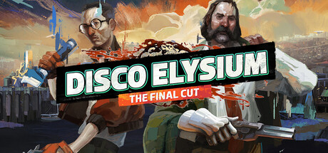

# Windows — 2019

[← All Windows years](../windows.md) · [Full 2019 page](../../years/2019.md)

154 Windows titles in 2019.

### 198X

**Platforms:** Windows, Xbox One, PlayStation 4 &nbsp;|&nbsp; **Developer:** Hi-Bit Studios &nbsp;|&nbsp; **Publisher:** Hi-Bit Studios, 8-4 &nbsp;|&nbsp; **Genre:** Shooter, Racing, Role-playing (RPG), Hack and slash/Beat 'em up, Adventure, Indie, Arcade &nbsp;|&nbsp; **Released:** June 20, 2019

> 198X is not just a beat ’em up, a shoot ’em up, a racing game, a ninja game and an RPG. This is a love letter to the golden age of arcade games – yet with a scope that was never possible in the actual 1980s. It’s a story about finding yourself – and your self-confidence – in the world of video games. A coming-of-age story told through multiple game genres, worlds and characters. Feel the sensation of fighting, shooting, driving, jumping and role-playing – combined with emotional, cinematic storytelling.  And what happens when the line between reality and game starts to blur…?
>
> _Synopsis source: IGDB_

[IGDB](https://www.igdb.com/games/198x)

---

### 60 Seconds! Reatomized

**Platforms:** macOS, Windows &nbsp;|&nbsp; **Developer:** Robot Gentleman Studios &nbsp;|&nbsp; **Publisher:** Robot Gentleman Studios &nbsp;|&nbsp; **Genre:** Role-playing (RPG), Simulator, Strategy, Adventure, Indie &nbsp;|&nbsp; **Released:** July 25, 2019

> Dolores, Ted, Mary Jane and Timmy return to face the nuclear apocalypse in this new, remastered edition of the classic atomic adventure - 60 Seconds! Reatomized, featuring 4K support, refreshed 2D graphics and hand-drawn 3D textures, new interactive menu, improved UI system, a technical refresh, and of course... new content!  With only 60 seconds left to impact, go on a mad dash through the house in search of family members and useful supplies. Everything will be against you: time, your very own furniture, a house that's different every time you play, and the fundamental question... what to take with you and who to leave behind?  Reaching the fallout shelter in time, alive, is only the beginning. Whatever you scavenged and whoever you saved will play a vital role in your survival. Each survival story will be different, with every day surprising you with unexpected events. Will all of these stories end well? It's up to you. Ration food and water, make best use of your supplies, face difficult choices and even venture into the wasteland.  Good luck.
>
> _Synopsis source: IGDB_

[IGDB](https://www.igdb.com/games/60-seconds-reatomized)

---

### A Plague Tale: Innocence

**Platforms:** Windows, Xbox One, PlayStation 4 &nbsp;|&nbsp; **Developer:** Asobo Studio &nbsp;|&nbsp; **Publisher:** Focus Entertainment &nbsp;|&nbsp; **Genre:** Adventure &nbsp;|&nbsp; **Released:** May 14, 2019

> A Plague Tale: Innocence is a third-person action-adventure game set in 14th-century France during the Black Death. Players control Amicia, a young girl protecting her little brother Hugo as they flee the Inquisition and navigate environments overrun by swarms of plague rats. Gameplay combines stealth, puzzle-solving, and light combat, with an emphasis on using fire and light to manage the rat hordes.
>
> _Synopsis source: IGDB_

[IGDB](https://www.igdb.com/games/a-plague-tale-innocence)

---

### A Short Hike

**Platforms:** Windows, Linux, macOS &nbsp;|&nbsp; **Developer:** adamgryu &nbsp;|&nbsp; **Publisher:** adamgryu, Whippoorwill &nbsp;|&nbsp; **Genre:** Adventure, Indie &nbsp;|&nbsp; **Released:** July 30, 2019

> A Short Hike is an exploration adventure game set in Hawk Peak Provincial Park. Players control Claire, a young bird who sets out to reach the summit of Hawk Peak while waiting for an important phone call.  The game allows players to climb, glide and explore the park at their own pace, meeting other visitors, completing small tasks and collecting items that improve Claire’s movement.
>
> _Synopsis source: IGDB_

[IGDB](https://www.igdb.com/games/a-short-hike)

---

### Ace Combat 7: Skies Unknown

**Platforms:** Windows, Xbox One, PlayStation VR, PlayStation 4 &nbsp;|&nbsp; **Developer:** Project Aces &nbsp;|&nbsp; **Publisher:** Bandai Namco Entertainment &nbsp;|&nbsp; **Genre:** Shooter, Simulator, Arcade &nbsp;|&nbsp; **Released:** January 18, 2019

> Leveraging the trueSKY technology and developed utilizing Unreal Engine 4, Ace Combat 7 will astound players with beautifully rendered skies and highly detailed cityscapes but also set the stage for the most engaging aerial battles in the franchise’s storied 20 year history accompanied with an immersive soundtrack. Ace Combat 7 will take the elements that the series is known for to a whole new level! Aces who have proven their combat prowess in Ace Combat 7’s campaign mode can take their dogfighting skills further with furious online multiplayer battles.  PlayStation4 players will also be able to get immersed in ACE COMBAT 7’s realism through exclusive features developed specifically for PlayStationVR.
>
> _Synopsis source: IGDB_

[IGDB](https://www.igdb.com/games/ace-combat-7-skies-unknown)

---

### Afterparty

**Platforms:** macOS, Xbox One, Windows, PlayStation 4 &nbsp;|&nbsp; **Developer:** Night School Studio &nbsp;|&nbsp; **Publisher:** Night School Studio &nbsp;|&nbsp; **Genre:** Adventure, Indie &nbsp;|&nbsp; **Released:** October 29, 2019

> In Afterparty, you are Milo and Lola, recently deceased best buds who suddenly find themselves staring down an eternity in Hell. But there's a loophole: outdrink Satan and he'll grant you re-entry to Earth.
>
> _Synopsis source: IGDB_

[IGDB](https://www.igdb.com/games/afterparty)

---

### Age of Empires II: Definitive Edition

**Platforms:** Windows &nbsp;|&nbsp; **Developer:** World's Edge &nbsp;|&nbsp; **Publisher:** Xbox Game Studios &nbsp;|&nbsp; **Genre:** Real Time Strategy (RTS), Strategy &nbsp;|&nbsp; **Released:** November 14, 2019

> Age of Empires II: Definitive Edition celebrates the 20th anniversary of one of the most popular strategy games ever with stunning 4K Ultra HD graphics, a new and fully remastered soundtrack, and brand-new content, “The Last Khans” with 3 new campaigns and 4 new civilizations.
>
> _Synopsis source: IGDB_

[IGDB](https://www.igdb.com/games/age-of-empires-ii-definitive-edition)

---

### Age of Wonders: Planetfall

**Platforms:** macOS, PlayStation 4, Xbox One, Windows &nbsp;|&nbsp; **Developer:** Triumph Studios &nbsp;|&nbsp; **Publisher:** Paradox Interactive &nbsp;|&nbsp; **Genre:** Simulator, Strategy, Turn-based strategy (TBS), Tactical &nbsp;|&nbsp; **Released:** August 6, 2019

> Age of Wonders: Planetfall is the new strategy game from Triumph Studios, creators of the critically acclaimed Age of Wonders and Overlord series, bringing all the exciting tactical-turn based combat and in-depth 4X empire building of its predecessors to space in an all-new sci-fi setting.  Emerge from the cosmic dark age of a fallen galactic empire to craft a new future for your people. Explore the planetary ruins and encounter other surviving factions that have each evolved in their own way, as you unravel the history of a shattered civilization. Fight, build, negotiate and technologically advance your way to utopia, in a deep single player campaign, on random maps and against friends in multiplayer.
>
> _Synopsis source: IGDB_

[IGDB](https://www.igdb.com/games/age-of-wonders-planetfall)

---

### AI: The Somnium Files

**Platforms:** Nintendo Switch, PlayStation 4, Windows &nbsp;|&nbsp; **Developer:** Spike Chunsoft &nbsp;|&nbsp; **Publisher:** Spike Chunsoft, Numskull Games &nbsp;|&nbsp; **Genre:** Puzzle, Adventure, Visual Novel &nbsp;|&nbsp; **Released:** September 17, 2019

> Play as detective Kaname Date on the case of an elusive serial killer in this thrilling, sci-fi murder mystery.
>
> _Synopsis source: IGDB_

[IGDB](https://www.igdb.com/games/ai-the-somnium-files)

---

### Amid Evil

**Platforms:** Windows &nbsp;|&nbsp; **Developer:** Indefatigable &nbsp;|&nbsp; **Publisher:** New Blood Interactive &nbsp;|&nbsp; **Genre:** Shooter, Indie &nbsp;|&nbsp; **Released:** June 20, 2019

> Once branded a heretic. Now you have been chosen. Reclaim our sacred weapons. Take back our ancestral lands. If you can stand... Amid Evil.
>
> _Synopsis source: IGDB_

[IGDB](https://www.igdb.com/games/amid-evil)

---

### Ancestors: The Humankind Odyssey

**Platforms:** Windows, PlayStation 4, Xbox One &nbsp;|&nbsp; **Developer:** Panache Digital Games &nbsp;|&nbsp; **Publisher:** Fictions, Private Division &nbsp;|&nbsp; **Genre:** Role-playing (RPG), Adventure, Indie &nbsp;|&nbsp; **Released:** August 27, 2019

> Ancestors: The Humankind Odyssey is a single-player survival game played from a third-person view and set in an open world. Players control a member of a hominid clan and manage its needs by eating, drinking, and sleeping while facing predators and other dangers in the wild. Exploring new places and being hunted can trigger a state of fear, which is offset by rewarding actions such as crafting tools and making discoveries. As the clan learns and grows, players unlock new skills through a neural development system and can switch between clan members, passing acquired abilities to future generations. The game has no structured narrative campaign and instead lets players shape their own experience.
>
> _Synopsis source: IGDB_

[IGDB](https://www.igdb.com/games/ancestors-the-humankind-odyssey)

---

### Anno 1800

**Platforms:** Windows &nbsp;|&nbsp; **Developer:** Ubisoft Blue Byte &nbsp;|&nbsp; **Publisher:** Ubisoft Entertainment &nbsp;|&nbsp; **Genre:** Real Time Strategy (RTS), Simulator, Strategy &nbsp;|&nbsp; **Released:** April 16, 2019

> Anno 1800: Lead the Industrial Revolution! Welcome to the dawn of the Industrial Age. The path you choose will define your world. Are you an innovator or an exploiter? A conqueror or a liberator? How the world remembers your name is up to you.
>
> _Synopsis source: IGDB_

[IGDB](https://www.igdb.com/games/anno-1800)

---

### Anthem

**Platforms:** PlayStation 4, Windows, Xbox One &nbsp;|&nbsp; **Developer:** BioWare &nbsp;|&nbsp; **Publisher:** Electronic Arts &nbsp;|&nbsp; **Genre:** Shooter, Role-playing (RPG), Adventure &nbsp;|&nbsp; **Released:** February 22, 2019

> Anthem is a shared-world action RPG, where players can delve into a vast landscape teeming with amazing technology and forgotten treasures. This is a world where Freelancers are called upon to defeat savage beasts, ruthless marauders, and forces plotting to conquer humanity.
>
> _Synopsis source: IGDB_

[IGDB](https://www.igdb.com/games/anthem)

---

### Ape Out

**Platforms:** Windows, Nintendo Switch, macOS &nbsp;|&nbsp; **Developer:** Gabe Cuzzillo &nbsp;|&nbsp; **Publisher:** Devolver Digital &nbsp;|&nbsp; **Genre:** Fighting, Hack and slash/Beat 'em up, Adventure, Indie, Arcade &nbsp;|&nbsp; **Released:** February 28, 2019

> Ape Out is a wildly intense and colorfully stylized smash ‘em up about primal escape, rhythmic violence, and frenetic jazz. Build up nearly unstoppable momentum and use your captors as both weapons and shields to crush everyone on your procedurally generated path to freedom.
>
> _Synopsis source: IGDB_

[IGDB](https://www.igdb.com/games/ape-out)

---

### Apex Legends

**Platforms:** Windows, PlayStation 4, Xbox One &nbsp;|&nbsp; **Developer:** Respawn Entertainment &nbsp;|&nbsp; **Publisher:** Electronic Arts &nbsp;|&nbsp; **Genre:** Shooter, Tactical &nbsp;|&nbsp; **Released:** February 4, 2019

> Conquer with character in Apex Legends, a free-to-play Hero shooter where legendary characters with powerful abilities team up to battle for fame & fortune on the fringes of the Frontier.  Master an ever-growing roster of diverse Legends, deep tactical squad play and bold new innovations that go beyond the Battle Royale experience—all within a rugged world where anything goes. Welcome to the next evolution of Hero Shooter.
>
> _Synopsis source: IGDB_

[IGDB](https://www.igdb.com/games/apex-legends)

---

### Arise: A Simple Story

**Platforms:** Xbox One, Windows, PlayStation 4 &nbsp;|&nbsp; **Developer:** Piccolo Studio &nbsp;|&nbsp; **Publisher:** Untold Tales &nbsp;|&nbsp; **Genre:** Platform, Adventure, Indie &nbsp;|&nbsp; **Released:** December 3, 2019

> Set out on an emotional journey through the bittersweet lives of two people where memories come alive and time bends to your will. Lose yourself in moments of happiness and overcome every hardship as you relive your life’s story. A story of joy and sorrow. A simple story.
>
> _Synopsis source: IGDB_

[IGDB](https://www.igdb.com/games/arise-a-simple-story)

---

### Assassin's Creed III Remastered

**Platforms:** Nintendo Switch, Windows, PlayStation 4, Xbox One &nbsp;|&nbsp; **Developer:** Ubisoft Barcelona &nbsp;|&nbsp; **Publisher:** Ubisoft Entertainment &nbsp;|&nbsp; **Genre:** Role-playing (RPG), Adventure &nbsp;|&nbsp; **Released:** March 29, 2019

> Relive the American Revolution or experience it for the first time in Assassin's Creed III Remastered, with enhanced graphics and improved gameplay mechanics. Also includes all the original solo DLC, including The Tyranny of King Washington.
>
> _Synopsis source: IGDB_

[IGDB](https://www.igdb.com/games/assassins-creed-iii-remastered)

---

### Assetto Corsa Competizione

**Platforms:** Windows &nbsp;|&nbsp; **Developer:** Kunos Simulazioni &nbsp;|&nbsp; **Publisher:** 505 Games &nbsp;|&nbsp; **Genre:** Racing, Simulator, Sport &nbsp;|&nbsp; **Released:** May 29, 2019

> Assetto Corsa Competizione, the official GT World Challenge videogame. Thanks to the extraordinary quality of simulation, you will experience the atmosphere of the GT3 championship. Compete against official drivers, teams, cars and official circuits reproduced to the highest quality ever seen.
>
> _Synopsis source: IGDB_

[IGDB](https://www.igdb.com/games/assetto-corsa-competizione)

---

### Astroneer

**Platforms:** Windows, Xbox One, PlayStation 4 &nbsp;|&nbsp; **Developer:** System Era Softworks &nbsp;|&nbsp; **Publisher:** System Era Softworks &nbsp;|&nbsp; **Genre:** Simulator, Adventure, Indie &nbsp;|&nbsp; **Released:** February 6, 2019

> Interact with strange new worlds in a unique and tactile way, molding the environment itself as if it were clay in your hands. Build your base, master resource management, automate your production lines, and more as you unravel the mysteries of the universe, alone or with friends.
>
> _Synopsis source: IGDB_

[IGDB](https://www.igdb.com/games/astroneer)

---

### Atelier Ryza: Ever Darkness & the Secret Hideout

**Platforms:** PlayStation 4, Nintendo Switch, Windows &nbsp;|&nbsp; **Developer:** Gust &nbsp;|&nbsp; **Publisher:** Koei Tecmo, Koei Tecmo Europe, Koei Tecmo America Corporation &nbsp;|&nbsp; **Genre:** Role-playing (RPG), Adventure &nbsp;|&nbsp; **Released:** September 26, 2019

> The next game in the Atelier franchise and the start of a new series of games.  The collection system has been redesigned, the items found are the same but different tools or actions will be required to find them at collection points. The crafting system has been updated and a new item making system has been added, to be revealed at a later date. The turn-based combat is getting changed in some fashion to make it more tense, also to be revealed later.
>
> _Synopsis source: IGDB_

[IGDB](https://www.igdb.com/games/atelier-ryza-ever-darkness-and-the-secret-hideout)

---

### Baba Is You

**Platforms:** macOS, Nintendo Switch, Windows, Linux &nbsp;|&nbsp; **Developer:** hempuli &nbsp;|&nbsp; **Publisher:** hempuli &nbsp;|&nbsp; **Genre:** Puzzle, Strategy, Indie &nbsp;|&nbsp; **Released:** March 13, 2019

> Baba Is You is a puzzle game where you can change the rules by which you play. In every level, the rules themselves are present as blocks you can interact with; by manipulating them, you can change how the level works and cause surprising, unexpected interactions! With some simple block-pushing you can turn yourself into a rock, turn patches of grass into dangerously hot obstacles, and even change the goal you need to reach to something entirely different.
>
> _Synopsis source: IGDB_

[IGDB](https://www.igdb.com/games/baba-is-you)

---

### Beat Saber

**Platforms:** Windows &nbsp;|&nbsp; **Developer:** Beat Games &nbsp;|&nbsp; **Publisher:** Beat Games &nbsp;|&nbsp; **Genre:** Indie &nbsp;|&nbsp; **Released:** May 21, 2019

> Slash the beats, get moving, and experience the world's most popular VR rhythm game!* Duck, dodge, and flow through 300+ handcrafted songs from artists like Coldplay, Imagine Dragons, and Metallica. Play solo, compete online, or pass the headset at your next party. Jump in with 60+ songs included!
>
> _Synopsis source: Steam_

[Wikipedia](https://en.wikipedia.org/wiki/Beat_Saber) · [Steam](https://store.steampowered.com/app/620980) · [IGDB](https://www.igdb.com/games/beat-saber)

---

### Blacksad: Under the Skin

**Platforms:** PlayStation 4, Windows, Nintendo Switch, macOS, Xbox One &nbsp;|&nbsp; **Developer:** Ys Interactive, Pendulo Studios &nbsp;|&nbsp; **Publisher:** Microids, Maximum Games &nbsp;|&nbsp; **Genre:** Puzzle, Adventure &nbsp;|&nbsp; **Released:** November 5, 2019

> BLACKSAD: Under the Skin - A dark corruption scandal in the heart of the New York City's underworld for charismatic detective John Blacksad!  Based on the noir comic series by the same name. The game features a noir detective story about a PI by the name of Blacksad that gets dragged into the case of a murdered boxing club. The game feature an interactive system much reminiscent of Grim Fandango where you have direct control of the character and only things that catch his gaze is interactable.
>
> _Synopsis source: IGDB_

[IGDB](https://www.igdb.com/games/blacksad-under-the-skin)

---

### Blair Witch

**Platforms:** Windows, PlayStation 4, Xbox One &nbsp;|&nbsp; **Developer:** Bloober Team &nbsp;|&nbsp; **Publisher:** Bloober Team &nbsp;|&nbsp; **Genre:** Adventure, Indie &nbsp;|&nbsp; **Released:** August 30, 2019

> Inspired by the cinematic lore of Blair Witch, experience a new story-driven psychological horror game that studies your reactions to fear and stress.  A story of the human descent into darkness. Experience an original story based on the legend of Blair Witch from the makers of Layers of Fear.  Find the way through the haunted woods. Navigate your way through a cursed forest that warps and distorts both time and space.  Your sanity against her curse. Stand against the horrors of the Blair Witch and the decaying sanity of a man burdened by his past.  How will you face your fears? How you react to danger and behave under pressure will ultimately teach you more about yourself.
>
> _Synopsis source: IGDB_

[IGDB](https://www.igdb.com/games/blair-witch)

---

### Blasphemous

**Platforms:** Xbox One, Windows, Nintendo Switch, macOS, PlayStation 4, Linux &nbsp;|&nbsp; **Developer:** The Game Kitchen &nbsp;|&nbsp; **Publisher:** The Game Kitchen, Team17 &nbsp;|&nbsp; **Genre:** Platform, Role-playing (RPG), Hack and slash/Beat 'em up, Adventure, Indie &nbsp;|&nbsp; **Released:** September 10, 2019

> Blasphemous is a punishing action-platformer that combines the fast-paced, skilled combat of a hack-n-slash game with a deep and evocative narrative core. Explore this nightmarish world of twisted religion and discover its many secrets hidden deep inside. Use devastating combos and brutal executions to smite the hordes of grotesque monsters and titanic bosses, who are all ready to rip your limbs off. Locate and equip relics, rosary beads and prayers that call on the powers of the heavens to aid you in your quest to break your eternal damnation.
>
> _Synopsis source: IGDB_

[IGDB](https://www.igdb.com/games/blasphemous)

---

### Blazing Chrome

**Platforms:** PlayStation 4, Nintendo Switch, Xbox One, Windows &nbsp;|&nbsp; **Developer:** JoyMasher &nbsp;|&nbsp; **Publisher:** The Arcade Crew &nbsp;|&nbsp; **Genre:** Shooter, Platform, Indie, Arcade &nbsp;|&nbsp; **Released:** July 11, 2019

> Blazing Chrome is a classic co-op run 'n gun with an original arcade feel. Players can choose between Mavra, the badass human resistance, soldier or Doyle, the groovy rebel robot, to kick some metal ass.
>
> _Synopsis source: IGDB_

[IGDB](https://www.igdb.com/games/blazing-chrome)

---

### Bloodstained: Ritual of the Night

**Platforms:** Xbox One, Windows, Nintendo Switch, PlayStation 4 &nbsp;|&nbsp; **Developer:** ArtPlay &nbsp;|&nbsp; **Publisher:** 505 Games &nbsp;|&nbsp; **Genre:** Platform, Role-playing (RPG), Adventure &nbsp;|&nbsp; **Released:** June 18, 2019

> Bloodstained: Ritual of the Night is a gothic horror action side-scrolling RPG set in 19th century England. A paranormal force has summoned a demon-infested castle, revealing crystal shards infused with tremendous magical power.  Play as Miriam, an orphan scarred by an alchemist's curse which slowly crystallizes her body. To save humanity, and herself in the process, Miriam must fight through the castle and defeat the summoner, Gebel.  Collect, craft and unlock a vast array of weapons, equipment and loot to defeat the countless minions and bosses of hell that await!
>
> _Synopsis source: IGDB_

[IGDB](https://www.igdb.com/games/bloodstained-ritual-of-the-night)

---

### Borderlands 3

**Platforms:** macOS, Xbox One, Windows, Stadia, PlayStation 4 &nbsp;|&nbsp; **Developer:** Gearbox Software &nbsp;|&nbsp; **Publisher:** 2K Games &nbsp;|&nbsp; **Genre:** Shooter, Role-playing (RPG), Adventure &nbsp;|&nbsp; **Released:** September 13, 2019

> Borderlands 3 is a first-person looter shooter set seven years after the events of Borderlands 2. Players select one of four new Vault Hunters and travel across multiple planets to stop Troy and Tyreen Calypso, twin cult leaders seeking to harness the power of alien Vaults scattered throughout the galaxy. The game features procedurally generated weapons, cooperative multiplayer for up to four players, expanded skill trees with multiple action skills per character, and new traversal mechanics including sliding and mantling.
>
> _Synopsis source: IGDB_

[IGDB](https://www.igdb.com/games/borderlands-3)

---

### Borderlands: Game of the Year Enhanced

**Platforms:** Windows &nbsp;|&nbsp; **Developer:** Gearbox Software, Blind Squirrel Games &nbsp;|&nbsp; **Publisher:** 2K &nbsp;|&nbsp; **Genre:** Shooter, Role-playing (RPG) &nbsp;|&nbsp; **Released:** April 3, 2019

> Borderlands: Game of the Year Enhanced is a co‑op shooter‑looter where four distinct vault hunters hunt for alien secrets on the lawless world of Pandora, collecting procedurally generated weapons, driving into frenetic vehicular combat, and tackling DLC campaigns solo or with up to four players. This enhanced edition adds higher‑resolution character models, environments, weapons, and textures (4K support), new weapon variants and character heads, new gold chests and keys, and includes all four original add‑on campaigns, while preserving the game’s signature cel‑shaded art and chaotic co‑op gameplay.
>
> _Synopsis source: IGDB_

[IGDB](https://www.igdb.com/games/borderlands-game-of-the-year-enhanced)

---

### Call of Duty: Modern Warfare

**Platforms:** Windows, PlayStation 4, Xbox One &nbsp;|&nbsp; **Developer:** Infinity Ward &nbsp;|&nbsp; **Publisher:** Activision &nbsp;|&nbsp; **Genre:** Shooter &nbsp;|&nbsp; **Released:** October 25, 2019

> Call of Duty: Modern Warfare is a first-person shooter that serves as a reboot of the Modern Warfare sub-series. The game features a single-player campaign, cooperative Special Ops missions, and a multiplayer suite with cross-platform play. The campaign emphasizes tactical realism, with morally complex scenarios, civilian threat assessments, and night-vision operations. Multiplayer introduces a revised gunplay system with extensive weapon customization, a Realism mode that removes the HUD, a Ground War mode supporting over 100 players, and a 2v2 Gunfight mode. Post-launch, the game received the free-to-play battle royale mode Warzone. The traditional season pass was replaced with free content updates delivered through seasonal battle passes.
>
> _Synopsis source: IGDB_

[IGDB](https://www.igdb.com/games/call-of-duty-modern-warfare)

---

### Cat Quest II

**Platforms:** Windows, Nintendo Switch, PlayStation 4, iOS, Xbox One, macOS &nbsp;|&nbsp; **Developer:** The Gentlebros &nbsp;|&nbsp; **Publisher:** Flyhigh Works, PQube, Kepler Interactive, The Gentlebros &nbsp;|&nbsp; **Genre:** Role-playing (RPG), Adventure, Indie &nbsp;|&nbsp; **Released:** September 19, 2019

> Cat Quest II, a fantasy action-adventure RPG, returns to the world of Felingard to expand on the original with more explosive spells, expanded weapon options, an exciting new character switch mechanic, and local co-op! Play as both a cat and dog as you explore their kingdoms solo or with a friend! Quest in a world filled with magic, curious monsters, and go on a catventure like never before!
>
> _Synopsis source: IGDB_

[IGDB](https://www.igdb.com/games/cat-quest-ii)

---

### Children of Morta

**Platforms:** Linux, macOS, Nintendo Switch, Windows, PlayStation 4, Xbox One &nbsp;|&nbsp; **Developer:** Dead Mage &nbsp;|&nbsp; **Publisher:** 11 bit studios &nbsp;|&nbsp; **Genre:** Role-playing (RPG), Adventure, Indie &nbsp;|&nbsp; **Released:** September 3, 2019

> Children of Morta is a narrative driven hack and slash roguelike. Take on the role of a member of the Bergson family, the Guardians of Mount Morta, as you fight desperately against the Corruption. Experience not only what it means to be a hero, but to be part of a family that bears the weight of the mountain together.
>
> _Synopsis source: IGDB_

[IGDB](https://www.igdb.com/games/children-of-morta)

---

### Close to the Sun

**Platforms:** Nintendo Switch, Windows, PlayStation 4, Xbox One &nbsp;|&nbsp; **Developer:** Storm in a Teacup &nbsp;|&nbsp; **Publisher:** Wired Productions &nbsp;|&nbsp; **Genre:** Adventure, Indie &nbsp;|&nbsp; **Released:** May 2, 2019

> Close to the Sun is a story-driven horror game that takes place at the turn of the 20th century on a mysterious ship complex created by Nikola Tesla for the sake of knowledge. In this alternative version of history, his scientific breakthroughs have already had a major impact on the world. You’re a young journalist looking for your sister and, as you approach this enormous and glorious complex for the first time, you quickly realize that something there has gone horribly wrong..."
>
> _Synopsis source: IGDB_

[IGDB](https://www.igdb.com/games/close-to-the-sun)

---

### Code Vein

**Platforms:** Xbox One, Windows, PlayStation 4 &nbsp;|&nbsp; **Developer:** Shift, Bandai Namco Studios &nbsp;|&nbsp; **Publisher:** Bandai Namco Entertainment &nbsp;|&nbsp; **Genre:** Role-playing (RPG), Adventure &nbsp;|&nbsp; **Released:** September 26, 2019

> Code Vein is set in the not too distant future where a disaster has brought the world to ruin and vampire-like beings battle for dominance.
>
> _Synopsis source: IGDB_

[IGDB](https://www.igdb.com/games/code-vein)

---

### Control

**Platforms:** PlayStation 4, Xbox One, Windows &nbsp;|&nbsp; **Developer:** Remedy Entertainment &nbsp;|&nbsp; **Publisher:** 505 Games &nbsp;|&nbsp; **Genre:** Shooter, Adventure &nbsp;|&nbsp; **Released:** August 27, 2019

> Control is a third-person action-adventure game set in the Federal Bureau of Control, a secretive U.S. government agency that studies paranormal phenomena. Players control Jesse Faden, who arrives at the Bureau's headquarters, the Oldest House, to find it invaded by a hostile force called the Hiss. Gameplay combines supernatural abilities with a shape-shifting firearm, and the environment is reactive and destructible.
>
> _Synopsis source: IGDB_

[IGDB](https://www.igdb.com/games/control)

---

### Cooking Simulator

**Platforms:** Windows &nbsp;|&nbsp; **Developer:** Big Cheese Studio &nbsp;|&nbsp; **Publisher:** Forever Entertainment S.A., Big Cheese Studio, PlayWay &nbsp;|&nbsp; **Genre:** Simulator, Indie, Arcade &nbsp;|&nbsp; **Released:** June 6, 2019

> Cooking Simulator is a single-player simulation game that recreates restaurant cooking using a physics-based engine and detailed kitchen mechanics. Players prepare a wide range of recipes from many ingredients, handling ovens, stoves, pots, pans, and utensils in a fully interactive kitchen. It includes several modes, such as a career mode where players run a kitchen and build up fame by filling orders, a free-form sandbox with no time limits, and a set of tutorials that teach the mechanics. Additional content adds themed kitchens and specialties like pizza, cakes, and cookies.
>
> _Synopsis source: IGDB_

[IGDB](https://www.igdb.com/games/cooking-simulator)

---

### Crackdown 3

**Platforms:** Xbox One, Windows &nbsp;|&nbsp; **Developer:** Sumo Digital &nbsp;|&nbsp; **Publisher:** Xbox Game Studios &nbsp;|&nbsp; **Genre:** Shooter &nbsp;|&nbsp; **Released:** February 15, 2019

> Stop crime as a super-powered Agent of justice in Crackdown 3's hyper-powered sandbox of mayhem and destruction. Explore the heights of a futuristic city, race through the streets in a transforming vehicle, and use your powerful abilities to stop a ruthless criminal empire. Developed by original creator Dave Jones, Crackdown 3 delivers cooperative mayhem and an all-new multiplayer mode where destruction is your ultimate weapon.
>
> _Synopsis source: IGDB_

[IGDB](https://www.igdb.com/games/crackdown-3)

---

### Darksiders Genesis

**Platforms:** Stadia, Windows &nbsp;|&nbsp; **Developer:** Airship Syndicate &nbsp;|&nbsp; **Publisher:** THQ Nordic &nbsp;|&nbsp; **Genre:** Role-playing (RPG), Hack and slash/Beat 'em up, Adventure &nbsp;|&nbsp; **Released:** December 5, 2019

> In this Action RPG spin-off, the fourth Horseman of the Apocalypse Strife is called upon to save humankind from certain destruction at the hands of Lucifer. True to its roots, Darksiders Genesis will feature intense combat, exploration, puzzle-solving, epic boss battles and serpent holes from heaven to hell. The game marks the first, full-scale Darksiders adventure played from the top-down perspective.
>
> _Synopsis source: IGDB_

[IGDB](https://www.igdb.com/games/darksiders-genesis)

---

### Darq

**Platforms:** Windows &nbsp;|&nbsp; **Developer:** Unfold Games &nbsp;|&nbsp; **Publisher:** Unfold Games &nbsp;|&nbsp; **Genre:** Adventure, Indie &nbsp;|&nbsp; **Released:** August 15, 2019

> Darq tells the story of Lloyd, a boy who becomes aware of the fact that he is dreaming. To Lloyd's misfortune, the dream quickly turns into a nightmare and all attempts to wake up end in failure. While exploring the darkest corners of his subconscious, Lloyd learns how to survive the nightmare by bending the laws of physics and manipulating the fluid fabric of the dream world.
>
> _Synopsis source: IGDB_

[IGDB](https://www.igdb.com/games/darq)

---

### Dauntless

**Platforms:** PlayStation 4, Xbox One, Nintendo Switch, Windows &nbsp;|&nbsp; **Developer:** Phoenix Labs &nbsp;|&nbsp; **Publisher:** Phoenix Labs, Epic Games &nbsp;|&nbsp; **Genre:** Role-playing (RPG), Adventure &nbsp;|&nbsp; **Released:** September 26, 2019

> Dauntless takes place in a fantasy setting, where a cataclysmic event has torn the world apart, releasing monster-like Behemoths that prey on the surviving humans. As a Slayer of Ramsgate, you are all that stands between your world and the Behemoths that seek to devour it. Hunt huge monsters, alongside other Slayers on any platform, and craft awesome gear in this stylish free-to-play co-op action RPG.
>
> _Synopsis source: IGDB_

[IGDB](https://www.igdb.com/games/dauntless)

---

### Dawn of Man

**Platforms:** macOS, Xbox One, Windows &nbsp;|&nbsp; **Developer:** Madruga Works &nbsp;|&nbsp; **Publisher:** Madruga Works &nbsp;|&nbsp; **Genre:** Role-playing (RPG), Simulator, Strategy, Indie &nbsp;|&nbsp; **Released:** March 1, 2019

> Command a settlement of ancient humans, guide them through the ages in their struggle for survival. Hunt, gather, craft tools, fight, research new techs and face the challenges the environment will throw at you.
>
> _Synopsis source: IGDB_

[IGDB](https://www.igdb.com/games/dawn-of-man)

---

### Dead or Alive 6

**Platforms:** PlayStation 4, Windows, Xbox One &nbsp;|&nbsp; **Developer:** Team NINJA &nbsp;|&nbsp; **Publisher:** Koei Tecmo Games &nbsp;|&nbsp; **Genre:** Fighting &nbsp;|&nbsp; **Released:** March 1, 2019

> Dead or Alive 6,produced by Koei Tecmo Games,features fast-paced 3D fighting entertainment with multi-tiered stages that are now both dynamic and critical parts of the competitive experience.
>
> _Synopsis source: IGDB_

[IGDB](https://www.igdb.com/games/dead-or-alive-6)

---

### Deliver Us the Moon

**Platforms:** Windows &nbsp;|&nbsp; **Developer:** KeokeN Interactive &nbsp;|&nbsp; **Publisher:** Wired Productions &nbsp;|&nbsp; **Genre:** Puzzle, Adventure, Indie &nbsp;|&nbsp; **Released:** October 10, 2019

> Deliver Us the Moon is a sci-fi adventure game developed by KeokeN Interactive and released in 2019. Set in a near future where Earth's resources are nearly depleted, the game follows a lone astronaut on a mission to the Moon to restore energy to the planet. Players explore abandoned lunar bases and use tools to solve environmental puzzles while uncovering the fate of the people who once lived there. The game combines narrative-driven exploration with light puzzle-solving elements and offers a mix of first-person and third-person perspectives.
>
> _Synopsis source: IGDB_

[IGDB](https://www.igdb.com/games/deliver-us-the-moon)

---

### Descenders

**Platforms:** Windows, Linux, Xbox One, macOS &nbsp;|&nbsp; **Developer:** RageSquid &nbsp;|&nbsp; **Publisher:** No More Robots, Noodlecake Studios &nbsp;|&nbsp; **Genre:** Racing, Simulator, Sport, Arcade &nbsp;|&nbsp; **Released:** May 7, 2019

> "Descenders is extreme downhill freeriding for the modern era, with procedurally generated worlds, and where mistakes have real consequences. Will you lead your team to glory and become the next legendary Descender?"
>
> _Synopsis source: IGDB_

[IGDB](https://www.igdb.com/games/descenders)

---

### Devil May Cry 5

**Platforms:** PlayStation 4, Windows, Xbox One &nbsp;|&nbsp; **Developer:** Capcom Development Division 1 &nbsp;|&nbsp; **Publisher:** Capcom &nbsp;|&nbsp; **Genre:** Hack and slash/Beat 'em up, Adventure &nbsp;|&nbsp; **Released:** March 8, 2019

> Devil May Cry 5 is a brand-new entry in the legendary over-the-top action series Devil May Cry. The game features three playable characters, each with a radically different stylish combat play style as they take on the city overrun with demons. Developed with Capcom’s in-house proprietary RE engine, the series continues to achieve new heights in fidelity with graphics that utilize photorealistic character designs and stunning lighting and environmental effects.
>
> _Synopsis source: IGDB_

[IGDB](https://www.igdb.com/games/devil-may-cry-5)

---

### Devotion

**Platforms:** Windows &nbsp;|&nbsp; **Developer:** Red Candle Games &nbsp;|&nbsp; **Publisher:** Winking Skywalker Entertainment, Indievent, Red Candle Games &nbsp;|&nbsp; **Genre:** Puzzle, Adventure, Indie &nbsp;|&nbsp; **Released:** February 19, 2019

> ‘Devotion’ is a first-person atmospheric horror game set in the 1980s Taiwan.  The story centers around a seemingly ordinary family of three that lived in an old apartment complex. Explore the nostalgic house in the 80s where religion plays a significant role in their daily life. When one day the same house that once filled with joy and love had turned into a hell-like nightmare, and by venturing in the haunted and confined space, each puzzle leads you closer to the mysteries nested deep inside.
>
> _Synopsis source: IGDB_

[IGDB](https://www.igdb.com/games/devotion)

---

### Dicey Dungeons

**Platforms:** Windows, Linux, macOS &nbsp;|&nbsp; **Developer:** Terry Cavanagh &nbsp;|&nbsp; **Publisher:** Distractionware, Terry Cavanagh &nbsp;|&nbsp; **Genre:** Role-playing (RPG), Strategy, Adventure, Indie, Card & Board Game &nbsp;|&nbsp; **Released:** August 13, 2019

> Fighting against fortune would be a lot easier if you weren't a walking dice.
>
> _Synopsis source: IGDB_

[IGDB](https://www.igdb.com/games/dicey-dungeons)

---

### Dirt Rally 2.0

**Platforms:** Windows, Oculus VR, SteamVR, PlayStation 4, Xbox One &nbsp;|&nbsp; **Developer:** Codemasters &nbsp;|&nbsp; **Publisher:** Codemasters &nbsp;|&nbsp; **Genre:** Racing, Simulator, Sport, Strategy &nbsp;|&nbsp; **Released:** February 25, 2019

> Dirt Rally 2.0 dares you to carve your way through a selection of iconic rally locations from across the globe, in the most powerful off-road vehicles ever made, knowing that the smallest mistake could end your stage.
>
> _Synopsis source: IGDB_

[IGDB](https://www.igdb.com/games/dirt-rally-2-dot-0)

---

### Disco Elysium

**Platforms:** Windows &nbsp;|&nbsp; **Developer:** ZA/UM &nbsp;|&nbsp; **Publisher:** ZA/UM &nbsp;|&nbsp; **Genre:** RPG &nbsp;|&nbsp; **Released:** October 15, 2019

> Disco Elysium - The Final Cut is a groundbreaking role playing game. You’re a detective with a unique skill system at your disposal and a whole city to carve your path across. Interrogate unforgettable characters, crack murders or take bribes. Become a hero or an absolute disaster of a human being.
>
> _Synopsis source: Steam_

[Wikipedia](https://en.wikipedia.org/wiki/Disco_Elysium) · [Steam](https://store.steampowered.com/app/632470) · [IGDB](https://www.igdb.com/games/disco-elysium)

---

### Dota Underlords

**Platforms:** iOS, Android, Linux, macOS, Windows &nbsp;|&nbsp; **Developer:** Valve &nbsp;|&nbsp; **Publisher:** Valve &nbsp;|&nbsp; **Genre:** Role-playing (RPG), Strategy, Tactical, Card & Board Game &nbsp;|&nbsp; **Released:** June 20, 2019

> In Dota Underlords, strategic decisions matter more than twitch reflexes. Underlords includes compelling singleplayer and multiplayer modes, and offers level progression with rewards. Play a strategic Standard game, a quick Knockout match, or co-op Duos match with a friend.
>
> _Synopsis source: IGDB_

[IGDB](https://www.igdb.com/games/dota-underlords)

---

### Draugen

**Platforms:** Windows &nbsp;|&nbsp; **Developer:** Red Thread Games &nbsp;|&nbsp; **Publisher:** Red Thread Games &nbsp;|&nbsp; **Genre:** Puzzle, Adventure, Indie &nbsp;|&nbsp; **Released:** May 29, 2019

> Draugen is a first-person psychological horror adventure, set amongst the deep fjords and towering mountains of Norway’s awe-inspiring west coast.  The game is a dark and disturbing journey into the pitch black heart of Norwegian national romanticism, as seen through the eyes of an American nature photographer, botanist and entomologist.
>
> _Synopsis source: IGDB_

[IGDB](https://www.igdb.com/games/draugen)

---

### Eastshade

**Platforms:** PlayStation 4, Xbox One, Windows &nbsp;|&nbsp; **Developer:** Eastshade Studios &nbsp;|&nbsp; **Publisher:** Eastshade Studios &nbsp;|&nbsp; **Genre:** Adventure, Indie &nbsp;|&nbsp; **Released:** February 13, 2019

> Eastshade is a first-person, open world exploration game.  You are a traveling painter, exploring the island of Eastshade. Capture the world on canvas using your artist’s easel. Talk to the inhabitants to learn about their lives. Make friends and help those in need. Discover mysteries and uncover secrets about the land. Surmount natural impasses to reach forgotten places. Experience how your actions impact the world around you.
>
> _Synopsis source: IGDB_

[IGDB](https://www.igdb.com/games/eastshade)

---

### eFootball PES 2020

**Platforms:** PlayStation 4, Xbox One, Windows &nbsp;|&nbsp; **Developer:** Konami Digital Entertainment &nbsp;|&nbsp; **Publisher:** Konami Digital Entertainment &nbsp;|&nbsp; **Genre:** Simulator, Sport &nbsp;|&nbsp; **Released:** September 10, 2019

> eFootball PES 2020 is a football simulation game developed and published by Konami. Released in September 2019, it is the 19th instalment in the Pro Evolution Soccer series and the first to include the "eFootball" branding, reflecting Konami's focus on esports.
>
> _Synopsis source: IGDB_

[IGDB](https://www.igdb.com/games/efootball-pes-2020)

---

### F1 2019

**Platforms:** Windows, Xbox One, PlayStation 4 &nbsp;|&nbsp; **Developer:** Codemasters &nbsp;|&nbsp; **Publisher:** Deep Silver &nbsp;|&nbsp; **Genre:** Racing, Simulator, Sport &nbsp;|&nbsp; **Released:** June 28, 2019

> Working in partnership with F1, for the first time ever, players will be able to get behind the wheel of a 2019 regulation car specifically designed in collaboration with F1’s technical team, headed up by Ross Brawn and Pat Symonds. The car, which will be available in Multiplayer, adheres to the 2019 regulations and comes with a range of livery designs offering players a new level of personalization. The 2019 F1 Team liveries will also feature on the car in early marketing materials, but will be replaced by the final Team cars ahead of the game's release.
>
> _Synopsis source: IGDB_

[IGDB](https://www.igdb.com/games/f1-2019)

---

### Far Cry New Dawn

**Platforms:** Windows, PlayStation 4, Xbox One &nbsp;|&nbsp; **Developer:** Ubisoft Montreal &nbsp;|&nbsp; **Publisher:** Ubisoft Entertainment &nbsp;|&nbsp; **Genre:** Shooter, Adventure &nbsp;|&nbsp; **Released:** February 15, 2019

> Dive into a transformed vibrant post-apocalyptic Hope County, Montana, 17 years after a global nuclear catastrophe. Lead the fight against the Highwaymen, as they seek to take over the last remaining resources.
>
> _Synopsis source: IGDB_

[IGDB](https://www.igdb.com/games/far-cry-new-dawn)

---

### FIFA 20

**Platforms:** Xbox One, Windows, PlayStation 4 &nbsp;|&nbsp; **Developer:** EA Romania, EA Vancouver &nbsp;|&nbsp; **Publisher:** EA Sports &nbsp;|&nbsp; **Genre:** Sport &nbsp;|&nbsp; **Released:** September 27, 2019

> Powered by Frostbite, EA SPORTS FIFA 20 for PC brings two sides of The World’s Game to life - the prestige of the professional stage and an all-new, authentic street football experience in EA SPORTS VOLTA. FIFA 20 innovates across the game, FOOTBALL INTELLIGENCE unlocks an unprecedented platform for gameplay realism, FIFA Ultimate Team offers more ways to build your dream squad and EA SPORTS VOLTA returns the game to the street with an authentic form of small-sided football.
>
> _Synopsis source: IGDB_

[IGDB](https://www.igdb.com/games/fifa-20)

---

### Final Fantasy VIII Remastered

**Platforms:** Nintendo Switch, Windows, PlayStation 4, Xbox One &nbsp;|&nbsp; **Developer:** Square Enix Creative Business Unit I, Access Games, DotEmu &nbsp;|&nbsp; **Publisher:** Square Enix &nbsp;|&nbsp; **Genre:** Role-playing (RPG), Adventure &nbsp;|&nbsp; **Released:** September 3, 2019

> Final Fantasy VIII Remastered features upgraded character models, enhanced Guardian Forces and improved visual effects while preserving the original game’s story and pre-rendered backgrounds. It includes modern features such as achievements, controller support, and optional battle enhancements like 3x speed, no encounters and max stats.
>
> _Synopsis source: IGDB_

[IGDB](https://www.igdb.com/games/final-fantasy-viii-remastered)

---

### Final Fantasy XIV: Shadowbringers

**Platforms:** PlayStation 4, Windows &nbsp;|&nbsp; **Developer:** Square Enix &nbsp;|&nbsp; **Publisher:** Square Enix &nbsp;|&nbsp; **Released:** July 2, 2019

[Wikipedia](https://en.wikipedia.org/wiki/Final_Fantasy_XIV_(2010_video_game))

---

### Football Manager 2020

**Platforms:** Windows, macOS, Stadia &nbsp;|&nbsp; **Developer:** Sports Interactive &nbsp;|&nbsp; **Genre:** Simulator, Sport &nbsp;|&nbsp; **Released:** November 19, 2019

> Put your opinions to good use and do things your way at your club this season. Every decision counts in FM20 with new features and polished game mechanics adding fresh and authentic dimensions, empowering managers to take greater accountability for both their own and their team’s destiny.
>
> _Synopsis source: IGDB_

[IGDB](https://www.igdb.com/games/football-manager-2020)

---

### Forager

**Platforms:** Nintendo Switch, PlayStation 4, Windows, Linux &nbsp;|&nbsp; **Developer:** Hop Frog, HopFrog &nbsp;|&nbsp; **Publisher:** Humble Bundle, Humble Games &nbsp;|&nbsp; **Genre:** Puzzle, Role-playing (RPG), Simulator, Strategy, Adventure, Indie &nbsp;|&nbsp; **Released:** April 18, 2019

> Forager is the popular crafting, exploration and base building game that can best be defined as “the idle game that you want to actively keep playing”.  A quirky mix between old school 2D Zelda experiences and modern Minecraft or Terraria-like crafting games that places players into a small piece of land with just a pickaxe and a desire for expansion and exploration.  Players can buy procedurally generated lands to uncover secrets, solve puzzles, find dungeons, treasure and forgotten relics and to expand their sprawling bases. Nearly impossible to put down, there is always something to manage or work towards!
>
> _Synopsis source: IGDB_

[IGDB](https://www.igdb.com/games/forager)

---

### Gato Roboto

**Platforms:** Nintendo Switch, Windows &nbsp;|&nbsp; **Developer:** doinksoft &nbsp;|&nbsp; **Publisher:** Devolver Digital &nbsp;|&nbsp; **Genre:** Platform, Adventure, Indie, Arcade &nbsp;|&nbsp; **Released:** May 30, 2019

> Pounce inside of your cozy armored mech and set off on a dangerous trek through an alien underworld full of irritable creatures and treacherous obstacles in a valiant effort to save your stranded captain and his crashed spaceship.  Tiptoe outside the friendly confines of your technological marvel and follow your feline instincts through tight tunnels and mysterious waterways to scavenge for new weapons and gear. Adventure awaits the most curious of cats in Gato Roboto!
>
> _Synopsis source: IGDB_

[IGDB](https://www.igdb.com/games/gato-roboto)

---

### Gears 5

**Platforms:** Windows, Xbox One &nbsp;|&nbsp; **Developer:** The Coalition &nbsp;|&nbsp; **Publisher:** Xbox Game Studios &nbsp;|&nbsp; **Genre:** Shooter, Adventure &nbsp;|&nbsp; **Released:** September 9, 2019

> From one of gaming’s most acclaimed sagas, Gears is bigger than ever, with five thrilling modes and the deepest campaign yet. With all-out war descending, Kait Diaz breaks away to uncover her connection to the enemy and discovers the true danger to Sera – herself.
>
> _Synopsis source: IGDB_

[IGDB](https://www.igdb.com/games/gears-5)

---

### Generation Zero

**Platforms:** Windows, PlayStation 4, Xbox One &nbsp;|&nbsp; **Developer:** Systemic Reaction &nbsp;|&nbsp; **Publisher:** Systemic Reaction &nbsp;|&nbsp; **Genre:** Shooter, Adventure &nbsp;|&nbsp; **Released:** March 26, 2019

> Generation Zero is a stealth-action shooter where you wage guerilla warfare against lethal mechanical enemies. Explore a vast open world map inspired by the Swedish Cold War era, take part in the resistance alone or with up to three friends in seamless co-op.
>
> _Synopsis source: IGDB_

[IGDB](https://www.igdb.com/games/generation-zero)

---

### GreedFall

**Platforms:** Windows, Xbox One, PlayStation 4 &nbsp;|&nbsp; **Developer:** Spiders &nbsp;|&nbsp; **Publisher:** Focus Entertainment &nbsp;|&nbsp; **Genre:** Role-playing (RPG), Strategy, Adventure &nbsp;|&nbsp; **Released:** September 9, 2019

> GreedFall is a single-player action RPG set in a fictional world inspired by 17th-century Baroque Europe. Players take the role of a diplomat arriving on a remote island inhabited by natives with supernatural abilities, now contested by colonial factions from various nations. The game emphasizes player choice, offering combat, diplomacy, and stealth approaches to quests, with decisions affecting relationships between the island's competing factions. A prequel, GreedFall 2: The Dying World, was released in 2026.
>
> _Synopsis source: IGDB_

[IGDB](https://www.igdb.com/games/greedfall)

---

### Green Hell

**Platforms:** Windows &nbsp;|&nbsp; **Developer:** Creepy Jar &nbsp;|&nbsp; **Publisher:** Creepy Jar, Forever Entertainment S.A. &nbsp;|&nbsp; **Genre:** Simulator, Strategy, Adventure, Indie &nbsp;|&nbsp; **Released:** September 5, 2019

> Green Hell is a sweltering struggle for survival in the Amazonian rainforest. Clinging to life, the player is set on a journey of durability as the effects of solitude wear heavy not only on the body but also the mind. How long can you survive against the dangers of the unknown?
>
> _Synopsis source: IGDB_

[IGDB](https://www.igdb.com/games/green-hell)

---

### Grid

**Platforms:** Xbox One, Stadia, PlayStation 4, Windows &nbsp;|&nbsp; **Developer:** Codemasters &nbsp;|&nbsp; **Publisher:** Codemasters &nbsp;|&nbsp; **Genre:** Racing, Simulator, Sport &nbsp;|&nbsp; **Released:** October 10, 2019

> Grid is a racing experience like no other. Offering unrivalled moment-to-moment racing, Grid returns with an all-new experience where every race is the chance to choose your own path, create your own story and conquer the world of motorsport.
>
> _Synopsis source: IGDB_

[IGDB](https://www.igdb.com/games/grid)

---

### Grimm's Hollow

**Platforms:** Windows &nbsp;|&nbsp; **Developer:** ghosthunter &nbsp;|&nbsp; **Publisher:** ghosthunter &nbsp;|&nbsp; **Genre:** Role-playing (RPG), Adventure, Indie &nbsp;|&nbsp; **Released:** October 31, 2019

> A spooky, freeware RPG where you search the afterlife for your brother. Reap ghosts with your scythe, explore haunted caves, and eat ghostly treats on your journey through death.
>
> _Synopsis source: IGDB_

[IGDB](https://www.igdb.com/games/grimms-hollow)

---

### Hell Let Loose

**Platforms:** Windows &nbsp;|&nbsp; **Developer:** Expression Games &nbsp;|&nbsp; **Publisher:** Team17 &nbsp;|&nbsp; **Genre:** Shooter, Simulator, Strategy, Indie &nbsp;|&nbsp; **Released:** June 6, 2019

> Fight in the most iconic battles of the Second World War, including El Alamein, Stalingrad, Omaha Beach, and Foy! This is combat at a whole new scale.. with lumbering tanks dominating the battlefield, and crucial supply chains fuelling the frontlines, you are a cog in the machine of colossal combined arms warfare. Hell Let Loose puts you in the chaos of war, complete with deep player-controlled vehicles, a dynamically evolving front line, and crucial unit-focused gameplay that commands the tide of battle.
>
> _Synopsis source: IGDB_

[IGDB](https://www.igdb.com/games/hell-let-loose)

---

### Hunt: Showdown 1896

**Platforms:** Windows, Xbox One &nbsp;|&nbsp; **Developer:** Crytek Frankfurt &nbsp;|&nbsp; **Publisher:** Crytek &nbsp;|&nbsp; **Genre:** Shooter, Simulator &nbsp;|&nbsp; **Released:** August 27, 2019

> Hunt the corrupted in backwaters lost to history. Fight back against a timeless evil that pits you against twisted monsters and other desperate Hunters – solo or in a group – in a high-stakes, tactical, PvPvE, first person shooter. There are no heroes here. Risk everything as Hunt consumes you.
>
> _Synopsis source: IGDB_

[IGDB](https://www.igdb.com/games/hunt-showdown-1896)

---

### Hypnospace Outlaw

**Platforms:** macOS, Windows, Linux &nbsp;|&nbsp; **Developer:** Michael Lasch, ThatWhichIs Media, Tendershoot &nbsp;|&nbsp; **Publisher:** No More Robots &nbsp;|&nbsp; **Genre:** Point-and-click, Puzzle, Role-playing (RPG), Simulator, Adventure, Indie &nbsp;|&nbsp; **Released:** March 12, 2019

> Hypnospace Outlaw is a '90s internet simulator in which players act as Enforcers, volunteer moderators who scour Hypnospace's surreal network of weird and wonderful websites to hunt down wrongdoers while also keeping an eye on their inbox, avoiding viruses and adware, and downloading a plethora of apps that may or may not be useful.
>
> _Synopsis source: IGDB_

[IGDB](https://www.igdb.com/games/hypnospace-outlaw)

---

### Indivisible

**Platforms:** Windows, macOS, Linux, PlayStation 4, Xbox One &nbsp;|&nbsp; **Developer:** Lab Zero Games &nbsp;|&nbsp; **Publisher:** 505 Games &nbsp;|&nbsp; **Genre:** Platform, Role-playing (RPG), Adventure, Indie &nbsp;|&nbsp; **Released:** October 8, 2019

> Indivisible is a side-scrolling RPG in the vein of Valkyrie Profile, spanning a huge fantasy world inspired by our own world’s various cultures and mythologies.  Players will navigate beautiful environments using a variety of different traversal abilities, and engage monsters in fast-paced combat.
>
> _Synopsis source: IGDB_

[IGDB](https://www.igdb.com/games/indivisible)

---

### Ion Fury

**Platforms:** Windows, Linux &nbsp;|&nbsp; **Developer:** Voidpoint &nbsp;|&nbsp; **Publisher:** 3D Realms &nbsp;|&nbsp; **Genre:** Shooter, Indie &nbsp;|&nbsp; **Released:** August 15, 2019

> Shelly “Bombshell” Harrison takes on a quest to slay evil transhumanist mastermind Dr. Jadus Heskel in the streets of Neo DC. She leaves a trail of carnage throughout huge, multi-path levels filled with gigantic explosions, more secret areas than we can count, and inhuman foes behind every corner. There’s no regenerating health here; stop taking cover and start running and gunning.  Shelly’s crusade to take down Heskel’s army will see her leave destruction in her wake with a wide arsenal of weapons, complete with alternate fire modes and different ammo types.  Ion Fury laughs at the idea of mandatory checkpoints and straight paths through shooting galleries. But, just because this is a true old-school first-person shooter doesn’t mean we've ignored all the good new stuff the last two decades have brought. Headshots? Hell yeah. More physics and interactivity? You betcha. 3DRealms, Voidpoint and 1C Entertainment have taken the best of both worlds and cooked it all into a bloody stew.
>
> _Synopsis source: IGDB_

[IGDB](https://www.igdb.com/games/ion-fury)

---

### Islanders

**Platforms:** Linux, macOS, Windows &nbsp;|&nbsp; **Developer:** GrizzlyGames &nbsp;|&nbsp; **Publisher:** GrizzlyGames &nbsp;|&nbsp; **Genre:** Puzzle, Strategy, Turn-based strategy (TBS), Indie &nbsp;|&nbsp; **Released:** April 4, 2019

> Islanders is a minimalist strategy game about building cities on colorful islands. Explore an infinite number of ever-changing new lands, expand your settlements from sprawling villages to vast cities and enjoy the relaxing atmosphere.
>
> _Synopsis source: IGDB_

[IGDB](https://www.igdb.com/games/islanders)

---

### Jump Force

**Platforms:** Windows, Xbox One, PlayStation 4 &nbsp;|&nbsp; **Developer:** Spike Chunsoft &nbsp;|&nbsp; **Publisher:** Bandai Namco Entertainment &nbsp;|&nbsp; **Genre:** Fighting &nbsp;|&nbsp; **Released:** February 14, 2019

> For the first time ever, the most famous Manga heroes are thrown into a whole new battleground: our world. Uniting to fight the most dangerous threat, the Jump Force will bear the fate of the entire human kind.
>
> _Synopsis source: IGDB_

[IGDB](https://www.igdb.com/games/jump-force)

---

### Jump King

**Platforms:** Windows &nbsp;|&nbsp; **Developer:** Nexile &nbsp;|&nbsp; **Publisher:** Nexile, Ukiyo Publishing &nbsp;|&nbsp; **Genre:** Platform, Adventure, Indie &nbsp;|&nbsp; **Released:** May 3, 2019

> Jump King is a platforming challenge about struggling upwards in search of the legendary smoking hot babe! This lonely adventure to reach the top will demand full mastery of the technique of jumping. Just try to remember, with each fall there is a lesson to be learned.
>
> _Synopsis source: IGDB_

[IGDB](https://www.igdb.com/games/jump-king)

---

### Katana Zero

**Platforms:** Nintendo Switch, Windows, macOS &nbsp;|&nbsp; **Developer:** Askiisoft &nbsp;|&nbsp; **Publisher:** Devolver Digital, Netflix &nbsp;|&nbsp; **Genre:** Platform, Strategy, Adventure, Indie, Arcade &nbsp;|&nbsp; **Released:** April 18, 2019

> Katana Zero is a fast paced neo-noir action platformer, focusing on tight, instant-death acrobatic combat, and a dark 80's neon aesthetic. Aided with your trusty katana, the time manipulation drug Chronos and the rest of your assassin's arsenal, fight your way through a fractured city, and take back what's rightfully yours.
>
> _Synopsis source: IGDB_

[IGDB](https://www.igdb.com/games/katana-zero)

---

### Kill la Kill: If

**Platforms:** Windows, Nintendo Switch, PlayStation 4 &nbsp;|&nbsp; **Developer:** APLUS Co., Ltd. &nbsp;|&nbsp; **Publisher:** Arc System Works, PQube &nbsp;|&nbsp; **Genre:** Fighting, Adventure, Arcade &nbsp;|&nbsp; **Released:** July 25, 2019

> You control Satsuki Kiryuin as the main protagonist of this game and proceed along with the story while battling against various characters. All scenarios are completely new and fully supervised under the watchful eyes of the original scenario-writer, Kazuki Nakashima. You will be experiencing the story unfold from the perspective of Satsuki Kiryuin, the rival of the original series' protagonist Ryuko.
>
> _Synopsis source: IGDB_

[IGDB](https://www.igdb.com/games/kill-la-kill-if)

---

### Layers of Fear 2

**Platforms:** Windows, Xbox One, PlayStation 4 &nbsp;|&nbsp; **Developer:** Bloober Team &nbsp;|&nbsp; **Publisher:** Gun Interactive, NA Publishing &nbsp;|&nbsp; **Genre:** Adventure, Indie &nbsp;|&nbsp; **Released:** May 28, 2019

> Layers of Fear 2 is a first-person psychological horror game with an emphasis on exploration and story. Players control a Hollywood actor who heeds the call of an enigmatic director to take on the lead role in a film shot aboard an ocean liner. Beware, for all may not truly be what it seems.
>
> _Synopsis source: IGDB_

[IGDB](https://www.igdb.com/games/layers-of-fear-2)

---

### Little Misfortune

**Platforms:** Windows, macOS, Linux &nbsp;|&nbsp; **Developer:** Killmonday Games HB &nbsp;|&nbsp; **Publisher:** Killmonday Games HB &nbsp;|&nbsp; **Genre:** Point-and-click, Platform, Puzzle, Adventure, Indie, Arcade &nbsp;|&nbsp; **Released:** September 18, 2019

> Little Misfortune is an interactive story, focused on exploration and characters, both sweet and dark, where your choices have consequences.
>
> _Synopsis source: IGDB_

[IGDB](https://www.igdb.com/games/little-misfortune)

---

### Lonely Mountains: Downhill

**Platforms:** macOS, Windows, PlayStation 4, Xbox One &nbsp;|&nbsp; **Developer:** Megagon Industries &nbsp;|&nbsp; **Publisher:** Megagon Industries, Thunderful &nbsp;|&nbsp; **Genre:** Racing, Simulator, Sport, Indie, Arcade &nbsp;|&nbsp; **Released:** October 23, 2019

> Just you and your bike - take it on a thrilling ride down an unspoiled mountain landscape. Make your way through thick forests, narrow trails and wild rivers. Race, jump, slide and try not to crash - all the way from the peak to the valley!
>
> _Synopsis source: IGDB_

[IGDB](https://www.igdb.com/games/lonely-mountains-downhill)

---

### Lost Ark

**Platforms:** Windows &nbsp;|&nbsp; **Developer:** Tripod Studio &nbsp;|&nbsp; **Publisher:** Smilegate RPG, GameOn, Amazon Game Studios, My.com &nbsp;|&nbsp; **Genre:** Role-playing (RPG), Hack and slash/Beat 'em up, Adventure &nbsp;|&nbsp; **Released:** October 27, 2019

> Embark on an odyssey for the Lost Ark in a vast, vibrant world: explore new lands, seek out lost treasures, and test yourself in thrilling action combat. Define your fighting style with your class and advanced class, and customize your skills, weapons, and gear to bring your might to bear as you fight against hordes of enemies, colossal bosses, and dark forces seeking the power of the Ark in this action-packed free-to-play RPG.
>
> _Synopsis source: IGDB_

[IGDB](https://www.igdb.com/games/lost-ark)

---

### Madden NFL 20

**Platforms:** PlayStation 4, Xbox One, Windows &nbsp;|&nbsp; **Developer:** EA Orlando &nbsp;|&nbsp; **Publisher:** Electronic Arts &nbsp;|&nbsp; **Genre:** Sport &nbsp;|&nbsp; **Released:** August 2, 2019

> Feel like an NFL Superstar in Madden NFL 20. Be the Face of an NFL franchise where the decisions you make matter in your journey to become an NFL Superstar in ‘FACE OF THE FRANCHISE: QB1’. Feel the emotion, personality, and power of NFL Superstars with ‘SUPERSTAR X-FACTOR’, an all-new abilities progression system that reveals special abilities for today’s most exciting NFL Superstars heightening the level strategy and excitement in every game.
>
> _Synopsis source: IGDB_

[IGDB](https://www.igdb.com/games/madden-nfl-20)

---

### Magic: The Gathering Arena

**Platforms:** Windows &nbsp;|&nbsp; **Developer:** Magic Digital Studio &nbsp;|&nbsp; **Publisher:** Wizards of the Coast &nbsp;|&nbsp; **Genre:** Strategy, Turn-based strategy (TBS), Card & Board Game &nbsp;|&nbsp; **Released:** September 26, 2019

> Magic: The Gathering - Arena is a free to play digital, collectible card game by Wizards of the Coast that places the players in the shoes of a powerful magic-user that can cast spells, summon creatures, and attack opposing players.  Arena adds entire sets from the physical card game and features several modes/formats to play, including constructed, limited, and draft formats all of which also have their own season long rankings.
>
> _Synopsis source: IGDB_

[IGDB](https://www.igdb.com/games/magic-the-gathering-arena)

---

### Manifold Garden

**Platforms:** Xbox One, Windows, iOS, macOS &nbsp;|&nbsp; **Developer:** William Chyr Studio &nbsp;|&nbsp; **Publisher:** William Chyr Studio &nbsp;|&nbsp; **Genre:** Puzzle, Adventure, Indie &nbsp;|&nbsp; **Released:** October 18, 2019

> Manifold Garden is a game that reimagines physics and space.  Explore a world of beautiful Escher-esque architecture where the laws of physics are different. Geometry repeats infinitely in every direction and falling down leads you back to where you started. Manipulate gravity to change your perspective and see the world in new ways. Master the rules of the universe and restore a barren world with vegetation and life.  Key Features - An expansive and visually striking world filled with mind-bending puzzles. - Manipulate gravity to gain new perspectives and walk on any visible surface. - Experience space in new ways as you explore infinitely repeating Escher-esque architecture.
>
> _Synopsis source: IGDB_

[IGDB](https://www.igdb.com/games/manifold-garden)

---

### Metro Exodus

**Platforms:** Xbox One, PlayStation 4, Stadia, Windows &nbsp;|&nbsp; **Developer:** 4A Games &nbsp;|&nbsp; **Publisher:** Deep Silver &nbsp;|&nbsp; **Genre:** Shooter, Adventure &nbsp;|&nbsp; **Released:** February 15, 2019

> Metro Exodus is an epic, story-driven first person shooter from 4A Games that blends deadly combat and stealth with exploration and survival horror in one of the most immersive game worlds ever created. Explore the Russian wilderness across vast, non-linear levels and follow a thrilling story-line that spans an entire year through spring, summer and autumn to the depths of nuclear winter. Inspired by the novels of Dmitry Glukhovsky, Metro Exodus continues Artyom’s story in the greatest Metro adventure yet.
>
> _Synopsis source: IGDB_

[IGDB](https://www.igdb.com/games/metro-exodus)

---

### Missed Messages.

**Platforms:** Browser, Windows, macOS, Linux &nbsp;|&nbsp; **Developer:** Angela He, Zephyo &nbsp;|&nbsp; **Publisher:** Angela He, Zephyo &nbsp;|&nbsp; **Genre:** Simulator, Adventure, Indie, Visual Novel &nbsp;|&nbsp; **Released:** May 1, 2019

> ‘goth gf’s iPhone’ airdrops you - accept or decline? A romance/horror story about life, death, and memes. A shift in perspective can change everything.
>
> _Synopsis source: IGDB_

[IGDB](https://www.igdb.com/games/missed-messages)

---

### Mordhau

**Platforms:** Windows &nbsp;|&nbsp; **Developer:** Triternion &nbsp;|&nbsp; **Publisher:** Triternion &nbsp;|&nbsp; **Genre:** Fighting, Hack and slash/Beat 'em up, Indie &nbsp;|&nbsp; **Released:** April 29, 2019

> Mordhau is a multiplayer medieval slasher. Create your mercenary and fight in brutal battles where you will experience fast paced combat, castle sieges, cavalry charges, and more.
>
> _Synopsis source: IGDB_

[IGDB](https://www.igdb.com/games/mordhau)

---

### Mortal Kombat 11

**Platforms:** PlayStation 4, Stadia, Windows, Xbox One, Nintendo Switch &nbsp;|&nbsp; **Developer:** NetherRealm Studios &nbsp;|&nbsp; **Publisher:** WB Games &nbsp;|&nbsp; **Genre:** Fighting &nbsp;|&nbsp; **Released:** April 22, 2019

> Mortal Kombat is back and better than ever in the next evolution of the iconic franchise. The all new Custom Character Variations give you unprecedented control of your fighters to make them your own. The new graphics engine showcases every skull-shattering, eye-popping moment, bringing you so close to the fight you can feel it. Featuring a roster of new and returning Klassic Fighters, Mortal Kombat's best-in-class cinematic story mode continues the epic saga over 25 years in the making.
>
> _Synopsis source: IGDB_

[IGDB](https://www.igdb.com/games/mortal-kombat-11)

---

### My Friend Pedro

**Platforms:** Windows, Xbox One, Nintendo Switch &nbsp;|&nbsp; **Developer:** DeadToast Entertainment &nbsp;|&nbsp; **Publisher:** Devolver Digital &nbsp;|&nbsp; **Genre:** Shooter, Platform, Adventure, Indie, Arcade &nbsp;|&nbsp; **Released:** June 20, 2019

> My Friend Pedro is a violent ballet about friendship, imagination, and one man’s struggle to obliterate anyone in his path at the behest of a sentient banana.
>
> _Synopsis source: IGDB_

[IGDB](https://www.igdb.com/games/my-friend-pedro)

---

### My Time at Portia

**Platforms:** macOS, Xbox One, Windows, PlayStation 4, Nintendo Switch &nbsp;|&nbsp; **Developer:** Pathea Games &nbsp;|&nbsp; **Publisher:** Team17 &nbsp;|&nbsp; **Genre:** Role-playing (RPG), Simulator, Adventure, Indie &nbsp;|&nbsp; **Released:** January 15, 2019

> Start a new life in the enchanting town of Portia! Restore your Pa's neglected workshop to its former glory by fulfilling commissions, growing crops, raising animals, and befriending the quirky inhabitants of this charming post-apocalyptic land!
>
> _Synopsis source: IGDB_

[IGDB](https://www.igdb.com/games/my-time-at-portia)

---

### NBA 2K20

**Platforms:** Stadia, Windows, Xbox One, iOS, Nintendo Switch, PlayStation 4 &nbsp;|&nbsp; **Developer:** Visual Concepts &nbsp;|&nbsp; **Publisher:** 2K Games, 2K Sports &nbsp;|&nbsp; **Genre:** Simulator, Sport &nbsp;|&nbsp; **Released:** September 5, 2019

> NBA 2K has evolved into much more than a basketball simulation. The game is featuring best in class graphics & gameplay, ground breaking game modes, and unparalleled player control and customization. Plus, with its immersive open-world neighborhood, NBA 2K20 is a platform for gamers and ballers to come together and create what’s next in basketball culture.
>
> _Synopsis source: IGDB_

[IGDB](https://www.igdb.com/games/nba-2k20)

---

### Need for Speed: Heat

**Platforms:** Windows, PlayStation 4, Xbox One &nbsp;|&nbsp; **Developer:** Ghost Games &nbsp;|&nbsp; **Publisher:** Electronic Arts &nbsp;|&nbsp; **Genre:** Racing, Sport, Adventure &nbsp;|&nbsp; **Released:** November 8, 2019

> Hustle by day and risk it all at night in Need for Speed Heat, a white-knuckle street racer, where the lines of the law fade as the sun starts to set. By day, Palm City hosts the Speedhunter Showdown, a sanctioned competition where you earn Bank to customize and upgrade your high-performance cars. At night, ramp up the intensity in illicit street races that build your reputation, getting you access to bigger races and better parts. But stay ready – cops are waiting and not all of them play fair.
>
> _Synopsis source: IGDB_

[IGDB](https://www.igdb.com/games/need-for-speed-heat)

---

### Ni no Kuni: Wrath of the White Witch Remastered

**Platforms:** PlayStation 4, Nintendo Switch, Windows &nbsp;|&nbsp; **Developer:** LEVEL-5 &nbsp;|&nbsp; **Publisher:** Bandai Namco Entertainment &nbsp;|&nbsp; **Genre:** Role-playing (RPG), Adventure &nbsp;|&nbsp; **Released:** September 20, 2019

> Ni no Kuni: Wrath of the White Witch Remastered on PlayStation 4 and PC features brilliant new visual enhancements, letting PlayStation 4 players enjoy the game at 1080p resolution and with a super-smooth frame rate of 60 frames per second (fps). PlayStation 4 Pro users can also opt for true 4K resolution at 30 fps, or 1440p at 60fps.  The game retains its original dynamic fight system, combining real-time action and turn-based tactical elements, as well as the dozens of locations and hundreds of creatures that comprise the vast universe of Ni no Kuni.  Originally developed by LEVEL-5, Ni no Kuni: Wrath of the White Witch’s story unfolds through animation storyboarded and created by the legendary Studio Ghibli, with music composed by award-winning musician Joe Hisaishi. Ni no Kuni: Wrath of the White Witch tells the charming yet tragic story of Oliver, a young boy who embarks on a journey to another world in the hope of bringing back his mother following a tragic incident. With a copy of the Wizard’s Companion in hand and his pal Drippy by his side, Oliver must traverse exotic lands to tame familiars, take on malevolent foes, and overcome the countless challenges that stand between him and his mother’s salvation.
>
> _Synopsis source: IGDB_

[IGDB](https://www.igdb.com/games/ni-no-kuni-wrath-of-the-white-witch-remastered)

---

### Observation

**Platforms:** Windows, PlayStation 4 &nbsp;|&nbsp; **Developer:** No Code &nbsp;|&nbsp; **Publisher:** Devolver Digital &nbsp;|&nbsp; **Genre:** Puzzle, Simulator, Adventure, Indie, Arcade &nbsp;|&nbsp; **Released:** May 21, 2019

> Observation is a sci-fi thriller uncovering what happened to Dr. Emma Fisher, and the crew of her mission, through the lens of the station’s artificial intelligence S.A.M.
>
> _Synopsis source: IGDB_

[IGDB](https://www.igdb.com/games/observation)

---

### Onimusha: Warlords

**Platforms:** Nintendo Switch, Xbox One, Windows, PlayStation 4 &nbsp;|&nbsp; **Developer:** Capcom Production Studio 2 &nbsp;|&nbsp; **Publisher:** Capcom &nbsp;|&nbsp; **Genre:** Role-playing (RPG), Adventure &nbsp;|&nbsp; **Released:** January 15, 2019

> This enhanced HD version of Onimusha: Warlords now supports 16:9 wide screen resolution as well as the old 4:3 ratio. Improved controls now allow players to move and fight with analog-stick precision. The Japanese voices have been re-recorded for this remaster, and the brand new soundtrack promises to be even more spectacular than the original.
>
> _Synopsis source: IGDB_

[IGDB](https://www.igdb.com/games/onimusha-warlords--1)

---

### Outer Wilds

**Platforms:** PlayStation 4, Windows, Xbox One &nbsp;|&nbsp; **Developer:** Mobius Digital &nbsp;|&nbsp; **Publisher:** Annapurna Interactive, Limited Run Games &nbsp;|&nbsp; **Genre:** Puzzle, Simulator, Adventure, Indie &nbsp;|&nbsp; **Released:** May 28, 2019

> Outer Wilds is a critically-acclaimed and award-winning open world mystery about a solar system trapped in an endless time loop. The newest member of the space program in a small village on the planet Timber Hearth, the player navigates a space shuttle and travels across their solar system to get to the bottom of its mysteries by exploring the cosmos and gathering the knowledge hidden within each of the system's planets, left behind by another civilization in the distant past.
>
> _Synopsis source: IGDB_

[IGDB](https://www.igdb.com/games/outer-wilds)

---

### Outward

**Platforms:** PlayStation 4, Xbox One, Windows &nbsp;|&nbsp; **Developer:** Maximum Games, Nine Dots Studio &nbsp;|&nbsp; **Publisher:** Koch Media, Deep Silver &nbsp;|&nbsp; **Genre:** Role-playing (RPG), Indie &nbsp;|&nbsp; **Released:** March 26, 2019

> Outward is an open world RPG that you play alone or with friends, either online or in splitscreen. It's more than just an open world RPG you can play coop though: it is an adventurer life simulator. You live the life of an adventurer, from his or her humble beginnings up until retirement. Your life isn't only about killing monsters and looting: you need to eat, drink and sleep; preparing accordingly before jumping into danger. Everything is meant to feel more real and consequential, while still taking place in a high fantasy universe with magic and exotic creatures.
>
> _Synopsis source: IGDB_

[IGDB](https://www.igdb.com/games/outward)

---

### Oxygen Not Included

**Platforms:** Windows, Linux, macOS &nbsp;|&nbsp; **Developer:** Klei Entertainment &nbsp;|&nbsp; **Publisher:** Klei Entertainment &nbsp;|&nbsp; **Genre:** Simulator, Strategy, Indie &nbsp;|&nbsp; **Released:** July 30, 2019

> Oxygen Not Included is a space-colony simulation game. Deep inside an alien space rock your industrious crew will need to master science, overcome strange new lifeforms, and harness incredible space tech to survive, and possibly, thrive.
>
> _Synopsis source: IGDB_

[IGDB](https://www.igdb.com/games/oxygen-not-included)

---

### Pacify

**Platforms:** macOS, Windows &nbsp;|&nbsp; **Developer:** Shawn Hitchcock, SKH Apps &nbsp;|&nbsp; **Publisher:** SKH Apps &nbsp;|&nbsp; **Genre:** Simulator, Strategy, Adventure, Indie &nbsp;|&nbsp; **Released:** February 22, 2019

> An indie, multiplayer, horror game with fast paced game play for up to 4 players. Teams will need to explore an eerie mansion with a rumored past of funeral services including contacting deceased loved ones. A scary girl roams the house, and players need to keep her pacified to survive.
>
> _Synopsis source: IGDB_

[IGDB](https://www.igdb.com/games/pacify)

---

### Pathologic 2

**Platforms:** Windows, Xbox One &nbsp;|&nbsp; **Developer:** Ice-Pick Lodge &nbsp;|&nbsp; **Publisher:** tinyBuild &nbsp;|&nbsp; **Genre:** Role-playing (RPG), Adventure, Indie &nbsp;|&nbsp; **Released:** May 23, 2019

> Pathologic 2 is a reimagining of the original, focused on the Haruspex, Artemy Burakh. You return to your plague-stricken hometown as a surgeon-healer caught between local kinship traditions, colonial urban power, impossible medicine, hunger, exhaustion, and a clock that never stops. Compared with the 2005 game, it is more mechanically coherent and cinematic, but still intentionally punishing: you are meant to triage, fail, compromise, and live with irreversible consequences.
>
> _Synopsis source: IGDB_

[IGDB](https://www.igdb.com/games/pathologic-2)

---

### PC Building Simulator

**Platforms:** Xbox One, Nintendo Switch, PlayStation 4, Windows &nbsp;|&nbsp; **Developer:** The Irregular Corporation &nbsp;|&nbsp; **Genre:** Simulator, Strategy, Indie &nbsp;|&nbsp; **Released:** January 29, 2019

> PC Building Simulator lets players get to grips and experiment with building their very own gaming PC, without the associated risks and costs. With tutorials to help master the basics and an array of accurate and lifelike components that function exactly as they would in real life.
>
> _Synopsis source: IGDB_

[IGDB](https://www.igdb.com/games/pc-building-simulator)

---

### People Playground

**Platforms:** Windows &nbsp;|&nbsp; **Developer:** mestiez &nbsp;|&nbsp; **Publisher:** Studio Minus &nbsp;|&nbsp; **Genre:** Simulator, Indie &nbsp;|&nbsp; **Released:** July 23, 2019

> Shoot, stab, burn, poison, tear, vaporise, or crush ragdolls in a large open space.
>
> _Synopsis source: IGDB_

[IGDB](https://www.igdb.com/games/people-playground)

---

### Pikuniku

**Platforms:** Nintendo Switch, Windows, macOS, Linux &nbsp;|&nbsp; **Developer:** Sectordub &nbsp;|&nbsp; **Publisher:** Devolver Digital, Crunchyroll Games &nbsp;|&nbsp; **Genre:** Platform, Puzzle, Adventure, Indie &nbsp;|&nbsp; **Released:** January 24, 2019

> Pikuniku is a puzzle and adventure game set in a colorful world. The player controls Piku, a small red creature, guiding him through levels and solving puzzles that mostly involve kicking and pushing objects onto switches to open the way forward. Piku can lasso his legs to swing from hooks and zip lines, curl into a ball to roll, ride minecarts, and travel through pipes to reach new areas. Along the way the player meets villagers to talk with and can spend coins earned in levels on items such as hats. A local co-op mode lets a second player control a similar orange creature named Niku across a set of cooperative levels.
>
> _Synopsis source: IGDB_

[IGDB](https://www.igdb.com/games/pikuniku)

---

### Pilgrims

**Platforms:** Windows, iOS, macOS, Linux &nbsp;|&nbsp; **Developer:** Amanita Design &nbsp;|&nbsp; **Publisher:** Amanita Design &nbsp;|&nbsp; **Genre:** Point-and-click, Puzzle, Adventure, Indie &nbsp;|&nbsp; **Released:** October 5, 2019

> Roam the land as you please and make new friends, share a laugh with your fellow travellers and help them complete their little stories, your way. How many different solutions can you find?  It is most enjoyable if you’re into:  - Playfulness: Don’t beat it - play with it! Solve the various tasks using dozens of items and unique characters without being obliged to follow a single designated path.  - Replayability: Packed with 45 achievements, Pilgrims is a game designed to be played through more than just once. Can you collect them all?  - Hand-crafted appeal: Hundreds of unique animations and custom made sound effects result in countless humorous and unexpected outcomes. Try to discover as many as you can!  - Original music: Floex (Machinarium, Samorost 3) is back at it with his mix of live instruments and organic electronics, joined by guests on guitar or clarinet.
>
> _Synopsis source: IGDB_

[IGDB](https://www.igdb.com/games/pilgrims)

---

### Planet Zoo

**Platforms:** Windows &nbsp;|&nbsp; **Developer:** Frontier Developments &nbsp;|&nbsp; **Publisher:** Frontier Developments &nbsp;|&nbsp; **Genre:** Simulator, Strategy &nbsp;|&nbsp; **Released:** November 5, 2019

> Build a world for wildlife in Planet Zoo. From the creators of Planet Coaster and Zoo Tycoon comes the ultimate zoo sim. Construct detailed habitats, manage your zoo, and meet authentic living animals who think, feel and explore the world you create around them.
>
> _Synopsis source: IGDB_

[IGDB](https://www.igdb.com/games/planet-zoo)

---

### Plants vs. Zombies: Battle for Neighborville

**Platforms:** Xbox One, PlayStation 4, Windows &nbsp;|&nbsp; **Developer:** PopCap Games &nbsp;|&nbsp; **Publisher:** Electronic Arts &nbsp;|&nbsp; **Genre:** Shooter, Strategy, Tactical &nbsp;|&nbsp; **Released:** October 18, 2019

> Similar to its predecessors, the game is a third-person shooter where players take control of the Plants or the Zombies in either a cooperative or competitive multiplayer environment. The game features 20 customizable gameplay classes, six of which are new to the franchise, and they are classified into three groups: attackers, defenders, or support. Each camp also has a new team play class that allows players of the same class to combine forms when they fight against enemies. Players can compete against each other in various competitive multiplayer modes, including the objective-based Turf War mode and the team deathmatch variant Team Vanquish. The game also features several player-versus-environment open zones which allowed players to explore, find collectibles, and complete quests. Split-screen local multiplayer is also available for all gameplay mode
>
> _Synopsis source: IGDB_

[IGDB](https://www.igdb.com/games/plants-vs-zombies-battle-for-neighborville)

---

### Rage 2

**Platforms:** Windows, Xbox One, Stadia, PlayStation 4 &nbsp;|&nbsp; **Developer:** id Software, Avalanche Studios &nbsp;|&nbsp; **Publisher:** Bethesda Softworks &nbsp;|&nbsp; **Genre:** Shooter, Racing, Role-playing (RPG), Adventure &nbsp;|&nbsp; **Released:** May 13, 2019

> Dive headfirst into a dystopian world devoid of society, law, and order. Rage 2 brings together a true open world FPS experience where you can go anywhere, shoot anything, and explode everything.
>
> _Synopsis source: IGDB_

[IGDB](https://www.igdb.com/games/rage-2)

---

### Red Dead Redemption 2

**Platforms:** Windows &nbsp;|&nbsp; **Developer:** Rockstar Games &nbsp;|&nbsp; **Publisher:** Rockstar Games &nbsp;|&nbsp; **Genre:** Action, Adventure &nbsp;|&nbsp; **Released:** November 5, 2019

> Arthur Morgan and the Van der Linde Gang are outlaws on the run. With federal agents and bounty hunters massing on their heels, the gang must rob, steal, and fight their way across the rugged heartland in order to survive.
>
> _Synopsis source: Steam_

[Wikipedia](https://en.wikipedia.org/wiki/Red_Dead_Redemption_2) · [Steam](https://store.steampowered.com/app/1174180)

---

### Remnant: From the Ashes

**Platforms:** Windows, PlayStation 4, Xbox One &nbsp;|&nbsp; **Developer:** Gunfire Games &nbsp;|&nbsp; **Publisher:** Perfect World Entertainment, Intragames &nbsp;|&nbsp; **Genre:** Shooter, Role-playing (RPG), Adventure &nbsp;|&nbsp; **Released:** August 20, 2019

> The world is in ruins. Only a remnant of mankind remains, hunted to near extinction by horrors from another world. As one of the few survivors left, you will venture into portals to fantastic realms to gather the resources and firepower needed to fight back and retake what was lost.  Remnant: From the Ashes is a third-person survival-action game set in a post-apocalyptic world overrun by mythical creatures. The game provides players and up to three of their friends with a unique, customizable gameplay experience filled with intense shooting and melee combat, gear and weapon crafting, character progression and dynamically-generated levels that offer an infinite number of ways to explore and take on deadly monsters and epic bosses.
>
> _Synopsis source: IGDB_

[IGDB](https://www.igdb.com/games/remnant-from-the-ashes)

---

### River City Girls

**Platforms:** PlayStation 4, Nintendo Switch, Windows, Xbox One &nbsp;|&nbsp; **Developer:** Arc System Works, WayForward &nbsp;|&nbsp; **Publisher:** WayForward &nbsp;|&nbsp; **Genre:** Fighting, Hack and slash/Beat 'em up, Adventure, Arcade &nbsp;|&nbsp; **Released:** September 4, 2019

> River City Girls stars Kyoko and Misako, two street-tough high-schoolers who must fight their way through the six regions of River City to rescue their kidnapped boyfriends, series mainstays Kunio and Riki. Along the way, they'll utilize an arsenal of combos, counters, throws, and special attacks; battle an assortment of enemies; accept numerous side quests; level up with experience points; interact with NPCs (including guest stars from past River City games); and shop for a variety of items, food, and gear to boost stats and unlock new abilities. The girls can even wield weapons and recruit defeated foes to join them in combat!
>
> _Synopsis source: IGDB_

[IGDB](https://www.igdb.com/games/river-city-girls)

---

### Sayonara Wild Hearts

**Platforms:** iOS, macOS, Nintendo Switch, Windows, PlayStation 4 &nbsp;|&nbsp; **Developer:** Simogo &nbsp;|&nbsp; **Publisher:** Annapurna Interactive &nbsp;|&nbsp; **Genre:** Music, Adventure, Indie, Arcade &nbsp;|&nbsp; **Released:** September 19, 2019

> Sayonara Wild Hearts is a euphoric music video dream about being awesome, riding motorcycles, skateboarding, dance battling, shooting lasers, wielding swords, and breaking hearts at 200 mph.
>
> _Synopsis source: IGDB_

[IGDB](https://www.igdb.com/games/sayonara-wild-hearts)

---

### Shenmue III

**Platforms:** Windows, PlayStation 4 &nbsp;|&nbsp; **Developer:** Ys Net &nbsp;|&nbsp; **Publisher:** Shibuya Productions, Deep Silver, ININ Games &nbsp;|&nbsp; **Genre:** Fighting, Role-playing (RPG), Hack and slash/Beat 'em up, Adventure &nbsp;|&nbsp; **Released:** November 19, 2019

> Shenmue III is an action-adventure video game and the sequel to the 2001 game Shenmue II. It follows teenage martial artist Ryo Hazuki in his quest to find his father's killer in 1980s China. In 2015, Suzuki launched a Kickstarter crowdfunding campaign to help fund Shenmue III and the campaign met its initial target of $2 million USD in under eight hours. The campaign ended in July having raised over $6 million, becoming the most funded video game in Kickstarter history.
>
> _Synopsis source: IGDB_

[IGDB](https://www.igdb.com/games/shenmue-iii)

---

### Slay the Spire

**Platforms:** Nintendo Switch, Windows, macOS, Linux, PlayStation 4, Xbox One &nbsp;|&nbsp; **Developer:** Mega Crit Games &nbsp;|&nbsp; **Publisher:** Humble Games &nbsp;|&nbsp; **Genre:** Role-playing (RPG), Strategy, Turn-based strategy (TBS), Adventure, Indie, Card & Board Game &nbsp;|&nbsp; **Released:** January 23, 2019

> Slay the Spire is a single-player roguelike deck-building game. Players choose from four characters, each with a unique set of cards, and attempt to climb a procedurally generated spire consisting of multiple floors of increasingly difficult enemies and bosses. Combat uses a card-based system where players build and refine their deck on the fly from rewards earned through encounters. Between battles, players collect relics that provide permanent buffs and make strategic choices about which paths to take, which cards to add or remove, and how to spend limited resources. The game is widely credited with popularizing the roguelike deck-building genre.
>
> _Synopsis source: IGDB_

[IGDB](https://www.igdb.com/games/slay-the-spire)

---

### Sniper Ghost Warrior Contracts

**Platforms:** Xbox One, Windows, PlayStation 4 &nbsp;|&nbsp; **Developer:** CI Games &nbsp;|&nbsp; **Publisher:** CI Games &nbsp;|&nbsp; **Genre:** Shooter &nbsp;|&nbsp; **Released:** November 22, 2019

> Experience the ultimate sniper gameplay, set against the rough terrain of the Siberian wilderness and featuring a brand new contracts system that encourages strategic thinking across engaging, replayable missions.
>
> _Synopsis source: IGDB_

[IGDB](https://www.igdb.com/games/sniper-ghost-warrior-contracts)

---

### Space Engineers

**Platforms:** Windows &nbsp;|&nbsp; **Developer:** Keen Software House &nbsp;|&nbsp; **Publisher:** Keen Software House &nbsp;|&nbsp; **Genre:** Simulator, Strategy, Adventure, Indie &nbsp;|&nbsp; **Released:** February 28, 2019

> Space Engineers is a sandbox game about engineering, construction and maintenance of space works. Players build space ships and space stations of various sizes and utilization (civil and military), pilot ships and perform asteroid mining.  Space Engineers utilizes a realistic volumetric-based physics engine: all objects can be assembled, disassembled, damaged and destroyed.
>
> _Synopsis source: IGDB_

[IGDB](https://www.igdb.com/games/space-engineers)

---

### Splitgate

**Platforms:** Linux, Windows &nbsp;|&nbsp; **Developer:** 1047 Games &nbsp;|&nbsp; **Publisher:** 1047 Games &nbsp;|&nbsp; **Genre:** Shooter &nbsp;|&nbsp; **Released:** May 22, 2019

> Splitgate is a free-to-play, fast-paced multiplayer shooter that features player-controlled portals. This sci-fi shooter takes the FPS genre to a new dimension with its portal mechanics, delivering high-flying, multi-dimensional combat. Evoking memories of the most revered shooters of the past two decades, Splitgate embraces the classic and familiar feel of close-quarters combat while adding a unique twist.
>
> _Synopsis source: IGDB_

[IGDB](https://www.igdb.com/games/splitgate)

---

### Star Wars Jedi: Fallen Order

**Platforms:** PlayStation 4, Xbox One, Windows &nbsp;|&nbsp; **Developer:** Respawn Entertainment &nbsp;|&nbsp; **Publisher:** Electronic Arts &nbsp;|&nbsp; **Genre:** Adventure &nbsp;|&nbsp; **Released:** November 15, 2019

> Star Wars Jedi: Fallen Order is a narratively driven, single-player game puts you in the role of a Jedi Padawan who narrowly escaped the purge of Order 66 following the events of Episode III: Revenge of the Sith. On a quest to rebuild the Jedi Order, you must pick up the pieces of your shattered past to complete your training, develop new powerful Force abilities and master the art of the iconic lightsaber - all while staying one step ahead of the Empire and its deadly Inquisitors.
>
> _Synopsis source: IGDB_

[IGDB](https://www.igdb.com/games/star-wars-jedi-fallen-order)

---

### SteamWorld Quest: Hand of Gilgamech

**Platforms:** Linux, macOS, Nintendo Switch, Windows &nbsp;|&nbsp; **Developer:** Image & Form &nbsp;|&nbsp; **Publisher:** Thunderful &nbsp;|&nbsp; **Genre:** Role-playing (RPG), Strategy, Turn-based strategy (TBS), Adventure &nbsp;|&nbsp; **Released:** April 25, 2019

> SteamWorld Quest is the roleplaying card game you’ve been waiting for! Lead a party of aspiring heroes through a hand-drawn world and build, craft and upgrade your party’s decks in order to stop an ancient menace…
>
> _Synopsis source: IGDB_

[IGDB](https://www.igdb.com/games/steamworld-quest-hand-of-gilgamech)

---

### Streets of Rogue

**Platforms:** PlayStation 4, Nintendo Switch, Linux, macOS, Windows, Xbox One &nbsp;|&nbsp; **Developer:** Matt Dabrowski &nbsp;|&nbsp; **Publisher:** tinyBuild &nbsp;|&nbsp; **Genre:** Shooter, Role-playing (RPG), Hack and slash/Beat 'em up, Adventure, Indie &nbsp;|&nbsp; **Released:** July 11, 2019

> Streets of Rogue is a top-down rogue-lite with an emphasis on player agency and freedom. It combines shooting, stealth, and role-playing elements in a procedurally generated city.  Rather than taking place in a dungeon, the game is set in a functioning, procedurally generated city, where complex AI informs denizens from all walks of life, who are just trying to get by in their daily activities. In order to progress, the player will need to accomplish specific mission goals in any way they see fit through use of their special character traits, items, and the environment.
>
> _Synopsis source: IGDB_

[IGDB](https://www.igdb.com/games/streets-of-rogue)

---

### Superliminal

**Platforms:** macOS, Windows &nbsp;|&nbsp; **Developer:** Pillow Castle Games &nbsp;|&nbsp; **Publisher:** Pillow Castle Games, Noodlecake Studios &nbsp;|&nbsp; **Genre:** Puzzle, Adventure, Indie &nbsp;|&nbsp; **Released:** November 12, 2019

> Falling asleep at 3AM, you close your eyes to the cheesy commercial of Dr. Pierce's dream therapy program. You wake up in an unfamiliar environment, only to realize that you're stuck in a dream - a dream where perception is reality. Welcome to Superliminal.  Superliminal is a first-person puzzle game inspired perspective and optical illusions. Players tackle impossible puzzles by thinking outside the box and learning to expect the unexpected.  This game features a wonderfully subdued world, an intriguingly voiced narrative, and things that are really weird.
>
> _Synopsis source: IGDB_

[IGDB](https://www.igdb.com/games/superliminal)

---

### Supraland

**Platforms:** Windows &nbsp;|&nbsp; **Developer:** Supra Games UG &nbsp;|&nbsp; **Publisher:** Humble Games, Supra Games UG &nbsp;|&nbsp; **Genre:** Platform, Puzzle, Adventure, Indie &nbsp;|&nbsp; **Released:** April 5, 2019

> Supraland is a first-person metroidvania puzzle game. Explore, solve puzzles, beat up monsters, find secret upgrades and new abilities that help you reach new places.
>
> _Synopsis source: IGDB_

[IGDB](https://www.igdb.com/games/supraland)

---

### Tales of Vesperia: Definitive Edition

**Platforms:** PlayStation 4, Xbox One, Windows, Nintendo Switch &nbsp;|&nbsp; **Developer:** Bandai Namco Studios &nbsp;|&nbsp; **Publisher:** Bandai Namco Entertainment &nbsp;|&nbsp; **Genre:** Role-playing (RPG), Adventure &nbsp;|&nbsp; **Released:** January 11, 2019

> Tales of Vesperia: Definitive Edition is a remaster of the expanded Playstation 3 port of the original game, which was exclusive to Japan.  Dive into the definitive version of this game with updated full-HD graphics, brand-new music tracks, exciting mini-games, bosses and more!  Two more playable characters join the fray! - Patty Fleur, a cheerful and tough young pirate girl in search of treasure, adventure… and her forgotten memories. - Flynn Scifo, Yuri’s best friend and an Imperial Knight, now joins the rest on their journey!  A power struggle begins in a civilization dependent on an ancient technology, the blastia, and the Empire that controls it. The fates of two friends traveling separate paths intertwine in an epic adventure that threatens the existence of all.
>
> _Synopsis source: IGDB_

[IGDB](https://www.igdb.com/games/tales-of-vesperia-definitive-edition)

---

### Tangle Tower

**Platforms:** Nintendo Switch, macOS, iOS, Windows &nbsp;|&nbsp; **Developer:** SFB Games &nbsp;|&nbsp; **Publisher:** SFB Games &nbsp;|&nbsp; **Genre:** Point-and-click, Puzzle, Adventure, Indie, Visual Novel &nbsp;|&nbsp; **Released:** September 19, 2019

> Unravel a thrilling mystery by exploring a strange and twisted mansion, discovering curious clues, interrogating peculiar suspects and solving unique puzzles.  Freya Fellow has been murdered. The lead suspect? A shadowy figure found looming over her body, wielding a knife. The problem? That suspect... is just a painting.  Investigate the entirety of Tangle Tower, from the bizarre and eerie gardens, to the cold and ominous crime scene at the very top.  Will you be able to uncover the secrets of Tangle Tower?
>
> _Synopsis source: IGDB_

[IGDB](https://www.igdb.com/games/tangle-tower)

---

### Team Sonic Racing

**Platforms:** PlayStation 4, Windows, Nintendo Switch, Xbox One &nbsp;|&nbsp; **Developer:** Sumo Digital &nbsp;|&nbsp; **Publisher:** Sega, Sega Games &nbsp;|&nbsp; **Genre:** Racing, Arcade &nbsp;|&nbsp; **Released:** May 21, 2019

> Team Sonic Racing combines the best elements of arcade and fast-paced competitive style racing as you face-off with friends in intense multiplayer racing.
>
> _Synopsis source: IGDB_

[IGDB](https://www.igdb.com/games/team-sonic-racing)

---

### Teamfight Tactics

**Platforms:** Windows, macOS &nbsp;|&nbsp; **Developer:** Riot Games &nbsp;|&nbsp; **Publisher:** Riot Games &nbsp;|&nbsp; **Genre:** Strategy, Turn-based strategy (TBS), Tactical, Card & Board Game &nbsp;|&nbsp; **Released:** June 26, 2019

> Teamfight Tactics is a round-based strategy game that pits you against seven opponents in a free-for-all race to build a powerful team that fights on your behalf. Your goal: Be the last person standing.
>
> _Synopsis source: IGDB_

[IGDB](https://www.igdb.com/games/teamfight-tactics)

---

### Telling Lies

**Platforms:** macOS, Windows, iOS &nbsp;|&nbsp; **Developer:** Furious Bee Limited, Sam Barlow, Half Mermaid &nbsp;|&nbsp; **Publisher:** Annapurna Interactive &nbsp;|&nbsp; **Genre:** Point-and-click, Simulator, Indie &nbsp;|&nbsp; **Released:** August 23, 2019

> Four private lives. One big lie. Search through secretly recorded video conversations to discover the truth. The successor to the acclaimed Her Story.
>
> _Synopsis source: IGDB_

[IGDB](https://www.igdb.com/games/telling-lies)

---

### Terminator: Resistance

**Platforms:** Windows, PlayStation 4, Xbox One &nbsp;|&nbsp; **Developer:** Teyon &nbsp;|&nbsp; **Publisher:** Reef Entertainment &nbsp;|&nbsp; **Genre:** Shooter, Role-playing (RPG), Adventure &nbsp;|&nbsp; **Released:** November 14, 2019

> Terminator: Resistance, is a first-person shooter set during the 'Future War' scenario that was only glimpsed at in the iconic films, 'THE TERMINATOR' and 'T2: JUDGMENT DAY'. The machines are destined to lose, but at what cost?
>
> _Synopsis source: IGDB_

[IGDB](https://www.igdb.com/games/terminator-resistance)

---

### Tetris Effect

**Platforms:** Windows &nbsp;|&nbsp; **Developer:** Monstars, Resonair &nbsp;|&nbsp; **Publisher:** Enhance Games &nbsp;|&nbsp; **Genre:** Music, Puzzle &nbsp;|&nbsp; **Released:** July 23, 2019

> Named after a real-world phenomenon where players' brains are so engrossed that images of the iconic falling Tetrimino blocks linger in their vision, thoughts, and even dreams, Tetris Effect amplifies this magical feeling of total immersion by surrounding you with fantastic, fully three-dimensional worlds that react and evolve based on how you play. Music, backgrounds, sounds, special effects - everything, down to the Tetris pieces themselves, pulse, dance, shimmer, and explode in perfect sync with how you're playing.
>
> _Synopsis source: IGDB_

[Wikipedia](https://en.wikipedia.org/wiki/Tetris_Effect) · [IGDB](https://www.igdb.com/games/tetris-effect)

---

### The Beast Inside

**Platforms:** Windows &nbsp;|&nbsp; **Developer:** Illusion Ray Studio &nbsp;|&nbsp; **Publisher:** Movie Games S.A. &nbsp;|&nbsp; **Genre:** Role-playing (RPG), Adventure, Indie &nbsp;|&nbsp; **Released:** October 17, 2019

> The Beast Inside is a gripping new twist on thriller and survival horror genres, telling a multi-layered story about cryptanalyst discovering a hundred-year-old murder-mystery that not only remains unresolved, but also puts his very life at risk.
>
> _Synopsis source: IGDB_

[IGDB](https://www.igdb.com/games/the-beast-inside)

---

### The Dark Pictures Anthology: Man of Medan

**Platforms:** PlayStation 4, Xbox One, Windows &nbsp;|&nbsp; **Developer:** Supermassive Games &nbsp;|&nbsp; **Publisher:** Bandai Namco Entertainment &nbsp;|&nbsp; **Genre:** Adventure &nbsp;|&nbsp; **Released:** August 29, 2019

> Enter the world of The Dark Pictures - A series of standalone cinematic horror games. Players will be challenged to explore and uncover each story with the knowledge that all their choices have consequences and all playable characters can live, any and all can die...
>
> _Synopsis source: IGDB_

[IGDB](https://www.igdb.com/games/the-dark-pictures-anthology-man-of-medan)

---

### The Jackbox Party Pack 6

**Platforms:** macOS, Xbox One, PlayStation 4, Amazon Fire TV, Android, Linux, Nintendo Switch, Windows &nbsp;|&nbsp; **Developer:** Jackbox Games &nbsp;|&nbsp; **Publisher:** Jackbox Games &nbsp;|&nbsp; **Genre:** Puzzle, Strategy, Quiz/Trivia, Indie &nbsp;|&nbsp; **Released:** October 17, 2019

> It's the wildest Party Pack yet, with the absurd deathmatch Trivia Murder Party 2, the weird word circus Dictionarium, the hidden identity game Push The Button, the comedy contest Joke Boat and the offbeat personality test Role Models. Use your phones or tablets as controllers and play with up to 10 players, plus an audience of up to 10,000!
>
> _Synopsis source: IGDB_

[IGDB](https://www.igdb.com/games/the-jackbox-party-pack-6)

---

### The Outer Worlds

**Platforms:** Windows, PlayStation 4, Xbox One &nbsp;|&nbsp; **Developer:** Obsidian Entertainment &nbsp;|&nbsp; **Publisher:** Private Division &nbsp;|&nbsp; **Genre:** Shooter, Role-playing (RPG), Adventure &nbsp;|&nbsp; **Released:** October 25, 2019

> The Outer Worlds is a new single-player sci-fi RPG from Obsidian Entertainment and Private Division. As you explore the furthest reaches of space and encounter a host of factions all vying for power, who you decide to become will determine the fate of everyone in Halcyon. In the corporate equation for the colony, you are the unplanned variable.
>
> _Synopsis source: IGDB_

[IGDB](https://www.igdb.com/games/the-outer-worlds)

---

### The Surge 2

**Platforms:** Windows, PlayStation 4, Xbox One &nbsp;|&nbsp; **Developer:** Deck13 Interactive &nbsp;|&nbsp; **Publisher:** Focus Entertainment &nbsp;|&nbsp; **Genre:** Role-playing (RPG), Adventure &nbsp;|&nbsp; **Released:** September 23, 2019

> The Surge 2 keeps what fans and critics loved about the original while also expanding greatly upon the formula. The Surge 2 takes place in a brand new environment: a sprawling, devastated city with larger, more ambitious level design and improved engine. Combat is more brutal and tactical than ever, with even more options thanks to an expanded limb targeting system.
>
> _Synopsis source: IGDB_

[IGDB](https://www.igdb.com/games/the-surge-2)

---

### They Are Billions

**Platforms:** Windows, Xbox One, PlayStation 4 &nbsp;|&nbsp; **Developer:** Numantian Games &nbsp;|&nbsp; **Publisher:** Numantian Games, BlitWorks &nbsp;|&nbsp; **Genre:** Real Time Strategy (RTS), Role-playing (RPG), Strategy, Indie &nbsp;|&nbsp; **Released:** June 18, 2019

> They Are Billions is a Steampunk strategy game set on a post-apocalyptic planet. Build and defend colonies to survive against the billions of the infected that seek to annihilate the few remaining living humans. Can humanity survive after the zombie apocalypse?
>
> _Synopsis source: IGDB_

[IGDB](https://www.igdb.com/games/they-are-billions)

---

### Tom Clancy's Ghost Recon: Breakpoint

**Platforms:** Stadia, Windows, PlayStation 4, Xbox One &nbsp;|&nbsp; **Developer:** Ubisoft Paris &nbsp;|&nbsp; **Publisher:** Ubisoft Entertainment &nbsp;|&nbsp; **Genre:** Shooter, Tactical, Adventure &nbsp;|&nbsp; **Released:** October 4, 2019

> Tom Clancy's Ghost Recon Breakpoint is a military shooter set in a diverse and hostile open world entirely playable solo or in up to four-player co-op. Players will discover Auroa, a mysterious island where the most technically advanced facilities meet wild and untamed nature. Home to drone creators, tech giant Skell Technology, Auroa has fallen into the wrong hands and all contact has been lost.
>
> _Synopsis source: IGDB_

[IGDB](https://www.igdb.com/games/tom-clancys-ghost-recon-breakpoint)

---

### Tom Clancy's The Division 2

**Platforms:** Windows, PlayStation 4, Xbox One &nbsp;|&nbsp; **Developer:** Massive Entertainment &nbsp;|&nbsp; **Publisher:** Ubisoft Entertainment &nbsp;|&nbsp; **Genre:** Shooter, Role-playing (RPG), Tactical, Adventure &nbsp;|&nbsp; **Released:** March 15, 2019

> The Division 2 is an action-shooter RPG set in an open-world. Play in co-op and PvP modes that offer more variety in missions and challenges, new progression systems with unique twists and surprises, and fresh gaming innovations to engage players for years to come.
>
> _Synopsis source: IGDB_

[IGDB](https://www.igdb.com/games/tom-clancys-the-division-2)

---

### Total War: Three Kingdoms

**Platforms:** Linux, macOS, Windows &nbsp;|&nbsp; **Developer:** The Creative Assembly &nbsp;|&nbsp; **Publisher:** Sega Games, Sega &nbsp;|&nbsp; **Genre:** Real Time Strategy (RTS), Strategy, Turn-based strategy (TBS) &nbsp;|&nbsp; **Released:** May 23, 2019

> Total War: Three Kingdoms is the first in the series to recreate epic conflict across ancient China. Combining a gripping turn-based campaign of empire-building & conquest with stunning real-time battles, Three Kingdoms redefines the series in an age of heroes & legends.
>
> _Synopsis source: IGDB_

[IGDB](https://www.igdb.com/games/total-war-three-kingdoms)

---

### Touhou Luna Nights

**Platforms:** Windows &nbsp;|&nbsp; **Developer:** Team Ladybug &nbsp;|&nbsp; **Publisher:** Phoenixx Inc., PLAYISM &nbsp;|&nbsp; **Genre:** Platform, Hack and slash/Beat 'em up, Adventure, Indie &nbsp;|&nbsp; **Released:** February 25, 2019

> Touhou Luna Night's is a 2D search action (Metroidvania) video game. After creating many action games, this is a new project from Team Ladybug.
>
> _Synopsis source: IGDB_

[IGDB](https://www.igdb.com/games/touhou-luna-nights)

---

### Trials Rising

**Platforms:** Windows, Xbox One, Nintendo Switch, PlayStation 4, Stadia &nbsp;|&nbsp; **Developer:** RedLynx &nbsp;|&nbsp; **Publisher:** Ubisoft Entertainment &nbsp;|&nbsp; **Genre:** Platform, Racing, Sport, Arcade &nbsp;|&nbsp; **Released:** February 26, 2019

> Trials Rising is a stunning comeback of the acclaimed gameplay with all new features, more competition and fresh visual look. With more tracks than ever before, beginners are in for a smooth ride towards mastery, while the skills and nerves of experienced players will be put to the test in the most advanced challenges. This is Trials at its best.
>
> _Synopsis source: IGDB_

[IGDB](https://www.igdb.com/games/trials-rising)

---

### Trine 4: The Nightmare Prince

**Platforms:** Nintendo Switch, Windows, Xbox One, PlayStation 4 &nbsp;|&nbsp; **Developer:** Frozenbyte &nbsp;|&nbsp; **Publisher:** Modus Games &nbsp;|&nbsp; **Genre:** Platform, Puzzle, Adventure, Indie &nbsp;|&nbsp; **Released:** October 7, 2019

> Featuring an all-new story that reunites Amadeus, Pontius, and Zoya, Trine 4: The Nightmare Prince returns to the magic of 2.5D with the puzzle-platforming gameplay that defined a genre in Trine 1 and 2. Play as the three iconic heroes in the most extensive Trine adventure yet, complete with stunning new environments and dynamic, physics-based puzzles that fans have grown to know and love.  After years apart, the Astral Academy has requested help from the three heroes to find Prince Selius, whose intensely dark nightmares have begun to slip into reality and wreak havoc on the waking world. Encounter more epic boss fights than ever before, solve fascinating puzzles, unlock new skills, explore lush, vibrant landscapes, and experience a hauntingly beautiful new soundtrack by the composer of Trine 1-3. Additionally, and for the first time ever, Trine adds four-player co-op to its feature list.
>
> _Synopsis source: IGDB_

[IGDB](https://www.igdb.com/games/trine-4-the-nightmare-prince)

---

### Tropico 6

**Platforms:** Linux, macOS, Windows, PlayStation 4, Xbox One &nbsp;|&nbsp; **Developer:** Limbic Entertainment &nbsp;|&nbsp; **Publisher:** Kalypso Media &nbsp;|&nbsp; **Genre:** Real Time Strategy (RTS), Simulator, Strategy &nbsp;|&nbsp; **Released:** March 29, 2019

> El Presidente is back! Prove yourself once again as a feared dictator or peace-loving statesman on the island state of Tropico and shape the fate of your very own banana republic through four distinctive eras.
>
> _Synopsis source: IGDB_

[IGDB](https://www.igdb.com/games/tropico-6)

---

### Trüberbrook

**Platforms:** Linux, macOS, PlayStation 4, Nintendo Switch, Windows, Xbox One &nbsp;|&nbsp; **Developer:** btf &nbsp;|&nbsp; **Publisher:** Headup Games, WhisperGames &nbsp;|&nbsp; **Genre:** Point-and-click, Puzzle, Adventure, Indie &nbsp;|&nbsp; **Released:** March 12, 2019

> Enjoy an adventurous vacation to a 1960's parallel universe! A Sci-Fi-Mystery Adventure Game with handmade scenery.
>
> _Synopsis source: IGDB_

[IGDB](https://www.igdb.com/games/truberbrook)

---

### Unrailed!

**Platforms:** Windows &nbsp;|&nbsp; **Developer:** Indoor Astronaut &nbsp;|&nbsp; **Publisher:** Daedalic Entertainment &nbsp;|&nbsp; **Genre:** Indie, Arcade &nbsp;|&nbsp; **Released:** September 9, 2019

> Unrailed! is all about getting an unstoppable train safely to the station through a variety of procedurally generated maps, both weird and wonderful in online multiplayer, local multiplayer or versus mode.
>
> _Synopsis source: IGDB_

[IGDB](https://www.igdb.com/games/unrailed)

---

### Untitled Goose Game

**Platforms:** Windows, PlayStation 4, Xbox One, macOS, Nintendo Switch &nbsp;|&nbsp; **Developer:** House House &nbsp;|&nbsp; **Publisher:** Panic &nbsp;|&nbsp; **Genre:** Puzzle, Simulator, Adventure, Indie &nbsp;|&nbsp; **Released:** September 20, 2019

> It's a lovely morning in the village and you are a horrible goose.  Untitled Goose Game is a slapstick-stealth-sandbox, where you are a goose let loose on an unsuspecting village. Make your way around town, from peoples' back gardens to the high street shops to the village green, setting up pranks, stealing hats, honking a lot, and generally ruining everyone’s day.
>
> _Synopsis source: IGDB_

[IGDB](https://www.igdb.com/games/untitled-goose-game)

---

### Void Bastards

**Platforms:** Windows, macOS, Xbox One &nbsp;|&nbsp; **Developer:** Blue Manchu &nbsp;|&nbsp; **Publisher:** Humble Games &nbsp;|&nbsp; **Genre:** Shooter, Strategy, Arcade &nbsp;|&nbsp; **Released:** May 28, 2019

> "Inspired by BioShock and System Shock 2, Void Bastards is a revolutionary new strategy-shooter that will test your wits as well as exercise your aim. Can you lead the misfit prisoners of the Void Ark through the derelict spaceships and myriad dangers of the Sargasso Nebula?"
>
> _Synopsis source: IGDB_

[IGDB](https://www.igdb.com/games/void-bastards)

---

### Wargroove

**Platforms:** Nintendo Switch, PlayStation 4, Windows, Xbox One &nbsp;|&nbsp; **Developer:** Chucklefish Games &nbsp;|&nbsp; **Publisher:** Chucklefish Games &nbsp;|&nbsp; **Genre:** Strategy, Turn-based strategy (TBS), Tactical, Indie &nbsp;|&nbsp; **Released:** January 2, 2019

> Wargroove is a turn-based strategy game for up to 4 players, in which each player takes control of an army and its commander unit to wage war on their enemies! Wargroove is extremely easy to pickup, with accessibility at the forefront of its design, and very difficult to master, with deep gameplay mechanics that complement strategic play.
>
> _Synopsis source: IGDB_

[IGDB](https://www.igdb.com/games/wargroove)

---

### Warhammer: Chaosbane

**Platforms:** Windows, Xbox One, PlayStation 4 &nbsp;|&nbsp; **Developer:** EKO Software &nbsp;|&nbsp; **Publisher:** Games Workshop, Nacon &nbsp;|&nbsp; **Genre:** Role-playing (RPG), Hack and slash/Beat 'em up, Adventure &nbsp;|&nbsp; **Released:** June 4, 2019

> In a world ravaged by war and dominated by magic, you must rise up to face the Chaos hordes. Playing solo or with up to four in local or online co-op, choose a hero from four character classes and prepare for epic battles wielding some of the most powerful artefacts of the Old World.
>
> _Synopsis source: IGDB_

[IGDB](https://www.igdb.com/games/warhammer-chaosbane)

---

### We Were Here Together

**Platforms:** macOS, Windows &nbsp;|&nbsp; **Developer:** Total Mayhem Games &nbsp;|&nbsp; **Publisher:** Total Mayhem Games &nbsp;|&nbsp; **Genre:** Puzzle, Adventure, Indie &nbsp;|&nbsp; **Released:** October 10, 2019

> As we explore these frozen wastes, misfortune strikes once again. Through the fierce blizzard, an emergency flare lights the sky, followed by a cry for help over the radio - broken, dying... No one else will be able to come to their rescue. But can we make it back - together?
>
> _Synopsis source: IGDB_

[IGDB](https://www.igdb.com/games/we-were-here-together)

---

### What the Golf?

**Platforms:** iOS, macOS, Windows &nbsp;|&nbsp; **Developer:** Triband &nbsp;|&nbsp; **Publisher:** Triband, The Label &nbsp;|&nbsp; **Genre:** Puzzle, Simulator, Sport, Adventure, Indie, Arcade &nbsp;|&nbsp; **Released:** September 19, 2019

> The golf game for people who hate golf. A silly physics-based golf parody where every golf course is a new surprising type of golf, some brilliant or hilarious, others so absurd they will make you go: What the golf!
>
> _Synopsis source: IGDB_

[IGDB](https://www.igdb.com/games/what-the-golf)

---

### Whispers of a Machine

**Platforms:** macOS, iOS, Android, Windows &nbsp;|&nbsp; **Developer:** Clifftop Games &nbsp;|&nbsp; **Publisher:** Raw Fury &nbsp;|&nbsp; **Genre:** Point-and-click, Puzzle, Adventure, Indie &nbsp;|&nbsp; **Released:** April 17, 2019

> Whispers of a Machine is a Sci-Fi Nordic Noir that tells the story of Vera, a cybernetically augmented detective in a post-AI world, who investigates a string of murders and unravels a dark conflict over forbidden technology.
>
> _Synopsis source: IGDB_

[IGDB](https://www.igdb.com/games/whispers-of-a-machine)

---

### Wolfenstein: Youngblood

**Platforms:** Nintendo Switch, Windows, Xbox One, PlayStation 4, Stadia &nbsp;|&nbsp; **Developer:** MachineGames &nbsp;|&nbsp; **Publisher:** Bethesda Softworks &nbsp;|&nbsp; **Genre:** Shooter, Adventure &nbsp;|&nbsp; **Released:** July 25, 2019

> Wolfenstein: Youngblood is a brand-new co-op experience from MachineGames, the award-winning studio that developed the critically acclaimed Wolfenstein II: The New Colossus.  Set in 1980, 19 years after BJ Blazkowicz ignited the second American Revolution, Wolfenstein: Youngblood introduces the next Blazkowicz generation to the fight against the Nazis. Play as one of BJ’s twin daughters, Jess and Soph, as you search for your missing father in Nazi-occupied Paris.
>
> _Synopsis source: IGDB_

[IGDB](https://www.igdb.com/games/wolfenstein-youngblood)

---

### World War Z

**Platforms:** Windows, PlayStation 4, Xbox One &nbsp;|&nbsp; **Developer:** Saber Interactive &nbsp;|&nbsp; **Publisher:** Focus Entertainment, Paramount Digital Entertainment &nbsp;|&nbsp; **Genre:** Shooter, Adventure &nbsp;|&nbsp; **Released:** April 16, 2019

> Humanity is on the brink of extinction. From New York to Moscow and Jerusalem, the undead apocalypse continues to spread. As the end looms, a hardened few bands together to defeat the horde and outlive the dead.  World War Z is a heart-pounding co-op third-person shooter for up to 4 players featuring swarms of hundreds of zombies. Based on the Paramount Pictures film, World War Z focuses on fast-paced gameplay while exploring new storylines from around the world.
>
> _Synopsis source: IGDB_

[IGDB](https://www.igdb.com/games/world-war-z)

---

### Yooka-Laylee and the Impossible Lair

**Platforms:** Nintendo Switch, Xbox One, Windows, PlayStation 4 &nbsp;|&nbsp; **Developer:** Playtonic &nbsp;|&nbsp; **Publisher:** Team17 &nbsp;|&nbsp; **Genre:** Platform, Puzzle, Adventure, Indie &nbsp;|&nbsp; **Released:** October 7, 2019

> Yooka and Laylee are back for a brand new adventure! Get ready for the ultimate challenge - the Impossible Lair!  Capital B has created a Hivemind device and used it to enslave the toughest bees in the Royal Stingdom - the Royal Beettalion Guard!  Liberate them from chapters filled with only the tastiest 2D platforming trimmings, and take on a 3D overworld that contains a wealth of puzzles, secrets and some familiar faces!
>
> _Synopsis source: IGDB_

[IGDB](https://www.igdb.com/games/yooka-laylee-and-the-impossible-lair)

---

### Yuppie Psycho

**Platforms:** macOS, Windows, Linux &nbsp;|&nbsp; **Developer:** Baroque Decay &nbsp;|&nbsp; **Publisher:** Another Indie &nbsp;|&nbsp; **Genre:** Adventure, Indie &nbsp;|&nbsp; **Released:** April 25, 2019

> Join Brian Pasternack on his first day at one of the world’s largest companies, Sintracorp. Uncertain, unprepared, and massively unqualified, will Pasternack have what it takes to shine in Sintracorp's hierarchy? It all depends on how he performs on his first assignment… and whether he survives it.
>
> _Synopsis source: IGDB_

[IGDB](https://www.igdb.com/games/yuppie-psycho)

---
