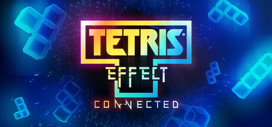

# Windows — 2021

[← All Windows years](../windows.md) · [Full 2021 page](../../years/2021.md)

175 Windows titles in 2021.

### Adios

**Platforms:** Windows, Xbox One &nbsp;|&nbsp; **Developer:** Mischief &nbsp;|&nbsp; **Publisher:** Mischief &nbsp;|&nbsp; **Genre:** Simulator, Adventure, Indie &nbsp;|&nbsp; **Released:** March 17, 2021

> A pig farmer decides he no longer wants to dispose of bodies for the mob. What follows is a discussion between him and his would-be killer.
>
> _Synopsis source: IGDB_

[IGDB](https://www.igdb.com/games/adios)

---

### Age of Empires IV

**Platforms:** Windows &nbsp;|&nbsp; **Developer:** Relic Entertainment &nbsp;|&nbsp; **Publisher:** Xbox Game Studios &nbsp;|&nbsp; **Genre:** Real Time Strategy (RTS), Strategy &nbsp;|&nbsp; **Released:** October 28, 2021

> One of the most beloved real-time strategy games returns to glory with Age of Empires IV, putting you at the center of epic historical battles that shaped the world. Featuring both familiar and innovative new ways to expand your empire in vast landscapes with stunning 4K visual fidelity, Age of Empires IV brings an evolved real-time strategy game to a new generation.
>
> _Synopsis source: IGDB_

[IGDB](https://www.igdb.com/games/age-of-empires-iv)

---

### Alan Wake Remastered

**Platforms:** PlayStation 4, PlayStation 5, Xbox One, Xbox Series X/S, Windows &nbsp;|&nbsp; **Developer:** Remedy Entertainment &nbsp;|&nbsp; **Publisher:** Epic Games Publishing, Epic Games &nbsp;|&nbsp; **Genre:** Shooter, Adventure &nbsp;|&nbsp; **Released:** October 5, 2021

> Alan Wake Remastered is an updated version of the original psychological horror action-adventure game developed by Remedy Entertainment. The game retains the core narrative, which follows bestselling thriller novelist Alan Wake as he struggles with writer's block. He visits the small town of Bright Falls with his wife, Alice, in search of inspiration. Shortly after their arrival, Alice mysteriously disappears.  Alan finds pages of a thriller novel he does not remember writing, with events from the manuscript coming to life. He faces supernatural entities called the "Taken," who are controlled by darkness. The remastered version features enhanced graphics and improved performance, but the gameplay and storyline remain consistent with the original, focusing on themes of reality, fiction, and the power of the written word.  It also includes the two story DLCs "The Signal" and "The Writer".
>
> _Synopsis source: IGDB_

[IGDB](https://www.igdb.com/games/alan-wake-remastered)

---

### Alex Kidd in Miracle World DX

**Platforms:** Nintendo Switch, Xbox One, Xbox Series X/S, Windows, PlayStation 5, PlayStation 4 &nbsp;|&nbsp; **Developer:** Merge Games, Jankenteam &nbsp;|&nbsp; **Publisher:** Merge Games &nbsp;|&nbsp; **Genre:** Platform, Adventure, Indie, Arcade &nbsp;|&nbsp; **Released:** June 22, 2021

> The legendary Alex Kidd returns with Alex Kidd in Miracle World DX! Since his first appearance in 1986 with Alex Kidd in Miracle World. The iconic Alex Kidd makes his return to smash rocks, collect coins and tackle bosses once again in Alex Kidd in Miracle World DX!  Return The Kingdom of Radaxian to its former glory and destroy the evil Janken the Great! Comprising of all levels from the original title as well as brand new levels which expand the lore of Alex Kidd, experience Miracle World like you’ve never seen it before with new animations, graphical detail and gameplay improvements.
>
> _Synopsis source: IGDB_

[IGDB](https://www.igdb.com/games/alex-kidd-in-miracle-world-dx)

---

### Aliens: Fireteam Elite

**Platforms:** Windows, PlayStation 4, PlayStation 5, Xbox One, Xbox Series X/S &nbsp;|&nbsp; **Developer:** Cold Iron Studios &nbsp;|&nbsp; **Publisher:** Focus Entertainment &nbsp;|&nbsp; **Genre:** Shooter &nbsp;|&nbsp; **Released:** August 23, 2021

> Set in the iconic Alien universe, Aliens: Fireteam Elite is a cooperative 3rd-person survival shooter that drops your fireteam of hardened marines into a desparate fight to contain the evolving Xenomorph threat. Create and customize your own Colonial Marine, choosing from an extensive variety of classes, weapons, gear and perks, battling overwhelming odds in this heart-pounding survival shooting experience.
>
> _Synopsis source: IGDB_

[IGDB](https://www.igdb.com/games/aliens-fireteam-elite)

---

### Aragami 2

**Platforms:** PlayStation 5, Xbox Series X/S, Windows, PlayStation 4, Xbox One &nbsp;|&nbsp; **Developer:** Lince Works &nbsp;|&nbsp; **Publisher:** Yooreka Studio, Lince Works, Merge Games &nbsp;|&nbsp; **Genre:** Adventure, Indie &nbsp;|&nbsp; **Released:** September 17, 2021

> Aragami 2 is a third person stealth game where you play as an assassin with the power to control the shadows. Join the shadow clan and fight the invider armies to protect your people.
>
> _Synopsis source: IGDB_

[IGDB](https://www.igdb.com/games/aragami-2)

---

### Axiom Verge 2

**Platforms:** Nintendo Switch, PlayStation 4, Windows, PlayStation 5 &nbsp;|&nbsp; **Developer:** Thomas Happ Games &nbsp;|&nbsp; **Publisher:** Thomas Happ Games &nbsp;|&nbsp; **Genre:** Platform, Adventure, Indie &nbsp;|&nbsp; **Released:** August 11, 2021

> You may have played Axiom Verge, or heard it referenced as a benchmark for indie “metroidvania” adventures. Axiom Verge 2 is part of the same story as Axiom Verge 1 but is a completely new game: new characters, new powers, new enemies, and a new world. You can play it before or after the original.
>
> _Synopsis source: IGDB_

[IGDB](https://www.igdb.com/games/axiom-verge-2)

---

### Back 4 Blood

**Platforms:** PlayStation 4, PlayStation 5, Xbox Series X/S, Windows, Xbox One &nbsp;|&nbsp; **Developer:** Turtle Rock Studios &nbsp;|&nbsp; **Publisher:** Warner Bros. Interactive Entertainment &nbsp;|&nbsp; **Genre:** Shooter &nbsp;|&nbsp; **Released:** October 12, 2021

> Back 4 Blood is a thrilling cooperative first-person shooter from the creators of the critically acclaimed Left 4 Dead franchise. You are at the center of a war against the Ridden. These once-human hosts of a deadly parasite have turned into terrifying creatures bent on devouring what remains of civilization. With humanity’s extinction on the line, it’s up to you and your friends to take the fight to the enemy, eradicate the Ridden, and reclaim the world.
>
> _Synopsis source: IGDB_

[IGDB](https://www.igdb.com/games/back-4-blood)

---

### Bad End Theater

**Platforms:** Linux, Windows, Android, macOS &nbsp;|&nbsp; **Developer:** NomNomNami &nbsp;|&nbsp; **Publisher:** NomNomNami, Serenity Forge &nbsp;|&nbsp; **Genre:** Puzzle, Simulator, Adventure, Indie, Visual Novel &nbsp;|&nbsp; **Released:** October 26, 2021

> Welcome to Bad End Theater! Select your protagonist and explore a variety of terrible fates! The decisions you make in one story will affect the others. you can toggle these behaviors to open up new paths! unfortunately, every path leads to a bad ending... Can you find a way to save this unlucky cast? Playtime: 2-3 hours to see all endings (it's a puzzle game, so this varies widely).
>
> _Synopsis source: IGDB_

[IGDB](https://www.igdb.com/games/bad-end-theater)

---

### Battlefield 2042

**Platforms:** Xbox Series X/S, Windows, PlayStation 4, PlayStation 5, Xbox One &nbsp;|&nbsp; **Developer:** EA Digital Illusions CE &nbsp;|&nbsp; **Publisher:** Electronic Arts &nbsp;|&nbsp; **Genre:** Shooter &nbsp;|&nbsp; **Released:** November 19, 2021

> Battlefield 2042 marks the return to the iconic all-out warfare of the franchise. Adapt and overcome dynamically-changing battlegrounds with the help of your squad and a cutting-edge arsenal. With support for 128 players, prepare for unprecedented scale on vast environments. Take on massive experiences, from updated multiplayer modes like Conquest and Breakthrough to the all-new Hazard Zone.
>
> _Synopsis source: IGDB_

[IGDB](https://www.igdb.com/games/battlefield-2042)

---

### Before Your Eyes

**Platforms:** macOS, Windows &nbsp;|&nbsp; **Developer:** GoodbyeWorld Games &nbsp;|&nbsp; **Publisher:** Skybound Games, Netflix &nbsp;|&nbsp; **Genre:** Adventure, Indie &nbsp;|&nbsp; **Released:** April 8, 2021

> A first person narrative adventure which tells the story of a soul’s journey into the afterlife using your real-life blinks.
>
> _Synopsis source: IGDB_

[IGDB](https://www.igdb.com/games/before-your-eyes)

---

### Behind the Frame: The Finest Scenery

**Platforms:** Android, iOS, macOS, Windows &nbsp;|&nbsp; **Developer:** Silver Lining Studio &nbsp;|&nbsp; **Publisher:** Akatsuki Taiwan, Akupara Games &nbsp;|&nbsp; **Genre:** Point-and-click, Puzzle, Adventure, Indie &nbsp;|&nbsp; **Released:** August 25, 2021

> A narrative-driven puzzle game about collecting, fixing and painting. Enjoy the scenery en route in the world of Behind the Frame, and search for the secrets within. Recollect memories in the time corridor, and savor some beautiful little moments. Combining escape rooms and narrative games, Behind the Frame: The Finest Scenery presents a profoundly interactive storytelling of characters' emotions and plot development. With 360° panorama techniques and an exquisite hand-painted art style, the game takes you into the world of Behind the Frame.
>
> _Synopsis source: IGDB_

[IGDB](https://www.igdb.com/games/behind-the-frame-the-finest-scenery)

---

### Biomutant

**Platforms:** PlayStation 4, Xbox One, Windows &nbsp;|&nbsp; **Developer:** Experiment 101 &nbsp;|&nbsp; **Publisher:** THQ Nordic &nbsp;|&nbsp; **Genre:** Role-playing (RPG), Adventure &nbsp;|&nbsp; **Released:** May 25, 2021

> Biomutant is an open-world, post-apocalyptic Kung-Fu fable RPG, with a unique martial arts styled combat system allowing you to mix melee, shooting and mutant ability action. A plague is ruining the land and the Tree-of-Life is bleeding death from its roots. The Tribes stand divided. Explore a world in turmoil and define its fate, will you be its savior or lead it to an even darker destiny?
>
> _Synopsis source: IGDB_

[IGDB](https://www.igdb.com/games/biomutant)

---

### Black Book

**Platforms:** Windows, Nintendo Switch, Xbox One, macOS, PlayStation 4 &nbsp;|&nbsp; **Developer:** Morteshka &nbsp;|&nbsp; **Publisher:** HypeTrain Digital &nbsp;|&nbsp; **Genre:** Role-playing (RPG), Strategy, Turn-based strategy (TBS), Adventure, Indie, Card & Board Game &nbsp;|&nbsp; **Released:** August 10, 2021

> A fusion of card-based RPGs and Adventure games, “Black Book” is a haunting tale of a young sorceress, who gave her life to serve the dark forces. Dive into the cold, yet alluring world of folk tales - and uncover the secrets that hide in the darkness.
>
> _Synopsis source: IGDB_

[IGDB](https://www.igdb.com/games/black-book)

---

### Blue Fire

**Platforms:** Stadia, Xbox One, Nintendo Switch, PlayStation 4, Windows &nbsp;|&nbsp; **Developer:** ROBI Studios &nbsp;|&nbsp; **Publisher:** Graffiti Games &nbsp;|&nbsp; **Genre:** Platform, Role-playing (RPG), Hack and slash/Beat 'em up, Adventure, Indie &nbsp;|&nbsp; **Released:** February 4, 2021

> Embark on an extraordinary journey through the desolated kingdom of Penumbra and discover the hidden secrets of this long-forgotten land. Explore mystical temples, encounter survivors and take on strange quests to collect valuable items. Along your adventure, slash your way through daunting adversaries, roam across mysterious and abandoned regions, leap through deadly traps and ultimately master the art of movement.
>
> _Synopsis source: IGDB_

[IGDB](https://www.igdb.com/games/blue-fire)

---

### Bravely Default II

**Platforms:** Nintendo Switch, Windows &nbsp;|&nbsp; **Developer:** Clay Tech Works, Team Asano, Square Enix Creative Business Unit II &nbsp;|&nbsp; **Publisher:** Nintendo, Square Enix &nbsp;|&nbsp; **Genre:** Role-playing (RPG), Adventure &nbsp;|&nbsp; **Released:** February 25, 2021

> A new world, a new story, and all-new Heroes of Light await in an original RPG experience arriving on the Nintendo Switch system in 2020! This successor to the original Bravely Default game comes from the team that brought you the Bravely series and Octopath Traveler, and features music from Revo (Sound Horizon/Linked Horizon), acclaimed composer of the Bravely Default soundtrack.
>
> _Synopsis source: IGDB_

[IGDB](https://www.igdb.com/games/bravely-default-ii)

---

### Bright Memory: Infinite

**Platforms:** Windows &nbsp;|&nbsp; **Developer:** FYQD-Studio &nbsp;|&nbsp; **Publisher:** PLAYISM &nbsp;|&nbsp; **Genre:** Shooter, Hack and slash/Beat 'em up, Adventure, Indie &nbsp;|&nbsp; **Released:** November 11, 2021

> Bright Memory: Infinite is a lightning-fast fusion of the FPS and action genres, created by a one-man development studio. Combine a wide variety of skills and abilities to unleash dazzling combo attacks. SRO (Supernatural Science Research Organization) agent Shelia's adventure is about to begin.
>
> _Synopsis source: IGDB_

[IGDB](https://www.igdb.com/games/bright-memory-infinite)

---

### Call of Duty: Vanguard

**Platforms:** PlayStation 5, Xbox One, PlayStation 4, Windows, Xbox Series X/S &nbsp;|&nbsp; **Developer:** Sledgehammer Games &nbsp;|&nbsp; **Publisher:** Activision &nbsp;|&nbsp; **Genre:** Shooter &nbsp;|&nbsp; **Released:** November 5, 2021

> This is WWII combat like never before. Witness the origins of Special Forces as you play a pivotal role and change the face of history, forming Task Force One in a gripping Campaign across four major theaters of war. Become an original Special Forces Operator in an online Multiplayer rich in innovation with 20 maps available at launch. Prepare for a franchise-first, universe-expanding Zombies crossover. Immerse yourself in a fully integrated Call of Duty: Warzone experience featuring a new and massive map. This is the most connected Call of Duty ever, all powered by the next generation Call of Duty engine introduced in Modern Warfare.  This is Call of Duty: Vanguard.
>
> _Synopsis source: IGDB_

[IGDB](https://www.igdb.com/games/call-of-duty-vanguard)

---

### Chernobylite

**Platforms:** PlayStation 4, Windows, Xbox One &nbsp;|&nbsp; **Developer:** The Farm 51 &nbsp;|&nbsp; **Publisher:** All In! Games &nbsp;|&nbsp; **Genre:** Shooter, Role-playing (RPG), Simulator, Adventure &nbsp;|&nbsp; **Released:** July 28, 2021

> Chernobylite is a science-fiction survival horror experience, mixing the free exploration of its disturbing world with challenging combat, unique crafting, and non-linear storytelling. Play as a physicist, one of the Chernobyl Power Plant's ex-employees, and investigate the mysterious disappearance of your beloved. Try to survive and reveal the contamination zone's twisted secrets. Remember, the military presence is not your only concern.  Get ready for a thrilling adventure of survival, conspiracy, horror, love, and obsession. One that will prove to you that it's not about how you face your fears, it's about how you survive them.
>
> _Synopsis source: IGDB_

[IGDB](https://www.igdb.com/games/chernobylite)

---

### Chicory: A Colorful Tale

**Platforms:** Windows, Nintendo Switch &nbsp;|&nbsp; **Developer:** Greg Lobarov &nbsp;|&nbsp; **Publisher:** Finji &nbsp;|&nbsp; **Genre:** Adventure, Indie, RPG &nbsp;|&nbsp; **Released:** June 10, 2021

> A top-down adventure game in a coloring book world full of vibrant characters. Use painting powers to explore, solve puzzles, make friends, and draw on anything! From creators on Wandersong + Celeste.
>
> _Synopsis source: Steam_

[Steam](https://store.steampowered.com/app/1123450) · [IGDB](https://www.igdb.com/games/chicory-a-colorful-tale)

---

### Chivalry 2

**Platforms:** Windows, PlayStation 5, PlayStation 4, Xbox Series X/S, Xbox One &nbsp;|&nbsp; **Developer:** Torn Banner Studios &nbsp;|&nbsp; **Publisher:** Tripwire Interactive &nbsp;|&nbsp; **Genre:** Fighting, Tactical, Hack and slash/Beat 'em up, Indie &nbsp;|&nbsp; **Released:** June 8, 2021

> Chivalry 2 is a multiplayer first person slasher inspired by epic medieval movie battles. Players are thrust into the action of every iconic moment of the era - from clashing swords, to storms of flaming arrows, to sprawling castle sieges and more.
>
> _Synopsis source: IGDB_

[IGDB](https://www.igdb.com/games/chivalry-2)

---

### Chorus

**Platforms:** Windows, Xbox One, Xbox Series X/S, Stadia, PlayStation 4, PlayStation 5 &nbsp;|&nbsp; **Developer:** Fishlabs &nbsp;|&nbsp; **Publisher:** Deep Silver &nbsp;|&nbsp; **Genre:** Shooter, Adventure, Indie, Arcade &nbsp;|&nbsp; **Released:** December 3, 2021

> Take control of Nara, once the Circle's deadliest warrior, now their most wanted fugitive, on a quest to destroy the dark cult that created her. Unlock devastating weapons and mind-bending abilities in Chorus, a true evolution of the space-combat shooter. Along with Forsaken, her sentient starfighter, explore ancient temples, engage in exhilarating zero-g combat, and venture beyond our waking reality.
>
> _Synopsis source: IGDB_

[IGDB](https://www.igdb.com/games/chorus)

---

### Clone Drone in the Danger Zone

**Platforms:** PlayStation 4, Xbox One, macOS, Nintendo Switch, Windows &nbsp;|&nbsp; **Developer:** Doborog Games &nbsp;|&nbsp; **Publisher:** Doborog Games &nbsp;|&nbsp; **Genre:** Fighting, Shooter, Simulator, Hack and slash/Beat 'em up, Indie &nbsp;|&nbsp; **Released:** July 27, 2021

> Clone Drone in the Danger Zone is a third person sword fighter where any part of your body can be sliced off. With your mind downloaded into a robot gladiator, you must survive the sinister trials of the arena.
>
> _Synopsis source: IGDB_

[IGDB](https://www.igdb.com/games/clone-drone-in-the-danger-zone)

---

### Cozy Grove

**Platforms:** Nintendo Switch, PlayStation 4, macOS, Xbox One, iOS, Windows &nbsp;|&nbsp; **Developer:** Spry Fox &nbsp;|&nbsp; **Publisher:** The Quantum Astrophysicists Guild, Spry Fox &nbsp;|&nbsp; **Genre:** Puzzle, Role-playing (RPG), Simulator, Adventure, Indie &nbsp;|&nbsp; **Released:** March 19, 2021

> Welcome to Cozy Grove, a life-sim game camping on a haunted, ever-changing island. As a Spirit Scout, you’ll wander the island’s forest each day, finding new hidden secrets and help soothe the local ghosts. With a little time and a lot of crafting, you’ll bring colour and joy back to Cozy Grove!
>
> _Synopsis source: IGDB_

[IGDB](https://www.igdb.com/games/cozy-grove)

---

### Crab Game

**Platforms:** Windows, Linux, macOS &nbsp;|&nbsp; **Developer:** Dani &nbsp;|&nbsp; **Publisher:** Dani &nbsp;|&nbsp; **Genre:** Fighting, Racing, Strategy, Indie, Arcade &nbsp;|&nbsp; **Released:** October 29, 2021

> Crab Game is a First-Person Multiplayer game where you fight for the ultimate cash price in different minigames based on children's games, until only one player is left to claim it all. Definitely not based on any online streaming pop culture korean tv shows, as that would get me in legal trouble, so we're certainly not doing that.
>
> _Synopsis source: IGDB_

[IGDB](https://www.igdb.com/games/crab-game)

---

### Cris Tales

**Platforms:** Nintendo Switch, PlayStation 4, Windows, PlayStation 5, Xbox Series X/S, Stadia, Xbox One &nbsp;|&nbsp; **Developer:** SYCK, Dreams Uncorporated &nbsp;|&nbsp; **Publisher:** Modus Games, Maximum Entertainment &nbsp;|&nbsp; **Genre:** Role-playing (RPG), Adventure, Indie &nbsp;|&nbsp; **Released:** July 19, 2021

> Discover a unique combination of branching stories, innovative combat, and classic RPG gameplay in Cris Tales’ exciting and unforgettable exploration of how our actions echo through time. Join the newly awakened Time Mage, Crisbell, and her fantastical companions in a fantasy world facing a grim future. The powerful Time Empress and her forces threaten to bring about a cataclysm tearing apart Crystallis and the other four Kingdoms of the region.
>
> _Synopsis source: IGDB_

[IGDB](https://www.igdb.com/games/cris-tales)

---

### Cruelty Squad

**Platforms:** Windows &nbsp;|&nbsp; **Developer:** Consumer Softproducts &nbsp;|&nbsp; **Publisher:** Consumer Softproducts &nbsp;|&nbsp; **Genre:** Shooter, Simulator, Tactical, Indie &nbsp;|&nbsp; **Released:** June 15, 2021

> Cruelty Squad is a tactical first person shooter set in the hardcore gig economy of corporate liquidations. You're an emotionally dead combat-substance fueled grunt of Cruelty Squad, a depraved subsidiary company tasked with performing wetworks for its host conglomerate. Will you make the Corporate Arch Demoness proud or succumb to bitter tears of failure?
>
> _Synopsis source: IGDB_

[IGDB](https://www.igdb.com/games/cruelty-squad)

---

### Crysis 2 Remastered

**Platforms:** PlayStation 5, Xbox Series X/S, Nintendo Switch, Windows, PlayStation 4, Xbox One &nbsp;|&nbsp; **Developer:** Crytek, Saber Interactive &nbsp;|&nbsp; **Publisher:** Crytek &nbsp;|&nbsp; **Genre:** Shooter &nbsp;|&nbsp; **Released:** October 15, 2021

> Relive the legendary single-player campaign from the classic first-person shooter, Crysis 2, optimized for today's hardware in Crysis 2 Remastered.
>
> _Synopsis source: IGDB_

[IGDB](https://www.igdb.com/games/crysis-2-remastered)

---

### Curse of the Dead Gods

**Platforms:** Nintendo Switch, Windows, PlayStation 4, Xbox One &nbsp;|&nbsp; **Developer:** Passtech Games &nbsp;|&nbsp; **Publisher:** Focus Entertainment &nbsp;|&nbsp; **Genre:** Role-playing (RPG), Simulator, Adventure, Indie &nbsp;|&nbsp; **Released:** February 23, 2021

> You seek untold riches, eternal life, divine powers - it leads to this accursed temple, a seemingly-infinite labyrinth of bottomless pits, deadly traps, and monsters.  Your greed will lead you to death, but that is not an escape. Rise to fight again. Delve deeper again. Defy the malignant deities that linger in this place. Battle through hordes of enemies in dark, cavernous passages filled with traps and secrets of all sorts - fire-spewing statues, explosives, hidden spikes, and worse.  Collect mystical Relics and an arsenal of weapons to make yourself unstoppable. Corruption builds in you with every step - encourage or ignore it, but each powerful curse can be a double-edged sword.  - A skill-based roguelike exploring a cruel, dark temple made of endless rooms and corridors - Swords, spears, bows, guns - wield these and many more - Unique curses influence each attempt, putting a twist on every action - Dozens of enemies, with powerful champions and deadly bosses to face off against
>
> _Synopsis source: IGDB_

[IGDB](https://www.igdb.com/games/curse-of-the-dead-gods)

---

### Cyber Shadow

**Platforms:** Xbox One, macOS, Linux, Nintendo Switch, PlayStation 4, Windows, PlayStation 5 &nbsp;|&nbsp; **Developer:** Mechanical Head Studios &nbsp;|&nbsp; **Publisher:** Yacht Club Games &nbsp;|&nbsp; **Genre:** Platform, Hack and slash/Beat 'em up, Adventure, Indie, Arcade &nbsp;|&nbsp; **Released:** January 26, 2021

> Dash, slice, and leap through masterfully designed levels filled with sharply honed ninja platforming action. Authentic 8-bit presentation with hand-crafted sprites, a detailed pixel aesthetic, and perfect controls. Modern touches like fluid animation, multi-layered parallax backgrounds, and evolved game design. Take down more than a dozen apocalyptic bosses, from enormous war machines to your synthetic clan rivals. Relive the authenticity of classic 8-bit challenge or experience it for the first time. with an added convenience or two.
>
> _Synopsis source: IGDB_

[IGDB](https://www.igdb.com/games/cyber-shadow)

---

### Dagon

**Platforms:** Windows, SteamVR &nbsp;|&nbsp; **Developer:** Bit Golem &nbsp;|&nbsp; **Publisher:** Bit Golem &nbsp;|&nbsp; **Genre:** Adventure, Indie, Visual Novel &nbsp;|&nbsp; **Released:** August 24, 2021

> Face unspeakable horrors. Succumb to madness. Welcome to a truly daemonic narrative experience inspired by H. P. Lovecraft.
>
> _Synopsis source: IGDB_

[IGDB](https://www.igdb.com/games/dagon)

---

### Death's Door

**Platforms:** Xbox Series X/S, Windows, PlayStation 4, PlayStation 5, Nintendo Switch, Xbox One &nbsp;|&nbsp; **Developer:** Acid Nerve &nbsp;|&nbsp; **Publisher:** Devolver Digital, Netflix &nbsp;|&nbsp; **Genre:** Role-playing (RPG), Hack and slash/Beat 'em up, Adventure, Indie &nbsp;|&nbsp; **Released:** July 20, 2021

> Death's Door is an action-adventure game developed by Acid Nerve and published by Devolver Digital. Released in 2021, it follows a crow reaper tasked with collecting souls in a mysterious, atmospheric world. The game features exploration, fast-paced combat, and puzzle-solving.
>
> _Synopsis source: IGDB_

[IGDB](https://www.igdb.com/games/deaths-door)

---

### Deathloop

**Platforms:** PlayStation 5, Windows &nbsp;|&nbsp; **Developer:** Arkane Studios &nbsp;|&nbsp; **Publisher:** Bethesda Softworks &nbsp;|&nbsp; **Genre:** Shooter, Adventure &nbsp;|&nbsp; **Released:** September 14, 2021

> Deathloop transports players to the lawless island of Blackreef in an eternal struggle between two extraordinary assassins. Explore stunning environments and meticulously designed levels in an immersive gameplay experience that lets you approach every situation any way you like. Hunt down targets all over the island in an effort to put an end to the cycle once and for all, and remember, if at first you don’t succeed… die, die again.
>
> _Synopsis source: IGDB_

[IGDB](https://www.igdb.com/games/deathloop)

---

### Deepest Sword

**Platforms:** Windows, macOS, Browser &nbsp;|&nbsp; **Developer:** Cosmic Adventure Squad &nbsp;|&nbsp; **Publisher:** Cosmic Adventure Squad &nbsp;|&nbsp; **Genre:** Platform, Puzzle, Indie &nbsp;|&nbsp; **Released:** April 26, 2021

> Venture deep into the Cavern of Longing. Plunge your sword deep into the dragon’s heart! How deep is your resolve?
>
> _Synopsis source: IGDB_

[IGDB](https://www.igdb.com/games/deepest-sword)

---

### Demon Slayer: Kimetsu no Yaiba - The Hinokami Chronicles

**Platforms:** Windows, Xbox Series X/S, PlayStation 5, Xbox One, PlayStation 4 &nbsp;|&nbsp; **Developer:** CyberConnect2 &nbsp;|&nbsp; **Publisher:** Aniplex, Sega &nbsp;|&nbsp; **Genre:** Fighting, Adventure &nbsp;|&nbsp; **Released:** October 14, 2021

> Become the blade that destroys demons!  In Solo Mode, follow Tanjiro through the story from the Demon Slayer: Kimetsu no Yaiba anime as he faces demons in order to turn his sister Nezuko, who has become a demon, back into a human.  In Versus Mode, characters from the anime, including Tanjiro and Nezuko, can be freely matched against each another in a one-versus-one setting with up to two players online or offline! Enjoy this simple but exhilarating battle system, and become the greatest demon slayer you can!
>
> _Synopsis source: IGDB_

[IGDB](https://www.igdb.com/games/demon-slayer-kimetsu-no-yaiba-the-hinokami-chronicles)

---

### Devour

**Platforms:** macOS, Windows &nbsp;|&nbsp; **Developer:** Joe Fender, Straight Back Games &nbsp;|&nbsp; **Publisher:** Straight Back Games &nbsp;|&nbsp; **Genre:** Indie &nbsp;|&nbsp; **Released:** January 28, 2021

> Devour is a co-op horror survival game for 1-4 players. Stop a possessed cult leader before she drags you to hell with her. Run. Scream. Hide. Just don't get caught.
>
> _Synopsis source: IGDB_

[IGDB](https://www.igdb.com/games/devour)

---

### Diablo II: Resurrected

**Platforms:** Nintendo Switch, PlayStation 5, Xbox Series X/S, Windows, Xbox One, PlayStation 4 &nbsp;|&nbsp; **Developer:** Blizzard Entertainment &nbsp;|&nbsp; **Publisher:** Blizzard Entertainment &nbsp;|&nbsp; **Genre:** Role-playing (RPG), Hack and slash/Beat 'em up, Adventure &nbsp;|&nbsp; **Released:** September 22, 2021

> Diablo II: Resurrected breathes new life into Blizzard Entertainment’s acclaimed ARPG and its expansion, Diablo II: Lord of Destruction, from beginning to end. Return to fight for Sanctuary and discover the fate of the mysterious Dark Wanderer rebuilt in all-new 3D graphics, brand-new cinematics, remastered audio… and the same classic Diablo II gameplay you remember.
>
> _Synopsis source: IGDB_

[IGDB](https://www.igdb.com/games/diablo-ii-resurrected)

---

### Disco Elysium: The Final Cut

**Platforms:** Windows &nbsp;|&nbsp; **Developer:** ZA/UM &nbsp;|&nbsp; **Publisher:** ZA/UM &nbsp;|&nbsp; **Genre:** RPG &nbsp;|&nbsp; **Released:** October 15, 2021

> Disco Elysium - The Final Cut is a groundbreaking role playing game. You’re a detective with a unique skill system at your disposal and a whole city to carve your path across. Interrogate unforgettable characters, crack murders or take bribes. Become a hero or an absolute disaster of a human being.
>
> _Synopsis source: Steam_

[Steam](https://store.steampowered.com/app/632470) · [IGDB](https://www.igdb.com/games/disco-elysium-the-final-cut)

---

### Doki Doki Literature Club Plus!

**Platforms:** Windows, macOS, PlayStation 5, Xbox One, Nintendo Switch, PlayStation 4 &nbsp;|&nbsp; **Developer:** Team Salvato &nbsp;|&nbsp; **Publisher:** Serenity Forge, PLAYISM &nbsp;|&nbsp; **Genre:** Role-playing (RPG), Simulator, Adventure, Indie, Visual Novel &nbsp;|&nbsp; **Released:** June 30, 2021

> Welcome to the club! Write poems for your crush and experience the terror of school romance in this critically-acclaimed psychological horror story.
>
> _Synopsis source: IGDB_

[IGDB](https://www.igdb.com/games/doki-doki-literature-club-plus)

---

### Dungeons & Dragons: Dark Alliance

**Platforms:** Windows, Xbox One, PlayStation 4, PlayStation 5, Xbox Series X/S &nbsp;|&nbsp; **Developer:** Tuque Games &nbsp;|&nbsp; **Publisher:** Wizards of the Coast &nbsp;|&nbsp; **Genre:** Role-playing (RPG) &nbsp;|&nbsp; **Released:** June 21, 2021

> Set in the Forgotten Realms, the game features real-time combat and dynamic co-op gameplay, and pits the infamous Drizzt Do'Urden and his legendary companions – Catti-brie, Bruenor, and Wulfgar – against some of the most iconic monsters from the world of Dungeons & Dragons. Frost Giants, Beholders, and White Dragons roam the frozen tundra of Icewind Dale in search of the Crystal Shard— and it's up to the companions to muster the strength to stop them from claiming and using it to destroy their home.
>
> _Synopsis source: IGDB_

[IGDB](https://www.igdb.com/games/dungeons-and-dragons-dark-alliance)

---

### Dysmantle

**Platforms:** macOS, Windows &nbsp;|&nbsp; **Developer:** 10tons &nbsp;|&nbsp; **Publisher:** 10tons &nbsp;|&nbsp; **Genre:** Puzzle, Role-playing (RPG), Simulator, Adventure, Indie &nbsp;|&nbsp; **Released:** November 16, 2021

> The open world action RPG where you can ruin everything.  Ascend from your shelter. Escape the wretched island.  Explore. Fight. Level up. Survive. Gather. Craft. Harvest. Hunt. Build. Farm. Solve puzzles. Fish. Cook. Live. Enjoy the bittersweet post-apocalypse.
>
> _Synopsis source: IGDB_

[IGDB](https://www.igdb.com/games/dysmantle)

---

### Dyson Sphere Program

**Platforms:** Windows &nbsp;|&nbsp; **Developer:** Youthcat Studio &nbsp;|&nbsp; **Publisher:** Gamirror Games &nbsp;|&nbsp; **Genre:** Simulator, Strategy, Indie &nbsp;|&nbsp; **Released:** January 21, 2021

> As an engineer of Dyson Sphere Program, you will go to an alien galaxy building “Dyson Sphere”. Collecting resources, plan and designing production lines, gradually create a full automated factory. Develop your factory from a small workshop to a huge cross-galaxy Industrial empire.
>
> _Synopsis source: IGDB_

[IGDB](https://www.igdb.com/games/dyson-sphere-program)

---

### Eastward

**Platforms:** Nintendo Switch, macOS, Windows &nbsp;|&nbsp; **Developer:** Pixpil Studio &nbsp;|&nbsp; **Publisher:** Chucklefish Games &nbsp;|&nbsp; **Genre:** Role-playing (RPG), Simulator, Adventure, Indie &nbsp;|&nbsp; **Released:** September 16, 2021

> Eastward is a beautifully detailed and charming adventure RPG, from Shanghai-based indie developers, Pixpil and published by Chucklefish.  Escape the tyrannical clutches of a subterranean society and join Eastward’s unlikely duo on an exciting adventure to the land above! Discover beautiful yet bizarre settlements and make new friends as you travel across the world by rail.  Inspired by 90s Japanese animation, the visual style of Eastward has been brought to life using a combination of a modern, innovative 3D lighting system and a rich retro-pixel artwork.
>
> _Synopsis source: IGDB_

[IGDB](https://www.igdb.com/games/eastward)

---

### eFootball

**Platforms:** Windows, Xbox One, PlayStation 4, PlayStation 5, Xbox Series X/S &nbsp;|&nbsp; **Developer:** Konami &nbsp;|&nbsp; **Publisher:** Konami &nbsp;|&nbsp; **Genre:** Simulator, Sport &nbsp;|&nbsp; **Released:** September 30, 2021

> eFootball is a football simulation game developed and published by Konami. Released in September 2021, it marks a significant shift in the Pro Evolution Soccer (PES) series. Konami rebranded the franchise to eFootball and transitioned to a free-to-play model and a new engine, Unreal Engine.
>
> _Synopsis source: IGDB_

[IGDB](https://www.igdb.com/games/efootball)

---

### Ender Lilies: Quietus of the Knights

**Platforms:** Xbox Series X/S, Xbox One, Nintendo Switch, Windows, PlayStation 4 &nbsp;|&nbsp; **Developer:** adglobe, Live Wire &nbsp;|&nbsp; **Publisher:** Binary Haze Interactive &nbsp;|&nbsp; **Genre:** Platform, Role-playing (RPG), Adventure, Indie &nbsp;|&nbsp; **Released:** June 21, 2021

> Ender Lilies is a dark fantasy 2D Action RPG about unraveling the mysteries of a nation destroyed by a cataclysmic event. The fallen Kingdom of End is a tragic and beautiful world featuring a majestic castle, submerged forests and forbidden underground areas.  On this sorrowful journey, encounter horrific enemies against whom a moment of inattention could be fatal. By releasing foes from their undying curse, you may gain their strength. Overcome the hardships of your journey and uncover the truth with the aid of the fallen knights.
>
> _Synopsis source: IGDB_

[IGDB](https://www.igdb.com/games/ender-lilies-quietus-of-the-knights)

---

### Escape Simulator

**Platforms:** Windows, SteamVR, macOS, Linux &nbsp;|&nbsp; **Developer:** Pine Studio &nbsp;|&nbsp; **Publisher:** Pine Studio &nbsp;|&nbsp; **Genre:** Point-and-click, Puzzle, Simulator, Adventure, Indie &nbsp;|&nbsp; **Released:** October 19, 2021

> Escape Simulator is a next-gen escape room experience: pick up and examine everything, move furniture, smash pots and melt locks! Play solo or with a friend to solve cryptic puzzles and riddles.
>
> _Synopsis source: IGDB_

[IGDB](https://www.igdb.com/games/escape-simulator)

---

### Everhood

**Platforms:** Nintendo Switch, Windows &nbsp;|&nbsp; **Developer:** Jordi Roca, Chris Nordgren &nbsp;|&nbsp; **Publisher:** Surefire.Games, Foreign Gnomes &nbsp;|&nbsp; **Genre:** Music, Role-playing (RPG), Adventure, Indie &nbsp;|&nbsp; **Released:** March 3, 2021

> Expect the unexpected in an ineffable tale of the inexpressible world of Everhood. Amusing rhythmic battles and with a promise to fulfill all your dreams. To simply put it: You are in for a ride.
>
> _Synopsis source: IGDB_

[IGDB](https://www.igdb.com/games/everhood)

---

### Exo One

**Platforms:** Xbox Series X/S, Windows, Xbox One &nbsp;|&nbsp; **Developer:** Exbleative &nbsp;|&nbsp; **Publisher:** Exbleative, Future Friends Games &nbsp;|&nbsp; **Genre:** Simulator, Adventure, Indie &nbsp;|&nbsp; **Released:** November 18, 2021

> Exo One is a multi-planetary exploration game where you pilot an interstellar spacecraft capable of manipulating gravity.
>
> _Synopsis source: IGDB_

[IGDB](https://www.igdb.com/games/exo-one--1)

---

### F.I.S.T.: Forged In Shadow Torch

**Platforms:** PlayStation 5, Windows, PlayStation 4 &nbsp;|&nbsp; **Developer:** TiGames &nbsp;|&nbsp; **Publisher:** Bilibili Game &nbsp;|&nbsp; **Genre:** Platform, Role-playing (RPG), Simulator, Adventure, Indie &nbsp;|&nbsp; **Released:** September 7, 2021

> It is a metroidvania game that the player will play as a rabbit who can manipulate the big mech-arm on his back, exploring in a vivid diesel punk world and fighting against the evil robot army. There will be a vast world map for the player to explore to meet with friend NPCs and encounter enemies, discover items and weapons and seek for the answers for the secrets hidden behind.
>
> _Synopsis source: IGDB_

[IGDB](https://www.igdb.com/games/f-dot-i-s-dot-t-forged-in-shadow-torch)

---

### F1 2021

**Platforms:** PlayStation 4, Xbox One, Windows, Xbox Series X/S, PlayStation 5 &nbsp;|&nbsp; **Developer:** Codemasters &nbsp;|&nbsp; **Publisher:** EA Sports &nbsp;|&nbsp; **Genre:** Racing, Simulator, Sport &nbsp;|&nbsp; **Released:** July 16, 2021

> Every story has a beginning in F1 2021! Enjoy the stunning new features, including the thrilling story experience 'Braking Point', two-player career, and get even closer to the grid with 'Real-Season Start'. Take your team to the top in the acclaimed ten-year 'My Team' career mode, or race head-to-head in split-screen and multiplayer. Immerse yourself in the greatest racing spectacle on the planet and race with the authentic lineup of twenty heroic drivers and ten iconic teams from the 2021 season.
>
> _Synopsis source: IGDB_

[IGDB](https://www.igdb.com/games/f1-2021)

---

### Far Cry 6

**Platforms:** Xbox Series X/S, Xbox One, PlayStation 4, Stadia, PlayStation 5, Windows &nbsp;|&nbsp; **Developer:** Ubisoft Toronto &nbsp;|&nbsp; **Publisher:** Ubisoft Entertainment &nbsp;|&nbsp; **Genre:** Shooter, Adventure &nbsp;|&nbsp; **Released:** October 7, 2021

> Dive into the gritty world of a modern-day guerrilla revolution to liberate a nation from its oppressive dictators. Welcome to Yara, a tropical paradise frozen in time. Far Cry 6 thrusts players into a modern-day guerrilla revolution. As dictator of Yara, Anton Castillo is intent on restoring his nation back to its former glory by any means, with his son, Diego, following in his bloody footsteps. Become a guerrilla fighter and liberate Yara.
>
> _Synopsis source: IGDB_

[IGDB](https://www.igdb.com/games/far-cry-6)

---

### Farming Simulator 22

**Platforms:** Xbox Series X/S, macOS, PlayStation 5, Windows, PlayStation 4, Xbox One, Stadia &nbsp;|&nbsp; **Developer:** Giants Software &nbsp;|&nbsp; **Publisher:** Giants Software &nbsp;|&nbsp; **Genre:** Simulator &nbsp;|&nbsp; **Released:** November 22, 2021

> Take on the role of a modern farmer! Agriculture, animal husbandry and forestry offer a huge variety of farming activities while you face the challenges of the four seasons, especially when winter sets in. Creatively build your own farm and extend your farming operations with production chains, forming an agricultural empire! Even run your farm together with friends and enjoy crossplatform multiplayer together.
>
> _Synopsis source: IGDB_

[IGDB](https://www.igdb.com/games/farming-simulator-22)

---

### Fears to Fathom: Home Alone

**Platforms:** Windows &nbsp;|&nbsp; **Developer:** Rayll Studios &nbsp;|&nbsp; **Publisher:** Rayll Studios &nbsp;|&nbsp; **Genre:** Adventure, Indie &nbsp;|&nbsp; **Released:** July 2, 2021

> Fears to Fathom: Home Alone is a first-person psychological horror game and the first entry in the Fears to Fathom anthology series. Players follow Miles, a 14-year-old boy left home alone for the night while his parents are away. As strange and unsettling events begin occurring around the house, Miles must survive the night while avoiding a mysterious intruder. The game features a VHS-inspired visual style, immersive atmosphere, and narrative-driven gameplay focused on tension and realism.
>
> _Synopsis source: IGDB_

[IGDB](https://www.igdb.com/games/fears-to-fathom-home-alone--1)

---

### Final Fantasy

**Platforms:** Windows, iOS, Android &nbsp;|&nbsp; **Developer:** Tose, Square Enix Creative Business Unit IV &nbsp;|&nbsp; **Publisher:** Square Enix &nbsp;|&nbsp; **Genre:** Role-playing (RPG), Adventure &nbsp;|&nbsp; **Released:** July 28, 2021

> The original Final Fantasy comes to life with completely new graphics and audio! A remodeled 2D take on the first game in the world-renowned Final Fantasy series! Enjoy the timeless story told through charming retro graphics.
>
> _Synopsis source: IGDB_

[IGDB](https://www.igdb.com/games/final-fantasy--3)

---

### Final Fantasy II

**Platforms:** Windows, Android, iOS &nbsp;|&nbsp; **Developer:** Square Enix Creative Business Unit IV &nbsp;|&nbsp; **Publisher:** Square Enix &nbsp;|&nbsp; **Genre:** Role-playing (RPG), Adventure &nbsp;|&nbsp; **Released:** July 28, 2021

> The original Final Fantasy II comes to life with completely new graphics and audio! A remodeled 2D take on the second game in the world-renowned Final Fantasy series! Enjoy the timeless story told through charming retro graphics.
>
> _Synopsis source: IGDB_

[IGDB](https://www.igdb.com/games/final-fantasy-ii--3)

---

### Final Fantasy III

**Platforms:** Windows, Android, iOS &nbsp;|&nbsp; **Developer:** Square Enix Creative Business Unit IV, Tose &nbsp;|&nbsp; **Publisher:** Square Enix &nbsp;|&nbsp; **Genre:** Role-playing (RPG), Adventure &nbsp;|&nbsp; **Released:** July 28, 2021

> The original Final Fantasy III comes to life with completely new graphics and audio! A remodeled 2D take on the third game in the world-renowned Final Fantasy series! Enjoy the timeless story told through charming retro graphics.
>
> _Synopsis source: IGDB_

[IGDB](https://www.igdb.com/games/final-fantasy-iii--3)

---

### Final Fantasy IV

**Platforms:** iOS, Android, Windows &nbsp;|&nbsp; **Developer:** Square Enix Creative Business Unit IV, Tose &nbsp;|&nbsp; **Publisher:** Square Enix &nbsp;|&nbsp; **Genre:** Role-playing (RPG), Adventure &nbsp;|&nbsp; **Released:** September 8, 2021

> The original Final Fantasy IV comes to life with completely new graphics and audio! A remodeled 2D take on the fourth game in the world-renowned Final Fantasy series! Enjoy the timeless story told through charming retro graphics.
>
> _Synopsis source: IGDB_

[IGDB](https://www.igdb.com/games/final-fantasy-iv--2)

---

### Final Fantasy V

**Platforms:** Windows, Android, iOS &nbsp;|&nbsp; **Developer:** Tose, Square Enix Creative Business Unit IV &nbsp;|&nbsp; **Publisher:** Square Enix &nbsp;|&nbsp; **Genre:** Role-playing (RPG), Adventure &nbsp;|&nbsp; **Released:** November 10, 2021

> The original Final Fantasy V comes to life with completely new graphics and audio as a 2D pixel remaster! A remodeled take on the fifth game in the world-renowned Final Fantasy series! Enjoy the timeless story told through charming retro graphics.
>
> _Synopsis source: IGDB_

[IGDB](https://www.igdb.com/games/final-fantasy-v--2)

---

### Final Fantasy XIV: Endwalker

**Platforms:** Windows, PlayStation 5 &nbsp;|&nbsp; **Developer:** Square Enix Creative Business Unit III &nbsp;|&nbsp; **Publisher:** Square Enix &nbsp;|&nbsp; **Released:** December 7, 2021

---

### Five Nights at Freddy's: Security Breach

**Platforms:** PlayStation 4, Windows, PlayStation 5 &nbsp;|&nbsp; **Developer:** Steel Wool Studios &nbsp;|&nbsp; **Publisher:** Steel Wool Studios, Scottgames &nbsp;|&nbsp; **Genre:** Simulator, Strategy, Adventure, Indie &nbsp;|&nbsp; **Released:** December 16, 2021

> Five Nights at Freddy’s: Security Breach is the latest installment of the family-friendly horror games loved by millions of players from all over the globe. Play as Gregory, a young boy trapped overnight in Freddy Fazbear's Mega Pizzaplex. With the help of Freddy Fazbear himself, Gregory must survive the near-unstoppable hunt of reimagined Five Nights at Freddy’s characters, as well as new, horrific threats.
>
> _Synopsis source: IGDB_

[IGDB](https://www.igdb.com/games/five-nights-at-freddys-security-breach)

---

### Football Manager 2022

**Platforms:** Windows, Xbox Series X/S, Nintendo Switch, Xbox One, macOS &nbsp;|&nbsp; **Developer:** Sports Interactive &nbsp;|&nbsp; **Publisher:** Sega &nbsp;|&nbsp; **Genre:** Simulator, Sport, Strategy &nbsp;|&nbsp; **Released:** November 9, 2021

> The closest thing to real football management. FM22 brings new, progressive ways to find your winning edge, instill your footballing style and earn it on the pitch.
>
> _Synopsis source: IGDB_

[IGDB](https://www.igdb.com/games/football-manager-2022)

---

### Forgive Me Father

**Platforms:** Windows &nbsp;|&nbsp; **Developer:** Byte Barrel &nbsp;|&nbsp; **Publisher:** 1C Entertainment &nbsp;|&nbsp; **Genre:** Shooter, Indie &nbsp;|&nbsp; **Released:** October 26, 2021

> A dark retro horror FPS set in a comic book style world inspired by the novels of H.P. Lovecraft. As the only one with full senses, you begin a journey in search for answers and relief. How long can you last?
>
> _Synopsis source: IGDB_

[IGDB](https://www.igdb.com/games/forgive-me-father)

---

### Forza Horizon 5

**Platforms:** Xbox Series X/S, Windows &nbsp;|&nbsp; **Developer:** Playground Games &nbsp;|&nbsp; **Publisher:** Xbox Game Studios &nbsp;|&nbsp; **Genre:** Action, Adventure, Racing, Simulation, Sports &nbsp;|&nbsp; **Released:** November 5, 2021

> Explore the vibrant open world landscapes of Mexico with limitless, fun driving action in the world’s greatest cars.
>
> _Synopsis source: Steam_

[Wikipedia](https://en.wikipedia.org/wiki/Forza_Horizon_5) · [Steam](https://store.steampowered.com/app/1551360) · [IGDB](https://www.igdb.com/games/forza-horizon-5)

---

### Gamedec

**Platforms:** Windows &nbsp;|&nbsp; **Developer:** Anshar Studios &nbsp;|&nbsp; **Publisher:** Anshar Publishing &nbsp;|&nbsp; **Genre:** Point-and-click, Puzzle, Role-playing (RPG), Adventure, Indie &nbsp;|&nbsp; **Released:** September 16, 2021

> Gamedec is an adaptive cyberpunk RPG. As a private detective, it’s your job to solve crimes inside virtual worlds. What decisions will you make in a world where child slavery is a F2P game, where murder over a game-clan dispute is an every-day reality? Who will you become in the XXII century?
>
> _Synopsis source: IGDB_

[IGDB](https://www.igdb.com/games/gamedec)

---

### Gas Station Simulator

**Platforms:** Windows &nbsp;|&nbsp; **Developer:** Drago Entertainment &nbsp;|&nbsp; **Publisher:** Movie Games S.A., HeartBeat Games &nbsp;|&nbsp; **Genre:** Simulator, Indie &nbsp;|&nbsp; **Released:** September 15, 2021

> Gas Station Simulator is all about renovating, expanding and running a gas station along a highway in the middle of a desert. Freedom of choice and multiple approaches to run your business and deal with pressure are key ingredients in this game.
>
> _Synopsis source: IGDB_

[IGDB](https://www.igdb.com/games/gas-station-simulator)

---

### Genesis Noir

**Platforms:** macOS, Nintendo Switch, Windows, Xbox One &nbsp;|&nbsp; **Developer:** Feral Cat Den &nbsp;|&nbsp; **Publisher:** Fellow Traveller &nbsp;|&nbsp; **Genre:** Point-and-click, Adventure, Indie &nbsp;|&nbsp; **Released:** March 11, 2021

> A noir adventure spanning time and space. You play as No Man, a watch peddler caught in a love triangle with other cosmic beings, Miss Mass and Golden Boy. When your affair turns into a bitter confrontation, you will witness a gunshot fired by a jealous god—otherwise known as The Big Bang. Jump into the expanding universe and search for a way to prevent or destroy creation and save your love.
>
> _Synopsis source: IGDB_

[IGDB](https://www.igdb.com/games/genesis-noir)

---

### Ghosts 'n Goblins Resurrection

**Platforms:** PlayStation 4, Nintendo Switch, Windows, Xbox One &nbsp;|&nbsp; **Developer:** Capcom &nbsp;|&nbsp; **Publisher:** Capcom &nbsp;|&nbsp; **Genre:** Platform, Adventure &nbsp;|&nbsp; **Released:** February 24, 2021

> The legendary platforming series rises again, as Ghosts 'n Goblins Resurrection marks the heroic return of the gallant knight, Arthur, alongside the tricky platforming and challenging gameplay that the series is known for! Paying homage to Ghosts 'n Goblins and Ghouls 'n Ghosts, this entry combines the franchise’s action platforming gameplay with storybook-like graphics and challenging new obstacles.
>
> _Synopsis source: IGDB_

[IGDB](https://www.igdb.com/games/ghosts-n-goblins-resurrection--1)

---

### Goose Goose Duck

**Platforms:** Windows, Android, macOS &nbsp;|&nbsp; **Developer:** Gaggle Studios, Inc. &nbsp;|&nbsp; **Publisher:** Gaggle Studios, Inc. &nbsp;|&nbsp; **Genre:** Strategy, Indie &nbsp;|&nbsp; **Released:** October 3, 2021

> Goose, goose, Duck? A game of social deduction where you and your fellow geese must work together to complete your mission. Keep an eye out for those malicious Mallards and other birds, who have infiltrated your team and will do anything to stop you.
>
> _Synopsis source: IGDB_

[IGDB](https://www.igdb.com/games/goose-goose-duck)

---

### Grand Theft Auto III: The Definitive Edition

**Platforms:** Nintendo Switch, Xbox Series X/S, Xbox One, PlayStation 5, Windows, PlayStation 4 &nbsp;|&nbsp; **Developer:** Grove Street Games &nbsp;|&nbsp; **Publisher:** Rockstar Games, Netflix &nbsp;|&nbsp; **Genre:** Shooter, Racing, Adventure &nbsp;|&nbsp; **Released:** November 11, 2021

> It all starts in Liberty City. With revolutionary freedom to go anywhere and jack anyone, Grand Theft Auto III puts the center of the criminal underworld at your fingertips, if you have enough guts to take it.
>
> _Synopsis source: IGDB_

[IGDB](https://www.igdb.com/games/grand-theft-auto-iii-the-definitive-edition)

---

### Grand Theft Auto: San Andreas - The Definitive Edition

**Platforms:** Windows, Nintendo Switch, PlayStation 5, PlayStation 4, Xbox Series X/S, Xbox One &nbsp;|&nbsp; **Developer:** Grove Street Games &nbsp;|&nbsp; **Publisher:** Rockstar Games, Netflix &nbsp;|&nbsp; **Genre:** Shooter, Racing, Adventure &nbsp;|&nbsp; **Released:** November 11, 2021

> It's the early '90s. After a couple of cops frame him for homicide, Carl "CJ" Johnson is forced on a journey that takes him across the entire state of San Andreas, to save his family and to take control of the streets.
>
> _Synopsis source: IGDB_

[IGDB](https://www.igdb.com/games/grand-theft-auto-san-andreas-the-definitive-edition)

---

### Grand Theft Auto: Vice City - The Definitive Edition

**Platforms:** Nintendo Switch, PlayStation 5, Xbox One, Windows, PlayStation 4, Xbox Series X/S &nbsp;|&nbsp; **Developer:** Grove Street Games &nbsp;|&nbsp; **Publisher:** Rockstar Games, Netflix &nbsp;|&nbsp; **Genre:** Shooter, Racing, Adventure &nbsp;|&nbsp; **Released:** November 11, 2021

> Welcome to the 1980s. Experience Tommy Vercetti’s tale of betrayal and revenge in the neon-soaked tropical sprawl of Vice City, a town brimming with excess, ready to be taken over, your way.
>
> _Synopsis source: IGDB_

[IGDB](https://www.igdb.com/games/grand-theft-auto-vice-city-the-definitive-edition)

---

### Grime

**Platforms:** Stadia, Windows &nbsp;|&nbsp; **Developer:** Clover Bite &nbsp;|&nbsp; **Publisher:** Akupara Games &nbsp;|&nbsp; **Genre:** Platform, Role-playing (RPG), Adventure, Indie &nbsp;|&nbsp; **Released:** August 2, 2021

> Explore a surreal world obsessed with proportions and anatomy, in this 2.5D Metroidvania action RPG, where you will find out what you're made of... and break everything else apart.
>
> _Synopsis source: IGDB_

[IGDB](https://www.igdb.com/games/grime)

---

### GTFO

**Platforms:** Windows &nbsp;|&nbsp; **Developer:** 10 Chambers Collective &nbsp;|&nbsp; **Publisher:** 10 Chambers Collective &nbsp;|&nbsp; **Genre:** Shooter, Adventure &nbsp;|&nbsp; **Released:** December 9, 2021

> GTFO is a 4 player action/horror cooperative game for those looking for a real challenge. Players get to play as a team of scavengers, forced to explore and extract valuable artifacts from a vast underground complex that has been overrun by horrifying monsters. Gather weapons, tools and resources to help you survive - and work to unearth the answers about your past and how to escape.
>
> _Synopsis source: IGDB_

[IGDB](https://www.igdb.com/games/gtfo)

---

### Guilty Gear: Strive

**Platforms:** Arcade, PlayStation 5, Windows, PlayStation 4 &nbsp;|&nbsp; **Developer:** Arc System Works &nbsp;|&nbsp; **Publisher:** Arc System Works, Arc System Works America, Bandai Namco Entertainment Asia, Bandai Namco Entertainment Europe &nbsp;|&nbsp; **Genre:** Fighting &nbsp;|&nbsp; **Released:** June 11, 2021

> Discover the Smell of the Game with Guilty Gear: Strive! Immerse yourself in new gameplay mechanics designed to be simple and welcoming for fighting game newcomers, yet deep and creative for veterans. Ride the Fire into a heavy metal inspired alternate future full of over-the-top action, style and fun!
>
> _Synopsis source: IGDB_

[IGDB](https://www.igdb.com/games/guilty-gear-strive)

---

### Gunfire Reborn

**Platforms:** Windows &nbsp;|&nbsp; **Developer:** Duoyi (Hong Kong) Interactive Entertainment Limited &nbsp;|&nbsp; **Publisher:** Duoyi (Hong Kong) Interactive Entertainment Limited, 505 Games &nbsp;|&nbsp; **Genre:** Shooter, Role-playing (RPG), Adventure, Indie &nbsp;|&nbsp; **Released:** November 17, 2021

> Gunfire Reborn is a level-based adventure game featuring FPS, roguelite and RPG. Players can control heroes with various abilities to experience diverse Build gameplay, use various weapons to explore procedurally-generated levels. You can play the game alone, or join 4-player coop.
>
> _Synopsis source: IGDB_

[IGDB](https://www.igdb.com/games/gunfire-reborn)

---

### Halo Infinite

**Platforms:** Windows, Xbox Series X/S, Xbox One &nbsp;|&nbsp; **Developer:** 343 Industries &nbsp;|&nbsp; **Publisher:** Xbox Game Studios &nbsp;|&nbsp; **Genre:** Shooter, Adventure &nbsp;|&nbsp; **Released:** December 8, 2021

> Halo Infinite is a first-person shooter and the sixth mainline entry in the Halo series. The game features a semi-open world campaign set on the Forerunner ringworld Zeta Halo, where players control the supersoldier Master Chief in combat against the Banished, a mercenary faction of aliens and humans. Players traverse the environment on foot and in vehicles, capturing forward operating bases, rescuing Marines, and completing story missions that advance the narrative. Equipment such as the Grappleshot adds traversal and combat options. The multiplayer component is free-to-play and includes various competitive modes in 4v4 and 12v12 formats.
>
> _Synopsis source: IGDB_

[IGDB](https://www.igdb.com/games/halo-infinite)

---

### Happy Game

**Platforms:** Nintendo Switch, Windows, macOS &nbsp;|&nbsp; **Developer:** Amanita Design &nbsp;|&nbsp; **Publisher:** Amanita Design &nbsp;|&nbsp; **Genre:** Point-and-click, Puzzle, Adventure, Indie &nbsp;|&nbsp; **Released:** October 28, 2021

> A little boy falls asleep to a horrible nightmare. Can you make him happy again?
>
> _Synopsis source: IGDB_

[IGDB](https://www.igdb.com/games/happy-game)

---

### Heavenly Bodies

**Platforms:** PlayStation 5, Windows, PlayStation 4, macOS &nbsp;|&nbsp; **Developer:** 2pt Interactive &nbsp;|&nbsp; **Publisher:** 2pt Interactive &nbsp;|&nbsp; **Genre:** Simulator, Strategy, Adventure, Indie &nbsp;|&nbsp; **Released:** December 7, 2021

> Wrangle the hands and arms of a 1970s space cosmonaut and push, pull and twist your way through an increasingly precarious range of physically-simulated stellar scenarios, where without gravity, nothing is still, nothing is secure, and nothing is simple.
>
> _Synopsis source: IGDB_

[IGDB](https://www.igdb.com/games/heavenly-bodies)

---

### Hitman 3

**Platforms:** Stadia, PlayStation 4, PlayStation VR, Xbox Series X/S, PlayStation 5, Windows, Xbox One &nbsp;|&nbsp; **Developer:** IO Interactive &nbsp;|&nbsp; **Publisher:** IO Interactive &nbsp;|&nbsp; **Genre:** Shooter, Tactical, Adventure &nbsp;|&nbsp; **Released:** January 20, 2021

> Hitman 3 is the dramatic conclusion to the World of Assassination trilogy. Become Agent 47, a legendary assassin and use creativity and improvisation to execute the most ingenious and spectacular eliminations, in sprawling sandbox locations all around the globe.
>
> _Synopsis source: IGDB_

[IGDB](https://www.igdb.com/games/hitman-3)

---

### Hot Wheels Unleashed

**Platforms:** Xbox One, Xbox Series X/S, PlayStation 4, Nintendo Switch, PlayStation 5, Windows &nbsp;|&nbsp; **Developer:** Milestone &nbsp;|&nbsp; **Publisher:** Milestone &nbsp;|&nbsp; **Genre:** Racing, Arcade &nbsp;|&nbsp; **Released:** September 30, 2021

> Collect the best vehicles in the Hot Wheels universe, build spectacular tracks and dive into breathtaking races. The most iconic and sought after Hot Wheels vehicles are waiting for you. Get ready to make them race at full speed!
>
> _Synopsis source: IGDB_

[IGDB](https://www.igdb.com/games/hot-wheels-unleashed)

---

### Humankind

**Platforms:** Windows, macOS, Stadia &nbsp;|&nbsp; **Developer:** Amplitude Studios &nbsp;|&nbsp; **Publisher:** Sega &nbsp;|&nbsp; **Genre:** Simulator, Strategy, Turn-based strategy (TBS) &nbsp;|&nbsp; **Released:** August 17, 2021

> Humankind is a historical strategy game where you will re-write the entire narrative of humankind, a convergence of culture, history, and values that allows you to create a civilization that is as unique as you are. How far will you push humankind?
>
> _Synopsis source: IGDB_

[IGDB](https://www.igdb.com/games/humankind)

---

### HuniePop 2: Double Date

**Platforms:** Windows, macOS &nbsp;|&nbsp; **Developer:** HuniePot &nbsp;|&nbsp; **Publisher:** HuniePot &nbsp;|&nbsp; **Genre:** Puzzle, Simulator, Strategy, Indie, Visual Novel &nbsp;|&nbsp; **Released:** February 8, 2021

> Take a trip to an exotic island paradise for a steamy new adventure in this long awaited sequel to the popular dating sim / puzzle game hybrid, HuniePop!
>
> _Synopsis source: IGDB_

[IGDB](https://www.igdb.com/games/huniepop-2-double-date)

---

### Impostor Factory

**Platforms:** macOS, Linux, Windows &nbsp;|&nbsp; **Developer:** Freebird Games &nbsp;|&nbsp; **Publisher:** Freebird Games &nbsp;|&nbsp; **Genre:** Adventure, Indie &nbsp;|&nbsp; **Released:** September 30, 2021

> A bonkers time-loop tragicomedy murder mystery thriller featuring multiple casualties and a suspicious cat, from the creator of To the Moon.
>
> _Synopsis source: IGDB_

[IGDB](https://www.igdb.com/games/impostor-factory)

---

### In Sound Mind

**Platforms:** PlayStation 5, Windows, Xbox Series X/S &nbsp;|&nbsp; **Developer:** We Create Stuff &nbsp;|&nbsp; **Publisher:** Modus Games &nbsp;|&nbsp; **Genre:** Shooter, Platform, Puzzle, Adventure, Indie &nbsp;|&nbsp; **Released:** September 28, 2021

> In Sound Mind is an imaginative first-person psychological horror with frenetic puzzles, unique boss fights, and original music. Journey within the inner workings of the one place you can’t seem to escape - your own mind.
>
> _Synopsis source: IGDB_

[IGDB](https://www.igdb.com/games/in-sound-mind)

---

### Industria

**Platforms:** Windows &nbsp;|&nbsp; **Developer:** Bleakmill &nbsp;|&nbsp; **Publisher:** Headup Games &nbsp;|&nbsp; **Genre:** Shooter, Puzzle, Adventure, Indie &nbsp;|&nbsp; **Released:** September 30, 2021

> Industria is a first-person shooter that takes you from East Berlin into a parallel reality, shortly before the end of the Cold War. On the search for a missing work colleague, you decipher a dark past in a mysterious and surreal steampunk world.
>
> _Synopsis source: IGDB_

[IGDB](https://www.igdb.com/games/industria)

---

### Inscryption

**Platforms:** Linux, macOS, Windows &nbsp;|&nbsp; **Developer:** Daniel Mullins Games &nbsp;|&nbsp; **Publisher:** Devolver Digital, Daniel Mullins Games &nbsp;|&nbsp; **Genre:** Puzzle, Strategy, Adventure, Indie, Card & Board Game &nbsp;|&nbsp; **Released:** October 19, 2021

> Inscryption is an inky black card-based odyssey that blends the deckbuilding roguelike, escape-room style puzzles, and psychological horror into a blood-laced smoothie. Darker still are the secrets inscrybed upon the cards...
>
> _Synopsis source: IGDB_

[IGDB](https://www.igdb.com/games/inscryption)

---

### It Takes Two

**Platforms:** Windows, PlayStation 5, Xbox Series X/S, PlayStation 4, Xbox One &nbsp;|&nbsp; **Developer:** Hazelight Studios &nbsp;|&nbsp; **Publisher:** Electronic Arts &nbsp;|&nbsp; **Genre:** Platform, Puzzle, Adventure &nbsp;|&nbsp; **Released:** March 25, 2021

> It Takes Two is a cooperative action-adventure game designed exclusively for two players, playable in local split-screen or online. Players control Cody and May, a married couple transformed into dolls, as they travel through fantastical environments based on their home and relationship. Gameplay combines platforming, puzzle-solving, and action sequences, with each level introducing new mechanics and giving the two characters different abilities that must be used together to progress. The game frequently changes its core mechanics from chapter to chapter, incorporating sections involving shooting, racing, flight, and other genres.
>
> _Synopsis source: IGDB_

[IGDB](https://www.igdb.com/games/it-takes-two)

---

### Jurassic World Evolution 2

**Platforms:** Xbox One, Windows, PlayStation 4, Xbox Series X/S, PlayStation 5 &nbsp;|&nbsp; **Developer:** Frontier Developments &nbsp;|&nbsp; **Publisher:** Frontier Developments &nbsp;|&nbsp; **Genre:** Simulator, Strategy &nbsp;|&nbsp; **Released:** November 9, 2021

> Jurassic World Evolution 2 is the much-anticipated sequel to Frontier’s ground-breaking 2018 management simulation, Jurassic World Evolution, offering an all new narrative campaign voiced by cast members from across the Jurassic World film franchise, exciting new features, four engaging game modes, and an expanded roster of awe-inspiring dinosaurs.
>
> _Synopsis source: IGDB_

[IGDB](https://www.igdb.com/games/jurassic-world-evolution-2)

---

### Kaze and the Wild Masks

**Platforms:** PlayStation 4, Nintendo Switch, Stadia, Windows, Xbox One &nbsp;|&nbsp; **Developer:** PixelHive &nbsp;|&nbsp; **Publisher:** SOEDESCO Publishing &nbsp;|&nbsp; **Genre:** Platform, Adventure, Indie, Arcade &nbsp;|&nbsp; **Released:** March 25, 2021

> Go on a journey as Kaze in this 90’s classics inspired platformer. When the Crystal Islands get cursed, Kaze needs to save her friend Hogo while facing enraged living vegetables. Find the Wild Masks to unleash the powers of the legendary guardians and master land, sky and sea.
>
> _Synopsis source: IGDB_

[IGDB](https://www.igdb.com/games/kaze-and-the-wild-masks)

---

### Kena: Bridge of Spirits

**Platforms:** PlayStation 4, PlayStation 5, Windows &nbsp;|&nbsp; **Developer:** Ember Lab &nbsp;|&nbsp; **Publisher:** Ember Lab &nbsp;|&nbsp; **Genre:** Role-playing (RPG), Adventure, Indie &nbsp;|&nbsp; **Released:** September 21, 2021

> Kena: Bridge of Spirits: a story-driven, action adventure combining exploration with fast-paced combat. Untangle the past as Kena, a young Spirit Guide in search of the sacred Mountain Shrine. Help free the spirits trapped in a forgotten village with the help of the Rot, Kena's adorable (yet powerful) spirit companions.
>
> _Synopsis source: IGDB_

[IGDB](https://www.igdb.com/games/kena-bridge-of-spirits)

---

### Kid A Mnesia Exhibition

**Platforms:** Windows, macOS, PlayStation 5 &nbsp;|&nbsp; **Developer:** Arbitrarily Good Productions, [namethemachine] &nbsp;|&nbsp; **Publisher:** Epic Games Publishing &nbsp;|&nbsp; **Genre:** Music, Adventure &nbsp;|&nbsp; **Released:** November 18, 2021

> Kid A Mnesia Exhibition is an upside-down digital/analogue universe created from original artwork and recordings to commemorate 21 years of Radiohead’s Kid A and Amnesiac.
>
> _Synopsis source: IGDB_

[IGDB](https://www.igdb.com/games/kid-a-mnesia-exhibition)

---

### Knockout City

**Platforms:** PlayStation 5, Xbox Series X/S, Xbox One, Nintendo Switch, Windows, PlayStation 4 &nbsp;|&nbsp; **Developer:** Velan Studios &nbsp;|&nbsp; **Publisher:** Electronic Arts, Velan Studios &nbsp;|&nbsp; **Genre:** Fighting, Sport &nbsp;|&nbsp; **Released:** May 21, 2021

> Team up and duke it out with rival Crews in Knockout City, where epic dodgeball battles settle the score in team-based multiplayer matches. Throw, catch, pass, dodge, and tackle your way to dodgeball dominance!
>
> _Synopsis source: IGDB_

[IGDB](https://www.igdb.com/games/knockout-city)

---

### Lacuna

**Platforms:** Windows, Nintendo Switch, Xbox One, PlayStation 4 &nbsp;|&nbsp; **Developer:** DigiTales Interactive &nbsp;|&nbsp; **Publisher:** Assemble Entertainment &nbsp;|&nbsp; **Genre:** Puzzle, Adventure, Indie &nbsp;|&nbsp; **Released:** May 20, 2021

> A murder. A hack. A bombing. All it takes to plunge the solar system into war – unless you do something about it. Help CDI agent Neil Conrad make a string of increasingly difficult decisions in this modern dialog-driven adventure set in a gorgeous 2D sci-fi noir universe.
>
> _Synopsis source: IGDB_

[IGDB](https://www.igdb.com/games/lacuna)

---

### Lake

**Platforms:** Windows, Xbox One, Xbox Series X/S &nbsp;|&nbsp; **Developer:** Gamious &nbsp;|&nbsp; **Publisher:** Gamious, Whitethorn Games &nbsp;|&nbsp; **Genre:** Role-playing (RPG), Simulator, Adventure, Indie &nbsp;|&nbsp; **Released:** September 1, 2021

> It's 1986 - Meredith Weiss takes a break from her career in the big city to deliver mail in her hometown. How will she experience two weeks in beautiful Providence Oaks, with its iconic lake and quirky community? And what will she do next? It's up to you.
>
> _Synopsis source: IGDB_

[IGDB](https://www.igdb.com/games/lake)

---

### Last Stop

**Platforms:** Nintendo Switch, Windows, PlayStation 4, Xbox One, PlayStation 5, Xbox Series X/S &nbsp;|&nbsp; **Developer:** Variable State &nbsp;|&nbsp; **Publisher:** Annapurna Interactive &nbsp;|&nbsp; **Genre:** Adventure, Indie &nbsp;|&nbsp; **Released:** July 22, 2021

> Last Stop is a single-player third-person narrative adventure game set in present day London, where you play as three separate characters whose worlds collide in the midst of a supernatural crisis. An anthology drama, Last Stop is three stories in one.  What connects these three strangers? Where will fate lead them?  Developed in partnership with Annapurna Interactive and featuring an original soundtrack by BAFTA award winning composer Lyndon Holland, Last Stop is a game about secret lives, the ties that bind and how magic can be found in the mundane.
>
> _Synopsis source: IGDB_

[IGDB](https://www.igdb.com/games/last-stop)

---

### Life is Strange: True Colors

**Platforms:** PlayStation 4, Stadia, Xbox Series X/S, Nintendo Switch, Xbox One, PlayStation 5, Windows &nbsp;|&nbsp; **Developer:** Deck Nine &nbsp;|&nbsp; **Publisher:** Square Enix &nbsp;|&nbsp; **Genre:** Adventure &nbsp;|&nbsp; **Released:** September 10, 2021

> Life is Strange is a series of award-winning and critically-acclaimed narrative adventure games. Discover a universe where everyday heroes wield supernatural powers, while dealing with real challenges, real relationships, and real emotions. It's our world... with a twist of the strange. No matter your choices, the experience will stay with you forever. Deep in the mountains of Colorado, you'll find Haven Springs, a small mining town filled with beauty and mystery. As Alex, you'll discover the shocking secrets behind your brother’s death in an emotional roller-coaster of an adventure, using your psychic power of Empathy to change fate and change lives.
>
> _Synopsis source: IGDB_

[IGDB](https://www.igdb.com/games/life-is-strange-true-colors)

---

### Little Nightmares II

**Platforms:** Stadia, Nintendo Switch, Windows, PlayStation 4, Xbox One &nbsp;|&nbsp; **Developer:** Tarsier Studios &nbsp;|&nbsp; **Publisher:** Bandai Namco Entertainment &nbsp;|&nbsp; **Genre:** Platform, Puzzle, Adventure &nbsp;|&nbsp; **Released:** February 10, 2021

> Little Nightmares II is a puzzle-platformer and survival horror game in which players control Mono, a young boy navigating a nightmarish world warped by the transmission of a distant Signal Tower. Gameplay combines environmental puzzle-solving with stealth and light combat, as Mono and his AI companion Six work together to evade grotesque enemies and traverse dangerous environments. The game is a prequel to the original Little Nightmares and features collectible items that unlock additional story content.
>
> _Synopsis source: IGDB_

[IGDB](https://www.igdb.com/games/little-nightmares-ii)

---

### Loop Hero

**Platforms:** Nintendo Switch, Windows, Linux, macOS &nbsp;|&nbsp; **Developer:** Four Quarters &nbsp;|&nbsp; **Publisher:** Devolver Digital, Playdigious &nbsp;|&nbsp; **Genre:** Role-playing (RPG), Strategy, Adventure, Indie, Card & Board Game &nbsp;|&nbsp; **Released:** March 4, 2021

> The Lich has thrown the world into a timeless loop and plunged its inhabitants into never ending chaos. Wield an expanding deck of mystical cards to place enemies, buildings, and terrain along each unique expedition loop for the brave hero.
>
> _Synopsis source: IGDB_

[IGDB](https://www.igdb.com/games/loop-hero)

---

### Lost in Random

**Platforms:** Nintendo Switch, PlayStation 5, Xbox Series X/S, Windows, PlayStation 4, Xbox One &nbsp;|&nbsp; **Developer:** Zoink &nbsp;|&nbsp; **Publisher:** Electronic Arts &nbsp;|&nbsp; **Genre:** Role-playing (RPG), Adventure, Indie &nbsp;|&nbsp; **Released:** September 10, 2021

> Welcome to the world of Random, a dark kingdom where every citizen’s future is determined by the roll of a dice. Will you be defeated by your fate or embrace chaos and learn to make it work in your favor? Embark on a journey with Even and her sidekick Dicey to play the odds and break the curse of Random.
>
> _Synopsis source: IGDB_

[IGDB](https://www.igdb.com/games/lost-in-random)

---

### Maquette

**Platforms:** Windows, PlayStation 5, PlayStation 4 &nbsp;|&nbsp; **Developer:** Graceful Decay &nbsp;|&nbsp; **Publisher:** Annapurna Interactive &nbsp;|&nbsp; **Genre:** Puzzle, Adventure, Indie &nbsp;|&nbsp; **Released:** March 2, 2021

> MAQUETTE is a first-person recursive puzzle game that takes you into a world where every building, plant, and object are simultaneously tiny and staggeringly huge.
>
> _Synopsis source: IGDB_

[IGDB](https://www.igdb.com/games/maquette)

---

### Marvel's Guardians of the Galaxy

**Platforms:** Windows, Xbox One, PlayStation 4, Xbox Series X/S, PlayStation 5 &nbsp;|&nbsp; **Developer:** Eidos Montréal &nbsp;|&nbsp; **Publisher:** Square Enix &nbsp;|&nbsp; **Genre:** Shooter, Role-playing (RPG), Adventure &nbsp;|&nbsp; **Released:** October 26, 2021

> Fire up a wild ride across the cosmos with a fresh take on Marvel’s Guardians of the Galaxy. In this action-adventure game, you are Star-Lord leading the unpredictable Guardians from one explosion of chaos to the next. You got this. Probably.
>
> _Synopsis source: IGDB_

[IGDB](https://www.igdb.com/games/marvels-guardians-of-the-galaxy)

---

### Mass Effect

**Platforms:** Windows, PlayStation 4, Xbox One &nbsp;|&nbsp; **Developer:** BioWare &nbsp;|&nbsp; **Publisher:** Electronic Arts &nbsp;|&nbsp; **Genre:** Shooter, Role-playing (RPG), Strategy, Adventure &nbsp;|&nbsp; **Released:** May 14, 2021

> A remaster of the original Mass Effect included in the Mass Effect: Legendary Edition bundle.
>
> _Synopsis source: IGDB_

[IGDB](https://www.igdb.com/games/mass-effect--2)

---

### Mass Effect 2

**Platforms:** Windows, PlayStation 4, Xbox One &nbsp;|&nbsp; **Developer:** BioWare &nbsp;|&nbsp; **Genre:** Shooter, Role-playing (RPG), Strategy, Adventure &nbsp;|&nbsp; **Released:** May 14, 2021

> A remaster of the original Mass Effect 2 included in the Mass Effect: Legendary Edition bundle.
>
> _Synopsis source: IGDB_

[IGDB](https://www.igdb.com/games/mass-effect-2--1)

---

### Mass Effect 3

**Platforms:** Windows, PlayStation 4, Xbox One &nbsp;|&nbsp; **Developer:** BioWare &nbsp;|&nbsp; **Publisher:** Electronic Arts &nbsp;|&nbsp; **Genre:** Shooter, Role-playing (RPG), Strategy, Adventure &nbsp;|&nbsp; **Released:** May 14, 2021

> A remaster of the original Mass Effect 3 included in the Mass Effect: Legendary Edition bundle.
>
> _Synopsis source: IGDB_

[IGDB](https://www.igdb.com/games/mass-effect-3--1)

---

### Medieval Dynasty

**Platforms:** Windows &nbsp;|&nbsp; **Developer:** Render Cube &nbsp;|&nbsp; **Publisher:** Toplitz Productions &nbsp;|&nbsp; **Genre:** Role-playing (RPG), Simulator, Adventure, Indie &nbsp;|&nbsp; **Released:** September 23, 2021

> Hunt, survive, build and lead in the harsh Middle Ages: Create your own Medieval Dynasty and ensure its long-lasting prosperity or die trying! Play alone or team up with friends to enjoy the ultimate medieval experience.
>
> _Synopsis source: IGDB_

[IGDB](https://www.igdb.com/games/medieval-dynasty)

---

### Melty Blood: Type Lumina

**Platforms:** Xbox One, PlayStation 4, Windows, Nintendo Switch &nbsp;|&nbsp; **Developer:** French Bread &nbsp;|&nbsp; **Publisher:** Delightworks &nbsp;|&nbsp; **Genre:** Fighting, Visual Novel &nbsp;|&nbsp; **Released:** September 29, 2021

> "MELTY BLOOD" is a series of 2D fighting games based on TYPE-MOON's visual romance novel "Tsukihime". Since the game's original release on PC in 2002, it has also had a number of ports for arcade, PlayStation 2, and Steam. Now, at long last, the "MELTY BLOOD" series is making its way to PlayStation4, Nintendo Switch, Xbox One, and Steam on September 30, 2021 in the form of "MELTY BLOOD: TYPE LUMINA".
>
> _Synopsis source: IGDB_

[IGDB](https://www.igdb.com/games/melty-blood-type-lumina)

---

### Metro Exodus: Enhanced Edition

**Platforms:** PlayStation 5, Xbox Series X/S, Windows &nbsp;|&nbsp; **Developer:** 4A Games &nbsp;|&nbsp; **Publisher:** Deep Silver &nbsp;|&nbsp; **Genre:** Shooter, Adventure &nbsp;|&nbsp; **Released:** May 6, 2021

> Metro Exodus is an epic, story-driven first person shooter from 4A Games that blends deadly combat and stealth with exploration and survival horror in one of the most immersive game worlds ever created. Explore the Russian wilderness across vast, non-linear levels and follow a thrilling story-line that spans an entire year through spring, summer and autumn to the depths of nuclear winter. Inspired by the novels of Dmitry Glukhovsky, Metro Exodus continues Artyom’s story in the greatest Metro adventure yet.  Enhanced Edition offers additional Ray Tracing features including Advanced Ray Traced Reflections and support for DLSS 2.0. Additionally, this update improves its existing Ray Traced Global Illumination tech to make every light source fully Ray Traced. It also implements the Ray Traced Emissive Lighting tech from The Two Colonels throughout the game.
>
> _Synopsis source: IGDB_

[IGDB](https://www.igdb.com/games/metro-exodus-enhanced-edition)

---

### Milk Outside a Bag of Milk Outside a Bag of Milk

**Platforms:** Windows, macOS &nbsp;|&nbsp; **Developer:** Nikita Kryukov &nbsp;|&nbsp; **Publisher:** Nikita Kryukov &nbsp;|&nbsp; **Genre:** Adventure, Indie, Visual Novel &nbsp;|&nbsp; **Released:** December 16, 2021

> A sequel to Milk inside a bag of milk inside a bag of milk. Dive into demented and bizarre world once again and help the girl become a little happier.
>
> _Synopsis source: IGDB_

[IGDB](https://www.igdb.com/games/milk-outside-a-bag-of-milk-outside-a-bag-of-milk)

---

### Monster Hunter Stories 2: Wings of Ruin

**Platforms:** Windows, Nintendo Switch &nbsp;|&nbsp; **Developer:** Capcom &nbsp;|&nbsp; **Publisher:** Capcom &nbsp;|&nbsp; **Genre:** Role-playing (RPG), Adventure &nbsp;|&nbsp; **Released:** July 8, 2021

> Monster Hunter Stories 2: Wings of Ruin offers both RPG and Monster Hunter fans a unique new experience with a rich storyline featuring charming characters, challenging quests and friendly encounters with familiar monsters from the Monster Hunter series. Assuming the role of a young Monster Rider who can use a Kinship Stone to form strong bonds with monsters, players can gain experience and improve their skills to form deeper connections with these wonderful creatures. When ready, players can embark on memorable adventures filled with dramatic events and heartwarming friendships as the epic tale unfolds.
>
> _Synopsis source: IGDB_

[IGDB](https://www.igdb.com/games/monster-hunter-stories-2-wings-of-ruin)

---

### Muck

**Platforms:** Windows, macOS, Linux &nbsp;|&nbsp; **Developer:** Dani &nbsp;|&nbsp; **Publisher:** Dani &nbsp;|&nbsp; **Genre:** Adventure, Indie &nbsp;|&nbsp; **Released:** June 5, 2021

> Muck is a survival-roguelike. Collect resources, find items & build a base to survive for as long as you can.
>
> _Synopsis source: IGDB_

[IGDB](https://www.igdb.com/games/muck)

---

### My Friend Peppa Pig

**Platforms:** Xbox Series X/S, Stadia, Nintendo Switch, PlayStation 4, Xbox One, Windows &nbsp;|&nbsp; **Developer:** Outright Games &nbsp;|&nbsp; **Publisher:** Bandai Namco Entertainment, Outright Games &nbsp;|&nbsp; **Genre:** Adventure &nbsp;|&nbsp; **Released:** October 21, 2021

> Start a fun-filled adventure by becoming Peppa Pig’s new friend! Take your first steps into Peppa’s world by creating your character and choosing your clothes. If you want to be a fox in a pirate hat, you can. Or be a rabbit in a nice dress and sunglasses – it’s your choice. There are so many possibilities, even before you ring the doorbell at Peppa’s house.  What happens in your story is all up to you. Everywhere you go, Peppa will suggest fun things to do – just like you’re in an episode of the TV show. Will you help Daddy Pig find his lost glasses in the house? Can you guess the animal from the tracks you follow in the Forest? When it rains, you’ll surely want to jump in muddy puddles – just don’t forget your boots!  All your favorite characters are here, and they’re excited to meet you. Play with George and Mummy Pig at Peppa’s House. Sing with Madam Gazelle and the other children at Peppa’s School. Visit the Beach, Snowy Mountain, the Museum… even Potato City! Every play session is a new experience, as you choose new paths and try new things with your friend Peppa Pig.
>
> _Synopsis source: IGDB_

[IGDB](https://www.igdb.com/games/my-friend-peppa-pig)

---

### Naraka: Bladepoint

**Platforms:** Windows &nbsp;|&nbsp; **Developer:** 24 Entertainment &nbsp;|&nbsp; **Publisher:** NetEase Games Montréal &nbsp;|&nbsp; **Genre:** Fighting, Hack and slash/Beat 'em up &nbsp;|&nbsp; **Released:** August 12, 2021

> Naraka: Bladepoint is a 60-player action Battle Royale offering players insane mobility powered by parkour and grappling hook, a vast arsenal of melee and ranged weapons, and a roster of characters with powerful abilities—transform yourself into a gigantic Vajra Warrior and crush your enemies!
>
> _Synopsis source: IGDB_

[IGDB](https://www.igdb.com/games/naraka-bladepoint)

---

### Narita Boy

**Platforms:** Nintendo Switch, macOS, Xbox One, Windows, Linux, PlayStation 4 &nbsp;|&nbsp; **Developer:** Studio Koba &nbsp;|&nbsp; **Publisher:** Team17 &nbsp;|&nbsp; **Genre:** Platform, Adventure, Indie &nbsp;|&nbsp; **Released:** March 29, 2021

> The retro-futuristic pixel game  Explore and fight in a retro-futuristic world. Swim deep into a oneiric, poetic and unique experience across dimensional planes.  The aesthetic of the game was inspired by retro pixel adventures (Castlevania, Another World, Double Dragon) with a modern touch (Superbrothers, Sword and Sorcery) and an 80s plot homage (Ready Player One, He-Man, The Last Starfighter), accompanied by the retro synth touch of the old glory days.
>
> _Synopsis source: IGDB_

[IGDB](https://www.igdb.com/games/narita-boy)

---

### NBA 2K22

**Platforms:** Windows, PlayStation 5, Xbox One, Xbox Series X/S, Nintendo Switch, PlayStation 4 &nbsp;|&nbsp; **Developer:** Visual Concepts &nbsp;|&nbsp; **Publisher:** 2K &nbsp;|&nbsp; **Genre:** Simulator, Sport &nbsp;|&nbsp; **Released:** September 9, 2021

> NBA 2K22 puts the entire basketball universe in your hands. Play now in real NBA and WNBA environments against authentic teams and players. Build your own dream team in MyTeam with today’s stars and yesterday’s legends. Live out your own pro journey in MyCareer and experience your personal rise to the NBA. Flex your management skills as a powerful Executive in MyGM and MyLeague. Anyone, anywhere can hoop in NBA 2K22.
>
> _Synopsis source: IGDB_

[IGDB](https://www.igdb.com/games/nba-2k22)

---

### Necromunda: Hired Gun

**Platforms:** PlayStation 4, Windows, PlayStation 5, Xbox One, Xbox Series X/S &nbsp;|&nbsp; **Developer:** Streum On Studio &nbsp;|&nbsp; **Publisher:** Focus Entertainment &nbsp;|&nbsp; **Genre:** Shooter, Turn-based strategy (TBS), Adventure &nbsp;|&nbsp; **Released:** June 1, 2021

> Pick your contracts. Hunt your targets. Collect the bounty.  Navigate an ocean of crime and corruption to balance the bloody ecosystem of Necromunda as a merciless hired gun. The money’s good, the dog’s loyal, and the gun’s reliable – but can you survive the hunt? Necromunda: Hired Gun is an indie fast-paced, violent, and thrilling FPS set in the darkest reaches of Warhammer 40,000’s most infamous hive city.  For the right price, eliminate the most notorious gangers and mutants. Your armory is a sprawling arsenal. Your body is enhanced with a dozen customizable augments to run on walls and leap over chasms. Your cyber-mastiff will sniff out and kill enemies for you, while your grappling hook allows quick, agile traversal of the massive environments.  - An indie fast-paced FPS in the Warhammer 40,000 universe - Upgrade and fight alongside your loyal cyber-mastiff - Endless weapon and augment customization - Upgrade, advance, and level up as you collect bounties
>
> _Synopsis source: IGDB_

[IGDB](https://www.igdb.com/games/necromunda-hired-gun)

---

### NEO: The World Ends with You

**Platforms:** Nintendo Switch, Windows, PlayStation 4 &nbsp;|&nbsp; **Developer:** h.a.n.d. Inc., Square Enix Creative Business Unit I &nbsp;|&nbsp; **Publisher:** Square Enix &nbsp;|&nbsp; **Genre:** Role-playing (RPG), Hack and slash/Beat 'em up &nbsp;|&nbsp; **Released:** July 26, 2021

> Explore a stylized recreation of Shibuya, as you take on the role of Rindo to battle for survival and unravel the mysteries of the deadly “Reaper’s Game” in this new Action RPG and follow-up to the classic RPG hit "The World Ends with You."
>
> _Synopsis source: IGDB_

[IGDB](https://www.igdb.com/games/neo-the-world-ends-with-you)

---

### New World: Aeternum

**Platforms:** Windows &nbsp;|&nbsp; **Developer:** Amazon Games &nbsp;|&nbsp; **Publisher:** Amazon Games &nbsp;|&nbsp; **Genre:** Role-playing (RPG), Adventure &nbsp;|&nbsp; **Released:** September 28, 2021

> Explore a thrilling, open-world MMO filled with danger and opportunity where you'll forge a new destiny for yourself as an adventurer shipwrecked on the supernatural island of Aeternum. Endless opportunities to fight, forage, and forge await you among the island's wilderness and ruins. Channel supernatural forces or wield deadly weapons in a classless, real-time combat system, and fight alone, with a small team, or in massed armies for PvE and PvP battles—the choices are all yours.
>
> _Synopsis source: IGDB_

[IGDB](https://www.igdb.com/games/new-world-aeternum--1)

---

### Nickelodeon All-Star Brawl

**Platforms:** Windows, PlayStation 4, PlayStation 5, Xbox One, Xbox Series X/S, Nintendo Switch &nbsp;|&nbsp; **Developer:** Fair Play Labs, Ludosity &nbsp;|&nbsp; **Publisher:** GameMill Entertainment &nbsp;|&nbsp; **Genre:** Fighting, Arcade &nbsp;|&nbsp; **Released:** October 5, 2021

> The largest collection of Nickelodeon characters ever assembled in a fighting game! Nickelodeon All-Star Brawl brings together your favorite Nickelodeon characters for one bombastic battle. With a power-packed cast of heroes from the top shows within the Nickelodeon universe, face-off with all-stars from SpongeBob Squarepants, Teenage Mutant Ninja Turtles, The Loud House, Aaahh!!!, Real Monsters, Avatar, The Wild Thornberrys, Hey Arnold!, Rugrats, and many more to determine ultimate dominance. With unique move sets and attacks drawn directly from their identifiable personalities, each character has its own style of play enabling endless hours of enjoyable action for Nickelodeon's legion of fans.
>
> _Synopsis source: IGDB_

[IGDB](https://www.igdb.com/games/nickelodeon-all-star-brawl)

---

### NieR Replicant ver.1.22474487139...

**Platforms:** Windows, PlayStation 4, Xbox One &nbsp;|&nbsp; **Developer:** Toylogic, Square Enix Creative Business Unit II &nbsp;|&nbsp; **Publisher:** Square Enix &nbsp;|&nbsp; **Genre:** Role-playing (RPG), Hack and slash/Beat 'em up, Adventure &nbsp;|&nbsp; **Released:** April 23, 2021

> NieR Replicant ver.1.22474487139... is an updated version of NieR Replicant, previously only released in Japan. Discover the one-of-a-kind prequel to the critically-acclaimed masterpiece NieR: Automata. Now with a modern upgrade, experience masterfully revived visuals, a fascinating storyline and more!
>
> _Synopsis source: IGDB_

[IGDB](https://www.igdb.com/games/nier-replicant-ver-dot-1-22474487139-dot-dot-dot)

---

### Oddworld: Soulstorm

**Platforms:** PlayStation 5, Xbox One, Xbox Series X/S, Windows, PlayStation 4 &nbsp;|&nbsp; **Developer:** Oddworld Inhabitants &nbsp;|&nbsp; **Publisher:** Oddworld Inhabitants &nbsp;|&nbsp; **Genre:** Platform, Puzzle, Adventure &nbsp;|&nbsp; **Released:** April 6, 2021

> Oddworld: Soulstorm is a modern re-imagining of the 1998 title Oddworld: Abe's Exoddus. It serves as a direct sequel to Oddworld: New 'n' Tasty. The player controls Abe, a reluctant hero who inadvertently sparked an uprising and now must lead his fellow Mudokons in their fight for freedom against the Magog Cartel and the planet’s ruling power.
>
> _Synopsis source: IGDB_

[IGDB](https://www.igdb.com/games/oddworld-soulstorm)

---

### Olija

**Platforms:** PlayStation 4, Windows, Nintendo Switch, Xbox One &nbsp;|&nbsp; **Developer:** Skeleton Crew Studio, Skeleton Crew Studios &nbsp;|&nbsp; **Publisher:** Devolver Digital &nbsp;|&nbsp; **Genre:** Platform, Hack and slash/Beat 'em up, Adventure, Indie, Arcade &nbsp;|&nbsp; **Released:** January 28, 2021

> Olija is a game about Faraday's quest, a man shipwrecked then trapped in the mysterious country of Terraphage. Armed with a legendary harpoon, he and other castaways try to leave this hostile country to return to their homelands.
>
> _Synopsis source: IGDB_

[IGDB](https://www.igdb.com/games/olija)

---

### Omno

**Platforms:** Nintendo Switch, Windows, PlayStation 4, Xbox One &nbsp;|&nbsp; **Developer:** Studio Inkyfox &nbsp;|&nbsp; **Publisher:** Studio Inkyfox, Future Friends Games &nbsp;|&nbsp; **Genre:** Platform, Puzzle, Adventure, Indie &nbsp;|&nbsp; **Released:** July 28, 2021

> A single-player journey of discovery through an ancient world of wonders. Full of puzzles, secrets and obstacles to overcome, where the power of a lost civilization will carry you through forests, deserts and tundras - even to the clouds. Besides offering an interactive world, Omno challenges you with puzzles, hidden secrets and obstacles to overcome in 3D puzzle platformer style.
>
> _Synopsis source: IGDB_

[IGDB](https://www.igdb.com/games/omno)

---

### Operation: Tango

**Platforms:** Xbox Series X/S, Xbox One, PlayStation 4, PlayStation 5, Windows &nbsp;|&nbsp; **Developer:** Clever Plays Studio &nbsp;|&nbsp; **Publisher:** Clever Plays Studio &nbsp;|&nbsp; **Genre:** Puzzle, Strategy, Adventure, Indie &nbsp;|&nbsp; **Released:** June 1, 2021

> It takes two to save the world in this Asymmetrical Spy Thriller. Pair up with a friend as a special agent or elite hacker, and work together to bring a high-tech global menace to its knees.
>
> _Synopsis source: IGDB_

[IGDB](https://www.igdb.com/games/operation-tango)

---

### Outriders

**Platforms:** Windows, Stadia, Xbox Series X/S, PlayStation 5, PlayStation 4, Xbox One &nbsp;|&nbsp; **Developer:** People Can Fly &nbsp;|&nbsp; **Publisher:** Square Enix &nbsp;|&nbsp; **Genre:** Shooter, Role-playing (RPG), Adventure &nbsp;|&nbsp; **Released:** April 1, 2021

> Outriders is a 1-3 player co-op RPG shooter set in an original, dark and desperate sci-fi universe. As mankind bleeds out in the trenches of Enoch, you’ll create your own Outrider and embark on a journey across the hostile planet. With rich storytelling spanning a diverse world, you’ll leave behind the slums and shanty towns of the First City and traverse forests, mountains and desert in the pursuit of a mysterious signal. Combining intense gunplay with violent powers and an arsenal of increasingly twisted weaponry and gear-sets, Outriders offers countless hours of gameplay.
>
> _Synopsis source: IGDB_

[IGDB](https://www.igdb.com/games/outriders)

---

### Paint the Town Red

**Platforms:** Nintendo Switch, Linux, macOS, Windows, PlayStation 4, PlayStation 5, Xbox One, Xbox Series X/S &nbsp;|&nbsp; **Developer:** South East Games &nbsp;|&nbsp; **Publisher:** South East Games &nbsp;|&nbsp; **Genre:** Shooter, Role-playing (RPG), Adventure, Indie, Arcade &nbsp;|&nbsp; **Released:** July 29, 2021

> Paint the Town Red is a chaotic first person melee combat game set in different locations and time periods. The voxel-based enemies can be punched, bashed, kicked, stabbed and sliced completely dynamically using almost anything that isn't nailed down.
>
> _Synopsis source: IGDB_

[IGDB](https://www.igdb.com/games/paint-the-town-red)

---

### Pathfinder: Wrath of the Righteous

**Platforms:** macOS, Windows &nbsp;|&nbsp; **Developer:** Owlcat Games &nbsp;|&nbsp; **Publisher:** META Publishing, Owlcat Games &nbsp;|&nbsp; **Genre:** Role-playing (RPG), Strategy, Tactical, Adventure, Indie &nbsp;|&nbsp; **Released:** September 2, 2021

> Embark on a journey to a realm overrun by demons in Pathfinder: Wrath of the Righteous, a new epic RPG from the creators of the critically acclaimed Pathfinder: Kingmaker. Explore the nature of good and evil, learn the true cost of power, and rise as a Mythic Hero capable of deeds beyond mortal expectations.
>
> _Synopsis source: IGDB_

[IGDB](https://www.igdb.com/games/pathfinder-wrath-of-the-righteous)

---

### Poppy Playtime

**Platforms:** Windows &nbsp;|&nbsp; **Developer:** Mob Entertainment &nbsp;|&nbsp; **Publisher:** Mob Entertainment &nbsp;|&nbsp; **Genre:** Puzzle, Adventure, Indie &nbsp;|&nbsp; **Released:** October 12, 2021

> You must stay alive in this horror/puzzle adventure. Try to survive the vengeful toys waiting for you in the abandoned toy factory. Use your GrabPack to hack electrical circuits or nab anything from afar. Explore the mysterious facility... and don't get caught.
>
> _Synopsis source: IGDB_

[IGDB](https://www.igdb.com/games/poppy-playtime)

---

### Quake

**Platforms:** Xbox Series X/S, Windows, Xbox One, Nintendo Switch, PlayStation 4, PlayStation 5 &nbsp;|&nbsp; **Developer:** Nightdive Studios &nbsp;|&nbsp; **Publisher:** Bethesda Softworks, Limited Run Games &nbsp;|&nbsp; **Genre:** Shooter, Adventure &nbsp;|&nbsp; **Released:** August 19, 2021

> In addition to support for modern systems and improved rendering techniques, this remastered version includes both mission packs, Scourge of Armagon and Dissolution of Eternity. It also includes two episodes created by MachineGames: the previously-released Dimension of the Past and a new one called Dimension of the Machine.
>
> _Synopsis source: IGDB_

[IGDB](https://www.igdb.com/games/quake--1)

---

### Rain on Your Parade

**Platforms:** Linux, macOS, Nintendo Switch, Windows, Xbox One, Xbox Series X/S &nbsp;|&nbsp; **Developer:** Unbound Creations LLC &nbsp;|&nbsp; **Publisher:** Unbound Creations LLC &nbsp;|&nbsp; **Genre:** Fighting, Puzzle, Simulator, Adventure, Indie, Arcade &nbsp;|&nbsp; **Released:** April 15, 2021

> You are a mischievous Cloud set to rain on everyone's parade! Travel the world and cause mayhem in numerous short-and-sweet levels, each with unique objectives. The ultimate Schadenfreude Simulator!
>
> _Synopsis source: IGDB_

[IGDB](https://www.igdb.com/games/rain-on-your-parade)

---

### Record of Lodoss War: Deedlit in Wonder Labyrinth

**Platforms:** PlayStation 4, PlayStation 5, Windows, Xbox One, Xbox Series X/S, Nintendo Switch &nbsp;|&nbsp; **Developer:** Team Ladybug &nbsp;|&nbsp; **Publisher:** PLAYISM, WSS playground &nbsp;|&nbsp; **Genre:** Platform, Role-playing (RPG), Hack and slash/Beat 'em up, Adventure, Indie &nbsp;|&nbsp; **Released:** March 27, 2021

> Record of Lodoss War-Deedlit in Wonder Labyrinth is a 2D-style Metroidvania (action-exploration) game based on Record of Lodoss War. Immerse yourself in the gorgeous pixel animations, and take advantage of abilities such as swapping weapons, and get help from elemental spirits on your journey to solve the arcane mysteries of the labyrinth.
>
> _Synopsis source: IGDB_

[IGDB](https://www.igdb.com/games/record-of-lodoss-war-deedlit-in-wonder-labyrinth)

---

### Resident Evil Village

**Platforms:** PlayStation 4, Stadia, PlayStation 5, Xbox One, Xbox Series X/S, Windows &nbsp;|&nbsp; **Developer:** Capcom Development Division 1 &nbsp;|&nbsp; **Publisher:** Capcom &nbsp;|&nbsp; **Genre:** Shooter, Adventure &nbsp;|&nbsp; **Released:** May 6, 2021

> Resident Evil Village is a first-person survival horror game and the sequel to Resident Evil 7: Biohazard. The game maintains elements from previous Resident Evil games, with players having to scavenge environments for items and manage their resources. However, it adds more action-oriented gameplay, with higher enemy counts and a greater emphasis on combat.
>
> _Synopsis source: IGDB_

[IGDB](https://www.igdb.com/games/resident-evil-village)

---

### Riders Republic

**Platforms:** PlayStation 4, Xbox One, PlayStation 5, Windows, Stadia, Xbox Series X/S &nbsp;|&nbsp; **Developer:** Ubisoft Annecy &nbsp;|&nbsp; **Publisher:** Ubisoft Entertainment &nbsp;|&nbsp; **Genre:** Racing, Simulator, Sport &nbsp;|&nbsp; **Released:** October 28, 2021

> Jump into the Riders Republic massive multiplayer playground! Bike, ski, snowboard, or wingsuit across an open world sports paradise. Join a massive multiplayer community and participate in an avalanche of diverse activities in real time with others!
>
> _Synopsis source: IGDB_

[IGDB](https://www.igdb.com/games/riders-republic)

---

### Road 96

**Platforms:** Nintendo Switch, Windows &nbsp;|&nbsp; **Developer:** DigixArt &nbsp;|&nbsp; **Publisher:** Ravenscourt &nbsp;|&nbsp; **Genre:** Puzzle, Adventure, Indie &nbsp;|&nbsp; **Released:** August 16, 2021

> Road 96 is a crazy, beautiful road-trip. The discovery of exciting places, and unusual people on your own personal journey to freedom. An ever-evolving story-driven adventure inspired by Tarantino, The Coen Brothers, and Bong Joon-ho. Moments of action, exploration, contemplative melancholy, human encounters and wacky situations. Set against a backdrop of authoritarian rule and oppression. A stunning visual style, a soundtrack filled with 90s hits, and a thousand routes through the game combine so each player can create their own unique stories on Road 96.
>
> _Synopsis source: IGDB_

[IGDB](https://www.igdb.com/games/road-96)

---

### Ruined King: A League of Legends Story

**Platforms:** PlayStation 4, Windows, Xbox One, Nintendo Switch &nbsp;|&nbsp; **Developer:** Airship Syndicate &nbsp;|&nbsp; **Publisher:** Riot Forge &nbsp;|&nbsp; **Genre:** Role-playing (RPG), Turn-based strategy (TBS), Adventure, Indie &nbsp;|&nbsp; **Released:** November 16, 2021

> Ruined King: A League of Legends Story is a story-driven, turn based role-playing game that features fan favorite champions, innovative turn-based combat, and beautiful art direction along with brand new surprises. The story advances the stories of many champions in the LoL Universe and offers an exciting new way to experience the World of Runeterra.
>
> _Synopsis source: IGDB_

[IGDB](https://www.igdb.com/games/ruined-king-a-league-of-legends-story)

---

### Sable

**Platforms:** Xbox Series X/S, Xbox One, Windows &nbsp;|&nbsp; **Developer:** Shedworks &nbsp;|&nbsp; **Publisher:** Raw Fury &nbsp;|&nbsp; **Genre:** Platform, Puzzle, Role-playing (RPG), Adventure, Indie &nbsp;|&nbsp; **Released:** September 23, 2021

> Sable is a coming-of-age tale of discovery through exploration across a strikingly rendered open world desert. Go on a deeply personal journey across an alien planet while learning its history and discovering Sable’s place in the world.
>
> _Synopsis source: IGDB_

[IGDB](https://www.igdb.com/games/sable)

---

### Samorost 1

**Platforms:** Windows, iOS, Android, macOS &nbsp;|&nbsp; **Developer:** Amanita Design &nbsp;|&nbsp; **Publisher:** Amanita Design &nbsp;|&nbsp; **Genre:** Point-and-click, Puzzle, Adventure, Indie &nbsp;|&nbsp; **Released:** May 20, 2021

> Explore the beginnings of the Samorost series in the space gnome’s original bite-sized adventure, formerly released in 2003. Now with remastered sounds, enhanced graphics, and new music by Floex.
>
> _Synopsis source: IGDB_

[IGDB](https://www.igdb.com/games/samorost-1)

---

### Say No! More

**Platforms:** iOS, macOS, Nintendo Switch, Windows &nbsp;|&nbsp; **Developer:** Studio Fizbin &nbsp;|&nbsp; **Publisher:** Thunderful &nbsp;|&nbsp; **Genre:** Adventure, Indie &nbsp;|&nbsp; **Released:** April 9, 2021

> Say No! More is a One-Button-Game that is all about saying "No!" and a stolen lunchbox. Defend yourself against mean colleagues and bosses, find mixtapes, discover the "Power of Friendship", and learn to say "No!" more!
>
> _Synopsis source: IGDB_

[IGDB](https://www.igdb.com/games/say-no-more)

---

### Scarlet Nexus

**Platforms:** PlayStation 5, Windows, PlayStation 4, Xbox One, Xbox Series X/S &nbsp;|&nbsp; **Developer:** Bandai Namco Studios, Tose &nbsp;|&nbsp; **Publisher:** Bandai Namco Entertainment &nbsp;|&nbsp; **Genre:** Role-playing (RPG), Adventure &nbsp;|&nbsp; **Released:** June 24, 2021

> In a far distant future, a psionic hormone was discovered in the human brain, granting people extra-sensory powers and changing the world as we know it.  Just as humanity was entering this new era, deranged mutants known as Others began to descend from the sky with a thirst for human brains. Highly resistant to conventional attack methods, extreme measures needed to be taken to battle the overwhelming threat and preserve humanity.  Those with acute extra-sensory abilities, known as psionics, were our chance to fight the onslaught from above. To this day, psionics have been scouted for their talents and recruited to the Other Suppression Force (OSF), humanity’s last line of defense.  Take on the role of Yuito Sumeragi, a new recruit to the OSF aiming to become an elite psionic like the one who saved him as a child. Armed with a talent in psycho-kinesis, explore the futuristic city of New Himuka and uncover the mysteries of a Brain Punk future caught between technology and psychic abilities in SCARLET NEXUS.
>
> _Synopsis source: IGDB_

[IGDB](https://www.igdb.com/games/scarlet-nexus)

---

### Severed Steel

**Platforms:** Windows &nbsp;|&nbsp; **Developer:** Greylock Studio &nbsp;|&nbsp; **Publisher:** Digerati Distribution &nbsp;|&nbsp; **Genre:** Shooter, Indie &nbsp;|&nbsp; **Released:** September 17, 2021

> Severed Steel is a stylish and visceral single-player FPS featuring a fluid stunt system, destructible voxel environments, loads of bullet time, a unique one-armed protagonist, and a dark electronic soundtrack.
>
> _Synopsis source: IGDB_

[IGDB](https://www.igdb.com/games/severed-steel)

---

### Shadow Tactics: Blades of the Shogun - Aiko’s Choice

**Platforms:** Windows &nbsp;|&nbsp; **Developer:** Mimimi Games &nbsp;|&nbsp; **Publisher:** Daedalic Entertainment &nbsp;|&nbsp; **Genre:** Puzzle, Real Time Strategy (RTS), Strategy, Tactical, Adventure, Indie &nbsp;|&nbsp; **Released:** December 6, 2021

> Aiko's Choice is a brand-new standalone addon to the beloved stealth tactics game Shadow Tactics. Set in Japan around the Edo period, you take control of kunoichi adept Aiko and her deadly assassin friends to hunt down the ghosts of her past.
>
> _Synopsis source: IGDB_

[IGDB](https://www.igdb.com/games/shadow-tactics-blades-of-the-shogun-aikos-choice)

---

### Sherlock Holmes: Chapter One

**Platforms:** Windows, PlayStation 5, Xbox Series X/S &nbsp;|&nbsp; **Developer:** Frogwares &nbsp;|&nbsp; **Publisher:** Frogwares &nbsp;|&nbsp; **Genre:** Adventure, Indie &nbsp;|&nbsp; **Released:** November 16, 2021

> In this story-driven detective thriller, a young Sherlock Holmes struggles to prove himself as he navigates an exotic, dangerous island in the Mediterranean to investigate the mystery of his mother’s death.  As Sherlock, your legacy is written by the decisions you make in this open world. Deception, violence, and deduction are just a few resources in your arsenal—your mysterious companion and sounding board, Jon, is another.  Whether you choose brute force to solve problems or stay one step ahead of your enemies by using your wits to spot vulnerabilities, you decide what each situation demands as you hone your investigative skills. It’s time to confront your past so you can become the legend you’re destined to be.
>
> _Synopsis source: IGDB_

[IGDB](https://www.igdb.com/games/sherlock-holmes-chapter-one)

---

### Skul: The Hero Slayer

**Platforms:** Xbox One, PlayStation 4, Nintendo Switch, Linux, Windows, macOS &nbsp;|&nbsp; **Developer:** SouthPaw Games &nbsp;|&nbsp; **Publisher:** Playdigious, Neowiz &nbsp;|&nbsp; **Genre:** Platform, Indie &nbsp;|&nbsp; **Released:** January 20, 2021

> Skul: The Hero Slayer is an action-platformer that boasts rogue-like features such as everchanging and challenging maps. It will keep you on your toes, as you will never know what to expect. Guide 'Skul' on his quest to single-handedly take on the Imperial Army and rescue his King from captivity, in an action-packed 2D game for the ages.
>
> _Synopsis source: IGDB_

[IGDB](https://www.igdb.com/games/skul-the-hero-slayer)

---

### Sniper Ghost Warrior Contracts 2

**Platforms:** Windows, PlayStation 4, Xbox One, Xbox Series X/S, PlayStation 5 &nbsp;|&nbsp; **Developer:** CI Games &nbsp;|&nbsp; **Publisher:** CI Games &nbsp;|&nbsp; **Genre:** Shooter, Tactical &nbsp;|&nbsp; **Released:** June 4, 2021

> SGW Contracts 2 is a modern warfare shooter with the story set in the Middle East. You play as a Raven, contract sniper assassin in a dramatic single-player campaign featuring extreme long-range shots.
>
> _Synopsis source: IGDB_

[IGDB](https://www.igdb.com/games/sniper-ghost-warrior-contracts-2)

---

### Solar Ash

**Platforms:** Windows, PlayStation 4, PlayStation 5 &nbsp;|&nbsp; **Developer:** Heart Machine &nbsp;|&nbsp; **Publisher:** Annapurna Interactive &nbsp;|&nbsp; **Genre:** Platform, Adventure, Indie &nbsp;|&nbsp; **Released:** December 2, 2021

> Journey through a surreal, vivid and highly stylized world filled with mystery, wild high-speed traversal, endearing characters, and massive enemy encounters. The Void beckons…
>
> _Synopsis source: IGDB_

[IGDB](https://www.igdb.com/games/solar-ash--1)

---

### Subnautica: Below Zero

**Platforms:** Nintendo Switch, Windows, Xbox One, Xbox Series X/S, macOS, PlayStation 4, PlayStation 5 &nbsp;|&nbsp; **Developer:** Unknown Worlds Entertainment &nbsp;|&nbsp; **Publisher:** Unknown Worlds Entertainment &nbsp;|&nbsp; **Genre:** Adventure, Indie &nbsp;|&nbsp; **Released:** May 13, 2021

> Dive into a freezing underwater adventure on an alien planet. Below Zero is set two years after the original Subnautica. Return to Planet 4546B to uncover the truth behind a deadly cover-up. Survive by building habitats, crafting tools, & diving deeper into the world of Subnautica.
>
> _Synopsis source: IGDB_

[IGDB](https://www.igdb.com/games/subnautica-below-zero)

---

### Super Animal Royale

**Platforms:** macOS, Xbox Series X/S, Xbox One, Stadia, Nintendo Switch, PlayStation 4, PlayStation 5, Windows &nbsp;|&nbsp; **Developer:** Pixile &nbsp;|&nbsp; **Publisher:** Pixile, Modus Games &nbsp;|&nbsp; **Genre:** Shooter, Adventure, Indie, Arcade &nbsp;|&nbsp; **Released:** June 1, 2021

> Select your favorite adorably murderous fox, panda, or sloth and parachute into a furocious 64-player battle arena. Explore a top-down 2D world, full of exotic biomes, psychotic animals, hamster balls, emus and much more. Wield pistols, snipers, miniguns, explosives, and silly dances on your way to the top of the food chain.
>
> _Synopsis source: IGDB_

[IGDB](https://www.igdb.com/games/super-animal-royale)

---

### Super Auto Pets

**Platforms:** Android, Browser, Windows, Linux &nbsp;|&nbsp; **Developer:** Team Wood Games &nbsp;|&nbsp; **Genre:** Strategy, Turn-based strategy (TBS), Indie, Card & Board Game &nbsp;|&nbsp; **Released:** April 20, 2021

> In Super Auto Pets you build a team from a lovable cast of animals who will fight for you. They each have unique abilities, so choose wisely who will join your team!
>
> _Synopsis source: IGDB_

[IGDB](https://www.igdb.com/games/super-auto-pets)

---

### Tails Noir

**Platforms:** macOS, Windows, PlayStation 4, PlayStation 5, Xbox One, Xbox Series X/S &nbsp;|&nbsp; **Developer:** EggNut &nbsp;|&nbsp; **Publisher:** Raw Fury &nbsp;|&nbsp; **Genre:** Point-and-click, Puzzle, Role-playing (RPG), Adventure, Indie, Visual Novel &nbsp;|&nbsp; **Released:** June 8, 2021

> Unfold the mysteries of a dystopic animal society inhabiting retrofuturistic Vancouver in a noir stealth adventure coming in 2019.  Backbone is a pixel art cinematic adventure with stealth and action elements. As a private investigator Howard Lotor you are set to solve detective cases, interrogate witnesses, explore the intriguing retrofuturistic Vancouver, and sneak your way to safety using smell-based stealth mechanics.  Backbone collides the visual and social contrasts of film noir with anthropomorphic animals and dystopian fiction. Crawl through the dark alleys of pixelated Vancouver, and experience the impactful storyline focused on themes of power and prejudice.
>
> _Synopsis source: IGDB_

[IGDB](https://www.igdb.com/games/tails-noir--1)

---

### Tails of Iron

**Platforms:** Nintendo Switch, Windows, Xbox One, Xbox Series X/S, PlayStation 4, PlayStation 5 &nbsp;|&nbsp; **Developer:** Odd Bug Studios &nbsp;|&nbsp; **Publisher:** United Label Games &nbsp;|&nbsp; **Genre:** Platform, Role-playing (RPG), Adventure, Indie &nbsp;|&nbsp; **Released:** September 16, 2021

> Tails of Iron is an Adventure RPG-lite game set in a charming and brutal world. Playing as Redgi the Rat, you are heir to the throne when your kingdom is raided by the Iron Frog. Players face challenging, tactical and stunning combat encounters in order to rebuild the Rat Kingdom.
>
> _Synopsis source: IGDB_

[IGDB](https://www.igdb.com/games/tails-of-iron)

---

### Tales of Arise

**Platforms:** PlayStation 4, Xbox One, PlayStation 5, Xbox Series X/S, Windows &nbsp;|&nbsp; **Developer:** Bandai Namco Studios &nbsp;|&nbsp; **Publisher:** Bandai Namco Entertainment &nbsp;|&nbsp; **Genre:** Role-playing (RPG), Adventure &nbsp;|&nbsp; **Released:** September 10, 2021

> On the planet Dahna, reverence has always been given to Rena--the planet in the sky--as a land of the righteous and divine. Stories handed down for generations became truth and masked reality for the people of Dahna. For 300 years, Rena has ruled over Dahna, pillaging the planet of its resources and stripping people of their dignity and freedom.  Our tale begins with two people, born on different worlds, each looking to change their fate and create a new future. Featuring a diverse cast of characters, intuitive and rewarding combat system, and a captivating story set in a lush world worth fighting for, Tales of Arise delivers a first-class JRPG experience.
>
> _Synopsis source: IGDB_

[IGDB](https://www.igdb.com/games/tales-of-arise)

---

### Tetris Effect: Connected

**Platforms:** Windows &nbsp;|&nbsp; **Developer:** Monstars, Resonair, Stage Games &nbsp;|&nbsp; **Publisher:** Enhance Games &nbsp;|&nbsp; **Genre:** Casual, Indie &nbsp;|&nbsp; **Released:** October 8, 2021

> Tetris® Effect: Connected adds an all-new robust multiplayer expansion to the huge variety of addictive and innovative single-player modes that Tetris Effect is known for, with all-new co-op and competitive online and local multiplayer modes!
>
> _Synopsis source: Steam_

[Steam](https://store.steampowered.com/app/1003590) · [IGDB](https://www.igdb.com/games/tetris-effect-connected)

---

### The Artful Escape

**Platforms:** Xbox Series X/S, Windows, Xbox One &nbsp;|&nbsp; **Developer:** Beethoven & Dinosaur &nbsp;|&nbsp; **Publisher:** Annapurna Interactive &nbsp;|&nbsp; **Genre:** Music, Platform, Puzzle, Role-playing (RPG), Adventure, Indie &nbsp;|&nbsp; **Released:** September 9, 2021

> On the eve of his first performance, Francis Vendetti battles with the legacy of a dead folk legend and the cosmic wanderings of his own imagination. In this 2D adventure platformer, Francis, a teenage guitar prodigy, sets out on a psychedelic, multidimensional journey to inspire his stage persona.
>
> _Synopsis source: IGDB_

[IGDB](https://www.igdb.com/games/the-artful-escape)

---

### The Ascent

**Platforms:** Xbox One, Xbox Series X/S, Windows &nbsp;|&nbsp; **Developer:** Neon Giant &nbsp;|&nbsp; **Publisher:** Krafton, Curve Digital &nbsp;|&nbsp; **Genre:** Shooter, Role-playing (RPG), Adventure, Indie &nbsp;|&nbsp; **Released:** July 29, 2021

> The Ascent is a solo and co-op action RPG set in a cyberpunk world. The mega corporation that owns you and everyone, The Ascent Group, has just collapsed. Confusion and chaos ensue, security and order are in disarray, and without protection, everyone is left to fend for themselves. Stop gangs and hostile corporations from taking over and discover what really happened.
>
> _Synopsis source: IGDB_

[IGDB](https://www.igdb.com/games/the-ascent)

---

### The Dark Pictures Anthology: House of Ashes

**Platforms:** Windows, PlayStation 4, PlayStation 5, Xbox One, Xbox Series X/S &nbsp;|&nbsp; **Developer:** Supermassive Games &nbsp;|&nbsp; **Publisher:** Bandai Namco Entertainment &nbsp;|&nbsp; **Genre:** Adventure &nbsp;|&nbsp; **Released:** October 22, 2021

> House of Ashes is the third installment in The Dark Pictures Anthology, a series of standalone cinematic horror games where your decisions determine the story and outcome. During the final days of the Iraq War, a Special Forces unit hunting for weapons of mass destruction discovers a buried Sumerian temple and the ancient horrors dwelling within it. Trapped underground, soldiers and their enemies must work together against creatures that threaten them all. Your choices throughout the game influence character relationships, available actions, and whether the group lives to see daylight.
>
> _Synopsis source: IGDB_

[IGDB](https://www.igdb.com/games/the-dark-pictures-anthology-house-of-ashes)

---

### The Elder Scrolls V: Skyrim - Anniversary Edition

**Platforms:** PlayStation 4, PlayStation 5, Xbox Series X/S, Windows, Xbox One &nbsp;|&nbsp; **Developer:** Bethesda Game Studios &nbsp;|&nbsp; **Publisher:** Bethesda Softworks, Xbox Game Studios &nbsp;|&nbsp; **Genre:** Role-playing (RPG), Adventure &nbsp;|&nbsp; **Released:** November 11, 2021

> The Elder Scrolls V: Skyrim - Anniversary Edition contains the full game plus all three expansions and over 500 pieces of unique content from Creation Club, including pre-existing and new quests, dungeons, bosses, weapons, spells and more!
>
> _Synopsis source: IGDB_

[IGDB](https://www.igdb.com/games/the-elder-scrolls-v-skyrim-anniversary-edition)

---

### The Forgotten City

**Platforms:** Xbox One, PlayStation 4, Xbox Series X/S, PlayStation 5, Windows &nbsp;|&nbsp; **Developer:** Modern Storyteller &nbsp;|&nbsp; **Publisher:** Dear Villagers, Plug In Digital &nbsp;|&nbsp; **Genre:** Role-playing (RPG), Adventure, Indie &nbsp;|&nbsp; **Released:** July 28, 2021

> The Forgotten City is a mystery adventure game of exploration and deduction, and a re-imagining of the critically acclaimed mod of the same name. Combat is an option, but violence will only get you so far. Only by questioning an intertwined community of colorful characters, cleverly exploiting the time loop, and making difficult moral choices can you hope to solve this epic mystery. Here, your decisions matter. The fate of the city is in your hands.
>
> _Synopsis source: IGDB_

[IGDB](https://www.igdb.com/games/the-forgotten-city)

---

### The Gunk

**Platforms:** Windows, Xbox One, Xbox Series X/S &nbsp;|&nbsp; **Developer:** Image & Form &nbsp;|&nbsp; **Publisher:** Thunderful &nbsp;|&nbsp; **Genre:** Adventure &nbsp;|&nbsp; **Released:** December 16, 2021

> The Gunk is an adventure game that stars Rani, one part of our duo of gritty space haulers, struggling to make a buck as they chance upon an untouched planet brimming with life. They came in search of valuable resources, and it looks like they've hit the jackpot...
>
> _Synopsis source: IGDB_

[IGDB](https://www.igdb.com/games/the-gunk)

---

### The Life and Suffering of Sir Brante

**Platforms:** Windows &nbsp;|&nbsp; **Developer:** Sever, Schisma Games &nbsp;|&nbsp; **Publisher:** 101XP &nbsp;|&nbsp; **Genre:** Role-playing (RPG), Simulator, Strategy, Adventure, Indie, Visual Novel &nbsp;|&nbsp; **Released:** March 4, 2021

> A narrative-driven RPG set in a gritty world where a person's Lot is determined at birth, while the gods are real and preside over the fates of men. Set out on a lifelong journey and carve out your own destiny. Will you become a judge, an inquisitor, or conspire against the old order? You decide!
>
> _Synopsis source: IGDB_

[IGDB](https://www.igdb.com/games/the-life-and-suffering-of-sir-brante)

---

### The Medium

**Platforms:** Xbox Series X/S, Windows, PlayStation 5 &nbsp;|&nbsp; **Developer:** Bloober Team &nbsp;|&nbsp; **Publisher:** Bloober Team &nbsp;|&nbsp; **Genre:** Adventure &nbsp;|&nbsp; **Released:** January 28, 2021

> Discover a dark mystery only a medium can solve. Explore the real world and the spirit world at the same time. Use your psychic abilities to solve puzzles spanning both worlds, uncover deeply disturbing secrets, and survive encounters with The Maw - a monster born from an unspeakable tragedy. The Medium is a third-person psychological horror game that features patented dual-reality gameplay and an original soundtrack.
>
> _Synopsis source: IGDB_

[IGDB](https://www.igdb.com/games/the-medium)

---

### The Riftbreaker

**Platforms:** Xbox Series X/S, Windows, PlayStation 5 &nbsp;|&nbsp; **Developer:** Exor Studios &nbsp;|&nbsp; **Publisher:** Exor Studios &nbsp;|&nbsp; **Genre:** Shooter, Role-playing (RPG), Simulator, Strategy, Adventure, Indie &nbsp;|&nbsp; **Released:** October 14, 2021

> The Riftbreaker is a base-building, survival game with Action-RPG elements. You are an elite scientist/commando inside an advanced Mecha-Suit capable of dimensional rift travel. Hack & slash countless enemies. Build up your base, collect samples and research new inventions to survive.
>
> _Synopsis source: IGDB_

[IGDB](https://www.igdb.com/games/the-riftbreaker)

---

### Tiny Tina's Assault on Dragon Keep: A Wonderlands One-shot Adventure

**Platforms:** Xbox One, PlayStation 4, Windows &nbsp;|&nbsp; **Developer:** Gearbox Software &nbsp;|&nbsp; **Publisher:** 2K &nbsp;|&nbsp; **Genre:** Shooter, Role-playing (RPG), Adventure &nbsp;|&nbsp; **Released:** November 9, 2021

> Smash skeletons, defeat dragons, and battle giant golems in Tiny Tina's Assault on Dragon Keep: A Wonderlands One-Shot Adventure. Experience the acclaimed 2013 quest jam-packed with fantasy, fun, and mountains of magical loot!
>
> _Synopsis source: IGDB_

[IGDB](https://www.igdb.com/games/tiny-tinas-assault-on-dragon-keep-a-wonderlands-one-shot-adventure)

---

### Toem

**Platforms:** PlayStation 5, macOS, Nintendo Switch, Windows &nbsp;|&nbsp; **Developer:** Something We Made &nbsp;|&nbsp; **Publisher:** Something We Made, Popagenda, Snapbreak, Snapbreak Games &nbsp;|&nbsp; **Genre:** Puzzle, Adventure, Indie &nbsp;|&nbsp; **Released:** September 17, 2021

> An aesthetic adventure with the premise of enjoying the little things! Toem is an adventure game, it aims to capture the curiosity of a child! Should I go left, right, who cares I'm on an adventure! Your smile, that's what's important to us.
>
> _Synopsis source: IGDB_

[IGDB](https://www.igdb.com/games/toem)

---

### Toree 3D

**Platforms:** Windows, Nintendo Switch &nbsp;|&nbsp; **Developer:** Siactro &nbsp;|&nbsp; **Publisher:** Diplodocus Games, Siactro &nbsp;|&nbsp; **Genre:** Platform, Adventure, Indie, Arcade &nbsp;|&nbsp; **Released:** April 9, 2021

> A bite-sized 3D Platformer with a few weird elements.
>
> _Synopsis source: IGDB_

[IGDB](https://www.igdb.com/games/toree-3d)

---

### Tormented Souls

**Platforms:** Xbox Series X/S, Windows, PlayStation 5 &nbsp;|&nbsp; **Developer:** Abstract Digital works, Dual Effect &nbsp;|&nbsp; **Publisher:** PQube &nbsp;|&nbsp; **Genre:** Shooter, Puzzle, Adventure, Indie &nbsp;|&nbsp; **Released:** August 27, 2021

> Classic survival horror is back! Inspired by the original Resident Evil and Alone in the Dark series, Tormented Souls modernizes with a fresh twist on the fixed perspective adventure. While investigating the disappearance of twin girls at Winterlake, something terrible happens to Caroline Walker. Waking in the dead of night, naked and hooked up to some kind of outdated medical equipment in a bathtub, Caroline must fight for her life as she explores the halls of the abandoned mansion.
>
> _Synopsis source: IGDB_

[IGDB](https://www.igdb.com/games/tormented-souls)

---

### Totally Accurate Battle Simulator

**Platforms:** Xbox One, macOS, Windows, Xbox Series X/S &nbsp;|&nbsp; **Developer:** Landfall Games &nbsp;|&nbsp; **Publisher:** Landfall Games, XD Inc. &nbsp;|&nbsp; **Genre:** Fighting, Simulator, Strategy, Indie &nbsp;|&nbsp; **Released:** April 1, 2021

> A physics based medieval battle simulator which lets you pit wacky waving armies against each other. In Totally Accurate Battle Simulator you pit waving arm men against each other and watch them fight it out.
>
> _Synopsis source: IGDB_

[IGDB](https://www.igdb.com/games/totally-accurate-battle-simulator)

---

### Tower of Fantasy

**Platforms:** Windows, iOS, Android &nbsp;|&nbsp; **Developer:** Hotta Studio &nbsp;|&nbsp; **Publisher:** Perfect World Games &nbsp;|&nbsp; **Genre:** Role-playing (RPG), Adventure &nbsp;|&nbsp; **Released:** December 16, 2021

> Tower of Fantasy is an anime-inspired cross-platform Massively Multiplayer Online Role-Playing Game (MMORPG) available on Mobile, PC and PlayStation. The MMORPG features a large open world, sci-fi themed Anime aesthetics, fast, smooth action combat, the ability to interact with your environment, an active PvP system and so much more.  Immersive Open-World Experience a vast alien world full of beautiful open vistas and imposing futuristic structures.  Unique Characters Wield the unique weapons of each character that grant different gameplay styles as you explore their compelling backstories.  Grow and Explore Together Party up with friends online and take on new adventures in the shared open world.  Epic Combat Engage in epic battles against enemies of all shapes and sizes as you switch weapons and gameplay styles on the fly to unlock your own personal fighting style.  Explore and Interact Explore and interact with a vibrant living world as you discover your own journey through it.
>
> _Synopsis source: IGDB_

[IGDB](https://www.igdb.com/games/tower-of-fantasy)

---

### Tribes of Midgard

**Platforms:** PlayStation 4, PlayStation 5, Windows &nbsp;|&nbsp; **Developer:** Norsfell &nbsp;|&nbsp; **Publisher:** Gearbox Publishing &nbsp;|&nbsp; **Genre:** Fighting, Role-playing (RPG), Adventure, Indie &nbsp;|&nbsp; **Released:** July 27, 2021

> The Giants are coming! Form a tribe with up to 10 players and grow your Village to face deadly spirits and gigantic brutes hel-bent on bringing on the end of the world in this game with a unique blend of action, survival, and roguelite elements.
>
> _Synopsis source: IGDB_

[IGDB](https://www.igdb.com/games/tribes-of-midgard)

---

### Turnip Boy Commits Tax Evasion

**Platforms:** Linux, Nintendo Switch, Windows, macOS &nbsp;|&nbsp; **Developer:** Snoozy Kazoo &nbsp;|&nbsp; **Publisher:** Graffiti Games &nbsp;|&nbsp; **Genre:** Puzzle, Role-playing (RPG), Adventure, Indie &nbsp;|&nbsp; **Released:** April 22, 2021

> Avoid paying taxes, solve plantastic puzzles, harvest crops and battle massive beasts all in a journey to tear down a corrupt vegetable government!
>
> _Synopsis source: IGDB_

[IGDB](https://www.igdb.com/games/turnip-boy-commits-tax-evasion)

---

### Twelve Minutes

**Platforms:** Nintendo Switch, Xbox One, PlayStation 4, Windows, PlayStation 5, Xbox Series X/S &nbsp;|&nbsp; **Developer:** Luis Antonio &nbsp;|&nbsp; **Publisher:** Annapurna Interactive, Netflix &nbsp;|&nbsp; **Genre:** Point-and-click, Puzzle, Adventure, Indie &nbsp;|&nbsp; **Released:** August 19, 2021

> Twelve Minutes is a real-time top-down interactive thriller with an accessible click and drag interface. Featuring James McAvoy, Daisy Ridley, and Willem Dafoe. The game blends the dream-like tension of The Shining with the claustrophobia of Rear Window and the fragmented structure of Memento.
>
> _Synopsis source: IGDB_

[IGDB](https://www.igdb.com/games/twelve-minutes)

---

### Umamusume: Pretty Derby

**Platforms:** Android, iOS, Windows &nbsp;|&nbsp; **Developer:** Cygames &nbsp;|&nbsp; **Publisher:** DMM GAMES, Kakao Games, KOMOE Game, Bilibili Game, Cygames &nbsp;|&nbsp; **Genre:** Music, Role-playing (RPG), Simulator, Sport, Visual Novel &nbsp;|&nbsp; **Released:** February 24, 2021

> Umamusume: Pretty Derby is ready to race! Scout featured trainees and supporters as you navigate the immersive sports life simulation through the game's in-depth training system and top-of-the-line 3D graphics!
>
> _Synopsis source: IGDB_

[IGDB](https://www.igdb.com/games/umamusume-pretty-derby)

---

### Unpacking

**Platforms:** macOS, Nintendo Switch, Xbox One, Windows, Xbox Series X/S, Linux &nbsp;|&nbsp; **Developer:** Witch Beam &nbsp;|&nbsp; **Publisher:** Humble Games &nbsp;|&nbsp; **Genre:** Point-and-click, Puzzle, Simulator, Indie &nbsp;|&nbsp; **Released:** November 2, 2021

> Unpacking is a zen puzzle game about the familiar experience of pulling possessions out of boxes and fitting them into a new home. Part block-fitting puzzle, part home decoration, you are invited to create a satisfying living space while learning clues about the life you’re unpacking.  Over the course of eight house moves, you are given a chance to experience a sense of intimacy with a character you never see and a story you’re never told.
>
> _Synopsis source: IGDB_

[IGDB](https://www.igdb.com/games/unpacking)

---

### Vampire: The Masquerade - Bloodhunt

**Platforms:** Windows &nbsp;|&nbsp; **Developer:** Sharkmob &nbsp;|&nbsp; **Publisher:** Level Infinite, Sharkmob &nbsp;|&nbsp; **Genre:** Shooter, Tactical &nbsp;|&nbsp; **Released:** September 7, 2021

> Bloodhunt is a thrilling free-to-play battle royale game set in Prague consumed by a ruthless war between vampire clans. Use your supernatural powers to hunt and outsmart your rivals and Inquisition soldiers in this third-person action shooter. Gear up, feed on potent blood to grow in power, defy gravity to strike from anywhere, and dominate the night!
>
> _Synopsis source: IGDB_

[IGDB](https://www.igdb.com/games/vampire-the-masquerade-bloodhunt)

---

### Webbed

**Platforms:** Windows &nbsp;|&nbsp; **Developer:** Sbug Games &nbsp;|&nbsp; **Publisher:** Sbug Games &nbsp;|&nbsp; **Genre:** Platform, Puzzle, Adventure, Indie &nbsp;|&nbsp; **Released:** September 9, 2021

> Webbed is the story of a happy little spider on an adventure to save her boyfriend from a big mean bowerbird. Swing through the trees, spin sticky webs, and make friends with bugs! Be the adorable spider you've always wanted to be.
>
> _Synopsis source: IGDB_

[IGDB](https://www.igdb.com/games/webbed)

---

### Werewolf: The Apocalypse - Earthblood

**Platforms:** Windows, PlayStation 4, PlayStation 5, Xbox One, Xbox Series X/S &nbsp;|&nbsp; **Developer:** Cyanide Studio &nbsp;|&nbsp; **Publisher:** Bigben Interactive &nbsp;|&nbsp; **Genre:** Role-playing (RPG), Adventure &nbsp;|&nbsp; **Released:** February 4, 2021

> Become a werewolf, known as Garou, in the atmosphere of their shamanistic and tribal world. Garou are Werewolf warriors opposed to urban civilization and supernatural corruption, all heading towards inevitable apocalypse. Werewolf: The Apocalypse is set in the World of Darkness, a gritty version of our own time where society declines and humans fall victim to supernatural horrors.
>
> _Synopsis source: IGDB_

[IGDB](https://www.igdb.com/games/werewolf-the-apocalypse-earthblood)

---

### Wildermyth

**Platforms:** macOS, Windows, Linux &nbsp;|&nbsp; **Developer:** Worldwalker Games &nbsp;|&nbsp; **Publisher:** Worldwalker Games, WhisperGames &nbsp;|&nbsp; **Genre:** Role-playing (RPG), Strategy, Turn-based strategy (TBS), Tactical, Adventure, Indie &nbsp;|&nbsp; **Released:** June 15, 2021

> Wildermyth is a character-driven, procedurally-generated tactical RPG. Lead a band of unique heroes as they grow from a reluctant farmers into legendary fighters. Battle threats lurking in the Yondering Lands and discover secrets that the land has to offer.
>
> _Synopsis source: IGDB_

[IGDB](https://www.igdb.com/games/wildermyth)

---
