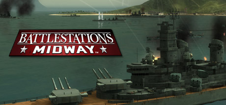
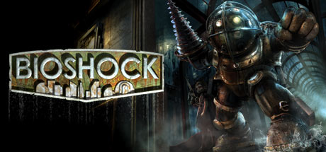
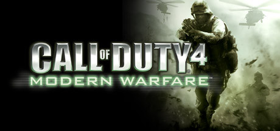
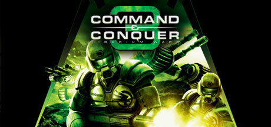
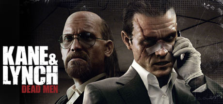
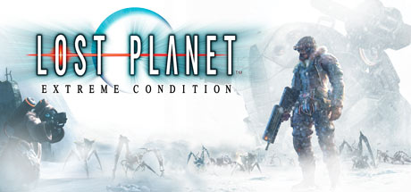
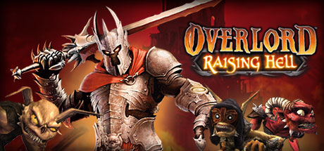
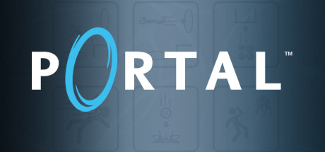
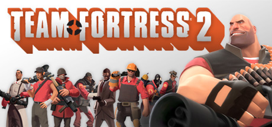
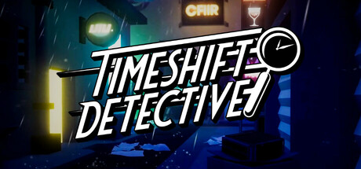

# Xbox 360 — 2007

[← All Xbox 360 years](../xbox-360.md) · [Full 2007 page](../../years/2007.md)

174 Xbox 360 titles in 2007.

### 3D Ultra Minigolf Adventures

**Platforms:** Xbox 360 &nbsp;|&nbsp; **Released:** April 18

[Wikipedia](https://en.wikipedia.org/wiki/3D_Ultra_Minigolf_Adventures)

---

### Ace Combat 6: Fires of Liberation

**Platforms:** Xbox 360 &nbsp;|&nbsp; **Released:** October 16

---

### Aegis Wing

**Platforms:** Xbox 360 &nbsp;|&nbsp; **Released:** May 16

[Wikipedia](https://en.wikipedia.org/wiki/Aegis_Wing)

---

### Alien Hominid

**Platforms:** Xbox 360 &nbsp;|&nbsp; **Released:** February 28

[Wikipedia](https://en.wikipedia.org/wiki/Alien_Hominid)

---

### All-Pro Football 2K8

**Platforms:** PlayStation 3, Xbox 360 &nbsp;|&nbsp; **Developer:** Visual Concepts &nbsp;|&nbsp; **Publisher:** 2K &nbsp;|&nbsp; **Genre:** Sports &nbsp;|&nbsp; **Released:** July 16, 2007

> Imagine Rice, Unitas, Butkus, and Singletary. In their prime, on the same field, or maybe even the same team. Imagine preparing a precision squad of mercenaries—even building your own players.
>
> _Synopsis source: IGDB_

[Wikipedia](https://en.wikipedia.org/wiki/All-Pro_Football_2K8) · [IGDB](https://www.igdb.com/games/all-pro-football-2k8)

---

### America's Army: True Soldiers

**Platforms:** Xbox 360 &nbsp;|&nbsp; **Developer:** Red Storm Entertainment &nbsp;|&nbsp; **Publisher:** Ubisoft &nbsp;|&nbsp; **Genre:** Tactical shooter &nbsp;|&nbsp; **Released:** November 15, 2007

> America's Army: True Soldiers is a first-person shooter video game developed by Red Storm Entertainment and published by Ubisoft. It was released on November 15, 2007. It is a spin-off of the United States Army's computer game America's Army. Unlike the original America's Army, this game is not freeware.
>
> _Synopsis source: IGDB_

[Wikipedia](https://en.wikipedia.org/wiki/America's_Army:_True_Soldiers) · [IGDB](https://www.igdb.com/games/america-s-army-true-soldiers)

---

### Arkadian Warriors

**Platforms:** Windows, Xbox 360 &nbsp;|&nbsp; **Released:** December 12

[Wikipedia](https://en.wikipedia.org/wiki/Arkadian_Warriors)

---

### Armored Core 4

**Platforms:** PlayStation 3, Xbox 360 &nbsp;|&nbsp; **Released:** March 20

[Wikipedia](https://en.wikipedia.org/wiki/Armored_Core_4)

---

### Arthur and the Invisibles

**Platforms:** Game Boy Advance, GameCube, Nintendo DS, PlayStation 2, PlayStation 3, PlayStation Portable, Windows, Xbox, Xbox 360 &nbsp;|&nbsp; **Released:** January 9

[Wikipedia](https://en.wikipedia.org/wiki/Arthur_and_the_Invisibles_(video_game))

---

### Assassin's Creed

**Platforms:** Xbox 360, PlayStation 3 &nbsp;|&nbsp; **Released:** November 16

[Wikipedia](https://en.wikipedia.org/wiki/Assassin%27s_Creed_(video_game))

---

### Avatar: The Last Airbender – The Burning Earth

**Platforms:** PlayStation 2, Wii, Game Boy Advance, Nintendo DS, Xbox 360 &nbsp;|&nbsp; **Released:** October 17

---

### Band of Bugs

**Platforms:** Xbox 360, Windows &nbsp;|&nbsp; **Developer:** NinjaBee &nbsp;|&nbsp; **Publisher:** Microsoft Game Studios &nbsp;|&nbsp; **Genre:** Turn-based tactics &nbsp;|&nbsp; **Released:** June 20, 2007

> Maal is an unhappy bug who needs structure and a purpose in his life, so he joins the royal army under the tutelage of the battle-hardened mantis warrior Tiernan. Now, he must begin his quest to save the Queen and the kingdom. NinjaBee's Band of Bugs puts you in Maal's shoes er, footpads, and sets you in the middle of a fast-playing, accessible, tactical strategy game designed specifically for Xbox LIVE Arcade. This turn-based tactics game expands the genre by providing a unique Level Editor, allowing gamers to create levels and play them online with friends.
>
> _Synopsis source: IGDB_

[Wikipedia](https://en.wikipedia.org/wiki/Band_of_Bugs) · [IGDB](https://www.igdb.com/games/band-of-bugs)

---

### Battlestations: Midway

**Platforms:** Xbox 360, Windows &nbsp;|&nbsp; **Genre:** Action &nbsp;|&nbsp; **Released:** January 30

> Battlestations: Midway is an immense action game that drops players into massive air, sea, and undersea battles from Pearl Harbor to the Battle of Midway.
>
> _Synopsis source: Steam_

[Steam](https://store.steampowered.com/app/6870)

---

### Beautiful Katamari

**Platforms:** Xbox 360 &nbsp;|&nbsp; **Released:** October 16

[Wikipedia](https://en.wikipedia.org/wiki/Beautiful_Katamari)

---

### Bee Movie Game

**Platforms:** Windows, PlayStation 2, Xbox 360, Nintendo DS, Wii &nbsp;|&nbsp; **Released:** October 30

[Wikipedia](https://en.wikipedia.org/wiki/Bee_Movie_Game)

---

### Beowulf: The Game

**Platforms:** PlayStation 3, Windows, Xbox 360, PlayStation Portable &nbsp;|&nbsp; **Released:** November 13

---

### BioShock

**Platforms:** Xbox 360, Windows &nbsp;|&nbsp; **Publisher:** 2K Games &nbsp;|&nbsp; **Genre:** Action, RPG &nbsp;|&nbsp; **Released:** August 21, 2007

> BioShock is a shooter unlike any you've ever played, loaded with weapons and tactics never seen. You'll have a complete arsenal at your disposal from simple revolvers to grenade launchers and chemical throwers, but you'll also be forced to genetically modify your DNA to create an even more deadly weapon: you.
>
> _Synopsis source: Steam_

[Wikipedia](https://en.wikipedia.org/wiki/BioShock) · [Steam](https://store.steampowered.com/app/7670)

---

### BlackSite: Area 51

**Platforms:** Windows, Xbox 360, PlayStation 3 &nbsp;|&nbsp; **Developer:** Midway Studios Austin &nbsp;|&nbsp; **Publisher:** Midway Games &nbsp;|&nbsp; **Genre:** First-person shooter &nbsp;|&nbsp; **Released:** November 12, 2007

> Modern day fears explode onto the streets of a small American town swarming with alien life. The government is desparate, struggling to contain secrets so terrible they can no longer be kept. You are Aeran Pierce, a Special Forces assassin thrown into one of the most explosive moments in American history. Everything hinges on your actions in BlackSite: Area 51.
>
> _Synopsis source: IGDB_

[Wikipedia](https://en.wikipedia.org/wiki/BlackSite:_Area_51) · [IGDB](https://www.igdb.com/games/blacksite-area-51)

---

### Bladestorm: The Hundred Years' War

**Platforms:** PlayStation 3, Xbox 360 &nbsp;|&nbsp; **Released:** November 6

---

### Blazing Angels 2: Secret Missions of WWII

**Platforms:** Windows, PlayStation 3, Xbox 360 &nbsp;|&nbsp; **Developer:** Ubisoft Bucharest &nbsp;|&nbsp; **Publisher:** Ubisoft &nbsp;|&nbsp; **Genre:** Flight combat &nbsp;|&nbsp; **Released:** September 6, 2007

> Blazing Angels 2: Secret Missions of WWII is a 2007 flight-combat video game for the personal computer, PlayStation 3, and Xbox 360; developed by Ubisoft Romania; and published by Ubisoft. It was released on September 7 in Europe, September 18 in North America, and October 4 in Australasia. A sequel of Blazing Angels: Squadrons of WWII, the game puts the player in an elite Allied squadron trying to prevent Nazi Germany from creating a weapon of mass destruction. As the player progresses, he or she will travel around the world and battle the enemy with a list of prototype fighter aircraft and upgrades. Multiplayer mode includes deathmatch, cooperative, capture-the-flag, and epic battle. A demo was released on the PlayStation Network and Xbox Live on August 23, 2007.
>
> _Synopsis source: IGDB_

[Wikipedia](https://en.wikipedia.org/wiki/Blazing_Angels_2:_Secret_Missions_of_WWII) · [IGDB](https://www.igdb.com/games/blazing-angels-2-secret-missions-of-wwii)

---

### Blue Dragon

**Platforms:** Xbox 360 &nbsp;|&nbsp; **Released:** August 28

[Wikipedia](https://en.wikipedia.org/wiki/Blue_Dragon_(video_game))

---

### Bomberman Live

**Platforms:** Xbox 360 &nbsp;|&nbsp; **Released:** July 18

[Wikipedia](https://en.wikipedia.org/wiki/Bomberman_Live)

---

### Boom Boom Rocket

**Platforms:** Xbox 360 &nbsp;|&nbsp; **Developer:** Bizarre Creations &nbsp;|&nbsp; **Publisher:** Electronic Arts &nbsp;|&nbsp; **Genre:** Music &nbsp;|&nbsp; **Released:** April 11, 2007

> Boom Boom Rocket is a downloadable video game for Xbox 360's Xbox Live Arcade service. Boom Boom Rocket marks the first rhythm game for the Live Arcade service and was developed by Geometry Wars creators Bizarre Creations and published by the Pogo division of Electronic Arts.
>
> _Synopsis source: IGDB_

[Wikipedia](https://en.wikipedia.org/wiki/Boom_Boom_Rocket) · [IGDB](https://www.igdb.com/games/boom-boom-rocket)

---

### Brian Lara International Cricket 2007

**Platforms:** PlayStation 2, Xbox 360, Windows &nbsp;|&nbsp; **Released:** March 23 (EU)

[Wikipedia](https://en.wikipedia.org/wiki/Brian_Lara_International_Cricket_2007)

---

### Bullet Witch

**Platforms:** Xbox 360 &nbsp;|&nbsp; **Released:** February 27

[Wikipedia](https://en.wikipedia.org/wiki/Bullet_Witch)

---

### Cabela's Trophy Bucks

**Platforms:** Windows, PlayStation 2, Wii, Xbox 360 &nbsp;|&nbsp; **Developer:** Fun Labs, Magic Wand Productions, Sand Grain Studios &nbsp;|&nbsp; **Publisher:** Activision Value &nbsp;|&nbsp; **Genre:** Sports, first-person shooter &nbsp;|&nbsp; **Released:** September 25, 2007

> Experience fast paced hunting action in pursuit of record trophy bucks across 24 state and provinces in North America. Gameplay starts at the most critical and exciting parts of each hunting mission where you are immediately presented with a challenge. Paired with incredibly realistic gameplay and North America's most popular deer, waterfowl, upland birds, small game and varmint species, you will be able to hunt for animals in places that most hunters could only dream of experiencing in a lifetime. Your well-honed hunting instinct, keen observation and quick decision making will be essential in your quest to become the ultimate North American hunter!
>
> _Synopsis source: IGDB_

[Wikipedia](https://en.wikipedia.org/wiki/Cabela's_Trophy_Bucks) · [IGDB](https://www.igdb.com/games/cabela-s-trophy-bucks)

---

### Call of Duty 4: Modern Warfare

**Platforms:** Xbox 360, PlayStation 3, Windows &nbsp;|&nbsp; **Publisher:** Activision &nbsp;|&nbsp; **Genre:** Action &nbsp;|&nbsp; **Released:** November 5, 2007

> The new action-thriller from the award-winning team at Infinity Ward, the creators of the Call of Duty® series, delivers the most intense and cinematic action experience ever. Call of Duty 4: Modern Warfare arms gamers with an arsenal of advanced and powerful modern day firepower and transports them to the most treacherous hotspots...
>
> _Synopsis source: Steam_

[Steam](https://store.steampowered.com/app/7940)

---

### Call of Juarez

**Platforms:** Xbox 360 &nbsp;|&nbsp; **Released:** June 7

[Wikipedia](https://en.wikipedia.org/wiki/Call_of_Juarez)

---

### Carcassonne

**Platforms:** Xbox 360 &nbsp;|&nbsp; **Released:** June 27

[Wikipedia](https://en.wikipedia.org/wiki/Carcassonne_(video_game))

---

### Cars Mater-National Championship

**Platforms:** Windows, PlayStation 2, Xbox 360, PlayStation 3, Nintendo DS, Wii, Game Boy Advance &nbsp;|&nbsp; **Released:** October 29

[Wikipedia](https://en.wikipedia.org/wiki/Cars_Mater-National_Championship)

---

### Castlevania: Symphony of the Night

**Platforms:** Xbox 360 &nbsp;|&nbsp; **Publisher:** Konami &nbsp;|&nbsp; **Released:** March 21, 2007

---

### Catan

**Platforms:** Xbox 360 &nbsp;|&nbsp; **Developer:** Big Huge Games &nbsp;|&nbsp; **Publisher:** Big Huge Games &nbsp;|&nbsp; **Genre:** Turn-based strategy &nbsp;|&nbsp; **Released:** May 2, 2007

> Catan, based on the popular board game "Settlers of Catan", is a game of production, trading, and building in which players compete to develop the most successful colony on the island.
>
> _Synopsis source: IGDB_

[Wikipedia](https://en.wikipedia.org/wiki/Catan_(2007_video_game)) · [IGDB](https://www.igdb.com/games/catan)

---

### Clive Barker's Jericho

**Platforms:** PlayStation 3, Xbox 360, Windows &nbsp;|&nbsp; **Released:** October 16

[Wikipedia](https://en.wikipedia.org/wiki/Clive_Barker%27s_Jericho)

---

### Colin McRae: Dirt

**Platforms:** Windows, Xbox 360, PlayStation 3 &nbsp;|&nbsp; **Developer:** Codemasters &nbsp;|&nbsp; **Publisher:** Codemasters &nbsp;|&nbsp; **Genre:** Racing &nbsp;|&nbsp; **Released:** June 15, 2007

> Become the king of off-road racing! Race rally and hill climb events as well as multi-car rally raid, rally cross and Corr buggy and truck racing. Unprecedented next-gen racing visuals and devastating car damage. 100 player online mode.  Note: Following his death in a helicopter accident in September 2007, Colin McRae's name was removed from future titles in the series, as well subsequent re-releases following DiRT 3.
>
> _Synopsis source: IGDB_

[Wikipedia](https://en.wikipedia.org/wiki/Colin_McRae:_Dirt) · [IGDB](https://www.igdb.com/games/colin-mcrae-dirt)

---

### College Hoops 2K8

**Platforms:** PlayStation 2, PlayStation 3, Xbox 360 &nbsp;|&nbsp; **Developer:** Visual Concepts &nbsp;|&nbsp; **Publisher:** 2K &nbsp;|&nbsp; **Genre:** Sports &nbsp;|&nbsp; **Released:** November 19, 2007

> College Hoops 2K8 is a video game by Visual Concepts and 2K Sports. It was released on November 19, 2007 for the Xbox 360, PlayStation 2 and PlayStation 3.  The cover features Greg Oden, formerly of the Ohio State Buckeyes.  Almost every school competing in Division I NCAA college basketball at the time was included in 2K8, including recent additions South Carolina-Upstate, Cal State-Bakersfield and Florida Gulf Coast. Not included were Presbyterian College and North Carolina Central, D-1 independents. Also, Centenary College of the Summit League was unlicensed and instead named UL-Calcutta. The game also featured the ability to change and modify rosters and share them online via the newly introduced 2K Share feature. The real coaches feature was dropped from this game, possibly because the coaches chose not to renew their contracts and all of the coaches are unnamed.  The announcers/commentators featured in the game were Verne Lundquist and Bill Raftery. The College Hoops series was put on hiatus in 2008 as 2K Sports declined to seek the college license for a 2K9 release. EA Sports got the contract before 2K did, so EA will continue to make college basketball games. EA discontinued their college basketball game series in 2010. It is currently unknown if 2K Sports will continue to make their College Hoops 2K series.
>
> _Synopsis source: IGDB_

[Wikipedia](https://en.wikipedia.org/wiki/College_Hoops_2K8) · [IGDB](https://www.igdb.com/games/college-hoops-2k8)

---

### Command & Conquer 3: Tiberium Wars

**Platforms:** Windows, Xbox 360 &nbsp;|&nbsp; **Genre:** Action, Strategy &nbsp;|&nbsp; **Released:** March 28

> The year is 2047. A massive nuclear fireball explodes high in the night sky, marking the dramatic beginning of the Third Tiberium War and the long-awaited return of the most groundbreaking Real-Time Strategy franchise of all time
>
> _Synopsis source: Steam_

[Steam](https://store.steampowered.com/app/24790)

---

### Conan

**Platforms:** Xbox 360, PlayStation 3 &nbsp;|&nbsp; **Released:** October 23

[Wikipedia](https://en.wikipedia.org/wiki/Conan_(2007_video_game))

---

### Cosmic Osmo's Hex Isle

**Platforms:** Windows, macOS, Xbox 360 &nbsp;|&nbsp; **Developer:** Cyan Worlds &nbsp;|&nbsp; **Publisher:** Fanista &nbsp;|&nbsp; **Genre:** Puzzle game &nbsp;|&nbsp; **Released:** November 30, 2007

> Cyan World's sequel to Cosmic Osmo and the Worlds Beyond the Mackerel.
>
> _Synopsis source: IGDB_

[Wikipedia](https://en.wikipedia.org/wiki/Cosmic_Osmo's_Hex_Isle) · [IGDB](https://www.igdb.com/games/cosmic-osmos-hex-isle)

---

### Crackdown

**Platforms:** Xbox 360 &nbsp;|&nbsp; **Released:** February 20

[Wikipedia](https://en.wikipedia.org/wiki/Crackdown_(video_game))

---

### Crash of the Titans

**Platforms:** PlayStation Portable, PlayStation 2, Xbox 360, Game Boy Advance, Nintendo DS &nbsp;|&nbsp; **Released:** October 4

[Wikipedia](https://en.wikipedia.org/wiki/Crash_of_the_Titans)

---

### Dance Dance Revolution Hottest Party

**Platforms:** Xbox 360, PlayStation 3, Wii &nbsp;|&nbsp; **Released:** September 25

[Wikipedia](https://en.wikipedia.org/wiki/Dance_Dance_Revolution_Hottest_Party)

---

### Dance Dance Revolution Universe

**Platforms:** Xbox 360 &nbsp;|&nbsp; **Released:** February 27

[Wikipedia](https://en.wikipedia.org/wiki/Dance_Dance_Revolution_Universe)

---

### Dance Dance Revolution Universe 2

**Platforms:** Xbox 360 &nbsp;|&nbsp; **Developer:** Hudson Soft &nbsp;|&nbsp; **Publisher:** Konami &nbsp;|&nbsp; **Genre:** Music, Exercise &nbsp;|&nbsp; **Released:** December 4, 2007

> Another in the series of the Dance Dance Revolution games, this one is exclusive to the 360 with new songs ranging from the 1970's, 80's and 90's including contemporary artists' songs.  The standard modes are present (split-screen Multiplayer, Workout)with two new ones: Freestyle that features no arrows and is more of an exhibition type aimed for all ages and skill levels, and Quest Mode where players can create their own character with a variety of customization ranging from clothing and appearances playing in a story-based mode in a series of challenges. Additional costumes can be unlocked through the Quest Mode.  Players can also access new songs through Xbox live and compete head-to-head against players in dancing contests. There are editing options where unique dancing sequences can be transposed onto custom background videos.
>
> _Synopsis source: IGDB_

[Wikipedia](https://en.wikipedia.org/wiki/Dance_Dance_Revolution_Universe_2) · [IGDB](https://www.igdb.com/games/dance-dance-revolution-universe-2)

---

### Def Jam: Icon

**Platforms:** PlayStation 3, Xbox 360 &nbsp;|&nbsp; **Released:** March 6

---

### Diario: Rebirth Moon Legend

**Platforms:** Xbox 360 &nbsp;|&nbsp; **Developer:** Idea Factory &nbsp;|&nbsp; **Publisher:** Idea Factory &nbsp;|&nbsp; **Genre:** Role-playing video game &nbsp;|&nbsp; **Released:** February 8, 2007

> Diario: Rebirth Moon Legend is a strategy RPG where players join the mercenary group Sleipnir and complete missions such as escorts and monster hunts while progressing through the story. Battles take place on freely movable, gridless maps and feature systems for chained actions, temporary weapon enhancements, and evolving skills.  This Xbox 360 version is an enhanced port that adds new story events and downloadable battle music options, allowing players to change combat tracks from a selection of songs.
>
> _Synopsis source: IGDB_

[Wikipedia](https://en.wikipedia.org/wiki/Diario:_Rebirth_Moon_Legend) · [IGDB](https://www.igdb.com/games/diario-rebirth-moon-legend)

---

### Dirt

**Platforms:** Xbox 360, Windows, PlayStation 3 &nbsp;|&nbsp; **Released:** June 19

[Wikipedia](https://en.wikipedia.org/wiki/Dirt_(video_game))

---

### Disney's Kim Possible: Global Gemini

**Platforms:** Nintendo DS, PlayStation 2, PlayStation 3, Wii, Xbox 360 &nbsp;|&nbsp; **Released:** February 13

[Wikipedia](https://en.wikipedia.org/wiki/Kim_Possible_(video_game_series))

---

### Disney's Meet the Robinsons

**Platforms:** Windows, PlayStation 2, Game Boy Advance, Nintendo DS, Wii, Xbox 360, GameCube &nbsp;|&nbsp; **Released:** March 27

[Wikipedia](https://en.wikipedia.org/wiki/Meet_the_Robinsons_(video_game))

---

### Drake & Josh: Talent Showdown

**Platforms:** Nintendo DS, PlayStation 2, PlayStation 3, Wii, Xbox 360 &nbsp;|&nbsp; **Released:** July 30

---

### Dynasty Warriors: Gundam

**Platforms:** PlayStation 2, PlayStation 3, Xbox 360 &nbsp;|&nbsp; **Released:** August 28

---

### Earth Defense Force 2017

**Platforms:** Xbox 360 &nbsp;|&nbsp; **Released:** March 20

[Wikipedia](https://en.wikipedia.org/wiki/Earth_Defense_Force_2017)

---

### Eets: Chowdown

**Platforms:** Xbox 360 &nbsp;|&nbsp; **Released:** April 25

[Wikipedia](https://en.wikipedia.org/wiki/Eets)

---

### Eternal Sonata

**Platforms:** Xbox 360 &nbsp;|&nbsp; **Released:** September 17

[Wikipedia](https://en.wikipedia.org/wiki/Eternal_Sonata)

---

### Every Extend Extra Extreme

**Platforms:** Xbox 360 &nbsp;|&nbsp; **Released:** October 17

[Wikipedia](https://en.wikipedia.org/wiki/Every_Extend_Extra_Extreme)

---

### Exit

**Platforms:** Xbox 360 &nbsp;|&nbsp; **Released:** October 24

[Wikipedia](https://en.wikipedia.org/wiki/Exit_(video_game))

---

### F.E.A.R. Files

**Platforms:** Xbox 360 &nbsp;|&nbsp; **Released:** November 6

[Wikipedia](https://en.wikipedia.org/wiki/F.E.A.R._Files)

---

### Fantastic Four: Rise of the Silver Surfer

**Platforms:** Mobile phone, PlayStation 2, PlayStation 3, Wii, Xbox 360, Nintendo DS &nbsp;|&nbsp; **Developer:** 7 Studios, Visual Concepts, Hands-On Mobile &nbsp;|&nbsp; **Publisher:** 2K &nbsp;|&nbsp; **Genre:** Third-person action-adventure game &nbsp;|&nbsp; **Released:** June 12, 2007

> Marvel's first family of Super Heroes face its greatest challenge yet as the enigmatic, intergalactic herald, The Silver Surfer, comes to Earth to prepare it for destruction. Transform into any member of the Fantastic Four to fight enemies from the Fantastic Four Universe including Silver Surfer, Super Skrull and more. Battle in 4-player co-op with easy pick up and play ability.
>
> _Synopsis source: IGDB_

[Wikipedia](https://en.wikipedia.org/wiki/Fantastic_Four:_Rise_of_the_Silver_Surfer_(video_game)) · [IGDB](https://www.igdb.com/games/fantastic-four-rise-of-the-silver-surfer)

---

### Fatal Inertia

**Platforms:** Xbox 360 &nbsp;|&nbsp; **Released:** September 11

[Wikipedia](https://en.wikipedia.org/wiki/Fatal_Inertia)

---

### FIFA 08

**Platforms:** PlayStation Portable, Windows, PlayStation 2, Xbox 360, PlayStation 3, Wii, Nintendo DS &nbsp;|&nbsp; **Released:** October 8

[Wikipedia](https://en.wikipedia.org/wiki/FIFA_08)

---

### Forza Motorsport 2

**Platforms:** Xbox 360 &nbsp;|&nbsp; **Publisher:** Microsoft Game Studios &nbsp;|&nbsp; **Released:** May 29, 2007

[Wikipedia](https://en.wikipedia.org/wiki/Forza_Motorsport_2)

---

### Fuzion Frenzy 2

**Platforms:** Xbox 360 &nbsp;|&nbsp; **Developer:** Hudson Soft &nbsp;|&nbsp; **Publisher:** Microsoft Game Studios &nbsp;|&nbsp; **Genre:** Party &nbsp;|&nbsp; **Released:** January 30, 2007

> Until four years ago, Fuzion Frenzy was the most popular tournament on Earth and was broadcast live to all corners of the world. However, due to the extreme competitiveness of the players, the leaders of Earth banned it, fearing its influence on the general population.  Recently, however, the world's leaders have struggled with the problem of overpopulation, and have come up with a plan for the citizens of Earth to immigrate to space. To encourage immigration, the leaders have brought back the Fuzion Frenzy tournament, but with a change they have set up game zones on various other planets. The people of Earth welcome this news, especially the announcement that the leaders have reinstated the six most famous players, who are returning with renewed enthusiasm.  Fuzion Frenzy 2 combines over 40 mini games with futuristic arcade action, custom tournaments, Xbox Live features and more to create the ultimate party game exclusively on Xbox 360. Play with your friends and family to find out who is the strongest among you.
>
> _Synopsis source: IGDB_

[Wikipedia](https://en.wikipedia.org/wiki/Fuzion_Frenzy_2) · [IGDB](https://www.igdb.com/games/fuzion-frenzy-2)

---

### Geometry Wars: Waves

**Platforms:** Xbox 360 &nbsp;|&nbsp; **Released:** October 2

---

### Geon: Emotions

**Platforms:** Xbox 360 &nbsp;|&nbsp; **Released:** September 19

---

### Guitar Hero II

**Platforms:** Xbox 360 &nbsp;|&nbsp; **Publisher:** Activision &nbsp;|&nbsp; **Released:** April 3, 2007

[Wikipedia](https://en.wikipedia.org/wiki/Guitar_Hero_II)

---

### Guitar Hero III: Legends of Rock

**Platforms:** PlayStation 2, Xbox 360, PlayStation 3, Wii, Windows, macOS &nbsp;|&nbsp; **Released:** October 28

---

### Half-Life 2

**Platforms:** Xbox 360, PlayStation 3 &nbsp;|&nbsp; **Released:** October 10

[Wikipedia](https://en.wikipedia.org/wiki/Half-Life_2)

---

### Half-Life 2: Episode One

**Platforms:** Xbox 360, PlayStation 3 &nbsp;|&nbsp; **Released:** October 10

---

### Half-Life 2: Episode Two

**Platforms:** Windows, Xbox 360, PlayStation 3 &nbsp;|&nbsp; **Publisher:** Valve &nbsp;|&nbsp; **Released:** October 10, 2007

---

### Halo 3

**Platforms:** Xbox 360 &nbsp;|&nbsp; **Publisher:** Microsoft Game Studios &nbsp;|&nbsp; **Released:** September 25, 2007

[Wikipedia](https://en.wikipedia.org/wiki/Halo_3)

---

### Harry Potter and the Order of the Phoenix

**Platforms:** Windows, PlayStation 2, PlayStation 3, Xbox 360, PlayStation Portable, Nintendo DS, Wii, Game Boy Advance, macOS &nbsp;|&nbsp; **Released:** June 25

[Wikipedia](https://en.wikipedia.org/wiki/Harry_Potter_and_the_Order_of_the_Phoenix_(video_game))

---

### Hexic 2

**Platforms:** Xbox 360 &nbsp;|&nbsp; **Developer:** Carbonated Games &nbsp;|&nbsp; **Publisher:** Microsoft Game Studios &nbsp;|&nbsp; **Genre:** Puzzle &nbsp;|&nbsp; **Released:** August 15, 2007

> Hexic 2 adds multiplayer to this already-popular puzzle game.
>
> _Synopsis source: IGDB_

[Wikipedia](https://en.wikipedia.org/wiki/Hexic_2) · [IGDB](https://www.igdb.com/games/hexic-2)

---

### Hot Wheels: Beat That!

**Platforms:** PlayStation 2, Xbox 360, Wii, Nintendo DS, Windows &nbsp;|&nbsp; **Released:** September 25

---

### Hour of Victory

**Platforms:** Xbox 360 &nbsp;|&nbsp; **Released:** June 25

[Wikipedia](https://en.wikipedia.org/wiki/Hour_of_Victory)

---

### Jetpac Refuelled

**Platforms:** Xbox 360 &nbsp;|&nbsp; **Released:** March 28

[Wikipedia](https://en.wikipedia.org/wiki/Jetpac_Refuelled)

---

### Juiced 2: Hot Import Nights

**Platforms:** Nintendo DS, PlayStation 2, Xbox 360, PlayStation 3, Windows &nbsp;|&nbsp; **Released:** September 17

---

### Kane & Lynch: Dead Men

**Platforms:** PlayStation 3, Windows, Xbox 360 &nbsp;|&nbsp; **Genre:** Action &nbsp;|&nbsp; **Released:** November 13

> Kane and Lynch: Dead Men is the new action shooter franchise by Io-Interactive, creators of the multi-million selling Hitman series. Kane &amp; Lynch: Dead Men follows the violent and chaotic journey of two men - a flawed mercenary and a medicated psychopath - and their brutal attitude towards right and wrong.
>
> _Synopsis source: Steam_

[Steam](https://store.steampowered.com/app/8080)

---

### Lego Star Wars: The Complete Saga

**Platforms:** Xbox 360, PlayStation 3, Wii, Nintendo DS &nbsp;|&nbsp; **Released:** November 6 (NA/EU)

---

### Looney Tunes: Acme Arsenal

**Platforms:** PlayStation 2, Wii, Xbox 360 &nbsp;|&nbsp; **Released:** October 9

---

### Lost Odyssey

**Platforms:** Xbox 360 &nbsp;|&nbsp; **Released:** December 6

[Wikipedia](https://en.wikipedia.org/wiki/Lost_Odyssey)

---

### Lost Planet: Extreme Condition

**Platforms:** Xbox 360, PlayStation 3, Windows &nbsp;|&nbsp; **Genre:** Action, Adventure &nbsp;|&nbsp; **Released:** January 12

> Driven to the brink of extinction on ice-covered wastelands, humankind fights to survive. Battle to survive against gargantuan alien Akrid and treacherous Snow Pirates on the vast and frozen landscape of EDN III.
>
> _Synopsis source: Steam_

[Steam](https://store.steampowered.com/app/6510)

---

### Madden NFL 08

**Platforms:** GameCube, Nintendo DS, PlayStation 2, PlayStation 3, PlayStation Portable, Wii, Xbox, Xbox 360, Windows &nbsp;|&nbsp; **Released:** August 14

[Wikipedia](https://en.wikipedia.org/wiki/Madden_NFL_08)

---

### Major League Baseball 2K7

**Platforms:** PlayStation 2, PlayStation 3, PlayStation Portable, Xbox, Xbox 360, Game Boy Advance, Nintendo DS &nbsp;|&nbsp; **Developer:** Kush Games &nbsp;|&nbsp; **Publisher:** 2K &nbsp;|&nbsp; **Genre:** Sports &nbsp;|&nbsp; **Released:** February 27, 2007

> Major League Baseball 2K7 (or MLB 2K7) is a Major League Baseball licensed baseball simulation video game developed by Kush Games and published by 2K Sports. Released on February 27, 2007, it is the only 2007 MLB licensed game available for the Xbox 360 and Xbox. It is also available for the PlayStation Portable, the PlayStation 2 and, for the first time, the PlayStation 3, though its competition came in the form of MLB 07: The Show from 989 Sports. Portable versions for the Nintendo DS, PlayStation Portable, and Game Boy Advance were released. It is the first baseball game to be released for the Nintendo DS and the last major release for the Xbox game console.  For the third year in a row, Derek Jeter is the cover athlete, and ESPN baseball broadcasters Jon Miller and Joe Morgan serve as announcers, despite the loss of the ESPN license to Electronic Arts. Steve Physioc and Jeanne Zelasko cover the pre-game.
>
> _Synopsis source: IGDB_

[Wikipedia](https://en.wikipedia.org/wiki/Major_League_Baseball_2K7) · [IGDB](https://www.igdb.com/games/major-league-baseball-2k7)

---

### Mass Effect

**Platforms:** Xbox 360 &nbsp;|&nbsp; **Publisher:** Microsoft Game Studios &nbsp;|&nbsp; **Released:** November 20, 2007

[Wikipedia](https://en.wikipedia.org/wiki/Mass_Effect_(video_game))

---

### Medal of Honor: Airborne

**Platforms:** PlayStation 3, Xbox 360, Windows &nbsp;|&nbsp; **Released:** September 4

---

### Monster Madness: Battle for Suburbia

**Platforms:** Xbox 360, Windows &nbsp;|&nbsp; **Developer:** Artificial Studios, Immersion Games &nbsp;|&nbsp; **Publisher:** SouthPeak Games &nbsp;|&nbsp; **Genre:** Shoot 'em up

> Monster Madness is an action adventure game following a group of teens as they fight to rid their town of an undead menace.
>
> _Synopsis source: IGDB_

[Wikipedia](https://en.wikipedia.org/wiki/Monster_Madness:_Battle_for_Suburbia) · [IGDB](https://www.igdb.com/games/monster-madness-battle-for-suburbia)

---

### MotoGP '07

**Platforms:** Xbox 360, Windows, Mobile phone &nbsp;|&nbsp; **Developer:** Climax Racing, Rockpool Games &nbsp;|&nbsp; **Publisher:** THQ &nbsp;|&nbsp; **Genre:** Racing &nbsp;|&nbsp; **Released:** August 24, 2007

> MotoGP '07 features complete rider and team data, new 800cc MotoGP bikes and all 18 circuit of the 2007 MotoGP season. The title also features interactive track-side crowds, on-line tournament features, on-line "pink slip" racing, and a revamped Extreme mode. The revamped Extreme mode allows for over one million possible bike customizations.  In addition, minor gameplay changes have been made to the handling and braking to allow for easier player accessibility. Changes to acceleration and deceleration have been made to add to the realism which will make turns easier to navigate through. Slight fishtailing with hard braking has been put in to give a better feel for the handling of the bike and to let the player know how effective their braking is.
>
> _Synopsis source: IGDB_

[Wikipedia](https://en.wikipedia.org/wiki/MotoGP_'07) · [IGDB](https://www.igdb.com/games/motogp-07)

---

### Mutant Storm Empire

**Platforms:** Xbox 360 &nbsp;|&nbsp; **Developer:** PomPom Games &nbsp;|&nbsp; **Publisher:** Microsoft Game Studios &nbsp;|&nbsp; **Genre:** Multi-directional shooter &nbsp;|&nbsp; **Released:** October 31, 2007

> Battle through line after line of the emperor's minion horde, destroying absolutely everything you can! Blast through bunches of robots, crush colonies of aquatic monsters, smash swarms of UFOs, and demolish devastating bosses. It's a continuous adventure through four immense, strikingly vibrant worlds, and you can fight alone or join forces with a friend in two-player cooperative mode.
>
> _Synopsis source: IGDB_

[Wikipedia](https://en.wikipedia.org/wiki/Mutant_Storm_Empire) · [IGDB](https://www.igdb.com/games/mutant-storm-empire)

---

### Naruto: Rise of a Ninja

**Platforms:** Xbox 360 &nbsp;|&nbsp; **Released:** October 30

---

### NASCAR 08

**Platforms:** GameCube, PlayStation 2, PlayStation 3, PlayStation Portable, Wii, Xbox 360 &nbsp;|&nbsp; **Released:** July 23

[Wikipedia](https://en.wikipedia.org/wiki/NASCAR_08)

---

### NBA 2K8

**Platforms:** PlayStation 2, PlayStation 3, Xbox 360 &nbsp;|&nbsp; **Developer:** Visual Concepts &nbsp;|&nbsp; **Publisher:** 2K, Spike &nbsp;|&nbsp; **Genre:** Sports &nbsp;|&nbsp; **Released:** October 2, 2007

> NBA 2K8 is a basketball simulation video game developed by Visual Concepts and published by 2K Sports. It is the ninth installment in the NBA 2K franchise and the successor to NBA 2K7. It was released in October 2007 for Xbox 360, PlayStation 2, and PlayStation 3. Chris Paul is the cover athlete of the game. NBA 2K8 is the predecessor to NBA 2K9 in the NBA 2K series.  NBA 2K8 was well received upon release. Critics mostly praised the aesthetical details, with particular praise directed towards the player animations, as well as the game mode options, and overall gameplay, more specifically, the post play, jump shooting, and well rounded accessibility. Most criticisms were concerning some gameplay inconsistencies, such as the defensive mechanics, and the unrealistic player tendencies, as well as the game's lack of improvements, with some seeing the lack of meaningful changes as a step back from NBA 2K7, and visuals, which some saw as "awful" and "ugly". Some saw the visuals as "gorgeous" however
>
> _Synopsis source: IGDB_

[Wikipedia](https://en.wikipedia.org/wiki/NBA_2K8) · [IGDB](https://www.igdb.com/games/nba-2k8)

---

### NBA Live 08

**Platforms:** PlayStation 2, Xbox 360, Wii, Nintendo DS, PlayStation Portable, Windows &nbsp;|&nbsp; **Released:** October 2

[Wikipedia](https://en.wikipedia.org/wiki/NBA_Live_08)

---

### NBA Street Homecourt

**Platforms:** Xbox 360, PlayStation 3 &nbsp;|&nbsp; **Released:** February 19

[Wikipedia](https://en.wikipedia.org/wiki/NBA_Street_Homecourt)

---

### NCAA Football 08

**Platforms:** PlayStation 2, PlayStation 3, Xbox, Xbox 360 &nbsp;|&nbsp; **Released:** July 17

[Wikipedia](https://en.wikipedia.org/wiki/NCAA_Football_08)

---

### NCAA March Madness 07

**Platforms:** PlayStation 2, Xbox 360 &nbsp;|&nbsp; **Released:** January 17

[Wikipedia](https://en.wikipedia.org/wiki/NCAA_Basketball_series)

---

### NCAA March Madness 08

**Platforms:** PlayStation 3, PlayStation 2, Xbox 360 &nbsp;|&nbsp; **Developer:** EA Canada &nbsp;|&nbsp; **Publisher:** Electronic Arts &nbsp;|&nbsp; **Genre:** Sports &nbsp;|&nbsp; **Released:** December 11, 2007

> NCAA March Madness 08 is an updated version of the long running college basketball computer games, which has updated rosters, along with new authentic arenas as well. It still features the dynasty mode, tournament mode and single-season and exhibition modes along with the lockdown stick and Floor General playcalling system.
>
> _Synopsis source: IGDB_

[Wikipedia](https://en.wikipedia.org/wiki/NCAA_March_Madness_08) · [IGDB](https://www.igdb.com/games/ncaa-march-madness-08)

---

### Need for Speed: ProStreet

**Platforms:** Wii, Nintendo DS, PlayStation 2, PlayStation 3, PlayStation Portable, Xbox 360, Xbox, Windows &nbsp;|&nbsp; **Released:** November 14

---

### NHL 08

**Platforms:** PlayStation 2, PlayStation 3, Xbox 360, Windows, Wii &nbsp;|&nbsp; **Released:** September 11

[Wikipedia](https://en.wikipedia.org/wiki/NHL_08)

---

### NHL 2K8

**Platforms:** PlayStation 2, PlayStation 3, Xbox 360 &nbsp;|&nbsp; **Developer:** Kush Games, Visual Concepts &nbsp;|&nbsp; **Publisher:** 2K &nbsp;|&nbsp; **Genre:** Sports &nbsp;|&nbsp; **Released:** September 10, 2007

> NHL 2K8 is an ice hockey video game made by 2K Sports, and published on the PlayStation 3, PlayStation 2 and Xbox 360 consoles. It features Ottawa Senators centre Jason Spezza on its cover. Bob Cole and Harry Neale return from NHL 2K6 and NHL 2K7 to provide commentary.  New features in the game include an all-new faceoff system, an all new ProStick system involving the right skill stick to deke, take faceoffs and puck handle, and an all new system called Superstar Combo moves, which mimics real-life dekes and fakes by actual NHL players to use in the game with the push of a button. Also, the game included an all-new goaltending system, with all-new graphics and movement.  NHL 2K8 introduced the new Reebok Edge jerseys through the use of a code found on the 2K Sports website.
>
> _Synopsis source: IGDB_

[Wikipedia](https://en.wikipedia.org/wiki/NHL_2K8) · [IGDB](https://www.igdb.com/games/nhl-2k8)

---

### Operation Darkness

**Platforms:** Xbox 360 &nbsp;|&nbsp; **Developer:** Success &nbsp;|&nbsp; **Publisher:** Success, Atlus &nbsp;|&nbsp; **Genre:** Tactical role-playing game &nbsp;|&nbsp; **Released:** October 11, 2007

> Operation Darkness is a turn-based strategy RPG which follows the exploits of a supernatural special forces unit during World War II as they attempt to stop Hitler and his various occult minions.
>
> _Synopsis source: IGDB_

[Wikipedia](https://en.wikipedia.org/wiki/Operation_Darkness) · [IGDB](https://www.igdb.com/games/operation-darkness)

---

### Overlord

**Platforms:** Xbox 360, Windows &nbsp;|&nbsp; **Genre:** RPG &nbsp;|&nbsp; **Released:** June 26

> How evil can you get? Discover how corruptible you are in Overlord, the twisted fantasy action adventure where you can be evil (or really evil). In the game's seriously warped fantasy world, players will become the Overlord and get first-hand experience of how absolute power corrupts absolutely.
>
> _Synopsis source: Steam_

[Wikipedia](https://en.wikipedia.org/wiki/Overlord_(2007_video_game)) · [Steam](https://store.steampowered.com/app/12710)

---

### Pac-Man Championship Edition

**Platforms:** Xbox 360 &nbsp;|&nbsp; **Released:** June 6

[Wikipedia](https://en.wikipedia.org/wiki/Pac-Man_Championship_Edition)

---

### Paperboy

**Platforms:** Xbox 360 &nbsp;|&nbsp; **Released:** February 14

[Wikipedia](https://en.wikipedia.org/wiki/Paperboy_(video_game)#Ports_and_re-releases)

---

### Phantasy Star Universe: Ambition of the Illuminis

**Platforms:** PlayStation 2, Windows, Xbox 360 &nbsp;|&nbsp; **Released:** November 20

[Wikipedia](https://en.wikipedia.org/wiki/Phantasy_Star_Universe#Ambition_of_the_Illuminis)

---

### Pinball FX

**Platforms:** Xbox 360 &nbsp;|&nbsp; **Developer:** Zen Studios &nbsp;|&nbsp; **Publisher:** Microsoft Game Studios &nbsp;|&nbsp; **Genre:** Pinball &nbsp;|&nbsp; **Released:** April 25, 2007

> Pinball FX is a pinball machine video game for the Xbox 360. It was developed by Zen Studios and published by Microsoft Game Studios. It was released on April 25, 2007 via the Xbox Live Arcade service. The game features three tables, with six more available as downloadable content, leaderboards and online multiplayer. A sequel to the game, Pinball FX 2 was released on October 27, 2010.
>
> _Synopsis source: IGDB_

[Wikipedia](https://en.wikipedia.org/wiki/Pinball_FX_(2007_video_game)) · [IGDB](https://www.igdb.com/games/pinball-fx)

---

### Pirates of the Caribbean: At World's End

**Platforms:** GameCube, Nintendo DS, PlayStation 2, PlayStation 3, PlayStation Portable, Wii, Windows, Xbox 360 &nbsp;|&nbsp; **Released:** May 22

---

### PopCap Arcade

**Platforms:** Xbox 360 &nbsp;|&nbsp; **Developer:** PopCap Games &nbsp;|&nbsp; **Publisher:** PopCap Games, Mastertronic &nbsp;|&nbsp; **Genre:** Various &nbsp;|&nbsp; **Released:** November 15, 2007

[Wikipedia](https://en.wikipedia.org/wiki/PopCap_Arcade)

---

### Portal

**Platforms:** Windows, Xbox 360, PlayStation 3 &nbsp;|&nbsp; **Publisher:** Valve &nbsp;|&nbsp; **Genre:** Action &nbsp;|&nbsp; **Released:** October 10, 2007

> Portal™ is a new single player game from Valve. Set in the mysterious Aperture Science Laboratories, Portal has been called one of the most innovative new games on the horizon and will offer gamers hours of unique gameplay.
>
> _Synopsis source: Steam_

[Wikipedia](https://en.wikipedia.org/wiki/Portal_(video_game)) · [Steam](https://store.steampowered.com/app/400)

---

### Prince of Persia Classic

**Platforms:** Xbox 360 &nbsp;|&nbsp; **Released:** June 13

[Wikipedia](https://en.wikipedia.org/wiki/Prince_of_Persia_(1989_video_game)#Remake_and_modifications)

---

### Project Gotham Racing 4

**Platforms:** Xbox 360 &nbsp;|&nbsp; **Released:** October 2

[Wikipedia](https://en.wikipedia.org/wiki/Project_Gotham_Racing_4)

---

### Project Sylpheed

**Platforms:** Xbox 360 &nbsp;|&nbsp; **Released:** July 10

[Wikipedia](https://en.wikipedia.org/wiki/Project_Sylpheed)

---

### Psychonauts

**Platforms:** Xbox 360 &nbsp;|&nbsp; **Released:** December 4

[Wikipedia](https://en.wikipedia.org/wiki/Psychonauts)

---

### Puzzle Quest: Challenge of the Warlords

**Platforms:** Xbox 360, Nintendo DS, PlayStation Portable, Wii &nbsp;|&nbsp; **Publisher:** D3 Publisher &nbsp;|&nbsp; **Released:** October 10, 2007

---

### Ratatouille

**Platforms:** Wii, Xbox 360, PlayStation 2, Xbox, Nintendo DS, GameCube, Game Boy Advance, PlayStation Portable, Windows, macOS, PlayStation 3 &nbsp;|&nbsp; **Released:** June 26

[Wikipedia](https://en.wikipedia.org/wiki/Ratatouille_(video_game))

---

### Rayman Raving Rabbids

**Platforms:** Xbox 360 &nbsp;|&nbsp; **Released:** April 24

[Wikipedia](https://en.wikipedia.org/wiki/Rayman_Raving_Rabbids)

---

### Rock Band

**Platforms:** Xbox 360, PlayStation 3 &nbsp;|&nbsp; **Publisher:** MTV Games &nbsp;|&nbsp; **Released:** November 20, 2007

[Wikipedia](https://en.wikipedia.org/wiki/Rock_Band_(video_game))

---

### Scene It? Lights, Camera, Action

**Platforms:** Xbox 360 &nbsp;|&nbsp; **Developer:** Screenlife Games / WXP &nbsp;|&nbsp; **Publisher:** Microsoft Game Studios &nbsp;|&nbsp; **Genre:** Party &nbsp;|&nbsp; **Released:** November 6, 2007

> The popular DVD board game makes its first appearance on Xbox 360 with Lights, Camera, Action. Over 1,800 original movie-themed questions are available across two game modes: Play Now and Party Play. Packaged along with the game are four custom wireless controllers featuring large colored buttons so players can quickly submit or "buzz-in" a multiple-choice answer before their opponents.  Featured categories include Child's Play, where a child's artwork is used to depict a movie scene; Quotables, where part of a film's dialogue is missing; Puzzle Picture, which scrambles an actor's image; Invisibles, where actors and other items have been removed from a scene; and Clip Study, which has players answering questions about a short clip. The game automatically keeps track of which questions have been already asked to minimize repeats.
>
> _Synopsis source: IGDB_

[Wikipedia](https://en.wikipedia.org/wiki/Scene_It%3F_Lights,_Camera,_Action) · [IGDB](https://www.igdb.com/games/scene-it-lights-camera-action)

---

### Screwjumper!

**Platforms:** Xbox 360 &nbsp;|&nbsp; **Developer:** Frozen Codebase &nbsp;|&nbsp; **Publisher:** THQ &nbsp;|&nbsp; **Genre:** Action game &nbsp;|&nbsp; **Released:** November 14, 2007

> Freefall into the depths of the chaotic underworld as a Screwjumper, and drive the aliens back to their home world by destroying their precious mining equipment. Demolish structures in freefall as you increase your destructive power by increasing your velocity. Use dynamite to pick off hazards and high value targets. Destroy the mine core and jetpack out alive.
>
> _Synopsis source: IGDB_

[Wikipedia](https://en.wikipedia.org/wiki/Screwjumper!) · [IGDB](https://www.igdb.com/games/screwjumper)

---

### Sega Rally Revo

**Platforms:** PlayStation 3, Xbox 360, PlayStation Portable, Windows &nbsp;|&nbsp; **Released:** October 9

[Wikipedia](https://en.wikipedia.org/wiki/Sega_Rally_Revo)

---

### Shadowrun

**Platforms:** Xbox 360, Windows &nbsp;|&nbsp; **Released:** May 29

[Wikipedia](https://en.wikipedia.org/wiki/Shadowrun_(2007_video_game))

---

### Shrek n' Roll

**Platforms:** Xbox 360 &nbsp;|&nbsp; **Released:** November 14

[Wikipedia](https://en.wikipedia.org/wiki/Shrek_n%27_Roll)

---

### Shrek the Third

**Platforms:** Windows, Wii, Xbox 360, PlayStation 2, PlayStation Portable, Game Boy Advance, Nintendo DS &nbsp;|&nbsp; **Developer:** Amaze Entertainment, Vicarious Visions &nbsp;|&nbsp; **Publisher:** Activision &nbsp;|&nbsp; **Genre:** Action-adventure, platform &nbsp;|&nbsp; **Released:** May 15, 2007

> An action video game based from the third installment of the Shrek movie series.  The Frog King has died and Shrek has inherited the throne. Since Shrek's not a big fan of this idea, he and his friends journey to the Worcestershire academy to recruit Fiona's cousin, Artie, for the job. Unfortunately, while he's away the dastardly Prince Charming has big plans to take over the kingdom.
>
> _Synopsis source: IGDB_

[Wikipedia](https://en.wikipedia.org/wiki/Shrek_the_Third_(video_game)) · [IGDB](https://www.igdb.com/games/shrek-the-third)

---

### Skate

**Platforms:** PlayStation 3, Xbox 360 &nbsp;|&nbsp; **Released:** September 13

[Wikipedia](https://en.wikipedia.org/wiki/Skate_(2007_video_game))

---

### Soldier of Fortune: Payback

**Platforms:** Windows, Xbox 360, PlayStation 3 &nbsp;|&nbsp; **Released:** November 14

---

### Soltrio Solitaire

**Platforms:** Xbox 360 &nbsp;|&nbsp; **Released:** May 16

[Wikipedia](https://en.wikipedia.org/wiki/Soltrio_Solitaire)

---

### Sonic the Hedgehog

**Platforms:** Xbox 360, iOS &nbsp;|&nbsp; **Released:** July 11

[Wikipedia](https://en.wikipedia.org/wiki/Sonic_the_Hedgehog_(1991_video_game))

---

### Space Giraffe

**Platforms:** Xbox 360 &nbsp;|&nbsp; **Developer:** Llamasoft &nbsp;|&nbsp; **Publisher:** Llamasoft &nbsp;|&nbsp; **Genre:** Fixed shooter &nbsp;|&nbsp; **Released:** June 22, 2007

> Space Giraffe is an abstract action arcade style game that takes place in a succession of beautiful environments generated by an advanced graphics synthesizer. It presents itself as a shooter but the more you play the more you discover the hidden depths and strategies that make the gameplay satisfyingly rich and rewarding. This is the boldest evolution of the trance-shooter, created by the company that helped to define the genre with the groundbreaking “Tempest 2000”.
>
> _Synopsis source: IGDB_

[Wikipedia](https://en.wikipedia.org/wiki/Space_Giraffe) · [IGDB](https://www.igdb.com/games/space-giraffe)

---

### Speedball 2: Brutal Deluxe

**Platforms:** Xbox 360 &nbsp;|&nbsp; **Developer:** Razorworks &nbsp;|&nbsp; **Publisher:** Empire Interactive &nbsp;|&nbsp; **Genre:** Sports &nbsp;|&nbsp; **Released:** October 17, 2007

> Speedball 2: Brutal Deluxe is a remake of Speedball 2: Brutal Deluxe by The Bitmap Brothers for Amiga. The remake was developed by Empire Interactive for Xbox 360 via Xbox Live Arcade. The game was released on October 17, 2007.  The game features a conversion of the original 1991 game as well as an option to play it in an enhanced HD 3D mode. It has Xbox Live Arcade features such as Leaderboards and Achievements. The game features larger leagues with more teams, and local and Xbox Live multiplayer modes.  Developer Empire Interactive was shut down in May 2009, and Speedball 2: Brutal Deluxe was delisted from Xbox Live Arcade shortly thereafter.
>
> _Synopsis source: IGDB_

[Wikipedia](https://en.wikipedia.org/wiki/Speedball_2:_Brutal_Deluxe_(2007_video_game)) · [IGDB](https://www.igdb.com/games/speedball-2-brutal-deluxe--1)

---

### Spider-Man 3

**Platforms:** Game Boy Advance, Nintendo DS, PlayStation 2, Wii, Xbox 360, Windows, PlayStation Portable &nbsp;|&nbsp; **Released:** May 4

[Wikipedia](https://en.wikipedia.org/wiki/Spider-Man_3_(video_game))

---

### Spider-Man: Friend or Foe

**Platforms:** Windows, PlayStation 2, Xbox 360, Wii, Nintendo DS, PlayStation Portable &nbsp;|&nbsp; **Released:** October 2

---

### SpongeBob SquarePants: Underpants Slam

**Platforms:** Xbox 360 &nbsp;|&nbsp; **Released:** December 26

---

### Spyglass Board Games

**Platforms:** Xbox 360 &nbsp;|&nbsp; **Developer:** Strange Flavour, Freeverse &nbsp;|&nbsp; **Publisher:** Freeverse Software &nbsp;|&nbsp; **Genre:** Board games &nbsp;|&nbsp; **Released:** August 1, 2007

> Play with a friend on Xbox LIVE, or play against the computer. Use the Xbox Live Vision camera to personalize the game board, playing pieces, and video effects. Each game has custom pieces to choose from, such as a rook made of stone or a furry checkers piece. And you can customize the look with textures like marble, silver, and gel. Make each game your very own!
>
> _Synopsis source: IGDB_

[Wikipedia](https://en.wikipedia.org/wiki/Spyglass_Board_Games) · [IGDB](https://www.igdb.com/games/spyglass-board-games)

---

### Stranglehold

**Platforms:** Xbox 360, PlayStation 3 &nbsp;|&nbsp; **Released:** September 7

[Wikipedia](https://en.wikipedia.org/wiki/Stranglehold_(video_game))

---

### Street Trace NYC

**Platforms:** Xbox 360 &nbsp;|&nbsp; **Released:** August 22

[Wikipedia](https://en.wikipedia.org/wiki/Street_Trace_NYC)

---

### Stuntman: Ignition

**Platforms:** PlayStation 2, PlayStation 3, Xbox 360 &nbsp;|&nbsp; **Released:** September 17

---

### Surf's Up

**Platforms:** Game Boy Advance, Nintendo DS, PlayStation 2, PlayStation 3, PlayStation Portable, Wii, Xbox 360, GameCube, Windows &nbsp;|&nbsp; **Genre:** Action, Casual, Indie, Racing, Sports, Free To Play &nbsp;|&nbsp; **Released:** May 30

> SurfsUp is a free-to-play, standalone recreation of Counter-Strike Surf where precision movement and air-surfing are the keys to setting a new personal best or even breaking a world record. Surf, bhop, and climb across 125+ maps, all for free, with unique leaderboards for every way to play.
>
> _Synopsis source: Steam_

[Wikipedia](https://en.wikipedia.org/wiki/Surf%27s_Up_(video_game)) · [Steam](https://store.steampowered.com/app/3454830)

---

### Switchball

**Platforms:** Windows, Xbox 360 &nbsp;|&nbsp; **Released:** June 26

[Wikipedia](https://en.wikipedia.org/wiki/Switchball)

---

### Team Fortress 2

**Platforms:** Windows, Xbox 360, PlayStation 3 &nbsp;|&nbsp; **Publisher:** Valve &nbsp;|&nbsp; **Genre:** Action, Free To Play &nbsp;|&nbsp; **Released:** October 10, 2007

> Nine distinct classes provide a broad range of tactical abilities and personalities. Constantly updated with new game modes, maps, equipment and, most importantly, hats!
>
> _Synopsis source: Steam_

[Wikipedia](https://en.wikipedia.org/wiki/Team_Fortress_2) · [Steam](https://store.steampowered.com/app/440)

---

### Tenchu Z

**Platforms:** Xbox 360 &nbsp;|&nbsp; **Released:** June 12

[Wikipedia](https://en.wikipedia.org/wiki/Tenchu_Z)

---

### Tetris Evolution

**Platforms:** Xbox 360 &nbsp;|&nbsp; **Genre:** Puzzle

> In Tetris Evolution, players enjoy not only traditional Tetris gameplay but numerous new modes including "Go Low" and "Eraser" for both single and multiplayer. The multiplayer mode not only allows for up to four players on a single console, but players can now compete with up to four players via the Xbox Live online entertainment service.
>
> _Synopsis source: IGDB_

[Wikipedia](https://en.wikipedia.org/wiki/Tetris_Evolution) · [IGDB](https://www.igdb.com/games/tetris-evolution)

---

### Tetris Splash

**Platforms:** Xbox 360 &nbsp;|&nbsp; **Released:** October 3

[Wikipedia](https://en.wikipedia.org/wiki/Tetris_Splash)

---

### The Bigs

**Platforms:** Xbox 360, PlayStation 3, PlayStation 2, Wii, PlayStation Portable &nbsp;|&nbsp; **Developer:** Blue Castle Games &nbsp;|&nbsp; **Publisher:** 2K &nbsp;|&nbsp; **Genre:** Sports, baseball &nbsp;|&nbsp; **Released:** June 25, 2007

> The BIGS is an arcade-style baseball game that is less focused on the intricate details of the game and more on the actual gameplay, proven by the inclusion of power-ups and turbos during gameplay. All 30 teams from MLB and their stadiums are included, as well as their player rosters.  Instead of a traditional season mode as in many other baseball simulations, in The BIGS there is a mode titled Rookie Challenge, where the player creates a ballplayer and tries to lead him and his team to the World Series. Another mode, Home Run Pinball, puts a hitter in the middle of Times Square, New York, with the aim to hit balls into windows and neon lights.
>
> _Synopsis source: IGDB_

[Wikipedia](https://en.wikipedia.org/wiki/The_Bigs) · [IGDB](https://www.igdb.com/games/the-bigs)

---

### The Darkness

**Platforms:** PlayStation 3, Xbox 360 &nbsp;|&nbsp; **Released:** June 25

[Wikipedia](https://en.wikipedia.org/wiki/The_Darkness_(video_game))

---

### The Elder Scrolls IV: Shivering Isles

**Platforms:** Xbox 360, Windows &nbsp;|&nbsp; **Publisher:** Bethesda Softworks &nbsp;|&nbsp; **Released:** October 16, 2007

---

### The Golden Compass

**Platforms:** Nintendo DS, PlayStation 2, PlayStation 3, Wii, Xbox 360 &nbsp;|&nbsp; **Released:** December 4

[Wikipedia](https://en.wikipedia.org/wiki/The_Golden_Compass_(video_game))

---

### The Orange Box

**Platforms:** Xbox 360, Windows, PlayStation 3 &nbsp;|&nbsp; **Publisher:** Valve &nbsp;|&nbsp; **Released:** October 10, 2007

[Wikipedia](https://en.wikipedia.org/wiki/The_Orange_Box)

---

### The Simpsons Game

**Platforms:** PlayStation 2, Xbox 360, PlayStation 3, Wii, Nintendo DS, PlayStation Portable &nbsp;|&nbsp; **Released:** October 30

[Wikipedia](https://en.wikipedia.org/wiki/The_Simpsons_Game)

---

### Thrillville: Off The Rails

**Platforms:** Windows, PlayStation 2, Xbox 360, PlayStation 3, Wii, Nintendo DS &nbsp;|&nbsp; **Genre:** Action, Adventure, Racing, Simulation, Strategy &nbsp;|&nbsp; **Released:** October 9

> Thrillville™: Off the Rails lives up to its name with 20 death-defying rides! Players can build incredible coasters to leap from one track to another, launch through the air like cannonballs, blast through a burning rings of fire and more!
>
> _Synopsis source: Steam_

[Steam](https://store.steampowered.com/app/6080)

---

### Tiger Woods PGA Tour 08

**Platforms:** Windows, Nintendo DS, PlayStation 2, Wii, Xbox 360, PlayStation 3, PlayStation Portable, macOS &nbsp;|&nbsp; **Developer:** EA Tiburon, Exient Entertainment &nbsp;|&nbsp; **Publisher:** EA Sports &nbsp;|&nbsp; **Genre:** Sports &nbsp;|&nbsp; **Released:** August 28, 2007

> The game incorporates the FedExCup championship format (a collection of tournaments) with rounds of golf at Westchester Country Club, TPC Boston, Cog Hill, and East Lake. The putt preview has been improved, allowing the player to simulate the ball's path once per individual spot, taking into accounts elements such as power, speed and elevation. On the Xbox 360 and the PS3, shots are not performed using the analog stick, but with the 3-point timed principle for start, power and accuracy. Shot Confidence is a new addition, keeping track of the player's performance on certain courses, for specific puts and using certain clubs. Great performances raise the confidence, which translates into experience and better performance on specific courses. Low confidence leads to lower accuracy, a pumping heartbeat, and rumbling controls on the Wii.  On the Wii, players can shake the controls to taunt the opponents with 4 different moves, to throw them off. It can be used to influence air conditions, spin, or adds audio distractions. The controls are available in 3 modes: Full Swing (wii remote), Sitting Swing (new, waggle the wii remote) or the classic controls using the nunchuck for analog play. In Full Swing, twisting the wii remote adds hooks and slices prior to shots. Also exclusive to the Wii is a Miniputt mode.
>
> _Synopsis source: IGDB_

[Wikipedia](https://en.wikipedia.org/wiki/Tiger_Woods_PGA_Tour_08) · [IGDB](https://www.igdb.com/games/tiger-woods-pga-tour-08)

---

### TimeShift

**Platforms:** Windows, Xbox 360 &nbsp;|&nbsp; **Genre:** Adventure, Casual, Indie &nbsp;|&nbsp; **Released:** October 30

> Don the trenchcoat of private eye Harrison Steel and dive deep into a futuristic crime-noir story sprawling with clues to track down. Crime and corruption run rampant in the city and above all looms the mysterious phenomenon known as &quot;Timeshifts&quot;. Can you rise to the challenge and crack the case?
>
> _Synopsis source: Steam_

[Wikipedia](https://en.wikipedia.org/wiki/TimeShift) · [Steam](https://store.steampowered.com/app/2682630)

---

### TMNT

**Platforms:** GameCube, Nintendo DS, PlayStation 2, Wii, Xbox 360, PlayStation Portable, Windows &nbsp;|&nbsp; **Released:** March 20

[Wikipedia](https://en.wikipedia.org/wiki/TMNT_(video_game))

---

### Tom Clancy's Ghost Recon Advanced Warfighter 2

**Platforms:** Xbox 360 &nbsp;|&nbsp; **Released:** March 6

[Wikipedia](https://en.wikipedia.org/wiki/Tom_Clancy%27s_Ghost_Recon_Advanced_Warfighter_2)

---

### Tomb Raider: Anniversary

**Platforms:** PlayStation 2, Windows, PlayStation Portable, Xbox 360, Wii, Mobile phone &nbsp;|&nbsp; **Genre:** Action, Adventure &nbsp;|&nbsp; **Released:** June 5 (EU/AU)

> Tomb Raider: Anniversary retraces Lara Croft's original genre-defining adventure — globe-trotting 3rd person action-adventure in pursuit of the legendary Scion artifact. Using an enhanced 'Tomb Raider: Legend' game engine, the graphics, technology and physics bring Lara's adventure and pursuit of a mystical artifact known only as the...
>
> _Synopsis source: Steam_

[Steam](https://store.steampowered.com/app/8000)

---

### Tony Hawk's Proving Ground

**Platforms:** PlayStation 2, Xbox 360, PlayStation 3, Wii, Nintendo DS &nbsp;|&nbsp; **Released:** October 16

[Wikipedia](https://en.wikipedia.org/wiki/Tony_Hawk%27s_Proving_Ground)

---

### Transformers: The Game

**Platforms:** PlayStation 2, PlayStation 3, Wii, Xbox 360, Windows &nbsp;|&nbsp; **Released:** June 26

---

### Two Worlds

**Platforms:** Windows, Xbox 360 &nbsp;|&nbsp; **Developer:** Reality Pump &nbsp;|&nbsp; **Publisher:** Zuxxez Entertainment, SouthPeak Games &nbsp;|&nbsp; **Genre:** Action role-playing &nbsp;|&nbsp; **Released:** May 9, 2007

> This is a fantasy RPG. At the beginning of your epic adventure, a mercenary task takes you to the far north - but you're also following up a mysterious lead at the same time - the first clue you've been given since Kyra's disappearance. You get a shock during a meeting with the delegates of a dark Brotherhood - your sister's kidnappers are indeed after your family's relict. Whether there's any truth in your family being chosen ones or not, the others obviously believe it - and if you ever want to see Kyra alive again, you'll have to act swiftly...
>
> _Synopsis source: IGDB_

[Wikipedia](https://en.wikipedia.org/wiki/Two_Worlds_(video_game)) · [IGDB](https://www.igdb.com/games/two-worlds)

---

### UEFA Champions League 2006–2007

**Platforms:** PlayStation 2, GameCube, Nintendo DS, PlayStation Portable, Wii, Xbox 360 &nbsp;|&nbsp; **Released:** March 20

[Wikipedia](https://en.wikipedia.org/wiki/UEFA_Champions_League_2006%E2%80%932007_(video_game))

---

### Undertow

**Platforms:** Xbox 360 &nbsp;|&nbsp; **Released:** November 21

[Wikipedia](https://en.wikipedia.org/wiki/Undertow_(video_game))

---

### Vampire Rain

**Platforms:** Xbox 360 &nbsp;|&nbsp; **Released:** July 3

[Wikipedia](https://en.wikipedia.org/wiki/Vampire_Rain)

---

### Virtua Fighter 5

**Platforms:** PlayStation 3, Xbox 360 &nbsp;|&nbsp; **Released:** February 20

[Wikipedia](https://en.wikipedia.org/wiki/Virtua_Fighter_5)

---

### Virtua Fighter 5 Online

**Platforms:** Xbox 360 &nbsp;|&nbsp; **Publisher:** Sega &nbsp;|&nbsp; **Released:** October 26, 2007

[Wikipedia](https://en.wikipedia.org/wiki/Virtua_Fighter_5#Xbox_360_version)

---

### Virtua Tennis 3

**Platforms:** PlayStation 3, Xbox 360, PlayStation Portable &nbsp;|&nbsp; **Released:** March 20

[Wikipedia](https://en.wikipedia.org/wiki/Virtua_Tennis_3)

---

### Viva Piñata: Party Animals

**Platforms:** Xbox 360 &nbsp;|&nbsp; **Released:** October 30

---

### WarTech: Senko no Ronde

**Platforms:** Xbox 360 &nbsp;|&nbsp; **Released:** May 29

---

### Wing Commander Arena

**Platforms:** Xbox 360 &nbsp;|&nbsp; **Released:** July 25

[Wikipedia](https://en.wikipedia.org/wiki/Wing_Commander_Arena)

---

### Winning Eleven: Pro Evolution Soccer 2007

**Platforms:** PlayStation 3, Xbox 360 &nbsp;|&nbsp; **Released:** February 6

[Wikipedia](https://en.wikipedia.org/wiki/Pro_Evolution_Soccer)

---

### Word Puzzle

**Platforms:** Xbox 360 &nbsp;|&nbsp; **Developer:** InterServ &nbsp;|&nbsp; **Publisher:** Microsoft Game Studios &nbsp;|&nbsp; **Genre:** Word game &nbsp;|&nbsp; **Released:** November 7, 2007

> You'll never think about word search puzzles the same way again. Word Puzzle takes a new spin on the classic game, plunging you into an action-packed arcade experience complete with combos, exploding word bombs, unique 3-D boards, achievements, and the chance to prove your textual superiority against other players. Five different game modes and frequently updated downloadable word packs give you nearly unlimited flexibility and excitement.
>
> _Synopsis source: IGDB_

[Wikipedia](https://en.wikipedia.org/wiki/Word_Puzzle) · [IGDB](https://www.igdb.com/games/word-puzzle)

---

### World Series of Poker 2008: Battle for the Bracelets

**Platforms:** Xbox 360, PlayStation 2, PlayStation 3, PlayStation Portable, Nintendo DS, Windows &nbsp;|&nbsp; **Developer:** Left Field Productions &nbsp;|&nbsp; **Publisher:** Activision &nbsp;|&nbsp; **Genre:** Card game &nbsp;|&nbsp; **Released:** September 25, 2007

> World Series of Poker 2008: Battle for the Bracelets is a video game based on the popular gambling tournament World Series of Poker. It is the sequel to World Series of Poker: Tournament of Champions and is available for the Xbox 360, PlayStation 2, PlayStation 3, PlayStation Portable, Nintendo DS and PC. There are many well-recognized professional poker players in this game, such as Scotty Nguyen, Phil Hellmuth, Chris Ferguson, and Johnny Chan.
>
> _Synopsis source: IGDB_

[Wikipedia](https://en.wikipedia.org/wiki/World_Series_of_Poker_2008:_Battle_for_the_Bracelets) · [IGDB](https://www.igdb.com/games/world-series-of-poker-2008-battle-for-the-bracelets)

---

### World Snooker Championship 2007

**Platforms:** PlayStation 2, PlayStation Portable, Xbox 360, PlayStation 3 &nbsp;|&nbsp; **Developer:** Blade Interactive &nbsp;|&nbsp; **Publisher:** Sega &nbsp;|&nbsp; **Genre:** Sports &nbsp;|&nbsp; **Released:** January 12, 2007

> In SEGA's World Pool for 2007, you can create your own pool player or play as one of the world's top pros in over 10 officially licensed pool tournaments including the Mosconi Cup, World Cup, and U.S. Open.
>
> _Synopsis source: IGDB_

[Wikipedia](https://en.wikipedia.org/wiki/World_Snooker_Championship_2007_(video_game)) · [IGDB](https://www.igdb.com/games/world-snooker-championship-2007)

---

### Worms

**Platforms:** Xbox 360 &nbsp;|&nbsp; **Developer:** Team17 &nbsp;|&nbsp; **Publisher:** Microsoft Game Studios, Team17 &nbsp;|&nbsp; **Genre:** Artillery, strategy &nbsp;|&nbsp; **Released:** March 7, 2007

[Wikipedia](https://en.wikipedia.org/wiki/Worms_(2007_video_game))

---

### WWE SmackDown vs. Raw 2008

**Platforms:** Nintendo DS, Game Boy Advance, GameCube, PlayStation 2, PlayStation 3, PlayStation Portable, Wii, Xbox, Xbox 360 &nbsp;|&nbsp; **Released:** November 13

[Wikipedia](https://en.wikipedia.org/wiki/WWE_SmackDown_vs._Raw_2008)

---

### X-Blades

**Platforms:** PlayStation 3, Windows, Xbox 360 &nbsp;|&nbsp; **Developer:** Gaijin Entertainment, TopWare Interactive &nbsp;|&nbsp; **Publisher:** SouthPeak Games, 1C Company, TopWare Interactive &nbsp;|&nbsp; **Genre:** Action-adventure, hack and slash &nbsp;|&nbsp; **Released:** November 23, 2007

> In X-Blades, the player takes on the role of the enchanting heroine Ayumi, who survives a breathtaking dance of blades through the Hordes of Darkness. The long-haired beautiful anime, with her pistol blades and mind-blowing leaps, whirls and swirls from one fantastic level to the next.
>
> _Synopsis source: IGDB_

[Wikipedia](https://en.wikipedia.org/wiki/X-Blades) · [IGDB](https://www.igdb.com/games/x-blades)

---

### Xevious

**Platforms:** Xbox 360 &nbsp;|&nbsp; **Released:** May 23

[Wikipedia](https://en.wikipedia.org/wiki/Xevious)

---

### Yaris

**Platforms:** Xbox 360 &nbsp;|&nbsp; **Released:** October 10

[Wikipedia](https://en.wikipedia.org/wiki/Yaris_(video_game))

---

### Zoey 101: Field Trip Fiasco

**Platforms:** Nintendo DS, PlayStation 2, PlayStation 3, Wii, Xbox 360 &nbsp;|&nbsp; **Released:** September 11

[Wikipedia](https://en.wikipedia.org/wiki/Zoey_101)

---
