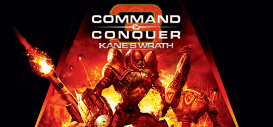
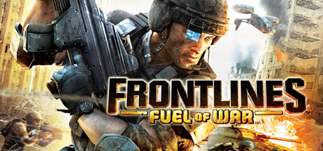
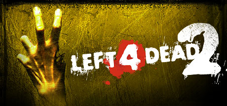

# Xbox 360 — 2008

[← All Xbox 360 years](../xbox-360.md) · [Full 2008 page](../../years/2008.md)

161 Xbox 360 titles in 2008.

### 1942: Joint Strike

**Platforms:** Xbox 360, PlayStation Network &nbsp;|&nbsp; **Released:** July 23

---

### Age of Booty

**Platforms:** Xbox 360 &nbsp;|&nbsp; **Released:** October 15

[Wikipedia](https://en.wikipedia.org/wiki/Age_of_Booty)

---

### Alone in the Dark

**Platforms:** PlayStation 2, Wii, Windows, Xbox 360 &nbsp;|&nbsp; **Genre:** Action, Adventure &nbsp;|&nbsp; **Released:** June 20

> Return to Derceto Manor in this reimagination of Alone in the Dark, a love letter to the 90’s cult classic horror game.
>
> _Synopsis source: Steam_

[Wikipedia](https://en.wikipedia.org/wiki/Alone_in_the_Dark_(2008_video_game)) · [Steam](https://store.steampowered.com/app/1310410)

---

### Armored Core: For Answer

**Platforms:** PlayStation 3, Xbox 360 &nbsp;|&nbsp; **Released:** September 16

---

### Army of Two

**Platforms:** PlayStation 3, Xbox 360 &nbsp;|&nbsp; **Released:** March 4

[Wikipedia](https://en.wikipedia.org/wiki/Army_of_Two)

---

### Avatar: The Last Airbender – Into the Inferno

**Platforms:** Nintendo DS, PlayStation 2, Wii, PlayStation 3, Xbox 360 &nbsp;|&nbsp; **Released:** October 13

---

### Banjo-Kazooie: Nuts & Bolts

**Platforms:** Xbox 360 &nbsp;|&nbsp; **Released:** November 11

---

### Battle Fantasia

**Platforms:** Xbox 360 &nbsp;|&nbsp; **Released:** September 16

[Wikipedia](https://en.wikipedia.org/wiki/Battle_Fantasia)

---

### Battlefield: Bad Company

**Platforms:** PlayStation 3, Xbox 360 &nbsp;|&nbsp; **Released:** June 23

---

### Beijing 2008

**Platforms:** PlayStation 3, Xbox 360 &nbsp;|&nbsp; **Released:** July 8

[Wikipedia](https://en.wikipedia.org/wiki/Beijing_2008_(video_game))

---

### Bionic Commando Rearmed

**Platforms:** Xbox 360, PlayStation 3, PlayStation Network, Windows &nbsp;|&nbsp; **Publisher:** Capcom &nbsp;|&nbsp; **Genre:** Action &nbsp;|&nbsp; **Released:** August 13, 2008

> Classic side-scrolling gameplay is reporting back for duty with Bionic Commando Rearmed, a remake of the classic NES game, out now on PC.20 years after the 8-bit classic was released, Bionic Commando Rearmed recreates the world of the original with a complete &quot;2.5D&quot; visual revamp.
>
> _Synopsis source: Steam_

[Wikipedia](https://en.wikipedia.org/wiki/Bionic_Commando_Rearmed) · [Steam](https://store.steampowered.com/app/21680)

---

### Bliss Island

**Platforms:** Xbox 360 &nbsp;|&nbsp; **Released:** March 12

[Wikipedia](https://en.wikipedia.org/wiki/Bliss_Island)

---

### Blitz: The League II

**Platforms:** PlayStation 3, Xbox 360 &nbsp;|&nbsp; **Released:** October 13

---

### Bolt

**Platforms:** Nintendo DS, PlayStation 2, PlayStation 3, Wii, Windows, Xbox 360 &nbsp;|&nbsp; **Genre:** Strategy &nbsp;|&nbsp; **Released:** November 18

> Step into the boots of a battlefield commander in Bolt Action, a turn-based WWII strategy inspired by Warlord Games’ tabletop classic.
>
> _Synopsis source: Steam_

[Wikipedia](https://en.wikipedia.org/wiki/Bolt_(video_game)) · [Steam](https://store.steampowered.com/app/3856030)

---

### Braid

**Platforms:** Xbox 360 &nbsp;|&nbsp; **Publisher:** Number None &nbsp;|&nbsp; **Released:** August 6, 2008

[Wikipedia](https://en.wikipedia.org/wiki/Braid_(video_game))

---

### Brothers in Arms: Hell's Highway

**Platforms:** PlayStation 3, Xbox 360, Windows &nbsp;|&nbsp; **Genre:** Action &nbsp;|&nbsp; **Released:** September 23

> Brothers in Arms Hell's Highway brings the critically acclaimed squad-based WWII shooter into the next generation of gaming with amazing graphics and sound, new cutting-edge gameplay features and a totally redesigned online component.
>
> _Synopsis source: Steam_

[Steam](https://store.steampowered.com/app/15390)

---

### Bully: Scholarship Edition

**Platforms:** Wii, Xbox 360, Windows &nbsp;|&nbsp; **Genre:** Action, Adventure &nbsp;|&nbsp; **Released:** March 3

> Bully tells the story of mischievous 15-year-old Jimmy Hopkins as he goes through the hilarity and awkwardness of adolescence. Beat the jocks at dodge ball, play pranks on the preppies, save the nerds, kiss the girl and navigate the social hierarchy in the worst school around.
>
> _Synopsis source: Steam_

[Wikipedia](https://en.wikipedia.org/wiki/Bully_(video_game)) · [Steam](https://store.steampowered.com/app/12200)

---

### Burnout Paradise

**Platforms:** Xbox 360, PlayStation 3 &nbsp;|&nbsp; **Publisher:** Electronic Arts &nbsp;|&nbsp; **Released:** January 22, 2008

[Wikipedia](https://en.wikipedia.org/wiki/Burnout_Paradise)

---

### Call of Duty: World at War

**Platforms:** Nintendo DS, PlayStation 3, Wii, Windows, Xbox 360, PlayStation 2 &nbsp;|&nbsp; **Genre:** Action &nbsp;|&nbsp; **Released:** November 11

> Call of Duty is back, redefining war like you've never experienced before. Building on the Call of Duty 4®: Modern Warfare engine, Call of Duty: World at War immerses players into the most gritty and chaotic WWII combat ever experienced.
>
> _Synopsis source: Steam_

[Steam](https://store.steampowered.com/app/10090)

---

### Castle Crashers

**Platforms:** Xbox 360 &nbsp;|&nbsp; **Released:** August 27

[Wikipedia](https://en.wikipedia.org/wiki/Castle_Crashers)

---

### Civilization Revolution

**Platforms:** PlayStation 3, Xbox 360, Nintendo DS &nbsp;|&nbsp; **Released:** June 13

[Wikipedia](https://en.wikipedia.org/wiki/Civilization_Revolution)

---

### Command & Conquer 3: Kane's Wrath

**Platforms:** Windows, Xbox 360 &nbsp;|&nbsp; **Genre:** Action, Strategy &nbsp;|&nbsp; **Released:** March 24

> In the name of Kane! The Command &amp; Conquer™ series continues to thrive with Command &amp; Conquer™ 3: Kane’s Wrath.
>
> _Synopsis source: Steam_

[Steam](https://store.steampowered.com/app/24810)

---

### Command & Conquer: Red Alert 3

**Platforms:** Windows, Xbox 360 &nbsp;|&nbsp; **Genre:** Action, Strategy &nbsp;|&nbsp; **Released:** October 28

> The desperate leadership of a doomed Soviet Union travels back in time to change history and restore the glory of Mother Russia.
>
> _Synopsis source: Steam_

[Steam](https://store.steampowered.com/app/17480)

---

### Condemned 2: Bloodshot

**Platforms:** Xbox 360, PlayStation 3 &nbsp;|&nbsp; **Released:** March 11

---

### Conflict: Denied Ops

**Platforms:** PlayStation 3, Windows, Xbox 360 &nbsp;|&nbsp; **Genre:** Action &nbsp;|&nbsp; **Released:** February 12

> *This is a single player only title*Venezuela is left in a state of civil war after the government was brutally overthrown by a military coup. With factions fighting to reinstate democracy, the U.S. government has offered their assistance, though the new government regime has threatened to deploy nuclear weapons if the U.S.
>
> _Synopsis source: Steam_

[Steam](https://store.steampowered.com/app/8100)

---

### Crash: Mind over Mutant

**Platforms:** PlayStation 2, Wii, Xbox 360, PlayStation Portable, Nintendo DS &nbsp;|&nbsp; **Released:** October 7

---

### Culdcept Saga

**Platforms:** Xbox 360 &nbsp;|&nbsp; **Released:** February 5

[Wikipedia](https://en.wikipedia.org/wiki/Culdcept_Saga)

---

### Dance Dance Revolution Universe 3

**Platforms:** Xbox 360 &nbsp;|&nbsp; **Released:** October 21

[Wikipedia](https://en.wikipedia.org/wiki/Dance_Dance_Revolution_Universe_3)

---

### Dark Messiah of Might and Magic

**Platforms:** Xbox 360 &nbsp;|&nbsp; **Released:** February 12

[Wikipedia](https://en.wikipedia.org/wiki/Dark_Messiah_of_Might_and_Magic)

---

### Dark Sector

**Platforms:** PlayStation 3, Xbox 360 &nbsp;|&nbsp; **Released:** March 28

[Wikipedia](https://en.wikipedia.org/wiki/Dark_Sector)

---

### Dash of Destruction

**Platforms:** Xbox 360 &nbsp;|&nbsp; **Released:** December 17

[Wikipedia](https://en.wikipedia.org/wiki/Dash_of_Destruction)

---

### Dead Space

**Platforms:** Xbox 360, PlayStation 3, Windows &nbsp;|&nbsp; **Publisher:** Electronic Arts &nbsp;|&nbsp; **Genre:** Action, Adventure &nbsp;|&nbsp; **Released:** October 13, 2008

> The sci-fi survival-horror classic returns, completely rebuilt to offer an even more immersive experience — including visual, audio, and gameplay improvements — while staying faithful to the original game’s thrilling vision.
>
> _Synopsis source: Steam_

[Wikipedia](https://en.wikipedia.org/wiki/Dead_Space_(video_game)) · [Steam](https://store.steampowered.com/app/1693980)

---

### Deadliest Catch: Alaskan Storm

**Platforms:** Xbox 360, Windows &nbsp;|&nbsp; **Released:** June 17

---

### Destroy All Humans! Path of the Furon

**Platforms:** Xbox 360 &nbsp;|&nbsp; **Released:** December 1

[Wikipedia](https://en.wikipedia.org/wiki/Destroy_All_Humans!_Path_of_the_Furon)

---

### Devil May Cry 4

**Platforms:** PlayStation 3, Xbox 360, Windows &nbsp;|&nbsp; **Released:** February 5

[Wikipedia](https://en.wikipedia.org/wiki/Devil_May_Cry_4)

---

### Di-Gata Defenders

**Platforms:** Nintendo DS, PlayStation 2, PlayStation 3, Wii, Xbox 360 &nbsp;|&nbsp; **Released:** September 22

[Wikipedia](https://en.wikipedia.org/wiki/Di-Gata_Defenders)

---

### Dinosaur King

**Platforms:** PlayStation 2, Nintendo DS, Wii, Xbox 360 &nbsp;|&nbsp; **Released:** September 23

[Wikipedia](https://en.wikipedia.org/wiki/Dinosaur_King_(video_game))

---

### Don King Presents: Prizefighter

**Platforms:** Xbox 360 &nbsp;|&nbsp; **Released:** June 10

---

### Double D Dodgeball

**Platforms:** Xbox 360 &nbsp;|&nbsp; **Released:** July 16

[Wikipedia](https://en.wikipedia.org/wiki/Double_D_Dodgeball)

---

### Dragon Ball Z: Burst Limit

**Platforms:** PlayStation 3, Xbox 360 &nbsp;|&nbsp; **Released:** June 5

---

### Duke Nukem 3D

**Platforms:** Xbox 360 &nbsp;|&nbsp; **Released:** September 24

[Wikipedia](https://en.wikipedia.org/wiki/Duke_Nukem_3D)

---

### Dynasty Warriors 6

**Platforms:** PlayStation 3, Xbox 360, Windows, PlayStation 2 &nbsp;|&nbsp; **Released:** February 19

[Wikipedia](https://en.wikipedia.org/wiki/Dynasty_Warriors_6)

---

### Dynasty Warriors: Gundam 2

**Platforms:** PlayStation 2, PlayStation 3, Xbox 360 &nbsp;|&nbsp; **Released:** December 18

---

### Elements of Destruction

**Platforms:** Xbox 360, Windows &nbsp;|&nbsp; **Released:** June 18

[Wikipedia](https://en.wikipedia.org/wiki/Elements_of_Destruction)

---

### Enemy Territory: Quake Wars

**Platforms:** macOS, PlayStation 3, Xbox 360 &nbsp;|&nbsp; **Released:** March 18

---

### Fable II

**Platforms:** Xbox 360 &nbsp;|&nbsp; **Publisher:** Microsoft Game Studios &nbsp;|&nbsp; **Released:** October 21, 2008

[Wikipedia](https://en.wikipedia.org/wiki/Fable_II)

---

### FaceBreaker

**Platforms:** PlayStation 3, Xbox 360, Wii &nbsp;|&nbsp; **Released:** September 5

[Wikipedia](https://en.wikipedia.org/wiki/FaceBreaker)

---

### Fallout 3

**Platforms:** Xbox 360, Windows, PlayStation 3 &nbsp;|&nbsp; **Publisher:** Bethesda Softworks &nbsp;|&nbsp; **Genre:** RPG &nbsp;|&nbsp; **Released:** October 28, 2008

> Vault-Tec engineers have worked around the clock on an interactive reproduction of Wasteland life for you to enjoy from the comfort of your own vault. Included is an expansive world, unique combat, shockingly realistic visuals, tons of player choice, and an incredible cast of dynamic characters.
>
> _Synopsis source: Steam_

[Wikipedia](https://en.wikipedia.org/wiki/Fallout_3) · [Steam](https://store.steampowered.com/app/22300)

---

### Far Cry 2

**Platforms:** PlayStation 3, Windows, Xbox 360 &nbsp;|&nbsp; **Genre:** Action &nbsp;|&nbsp; **Released:** October 21

> You are a gun for hire, trapped in a war-torn African state, stricken with malaria and forced to make deals with corrupt warlords on both sides of the conflict in order to make this country your home. You must identify and exploit your enemies' weaknesses, neutralizing their superior numbers and firepower with surprise, subversion,...
>
> _Synopsis source: Steam_

[Wikipedia](https://en.wikipedia.org/wiki/Far_Cry_2) · [Steam](https://store.steampowered.com/app/19900)

---

### FIFA 09

**Platforms:** Mobile phone, Nintendo DS, PlayStation 2, PlayStation 3, PlayStation Portable, Wii, Windows, Xbox 360 &nbsp;|&nbsp; **Released:** October 14

[Wikipedia](https://en.wikipedia.org/wiki/FIFA_09)

---

### FIFA Soccer 09

**Platforms:** Xbox 360 &nbsp;|&nbsp; **Publisher:** EA Sports &nbsp;|&nbsp; **Released:** October 13, 2008

[Wikipedia](https://en.wikipedia.org/wiki/FIFA_Soccer_09)

---

### Fracture

**Platforms:** PlayStation 3, Xbox 360 &nbsp;|&nbsp; **Released:** October 7

[Wikipedia](https://en.wikipedia.org/wiki/Fracture_(video_game))

---

### Frogger 2

**Platforms:** Xbox 360 &nbsp;|&nbsp; **Released:** June 11

[Wikipedia](https://en.wikipedia.org/wiki/Frogger_2_(Xbox_Live_Arcade))

---

### Frontlines: Fuel of War

**Platforms:** Windows, Xbox 360 &nbsp;|&nbsp; **Genre:** Action &nbsp;|&nbsp; **Released:** February 25

> Frontlines™: Fuel of War™ is an open-world First Person Shooter set on the frontlines of tomorrow. In a world ravaged by a global energy crisis, environmental decay, and economic depression, players assume the role of an elite soldier in the Western Coalition Army on an epic crusade against the Red Star Alliance to control the last of...
>
> _Synopsis source: Steam_

[Steam](https://store.steampowered.com/app/9460)

---

### Gears of War 2

**Platforms:** Xbox 360 &nbsp;|&nbsp; **Publisher:** Microsoft Game Studios &nbsp;|&nbsp; **Released:** November 7, 2008

[Wikipedia](https://en.wikipedia.org/wiki/Gears_of_War_2)

---

### Geometry Wars: Retro Evolved 2

**Platforms:** Xbox 360 &nbsp;|&nbsp; **Publisher:** Microsoft Game Studios &nbsp;|&nbsp; **Released:** July 30, 2008

---

### Go! Go! Break Steady

**Platforms:** Xbox 360 &nbsp;|&nbsp; **Released:** July 23

[Wikipedia](https://en.wikipedia.org/wiki/Go!_Go!_Break_Steady)

---

### Golden Axe: Beast Rider

**Platforms:** PlayStation 3, Xbox 360 &nbsp;|&nbsp; **Released:** October 14

---

### Grand Theft Auto IV

**Platforms:** PlayStation 3, Xbox 360, Windows &nbsp;|&nbsp; **Publisher:** Rockstar Games &nbsp;|&nbsp; **Released:** April 29, 2008

[Wikipedia](https://en.wikipedia.org/wiki/Grand_Theft_Auto_IV)

---

### Guilty Gear 2: Overture

**Platforms:** Xbox 360 &nbsp;|&nbsp; **Released:** October 7

---

### Guitar Hero III: Legends of Rock

**Platforms:** Xbox 360 &nbsp;|&nbsp; **Released:** July 24

---

### Guitar Hero World Tour

**Platforms:** macOS, PlayStation 2, PlayStation 3, Wii, Windows, Xbox 360 &nbsp;|&nbsp; **Released:** October 26

[Wikipedia](https://en.wikipedia.org/wiki/Guitar_Hero_World_Tour)

---

### Guitar Hero: Aerosmith

**Platforms:** PlayStation 2, PlayStation 3, Wii, Xbox 360 &nbsp;|&nbsp; **Released:** June 29

---

### Happy Tree Friends: False Alarm

**Platforms:** Xbox 360, Windows &nbsp;|&nbsp; **Released:** June 25

---

### Hell's Kitchen: The Game

**Platforms:** Nintendo DS, PlayStation 2, Wii, Xbox 360 &nbsp;|&nbsp; **Released:** September 9

---

### Hellboy: The Science of Evil

**Platforms:** PlayStation 3, PlayStation Portable, Xbox 360 &nbsp;|&nbsp; **Released:** June 24

---

### Ikaruga

**Platforms:** Xbox 360 &nbsp;|&nbsp; **Released:** April 9

[Wikipedia](https://en.wikipedia.org/wiki/Ikaruga)

---

### Infinite Undiscovery

**Platforms:** Xbox 360 &nbsp;|&nbsp; **Released:** September 2

[Wikipedia](https://en.wikipedia.org/wiki/Infinite_Undiscovery)

---

### Iron Man

**Platforms:** Nintendo DS, PlayStation 2, PlayStation 3, PlayStation Portable, Wii, Windows, Xbox 360 &nbsp;|&nbsp; **Released:** May 2

[Wikipedia](https://en.wikipedia.org/wiki/Iron_Man_(video_game))

---

### Janline

**Platforms:** Xbox 360 &nbsp;|&nbsp; **Released:** September 25

[Wikipedia](https://en.wikipedia.org/wiki/Janline)

---

### Jumper: Griffin's Story

**Platforms:** PlayStation 2, PlayStation 3, Wii, Xbox 360 &nbsp;|&nbsp; **Released:** February 12

---

### Kingdom Under Fire: Circle of Doom

**Platforms:** Xbox 360 &nbsp;|&nbsp; **Released:** January 8

---

### Kung Fu Panda

**Platforms:** Nintendo DS, PlayStation 2, PlayStation 3, Wii, Windows, Xbox 360 &nbsp;|&nbsp; **Released:** June 3

[Wikipedia](https://en.wikipedia.org/wiki/Kung_Fu_Panda_(video_game))

---

### Left 4 Dead

**Platforms:** Xbox 360, Windows &nbsp;|&nbsp; **Publisher:** Valve &nbsp;|&nbsp; **Genre:** Action &nbsp;|&nbsp; **Released:** November 18, 2008

> Set in the zombie apocalypse, Left 4 Dead 2 is a co-operative action horror FPS takes you and your friends through the cities, swamps and cemeteries of the Deep South, from Savannah to New Orleans across five expansive campaigns.
>
> _Synopsis source: Steam_

[Wikipedia](https://en.wikipedia.org/wiki/Left_4_Dead) · [Steam](https://store.steampowered.com/app/550)

---

### Legendary

**Platforms:** PlayStation 3, Windows, Xbox 360 &nbsp;|&nbsp; **Released:** November 4

[Wikipedia](https://en.wikipedia.org/wiki/Legendary_(video_game))

---

### Lego Batman: The Videogame

**Platforms:** Nintendo DS, PlayStation 2, PlayStation 3, PlayStation Portable, Wii, Windows, Xbox 360 &nbsp;|&nbsp; **Genre:** Action, Adventure &nbsp;|&nbsp; **Released:** September 23

> When all the villains in Arkham Asylum team up and break loose, only the dynamic duo is bold enough to take them on to save Gotham City. The fun of LEGO, the drama of Batman and the uniqueness of the combination makes for a comical and exciting adventure in LEGO Batman: The Videogame.
>
> _Synopsis source: Steam_

[Steam](https://store.steampowered.com/app/21000)

---

### Lego Indiana Jones: The Original Adventures

**Platforms:** Nintendo DS, PlayStation 2, PlayStation 3, PlayStation Portable, Wii, Windows, Xbox, Xbox 360 &nbsp;|&nbsp; **Genre:** Action, Adventure &nbsp;|&nbsp; **Released:** June 3

> Build, Battle and Brawl your way out of trouble! Play through all three classic Indiana Jones™ movies and relive your favorite Indy adventures in the tongue-in-cheek worlds of LEGO®. Explore and Discover - Battle enemies, solve puzzles, and seek out the world's greatest treasures.
>
> _Synopsis source: Steam_

[Steam](https://store.steampowered.com/app/32330)

---

### Lost Odyssey

**Platforms:** Xbox 360 &nbsp;|&nbsp; **Released:** February 12

[Wikipedia](https://en.wikipedia.org/wiki/Lost_Odyssey)

---

### Lost: Via Domus

**Platforms:** PlayStation 3, Windows, Xbox 360 &nbsp;|&nbsp; **Released:** February 26

---

### Madagascar: Escape 2 Africa

**Platforms:** PlayStation 3, PlayStation 2, Xbox 360, Windows, Wii, Nintendo DS &nbsp;|&nbsp; **Released:** November 4

---

### Madden NFL 09

**Platforms:** Nintendo DS, PlayStation 2, PlayStation 3, PlayStation Portable, Wii, Xbox 360, Xbox &nbsp;|&nbsp; **Released:** August 13

[Wikipedia](https://en.wikipedia.org/wiki/Madden_NFL_09)

---

### Major League Baseball 2K8

**Platforms:** PlayStation 2, PlayStation 3, PlayStation Portable, Wii, Xbox 360 &nbsp;|&nbsp; **Released:** March 3

[Wikipedia](https://en.wikipedia.org/wiki/Major_League_Baseball_2K8)

---

### Mega Man 9

**Platforms:** Wii, PlayStation Network, Xbox 360 &nbsp;|&nbsp; **Released:** September 22

[Wikipedia](https://en.wikipedia.org/wiki/Mega_Man_9)

---

### Mercenaries 2: World in Flames

**Platforms:** PlayStation 2, PlayStation 3, Windows, Xbox 360 &nbsp;|&nbsp; **Released:** August 31

---

### Metal Arms: Glitch in the System

**Platforms:** Xbox 360 &nbsp;|&nbsp; **Released:** April 21

---

### Metal Slug 3

**Platforms:** Xbox 360 &nbsp;|&nbsp; **Released:** January 2

[Wikipedia](https://en.wikipedia.org/wiki/Metal_Slug_3)

---

### Meteos

**Platforms:** Xbox 360 &nbsp;|&nbsp; **Released:** December 10

[Wikipedia](https://en.wikipedia.org/wiki/Meteos)

---

### Midnight Club: Los Angeles

**Platforms:** PlayStation 3, Xbox 360, PlayStation Portable &nbsp;|&nbsp; **Released:** October 20

---

### Mirror's Edge

**Platforms:** PlayStation 3, Xbox 360 &nbsp;|&nbsp; **Released:** November 11

[Wikipedia](https://en.wikipedia.org/wiki/Mirror%27s_Edge)

---

### MLB Stickball

**Platforms:** Xbox 360 &nbsp;|&nbsp; **Released:** October 8

[Wikipedia](https://en.wikipedia.org/wiki/MLB_Stickball)

---

### Mortal Kombat vs. DC Universe

**Platforms:** PlayStation 3, Xbox 360 &nbsp;|&nbsp; **Released:** November 16

[Wikipedia](https://en.wikipedia.org/wiki/Mortal_Kombat_vs._DC_Universe)

---

### Mr. Driller Online

**Platforms:** Xbox 360 &nbsp;|&nbsp; **Released:** April 2

[Wikipedia](https://en.wikipedia.org/wiki/Mr._Driller_Online)

---

### N+

**Platforms:** Xbox 360, Nintendo DS, PlayStation Portable &nbsp;|&nbsp; **Released:** February 20

[Wikipedia](https://en.wikipedia.org/wiki/N%2B)

---

### Namco Museum Virtual Arcade

**Platforms:** Xbox 360 &nbsp;|&nbsp; **Released:** November 4

[Wikipedia](https://en.wikipedia.org/wiki/Namco_Museum_Virtual_Arcade)

---

### Naruto: The Broken Bond

**Platforms:** Xbox 360 &nbsp;|&nbsp; **Released:** November 18

---

### NASCAR 09

**Platforms:** PlayStation 2, PlayStation 3, Xbox 360 &nbsp;|&nbsp; **Released:** June 10

[Wikipedia](https://en.wikipedia.org/wiki/NASCAR_09)

---

### NBA 2K9

**Platforms:** PlayStation 2, PlayStation 3, Wii, Xbox 360, Windows &nbsp;|&nbsp; **Released:** October 7

[Wikipedia](https://en.wikipedia.org/wiki/NBA_2K9)

---

### NBA Live 09

**Platforms:** PlayStation 2, PlayStation 3, PlayStation Portable, Wii, Xbox 360 &nbsp;|&nbsp; **Released:** October 7

[Wikipedia](https://en.wikipedia.org/wiki/NBA_Live_09)

---

### NCAA Football 09

**Platforms:** PlayStation 2, PlayStation 3, PlayStation Portable, Wii, Xbox 360 &nbsp;|&nbsp; **Released:** July 15

[Wikipedia](https://en.wikipedia.org/wiki/NCAA_Football_09)

---

### Need for Speed: Undercover

**Platforms:** Mobile phone, PlayStation 2, PlayStation 3, PlayStation Portable, Wii, Windows, Xbox 360 &nbsp;|&nbsp; **Released:** November 18

---

### NHL 09

**Platforms:** Xbox 360, PlayStation 3, Wii, Windows &nbsp;|&nbsp; **Publisher:** EA Sports &nbsp;|&nbsp; **Released:** September 9, 2008

[Wikipedia](https://en.wikipedia.org/wiki/NHL_09)

---

### NHL 2K9

**Platforms:** PlayStation 2, PlayStation 3, Wii, Xbox 360 &nbsp;|&nbsp; **Released:** September 8

[Wikipedia](https://en.wikipedia.org/wiki/NHL_2K9)

---

### Ninja Gaiden II

**Platforms:** Xbox 360 &nbsp;|&nbsp; **Released:** June 3

[Wikipedia](https://en.wikipedia.org/wiki/Ninja_Gaiden_II_(2008_video_game))

---

### Omega Five

**Platforms:** Xbox 360 &nbsp;|&nbsp; **Released:** January 9

[Wikipedia](https://en.wikipedia.org/wiki/Omega_Five)

---

### Penny Arcade Adventures: On the Rain-Slick Precipice of Darkness

**Platforms:** Linux, macOS, Windows, Xbox 360 &nbsp;|&nbsp; **Released:** May 21

---

### Penny Arcade Adventures: On the Rain-Slick Precipice of Darkness – Episode 2

**Platforms:** Linux, macOS, Windows, Xbox 360 &nbsp;|&nbsp; **Released:** October 29

---

### Portal: Still Alive

**Platforms:** Xbox 360 &nbsp;|&nbsp; **Publisher:** Valve &nbsp;|&nbsp; **Released:** October 22, 2008

[Wikipedia](https://en.wikipedia.org/wiki/Portal_(video_game)#Release)

---

### PowerUp Forever

**Platforms:** Xbox 360, PlayStation Network &nbsp;|&nbsp; **Released:** December 10

[Wikipedia](https://en.wikipedia.org/wiki/PowerUp_Forever)

---

### Prince of Persia

**Platforms:** PlayStation 3, Xbox 360, Windows &nbsp;|&nbsp; **Genre:** Action, Adventure &nbsp;|&nbsp; **Released:** December 2

> The critically acclaimed Prince of Persia® franchise returns for the first time on next-generation platforms with an all-new epic journey. Built by the same award-winning Ubisoft Montreal studio that created Assassin's Creed™, Prince of Persia has been in development for over three years to deliver a whole new action-adventure gaming...
>
> _Synopsis source: Steam_

[Wikipedia](https://en.wikipedia.org/wiki/Prince_of_Persia_(2008_video_game)) · [Steam](https://store.steampowered.com/app/19980)

---

### Pro Evolution Soccer 2009

**Platforms:** PlayStation 2, PlayStation 3, PlayStation Portable, Wii, Windows, Xbox 360 &nbsp;|&nbsp; **Released:** November 12

[Wikipedia](https://en.wikipedia.org/wiki/Pro_Evolution_Soccer_2009)

---

### Pure

**Platforms:** PlayStation 3, Xbox 360, Windows &nbsp;|&nbsp; **Released:** September 16

[Wikipedia](https://en.wikipedia.org/wiki/Pure_(video_game))

---

### Race Driver: Grid

**Platforms:** Windows, PlayStation 3, Xbox 360, Nintendo DS &nbsp;|&nbsp; **Publisher:** Codemasters &nbsp;|&nbsp; **Released:** May 30, 2008

---

### Rapala Fishing Frenzy 2009

**Platforms:** PlayStation 3, Wii, Xbox 360 &nbsp;|&nbsp; **Released:** September 2

[Wikipedia](https://en.wikipedia.org/wiki/Rapala_Fishing_Frenzy_2009)

---

### Rez HD

**Platforms:** Xbox 360 &nbsp;|&nbsp; **Publisher:** Microsoft Game Studios &nbsp;|&nbsp; **Released:** January 30, 2008

[Wikipedia](https://en.wikipedia.org/wiki/Rez_(video_game))

---

### Rise of the Argonauts

**Platforms:** PlayStation 3, Windows, Xbox 360 &nbsp;|&nbsp; **Released:** December 18

[Wikipedia](https://en.wikipedia.org/wiki/Rise_of_the_Argonauts)

---

### Robert Ludlum's The Bourne Conspiracy

**Platforms:** PlayStation 3, Xbox 360 &nbsp;|&nbsp; **Released:** June 3

[Wikipedia](https://en.wikipedia.org/wiki/Robert_Ludlum%27s_The_Bourne_Conspiracy)

---

### Rock Band 2

**Platforms:** Xbox 360, Wii, PlayStation 3 &nbsp;|&nbsp; **Publisher:** MTV Games &nbsp;|&nbsp; **Released:** September 14, 2008

[Wikipedia](https://en.wikipedia.org/wiki/Rock_Band_2)

---

### Rock Revolution

**Platforms:** Nintendo DS, PlayStation 3, Wii, Xbox 360 &nbsp;|&nbsp; **Released:** October 14

[Wikipedia](https://en.wikipedia.org/wiki/Rock_Revolution)

---

### Rocketmen: Axis of Evil

**Platforms:** Xbox 360, PlayStation Network &nbsp;|&nbsp; **Released:** March 5

---

### Roogoo

**Platforms:** Xbox 360 &nbsp;|&nbsp; **Released:** June 4

[Wikipedia](https://en.wikipedia.org/wiki/Roogoo)

---

### Saints Row 2

**Platforms:** PlayStation 3, Xbox 360 &nbsp;|&nbsp; **Released:** October 14

[Wikipedia](https://en.wikipedia.org/wiki/Saints_Row_2)

---

### Sega Superstars Tennis

**Platforms:** Nintendo DS, PlayStation 2, PlayStation 3, Wii, Xbox 360 &nbsp;|&nbsp; **Released:** March 18

[Wikipedia](https://en.wikipedia.org/wiki/Sega_Superstars_Tennis)

---

### Shaun White Snowboarding

**Platforms:** PlayStation 3, Wii, Windows, Xbox 360 &nbsp;|&nbsp; **Released:** November 16

[Wikipedia](https://en.wikipedia.org/wiki/Shaun_White_Snowboarding)

---

### Shred Nebula

**Platforms:** Xbox 360 &nbsp;|&nbsp; **Released:** September 3

[Wikipedia](https://en.wikipedia.org/wiki/Shred_Nebula)

---

### Silent Hill: Homecoming

**Platforms:** PlayStation 3, Windows, Xbox 360 &nbsp;|&nbsp; **Released:** September 30

---

### Sonic Unleashed

**Platforms:** PlayStation 2, PlayStation 3, Wii, Xbox 360 &nbsp;|&nbsp; **Released:** November 18

[Wikipedia](https://en.wikipedia.org/wiki/Sonic_Unleashed)

---

### Soulcalibur IV

**Platforms:** PlayStation 3, Xbox 360 &nbsp;|&nbsp; **Released:** July 29

[Wikipedia](https://en.wikipedia.org/wiki/Soulcalibur_IV)

---

### Space Chimps

**Platforms:** Nintendo DS, PlayStation 2, Wii, Windows, Xbox 360 &nbsp;|&nbsp; **Released:** July 15

[Wikipedia](https://en.wikipedia.org/wiki/Space_Chimps_(video_game))

---

### Spectral Force 3: Innocent Rage

**Platforms:** Xbox 360 &nbsp;|&nbsp; **Released:** July 29

---

### Spider-Man: Web of Shadows

**Platforms:** Nintendo DS, PlayStation 2, PlayStation 3, PlayStation Portable, Wii, Windows, Xbox 360 &nbsp;|&nbsp; **Released:** October 21

---

### SpongeBob SquarePants Featuring Nicktoons: Globs of Doom

**Platforms:** PlayStation 2, Wii, Nintendo DS, PlayStation 3, PlayStation Portable, Xbox 360 &nbsp;|&nbsp; **Released:** October 20

---

### Super Street Fighter II Turbo HD Remix

**Platforms:** Xbox 360, PlayStation 3 &nbsp;|&nbsp; **Publisher:** Capcom &nbsp;|&nbsp; **Released:** November 26, 2008

[Wikipedia](https://en.wikipedia.org/wiki/Super_Street_Fighter_II_Turbo_HD_Remix)

---

### Supreme Commander

**Platforms:** Xbox 360 &nbsp;|&nbsp; **Released:** April 8

[Wikipedia](https://en.wikipedia.org/wiki/Supreme_Commander_(game))

---

### Tales of Vesperia

**Platforms:** Xbox 360 &nbsp;|&nbsp; **Released:** August 7

[Wikipedia](https://en.wikipedia.org/wiki/Tales_of_Vesperia)

---

### The Chronicles of Narnia: Prince Caspian

**Platforms:** Nintendo DS, PlayStation 2, PlayStation 3, PlayStation Portable, Wii, Windows, Xbox 360 &nbsp;|&nbsp; **Released:** May 13

---

### The Club

**Platforms:** PlayStation 3, Windows, Xbox 360 &nbsp;|&nbsp; **Genre:** Action &nbsp;|&nbsp; **Released:** February 7

> The Club™, created by critically acclaimed developer Bizarre Creations, is a new breed of third-person shooter, combining fast-paced run and gun gameplay, destructive environments, and lethal weapons. You will fight to survive in a shadowy underground blood-sport controlled by a faceless, obscenely wealthy and influential elite who place...
>
> _Synopsis source: Steam_

[Wikipedia](https://en.wikipedia.org/wiki/The_Club_(video_game)) · [Steam](https://store.steampowered.com/app/10460)

---

### The Idolmaster Live For You!

**Platforms:** Xbox 360 &nbsp;|&nbsp; **Released:** February 28

[Wikipedia](https://en.wikipedia.org/wiki/The_Idolmaster_Live_For_You!)

---

### The Incredible Hulk

**Platforms:** Nintendo DS, PlayStation 2, PlayStation 3, Wii, Xbox 360, Windows &nbsp;|&nbsp; **Released:** June 5

[Wikipedia](https://en.wikipedia.org/wiki/The_Incredible_Hulk_(2008_video_game))

---

### The Last Remnant

**Platforms:** Xbox 360 &nbsp;|&nbsp; **Released:** November 20

[Wikipedia](https://en.wikipedia.org/wiki/The_Last_Remnant)

---

### The Legend of Spyro: Dawn of the Dragon

**Platforms:** Nintendo DS, PlayStation 2, PlayStation 3, Wii, Xbox 360 &nbsp;|&nbsp; **Released:** October 21

---

### The Mummy: Tomb of the Dragon Emperor

**Platforms:** Nintendo DS, PlayStation 2, PlayStation 3, Wii, Xbox 360 &nbsp;|&nbsp; **Released:** July 22

---

### Tiger Woods PGA Tour 09

**Platforms:** PlayStation 2, PlayStation 3, PlayStation Portable, Wii, Xbox 360 &nbsp;|&nbsp; **Released:** August 26

[Wikipedia](https://en.wikipedia.org/wiki/Tiger_Woods_PGA_Tour_09)

---

### TNA iMPACT!

**Platforms:** PlayStation 2, PlayStation 3, Wii, Xbox 360 &nbsp;|&nbsp; **Released:** September 9

[Wikipedia](https://en.wikipedia.org/wiki/TNA_Impact!_(video_game))

---

### Tom Clancy's EndWar

**Platforms:** Nintendo DS, PlayStation 3, PlayStation Portable, Xbox 360 &nbsp;|&nbsp; **Released:** November 4

[Wikipedia](https://en.wikipedia.org/wiki/Tom_Clancy%27s_EndWar)

---

### Tom Clancy's Rainbow Six: Vegas 2

**Platforms:** PlayStation 3, Windows, Xbox 360 &nbsp;|&nbsp; **Genre:** Action &nbsp;|&nbsp; **Released:** March 18

> Tom Clancy's Rainbow Six® Vegas 2 - the sequel to the award-winning next-generation first-person shooter - returns to Sin City. Tom Clancy's Rainbow Six Vegas 2 is your last chance to rescue America's sexiest city from an escalating terrorist siege that will force you into heart-pounding action from beginning to end.
>
> _Synopsis source: Steam_

[Steam](https://store.steampowered.com/app/15120)

---

### Tomb Raider: Underworld

**Platforms:** Nintendo DS, PlayStation 2, PlayStation 3, Wii, Windows, Xbox 360 &nbsp;|&nbsp; **Genre:** Action, Adventure &nbsp;|&nbsp; **Released:** November 18

> Tomb Raider: Underworld represents a new advancement in exploration-based gameplay. As fearless adventurer Lara Croft explore exotic locations around the world, each designed with an incredible attention to detail resulting in breathtaking high-definition visual fidelity that creates a truly believable world and delivers a new level of...
>
> _Synopsis source: Steam_

[Steam](https://store.steampowered.com/app/8140)

---

### Too Human

**Platforms:** Xbox 360 &nbsp;|&nbsp; **Released:** August 19

[Wikipedia](https://en.wikipedia.org/wiki/Too_Human)

---

### Top Spin 3

**Platforms:** PlayStation 3, Wii, Xbox 360, Nintendo DS &nbsp;|&nbsp; **Released:** June 20

[Wikipedia](https://en.wikipedia.org/wiki/Top_Spin_3)

---

### Triggerheart Exelica

**Platforms:** Xbox 360 &nbsp;|&nbsp; **Released:** February 27

[Wikipedia](https://en.wikipedia.org/wiki/Triggerheart_Exelica)

---

### Turning Point: Fall of Liberty

**Platforms:** PlayStation 3, Windows, Xbox 360 &nbsp;|&nbsp; **Released:** February 26

---

### Turok

**Platforms:** PlayStation 3, Xbox 360, Windows &nbsp;|&nbsp; **Genre:** Action, Adventure &nbsp;|&nbsp; **Released:** February 5

> Play as the legendary Turok warriors to face off against ferocious dinosaurs and a terrifying alien threat that seeks to destroy all human life across the galaxy.
>
> _Synopsis source: Steam_

[Wikipedia](https://en.wikipedia.org/wiki/Turok_(2008_video_game)) · [Steam](https://store.steampowered.com/app/1967610)

---

### Universe at War: Earth Assault

**Platforms:** Xbox 360 &nbsp;|&nbsp; **Released:** February 26

---

### Unreal Tournament 3

**Platforms:** Xbox 360 &nbsp;|&nbsp; **Released:** July 3

[Wikipedia](https://en.wikipedia.org/wiki/Unreal_Tournament_3)

---

### Viking: Battle for Asgard

**Platforms:** PlayStation 3, Xbox 360 &nbsp;|&nbsp; **Released:** March 25

---

### Viva Piñata: Trouble in Paradise

**Platforms:** Xbox 360 &nbsp;|&nbsp; **Released:** September 2

---

### WALL-E

**Platforms:** Nintendo DS, PlayStation 2, PlayStation 3, PlayStation Portable, Wii, Windows, Xbox 360 &nbsp;|&nbsp; **Released:** June 24

[Wikipedia](https://en.wikipedia.org/wiki/WALL-E_(video_game))

---

### Weapon of Choice

**Platforms:** Xbox 360 &nbsp;|&nbsp; **Released:** November 19

[Wikipedia](https://en.wikipedia.org/wiki/Weapon_of_Choice_(video_game))

---

### Winter Sports 2: The Next Challenge

**Platforms:** Nintendo DS, PlayStation 2, Wii, Xbox 360 &nbsp;|&nbsp; **Released:** November 25

---

### WWE SmackDown vs. Raw 2009

**Platforms:** Mobile phone, Nintendo DS, PlayStation 2, PlayStation 3, PlayStation Portable, Wii, Xbox 360 &nbsp;|&nbsp; **Released:** November 11

[Wikipedia](https://en.wikipedia.org/wiki/WWE_SmackDown_vs._Raw_2009)

---

### You're in the Movies

**Platforms:** Xbox 360 &nbsp;|&nbsp; **Released:** November 18

[Wikipedia](https://en.wikipedia.org/wiki/You%27re_in_the_Movies)

---

### Zoids Assault

**Platforms:** Xbox 360 &nbsp;|&nbsp; **Released:** September 9

[Wikipedia](https://en.wikipedia.org/wiki/Zoids_Assault)

---
