# Xbox 360 — 2010

[← All Xbox 360 years](../xbox-360.md) · [Full 2010 page](../../years/2010.md)

187 Xbox 360 titles in 2010.

### 2010 FIFA World Cup South Africa

**Platforms:** PlayStation 3, Xbox 360, Wii, PlayStation Portable, iOS &nbsp;|&nbsp; **Released:** April 27

[Wikipedia](https://en.wikipedia.org/wiki/2010_FIFA_World_Cup_South_Africa_(video_game))

---

### A World of Keflings

**Platforms:** Xbox 360 &nbsp;|&nbsp; **Released:** December 22

[Wikipedia](https://en.wikipedia.org/wiki/A_World_of_Keflings)

---

### Adrenaline Misfits

**Platforms:** Xbox 360 &nbsp;|&nbsp; **Released:** November 4

---

### Alan Wake

**Platforms:** Xbox 360 &nbsp;|&nbsp; **Released:** May 18

[Wikipedia](https://en.wikipedia.org/wiki/Alan_Wake)

---

### Alien Breed 2: Assault

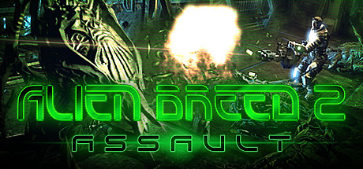

**Platforms:** Xbox 360, Windows, PlayStation 3 &nbsp;|&nbsp; **Genre:** Action &nbsp;|&nbsp; **Released:** September 22

> Can you survive the alien onslaught? Gamers across the world will now have a chance to play the next chapter in this high-budget, high-quality series.
>
> _Synopsis source: Steam_

[Steam](https://store.steampowered.com/app/22650)

---

### Alien Breed 3: Descent

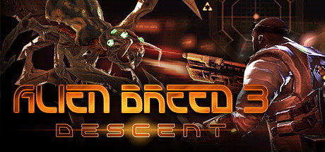

**Platforms:** PlayStation Network, Windows, Xbox 360 &nbsp;|&nbsp; **Genre:** Action &nbsp;|&nbsp; **Released:** November 17

> Experience the final explosive chapter in the Alien Breed series and uncover the horrifying truth surrounding the existence of the Breed. Launch discount good thru Nov. 24 10am PST.
>
> _Synopsis source: Steam_

[Steam](https://store.steampowered.com/app/22670)

---

### Aliens vs. Predator

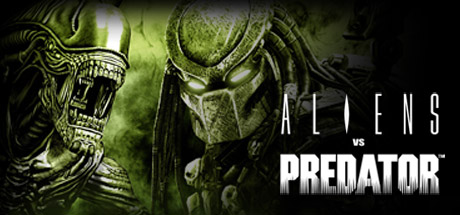

**Platforms:** Windows, Xbox 360, PlayStation 3 &nbsp;|&nbsp; **Genre:** Action &nbsp;|&nbsp; **Released:** February 16

> Survive, hunt and prey in the deadly jungles and swamps in distinctly new and thrilling first person gameplay.
>
> _Synopsis source: Steam_

[Wikipedia](https://en.wikipedia.org/wiki/Aliens_vs._Predator_(2010_video_game)) · [Steam](https://store.steampowered.com/app/10680)

---

### Alpha Protocol

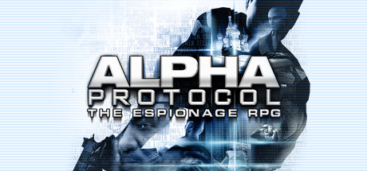

**Platforms:** Windows, Xbox 360, PlayStation 3 &nbsp;|&nbsp; **Genre:** Action, RPG &nbsp;|&nbsp; **Released:** June 1

> Loyalty carries a price and no one knows this more than agent Michael Thorton. A talented young agent cast out by his government, Thorton is the only one with the information needed to stop an impending international catastrophe.
>
> _Synopsis source: Steam_

[Wikipedia](https://en.wikipedia.org/wiki/Alpha_Protocol) · [Steam](https://store.steampowered.com/app/34010)

---

### Apache: Air Assault

**Platforms:** PlayStation 3, Windows, Xbox 360 &nbsp;|&nbsp; **Released:** November 16

---

### Aqua – Naval Warfare

**Platforms:** Xbox 360 &nbsp;|&nbsp; **Released:** May 19

[Wikipedia](https://en.wikipedia.org/wiki/Aqua_(video_game))

---

### Arcania: Gothic 4

**Platforms:** Windows, Xbox 360 &nbsp;|&nbsp; **Released:** October 12

---

### Army of Two: The 40th Day

**Platforms:** PlayStation 3, Xbox 360, PlayStation Portable &nbsp;|&nbsp; **Genre:** TPS &nbsp;|&nbsp; **Released:** January 12

---

### Assassin's Creed: Brotherhood

**Platforms:** Xbox 360, PlayStation 3 &nbsp;|&nbsp; **Publisher:** Ubisoft &nbsp;|&nbsp; **Released:** November 16, 2010

---

### Attack of the Movies 3D

**Platforms:** Wii, Xbox 360 &nbsp;|&nbsp; **Released:** May 18

[Wikipedia](https://en.wikipedia.org/wiki/Attack_of_the_Movies_3D)

---

### Backbreaker

**Platforms:** Xbox 360, PlayStation 3 &nbsp;|&nbsp; **Released:** June 1

[Wikipedia](https://en.wikipedia.org/wiki/Backbreaker_(video_game))

---

### Backyard Sports: Rookie Rush

**Platforms:** Nintendo DS, Wii, Windows, Xbox 360 &nbsp;|&nbsp; **Released:** October 26

---

### Bakugan: Defenders of the Core

**Platforms:** Nintendo DS, PlayStation 3, PlayStation Portable, Wii, Xbox 360 &nbsp;|&nbsp; **Released:** October 19

---

### Battlefield Bad Company 2: Vietnam

**Platforms:** Xbox 360, PlayStation 3, Windows &nbsp;|&nbsp; **Released:** December 11

---

### Battlefield: Bad Company 2

**Platforms:** Windows, Xbox 360, PlayStation 3, iOS &nbsp;|&nbsp; **Released:** March 2

---

### Bayonetta

**Platforms:** PlayStation 3, Xbox 360 &nbsp;|&nbsp; **Genre:** Action-adventure, Hack and slash &nbsp;|&nbsp; **Released:** January 5

[Wikipedia](https://en.wikipedia.org/wiki/Bayonetta_(video_game))

---

### Ben 10 Alien Force: The Rise of Hex

**Platforms:** Xbox 360, Wii &nbsp;|&nbsp; **Released:** May 26

---

### Ben 10 Ultimate Alien: Cosmic Destruction

**Platforms:** Xbox 360, Wii, Nintendo DS, PlayStation 2, PlayStation 3, PlayStation Portable &nbsp;|&nbsp; **Released:** October 5

---

### BioShock 2

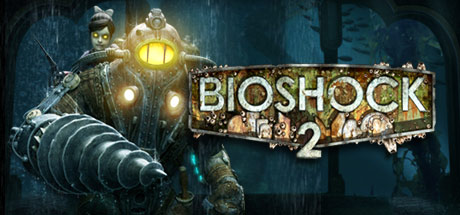

**Platforms:** Windows, Xbox 360, PlayStation 3 &nbsp;|&nbsp; **Genre:** Action &nbsp;|&nbsp; **Released:** February 9

> Set approximately 10 years after the events of the original BioShock, the halls of Rapture once again echo with sins of the past. Along the Atlantic coastline, a monster has been snatching little girls and bringing them back to the undersea city of Rapture.
>
> _Synopsis source: Steam_

[Wikipedia](https://en.wikipedia.org/wiki/BioShock_2) · [Steam](https://store.steampowered.com/app/8850)

---

### Blacklight: Tango Down

**Platforms:** Xbox 360, Windows, PlayStation Network &nbsp;|&nbsp; **Released:** July 7

---

### Blade Kitten

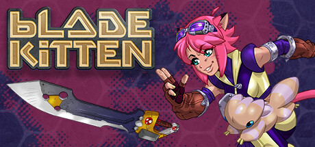

**Platforms:** PlayStation Network, Windows, Xbox 360 &nbsp;|&nbsp; **Genre:** Action, Adventure &nbsp;|&nbsp; **Released:** September 22

> In Blade Kitten, join Kit Ballard as she explores the mysterious world of Hollow Wish to hunt down rogue mechs and soft targets.
>
> _Synopsis source: Steam_

[Wikipedia](https://en.wikipedia.org/wiki/Blade_Kitten) · [Steam](https://store.steampowered.com/app/9940)

---

### BlazBlue: Continuum Shift

**Platforms:** PlayStation 3, Xbox 360 &nbsp;|&nbsp; **Released:** July 27

---

### Blood Drive

**Platforms:** PlayStation 3, Xbox 360 &nbsp;|&nbsp; **Released:** November 2

[Wikipedia](https://en.wikipedia.org/wiki/Blood_Drive_(video_game))

---

### Bloody Good Time

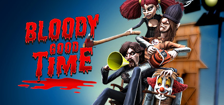

**Platforms:** Windows, Xbox 360 &nbsp;|&nbsp; **Genre:** Action &nbsp;|&nbsp; **Released:** October 28

> Congratulations, you’ve just been cast in your first slasher movie by the notorious Director X!
>
> _Synopsis source: Steam_

[Wikipedia](https://en.wikipedia.org/wiki/Bloody_Good_Time) · [Steam](https://store.steampowered.com/app/2450)

---

### Blur

**Platforms:** Windows, Xbox 360, PlayStation 3 &nbsp;|&nbsp; **Genre:** Action, Indie &nbsp;|&nbsp; **Released:** May 25

> Ricochet Blur is a fast-paced top-down shooter where your bullets bounce off walls. Kill all the armed demons and uncover the secrets of the mystery world.
>
> _Synopsis source: Steam_

[Wikipedia](https://en.wikipedia.org/wiki/Blur_(video_game)) · [Steam](https://store.steampowered.com/app/2184260)

---

### Bomberman Live: Battlefest

**Platforms:** Xbox 360 &nbsp;|&nbsp; **Released:** December 8

---

### Call of Duty: Black Ops

**Platforms:** Xbox 360, PlayStation 3, Wii, Windows &nbsp;|&nbsp; **Genre:** Action &nbsp;|&nbsp; **Released:** November 9

> The biggest first-person action series of all time and the follow-up to critically acclaimed Call of Duty®: Modern Warfare 2 returns with Call of Duty®: Black Ops.
>
> _Synopsis source: Steam_

[Steam](https://store.steampowered.com/app/42700)

---

### Castlevania: Harmony of Despair

**Platforms:** Xbox 360 &nbsp;|&nbsp; **Released:** August 4

---

### Castlevania: Lords of Shadow

**Platforms:** Xbox 360, PlayStation 3 &nbsp;|&nbsp; **Released:** October 5

---

### Chu's Dynasty

**Platforms:** Xbox 360 &nbsp;|&nbsp; **Released:** December 10

---

### Clash of the Titans

**Platforms:** PlayStation 3, Xbox 360 &nbsp;|&nbsp; **Released:** July 27

[Wikipedia](https://en.wikipedia.org/wiki/Clash_of_the_Titans_(video_game))

---

### Comic Jumper: The Adventures of Captain Smiley

**Platforms:** Xbox 360 &nbsp;|&nbsp; **Released:** October 6

---

### Crackdown 2

**Platforms:** Xbox 360 &nbsp;|&nbsp; **Released:** July 6

[Wikipedia](https://en.wikipedia.org/wiki/Crackdown_2)

---

### Create

**Platforms:** PlayStation 3, Wii, Windows, Xbox 360 &nbsp;|&nbsp; **Genre:** Casual, Indie &nbsp;|&nbsp; **Released:** November 16

> Gain experience and level up in this voxel sandbox world as you travel through space and time. Craft equipment and recipes to help you survive the treacherous landscape and sculpt it into your own masterpiece!
>
> _Synopsis source: Steam_

[Wikipedia](https://en.wikipedia.org/wiki/Create_(video_game)) · [Steam](https://store.steampowered.com/app/1744350)

---

### Dance Evolution

**Platforms:** Xbox 360 &nbsp;|&nbsp; **Released:** November 4

[Wikipedia](https://en.wikipedia.org/wiki/Dance_Evolution)

---

### Dante's Inferno

**Platforms:** PlayStation 3, Xbox 360, PlayStation Portable &nbsp;|&nbsp; **Released:** February 9

[Wikipedia](https://en.wikipedia.org/wiki/Dante%27s_Inferno_(video_game))

---

### Dark Void

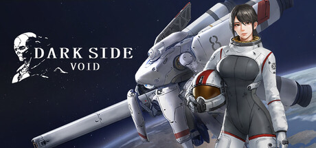

**Platforms:** Windows, Xbox 360, PlayStation 3 &nbsp;|&nbsp; **Genre:** Action, Indie &nbsp;|&nbsp; **Released:** January 19

> Dark Side Void is a 2D side-scrolling mecha action game set in space. Scarred by devastating interstellar wars, the Solar System is riddled with hidden dangers across its cosmic frontiers. Pilot your fully armed combat mech and embark on a cosmic journey packed with fierce mecha battles.
>
> _Synopsis source: Steam_

[Wikipedia](https://en.wikipedia.org/wiki/Dark_Void) · [Steam](https://store.steampowered.com/app/4770970)

---

### Darksiders

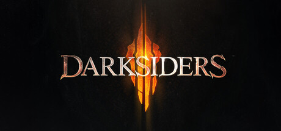

**Platforms:** Windows, PlayStation 3, Xbox 360 &nbsp;|&nbsp; **Genre:** Action-adventure, Hack and slash &nbsp;|&nbsp; **Released:** January 5

> The legendary saga of the Four Horsemen continues in Darksiders 4, an all-new action-adventure set in an apocalyptic version of earth and continues where the original Darksiders game left off.
>
> _Synopsis source: Steam_

[Wikipedia](https://en.wikipedia.org/wiki/Darksiders) · [Steam](https://store.steampowered.com/app/1203170)

---

### Dead Rising 2

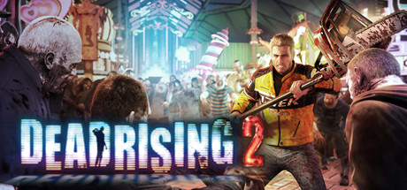

**Platforms:** Windows, PlayStation 3, Xbox 360 &nbsp;|&nbsp; **Genre:** Action, Adventure &nbsp;|&nbsp; **Released:** September 28

> The sequel to the million-plus selling Dead Rising, Dead Rising 2 takes the zombie survival horror to Fortune City, America’s latest and greatest entertainment playground.
>
> _Synopsis source: Steam_

[Wikipedia](https://en.wikipedia.org/wiki/Dead_Rising_2) · [Steam](https://store.steampowered.com/app/45740)

---

### Dead Space Ignition

**Platforms:** PlayStation Network, Xbox 360 &nbsp;|&nbsp; **Released:** October 12

[Wikipedia](https://en.wikipedia.org/wiki/Dead_Space_Ignition)

---

### Dead to Rights: Retribution

**Platforms:** Xbox 360, PlayStation 3 &nbsp;|&nbsp; **Released:** April 27

---

### Deadliest Warrior: The Game

**Platforms:** Xbox 360, PlayStation Network &nbsp;|&nbsp; **Released:** July 14

---

### Deadly Premonition

**Platforms:** Xbox 360 &nbsp;|&nbsp; **Released:** February 17

[Wikipedia](https://en.wikipedia.org/wiki/Deadly_Premonition)

---

### Deathsmiles

**Platforms:** Xbox 360 &nbsp;|&nbsp; **Released:** June 29

[Wikipedia](https://en.wikipedia.org/wiki/Deathsmiles)

---

### DeathSpank

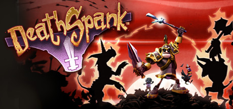

**Platforms:** PlayStation Network, Xbox 360, Windows &nbsp;|&nbsp; **Genre:** Action, Indie, RPG &nbsp;|&nbsp; **Released:** July 13

> For uncounted years, DeathSpank has been a Dispenser of Justice, a Vanquisher of Evil, and a Hero to the Downtrodden.
>
> _Synopsis source: Steam_

[Wikipedia](https://en.wikipedia.org/wiki/DeathSpank) · [Steam](https://store.steampowered.com/app/18040)

---

### DeathSpank: Thongs of Virtue

**Platforms:** PlayStation Network, Xbox 360 &nbsp;|&nbsp; **Released:** September 21

---

### Def Jam Rapstar

**Platforms:** Xbox 360, PlayStation 3, Wii &nbsp;|&nbsp; **Released:** October 5

[Wikipedia](https://en.wikipedia.org/wiki/Def_Jam_Rapstar)

---

### Divinity II: Ego Draconis

**Platforms:** Windows, Xbox 360 &nbsp;|&nbsp; **Genre:** Action RPG &nbsp;|&nbsp; **Released:** January 5

[Wikipedia](https://en.wikipedia.org/wiki/Divinity_II)

---

### DJ Hero 2

**Platforms:** Xbox 360, PlayStation 3, Wii &nbsp;|&nbsp; **Released:** October 19

[Wikipedia](https://en.wikipedia.org/wiki/DJ_Hero_2)

---

### Doritos Crash Course

**Platforms:** Xbox 360 &nbsp;|&nbsp; **Released:** December 8

[Wikipedia](https://en.wikipedia.org/wiki/Doritos_Crash_Course)

---

### Dragon Age: Origins – Awakening

**Platforms:** Windows, Xbox 360, PlayStation 3 &nbsp;|&nbsp; **Released:** March 16

---

### Dragon Age: Origins – Ultimate Edition

**Platforms:** PlayStation 3, Windows, Xbox 360 &nbsp;|&nbsp; **Released:** October 25

---

### Dynasty Warriors: Strikeforce

**Platforms:** Xbox 360, PlayStation 3, PlayStation Portable &nbsp;|&nbsp; **Released:** February 16

---

### EA Sports MMA

**Platforms:** PlayStation 3, Xbox 360 &nbsp;|&nbsp; **Released:** October 19

[Wikipedia](https://en.wikipedia.org/wiki/EA_Sports_MMA)

---

### Enslaved: Odyssey to the West

**Platforms:** Xbox 360, PlayStation 3 &nbsp;|&nbsp; **Released:** October 5

---

### F1 2010

**Platforms:** Windows, Xbox 360, PlayStation 3 &nbsp;|&nbsp; **Released:** September 22

[Wikipedia](https://en.wikipedia.org/wiki/F1_2010_(video_game))

---

### Fable II: Game of the Year Edition

**Platforms:** Xbox 360 &nbsp;|&nbsp; **Genre:** Action RPG &nbsp;|&nbsp; **Released:** January 5

[Wikipedia](https://en.wikipedia.org/wiki/Fable_II)

---

### Fable III

**Platforms:** Xbox 360 &nbsp;|&nbsp; **Released:** October 26

[Wikipedia](https://en.wikipedia.org/wiki/Fable_III)

---

### Fallout: New Vegas

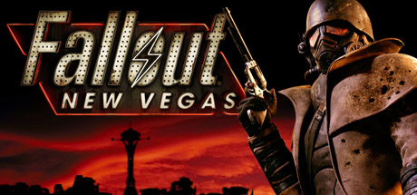

**Platforms:** PlayStation 3, Xbox 360, Windows &nbsp;|&nbsp; **Genre:** Action, RPG &nbsp;|&nbsp; **Released:** October 19

> Welcome to Vegas. New Vegas. Enjoy your stay!
>
> _Synopsis source: Steam_

[Steam](https://store.steampowered.com/app/22380)

---

### FIFA 11

**Platforms:** Windows, Xbox 360, Wii, Nintendo DS, PlayStation 2, PlayStation 3, PlayStation Portable &nbsp;|&nbsp; **Released:** September 28

[Wikipedia](https://en.wikipedia.org/wiki/FIFA_11)

---

### Final Fantasy XIII

**Platforms:** PlayStation 3, Xbox 360 &nbsp;|&nbsp; **Released:** March 9

[Wikipedia](https://en.wikipedia.org/wiki/Final_Fantasy_XIII)

---

### Final Fight: Double Impact

**Platforms:** Xbox 360 &nbsp;|&nbsp; **Released:** April 14

---

### Fist of the North Star: Ken's Rage

**Platforms:** PlayStation 3, Xbox 360 &nbsp;|&nbsp; **Released:** November 2

---

### Flotilla

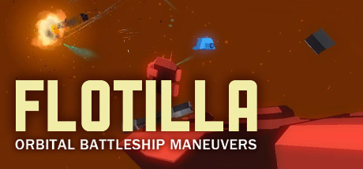

**Platforms:** Xbox 360, Windows &nbsp;|&nbsp; **Genre:** Adventure, Indie, Strategy &nbsp;|&nbsp; **Released:** March 25

> Lead your orbital battleships to victory in Flotilla! Fight, trade, and explore new planets in your journey through the galaxy. Featuring tactically rich 3D combat, flank and surprise the enemy from any direction. When the dust settles, generate another randomized universe for a brand new adventure!
>
> _Synopsis source: Steam_

[Wikipedia](https://en.wikipedia.org/wiki/Flotilla_(video_game)) · [Steam](https://store.steampowered.com/app/55000)

---

### Front Mission Evolved

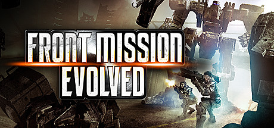

**Platforms:** Windows, Xbox 360, PlayStation 3 &nbsp;|&nbsp; **Genre:** Action &nbsp;|&nbsp; **Released:** September 28

> Experience piloting and customizing massive armored units called Wanzers while engaging in high-intensity battles driven by a compelling story. The battle begins now!
>
> _Synopsis source: Steam_

[Wikipedia](https://en.wikipedia.org/wiki/Front_Mission_Evolved) · [Steam](https://store.steampowered.com/app/43000)

---

### Game Party: In Motion

**Platforms:** Xbox 360 &nbsp;|&nbsp; **Released:** November 18

---

### Greed Corp

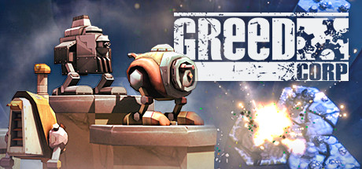

**Platforms:** Xbox 360, PlayStation Network, Windows &nbsp;|&nbsp; **Genre:** Strategy &nbsp;|&nbsp; **Released:** February 24

> Turn-based strategy at its finest.
>
> _Synopsis source: Steam_

[Wikipedia](https://en.wikipedia.org/wiki/Greed_Corp) · [Steam](https://store.steampowered.com/app/48950)

---

### Green Day: Rock Band

**Platforms:** Xbox 360, PlayStation 3, Wii &nbsp;|&nbsp; **Released:** June 8

---

### Guitar Hero: Warriors of Rock

**Platforms:** PlayStation 3, Wii, Xbox 360 &nbsp;|&nbsp; **Released:** September 28

---

### Guwange

**Platforms:** Xbox 360 &nbsp;|&nbsp; **Released:** November 10

[Wikipedia](https://en.wikipedia.org/wiki/Guwange)

---

### Halo: Reach

**Platforms:** Xbox 360 &nbsp;|&nbsp; **Publisher:** Microsoft Game Studios &nbsp;|&nbsp; **Released:** September 14, 2010

---

### Harms Way

**Platforms:** Xbox 360 &nbsp;|&nbsp; **Released:** December 8

[Wikipedia](https://en.wikipedia.org/wiki/Harms_Way_(video_game))

---

### Harry Potter and the Deathly Hallows: Part I

**Platforms:** Windows, Nintendo DS, PlayStation 3, Xbox 360, Wii &nbsp;|&nbsp; **Released:** November 16

---

### Hasbro Family Game Night 3

**Platforms:** PlayStation 3, Wii, Xbox 360 &nbsp;|&nbsp; **Released:** October 26

[Wikipedia](https://en.wikipedia.org/wiki/Hasbro_Family_Game_Night_3)

---

### How to Train Your Dragon

**Platforms:** Xbox 360, Nintendo DS, PlayStation 3, Wii &nbsp;|&nbsp; **Released:** March 23

[Wikipedia](https://en.wikipedia.org/wiki/How_to_Train_Your_Dragon_(video_game))

---

### Hydro Thunder Hurricane

**Platforms:** Xbox 360 &nbsp;|&nbsp; **Released:** July 28

[Wikipedia](https://en.wikipedia.org/wiki/Hydro_Thunder_Hurricane)

---

### Hydrophobia

**Platforms:** Xbox 360 &nbsp;|&nbsp; **Released:** September 29

[Wikipedia](https://en.wikipedia.org/wiki/Hydrophobia_(video_game))

---

### Hypership Out of Control

**Platforms:** Xbox 360 &nbsp;|&nbsp; **Released:** September 15

[Wikipedia](https://en.wikipedia.org/wiki/Hypership_Out_of_Control)

---

### iCarly 2: iJoin the Click!

**Platforms:** Nintendo DS, PlayStation 3, Wii, Xbox 360 &nbsp;|&nbsp; **Released:** November 16

---

### Iron Man 2

**Platforms:** PlayStation 3, PlayStation Portable, Xbox 360, Wii, Nintendo DS &nbsp;|&nbsp; **Released:** May 4

[Wikipedia](https://en.wikipedia.org/wiki/Iron_Man_2_(video_game))

---

### James Bond 007: Blood Stone

**Platforms:** Windows, Xbox 360, PlayStation 3, Nintendo DS &nbsp;|&nbsp; **Released:** November 2

---

### Just Cause 2

**Platforms:** Windows, Xbox 360, PlayStation 3 &nbsp;|&nbsp; **Genre:** Action, Adventure &nbsp;|&nbsp; **Released:** March 23

> Dive into an adrenaline-fuelled free-roaming adventure with 400 square miles of rugged terrain and hundreds of weapons and vehicles.
>
> _Synopsis source: Steam_

[Wikipedia](https://en.wikipedia.org/wiki/Just_Cause_2) · [Steam](https://store.steampowered.com/app/8190)

---

### Kane & Lynch 2: Dog Days

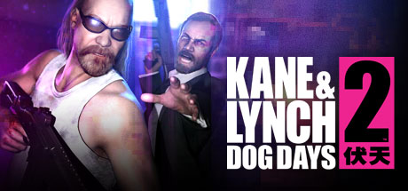

**Platforms:** Windows, Xbox 360, PlayStation 3 &nbsp;|&nbsp; **Genre:** Action &nbsp;|&nbsp; **Released:** August 17

> Pure adrenaline of non-stop action in Single Player, Online Co-op and Multiplayer. Double the pleasure and mayhem with new multiplayer DLCs! (click for details)
>
> _Synopsis source: Steam_

[Steam](https://store.steampowered.com/app/28000)

---

### Kinect Adventures!

**Platforms:** Xbox 360 &nbsp;|&nbsp; **Released:** November 4

[Wikipedia](https://en.wikipedia.org/wiki/Kinect_Adventures!)

---

### Kinect Joy Ride

**Platforms:** Xbox 360 &nbsp;|&nbsp; **Released:** November 4

[Wikipedia](https://en.wikipedia.org/wiki/Kinect_Joy_Ride)

---

### Kinect Sports

**Platforms:** Xbox 360 &nbsp;|&nbsp; **Released:** November 4

[Wikipedia](https://en.wikipedia.org/wiki/Kinect_Sports)

---

### Kinectimals

**Platforms:** Xbox 360 &nbsp;|&nbsp; **Released:** November 4

[Wikipedia](https://en.wikipedia.org/wiki/Kinectimals)

---

### Lara Croft and the Guardian of Light

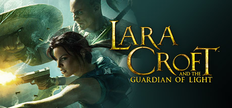

**Platforms:** Xbox 360, PlayStation Network, Windows, iOS &nbsp;|&nbsp; **Genre:** Action, Adventure &nbsp;|&nbsp; **Released:** August 18

> Take control of Lara and her new partner Totec, a Mayan tribesman, and uncover the ancient artifact known as the &quot;Mirror of Smoke&quot; in this all new action adventure game.
>
> _Synopsis source: Steam_

[Wikipedia](https://en.wikipedia.org/wiki/Lara_Croft_and_the_Guardian_of_Light) · [Steam](https://store.steampowered.com/app/35130)

---

### Lego Harry Potter: Years 1-4

**Platforms:** Windows, PlayStation 3, Wii, PlayStation Portable, Xbox 360, Nintendo DS &nbsp;|&nbsp; **Genre:** Action, Adventure &nbsp;|&nbsp; **Released:** June 29

> Build the adventure from Privet Drive to the Triwizard Tournament and experience the magic of the first four Harry Potter stories – LEGO style! Explore Hogwarts™ School of Witchcraft and Wizardry, learn spells, brew potions and relive the adventures like never before with tongue-in-cheek humor and creative customization that is unique to...
>
> _Synopsis source: Steam_

[Steam](https://store.steampowered.com/app/21130)

---

### Limbo

**Platforms:** Xbox 360 &nbsp;|&nbsp; **Publisher:** Microsoft Game Studios &nbsp;|&nbsp; **Released:** July 21, 2010

[Wikipedia](https://en.wikipedia.org/wiki/Limbo_(video_game))

---

### Lips: Party Classics

**Platforms:** Xbox 360 &nbsp;|&nbsp; **Released:** March 2

---

### Lost Planet 2

**Platforms:** Xbox 360, PlayStation 3, Windows &nbsp;|&nbsp; **Released:** May 11

[Wikipedia](https://en.wikipedia.org/wiki/Lost_Planet_2)

---

### Lucha Libre AAA: Héroes del Ring

**Platforms:** PlayStation 3, Xbox 360 &nbsp;|&nbsp; **Released:** October 12

---

### Madden NFL 11

**Platforms:** PlayStation 2, PlayStation 3, PlayStation Portable, Wii, Xbox 360 &nbsp;|&nbsp; **Released:** August 10

[Wikipedia](https://en.wikipedia.org/wiki/Madden_NFL_11)

---

### Mafia II

**Platforms:** Windows, Xbox 360, PlayStation 3 &nbsp;|&nbsp; **Genre:** Action &nbsp;|&nbsp; **Released:** August 24

> Vito Scaletta has started to make a name for himself on the streets of Empire Bay as someone who can be trusted to get a job done. Together with his buddy Joe, he is working to prove himself to the Mafia, quickly escalating up the family ladder with crimes of larger reward, status and consequence… the life as a wise guy isn’t quite as...
>
> _Synopsis source: Steam_

[Wikipedia](https://en.wikipedia.org/wiki/Mafia_II) · [Steam](https://store.steampowered.com/app/50130)

---

### Majin and the Forsaken Kingdom

**Platforms:** Xbox 360, PlayStation 3 &nbsp;|&nbsp; **Released:** November 23

[Wikipedia](https://en.wikipedia.org/wiki/Majin_and_the_Forsaken_Kingdom)

---

### Mass Effect 2

**Platforms:** Xbox 360, Windows, PlayStation 3 &nbsp;|&nbsp; **Publisher:** Electronic Arts &nbsp;|&nbsp; **Released:** January 26, 2010

[Wikipedia](https://en.wikipedia.org/wiki/Mass_Effect_2)

---

### Matt Hazard: Blood Bath and Beyond

**Platforms:** Xbox 360, PlayStation Network &nbsp;|&nbsp; **Genre:** Shoot 'em up &nbsp;|&nbsp; **Released:** January 6

---

### Medal of Honor

**Platforms:** Windows, PlayStation 3, Xbox 360 &nbsp;|&nbsp; **Genre:** Action &nbsp;|&nbsp; **Released:** October 12

> Fight Today's War: Elite Special Forces in a gritty combat campaign using the surgical tactics of Tier 1 Operators combined with the sledgehammer force of Army Rangers.
>
> _Synopsis source: Steam_

[Wikipedia](https://en.wikipedia.org/wiki/Medal_of_Honor_(2010_video_game)) · [Steam](https://store.steampowered.com/app/47790)

---

### Mega Man 10

**Platforms:** Wii, PlayStation Network, Xbox 360 &nbsp;|&nbsp; **Released:** March 1

[Wikipedia](https://en.wikipedia.org/wiki/Mega_Man_10)

---

### Megamind

**Platforms:** Wii, Xbox 360, PlayStation 3, PlayStation Portable, Nintendo DS &nbsp;|&nbsp; **Released:** November 2

[Wikipedia](https://en.wikipedia.org/wiki/Megamind_(video_game))

---

### Metal Slug XX

**Platforms:** PlayStation Portable, Xbox 360 &nbsp;|&nbsp; **Released:** February 23

[Wikipedia](https://en.wikipedia.org/wiki/Metal_Slug_XX)

---

### Metro 2033

**Platforms:** Windows, Xbox 360 &nbsp;|&nbsp; **Released:** March 16

[Wikipedia](https://en.wikipedia.org/wiki/Metro_2033_(video_game))

---

### Minute to Win It

**Platforms:** Wii, Xbox 360 &nbsp;|&nbsp; **Released:** November 10

---

### MLB 2K10

**Platforms:** Windows, Xbox 360, PlayStation 2, PlayStation 3, Wii, PlayStation Portable &nbsp;|&nbsp; **Released:** March 2

[Wikipedia](https://en.wikipedia.org/wiki/Major_League_Baseball_2K10)

---

### Monday Night Combat

**Platforms:** Xbox 360 &nbsp;|&nbsp; **Released:** August 11

[Wikipedia](https://en.wikipedia.org/wiki/Monday_Night_Combat)

---

### Monster Jam: Path of Destruction

**Platforms:** Nintendo DS, PlayStation 3, PlayStation Portable, Wii, Xbox 360 &nbsp;|&nbsp; **Released:** November 9

---

### MorphX

**Platforms:** Xbox 360 &nbsp;|&nbsp; **Released:** September 28

[Wikipedia](https://en.wikipedia.org/wiki/MorphX_(video_game))

---

### MotionSports

**Platforms:** Xbox 360 &nbsp;|&nbsp; **Released:** November 4

[Wikipedia](https://en.wikipedia.org/wiki/MotionSports)

---

### MotoGP 09/10

**Platforms:** Xbox 360, PlayStation 3 &nbsp;|&nbsp; **Released:** March 23

[Wikipedia](https://en.wikipedia.org/wiki/MotoGP_09/10)

---

### MySims SkyHeroes

**Platforms:** Nintendo DS, PlayStation 3, Wii, Xbox 360 &nbsp;|&nbsp; **Released:** September 28

[Wikipedia](https://en.wikipedia.org/wiki/MySims_SkyHeroes)

---

### nail'd

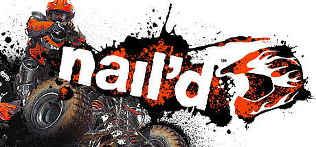

**Platforms:** PlayStation 3, Xbox 360, Windows &nbsp;|&nbsp; **Genre:** Racing &nbsp;|&nbsp; **Released:** November 30

> Constant sense of ultimate speed is your only companion, and fast reflexes and tactical skills are what stands between victory and defeat. Buy before Dec. 7 10AM PST and get 10% off.
>
> _Synopsis source: Steam_

[Wikipedia](https://en.wikipedia.org/wiki/Nail%27d) · [Steam](https://store.steampowered.com/app/40380)

---

### Naruto Shippuden: Ultimate Ninja Storm 2

**Platforms:** PlayStation 3, Xbox 360 &nbsp;|&nbsp; **Released:** October 19

---

### Naughty Bear

**Platforms:** Xbox 360, PlayStation 3 &nbsp;|&nbsp; **Released:** June 29

[Wikipedia](https://en.wikipedia.org/wiki/Naughty_Bear)

---

### NBA 2K11

**Platforms:** Windows, PlayStation 3, Xbox 360, PlayStation Portable, PlayStation 2, Wii, iOS &nbsp;|&nbsp; **Released:** October 5

[Wikipedia](https://en.wikipedia.org/wiki/NBA_2K11)

---

### NBA Jam: On Fire Edition

**Platforms:** PlayStation 3, Xbox 360 &nbsp;|&nbsp; **Released:** November 17

[Wikipedia](https://en.wikipedia.org/wiki/NBA_Jam_(2010_video_game))

---

### NCAA Football 11

**Platforms:** PlayStation 2, PlayStation 3, Xbox 360 &nbsp;|&nbsp; **Released:** July 13

[Wikipedia](https://en.wikipedia.org/wiki/NCAA_Football_11)

---

### Need for Speed: Hot Pursuit

**Platforms:** Xbox 360, PlayStation 3, Windows, Wii &nbsp;|&nbsp; **Released:** November 16

---

### NeoGeo Battle Coliseum

**Platforms:** Xbox 360 &nbsp;|&nbsp; **Released:** June 9

[Wikipedia](https://en.wikipedia.org/wiki/NeoGeo_Battle_Coliseum)

---

### NHL 11

**Platforms:** PlayStation 3, Xbox 360 &nbsp;|&nbsp; **Released:** September 7

[Wikipedia](https://en.wikipedia.org/wiki/NHL_11)

---

### Nier

**Platforms:** Xbox 360, PlayStation 3 &nbsp;|&nbsp; **Released:** April 27

[Wikipedia](https://en.wikipedia.org/wiki/Nier_(video_game))

---

### Ninety-Nine Nights II

**Platforms:** Xbox 360 &nbsp;|&nbsp; **Released:** June 29

[Wikipedia](https://en.wikipedia.org/wiki/Ninety-Nine_Nights_II)

---

### Pac-Man Championship Edition DX

**Platforms:** Xbox 360, PlayStation 3, PlayStation Network &nbsp;|&nbsp; **Publisher:** Namco Bandai Games &nbsp;|&nbsp; **Released:** November 17, 2010

[Wikipedia](https://en.wikipedia.org/wiki/Pac-Man_Championship_Edition_DX)

---

### Perfect Dark

**Platforms:** Xbox 360 &nbsp;|&nbsp; **Released:** March 17

[Wikipedia](https://en.wikipedia.org/wiki/Perfect_Dark_(Xbox_Live_Arcade))

---

### Pinball FX 2

**Platforms:** Xbox 360 &nbsp;|&nbsp; **Released:** October 27

[Wikipedia](https://en.wikipedia.org/wiki/Pinball_FX_2)

---

### Plants vs. Zombies

**Platforms:** Xbox 360 &nbsp;|&nbsp; **Released:** September 8

[Wikipedia](https://en.wikipedia.org/wiki/Plants_vs._Zombies)

---

### Prince of Persia: The Forgotten Sands

**Platforms:** Nintendo DS, Wii, PlayStation Portable, PlayStation 3, Xbox 360, Windows &nbsp;|&nbsp; **Genre:** Action, Adventure &nbsp;|&nbsp; **Released:** May 18

> Prince of Persia The Forgotten Sands is the next chapter in the fan-favorite Sands of Time universe. Visiting his brother's kingdom following his adventure in Azad, the Prince finds the royal palace under siege from a mighty army bent on its destruction.
>
> _Synopsis source: Steam_

[Steam](https://store.steampowered.com/app/33320)

---

### Prison Break: The Conspiracy

**Platforms:** Windows, Xbox 360, PlayStation 3 &nbsp;|&nbsp; **Released:** March 30

---

### Pro Evolution Soccer 2011

**Platforms:** Windows, Xbox 360, Wii, Nintendo DS, PlayStation 2, PlayStation 3, PlayStation Portable &nbsp;|&nbsp; **Released:** October 5

[Wikipedia](https://en.wikipedia.org/wiki/Pro_Evolution_Soccer_2011)

---

### Quantum Theory

**Platforms:** PlayStation 3, Xbox 360 &nbsp;|&nbsp; **Released:** September 28

[Wikipedia](https://en.wikipedia.org/wiki/Quantum_Theory_(video_game))

---

### R.U.S.E.

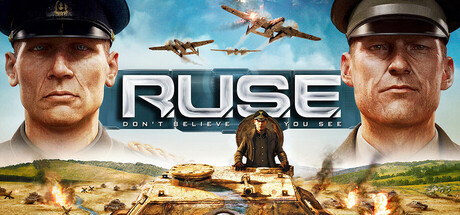

**Platforms:** Xbox 360, PlayStation 3, Windows &nbsp;|&nbsp; **Genre:** Strategy &nbsp;|&nbsp; **Released:** September 17

> A one-of-a-kind real-time strategy game that allows players to bluff their enemies to lead their nation to victory. The Definitive Edition — includes all DLCs and Steam Deck support.
>
> _Synopsis source: Steam_

[Wikipedia](https://en.wikipedia.org/wiki/R.U.S.E.) · [Steam](https://store.steampowered.com/app/21970)

---

### Raskulls

**Platforms:** Xbox 360 &nbsp;|&nbsp; **Released:** December 29

[Wikipedia](https://en.wikipedia.org/wiki/Raskulls)

---

### Record of Agarest War

**Platforms:** PlayStation 3, Xbox 360 &nbsp;|&nbsp; **Released:** April 27

[Wikipedia](https://en.wikipedia.org/wiki/Record_of_Agarest_War)

---

### Red Dead Redemption

**Platforms:** PlayStation 3, Xbox 360 &nbsp;|&nbsp; **Publisher:** Rockstar Games &nbsp;|&nbsp; **Released:** May 18, 2010

[Wikipedia](https://en.wikipedia.org/wiki/Red_Dead_Redemption)

---

### Red Dead Redemption: Undead Nightmare

**Platforms:** PlayStation 3, Xbox 360 &nbsp;|&nbsp; **Released:** October 26

---

### Resonance of Fate

**Platforms:** Xbox 360, PlayStation 3 &nbsp;|&nbsp; **Released:** March 16

[Wikipedia](https://en.wikipedia.org/wiki/Resonance_of_Fate)

---

### Risen

**Platforms:** Xbox 360 &nbsp;|&nbsp; **Released:** February 22

[Wikipedia](https://en.wikipedia.org/wiki/Risen_(video_game))

---

### Rock Band 3

**Platforms:** Xbox 360, PlayStation 3, Wii, Nintendo DS &nbsp;|&nbsp; **Publisher:** MTV Games &nbsp;|&nbsp; **Released:** October 26, 2010

[Wikipedia](https://en.wikipedia.org/wiki/Rock_Band_3)

---

### Rock of the Dead

**Platforms:** Xbox 360, PlayStation 3, Wii &nbsp;|&nbsp; **Released:** October 19

[Wikipedia](https://en.wikipedia.org/wiki/Rock_of_the_Dead_(video_game))

---

### Rocket Knight

**Platforms:** Windows, Xbox 360, PlayStation Network &nbsp;|&nbsp; **Released:** May 12

[Wikipedia](https://en.wikipedia.org/wiki/Rocket_Knight)

---

### Samurai Shodown: Edge of Destiny

**Platforms:** Xbox 360 &nbsp;|&nbsp; **Released:** March 30

---

### Saw II: Flesh & Blood

**Platforms:** PlayStation 3, Xbox 360 &nbsp;|&nbsp; **Released:** October 19

---

### Scott Pilgrim vs. the World: The Game

**Platforms:** PlayStation Network, Xbox 360 &nbsp;|&nbsp; **Released:** August 10

---

### Shaun White Skateboarding

**Platforms:** PlayStation 3, Wii, Windows, Xbox 360 &nbsp;|&nbsp; **Released:** October 24

[Wikipedia](https://en.wikipedia.org/wiki/Shaun_White_Skateboarding)

---

### Sherlock Holmes vs. Jack the Ripper

**Platforms:** Xbox 360 &nbsp;|&nbsp; **Released:** April 23

[Wikipedia](https://en.wikipedia.org/wiki/Sherlock_Holmes_vs._Jack_the_Ripper)

---

### Shrek Forever After

**Platforms:** iOS, Nintendo DS, PlayStation 3, Wii, Windows, Xbox 360 &nbsp;|&nbsp; **Released:** May 18

[Wikipedia](https://en.wikipedia.org/wiki/Shrek_Forever_After_(video_game))

---

### Singularity

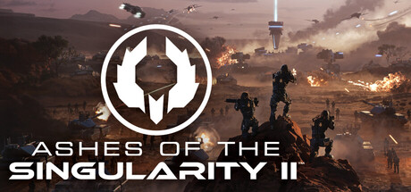

**Platforms:** Windows, Xbox 360, PlayStation 3 &nbsp;|&nbsp; **Genre:** Simulation, Strategy &nbsp;|&nbsp; **Released:** June 29

> In this massive RTS game, command vast armies fighting for control of entire worlds. Control the forces of Earth, the mechanical AI Substrate, or the enigmatic Post-Human Coalition as you battle across the solar system in single player, cooperative multiplayer, or competitive multiplayer.
>
> _Synopsis source: Steam_

[Wikipedia](https://en.wikipedia.org/wiki/Singularity_(video_game)) · [Steam](https://store.steampowered.com/app/3499790)

---

### Skate 3

**Platforms:** PlayStation 3, Xbox 360 &nbsp;|&nbsp; **Released:** May 11

[Wikipedia](https://en.wikipedia.org/wiki/Skate_3)

---

### Ski-Doo: Snowmobile Challenge

**Platforms:** Xbox 360 &nbsp;|&nbsp; **Released:** March 24

---

### Sniper: Ghost Warrior

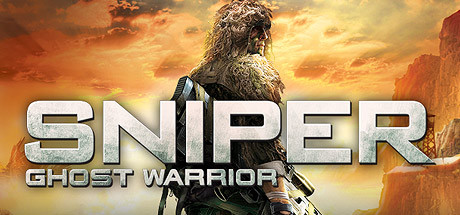

**Platforms:** Windows, Xbox 360 &nbsp;|&nbsp; **Genre:** Action &nbsp;|&nbsp; **Released:** June 29

> As a Ghost Warrior, an elite sniper in a highly trained special ops unit, your unique skills in the art of stalking, target detection, surveillance and shooting accuracy will determine mission success.
>
> _Synopsis source: Steam_

[Steam](https://store.steampowered.com/app/34830)

---

### Snoopy Flying Ace

**Platforms:** Xbox 360 &nbsp;|&nbsp; **Released:** June 2

[Wikipedia](https://en.wikipedia.org/wiki/Snoopy_Flying_Ace)

---

### Sonic & Sega All-Stars Racing

**Platforms:** PlayStation 3, Xbox 360, Nintendo DS, Wii, Windows &nbsp;|&nbsp; **Genre:** Racing &nbsp;|&nbsp; **Released:** February 23

> SONIC AND SEGA ALL-STARS RACE FOR VICTORY IN A HIGH SPEED HIGH SKILL RACETRACK SHOWDOWN! TAKE TO THE TRACK BY CAR, MONSTER TRUCK, BIKE AND EVEN AEROPLANE IN SONIC &amp; SEGA ALL-STARS RACING. Explore stunning new circuits including Sonic Seaside Hill, Curien Mansion and Blizzard Castle as you zip around medieval castle ramparts, hurtle...
>
> _Synopsis source: Steam_

[Wikipedia](https://en.wikipedia.org/wiki/Sonic_%26_Sega_All-Stars_Racing) · [Steam](https://store.steampowered.com/app/34190)

---

### Sonic Free Riders

**Platforms:** Xbox 360 &nbsp;|&nbsp; **Released:** November 4

[Wikipedia](https://en.wikipedia.org/wiki/Sonic_Free_Riders)

---

### Sonic the Hedgehog 4: Episode 1

**Platforms:** iOS, Wii, PlayStation Network, Xbox 360 &nbsp;|&nbsp; **Released:** October 7

---

### Space Invaders Infinity Gene

**Platforms:** PlayStation 3, Xbox 360 &nbsp;|&nbsp; **Released:** September 14

[Wikipedia](https://en.wikipedia.org/wiki/Space_Invaders_Infinity_Gene)

---

### Spider-Man: Shattered Dimensions

**Platforms:** Nintendo DS, PlayStation 3, Wii, Xbox 360 &nbsp;|&nbsp; **Released:** September 7

---

### Splatterhouse

**Platforms:** Xbox 360, PlayStation 3 &nbsp;|&nbsp; **Released:** November 23

[Wikipedia](https://en.wikipedia.org/wiki/Splatterhouse_(2010_video_game))

---

### Split Second: Velocity

**Platforms:** Windows, Xbox 360, PlayStation 3 &nbsp;|&nbsp; **Released:** May 18

[Wikipedia](https://en.wikipedia.org/wiki/Split_Second_(video_game))

---

### Star Wars: The Force Unleashed II

**Platforms:** PlayStation 3, Xbox 360, Windows, Wii, Nintendo DS &nbsp;|&nbsp; **Genre:** Action &nbsp;|&nbsp; **Released:** October 26

> The Star Wars® Saga continues with Star Wars®: The Force Unleashed™ II, the highly anticipated sequel to the fastest-selling Star Wars game ever created.
>
> _Synopsis source: Steam_

[Steam](https://store.steampowered.com/app/32500)

---

### Super Meat Boy

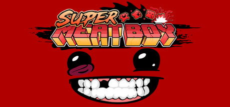

**Platforms:** Xbox 360, Windows &nbsp;|&nbsp; **Publisher:** Team Meat &nbsp;|&nbsp; **Genre:** Indie &nbsp;|&nbsp; **Released:** October 20, 2010

> The infamous, tough-as-nails platformer comes to Steam with a playable Head Crab character (Steam-exclusive)!
>
> _Synopsis source: Steam_

[Wikipedia](https://en.wikipedia.org/wiki/Super_Meat_Boy) · [Steam](https://store.steampowered.com/app/40800)

---

### Super Street Fighter IV

**Platforms:** PlayStation 3, Xbox 360 &nbsp;|&nbsp; **Publisher:** Capcom &nbsp;|&nbsp; **Released:** April 27, 2010

[Wikipedia](https://en.wikipedia.org/wiki/Super_Street_Fighter_IV)

---

### Supreme Commander 2

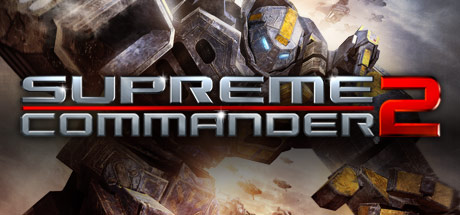

**Platforms:** Windows, Xbox 360 &nbsp;|&nbsp; **Genre:** Strategy &nbsp;|&nbsp; **Released:** March 2

> Includes 47 Steam achievements, leaderboards, and stats!
>
> _Synopsis source: Steam_

[Wikipedia](https://en.wikipedia.org/wiki/Supreme_Commander_2) · [Steam](https://store.steampowered.com/app/40100)

---

### Tecmo Bowl Throwback

**Platforms:** Xbox 360, PlayStation Network &nbsp;|&nbsp; **Released:** April 28

[Wikipedia](https://en.wikipedia.org/wiki/Tecmo_Bowl_Throwback)

---

### The Next Star 3

**Platforms:** Windows, Xbox 360, PlayStation 2, PlayStation 3, Wii, PlayStation Portable &nbsp;|&nbsp; **Released:** September 5

---

### The Sims 3

**Platforms:** PlayStation 3, Xbox 360, Wii, Nintendo DS &nbsp;|&nbsp; **Released:** October 26

[Wikipedia](https://en.wikipedia.org/wiki/The_Sims_3_(console_video_game))

---

### The Sorcerer's Apprentice

**Platforms:** Nintendo DS, PlayStation 3, Wii, Xbox 360 &nbsp;|&nbsp; **Released:** July 13

[Wikipedia](https://en.wikipedia.org/wiki/The_Sorcerer%27s_Apprentice_(2010_film))

---

### Things on Wheels

**Platforms:** Xbox 360 &nbsp;|&nbsp; **Released:** May 12

[Wikipedia](https://en.wikipedia.org/wiki/Things_on_Wheels)

---

### Tiger Woods PGA Tour 11

**Platforms:** Xbox 360, PlayStation 3, Wii &nbsp;|&nbsp; **Released:** June 8

[Wikipedia](https://en.wikipedia.org/wiki/Tiger_Woods_PGA_Tour_11)

---

### Tom Clancy's H.A.W.X 2

**Platforms:** PlayStation 3, Xbox 360, Wii, Windows &nbsp;|&nbsp; **Released:** September 7

[Wikipedia](https://en.wikipedia.org/wiki/Tom_Clancy%27s_H.A.W.X_2)

---

### Tom Clancy's Splinter Cell: Conviction

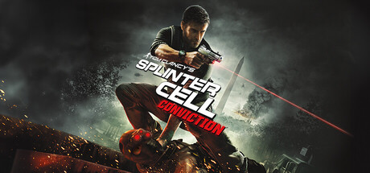

**Platforms:** Xbox 360, Windows &nbsp;|&nbsp; **Genre:** Action &nbsp;|&nbsp; **Released:** April 13

> In this stealth-action thriller, Sam Fisher investigates his daughter’s death, only to uncover a betrayal by his former agency. Now hunted, he races against time to thwart a terrorist plot threatening millions.
>
> _Synopsis source: Steam_

[Steam](https://store.steampowered.com/app/33220)

---

### Totally Spies!: Revenge of the Undercover

**Platforms:** PlayStation 3, Xbox 360, Wii, PlayStation Portable, Nintendo DS &nbsp;|&nbsp; **Released:** June 15

---

### Toy Story 3: The Video Game

**Platforms:** PlayStation 3, Xbox 360, Wii, PlayStation Portable, Nintendo DS, Windows, PlayStation 2 &nbsp;|&nbsp; **Released:** June 15

---

### Transformers: War for Cybertron

**Platforms:** Windows, Xbox 360, PlayStation 3, Wii, Nintendo DS &nbsp;|&nbsp; **Released:** June 22

---

### Tron: Evolution

**Platforms:** Windows, PlayStation 3, Xbox 360, iOS &nbsp;|&nbsp; **Released:** December 7

---

### Tropico 3

**Platforms:** Xbox 360 &nbsp;|&nbsp; **Released:** February 16

[Wikipedia](https://en.wikipedia.org/wiki/Tropico_3)

---

### UFC 2010

**Platforms:** Xbox 360, PlayStation 3, PlayStation Portable &nbsp;|&nbsp; **Released:** May 25

[Wikipedia](https://en.wikipedia.org/wiki/UFC_Undisputed_2010)

---

### Unbound Saga

**Platforms:** Xbox 360 &nbsp;|&nbsp; **Released:** December 1

[Wikipedia](https://en.wikipedia.org/wiki/Unbound_Saga)

---

### Vancouver 2010

**Platforms:** Windows, Xbox 360, PlayStation 3 &nbsp;|&nbsp; **Released:** January 12

[Wikipedia](https://en.wikipedia.org/wiki/Vancouver_2010_(video_game))

---

### Vandal Hearts: Flames of Judgment

**Platforms:** Xbox 360, PlayStation 3 &nbsp;|&nbsp; **Released:** January 20

---

### Vanquish

**Platforms:** PlayStation 3, Xbox 360 &nbsp;|&nbsp; **Released:** October 19

[Wikipedia](https://en.wikipedia.org/wiki/Vanquish_(video_game))

---

### World of Outlaws: Sprint Cars

**Platforms:** Xbox 360, Windows, PlayStation Network &nbsp;|&nbsp; **Released:** February 9

---

### WWE SmackDown vs Raw 2011

**Platforms:** PlayStation 3, Xbox 360, PlayStation Portable, PlayStation 2, Wii &nbsp;|&nbsp; **Released:** October 26

[Wikipedia](https://en.wikipedia.org/wiki/WWE_SmackDown_vs_Raw_2011)

---

### X-Men

**Platforms:** PlayStation Network, Xbox 360 &nbsp;|&nbsp; **Released:** December 14

[Wikipedia](https://en.wikipedia.org/wiki/X-Men_(arcade_game))

---
