# Xbox 360 — 2011

[← All Xbox 360 years](../xbox-360.md) · [Full 2011 page](../../years/2011.md)

258 Xbox 360 titles in 2011.

### Ace Combat: Assault Horizon

**Platforms:** PlayStation 3, Xbox 360 &nbsp;|&nbsp; **Released:** October 11

---

### AFL Live

**Platforms:** PlayStation 3, Xbox 360 &nbsp;|&nbsp; **Developer:** Big Ant Studios &nbsp;|&nbsp; **Publisher:** Tru Blu Entertainment &nbsp;|&nbsp; **Genre:** Sports &nbsp;|&nbsp; **Released:** April 21, 2011

[Wikipedia](https://en.wikipedia.org/wiki/AFL_Live)

---

### Afterfall: InSanity

**Platforms:** Windows, Xbox 360, PlayStation 3 &nbsp;|&nbsp; **Released:** November 25

---

### Air Conflicts: Secret Wars

**Platforms:** Windows, Xbox 360, PlayStation 3 &nbsp;|&nbsp; **Developer:** Games Farm &nbsp;|&nbsp; **Publisher:** bitComposer, Kalypso Media, 2tainment, U&I Entertainment &nbsp;|&nbsp; **Genre:** Combat flight simulation &nbsp;|&nbsp; **Released:** June 30, 2011

[Wikipedia](https://en.wikipedia.org/wiki/Air_Conflicts:_Secret_Wars)

---

### Akane the Kunoichi

**Platforms:** Xbox 360 &nbsp;|&nbsp; **Released:** May 28

[Wikipedia](https://en.wikipedia.org/wiki/Akane_the_Kunoichi)

---

### Alice: Madness Returns

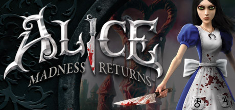

**Platforms:** Windows, PlayStation 3, Xbox 360 &nbsp;|&nbsp; **Genre:** Action, Adventure &nbsp;|&nbsp; **Released:** June 14

> Alice: Madness Returns is a third-person, single-player, action adventure platformer. Visit the grim reality of Victorian London and travel to the beautiful yet ghastly Wonderland to uncover the root of Alice's madness.
>
> _Synopsis source: Steam_

[Steam](https://store.steampowered.com/app/19680)

---

### Alvin and the Chipmunks: Chipwrecked

**Platforms:** Nintendo DS, Wii, Xbox 360 &nbsp;|&nbsp; **Released:** November 15

---

### Assassin's Creed: Brotherhood - The Da Vinci Disappearance

**Platforms:** PlayStation 3, Xbox 360, Windows &nbsp;|&nbsp; **Developer:** Ubisoft Montreal &nbsp;|&nbsp; **Publisher:** Ubisoft &nbsp;|&nbsp; **Genre:** Action-adventure, stealth &nbsp;|&nbsp; **Released:** March 8, 2011

[Wikipedia](https://en.wikipedia.org/wiki/Assassin's_Creed:_Brotherhood_-_The_Da_Vinci_Disappearance)

---

### Assassin's Creed: Revelations

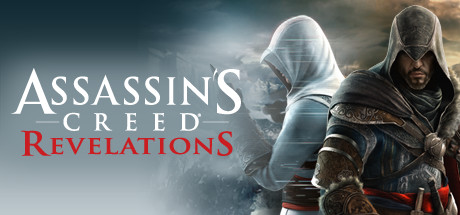

**Platforms:** PlayStation 3, Xbox 360, Windows &nbsp;|&nbsp; **Genre:** Action, Adventure &nbsp;|&nbsp; **Released:** November 15

> Ezio Auditore walks in the footsteps of the legendary mentor Altair, on a dangerous journey of discovery and revelation.
>
> _Synopsis source: Steam_

[Steam](https://store.steampowered.com/app/201870)

---

### Backbreaker: Vengeance

**Platforms:** Xbox 360 &nbsp;|&nbsp; **Released:** June 29

---

### Bangai-O HD: Missile Fury

**Platforms:** Xbox 360 &nbsp;|&nbsp; **Developer:** Treasure &nbsp;|&nbsp; **Publisher:** D3 Publisher &nbsp;|&nbsp; **Genre:** Multidirectional shooter &nbsp;|&nbsp; **Released:** May 4, 2011

[Wikipedia](https://en.wikipedia.org/wiki/Bangai-O_HD:_Missile_Fury)

---

### Bastion

**Platforms:** Windows, Xbox 360 &nbsp;|&nbsp; **Publisher:** Warner Bros. Interactive Entertainment &nbsp;|&nbsp; **Released:** August 16, 2011

[Wikipedia](https://en.wikipedia.org/wiki/Bastion_(video_game))

---

### Batman: Arkham City

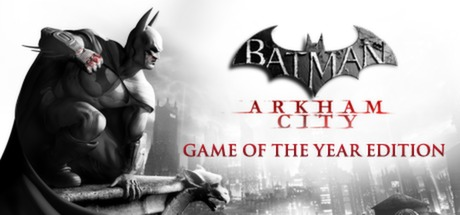

**Platforms:** PlayStation 3, Xbox 360, Windows &nbsp;|&nbsp; **Publisher:** Warner Bros. Interactive Entertainment &nbsp;|&nbsp; **Genre:** Action, Adventure &nbsp;|&nbsp; **Released:** October 18, 2011

> Get Batman: Arkham City and all DLC for one low price with the release of the GOTY Edition!
>
> _Synopsis source: Steam_

[Steam](https://store.steampowered.com/app/200260)

---

### Battle High: San Bruno

**Platforms:** Windows, Xbox 360 &nbsp;|&nbsp; **Released:** February 8

---

### Battle vs. Chess

**Platforms:** Windows, Nintendo DS, PlayStation 3, PlayStation Portable, Wii, Xbox 360 &nbsp;|&nbsp; **Released:** May 17

[Wikipedia](https://en.wikipedia.org/wiki/Battle_vs._Chess)

---

### Battle: Los Angeles

**Platforms:** Windows, Xbox 360, PlayStation 3 &nbsp;|&nbsp; **Developer:** Saber Interactive &nbsp;|&nbsp; **Publisher:** Konami &nbsp;|&nbsp; **Genre:** First-person shooter &nbsp;|&nbsp; **Released:** March 11, 2011

[Wikipedia](https://en.wikipedia.org/wiki/Battle:_Los_Angeles_(video_game))

---

### Battlefield 3

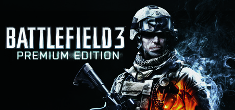

**Platforms:** Windows, PlayStation 3, Xbox 360 &nbsp;|&nbsp; **Genre:** Action &nbsp;|&nbsp; **Released:** October 25

> Enjoy total freedom to fight the way you want. Explore 29 massive multiplayer maps and use loads of vehicles, weapons, and gadgets to help you turn up the heat. Every second of battle gets you closer to unlocking tons of extras and moving up in the Ranks. So get in the action.
>
> _Synopsis source: Steam_

[Wikipedia](https://en.wikipedia.org/wiki/Battlefield_3) · [Steam](https://store.steampowered.com/app/1238820)

---

### Before the Echo

**Platforms:** Xbox 360, Windows &nbsp;|&nbsp; **Developer:** Iridium Studios &nbsp;|&nbsp; **Publisher:** Iridium Studios &nbsp;|&nbsp; **Genre:** Music, role-playing &nbsp;|&nbsp; **Released:** May 5, 2011

[Wikipedia](https://en.wikipedia.org/wiki/Before_the_Echo)

---

### Ben 10: Galactic Racing

**Platforms:** PlayStation 3, Xbox 360, Nintendo DS, Wii, Nintendo 3DS &nbsp;|&nbsp; **Released:** October 18

---

### Bionic Commando Rearmed 2

**Platforms:** PlayStation 3, Xbox 360 &nbsp;|&nbsp; **Genre:** Run and gun &nbsp;|&nbsp; **Released:** February 1

[Wikipedia](https://en.wikipedia.org/wiki/Bionic_Commando_Rearmed_2)

---

### Blackwater

**Platforms:** Xbox 360 &nbsp;|&nbsp; **Released:** October 25

[Wikipedia](https://en.wikipedia.org/wiki/Blackwater_(video_game))

---

### Blocks That Matter

**Platforms:** Windows, macOS, Linux, Xbox 360 &nbsp;|&nbsp; **Developer:** Swing Swing Submarine &nbsp;|&nbsp; **Publisher:** Swing Swing Submarine &nbsp;|&nbsp; **Genre:** Puzzle-platform &nbsp;|&nbsp; **Released:** August 19, 2011

[Wikipedia](https://en.wikipedia.org/wiki/Blocks_That_Matter)

---

### BloodRayne: Betrayal

**Platforms:** PlayStation 3, Xbox 360 &nbsp;|&nbsp; **Released:** September 6

---

### Body and Brain Connection

**Platforms:** Xbox 360 &nbsp;|&nbsp; **Released:** February 8

[Wikipedia](https://en.wikipedia.org/wiki/Body_and_Brain_Connection)

---

### Bodycount

**Platforms:** PlayStation 3, Xbox 360 &nbsp;|&nbsp; **Released:** August 30

[Wikipedia](https://en.wikipedia.org/wiki/Bodycount_(2011_video_game))

---

### Boulder Dash-XL

**Platforms:** Xbox 360 &nbsp;|&nbsp; **Released:** July 13

[Wikipedia](https://en.wikipedia.org/wiki/Boulder_Dash-XL)

---

### Breach

**Platforms:** Windows, Xbox 360 &nbsp;|&nbsp; **Genre:** FPS &nbsp;|&nbsp; **Released:** January 26

[Wikipedia](https://en.wikipedia.org/wiki/Breach_(2011_video_game))

---

### Brink

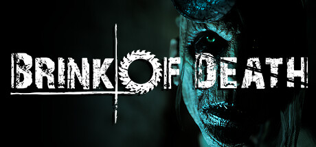

**Platforms:** Windows, PlayStation 3, Xbox 360 &nbsp;|&nbsp; **Genre:** Action, Indie &nbsp;|&nbsp; **Released:** May 10

> It is a Co-Op horror game that can be played with at least 1 and at most 4 players on the Brink of Death. Your goal is to defeat the killer doctor who feeds on fear in the cursed area. You'll need a lot of things, but don't stop destroying the scarecrows it draws on. Death is just the beginning.
>
> _Synopsis source: Steam_

[Wikipedia](https://en.wikipedia.org/wiki/Brink_(video_game)) · [Steam](https://store.steampowered.com/app/2179940)

---

### Bulletstorm

**Platforms:** Windows, Xbox 360, PlayStation 3 &nbsp;|&nbsp; **Released:** February 22

[Wikipedia](https://en.wikipedia.org/wiki/Bulletstorm)

---

### BurgerTime: World Tour

**Platforms:** Xbox 360, PlayStation 3 &nbsp;|&nbsp; **Released:** November 2

[Wikipedia](https://en.wikipedia.org/wiki/BurgerTime_World_Tour)

---

### Burnout Crash!

**Platforms:** PlayStation Network, Xbox 360 &nbsp;|&nbsp; **Released:** September 20

[Wikipedia](https://en.wikipedia.org/wiki/Burnout_Crash!)

---

### Cabela's Adventure Camp

**Platforms:** PlayStation 3, Wii, Xbox 360 &nbsp;|&nbsp; **Released:** November 1

[Wikipedia](https://en.wikipedia.org/wiki/Cabela%27s_Adventure_Camp)

---

### Cabela's Big Game Hunter 2012

**Platforms:** PlayStation 3, Wii, Xbox 360 &nbsp;|&nbsp; **Developer:** Cauldron &nbsp;|&nbsp; **Publisher:** Activision &nbsp;|&nbsp; **Genre:** Sports &nbsp;|&nbsp; **Released:** September 27, 2011

[Wikipedia](https://en.wikipedia.org/wiki/Cabela's_Big_Game_Hunter_2012)

---

### Cabela's Survival: Shadows of Katmai

**Platforms:** Wii, PlayStation 3, Xbox 360 &nbsp;|&nbsp; **Released:** November 1

---

### Call of Duty: Modern Warfare 3

**Platforms:** Windows, PlayStation 3, Xbox 360, Wii &nbsp;|&nbsp; **Genre:** Action &nbsp;|&nbsp; **Released:** November 8

> The best-selling first-person action series of all-time returns with an epic sequel to the multiple GOTY award winner Call of Duty®: Modern Warfare® 2
>
> _Synopsis source: Steam_

[Steam](https://store.steampowered.com/app/42680)

---

### Call of Juarez: The Cartel

**Platforms:** PlayStation 3, Xbox 360, Windows &nbsp;|&nbsp; **Released:** July 14

---

### Captain America: Super Soldier

**Platforms:** Xbox 360, PlayStation 3, Wii, Nintendo DS, Nintendo 3DS &nbsp;|&nbsp; **Released:** July 14

---

### Cars 2

**Platforms:** Windows, Xbox 360, PlayStation 3, Wii, Nintendo DS, Nintendo 3DS, PlayStation Portable &nbsp;|&nbsp; **Released:** June 21

[Wikipedia](https://en.wikipedia.org/wiki/Cars_2_(video_game))

---

### Cars 2: The Video Game

**Platforms:** PlayStation 3, Xbox 360, Windows, Wii, Nintendo DS, Nintendo 3DS, PlayStation Portable, macOS, iOS &nbsp;|&nbsp; **Developer:** Avalanche Software, TransGaming, Firebrand Games, Virtual Toys &nbsp;|&nbsp; **Publisher:** Disney Interactive Studios, Sony Computer Entertainment, Disney Mobile Studios &nbsp;|&nbsp; **Genre:** Racing &nbsp;|&nbsp; **Released:** June 21, 2011

[Wikipedia](https://en.wikipedia.org/wiki/Cars_2:_The_Video_Game)

---

### Cartoon Network: Punch Time Explosion XL

**Platforms:** Wii, PlayStation 3, Xbox 360 &nbsp;|&nbsp; **Released:** November 15

---

### CastleMiner

**Platforms:** Xbox 360 &nbsp;|&nbsp; **Developer:** DigitalDNA Games &nbsp;|&nbsp; **Publisher:** DigitalDNA Games &nbsp;|&nbsp; **Genre:** Sandbox &nbsp;|&nbsp; **Released:** July 27, 2011

[Wikipedia](https://en.wikipedia.org/wiki/CastleMiner)

---

### Catherine

**Platforms:** PlayStation 3, Xbox 360 &nbsp;|&nbsp; **Released:** July 26

[Wikipedia](https://en.wikipedia.org/wiki/Catherine_(video_game))

---

### Champion Jockey: G1 Jockey & Gallop Racer

**Platforms:** PlayStation 3, Wii, Xbox 360 &nbsp;|&nbsp; **Developer:** Tecmo Koei, Kou Shibusawa &nbsp;|&nbsp; **Publisher:** Tecmo Koei &nbsp;|&nbsp; **Genre:** Alternative sports &nbsp;|&nbsp; **Released:** September 2, 2011

[Wikipedia](https://en.wikipedia.org/wiki/Champion_Jockey:_G1_Jockey_&_Gallop_Racer)

---

### Child of Eden

**Platforms:** Xbox 360, PlayStation 3 &nbsp;|&nbsp; **Released:** June 14

[Wikipedia](https://en.wikipedia.org/wiki/Child_of_Eden)

---

### Code 18

**Platforms:** PlayStation Portable, Xbox 360 &nbsp;|&nbsp; **Developer:** Cyberfront &nbsp;|&nbsp; **Publisher:** Cyberfront &nbsp;|&nbsp; **Genre:** Visual novel &nbsp;|&nbsp; **Released:** September 29, 2011

[Wikipedia](https://en.wikipedia.org/wiki/Code_18)

---

### Crazy Machines Elements

**Platforms:** Windows, PlayStation 3, PlayStation Network, Xbox 360 &nbsp;|&nbsp; **Developer:** Fakt Software &nbsp;|&nbsp; **Publisher:** DTP Entertainment &nbsp;|&nbsp; **Genre:** Puzzle &nbsp;|&nbsp; **Released:** March 25, 2011

[Wikipedia](https://en.wikipedia.org/wiki/Crazy_Machines_Elements)

---

### Crimson Alliance

**Platforms:** Xbox 360 &nbsp;|&nbsp; **Released:** September 7

[Wikipedia](https://en.wikipedia.org/wiki/Crimson_Alliance)

---

### Crysis 2

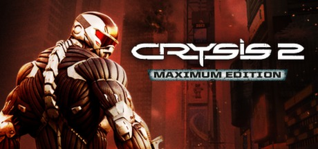

**Platforms:** Windows, PlayStation 3, Xbox 360 &nbsp;|&nbsp; **Genre:** Action &nbsp;|&nbsp; **Released:** March 22

> Aliens are decimating New York City, only you have the technology to survive. Be The Weapon.
>
> _Synopsis source: Steam_

[Wikipedia](https://en.wikipedia.org/wiki/Crysis_2) · [Steam](https://store.steampowered.com/app/108800)

---

### Dance Central 2

**Platforms:** Xbox 360 &nbsp;|&nbsp; **Released:** October 25

[Wikipedia](https://en.wikipedia.org/wiki/Dance_Central_2)

---

### Dark Souls

**Platforms:** PlayStation 3, Xbox 360 &nbsp;|&nbsp; **Released:** October 4

[Wikipedia](https://en.wikipedia.org/wiki/Dark_Souls_(video_game))

---

### Days of Thunder

**Platforms:** PlayStation Network, Xbox 360, PlayStation Portable &nbsp;|&nbsp; **Released:** February 22

[Wikipedia](https://en.wikipedia.org/wiki/Days_of_Thunder_(2011_video_game))

---

### de Blob 2

**Platforms:** Nintendo DS, PlayStation 3, Xbox 360, Wii &nbsp;|&nbsp; **Released:** February 22

[Wikipedia](https://en.wikipedia.org/wiki/De_Blob_2)

---

### Dead Island

**Platforms:** Windows, Xbox 360, PlayStation 3 &nbsp;|&nbsp; **Released:** September 6

[Wikipedia](https://en.wikipedia.org/wiki/Dead_Island)

---

### Dead Rising 2: Off the Record

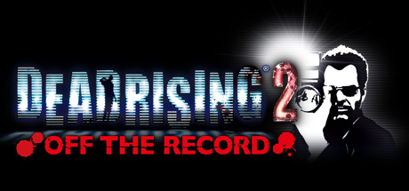

**Platforms:** Windows, PlayStation 3, Xbox 360 &nbsp;|&nbsp; **Genre:** Action, Adventure &nbsp;|&nbsp; **Released:** October 11

> You are Frank West – photojournalist and original hero of the Dead Rising Willamette incident – taking center stage experiencing the re-imagined Fortune City outbreak.
>
> _Synopsis source: Steam_

[Steam](https://store.steampowered.com/app/45770)

---

### Dead Space 2

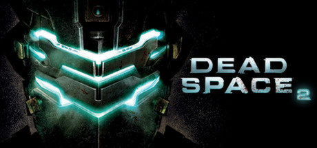

**Platforms:** Xbox 360, Windows, PlayStation 3 &nbsp;|&nbsp; **Publisher:** Electronic Arts &nbsp;|&nbsp; **Genre:** Survival horror &nbsp;|&nbsp; **Released:** January 25, 2011

> Three years after the Necromorph infestation aboard the USS Ishimura, Isaac Clarke awakens from a coma, confused, disoriented, and on a space station called The Sprawl. Explore this world and its zero-g environments to discover the truth about the Unitology and its role in the Necromorph epidemic.
>
> _Synopsis source: Steam_

[Wikipedia](https://en.wikipedia.org/wiki/Dead_Space_2) · [Steam](https://store.steampowered.com/app/47780)

---

### Deadliest Warrior: Legends

**Platforms:** Xbox 360, PlayStation Network, PlayStation 3 &nbsp;|&nbsp; **Developer:** Pipeworks Software &nbsp;|&nbsp; **Publisher:** 345 Games, Spike Games &nbsp;|&nbsp; **Genre:** Fighting &nbsp;|&nbsp; **Released:** July 6, 2011

[Wikipedia](https://en.wikipedia.org/wiki/Deadliest_Warrior:_Legends)

---

### Deathsmiles II

**Platforms:** Xbox 360 &nbsp;|&nbsp; **Released:** May 17

[Wikipedia](https://en.wikipedia.org/wiki/Deathsmiles_II)

---

### Deepak Chopra's Leela

**Platforms:** Wii, Xbox 360 &nbsp;|&nbsp; **Released:** November 8

---

### Deus Ex: Human Revolution

**Platforms:** Windows, PlayStation 3, Xbox 360 &nbsp;|&nbsp; **Publisher:** Square Enix &nbsp;|&nbsp; **Released:** August 23, 2011

---

### Deus Ex: Human Revolution – The Missing Link

**Platforms:** Windows, PlayStation 3, Xbox 360, macOS, Wii U &nbsp;|&nbsp; **Developer:** Eidos Montréal &nbsp;|&nbsp; **Publisher:** Square Enix &nbsp;|&nbsp; **Genre:** Action role-playing, first-person shooter, stealth &nbsp;|&nbsp; **Released:** October 18, 2011

[Wikipedia](https://en.wikipedia.org/wiki/Deus_Ex:_Human_Revolution_%E2%80%93_The_Missing_Link)

---

### Dirt 3

**Platforms:** Windows, Xbox 360, PlayStation 3 &nbsp;|&nbsp; **Released:** May 24

[Wikipedia](https://en.wikipedia.org/wiki/Dirt_3)

---

### Disney Universe

**Platforms:** Windows, macOS, Wii, PlayStation 3, Xbox 360 &nbsp;|&nbsp; **Released:** October 25

[Wikipedia](https://en.wikipedia.org/wiki/Disney_Universe)

---

### Divinity II: The Dragon Knight Saga

**Platforms:** Xbox 360 &nbsp;|&nbsp; **Released:** April 12

[Wikipedia](https://en.wikipedia.org/wiki/Divinity_II#Remake)

---

### Dragon Age II

**Platforms:** Windows, PlayStation 3, Xbox 360 &nbsp;|&nbsp; **Released:** March 8

[Wikipedia](https://en.wikipedia.org/wiki/Dragon_Age_II)

---

### Dragon Ball Z: Ultimate Tenkaichi

**Platforms:** PlayStation 3, Xbox 360 &nbsp;|&nbsp; **Developer:** Spike &nbsp;|&nbsp; **Publisher:** Namco Bandai Games &nbsp;|&nbsp; **Genre:** Fighting &nbsp;|&nbsp; **Released:** October 25, 2011

[Wikipedia](https://en.wikipedia.org/wiki/Dragon_Ball_Z:_Ultimate_Tenkaichi)

---

### Dream Club Zero

**Platforms:** Xbox 360, PlayStation Vita, PlayStation 3 &nbsp;|&nbsp; **Developer:** Tamsoft &nbsp;|&nbsp; **Publisher:** D3 Publisher &nbsp;|&nbsp; **Genre:** Dating sim &nbsp;|&nbsp; **Released:** January 27, 2011

[Wikipedia](https://en.wikipedia.org/wiki/Dream_Club_Zero)

---

### Dreamcast Collection

**Platforms:** Xbox 360, Windows &nbsp;|&nbsp; **Developer:** Sega &nbsp;|&nbsp; **Publisher:** Sega &nbsp;|&nbsp; **Genre:** Various &nbsp;|&nbsp; **Released:** February 22, 2011

[Wikipedia](https://en.wikipedia.org/wiki/Dreamcast_Collection)

---

### DreamWorks Super Star Kartz

**Platforms:** Nintendo 3DS, Nintendo DS, PlayStation 3, Wii, Xbox 360 &nbsp;|&nbsp; **Released:** November 15

[Wikipedia](https://en.wikipedia.org/wiki/DreamWorks_Super_Star_Kartz)

---

### Driver: San Francisco

**Platforms:** PlayStation 3, Xbox 360, Wii, Windows &nbsp;|&nbsp; **Released:** September 6

---

### Duke Nukem Forever

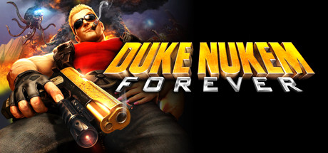

**Platforms:** Windows, PlayStation 3, Xbox 360, macOS &nbsp;|&nbsp; **Genre:** Action &nbsp;|&nbsp; **Released:** June 14

> The King arrives with an arsenal of over-the-top weapons, giant explosions and pure unadulterated fun!
>
> _Synopsis source: Steam_

[Wikipedia](https://en.wikipedia.org/wiki/Duke_Nukem_Forever) · [Steam](https://store.steampowered.com/app/57900)

---

### Dunamis 15

**Platforms:** PlayStation 3, Xbox 360 &nbsp;|&nbsp; **Developer:** 5pb. &nbsp;|&nbsp; **Publisher:** 5pb. &nbsp;|&nbsp; **Genre:** Adventure, visual Novel &nbsp;|&nbsp; **Released:** September 15, 2011

[Wikipedia](https://en.wikipedia.org/wiki/Dunamis_15)

---

### Dungeon Defenders

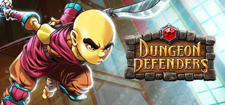

**Platforms:** PlayStation Network, Windows, Xbox 360 &nbsp;|&nbsp; **Genre:** Action, Indie, RPG, Strategy &nbsp;|&nbsp; **Released:** October 18

> Create a hero from one of four classes to save Etheria in this 4-player coop Tower Defense Action-RPG. Includes Steam exclusive Portal gun &amp; TF2 familiars!
>
> _Synopsis source: Steam_

[Wikipedia](https://en.wikipedia.org/wiki/Dungeon_Defenders) · [Steam](https://store.steampowered.com/app/65800)

---

### Dungeon Siege III

**Platforms:** Windows, Xbox 360, PlayStation 3 &nbsp;|&nbsp; **Released:** June 21

[Wikipedia](https://en.wikipedia.org/wiki/Dungeon_Siege_III)

---

### Dungeons & Dragons: Daggerdale

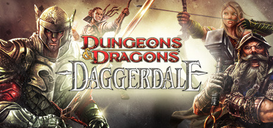

**Platforms:** Windows, Xbox 360 &nbsp;|&nbsp; **Genre:** Action, RPG &nbsp;|&nbsp; **Released:** May 25

> Dungeons & Dragons: Daggerdale offers engaging "hack and slash" gameplay, bringing Dungeons & Dragons to life. Travel to the Dalelands of the Forgotten Realms, where the journey begins in the remote Desertsmouth Mountains.
>
> _Synopsis source: Steam_

[Steam](https://store.steampowered.com/app/99100)

---

### Dynasty Warriors 7

**Platforms:** PlayStation 3, Xbox 360 &nbsp;|&nbsp; **Released:** March 29

[Wikipedia](https://en.wikipedia.org/wiki/Dynasty_Warriors_7)

---

### Dynasty Warriors: Gundam 3

**Platforms:** PlayStation 3, Xbox 360 &nbsp;|&nbsp; **Released:** June 28

---

### Earth Defense Force: Insect Armageddon

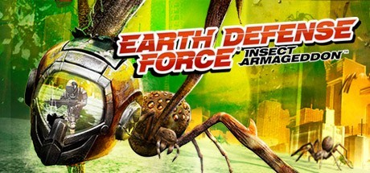

**Platforms:** PlayStation 3, Xbox 360, Windows &nbsp;|&nbsp; **Genre:** Action &nbsp;|&nbsp; **Released:** July 5

> Thousands of giant insects and aliens once again ravage the earth, and only the Earth Defense Force can stop them.
>
> _Synopsis source: Steam_

[Steam](https://store.steampowered.com/app/23530)

---

### El Shaddai: Ascension of the Metatron

**Platforms:** PlayStation 3, Xbox 360 &nbsp;|&nbsp; **Released:** August 16

---

### Escape Goat

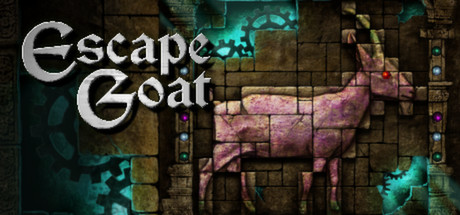

**Platforms:** Windows, Xbox 360 &nbsp;|&nbsp; **Genre:** Action, Indie &nbsp;|&nbsp; **Released:** November 2

> Escape Goat is a puzzle platformer where you take control of a goat, who has been imprisoned for witchcraft, and overcome traps and obstacles to escape the Prison of Agnus. Fear not, for with your supreme agility, sturdy horns, and the help of a magic mouse friend, you can turn the tables on foes and use the environment to your advantage.
>
> _Synopsis source: Steam_

[Wikipedia](https://en.wikipedia.org/wiki/Escape_Goat) · [Steam](https://store.steampowered.com/app/251370)

---

### Eschatos

**Platforms:** Xbox 360 &nbsp;|&nbsp; **Developer:** Qute &nbsp;|&nbsp; **Publisher:** Qute, Degica &nbsp;|&nbsp; **Genre:** Scrolling shooter &nbsp;|&nbsp; **Released:** April 7, 2011

[Wikipedia](https://en.wikipedia.org/wiki/Eschatos)

---

### F.E.A.R. 3

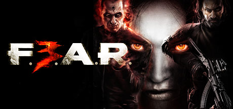

**Platforms:** Windows, Xbox 360, PlayStation 3 &nbsp;|&nbsp; **Genre:** Action &nbsp;|&nbsp; **Released:** June 21

> F.E.A.R. 3 delivers all the hallmarks that define the F.E.A.R. brand: terrifying paranormal experience, frenetic combat and a dramatic storyline.
>
> _Synopsis source: Steam_

[Wikipedia](https://en.wikipedia.org/wiki/F.E.A.R._3) · [Steam](https://store.steampowered.com/app/21100)

---

### F1 2011

**Platforms:** Windows, Xbox 360, PlayStation 3, Nintendo 3DS &nbsp;|&nbsp; **Released:** September 20

[Wikipedia](https://en.wikipedia.org/wiki/F1_2011_(video_game))

---

### Fancy Pants Adventures

**Platforms:** PlayStation Network, Xbox 360 &nbsp;|&nbsp; **Released:** April 19

[Wikipedia](https://en.wikipedia.org/wiki/Fancy_Pants_Adventures)

---

### Fantastic Pets

**Platforms:** Xbox 360 &nbsp;|&nbsp; **Developer:** Blitz Games Studios &nbsp;|&nbsp; **Publisher:** THQ Inc. &nbsp;|&nbsp; **Genre:** Virtual pet &nbsp;|&nbsp; **Released:** April 12, 2011

[Wikipedia](https://en.wikipedia.org/wiki/Fantastic_Pets)

---

### FIFA 12

**Platforms:** PlayStation 3, Xbox 360, Windows, Wii, PlayStation 2, PlayStation Portable, Nintendo 3DS, iOS &nbsp;|&nbsp; **Publisher:** EA Sports &nbsp;|&nbsp; **Released:** September 27, 2011

[Wikipedia](https://en.wikipedia.org/wiki/FIFA_12)

---

### Fight Night Champion

**Platforms:** iOS, PlayStation 3, Xbox 360 &nbsp;|&nbsp; **Released:** March 1

[Wikipedia](https://en.wikipedia.org/wiki/Fight_Night_Champion)

---

### FortressCraft

**Platforms:** Xbox 360 &nbsp;|&nbsp; **Developer:** ProjectorGames &nbsp;|&nbsp; **Publisher:** ProjectorGames &nbsp;|&nbsp; **Genre:** Sandbox &nbsp;|&nbsp; **Released:** April 8, 2011

[Wikipedia](https://en.wikipedia.org/wiki/FortressCraft)

---

### Forza Motorsport 4

**Platforms:** Xbox 360 &nbsp;|&nbsp; **Publisher:** Microsoft Game Studios &nbsp;|&nbsp; **Released:** October 11, 2011

[Wikipedia](https://en.wikipedia.org/wiki/Forza_Motorsport_4)

---

### From Dust

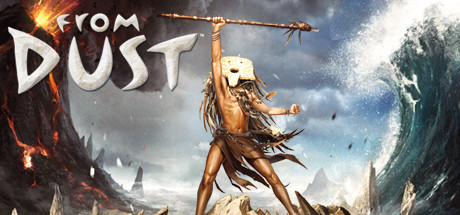

**Platforms:** Xbox 360, Windows &nbsp;|&nbsp; **Genre:** Adventure, Simulation &nbsp;|&nbsp; **Released:** July 27

> Immerse yourself in a world as exotically beautiful as it is dangerous in this modern God-Game where Nature is the Star!
>
> _Synopsis source: Steam_

[Wikipedia](https://en.wikipedia.org/wiki/From_Dust) · [Steam](https://store.steampowered.com/app/33460)

---

### Full House Poker

**Platforms:** Xbox 360, Windows Phone &nbsp;|&nbsp; **Developer:** Microsoft Studios, Krome Studios &nbsp;|&nbsp; **Publisher:** Microsoft Studios &nbsp;|&nbsp; **Genre:** Card game, MMO &nbsp;|&nbsp; **Released:** March 16, 2011

[Wikipedia](https://en.wikipedia.org/wiki/Full_House_Poker)

---

### Gal Gun

**Platforms:** Xbox 360 &nbsp;|&nbsp; **Developer:** Inti Creates &nbsp;|&nbsp; **Publisher:** Alchemist, Inti Creates, PQube &nbsp;|&nbsp; **Genre:** Bishōjo, rail shooter &nbsp;|&nbsp; **Released:** January 27, 2011

[Wikipedia](https://en.wikipedia.org/wiki/Gal_Gun)

---

### Galaga Legions DX

**Platforms:** Xbox 360, PlayStation Network &nbsp;|&nbsp; **Released:** June 29

[Wikipedia](https://en.wikipedia.org/wiki/Galaga_Legions_DX)

---

### Gatling Gears

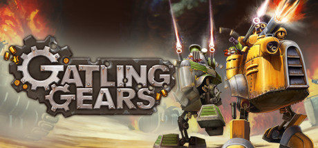

**Platforms:** Xbox 360, PlayStation Network, Windows &nbsp;|&nbsp; **Genre:** Action, Adventure, Indie &nbsp;|&nbsp; **Released:** May 11

> When the Empire begins its reign of destruction in a thirst for natural resources, it’s up to Max Brawley, a retired Gatling Gear pilot, to stop them.
>
> _Synopsis source: Steam_

[Wikipedia](https://en.wikipedia.org/wiki/Gatling_Gears) · [Steam](https://store.steampowered.com/app/102810)

---

### Gears of War 3

**Platforms:** Xbox 360 &nbsp;|&nbsp; **Publisher:** Microsoft Game Studios &nbsp;|&nbsp; **Released:** September 20, 2011

[Wikipedia](https://en.wikipedia.org/wiki/Gears_of_War_3)

---

### Ghostbusters: Sanctum of Slime

**Platforms:** Windows, Xbox 360, PlayStation Network &nbsp;|&nbsp; **Released:** March 23

---

### GoldenEye 007 Reloaded

**Platforms:** PlayStation 3, Xbox 360 &nbsp;|&nbsp; **Released:** November 1

[Wikipedia](https://en.wikipedia.org/wiki/GoldenEye_007_Reloaded)

---

### Gray Matter

**Platforms:** Windows, Xbox 360 &nbsp;|&nbsp; **Genre:** Adventure, Casual &nbsp;|&nbsp; **Released:** February 22

> After a tragic accident, neurobiologist Dr. David Styles has become a recluse, rarely leaving his home, the Dread Hill House. One day, Samantha Everett, a street magician, appears at Dr. Style's doorstep just as he is seeking a new assistant.
>
> _Synopsis source: Steam_

[Wikipedia](https://en.wikipedia.org/wiki/Gray_Matter_(video_game)) · [Steam](https://store.steampowered.com/app/260570)

---

### Grease Dance

**Platforms:** PlayStation 3, Xbox 360 &nbsp;|&nbsp; **Developer:** Zoë Mode &nbsp;|&nbsp; **Publisher:** 505 Games &nbsp;|&nbsp; **Genre:** Music, Rhythm &nbsp;|&nbsp; **Released:** October 25, 2011

[Wikipedia](https://en.wikipedia.org/wiki/Grease_Dance)

---

### Green Lantern: Rise of the Manhunters

**Platforms:** PlayStation 3, Xbox 360, Wii, Nintendo DS, Nintendo 3DS &nbsp;|&nbsp; **Released:** June 7

---

### Guardian Heroes

**Platforms:** Xbox 360 &nbsp;|&nbsp; **Released:** October 12

[Wikipedia](https://en.wikipedia.org/wiki/Guardian_Heroes)

---

### Half-Minute Hero: Super Mega Neo Climax

**Platforms:** Xbox 360 &nbsp;|&nbsp; **Released:** June 29

---

### Halo: Combat Evolved Anniversary

**Platforms:** Xbox 360 &nbsp;|&nbsp; **Released:** November 15

---

### Happy Feet Two: The Video Game

**Platforms:** Nintendo 3DS, Nintendo DS, PlayStation 3, Wii, Xbox 360 &nbsp;|&nbsp; **Released:** November 8

[Wikipedia](https://en.wikipedia.org/wiki/Happy_Feet_Two)

---

### Hard Corps: Uprising

**Platforms:** Xbox 360, PlayStation 3 &nbsp;|&nbsp; **Released:** February 16

---

### Harry Potter and the Deathly Hallows – Part 2

**Platforms:** Windows, Xbox 360, PlayStation 3, Wii, Nintendo DS &nbsp;|&nbsp; **Released:** July 12

[Wikipedia](https://en.wikipedia.org/wiki/Harry_Potter_and_the_Deathly_Hallows_%E2%80%93_Part_2_(video_game))

---

### Hole in the Wall

**Platforms:** Xbox 360 &nbsp;|&nbsp; **Developer:** Ludia &nbsp;|&nbsp; **Publisher:** Microsoft Game Studios &nbsp;|&nbsp; **Genre:** Party &nbsp;|&nbsp; **Released:** August 24, 2011

[Wikipedia](https://en.wikipedia.org/wiki/Hole_in_the_Wall_(video_game))

---

### Homefront

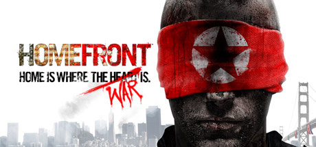

**Platforms:** Windows, Xbox 360, PlayStation 3 &nbsp;|&nbsp; **Genre:** Action &nbsp;|&nbsp; **Released:** March 15

> The Rock Map Pack is Now Available! Join the Resistance, stand united and fight for freedom against an overwhelming military force.
>
> _Synopsis source: Steam_

[Wikipedia](https://en.wikipedia.org/wiki/Homefront_(video_game)) · [Steam](https://store.steampowered.com/app/55100)

---

### Honor in Vengeance II

**Platforms:** Xbox 360 &nbsp;|&nbsp; **Developer:** MichaelArts &nbsp;|&nbsp; **Publisher:** MichaelArts &nbsp;|&nbsp; **Genre:** Space Shooter &nbsp;|&nbsp; **Released:** August 5, 2011

[Wikipedia](https://en.wikipedia.org/wiki/Honor_in_Vengeance_II)

---

### Hulk Hogan's Main Event

**Platforms:** Xbox 360 &nbsp;|&nbsp; **Released:** October 11

[Wikipedia](https://en.wikipedia.org/wiki/Hulk_Hogan%27s_Main_Event)

---

### Hunted: The Demon's Forge

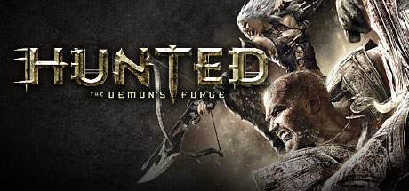

**Platforms:** Windows, PlayStation 3, Xbox 360 &nbsp;|&nbsp; **Genre:** Action, Adventure &nbsp;|&nbsp; **Released:** May 31

> It will take the combined efforts of two great warriors to explore menacing dungeons, overgrown ruins, and downtrodden towns … and discover the secrets of the Demon’s Forge.
>
> _Synopsis source: Steam_

[Steam](https://store.steampowered.com/app/22450)

---

### Insanely Twisted Shadow Planet

**Platforms:** Xbox 360 &nbsp;|&nbsp; **Released:** August 3

[Wikipedia](https://en.wikipedia.org/wiki/Insanely_Twisted_Shadow_Planet)

---

### Instant Brain

**Platforms:** Xbox 360 &nbsp;|&nbsp; **Developer:** Design Factory &nbsp;|&nbsp; **Publisher:** Cave &nbsp;|&nbsp; **Genre:** Visual novel &nbsp;|&nbsp; **Released:** November 11, 2011

[Wikipedia](https://en.wikipedia.org/wiki/Instant_Brain)

---

### Islands of Wakfu

**Platforms:** Xbox 360 &nbsp;|&nbsp; **Released:** March 30

[Wikipedia](https://en.wikipedia.org/wiki/Islands_of_Wakfu)

---

### JASF: Jane's Advanced Strike Fighters

**Platforms:** Windows, PlayStation 3, Xbox 360 &nbsp;|&nbsp; **Released:** October 18

---

### Jimmie Johnson's Anything with an Engine

**Platforms:** PlayStation 3, Wii, Xbox 360 &nbsp;|&nbsp; **Released:** November 1

[Wikipedia](https://en.wikipedia.org/wiki/Jimmie_Johnson%27s_Anything_with_an_Engine)

---

### Jurassic Park: The Game

**Platforms:** Windows, PlayStation 3, Xbox 360 &nbsp;|&nbsp; **Released:** November 15

---

### Just Dance 3

**Platforms:** Wii, PlayStation 3, Xbox 360 &nbsp;|&nbsp; **Released:** October 7

[Wikipedia](https://en.wikipedia.org/wiki/Just_Dance_3)

---

### Just Dance Kids 2

**Platforms:** PlayStation 3, Wii, Xbox 360 &nbsp;|&nbsp; **Released:** October 25

[Wikipedia](https://en.wikipedia.org/wiki/Just_Dance_Kids_2)

---

### Kinect Disneyland Adventures

**Platforms:** Xbox 360 &nbsp;|&nbsp; **Released:** November 15

[Wikipedia](https://en.wikipedia.org/wiki/Kinect_Disneyland_Adventures)

---

### Kinect Fun Labs

**Platforms:** Xbox 360 &nbsp;|&nbsp; **Developer:** Good Science Studio &nbsp;|&nbsp; **Publisher:** Microsoft Studios &nbsp;|&nbsp; **Released:** June 6, 2011

[Wikipedia](https://en.wikipedia.org/wiki/Kinect_Fun_Labs)

---

### Kinect Sports: Season Two

**Platforms:** Xbox 360 &nbsp;|&nbsp; **Developer:** Rare, BigPark &nbsp;|&nbsp; **Publisher:** Microsoft Studios &nbsp;|&nbsp; **Genre:** Sports &nbsp;|&nbsp; **Released:** October 25, 2011

[Wikipedia](https://en.wikipedia.org/wiki/Kinect_Sports:_Season_Two)

---

### Knights Contract

**Platforms:** Xbox 360, PlayStation 3 &nbsp;|&nbsp; **Released:** February 22

[Wikipedia](https://en.wikipedia.org/wiki/Knights_Contract)

---

### Kung Fu Panda 2

**Platforms:** PlayStation 3, Xbox 360, Wii, Nintendo DS &nbsp;|&nbsp; **Released:** May 24

[Wikipedia](https://en.wikipedia.org/wiki/Kung_Fu_Panda_2_(video_game))

---

### Kung-Fu High Impact

**Platforms:** Xbox 360 &nbsp;|&nbsp; **Released:** November 15

---

### L.A. Noire

**Platforms:** PlayStation 3, Xbox 360, Windows &nbsp;|&nbsp; **Genre:** Adventure, Strategy &nbsp;|&nbsp; **Released:** May 17

> In his fight to climb the ranks and do what's right, LAPD detective Cole Phelps must unravel the truth behind a string of arson attacks, conspiracies, and brutal murders, battling the L.A. underworld and even members of his own department.
>
> _Synopsis source: Steam_

[Wikipedia](https://en.wikipedia.org/wiki/L.A._Noire) · [Steam](https://store.steampowered.com/app/110800)

---

### Leedmees

**Platforms:** Xbox 360 &nbsp;|&nbsp; **Developer:** Konami &nbsp;|&nbsp; **Publisher:** Konami &nbsp;|&nbsp; **Genre:** Puzzle &nbsp;|&nbsp; **Released:** September 7, 2011

[Wikipedia](https://en.wikipedia.org/wiki/Leedmees)

---

### Lego Harry Potter: Years 5–7

**Platforms:** Windows, Xbox 360, PlayStation 3, PlayStation Portable, Wii, Nintendo DS, Nintendo 3DS, iOS &nbsp;|&nbsp; **Genre:** Adventure &nbsp;|&nbsp; **Released:** November 11

> LEGO Harry Potter: Years 5-7 takes players through Harry Potter's heroic adventures in the Muggle and wizarding worlds.
>
> _Synopsis source: Steam_

[Steam](https://store.steampowered.com/app/204120)

---

### Lego Pirates of the Caribbean: The Video Game

**Platforms:** Nintendo 3DS, Xbox 360, PlayStation 3, Wii, PlayStation Portable, Nintendo DS, Windows &nbsp;|&nbsp; **Genre:** Action, Adventure &nbsp;|&nbsp; **Released:** May 10

> LEGO® Pirates of the Caribbean: The Video Game is an action adventure game that brings the Pirates of the Caribbean world and all its colorful characters to life in LEGO Brick form. Players experience all the memorable scenes from all four films in the humorous and quirky LEGO Video Games style.
>
> _Synopsis source: Steam_

[Steam](https://store.steampowered.com/app/311770)

---

### Lego Star Wars III: The Clone Wars

**Platforms:** Windows, Xbox 360, PlayStation 3, PlayStation Portable, Wii, Nintendo DS, Nintendo 3DS &nbsp;|&nbsp; **Genre:** Action, Adventure &nbsp;|&nbsp; **Released:** March 22

> LEGO Star Wars III: The Clone Wars will allow fans to explore endlessly and laugh their way through the Star Wars galaxy in the most humorous, accessible and action-packed LEGO game to date.
>
> _Synopsis source: Steam_

[Steam](https://store.steampowered.com/app/32510)

---

### Limbo

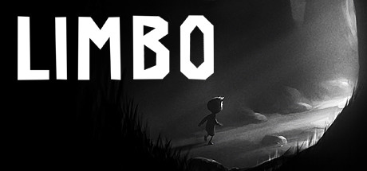

**Platforms:** PlayStation 3, Xbox 360, PlayStation Network, Windows &nbsp;|&nbsp; **Publisher:** Playdead &nbsp;|&nbsp; **Genre:** Action, Adventure, Indie &nbsp;|&nbsp; **Released:** July 19, 2011

> Uncertain of his sister's fate, a boy enters LIMBO
>
> _Synopsis source: Steam_

[Wikipedia](https://en.wikipedia.org/wiki/Limbo_(video_game)) · [Steam](https://store.steampowered.com/app/48000)

---

### Little Racers

**Platforms:** Xbox 360 &nbsp;|&nbsp; **Developer:** Milkstone Studios &nbsp;|&nbsp; **Publisher:** Milkstone Studios &nbsp;|&nbsp; **Genre:** Racing &nbsp;|&nbsp; **Released:** July 27, 2011

[Wikipedia](https://en.wikipedia.org/wiki/Little_Racers)

---

### Lucha Fury

**Platforms:** Xbox 360 &nbsp;|&nbsp; **Released:** June 22

---

### Madden NFL 12

**Platforms:** PlayStation 2, PlayStation 3, PlayStation Portable, Xbox 360, Wii, iOS &nbsp;|&nbsp; **Released:** August 30

[Wikipedia](https://en.wikipedia.org/wiki/Madden_NFL_12)

---

### Magic: The Gathering – Duels of the Planeswalkers 2012

**Platforms:** Xbox 360, PlayStation 3, Windows &nbsp;|&nbsp; **Developer:** Stainless Games &nbsp;|&nbsp; **Publisher:** Wizards of the Coast &nbsp;|&nbsp; **Genre:** Collectible card game &nbsp;|&nbsp; **Released:** June 15, 2011

[Wikipedia](https://en.wikipedia.org/wiki/Magic:_The_Gathering_%E2%80%93_Duels_of_the_Planeswalkers_2012)

---

### Major League Baseball 2K11

**Platforms:** Windows, PlayStation 3, PlayStation 2, PlayStation Portable, Xbox 360, Wii &nbsp;|&nbsp; **Released:** March 8

[Wikipedia](https://en.wikipedia.org/wiki/Major_League_Baseball_2K11)

---

### Man vs. Wild

**Platforms:** PlayStation 3, Wii, Xbox 360 &nbsp;|&nbsp; **Released:** April 26

[Wikipedia](https://en.wikipedia.org/wiki/Man_vs._Wild_(video_game))

---

### Marvel Super Hero Squad: Comic Combat

**Platforms:** PlayStation 3, Wii, Xbox 360 &nbsp;|&nbsp; **Released:** November 15

---

### Marvel vs. Capcom 3: Fate of Two Worlds

**Platforms:** Xbox 360, PlayStation 3 &nbsp;|&nbsp; **Released:** February 15

---

### Mass Effect 2: Arrival

**Platforms:** Windows, PlayStation 3, Xbox 360 &nbsp;|&nbsp; **Developer:** BioWare &nbsp;|&nbsp; **Publisher:** Electronic Arts, Microsoft Game Studios &nbsp;|&nbsp; **Genre:** Action role-playing, third-person shooter &nbsp;|&nbsp; **Released:** March 29, 2011

[Wikipedia](https://en.wikipedia.org/wiki/Mass_Effect_2:_Arrival)

---

### Mayhem

**Platforms:** PlayStation 3, Xbox 360 &nbsp;|&nbsp; **Developer:** Left Field Productions &nbsp;|&nbsp; **Publisher:** Rombax Games &nbsp;|&nbsp; **Genre:** Racing &nbsp;|&nbsp; **Released:** March 25, 2011

[Wikipedia](https://en.wikipedia.org/wiki/Mayhem_(video_game))

---

### Mercury Hg

**Platforms:** PlayStation 3, Xbox 360 &nbsp;|&nbsp; **Developer:** Eiconic Games &nbsp;|&nbsp; **Publisher:** UTV Ignition Games &nbsp;|&nbsp; **Genre:** Puzzle-platform &nbsp;|&nbsp; **Released:** September 27, 2011

[Wikipedia](https://en.wikipedia.org/wiki/Mercury_Hg)

---

### Metal Gear Solid HD Collection

**Platforms:** PlayStation 3, Xbox 360 &nbsp;|&nbsp; **Publisher:** Konami &nbsp;|&nbsp; **Released:** November 8, 2011

[Wikipedia](https://en.wikipedia.org/wiki/Metal_Gear_Solid_HD_Collection)

---

### Michael Jackson: The Experience

**Platforms:** Xbox 360, PlayStation 3, Nintendo 3DS, iOS &nbsp;|&nbsp; **Released:** April 12

---

### MindJack

**Platforms:** PlayStation 3, Xbox 360 &nbsp;|&nbsp; **Genre:** TPS &nbsp;|&nbsp; **Released:** January 18

[Wikipedia](https://en.wikipedia.org/wiki/MindJack)

---

### Moon Diver

**Platforms:** PlayStation Network, Xbox 360 &nbsp;|&nbsp; **Developer:** feelplus &nbsp;|&nbsp; **Publisher:** Square Enix &nbsp;|&nbsp; **Genre:** Side-scroller, platformer &nbsp;|&nbsp; **Released:** March 29, 2011

[Wikipedia](https://en.wikipedia.org/wiki/Moon_Diver)

---

### Mortal Kombat

**Platforms:** PlayStation 3, Xbox 360 &nbsp;|&nbsp; **Released:** April 19

[Wikipedia](https://en.wikipedia.org/wiki/Mortal_Kombat_(2011_video_game))

---

### Mortal Kombat Arcade Kollection

**Platforms:** PlayStation Network, Xbox 360 &nbsp;|&nbsp; **Released:** August 30

[Wikipedia](https://en.wikipedia.org/wiki/Mortal_Kombat_Arcade_Kollection)

---

### MotionSports Adrenaline

**Platforms:** Xbox 360, PlayStation 3 &nbsp;|&nbsp; **Developer:** Ubisoft Milan &nbsp;|&nbsp; **Publisher:** Ubisoft &nbsp;|&nbsp; **Genre:** Sports &nbsp;|&nbsp; **Released:** October 27, 2011

[Wikipedia](https://en.wikipedia.org/wiki/MotionSports_Adrenaline)

---

### MotoGP 10/11

**Platforms:** PlayStation 3, Xbox 360 &nbsp;|&nbsp; **Developer:** Monumental Games &nbsp;|&nbsp; **Publisher:** Capcom &nbsp;|&nbsp; **Genre:** Racing, sports &nbsp;|&nbsp; **Released:** March 15, 2011

[Wikipedia](https://en.wikipedia.org/wiki/MotoGP_10/11)

---

### Ms. Splosion Man

**Platforms:** Xbox 360 &nbsp;|&nbsp; **Released:** July 11

[Wikipedia](https://en.wikipedia.org/wiki/Ms._Splosion_Man)

---

### MX vs. ATV Alive

**Platforms:** Xbox 360, PlayStation 3 &nbsp;|&nbsp; **Released:** May 10

[Wikipedia](https://en.wikipedia.org/wiki/MX_vs._ATV_Alive)

---

### NASCAR The Game: 2011

**Platforms:** Xbox 360, PlayStation 3, Wii &nbsp;|&nbsp; **Released:** March 29

---

### NASCAR Unleashed

**Platforms:** PlayStation 3, Xbox 360, Nintendo 3DS, Wii &nbsp;|&nbsp; **Released:** November 1

[Wikipedia](https://en.wikipedia.org/wiki/NASCAR_Unleashed)

---

### NBA 2K12

**Platforms:** PlayStation 3, Xbox 360, Windows, Wii, PlayStation Portable, PlayStation 2 &nbsp;|&nbsp; **Publisher:** 2K &nbsp;|&nbsp; **Released:** October 4, 2011

[Wikipedia](https://en.wikipedia.org/wiki/NBA_2K12)

---

### NCAA Football 12

**Platforms:** Xbox 360, PlayStation 3 &nbsp;|&nbsp; **Released:** July 12

[Wikipedia](https://en.wikipedia.org/wiki/NCAA_Football_12)

---

### NCIS

**Platforms:** PlayStation 3, Wii, Windows, Xbox 360, Nintendo 3DS &nbsp;|&nbsp; **Developer:** Ubisoft Shanghai &nbsp;|&nbsp; **Publisher:** Ubisoft &nbsp;|&nbsp; **Genre:** Adventure &nbsp;|&nbsp; **Released:** October 27, 2011

[Wikipedia](https://en.wikipedia.org/wiki/NCIS_(video_game))

---

### Need for Speed: The Run

**Platforms:** Windows, PlayStation 3, Wii, Xbox 360, Nintendo 3DS &nbsp;|&nbsp; **Released:** November 15

---

### NHL 12

**Platforms:** PlayStation 3, Xbox 360 &nbsp;|&nbsp; **Released:** September 13

[Wikipedia](https://en.wikipedia.org/wiki/NHL_12)

---

### Nickelodeon Dance

**Platforms:** Wii, Xbox 360 &nbsp;|&nbsp; **Released:** November 8

---

### Nicktoons MLB

**Platforms:** Xbox 360, Wii, Nintendo DS &nbsp;|&nbsp; **Released:** September 13

[Wikipedia](https://en.wikipedia.org/wiki/Nicktoons_MLB)

---

### Operation Flashpoint: Red River

**Platforms:** Windows, Xbox 360, PlayStation 3 &nbsp;|&nbsp; **Released:** June 7

---

### Orcs Must Die!

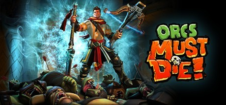

**Platforms:** Xbox 360, Windows &nbsp;|&nbsp; **Genre:** Action, Indie, Strategy &nbsp;|&nbsp; **Released:** October 5

> Slice them, burn them, skewer them, and launch them - no matter how you get it done, orcs must die in this fantasy action-strategy game from Robot Entertainment.
>
> _Synopsis source: Steam_

[Wikipedia](https://en.wikipedia.org/wiki/Orcs_Must_Die!) · [Steam](https://store.steampowered.com/app/102600)

---

### Otomedius Excellent

**Platforms:** Xbox 360 &nbsp;|&nbsp; **Released:** November 8

[Wikipedia](https://en.wikipedia.org/wiki/Otomedius_Excellent)

---

### Outland

**Platforms:** Xbox 360, PlayStation Network &nbsp;|&nbsp; **Released:** April 27

[Wikipedia](https://en.wikipedia.org/wiki/Outland_(video_game))

---

### Phantom Breaker

**Platforms:** Xbox 360, Arcade, PlayStation 3, Windows &nbsp;|&nbsp; **Developer:** 5pb., exA-Arcadia &nbsp;|&nbsp; **Publisher:** 5pb., Rocket Panda Games, exA-Arcadia &nbsp;|&nbsp; **Genre:** Fighting &nbsp;|&nbsp; **Released:** June 2, 2011

[Wikipedia](https://en.wikipedia.org/wiki/Phantom_Breaker)

---

### PopCap Arcade

**Platforms:** Xbox 360 &nbsp;|&nbsp; **Developer:** PopCap Games &nbsp;|&nbsp; **Publisher:** PopCap Games, Mastertronic &nbsp;|&nbsp; **Genre:** Various &nbsp;|&nbsp; **Released:** February 18, 2011

[Wikipedia](https://en.wikipedia.org/wiki/PopCap_Arcade)

---

### Portal 2

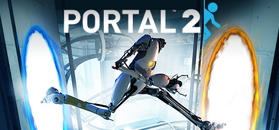

**Platforms:** Windows, Xbox 360, PlayStation 3, macOS &nbsp;|&nbsp; **Publisher:** Valve &nbsp;|&nbsp; **Genre:** Action, Adventure &nbsp;|&nbsp; **Released:** April 19, 2011

> The &quot;Perpetual Testing Initiative&quot; has been expanded to allow you to design co-op puzzles for you and your friends!
>
> _Synopsis source: Steam_

[Wikipedia](https://en.wikipedia.org/wiki/Portal_2) · [Steam](https://store.steampowered.com/app/620)

---

### PowerUp Heroes

**Platforms:** Xbox 360 &nbsp;|&nbsp; **Released:** October 18

[Wikipedia](https://en.wikipedia.org/wiki/PowerUp_Heroes)

---

### Pro Evolution Soccer 2012

**Platforms:** Windows, PlayStation 3, Xbox 360, Wii, PlayStation Portable, Nintendo 3DS, PlayStation 2 &nbsp;|&nbsp; **Released:** September 27

[Wikipedia](https://en.wikipedia.org/wiki/Pro_Evolution_Soccer_2012)

---

### Puss in Boots

**Platforms:** PlayStation 3, Nintendo DS, Wii, Xbox 360 &nbsp;|&nbsp; **Released:** October 25

[Wikipedia](https://en.wikipedia.org/wiki/Puss_in_Boots_(video_game))

---

### Radiant Silvergun

**Platforms:** Xbox 360 &nbsp;|&nbsp; **Released:** September 14

[Wikipedia](https://en.wikipedia.org/wiki/Radiant_Silvergun)

---

### Rage

**Platforms:** Windows, PlayStation 3, Xbox 360 &nbsp;|&nbsp; **Released:** October 4

[Wikipedia](https://en.wikipedia.org/wiki/Rage_(video_game))

---

### Rango

**Platforms:** Nintendo DS, PlayStation 3, Wii, Xbox 360 &nbsp;|&nbsp; **Developer:** Behaviour Interactive &nbsp;|&nbsp; **Publisher:** Electronic Arts, Paramount Digital Entertainment &nbsp;|&nbsp; **Genre:** Action-adventure, platform &nbsp;|&nbsp; **Released:** February 25, 2011

[Wikipedia](https://en.wikipedia.org/wiki/Rango_(video_game))

---

### Raving Rabbids: Alive & Kicking

**Platforms:** Xbox 360 &nbsp;|&nbsp; **Released:** November 1

---

### Rayman Origins

**Platforms:** Wii, PlayStation 3, Xbox 360 &nbsp;|&nbsp; **Publisher:** Ubisoft &nbsp;|&nbsp; **Released:** November 15, 2011

[Wikipedia](https://en.wikipedia.org/wiki/Rayman_Origins)

---

### Red Faction: Armageddon

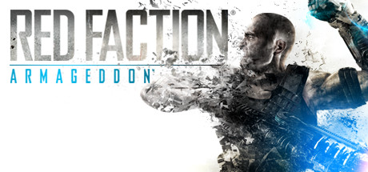

**Platforms:** Windows, Xbox 360, PlayStation 3 &nbsp;|&nbsp; **Genre:** Action &nbsp;|&nbsp; **Released:** June 7

> Red Faction: Armageddon Path to War includes 4 new missions, 2 unlockable items and 10 new achievements!
>
> _Synopsis source: Steam_

[Steam](https://store.steampowered.com/app/55110)

---

### Red Faction: Battlegrounds

**Platforms:** PlayStation 3, PlayStation Network, Xbox 360 &nbsp;|&nbsp; **Developer:** THQ Digital Studios UK &nbsp;|&nbsp; **Publisher:** THQ &nbsp;|&nbsp; **Genre:** Vehicle simulation, multi-directional shooter &nbsp;|&nbsp; **Released:** April 5, 2011

[Wikipedia](https://en.wikipedia.org/wiki/Red_Faction:_Battlegrounds)

---

### Renegade Ops

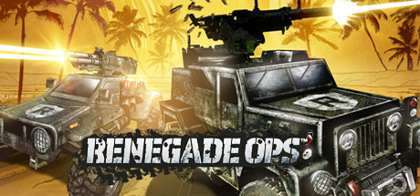

**Platforms:** Xbox 360, Windows &nbsp;|&nbsp; **Genre:** Action &nbsp;|&nbsp; **Released:** September 14

> Blast your way through enemy lines to defeat Inferno, a madman intent on global domination. Destruction just got awesome.
>
> _Synopsis source: Steam_

[Wikipedia](https://en.wikipedia.org/wiki/Renegade_Ops) · [Steam](https://store.steampowered.com/app/99300)

---

### Resident Evil 4 HD

**Platforms:** PlayStation 3, Xbox 360 &nbsp;|&nbsp; **Released:** September 20

[Wikipedia](https://en.wikipedia.org/wiki/Resident_Evil_4)

---

### Resident Evil Code: Veronica X

**Platforms:** PlayStation 3, Xbox 360 &nbsp;|&nbsp; **Released:** September 27

---

### Rio

**Platforms:** PlayStation 3, Xbox 360, Nintendo DS, Wii &nbsp;|&nbsp; **Released:** April 12

[Wikipedia](https://en.wikipedia.org/wiki/Rio_(video_game))

---

### Rise of Nightmares

**Platforms:** Xbox 360 &nbsp;|&nbsp; **Released:** September 6

[Wikipedia](https://en.wikipedia.org/wiki/Rise_of_Nightmares)

---

### Rock Band Country Track Pack 2

**Platforms:** PlayStation 3, Wii, Xbox 360 &nbsp;|&nbsp; **Genre:** Music &nbsp;|&nbsp; **Released:** February 1

[Wikipedia](https://en.wikipedia.org/wiki/Rock_Band_Country_Track_Pack_2)

---

### Rock of Ages

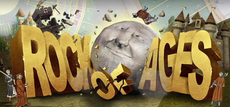

**Platforms:** Windows, Xbox 360, PlayStation Network &nbsp;|&nbsp; **Genre:** Action, Indie, Racing, Strategy &nbsp;|&nbsp; **Released:** August 31

> A rock-solid combination of rock-rolling action, deep strategy, and captivating art and music from different ages of history, this is a game of crush or be crushed!
>
> _Synopsis source: Steam_

[Wikipedia](https://en.wikipedia.org/wiki/Rock_of_Ages_(video_game)) · [Steam](https://store.steampowered.com/app/22230)

---

### Rocksmith

**Platforms:** PlayStation 3, Xbox 360 &nbsp;|&nbsp; **Released:** October 18

[Wikipedia](https://en.wikipedia.org/wiki/Rocksmith)

---

### Rugby Challenge

**Platforms:** Windows, PlayStation 3, Xbox 360 &nbsp;|&nbsp; **Released:** October 20

[Wikipedia](https://en.wikipedia.org/wiki/Rugby_Challenge_(video_game))

---

### Rugby World Cup 2011

**Platforms:** Xbox 360, PlayStation 3 &nbsp;|&nbsp; **Released:** August 26

[Wikipedia](https://en.wikipedia.org/wiki/Rugby_World_Cup_2011_(video_game))

---

### Rush'n Attack: Ex-Patriot

**Platforms:** PlayStation Network, Xbox 360 &nbsp;|&nbsp; **Released:** March 29

---

### Saints Row: The Third

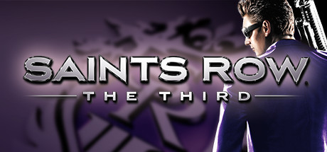

**Platforms:** Windows, Xbox 360, PlayStation 3 &nbsp;|&nbsp; **Genre:** Action &nbsp;|&nbsp; **Released:** November 15

> Get ready for the most out-landish gameplay scenarios ever seen as the Third Street Saints take on the Syndicate!
>
> _Synopsis source: Steam_

[Steam](https://store.steampowered.com/app/55230)

---

### SBK 2011

**Platforms:** Windows, PlayStation 3, Xbox 360 &nbsp;|&nbsp; **Developer:** Milestone &nbsp;|&nbsp; **Publisher:** Black Bean Games &nbsp;|&nbsp; **Genre:** Racing &nbsp;|&nbsp; **Released:** May 13, 2011

[Wikipedia](https://en.wikipedia.org/wiki/SBK_2011)

---

### Section 8: Prejudice

**Platforms:** Windows, PlayStation 3, Xbox 360 &nbsp;|&nbsp; **Developer:** TimeGate Studios &nbsp;|&nbsp; **Publisher:** TimeGate Studios, Atari &nbsp;|&nbsp; **Genre:** First-person shooter &nbsp;|&nbsp; **Released:** April 20, 2011

[Wikipedia](https://en.wikipedia.org/wiki/Section_8:_Prejudice)

---

### Sega Rally Online Arcade

**Platforms:** Xbox 360 &nbsp;|&nbsp; **Released:** May 18

[Wikipedia](https://en.wikipedia.org/wiki/Sega_Rally_3)

---

### Self-Defense Training Camp

**Platforms:** Xbox 360 &nbsp;|&nbsp; **Released:** November 8

[Wikipedia](https://en.wikipedia.org/wiki/Self-Defense_Training_Camp)

---

### Sesame Street: Once Upon a Monster

**Platforms:** Xbox 360 &nbsp;|&nbsp; **Released:** October 11

---

### Shadows of the Damned

**Platforms:** PlayStation 3, Xbox 360 &nbsp;|&nbsp; **Released:** June 21

[Wikipedia](https://en.wikipedia.org/wiki/Shadows_of_the_Damned)

---

### Shift 2: Unleashed

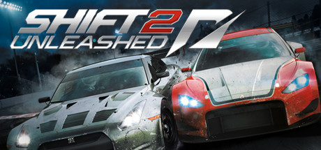

**Platforms:** Windows, PlayStation 3, Xbox 360, iOS &nbsp;|&nbsp; **Genre:** Racing &nbsp;|&nbsp; **Released:** March 29

> Bring the true driver’s experience to life with all the intensity and exhilaration of being behind the wheel!
>
> _Synopsis source: Steam_

[Steam](https://store.steampowered.com/app/47920)

---

### SkyDrift

**Platforms:** PlayStation 3, PlayStation Network, Windows, Xbox 360 &nbsp;|&nbsp; **Developer:** Digital Reality, THQ Nordic &nbsp;|&nbsp; **Publisher:** Digital Reality, Bandai Namco Partners, HandyGames &nbsp;|&nbsp; **Genre:** Arcade racing &nbsp;|&nbsp; **Released:** September 6, 2011

[Wikipedia](https://en.wikipedia.org/wiki/SkyDrift)

---

### Skylanders: Spyro's Adventure

**Platforms:** Windows, Nintendo 3DS, PlayStation 3, Wii, Xbox 360 &nbsp;|&nbsp; **Released:** October 16

---

### Sonic Generations

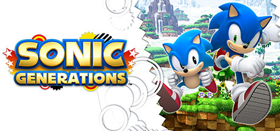

**Platforms:** PlayStation 3, Xbox 360, Windows, Nintendo 3DS &nbsp;|&nbsp; **Genre:** Action &nbsp;|&nbsp; **Released:** November 1

> Celebrate 20 years of Sonic in an all new adventure that delivers a definitive experience to Sonic fans new and old!
>
> _Synopsis source: Steam_

[Wikipedia](https://en.wikipedia.org/wiki/Sonic_Generations) · [Steam](https://store.steampowered.com/app/71340)

---

### Spare Parts

**Platforms:** PlayStation 3, PlayStation Network, Xbox 360 &nbsp;|&nbsp; **Developer:** EA Bright Light &nbsp;|&nbsp; **Publisher:** Electronic Arts &nbsp;|&nbsp; **Genre:** Platform &nbsp;|&nbsp; **Released:** January 18, 2011

[Wikipedia](https://en.wikipedia.org/wiki/Spare_Parts_(video_game))

---

### Spider-Man: Edge of Time

**Platforms:** Xbox 360, PlayStation 3, Wii, Nintendo DS, Nintendo 3DS &nbsp;|&nbsp; **Released:** October 4

---

### SpongeBob's Surf & Skate Roadtrip

**Platforms:** Nintendo DS, Xbox 360 &nbsp;|&nbsp; **Released:** November 8

[Wikipedia](https://en.wikipedia.org/wiki/SpongeBob%27s_Surf_%26_Skate_Roadtrip)

---

### Stacking

**Platforms:** PlayStation 3, Xbox 360 &nbsp;|&nbsp; **Released:** February 8

[Wikipedia](https://en.wikipedia.org/wiki/Stacking_(video_game))

---

### Star Raiders

**Platforms:** Windows, Xbox 360, PlayStation 3 &nbsp;|&nbsp; **Developer:** Incinerator Studios &nbsp;|&nbsp; **Publisher:** Atari, Inc. &nbsp;|&nbsp; **Genre:** Space combat &nbsp;|&nbsp; **Released:** May 11, 2011

[Wikipedia](https://en.wikipedia.org/wiki/Star_Raiders_(2011_video_game))

---

### Steins;Gate: My Darling's Embrace

**Platforms:** Xbox 360 &nbsp;|&nbsp; **Developer:** 5pb. &nbsp;|&nbsp; **Publisher:** 5pb., Spike Chunsoft &nbsp;|&nbsp; **Genre:** Visual novel &nbsp;|&nbsp; **Released:** June 16, 2011

[Wikipedia](https://en.wikipedia.org/wiki/Steins;Gate:_My_Darling's_Embrace)

---

### Superstars V8 Next Challenge

**Platforms:** Windows, PlayStation 3, Xbox 360 &nbsp;|&nbsp; **Genre:** Racing &nbsp;|&nbsp; **Released:** January 25

[Wikipedia](https://en.wikipedia.org/wiki/Superstars_V8_Next_Challenge)

---

### Swarm

**Platforms:** PlayStation Network, Xbox 360 &nbsp;|&nbsp; **Released:** March 22

[Wikipedia](https://en.wikipedia.org/wiki/Swarm_(2011_video_game))

---

### Techno Kitten Adventure

**Platforms:** Xbox 360 &nbsp;|&nbsp; **Released:** September 6

[Wikipedia](https://en.wikipedia.org/wiki/Techno_Kitten_Adventure)

---

### Test Drive Unlimited 2

**Platforms:** Windows, Xbox 360, PlayStation 3 &nbsp;|&nbsp; **Released:** February 8

[Wikipedia](https://en.wikipedia.org/wiki/Test_Drive_Unlimited_2)

---

### The Adventures of Shuggy

**Platforms:** Xbox 360 &nbsp;|&nbsp; **Released:** June 25

[Wikipedia](https://en.wikipedia.org/wiki/The_Adventures_of_Shuggy)

---

### The Adventures of Tintin: The Game

**Platforms:** Windows, PlayStation 3, Xbox 360, Wii, Nintendo 3DS &nbsp;|&nbsp; **Released:** December 6

---

### The Adventures of Tintin: The Secret of the Unicorn

**Platforms:** Windows, Nintendo 3DS, PlayStation 3, Wii, Xbox 360, iOS, Android &nbsp;|&nbsp; **Developer:** Ubisoft Montpellier, Gameloft Barcelona &nbsp;|&nbsp; **Publisher:** Ubisoft, Gameloft &nbsp;|&nbsp; **Genre:** Action-adventure, platformer, stealth &nbsp;|&nbsp; **Released:** October 21, 2011

[Wikipedia](https://en.wikipedia.org/wiki/The_Adventures_of_Tintin:_The_Secret_of_the_Unicorn_(video_game))

---

### The Baconing

**Platforms:** PlayStation Network, Xbox 360 &nbsp;|&nbsp; **Released:** August 30

[Wikipedia](https://en.wikipedia.org/wiki/The_Baconing)

---

### The Black Eyed Peas Experience

**Platforms:** Xbox 360 &nbsp;|&nbsp; **Released:** November 8

[Wikipedia](https://en.wikipedia.org/wiki/The_Black_Eyed_Peas_Experience)

---

### The Cursed Crusade

**Platforms:** Windows, PlayStation 3, Xbox 360 &nbsp;|&nbsp; **Released:** October 25

[Wikipedia](https://en.wikipedia.org/wiki/The_Cursed_Crusade)

---

### The Dishwasher: Vampire Smile

**Platforms:** Xbox 360 &nbsp;|&nbsp; **Released:** April 6

---

### The Elder Scrolls V: Skyrim

**Platforms:** Xbox 360, Windows, PlayStation 3 &nbsp;|&nbsp; **Publisher:** Bethesda Softworks &nbsp;|&nbsp; **Released:** November 11, 2011

---

### The First Templar

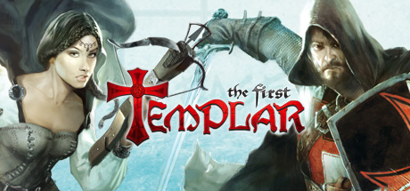

**Platforms:** Windows, Xbox 360 &nbsp;|&nbsp; **Genre:** Action, Adventure &nbsp;|&nbsp; **Released:** May 10

> Uncover the mysteries behind the Templar Order! Steam Exclusive Edition includes bonus mission “The Arena”.
>
> _Synopsis source: Steam_

[Wikipedia](https://en.wikipedia.org/wiki/The_First_Templar) · [Steam](https://store.steampowered.com/app/57680)

---

### The Gunstringer

**Platforms:** Xbox 360 &nbsp;|&nbsp; **Released:** September 13

[Wikipedia](https://en.wikipedia.org/wiki/The_Gunstringer)

---

### The Idolmaster 2

**Platforms:** PlayStation 3, Xbox 360 &nbsp;|&nbsp; **Developer:** Namco Bandai Games &nbsp;|&nbsp; **Publisher:** Namco Bandai Games &nbsp;|&nbsp; **Genre:** Raising simulation, Rhythm &nbsp;|&nbsp; **Released:** February 24, 2011

[Wikipedia](https://en.wikipedia.org/wiki/The_Idolmaster_2)

---

### The King of Fighters XIII

**Platforms:** PlayStation 3, Xbox 360 &nbsp;|&nbsp; **Released:** November 22

[Wikipedia](https://en.wikipedia.org/wiki/The_King_of_Fighters_XIII)

---

### The Lord of the Rings: War in the North

**Platforms:** Windows, PlayStation 3, Xbox 360 &nbsp;|&nbsp; **Released:** November 1

---

### The Penguins of Madagascar: Dr. Blowhole Returns – Again!

**Platforms:** Nintendo DS, PlayStation 3, Wii, Xbox 360 &nbsp;|&nbsp; **Developer:** Griptonite Games &nbsp;|&nbsp; **Publisher:** THQ &nbsp;|&nbsp; **Genre:** Action &nbsp;|&nbsp; **Released:** September 6, 2011

[Wikipedia](https://en.wikipedia.org/wiki/The_Penguins_of_Madagascar:_Dr._Blowhole_Returns_%E2%80%93_Again!)

---

### Thor: God of Thunder

**Platforms:** Xbox 360, PlayStation 3, Wii, Nintendo DS, Nintendo 3DS &nbsp;|&nbsp; **Released:** May 3

---

### Tiger Woods PGA Tour 12

**Platforms:** PlayStation 3, Xbox 360, Wii &nbsp;|&nbsp; **Released:** March 29

[Wikipedia](https://en.wikipedia.org/wiki/Tiger_Woods_PGA_Tour_12)

---

### TNT Racers

**Platforms:** Xbox 360, PlayStation Portable, Wii &nbsp;|&nbsp; **Released:** February 8

[Wikipedia](https://en.wikipedia.org/wiki/TNT_Racers)

---

### Top Spin 4

**Platforms:** PlayStation 3, Xbox 360, Wii &nbsp;|&nbsp; **Released:** March 15

[Wikipedia](https://en.wikipedia.org/wiki/Top_Spin_4)

---

### Tour de France

**Platforms:** PlayStation 3, Xbox 360 &nbsp;|&nbsp; **Developer:** Cyanide &nbsp;|&nbsp; **Publisher:** Focus Entertainment &nbsp;|&nbsp; **Genre:** Sports &nbsp;|&nbsp; **Released:** July 1, 2011

[Wikipedia](https://en.wikipedia.org/wiki/Tour_de_France_(2011_video_game))

---

### Toy Soldiers: Cold War

**Platforms:** Windows, Xbox 360 &nbsp;|&nbsp; **Released:** August 17

---

### Transformers: Dark of the Moon

**Platforms:** Xbox 360, PlayStation 3, Wii, Nintendo DS, Nintendo 3DS &nbsp;|&nbsp; **Released:** June 14

---

### Trine 2

**Platforms:** Windows, macOS, PlayStation Network, Xbox 360 &nbsp;|&nbsp; **Released:** December 7

[Wikipedia](https://en.wikipedia.org/wiki/Trine_2)

---

### Tropico 4

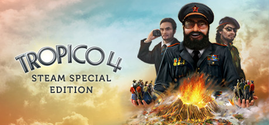

**Platforms:** Windows, Xbox 360 &nbsp;|&nbsp; **Genre:** Simulation, Strategy &nbsp;|&nbsp; **Released:** August 30

> The world is changing and Tropico is moving with the times - geographical powers rise and fall and the world market is dominated by new players with new demands and offers - and you, as El Presidente, face a whole new set of challenges.
>
> _Synopsis source: Steam_

[Wikipedia](https://en.wikipedia.org/wiki/Tropico_4) · [Steam](https://store.steampowered.com/app/57690)

---

### Twister Mania

**Platforms:** Xbox 360 &nbsp;|&nbsp; **Released:** November 1

[Wikipedia](https://en.wikipedia.org/wiki/Twister_Mania)

---

### Two Worlds II

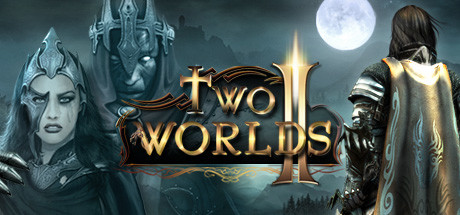

**Platforms:** Windows, Xbox 360, PlayStation 3 &nbsp;|&nbsp; **Genre:** Action RPG &nbsp;|&nbsp; **Released:** January 25

> Check out the new Velvet Edition bundle including both Two Worlds II and Pirates of the Flying Fortress DLC.
>
> _Synopsis source: Steam_

[Wikipedia](https://en.wikipedia.org/wiki/Two_Worlds_II) · [Steam](https://store.steampowered.com/app/7520)

---

### UFC Personal Trainer

**Platforms:** PlayStation 3, Xbox 360, Wii &nbsp;|&nbsp; **Developer:** Heavy Iron Studios &nbsp;|&nbsp; **Publisher:** THQ &nbsp;|&nbsp; **Genre:** Sports, fighting &nbsp;|&nbsp; **Released:** June 28, 2011

[Wikipedia](https://en.wikipedia.org/wiki/UFC_Personal_Trainer)

---

### Ugly Americans: Apocalypsegeddon

**Platforms:** PlayStation Network, Xbox 360 &nbsp;|&nbsp; **Released:** August 30

---

### Ultimate Marvel vs. Capcom 3

**Platforms:** PlayStation 3, Xbox 360 &nbsp;|&nbsp; **Released:** November 15

[Wikipedia](https://en.wikipedia.org/wiki/Ultimate_Marvel_vs._Capcom_3)

---

### Venetica

**Platforms:** Windows, Xbox 360, PlayStation 3 &nbsp;|&nbsp; **Genre:** Action RPG &nbsp;|&nbsp; **Released:** January 18

[Wikipedia](https://en.wikipedia.org/wiki/Venetica)

---

### Virtua Tennis 4

**Platforms:** Xbox 360, PlayStation 3, Wii &nbsp;|&nbsp; **Released:** May 10

[Wikipedia](https://en.wikipedia.org/wiki/Virtua_Tennis_4)

---

### Voltron: Defender of the Universe

**Platforms:** PlayStation 3, Xbox 360 &nbsp;|&nbsp; **Developer:** Behaviour Interactive &nbsp;|&nbsp; **Publisher:** THQ &nbsp;|&nbsp; **Genre:** Adventure, multidirectional shooter &nbsp;|&nbsp; **Released:** November 29, 2011

[Wikipedia](https://en.wikipedia.org/wiki/Voltron:_Defender_of_the_Universe_(video_game))

---

### Warhammer 40,000: Kill Team

**Platforms:** PlayStation 3, Xbox 360 &nbsp;|&nbsp; **Developer:** THQ Digital Studios UK &nbsp;|&nbsp; **Publisher:** THQ &nbsp;|&nbsp; **Genre:** Shooter &nbsp;|&nbsp; **Released:** July 13, 2011

[Wikipedia](https://en.wikipedia.org/wiki/Warhammer_40,000:_Kill_Team)

---

### Warhammer 40,000: Space Marine

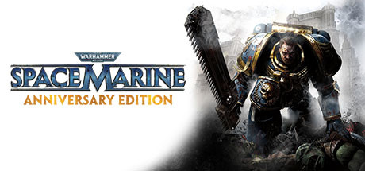

**Platforms:** Windows, Xbox 360, PlayStation 3 &nbsp;|&nbsp; **Genre:** Action &nbsp;|&nbsp; **Released:** September 6

> In Warhammer 40,000 Space Marine you are Captain Titus, a Space Marine of the Ultramarines chapter and a seasoned veteran of countless battles.
>
> _Synopsis source: Steam_

[Steam](https://store.steampowered.com/app/55150)

---

### Warriors: Legends of Troy

**Platforms:** Xbox 360, PlayStation 3 &nbsp;|&nbsp; **Released:** March 15

---

### Wipeout in the Zone

**Platforms:** Xbox 360 &nbsp;|&nbsp; **Released:** June 14

[Wikipedia](https://en.wikipedia.org/wiki/Wipeout_in_the_Zone)

---

### Wizorb

**Platforms:** Xbox 360 &nbsp;|&nbsp; **Released:** September 29

[Wikipedia](https://en.wikipedia.org/wiki/Wizorb)

---

### Worms Ultimate Mayhem

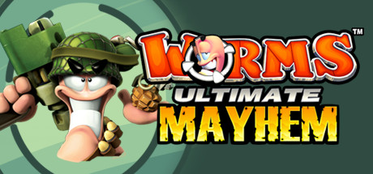

**Platforms:** Windows, Xbox 360 &nbsp;|&nbsp; **Genre:** Strategy &nbsp;|&nbsp; **Released:** September 28

> Load your weapons and experience a whole new dimension in destructive turn-based cartoon action!
>
> _Synopsis source: Steam_

[Wikipedia](https://en.wikipedia.org/wiki/Worms_Ultimate_Mayhem) · [Steam](https://store.steampowered.com/app/70600)

---

### WRC 2: FIA World Rally Championship

**Platforms:** Windows, PlayStation 3, Xbox 360 &nbsp;|&nbsp; **Developer:** Milestone srl &nbsp;|&nbsp; **Publisher:** Black Bean Games, Plug In Digital, Cyberfront &nbsp;|&nbsp; **Genre:** Racing &nbsp;|&nbsp; **Released:** October 14, 2011

[Wikipedia](https://en.wikipedia.org/wiki/WRC_2:_FIA_World_Rally_Championship)

---

### WSC Real 11: World Snooker Championship

**Platforms:** PlayStation 3, Xbox 360 &nbsp;|&nbsp; **Developer:** Dark Energy Digital &nbsp;|&nbsp; **Publisher:** Koch Media &nbsp;|&nbsp; **Genre:** Sports &nbsp;|&nbsp; **Released:** April 15, 2011

[Wikipedia](https://en.wikipedia.org/wiki/WSC_Real_11:_World_Snooker_Championship)

---

### WWE 12

**Platforms:** PlayStation 3, Wii, Xbox 360 &nbsp;|&nbsp; **Released:** November 22

[Wikipedia](https://en.wikipedia.org/wiki/WWE_12)

---

### WWE All Stars

**Platforms:** PlayStation 2, PlayStation 3, PlayStation Portable, Xbox 360, Wii, Nintendo 3DS &nbsp;|&nbsp; **Released:** March 29

[Wikipedia](https://en.wikipedia.org/wiki/WWE_All_Stars)

---

### X-Men: Destiny

**Platforms:** PlayStation 3, Wii, Xbox 360, Nintendo DS &nbsp;|&nbsp; **Released:** September 27

---

### Xotic

**Platforms:** Windows, Xbox 360 &nbsp;|&nbsp; **Developer:** WXP Games &nbsp;|&nbsp; **Publisher:** WXP Games, Valcon Games &nbsp;|&nbsp; **Genre:** First-person shooter &nbsp;|&nbsp; **Released:** September 16, 2011

[Wikipedia](https://en.wikipedia.org/wiki/Xotic)

---

### Yar's Revenge

**Platforms:** Xbox 360, Windows &nbsp;|&nbsp; **Developer:** Killspace Entertainment &nbsp;|&nbsp; **Publisher:** Atari &nbsp;|&nbsp; **Genre:** Rail shooter &nbsp;|&nbsp; **Released:** April 13, 2011

[Wikipedia](https://en.wikipedia.org/wiki/Yar's_Revenge)

---

### Yoostar

**Platforms:** PlayStation 3, Xbox 360, Windows, macOS &nbsp;|&nbsp; **Developer:** Blitz Games Studios &nbsp;|&nbsp; **Publisher:** Yoostar Entertainment Group &nbsp;|&nbsp; **Genre:** Casual

[Wikipedia](https://en.wikipedia.org/wiki/Yoostar)

---

### You Don't Know Jack

**Platforms:** Windows, Nintendo DS, PlayStation 3, Wii, Xbox 360 &nbsp;|&nbsp; **Released:** February 8

[Wikipedia](https://en.wikipedia.org/wiki/You_Don%27t_Know_Jack_(2011_video_game))

---

### Your Shape: Fitness Evolved 2012

**Platforms:** Xbox 360 &nbsp;|&nbsp; **Developer:** Ubisoft Montreal &nbsp;|&nbsp; **Publisher:** Ubisoft &nbsp;|&nbsp; **Genre:** Exergaming, aerobics &nbsp;|&nbsp; **Released:** November 8, 2011

[Wikipedia](https://en.wikipedia.org/wiki/Your_Shape:_Fitness_Evolved_2012)

---

### Zeit²

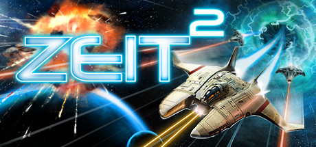

**Platforms:** Windows, Xbox 360 &nbsp;|&nbsp; **Genre:** Shoot 'em up &nbsp;|&nbsp; **Released:** January 12

> Zeit² brings a new twist to the traditional side-scrolling, 2D, shoot-’em-up game sporting a unique time travel feature never seen before in this genre.
>
> _Synopsis source: Steam_

[Wikipedia](https://en.wikipedia.org/wiki/Zeit%C2%B2) · [Steam](https://store.steampowered.com/app/33390)

---

### Zombie Apocalypse: Never Die Alone

**Platforms:** PlayStation 3, Xbox 360, PlayStation Network &nbsp;|&nbsp; **Developer:** Backbone Entertainment &nbsp;|&nbsp; **Publisher:** Konami &nbsp;|&nbsp; **Genre:** Action &nbsp;|&nbsp; **Released:** October 25, 2011

[Wikipedia](https://en.wikipedia.org/wiki/Zombie_Apocalypse:_Never_Die_Alone)

---
