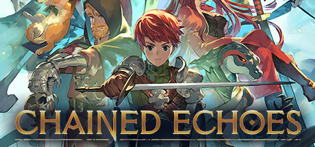
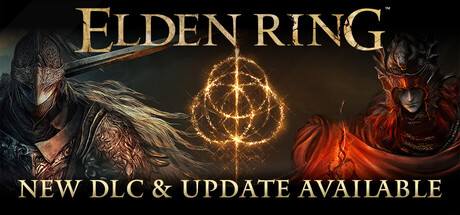

# Xbox One — 2022

[← All Xbox One years](../xbox-one.md) · [Full 2022 page](../../years/2022.md)

324 Xbox One titles in 2022.

### 112 Operator

**Platforms:** Android, iOS, macOS, Nintendo Switch, Windows, Xbox One, Xbox Series X/S &nbsp;|&nbsp; **Developer:** Jutsu Games &nbsp;|&nbsp; **Publisher:** Games Operators, SONKA, Ultimate Games &nbsp;|&nbsp; **Genre:** Simulation, Strategy

[Wikipedia](https://en.wikipedia.org/wiki/112_Operator)

---

### A Memoir Blue

**Platforms:** Windows, Nintendo Switch, PlayStation 4, PlayStation 5, Xbox One, Xbox Series X/S, iOS &nbsp;|&nbsp; **Developer:** Cloisters Interactive &nbsp;|&nbsp; **Publisher:** Annapurna Interactive &nbsp;|&nbsp; **Genre:** Adventure &nbsp;|&nbsp; **Released:** March 24

> A Memoir Blue is an atmospheric journey through the memories of Miriam: a champion swimmer, who on the day of her greatest success dwells on her childhood memories of her mother and a special trip they took.  Experience this personal story through a beautiful mixture of 3D animation and hand-drawn 2D. Interact and play with dreamlike objects in tactile ways that will surprise and delight players as they dig deeper into what was really happening that day.  A gorgeously illustrated story of magical realism, A Memoir Blue shows that the past is a puzzle worth solving.
>
> _Synopsis source: IGDB_

[Wikipedia](https://en.wikipedia.org/wiki/A_Memoir_Blue) · [IGDB](https://www.igdb.com/games/a-memoir-blue)

---

### A Tale of Paper: Refolded

**Platforms:** Windows, Xbox One, Xbox Series X/S &nbsp;|&nbsp; **Developer:** Open House Games &nbsp;|&nbsp; **Publisher:** Digerati &nbsp;|&nbsp; **Genre:** Puzzle-platformer &nbsp;|&nbsp; **Released:** August 19

---

### Afterglitch

**Platforms:** Windows, macOS, Linux, Xbox One, Xbox Series X/S &nbsp;|&nbsp; **Developer:** Hangonit &nbsp;|&nbsp; **Genre:** Art, adventure &nbsp;|&nbsp; **Released:** December 9, 2022

[Wikipedia](https://en.wikipedia.org/wiki/Afterglitch)

---

### Agnostiko Origins

**Platforms:** Nintendo Switch, Xbox One, Xbox Series X/S &nbsp;|&nbsp; **Developer:** Leoned Andrew Tumbaga &nbsp;|&nbsp; **Publisher:** Singles Alliance &nbsp;|&nbsp; **Genre:** Action-platformer, Metroidvania &nbsp;|&nbsp; **Released:** October 27, 2022

[Wikipedia](https://en.wikipedia.org/wiki/Agnostiko_Origins)

---

### AI: The Somnium Files – Nirvana Initiative

**Platforms:** Windows, Nintendo Switch, PlayStation 4, Xbox One &nbsp;|&nbsp; **Developer:** Spike Chunsoft &nbsp;|&nbsp; **Publisher:** Spike Chunsoft &nbsp;|&nbsp; **Genre:** Adventure &nbsp;|&nbsp; **Released:** June 24 (NA)

> Newly-appointed Special Agent Mizuki and her AI partner Aiba are tasked to solve the bizarre Half Body serial killings in this sequel to the critically acclaimed AI: The Somnium Files.
>
> _Synopsis source: IGDB_

[IGDB](https://www.igdb.com/games/ai-the-somnium-files-nirvana-initiative)

---

### AI: The Somnium Files – Nirvana Initiative (EU/OC)

**Platforms:** Windows, Nintendo Switch, PlayStation 4, Xbox One &nbsp;|&nbsp; **Developer:** Spike Chunsoft &nbsp;|&nbsp; **Publisher:** Spike Chunsoft &nbsp;|&nbsp; **Genre:** Adventure &nbsp;|&nbsp; **Released:** July 8

---

### Airoheart

**Platforms:** Windows, Nintendo Switch, PlayStation 4, PlayStation 5, Xbox One, Xbox Series X/S &nbsp;|&nbsp; **Developer:** Pixel Heart Studio &nbsp;|&nbsp; **Publisher:** Soedesco &nbsp;|&nbsp; **Genre:** Action-adventure, RPG &nbsp;|&nbsp; **Released:** September 30

[Wikipedia](https://en.wikipedia.org/wiki/Airoheart)

---

### Akai Katana Shin

**Platforms:** Nintendo Switch, PlayStation 4, Xbox One &nbsp;|&nbsp; **Developer:** Cave &nbsp;|&nbsp; **Publisher:** City Connection &nbsp;|&nbsp; **Genre:** Bullet hell &nbsp;|&nbsp; **Released:** December 15

[Wikipedia](https://en.wikipedia.org/wiki/Akai_Katana_Shin)

---

### Alfred Hitchcock – Vertigo

**Platforms:** Nintendo Switch, PlayStation 4, PlayStation 5, Xbox One, Xbox Series X/S &nbsp;|&nbsp; **Developer:** Pendulo Studios &nbsp;|&nbsp; **Publisher:** Microids &nbsp;|&nbsp; **Genre:** Adventure &nbsp;|&nbsp; **Released:** September 27 (EU/NA)

[Wikipedia](https://en.wikipedia.org/wiki/Alfred_Hitchcock_%E2%80%93_Vertigo)

---

### Alina of the Arena

**Platforms:** Windows, macOS, Xbox One, Xbox Series X/S, PlayStation 4, PlayStation 5 &nbsp;|&nbsp; **Developer:** PINIX Games &nbsp;|&nbsp; **Publisher:** DANGEN Entertainment &nbsp;|&nbsp; **Genre:** Strategy &nbsp;|&nbsp; **Released:** January 19, 2022

[Wikipedia](https://en.wikipedia.org/wiki/Alina_of_the_Arena)

---

### Arcade Paradise

**Platforms:** Windows, Nintendo Switch, PlayStation 4, PlayStation 5, Xbox One, Xbox Series X/S &nbsp;|&nbsp; **Developer:** Nosebleed Interactive &nbsp;|&nbsp; **Publisher:** Wired Productions &nbsp;|&nbsp; **Genre:** Adventure &nbsp;|&nbsp; **Released:** August 11

> Welcome to Arcade Paradise, the 90’s retro arcade adventure game. With the keys to the family laundromat, Ashley decides to transform the business and give the sleepy town of Grindstone something to get excited about! Stay one step ahead of your father, manage and invest profits, and build your very own Arcade Paradise!
>
> _Synopsis source: IGDB_

[Wikipedia](https://en.wikipedia.org/wiki/Arcade_Paradise) · [IGDB](https://www.igdb.com/games/arcade-paradise)

---

### Arcade Spirits: The New Challengers

**Platforms:** Windows, macOS, Linux, Nintendo Switch, PlayStation 4, PlayStation 5, Xbox One, Xbox Series X/S &nbsp;|&nbsp; **Developer:** Fiction Factory Games &nbsp;|&nbsp; **Publisher:** PQube &nbsp;|&nbsp; **Genre:** Visual novel &nbsp;|&nbsp; **Released:** May 27

---

### Arcadegeddon

**Platforms:** Windows, PlayStation 4, PlayStation 5, Xbox One, Xbox Series X/S &nbsp;|&nbsp; **Developer:** IllFonic &nbsp;|&nbsp; **Publisher:** IllFonic &nbsp;|&nbsp; **Genre:** TPS &nbsp;|&nbsp; **Released:** July 5

[Wikipedia](https://en.wikipedia.org/wiki/Arcadegeddon)

---

### Are You Smarter Than a Fifth Grader?

**Platforms:** Windows, Nintendo Switch, PlayStation 4, PlayStation 5, Xbox One, Xbox Series X/S &nbsp;|&nbsp; **Developer:** Massive Miniteam &nbsp;|&nbsp; **Publisher:** HandyGames &nbsp;|&nbsp; **Genre:** Party &nbsp;|&nbsp; **Released:** August 23

[Wikipedia](https://en.wikipedia.org/wiki/Are_You_Smarter_Than_a_Fifth_Grader%3F)

---

### As Dusk Falls

**Platforms:** Windows, Xbox One, Xbox Series X/S &nbsp;|&nbsp; **Developer:** Interior Night &nbsp;|&nbsp; **Publisher:** Xbox Game Studios &nbsp;|&nbsp; **Genre:** Adventure &nbsp;|&nbsp; **Released:** July 19

> As Dusk Falls is an original interactive drama from INTERIOR/NIGHT that explores the entangled lives of two families across thirty years. Starting in 1998 with a robbery-gone-wrong in small town Arizona, the choices you make have a powerful impact on the characters’ lives in this uncompromising story of betrayal, sacrifice and resilience. Drive the lives and relationships of multiple characters in a decades-spanning story told across two intense books.
>
> _Synopsis source: IGDB_

[Wikipedia](https://en.wikipedia.org/wiki/As_Dusk_Falls) · [IGDB](https://www.igdb.com/games/as-dusk-falls)

---

### Asterigos: Curse of the Stars

**Platforms:** Windows, PlayStation 4, PlayStation 5, Xbox One, Xbox Series X/S &nbsp;|&nbsp; **Developer:** Acme Game Studio &nbsp;|&nbsp; **Publisher:** tinyBuild &nbsp;|&nbsp; **Genre:** Action-adventure &nbsp;|&nbsp; **Released:** October 11

> Embark on a journey full of danger in this action RPG, inspired by Greek and Roman mythologies. Explore the breathtaking city of Aphes and forge your way through legions of unique foes and mythical bosses to discover the truth behind the city’s curse.
>
> _Synopsis source: IGDB_

[IGDB](https://www.igdb.com/games/asterigos-curse-of-the-stars)

---

### Atari 50

**Platforms:** Atari VCS, Nintendo Switch, PlayStation 4, PlayStation 5, Windows, Xbox One, Xbox Series X/S &nbsp;|&nbsp; **Developer:** Digital Eclipse &nbsp;|&nbsp; **Publisher:** Atari &nbsp;|&nbsp; **Released:** November 11, 2022

[Wikipedia](https://en.wikipedia.org/wiki/Atari_50)

---

### Atari 50: The Anniversary Celebration

**Platforms:** Windows, Nintendo Switch, PlayStation 4, PlayStation 5, Xbox One, Xbox Series X/S &nbsp;|&nbsp; **Developer:** Digital Eclipse &nbsp;|&nbsp; **Publisher:** Atari &nbsp;|&nbsp; **Genre:** — N/a &nbsp;|&nbsp; **Released:** November 11

---

### Autonauts

**Platforms:** Nintendo Switch, PlayStation 4, PlayStation 5, Xbox One, Xbox Series X/S &nbsp;|&nbsp; **Developer:** Denki &nbsp;|&nbsp; **Publisher:** Curve Games &nbsp;|&nbsp; **Genre:** Action-adventure &nbsp;|&nbsp; **Released:** June 16

[Wikipedia](https://en.wikipedia.org/wiki/Autonauts)

---

### Avenging Spirit

**Platforms:** Nintendo Switch, PlayStation 4, PlayStation 5, Xbox One, Xbox Series X/S &nbsp;|&nbsp; **Developer:** Shinyuden, City Connection &nbsp;|&nbsp; **Publisher:** Ratalaika Games &nbsp;|&nbsp; **Genre:** Platformer &nbsp;|&nbsp; **Released:** July 29

[Wikipedia](https://en.wikipedia.org/wiki/Avenging_Spirit)

---

### Azure Striker Gunvolt

**Platforms:** Xbox One, Xbox Series X/S &nbsp;|&nbsp; **Developer:** Inti Creates &nbsp;|&nbsp; **Publisher:** Inti Creates &nbsp;|&nbsp; **Genre:** Action, Platformer &nbsp;|&nbsp; **Released:** June 29

[Wikipedia](https://en.wikipedia.org/wiki/Azure_Striker_Gunvolt)

---

### Azure Striker Gunvolt 2

**Platforms:** Xbox One, Xbox Series X/S &nbsp;|&nbsp; **Developer:** Inti Creates &nbsp;|&nbsp; **Publisher:** Inti Creates &nbsp;|&nbsp; **Genre:** Action, Platformer &nbsp;|&nbsp; **Released:** July 14

[Wikipedia](https://en.wikipedia.org/wiki/Azure_Striker_Gunvolt_2)

---

### Azure Striker Gunvolt 3

**Platforms:** Nintendo Switch, Xbox One, Xbox Series X/S, Windows, PlayStation 4, PlayStation 5 &nbsp;|&nbsp; **Developer:** Inti Creates &nbsp;|&nbsp; **Publisher:** Inti Creates &nbsp;|&nbsp; **Genre:** Action, Platformer &nbsp;|&nbsp; **Released:** July 28

[Wikipedia](https://en.wikipedia.org/wiki/Azure_Striker_Gunvolt_3)

---

### Baldur's Gate: Dark Alliance II

**Platforms:** Windows, macOS, Linux, Nintendo Switch, PlayStation 4, PlayStation 5, Xbox One, Xbox Series X/S &nbsp;|&nbsp; **Developer:** Black Isle Studios &nbsp;|&nbsp; **Publisher:** Interplay Entertainment &nbsp;|&nbsp; **Genre:** Action RPG, Hack and slash &nbsp;|&nbsp; **Released:** July 20

---

### Batora: Lost Haven

**Platforms:** Windows, PlayStation 4, PlayStation 5, Xbox One, Xbox Series X/S &nbsp;|&nbsp; **Developer:** Stormind Games &nbsp;|&nbsp; **Publisher:** Team17 &nbsp;|&nbsp; **Genre:** Action-adventure &nbsp;|&nbsp; **Released:** October 20

---

### Beacon Pines

**Platforms:** Windows, Nintendo Switch, Xbox One &nbsp;|&nbsp; **Developer:** Hiding Spot Games &nbsp;|&nbsp; **Publisher:** Fellow Traveller &nbsp;|&nbsp; **Genre:** Narrative adventure &nbsp;|&nbsp; **Released:** September 22

> Beacon Pines is a cute and creepy adventure game within a magical storybook. You play as both the reader of the book and its main character, Luka. Explore the town to find word charms. Use your charms to change the course of fate!
>
> _Synopsis source: IGDB_

[Wikipedia](https://en.wikipedia.org/wiki/Beacon_Pines) · [IGDB](https://www.igdb.com/games/beacon-pines)

---

### Blade Assault

**Platforms:** Nintendo Switch, PlayStation 4, PlayStation 5, Xbox One, Xbox Series X/S &nbsp;|&nbsp; **Developer:** Team Suneat &nbsp;|&nbsp; **Publisher:** PM Studios &nbsp;|&nbsp; **Genre:** Action, Roguelike, Platformer &nbsp;|&nbsp; **Released:** September 30

---

### Blade Runner: Enhanced Edition

**Platforms:** Windows, Nintendo Switch, PlayStation 4, Xbox One &nbsp;|&nbsp; **Developer:** Nightdive Studios &nbsp;|&nbsp; **Publisher:** Nightdive Studios &nbsp;|&nbsp; **Genre:** PCA &nbsp;|&nbsp; **Released:** June 23

[Wikipedia](https://en.wikipedia.org/wiki/Blade_Runner_(1997_video_game))

---

### Blast Brigade vs. the Evil Legion of Dr. Cread

**Platforms:** Windows, Nintendo Switch, PlayStation 4, PlayStation 5, Xbox One, Xbox Series X/S &nbsp;|&nbsp; **Developer:** Allods Team Arcade &nbsp;|&nbsp; **Publisher:** My.Games &nbsp;|&nbsp; **Genre:** Metroidvania &nbsp;|&nbsp; **Released:** April 13

[Wikipedia](https://en.wikipedia.org/wiki/Blast_Brigade_vs._the_Evil_Legion_of_Dr._Cread)

---

### Blind Fate: Edo No Yami

**Platforms:** Windows, Nintendo Switch, PlayStation 4, PlayStation 5, Xbox One, Xbox Series X/S &nbsp;|&nbsp; **Developer:** Troglobyte Games &nbsp;|&nbsp; **Publisher:** 101XP &nbsp;|&nbsp; **Genre:** Action-adventure &nbsp;|&nbsp; **Released:** September 15

---

### Bravery & Greed

**Platforms:** Windows, Nintendo Switch, PlayStation 4, Xbox One &nbsp;|&nbsp; **Developer:** Rekka Games &nbsp;|&nbsp; **Publisher:** Team17 &nbsp;|&nbsp; **Genre:** Brawler, Roguelike, Dungeon crawl &nbsp;|&nbsp; **Released:** November 15

---

### Breakout: Recharged

**Platforms:** Windows, macOS, Linux, Nintendo Switch, PlayStation 4, PlayStation 5, Xbox One, Xbox Series X/S, Atari VCS &nbsp;|&nbsp; **Developer:** Adamvision Studios, SneakyBox &nbsp;|&nbsp; **Publisher:** Atari &nbsp;|&nbsp; **Genre:** Action &nbsp;|&nbsp; **Released:** February 10

---

### Bugsnax

**Platforms:** Nintendo Switch, Xbox One, Xbox Series X/S &nbsp;|&nbsp; **Developer:** Young Horses &nbsp;|&nbsp; **Publisher:** Young Horses &nbsp;|&nbsp; **Genre:** Adventure &nbsp;|&nbsp; **Released:** April 28

[Wikipedia](https://en.wikipedia.org/wiki/Bugsnax)

---

### Bunny Park

**Platforms:** Nintendo Switch, PlayStation 4, PlayStation 5, Xbox One, Xbox Series X/S &nbsp;|&nbsp; **Developer:** Cozy Bee Games &nbsp;|&nbsp; **Publisher:** Soedesco &nbsp;|&nbsp; **Genre:** CMS &nbsp;|&nbsp; **Released:** September 30

---

### Call of Duty: Modern Warfare II

**Platforms:** Windows, PlayStation 4, PlayStation 5, Xbox One, Xbox Series X/S &nbsp;|&nbsp; **Developer:** Infinity Ward &nbsp;|&nbsp; **Publisher:** Activision &nbsp;|&nbsp; **Genre:** FPS &nbsp;|&nbsp; **Released:** October 28

> Call of Duty: Modern Warfare II drops players into an unprecedented global conflict that features the return of the iconic Operators of Task Force 141.
>
> _Synopsis source: IGDB_

[IGDB](https://www.igdb.com/games/call-of-duty-modern-warfare-ii)

---

### Call of Duty: Warzone

**Platforms:** PlayStation 4, PlayStation 5, Windows, Xbox One, Xbox Series X/S &nbsp;|&nbsp; **Developer:** Infinity Ward, Raven Software &nbsp;|&nbsp; **Publisher:** Activision &nbsp;|&nbsp; **Genre:** First-person shooter, Battle royale, Extraction shooter &nbsp;|&nbsp; **Released:** November 16, 2022

> Call of Duty: Warzone is a free-to-play combat game with multiple modes and new gameplay updates. It includes Fortune’s Keep, Endgame (limited time), Battle Royale, Black Ops Royale, and Resurgence, each offering different match types and objectives.
>
> _Synopsis source: IGDB_

[Wikipedia](https://en.wikipedia.org/wiki/Call_of_Duty:_Warzone_(2022_video_game)) · [IGDB](https://www.igdb.com/games/call-of-duty-warzone--2)

---

### Cannibal Cuisine

**Platforms:** PlayStation 4, PlayStation 5, Xbox One, Xbox Series X/S &nbsp;|&nbsp; **Developer:** Rocket Vulture &nbsp;|&nbsp; **Publisher:** Rocket Vulture &nbsp;|&nbsp; **Genre:** Simulation &nbsp;|&nbsp; **Released:** January 25

[Wikipedia](https://en.wikipedia.org/wiki/Cannibal_Cuisine)

---

### Capcom Arcade 2nd Stadium

**Platforms:** Windows, Nintendo Switch, PlayStation 4, Xbox One &nbsp;|&nbsp; **Developer:** Capcom &nbsp;|&nbsp; **Publisher:** Capcom &nbsp;|&nbsp; **Genre:** — N/a &nbsp;|&nbsp; **Released:** July 22

[Wikipedia](https://en.wikipedia.org/wiki/Capcom_Arcade_Stadium)

---

### Capcom Fighting Collection

**Platforms:** Windows, Nintendo Switch, PlayStation 4, Xbox One &nbsp;|&nbsp; **Developer:** Capcom &nbsp;|&nbsp; **Publisher:** Capcom &nbsp;|&nbsp; **Genre:** Fighting &nbsp;|&nbsp; **Released:** June 24

[Wikipedia](https://en.wikipedia.org/wiki/Capcom_Fighting_Collection)

---

### Century: Age of Ashes

**Platforms:** Xbox Series X/S, Xbox One &nbsp;|&nbsp; **Developer:** Playwing &nbsp;|&nbsp; **Publisher:** Playwing &nbsp;|&nbsp; **Genre:** Aerial combat , TPS &nbsp;|&nbsp; **Released:** March 10

---

### Chained Echoes

**Platforms:** Windows, Nintendo Switch, macOS, Linux, PlayStation 4, Xbox One &nbsp;|&nbsp; **Developer:** Matthias Linda &nbsp;|&nbsp; **Publisher:** Deck13 &nbsp;|&nbsp; **Genre:** RPG &nbsp;|&nbsp; **Released:** December 8, 2022

> Take up your sword, channel your magic or board your Mech. Chained Echoes is a 16-bit style RPG set in a fantasy world where dragons are as common as piloted mechanical suits.
>
> _Synopsis source: Steam_

[Wikipedia](https://en.wikipedia.org/wiki/Chained_Echoes) · [Steam](https://store.steampowered.com/app/1229240) · [IGDB](https://www.igdb.com/games/chained-echoes)

---

### Chenso Club

**Platforms:** Windows, Nintendo Switch, PlayStation 4, Xbox One &nbsp;|&nbsp; **Developer:** Pixadome &nbsp;|&nbsp; **Publisher:** Curve Games &nbsp;|&nbsp; **Genre:** Roguelike, Brawler &nbsp;|&nbsp; **Released:** September 1

---

### Chinatown Detective Agency

**Platforms:** Windows, macOS, Nintendo Switch, Xbox One &nbsp;|&nbsp; **Developer:** General Interactive Co. &nbsp;|&nbsp; **Publisher:** Humble Games &nbsp;|&nbsp; **Genre:** Adventure &nbsp;|&nbsp; **Released:** April 7

[Wikipedia](https://en.wikipedia.org/wiki/Chinatown_Detective_Agency)

---

### Chrono Cross: The Radical Dreamers Edition

**Platforms:** Windows, Nintendo Switch, PlayStation 4, Xbox One &nbsp;|&nbsp; **Developer:** Square Enix &nbsp;|&nbsp; **Publisher:** Square Enix &nbsp;|&nbsp; **Genre:** RPG &nbsp;|&nbsp; **Released:** April 7

---

### Circus Electrique

**Platforms:** Windows, Nintendo Switch, PlayStation 4, PlayStation 5, Xbox One, Xbox Series X/S &nbsp;|&nbsp; **Developer:** Zen Studios &nbsp;|&nbsp; **Publisher:** Saber Interactive &nbsp;|&nbsp; **Genre:** Tactical RPG &nbsp;|&nbsp; **Released:** September 6

---

### Citizen Sleeper

**Platforms:** Windows, macOS, Nintendo Switch, Xbox One, Xbox Series X/S &nbsp;|&nbsp; **Developer:** Jump Over the Age &nbsp;|&nbsp; **Publisher:** Fellow Traveller &nbsp;|&nbsp; **Genre:** RPG &nbsp;|&nbsp; **Released:** May 5

> Roleplaying in the ruins of interplanetary capitalism. Live the life of an escaped worker, washed-up on a lawless station at the edge of an interstellar society. Inspired by the flexibility and freedom of TTRPGs, explore the station, choose your friends, escape your past and change your future.
>
> _Synopsis source: IGDB_

[Wikipedia](https://en.wikipedia.org/wiki/Citizen_Sleeper) · [IGDB](https://www.igdb.com/games/citizen-sleeper)

---

### Commandos 3 - HD Remaster

**Platforms:** Windows, Nintendo Switch, PlayStation 4, Xbox One &nbsp;|&nbsp; **Developer:** Raylight Games &nbsp;|&nbsp; **Publisher:** Kalypso Media &nbsp;|&nbsp; **Genre:** RTS &nbsp;|&nbsp; **Released:** August 30

[Wikipedia](https://en.wikipedia.org/wiki/Commandos_3)

---

### Conan Chop Chop

**Platforms:** Windows, Nintendo Switch, PlayStation 4, Xbox One &nbsp;|&nbsp; **Developer:** Mighty Kingdom &nbsp;|&nbsp; **Publisher:** Funcom &nbsp;|&nbsp; **Genre:** Action-adventure, Roguelike &nbsp;|&nbsp; **Released:** March 1

[Wikipedia](https://en.wikipedia.org/wiki/Conan_Chop_Chop)

---

### Construction Simulator

**Platforms:** Windows, PlayStation 4, PlayStation 5, Xbox One, Xbox Series X/S &nbsp;|&nbsp; **Developer:** weltenbauer &nbsp;|&nbsp; **Publisher:** Astragon &nbsp;|&nbsp; **Genre:** Simulation &nbsp;|&nbsp; **Released:** September 20

[Wikipedia](https://en.wikipedia.org/wiki/Construction_Simulator)

---

### Crisis Core: Final Fantasy VII Reunion

**Platforms:** Windows, Nintendo Switch, PlayStation 4, PlayStation 5, Xbox One, Xbox Series X/S &nbsp;|&nbsp; **Developer:** Square Enix &nbsp;|&nbsp; **Publisher:** Square Enix &nbsp;|&nbsp; **Genre:** Action RPG &nbsp;|&nbsp; **Type:** Remaster &nbsp;|&nbsp; **Released:** December 13

> Crisis Core: Final Fantasy VII - Reunion is an HD remaster of the smash hit prequel to Final Fantasy VII. In addition to all graphics being remastered in HD, fully voiced dialogue and new soundtrack arrangements make for a dynamic new retelling of a beloved classic.
>
> _Synopsis source: IGDB_

[IGDB](https://www.igdb.com/games/crisis-core-final-fantasy-vii-reunion)

---

### CrossfireX

**Platforms:** Xbox One, Xbox Series X/S &nbsp;|&nbsp; **Developer:** Remedy Entertainment , Smilegate &nbsp;|&nbsp; **Publisher:** Smilegate &nbsp;|&nbsp; **Genre:** FPS &nbsp;|&nbsp; **Released:** February 10

[Wikipedia](https://en.wikipedia.org/wiki/CrossfireX)

---

### Cult of the Lamb

**Platforms:** Windows, macOS, Nintendo Switch, PlayStation 4, PlayStation 5, Xbox One, Xbox Series X/S &nbsp;|&nbsp; **Developer:** Massive Monster &nbsp;|&nbsp; **Publisher:** Devolver Digital &nbsp;|&nbsp; **Genre:** Roguelike, CMS &nbsp;|&nbsp; **Released:** August 11

> Cult of the Lamb casts players in the role of a possessed lamb saved from annihilation by an ominous stranger, and must repay their debt by building a loyal following in his name. Start your own cult in a land of false prophets, venturing out into diverse and mysterious regions to build a loyal community of woodland worshippers and spread your Word to become the one true cult.
>
> _Synopsis source: IGDB_

[Wikipedia](https://en.wikipedia.org/wiki/Cult_of_the_Lamb) · [IGDB](https://www.igdb.com/games/cult-of-the-lamb)

---

### Cuphead in the Delicious Last Course

**Platforms:** Xbox One &nbsp;|&nbsp; **Developer:** Studio MDHR &nbsp;|&nbsp; **Publisher:** Studio MDHR &nbsp;|&nbsp; **Released:** June 30, 2022

[Wikipedia](https://en.wikipedia.org/wiki/Cuphead_in_the_Delicious_Last_Course)

---

### Cuphead: The Delicious Last Course

**Platforms:** Windows, macOS, Nintendo Switch, PlayStation 4, Xbox One &nbsp;|&nbsp; **Developer:** Studio MDHR &nbsp;|&nbsp; **Publisher:** Studio MDHR &nbsp;|&nbsp; **Genre:** Run and gun &nbsp;|&nbsp; **Released:** June 30

---

### Cursed to Golf

**Platforms:** Windows, Nintendo Switch, PlayStation 4, PlayStation 5, Xbox One, Xbox Series X/S &nbsp;|&nbsp; **Developer:** Chuhai Labs &nbsp;|&nbsp; **Publisher:** Thunderful Games &nbsp;|&nbsp; **Genre:** Roguelike, Adventure, Sports &nbsp;|&nbsp; **Released:** August 18

[Wikipedia](https://en.wikipedia.org/wiki/Cursed_to_Golf)

---

### Dakar Desert Rally

**Platforms:** Windows, PlayStation 4, PlayStation 5, Xbox One, Xbox Series X/S &nbsp;|&nbsp; **Developer:** Saber Interactive &nbsp;|&nbsp; **Publisher:** Saber Interactive &nbsp;|&nbsp; **Genre:** Racing &nbsp;|&nbsp; **Released:** October 4

[Wikipedia](https://en.wikipedia.org/wiki/Dakar_Desert_Rally)

---

### Danganronpa 2: Goodbye Despair Anniversary Edition

**Platforms:** Windows, Xbox One, Xbox Series X/S &nbsp;|&nbsp; **Developer:** Spike Chunsoft &nbsp;|&nbsp; **Publisher:** Spike Chunsoft &nbsp;|&nbsp; **Genre:** Adventure, Visual novel &nbsp;|&nbsp; **Released:** May 10

---

### Dawn of the Monsters

**Platforms:** Stadia, Windows, Nintendo Switch, PlayStation 4, PlayStation 5, Xbox One, Xbox Series X/S &nbsp;|&nbsp; **Developer:** 13AM Games &nbsp;|&nbsp; **Publisher:** WayForward &nbsp;|&nbsp; **Genre:** Brawler &nbsp;|&nbsp; **Released:** March 1

[Wikipedia](https://en.wikipedia.org/wiki/Dawn_of_the_Monsters)

---

### DC League of Super-Pets: The Adventures of Krypto and Ace

**Platforms:** Windows, Nintendo Switch, PlayStation 4, Xbox One, Xbox Series X/S, Stadia &nbsp;|&nbsp; **Developer:** PHL Collective &nbsp;|&nbsp; **Publisher:** Outright Games &nbsp;|&nbsp; **Genre:** Action-adventure &nbsp;|&nbsp; **Released:** July 15

[Wikipedia](https://en.wikipedia.org/wiki/DC_League_of_Super-Pets)

---

### Deadcraft

**Platforms:** Windows, Nintendo Switch, PlayStation 4, PlayStation 5, Xbox One, Xbox Series X/S &nbsp;|&nbsp; **Developer:** Marvelous First Studio &nbsp;|&nbsp; **Publisher:** Xseed Games &nbsp;|&nbsp; **Genre:** Survival, Action &nbsp;|&nbsp; **Released:** May 19

[Wikipedia](https://en.wikipedia.org/wiki/Deadcraft)

---

### Despot's Game

**Platforms:** Windows, macOS, Linux, Nintendo Switch, PlayStation 4, PlayStation 5, Xbox One, Xbox Series X/S &nbsp;|&nbsp; **Developer:** Konfa Games &nbsp;|&nbsp; **Publisher:** tinyBuild &nbsp;|&nbsp; **Genre:** Roguelike, Auto battler &nbsp;|&nbsp; **Released:** September 15

---

### Destiny 2: The Witch Queen

**Platforms:** Windows, PlayStation 4, PlayStation 5, Xbox One, Xbox Series X/S, Stadia &nbsp;|&nbsp; **Developer:** Bungie &nbsp;|&nbsp; **Publisher:** Bungie &nbsp;|&nbsp; **Genre:** FPS &nbsp;|&nbsp; **Released:** February 22

---

### Destroy All Humans! Clone Carnage

**Platforms:** Windows, PlayStation 4, Xbox One &nbsp;|&nbsp; **Developer:** Black Forest Games &nbsp;|&nbsp; **Publisher:** THQ Nordic &nbsp;|&nbsp; **Genre:** Action-adventure &nbsp;|&nbsp; **Released:** May 31

[Wikipedia](https://en.wikipedia.org/wiki/Destroy_All_Humans!_(2020_video_game))

---

### Digimon Survive

**Platforms:** Nintendo Switch, PlayStation 4, Windows, Xbox One &nbsp;|&nbsp; **Developer:** Hyde &nbsp;|&nbsp; **Publisher:** Bandai Namco Entertainment &nbsp;|&nbsp; **Genre:** Visual novel, Tactical RPG &nbsp;|&nbsp; **Released:** July 28 (JP)

> This is a story of survival in a strange new world.  Celebrating the 20th Anniversary of the Digimon Anime, Digimon Survive presents a brand-new adventure set in a mysterious world with characters designed by Uichi Ukumo, and music by the much-acclaimed Tomoki Miyoshi.  Digimon Survive sees a brand-new group of teenagers, led by Takuma Momozuka, get lost on a school camping trip, finding them transported to a strange new world of monsters and danger.  As they fight their way back home through an animated world of difficult decisions and deadly battles, players’ choices throughout the game will impact the evolution of their monster allies, and the final ending. Battles in the game are fought in 2D, in a more classic SRPG style.
>
> _Synopsis source: IGDB_

[Wikipedia](https://en.wikipedia.org/wiki/Digimon_Survive) · [IGDB](https://www.igdb.com/games/digimon-survive)

---

### Disc Room

**Platforms:** Xbox One &nbsp;|&nbsp; **Developer:** Terri, Rose, Kitty, and JW &nbsp;|&nbsp; **Publisher:** Devolver Digital &nbsp;|&nbsp; **Genre:** Action, Puzzle &nbsp;|&nbsp; **Released:** June 7

[Wikipedia](https://en.wikipedia.org/wiki/Disc_Room)

---

### DJMax Respect V

**Platforms:** Xbox One, Xbox Series X/S &nbsp;|&nbsp; **Developer:** Neowiz &nbsp;|&nbsp; **Publisher:** Neowiz &nbsp;|&nbsp; **Genre:** Rhythm &nbsp;|&nbsp; **Released:** July 7

[Wikipedia](https://en.wikipedia.org/wiki/DJMax_Respect_V)

---

### Dolmen

**Platforms:** Windows, PlayStation 4, PlayStation 5, Xbox One, Xbox Series X/S &nbsp;|&nbsp; **Developer:** Massive Work Studio &nbsp;|&nbsp; **Publisher:** Prime Matter &nbsp;|&nbsp; **Genre:** Action RPG &nbsp;|&nbsp; **Released:** May 20

---

### Dragon Ball: The Breakers

**Platforms:** Windows, Nintendo Switch, PlayStation 4, Xbox One &nbsp;|&nbsp; **Developer:** Dimps &nbsp;|&nbsp; **Publisher:** Bandai Namco Entertainment &nbsp;|&nbsp; **Genre:** Action, Survival &nbsp;|&nbsp; **Released:** October 13 (JP)

---

### Dreadout 2

**Platforms:** Xbox One, Xbox Series X/S, PlayStation 4, PlayStation 5 &nbsp;|&nbsp; **Developer:** Digital Happiness &nbsp;|&nbsp; **Publisher:** Digital Happiness &nbsp;|&nbsp; **Genre:** Survival horror &nbsp;|&nbsp; **Released:** July 15

[Wikipedia](https://en.wikipedia.org/wiki/Dreadout_2)

---

### DreamWorks Dragons: Legends of the Nine Realms

**Platforms:** Windows, Nintendo Switch, PlayStation 4, PlayStation 5, Xbox One, Xbox Series X/S, Stadia &nbsp;|&nbsp; **Developer:** A Heartful of Games &nbsp;|&nbsp; **Publisher:** Outright Games &nbsp;|&nbsp; **Genre:** Adventure &nbsp;|&nbsp; **Released:** September 23

---

### Dying Light 2

**Platforms:** PlayStation 4, PlayStation 5, Windows, Xbox One, Xbox Series X/S, Nintendo Switch &nbsp;|&nbsp; **Developer:** Techland &nbsp;|&nbsp; **Publisher:** Techland &nbsp;|&nbsp; **Genre:** Action role-playing, survival horror &nbsp;|&nbsp; **Released:** February 4, 2022

[Wikipedia](https://en.wikipedia.org/wiki/Dying_Light_2)

---

### Dying Light 2 Stay Human

**Platforms:** Windows, Nintendo Switch, PlayStation 4, PlayStation 5, Xbox One, Xbox Series X/S &nbsp;|&nbsp; **Developer:** Techland &nbsp;|&nbsp; **Publisher:** Techland &nbsp;|&nbsp; **Genre:** Action RPG, Survival horror &nbsp;|&nbsp; **Released:** February 4

> The last great human settlement exists within an unforgiving, infected world. Exceptional agility and combat skills make you a powerful ally and a valuable commodity. With your unique abilities you have the power to be an agent of change within this decaying metropolis. Use it wisely.
>
> _Synopsis source: IGDB_

[Wikipedia](https://en.wikipedia.org/wiki/Dying_Light_2_Stay_Human) · [IGDB](https://www.igdb.com/games/dying-light-2-stay-human)

---

### Dynasty Warriors 9: Empires

**Platforms:** Windows, Nintendo Switch, PlayStation 4, PlayStation 5, Xbox One, Xbox Series X/S, Stadia &nbsp;|&nbsp; **Developer:** Omega Force &nbsp;|&nbsp; **Publisher:** Koei Tecmo &nbsp;|&nbsp; **Genre:** Hack and slash &nbsp;|&nbsp; **Released:** February 15

---

### Edge of Eternity

**Platforms:** PlayStation 4, PlayStation 5, Xbox One, Xbox Series X/S, Nintendo Switch &nbsp;|&nbsp; **Developer:** Midgar Studio &nbsp;|&nbsp; **Publisher:** Dear Villagers &nbsp;|&nbsp; **Genre:** RPG &nbsp;|&nbsp; **Released:** February 10

[Wikipedia](https://en.wikipedia.org/wiki/Edge_of_Eternity_(video_game))

---

### Eiyuden Chronicle: Rising

**Platforms:** Windows, Nintendo Switch, PlayStation 4, PlayStation 5, Xbox One, Xbox Series X/S &nbsp;|&nbsp; **Developer:** Rabbit & Bear Studios &nbsp;|&nbsp; **Publisher:** 505 Games &nbsp;|&nbsp; **Genre:** Action RPG &nbsp;|&nbsp; **Released:** May 10

> Eiyuden Chronicle: Rising is an action RPG set in the same world as Eiyuden Chronicle: Hundred Heroes. Featuring town-building mechanics, fast-paced combat, and important back-story for several of the Eiyuden Chronicle: Hundred Heroes cast of characters.
>
> _Synopsis source: IGDB_

[IGDB](https://www.igdb.com/games/eiyuden-chronicle-rising)

---

### Elasto Mania Remastered

**Platforms:** Windows, Nintendo Switch, PlayStation 4, PlayStation 5, Xbox One, Xbox Series X/S &nbsp;|&nbsp; **Developer:** Elasto Mania Team &nbsp;|&nbsp; **Publisher:** Elasto Mania Team &nbsp;|&nbsp; **Genre:** Simulation &nbsp;|&nbsp; **Released:** January 26

[Wikipedia](https://en.wikipedia.org/wiki/Elasto_Mania_Remastered)

---

### Elden Ring

**Platforms:** PlayStation 5, Xbox Series X/S, Windows, PlayStation 4, Xbox One &nbsp;|&nbsp; **Developer:** FromSoftware &nbsp;|&nbsp; **Publisher:** Bandai Namco Entertainment &nbsp;|&nbsp; **Genre:** Action RPG &nbsp;|&nbsp; **Released:** February 25, 2022

> THE CRITICALLY ACCLAIMED FANTASY ACTION RPG. Rise, Tarnished, and be guided by grace to brandish the power of the Elden Ring and become an Elden Lord in the Lands Between.
>
> _Synopsis source: Steam_

[Wikipedia](https://en.wikipedia.org/wiki/Elden_Ring) · [Steam](https://store.steampowered.com/app/1245620) · [IGDB](https://www.igdb.com/games/elden-ring)

---

### Elemental War 2

**Platforms:** Windows, macOS, Linux, PlayStation 4, PlayStation 5, Xbox One, Xbox Series X/S, Stadia &nbsp;|&nbsp; **Developer:** Clockwork Origins &nbsp;|&nbsp; **Publisher:** Clockwork Origins &nbsp;|&nbsp; **Genre:** Tower defense &nbsp;|&nbsp; **Released:** May 6

---

### Elevator Action Returns S-Tribute

**Platforms:** Windows, Nintendo Switch, PlayStation 4, Xbox One &nbsp;|&nbsp; **Developer:** City Connection &nbsp;|&nbsp; **Publisher:** City Connection &nbsp;|&nbsp; **Genre:** Run and gun &nbsp;|&nbsp; **Released:** December 1

[Wikipedia](https://en.wikipedia.org/wiki/Elevator_Action_Returns_S-Tribute)

---

### ELEX II

**Platforms:** Windows, PlayStation 4, PlayStation 5, Xbox One, Xbox Series X/S &nbsp;|&nbsp; **Developer:** Piranha Bytes &nbsp;|&nbsp; **Publisher:** THQ Nordic &nbsp;|&nbsp; **Genre:** Action RPG &nbsp;|&nbsp; **Released:** March 1

> Several years after Jax defeated the Hybrid, a new threat arrives from the sky, unleashing the dangerous powers of dark Elex and endangering all life on the planet. In order to defend the peace on Magalan and the safety of his own family, Jax has to go on a mission to convince the factions to unite against the invaders.  Dive into a huge, hand-crafted, completely unique world with multiple factions and diverse environments set in a post-apocalyptic science fantasy universe. Explore the vast world of Magalan with your jetpack, and play through the epic story the way you want.
>
> _Synopsis source: IGDB_

[Wikipedia](https://en.wikipedia.org/wiki/ELEX_II) · [IGDB](https://www.igdb.com/games/elex-ii)

---

### Endling: Extinction is Forever

**Platforms:** Windows, Nintendo Switch, PlayStation 4, Xbox One, PlayStation 5, Xbox Series X/S &nbsp;|&nbsp; **Developer:** Herobeat Studios &nbsp;|&nbsp; **Publisher:** HandyGames &nbsp;|&nbsp; **Genre:** Adventure, Survival &nbsp;|&nbsp; **Released:** July 19

> As the last mother fox on Earth, your cubs need all your care to survive in a merciless world that slowly destroys itself. You have to help them, teach them and save them. And you should never forget that extinction is forever.
>
> _Synopsis source: IGDB_

[IGDB](https://www.igdb.com/games/endling-extinction-is-forever)

---

### Escape Academy

**Platforms:** Windows, PlayStation 4, PlayStation 5, Xbox One, Xbox Series X/S &nbsp;|&nbsp; **Developer:** Coin Crew Games &nbsp;|&nbsp; **Publisher:** Iam8bit , Skybound Games &nbsp;|&nbsp; **Genre:** Puzzle &nbsp;|&nbsp; **Released:** July 14

> Welcome to the Escape Academy. Train to become the ultimate Escapist. Solve Puzzles. Hack Servers. Meet the Faculty. Brew the perfect cup of tea. Escape Rooms in single player or co-op with a friend - local or online!
>
> _Synopsis source: IGDB_

[Wikipedia](https://en.wikipedia.org/wiki/Escape_Academy) · [IGDB](https://www.igdb.com/games/escape-academy)

---

### Evil Dead: The Game

**Platforms:** Windows, Nintendo Switch, PlayStation 4, PlayStation 5, Xbox One, Xbox Series X/S &nbsp;|&nbsp; **Developer:** Boss Team Games &nbsp;|&nbsp; **Publisher:** Saber Interactive &nbsp;|&nbsp; **Genre:** Horror &nbsp;|&nbsp; **Released:** May 13

> Evil Dead: The Game is a 4 vs 1 asymmetrical horror/survival game based on the Evil Dead franchise and characters created by Sam Raimi, Robert Tapert, and Bruce Campbell. Defend the world against evil or bring wrath as the Kandarian Demon.
>
> _Synopsis source: IGDB_

[IGDB](https://www.igdb.com/games/evil-dead-the-game--1)

---

### Evil West

**Platforms:** Windows, PlayStation 4, PlayStation 5, Xbox One, Xbox Series X/S &nbsp;|&nbsp; **Developer:** Flying Wild Hog &nbsp;|&nbsp; **Publisher:** Focus Entertainment &nbsp;|&nbsp; **Genre:** TPS &nbsp;|&nbsp; **Released:** November 22

> A dark menace consumes the Old West. In solo or coop, fight with style in visceral, explosive combat against bloodthirsty monstrosities. Eradicate the vampiric hordes with your lightning-fueled gauntlet and become a Wild West Superhero.  In visceral, explosive combat, unleash hell with your firearms, lightning-fueled gauntlet and gadgets. Kill bloodthirsty monstrosities in style as a lone hunter or in co-op with a friend. Explore and fight in a narrative-driven campaign while upgrading your weapons and hunting tools. Unlock new perks to evolve your monster-slaying mastery, crafting your own playstyle to defeat the supernatural hordes.
>
> _Synopsis source: IGDB_

[Wikipedia](https://en.wikipedia.org/wiki/Evil_West) · [IGDB](https://www.igdb.com/games/evil-west)

---

### F1 22

**Platforms:** Windows, PlayStation 4, PlayStation 5, Xbox One, Xbox Series X/S &nbsp;|&nbsp; **Developer:** Codemasters &nbsp;|&nbsp; **Publisher:** Electronic Arts &nbsp;|&nbsp; **Genre:** Racing &nbsp;|&nbsp; **Released:** July 1

> Race the stunning, new cars of the Formula 1 2022 season with the authentic lineup of all 20 drivers and 10 teams, and take control of your race experience with new immersive or cinematic race sequences. Test your skills around the new Miami International Autodrome, and get a taste of the glitz and glamour in F1 Life. Create a team and take them to the front of the grid with new depth in the acclaimed My Team career mode, race head-to-head in split-screen or multiplayer, or change the pace by taking supercars from some of the sport’s biggest names to the track.
>
> _Synopsis source: IGDB_

[Wikipedia](https://en.wikipedia.org/wiki/F1_22) · [IGDB](https://www.igdb.com/games/f1-22)

---

### F1 Manager 2022

**Platforms:** Windows, PlayStation 4, PlayStation 5, Xbox One, Xbox Series X/S &nbsp;|&nbsp; **Developer:** Frontier Developments &nbsp;|&nbsp; **Publisher:** Frontier Developments &nbsp;|&nbsp; **Genre:** Business sim &nbsp;|&nbsp; **Released:** August 30

[Wikipedia](https://en.wikipedia.org/wiki/F1_Manager_2022)

---

### Fall Guys

**Platforms:** Nintendo Switch, PlayStation 5, Xbox One, Xbox Series X/S &nbsp;|&nbsp; **Developer:** Mediatonic &nbsp;|&nbsp; **Publisher:** Epic Games &nbsp;|&nbsp; **Genre:** Battle royale, Platformer &nbsp;|&nbsp; **Released:** June 21

[Wikipedia](https://en.wikipedia.org/wiki/Fall_Guys)

---

### Fallen Legion Revenants

**Platforms:** Windows, PlayStation 5, Xbox One, Xbox Series X/S &nbsp;|&nbsp; **Developer:** YummyYummyTummy &nbsp;|&nbsp; **Publisher:** NIS America &nbsp;|&nbsp; **Genre:** Action RPG &nbsp;|&nbsp; **Released:** August 23 (NA/EU)

[Wikipedia](https://en.wikipedia.org/wiki/Fallen_Legion)

---

### Fallen Legion: Rise to Glory

**Platforms:** Windows, PlayStation 5, Xbox One, Xbox Series X/S &nbsp;|&nbsp; **Developer:** YummyYummyTummy &nbsp;|&nbsp; **Publisher:** NIS America &nbsp;|&nbsp; **Genre:** Action RPG &nbsp;|&nbsp; **Released:** August 23 (NA/EU)

---

### Far: Changing Tides

**Platforms:** Windows, Nintendo Switch, PlayStation 4, Xbox One &nbsp;|&nbsp; **Developer:** Okomotive &nbsp;|&nbsp; **Publisher:** Frontier &nbsp;|&nbsp; **Genre:** Adventure &nbsp;|&nbsp; **Released:** March 1

> Far: Changing Tides is an atmospheric vehicle adventure driven by an emotional story. When floods ravage your world, captain a ship like no other and search for a new home. Sail stormy waters, dive unknown depths, and explore forgotten ruins on your voyage.
>
> _Synopsis source: IGDB_

[IGDB](https://www.igdb.com/games/far-changing-tides)

---

### FIFA 23

**Platforms:** Windows, Nintendo Switch, PlayStation 4, PlayStation 5, Xbox One, Xbox Series X/S, Stadia &nbsp;|&nbsp; **Developer:** EA Vancouver , EA Romania &nbsp;|&nbsp; **Publisher:** EA Sports &nbsp;|&nbsp; **Genre:** Sports &nbsp;|&nbsp; **Released:** September 30

> FIFA 23 brings The World’s Game to the pitch, with HyperMotion2 Technology that delivers even more gameplay realism, men’s and women’s FIFA World Cup coming during the season, women’s club teams, cross-play features, and more.
>
> _Synopsis source: IGDB_

[Wikipedia](https://en.wikipedia.org/wiki/FIFA_23) · [IGDB](https://www.igdb.com/games/fifa-23)

---

### Final Vendetta

**Platforms:** Windows, macOS, Linux, Nintendo Switch, PlayStation 4, PlayStation 5, Xbox One, Xbox Series X/S &nbsp;|&nbsp; **Developer:** Bitmap Bureau &nbsp;|&nbsp; **Publisher:** Numskull Games &nbsp;|&nbsp; **Genre:** Brawler &nbsp;|&nbsp; **Released:** June 17

---

### Firegirl: Hack 'n Splash Rescue DX

**Platforms:** Windows, Nintendo Switch, PlayStation 4, PlayStation 5, Xbox One, Xbox Series X/S &nbsp;|&nbsp; **Developer:** Dejima &nbsp;|&nbsp; **Publisher:** Thunderful Publishing &nbsp;|&nbsp; **Genre:** Roguelike, Platformer &nbsp;|&nbsp; **Released:** June 22

---

### Five Nights at Freddy's: Security Breach

**Platforms:** Stadia, Xbox One, Xbox Series X/S &nbsp;|&nbsp; **Developer:** Steel Wool Games &nbsp;|&nbsp; **Publisher:** Steel Wool Games &nbsp;|&nbsp; **Genre:** Survival horror &nbsp;|&nbsp; **Released:** July 1

---

### Floppy Knights

**Platforms:** Windows, macOS, Xbox One &nbsp;|&nbsp; **Developer:** Rose City Games &nbsp;|&nbsp; **Publisher:** Rose City Games &nbsp;|&nbsp; **Genre:** TBS, Deck building &nbsp;|&nbsp; **Released:** May 24

---

### Fobia - St. Dinfna Hotel

**Platforms:** Windows, PlayStation 4, PlayStation 5, Xbox One, Xbox Series X/S &nbsp;|&nbsp; **Developer:** Pulsatrix Studios &nbsp;|&nbsp; **Publisher:** Maximum Games &nbsp;|&nbsp; **Genre:** Sports &nbsp;|&nbsp; **Released:** June 28

> Fobia: St. Dinfna Hotel is a first-person psychological horror indie game focused on environment exploration, survival and puzzles solving, developed by the Brazilian studio Pulsatrix Studios.
>
> _Synopsis source: IGDB_

[IGDB](https://www.igdb.com/games/fobia-st-dinfna-hotel)

---

### Football Manager 2023

**Platforms:** Windows, macOS, Nintendo Switch, PlayStation 5, Xbox One, Xbox Series X/S, iOS, Android &nbsp;|&nbsp; **Developer:** Sports Interactive &nbsp;|&nbsp; **Publisher:** Sega &nbsp;|&nbsp; **Genre:** Sports &nbsp;|&nbsp; **Released:** November 8

> New tools thrust you closer to every aspect of the beautiful game in FM23. Get ready for your journey towards footballing glory.
>
> _Synopsis source: IGDB_

[Wikipedia](https://en.wikipedia.org/wiki/Football_Manager_2023) · [IGDB](https://www.igdb.com/games/football-manager-2023)

---

### Forza Horizon 5: Hot Wheels

**Platforms:** Windows, Xbox One, Xbox Series X/S &nbsp;|&nbsp; **Developer:** Playground Games &nbsp;|&nbsp; **Publisher:** Xbox Game Studios &nbsp;|&nbsp; **Genre:** Racing &nbsp;|&nbsp; **Released:** July 19

[Wikipedia](https://en.wikipedia.org/wiki/Forza_Horizon_5#Content_and_gameplay_updates)

---

### Freshly Frosted

**Platforms:** Windows, macOS, Nintendo Switch, PlayStation 4, PlayStation 5, Xbox One, Xbox Series X/S &nbsp;|&nbsp; **Developer:** The Quantum Astrophysicists Guild &nbsp;|&nbsp; **Publisher:** The Quantum Astrophysicists Guild &nbsp;|&nbsp; **Genre:** Puzzle &nbsp;|&nbsp; **Released:** June 10

---

### Frogun

**Platforms:** Windows, Linux, Nintendo Switch, PlayStation 4, PlayStation 5, Xbox One, Xbox Series X/S &nbsp;|&nbsp; **Developer:** Molegato &nbsp;|&nbsp; **Publisher:** Top Hat Studio &nbsp;|&nbsp; **Genre:** Platformer &nbsp;|&nbsp; **Released:** August 2

[Wikipedia](https://en.wikipedia.org/wiki/Frogun)

---

### Ganryu 2: Hakuma Kojiro

**Platforms:** Windows, Nintendo Switch, PlayStation 4, Xbox One &nbsp;|&nbsp; **Developer:** Storybird Studio &nbsp;|&nbsp; **Publisher:** Just For Games, PixelHeart &nbsp;|&nbsp; **Genre:** Platformer, Action &nbsp;|&nbsp; **Released:** April 22

---

### Garden Story

**Platforms:** Xbox One &nbsp;|&nbsp; **Developer:** Picogram &nbsp;|&nbsp; **Publisher:** Kowloon Nights, Rose City Games &nbsp;|&nbsp; **Genre:** Action RPG &nbsp;|&nbsp; **Released:** July 12

[Wikipedia](https://en.wikipedia.org/wiki/Garden_Story)

---

### Garfield Lasagna Party

**Platforms:** Windows, Nintendo Switch, PlayStation 4, PlayStation 5, Xbox One, Xbox Series X/S &nbsp;|&nbsp; **Developer:** Balio Studio &nbsp;|&nbsp; **Publisher:** Microids &nbsp;|&nbsp; **Genre:** Party &nbsp;|&nbsp; **Released:** November 10 (EU/NA)

[Wikipedia](https://en.wikipedia.org/wiki/Garfield)

---

### Ghost Song

**Platforms:** Windows, PlayStation 4, Xbox One, PlayStation 5, Xbox Series X/S, Nintendo Switch &nbsp;|&nbsp; **Developer:** Old Moon &nbsp;|&nbsp; **Publisher:** Humble Games &nbsp;|&nbsp; **Genre:** Metroidvania &nbsp;|&nbsp; **Released:** November 3

> On the desolate moon of Lorian V, a long-dormant Deadsuit awakens from slumber. Journey beneath the surface on an atmospheric 2D adventure of self-discovery, ancient mysteries, and cosmic terror. Explore winding caverns and acquire new abilities to unearth this alien world’s long-buried secrets.
>
> _Synopsis source: IGDB_

[Wikipedia](https://en.wikipedia.org/wiki/Ghost_Song_(video_game)) · [IGDB](https://www.igdb.com/games/ghost-song)

---

### Ghostbusters: Spirits Unleashed

**Platforms:** Windows, PlayStation 4, PlayStation 5, Xbox One, Xbox Series X/S &nbsp;|&nbsp; **Developer:** IllFonic &nbsp;|&nbsp; **Publisher:** IllFonic &nbsp;|&nbsp; **Genre:** Action &nbsp;|&nbsp; **Released:** October 18

---

### Gigapocalypse

**Platforms:** Nintendo Switch, PlayStation 4, Xbox One &nbsp;|&nbsp; **Developer:** Goody Gameworks &nbsp;|&nbsp; **Publisher:** Headup &nbsp;|&nbsp; **Genre:** Action &nbsp;|&nbsp; **Released:** June 2

---

### Godfall: Ultimate Edition

**Platforms:** Windows, PlayStation 4, PlayStation 5, Xbox One, Xbox Series X/S &nbsp;|&nbsp; **Developer:** Counterplay Games &nbsp;|&nbsp; **Publisher:** Gearbox Publishing &nbsp;|&nbsp; **Genre:** Action RPG &nbsp;|&nbsp; **Released:** April 7

[Wikipedia](https://en.wikipedia.org/wiki/Godfall)

---

### Grapple Dog

**Platforms:** Windows, Nintendo Switch, Xbox One, Xbox Series X/S &nbsp;|&nbsp; **Developer:** Medallion Games &nbsp;|&nbsp; **Publisher:** Super Rare Games &nbsp;|&nbsp; **Genre:** Platformer &nbsp;|&nbsp; **Released:** February 10

[Wikipedia](https://en.wikipedia.org/wiki/Grapple_Dog)

---

### Gravitar: Recharged

**Platforms:** Atari VCS, Windows, macOS, Linux, Nintendo Switch, PlayStation 4, PlayStation 5, Xbox One, Xbox Series X/S, iOS, Android &nbsp;|&nbsp; **Developer:** Adamvision Studios, SneakyBox &nbsp;|&nbsp; **Publisher:** Atari &nbsp;|&nbsp; **Genre:** Shoot 'em up &nbsp;|&nbsp; **Released:** May 12

---

### Grid Legends

**Platforms:** Windows, PlayStation 4, PlayStation 5, Xbox One, Xbox Series X/S &nbsp;|&nbsp; **Developer:** Codemasters &nbsp;|&nbsp; **Publisher:** Electronic Arts &nbsp;|&nbsp; **Genre:** Racing &nbsp;|&nbsp; **Released:** February 25

> What does it take to become a racing legend? Welcome to Grid Legends: a high-stakes driving experience that combines thrilling unpredictable motorsport, incredible race variety, and an immersive driving story that puts you at the heart of the action.
>
> _Synopsis source: IGDB_

[Wikipedia](https://en.wikipedia.org/wiki/Grid_Legends) · [IGDB](https://www.igdb.com/games/grid-legends)

---

### Grime

**Platforms:** PlayStation 4, PlayStation 5, Xbox One, Xbox Series X/S &nbsp;|&nbsp; **Developer:** Clover Bite &nbsp;|&nbsp; **Publisher:** Akupara Games &nbsp;|&nbsp; **Genre:** Metroidvania, Action-adventure, RPG &nbsp;|&nbsp; **Released:** December 15

[Wikipedia](https://en.wikipedia.org/wiki/Grime_(video_game))

---

### Grounded

**Platforms:** Windows, Xbox One, Xbox Series X/S &nbsp;|&nbsp; **Developer:** Obsidian Entertainment &nbsp;|&nbsp; **Publisher:** Xbox Game Studios &nbsp;|&nbsp; **Genre:** Survival &nbsp;|&nbsp; **Released:** September 27

> The world is a vast, beautiful and dangerous place – especially when you have been shrunk to the size of an ant. Explore, build and survive together in this first person, multiplayer, survival-adventure. Can you thrive alongside the hordes of giant insects, fighting to survive the perils of the backyard?
>
> _Synopsis source: IGDB_

[Wikipedia](https://en.wikipedia.org/wiki/Grounded_(video_game)) · [IGDB](https://www.igdb.com/games/grounded)

---

### Gundam Evolution

**Platforms:** Windows, PlayStation 4, PlayStation 5, Xbox One, Xbox Series X/S &nbsp;|&nbsp; **Developer:** Bandai Namco Studios &nbsp;|&nbsp; **Publisher:** Bandai Namco Entertainment &nbsp;|&nbsp; **Genre:** FPS &nbsp;|&nbsp; **Released:** September 21

[Wikipedia](https://en.wikipedia.org/wiki/Gundam_Evolution)

---

### Gunfire Reborn

**Platforms:** iOS, Android, Xbox One, Xbox Series X/S &nbsp;|&nbsp; **Developer:** Duoyi Games &nbsp;|&nbsp; **Publisher:** Liwei Network &nbsp;|&nbsp; **Genre:** Roguelike, FPS &nbsp;|&nbsp; **Released:** May 18

[Wikipedia](https://en.wikipedia.org/wiki/Gunfire_Reborn)

---

### Gungrave G.O.R.E.

**Platforms:** Windows, PlayStation 4, PlayStation 5, Xbox One, Xbox Series X/S &nbsp;|&nbsp; **Developer:** Iggymob &nbsp;|&nbsp; **Publisher:** Prime Matter &nbsp;|&nbsp; **Genre:** Action-adventure &nbsp;|&nbsp; **Released:** November 22

[Wikipedia](https://en.wikipedia.org/wiki/Gungrave_G.O.R.E.)

---

### Gunvolt Chronicles: Luminous Avenger iX 2

**Platforms:** Windows, Nintendo Switch, PlayStation 4, PlayStation 5, Xbox One, Xbox Series X/S &nbsp;|&nbsp; **Developer:** Inti Creates &nbsp;|&nbsp; **Publisher:** Inti Creates &nbsp;|&nbsp; **Genre:** Action, Platformer &nbsp;|&nbsp; **Released:** January 27

---

### Hatsune Miku Jigsaw Puzzle

**Platforms:** Nintendo Switch, Windows, Xbox One &nbsp;|&nbsp; **Developer:** Crypton Future Media &nbsp;|&nbsp; **Publisher:** Crypton Future Media &nbsp;|&nbsp; **Genre:** Puzzle &nbsp;|&nbsp; **Released:** March 23

[Wikipedia](https://en.wikipedia.org/wiki/Hatsune_Miku)

---

### Hatsune Miku Logic Paint S

**Platforms:** Windows, Xbox One, Xbox Series X/S &nbsp;|&nbsp; **Developer:** Crypton Future Media &nbsp;|&nbsp; **Publisher:** Crypton Future Media &nbsp;|&nbsp; **Genre:** Puzzle &nbsp;|&nbsp; **Released:** January 19

[Wikipedia](https://en.wikipedia.org/wiki/Hatsune_Miku_Logic_Paint_S)

---

### Hazel Sky

**Platforms:** Windows, Nintendo Switch, PlayStation 4, Xbox One &nbsp;|&nbsp; **Developer:** Coffee Addict Game Studio &nbsp;|&nbsp; **Publisher:** Neon Doctrine &nbsp;|&nbsp; **Genre:** Adventure &nbsp;|&nbsp; **Released:** July 20

---

### Hell Pie

**Platforms:** Windows, Nintendo Switch, PlayStation 4, PlayStation 5, Xbox One, Xbox Series X/S &nbsp;|&nbsp; **Developer:** Shuggerfly &nbsp;|&nbsp; **Publisher:** Headup &nbsp;|&nbsp; **Genre:** Action-adventure, Platformer &nbsp;|&nbsp; **Released:** July 21

---

### Hello Neighbor 2

**Platforms:** Windows, PlayStation 4, PlayStation 5, Xbox One, Xbox Series X/S &nbsp;|&nbsp; **Developer:** Dynamic Pixels &nbsp;|&nbsp; **Publisher:** tinyBuild &nbsp;|&nbsp; **Genre:** Stealth, Survival horror &nbsp;|&nbsp; **Released:** December 6

> Hello Neighbor 2 is a stealth horror game where you're being stalked by a mysterious creature as you try to track down Mr. Peterson (The Neighbor) who has disappeared after the events of the first game. Play against an advanced, self-learning AI that tracks and adapts to your every move.
>
> _Synopsis source: IGDB_

[Wikipedia](https://en.wikipedia.org/wiki/Hello_Neighbor_2) · [IGDB](https://www.igdb.com/games/hello-neighbor-2)

---

### High on Life

**Platforms:** Windows, Xbox One, Xbox Series X/S &nbsp;|&nbsp; **Developer:** Squanch Games &nbsp;|&nbsp; **Publisher:** Squanch Games &nbsp;|&nbsp; **Genre:** FPS &nbsp;|&nbsp; **Released:** December 13

> From the mind of Justin Roiland (Rick and Morty, Solar Opposites) comes High On Life. Humanity is being threatened by an alien cartel who wants to use them as drugs. It’s up to you to rescue and partner with charismatic, talking guns, take down Garmantuous and his gang, and save the world!
>
> _Synopsis source: IGDB_

[Wikipedia](https://en.wikipedia.org/wiki/High_on_Life_(video_game)) · [IGDB](https://www.igdb.com/games/high-on-life)

---

### Hindsight

**Platforms:** Windows, macOS, Nintendo Switch, iOS, PlayStation 4, PlayStation 5, Xbox One, Xbox Series X/S &nbsp;|&nbsp; **Developer:** Team Hindsight &nbsp;|&nbsp; **Publisher:** Annapurna Interactive &nbsp;|&nbsp; **Genre:** Adventure &nbsp;|&nbsp; **Released:** August 4

[Wikipedia](https://en.wikipedia.org/wiki/Hindsight_(video_game))

---

### Hitman Trilogy

**Platforms:** Windows, PlayStation 4, PlayStation 5, Xbox One, Xbox Series X/S &nbsp;|&nbsp; **Developer:** IO Interactive &nbsp;|&nbsp; **Publisher:** IO Interactive &nbsp;|&nbsp; **Genre:** Stealth &nbsp;|&nbsp; **Released:** January 20

[Wikipedia](https://en.wikipedia.org/wiki/Hitman_(franchise))

---

### Hokko Life

**Platforms:** Windows, Nintendo Switch, PlayStation 4, Xbox One &nbsp;|&nbsp; **Developer:** Wonderscope Games &nbsp;|&nbsp; **Publisher:** Team17 &nbsp;|&nbsp; **Genre:** Social sim &nbsp;|&nbsp; **Released:** September 27

[Wikipedia](https://en.wikipedia.org/wiki/Hokko_Life)

---

### Hourglass

**Platforms:** Nintendo Switch, PlayStation 4, PlayStation 5, Xbox One, Xbox Series X/S &nbsp;|&nbsp; **Developer:** Cyberwave &nbsp;|&nbsp; **Publisher:** Secret Item Games &nbsp;|&nbsp; **Genre:** Puzzle-platformer &nbsp;|&nbsp; **Released:** June 30

---

### Hyper Gunsport

**Platforms:** Windows, Nintendo Switch, Xbox One, Xbox Series X/S, PlayStation 4, PlayStation 5 &nbsp;|&nbsp; **Developer:** Necrosoft Games &nbsp;|&nbsp; **Publisher:** Necrosoft Games &nbsp;|&nbsp; **Genre:** Action &nbsp;|&nbsp; **Released:** December 22

---

### Infernax

**Platforms:** Windows, Nintendo Switch, PlayStation 4, Xbox One, Xbox Series X/S &nbsp;|&nbsp; **Developer:** Berzerk Studio &nbsp;|&nbsp; **Publisher:** The Arcade Crew &nbsp;|&nbsp; **Genre:** Action-adventure &nbsp;|&nbsp; **Released:** February 14

> Infernax is the adventures of a great knight who returns to his homeland only to find it plagued with unholy magic. Uncover the mysteries of the curse and face the consequences of your actions.
>
> _Synopsis source: IGDB_

[Wikipedia](https://en.wikipedia.org/wiki/Infernax) · [IGDB](https://www.igdb.com/games/infernax)

---

### Islets

**Platforms:** Windows, Nintendo Switch, Xbox One, Xbox Series X/S &nbsp;|&nbsp; **Developer:** Kyle Thompson &nbsp;|&nbsp; **Publisher:** Armor Games Studios &nbsp;|&nbsp; **Genre:** Action-adventure &nbsp;|&nbsp; **Released:** August 24

> Take to the sky and reunite a fragmented world in this surprisingly wholesome metroidvania! Help Iko adventure across beautiful hand-painted islands, receive letters from a quirky cast of characters, and face powerful monstrous adversaries.
>
> _Synopsis source: IGDB_

[Wikipedia](https://en.wikipedia.org/wiki/Islets_(video_game)) · [IGDB](https://www.igdb.com/games/islets)

---

### Isonzo

**Platforms:** Windows, PlayStation 4, PlayStation 5, Xbox One, Xbox Series X/S &nbsp;|&nbsp; **Developer:** Blackmill Games, M2H &nbsp;|&nbsp; **Publisher:** M2H &nbsp;|&nbsp; **Genre:** FPS &nbsp;|&nbsp; **Released:** September 13

[Wikipedia](https://en.wikipedia.org/wiki/Isonzo_(video_game))

---

### Jack Move

**Platforms:** Windows, Nintendo Switch, PlayStation 4, Xbox One &nbsp;|&nbsp; **Developer:** So Romantic &nbsp;|&nbsp; **Publisher:** HypeTrain Digital &nbsp;|&nbsp; **Genre:** RPG &nbsp;|&nbsp; **Released:** September 8

[Wikipedia](https://en.wikipedia.org/wiki/Jack_Move)

---

### Janitor Bleeds

**Platforms:** Windows, Xbox One &nbsp;|&nbsp; **Developer:** Korpus &nbsp;|&nbsp; **Publisher:** Bonus Stage Publishing &nbsp;|&nbsp; **Genre:** Adventure &nbsp;|&nbsp; **Released:** April 7, 2022

[Wikipedia](https://en.wikipedia.org/wiki/Janitor_Bleeds)

---

### Jitsu Squad

**Platforms:** Windows, Nintendo Switch, PlayStation 4, PlayStation 5, Xbox One, Xbox Series X/S &nbsp;|&nbsp; **Developer:** Tanuki Creative Studio &nbsp;|&nbsp; **Publisher:** Tanuki Creative Studio &nbsp;|&nbsp; **Genre:** Brawler &nbsp;|&nbsp; **Released:** March 29

[Wikipedia](https://en.wikipedia.org/wiki/Jitsu_Squad)

---

### JoJo's Bizarre Adventure: All Star Battle R

**Platforms:** Windows, Nintendo Switch, PlayStation 4, PlayStation 5, Xbox One, Xbox Series X/S &nbsp;|&nbsp; **Developer:** CyberConnect2 &nbsp;|&nbsp; **Publisher:** Bandai Namco Entertainment &nbsp;|&nbsp; **Genre:** Fighting &nbsp;|&nbsp; **Released:** September 2

> A remaster of the fighting game "JoJo's Bizarre Adventure: All-Star Battle" with over 50 playable characters.
>
> _Synopsis source: IGDB_

[IGDB](https://www.igdb.com/games/jojos-bizarre-adventure-all-star-battle-r)

---

### Justice Sucks

**Platforms:** Windows, Nintendo Switch, PlayStation 4, Xbox One &nbsp;|&nbsp; **Developer:** Samurai Punk &nbsp;|&nbsp; **Publisher:** tinyBuild &nbsp;|&nbsp; **Genre:** Action, Stealth &nbsp;|&nbsp; **Released:** September 8

---

### Kao the Kangaroo

**Platforms:** Windows, Nintendo Switch, PlayStation 4, PlayStation 5, Xbox One, Xbox Series X/S &nbsp;|&nbsp; **Developer:** Tate Multimedia &nbsp;|&nbsp; **Publisher:** Tate Multimedia &nbsp;|&nbsp; **Genre:** Platformer &nbsp;|&nbsp; **Released:** May 27

[Wikipedia](https://en.wikipedia.org/wiki/Kao_the_Kangaroo_(2022_video_game))

---

### Klonoa Phantasy Reverie Series

**Platforms:** Windows, Nintendo Switch, PlayStation 4, PlayStation 5, Xbox One, Xbox Series X/S &nbsp;|&nbsp; **Developer:** Monkey Craft &nbsp;|&nbsp; **Publisher:** Bandai Namco Entertainment &nbsp;|&nbsp; **Genre:** Platformer &nbsp;|&nbsp; **Released:** July 7 (JP)

[Wikipedia](https://en.wikipedia.org/wiki/Klonoa_Phantasy_Reverie_Series)

---

### Krut: The Mythic Wings

**Platforms:** Windows, macOS, Nintendo Switch, PlayStation 4, PlayStation 5, Xbox One, Xbox Series X/S &nbsp;|&nbsp; **Developer:** Good Job Multimedia, Pixel Perfex, RSU Horizon &nbsp;|&nbsp; **Publisher:** Blowfish Studios &nbsp;|&nbsp; **Genre:** Platformer, Hack and slash &nbsp;|&nbsp; **Released:** July 12

---

### L.O.L. Surprise! B.B's Born To Travel

**Platforms:** Windows, Nintendo Switch, PlayStation 4, PlayStation 5, Xbox One, Xbox Series X/S, Stadia &nbsp;|&nbsp; **Developer:** Xaloc Studios &nbsp;|&nbsp; **Publisher:** Outright Games &nbsp;|&nbsp; **Genre:** Action &nbsp;|&nbsp; **Released:** October 7

[Wikipedia](https://en.wikipedia.org/wiki/L.O.L._Surprise!)

---

### Layer Section & Galactic Attack S-Tribute

**Platforms:** Windows, Nintendo Switch, PlayStation 4, Xbox One &nbsp;|&nbsp; **Developer:** City Connection &nbsp;|&nbsp; **Publisher:** City Connection &nbsp;|&nbsp; **Genre:** Shoot 'em up &nbsp;|&nbsp; **Released:** April 28

[Wikipedia](https://en.wikipedia.org/wiki/RayForce)

---

### Lego Brawls

**Platforms:** Windows, Nintendo Switch, PlayStation 4, PlayStation 5, Xbox One, Xbox Series X/S &nbsp;|&nbsp; **Developer:** RED Games &nbsp;|&nbsp; **Publisher:** Bandai Namco Entertainment &nbsp;|&nbsp; **Genre:** Fighting &nbsp;|&nbsp; **Released:** September 2

[Wikipedia](https://en.wikipedia.org/wiki/Lego_Brawls)

---

### Lego Bricktales

**Platforms:** Windows, Nintendo Switch, PlayStation 4, PlayStation 5, Xbox One, Xbox Series X/S &nbsp;|&nbsp; **Developer:** ClockStone Studio &nbsp;|&nbsp; **Publisher:** Thunderful &nbsp;|&nbsp; **Genre:** Puzzle, Adventure &nbsp;|&nbsp; **Released:** October 12

> In this puzzle-adventure, use an intuitive brick-by-brick building mechanic to solve puzzles and bring your creations to life! Experience a charming story as you explore beautiful Lego dioramas and help the people inhabiting them.
>
> _Synopsis source: IGDB_

[Wikipedia](https://en.wikipedia.org/wiki/Lego_Bricktales) · [IGDB](https://www.igdb.com/games/lego-bricktales)

---

### Lego Star Wars: The Skywalker Saga

**Platforms:** Windows, Nintendo Switch, PlayStation 4, PlayStation 5, Xbox One, Xbox Series X/S &nbsp;|&nbsp; **Developer:** Traveller's Tales &nbsp;|&nbsp; **Publisher:** Warner Bros. Interactive Entertainment &nbsp;|&nbsp; **Genre:** Action-adventure &nbsp;|&nbsp; **Released:** April 5

> Lego Star Wars: The Skywalker Saga is a third-person action-adventure with an open world hub. Unlike previous Lego games in which players had to advance through the story in a linear order, players can now choose to start the game from any of the main Skywalker Saga episodes and complete them in any order they wish. Each episode has their own hub filled with planets featured prominently in each respective film that can be visited and explored. Each episode will have five story missions each, a total of 45 levels.  Combat has also been revamped, such as lightsaber fights now involving a variety of combos with light attacks, heavy attacks, and Force moves, and blaster characters having an over-the-shoulder camera angle featured in many third-person shooter games.  Random encounters will also happen in the game's hub. For example, an Imperial Star Destroyer will suddenly jump out of hyperspace and send a fleet of TIE Fighters after the player. Players can choose to engage in dogfights with them or continue onward to progress the story. The game will have more than 200 playable characters, though TT Games has said that number will change.
>
> _Synopsis source: IGDB_

[IGDB](https://www.igdb.com/games/lego-star-wars-the-skywalker-saga)

---

### Lemon Cake

**Platforms:** Nintendo Switch, PlayStation 4, PlayStation 5, Xbox One, Xbox Series X/S &nbsp;|&nbsp; **Developer:** Cozy Bee Games &nbsp;|&nbsp; **Publisher:** Soedesco &nbsp;|&nbsp; **Genre:** CMS &nbsp;|&nbsp; **Released:** September 30

---

### Liberated: Enhanced Edition

**Platforms:** PlayStation 4, Xbox One, Xbox Series X/S &nbsp;|&nbsp; **Developer:** Atomic Wolf, L.INC &nbsp;|&nbsp; **Publisher:** Walkabout &nbsp;|&nbsp; **Genre:** Action-adventure &nbsp;|&nbsp; **Released:** April 20

[Wikipedia](https://en.wikipedia.org/wiki/Liberated_(video_game))

---

### Life is Strange Remastered

**Platforms:** PlayStation 4, Xbox One, Stadia, Windows, Nintendo Switch, PlayStation 5, Xbox Series X/S &nbsp;|&nbsp; **Developer:** Deck Nine, DON'T NOD &nbsp;|&nbsp; **Publisher:** Square Enix &nbsp;|&nbsp; **Genre:** Role-playing (RPG), Adventure &nbsp;|&nbsp; **Released:** February 1, 2022

> Experience the BAFTA award-winning story of Life is Strange now beautifully remastered with enhanced visuals and vastly improved animation using mocap technology.
>
> _Synopsis source: IGDB_

[IGDB](https://www.igdb.com/games/life-is-strange-remastered)

---

### Life Is Strange Remastered Collection

**Platforms:** Windows, PlayStation 4, Xbox One, Stadia &nbsp;|&nbsp; **Developer:** Dontnod Entertainment , Deck Nine &nbsp;|&nbsp; **Publisher:** Square Enix &nbsp;|&nbsp; **Genre:** Adventure &nbsp;|&nbsp; **Released:** February 1

[Wikipedia](https://en.wikipedia.org/wiki/Life_Is_Strange_Remastered_Collection)

---

### Life is Strange: Before the Storm Remastered

**Platforms:** Stadia, Windows, Xbox One, PlayStation 4, Nintendo Switch &nbsp;|&nbsp; **Developer:** DON'T NOD, Deck Nine &nbsp;|&nbsp; **Publisher:** Square Enix &nbsp;|&nbsp; **Genre:** Adventure &nbsp;|&nbsp; **Released:** February 1, 2022

> Life is Strange: Before the Storm returns with remastered visuals across characters & environments.
>
> _Synopsis source: IGDB_

[IGDB](https://www.igdb.com/games/life-is-strange-before-the-storm-remastered)

---

### Little League World Series Baseball 2022

**Platforms:** Windows, Nintendo Switch, PlayStation 4, PlayStation 5, Xbox One, Xbox Series X/S &nbsp;|&nbsp; **Developer:** IguanaBee &nbsp;|&nbsp; **Publisher:** GameMill Entertainment &nbsp;|&nbsp; **Genre:** Sports &nbsp;|&nbsp; **Released:** August 17

[Wikipedia](https://en.wikipedia.org/wiki/Little_League_World_Series_Baseball_2022)

---

### Little Orpheus

**Platforms:** Windows, Nintendo Switch, PlayStation 4, PlayStation 5, Xbox One, Xbox Series X/S &nbsp;|&nbsp; **Developer:** The Chinese Room &nbsp;|&nbsp; **Publisher:** Secret Mode &nbsp;|&nbsp; **Genre:** Adventure &nbsp;|&nbsp; **Released:** September 13

[Wikipedia](https://en.wikipedia.org/wiki/Little_Orpheus)

---

### Loot River

**Platforms:** Windows, Xbox One, Xbox Series X/S &nbsp;|&nbsp; **Developer:** straka.studio &nbsp;|&nbsp; **Publisher:** straka.studio &nbsp;|&nbsp; **Genre:** Action, Roguelike &nbsp;|&nbsp; **Released:** May 3

---

### Lost Ruins

**Platforms:** Nintendo Switch, PlayStation 4, Xbox One &nbsp;|&nbsp; **Developer:** Altari Games &nbsp;|&nbsp; **Publisher:** Dangen Entertainment &nbsp;|&nbsp; **Genre:** Metroidvania, Action &nbsp;|&nbsp; **Released:** June 6

---

### Luck Be a Landlord

**Platforms:** Linux, macOS, Windows, Android, iOS, Nintendo Switch, PlayStation 4, PlayStation 5, Xbox One, Xbox Series X/S &nbsp;|&nbsp; **Developer:** TrampolineTales &nbsp;|&nbsp; **Publisher:** TrampolineTales &nbsp;|&nbsp; **Genre:** Roguelike deck-building

[Wikipedia](https://en.wikipedia.org/wiki/Luck_Be_a_Landlord)

---

### LumbearJack

**Platforms:** Windows, Nintendo Switch, Xbox One, Xbox Series X/S &nbsp;|&nbsp; **Developer:** FinalBoss Games &nbsp;|&nbsp; **Publisher:** Armor Games Studios &nbsp;|&nbsp; **Genre:** Puzzle, Adventure &nbsp;|&nbsp; **Released:** June 11

[Wikipedia](https://en.wikipedia.org/wiki/LumbearJack)

---

### Lumote: The Mastermote Chronicles

**Platforms:** Windows, Nintendo Switch, PlayStation 4, Xbox One, Stadia &nbsp;|&nbsp; **Developer:** Luminawesome Games &nbsp;|&nbsp; **Publisher:** Wired Productions &nbsp;|&nbsp; **Genre:** Puzzle-platformer &nbsp;|&nbsp; **Released:** April 21

---

### Madden NFL 23

**Platforms:** Windows, PlayStation 4, PlayStation 5, Xbox One, Xbox Series X/S &nbsp;|&nbsp; **Developer:** EA Tiburon &nbsp;|&nbsp; **Publisher:** Electronic Arts &nbsp;|&nbsp; **Genre:** Sports &nbsp;|&nbsp; **Released:** August 19

[Wikipedia](https://en.wikipedia.org/wiki/Madden_NFL_23)

---

### Madison

**Platforms:** Windows, PlayStation 4, PlayStation 5, Xbox One, Xbox Series X/S, Nintendo Switch &nbsp;|&nbsp; **Developer:** Bloodious Games &nbsp;|&nbsp; **Publisher:** Bloodious Games, Perp Games &nbsp;|&nbsp; **Genre:** Horror &nbsp;|&nbsp; **Released:** July 8

> Madison is a first person psychological horror game that delivers an immersive and terrifying experience. With the help of an instant camera, connect the human world with the beyond, take pictures and develop them by yourself. Solve puzzles, explore your surroundings and most importantly, survive.
>
> _Synopsis source: IGDB_

[Wikipedia](https://en.wikipedia.org/wiki/Madison_(video_game)) · [IGDB](https://www.igdb.com/games/madison)

---

### Martha is Dead

**Platforms:** Windows, PlayStation 4, PlayStation 5, Xbox One, Xbox Series X/S &nbsp;|&nbsp; **Developer:** LKA &nbsp;|&nbsp; **Publisher:** Wired Productions &nbsp;|&nbsp; **Genre:** Horror (psych) &nbsp;|&nbsp; **Released:** February 24

> Martha Is Dead is a dark first-person psychological thriller, set in 1944 Italy, that blurs the lines between reality, superstition and the tragedy of war.
>
> _Synopsis source: IGDB_

[Wikipedia](https://en.wikipedia.org/wiki/Martha_is_Dead) · [IGDB](https://www.igdb.com/games/martha-is-dead)

---

### Matchpoint - Tennis Championships

**Platforms:** Windows, Nintendo Switch, PlayStation 4, PlayStation 5, Xbox One, Xbox Series X/S &nbsp;|&nbsp; **Developer:** Torus Games &nbsp;|&nbsp; **Publisher:** Kalypso Media &nbsp;|&nbsp; **Genre:** Sports &nbsp;|&nbsp; **Released:** July 7

---

### Midnight Fight Express

**Platforms:** Windows, Nintendo Switch, PlayStation 4, Xbox One &nbsp;|&nbsp; **Developer:** Jacob Dzwinel &nbsp;|&nbsp; **Publisher:** Humble Games &nbsp;|&nbsp; **Genre:** Action, Brawler &nbsp;|&nbsp; **Released:** August 23

> Fight your way across the city in a brutal romp that mixes old school brawlers and fast-paced motion-captured combat. You’re Babyface, a former member of the criminal underworld lured back into “the life” by a mysterious AI drone. Your mission against impossible odds: Fight your way across the city before sunrise, and prevent a citywide criminal takeover together.
>
> _Synopsis source: IGDB_

[Wikipedia](https://en.wikipedia.org/wiki/Midnight_Fight_Express) · [IGDB](https://www.igdb.com/games/midnight-fight-express)

---

### MLB The Show 22

**Platforms:** Nintendo Switch, PlayStation 4, PlayStation 5, Xbox One, Xbox Series X/S &nbsp;|&nbsp; **Developer:** San Diego Studio &nbsp;|&nbsp; **Publisher:** Sony Interactive Entertainment , MLB Advanced Media &nbsp;|&nbsp; **Genre:** Sports &nbsp;|&nbsp; **Released:** April 5

[Wikipedia](https://en.wikipedia.org/wiki/MLB_The_Show_22)

---

### Monster Crown

**Platforms:** PlayStation 4, Xbox One &nbsp;|&nbsp; **Developer:** Aurum &nbsp;|&nbsp; **Publisher:** Soedesco &nbsp;|&nbsp; **Genre:** RPG &nbsp;|&nbsp; **Released:** February 22

[Wikipedia](https://en.wikipedia.org/wiki/Monster_Crown)

---

### Monster Energy Supercross: The Official Videogame 5

**Platforms:** Windows, PlayStation 4, PlayStation 5, Xbox One, Xbox Series X/S &nbsp;|&nbsp; **Developer:** Milestone &nbsp;|&nbsp; **Publisher:** Milestone &nbsp;|&nbsp; **Genre:** Racing &nbsp;|&nbsp; **Released:** March 17

---

### Moonscars

**Platforms:** Windows, Nintendo Switch, PlayStation 4, PlayStation 5, Xbox One, Xbox Series X/S &nbsp;|&nbsp; **Developer:** Black Mermaid &nbsp;|&nbsp; **Publisher:** Humble Games &nbsp;|&nbsp; **Genre:** Action, Platformer &nbsp;|&nbsp; **Released:** September 27

> Push the limits of your combat skills, and master new abilities to progress through an unforgiving nonlinear 2D world. Face off against the relentless darkness that seeks to destroy you. In Moonscars, every death is a lesson learnt—and as you overcome each challenge, new truths will be revealed.
>
> _Synopsis source: IGDB_

[Wikipedia](https://en.wikipedia.org/wiki/Moonscars) · [IGDB](https://www.igdb.com/games/moonscars)

---

### Mothmen 1966

**Platforms:** Windows, macOS, Nintendo Switch, PlayStation 4, Xbox One &nbsp;|&nbsp; **Developer:** LCB Game Studio &nbsp;|&nbsp; **Publisher:** Chorus Worldwide &nbsp;|&nbsp; **Genre:** Visual novel &nbsp;|&nbsp; **Released:** July 14

[Wikipedia](https://en.wikipedia.org/wiki/Mothmen_1966)

---

### Moto Roader MC

**Platforms:** Nintendo Switch, PlayStation 4, PlayStation 5, Xbox One, Xbox Series X/S &nbsp;|&nbsp; **Developer:** Masaya Games, Shinyuden &nbsp;|&nbsp; **Publisher:** Masaya Games, Ratalaika Games &nbsp;|&nbsp; **Genre:** Racing &nbsp;|&nbsp; **Released:** February 25

[Wikipedia](https://en.wikipedia.org/wiki/Moto_Roader)

---

### MotoGP 22

**Platforms:** Windows, Nintendo Switch, PlayStation 4, PlayStation 5, Xbox One, Xbox Series X/S &nbsp;|&nbsp; **Developer:** Milestone &nbsp;|&nbsp; **Publisher:** Milestone &nbsp;|&nbsp; **Genre:** Racing &nbsp;|&nbsp; **Released:** April 21

[Wikipedia](https://en.wikipedia.org/wiki/MotoGP_22)

---

### Mount & Blade II: Bannerlord

**Platforms:** Windows, PlayStation 4, PlayStation 5, Xbox One, Xbox Series X/S &nbsp;|&nbsp; **Developer:** TaleWorlds Entertainment &nbsp;|&nbsp; **Publisher:** Prime Matter &nbsp;|&nbsp; **Genre:** Strategy, Action RPG &nbsp;|&nbsp; **Released:** October 25

---

### MouseCraft

**Platforms:** Xbox One &nbsp;|&nbsp; **Developer:** Crunching Koalas &nbsp;|&nbsp; **Publisher:** Crunching Koalas &nbsp;|&nbsp; **Genre:** Puzzle &nbsp;|&nbsp; **Released:** January 21

[Wikipedia](https://en.wikipedia.org/wiki/MouseCraft)

---

### MX vs. ATV Legends

**Platforms:** Windows, PlayStation 4, PlayStation 5, Xbox One, Xbox Series X/S &nbsp;|&nbsp; **Developer:** Rainbow Studios &nbsp;|&nbsp; **Publisher:** THQ Nordic &nbsp;|&nbsp; **Genre:** Racing &nbsp;|&nbsp; **Released:** June 28

[Wikipedia](https://en.wikipedia.org/wiki/MX_vs._ATV_Legends)

---

### My Little Pony: A Maretime Bay Adventure

**Platforms:** Windows, Nintendo Switch, PlayStation 4, Xbox One, Xbox Series X/S, Stadia, PlayStation 5 &nbsp;|&nbsp; **Developer:** Melbot Studios &nbsp;|&nbsp; **Publisher:** Outright Games &nbsp;|&nbsp; **Genre:** Adventure &nbsp;|&nbsp; **Released:** May 27

---

### Naraka: Bladepoint

**Platforms:** Xbox Series X/S, Xbox One &nbsp;|&nbsp; **Developer:** 24 Entertainment, Thunder Fire Universe X Studio &nbsp;|&nbsp; **Publisher:** NetEase Games &nbsp;|&nbsp; **Genre:** Action-adventure, Battle royale &nbsp;|&nbsp; **Released:** June 23

---

### NBA 2K23

**Platforms:** Windows, Nintendo Switch, PlayStation 4, PlayStation 5, Xbox One, Xbox Series X/S &nbsp;|&nbsp; **Developer:** Visual Concepts &nbsp;|&nbsp; **Publisher:** 2K Sports &nbsp;|&nbsp; **Genre:** Sports &nbsp;|&nbsp; **Released:** September 9

> Rise to the occasion in NBA 2K23. Showcase your talent in MyCareer. Pair All-Stars with timeless legends in MyTeam. Build your own dynasty in MyGM, or guide the NBA in a new direction with MyLeague. Take on NBA or WNBA teams in "Play Now" and feel true-to-life gameplay.
>
> _Synopsis source: IGDB_

[Wikipedia](https://en.wikipedia.org/wiki/NBA_2K23) · [IGDB](https://www.igdb.com/games/nba-2k23)

---

### New Tales from the Borderlands

**Platforms:** Windows, Nintendo Switch, PlayStation 4, PlayStation 5, Xbox One, Xbox Series X/S &nbsp;|&nbsp; **Developer:** Gearbox Software &nbsp;|&nbsp; **Publisher:** 2K Games &nbsp;|&nbsp; **Genre:** Adventure &nbsp;|&nbsp; **Released:** October 21

> Decide the fates of altruistic scientist Anu, her ambitious, "streetwise" brother Octavio, and the fierce, frogurt-slinging Fran. Claw and con your way through five thrilling chapters!
>
> _Synopsis source: IGDB_

[Wikipedia](https://en.wikipedia.org/wiki/New_Tales_from_the_Borderlands) · [IGDB](https://www.igdb.com/games/new-tales-from-the-borderlands)

---

### Nexomon + Nexomon: Extinction: Complete Collection

**Platforms:** Nintendo Switch, PlayStation 4, Xbox One &nbsp;|&nbsp; **Developer:** VEWO Interactive &nbsp;|&nbsp; **Publisher:** PQube &nbsp;|&nbsp; **Genre:** RPG &nbsp;|&nbsp; **Released:** August 26

---

### NHL 23

**Platforms:** PlayStation 4, PlayStation 5, Xbox One, Xbox Series X/S &nbsp;|&nbsp; **Developer:** EA Vancouver &nbsp;|&nbsp; **Publisher:** Electronic Arts &nbsp;|&nbsp; **Genre:** Sports &nbsp;|&nbsp; **Released:** October 14

[Wikipedia](https://en.wikipedia.org/wiki/NHL_23)

---

### Nickelodeon Kart Racers 3: Slime Speedway

**Platforms:** Windows, Nintendo Switch, PlayStation 4, PlayStation 5, Xbox One, Xbox Series X/S &nbsp;|&nbsp; **Developer:** Bamtang Games &nbsp;|&nbsp; **Publisher:** Gamemill Entertainment &nbsp;|&nbsp; **Genre:** Racing &nbsp;|&nbsp; **Released:** October 14

---

### No More Heroes III

**Platforms:** PlayStation 4, PlayStation 5, Xbox One, Xbox Series X/S, Windows &nbsp;|&nbsp; **Developer:** Grasshopper Manufacture &nbsp;|&nbsp; **Publisher:** Xseed Games &nbsp;|&nbsp; **Genre:** Action-adventure, Hack and slash &nbsp;|&nbsp; **Released:** October 6 (JP/NA/EU)

[Wikipedia](https://en.wikipedia.org/wiki/No_More_Heroes_III)

---

### Nobody Saves the World

**Platforms:** Windows, Xbox One, Xbox Series X/S, Nintendo Switch, PlayStation 4, PlayStation 5 &nbsp;|&nbsp; **Developer:** Drinkbox Studios &nbsp;|&nbsp; **Publisher:** Drinkbox Studios &nbsp;|&nbsp; **Genre:** Action RPG &nbsp;|&nbsp; **Released:** January 18

> Nobody Saves the World is an action role-playing game played from a top-down perspective. The game can be played solo or in a cooperative multiplayer mode. In the game, the player controls a blank-state character named Nobody, who is equipped with a wand.
>
> _Synopsis source: IGDB_

[Wikipedia](https://en.wikipedia.org/wiki/Nobody_Saves_the_World) · [IGDB](https://www.igdb.com/games/nobody-saves-the-world)

---

### Noel the Mortal Fate

**Platforms:** PlayStation 4, Xbox One &nbsp;|&nbsp; **Developer:** Kawano, Vaka Game Magazine &nbsp;|&nbsp; **Publisher:** Vaka Game Magazine &nbsp;|&nbsp; **Genre:** Adventure &nbsp;|&nbsp; **Released:** June 8

---

### Oddworld: Stranger's Wrath HD

**Platforms:** PlayStation 4, Xbox One &nbsp;|&nbsp; **Developer:** Just Add Water &nbsp;|&nbsp; **Publisher:** Just Add Water &nbsp;|&nbsp; **Genre:** Action-adventure &nbsp;|&nbsp; **Released:** February 11

---

### Of Bird and Cage

**Platforms:** PlayStation 4, Xbox One &nbsp;|&nbsp; **Developer:** Capricia Productions &nbsp;|&nbsp; **Publisher:** All in! Games &nbsp;|&nbsp; **Genre:** Music &nbsp;|&nbsp; **Released:** June 30

---

### OlliOlli World

**Platforms:** Windows, Nintendo Switch, PlayStation 4, PlayStation 5, Xbox One, Xbox Series X/S &nbsp;|&nbsp; **Developer:** Roll7 &nbsp;|&nbsp; **Publisher:** Private Division &nbsp;|&nbsp; **Genre:** Sports &nbsp;|&nbsp; **Released:** February 8

> OlliOlli World is a bold new skateboarding action-platformer that’s bursting with personality. Flip and flow through the vivid and vibrant world of Radlandia, meeting colorful characters as you grind, trick, and air your way to discover the mystical skate gods on your quest for Gnarvana.
>
> _Synopsis source: IGDB_

[Wikipedia](https://en.wikipedia.org/wiki/OlliOlli_World) · [IGDB](https://www.igdb.com/games/olliolli-world)

---

### Omori

**Platforms:** Nintendo Switch, Xbox One, Xbox Series X/S, PlayStation 4 &nbsp;|&nbsp; **Developer:** Omocat LLC &nbsp;|&nbsp; **Publisher:** Playism &nbsp;|&nbsp; **Genre:** RPG, Horror (psych) &nbsp;|&nbsp; **Released:** June 17 (NA)

[Wikipedia](https://en.wikipedia.org/wiki/Omori_(video_game))

---

### OneShot: World Machine Edition

**Platforms:** Nintendo Switch, PlayStation 4, Xbox One &nbsp;|&nbsp; **Developer:** Future Cat &nbsp;|&nbsp; **Publisher:** Degica &nbsp;|&nbsp; **Genre:** Adventure, Puzzle &nbsp;|&nbsp; **Released:** September 22

---

### Ooblets

**Platforms:** Windows, Nintendo Switch, Xbox One &nbsp;|&nbsp; **Developer:** Glumberland &nbsp;|&nbsp; **Publisher:** Glumberland &nbsp;|&nbsp; **Genre:** Life sim &nbsp;|&nbsp; **Released:** September 1

[Wikipedia](https://en.wikipedia.org/wiki/Ooblets)

---

### Opus: Echo of Starsong - Full Bloom Edition

**Platforms:** Nintendo Switch, Xbox One, Xbox Series X/S &nbsp;|&nbsp; **Developer:** Sigono &nbsp;|&nbsp; **Publisher:** Sigono &nbsp;|&nbsp; **Genre:** Adventure, Visual novel &nbsp;|&nbsp; **Released:** May 11

---

### Outriders Worldslayer

**Platforms:** Windows, PlayStation 4, PlayStation 5, Xbox One, Xbox Series X/S, Stadia &nbsp;|&nbsp; **Developer:** People Can Fly &nbsp;|&nbsp; **Publisher:** Square Enix &nbsp;|&nbsp; **Genre:** TPS, Action RPG &nbsp;|&nbsp; **Released:** June 30

[Wikipedia](https://en.wikipedia.org/wiki/Outriders_Worldslayer)

---

### Pac-Man Museum +

**Platforms:** Windows, Nintendo Switch, PlayStation 4, Xbox One &nbsp;|&nbsp; **Developer:** Bandai Namco Entertainment &nbsp;|&nbsp; **Publisher:** Bandai Namco Entertainment &nbsp;|&nbsp; **Genre:** Action &nbsp;|&nbsp; **Released:** May 27

[Wikipedia](https://en.wikipedia.org/wiki/Pac-Man_Museum_%2B)

---

### Pac-Man World Re-Pac

**Platforms:** Windows, Nintendo Switch, PlayStation 4, PlayStation 5, Xbox One, Xbox Series X/S &nbsp;|&nbsp; **Developer:** Now Production &nbsp;|&nbsp; **Publisher:** Bandai Namco Entertainment &nbsp;|&nbsp; **Genre:** Platformer &nbsp;|&nbsp; **Released:** August 26

> With polished graphics, enhanced gameplay, and updated features, Pac-Man World Re-Pac is action/platforming fun for both experienced Pac-fans and new Pac-thusiasts the world over!
>
> _Synopsis source: IGDB_

[Wikipedia](https://en.wikipedia.org/wiki/Pac-Man_World_Re-Pac) · [IGDB](https://www.igdb.com/games/pac-man-world-re-pac)

---

### Paradise Killer

**Platforms:** PlayStation 4, PlayStation 5, Xbox One, Xbox Series X/S &nbsp;|&nbsp; **Developer:** Kaizen Gaming &nbsp;|&nbsp; **Publisher:** Fellow Traveller &nbsp;|&nbsp; **Genre:** Adventure &nbsp;|&nbsp; **Released:** March 16

[Wikipedia](https://en.wikipedia.org/wiki/Paradise_Killer)

---

### Pathfinder: Wrath of the Righteous

**Platforms:** Nintendo Switch, PlayStation 4, Xbox One &nbsp;|&nbsp; **Developer:** Owlcat Games &nbsp;|&nbsp; **Publisher:** Prime Matter &nbsp;|&nbsp; **Genre:** RPG &nbsp;|&nbsp; **Released:** September 29

> Embark on a journey to a realm overrun by demons in Pathfinder: Wrath of the Righteous, a new epic RPG from the creators of the critically acclaimed Pathfinder: Kingmaker. Explore the nature of good and evil, learn the true cost of power, and rise as a Mythic Hero capable of deeds beyond mortal expectations.
>
> _Synopsis source: IGDB_

[IGDB](https://www.igdb.com/games/pathfinder-wrath-of-the-righteous)

---

### Paw Patrol: Grand Prix

**Platforms:** Windows, Nintendo Switch, PlayStation 4, PlayStation 5, Xbox One, Xbox Series X/S, Stadia &nbsp;|&nbsp; **Developer:** 3D Clouds &nbsp;|&nbsp; **Publisher:** Outright Games &nbsp;|&nbsp; **Genre:** Racing &nbsp;|&nbsp; **Released:** September 30

[Wikipedia](https://en.wikipedia.org/wiki/PAW_Patrol#Video_games)

---

### Pentiment

**Platforms:** Windows, Xbox One, Xbox Series X/S &nbsp;|&nbsp; **Developer:** Obsidian Entertainment &nbsp;|&nbsp; **Publisher:** Xbox Game Studios &nbsp;|&nbsp; **Genre:** Adventure &nbsp;|&nbsp; **Released:** November 15

> A 16th-century narrative adventure set in Upper Bavaria, following Andreas Maler, a journeyman artist working in the bygone scriptorium of Kiersau Abbey during a time of great social unrest. While finishing his masterpiece, Andreas inadvertently becomes entangled in a series of murders that take place over 25 years. Peasants, thieves, craftsmen, monks, nuns, nobles, and even saints must be investigated and interrogated to expose the truth.
>
> _Synopsis source: IGDB_

[Wikipedia](https://en.wikipedia.org/wiki/Pentiment_(video_game)) · [IGDB](https://www.igdb.com/games/pentiment)

---

### Persona 5 Royal

**Platforms:** Windows, Nintendo Switch, Xbox Series X/S, PlayStation 5, Xbox One &nbsp;|&nbsp; **Developer:** Atlus &nbsp;|&nbsp; **Publisher:** Sega &nbsp;|&nbsp; **Genre:** RPG, Social sim &nbsp;|&nbsp; **Released:** October 21, 2022

> Lead the Phantom Thieves of Hearts in this award winning, stylish turn-based RPG filled with dungeon crawling, party customization, strategic combat, and Persona fusion. Explore Tokyo, build relationships, battle Shadows, and infiltrate the minds of the corrupt to make them change their ways!
>
> _Synopsis source: Steam_

[Wikipedia](https://en.wikipedia.org/wiki/Persona_5_Royal) · [Steam](https://store.steampowered.com/app/1687950)

---

### PGA Tour 2K23

**Platforms:** Windows, PlayStation 4, PlayStation 5, Xbox One, Xbox Series X/S &nbsp;|&nbsp; **Developer:** HB Studios &nbsp;|&nbsp; **Publisher:** 2K &nbsp;|&nbsp; **Genre:** Sports &nbsp;|&nbsp; **Released:** October 14

[Wikipedia](https://en.wikipedia.org/wiki/PGA_Tour_2K23)

---

### Phantom Breaker: Omnia

**Platforms:** Windows, Nintendo Switch, PlayStation 4, Xbox One &nbsp;|&nbsp; **Developer:** GameLoop, Mages &nbsp;|&nbsp; **Publisher:** Rocket Panda Games &nbsp;|&nbsp; **Genre:** Fighting &nbsp;|&nbsp; **Released:** March 15

[Wikipedia](https://en.wikipedia.org/wiki/Phantom_Breaker)

---

### Police Simulator: Patrol Officers

**Platforms:** PlayStation 4, PlayStation 5, Xbox One, Xbox Series X/S &nbsp;|&nbsp; **Developer:** Aesir Interactive &nbsp;|&nbsp; **Publisher:** astragon &nbsp;|&nbsp; **Genre:** Simulation &nbsp;|&nbsp; **Released:** November 10

> Welcome to Brighton! Join the police force of this fictitious American city and experience the day to day life of a Police Officer. Start with citing violations and giving out parking tickets, then work your way towards shouldering more responsibilities. Be part of the community of Brighton, get to know your neighborhood and handle daily police work to fight crime during your shift. Always be tough, but fair: respect the law and gain more experience to unlock more neighborhoods, districts and duties.
>
> _Synopsis source: IGDB_

[IGDB](https://www.igdb.com/games/police-simulator-patrol-officers)

---

### Potion Craft

**Platforms:** Xbox One, Xbox Series X/S, Windows &nbsp;|&nbsp; **Developer:** niceplay games &nbsp;|&nbsp; **Publisher:** tinyBuild &nbsp;|&nbsp; **Genre:** Puzzle, Role-playing (RPG), Simulator, Indie &nbsp;|&nbsp; **Released:** December 13, 2022

> Potion Craft is an alchemist simulator where you physically interact with your tools and ingredients to brew potions. You're in full control of the whole shop: invent new recipes, attract customers and experiment to your heart's content. Just remember: the whole town is counting on you.
>
> _Synopsis source: IGDB_

[IGDB](https://www.igdb.com/games/potion-craft)

---

### Potion Craft: Alchemist Simulator

**Platforms:** Windows, Xbox One, Xbox Series X/S &nbsp;|&nbsp; **Developer:** Niceplay Games &nbsp;|&nbsp; **Publisher:** tinyBuild &nbsp;|&nbsp; **Genre:** Simulation &nbsp;|&nbsp; **Released:** December 13

[Wikipedia](https://en.wikipedia.org/wiki/Potion_Craft)

---

### Potion Permit

**Platforms:** Windows, Nintendo Switch, PlayStation 4, PlayStation 5, Xbox One, Xbox Series X/S &nbsp;|&nbsp; **Developer:** MassHive Media &nbsp;|&nbsp; **Publisher:** PQube &nbsp;|&nbsp; **Genre:** Simulation, RPG &nbsp;|&nbsp; **Released:** September 22

> Moonbury's residents need healing, and you're the best chemist around! With your trusty tools, a brewing cauldron, and a canine companion at your side, you'll need to diagnose symptoms, gather ingredients, brew potions, and cure ailments in this open-ended sim RPG.
>
> _Synopsis source: IGDB_

[Wikipedia](https://en.wikipedia.org/wiki/Potion_Permit) · [IGDB](https://www.igdb.com/games/potion-permit--1)

---

### PowerSlave: Exhumed

**Platforms:** Windows, Nintendo Switch, PlayStation 4, Xbox One &nbsp;|&nbsp; **Developer:** Nightdive Studios , Lobotomy Software &nbsp;|&nbsp; **Publisher:** Nightdive Studios, Throwback Entertainment &nbsp;|&nbsp; **Genre:** FPS &nbsp;|&nbsp; **Released:** February 10

[Wikipedia](https://en.wikipedia.org/wiki/PowerSlave)

---

### PowerWash Simulator

**Platforms:** Windows, Xbox One, Xbox Series X/S &nbsp;|&nbsp; **Developer:** FuturLab &nbsp;|&nbsp; **Publisher:** Square Enix Collective &nbsp;|&nbsp; **Genre:** Simulation &nbsp;|&nbsp; **Released:** July 14

> Release the Pressure with PowerWash Simulator! Wash away your worries with the soothing sounds of high-pressure water. Fire up your power washer and blast away every speck of dirt and grime you can find, all with the simple satisfaction of power-washing to a sparkling finish.
>
> _Synopsis source: IGDB_

[Wikipedia](https://en.wikipedia.org/wiki/PowerWash_Simulator) · [IGDB](https://www.igdb.com/games/powerwash-simulator)

---

### Prodeus

**Platforms:** Windows, macOS, Nintendo Switch, PlayStation 4, PlayStation 5, Xbox One, Xbox Series X/S &nbsp;|&nbsp; **Developer:** Bounding Box Software &nbsp;|&nbsp; **Publisher:** Humble Games &nbsp;|&nbsp; **Genre:** FPS &nbsp;|&nbsp; **Released:** September 23

> "Prodeus is the first person shooter of old, re-imagined using modern rendering techniques. It reaches the quality you expect from a AAA experience while adhering to some of the aesthetic technical limits of older hardware."  In Prodeus, the players slip into the role of a corrupted agent of Prodeus who is determined on his way to destroy his creator and every opponent.
>
> _Synopsis source: IGDB_

[Wikipedia](https://en.wikipedia.org/wiki/Prodeus) · [IGDB](https://www.igdb.com/games/prodeus)

---

### Pupperazzi

**Platforms:** Windows, macOS, Xbox One, Xbox Series X/S &nbsp;|&nbsp; **Developer:** Sundae Mouth &nbsp;|&nbsp; **Publisher:** Kitfox Games &nbsp;|&nbsp; **Genre:** Photography &nbsp;|&nbsp; **Released:** January 20

[Wikipedia](https://en.wikipedia.org/wiki/Pupperazzi)

---

### Rabbids: Party of Legends

**Platforms:** Windows, Nintendo Switch, PlayStation 4, Xbox One, Stadia &nbsp;|&nbsp; **Developer:** Ubisoft Chengdu &nbsp;|&nbsp; **Publisher:** Ubisoft &nbsp;|&nbsp; **Genre:** Party &nbsp;|&nbsp; **Released:** June 30

[Wikipedia](https://en.wikipedia.org/wiki/Rabbids)

---

### Ravenous Devils

**Platforms:** Windows, Nintendo Switch, PlayStation 4, PlayStation 5, Xbox One, Xbox Series X/S &nbsp;|&nbsp; **Developer:** Bad Vices Games &nbsp;|&nbsp; **Publisher:** Bad Vices Games, Troglobytes Games &nbsp;|&nbsp; **Genre:** Horror, Cooking &nbsp;|&nbsp; **Released:** April 29

> An horror cooking simulator where you manage an evil family business. Improve your shops buying new tools and serve your customers.
>
> _Synopsis source: IGDB_

[Wikipedia](https://en.wikipedia.org/wiki/Ravenous_Devils) · [IGDB](https://www.igdb.com/games/ravenous-devils)

---

### Real Heroes: Firefighter HD

**Platforms:** Xbox One &nbsp;|&nbsp; **Developer:** Sickhead Games &nbsp;|&nbsp; **Publisher:** Ziggurat Interactive &nbsp;|&nbsp; **Genre:** FPS &nbsp;|&nbsp; **Released:** March 31

---

### Redout 2

**Platforms:** Windows, Nintendo Switch, PlayStation 4, PlayStation 5, Xbox One, Xbox Series X/S &nbsp;|&nbsp; **Developer:** 34BigThings &nbsp;|&nbsp; **Publisher:** Saber Interactive &nbsp;|&nbsp; **Genre:** Racing &nbsp;|&nbsp; **Released:** June 16

[Wikipedia](https://en.wikipedia.org/wiki/Redout_(video_game))

---

### Resident Evil RE:Verse

**Platforms:** Windows, PlayStation 4, Xbox One &nbsp;|&nbsp; **Developer:** Capcom &nbsp;|&nbsp; **Publisher:** Capcom &nbsp;|&nbsp; **Genre:** Survival horror &nbsp;|&nbsp; **Released:** October 28

---

### Reverie Knights Tactics

**Platforms:** Windows, macOS, Linux, PlayStation 4, Xbox One &nbsp;|&nbsp; **Developer:** 40 Giants Entertainment &nbsp;|&nbsp; **Publisher:** 1C Entertainment &nbsp;|&nbsp; **Genre:** Tactical RPG &nbsp;|&nbsp; **Released:** January 22

[Wikipedia](https://en.wikipedia.org/wiki/Reverie_Knights_Tactics)

---

### Revita

**Platforms:** Nintendo Switch, Windows, PlayStation 4, PlayStation 5, Xbox One, Xbox Series X/S &nbsp;|&nbsp; **Developer:** BenStar &nbsp;|&nbsp; **Publisher:** Dear Villagers &nbsp;|&nbsp; **Genre:** Platformer &nbsp;|&nbsp; **Released:** April 21, 2022

[Wikipedia](https://en.wikipedia.org/wiki/Revita)

---

### RiffTrax: The Game

**Platforms:** Windows, macOS, Nintendo Switch, PlayStation 4, Xbox One &nbsp;|&nbsp; **Developer:** Wide Right Interactive &nbsp;|&nbsp; **Publisher:** Wide Right Interactive &nbsp;|&nbsp; **Genre:** Party &nbsp;|&nbsp; **Released:** May 5

---

### RimWorld Console Edition

**Platforms:** PlayStation 4, Xbox One &nbsp;|&nbsp; **Developer:** Double Eleven &nbsp;|&nbsp; **Publisher:** Double Eleven &nbsp;|&nbsp; **Genre:** Action RPG &nbsp;|&nbsp; **Released:** July 29

[Wikipedia](https://en.wikipedia.org/wiki/RimWorld)

---

### River City Girls 2

**Platforms:** Windows, Nintendo Switch, PlayStation 4, PlayStation 5, Xbox One, Xbox Series X/S &nbsp;|&nbsp; **Developer:** WayForward &nbsp;|&nbsp; **Publisher:** Arc System Works &nbsp;|&nbsp; **Genre:** Brawler &nbsp;|&nbsp; **Released:** December 1 (JP)

[Wikipedia](https://en.wikipedia.org/wiki/River_City_Girls_2)

---

### River City Girls Zero

**Platforms:** Nintendo Switch, Windows, PlayStation 4, PlayStation 5, Xbox One, Xbox Series X/S &nbsp;|&nbsp; **Developer:** WayForward &nbsp;|&nbsp; **Publisher:** Arc System Works &nbsp;|&nbsp; **Genre:** Brawler &nbsp;|&nbsp; **Released:** February 14

[Wikipedia](https://en.wikipedia.org/wiki/River_City_Girls_Zero)

---

### Road 96

**Platforms:** PlayStation 4, PlayStation 5, Xbox One, Xbox Series X/S &nbsp;|&nbsp; **Developer:** DigixArt &nbsp;|&nbsp; **Publisher:** DigixArt &nbsp;|&nbsp; **Genre:** Adventure &nbsp;|&nbsp; **Released:** April 14

[Wikipedia](https://en.wikipedia.org/wiki/Road_96)

---

### Rogue Legacy 2

**Platforms:** Xbox Series X/S, Windows, Xbox One, Nintendo Switch &nbsp;|&nbsp; **Developer:** Cellar Door Games &nbsp;|&nbsp; **Publisher:** Cellar Door Games &nbsp;|&nbsp; **Genre:** Platformer, Roguelike &nbsp;|&nbsp; **Released:** April 28, 2022

> Rogue Legacy is back! But now it's got a 2 on the end of it!  Rogue Legacy 2 is a genealogical rogue-lite. That means it has all the trappings of a typical rogue-like (randomized runs, changing characters, and more), but with persistent upgrades, and persistent dead heirs. In this game, your legacy defines you. Spend your parents’ inheritance and grow the family manor to give your children a better fighting chance. Each child is unique, with their own traits and abilities. Your daughter could be a Ranger. She could also be vegan. It’s a new experience every time. Rogue Legacy 2 also lets you play how you want to. Go hard and fast, and dive deeper into the depths of a randomly-generated world. Or take it slow and steady and build your character up until you’re ready for greater challenges.
>
> _Synopsis source: IGDB_

[Wikipedia](https://en.wikipedia.org/wiki/Rogue_Legacy_2) · [IGDB](https://www.igdb.com/games/rogue-legacy-2)

---

### Roguebook

**Platforms:** PlayStation 4, PlayStation 5, Xbox One, Xbox Series X/S, Nintendo Switch, Stadia &nbsp;|&nbsp; **Developer:** Abrakam Entertainment &nbsp;|&nbsp; **Publisher:** Nacon &nbsp;|&nbsp; **Genre:** Roguelike, Deck building &nbsp;|&nbsp; **Released:** February 24

[Wikipedia](https://en.wikipedia.org/wiki/Roguebook)

---

### Roller Champions

**Platforms:** Windows, PlayStation 4, Xbox One, Nintendo Switch &nbsp;|&nbsp; **Developer:** Ubisoft Montreal &nbsp;|&nbsp; **Publisher:** Ubisoft &nbsp;|&nbsp; **Genre:** Sports &nbsp;|&nbsp; **Released:** May 25

[Wikipedia](https://en.wikipedia.org/wiki/Roller_Champions)

---

### RPGolf Legends

**Platforms:** Windows, Nintendo Switch, PlayStation 4, PlayStation 5, Xbox One &nbsp;|&nbsp; **Developer:** ArticNet &nbsp;|&nbsp; **Publisher:** Kemco &nbsp;|&nbsp; **Genre:** Action RPG, Sports &nbsp;|&nbsp; **Released:** January 20

[Wikipedia](https://en.wikipedia.org/wiki/RPGolf_Legends)

---

### Rugby 22

**Platforms:** Windows, Nintendo Switch, PlayStation 4, PlayStation 5, Xbox One, Xbox Series X/S &nbsp;|&nbsp; **Developer:** Eko Software &nbsp;|&nbsp; **Publisher:** Nacon &nbsp;|&nbsp; **Genre:** Sports &nbsp;|&nbsp; **Released:** January 27

[Wikipedia](https://en.wikipedia.org/wiki/Rugby_22)

---

### Rumbleverse

**Platforms:** Windows, PlayStation 4, PlayStation 5, Xbox One, Xbox Series X/S &nbsp;|&nbsp; **Developer:** Iron Galaxy &nbsp;|&nbsp; **Publisher:** Epic Games &nbsp;|&nbsp; **Genre:** Brawler, Battle royale &nbsp;|&nbsp; **Released:** August 11

[Wikipedia](https://en.wikipedia.org/wiki/Rumbleverse)

---

### Running on Magic

**Platforms:** Nintendo Switch, Windows, Xbox One, Xbox Series X/S &nbsp;|&nbsp; **Developer:** Gusarapo Games &nbsp;|&nbsp; **Publisher:** Meteorbyte Publishing &nbsp;|&nbsp; **Genre:** Platformer &nbsp;|&nbsp; **Released:** July 14

---

### RWBY: Arrowfell

**Platforms:** Windows, Nintendo Switch, PlayStation 4, PlayStation 5, Xbox One, Xbox Series X/S &nbsp;|&nbsp; **Developer:** WayForward &nbsp;|&nbsp; **Publisher:** NA / EU : WayForward, Arc System Works &nbsp;|&nbsp; **Genre:** Action-adventure &nbsp;|&nbsp; **Released:** November 15

[Wikipedia](https://en.wikipedia.org/wiki/RWBY)

---

### Sail Forth

**Platforms:** Windows, Nintendo Switch, PlayStation 4, PlayStation 5, Xbox One, Xbox Series X/S &nbsp;|&nbsp; **Developer:** Festive Vector &nbsp;|&nbsp; **Publisher:** The Quantum Astrophysicists Guild &nbsp;|&nbsp; **Genre:** Action-adventure &nbsp;|&nbsp; **Released:** December 21

[Wikipedia](https://en.wikipedia.org/wiki/Sail_Forth)

---

### Saint Kotar

**Platforms:** Nintendo Switch, PlayStation 4, PlayStation 5, Xbox One, Xbox Series X/S &nbsp;|&nbsp; **Developer:** Red Martyr Studio &nbsp;|&nbsp; **Publisher:** Soedesco &nbsp;|&nbsp; **Genre:** Horror, Adventure &nbsp;|&nbsp; **Released:** October 14

[Wikipedia](https://en.wikipedia.org/wiki/Saint_Kotar)

---

### Saints Row

**Platforms:** Windows, PlayStation 4, PlayStation 5, Xbox One, Xbox Series X/S, Stadia &nbsp;|&nbsp; **Developer:** Volition &nbsp;|&nbsp; **Publisher:** Deep Silver &nbsp;|&nbsp; **Genre:** Action-adventure &nbsp;|&nbsp; **Released:** August 23

> Welcome to Santo Ileso, a vibrant fictional city in the American Southwest. In a world rife with crime, a group of young friends embark on their own criminal venture, as they rise to the top in their bid to become Self Made.
>
> _Synopsis source: IGDB_

[Wikipedia](https://en.wikipedia.org/wiki/Saints_Row_(2022_video_game)) · [IGDB](https://www.igdb.com/games/saints-row--1)

---

### Saturnalia

**Platforms:** Windows, PlayStation 4, PlayStation 5, Xbox One, Xbox Series X/S, macOS, Nintendo Switch &nbsp;|&nbsp; **Developer:** Santa Ragione &nbsp;|&nbsp; **Publisher:** Santa Ragione &nbsp;|&nbsp; **Released:** October 27, 2022

[Wikipedia](https://en.wikipedia.org/wiki/Saturnalia_(video_game))

---

### Save Room – Organization Puzzle

**Platforms:** Windows, Linux, PlayStation 4, PlayStation 5, Xbox One, Xbox Series X/S, Nintendo Switch &nbsp;|&nbsp; **Developer:** Fractal Projects &nbsp;|&nbsp; **Publisher:** Fractal Projects, Ratalaika Games &nbsp;|&nbsp; **Genre:** Puzzle game &nbsp;|&nbsp; **Released:** April 28, 2022

[Wikipedia](https://en.wikipedia.org/wiki/Save_Room_%E2%80%93_Organization_Puzzle)

---

### SBK 22

**Platforms:** Windows, PlayStation 4, PlayStation 5, Xbox One, Xbox Series X/S &nbsp;|&nbsp; **Developer:** Milestone &nbsp;|&nbsp; **Publisher:** Milestone &nbsp;|&nbsp; **Genre:** Racing &nbsp;|&nbsp; **Released:** September 15

[Wikipedia](https://en.wikipedia.org/wiki/SBK_22)

---

### SD Gundam Battle Alliance

**Platforms:** Windows, Nintendo Switch, PlayStation 4, PlayStation 5, Xbox One, Xbox Series X/S &nbsp;|&nbsp; **Developer:** Artdink &nbsp;|&nbsp; **Publisher:** Bandai Namco Entertainment &nbsp;|&nbsp; **Genre:** Action RPG &nbsp;|&nbsp; **Released:** August 25

[Wikipedia](https://en.wikipedia.org/wiki/SD_Gundam_Battle_Alliance)

---

### Serial Cleaners

**Platforms:** Windows, Nintendo Switch, PlayStation 4, PlayStation 5, Xbox One, Xbox Series X/S &nbsp;|&nbsp; **Developer:** Draw Distance &nbsp;|&nbsp; **Publisher:** 505 Games &nbsp;|&nbsp; **Genre:** Action, Stealth &nbsp;|&nbsp; **Released:** September 22

[Wikipedia](https://en.wikipedia.org/wiki/Serial_Cleaners)

---

### Session: Skate Sim

**Platforms:** Windows, PlayStation 4, PlayStation 5, Xbox One, Xbox Series X/S &nbsp;|&nbsp; **Developer:** Crea-ture Studios &nbsp;|&nbsp; **Publisher:** Nacon &nbsp;|&nbsp; **Genre:** Sports &nbsp;|&nbsp; **Released:** September 22

---

### Severed Steel

**Platforms:** PlayStation 4, PlayStation 5, Nintendo Switch, Xbox One, Xbox Series X/S &nbsp;|&nbsp; **Developer:** Greylock Studio &nbsp;|&nbsp; **Publisher:** Digerati &nbsp;|&nbsp; **Genre:** FPS &nbsp;|&nbsp; **Released:** July 20

> Severed Steel is a stylish and visceral single-player FPS featuring a fluid stunt system, destructible voxel environments, loads of bullet time, a unique one-armed protagonist, and a dark electronic soundtrack.
>
> _Synopsis source: IGDB_

[IGDB](https://www.igdb.com/games/severed-steel)

---

### Shadow Man Remastered

**Platforms:** PlayStation 4, Xbox One, Nintendo Switch &nbsp;|&nbsp; **Developer:** Nightdive Studios , Acclaim Entertainment &nbsp;|&nbsp; **Publisher:** Nightdive Studios &nbsp;|&nbsp; **Genre:** Action-adventure &nbsp;|&nbsp; **Released:** January 13

[Wikipedia](https://en.wikipedia.org/wiki/Shadow_Man_Remastered)

---

### Shadow Warrior 3

**Platforms:** Windows, PlayStation 4, Xbox One &nbsp;|&nbsp; **Developer:** Flying Wild Hog &nbsp;|&nbsp; **Publisher:** Devolver Digital &nbsp;|&nbsp; **Genre:** FPS &nbsp;|&nbsp; **Released:** March 1

> Shadow Warrior 3 launches the offbeat first-person shooter series to the next level with a seamless blend of fast-paced gunplay, razor-sharp melee combat, and a spectacular free-running movement system.
>
> _Synopsis source: IGDB_

[Wikipedia](https://en.wikipedia.org/wiki/Shadow_Warrior_3) · [IGDB](https://www.igdb.com/games/shadow-warrior-3)

---

### Shadowrun Trilogy

**Platforms:** Nintendo Switch, PlayStation 4, PlayStation 5, Xbox One, Xbox Series X/S &nbsp;|&nbsp; **Developer:** Harebrained Schemes &nbsp;|&nbsp; **Publisher:** Paradox Interactive &nbsp;|&nbsp; **Genre:** Tactical RPG &nbsp;|&nbsp; **Released:** June 21

[Wikipedia](https://en.wikipedia.org/wiki/Shadowrun)

---

### Signalis

**Platforms:** Windows, Nintendo Switch, PlayStation 4, Xbox One &nbsp;|&nbsp; **Developer:** rose-engine &nbsp;|&nbsp; **Publisher:** Humble Games , Playism &nbsp;|&nbsp; **Genre:** Survival horror &nbsp;|&nbsp; **Released:** October 27

> Signalis is a classic survival horror experience with a unique aesthetic, full of melancholic mystery. Investigate a dark secret, solve puzzles, fight off nightmarish creatures and navigate dystopian, surreal retrotech worlds as Elster, a technician Replika searching for her lost dreams.
>
> _Synopsis source: IGDB_

[Wikipedia](https://en.wikipedia.org/wiki/Signalis) · [IGDB](https://www.igdb.com/games/signalis)

---

### Silt

**Platforms:** Windows, Nintendo Switch, PlayStation 4, PlayStation 5, Xbox One, Xbox Series X/S &nbsp;|&nbsp; **Developer:** Spiral Circus &nbsp;|&nbsp; **Publisher:** Fireshine Games &nbsp;|&nbsp; **Genre:** Adventure, Puzzle &nbsp;|&nbsp; **Released:** June 1

[Wikipedia](https://en.wikipedia.org/wiki/Silt_(video_game))

---

### Slaycation Paradise

**Platforms:** Windows, Nintendo Switch, PlayStation 4, PlayStation 5, Xbox One, Xbox Series X/S &nbsp;|&nbsp; **Developer:** Affordable Acquisition &nbsp;|&nbsp; **Publisher:** Merge Games &nbsp;|&nbsp; **Genre:** Shoot 'em up, Tower defense &nbsp;|&nbsp; **Released:** August 18

---

### Sniper Elite 5

**Platforms:** Windows, PlayStation 4, PlayStation 5, Xbox One, Xbox Series X/S &nbsp;|&nbsp; **Developer:** Rebellion Developments &nbsp;|&nbsp; **Publisher:** Rebellion Developments &nbsp;|&nbsp; **Genre:** TPS &nbsp;|&nbsp; **Released:** May 26

> The latest instalment in the award-winning series, Sniper Elite 5 offers unparalleled sniping, tactical third-person combat and an enhanced kill cam. Fight your way across the most immersive maps yet, with many real-world locations captured in stunning detail, and an improved traversal system that lets you explore more of them than ever before.  France, 1944 – As part of a covert US Rangers operation to weaken the Atlantikwall fortifications along the coast of Brittany, elite marksman Karl Fairburne makes contact with the French Resistance. Soon they uncover a secret Nazi project that threatens to end the war before the Allies can even invade Europe: Operation Kraken.
>
> _Synopsis source: IGDB_

[Wikipedia](https://en.wikipedia.org/wiki/Sniper_Elite_5) · [IGDB](https://www.igdb.com/games/sniper-elite-5)

---

### Soccer Story

**Platforms:** Windows, Nintendo Switch, PlayStation 4, PlayStation 5, Xbox One, Xbox Series X/S, Stadia &nbsp;|&nbsp; **Developer:** PanicBarn &nbsp;|&nbsp; **Publisher:** No More Robots &nbsp;|&nbsp; **Genre:** RPG &nbsp;|&nbsp; **Released:** November 29

---

### Somerville

**Platforms:** Windows, Xbox One, Xbox Series X/S &nbsp;|&nbsp; **Developer:** Jumpship &nbsp;|&nbsp; **Publisher:** Jumpship &nbsp;|&nbsp; **Genre:** Adventure &nbsp;|&nbsp; **Released:** November 15

> Somerville is a science fiction adventure game that follows a family separated in the aftermath of a large-scale catastrophe involving extraterrestrial forces. The story focuses on the personal impact of the invasion as the protagonist searches for a way to reunite with their loved ones. Players navigate a rural environment, solving environmental challenges and uncovering details about the events affecting Earth.
>
> _Synopsis source: IGDB_

[Wikipedia](https://en.wikipedia.org/wiki/Somerville_(video_game)) · [IGDB](https://www.igdb.com/games/somerville)

---

### Sonic Frontiers

**Platforms:** Windows, Nintendo Switch, PlayStation 4, PlayStation 5, Xbox One, Xbox Series X/S &nbsp;|&nbsp; **Developer:** Sonic Team &nbsp;|&nbsp; **Publisher:** Sega &nbsp;|&nbsp; **Genre:** Platformer, Action-adventure &nbsp;|&nbsp; **Released:** November 8

> Worlds will collide in Sonic the Hedgehog’s newest adventure.  An experience like never before, accelerate to new heights and experience the thrill of high velocity open-zone freedom. Battle powerful enemies as you speed through the Starfall Islands - landscapes brimming with dense forests, overflowing waterfalls, sizzling deserts and more!
>
> _Synopsis source: IGDB_

[Wikipedia](https://en.wikipedia.org/wiki/Sonic_Frontiers) · [IGDB](https://www.igdb.com/games/sonic-frontiers)

---

### Sonic Origins

**Platforms:** Windows, Nintendo Switch, PlayStation 4, PlayStation 5, Xbox One, Xbox Series X/S &nbsp;|&nbsp; **Developer:** Sonic Team &nbsp;|&nbsp; **Publisher:** Sega &nbsp;|&nbsp; **Genre:** Platformer &nbsp;|&nbsp; **Released:** June 23

[Wikipedia](https://en.wikipedia.org/wiki/Sonic_Origins)

---

### Sonic Speed Simulator

**Platforms:** Windows, macOS, Xbox One, Xbox Series X/S, iOS, Android &nbsp;|&nbsp; **Developer:** Gamefam &nbsp;|&nbsp; **Publisher:** Gamefam &nbsp;|&nbsp; **Genre:** MMO, incremental, platform &nbsp;|&nbsp; **Released:** April 13, 2022

[Wikipedia](https://en.wikipedia.org/wiki/Sonic_Speed_Simulator)

---

### Soul Hackers 2

**Platforms:** Windows, PlayStation 4, PlayStation 5, Xbox One, Xbox Series X/S &nbsp;|&nbsp; **Developer:** Atlus &nbsp;|&nbsp; **Publisher:** Atlus &nbsp;|&nbsp; **Genre:** RPG &nbsp;|&nbsp; **Released:** August 25 (JP)

> Soul Hackers 2 takes place in the 21st Century and is set during a war between the Yagaratsu and the Phantom Society, two opposing factions of Devil Summoners. The story follows two supernatural "Aion" beings named Ringo and Figue, who descend into the human world from their birthplace in the data stream of information, in order to avert a cataclysmic event that they predict will doom humanity
>
> _Synopsis source: IGDB_

[Wikipedia](https://en.wikipedia.org/wiki/Soul_Hackers_2) · [IGDB](https://www.igdb.com/games/soul-hackers-2)

---

### Souldiers

**Platforms:** Windows, Nintendo Switch, PlayStation 4, PlayStation 5, Xbox One, Xbox Series X/S &nbsp;|&nbsp; **Developer:** Retro Forge &nbsp;|&nbsp; **Publisher:** Dear Villagers &nbsp;|&nbsp; **Genre:** Action RPG &nbsp;|&nbsp; **Released:** June 2

[Wikipedia](https://en.wikipedia.org/wiki/Souldiers)

---

### Soundfall

**Platforms:** Windows, Nintendo Switch, PlayStation 4, PlayStation 5, Xbox One, Xbox Series X/S &nbsp;|&nbsp; **Developer:** Drastic Games &nbsp;|&nbsp; **Publisher:** Noodlecake Studios &nbsp;|&nbsp; **Genre:** Rhythm, Looter shooter &nbsp;|&nbsp; **Released:** May 11

---

### Source of Madness

**Platforms:** Windows, Nintendo Switch, PlayStation 4, PlayStation 5, Xbox One, Xbox Series X/S &nbsp;|&nbsp; **Developer:** Carry Castle &nbsp;|&nbsp; **Publisher:** Thunderful Games &nbsp;|&nbsp; **Genre:** Horror, Roguelike &nbsp;|&nbsp; **Released:** May 11

---

### South of the Circle

**Platforms:** Windows, Nintendo Switch, PlayStation 4, PlayStation 5, Xbox One, Xbox Series X/S &nbsp;|&nbsp; **Developer:** State of Play Games &nbsp;|&nbsp; **Publisher:** 11 bit studios &nbsp;|&nbsp; **Genre:** Adventure &nbsp;|&nbsp; **Released:** August 3

[Wikipedia](https://en.wikipedia.org/wiki/South_of_the_Circle)

---

### Spacelines from the Far Out

**Platforms:** Windows, Xbox One, macOS, Linux &nbsp;|&nbsp; **Developer:** Coffeenauts &nbsp;|&nbsp; **Publisher:** Skystone Games &nbsp;|&nbsp; **Genre:** Roguelike, Simulation &nbsp;|&nbsp; **Released:** June 7

---

### SpellForce 3 Reforced

**Platforms:** PlayStation 4, PlayStation 5, Xbox One, Xbox Series X/S &nbsp;|&nbsp; **Developer:** Grimlore Games &nbsp;|&nbsp; **Publisher:** THQ Nordic &nbsp;|&nbsp; **Genre:** RTS, RPG &nbsp;|&nbsp; **Released:** March 8

[Wikipedia](https://en.wikipedia.org/wiki/SpellForce_3_Reforced)

---

### Spelunky 2

**Platforms:** Xbox One, Xbox Series X/S &nbsp;|&nbsp; **Developer:** Mossmouth, BlitWorks &nbsp;|&nbsp; **Publisher:** Mossmouth &nbsp;|&nbsp; **Genre:** Platformer, Roguelike &nbsp;|&nbsp; **Released:** January 13

[Wikipedia](https://en.wikipedia.org/wiki/Spelunky_2)

---

### Star Ocean: The Divine Force

**Platforms:** Windows, PlayStation 4, PlayStation 5, Xbox One, Xbox Series X/S &nbsp;|&nbsp; **Developer:** Tri-Ace &nbsp;|&nbsp; **Publisher:** Square Enix &nbsp;|&nbsp; **Genre:** Action RPG &nbsp;|&nbsp; **Released:** October 27

---

### Star Trek Prodigy: Supernova

**Platforms:** Windows, PlayStation 4, PlayStation 5, Xbox One, Xbox Series X/S, Nintendo Switch &nbsp;|&nbsp; **Developer:** Tessera Studios &nbsp;|&nbsp; **Publisher:** Outright Games &nbsp;|&nbsp; **Genre:** Action-adventure &nbsp;|&nbsp; **Released:** October 14

---

### Stranger of Paradise: Final Fantasy Origin

**Platforms:** Windows, PlayStation 4, PlayStation 5, Xbox One, Xbox Series X/S &nbsp;|&nbsp; **Developer:** Team Ninja &nbsp;|&nbsp; **Publisher:** Square Enix &nbsp;|&nbsp; **Genre:** Action RPG &nbsp;|&nbsp; **Released:** March 18

> Jack and his allies, Ash and Jed, burn with resolve to defeat Chaos as they throw open the gates to the Chaos Shrine. Yet doubts remain—are they truly the Warriors of Light the prophecy foretold? Step into a world of dark fantasy and revel in the exhilarating, action-packed battles!
>
> _Synopsis source: IGDB_

[IGDB](https://www.igdb.com/games/stranger-of-paradise-final-fantasy-origin)

---

### Submerged: Hidden Depths

**Platforms:** Windows, PlayStation 4, PlayStation 5, Xbox One, Xbox Series X/S &nbsp;|&nbsp; **Developer:** Uppercut Games &nbsp;|&nbsp; **Publisher:** Uppercut Games &nbsp;|&nbsp; **Genre:** Adventure &nbsp;|&nbsp; **Released:** March 10

---

### Super Impossible Road

**Platforms:** PlayStation 4, PlayStation 5, Xbox One, Xbox Series X/S &nbsp;|&nbsp; **Developer:** Wonderful Lasers &nbsp;|&nbsp; **Publisher:** Rogue Games &nbsp;|&nbsp; **Genre:** Racing &nbsp;|&nbsp; **Released:** June 8

[Wikipedia](https://en.wikipedia.org/wiki/Super_Impossible_Road)

---

### Sword and Fairy: Together Forever

**Platforms:** PlayStation 4, PlayStation 5, Xbox One, Xbox Series X/S &nbsp;|&nbsp; **Developer:** Softstar &nbsp;|&nbsp; **Publisher:** eastasiasoft &nbsp;|&nbsp; **Genre:** Action RPG &nbsp;|&nbsp; **Released:** August 4

---

### Sword of the Vagrant

**Platforms:** Nintendo Switch, PlayStation 4, Xbox One &nbsp;|&nbsp; **Developer:** O.T.K. Games &nbsp;|&nbsp; **Publisher:** Rainy Frog &nbsp;|&nbsp; **Genre:** Action RPG &nbsp;|&nbsp; **Released:** November 30

[Wikipedia](https://en.wikipedia.org/wiki/Sword_of_the_Vagrant)

---

### Taiko no Tatsujin: The Drum Master!

**Platforms:** Windows, Xbox One, Xbox Series X/S &nbsp;|&nbsp; **Developer:** Bandai Namco Studios &nbsp;|&nbsp; **Publisher:** Bandai Namco Entertainment &nbsp;|&nbsp; **Genre:** Rhythm &nbsp;|&nbsp; **Released:** January 27

---

### Tanuki Sunset

**Platforms:** PlayStation 4, PlayStation 5, Xbox One, Xbox Series X/S &nbsp;|&nbsp; **Developer:** Rewind Games &nbsp;|&nbsp; **Publisher:** Digerati Distribution &nbsp;|&nbsp; **Genre:** Racing &nbsp;|&nbsp; **Released:** November 2

---

### Teenage Mutant Ninja Turtles: Shredder's Revenge

**Platforms:** Windows, Linux, Nintendo Switch, PlayStation 4, Xbox One &nbsp;|&nbsp; **Developer:** Tribute Games &nbsp;|&nbsp; **Publisher:** Dotemu &nbsp;|&nbsp; **Genre:** Brawler &nbsp;|&nbsp; **Released:** June 16

> Teenage Mutant Ninja Turtles: Shredder's Revenge is a side-scrolling beat 'em up developed by Tribute Games and published by DotEmu. Inspired by the 1987 Teenage Mutant Ninja Turtles animated series, the game pays homage to classic TMNT titles like Turtles in Time, featuring retro-inspired pixel art and dynamic combat. Players control Leonardo, Michelangelo, Donatello, Raphael, or other allies, each with unique abilities, as they battle through various levels to thwart Shredder and Krang's plans to conquer New York City. The game supports solo play or co-op for up to six players, blending nostalgic design with modern gameplay mechanics.
>
> _Synopsis source: IGDB_

[IGDB](https://www.igdb.com/games/teenage-mutant-ninja-turtles-shredders-revenge)

---

### Teenage Mutant Ninja Turtles: The Cowabunga Collection

**Platforms:** Windows, Nintendo Switch, PlayStation 4, PlayStation 5, Xbox One, Xbox Series X/S &nbsp;|&nbsp; **Developer:** Digital Eclipse &nbsp;|&nbsp; **Publisher:** Konami &nbsp;|&nbsp; **Genre:** — N/a &nbsp;|&nbsp; **Released:** August 30

---

### The Callisto Protocol

**Platforms:** Windows, PlayStation 4, PlayStation 5, Xbox One, Xbox Series X/S &nbsp;|&nbsp; **Developer:** Striking Distance Studios &nbsp;|&nbsp; **Publisher:** Krafton &nbsp;|&nbsp; **Genre:** Survival horror &nbsp;|&nbsp; **Released:** December 2

> In this narrative-driven, third-person survival horror game set 300 years in the future, the player will take on the role of Jacob Lee – a victim of fate thrown into Black Iron Prison, a maximum-security penitentiary located on Jupiter's moon, Callisto. When inmates begin to transform into monstrous creatures, the prison is thrown into chaos.
>
> _Synopsis source: IGDB_

[Wikipedia](https://en.wikipedia.org/wiki/The_Callisto_Protocol) · [IGDB](https://www.igdb.com/games/the-callisto-protocol)

---

### The Company Man

**Platforms:** PlayStation 4, PlayStation 5, Xbox One, Xbox Series X/S &nbsp;|&nbsp; **Developer:** Forust &nbsp;|&nbsp; **Publisher:** Leoful &nbsp;|&nbsp; **Genre:** Action-adventure &nbsp;|&nbsp; **Released:** August 26

---

### The Dark Pictures Anthology: The Devil in Me

**Platforms:** Windows, PlayStation 4, PlayStation 5, Xbox One, Xbox Series X/S &nbsp;|&nbsp; **Developer:** Supermassive Games &nbsp;|&nbsp; **Publisher:** Bandai Namco Entertainment &nbsp;|&nbsp; **Genre:** Interactive drama , Survival horror &nbsp;|&nbsp; **Released:** November 18

> A group of documentary film makers receive a mysterious call inviting them to a modern-day replica of serial killer H.H. Holmes ‘Murder Castle’. But on arrival they soon discover they’re being watched, and even manipulated, and suddenly there is much more at stake than just their ratings.  We hope you enjoy your stay...
>
> _Synopsis source: IGDB_

[IGDB](https://www.igdb.com/games/the-dark-pictures-anthology-the-devil-in-me)

---

### The Darkest Tales

**Platforms:** Windows, Nintendo Switch, Xbox One, PlayStation 4 &nbsp;|&nbsp; **Developer:** Trinity Team &nbsp;|&nbsp; **Publisher:** 101XP &nbsp;|&nbsp; **Genre:** Platformer, Action-adventure &nbsp;|&nbsp; **Released:** October 13

---

### The Diofield Chronicle

**Platforms:** Windows, Nintendo Switch, PlayStation 4, PlayStation 5, Xbox One, Xbox Series X/S &nbsp;|&nbsp; **Developer:** Square Enix , Lancarse &nbsp;|&nbsp; **Publisher:** Square Enix &nbsp;|&nbsp; **Genre:** Tactical RPG &nbsp;|&nbsp; **Released:** September 22

[Wikipedia](https://en.wikipedia.org/wiki/The_Diofield_Chronicle)

---

### The Elder Scrolls Online: High Isle

**Platforms:** Windows, macOS, Stadia, PlayStation 4, PlayStation 5, Xbox One, Xbox Series X/S &nbsp;|&nbsp; **Developer:** ZeniMax Online Studios &nbsp;|&nbsp; **Publisher:** Bethesda Softworks &nbsp;|&nbsp; **Genre:** MMO, RPG &nbsp;|&nbsp; **Released:** June 6

[Wikipedia](https://en.wikipedia.org/wiki/The_Elder_Scrolls_Online)

---

### The Entropy Centre

**Platforms:** Windows, PlayStation 4, PlayStation 5, Xbox One, Xbox Series X/S &nbsp;|&nbsp; **Developer:** Stubby Games &nbsp;|&nbsp; **Publisher:** Playstack &nbsp;|&nbsp; **Genre:** Puzzle &nbsp;|&nbsp; **Released:** November 3

> Think in reverse. Outsmart the impossible. A mind-bending first-person adventure where you solve ingenious and complex puzzles by rewinding objects through time.
>
> _Synopsis source: IGDB_

[Wikipedia](https://en.wikipedia.org/wiki/The_Entropy_Centre) · [IGDB](https://www.igdb.com/games/the-entropy-centre)

---

### The Galactic Junkers

**Platforms:** Windows, Nintendo Switch, PlayStation 4, Xbox One &nbsp;|&nbsp; **Developer:** Evil Twin Artworks &nbsp;|&nbsp; **Publisher:** Green Man Gaming Publishing &nbsp;|&nbsp; **Genre:** Action-adventure &nbsp;|&nbsp; **Released:** June 30

[Wikipedia](https://en.wikipedia.org/wiki/The_Galactic_Junkers)

---

### The Hand of Merlin

**Platforms:** Windows, macOS, Linux, Nintendo Switch, PlayStation 4, PlayStation 5, Xbox One, Xbox Series X/S &nbsp;|&nbsp; **Developer:** Room-C Games, Croteam &nbsp;|&nbsp; **Publisher:** Versus Evil &nbsp;|&nbsp; **Genre:** TBS, Roguelike &nbsp;|&nbsp; **Released:** June 14

---

### The House of the Dead: Remake

**Platforms:** Nintendo Switch, Windows, PlayStation 4, Xbox One, Stadia &nbsp;|&nbsp; **Developer:** MegaPixel Studio &nbsp;|&nbsp; **Publisher:** Forever Entertainment &nbsp;|&nbsp; **Genre:** Shoot 'em up (rail), Light gun shooter &nbsp;|&nbsp; **Released:** April 7

> The House of the Dead: Remake is a remade version of the game introduced in 1997 in arcade platform. A classic arcade rail-shooter receives a whole new entourage and gameplay changes to suit modern gaming standards.
>
> _Synopsis source: IGDB_

[IGDB](https://www.igdb.com/games/the-house-of-the-dead-remake)

---

### The Jackbox Party Pack 9

**Platforms:** Windows, macOS, Linux, Nintendo Switch, PlayStation 4, PlayStation 5, Xbox One, Xbox Series X/S, Stadia &nbsp;|&nbsp; **Developer:** Jackbox Games &nbsp;|&nbsp; **Publisher:** Jackbox Games &nbsp;|&nbsp; **Genre:** Party &nbsp;|&nbsp; **Released:** October 20

[Wikipedia](https://en.wikipedia.org/wiki/The_Jackbox_Party_Pack_9)

---

### The Jackbox Party Starter

**Platforms:** Windows, macOS, Linux, Nintendo Switch, PlayStation 4, PlayStation 5, Xbox One, Xbox Series X/S &nbsp;|&nbsp; **Developer:** Jackbox Games &nbsp;|&nbsp; **Publisher:** Jackbox Games &nbsp;|&nbsp; **Genre:** Party &nbsp;|&nbsp; **Released:** June 30

[Wikipedia](https://en.wikipedia.org/wiki/The_Jackbox_Party_Starter)

---

### The Knight Witch

**Platforms:** Windows, Nintendo Switch, PlayStation 4, PlayStation 5, Xbox One, Xbox Series X/S &nbsp;|&nbsp; **Developer:** Super Awesome Hyper Dimensional Mega Team &nbsp;|&nbsp; **Publisher:** Team17 &nbsp;|&nbsp; **Genre:** Metroidvania, Shoot 'em up &nbsp;|&nbsp; **Released:** November 29

---

### The Last Hero of Nostalgaia

**Platforms:** Windows, Xbox One, Xbox Series X/S &nbsp;|&nbsp; **Developer:** Over the Moon &nbsp;|&nbsp; **Publisher:** PQube &nbsp;|&nbsp; **Genre:** Action-adventure &nbsp;|&nbsp; **Released:** October 19

[Wikipedia](https://en.wikipedia.org/wiki/The_Last_Hero_of_Nostalgaia)

---

### The Longest Road on Earth

**Platforms:** Nintendo Switch, PlayStation 4, PlayStation 5, Xbox One, Xbox Series X/S &nbsp;|&nbsp; **Developer:** Brainwash Gang , TLR Games &nbsp;|&nbsp; **Publisher:** Raw Fury &nbsp;|&nbsp; **Genre:** Adventure, Casual &nbsp;|&nbsp; **Released:** January 27

[Wikipedia](https://en.wikipedia.org/wiki/The_Longest_Road_on_Earth)

---

### The Pedestrian

**Platforms:** Xbox One, Xbox Series X/S &nbsp;|&nbsp; **Developer:** Skookum Arts LLC &nbsp;|&nbsp; **Publisher:** Skookum Arts LLC &nbsp;|&nbsp; **Genre:** Puzzle, Platformer &nbsp;|&nbsp; **Released:** January 4

[Wikipedia](https://en.wikipedia.org/wiki/The_Pedestrian_(video_game))

---

### The Quarry

**Platforms:** Windows, PlayStation 4, PlayStation 5, Xbox One, Xbox Series X/S &nbsp;|&nbsp; **Developer:** Supermassive Games &nbsp;|&nbsp; **Publisher:** 2K Games &nbsp;|&nbsp; **Genre:** Horror &nbsp;|&nbsp; **Released:** June 10

> It's late summer in the remote forests of upstate New York, and the teen counselors of Hackett's Quarry have the camp to themselves for one final night. That means no kids, no adults, and no rules. In this thrilling cinematic tale, you control the fates of all nine camp counselors as their party plans unravel into an unpredictable night of horror. With life-or-death decisions around every turn, the choices you make will determine how the story unfolds.
>
> _Synopsis source: IGDB_

[Wikipedia](https://en.wikipedia.org/wiki/The_Quarry_(video_game)) · [IGDB](https://www.igdb.com/games/the-quarry)

---

### The Rumble Fish 2

**Platforms:** Windows, Nintendo Switch, PlayStation 4, PlayStation 5, Xbox One, Xbox Series X/S &nbsp;|&nbsp; **Developer:** Dimps &nbsp;|&nbsp; **Publisher:** 3goo &nbsp;|&nbsp; **Genre:** Fighting &nbsp;|&nbsp; **Released:** December 8

[Wikipedia](https://en.wikipedia.org/wiki/The_Rumble_Fish_2)

---

### The Stanley Parable: Ultra Deluxe

**Platforms:** Xbox Series X/S, Windows, macOS, Linux, Nintendo Switch, PlayStation 4, PlayStation 5, Xbox One &nbsp;|&nbsp; **Developer:** Crows Crows Crows &nbsp;|&nbsp; **Publisher:** Crows Crows Crows &nbsp;|&nbsp; **Genre:** Adventure &nbsp;|&nbsp; **Released:** April 27, 2022

> The Stanley Parable: Ultra Deluxe is an expanded re-imagining of 2013's The Stanley Parable. You will play as Stanley, and you will not play as Stanley. You will make a choice, and you will become powerless. You are not here to win. The Stanley Parable is a game that plays you.
>
> _Synopsis source: Steam_

[Steam](https://store.steampowered.com/app/1703340) · [IGDB](https://www.igdb.com/games/the-stanley-parable-ultra-deluxe)

---

### The Tale of Bistun

**Platforms:** Windows, Xbox One &nbsp;|&nbsp; **Developer:** Black Cube Games &nbsp;|&nbsp; **Publisher:** IMGN.PRO &nbsp;|&nbsp; **Genre:** Action-adventure &nbsp;|&nbsp; **Released:** July 13

---

### The Witch's House MV

**Platforms:** Nintendo Switch, PlayStation 4, Xbox One &nbsp;|&nbsp; **Developer:** Fummy &nbsp;|&nbsp; **Publisher:** Dangen Entertainment &nbsp;|&nbsp; **Genre:** Horror, RPG &nbsp;|&nbsp; **Released:** October 13

[Wikipedia](https://en.wikipedia.org/wiki/The_Witch%27s_House_MV)

---

### Them's Fightin' Herds

**Platforms:** Nintendo Switch, PlayStation 4, PlayStation 5, Xbox One, Xbox Series X/S &nbsp;|&nbsp; **Developer:** Mane6 &nbsp;|&nbsp; **Publisher:** Modus Games &nbsp;|&nbsp; **Genre:** Fighting &nbsp;|&nbsp; **Released:** October 18

[Wikipedia](https://en.wikipedia.org/wiki/Them%27s_Fightin%27_Herds)

---

### They Always Run

**Platforms:** Nintendo Switch, PlayStation 4, Xbox One &nbsp;|&nbsp; **Developer:** Alawar &nbsp;|&nbsp; **Publisher:** Alawar &nbsp;|&nbsp; **Genre:** Platformer &nbsp;|&nbsp; **Released:** May 19

[Wikipedia](https://en.wikipedia.org/wiki/They_Always_Run)

---

### Time on Frog Island

**Platforms:** Windows, Nintendo Switch, PlayStation 4, PlayStation 5, Xbox One, Xbox Series X/S, Stadia &nbsp;|&nbsp; **Developer:** Half Past Yellow &nbsp;|&nbsp; **Publisher:** Merge Games &nbsp;|&nbsp; **Genre:** Adventure &nbsp;|&nbsp; **Released:** July 12

---

### Tiny Tina's Wonderlands

**Platforms:** Windows, PlayStation 4, PlayStation 5, Xbox One, Xbox Series X/S &nbsp;|&nbsp; **Developer:** Gearbox Software &nbsp;|&nbsp; **Publisher:** 2K Games &nbsp;|&nbsp; **Genre:** Action RPG, FPS &nbsp;|&nbsp; **Released:** March 25

> Embark on an epic adventure full of whimsy, wonder, and high-powered weaponry! Bullets, magic, and broadswords collide across this chaotic fantasy world brought to life by the unpredictable Tiny Tina.
>
> _Synopsis source: IGDB_

[Wikipedia](https://en.wikipedia.org/wiki/Tiny_Tina%27s_Wonderlands) · [IGDB](https://www.igdb.com/games/tiny-tinas-wonderlands)

---

### Tinykin

**Platforms:** Windows, Nintendo Switch, PlayStation 4, PlayStation 5, Xbox One, Xbox Series X/S &nbsp;|&nbsp; **Developer:** Splashteam &nbsp;|&nbsp; **Publisher:** tinyBuild &nbsp;|&nbsp; **Genre:** Puzzle, Adventure &nbsp;|&nbsp; **Released:** August 30

> Catch hundreds of tinykin and use their unique powers to help Milo discover the origins of humankind - and get back to his home planet!
>
> _Synopsis source: IGDB_

[Wikipedia](https://en.wikipedia.org/wiki/Tinykin) · [IGDB](https://www.igdb.com/games/tinykin)

---

### Tom Clancy's Rainbow Six Extraction

**Platforms:** Windows, PlayStation 4, PlayStation 5, Xbox One, Xbox Series X/S, Stadia &nbsp;|&nbsp; **Developer:** Ubisoft Montreal &nbsp;|&nbsp; **Publisher:** Ubisoft &nbsp;|&nbsp; **Genre:** Tactical shooter &nbsp;|&nbsp; **Released:** January 20

> Assemble your elite team of Rainbow Six Operators to launch incursions in the unpredictable containment zones and face off against an evolving Alien threat. Band together and put everything on the line as you take on this unknown enemy.
>
> _Synopsis source: IGDB_

[Wikipedia](https://en.wikipedia.org/wiki/Tom_Clancy%27s_Rainbow_Six_Extraction) · [IGDB](https://www.igdb.com/games/tom-clancys-rainbow-six-extraction)

---

### Tour de France 22

**Platforms:** Windows, PlayStation 4, PlayStation 5, Xbox One, Xbox Series X/S &nbsp;|&nbsp; **Developer:** Cyanide Studio &nbsp;|&nbsp; **Publisher:** Nacon &nbsp;|&nbsp; **Genre:** Sports &nbsp;|&nbsp; **Released:** June 9

[Wikipedia](https://en.wikipedia.org/wiki/Pro_Cycling_Manager)

---

### Train Sim World 3

**Platforms:** Windows, PlayStation 4, PlayStation 5, Xbox One, Xbox Series X/S &nbsp;|&nbsp; **Developer:** Dovetail Games &nbsp;|&nbsp; **Publisher:** Dovetail Games &nbsp;|&nbsp; **Genre:** Simulation &nbsp;|&nbsp; **Released:** September 6

[Wikipedia](https://en.wikipedia.org/wiki/Train_Sim_World_3)

---

### Trek to Yomi

**Platforms:** Windows, PlayStation 4, PlayStation 5, Xbox One, Xbox Series X/S &nbsp;|&nbsp; **Developer:** Flying Wild Hog &nbsp;|&nbsp; **Publisher:** Devolver Digital &nbsp;|&nbsp; **Genre:** Action-adventure &nbsp;|&nbsp; **Released:** May 5

> As a vow to his dying Master, the young swordsman Hiroki is sworn to protect his town and the people he loves against all threats. Faced with tragedy and bound to duty, the lone samurai must voyage beyond life and death to confront himself and decide his path forward.
>
> _Synopsis source: IGDB_

[Wikipedia](https://en.wikipedia.org/wiki/Trek_to_Yomi) · [IGDB](https://www.igdb.com/games/trek-to-yomi)

---

### Tribes of Midgard

**Platforms:** Nintendo Switch, Xbox One, Xbox Series X/S &nbsp;|&nbsp; **Developer:** Norsfell Games &nbsp;|&nbsp; **Publisher:** Gearbox Publishing &nbsp;|&nbsp; **Genre:** Action RPG, Survival &nbsp;|&nbsp; **Released:** August 16

[Wikipedia](https://en.wikipedia.org/wiki/Tribes_of_Midgard)

---

### Trifox

**Platforms:** Nintendo Switch, Windows, Xbox One, Xbox Series X/S, PlayStation 4, PlayStation 5 &nbsp;|&nbsp; **Developer:** Glowfish Interactive &nbsp;|&nbsp; **Publisher:** Big Sugar &nbsp;|&nbsp; **Genre:** Action-adventure &nbsp;|&nbsp; **Released:** October 13

---

### Tunic

**Platforms:** Windows, macOS, Xbox One, Xbox Series X/S, Nintendo Switch, PlayStation 4, PlayStation 5 &nbsp;|&nbsp; **Developer:** Andrew Shouldice &nbsp;|&nbsp; **Publisher:** Finji &nbsp;|&nbsp; **Genre:** Action-adventure &nbsp;|&nbsp; **Released:** March 16

> Tunic is an action adventure about a tiny fox in a big world. Explore the wilderness, discover spooky ruins, and fight terrible creatures from long ago.
>
> _Synopsis source: IGDB_

[Wikipedia](https://en.wikipedia.org/wiki/Tunic_(video_game)) · [IGDB](https://www.igdb.com/games/tunic)

---

### Turnip Boy Commits Tax Evasion

**Platforms:** Xbox One, iOS, Android, PlayStation 4 &nbsp;|&nbsp; **Developer:** Snoozy Kazoo &nbsp;|&nbsp; **Publisher:** Graffiti Games &nbsp;|&nbsp; **Genre:** Action-adventure &nbsp;|&nbsp; **Released:** April 18

> Avoid paying taxes, solve plantastic puzzles, harvest crops and battle massive beasts all in a journey to tear down a corrupt vegetable government!
>
> _Synopsis source: IGDB_

[Wikipedia](https://en.wikipedia.org/wiki/Turnip_Boy_Commits_Tax_Evasion) · [IGDB](https://www.igdb.com/games/turnip-boy-commits-tax-evasion)

---

### Two Point Campus

**Platforms:** Windows, macOS, Linux, Nintendo Switch, PlayStation 4, PlayStation 5, Xbox One, Xbox Series X/S &nbsp;|&nbsp; **Developer:** Two Point Studios &nbsp;|&nbsp; **Publisher:** Sega &nbsp;|&nbsp; **Genre:** Business sim &nbsp;|&nbsp; **Released:** August 9

> Build the university of your dreams with Two Point Campus, the follow up management sim with a twist from the creators of Two Point Hospital. Get to know your students, explore their personalities and fulfill their wants and needs. Craft buildings, choose courses, hire the best staff and build an academic institution to stand the test of time.
>
> _Synopsis source: IGDB_

[Wikipedia](https://en.wikipedia.org/wiki/Two_Point_Campus) · [IGDB](https://www.igdb.com/games/two-point-campus)

---

### Umurangi Generation: Special Edition

**Platforms:** Xbox One &nbsp;|&nbsp; **Developer:** Origame Digital &nbsp;|&nbsp; **Publisher:** Playism &nbsp;|&nbsp; **Genre:** Photography &nbsp;|&nbsp; **Released:** May 17

[Wikipedia](https://en.wikipedia.org/wiki/Umurangi_Generation)

---

### Unbound: Worlds Apart

**Platforms:** PlayStation 4, PlayStation 5, Xbox One, Xbox Series X/S &nbsp;|&nbsp; **Developer:** Alien Pixel Studios &nbsp;|&nbsp; **Publisher:** Alien Pixel Studios &nbsp;|&nbsp; **Genre:** Puzzle-platformer &nbsp;|&nbsp; **Released:** February 9

---

### Unexplored

**Platforms:** Windows, Nintendo Switch, PlayStation 4, Xbox One, Xbox Series X/S &nbsp;|&nbsp; **Developer:** Ludomotion &nbsp;|&nbsp; **Publisher:** Ludomotion &nbsp;|&nbsp; **Genre:** Roguelike, action role-playing &nbsp;|&nbsp; **Released:** May 27, 2022

[Wikipedia](https://en.wikipedia.org/wiki/Unexplored)

---

### Unexplored 2: The Wayfarer's Legacy

**Platforms:** Windows, Xbox One, Xbox Series X/S &nbsp;|&nbsp; **Developer:** Ludomotion &nbsp;|&nbsp; **Publisher:** Big Sugar &nbsp;|&nbsp; **Genre:** RPG &nbsp;|&nbsp; **Released:** May 27

---

### ValiDate: Struggling Singles in Your Area

**Platforms:** Windows, macOS, Linux, Xbox One, Nintendo Switch &nbsp;|&nbsp; **Developer:** Veritable Joy Studios &nbsp;|&nbsp; **Publisher:** Veritable Joy Studios &nbsp;|&nbsp; **Genre:** Visual Novel, Romance &nbsp;|&nbsp; **Released:** September 29, 2022

[Wikipedia](https://en.wikipedia.org/wiki/ValiDate:_Struggling_Singles_in_Your_Area)

---

### Vampire Survivors

**Platforms:** Windows, macOS, Xbox One, Xbox Series X/S, iOS, Android &nbsp;|&nbsp; **Developer:** Luca Galante &nbsp;|&nbsp; **Publisher:** Luca Galante &nbsp;|&nbsp; **Genre:** Roguelike, Shoot 'em up &nbsp;|&nbsp; **Released:** October 20

> Mow thousands of night creatures and survive until dawn! Vampire Survivors is a gothic horror casual game with rogue-lite elements, where your choices can allow you to quickly snowball against the hundreds of monsters that get thrown at you.
>
> _Synopsis source: IGDB_

[Wikipedia](https://en.wikipedia.org/wiki/Vampire_Survivors) · [IGDB](https://www.igdb.com/games/vampire-survivors)

---

### Vampire: The Masquerade – Swansong

**Platforms:** Windows, Nintendo Switch, PlayStation 4, PlayStation 5, Xbox One, Xbox Series X/S &nbsp;|&nbsp; **Developer:** Big Bad Wolf &nbsp;|&nbsp; **Publisher:** Nacon &nbsp;|&nbsp; **Genre:** RPG &nbsp;|&nbsp; **Released:** May 19

> Based on the cult role-playing world and developed by specialists in the genre, Vampire: The Masquerade – Swansong is a narrative RPG in which your every choice determines the fate of the three main characters and of the Boston Camarilla.
>
> _Synopsis source: IGDB_

[IGDB](https://www.igdb.com/games/vampire-the-masquerade-swansong)

---

### Warhammer 40,000: Shootas, Blood & Teef

**Platforms:** Windows, Nintendo Switch, PlayStation 4, PlayStation 5, Xbox One, Xbox Series X/S &nbsp;|&nbsp; **Developer:** Rogueside &nbsp;|&nbsp; **Publisher:** Rogueside &nbsp;|&nbsp; **Genre:** Run and gun, Platformer &nbsp;|&nbsp; **Released:** October 20

---

### Wayward Strand

**Platforms:** Windows, Nintendo Switch, PlayStation 4, PlayStation 5, Xbox One, Xbox Series X/S &nbsp;|&nbsp; **Developer:** Ghost Pattern &nbsp;|&nbsp; **Publisher:** Ghost Pattern &nbsp;|&nbsp; **Genre:** Adventure &nbsp;|&nbsp; **Released:** July 21

[Wikipedia](https://en.wikipedia.org/wiki/Wayward_Strand)

---

### Webbed

**Platforms:** Nintendo Switch, PlayStation 4, Xbox One &nbsp;|&nbsp; **Developer:** Sbug Games &nbsp;|&nbsp; **Publisher:** Sbug Games &nbsp;|&nbsp; **Genre:** Puzzle-platformer &nbsp;|&nbsp; **Released:** February 2

> Webbed is the story of a happy little spider on an adventure to save her boyfriend from a big mean bowerbird. Swing through the trees, spin sticky webs, and make friends with bugs! Be the adorable spider you've always wanted to be.
>
> _Synopsis source: IGDB_

[Wikipedia](https://en.wikipedia.org/wiki/Webbed) · [IGDB](https://www.igdb.com/games/webbed)

---

### Weird West

**Platforms:** Windows, PlayStation 4, Xbox One &nbsp;|&nbsp; **Developer:** WolfEye Studios &nbsp;|&nbsp; **Publisher:** Devolver Digital &nbsp;|&nbsp; **Genre:** Action RPG &nbsp;|&nbsp; **Released:** March 31

> Discover a dark fantasy reimagining of the Wild West where lawmen and gunslingers share the frontier with fantastical creatures. Journey through the origin stories of a group of atypical heroes, written into legend by the decisions you make in an unforgiving land. Each journey is unique and tailored to the actions taken - a series of high stakes stories where everything counts and the world reacts to the choices you make. Form a posse or venture forth alone into an otherworldly confines of the Weird West and make each legend your own.
>
> _Synopsis source: IGDB_

[Wikipedia](https://en.wikipedia.org/wiki/Weird_West_(video_game)) · [IGDB](https://www.igdb.com/games/weird-west)

---

### Whateverland

**Platforms:** Windows, PlayStation 4, PlayStation 5, Xbox One, Xbox Series X/S, Nintendo Switch &nbsp;|&nbsp; **Developer:** Caligari Games &nbsp;|&nbsp; **Publisher:** Caligari Games, WhisperGames &nbsp;|&nbsp; **Genre:** Adventure, point-and-click, puzzle game &nbsp;|&nbsp; **Released:** September 16, 2022

[Wikipedia](https://en.wikipedia.org/wiki/Whateverland)

---

### Wildcat Gun Machine

**Platforms:** Windows, Nintendo Switch, PlayStation 4, Xbox One &nbsp;|&nbsp; **Developer:** Chunkybox Games &nbsp;|&nbsp; **Publisher:** Daedalic Entertainment &nbsp;|&nbsp; **Genre:** Bullet hell, Dungeon crawl &nbsp;|&nbsp; **Released:** May 4

[Wikipedia](https://en.wikipedia.org/wiki/Wildcat_Gun_Machine)

---

### Windjammers 2

**Platforms:** Windows, Nintendo Switch, PlayStation 4, Xbox One, Stadia &nbsp;|&nbsp; **Developer:** Dotemu &nbsp;|&nbsp; **Publisher:** Dotemu &nbsp;|&nbsp; **Genre:** Sports &nbsp;|&nbsp; **Released:** January 20

> Windjammers 2 will combine everything fans love about the classic title with entirely hand-drawn 2D animations to create the ultimate windjamming experience. The coming sequel will bring new stages and players, surprising and amazing new power moves and enhanced gameplay mechanics!
>
> _Synopsis source: IGDB_

[Wikipedia](https://en.wikipedia.org/wiki/Windjammers_2) · [IGDB](https://www.igdb.com/games/windjammers-2)

---

### WRC Generations

**Platforms:** Windows, PlayStation 4, PlayStation 5, Xbox One, Xbox Series X/S, Nintendo Switch &nbsp;|&nbsp; **Developer:** Kylotonn &nbsp;|&nbsp; **Publisher:** Nacon &nbsp;|&nbsp; **Genre:** Racing &nbsp;|&nbsp; **Released:** November 3

[Wikipedia](https://en.wikipedia.org/wiki/WRC_Generations)

---

### WWE 2K22

**Platforms:** Windows, PlayStation 4, PlayStation 5, Xbox One, Xbox Series X/S &nbsp;|&nbsp; **Developer:** Visual Concepts &nbsp;|&nbsp; **Publisher:** 2K Sports &nbsp;|&nbsp; **Genre:** Sports &nbsp;|&nbsp; **Released:** March 11

> WWE 2K returns with all the features you can handle in WWE 2K22, the twenty-sixth professional wrestling game in the WWE game franchise and the ninth game in the WWE 2K series! Get ripped out of the stands and hit with complete control of the WWE Universe. Throw down with the biggest and most realistic-looking WWE Superstars and Legends. Relive pivotal moments in Rey Mysterio's iconic career in 2K Showcase. Hitting this hard has never been so easy!
>
> _Synopsis source: IGDB_

[Wikipedia](https://en.wikipedia.org/wiki/WWE_2K22) · [IGDB](https://www.igdb.com/games/wwe-2k22)

---

### Yars: Recharged

**Platforms:** Windows, macOS, Linux, Nintendo Switch, PlayStation 4, PlayStation 5, Xbox One, Xbox Series X/S, Stadia, Atari VCS &nbsp;|&nbsp; **Developer:** Adamvision Studios, SneakyBox &nbsp;|&nbsp; **Publisher:** Atari &nbsp;|&nbsp; **Genre:** Shoot 'em up &nbsp;|&nbsp; **Released:** August 23

---

### You Suck at Parking

**Platforms:** Windows, Xbox One, Xbox Series X/S, Xbox, PlayStation &nbsp;|&nbsp; **Developer:** Happy Volcano &nbsp;|&nbsp; **Publisher:** Curve Digital Publishing &nbsp;|&nbsp; **Genre:** Racing &nbsp;|&nbsp; **Released:** September 14, 2022

[Wikipedia](https://en.wikipedia.org/wiki/You_Suck_at_Parking)

---

### Yu-Gi-Oh! Master Duel

**Platforms:** Windows, Nintendo Switch, PlayStation 4, PlayStation 5, Xbox One, Xbox Series X/S, iOS, Android &nbsp;|&nbsp; **Developer:** Konami &nbsp;|&nbsp; **Publisher:** Konami &nbsp;|&nbsp; **Genre:** DCCG, Strategy &nbsp;|&nbsp; **Released:** January 19

> Yu-Gi-Oh! Master Duel lets players old and new enjoy the hugely popular Yu-Gi-Oh! TCG in digital form. Players across the globe can compete in intense collectible card Duels, both thrilling to play and watch. Alongside those iconic cards will be a huge range of other monsters, spells, traps, and more, drawn from Yu-Gi-Oh's two-decade-long legacy.
>
> _Synopsis source: IGDB_

[Wikipedia](https://en.wikipedia.org/wiki/Yu-Gi-Oh!_Master_Duel) · [IGDB](https://www.igdb.com/games/yu-gi-oh-master-duel)

---

### Zero Escape: Zero Time Dilemma

**Platforms:** Xbox One &nbsp;|&nbsp; **Developer:** Chime &nbsp;|&nbsp; **Publisher:** Spike Chunsoft &nbsp;|&nbsp; **Genre:** Adventure &nbsp;|&nbsp; **Released:** August 30

---

### Ziggurat 2

**Platforms:** PlayStation 4, PlayStation 5, Nintendo Switch, Xbox One, Xbox Series X/S &nbsp;|&nbsp; **Developer:** Milkstone Studios &nbsp;|&nbsp; **Publisher:** Milkstone Studios &nbsp;|&nbsp; **Genre:** Roguelike, FPS &nbsp;|&nbsp; **Released:** February 3

[Wikipedia](https://en.wikipedia.org/wiki/Ziggurat_2)

---

### Zorro - The Chronicles

**Platforms:** Windows, Nintendo Switch, PlayStation 4, PlayStation 5, Xbox One, Xbox Series X/S, Stadia &nbsp;|&nbsp; **Developer:** PVP Games, BKOM Studios &nbsp;|&nbsp; **Publisher:** Nacon &nbsp;|&nbsp; **Genre:** Adventure &nbsp;|&nbsp; **Released:** June 16

[Wikipedia](https://en.wikipedia.org/wiki/Zorro_-_The_Chronicles)

---
