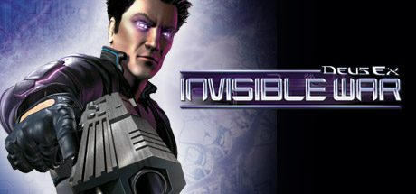
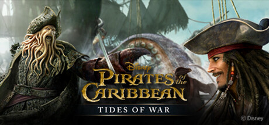
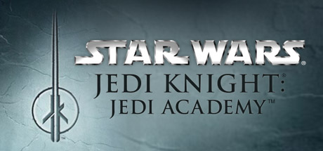
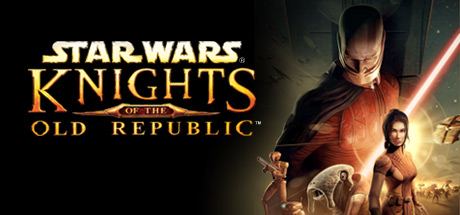

# Xbox — 2003

[← All Xbox years](../xbox.md) · [Full 2003 page](../../years/2003.md)

183 Xbox titles in 2003.

### Aliens Versus Predator: Extinction

**Platforms:** PlayStation 2, Xbox &nbsp;|&nbsp; **Developer:** Zono &nbsp;|&nbsp; **Publisher:** Electronic Arts, Fox Interactive &nbsp;|&nbsp; **Genre:** Real-time strategy &nbsp;|&nbsp; **Released:** July 30, 2003

> Aliens Versus Predator: Extinction is a real-time strategy game featuring three different species, all vying for control of the planet LV-742. Players can command an elite force of Colonial Marines, stalk their prey as a member of the Predator clan, or scurry along in packs as the acid-spitting Aliens. Gameplay involves advancing through a series of missions ranging in locale from jungles and caverns to futuristic battlefields and space colonies. Each faction offers ten types of combat units that can be upgraded over time with new attributes or equipment specific to the species. Predators, for instance, increase their number of vision modes, Aliens impregnate their victims with facehuggers, while Colonial Marines receive new weapon enhancements. As in titles like StarCraft, units range in scope from standard grunts and infantry to specialized forces and massive troop transports.
>
> _Synopsis source: IGDB_

[Wikipedia](https://en.wikipedia.org/wiki/Aliens_Versus_Predator:_Extinction) · [IGDB](https://www.igdb.com/games/aliens-versus-predator-extinction)

---

### All-Star Baseball 2004

**Platforms:** GameCube, Xbox, PlayStation 2, Game Boy Advance &nbsp;|&nbsp; **Developer:** Acclaim Studios Austin, Acclaim Studios Manchester &nbsp;|&nbsp; **Publisher:** Acclaim Entertainment &nbsp;|&nbsp; **Genre:** Sports &nbsp;|&nbsp; **Released:** February 28, 2003

> The 2004 installment in Acclaim's long-running baseball series. The game features more than 80 new features and improvements, including a deeper, more customizable franchise mode. The biggest change comes in the interface. You still hit the same buttons to swing, bunt, steal, and field, but the batting cursor has been visually altered. It's still the same triangle shape as before, just with a different outline. Bunting is more unique, though. Instead of aiming the cursor when you go to bunt, a large arrow points on the ground. Aim your bunt in the desired direction and hope for the best. Fielding has also received a slight change, with the ball cursor changing color. Four up to four players.
>
> _Synopsis source: IGDB_

[Wikipedia](https://en.wikipedia.org/wiki/All-Star_Baseball_2004) · [IGDB](https://www.igdb.com/games/all-star-baseball-2004)

---

### Alter Echo

**Platforms:** PlayStation 2, Xbox &nbsp;|&nbsp; **Released:** August 19

[Wikipedia](https://en.wikipedia.org/wiki/Alter_Echo)

---

### AMF Bowling 2004

**Platforms:** Xbox &nbsp;|&nbsp; **Developer:** Black Market Games &nbsp;|&nbsp; **Publisher:** Mud Duck Productions &nbsp;|&nbsp; **Genre:** Bowling &nbsp;|&nbsp; **Released:** December 1, 2003

> Bowling fans can appreciate AMF Bowling 2004's realistic sound effects, array of gameplay options, and accurate ball, pin, and lane physics. This bowling simulation also lets you create your own bowler and customize your ball's weight, color, and texture. In multiple gameplay modes, such as practice and tournament play, you can find that perfect combination of position, speed, and ball velocity. Showcase your skills against professional bowlers or against a friend.
>
> _Synopsis source: IGDB_

[Wikipedia](https://en.wikipedia.org/wiki/AMF_Bowling_2004) · [IGDB](https://www.igdb.com/games/amf-bowling-2004)

---

### Amped 2

**Platforms:** Xbox &nbsp;|&nbsp; **Released:** October 28

[Wikipedia](https://en.wikipedia.org/wiki/Amped_2)

---

### Aquaman: Battle for Atlantis

**Platforms:** GameCube, Xbox &nbsp;|&nbsp; **Publisher:** TDK Mediactive &nbsp;|&nbsp; **Released:** July 23, 2003

---

### Armed and Dangerous

**Platforms:** Windows, Xbox &nbsp;|&nbsp; **Released:** December 2

[Wikipedia](https://en.wikipedia.org/wiki/Armed_and_Dangerous_(video_game))

---

### ATV: Quad Power Racing 2

**Platforms:** PlayStation 2, GameCube, Xbox &nbsp;|&nbsp; **Developer:** Climax Brighton &nbsp;|&nbsp; **Publisher:** Acclaim Entertainment &nbsp;|&nbsp; **Genre:** Racing &nbsp;|&nbsp; **Released:** January 14, 2003

[Wikipedia](https://en.wikipedia.org/wiki/ATV:_Quad_Power_Racing_2)

---

### Batman: Dark Tomorrow

**Platforms:** Xbox, GameCube &nbsp;|&nbsp; **Publisher:** Kemco &nbsp;|&nbsp; **Released:** March 18, 2003

---

### Batman: Rise of Sin Tzu

**Platforms:** Xbox, PlayStation 2, Game Boy Advance, GameCube &nbsp;|&nbsp; **Developer:** Ubi Soft Montreal &nbsp;|&nbsp; **Publisher:** Ubi Soft &nbsp;|&nbsp; **Genre:** Action, beat 'em up &nbsp;|&nbsp; **Released:** October 16, 2003

> Batman: Rise of Sin Tzu is a 2003 beat 'em up video game released for the Xbox, PlayStation 2, Game Boy Advance and GameCube consoles. It was developed and published by Ubisoft in conjunction with Warner Bros. Interactive Entertainment and DC Comics. It is based on the television series The New Batman Adventures and is a sequel to the game Batman: Vengeance
>
> _Synopsis source: IGDB_

[Wikipedia](https://en.wikipedia.org/wiki/Batman:_Rise_of_Sin_Tzu) · [IGDB](https://www.igdb.com/games/batman-rise-of-sin-tzu)

---

### Battle Engine Aquila

**Platforms:** PlayStation 2, Xbox &nbsp;|&nbsp; **Released:** January 20

[Wikipedia](https://en.wikipedia.org/wiki/Battle_Engine_Aquila)

---

### Battlestar Galactica

**Platforms:** Xbox, PlayStation 2 &nbsp;|&nbsp; **Developer:** Warthog Games &nbsp;|&nbsp; **Publisher:** Universal Interactive &nbsp;|&nbsp; **Genre:** Space combat simulator &nbsp;|&nbsp; **Released:** November 18, 2003

> The war between man and machine rages on as the mechanical Cylons return to wipe out the human race. Begin your heroic journey through the Battlestar Galactica universe as the fearless, young Adama, and help lead the fleet of Colonials to survival. Choose from a wide array of ships, from sleek Vipers to heavy Bombers, and engage various classes of Cylon vessels, including Raiders and Marauders.
>
> _Synopsis source: IGDB_

[Wikipedia](https://en.wikipedia.org/wiki/Battlestar_Galactica_(2003_video_game)) · [IGDB](https://www.igdb.com/games/battlestar-galactica)

---

### Beyond Good & Evil

**Platforms:** Xbox, GameCube, PlayStation 2, Windows &nbsp;|&nbsp; **Publisher:** Ubisoft &nbsp;|&nbsp; **Released:** December 2, 2003

[Wikipedia](https://en.wikipedia.org/wiki/Beyond_Good_%26_Evil_(video_game))

---

### Bionicle

**Platforms:** GameCube, Game Boy Advance, PlayStation 2, Xbox, Windows &nbsp;|&nbsp; **Developer:** Argonaut Games, Argonaut Sheffield, Möbius Entertainment &nbsp;|&nbsp; **Publisher:** Electronic Arts, Lego Interactive, THQ, Feral Interactive &nbsp;|&nbsp; **Genre:** Platform &nbsp;|&nbsp; **Released:** September 9, 2003

> Bionicle: The Game (also known as Lego Bionicle and titled on the cover as simply Bionicle) is an action-adventure video game released in 2003. The game is based on parts of the movie Bionicle: Mask of Light and other parts of the Bionicle storyline. Initially, the game was supposed to make each Toa, Toa Nuva, and the Toa of Light playable, but due to deadlines, much of the game was dropped. However, all of the characters are playable in the Game Boy Advance version. The Mac OS X version of the game was released by Feral Interactive.
>
> _Synopsis source: IGDB_

[Wikipedia](https://en.wikipedia.org/wiki/Bionicle_(video_game)) · [IGDB](https://www.igdb.com/games/bionicle-the-game)

---

### Black Stone: Magic & Steel

**Platforms:** Xbox &nbsp;|&nbsp; **Developer:** XPEC Entertainment &nbsp;|&nbsp; **Publisher:** Xicat Interactive, Idea Factory &nbsp;|&nbsp; **Genre:** Action role-playing &nbsp;|&nbsp; **Released:** March 13, 2003

> Black Stone: Magic & Steel, known in Japan as Ex-Chaser (エクスチェイサー?), is a role-playing video game developed by XPEC Entertainment and published by Xicat Interactive for the Xbox. The theme song is "be with you" by Chihiro Yonekura
>
> _Synopsis source: IGDB_

[Wikipedia](https://en.wikipedia.org/wiki/Black_Stone:_Magic_&_Steel) · [IGDB](https://www.igdb.com/games/black-stone-magic-steel)

---

### BlowOut

**Platforms:** GameCube, Xbox &nbsp;|&nbsp; **Released:** November 26

[Wikipedia](https://en.wikipedia.org/wiki/BlowOut)

---

### Breakdown

**Platforms:** Xbox &nbsp;|&nbsp; **Developer:** Namco &nbsp;|&nbsp; **Publisher:** Namco, Namco Hometek, Electronic Arts &nbsp;|&nbsp; **Genre:** Action-adventure

> Trapped inside a mysterious laboratory and unable to remember his past, Derrick Cole discovers his extraordinary powers, as he fights for survival against a determined military faction and a legion of seemingly invincible super-human warriors! Breakdown offers an exciting first-person action-adventure gaming experience by combining hand-to-hand combat and state-of-the-art weapons with an intense story line and incredible graphics. Embark on a thrilling and suspenseful search for the truth!
>
> _Synopsis source: IGDB_

[Wikipedia](https://en.wikipedia.org/wiki/Breakdown_(video_game)) · [IGDB](https://www.igdb.com/games/breakdown)

---

### Broken Sword: The Sleeping Dragon

**Platforms:** Windows, PlayStation 2, Xbox &nbsp;|&nbsp; **Released:** November 14

---

### Brute Force

**Platforms:** Xbox &nbsp;|&nbsp; **Released:** May 27

[Wikipedia](https://en.wikipedia.org/wiki/Brute_Force_(video_game))

---

### Buffy the Vampire Slayer: Chaos Bleeds

**Platforms:** PlayStation 2, Xbox, GameCube &nbsp;|&nbsp; **Released:** August 27

---

### Burnout 2: Point of Impact

**Platforms:** GameCube, Xbox &nbsp;|&nbsp; **Publisher:** Acclaim Entertainment &nbsp;|&nbsp; **Released:** April 9, 2003

---

### C.A.T.: Cyber Attack Team

**Platforms:** Xbox &nbsp;|&nbsp; **Developer:** Hyde, Medix &nbsp;|&nbsp; **Publisher:** Medix &nbsp;|&nbsp; **Genre:** Turn-based tactics &nbsp;|&nbsp; **Released:** June 26, 2003

> C.A.T.: Cyber Attack Team is an tactical-strategy game for Xbox released exclusively in Japan.
>
> _Synopsis source: IGDB_

[Wikipedia](https://en.wikipedia.org/wiki/C.A.T.:_Cyber_Attack_Team) · [IGDB](https://www.igdb.com/games/c-a-t-cyber-attack-team)

---

### Cabela's Dangerous Hunts

**Platforms:** PlayStation 2, Xbox &nbsp;|&nbsp; **Developer:** Fun Labs, Sand Grain Studios &nbsp;|&nbsp; **Publisher:** Activision Value, Zoo Digital Publishing &nbsp;|&nbsp; **Genre:** Hunting, simulation, first-person shooter &nbsp;|&nbsp; **Released:** November 11, 2003

> Get ready for the next evolution in hunting games! The animals now want to get even. Cabela's Dangerous Hunts delivers intense action in exotic locations through out the globe featuring some of the world's most ferocious animals on the planet! Encounter grizzly bears, rhinos, leopards, cape buffalo and many more, in palm sweaty heart pounding hunting action. You'll soon realize first hand what every hunter fears most with terrifying "kill or be killed" hunting action never before released. Test your aim and nerves - hunt over 15 of the most feared animals in 11 exotic locations around the world.
>
> _Synopsis source: IGDB_

[Wikipedia](https://en.wikipedia.org/wiki/Cabela's_Dangerous_Hunts) · [IGDB](https://www.igdb.com/games/cabela-s-dangerous-hunts)

---

### Cabela's Deer Hunt: 2004 Season

**Platforms:** PlayStation 2, Xbox &nbsp;|&nbsp; **Developer:** Sand Grain Studios, Fun Labs &nbsp;|&nbsp; **Publisher:** Activision &nbsp;|&nbsp; **Genre:** Sports &nbsp;|&nbsp; **Released:** August 26, 2003

> Keep your eyes peeled and your trigger finger ready as you never know when a "Monster Trophy Buck" will cross your path. In Cabela's Deer Hunt: 2004 Season, you will hunt in nine different deer species using over authentic firearms, gear, and more than 90 unique rack configurations. Get ready to travel to exotic locations via ATV, boat, snowmobile, and truck. With advanced animal AI and true-to-life habits, these deer will have your heart pounding and your palms sweating with intense hunting action.
>
> _Synopsis source: IGDB_

[Wikipedia](https://en.wikipedia.org/wiki/Cabela's_Deer_Hunt:_2004_Season) · [IGDB](https://www.igdb.com/games/cabela-s-deer-hunt-2004-season)

---

### Capcom vs. SNK EO

**Platforms:** Xbox &nbsp;|&nbsp; **Released:** February 11

[Wikipedia](https://en.wikipedia.org/wiki/Capcom_vs._SNK_2)

---

### Celebrity Deathmatch

**Platforms:** Windows, PlayStation 2, Xbox &nbsp;|&nbsp; **Publisher:** Gotham Games &nbsp;|&nbsp; **Released:** October 14, 2003

[Wikipedia](https://en.wikipedia.org/wiki/Celebrity_Deathmatch_(video_game))

---

### Conflict: Desert Storm II

**Platforms:** PlayStation 2, Windows, Xbox &nbsp;|&nbsp; **Developer:** Pivotal Games &nbsp;|&nbsp; **Publisher:** SCi Games, Gotham Games &nbsp;|&nbsp; **Genre:** Tactical shooter &nbsp;|&nbsp; **Released:** September 18, 2003

[Wikipedia](https://en.wikipedia.org/wiki/Conflict:_Desert_Storm_II)

---

### Corvette

**Platforms:** Windows, Xbox, Game Boy Advance &nbsp;|&nbsp; **Developer:** Steel Monkeys, Visual Impact &nbsp;|&nbsp; **Publisher:** TDK Mediactive, Global Star Software &nbsp;|&nbsp; **Genre:** Racing game &nbsp;|&nbsp; **Released:** November 11, 2003

> Corvette lets you race a variety of Corvettes on the open road or in super speedways. The game includes more than 120 production Corvette models from 1953 to 2003, plus show and race cars. Choose a car, official car color, and a driver, and then race on tracks or an obstacle-filled Route 66. Upgrade your car's engine and suspension for more realistic physics.
>
> _Synopsis source: IGDB_

[Wikipedia](https://en.wikipedia.org/wiki/Corvette_(video_game)) · [IGDB](https://www.igdb.com/games/corvette)

---

### Counter-Strike

**Platforms:** Windows, Xbox &nbsp;|&nbsp; **Released:** September 9 (EU)

[Wikipedia](https://en.wikipedia.org/wiki/Counter-Strike_(video_game))

---

### Crash Nitro Kart

**Platforms:** PlayStation 2, Xbox, GameCube, Game Boy Advance, N-Gage &nbsp;|&nbsp; **Released:** November 15

[Wikipedia](https://en.wikipedia.org/wiki/Crash_Nitro_Kart)

---

### Crimson Skies: High Road to Revenge

**Platforms:** Xbox &nbsp;|&nbsp; **Publisher:** Microsoft Game Studios &nbsp;|&nbsp; **Released:** October 21, 2003

---

### Crouching Tiger, Hidden Dragon

**Platforms:** Xbox &nbsp;|&nbsp; **Released:** December 9

[Wikipedia](https://en.wikipedia.org/wiki/Crouching_Tiger,_Hidden_Dragon_(video_game))

---

### Curse: The Eye of Isis

**Platforms:** Windows, Xbox, PlayStation 2 &nbsp;|&nbsp; **Developer:** Asylum Entertainment &nbsp;|&nbsp; **Publisher:** DreamCatcher Interactive, Wanadoo Edition &nbsp;|&nbsp; **Genre:** Survival horror &nbsp;|&nbsp; **Released:** October 20, 2003

> Strange things are happening at Great Britain’s museum of natural history in 1890. A gang of ruthless thugs has broken into the establishment, the Eye of Isis Egyptian statue has been stolen, and a mysterious fog has overtaken a number of areas of the museum killing and transforming all it comes into contact with.
>
> _Synopsis source: IGDB_

[Wikipedia](https://en.wikipedia.org/wiki/Curse:_The_Eye_of_Isis) · [IGDB](https://www.igdb.com/games/curse-the-eye-of-isis)

---

### Dakar 2: The World's Ultimate Rally

**Platforms:** PlayStation 2, GameCube, Xbox &nbsp;|&nbsp; **Developer:** Acclaim Studios Cheltenham &nbsp;|&nbsp; **Publisher:** Acclaim Entertainment &nbsp;|&nbsp; **Genre:** Racing &nbsp;|&nbsp; **Released:** March 14, 2003

> Dakar 2 is a racing game, of course simulating the famous Paris-Dakar Rally. Although not the real 6000 kilometers can be crossed in the game, the rally mode takes the player through 12 tracks all the way from France to Dakar. The tracks lead racers through cities, forests and the desert. Most of them are simple tracks, but there are desert tracks where the player can drive around freely, finding the checkpoints faster than the opponents. The player can choose from the officially licensed cars, trucks and bikes from Dakar 2002, but only vehicles of the same type can compete in a race. There is also an arcade racing mode, where all the tracks and vehicles that have been unlocked in rally mode can be selected, as well as a splitscreen mode for two players.
>
> _Synopsis source: IGDB_

[Wikipedia](https://en.wikipedia.org/wiki/Dakar_2:_The_World's_Ultimate_Rally) · [IGDB](https://www.igdb.com/games/dakar-2-the-world-s-ultimate-rally)

---

### Dead or Alive Xtreme Beach Volleyball

**Platforms:** Xbox &nbsp;|&nbsp; **Released:** January 22

[Wikipedia](https://en.wikipedia.org/wiki/Dead_or_Alive_Xtreme_Beach_Volleyball)

---

### Deus Ex: Invisible War

**Platforms:** Windows, Xbox &nbsp;|&nbsp; **Genre:** Action &nbsp;|&nbsp; **Released:** December 2

> Approximately 20 years after Deus Ex, the world is only beginning to recover from a catastrophic worldwide depression. In this techno-nightmare, take part in the dark struggle to raise the world from its own ashes.
>
> _Synopsis source: Steam_

[Steam](https://store.steampowered.com/app/6920)

---

### Dino Crisis 3

**Platforms:** Xbox &nbsp;|&nbsp; **Released:** September 16

[Wikipedia](https://en.wikipedia.org/wiki/Dino_Crisis_3)

---

### Dinotopia: The Sunstone Odyssey

**Platforms:** Xbox &nbsp;|&nbsp; **Released:** July 23

---

### Disney's Extreme Skate Adventure

**Platforms:** PlayStation 2, GameCube, Xbox, Game Boy Advance &nbsp;|&nbsp; **Developer:** Toys for Bob, Vicarious Visions &nbsp;|&nbsp; **Publisher:** Activision &nbsp;|&nbsp; **Genre:** Sports &nbsp;|&nbsp; **Released:** September 2, 2003

> Disney characters step out of the movies and onto skateboards in Disney's Extreme Skate Adventure. You can play as your favorite Disney and Pixar characters, such as Buzz Lightyear and Woody from Toy Story 2, Simba and Rafiki from The Lion King, and Young Tarzan and Terk from Tarzan. Now you can skate, pull off tricks, and solve puzzles in all the exciting places you've seen in the movies, including Pride Rock, the Jungle Treehouse, and Pizza Planet.
>
> _Synopsis source: IGDB_

[Wikipedia](https://en.wikipedia.org/wiki/Disney's_Extreme_Skate_Adventure) · [IGDB](https://www.igdb.com/games/disney-s-extreme-skate-adventure)

---

### Drake of the 99 Dragons

**Platforms:** Xbox &nbsp;|&nbsp; **Publisher:** Majesco &nbsp;|&nbsp; **Released:** November 3, 2003

[Wikipedia](https://en.wikipedia.org/wiki/Drake_of_the_99_Dragons)

---

### Dungeons & Dragons: Heroes

**Platforms:** Xbox &nbsp;|&nbsp; **Released:** September 17

---

### Enter The Matrix

**Platforms:** Windows, GameCube, PlayStation 2, Xbox &nbsp;|&nbsp; **Released:** May 14

[Wikipedia](https://en.wikipedia.org/wiki/Enter_The_Matrix)

---

### ESPN College Hoops

**Platforms:** PlayStation 2, Xbox &nbsp;|&nbsp; **Developer:** Kush Games &nbsp;|&nbsp; **Publisher:** Sega &nbsp;|&nbsp; **Genre:** Sports &nbsp;|&nbsp; **Released:** November 11, 2003

> "ESPN College Hoops is an American college basketball video game which was initially released on November 13, 2003 for the Xbox and PS2. It is the sequel to the debut game of the series, NCAA College Basketball 2K3, and the first game in the series to feature the ESPN license. It features former Texas Longhorns and retired NBA guard T. J. Ford on the cover."
>
> _Synopsis source: IGDB_

[Wikipedia](https://en.wikipedia.org/wiki/ESPN_College_Hoops) · [IGDB](https://www.igdb.com/games/espn-college-hoops)

---

### ESPN NBA Basketball

**Platforms:** PlayStation 2, Xbox &nbsp;|&nbsp; **Publisher:** Sega &nbsp;|&nbsp; **Released:** October 21, 2003

[Wikipedia](https://en.wikipedia.org/wiki/ESPN_NBA_Basketball_(video_game))

---

### ESPN NFL Football

**Platforms:** Xbox, PlayStation 2 &nbsp;|&nbsp; **Publisher:** Sega &nbsp;|&nbsp; **Released:** September 3, 2003

[Wikipedia](https://en.wikipedia.org/wiki/NFL_2K)

---

### ESPN NHL Hockey

**Platforms:** PlayStation 2, Xbox &nbsp;|&nbsp; **Publisher:** Sega &nbsp;|&nbsp; **Released:** September 9, 2003

[Wikipedia](https://en.wikipedia.org/wiki/NHL_2K)

---

### Evil Dead: A Fistful of Boomstick

**Platforms:** PlayStation 2, Xbox &nbsp;|&nbsp; **Developer:** VIS Entertainment &nbsp;|&nbsp; **Publisher:** THQ &nbsp;|&nbsp; **Genre:** Action, hack and slash &nbsp;|&nbsp; **Released:** May 20, 2003

> Fully "armed" with his chainsaw, trusty boomstick, and trademark quips, Ash must once again save Dearborn from the unspeakable horrors spawned from The Book of the Dead. After a vortex to the undead is unwittingly opened, deadites swarm through Dearborn, turning humans into zombies. Now, with Dearborn in chaos and citizens begging for help, Ash must hack and slash his way through the streets and figure out how to close the vortex. Ash soon learns that all is not what it seems--those he trusts may be plotting against him, and the history of Dearborn might be irrevocably changed.
>
> _Synopsis source: IGDB_

[Wikipedia](https://en.wikipedia.org/wiki/Evil_Dead:_A_Fistful_of_Boomstick) · [IGDB](https://www.igdb.com/games/evil-dead-a-fistful-of-boomstick)

---

### F1 Career Challenge

**Platforms:** GameCube, Windows, PlayStation 2, Xbox &nbsp;|&nbsp; **Developer:** Visual Science, Image Space Incorporated &nbsp;|&nbsp; **Publisher:** EA Sports &nbsp;|&nbsp; **Genre:** Racing &nbsp;|&nbsp; **Released:** June 23, 2003

> F1 Challenge spans four entire championship seasons and features accurate team, vehicle, and driver data for each.
>
> _Synopsis source: IGDB_

[Wikipedia](https://en.wikipedia.org/wiki/F1_Career_Challenge) · [IGDB](https://www.igdb.com/games/f1-career-challenge)

---

### FIFA Football 2004

**Platforms:** Windows, PlayStation, PlayStation 2, GameCube, Xbox, Game Boy Advance, N-Gage &nbsp;|&nbsp; **Developer:** EA Canada, Exient Entertainment &nbsp;|&nbsp; **Publisher:** EA Sports &nbsp;|&nbsp; **Genre:** Sports &nbsp;|&nbsp; **Released:** October 24, 2003

[Wikipedia](https://en.wikipedia.org/wiki/FIFA_Football_2004)

---

### Finding Nemo

**Platforms:** GameCube, PlayStation 2, Xbox, Game Boy Advance &nbsp;|&nbsp; **Released:** May 12

[Wikipedia](https://en.wikipedia.org/wiki/Finding_Nemo_(video_game))

---

### Ford Racing 2

**Platforms:** PlayStation 2, Xbox, Windows &nbsp;|&nbsp; **Developer:** Razorworks &nbsp;|&nbsp; **Publisher:** Gotham Games, Empire Interactive, Feral Interactive &nbsp;|&nbsp; **Genre:** Racing &nbsp;|&nbsp; **Released:** October 28, 2003

> The sequel to Ford Racing has arrived. Ford Racing 2 has new and improved cars, added tracks and challenges, and more thrills than ever. With an expanded selection of Ford vehicles--ranging from the '49 Ford to the latest Mustang GT Concept--picking out a car will be a lot harder than you expect. Get a feel for each car on a diverse set of tracks including Road Tracks, City Limits, Ovals, Spring Break, and Lost World. Ford Racing 2 is ready to put you in the driver's seat, but are you daring enough to sit there?
>
> _Synopsis source: IGDB_

[Wikipedia](https://en.wikipedia.org/wiki/Ford_Racing_2) · [IGDB](https://www.igdb.com/games/ford-racing-2)

---

### Freaky Flyers

**Platforms:** PlayStation 2, Xbox, GameCube &nbsp;|&nbsp; **Released:** August 5

[Wikipedia](https://en.wikipedia.org/wiki/Freaky_Flyers)

---

### Freedom Fighters

**Platforms:** Windows, PlayStation 2, Xbox, GameCube &nbsp;|&nbsp; **Genre:** Action &nbsp;|&nbsp; **Released:** October 1

> Freedom Fighters is an intense third-person action game set in an alternate history New York during the invasion of a foreign superpower. Take on the role of Chris Stone, a hard-working plumber, and rise through the ranks of the resistance to prove yourself as a charismatic leader.
>
> _Synopsis source: Steam_

[Wikipedia](https://en.wikipedia.org/wiki/Freedom_Fighters_(video_game)) · [Steam](https://store.steampowered.com/app/1347780)

---

### Freestyle MetalX

**Platforms:** PlayStation 2, GameCube, Xbox &nbsp;|&nbsp; **Developer:** Deibus Studios &nbsp;|&nbsp; **Publisher:** Midway Sports Asylum &nbsp;|&nbsp; **Genre:** Sports &nbsp;|&nbsp; **Released:** June 24, 2003

> Billed as the "first freestyle motocross" video game, Freestyle MetalX offers eight go-anywhere environments filled with objects like swimming pools and skyscrapers to trick off. Since there are no limitations imposed on players, they are free to smash windows, plow through parks, and do things that would otherwise be illegal. In addition to riding across real-world locales, players can participate in side events like bus jumping, wheelies, and zipping through tunnels of fire to earn some notoriety and cash for their character. Money can then be used to purchase new equipment including bikes, clothing, accessories, and more.  Nine professional riders are available to play as or against, including such legends as Kris "The Rock" Rourke and Ronnie "Kung Fu" Faisst. Seven generic riders are also selectable, bringing the total lineup of characters to 16. Players must guide these characters through various skill-based challenges in order to unlock the remaining courses. Once unlocked, the eight levels seamlessly connect with one another to form one sprawling environment. Within each region are special events entitled Big Air, Freestyle, Hill Climb, and Race, which typically involve performing as many aerial stunts as possible to outscore the competition.  Freestyle MetalX also features a number of sub-games to add some diversity to the racing action. Players will ride off a cliff to see how many tricks they can perform during their rapid decent, become a human dart while hurling themselves toward an enormous dartboard, and even participate in a game of motocross pinball. Those tired of the existing courses can create their own arena using the built-in level editor. No matter which mode is selected, players can listen to hard-driving music from such bands as Megadeath, Mötley Crüe, Motörhead, and Twisted Sister.
>
> _Synopsis source: IGDB_

[Wikipedia](https://en.wikipedia.org/wiki/Freestyle_MetalX) · [IGDB](https://www.igdb.com/games/freestyle-metalx)

---

### Futurama

**Platforms:** PlayStation 2, Xbox &nbsp;|&nbsp; **Released:** August 12

[Wikipedia](https://en.wikipedia.org/wiki/Futurama_(video_game))

---

### Geometry Wars: Retro Evolved

**Platforms:** Xbox &nbsp;|&nbsp; **Developer:** Bizarre Creations &nbsp;|&nbsp; **Publisher:** Microsoft Game Studios &nbsp;|&nbsp; **Genre:** Multidirectional shooter &nbsp;|&nbsp; **Released:** November 17, 2003

[Wikipedia](https://en.wikipedia.org/wiki/Geometry_Wars:_Retro_Evolved)

---

### Gladiator: Sword of Vengeance

**Platforms:** PlayStation 2, Xbox, Windows &nbsp;|&nbsp; **Developer:** Acclaim Studios Manchester &nbsp;|&nbsp; **Publisher:** Acclaim Entertainment, Throwback Entertainment &nbsp;|&nbsp; **Genre:** Hack and slash &nbsp;|&nbsp; **Released:** November 4, 2003

> A Warrior Slave… Chosen by the Gods… To restore the glory of an Empire.  In the Year 106 AD the Roman Empire is in terrible decline. After the untimely death of the much-loved Emperor Trajan, the despotic Emperor Arruntius has bled the once powerful Rome to its knees. Poorly fought wars, famine, and plague are rife in all corners of the Empire, whilst the Emperor and his elite enjoy every excess and vice that the emptying coffers can afford. As herald to this age of degeneration, Arruntius has destroyed large portions of the city of Rome to create the battleground for the bloodiest gladiator event ever staged…
>
> _Synopsis source: IGDB_

[Wikipedia](https://en.wikipedia.org/wiki/Gladiator:_Sword_of_Vengeance) · [IGDB](https://www.igdb.com/games/gladiator-sword-of-vengeance)

---

### Gladius

**Platforms:** GameCube, PlayStation 2, Xbox &nbsp;|&nbsp; **Developer:** LucasArts &nbsp;|&nbsp; **Publisher:** LucasArts &nbsp;|&nbsp; **Genre:** Tactical role-playing &nbsp;|&nbsp; **Released:** October 28, 2003

> Gladius is a turn-based gladiatorial RPG. Players try to build a championship gladiator school by gaining experience through fighting battles in the arenas and recruiting new members.
>
> _Synopsis source: IGDB_

[Wikipedia](https://en.wikipedia.org/wiki/Gladius_(video_game)) · [IGDB](https://www.igdb.com/games/gladius)

---

### Goblin Commander: Unleash the Horde

**Platforms:** PlayStation 2, Xbox, GameCube &nbsp;|&nbsp; **Developer:** Jaleco Entertainment &nbsp;|&nbsp; **Publisher:** Jaleco Entertainment &nbsp;|&nbsp; **Genre:** Action, real-time strategy &nbsp;|&nbsp; **Released:** November 11, 2003

> Set in a fantasy world, the story follows the tale of a civil war between goblin clans after their creator and master is killed. The gameplay is a combination of real-time strategy and light action where players gather resources and build up their horde of goblins while also being able to take direct control of certain units.
>
> _Synopsis source: IGDB_

[Wikipedia](https://en.wikipedia.org/wiki/Goblin_Commander:_Unleash_the_Horde) · [IGDB](https://www.igdb.com/games/goblin-commander-unleash-the-horde)

---

### Godzilla: Destroy All Monsters Melee

**Platforms:** Xbox &nbsp;|&nbsp; **Released:** April 16

---

### Grabbed by the Ghoulies

**Platforms:** Xbox &nbsp;|&nbsp; **Developer:** Rare &nbsp;|&nbsp; **Publisher:** Microsoft Game Studios &nbsp;|&nbsp; **Genre:** Action-adventure, beat 'em up &nbsp;|&nbsp; **Released:** October 21, 2003

> Grabbed by the Ghoulies follows a young man named Cooper Chance who sets out to rescue his girlfriend, Amber, from Ghoulhaven Hall. This mansion is full of supernatural creatures, and Cooper will receive help along the way from the many hired hands that work there.
>
> _Synopsis source: IGDB_

[Wikipedia](https://en.wikipedia.org/wiki/Grabbed_by_the_Ghoulies) · [IGDB](https://www.igdb.com/games/grabbed-by-the-ghoulies)

---

### Grand Theft Auto Double Pack

**Platforms:** Xbox &nbsp;|&nbsp; **Publisher:** Rockstar Games &nbsp;|&nbsp; **Released:** November 4, 2003

[Wikipedia](https://en.wikipedia.org/wiki/Grand_Theft_Auto#Compilations)

---

### Grand Theft Auto III

**Platforms:** Xbox &nbsp;|&nbsp; **Released:** November 4

[Wikipedia](https://en.wikipedia.org/wiki/Grand_Theft_Auto_III)

---

### Grand Theft Auto: Vice City

**Platforms:** Windows, Xbox &nbsp;|&nbsp; **Publisher:** Rockstar Games &nbsp;|&nbsp; **Released:** May 12, 2003

---

### Grooverider: Slot Car Thunder

**Platforms:** GameCube, Xbox &nbsp;|&nbsp; **Developer:** King of the Jungle &nbsp;|&nbsp; **Publisher:** Encore, Play It &nbsp;|&nbsp; **Genre:** Racing &nbsp;|&nbsp; **Released:** September 25, 2003

> Slot car racing isn't just for kids anymore. Set in a fantasy penthouse, Grooverider: Slot Car Thunder lets you experience quick lane changes, 360-degree loops, and crazy twists and turns on 20 slot car tracks. If you're a smart racer, you'll be sure to grab extra power-ups for a boost or blasting power. If you're not, then the tracks' spikes, mines, and other booby traps will surely be your downfall. In single- or multiplayer modes, you can get behind the wheel of any racecar, ranging from 1920s British cars to American stock cars
>
> _Synopsis source: IGDB_

[Wikipedia](https://en.wikipedia.org/wiki/Grooverider:_Slot_Car_Thunder) · [IGDB](https://www.igdb.com/games/grooverider-slot-car-thunder)

---

### Group S Challenge

**Platforms:** Xbox &nbsp;|&nbsp; **Developer:** DigitalStudio &nbsp;|&nbsp; **Publisher:** Capcom &nbsp;|&nbsp; **Genre:** Racing &nbsp;|&nbsp; **Released:** August 28, 2003

> Group S Challenge is a racing game published by Capcom.
>
> _Synopsis source: IGDB_

[Wikipedia](https://en.wikipedia.org/wiki/Group_S_Challenge) · [IGDB](https://www.igdb.com/games/group-s-challenge)

---

### Harry Potter and the Philosopher's Stone

**Platforms:** GameCube, PlayStation 2, Xbox &nbsp;|&nbsp; **Developer:** Warthog Games &nbsp;|&nbsp; **Publisher:** Electronic Arts &nbsp;|&nbsp; **Genre:** Action-adventure &nbsp;|&nbsp; **Released:** December 12, 2003

[Wikipedia](https://en.wikipedia.org/wiki/Harry_Potter_and_the_Philosopher's_Stone_(2003_video_game))

---

### Harry Potter: Quidditch World Cup

**Platforms:** Windows, GameCube, PlayStation 2, Xbox, Game Boy Advance &nbsp;|&nbsp; **Released:** October 28

---

### High Heat Major League Baseball 2004

**Platforms:** PlayStation 2, Windows, Xbox &nbsp;|&nbsp; **Developer:** The 3DO Company &nbsp;|&nbsp; **Publisher:** The 3DO Company &nbsp;|&nbsp; **Genre:** Sports &nbsp;|&nbsp; **Released:** February 19, 2003

> High Heat has always been generous with features in its PC incarnation, and the console version has finally caught up to it. Boasting eleven different modes of play, HH 2004 takes several steps beyond the product offered last year and genuinely tries rather hard to push feature diversity. All the classics are here: Home Run Derby, Exhibition, All-Star Games, Batting Practice, Player Editing devices, and other such goodies await the gamers who patiently explore its every area. Perfect for two-player matches, Two-on-Two Showdown returns from last year's PS2 version and presents itself as a console-exclusive option (you're not going to find it in the GBA or PC versions at all).
>
> _Synopsis source: IGDB_

[Wikipedia](https://en.wikipedia.org/wiki/High_Heat_Major_League_Baseball_2004) · [IGDB](https://www.igdb.com/games/high-heat-major-league-baseball-2004)

---

### Hulk

**Platforms:** Windows, PlayStation 2, GameCube, Xbox &nbsp;|&nbsp; **Released:** May 28

[Wikipedia](https://en.wikipedia.org/wiki/Hulk_(video_game))

---

### Hunter: The Reckoning – Redeemer

**Platforms:** Xbox &nbsp;|&nbsp; **Developer:** High Voltage Software &nbsp;|&nbsp; **Publisher:** Vivendi Universal Games &nbsp;|&nbsp; **Genre:** Hack and slash, third-person shooter &nbsp;|&nbsp; **Released:** October 28, 2003

[Wikipedia](https://en.wikipedia.org/wiki/Hunter:_The_Reckoning_%E2%80%93_Redeemer)

---

### I-Ninja

**Platforms:** PlayStation 2, GameCube, Xbox &nbsp;|&nbsp; **Developer:** Argonaut Games &nbsp;|&nbsp; **Publisher:** Namco Hometek, Sony Computer Entertainment, Zoo Digital Publishing &nbsp;|&nbsp; **Genre:** Platform &nbsp;|&nbsp; **Released:** November 18, 2003

> I Ninja is a 3D platform title starring an original character created by British developer Argonaut Software. Players control a spirited young ninja as they make their way through a diverse selection of indoor and outdoor locales. The title character is garbed in a blue suit and matching hooded mask, so that only his eyes and his expressive brow are visible to players. The character also wields a pair of katana blades in both hands as he jumps from platform to platform, avoiding hazards and slicing at enemies. The cartoon-style atmosphere is brought to life with the use of cel-shaded graphics, giving the game a distinctive look from many of its platform contemporaries.  I-Ninja is an adrenaline-charged adventure game. An ultra-cool ninja with major attitude meets extreme sports game play, I-Ninja is the consummate warrior who has spent years mastering his weapons and honing his skills. In true gravity defying game play, I-Ninja can scale buildings, "shred" on extreme rails, hover great distances with a "sword copter", ride drifting roller spheres and utilize specialized manga-style ninja moves to navigate through each dynamic environment.
>
> _Synopsis source: IGDB_

[Wikipedia](https://en.wikipedia.org/wiki/I-Ninja) · [IGDB](https://www.igdb.com/games/i-ninja)

---

### IHRA Drag Racing 2004

**Platforms:** Xbox &nbsp;|&nbsp; **Developer:** Super Happy Fun Fun &nbsp;|&nbsp; **Publisher:** Bethesda Softworks &nbsp;|&nbsp; **Genre:** Racing &nbsp;|&nbsp; **Released:** November 2003

[Wikipedia](https://en.wikipedia.org/wiki/IHRA_Drag_Racing_2004)

---

### Indiana Jones and the Emperor's Tomb

**Platforms:** Xbox, Windows, PlayStation 2 &nbsp;|&nbsp; **Released:** February 24

[Wikipedia](https://en.wikipedia.org/wiki/Indiana_Jones_and_the_Emperor%27s_Tomb)

---

### IndyCar Series

**Platforms:** PlayStation 2, Xbox, Windows &nbsp;|&nbsp; **Developer:** Brain in a Jar &nbsp;|&nbsp; **Publisher:** Codemasters &nbsp;|&nbsp; **Genre:** Racing &nbsp;|&nbsp; **Released:** May 20, 2003

> Codemasters' official game, IndyCar Series, is blisteringly fast, nerve-shatteringly intense, pure professional racing and features ultra-close pack racing with up to 33 cars racing on track. Gameplay requires total focus to handle the incredible overtaking manoeuvres at speeds well over 220 mph. IndyCar Series delivers a full racing season, which includes the Indianapolis 500-Mile Race (Indy 500), the greatest spectacle in US racing.
>
> _Synopsis source: IGDB_

[Wikipedia](https://en.wikipedia.org/wiki/IndyCar_Series_(video_game)) · [IGDB](https://www.igdb.com/games/indycar-series)

---

### Inside Pitch 2003

**Platforms:** Xbox &nbsp;|&nbsp; **Released:** May 20

---

### Judge Dredd: Dredd vs. Death

**Platforms:** Windows, PlayStation 2, Xbox, GameCube &nbsp;|&nbsp; **Genre:** Action &nbsp;|&nbsp; **Released:** October 17 (EU)

> Welcome to Mega-City One, a city of over 400 million people - every one of them a potential criminal. It is the third decade of the 22nd Century, unemployment is widespread, boredom is universal and only the Judges can prevent total anarchy. Empowered to dispense instant justice, they are Judge, Jury and Executioner all in one.
>
> _Synopsis source: Steam_

[Steam](https://store.steampowered.com/app/3710)

---

### Jurassic Park: Operation Genesis

**Platforms:** Windows, PlayStation 2, Xbox &nbsp;|&nbsp; **Released:** March 10

---

### Kao the Kangaroo: Round 2

**Platforms:** Windows, GameCube, PlayStation 2, Xbox &nbsp;|&nbsp; **Developer:** Tate Interactive &nbsp;|&nbsp; **Publisher:** Cenega, JoWooD Productions, Atari &nbsp;|&nbsp; **Genre:** Action-adventure, platform &nbsp;|&nbsp; **Released:** November 4, 2003

> Play as Kao! The cutest and bravest kangaroo of all video games returns. Experience the joy of playing a classic 3D single-player platformer filled with various challenges, including fighting, racing and solving puzzles. Bounce through 25 levels set in 5 unique, colorful worlds to rescue your animal friends captured by the evil Hunter and his henchmen!
>
> _Synopsis source: IGDB_

[Wikipedia](https://en.wikipedia.org/wiki/Kao_the_Kangaroo:_Round_2) · [IGDB](https://www.igdb.com/games/kao-the-kangaroo-round-2)

---

### Karaoke Revolution

**Platforms:** PlayStation 2, Xbox, GameCube &nbsp;|&nbsp; **Developer:** Harmonix, Secret Level, Inc., Blitz Games, Hijinx Studios &nbsp;|&nbsp; **Publisher:** Konami &nbsp;|&nbsp; **Genre:** Rhythm

[Wikipedia](https://en.wikipedia.org/wiki/Karaoke_Revolution)

---

### Kill Switch

**Platforms:** PlayStation 2, Xbox &nbsp;|&nbsp; **Developer:** Namco Hometek, Visual Impact &nbsp;|&nbsp; **Publisher:** Namco Hometek, Sony Computer Entertainment &nbsp;|&nbsp; **Genre:** Third-person shooter &nbsp;|&nbsp; **Released:** October 28, 2003

> Aiming and moving in cover and blind-fire modes is tricky, though. To gain the 3-D effect, some detail gets sacrificed. Usually this is no problem, but occasionally you'll have a tough time recognizing an object. You move from area to area to engage a new group of enemies. You'll conveniently find crates for cover and barrels to help you pull off big explosions. Locking the enemy in your crosshairs, signified by your crosshairs turning red, doesn't guarantee a direct hit? The accuracy depends on the weapon of choice. A shotgun will normally provide a kill on the first shot. If you have an automatic rifle, your shots are relatively inaccurate even if your aim is true.
>
> _Synopsis source: IGDB_

[Wikipedia](https://en.wikipedia.org/wiki/Kill_Switch_(video_game)) · [IGDB](https://www.igdb.com/games/kill-dot-switch)

---

### Kung Fu Chaos

**Platforms:** Xbox &nbsp;|&nbsp; **Developer:** Just Add Monsters &nbsp;|&nbsp; **Publisher:** Microsoft Game Studios &nbsp;|&nbsp; **Genre:** Fighting, party &nbsp;|&nbsp; **Released:** February 25, 2003

> Kung Fu Chaos is an entertaining brawler game inspired by the 70s Kung Fu movie era. You fight as one of nine characters--three of which are unlockable--with looks, moves, and taunts based on kung-fu movie icons. Your quest for movie stardom places you on a dynamic movie set, and when the director yells "Action!" you fight against multiple enemies either by yourself or with three friends. Perform over-the-top, Hong-Kong-style combat--including leaps, and flying kicks--and you'll become a star in no time.
>
> _Synopsis source: IGDB_

[Wikipedia](https://en.wikipedia.org/wiki/Kung_Fu_Chaos) · [IGDB](https://www.igdb.com/games/kung-fu-chaos)

---

### Legacy of Kain: Defiance

**Platforms:** Windows, PlayStation 2, Xbox &nbsp;|&nbsp; **Released:** November 11

---

### Links 2004

**Platforms:** Xbox &nbsp;|&nbsp; **Developer:** Salt Lake Games Studio &nbsp;|&nbsp; **Publisher:** Microsoft Game Studios &nbsp;|&nbsp; **Genre:** Sports &nbsp;|&nbsp; **Released:** November 11, 2003

> Links, the best-selling golf franchise for the personal computer, has been rebuilt—from the ground up—exclusively for the Xbox video game system. Links 2004 delivers one of the most realistic and competitive golf experiences for Xbox. Golf fans worldwide can compete online in friendly matches with old golfing buddies or compete in tournaments against the best golfers in the world via Xbox Live. Links 2004 also features top championship courses and top professionals, including cover athlete Sergio Garcia.
>
> _Synopsis source: IGDB_

[Wikipedia](https://en.wikipedia.org/wiki/Links_2004) · [IGDB](https://www.igdb.com/games/links-2004)

---

### Mace Griffin: Bounty Hunter

**Platforms:** Windows, PlayStation 2, Xbox &nbsp;|&nbsp; **Released:** June 19

---

### Madden NFL 2004

**Platforms:** PlayStation 2, GameCube, Xbox, Windows &nbsp;|&nbsp; **Publisher:** EA Sports &nbsp;|&nbsp; **Released:** August 12, 2003

[Wikipedia](https://en.wikipedia.org/wiki/Madden_NFL_2004)

---

### Magic: The Gathering – Battlegrounds

**Platforms:** Windows, Xbox &nbsp;|&nbsp; **Developer:** Secret Level, Inc. &nbsp;|&nbsp; **Publisher:** Atari &nbsp;|&nbsp; **Genre:** Fighting &nbsp;|&nbsp; **Released:** November 19, 2003

[Wikipedia](https://en.wikipedia.org/wiki/Magic:_The_Gathering_%E2%80%93_Battlegrounds)

---

### Marvel vs. Capcom 2: New Age of Heroes

**Platforms:** Xbox &nbsp;|&nbsp; **Released:** March 30

---

### Max Payne 2: The Fall of Max Payne

**Platforms:** Windows, Xbox, PlayStation 2 &nbsp;|&nbsp; **Publisher:** Rockstar Games &nbsp;|&nbsp; **Genre:** Action &nbsp;|&nbsp; **Released:** October 14, 2003

> Max Payne 2: The Fall of Max Payne is a violent, film-noir love story. Dark, tragic and intense, the in-depth story is a thrill-ride of shocking twists and revelations. Love hurts.
>
> _Synopsis source: Steam_

[Steam](https://store.steampowered.com/app/12150)

---

### Medal of Honor: Rising Sun

**Platforms:** PlayStation 2, Xbox, GameCube &nbsp;|&nbsp; **Released:** November 11

---

### Metal Arms: Glitch in the System

**Platforms:** PlayStation 2, Xbox &nbsp;|&nbsp; **Released:** November 18

---

### Midnight Club II

**Platforms:** Windows, PlayStation 2, Xbox &nbsp;|&nbsp; **Released:** April 8

[Wikipedia](https://en.wikipedia.org/wiki/Midnight_Club_II)

---

### Midtown Madness 3

**Platforms:** Xbox &nbsp;|&nbsp; **Developer:** Digital Illusions CE &nbsp;|&nbsp; **Publisher:** Microsoft Game Studios &nbsp;|&nbsp; **Genre:** Racing &nbsp;|&nbsp; **Released:** June 17, 2003

> Midtown Madness 3 is an open world racing/arcade sequel, part of the Midtown Madness series. For the first time in the series, the game was released only on the Xbox, with a Windows version rumoured for later release, but ultimately scrapped.[citation needed]  The game was developed by DICE (of Battlefield 1942 fame) and published by Microsoft Game Studios. This marked a change from the developer of the first two games, Angel Studios (now Rockstar San Diego). Coincidentally, Midtown Madness 3 was released in 2003 against Midnight Club II, created by the developer of the first two games, Rockstar San Diego.  The Xbox-only release and change of developer heralded a significant graphical improvement to maintain the console's graphical standards.
>
> _Synopsis source: IGDB_

[Wikipedia](https://en.wikipedia.org/wiki/Midtown_Madness_3) · [IGDB](https://www.igdb.com/games/midtown-madness-3)

---

### Midway Arcade Treasures

**Platforms:** PlayStation 2, Xbox, GameCube &nbsp;|&nbsp; **Developer:** Digital Eclipse &nbsp;|&nbsp; **Publisher:** Midway &nbsp;|&nbsp; **Genre:** Various &nbsp;|&nbsp; **Released:** November 18, 2003

[Wikipedia](https://en.wikipedia.org/wiki/Midway_Arcade_Treasures)

---

### Mission: Impossible – Operation Surma

**Platforms:** Xbox, Game Boy Advance, PlayStation 2 &nbsp;|&nbsp; **Released:** December 2

---

### MLB Slugfest 2004

**Platforms:** GameCube, PlayStation 2, Xbox, Game Boy Advance &nbsp;|&nbsp; **Developer:** Point of View, Criterion Games, Handheld Games &nbsp;|&nbsp; **Publisher:** Midway Sports &nbsp;|&nbsp; **Genre:** Sports &nbsp;|&nbsp; **Released:** March 17, 2003

> The second title in Midway's baseball series, SlugFest 20-04 continues to pour on the rough-housing gameplay, bizarre codes, and humorous commentary. In addition to the new Home Run Derby mode and Create-A-Team options, the game features the ability of pitchers to catch "On Fire" and impossible Special Pitches that zigzag, arc, and whizz by in ways that would leave any batter humiliated. New secret teams have been added to the previous bunch, including aliens, minotaurs, and Sub-Zero of Mortal Kombat fame. The customizable Instant Replay is another nice touch, allowing you to relive the awkward moments once you pause the game. And, of course, Tim Kitzrow and Jim Shorts return to the commentators' booth, making their signature random comments and incessant arguments.
>
> _Synopsis source: IGDB_

[Wikipedia](https://en.wikipedia.org/wiki/MLB_Slugfest_2004) · [IGDB](https://www.igdb.com/games/mlb-slugfest-2004)

---

### Mojo!

**Platforms:** PlayStation 2, Xbox &nbsp;|&nbsp; **Developer:** FarSight Technologies &nbsp;|&nbsp; **Publisher:** Crave Entertainment, DreamCatcher Interactive &nbsp;|&nbsp; **Genre:** Puzzle &nbsp;|&nbsp; **Released:** August 26, 2003

> The Mojo! game is a challenging, graphically stunning and addictive 3D puzzle adventure that tests both your mind and your reflexes. Because your "Mojo" (energy) drains over time, you must quickly maneuver through progressively difficult stages, clearing sequences of colored blocks in increasingly shorter amounts of time. Only the most skilled players will be able to navigate Mojo!'s mind-bending chain of puzzles in order to survive to the legendary 100th stage!
>
> _Synopsis source: IGDB_

[Wikipedia](https://en.wikipedia.org/wiki/Mojo!) · [IGDB](https://www.igdb.com/games/mojo)

---

### MotoGP: Ultimate Racing Technology 2

**Platforms:** Xbox, Windows &nbsp;|&nbsp; **Developer:** Climax Brighton, Blue Beck &nbsp;|&nbsp; **Publisher:** THQ &nbsp;|&nbsp; **Genre:** Racing &nbsp;|&nbsp; **Released:** May 16, 2003

[Wikipedia](https://en.wikipedia.org/wiki/MotoGP:_Ultimate_Racing_Technology_2)

---

### Murakumo: Renegade Mech Pursuit

**Platforms:** Xbox &nbsp;|&nbsp; **Released:** March 4

---

### MVP Baseball 2003

**Platforms:** Xbox, PlayStation 2, Windows &nbsp;|&nbsp; **Developer:** EA Canada &nbsp;|&nbsp; **Publisher:** EA Sports &nbsp;|&nbsp; **Genre:** Sports &nbsp;|&nbsp; **Released:** March 11, 2003

> MVP is EA Sports' replacement for the aging Triple Play series. Re-written from the ground up, this rookie title includes a Homerun Showdown (not a derby - something a little different) and Franchise mode as well as the usual exhibition games. Many custom batting and pitching animations as well as vendors hawking hot-dogs and hecklers shouting player and team specific heckles - all in an effort to submerse you in the game.
>
> _Synopsis source: IGDB_

[Wikipedia](https://en.wikipedia.org/wiki/MVP_Baseball_2003) · [IGDB](https://www.igdb.com/games/mvp-baseball-2003)

---

### N.U.D.E.@ Natural Ultimate Digital Experiment

**Platforms:** Xbox &nbsp;|&nbsp; **Developer:** Microsoft Game Studios Japan, Red Entertainment &nbsp;|&nbsp; **Publisher:** Microsoft Game Studios &nbsp;|&nbsp; **Genre:** Life simulation &nbsp;|&nbsp; **Released:** April 24, 2003

> A virtual humanoid robot who responds to voice commands, never released outside of Japan.
>
> _Synopsis source: IGDB_

[Wikipedia](https://en.wikipedia.org/wiki/N.U.D.E.@_Natural_Ultimate_Digital_Experiment) · [IGDB](https://www.igdb.com/games/n-u-d-e-natural-ultimate-digital-experiment)

---

### NASCAR Thunder 2004

**Platforms:** PlayStation 2, Windows, PlayStation, Xbox &nbsp;|&nbsp; **Publisher:** EA Sports &nbsp;|&nbsp; **Released:** September 16, 2003

[Wikipedia](https://en.wikipedia.org/wiki/NASCAR_Thunder_2004)

---

### NBA Inside Drive 2004

**Platforms:** Xbox &nbsp;|&nbsp; **Developer:** High Voltage Software &nbsp;|&nbsp; **Publisher:** Microsoft Game Studios &nbsp;|&nbsp; **Genre:** Sports &nbsp;|&nbsp; **Released:** November 18, 2003

> Real-time, 3D NBA basketball simulation with online league capabilities. More responsive "juke" controls for one-on-one isolation moves. Gamers can play up to 25 NBA seasons with full general management capabilities. All-new Drive Cam camera angle brings the player closer to the action. For 1 or more players (online gaming requires Internet connection). Features 3D crowd.
>
> _Synopsis source: IGDB_

[Wikipedia](https://en.wikipedia.org/wiki/NBA_Inside_Drive_2004) · [IGDB](https://www.igdb.com/games/nba-inside-drive-2004)

---

### NBA Jam

**Platforms:** PlayStation 2, Xbox &nbsp;|&nbsp; **Developer:** Acclaim Studios Austin &nbsp;|&nbsp; **Publisher:** Acclaim Entertainment &nbsp;|&nbsp; **Genre:** Sports &nbsp;|&nbsp; **Released:** September 23, 2003

> 3-on-3 arcade-style basketball with over 50 of the NBA's all time greatest players. Enter a Legends Tournament and travel back in time as you work your way up through the ranks in head-to-head battle with the best from each era. Each time you defeat a team their players are available for you to use in creating your ultimate dream team. And for some real high-flying action build up your Jam Meter and hit the lights with the over 40 unique Monster Dunks.  This game feautres tons of unlockables (teams, courts, and cheats) as well as commentary by Tim Kitzrow and Bootsy Collins.
>
> _Synopsis source: IGDB_

[Wikipedia](https://en.wikipedia.org/wiki/NBA_Jam_(2003_video_game)) · [IGDB](https://www.igdb.com/games/nba-jam--2)

---

### NBA Live 2004

**Platforms:** PlayStation 2, Xbox, GameCube, Windows &nbsp;|&nbsp; **Developer:** EA Canada &nbsp;|&nbsp; **Publisher:** Electronic Arts &nbsp;|&nbsp; **Genre:** Sports &nbsp;|&nbsp; **Released:** October 14, 2003

> NBA Live 2004 is the 2004 installment of the NBA Live video games series. The cover features Vince Carter as a member of the Toronto Raptors and in Spain copies of NBA Live 2004, it features Raul Lopez. The game was developed by EA Sports and released in 2003. The game is similar graphically to NCAA March Madness 2004 and has the same create-a-player models.
>
> _Synopsis source: IGDB_

[Wikipedia](https://en.wikipedia.org/wiki/NBA_Live_2004) · [IGDB](https://www.igdb.com/games/nba-live-2004)

---

### NBA Street Vol. 2

**Platforms:** PlayStation 2, GameCube, Xbox &nbsp;|&nbsp; **Publisher:** EA Sports &nbsp;|&nbsp; **Released:** April 29, 2003

[Wikipedia](https://en.wikipedia.org/wiki/NBA_Street_Vol._2)

---

### NCAA Football 2004

**Platforms:** PlayStation 2, Xbox, GameCube &nbsp;|&nbsp; **Publisher:** EA Sports &nbsp;|&nbsp; **Released:** July 16, 2003

[Wikipedia](https://en.wikipedia.org/wiki/NCAA_Football_2004)

---

### NCAA March Madness 2004

**Platforms:** PlayStation 2, Xbox &nbsp;|&nbsp; **Developer:** NuFX, EA Canada &nbsp;|&nbsp; **Publisher:** Electronic Arts &nbsp;|&nbsp; **Genre:** Sports &nbsp;|&nbsp; **Released:** November 17, 2003

> Choose from one of 320 Division I schools and enter the 30 year dynasty mode.
>
> _Synopsis source: IGDB_

[Wikipedia](https://en.wikipedia.org/wiki/NCAA_March_Madness_2004) · [IGDB](https://www.igdb.com/games/ncaa-march-madness-2004)

---

### Need for Speed: Underground

**Platforms:** Windows, GameCube, PlayStation 2, Xbox &nbsp;|&nbsp; **Released:** November 17 (NA)

---

### NFL Blitz Pro

**Platforms:** PlayStation 2, Xbox, GameCube &nbsp;|&nbsp; **Developer:** Midway Games &nbsp;|&nbsp; **Publisher:** Midway Sports &nbsp;|&nbsp; **Genre:** Sports &nbsp;|&nbsp; **Released:** October 27, 2003

> The mega-popular arcade-style Blitz football series returns with NFL Bliz: Pro for the PlayStation 2, Xbox, and GameCube. For the first time in the series' long-running history Blitz will feature a slew of realistic NFL elements mixed with the fast-paced and action-centered gameplay that fans have come to know and love. New 11-on-11 gameplay takes the action to the pro-level; making it possible to include every player, team and position. An extensive new ten-season Franchise Mode allows gamers to experience player trading and drafting, and improved graphics and animations take advantage of motion-capture technology; making those bone-crunching hits painfully realistic.
>
> _Synopsis source: IGDB_

[Wikipedia](https://en.wikipedia.org/wiki/NFL_Blitz_Pro) · [IGDB](https://www.igdb.com/games/nfl-blitz-pro)

---

### NFL Fever 2004

**Platforms:** Xbox &nbsp;|&nbsp; **Developer:** Microsoft Game Studios &nbsp;|&nbsp; **Publisher:** Microsoft Game Studios &nbsp;|&nbsp; **Genre:** Sports &nbsp;|&nbsp; **Released:** August 28, 2003

> Microsoft's own football game returns with updated Graphics and Roosters. There are now even more tackles, and avoiding moves to be learned. Play on any Nfl stadium possible, while the power of xbox giving you your own music, and real-to-real football penalties, players, fields, clothes, and the crowd cheering you on. Customize your own coverage, how you want.  Play 1-4 players in a game, or 1-8 system link. Play Xbox live with a friend with, multiplayer, voice, friends, scoreboard
>
> _Synopsis source: IGDB_

[Wikipedia](https://en.wikipedia.org/wiki/NFL_Fever_2004) · [IGDB](https://www.igdb.com/games/nfl-fever-2004)

---

### NHL 2004

**Platforms:** Windows, GameCube, PlayStation 2, Xbox &nbsp;|&nbsp; **Released:** September 22

[Wikipedia](https://en.wikipedia.org/wiki/NHL_2004)

---

### NHL Hitz Pro

**Platforms:** GameCube, Xbox, PlayStation 2 &nbsp;|&nbsp; **Developer:** Next Level Games &nbsp;|&nbsp; **Publisher:** Midway Sports &nbsp;|&nbsp; **Genre:** Sports &nbsp;|&nbsp; **Released:** September 25, 2003

> NHL Hitz Pro is an ice hockey video game developed by Next Level Games and published by Midway Games. It's the third and final game of the NHL Hitz series. It was released on September 25, 2003, for the PlayStation 2, Nintendo GameCube, and Xbox. Unlike the previous titles in the series, this game has 5-on-5 gameplay instead of the usual 3-on-3 gameplay with the earlier titles. Despite that fact, however, the game does not include penalty shots, and it is still an arcade-type hockey game like its predecessors. It also has, as the name suggests, a lot of hard hitting, appealing more often to casual hockey fans than hardcore ones. The cover athlete of the game is Nicklas Lidström, and features commentary from Tim Kitzrow[1] and Harry Teinowitz.  Unlike many other hockey video games of the 21st century, NHL Hitz Pro had the IIHF license, enabling it to use the jerseys of the Olympic hockey teams.  The game also has many game modes, one of the most popular being the "Pick-Up Hockey" game mode, where the game would turn into either a roller, street, or pond hockey match-up between two amateur teams.
>
> _Synopsis source: IGDB_

[Wikipedia](https://en.wikipedia.org/wiki/NHL_Hitz_Pro) · [IGDB](https://www.igdb.com/games/nhl-hitz-pro)

---

### NHL Rivals 2004

**Platforms:** Xbox &nbsp;|&nbsp; **Developer:** Microsoft Game Studios &nbsp;|&nbsp; **Publisher:** Xbox Sports Network &nbsp;|&nbsp; **Genre:** Sports &nbsp;|&nbsp; **Released:** November 21, 2003

> NHL Rivals 2004 is the first NHL title for the Xbox, developed by MGS (Microsoft Game Studios), and the second title developed under the XSN Sports banner - the development team's first foray into hockey on console.  At the time of its release, the visuals in this game were its major selling point, with each player's face mapped onto their model ingame. The game features a fully animated polygonal crowd, tons of motion-captured animations, NHL licensed players, teams and arenas. The look and feel of the game are much different than games like EA's NHL series.  This was also the first hockey game on Xbox that let players play in online tournaments and leagues over Xbox Live and XSN Sports. Rosters were updated as the season went on via content downloads over Xbox Live, though were only available for a limited time.  Rivals 2004 features the gameplay mode of 3-on-3 pond hockey. This pickup-game style of play is meant for those who prefer instant action, and it can also be played over Xbox Live. Players can connect and join in on a recreational game intended to simulate the fun pickup games that many people played as kids.  The gameplay is arcade-like, with fast play and quick passing via a button or in specific directions using the analog stick.
>
> _Synopsis source: IGDB_

[Wikipedia](https://en.wikipedia.org/wiki/NHL_Rivals_2004) · [IGDB](https://www.igdb.com/games/nhl-rivals-2004)

---

### Otogi 2: Immortal Warriors

**Platforms:** Xbox &nbsp;|&nbsp; **Developer:** FromSoftware &nbsp;|&nbsp; **Publisher:** FromSoftware, Sega &nbsp;|&nbsp; **Genre:** Action role-playing, hack and slash &nbsp;|&nbsp; **Released:** December 25, 2003

> Take the role of the undead warrior Raikoh Minamoto and his companions as they are tasked with vanquishing the invading hordes of demons and protecting Japan's capital city from being consumed by the darkness.
>
> _Synopsis source: IGDB_

[Wikipedia](https://en.wikipedia.org/wiki/Otogi_2:_Immortal_Warriors) · [IGDB](https://www.igdb.com/games/otogi-2-immortal-warriors)

---

### Otogi: Myth of Demons

**Platforms:** Xbox &nbsp;|&nbsp; **Released:** August 27

[Wikipedia](https://en.wikipedia.org/wiki/Otogi)

---

### Outlaw Volleyball

**Platforms:** Xbox &nbsp;|&nbsp; **Developer:** Hypnotix &nbsp;|&nbsp; **Publisher:** Simon & Schuster Interactive, TDK Mediactive Europe, Global Star Software &nbsp;|&nbsp; **Genre:** Sports, fighting &nbsp;|&nbsp; **Released:** July 8, 2003

> Outlaw Volleyball is the second game in Simon & Schuster's growing Outlaw franchise.  As the title suggests, you play various games of volleyball with shady and dirty characters, from a slutty biker to an ex con to a pair of strippers. There are sixteen players in total. Each character has his or her own unique personality, strengths and weaknesses.  There are four different modes you can compete in; Exhibition, which is a standard volleyball game, Tour, which is the career mode that spans fifty different events, and Drills, which are sort of like practice games that awards points you can use to improve your player's abilities. The fourth mode is Xbox Live enabled, allowing you to play with people over the Xbox Live service.  There are ten different courts to play on, each one with it's own backgrounds and animation. You can play on a beach, at a carnival, or even in a prison.  Outlaw Volleyball utilizes the same momentum feature first seen in Outlaw Golf, which allows you to earn "beating tokens" that you can spend on beating up the other team. If you are doing lousy, beating up a member of the other team refills your momentum meter, allowing you to come back and possibly win.
>
> _Synopsis source: IGDB_

[Wikipedia](https://en.wikipedia.org/wiki/Outlaw_Volleyball) · [IGDB](https://www.igdb.com/games/outlaw-volleyball)

---

### Panzer Dragoon Orta

**Platforms:** Xbox &nbsp;|&nbsp; **Released:** January 12

[Wikipedia](https://en.wikipedia.org/wiki/Panzer_Dragoon_Orta)

---

### Pirates of the Caribbean

**Platforms:** Xbox, Windows &nbsp;|&nbsp; **Genre:** Adventure, Massively Multiplayer, RPG, Simulation, Strategy, Free To Play &nbsp;|&nbsp; **Released:** July 1

> Battle for the title of Pirate King in Pirates of the Caribbean: Tides of War, the official real-time strategy game. Live the pirate’s life: lead fearsome fleets, plunder priceless treasures, and fight alongside legendary Captains. The seas await, claim your destiny!
>
> _Synopsis source: Steam_

[Wikipedia](https://en.wikipedia.org/wiki/Pirates_of_the_Caribbean_(video_game)) · [Steam](https://store.steampowered.com/app/2591710)

---

### Prince of Persia: The Sands of Time

**Platforms:** Xbox, GameCube, PlayStation 2, Windows &nbsp;|&nbsp; **Publisher:** Ubisoft &nbsp;|&nbsp; **Genre:** Action, Adventure &nbsp;|&nbsp; **Released:** November 18, 2003

> Amidst the scorched sands of ancient Persia, there is a legend spun in an ancient tongue. It speaks of a time borne by blood and ruled by deceit. Drawn to the dark powers of a magic dagger, a young Prince is led to unleash a deadly evil upon a beautiful kingdom.
>
> _Synopsis source: Steam_

[Steam](https://store.steampowered.com/app/13600)

---

### Project Gotham Racing 2

**Platforms:** Xbox &nbsp;|&nbsp; **Publisher:** Microsoft Game Studios &nbsp;|&nbsp; **Released:** November 18, 2003

[Wikipedia](https://en.wikipedia.org/wiki/Project_Gotham_Racing_2)

---

### Pulse Racer

**Platforms:** Xbox &nbsp;|&nbsp; **Publisher:** Jaleco &nbsp;|&nbsp; **Released:** January 2, 2003

[Wikipedia](https://en.wikipedia.org/wiki/Pulse_Racer)

---

### R: Racing Evolution

**Platforms:** GameCube, PlayStation 2, Xbox &nbsp;|&nbsp; **Developer:** Namco &nbsp;|&nbsp; **Publisher:** Namco, Namco Hometek, Electronic Arts &nbsp;|&nbsp; **Genre:** Sim racing &nbsp;|&nbsp; **Released:** November 27, 2003

> You play the part of Rena Hayami who begins the story as an ambulance driver. After successfully racing the vehicle to the hospital, you're offered a chance to drive a racecar.
>
> _Synopsis source: IGDB_

[Wikipedia](https://en.wikipedia.org/wiki/R:_Racing_Evolution) · [IGDB](https://www.igdb.com/games/r-racing-evolution-3f32c0cf-f126-4508-9ca8-2b93e68a0b4f)

---

### Racing Evoluzione

**Platforms:** Xbox &nbsp;|&nbsp; **Developer:** Milestone srl &nbsp;|&nbsp; **Publisher:** Infogrames Europe &nbsp;|&nbsp; **Genre:** Racing &nbsp;|&nbsp; **Released:** February 7, 2003

> Get ready to bury the world’s most renowned cars when you race against them with your own brand of sports car. Start off with a small garage, create the ultimate driving machine and go into business as the up and coming sports car manufacturer. Your goal is to build up a reputation for your brand by racing your cars against real sports cars. The more races you win, the more pedigree your brand will receive. If you consistently win the races, you are put to the challenge to start a production line, sell your cars, design new ones, and continue the cycle.
>
> _Synopsis source: IGDB_

[Wikipedia](https://en.wikipedia.org/wiki/Racing_Evoluzione) · [IGDB](https://www.igdb.com/games/apex)

---

### Rayman 3: Hoodlum Havoc

**Platforms:** GameCube, Game Boy Advance, PlayStation 2, Xbox, Windows &nbsp;|&nbsp; **Released:** February 21

---

### RoadKill

**Platforms:** Xbox, PlayStation 2, GameCube &nbsp;|&nbsp; **Developer:** Terminal Reality &nbsp;|&nbsp; **Publisher:** Midway &nbsp;|&nbsp; **Genre:** Vehicular combat &nbsp;|&nbsp; **Released:** October 13, 2003

> RoadKill is an open world action-adventure video game. It has been described as the only mission-based combat driving game set in a post-apocalyptic world. RoadKill is a vehicular combat game, and its gameplay is very similar to Twisted Metal, with a mission-based storyline and elements that share similarities to those from the Grand Theft Auto series.
>
> _Synopsis source: IGDB_

[Wikipedia](https://en.wikipedia.org/wiki/RoadKill_(video_game)) · [IGDB](https://www.igdb.com/games/roadkill)

---

### Robin Hood: Defender of the Crown

**Platforms:** PlayStation 2, Windows, Xbox &nbsp;|&nbsp; **Developer:** Cinemaware, Atomic Planet Entertainment, Simian Industries &nbsp;|&nbsp; **Publisher:** Capcom, ZOO Digital Group, I-play &nbsp;|&nbsp; **Genre:** Turn-based strategy &nbsp;|&nbsp; **Released:** September 30, 2003

> It is a time of great unrest in England. With King Richard the Lionheart held for ransom, the evil Prince John, seizes the throne, and declares himself the King of England. The entire nation soon falls into civil war as greedy nobles war amongst themselves and Prince John sends forth armies to shackle the country under his unjust rule.  In this time of lawlessness, only an outlaw can lead the people to freedom. One man, the embodiment of true honor, vows to save his people and restore peace to the land. This man is known as Robin Hood. From the small-scale skirmishes with the Sheriff of Nottingham in Sherwood Forest, Robin finds himself drawn into the larger the battlefields of England, and the hero of the poor must become the savior of an entire nation.
>
> _Synopsis source: IGDB_

[Wikipedia](https://en.wikipedia.org/wiki/Robin_Hood:_Defender_of_the_Crown) · [IGDB](https://www.igdb.com/games/robin-hood-defender-of-the-crown)

---

### RoboCop

**Platforms:** Xbox, Windows &nbsp;|&nbsp; **Publisher:** Titus Interactive &nbsp;|&nbsp; **Released:** July 24, 2003

[Wikipedia](https://en.wikipedia.org/wiki/RoboCop_(2003_video_game))

---

### Rogue Ops

**Platforms:** GameCube, PlayStation 2, Xbox &nbsp;|&nbsp; **Developer:** Bits Studios &nbsp;|&nbsp; **Publisher:** Kemco &nbsp;|&nbsp; **Genre:** Stealth &nbsp;|&nbsp; **Released:** October 28, 2003

> In Rogue Ops the player assumes the role of Nikki Connors, an ex-Green Beret whose husband and child are killed by Omega 19, a brutal terrorist organization. She then joins Phoenix, an almost as brutal counter-terrorism organization to seek revenge.
>
> _Synopsis source: IGDB_

[Wikipedia](https://en.wikipedia.org/wiki/Rogue_Ops) · [IGDB](https://www.igdb.com/games/rogue-ops)

---

### Rolling

**Platforms:** PlayStation 2, Xbox &nbsp;|&nbsp; **Developer:** Rage Software &nbsp;|&nbsp; **Publisher:** SCi &nbsp;|&nbsp; **Genre:** Sports &nbsp;|&nbsp; **Released:** October 24, 2003

[Wikipedia](https://en.wikipedia.org/wiki/Rolling_(video_game)) · [IGDB](https://www.igdb.com/games/rolling)

---

### Rugby League

**Platforms:** Windows, PlayStation 2, Xbox &nbsp;|&nbsp; **Developer:** Sidhe Interactive &nbsp;|&nbsp; **Publisher:** Tru Blu Entertainment &nbsp;|&nbsp; **Genre:** Sports &nbsp;|&nbsp; **Released:** December 12, 2003

> NRL Rugby League is a New Zealand-developed rugby sports game in the tradition of console based sports titles. It features 30 licensed teams, several major leagues and interantional test matches, 25 realistic stadiums, commentary by Andrew Voss, variable weather conditions, and all the action on the field you would expect from a game based on the sport, including advanced moves such as offloads, fend offs, side steps and dummy passes. You can create your own players, teams and competitions, with detailed statistics, and you have to take injuries, sin bins and send offs into account.
>
> _Synopsis source: IGDB_

[Wikipedia](https://en.wikipedia.org/wiki/Rugby_League_(video_game)) · [IGDB](https://www.igdb.com/games/rugby-league)

---

### Samurai Shodown V

**Platforms:** Arcade, Neo Geo AES, PlayStation 2, Xbox &nbsp;|&nbsp; **Developer:** Yuki Enterprise &nbsp;|&nbsp; **Publisher:** SNK Playmore, Ignition Entertainment &nbsp;|&nbsp; **Genre:** Fighting &nbsp;|&nbsp; **Released:** October 10, 2003

> Samurai Shodown V brings back the classic side-scrolling action with a completely new storyline, new characters and new moves. A samurai's quest to prove himself against the Shogun leads to a gathering of the world's greatest warriors to compete for the right to be named the greatest.
>
> _Synopsis source: IGDB_

[Wikipedia](https://en.wikipedia.org/wiki/Samurai_Shodown_V) · [IGDB](https://www.igdb.com/games/samurai-shodown-v)

---

### Secret Weapons Over Normandy

**Platforms:** PlayStation 2, Xbox, Windows &nbsp;|&nbsp; **Developer:** Totally Games &nbsp;|&nbsp; **Publisher:** LucasArts &nbsp;|&nbsp; **Genre:** Combat flight simulation &nbsp;|&nbsp; **Released:** November 18, 2003

> Secret Weapons Over Normandy or SWON is a World War II-based arcade flight simulation video game released on November 18, 2003. Published by LucasArts and developed by Totally Games, the game is composed of 15 objective-based missions set in 1940s European, North African, and the Pacific theatres of war. The story was written by Derek Chester, who is also famous for his work in Star Trek: Deep Space Nine as well as work on Star Trek videogames. The music was composed by Michael Giacchino.
>
> _Synopsis source: IGDB_

[Wikipedia](https://en.wikipedia.org/wiki/Secret_Weapons_Over_Normandy) · [IGDB](https://www.igdb.com/games/secret-weapons-over-normandy)

---

### Sonic Heroes

**Platforms:** PlayStation 2, Xbox, GameCube &nbsp;|&nbsp; **Released:** December 4

[Wikipedia](https://en.wikipedia.org/wiki/Sonic_Heroes)

---

### Soulcalibur II

**Platforms:** GameCube, Xbox, PlayStation 2 &nbsp;|&nbsp; **Publisher:** Namco &nbsp;|&nbsp; **Released:** March 27, 2003

[Wikipedia](https://en.wikipedia.org/wiki/Soulcalibur_II)

---

### Spawn: Armageddon

**Platforms:** PlayStation 2, GameCube, Xbox &nbsp;|&nbsp; **Developer:** Point of View &nbsp;|&nbsp; **Publisher:** Namco Hometek, Electronic Arts, Namco &nbsp;|&nbsp; **Genre:** Action-adventure, hack and slash &nbsp;|&nbsp; **Released:** November 21, 2003

> Spawn: Armageddon is a 3D action/adventure game based on the comic by Todd McFarlane, who also contributed the storyline for the game. Spawn struggles between the forces of Heaven and Hell in order to save the world, equipped with his Hell-sent living symbiotic suit and its chains. A multitude of weapons and Hell Powers are also available. Agony, the axe that Spawn uses in SoulCalibur II is also available as a melee attack weapon.
>
> _Synopsis source: IGDB_

[Wikipedia](https://en.wikipedia.org/wiki/Spawn:_Armageddon) · [IGDB](https://www.igdb.com/games/spawn-armageddon)

---

### Speed Kings

**Platforms:** GameCube, PlayStation 2, Xbox &nbsp;|&nbsp; **Developer:** Climax London &nbsp;|&nbsp; **Publisher:** Acclaim Entertainment &nbsp;|&nbsp; **Genre:** Racing &nbsp;|&nbsp; **Released:** May 28, 2003

[Wikipedia](https://en.wikipedia.org/wiki/Speed_Kings) · [IGDB](https://www.igdb.com/games/speed-kings)

---

### Sphinx and the Cursed Mummy

**Platforms:** GameCube, PlayStation 2, Xbox &nbsp;|&nbsp; **Released:** November 10

[Wikipedia](https://en.wikipedia.org/wiki/Sphinx_and_the_Cursed_Mummy)

---

### SpongeBob SquarePants: Battle for Bikini Bottom

**Platforms:** Windows, GameCube, PlayStation 2, Xbox, Game Boy Advance &nbsp;|&nbsp; **Released:** October 29

---

### SpyHunter 2

**Platforms:** PlayStation 2, Xbox &nbsp;|&nbsp; **Developer:** Angel Studios &nbsp;|&nbsp; **Publisher:** Midway Games &nbsp;|&nbsp; **Genre:** Vehicular combat &nbsp;|&nbsp; **Released:** November 24, 2003

> Shift into something more lethal. The hunt begins again with SpyHunter 2. The ultimate high-speed combat thrill ride continues with the world's most powerful counterintelligence vehicle, the all-new G-B155 Interceptor. Uncover Nostra's sinister plans for world domination and discover the secrets of a mysterious female agent before it's too late.
>
> _Synopsis source: IGDB_

[Wikipedia](https://en.wikipedia.org/wiki/SpyHunter_2) · [IGDB](https://www.igdb.com/games/spyhunter-2)

---

### SSX 3

**Platforms:** PlayStation 2, GameCube, Xbox, Game Boy Advance &nbsp;|&nbsp; **Publisher:** EA Sports &nbsp;|&nbsp; **Released:** October 20, 2003

[Wikipedia](https://en.wikipedia.org/wiki/SSX_3)

---

### Stake: Fortune Fighters

**Platforms:** Xbox &nbsp;|&nbsp; **Publisher:** Metro3D, Inc. &nbsp;|&nbsp; **Released:** May 5, 2003

---

### Star Wars Jedi Knight: Jedi Academy

**Platforms:** Windows, Xbox &nbsp;|&nbsp; **Genre:** Action &nbsp;|&nbsp; **Released:** September 17

> Forge your weapon and follow the path of the Jedi Jedi Knight: Jedi Academy is the latest installment of the highly acclaimed Jedi Knight series. Take on the role of a new student eager to learn the ways of the Force from Jedi Master Luke Skywalker.
>
> _Synopsis source: Steam_

[Steam](https://store.steampowered.com/app/6020)

---

### Star Wars: Knights of the Old Republic

**Platforms:** Xbox, Windows &nbsp;|&nbsp; **Publisher:** LucasArts &nbsp;|&nbsp; **Genre:** Adventure, RPG &nbsp;|&nbsp; **Released:** July 15, 2003

> It is four thousand years before the Galactic Empire and hundreds of Jedi Knights have fallen in battle against the ruthless Sith. You are the last hope of the Jedi Order. Can you master the awesome power of the Force on your quest to save the Republic? Or will you fall to the lure of the dark side?
>
> _Synopsis source: Steam_

[Steam](https://store.steampowered.com/app/32370)

---

### SWAT: Global Strike Team

**Platforms:** PlayStation 2, Xbox &nbsp;|&nbsp; **Released:** October 28

---

### SX Superstar

**Platforms:** GameCube, PlayStation 2, Xbox &nbsp;|&nbsp; **Developer:** Climax Solent &nbsp;|&nbsp; **Publisher:** Acclaim Entertainment &nbsp;|&nbsp; **Genre:** Racing &nbsp;|&nbsp; **Released:** June 30, 2003

> SX Superstar is a video game of the racing genre by Climax Studios and published by Acclaim under their AKA Acclaim brand. It was released for the Xbox, GameCube, and PlayStation 2.
>
> _Synopsis source: IGDB_

[Wikipedia](https://en.wikipedia.org/wiki/SX_Superstar) · [IGDB](https://www.igdb.com/games/sx-superstar)

---

### Tao Feng: Fist of the Lotus

**Platforms:** Xbox &nbsp;|&nbsp; **Developer:** Studio Gigante &nbsp;|&nbsp; **Publisher:** Microsoft Game Studios &nbsp;|&nbsp; **Genre:** Fighting &nbsp;|&nbsp; **Released:** March 18, 2003

> Clothes will tear, blood will spill, and bones will break in the brutal fighting game Tao Feng: Fist of the Lotus. On the vicious streets and back-alleyways of New China, two fierce fighting sects battle in a race to uncover a valuable prize. During your fights throughout interactive environments, your fighter reflects all the physical damage he or she receives from opponents. You can either heal yourself from the beatings or build your powers to unleash devastating Chi attacks.
>
> _Synopsis source: IGDB_

[Wikipedia](https://en.wikipedia.org/wiki/Tao_Feng:_Fist_of_the_Lotus) · [IGDB](https://www.igdb.com/games/tao-feng-fist-of-the-lotus)

---

### Teenage Mutant Ninja Turtles

**Platforms:** Windows, GameCube, PlayStation 2, Xbox &nbsp;|&nbsp; **Released:** October 21

[Wikipedia](https://en.wikipedia.org/wiki/Teenage_Mutant_Ninja_Turtles_(2003_video_game))

---

### Terminator 3: Rise of the Machines

**Platforms:** Xbox, Game Boy Advance &nbsp;|&nbsp; **Publisher:** Atari &nbsp;|&nbsp; **Released:** November 11, 2003

---

### The Cat in the Hat

**Platforms:** Game Boy Advance, Windows, PlayStation 2, Xbox &nbsp;|&nbsp; **Developer:** Magenta Software, Digital Eclipse &nbsp;|&nbsp; **Publisher:** Vivendi Universal Games &nbsp;|&nbsp; **Genre:** Platform &nbsp;|&nbsp; **Released:** November 4, 2003

[Wikipedia](https://en.wikipedia.org/wiki/The_Cat_in_the_Hat_(video_game))

---

### The Elder Scrolls III: Bloodmoon

**Platforms:** Windows, Xbox &nbsp;|&nbsp; **Developer:** Bethesda Game Studios &nbsp;|&nbsp; **Publisher:** Bethesda Softworks &nbsp;|&nbsp; **Genre:** Action role-playing &nbsp;|&nbsp; **Released:** June 3, 2003

[Wikipedia](https://en.wikipedia.org/wiki/The_Elder_Scrolls_III:_Bloodmoon)

---

### The Elder Scrolls III: Morrowind – Game of the Year Edition

**Platforms:** Xbox &nbsp;|&nbsp; **Publisher:** Bethesda Softworks &nbsp;|&nbsp; **Released:** October 31, 2003

---

### The Fairly OddParents: Breakin' da Rules

**Platforms:** Windows, GameCube, PlayStation 2, Xbox, Game Boy Advance &nbsp;|&nbsp; **Released:** November 18

---

### The Great Escape

**Platforms:** Windows, PlayStation 2, Xbox &nbsp;|&nbsp; **Genre:** Action, Adventure, Simulation, Strategy &nbsp;|&nbsp; **Released:** July 23

> Captured, but not defeated, you are being held in the notorious Heldentod camp. This small, converted castle in the middle of nowhere will be your home for the rest of the war—unless you can escape to rejoin the Allied Armies.
>
> _Synopsis source: Steam_

[Wikipedia](https://en.wikipedia.org/wiki/The_Great_Escape_(2003_video_game)) · [Steam](https://store.steampowered.com/app/814570)

---

### The Haunted Mansion

**Platforms:** GameCube, PlayStation 2, Xbox &nbsp;|&nbsp; **Released:** October 14

[Wikipedia](https://en.wikipedia.org/wiki/The_Haunted_Mansion_(video_game))

---

### The Hobbit

**Platforms:** Game Boy Advance, Windows, GameCube, PlayStation 2, Xbox &nbsp;|&nbsp; **Released:** October 24

[Wikipedia](https://en.wikipedia.org/wiki/The_Hobbit_(2003_video_game))

---

### The Lord of the Rings: The Return of the King

**Platforms:** Windows, PlayStation 2, GameCube, Xbox, Game Boy Advance &nbsp;|&nbsp; **Released:** November 3

---

### The Simpsons: Hit & Run

**Platforms:** PlayStation 2, Xbox, GameCube, Windows &nbsp;|&nbsp; **Released:** September 16

---

### Tiger Woods PGA Tour 2004

**Platforms:** PlayStation 2, GameCube, Xbox, Windows, Game Boy Advance &nbsp;|&nbsp; **Publisher:** EA Sports &nbsp;|&nbsp; **Released:** September 22, 2003

[Wikipedia](https://en.wikipedia.org/wiki/Tiger_Woods_PGA_Tour_2004)

---

### Tom Clancy's Rainbow Six 3

**Platforms:** Xbox &nbsp;|&nbsp; **Publisher:** Ubisoft &nbsp;|&nbsp; **Released:** October 28, 2003

---

### Tom Clancy's Rainbow Six 3: Raven Shield

**Platforms:** Windows, Xbox &nbsp;|&nbsp; **Released:** March 19

---

### Tony Hawk's Underground

**Platforms:** PlayStation 2, GameCube, Xbox, Game Boy Advance &nbsp;|&nbsp; **Publisher:** Activision &nbsp;|&nbsp; **Released:** October 27, 2003

[Wikipedia](https://en.wikipedia.org/wiki/Tony_Hawk%27s_Underground)

---

### Top Spin

**Platforms:** Xbox &nbsp;|&nbsp; **Publisher:** Microsoft Game Studios &nbsp;|&nbsp; **Released:** October 28, 2003

[Wikipedia](https://en.wikipedia.org/wiki/Top_Spin_(video_game))

---

### True Crime: Streets of LA

**Platforms:** PlayStation 2, Xbox, GameCube &nbsp;|&nbsp; **Released:** November 3

---

### UFC: Tapout 2

**Platforms:** Xbox &nbsp;|&nbsp; **Developer:** DreamFactory &nbsp;|&nbsp; **Publisher:** TDK Mediactive &nbsp;|&nbsp; **Genre:** Versus fighting, Sports &nbsp;|&nbsp; **Released:** March 20, 2003

> UFC: Tapout 2 is the second game released on the Xbox based on the popular mixed martial arts organization.
>
> _Synopsis source: IGDB_

[Wikipedia](https://en.wikipedia.org/wiki/UFC:_Tapout_2) · [IGDB](https://www.igdb.com/games/ufc-tapout-2)

---

### Ultimate Beach Soccer

**Platforms:** Game Boy Advance, PlayStation 2, Xbox, Windows &nbsp;|&nbsp; **Developer:** PAM Development, Magic Pockets &nbsp;|&nbsp; **Publisher:** DreamCatcher Interactive, Wanadoo &nbsp;|&nbsp; **Genre:** Sports &nbsp;|&nbsp; **Released:** May 30, 2003

> Billed as the first Beach Soccer video game designed especially for fans of soccer and extreme sports, Ultimate Beach Soccer offers five-on-five action with lots of aerial passes, special moves, combos, intense shooting and scoring, spectacular goals and saves. Set in unique and exotic locations spanning the globe, including Rio, France, Japan and Venice Beach, California, Ultimate Beach Soccer offers detailed and exotic stadiums, with daytime and nighttime games, including spectacular pitch-side shows with DJs, cheerleaders and commentators all fully modeled and animated in-game. Game modes range from quick match to long-term competitions and custom tournaments. The game sports the Official Beach Soccer Federation License - Real Players, Real Teams and Real Locations.
>
> _Synopsis source: IGDB_

[Wikipedia](https://en.wikipedia.org/wiki/Ultimate_Beach_Soccer) · [IGDB](https://www.igdb.com/games/ultimate-beach-soccer)

---

### Vexx

**Platforms:** GameCube, PlayStation 2, Xbox &nbsp;|&nbsp; **Developer:** Acclaim Studios Austin &nbsp;|&nbsp; **Publisher:** Acclaim Entertainment &nbsp;|&nbsp; **Genre:** Platform, action-adventure &nbsp;|&nbsp; **Released:** February 11, 2003

> Step into the role of Vexx as he seeks vengeance on those who murdered his grandfather and enslaved his people. Equipped with a set of razor-sharp war talons, you'll travel through volcanic islands, desert temples, frozen citadels, and giants' castles to confront the evil Dark Yabu, Shadowraith, and their minions. As darkness falls, enemies become more aggressive and the environments become more hostile. It will take all your combat skills and climbing moves to bring peace back to the villagers of Rockhaven.
>
> _Synopsis source: IGDB_

[Wikipedia](https://en.wikipedia.org/wiki/Vexx) · [IGDB](https://www.igdb.com/games/vexx)

---

### Voodoo Vince

**Platforms:** Xbox &nbsp;|&nbsp; **Developer:** Beep Industries &nbsp;|&nbsp; **Publisher:** Microsoft Game Studios, Beep Games &nbsp;|&nbsp; **Genre:** Platform &nbsp;|&nbsp; **Released:** September 23, 2003

> No Pain, No Gain!  Vince was just a voodoo doll in a French Quarter shop, but when his maker was kidnapped, he became a vengeful doll on a mission! Using voodoo powers, Vince must kick his own butt to beat his enemies! If he stand under a falling safe, bad guys get flattened! Stick a pitch fork in him, and his enemies are done!
>
> _Synopsis source: IGDB_

[Wikipedia](https://en.wikipedia.org/wiki/Voodoo_Vince) · [IGDB](https://www.igdb.com/games/voodoo-vince)

---

### Wakeboarding Unleashed Featuring Shaun Murray

**Platforms:** Game Boy Advance, macOS, Windows, PlayStation 2, Xbox &nbsp;|&nbsp; **Developer:** Shaba Games &nbsp;|&nbsp; **Publisher:** Activision &nbsp;|&nbsp; **Genre:** Sports &nbsp;|&nbsp; **Released:** June 10, 2003

> Wakeboarding is part of Activision's line of Extreme Sports titles. A rider (using a board that's like a combination of a surf board, body board and skateboard) is pulled along the water by rope at high speeds by the boat up front, and must pull of tricks either by jumping of jumps or using the wake left by the boat itself (hence the sport's name).  Unleashed takes this sport and turns it upside down, allowing you to fly down water ways through well known locations around the world, pulling stunts off buildings or cliff faces. Other objectives are included that have you completing tasks and busting tricks in a unique way.  Multiplayer modes include one-on-one trick attack and horse, where both players compete against each other to pull off the best tricks. Co-operative mode has one player driving the boat while the other hangs on behind, with new challenges for the boat driver to complete as well as the rider.
>
> _Synopsis source: IGDB_

[Wikipedia](https://en.wikipedia.org/wiki/Wakeboarding_Unleashed_Featuring_Shaun_Murray) · [IGDB](https://www.igdb.com/games/wakeboarding-unleashed-featuring-shaun-murray)

---

### Wallace & Gromit in Project Zoo

**Platforms:** GameCube, PlayStation 2, Xbox, Windows &nbsp;|&nbsp; **Developer:** Frontier Developments &nbsp;|&nbsp; **Publisher:** BAM! Entertainment &nbsp;|&nbsp; **Genre:** Platform &nbsp;|&nbsp; **Released:** October 3, 2003

> Wallace & Gromit in Project Zoo is a platform video game developed by Frontier Developments and published by BAM! Entertainment (European distribution being handled by Acclaim Entertainment) for the PlayStation 2, GameCube, Xbox and Microsoft Windows. It is the first console game to feature Aardman Animations' characters Wallace & Gromit and also features the voice of Wallace, Peter Sallis reprising his role.
>
> _Synopsis source: IGDB_

[Wikipedia](https://en.wikipedia.org/wiki/Wallace_&_Gromit_in_Project_Zoo) · [IGDB](https://www.igdb.com/games/wallace-and-gromit-in-project-zoo)

---

### Whiplash

**Platforms:** PlayStation 2, Xbox &nbsp;|&nbsp; **Released:** November 18

[Wikipedia](https://en.wikipedia.org/wiki/Whiplash_(video_game))

---

### World Championship Pool 2004

**Platforms:** PlayStation 2, Xbox, Windows, GameCube &nbsp;|&nbsp; **Developer:** Blade Interactive &nbsp;|&nbsp; **Publisher:** Jaleco &nbsp;|&nbsp; **Genre:** Sports simulation &nbsp;|&nbsp; **Released:** December 8, 2003

[Wikipedia](https://en.wikipedia.org/wiki/World_Championship_Pool_2004) · [IGDB](https://www.igdb.com/games/world-championship-pool-2004)

---

### World Championship Snooker 2003

**Platforms:** PlayStation 2, Xbox, Windows &nbsp;|&nbsp; **Developer:** Blade Interactive &nbsp;|&nbsp; **Publisher:** Codemasters &nbsp;|&nbsp; **Genre:** Sports &nbsp;|&nbsp; **Released:** June 20, 2003

> The chart-busting success of World Championship Snooker returns for a new year and a new snooker challenge. Veteran snooker fans and championship newcomers step up to the table in opposition to Stephen Hendry, Peter Ebdon, Mark Williams, Ronnie O’Sullivan and more than twenty top players from the world of professional snooker. With incredible enhancements in every area of the game, plus new game modes and a more compelling snooker experience than ever before, World Championship Snooker 2003 is set to make the big breaks frame after frame.
>
> _Synopsis source: IGDB_

[Wikipedia](https://en.wikipedia.org/wiki/World_Championship_Snooker_2003_(video_game)) · [IGDB](https://www.igdb.com/games/world-championship-snooker-2003)

---

### World Racing

**Platforms:** Windows, PlayStation 2, Xbox &nbsp;|&nbsp; **Developer:** Synetic &nbsp;|&nbsp; **Publisher:** TDK Mediactive Europe &nbsp;|&nbsp; **Genre:** Racing &nbsp;|&nbsp; **Released:** February 28, 2003

> Mercedes-Benz World Racing (also referred to as World Racing) - is a computer game in the genre of driving simulators, developed by the German company Synetic GmbH. The game was released in September 2003.
>
> _Synopsis source: IGDB_

[Wikipedia](https://en.wikipedia.org/wiki/World_Racing) · [IGDB](https://www.igdb.com/games/world-racing--1)

---

### World Series Baseball 2K3

**Platforms:** Xbox, PlayStation 2 &nbsp;|&nbsp; **Publisher:** Sega &nbsp;|&nbsp; **Released:** March 10, 2003

[Wikipedia](https://en.wikipedia.org/wiki/World_Series_Baseball_2K3)

---

### Worms 3D

**Platforms:** GameCube, Windows, PlayStation 2, Xbox &nbsp;|&nbsp; **Developer:** Team17 &nbsp;|&nbsp; **Publisher:** Sega, Acclaim Entertainment, Feral Interactive &nbsp;|&nbsp; **Genre:** Artillery, strategy &nbsp;|&nbsp; **Released:** October 31, 2003

> Join the party as worm battles ensue across 3D worlds. Worms 3D pits four players--each with a customizable team of worms--against one another in fully deformable landscapes. All the bizarre weapons from the Worms series--including Banana Bomb, flying Super Sheep, Earthquakes, Air Strikes, and Holy Hand Grenade--appear for your destructive pleasure. Wreak havoc in turn-based multiplayer action or unlock landscapes, sound sets, challenges, and secret missions in the immersive single-player mode.
>
> _Synopsis source: IGDB_

[Wikipedia](https://en.wikipedia.org/wiki/Worms_3D) · [IGDB](https://www.igdb.com/games/worms-3d)

---

### WWE Raw 2

**Platforms:** Xbox &nbsp;|&nbsp; **Developer:** Anchor Inc. &nbsp;|&nbsp; **Publisher:** THQ &nbsp;|&nbsp; **Genre:** Sports &nbsp;|&nbsp; **Released:** September 15, 2003

> WWE Raw 2: Ruthless Aggression, known as simply WWE Raw 2, is the sequel to WWF Raw. It features enhanced graphics and gameplay, a story mode, and more than 60 WWE superstars. WWE Raw 2 showcases its new features in eight arenas that come to life with 3D crowds and special effects. The enhanced gameplay controls provide better grappling, more balanced momentum shifts, and a realistic AI. Now you can play in different modes including multiplayer season mode, Exhibition, Season, King of The Ring, Royal Rumble, expanded Title Match, and Create-A-Superstar. The game also includes Hell in a Cell and TLC match types.
>
> _Synopsis source: IGDB_

[Wikipedia](https://en.wikipedia.org/wiki/WWE_Raw_2) · [IGDB](https://www.igdb.com/games/wwe-raw-2)

---

### X2: Wolverine's Revenge

**Platforms:** PlayStation 2, GameCube, Xbox, Windows, Game Boy Advance, macOS &nbsp;|&nbsp; **Developer:** GenePool Software, Warthog Games, Vicarious Visions, LTI Gray Matter &nbsp;|&nbsp; **Publisher:** Activision, Aspyr &nbsp;|&nbsp; **Genre:** Action, Beat'em up &nbsp;|&nbsp; **Released:** April 15, 2003

> X2: Wolverine's Revenge is an action beat 'em up video game based on the Marvel Comics character Wolverine, a member of the mutant team X-Men.  The action is played from a third-person perspective as players fight a number of armored soldiers, mutant creatures, and archenemies such as Sabretooth, Magneto, Wendigo, Lady Deathstrike, and Juggernaut. While Professor X is able to assist Wolverine with powers of telepathy, the surly comic book hero must ultimately carry out his adventure alone. To that end, players must tap into Wolverine's unique talents to overcome all manner of obstacles. Wolverine will be able to hunt and track his prey using his heightened sense of smell and ability to detect body heat. As Wolverine makes his way through the military compounds, he will need to avoid defense systems and guards, and find ways into locked rooms to discover the information he needs to survive.
>
> _Synopsis source: IGDB_

[Wikipedia](https://en.wikipedia.org/wiki/X2:_Wolverine's_Revenge) · [IGDB](https://www.igdb.com/games/x2-wolverine-s-revenge)

---

### Xbox Music Mixer

**Platforms:** Xbox &nbsp;|&nbsp; **Developer:** WildTangent &nbsp;|&nbsp; **Publisher:** Microsoft Game Studios &nbsp;|&nbsp; **Genre:** Family, Music, Utility &nbsp;|&nbsp; **Released:** October 27, 2003

[Wikipedia](https://en.wikipedia.org/wiki/Xbox_Music_Mixer)

---

### XGRA: Extreme-G Racing Association

**Platforms:** PlayStation 2, Xbox, GameCube &nbsp;|&nbsp; **Developer:** Acclaim Studios Cheltenham &nbsp;|&nbsp; **Publisher:** Acclaim Entertainment &nbsp;|&nbsp; **Genre:** Racing &nbsp;|&nbsp; **Released:** September 10, 2003

> XGRA: Extreme-G Racing Association is a futuristic racing video game, and the fourth in the Extreme-G series, following Extreme-G 3. This game features more tracks as well as a brand new weapon system. Gameplay is similar but slightly different to previous games in the series. XGRA features a wide range of riders, tracks and bikes that can accelerate at an incredibly rapid rate, going from 0 to 300 mph in a matter of seconds. A returning feature is the ability to break sound barrier: upon reaching 750MPH, all sound effects will cut out, except for item collection sound, other tider's taunts, weapons firing, and in-game music.  XGRA allows players to race for 8 different teams, with each team's bike having their own advantages and drawbacks such as Regeneration, Handling, Speed, Acceleration and Shielding.
>
> _Synopsis source: IGDB_

[Wikipedia](https://en.wikipedia.org/wiki/XGRA:_Extreme-G_Racing_Association) · [IGDB](https://www.igdb.com/games/xgra-extreme-g-racing-association)

---

### XIII

**Platforms:** Windows, GameCube, PlayStation 2, Xbox &nbsp;|&nbsp; **Released:** November 18

[Wikipedia](https://en.wikipedia.org/wiki/XIII_(video_game))

---

### Yager

**Platforms:** Xbox, Windows &nbsp;|&nbsp; **Developer:** Yager Development &nbsp;|&nbsp; **Publisher:** THQ, Kemco, DreamCatcher Interactive &nbsp;|&nbsp; **Genre:** Air combat simulation &nbsp;|&nbsp; **Released:** May 23, 2003

> Step into the shoes of Magnus Tide, a young fighter pilot who must defend his home and way of life from enemies. Your fighter ship--the Sagittarius--can fire a variety of weapons and switch between hover and jet modes. The ship's maneuvering capabilities allow you to dive into canyons, soar over mountains, and explore different landscapes. Equally advanced are the enemy ships, which range from agile fighters to larger battleships and carriers.
>
> _Synopsis source: IGDB_

[Wikipedia](https://en.wikipedia.org/wiki/Yager) · [IGDB](https://www.igdb.com/games/yager)

---

### Zuma

**Platforms:** macOS, Mobile phone, Windows, Windows Mobile, Xbox, PlayStation 2, PlayStation Portable &nbsp;|&nbsp; **Developer:** PopCap Games &nbsp;|&nbsp; **Publisher:** PopCap Games, Glu Mobile, Oberon Media &nbsp;|&nbsp; **Genre:** Puzzle &nbsp;|&nbsp; **Released:** December 12, 2003

> Survive the ancient temples of Zuma, the critically acclaimed action-puzzler from PopCap! Deep in the jungle lie hidden temples bursting with traps and trickery, and it's up to you to uncover their treasures. Fire magical balls from your stone frog idol to make matches of three or more and clear the deadly chain before it reaches the golden skull.
>
> _Synopsis source: IGDB_

[Wikipedia](https://en.wikipedia.org/wiki/Zuma_(video_game)) · [IGDB](https://www.igdb.com/games/zuma)

---
