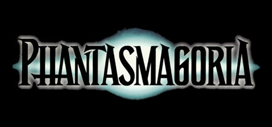
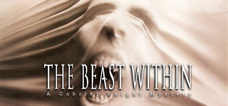

# 1995 in Video Games

[← Back to index](../README.md)

66 titles · [source](https://en.wikipedia.org/wiki/1995_in_video_games)

### Battle Arena Toshinden

**Platforms:** PlayStation &nbsp;|&nbsp; **Developer/Publisher:** Tamsoft / SCEA &nbsp;|&nbsp; **Genre:** Fighting &nbsp;|&nbsp; **Released:** January 1

[Wikipedia](https://en.wikipedia.org/wiki/Battle_Arena_Toshinden_(video_game))

---

### Battle Arena Toshinden 2

**Platforms:** PlayStation, Arcade &nbsp;|&nbsp; **Developer/Publisher:** Tamsoft /Capcom &nbsp;|&nbsp; **Released:** November 24

[Wikipedia](https://en.wikipedia.org/wiki/Battle_Arena_Toshinden_2)

---

### Brain Dead 13

**Platforms:** MS-DOS &nbsp;|&nbsp; **Developer/Publisher:** ReadySoft &nbsp;|&nbsp; **Genre:** Adventure &nbsp;|&nbsp; **Released:** December 15

[Wikipedia](https://en.wikipedia.org/wiki/Brain_Dead_13)

---

### Bust-a-Move

**Platforms:** Super Nintendo Entertainment System &nbsp;|&nbsp; **Developer/Publisher:** Taito &nbsp;|&nbsp; **Released:** January 13

[Wikipedia](https://en.wikipedia.org/wiki/Bust-a-Move)

---

### Castlevania: Dracula X

**Platforms:** Super Nintendo Entertainment System &nbsp;|&nbsp; **Developer/Publisher:** Konami &nbsp;|&nbsp; **Released:** July 21

---

### Chrono Trigger

**Platforms:** Super Nintendo Entertainment System &nbsp;|&nbsp; **Developer/Publisher:** Square &nbsp;|&nbsp; **Released:** March 11

[Wikipedia](https://en.wikipedia.org/wiki/Chrono_Trigger)

---

### Comix Zone

**Platforms:** Genesis / Mega Drive &nbsp;|&nbsp; **Developer/Publisher:** Sega &nbsp;|&nbsp; **Genre:** Brawler &nbsp;|&nbsp; **Released:** August 2

[Wikipedia](https://en.wikipedia.org/wiki/Comix_Zone)

---

### Command & Conquer

**Platforms:** MS-DOS, macOS &nbsp;|&nbsp; **Developer/Publisher:** Westwood Studios &nbsp;|&nbsp; **Genre:** RTS &nbsp;|&nbsp; **Released:** August 31

[Wikipedia](https://en.wikipedia.org/wiki/Command_%26_Conquer_(1995_video_game))

---

### Descent

**Platforms:** MS-DOS &nbsp;|&nbsp; **Developer/Publisher:** Parallax Software &nbsp;|&nbsp; **Released:** March 17

[Wikipedia](https://en.wikipedia.org/wiki/Descent_(video_game))

---

### Destruction Derby

**Platforms:** PlayStation &nbsp;|&nbsp; **Developer/Publisher:** Reflections Interactive / Psygnosis &nbsp;|&nbsp; **Released:** October 31

[Wikipedia](https://en.wikipedia.org/wiki/Destruction_Derby)

---

### Discworld

**Platforms:** MS-DOS, macOS, PlayStation &nbsp;|&nbsp; **Developer/Publisher:** Psygnosis &nbsp;|&nbsp; **Released:** March 17

[Wikipedia](https://en.wikipedia.org/wiki/Discworld_(video_game))

---

### Donkey Kong Country 2: Diddy's Kong Quest

**Platforms:** Super Nintendo Entertainment System &nbsp;|&nbsp; **Developer/Publisher:** Rareware / Nintendo &nbsp;|&nbsp; **Released:** November 20

---

### Dragon Quest VI: Realms of Revelation

**Platforms:** Super Nintendo Entertainment System &nbsp;|&nbsp; **Developer/Publisher:** Heartbeat / Enix &nbsp;|&nbsp; **Released:** December 9

---

### Eko Eko Azarak: Wizard of Darkness

**Platforms:** PlayStation &nbsp;|&nbsp; **Developer/Publisher:** PolyGram &nbsp;|&nbsp; **Genre:** Visual novel &nbsp;|&nbsp; **Released:** December 29

---

### Exector

**Platforms:** PlayStation &nbsp;|&nbsp; **Developer/Publisher:** Arc System Works &nbsp;|&nbsp; **Released:** September 22

[Wikipedia](https://en.wikipedia.org/wiki/Exector)

---

### Fade to Black

**Platforms:** MS-DOS &nbsp;|&nbsp; **Developer/Publisher:** Delphine Software International &nbsp;|&nbsp; **Genre:** TPS &nbsp;|&nbsp; **Released:** August 31

[Wikipedia](https://en.wikipedia.org/wiki/Fade_to_Black_(video_game))

---

### Final Fight 3

**Platforms:** Super Nintendo Entertainment System &nbsp;|&nbsp; **Developer/Publisher:** Capcom &nbsp;|&nbsp; **Released:** December 22

[Wikipedia](https://en.wikipedia.org/wiki/Final_Fight_3)

---

### Flight Unlimited

**Platforms:** MS-DOS, Windows &nbsp;|&nbsp; **Developer/Publisher:** Looking Glass Studios &nbsp;|&nbsp; **Released:** June 7

[Wikipedia](https://en.wikipedia.org/wiki/Flight_Unlimited)

---

### Front Mission

**Platforms:** Super Nintendo Entertainment System &nbsp;|&nbsp; **Developer/Publisher:** G-Craft/ Squaresoft &nbsp;|&nbsp; **Released:** February 24

[Wikipedia](https://en.wikipedia.org/wiki/Front_Mission_(video_game))

---

### Frontier: First Encounters

**Platforms:** MS-DOS &nbsp;|&nbsp; **Developer/Publisher:** Frontier Developments &nbsp;|&nbsp; **Genre:** Space trading, simulation &nbsp;|&nbsp; **Released:** April

---

### Full Throttle

**Platforms:** MS-DOS, macOS &nbsp;|&nbsp; **Developer/Publisher:** LucasArts &nbsp;|&nbsp; **Genre:** Adventure &nbsp;|&nbsp; **Released:** April 30

[Wikipedia](https://en.wikipedia.org/wiki/Full_Throttle_(1995_video_game))

---

### Heroes of Might and Magic: A Strategic Quest

**Platforms:** MS-DOS &nbsp;|&nbsp; **Developer/Publisher:** New World Computing &nbsp;|&nbsp; **Genre:** TBS &nbsp;|&nbsp; **Released:** August 31

---

### Hexen: Beyond Heretic

**Platforms:** MS-DOS, macOS &nbsp;|&nbsp; **Developer/Publisher:** Raven Software / id Software &nbsp;|&nbsp; **Released:** October 15

---

### Hyper Iria

**Platforms:** Super Nintendo Entertainment System &nbsp;|&nbsp; **Developer/Publisher:** Banpresto &nbsp;|&nbsp; **Released:** October 13

[Wikipedia](https://en.wikipedia.org/wiki/Hyper_Iria)

---

### I Have No Mouth, and I Must Scream

**Platforms:** MS-DOS, macOS &nbsp;|&nbsp; **Developer/Publisher:** Cyberdreams &nbsp;|&nbsp; **Genre:** Adventure &nbsp;|&nbsp; **Released:** October 31

[Wikipedia](https://en.wikipedia.org/wiki/I_Have_No_Mouth,_and_I_Must_Scream_(video_game))

---

### Jagged Alliance

**Platforms:** MS-DOS &nbsp;|&nbsp; **Developer/Publisher:** Madlab Software/ Sir-Tech &nbsp;|&nbsp; **Released:** April

[Wikipedia](https://en.wikipedia.org/wiki/Jagged_Alliance_(video_game))

---

### Jumping Flash!

**Platforms:** PlayStation &nbsp;|&nbsp; **Developer/Publisher:** Exact/ SCEA &nbsp;|&nbsp; **Released:** April 27

[Wikipedia](https://en.wikipedia.org/wiki/Jumping_Flash!)

---

### King Arthur & the Knights of Justice

**Platforms:** Super Nintendo Entertainment System &nbsp;|&nbsp; **Developer/Publisher:** Enix &nbsp;|&nbsp; **Released:** May

[Wikipedia](https://en.wikipedia.org/wiki/King_Arthur_%26_the_Knights_of_Justice_(video_game))

---

### King's Field II

**Platforms:** PlayStation &nbsp;|&nbsp; **Developer/Publisher:** From Software &nbsp;|&nbsp; **Released:** December 31

[Wikipedia](https://en.wikipedia.org/wiki/King%27s_Field_(1995_video_game))

---

### Kirby's Dream Land 2

**Platforms:** Game Boy &nbsp;|&nbsp; **Developer/Publisher:** HAL Laboratory / Nintendo &nbsp;|&nbsp; **Released:** March 21

[Wikipedia](https://en.wikipedia.org/wiki/Kirby%27s_Dream_Land_2)

---

### Light Crusader

**Platforms:** Genesis / Mega Drive &nbsp;|&nbsp; **Developer/Publisher:** Treasure / Sega &nbsp;|&nbsp; **Released:** May 25

[Wikipedia](https://en.wikipedia.org/wiki/Light_Crusader)

---

### Marathon 2: Durandal

**Platforms:** macOS &nbsp;|&nbsp; **Developer/Publisher:** Bungie &nbsp;|&nbsp; **Released:** November 24

---

### Mario's Picross

**Platforms:** Game Boy &nbsp;|&nbsp; **Developer/Publisher:** Jupiter / Nintendo &nbsp;|&nbsp; **Genre:** Puzzle &nbsp;|&nbsp; **Released:** March 14

[Wikipedia](https://en.wikipedia.org/wiki/Mario%27s_Picross)

---

### MechWarrior 2

**Platforms:** MS-DOS &nbsp;|&nbsp; **Developer/Publisher:** Activision &nbsp;|&nbsp; **Released:** July 24

[Wikipedia](https://en.wikipedia.org/wiki/MechWarrior_2)

---

### Mega Man 7

**Platforms:** Super Nintendo Entertainment System &nbsp;|&nbsp; **Developer/Publisher:** Capcom &nbsp;|&nbsp; **Released:** March 24

[Wikipedia](https://en.wikipedia.org/wiki/Mega_Man_7)

---

### Mega Man X3

**Platforms:** Super Nintendo Entertainment System &nbsp;|&nbsp; **Developer/Publisher:** Capcom &nbsp;|&nbsp; **Released:** December 1

[Wikipedia](https://en.wikipedia.org/wiki/Mega_Man_X3)

---

### Mortal Kombat 3

**Platforms:** Arcade, Super Nintendo Entertainment System, PlayStation, Game Boy, Genesis / Mega Drive &nbsp;|&nbsp; **Released:** April 15

[Wikipedia](https://en.wikipedia.org/wiki/Mortal_Kombat_3)

---

### Panel de Pon

**Platforms:** Super Nintendo Entertainment System &nbsp;|&nbsp; **Developer/Publisher:** Intelligent Systems /Nintendo &nbsp;|&nbsp; **Released:** October 27

[Wikipedia](https://en.wikipedia.org/wiki/Panel_de_Pon)

---

### Panzer Dragoon

**Platforms:** Sega Saturn &nbsp;|&nbsp; **Developer/Publisher:** Team Andromeda / Sega &nbsp;|&nbsp; **Released:** March 10

[Wikipedia](https://en.wikipedia.org/wiki/Panzer_Dragoon)

---

### Phantasmagoria

**Platforms:** MS-DOS, Windows, macOS &nbsp;|&nbsp; **Developer/Publisher:** Sierra Online &nbsp;|&nbsp; **Genre:** Adventure &nbsp;|&nbsp; **Released:** July 31

> Master storyteller Roberta Williams challenges you to experience the ultimate interactive nightmare.
>
> _Synopsis source: Steam_

[Wikipedia](https://en.wikipedia.org/wiki/Phantasmagoria_(video_game)) · [Steam](https://store.steampowered.com/app/501990)

---

### Rayman

**Platforms:** PlayStation, Sega Saturn, Atari Jaguar &nbsp;|&nbsp; **Developer/Publisher:** Ubisoft &nbsp;|&nbsp; **Released:** September 9

[Wikipedia](https://en.wikipedia.org/wiki/Rayman_(video_game))

---

### Ristar

**Platforms:** Genesis / Mega Drive &nbsp;|&nbsp; **Developer/Publisher:** Sonic Team / Sega &nbsp;|&nbsp; **Genre:** Platformer &nbsp;|&nbsp; **Released:** February 16

[Wikipedia](https://en.wikipedia.org/wiki/Ristar)

---

### Romancing SaGa 3

**Platforms:** Super Nintendo Entertainment System &nbsp;|&nbsp; **Developer/Publisher:** Square &nbsp;|&nbsp; **Released:** November 11

[Wikipedia](https://en.wikipedia.org/wiki/Romancing_SaGa_3)

---

### Secret of Evermore

**Platforms:** Super Nintendo Entertainment System &nbsp;|&nbsp; **Developer/Publisher:** Square &nbsp;|&nbsp; **Released:** October 1

[Wikipedia](https://en.wikipedia.org/wiki/Secret_of_Evermore)

---

### Shining Wisdom

**Platforms:** Sega Saturn &nbsp;|&nbsp; **Developer/Publisher:** Camelot / Sega &nbsp;|&nbsp; **Genre:** Action-adventure &nbsp;|&nbsp; **Released:** August 11

[Wikipedia](https://en.wikipedia.org/wiki/Shining_Wisdom)

---

### Space Quest 6

**Platforms:** MS-DOS, macOS &nbsp;|&nbsp; **Developer/Publisher:** Sierra Online &nbsp;|&nbsp; **Genre:** Adventure &nbsp;|&nbsp; **Released:** July 11

[Wikipedia](https://en.wikipedia.org/wiki/Space_Quest_6)

---

### Star Trek: The Next Generation – A Final Unity

**Platforms:** MS-DOS, macOS &nbsp;|&nbsp; **Developer/Publisher:** Spectrum HoloByte &nbsp;|&nbsp; **Released:** June 30

---

### Star Wars: Dark Forces

**Platforms:** MS-DOS &nbsp;|&nbsp; **Developer/Publisher:** LucasArts &nbsp;|&nbsp; **Genre:** FPS &nbsp;|&nbsp; **Released:** February 15

---

### Star Wars: TIE Fighter (Collector's CD-ROM)

**Platforms:** Windows, macOS &nbsp;|&nbsp; **Developer/Publisher:** LucasArts &nbsp;|&nbsp; **Released:** October 31

---

### Street Fighter Alpha

**Platforms:** Arcade &nbsp;|&nbsp; **Developer/Publisher:** Capcom &nbsp;|&nbsp; **Released:** June 5

[Wikipedia](https://en.wikipedia.org/wiki/Street_Fighter_Alpha)

---

### Suikoden

**Platforms:** PlayStation &nbsp;|&nbsp; **Developer/Publisher:** Konami &nbsp;|&nbsp; **Released:** December 15

[Wikipedia](https://en.wikipedia.org/wiki/Suikoden_(video_game))

---

### Super Bomberman 3

**Platforms:** Super Nintendo Entertainment System &nbsp;|&nbsp; **Developer/Publisher:** Hudson Soft &nbsp;|&nbsp; **Released:** April 28

[Wikipedia](https://en.wikipedia.org/wiki/Super_Bomberman_3)

---

### Super Mario World 2: Yoshi's Island

**Platforms:** Super Nintendo Entertainment System &nbsp;|&nbsp; **Developer/Publisher:** Nintendo &nbsp;|&nbsp; **Genre:** Platformer &nbsp;|&nbsp; **Released:** August 5

[Wikipedia](https://en.wikipedia.org/wiki/Yoshi%27s_Island)

---

### Tactics Ogre: Let Us Cling Together

**Platforms:** Super Nintendo Entertainment System &nbsp;|&nbsp; **Developer/Publisher:** Quest Corporation &nbsp;|&nbsp; **Released:** October 6

---

### Tales of Phantasia

**Platforms:** Super Nintendo Entertainment System &nbsp;|&nbsp; **Developer/Publisher:** Namco &nbsp;|&nbsp; **Released:** December 15

[Wikipedia](https://en.wikipedia.org/wiki/Tales_of_Phantasia)

---

### Tekken 2

**Platforms:** Arcade &nbsp;|&nbsp; **Developer/Publisher:** Namco &nbsp;|&nbsp; **Released:** June 21

[Wikipedia](https://en.wikipedia.org/wiki/Tekken_2)

---

### Terranigma

**Platforms:** Super Nintendo Entertainment System &nbsp;|&nbsp; **Developer/Publisher:** Quintet &nbsp;|&nbsp; **Released:** October 20

[Wikipedia](https://en.wikipedia.org/wiki/Terranigma)

---

### The Beast Within: A Gabriel Knight Mystery

**Platforms:** MS-DOS, Windows, macOS &nbsp;|&nbsp; **Developer/Publisher:** Sierra On-Line &nbsp;|&nbsp; **Genre:** Adventure &nbsp;|&nbsp; **Released:** December 31

> Play as both Gabriel and Grace as they are dispatched to Munich to solve a series of mutilation murders thought to be the work of werewolves.
>
> _Synopsis source: Steam_

[Steam](https://store.steampowered.com/app/496760)

---

### The Dig

**Platforms:** MS-DOS, macOS &nbsp;|&nbsp; **Developer/Publisher:** LucasArts &nbsp;|&nbsp; **Genre:** Adventure &nbsp;|&nbsp; **Released:** November 30

[Wikipedia](https://en.wikipedia.org/wiki/The_Dig_(video_game))

---

### The King of Fighters '95

**Platforms:** Arcade &nbsp;|&nbsp; **Developer/Publisher:** SNK &nbsp;|&nbsp; **Released:** July 25

[Wikipedia](https://en.wikipedia.org/wiki/The_King_of_Fighters_%2795)

---

### Time Crisis

**Platforms:** Arcade &nbsp;|&nbsp; **Developer/Publisher:** Namco &nbsp;|&nbsp; **Genre:** light gun &nbsp;|&nbsp; **Released:** December

[Wikipedia](https://en.wikipedia.org/wiki/Time_Crisis_(video_game))

---

### Twisted Metal

**Platforms:** PlayStation &nbsp;|&nbsp; **Developer/Publisher:** SingleTrac / Sony Computer Entertainment &nbsp;|&nbsp; **Genre:** Vehicular combat &nbsp;|&nbsp; **Released:** November 5

[Wikipedia](https://en.wikipedia.org/wiki/Twisted_Metal_(1995_video_game))

---

### Warcraft II: Tides of Darkness

**Platforms:** MS-DOS, macOS &nbsp;|&nbsp; **Developer/Publisher:** Blizzard &nbsp;|&nbsp; **Released:** December 9

---

### Wild Woody

**Platforms:** Sega CD &nbsp;|&nbsp; **Developer/Publisher:** Sega &nbsp;|&nbsp; **Released:** September

[Wikipedia](https://en.wikipedia.org/wiki/Wild_Woody)

---

### Wizard's Harmony

**Platforms:** PlayStation, Sega Saturn &nbsp;|&nbsp; **Developer/Publisher:** Arc System Works &nbsp;|&nbsp; **Genre:** Raising sim &nbsp;|&nbsp; **Released:** December 29

[Wikipedia](https://en.wikipedia.org/wiki/Wizard%27s_Harmony)

---

### Worms

**Platforms:** Amiga &nbsp;|&nbsp; **Developer/Publisher:** Team17 &nbsp;|&nbsp; **Genre:** Artillery &nbsp;|&nbsp; **Released:** December

[Wikipedia](https://en.wikipedia.org/wiki/Worms_(1995_video_game))

---
