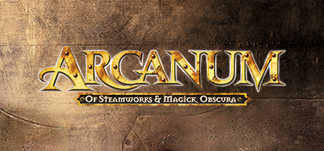
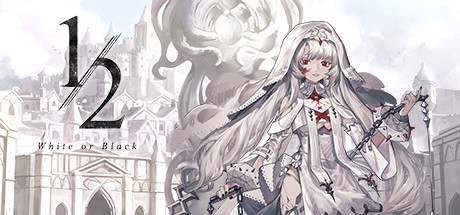
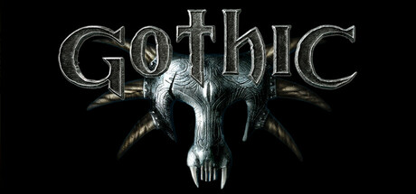
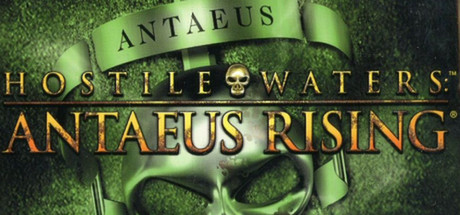
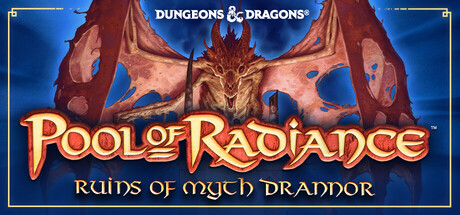
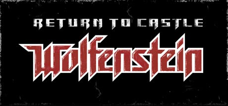
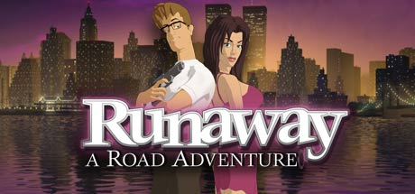
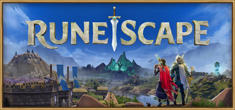

# 2001 in Video Games

[← Back to index](../README.md)

244 titles · [source](https://en.wikipedia.org/wiki/2001_in_video_games)

### 007: Agent Under Fire

**Platforms:** PlayStation 2 &nbsp;|&nbsp; **Released:** November 13

---

### Ace Combat 04: Shattered Skies

**Platforms:** PlayStation 2 &nbsp;|&nbsp; **Publisher:** Namco &nbsp;|&nbsp; **Released:** September 13, 2001

---

### Action Man: Search for Base X

**Platforms:** Game Boy Color &nbsp;|&nbsp; **Released:** February 6

---

### Advance Wars

**Platforms:** Game Boy Advance &nbsp;|&nbsp; **Publisher:** Nintendo &nbsp;|&nbsp; **Released:** September 10, 2001

[Wikipedia](https://en.wikipedia.org/wiki/Advance_Wars)

---

### Aidyn Chronicles: The First Mage

**Platforms:** Nintendo 64 &nbsp;|&nbsp; **Released:** March 14

---

### Alchemy

**Platforms:** Windows &nbsp;|&nbsp; **Released:** August 29

[Wikipedia](https://en.wikipedia.org/wiki/Alchemy_(game))

---

### Aliens versus Predator 2

**Platforms:** Windows &nbsp;|&nbsp; **Released:** October 30

[Wikipedia](https://en.wikipedia.org/wiki/Aliens_versus_Predator_2)

---

### American Bass Challenge

**Platforms:** Game Boy Advance &nbsp;|&nbsp; **Released:** December 5

[Wikipedia](https://en.wikipedia.org/wiki/American_Bass_Challenge)

---

### Anachronox

**Platforms:** Windows &nbsp;|&nbsp; **Genre:** RPG &nbsp;|&nbsp; **Released:** June 27

> Join Sylvester &quot;Sly&quot; Boots and Stiletto Anyway as they trek across six bizarre planets investigating a galaxy-crushing mystery, searching for artefacts from an extinct alien race and unlocking the secrets of a powerful, advanced technology. It's your turn. PICK YOUR POISON.
>
> _Synopsis source: Steam_

[Wikipedia](https://en.wikipedia.org/wiki/Anachronox) · [Steam](https://store.steampowered.com/app/242940)

---

### Anarchy Online [ 55 ]

**Platforms:** Windows &nbsp;|&nbsp; **Released:** June 27

[Wikipedia](https://en.wikipedia.org/wiki/Anarchy_Online)

---

### Arcanum: Of Steamworks and Magick Obscura

**Platforms:** Windows &nbsp;|&nbsp; **Genre:** RPG &nbsp;|&nbsp; **Released:** August 21

> Imagine a place of wonder, where magick and technology coexist in an uneasy balance, and an adventurer might just as easily wield a flintlock pistol as a flaming sword. Welcome to the land of Arcanum.
>
> _Synopsis source: Steam_

[Steam](https://store.steampowered.com/app/500810)

---

### Arctic Thunder

**Platforms:** PlayStation 2 &nbsp;|&nbsp; **Released:** September 17

[Wikipedia](https://en.wikipedia.org/wiki/Arctic_Thunder)

---

### Armored Core 2: Another Age

**Platforms:** PlayStation 2 &nbsp;|&nbsp; **Released:** August 20

---

### Atlantis The Lost Empire: Trial by Fire

**Platforms:** Windows &nbsp;|&nbsp; **Released:** May 18

---

### Atlantis: The Lost Empire

**Platforms:** PlayStation &nbsp;|&nbsp; **Released:** June 14

---

### Azurik: Rise of Perathia

**Platforms:** Xbox &nbsp;|&nbsp; **Released:** November 25

---

### Baldur's Gate II: Throne of Bhaal

**Platforms:** Windows &nbsp;|&nbsp; **Publisher:** Interplay Entertainment &nbsp;|&nbsp; **Released:** June 22, 2001

---

### Baldur's Gate: Dark Alliance

**Platforms:** PlayStation 2 &nbsp;|&nbsp; **Released:** December 3

---

### Bass Strike

**Platforms:** PlayStation 2 &nbsp;|&nbsp; **Released:** September 26

[Wikipedia](https://en.wikipedia.org/wiki/Bass_Strike)

---

### Batman: Chaos in Gotham

**Platforms:** Game Boy Color &nbsp;|&nbsp; **Released:** April 16

---

### Batman: Vengeance

**Platforms:** Windows, PlayStation 2, GameCube, Xbox, Game Boy Advance &nbsp;|&nbsp; **Released:** October 15

---

### Bejeweled

**Platforms:** Windows &nbsp;|&nbsp; **Released:** May 30

[Wikipedia](https://en.wikipedia.org/wiki/Bejeweled_(video_game))

---

### Black & White

**Platforms:** Windows &nbsp;|&nbsp; **Publisher:** Electronic Arts &nbsp;|&nbsp; **Genre:** Adventure, Indie, RPG, Strategy &nbsp;|&nbsp; **Released:** March 30, 2001

> &quot;Black &amp; White&quot; is a dystopian visual novel + war chess game: black and white, sensibility and reason, freedom and order: follow your beliefs and join your camp.
>
> _Synopsis source: Steam_

[Wikipedia](https://en.wikipedia.org/wiki/Black_%26_White_(video_game)) · [Steam](https://store.steampowered.com/app/1998450)

---

### Bomberman Tournament

**Platforms:** Game Boy Advance &nbsp;|&nbsp; **Released:** June 29

[Wikipedia](https://en.wikipedia.org/wiki/Bomberman_Tournament)

---

### Boxing Fever

**Platforms:** Game Boy Advance &nbsp;|&nbsp; **Released:** October 30

[Wikipedia](https://en.wikipedia.org/wiki/Boxing_Fever)

---

### Breath of Fire

**Platforms:** Game Boy Advance &nbsp;|&nbsp; **Released:** December 1

[Wikipedia](https://en.wikipedia.org/wiki/Breath_of_Fire_(video_game))

---

### Burnout

**Platforms:** PlayStation 2 &nbsp;|&nbsp; **Released:** November 1

[Wikipedia](https://en.wikipedia.org/wiki/Burnout_(video_game))

---

### Castlevania Chronicles

**Platforms:** PlayStation &nbsp;|&nbsp; **Released:** October 8

[Wikipedia](https://en.wikipedia.org/wiki/Castlevania_Chronicles)

---

### Castlevania: Circle of the Moon

**Platforms:** Game Boy Advance &nbsp;|&nbsp; **Publisher:** Konami &nbsp;|&nbsp; **Released:** March 21, 2001

---

### Cel Damage

**Platforms:** Xbox, PlayStation 2, GameCube &nbsp;|&nbsp; **Released:** November 15

[Wikipedia](https://en.wikipedia.org/wiki/Cel_Damage)

---

### ChuChu Rocket!

**Platforms:** Game Boy Advance &nbsp;|&nbsp; **Released:** June 11

[Wikipedia](https://en.wikipedia.org/wiki/ChuChu_Rocket!)

---

### City Crisis

**Platforms:** PlayStation 2 &nbsp;|&nbsp; **Released:** July 17

[Wikipedia](https://en.wikipedia.org/wiki/City_Crisis)

---

### Civilization III

**Platforms:** Windows &nbsp;|&nbsp; **Publisher:** Infogrames &nbsp;|&nbsp; **Released:** October 30, 2001

[Wikipedia](https://en.wikipedia.org/wiki/Civilization_III)

---

### Clive Barker's Undying

**Platforms:** Windows &nbsp;|&nbsp; **Released:** February 7

[Wikipedia](https://en.wikipedia.org/wiki/Clive_Barker%27s_Undying)

---

### Conker's Bad Fur Day

**Platforms:** Nintendo 64 &nbsp;|&nbsp; **Publisher:** Rare &nbsp;|&nbsp; **Released:** March 5, 2001

[Wikipedia](https://en.wikipedia.org/wiki/Conker%27s_Bad_Fur_Day)

---

### Cool Boarders

**Platforms:** PlayStation 2 &nbsp;|&nbsp; **Released:** May 21

[Wikipedia](https://en.wikipedia.org/wiki/Cool_Boarders)

---

### Crash Bandicoot: The Wrath of Cortex

**Platforms:** PlayStation 2, Xbox, GameCube &nbsp;|&nbsp; **Released:** October 29

---

### Crazy Taxi

**Platforms:** PlayStation 2, GameCube &nbsp;|&nbsp; **Released:** May 14

[Wikipedia](https://en.wikipedia.org/wiki/Crazy_Taxi_(video_game))

---

### Crazy Taxi 2

**Platforms:** Dreamcast &nbsp;|&nbsp; **Released:** May 28

[Wikipedia](https://en.wikipedia.org/wiki/Crazy_Taxi_2)

---

### Cruis'n Velocity

**Platforms:** Game Boy Advance &nbsp;|&nbsp; **Released:** November 28

[Wikipedia](https://en.wikipedia.org/wiki/Cruis%27n_Velocity)

---

### Cubix - Robots for Everyone: Race 'N Robots

**Platforms:** Game Boy Color &nbsp;|&nbsp; **Released:** November 13

---

### Dance Dance Revolution

**Platforms:** PlayStation &nbsp;|&nbsp; **Publisher:** Konami &nbsp;|&nbsp; **Released:** March 6, 2001

[Wikipedia](https://en.wikipedia.org/wiki/Dance_Dance_Revolution_(1998_video_game))

---

### Dark Age of Camelot

**Platforms:** Windows &nbsp;|&nbsp; **Publisher:** Vivendi Universal Games &nbsp;|&nbsp; **Released:** October 10, 2001

[Wikipedia](https://en.wikipedia.org/wiki/Dark_Age_of_Camelot)

---

### Dark Angel: Vampire Apocalypse

**Platforms:** PlayStation 2 &nbsp;|&nbsp; **Released:** July 8

---

### Dark Rift (North America)

**Platforms:** Nintendo 64 &nbsp;|&nbsp; **Released:** December 17

[Wikipedia](https://en.wikipedia.org/wiki/Dark_Rift)

---

### Dave Mirra Freestyle BMX 2

**Platforms:** PlayStation 2 &nbsp;|&nbsp; **Released:** August 27

[Wikipedia](https://en.wikipedia.org/wiki/Dave_Mirra_Freestyle_BMX_2)

---

### Daytona USA

**Platforms:** Dreamcast &nbsp;|&nbsp; **Released:** March 21

[Wikipedia](https://en.wikipedia.org/wiki/Daytona_USA_(video_game))

---

### Dead or Alive 3

**Platforms:** Xbox &nbsp;|&nbsp; **Released:** November 15

[Wikipedia](https://en.wikipedia.org/wiki/Dead_or_Alive_3)

---

### Devil May Cry

**Platforms:** PlayStation 2 &nbsp;|&nbsp; **Publisher:** Capcom &nbsp;|&nbsp; **Released:** August 23, 2001

[Wikipedia](https://en.wikipedia.org/wiki/Devil_May_Cry_(video_game))

---

### Dexter's Laboratory: Deesaster Strikes!

**Platforms:** Game Boy Advance &nbsp;|&nbsp; **Released:** September 26

---

### Diablo II: Lord of Destruction

**Platforms:** Windows &nbsp;|&nbsp; **Released:** June 29

---

### Dokapon: Monster Hunter

**Platforms:** Game Boy Advance &nbsp;|&nbsp; **Released:** November 30

---

### Doom

**Platforms:** Game Boy Advance &nbsp;|&nbsp; **Released:** October 28

[Wikipedia](https://en.wikipedia.org/wiki/Doom_(1993_video_game))

---

### Dr. Mario 64

**Platforms:** Nintendo 64 &nbsp;|&nbsp; **Released:** April 8

[Wikipedia](https://en.wikipedia.org/wiki/Dr._Mario_64)

---

### Dragon Warrior VII

**Platforms:** PlayStation &nbsp;|&nbsp; **Released:** November 1

[Wikipedia](https://en.wikipedia.org/wiki/Dragon_Warrior_VII)

---

### E.T.: Digital Companion

**Platforms:** Game Boy Color &nbsp;|&nbsp; **Released:** October 18

---

### Earthworm Jim

**Platforms:** Game Boy Advance &nbsp;|&nbsp; **Released:** June 11

[Wikipedia](https://en.wikipedia.org/wiki/Earthworm_Jim_(video_game))

---

### Ecks vs. Sever

**Platforms:** Game Boy Advance &nbsp;|&nbsp; **Released:** November 21

[Wikipedia](https://en.wikipedia.org/wiki/Ecks_vs._Sever)

---

### Empire Earth

**Platforms:** Windows &nbsp;|&nbsp; **Released:** November 12

[Wikipedia](https://en.wikipedia.org/wiki/Empire_Earth)

---

### ESPN Final Round Golf 2002

**Platforms:** Game Boy Advance &nbsp;|&nbsp; **Released:** August 28

[Wikipedia](https://en.wikipedia.org/wiki/ESPN_Final_Round_Golf_2002)

---

### Evil Twin: Cyprien's Chronicles

**Platforms:** PlayStation 2 &nbsp;|&nbsp; **Released:** December 7

---

### Extermination

**Platforms:** PlayStation 2 &nbsp;|&nbsp; **Released:** July 23

[Wikipedia](https://en.wikipedia.org/wiki/Extermination_(video_game))

---

### Extreme-G 3

**Platforms:** GameCube &nbsp;|&nbsp; **Released:** November 27

[Wikipedia](https://en.wikipedia.org/wiki/Extreme-G_3)

---

### F-Zero: Maximum Velocity

**Platforms:** Game Boy Advance &nbsp;|&nbsp; **Released:** June 11

---

### FIFA Football 2002

**Platforms:** PlayStation, PlayStation 2 &nbsp;|&nbsp; **Released:** November 1

[Wikipedia](https://en.wikipedia.org/wiki/FIFA_Football_2002)

---

### Final Fantasy Chronicles

**Platforms:** PlayStation &nbsp;|&nbsp; **Publisher:** Square &nbsp;|&nbsp; **Released:** June 29, 2001

[Wikipedia](https://en.wikipedia.org/wiki/Final_Fantasy_Chronicles)

---

### Final Fantasy IX

**Platforms:** PlayStation &nbsp;|&nbsp; **Released:** February 16

[Wikipedia](https://en.wikipedia.org/wiki/Final_Fantasy_IX)

---

### Final Fantasy X

**Platforms:** PlayStation 2 &nbsp;|&nbsp; **Publisher:** Square &nbsp;|&nbsp; **Released:** July 19, 2001

[Wikipedia](https://en.wikipedia.org/wiki/Final_Fantasy_X)

---

### Final Fight One

**Platforms:** Game Boy Advance &nbsp;|&nbsp; **Released:** September 26

[Wikipedia](https://en.wikipedia.org/wiki/Final_Fight_One)

---

### Frank Herbert's Dune [ 57 ]

**Platforms:** Windows, PlayStation 2 &nbsp;|&nbsp; **Released:** November 14

[Wikipedia](https://en.wikipedia.org/wiki/Frank_Herbert%27s_Dune_(video_game))

---

### Frequency

**Platforms:** PlayStation 2 &nbsp;|&nbsp; **Released:** November 20

[Wikipedia](https://en.wikipedia.org/wiki/Frequency)

---

### Frogger's Adventures: Temple of the Frog

**Platforms:** Game Boy Advance &nbsp;|&nbsp; **Released:** November 24

---

### Frogger: The Great Quest

**Platforms:** PlayStation 2 &nbsp;|&nbsp; **Released:** November 20

---

### Giants: Citizen Kabuto

**Platforms:** PlayStation 2 &nbsp;|&nbsp; **Released:** December 20

---

### Giga Wing 2

**Platforms:** Dreamcast &nbsp;|&nbsp; **Released:** May 16

[Wikipedia](https://en.wikipedia.org/wiki/Giga_Wing_2)

---

### Golden Sun

**Platforms:** Game Boy Advance &nbsp;|&nbsp; **Publisher:** Nintendo &nbsp;|&nbsp; **Released:** August 1, 2001

[Wikipedia](https://en.wikipedia.org/wiki/Golden_Sun_(video_game))

---

### Gothic

**Platforms:** Windows &nbsp;|&nbsp; **Genre:** Action, RPG &nbsp;|&nbsp; **Released:** November 23

> War has been waged across the kingdom of Myrtana. Orcish hordes invaded human territory and the king of the land needed a lot of ore to forge enough weapons, should his army stand against this threat. Whoever breaks the law in these darkest of times is sentenced to serve in the giant penal colony of Khorinis, mining the so much needed...
>
> _Synopsis source: Steam_

[Wikipedia](https://en.wikipedia.org/wiki/Gothic_(video_game)) · [Steam](https://store.steampowered.com/app/65540)

---

### Gradius Advance

**Platforms:** Game Boy Advance &nbsp;|&nbsp; **Released:** November 12

[Wikipedia](https://en.wikipedia.org/wiki/Gradius_Advance)

---

### Gran Turismo 3: A-Spec

**Platforms:** PlayStation 2 &nbsp;|&nbsp; **Publisher:** Sony Computer Entertainment &nbsp;|&nbsp; **Released:** April 28, 2001

---

### Grand Theft Auto III

**Platforms:** PlayStation 2 &nbsp;|&nbsp; **Publisher:** Rockstar Games &nbsp;|&nbsp; **Released:** October 22, 2001

[Wikipedia](https://en.wikipedia.org/wiki/Grand_Theft_Auto_III)

---

### Halo: Combat Evolved

**Platforms:** Xbox &nbsp;|&nbsp; **Publisher:** Microsoft Game Studios &nbsp;|&nbsp; **Released:** November 15, 2001

---

### Harry Potter and the Philosopher's Stone

**Platforms:** Windows, PlayStation, Game Boy Color, Game Boy Advance &nbsp;|&nbsp; **Released:** November 16

[Wikipedia](https://en.wikipedia.org/wiki/Harry_Potter_and_the_Philosopher%27s_Stone_(PC_video_game))

---

### Harvest Moon 3 GBC

**Platforms:** Game Boy Color &nbsp;|&nbsp; **Released:** November 14

[Wikipedia](https://en.wikipedia.org/wiki/Harvest_Moon_3_GBC)

---

### Headhunter

**Platforms:** Dreamcast &nbsp;|&nbsp; **Released:** November 16

[Wikipedia](https://en.wikipedia.org/wiki/Headhunter_(video_game))

---

### Heavy Metal: Geomatrix

**Platforms:** Dreamcast &nbsp;|&nbsp; **Released:** September 13

---

### Hostile Waters: Antaeus Rising

**Platforms:** Windows &nbsp;|&nbsp; **Genre:** Strategy &nbsp;|&nbsp; **Released:** March 23

> In 2032 an Earth that knows only peace is forced to relearn the art of war. Twenty years have passed since the population of Earth did a fine job of destroying nearly everything in one final struggle for power by the politicians and military leaders.
>
> _Synopsis source: Steam_

[Steam](https://store.steampowered.com/app/267980)

---

### Ico

**Platforms:** PlayStation 2 &nbsp;|&nbsp; **Publisher:** Sony Computer Entertainment &nbsp;|&nbsp; **Released:** September 24, 2001

[Wikipedia](https://en.wikipedia.org/wiki/Ico)

---

### IL-2 Sturmovik

**Platforms:** Windows &nbsp;|&nbsp; **Publisher:** 1C Company &nbsp;|&nbsp; **Released:** November 18, 2001

[Wikipedia](https://en.wikipedia.org/wiki/IL-2_Sturmovik_(video_game))

---

### Illbleed

**Platforms:** Dreamcast &nbsp;|&nbsp; **Released:** April 16

[Wikipedia](https://en.wikipedia.org/wiki/Illbleed)

---

### Indiana Jones and the Infernal Machine

**Platforms:** Game Boy Color &nbsp;|&nbsp; **Released:** March 30

[Wikipedia](https://en.wikipedia.org/wiki/Indiana_Jones_and_the_Infernal_Machine)

---

### Jackie Chan Adventures: Legend of the Dark Hand

**Platforms:** Game Boy Advance &nbsp;|&nbsp; **Released:** November 7

[Wikipedia](https://en.wikipedia.org/wiki/Jackie_Chan_Adventures_(video_game))

---

### Jak and Daxter: The Precursor Legacy

**Platforms:** PlayStation 2 &nbsp;|&nbsp; **Publisher:** Sony Computer Entertainment &nbsp;|&nbsp; **Released:** December 3, 2001

---

### Jurassic Park III: Island Attack

**Platforms:** Game Boy Advance &nbsp;|&nbsp; **Released:** November 26

---

### Jurassic Park III: Park Builder

**Platforms:** Game Boy Advance &nbsp;|&nbsp; **Released:** September 10

---

### Jurassic Park III: The DNA Factor

**Platforms:** Game Boy Advance &nbsp;|&nbsp; **Released:** July 16

---

### Kessen II

**Platforms:** PlayStation 2 &nbsp;|&nbsp; **Released:** September 26

[Wikipedia](https://en.wikipedia.org/wiki/Kessen_II)

---

### Kirby Tilt 'n' Tumble

**Platforms:** Game Boy Color &nbsp;|&nbsp; **Released:** April 11

[Wikipedia](https://en.wikipedia.org/wiki/Kirby_Tilt_%27n%27_Tumble)

---

### Klonoa 2: Lunatea's Veil

**Platforms:** PlayStation 2 &nbsp;|&nbsp; **Publisher:** Namco &nbsp;|&nbsp; **Released:** March 22, 2001

---

### Klonoa: Empire of Dreams

**Platforms:** Game Boy Advance &nbsp;|&nbsp; **Released:** August 30

---

### Konami Krazy Racers

**Platforms:** Game Boy Advance &nbsp;|&nbsp; **Released:** June 11

[Wikipedia](https://en.wikipedia.org/wiki/Konami_Krazy_Racers)

---

### Lady Sia

**Platforms:** Game Boy Advance &nbsp;|&nbsp; **Released:** October 15

[Wikipedia](https://en.wikipedia.org/wiki/Lady_Sia)

---

### Lego Bionicle

**Platforms:** Game Boy Advance &nbsp;|&nbsp; **Released:** October 3

[Wikipedia](https://en.wikipedia.org/wiki/Lego_Bionicle_(video_game))

---

### Lego Island 2 The Brickster's Revenge

**Platforms:** Windows, PlayStation, Game Boy Color, Game Boy Advance &nbsp;|&nbsp; **Released:** March 1

[Wikipedia](https://en.wikipedia.org/wiki/Lego_Island_2_The_Brickster%27s_Revenge)

---

### Lego Island 2: The Brickster's Revenge

**Platforms:** Game Boy Advance &nbsp;|&nbsp; **Released:** October 2

---

### Lego Racers 2

**Platforms:** Game Boy Advance &nbsp;|&nbsp; **Released:** November 27

[Wikipedia](https://en.wikipedia.org/wiki/Lego_Racers_2)

---

### Luigi's Mansion

**Platforms:** GameCube &nbsp;|&nbsp; **Released:** November 18

[Wikipedia](https://en.wikipedia.org/wiki/Luigi%27s_Mansion)

---

### M&M's Blast!

**Platforms:** Game Boy Advance &nbsp;|&nbsp; **Released:** December 1

---

### Madden NFL 2002

**Platforms:** PlayStation 2, GameCube, Xbox, PlayStation, Game Boy Color &nbsp;|&nbsp; **Publisher:** EA Sports &nbsp;|&nbsp; **Released:** August 19, 2001

[Wikipedia](https://en.wikipedia.org/wiki/Madden_NFL_2002)

---

### Magical Vacation

**Platforms:** Game Boy Advance &nbsp;|&nbsp; **Released:** December 7

[Wikipedia](https://en.wikipedia.org/wiki/Magical_Vacation)

---

### Mario Kart: Super Circuit

**Platforms:** Game Boy Advance &nbsp;|&nbsp; **Publisher:** Nintendo &nbsp;|&nbsp; **Released:** July 21, 2001

---

### Mario Party 3

**Platforms:** Nintendo 64 &nbsp;|&nbsp; **Released:** May 7

[Wikipedia](https://en.wikipedia.org/wiki/Mario_Party_3)

---

### Mario Tennis

**Platforms:** Game Boy Color &nbsp;|&nbsp; **Released:** January 16

[Wikipedia](https://en.wikipedia.org/wiki/Mario_Tennis)

---

### Mars Matrix: Hyper Solid Shooting

**Platforms:** Dreamcast &nbsp;|&nbsp; **Released:** April 30

---

### Max Payne

**Platforms:** Windows, Xbox &nbsp;|&nbsp; **Publisher:** Gathering of Developers &nbsp;|&nbsp; **Released:** July 23, 2001

[Wikipedia](https://en.wikipedia.org/wiki/Max_Payne_(video_game))

---

### Max Steel: Covert Missions

**Platforms:** Dreamcast &nbsp;|&nbsp; **Released:** May 30

---

### Mega Man 64

**Platforms:** Nintendo 64 &nbsp;|&nbsp; **Released:** January 10

[Wikipedia](https://en.wikipedia.org/wiki/Mega_Man_Legends_(video_game))

---

### Mega Man Battle Network

**Platforms:** Game Boy Advance &nbsp;|&nbsp; **Released:** October 31

[Wikipedia](https://en.wikipedia.org/wiki/Mega_Man_Battle_Network_(video_game))

---

### Mega Man Legends

**Platforms:** Windows &nbsp;|&nbsp; **Released:** July 14

[Wikipedia](https://en.wikipedia.org/wiki/Mega_Man_Legends_(video_game))

---

### Mega Man X5

**Platforms:** PlayStation &nbsp;|&nbsp; **Released:** January 31

[Wikipedia](https://en.wikipedia.org/wiki/Mega_Man_X5)

---

### Mega Man X6

**Platforms:** PlayStation &nbsp;|&nbsp; **Released:** December 4

[Wikipedia](https://en.wikipedia.org/wiki/Mega_Man_X6)

---

### Mega Man Xtreme 2

**Platforms:** Game Boy Color &nbsp;|&nbsp; **Released:** October 30

[Wikipedia](https://en.wikipedia.org/wiki/Mega_Man_Xtreme_2)

---

### Metal Gear Solid 2: Sons of Liberty

**Platforms:** PlayStation 2 &nbsp;|&nbsp; **Publisher:** Konami &nbsp;|&nbsp; **Released:** November 13, 2001

---

### Metal Walker

**Platforms:** Game Boy Color &nbsp;|&nbsp; **Released:** February 6

[Wikipedia](https://en.wikipedia.org/wiki/Metal_Walker)

---

### Microsoft Flight Simulator 2002

**Platforms:** Windows &nbsp;|&nbsp; **Publisher:** Microsoft &nbsp;|&nbsp; **Released:** October 16, 2001

[Wikipedia](https://en.wikipedia.org/wiki/Microsoft_Flight_Simulator_2002)

---

### Monster Rancher 3

**Platforms:** PlayStation 2 &nbsp;|&nbsp; **Released:** September 24

[Wikipedia](https://en.wikipedia.org/wiki/Monster_Rancher_3)

---

### Monsters, Inc. Scream Team

**Platforms:** Windows, PlayStation, PlayStation 2 &nbsp;|&nbsp; **Released:** October 30

[Wikipedia](https://en.wikipedia.org/wiki/Monsters,_Inc._Scream_Team)

---

### Mortal Kombat Advance

**Platforms:** Game Boy Advance &nbsp;|&nbsp; **Released:** December 12

[Wikipedia](https://en.wikipedia.org/wiki/Ultimate_Mortal_Kombat_3)

---

### Mr. Driller G

**Platforms:** PlayStation &nbsp;|&nbsp; **Released:** November 22

[Wikipedia](https://en.wikipedia.org/wiki/Mr._Driller_G)

---

### Myst III: Exile

**Platforms:** Windows, PlayStation 2 &nbsp;|&nbsp; **Genre:** Adventure, Casual &nbsp;|&nbsp; **Released:** May 8

> The story of Myst continues in this third entry of the series, originally released in 2001. Return to this strange and wondrous universe, where books become portals into worlds, and where the lessons of the past may yet hold meaning for today...
>
> _Synopsis source: Steam_

[Steam](https://store.steampowered.com/app/925930)

---

### Nancy Drew: Message in a Haunted Mansion

**Platforms:** Game Boy Advance &nbsp;|&nbsp; **Released:** November 15

---

### Nancy Drew: The Final Scene

**Platforms:** Windows &nbsp;|&nbsp; **Genre:** Adventure &nbsp;|&nbsp; **Released:** November 1

> Search a Darkened Movie Theater to Free a Hostage from her Captor’s Dangerous Plot!
>
> _Synopsis source: Steam_

[Steam](https://store.steampowered.com/app/615730)

---

### Nancy Drew: Treasure in the Royal Tower

**Platforms:** Windows &nbsp;|&nbsp; **Genre:** Adventure &nbsp;|&nbsp; **Released:** August 1

> Follow Ancient Clues to Find Marie Antoinette’s Legendary Secret!
>
> _Synopsis source: Steam_

[Steam](https://store.steampowered.com/app/615780)

---

### NASCAR Racing 4

**Platforms:** Windows &nbsp;|&nbsp; **Publisher:** Sierra Entertainment &nbsp;|&nbsp; **Released:** February 6, 2001

[Wikipedia](https://en.wikipedia.org/wiki/NASCAR_Racing_4)

---

### NASCAR Thunder 2002

**Platforms:** PlayStation, PlayStation 2, Xbox &nbsp;|&nbsp; **Released:** October 1

[Wikipedia](https://en.wikipedia.org/wiki/NASCAR_Thunder_2002)

---

### NBA 2K2

**Platforms:** Dreamcast &nbsp;|&nbsp; **Publisher:** Sega &nbsp;|&nbsp; **Released:** October 24, 2001

[Wikipedia](https://en.wikipedia.org/wiki/NBA_2K2)

---

### NBA Street

**Platforms:** PlayStation 2 &nbsp;|&nbsp; **Publisher:** EA Sports &nbsp;|&nbsp; **Released:** June 19, 2001

[Wikipedia](https://en.wikipedia.org/wiki/NBA_Street)

---

### NCAA Football 2002

**Platforms:** PlayStation 2 &nbsp;|&nbsp; **Publisher:** EA Sports &nbsp;|&nbsp; **Released:** July 23, 2001

[Wikipedia](https://en.wikipedia.org/wiki/NCAA_Football_(video_game_series)#NCAA_Football_2002)

---

### NFL 2K 2

**Platforms:** Dreamcast &nbsp;|&nbsp; **Publisher:** Sega &nbsp;|&nbsp; **Released:** September 19, 2001

[Wikipedia](https://en.wikipedia.org/wiki/NFL_2K)

---

### NHL 2002

**Platforms:** PlayStation 2, Xbox &nbsp;|&nbsp; **Publisher:** EA Sports &nbsp;|&nbsp; **Released:** September 24, 2001

[Wikipedia](https://en.wikipedia.org/wiki/NHL_2002)

---

### NHL Hitz 2002

**Platforms:** GameCube &nbsp;|&nbsp; **Released:** November 17

[Wikipedia](https://en.wikipedia.org/wiki/NHL_Hitz_2002)

---

### Oddworld: Munch's Oddysee

**Platforms:** Xbox &nbsp;|&nbsp; **Released:** November 15

---

### Oni

**Platforms:** Windows, PlayStation 2 &nbsp;|&nbsp; **Released:** January 29

[Wikipedia](https://en.wikipedia.org/wiki/Oni_(video_game))

---

### Onimusha: Warlords

**Platforms:** PlayStation 2 &nbsp;|&nbsp; **Released:** March 13

---

### Ooga Booga

**Platforms:** Dreamcast &nbsp;|&nbsp; **Released:** September 13

[Wikipedia](https://en.wikipedia.org/wiki/Ooga_Booga)

---

### Operation Flashpoint: Cold War Crisis

**Platforms:** Windows &nbsp;|&nbsp; **Released:** June 22

---

### Paper Mario

**Platforms:** Nintendo 64 &nbsp;|&nbsp; **Released:** February 5

[Wikipedia](https://en.wikipedia.org/wiki/Paper_Mario)

---

### Phantasy Star Online

**Platforms:** Dreamcast &nbsp;|&nbsp; **Released:** January 29

[Wikipedia](https://en.wikipedia.org/wiki/Phantasy_Star_Online)

---

### Phantasy Star Online Version 2

**Platforms:** Dreamcast &nbsp;|&nbsp; **Released:** September 24

[Wikipedia](https://en.wikipedia.org/wiki/Phantasy_Star_Online)

---

### Phoenix Wright: Ace Attorney

**Platforms:** Game Boy Advance &nbsp;|&nbsp; **Released:** October 12

---

### Pikmin

**Platforms:** GameCube &nbsp;|&nbsp; **Publisher:** Nintendo &nbsp;|&nbsp; **Released:** October 26, 2001

[Wikipedia](https://en.wikipedia.org/wiki/Pikmin)

---

### Pokémon Crystal (North America)

**Platforms:** Game Boy Color &nbsp;|&nbsp; **Released:** July 30

[Wikipedia](https://en.wikipedia.org/wiki/Pok%C3%A9mon_Crystal)

---

### Pokémon Stadium 2

**Platforms:** Nintendo 64 &nbsp;|&nbsp; **Released:** March 26

[Wikipedia](https://en.wikipedia.org/wiki/Pok%C3%A9mon_Stadium_2)

---

### Pool of Radiance: Ruins of Myth Drannor

**Platforms:** Windows &nbsp;|&nbsp; **Genre:** RPG &nbsp;|&nbsp; **Released:** September 24

> Pool of Radiance: Ruins of Myth Drannor is a turn-based party RPG set in the Forgotten Realms. Build a band of heroes, descend into the haunted elven ruins of Myth Drannor, and use tactical positioning, spellcraft and steel to stop a dracolich from corrupting the realm.
>
> _Synopsis source: Steam_

[Steam](https://store.steampowered.com/app/4834760)

---

### Portal Runner

**Platforms:** PlayStation 2 &nbsp;|&nbsp; **Released:** September 10

[Wikipedia](https://en.wikipedia.org/wiki/Portal_Runner)

---

### Power Rangers Time Force

**Platforms:** Game Boy Advance &nbsp;|&nbsp; **Released:** September 15

[Wikipedia](https://en.wikipedia.org/wiki/Power_Rangers_Time_Force)

---

### Pro Evolution Soccer

**Platforms:** PlayStation 2 &nbsp;|&nbsp; **Publisher:** Konami &nbsp;|&nbsp; **Released:** March 15, 2001

[Wikipedia](https://en.wikipedia.org/wiki/Pro_Evolution_Soccer_(video_game))

---

### Project Gotham Racing

**Platforms:** Xbox &nbsp;|&nbsp; **Released:** November 9

[Wikipedia](https://en.wikipedia.org/wiki/Project_Gotham_Racing_(video_game))

---

### Project Justice

**Platforms:** Dreamcast &nbsp;|&nbsp; **Released:** May 16

[Wikipedia](https://en.wikipedia.org/wiki/Project_Justice)

---

### Rampage Puzzle Attack

**Platforms:** Game Boy Advance &nbsp;|&nbsp; **Released:** November 29

[Wikipedia](https://en.wikipedia.org/wiki/Rampage_Puzzle_Attack)

---

### Rayman 2: The Great Escape

**Platforms:** PlayStation 2 &nbsp;|&nbsp; **Released:** January 30

---

### Rayman Advance

**Platforms:** Game Boy Advance &nbsp;|&nbsp; **Released:** June 11

[Wikipedia](https://en.wikipedia.org/wiki/Rayman_Advance)

---

### Red Faction

**Platforms:** PlayStation 2 &nbsp;|&nbsp; **Publisher:** THQ &nbsp;|&nbsp; **Released:** May 22, 2001

[Wikipedia](https://en.wikipedia.org/wiki/Red_Faction_(video_game))

---

### Red Faction [ 56 ]

**Platforms:** Windows &nbsp;|&nbsp; **Released:** September 18

[Wikipedia](https://en.wikipedia.org/wiki/Red_Faction_(video_game))

---

### Return to Castle Wolfenstein

**Platforms:** Windows &nbsp;|&nbsp; **Publisher:** Activision &nbsp;|&nbsp; **Genre:** Action &nbsp;|&nbsp; **Released:** November 19, 2001

> World War II rages and nations fall. The Nazis are twisting science and the occult into an army capable of annihilating the Allies once and for all. As US Army Ranger William “B.J.” Blazkowicz, pierce the black heart of the Third Reich and stop them...or die trying.
>
> _Synopsis source: Steam_

[Wikipedia](https://en.wikipedia.org/wiki/Return_to_Castle_Wolfenstein) · [Steam](https://store.steampowered.com/app/9010)

---

### Rocket Power: Dream Scheme

**Platforms:** Game Boy Advance &nbsp;|&nbsp; **Released:** November 3

---

### Rocket Power: Gettin' Air

**Platforms:** Game Boy Color &nbsp;|&nbsp; **Released:** March 27

---

### Runaway: A Road Adventure

**Platforms:** Windows &nbsp;|&nbsp; **Genre:** Adventure &nbsp;|&nbsp; **Released:** July 6

> New York, 2000......Without knowing how or why, Brian, a student on the verge of graduating from college, is attacked by Mafia gangsters. During his desperate getaway, in the company of a mysterious striptease dancer, he ends up meeting a wide range of unusual characters.
>
> _Synopsis source: Steam_

[Steam](https://store.steampowered.com/app/7210)

---

### Rune: Viking Warlord

**Platforms:** PlayStation 2 &nbsp;|&nbsp; **Released:** July 28

[Wikipedia](https://en.wikipedia.org/wiki/Rune_(video_game))

---

### RuneScape

**Platforms:** Windows &nbsp;|&nbsp; **Genre:** Massively Multiplayer, RPG, Free To Play &nbsp;|&nbsp; **Released:** January 4

> RuneScape is a high fantasy open world MMORPG. Explore an ever changing and evolving living world where new challenges, skills, and quests await. Featuring unprecedented player freedom, you choose how to play, adventure, and grow.
>
> _Synopsis source: Steam_

[Wikipedia](https://en.wikipedia.org/wiki/RuneScape) · [Steam](https://store.steampowered.com/app/1343400)

---

### Scooby-Doo and the Cyber Chase

**Platforms:** Game Boy Advance, PlayStation &nbsp;|&nbsp; **Released:** October 1

[Wikipedia](https://en.wikipedia.org/wiki/Scooby-Doo_and_the_Cyber_Chase_(video_game))

---

### Scooby-Doo! Classic Creep Capers

**Platforms:** Game Boy Color &nbsp;|&nbsp; **Released:** February 20

[Wikipedia](https://en.wikipedia.org/wiki/Scooby-Doo!_Classic_Creep_Capers)

---

### Serious Sam: The First Encounter

**Platforms:** Windows &nbsp;|&nbsp; **Released:** March 21

---

### Severance: Blade of Darkness

**Platforms:** Windows &nbsp;|&nbsp; **Released:** February 23

---

### Shadow Hearts

**Platforms:** PlayStation 2 &nbsp;|&nbsp; **Released:** December 12

[Wikipedia](https://en.wikipedia.org/wiki/Shadow_Hearts)

---

### Shenmue II

**Platforms:** Dreamcast &nbsp;|&nbsp; **Publisher:** Sega &nbsp;|&nbsp; **Released:** September 6, 2001

[Wikipedia](https://en.wikipedia.org/wiki/Shenmue_II)

---

### Shogun: Total War : Mongol Invasion

**Platforms:** Windows &nbsp;|&nbsp; **Released:** August 8

---

### Shrek

**Platforms:** Xbox &nbsp;|&nbsp; **Released:** November 14

[Wikipedia](https://en.wikipedia.org/wiki/Shrek_(video_game))

---

### Shrek: Fairy Tale Freakdown

**Platforms:** Game Boy Color &nbsp;|&nbsp; **Released:** May 29

---

### Silent Hill 2

**Platforms:** PlayStation 2 &nbsp;|&nbsp; **Publisher:** Konami &nbsp;|&nbsp; **Released:** September 24, 2001

[Wikipedia](https://en.wikipedia.org/wiki/Silent_Hill_2)

---

### Silent Hill 2: Director's Cut

**Platforms:** Xbox &nbsp;|&nbsp; **Released:** December 21

[Wikipedia](https://en.wikipedia.org/wiki/Silent_Hill_2)

---

### Silpheed: The Lost Planet

**Platforms:** PlayStation 2 &nbsp;|&nbsp; **Released:** April 23

---

### Snoopy Tennis

**Platforms:** Game Boy Color &nbsp;|&nbsp; **Released:** April 6

[Wikipedia](https://en.wikipedia.org/wiki/Snoopy_Tennis)

---

### Sonic Adventure 2

**Platforms:** Dreamcast &nbsp;|&nbsp; **Publisher:** Sega &nbsp;|&nbsp; **Released:** June 23, 2001

[Wikipedia](https://en.wikipedia.org/wiki/Sonic_Adventure_2)

---

### Sonic Shuffle

**Platforms:** Dreamcast &nbsp;|&nbsp; **Released:** March 9

[Wikipedia](https://en.wikipedia.org/wiki/Sonic_Shuffle)

---

### Soul Reaver 2

**Platforms:** PlayStation 2 &nbsp;|&nbsp; **Released:** October 31

[Wikipedia](https://en.wikipedia.org/wiki/Soul_Reaver_2)

---

### Soul Reaver 2 [ 59 ]

**Platforms:** Windows &nbsp;|&nbsp; **Released:** November 19

[Wikipedia](https://en.wikipedia.org/wiki/Soul_Reaver_2)

---

### Spider-Man

**Platforms:** Dreamcast &nbsp;|&nbsp; **Released:** April 19

[Wikipedia](https://en.wikipedia.org/wiki/Spider-Man_(2000_video_game))

---

### Spider-Man 2: The Sinister Six

**Platforms:** Game Boy Color &nbsp;|&nbsp; **Released:** May 30

---

### SpongeBob SquarePants: Legend of the Lost Spatula

**Platforms:** Game Boy Color &nbsp;|&nbsp; **Released:** March 15

---

### SpongeBob SquarePants: Operation Krabby Patty

**Platforms:** Windows &nbsp;|&nbsp; **Released:** September 24

---

### SpongeBob SquarePants: SuperSponge

**Platforms:** PlayStation, Game Boy Advance &nbsp;|&nbsp; **Released:** September 21

---

### SpyHunter

**Platforms:** PlayStation 2 &nbsp;|&nbsp; **Released:** September 24

[Wikipedia](https://en.wikipedia.org/wiki/SpyHunter)

---

### Spyro: Season of Ice

**Platforms:** Game Boy Advance &nbsp;|&nbsp; **Released:** October 29

---

### SSX Tricky

**Platforms:** PlayStation 2, Xbox, GameCube &nbsp;|&nbsp; **Publisher:** EA Sports &nbsp;|&nbsp; **Released:** November 5, 2001

[Wikipedia](https://en.wikipedia.org/wiki/SSX_Tricky)

---

### Star Wars Episode I: Jedi Power Battles

**Platforms:** Game Boy Advance &nbsp;|&nbsp; **Released:** November 21

---

### Star Wars Rogue Squadron II: Rogue Leader

**Platforms:** GameCube &nbsp;|&nbsp; **Publisher:** LucasArts &nbsp;|&nbsp; **Released:** November 18, 2001

---

### Star Wars: Episode I: Battle for Naboo

**Platforms:** Windows, Nintendo 64 &nbsp;|&nbsp; **Released:** March 12

---

### Star Wars: Obi-Wan [ 60 ]

**Platforms:** Xbox &nbsp;|&nbsp; **Released:** December 19

---

### Star Wars: Starfighter

**Platforms:** Xbox &nbsp;|&nbsp; **Released:** November 26

---

### Startopia [ 54 ]

**Platforms:** Windows &nbsp;|&nbsp; **Released:** June 19

[Wikipedia](https://en.wikipedia.org/wiki/Startopia)

---

### Strikers 1945 II

**Platforms:** PlayStation &nbsp;|&nbsp; **Released:** March 27

[Wikipedia](https://en.wikipedia.org/wiki/Strikers_1945_II)

---

### Stronghold

**Platforms:** Windows &nbsp;|&nbsp; **Released:** October 21

[Wikipedia](https://en.wikipedia.org/wiki/Stronghold_(2001_video_game))

---

### Summoner [ 53 ]

**Platforms:** Windows &nbsp;|&nbsp; **Released:** March 20

[Wikipedia](https://en.wikipedia.org/wiki/Summoner_(video_game))

---

### Super Mario Advance

**Platforms:** Game Boy Advance &nbsp;|&nbsp; **Released:** June 11

[Wikipedia](https://en.wikipedia.org/wiki/Super_Mario_Bros._2#Super_Mario_Advance)

---

### Super Mario World: Super Mario Advance 2

**Platforms:** Game Boy Advance &nbsp;|&nbsp; **Publisher:** Nintendo &nbsp;|&nbsp; **Released:** December 14, 2001

[Wikipedia](https://en.wikipedia.org/wiki/Super_Mario_World)

---

### Super Monkey Ball

**Platforms:** GameCube &nbsp;|&nbsp; **Publisher:** Sega &nbsp;|&nbsp; **Released:** September 14, 2001

[Wikipedia](https://en.wikipedia.org/wiki/Super_Monkey_Ball_(video_game))

---

### Super Smash Bros. Melee

**Platforms:** GameCube &nbsp;|&nbsp; **Publisher:** Nintendo &nbsp;|&nbsp; **Released:** November 21, 2001

[Wikipedia](https://en.wikipedia.org/wiki/Super_Smash_Bros._Melee)

---

### Super Street Fighter II Turbo Revival

**Platforms:** Game Boy Advance &nbsp;|&nbsp; **Released:** October 30

[Wikipedia](https://en.wikipedia.org/wiki/Super_Street_Fighter_II_Turbo_Revival)

---

### Survivor

**Platforms:** Windows &nbsp;|&nbsp; **Released:** November 12

[Wikipedia](https://en.wikipedia.org/wiki/Survivor_(2001_video_game))

---

### Tactics Ogre: The Knight of Lodis

**Platforms:** Game Boy Advance &nbsp;|&nbsp; **Publisher:** Nintendo &nbsp;|&nbsp; **Released:** June 21, 2001

---

### The Adventures of Cookie & Cream

**Platforms:** PlayStation 2 &nbsp;|&nbsp; **Released:** April 30

[Wikipedia](https://en.wikipedia.org/wiki/The_Adventures_of_Cookie_%26_Cream)

---

### The Bouncer

**Platforms:** PlayStation 2 &nbsp;|&nbsp; **Released:** March 6

[Wikipedia](https://en.wikipedia.org/wiki/The_Bouncer_(video_game))

---

### The Flintstones: Big Trouble in Bedrock

**Platforms:** Game Boy Advance &nbsp;|&nbsp; **Released:** December 9

---

### The Legend of Zelda: Oracle of Ages

**Platforms:** Game Boy Color &nbsp;|&nbsp; **Publisher:** Nintendo &nbsp;|&nbsp; **Released:** February 27, 2001

---

### The Legend of Zelda: Oracle of Seasons

**Platforms:** Game Boy Color &nbsp;|&nbsp; **Publisher:** Nintendo &nbsp;|&nbsp; **Released:** February 27, 2001

---

### The Legend of Zelda: Oracle of Seasons and Oracle of Ages

**Platforms:** Game Boy Color &nbsp;|&nbsp; **Released:** February 27

---

### The Simpsons Wrestling

**Platforms:** PlayStation &nbsp;|&nbsp; **Released:** April 12

[Wikipedia](https://en.wikipedia.org/wiki/The_Simpsons_Wrestling)

---

### The Simpsons: Night of the Living Treehouse of Horror

**Platforms:** Game Boy Color &nbsp;|&nbsp; **Released:** March 26

---

### The Wild Thornberrys: Chimp Chase

**Platforms:** Game Boy Advance &nbsp;|&nbsp; **Released:** October 5

---

### The World Is Not Enough

**Platforms:** Game Boy Color &nbsp;|&nbsp; **Released:** September 17

[Wikipedia](https://en.wikipedia.org/wiki/The_World_Is_Not_Enough_(2001_video_game))

---

### Time Crisis II

**Platforms:** PlayStation 2 &nbsp;|&nbsp; **Released:** October 1

[Wikipedia](https://en.wikipedia.org/wiki/Time_Crisis_II)

---

### Time Crisis: Project Titan

**Platforms:** PlayStation &nbsp;|&nbsp; **Released:** June 20

---

### Tom Clancy's Ghost Recon

**Platforms:** Windows &nbsp;|&nbsp; **Genre:** Action &nbsp;|&nbsp; **Released:** November 13

> Eastern Europe, 2008. War has broken out on the borders of Russia and the fate of the world hangs in the balance. That's when the call goes out for the Ghosts—an elite handful of specially trained Green Berets, armed with the latest technology and trained to use the deadliest weapons.
>
> _Synopsis source: Steam_

[Wikipedia](https://en.wikipedia.org/wiki/Tom_Clancy%27s_Ghost_Recon_(2001_video_game)) · [Steam](https://store.steampowered.com/app/15300)

---

### Tomb Raider: Curse of the Sword

**Platforms:** Game Boy Color &nbsp;|&nbsp; **Released:** July 1

---

### Tony Hawk's Pro Skater 2

**Platforms:** Game Boy Advance &nbsp;|&nbsp; **Publisher:** Activision &nbsp;|&nbsp; **Released:** June 11, 2001

[Wikipedia](https://en.wikipedia.org/wiki/Tony_Hawk%27s_Pro_Skater_2)

---

### Tony Hawk's Pro Skater 3

**Platforms:** PlayStation 2, GameCube, PlayStation &nbsp;|&nbsp; **Publisher:** Activision &nbsp;|&nbsp; **Released:** October 30, 2001

[Wikipedia](https://en.wikipedia.org/wiki/Tony_Hawk%27s_Pro_Skater_3)

---

### Tribes 2

**Platforms:** Windows &nbsp;|&nbsp; **Publisher:** Sierra Entertainment &nbsp;|&nbsp; **Released:** March 28, 2001

[Wikipedia](https://en.wikipedia.org/wiki/Tribes_2)

---

### Tweety and the Magic Gems

**Platforms:** Game Boy Advance &nbsp;|&nbsp; **Released:** July 30

[Wikipedia](https://en.wikipedia.org/wiki/Tweety_and_the_Magic_Gems)

---

### Twisted Metal: Black

**Platforms:** PlayStation 2 &nbsp;|&nbsp; **Publisher:** Sony Computer Entertainment &nbsp;|&nbsp; **Released:** June 18, 2001

---

### Twisted Metal: Small Brawl

**Platforms:** PlayStation &nbsp;|&nbsp; **Released:** November 26

---

### Ultimate Mortal Kombat 3

**Platforms:** Game Boy Advance &nbsp;|&nbsp; **Released:** December 21

[Wikipedia](https://en.wikipedia.org/wiki/Ultimate_Mortal_Kombat_3)

---

### Universal Studios Theme Parks Adventure

**Platforms:** GameCube &nbsp;|&nbsp; **Released:** December 18

[Wikipedia](https://en.wikipedia.org/wiki/Universal_Studios_Theme_Parks_Adventure)

---

### Unreal Tournament

**Platforms:** Dreamcast &nbsp;|&nbsp; **Publisher:** Infogrames &nbsp;|&nbsp; **Released:** March 13, 2001

[Wikipedia](https://en.wikipedia.org/wiki/Unreal_Tournament)

---

### Virtua Tennis 2

**Platforms:** Dreamcast &nbsp;|&nbsp; **Publisher:** Sega &nbsp;|&nbsp; **Released:** October 24, 2001

[Wikipedia](https://en.wikipedia.org/wiki/Virtua_Tennis_2)

---

### Wario Land 4

**Platforms:** Game Boy Advance &nbsp;|&nbsp; **Publisher:** Nintendo &nbsp;|&nbsp; **Released:** August 21, 2001

[Wikipedia](https://en.wikipedia.org/wiki/Wario_Land_4)

---

### Wizardry 8 [ 58 ]

**Platforms:** Windows &nbsp;|&nbsp; **Released:** November 15

[Wikipedia](https://en.wikipedia.org/wiki/Wizardry_8)

---

### Wizardry: Tale of the Forsaken Land

**Platforms:** PlayStation 2 &nbsp;|&nbsp; **Released:** December 19

---

### WWF Betrayal

**Platforms:** Game Boy Advance &nbsp;|&nbsp; **Released:** August 7

[Wikipedia](https://en.wikipedia.org/wiki/WWF_Betrayal)

---

### WWF Road to Wrestlemania

**Platforms:** Game Boy Advance &nbsp;|&nbsp; **Released:** November 18

[Wikipedia](https://en.wikipedia.org/wiki/WWF_Road_to_WrestleMania)

---

### WWF SmackDown! Just Bring It

**Platforms:** PlayStation 2 &nbsp;|&nbsp; **Released:** November 19

[Wikipedia](https://en.wikipedia.org/wiki/WWF_SmackDown!_Just_Bring_It)

---

### X-Men: Reign of Apocalypse

**Platforms:** Game Boy Advance &nbsp;|&nbsp; **Released:** September 25

---

### Yanya Caballista: City Skater

**Platforms:** PlayStation 2 &nbsp;|&nbsp; **Released:** October 1

---

### Zone of the Enders

**Platforms:** PlayStation 2 &nbsp;|&nbsp; **Released:** March 26

[Wikipedia](https://en.wikipedia.org/wiki/Zone_of_the_Enders_(video_game))

---

### Zoo Tycoon

**Platforms:** Windows &nbsp;|&nbsp; **Released:** October 17

[Wikipedia](https://en.wikipedia.org/wiki/Zoo_Tycoon_(2001_video_game))

---
