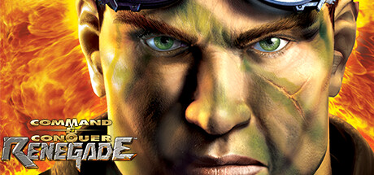
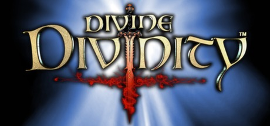
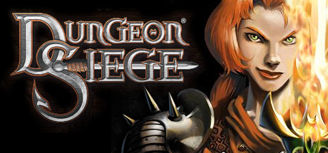
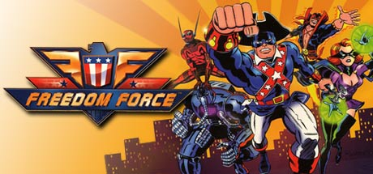
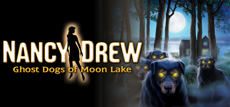
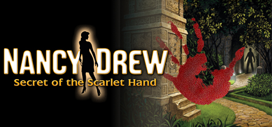
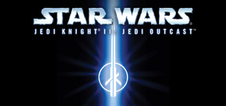

# 2002 in Video Games

[← Back to index](../README.md)

868 titles (506 from Wikipedia's category page) · [source](https://en.wikipedia.org/wiki/2002_in_video_games) · [category](https://en.wikipedia.org/wiki/Category:2002_video_games)

### 007: Agent Under Fire

**Platforms:** GameCube, Xbox &nbsp;|&nbsp; **Released:** March 12

---

### 007: Nightfire

**Platforms:** PlayStation 2, GameCube, Xbox, Windows &nbsp;|&nbsp; **Released:** November 19

---

### 2002 FIFA World Cup

**Platforms:** PlayStation 2, GameCube &nbsp;|&nbsp; **Released:** April 22

[Wikipedia](https://en.wikipedia.org/wiki/2002_FIFA_World_Cup_(video_game))

---

### Ace Lightning

[Wikipedia](https://en.wikipedia.org/wiki/Ace_Lightning)

---

### Activision Anthology

**Platforms:** PlayStation 2 &nbsp;|&nbsp; **Released:** November 19

[Wikipedia](https://en.wikipedia.org/wiki/Activision_Anthology)

---

### AdventureQuest

**Platforms:** Windows &nbsp;|&nbsp; **Developer:** Artix Entertainment &nbsp;|&nbsp; **Publisher:** Artix Entertainment &nbsp;|&nbsp; **Genre:** Role-playing &nbsp;|&nbsp; **Released:** October 2002

[Wikipedia](https://en.wikipedia.org/wiki/AdventureQuest)

---

### Aero Elite: Combat Academy

**Platforms:** PlayStation 2 &nbsp;|&nbsp; **Developer:** Sega AM2 &nbsp;|&nbsp; **Publisher:** Sega &nbsp;|&nbsp; **Genre:** Combat flight simulator &nbsp;|&nbsp; **Released:** July 11, 2002

[Wikipedia](https://en.wikipedia.org/wiki/Aero_Elite:_Combat_Academy)

---

### Agassi Tennis Generation

**Platforms:** Windows &nbsp;|&nbsp; **Developer:** Aqua Pacific &nbsp;|&nbsp; **Publisher:** DreamCatcher Interactive &nbsp;|&nbsp; **Genre:** Sports

[Wikipedia](https://en.wikipedia.org/wiki/Agassi_Tennis_Generation)

---

### Age of Mythology

**Platforms:** Windows &nbsp;|&nbsp; **Publisher:** Microsoft Game Studios &nbsp;|&nbsp; **Released:** October 30, 2002

[Wikipedia](https://en.wikipedia.org/wiki/Age_of_Mythology)

---

### Age of Wonders II: The Wizard's Throne

**Platforms:** Windows &nbsp;|&nbsp; **Developer:** Triumph Studios &nbsp;|&nbsp; **Publisher:** Gathering of Developers, CAPCOM &nbsp;|&nbsp; **Genre:** Turn-based strategy &nbsp;|&nbsp; **Released:** June 12, 2002

[Wikipedia](https://en.wikipedia.org/wiki/Age_of_Wonders_II:_The_Wizard's_Throne)

---

### Aggressive Inline

**Platforms:** GameCube, PlayStation 2 &nbsp;|&nbsp; **Publisher:** Acclaim Entertainment &nbsp;|&nbsp; **Released:** July 31, 2002

[Wikipedia](https://en.wikipedia.org/wiki/Aggressive_Inline_(video_game))

---

### AirBlade

**Platforms:** PlayStation 2 &nbsp;|&nbsp; **Released:** January 28

[Wikipedia](https://en.wikipedia.org/wiki/AirBlade)

---

### Akane Maniax

[Wikipedia](https://en.wikipedia.org/wiki/Akane_Maniax)

---

### Akira Psycho Ball

**Platforms:** PlayStation 2 &nbsp;|&nbsp; **Developer:** KAZe &nbsp;|&nbsp; **Publisher:** Bandai &nbsp;|&nbsp; **Genre:** Pinball &nbsp;|&nbsp; **Released:** February 21, 2002

[Wikipedia](https://en.wikipedia.org/wiki/Akira_Psycho_Ball)

---

### Alien Hominid

**Platforms:** Browser &nbsp;|&nbsp; **Developer:** The Behemoth &nbsp;|&nbsp; **Publisher:** The Behemoth &nbsp;|&nbsp; **Genre:** Run and gun &nbsp;|&nbsp; **Released:** August 7, 2002

[Wikipedia](https://en.wikipedia.org/wiki/Alien_Hominid)

---

### All-Star Baseball 2003

**Platforms:** PlayStation 2 &nbsp;|&nbsp; **Released:** February 26

[Wikipedia](https://en.wikipedia.org/wiki/All-Star_Baseball#Series)

---

### Alpine Racer 3

**Platforms:** PlayStation 2 &nbsp;|&nbsp; **Developer:** Namco &nbsp;|&nbsp; **Publisher:** Namco, Sony Computer Entertainment &nbsp;|&nbsp; **Genre:** Racing, Sports &nbsp;|&nbsp; **Released:** March 28, 2002

[Wikipedia](https://en.wikipedia.org/wiki/Alpine_Racer_3)

---

### Altered Beast: Guardian of the Realms

**Platforms:** Game Boy Advance &nbsp;|&nbsp; **Developer:** 3d6 Games &nbsp;|&nbsp; **Publisher:** THQ, Sega &nbsp;|&nbsp; **Genre:** Beat 'em up &nbsp;|&nbsp; **Released:** November 26, 2002

[Wikipedia](https://en.wikipedia.org/wiki/Altered_Beast:_Guardian_of_the_Realms)

---

### American Conquest

**Platforms:** Windows &nbsp;|&nbsp; **Developer:** GSC Game World &nbsp;|&nbsp; **Publisher:** CDV Software Entertainment &nbsp;|&nbsp; **Genre:** Real-time strategy &nbsp;|&nbsp; **Released:** November 15, 2002

[Wikipedia](https://en.wikipedia.org/wiki/American_Conquest)

---

### An American Tail: Fievel's Gold Rush

**Platforms:** Game Boy Advance &nbsp;|&nbsp; **Developer:** Hokus-Pokus &nbsp;|&nbsp; **Publisher:** Swing! Entertainment, Conspiracy Entertainment &nbsp;|&nbsp; **Genre:** Platform &nbsp;|&nbsp; **Released:** March 1, 2002

[Wikipedia](https://en.wikipedia.org/wiki/An_American_Tail:_Fievel's_Gold_Rush)

---

### Animal Crossing

**Platforms:** GameCube &nbsp;|&nbsp; **Released:** September 15

[Wikipedia](https://en.wikipedia.org/wiki/Animal_Crossing_(video_game))

---

### Anno 1503

**Platforms:** Windows &nbsp;|&nbsp; **Developer:** Max Design &nbsp;|&nbsp; **Publisher:** Sunflowers Interactive, Electronic Arts, Ubisoft &nbsp;|&nbsp; **Genre:** Real-time strategy, city-building game &nbsp;|&nbsp; **Released:** October 25, 2002

[Wikipedia](https://en.wikipedia.org/wiki/Anno_1503)

---

### Another War

**Platforms:** Windows &nbsp;|&nbsp; **Developer:** Mirage Interactive &nbsp;|&nbsp; **Publisher:** Cenega &nbsp;|&nbsp; **Genre:** role-playing video game &nbsp;|&nbsp; **Released:** September 30, 2002

[Wikipedia](https://en.wikipedia.org/wiki/Another_War)

---

### Antz Extreme Racing

**Platforms:** Windows, Xbox, PlayStation 2, Game Boy Advance &nbsp;|&nbsp; **Developer:** Supersonic Software, Magic Pockets &nbsp;|&nbsp; **Publisher:** Empire Interactive &nbsp;|&nbsp; **Genre:** Racing &nbsp;|&nbsp; **Released:** July 26, 2002

[Wikipedia](https://en.wikipedia.org/wiki/Antz_Extreme_Racing)

---

### Arc the Lad Collection

**Platforms:** PlayStation &nbsp;|&nbsp; **Developer:** Working Designs &nbsp;|&nbsp; **Publisher:** Working Designs &nbsp;|&nbsp; **Genre:** Tactical role-playing &nbsp;|&nbsp; **Released:** April 18, 2002

[Wikipedia](https://en.wikipedia.org/wiki/Arc_the_Lad_Collection)

---

### Archangel

**Platforms:** Windows &nbsp;|&nbsp; **Developer:** Metropolis Software &nbsp;|&nbsp; **Publisher:** JoWooD Productions &nbsp;|&nbsp; **Genre:** Action role-playing &nbsp;|&nbsp; **Released:** October 18, 2002

[Wikipedia](https://en.wikipedia.org/wiki/Archangel_(2002_video_game))

---

### Armored Core 3

**Platforms:** PlayStation 2 &nbsp;|&nbsp; **Released:** September 5

[Wikipedia](https://en.wikipedia.org/wiki/Armored_Core_3)

---

### Armored Task Force

[Wikipedia](https://en.wikipedia.org/wiki/Armored_Task_Force)

---

### Army Men: RTS

**Platforms:** PlayStation 2 &nbsp;|&nbsp; **Released:** March 27

---

### Arthur's Knights II: The Secret of Merlin

**Platforms:** Windows &nbsp;|&nbsp; **Developer:** Cryo Interactive Entertainment &nbsp;|&nbsp; **Publisher:** Wanadoo Edition, DreamCatcher Interactive &nbsp;|&nbsp; **Genre:** Role-playing video game, third-person adventure &nbsp;|&nbsp; **Released:** April 2002

[Wikipedia](https://en.wikipedia.org/wiki/Arthur's_Knights_II:_The_Secret_of_Merlin)

---

### Arthur's Quest: Battle for the Kingdom

**Platforms:** Windows &nbsp;|&nbsp; **Developer:** 3LV Games &nbsp;|&nbsp; **Publisher:** ValuSoft &nbsp;|&nbsp; **Genre:** First-person shooter &nbsp;|&nbsp; **Released:** August 21, 2002

[Wikipedia](https://en.wikipedia.org/wiki/Arthur's_Quest:_Battle_for_the_Kingdom)

---

### Arx Fatalis

**Platforms:** Windows &nbsp;|&nbsp; **Developer:** Arkane Studios &nbsp;|&nbsp; **Publisher:** JoWooD Productions, Arkane Studios, DreamCatcher Interactive, Mindscape &nbsp;|&nbsp; **Genre:** Action role-playing, dungeon crawl &nbsp;|&nbsp; **Released:** June 28, 2002

[Wikipedia](https://en.wikipedia.org/wiki/Arx_Fatalis)

---

### Asheron's Call 2: Fallen Kings

**Platforms:** Windows &nbsp;|&nbsp; **Developer:** Turbine Entertainment Software &nbsp;|&nbsp; **Publisher:** Microsoft Game Studios, Turbine, Warner Bros. Interactive Entertainment &nbsp;|&nbsp; **Genre:** MMORPG

[Wikipedia](https://en.wikipedia.org/wiki/Asheron's_Call_2:_Fallen_Kings)

---

### Astonishia Story

**Platforms:** MS-DOS, GP32, Windows &nbsp;|&nbsp; **Developer:** Sonnori, Compile Heart &nbsp;|&nbsp; **Publisher:** Sonnori, Sega, Ubisoft &nbsp;|&nbsp; **Genre:** Role-playing &nbsp;|&nbsp; **Released:** January 21, 2002

[Wikipedia](https://en.wikipedia.org/wiki/Astonishia_Story)

---

### Astral Tournament

**Platforms:** Windows &nbsp;|&nbsp; **Developer:** Apus Software &nbsp;|&nbsp; **Publisher:** Apus Software &nbsp;|&nbsp; **Genre:** Turn-based strategy, Collectible card game, Indie game &nbsp;|&nbsp; **Released:** September 23, 2002

[Wikipedia](https://en.wikipedia.org/wiki/Astral_Tournament)

---

### Atelier Judie: The Alchemist of Gramnad and Atelier Viorate: The Alchemist of Gramnad 2

**Platforms:** PlayStation 2 &nbsp;|&nbsp; **Developer:** Gust &nbsp;|&nbsp; **Publisher:** Gust &nbsp;|&nbsp; **Genre:** Role-playing &nbsp;|&nbsp; **Released:** June 27, 2002

[Wikipedia](https://en.wikipedia.org/wiki/Atelier_Judie:_The_Alchemist_of_Gramnad_and_Atelier_Viorate:_The_Alchemist_of_Gramnad_2)

---

### ATV Offroad Fury 2

**Platforms:** PlayStation 2 &nbsp;|&nbsp; **Released:** November 9

[Wikipedia](https://en.wikipedia.org/wiki/ATV_Offroad_Fury_2)

---

### Austin Powers Pinball

**Platforms:** PlayStation &nbsp;|&nbsp; **Released:** October 25

[Wikipedia](https://en.wikipedia.org/wiki/Austin_Powers_Pinball)

---

### Auto Modellista

**Platforms:** PlayStation 2 &nbsp;|&nbsp; **Developer:** Capcom Production Studio 1 &nbsp;|&nbsp; **Publisher:** Capcom &nbsp;|&nbsp; **Genre:** Arcade style racing &nbsp;|&nbsp; **Released:** August 22, 2002

[Wikipedia](https://en.wikipedia.org/wiki/Auto_Modellista)

---

### Baldr Force

**Platforms:** Dreamcast, Windows, PlayStation 2 &nbsp;|&nbsp; **Developer:** GIGA &nbsp;|&nbsp; **Publisher:** GIGA, Alchemist &nbsp;|&nbsp; **Genre:** action, adventure &nbsp;|&nbsp; **Released:** November 1, 2002

[Wikipedia](https://en.wikipedia.org/wiki/Baldr_Force)

---

### Baldur's Gate: Dark Alliance

**Platforms:** Xbox, GameCube &nbsp;|&nbsp; **Released:** October 22

---

### Ballistic: Ecks vs. Sever

**Platforms:** Game Boy Advance &nbsp;|&nbsp; **Developer:** Crawfish Interactive &nbsp;|&nbsp; **Publisher:** BAM! Entertainment &nbsp;|&nbsp; **Genre:** First-person shooter &nbsp;|&nbsp; **Released:** September 26, 2002

[Wikipedia](https://en.wikipedia.org/wiki/Ballistic:_Ecks_vs._Sever_(video_game))

---

### Bandits: Phoenix Rising

**Platforms:** Windows, Linux &nbsp;|&nbsp; **Developer:** Grin &nbsp;|&nbsp; **Publisher:** Pan Vision, Tri Synergy, Singularity Software &nbsp;|&nbsp; **Genre:** Vehicular combat &nbsp;|&nbsp; **Released:** October 4, 2002

[Wikipedia](https://en.wikipedia.org/wiki/Bandits:_Phoenix_Rising)

---

### Barbarian

**Platforms:** PlayStation 2 &nbsp;|&nbsp; **Released:** June 24

[Wikipedia](https://en.wikipedia.org/wiki/Barbarian_(2002_video_game))

---

### Barbie Sparkling Ice Show

**Platforms:** Windows &nbsp;|&nbsp; **Developer:** Krome Studios &nbsp;|&nbsp; **Publisher:** Vivendi Universal Games &nbsp;|&nbsp; **Genre:** Sports &nbsp;|&nbsp; **Released:** November 15, 2002

[Wikipedia](https://en.wikipedia.org/wiki/Barbie_Sparkling_Ice_Show)

---

### Barbie: Groovy Games

**Platforms:** Game Boy Advance &nbsp;|&nbsp; **Developer:** Digital Illusions Canada &nbsp;|&nbsp; **Genre:** Puzzle &nbsp;|&nbsp; **Released:** September 2002

[Wikipedia](https://en.wikipedia.org/wiki/Barbie:_Groovy_Games)

---

### Baseball Advance

**Platforms:** Game Boy Advance &nbsp;|&nbsp; **Released:** March 20

[Wikipedia](https://en.wikipedia.org/wiki/Baseball_Advance)

---

### Battle Realms: Winter of the Wolf

**Platforms:** Windows &nbsp;|&nbsp; **Developer:** Liquid Entertainment &nbsp;|&nbsp; **Publisher:** Ubi Soft, Crave Entertainment &nbsp;|&nbsp; **Genre:** Real-time strategy &nbsp;|&nbsp; **Released:** November 5, 2002

[Wikipedia](https://en.wikipedia.org/wiki/Battle_Realms:_Winter_of_the_Wolf)

---

### BattleBots: Beyond the BattleBox

**Platforms:** Game Boy Advance &nbsp;|&nbsp; **Developer:** Cave+Barn Studios, Pipe Dream Interactive &nbsp;|&nbsp; **Publisher:** Majesco, Vivendi Universal Games &nbsp;|&nbsp; **Genre:** Action &nbsp;|&nbsp; **Released:** December 10, 2002

[Wikipedia](https://en.wikipedia.org/wiki/BattleBots:_Beyond_the_BattleBox)

---

### Battlefield 1942

**Platforms:** Windows &nbsp;|&nbsp; **Publisher:** Electronic Arts &nbsp;|&nbsp; **Released:** September 10, 2002

[Wikipedia](https://en.wikipedia.org/wiki/Battlefield_1942)

---

### BCT Commander

**Platforms:** Windows &nbsp;|&nbsp; **Developer:** ProSIM Company &nbsp;|&nbsp; **Publisher:** Shrapnel Games &nbsp;|&nbsp; **Genre:** Computer wargame &nbsp;|&nbsp; **Released:** February 25, 2002

[Wikipedia](https://en.wikipedia.org/wiki/BCT_Commander)

---

### Beach Head 2002

**Platforms:** Arcade, macOS, Windows &nbsp;|&nbsp; **Developer:** Digital Fusion &nbsp;|&nbsp; **Publisher:** Digital Fusion, Infogrames, Inc., MacSoft &nbsp;|&nbsp; **Genre:** First-person shooter, shooting gallery &nbsp;|&nbsp; **Released:** June 15, 2002

[Wikipedia](https://en.wikipedia.org/wiki/Beach_Head_2002)

---

### Beach Life

**Platforms:** Windows &nbsp;|&nbsp; **Developer:** Deep Red Games &nbsp;|&nbsp; **Publisher:** Eidos Interactive &nbsp;|&nbsp; **Genre:** Business simulation &nbsp;|&nbsp; **Released:** September 6, 2002

[Wikipedia](https://en.wikipedia.org/wiki/Beach_Life)

---

### Beach Spikers

**Platforms:** GameCube &nbsp;|&nbsp; **Released:** August 12

[Wikipedia](https://en.wikipedia.org/wiki/Beach_Spikers)

---

### Beam Breakers

**Platforms:** Windows &nbsp;|&nbsp; **Developer:** Similis &nbsp;|&nbsp; **Publisher:** JoWooD Productions &nbsp;|&nbsp; **Genre:** Racing &nbsp;|&nbsp; **Released:** October 21, 2002

[Wikipedia](https://en.wikipedia.org/wiki/Beam_Breakers)

---

### Beat Angel Escalayer

[Wikipedia](https://en.wikipedia.org/wiki/Beat_Angel_Escalayer)

---

### Beatmania IIDX 7th Style

**Platforms:** Arcade, PlayStation 2 &nbsp;|&nbsp; **Developer:** Konami, Konami Computer Entertainment Studio &nbsp;|&nbsp; **Publisher:** Konami, Konami Computer Entertainment Studio &nbsp;|&nbsp; **Genre:** Music &nbsp;|&nbsp; **Released:** March 27, 2002

[Wikipedia](https://en.wikipedia.org/wiki/Beatmania_IIDX_7th_Style)

---

### Beatmania IIDX 8th Style

**Platforms:** Arcade, PlayStation 2 &nbsp;|&nbsp; **Developer:** Konami, Konami Computer Entertainment Studio &nbsp;|&nbsp; **Publisher:** Konami &nbsp;|&nbsp; **Genre:** Music &nbsp;|&nbsp; **Released:** September 27, 2002

[Wikipedia](https://en.wikipedia.org/wiki/Beatmania_IIDX_8th_Style)

---

### Beyblade: Super Tournament Battle

**Platforms:** GameCube &nbsp;|&nbsp; **Developer:** A.I. &nbsp;|&nbsp; **Publisher:** Takara, Atari Interactive &nbsp;|&nbsp; **Genre:** Action role-playing &nbsp;|&nbsp; **Released:** December 19, 2002

[Wikipedia](https://en.wikipedia.org/wiki/Beyblade:_Super_Tournament_Battle)

---

### Big Air Freestyle

**Platforms:** GameCube &nbsp;|&nbsp; **Developer:** Paradigm Entertainment &nbsp;|&nbsp; **Publisher:** Infogrames &nbsp;|&nbsp; **Genre:** Racing &nbsp;|&nbsp; **Released:** September 13, 2002

[Wikipedia](https://en.wikipedia.org/wiki/Big_Air_Freestyle)

---

### Big Biz Tycoon

**Platforms:** Windows &nbsp;|&nbsp; **Developer:** Animedia &nbsp;|&nbsp; **Publisher:** Activision Value &nbsp;|&nbsp; **Genre:** Business simulation game &nbsp;|&nbsp; **Released:** May 30, 2002

[Wikipedia](https://en.wikipedia.org/wiki/Big_Biz_Tycoon)

---

### Big Money!

[Wikipedia](https://en.wikipedia.org/wiki/Big_Money!)

---

### Big Mutha Truckers

**Platforms:** PlayStation 2, Xbox &nbsp;|&nbsp; **Developer:** Eutechnyx, Raylight Studios &nbsp;|&nbsp; **Publisher:** Empire Interactive, THQ, Destination Software, Zoo Digital Publishing &nbsp;|&nbsp; **Genre:** Racing &nbsp;|&nbsp; **Released:** December 6, 2002

[Wikipedia](https://en.wikipedia.org/wiki/Big_Mutha_Truckers)

---

### Big Scale Racing

**Platforms:** Windows &nbsp;|&nbsp; **Developer:** BumbleBeast &nbsp;|&nbsp; **Publisher:** HD Interactive &nbsp;|&nbsp; **Genre:** Racing &nbsp;|&nbsp; **Released:** August 16, 2002

[Wikipedia](https://en.wikipedia.org/wiki/Big_Scale_Racing)

---

### Bikini Karate Babes

**Platforms:** Windows, macOS &nbsp;|&nbsp; **Developer:** Creative Edge Studios &nbsp;|&nbsp; **Genre:** Fighting

[Wikipedia](https://en.wikipedia.org/wiki/Bikini_Karate_Babes)

---

### Bionicle: Matoran Adventures

**Platforms:** Game Boy Advance &nbsp;|&nbsp; **Released:** November 1

---

### Black & White: Creature Isle

**Platforms:** Windows, macOS &nbsp;|&nbsp; **Developer:** Lionhead Studios &nbsp;|&nbsp; **Publisher:** Electronic Arts, Feral Interactive &nbsp;|&nbsp; **Genre:** Real-time strategy, God game &nbsp;|&nbsp; **Released:** January 23, 2002

[Wikipedia](https://en.wikipedia.org/wiki/Black_&_White:_Creature_Isle)

---

### Black Shades

**Platforms:** macOS, Windows, Linux &nbsp;|&nbsp; **Developer:** Wolfire Games &nbsp;|&nbsp; **Publisher:** Wolfire Games &nbsp;|&nbsp; **Genre:** First-person shooter, stealth

[Wikipedia](https://en.wikipedia.org/wiki/Black_Shades)

---

### Blade II

**Platforms:** PlayStation 2 &nbsp;|&nbsp; **Released:** September 2

[Wikipedia](https://en.wikipedia.org/wiki/Blade_II)

---

### Blender Bros.

**Platforms:** Game Boy Advance &nbsp;|&nbsp; **Released:** April 15

[Wikipedia](https://en.wikipedia.org/wiki/Blender_Bros.)

---

### Blinx: The Time Sweeper

**Platforms:** Xbox &nbsp;|&nbsp; **Developer:** Artoon, Microsoft Game Studios Japan &nbsp;|&nbsp; **Publisher:** Microsoft Game Studios &nbsp;|&nbsp; **Genre:** Platform &nbsp;|&nbsp; **Released:** October 8, 2002

[Wikipedia](https://en.wikipedia.org/wiki/Blinx:_The_Time_Sweeper)

---

### Blood Omen 2

**Platforms:** PlayStation 2 &nbsp;|&nbsp; **Released:** March 21

[Wikipedia](https://en.wikipedia.org/wiki/Blood_Omen_2)

---

### BloodRayne

**Platforms:** PlayStation 2 &nbsp;|&nbsp; **Released:** October 15

[Wikipedia](https://en.wikipedia.org/wiki/BloodRayne)

---

### Bloody Roar 3

**Platforms:** GameCube &nbsp;|&nbsp; **Released:** March 19

[Wikipedia](https://en.wikipedia.org/wiki/Bloody_Roar_3)

---

### Bloody Roar Extreme

**Platforms:** GameCube &nbsp;|&nbsp; **Developer:** Eighting &nbsp;|&nbsp; **Publisher:** Hudson Soft, Activision, Konami &nbsp;|&nbsp; **Genre:** Fighting &nbsp;|&nbsp; **Released:** March 19, 2002

[Wikipedia](https://en.wikipedia.org/wiki/Bloody_Roar_Extreme)

---

### Blue's Clues Kindergarten

**Platforms:** Windows, macOS &nbsp;|&nbsp; **Developer:** ImaginEngine &nbsp;|&nbsp; **Publisher:** Infogrames &nbsp;|&nbsp; **Genre:** Edutainment &nbsp;|&nbsp; **Released:** July 24, 2002

[Wikipedia](https://en.wikipedia.org/wiki/Blue's_Clues_Kindergarten)

---

### BMX XXX

**Platforms:** PlayStation 2, GameCube &nbsp;|&nbsp; **Released:** November 16

[Wikipedia](https://en.wikipedia.org/wiki/BMX_XXX)

---

### Bokomu no Tatsujin

[Wikipedia](https://en.wikipedia.org/wiki/Bokomu_no_Tatsujin)

---

### Boku no Natsuyasumi 2

**Platforms:** PlayStation 2 &nbsp;|&nbsp; **Developer:** Millennium Kitchen &nbsp;|&nbsp; **Publisher:** Sony Computer Entertainment &nbsp;|&nbsp; **Genre:** Adventure &nbsp;|&nbsp; **Released:** July 11, 2002

[Wikipedia](https://en.wikipedia.org/wiki/Boku_no_Natsuyasumi_2)

---

### Bomber Hehhe!

[Wikipedia](https://en.wikipedia.org/wiki/Bomber_Hehhe!)

---

### Bomberman Generation

**Platforms:** GameCube &nbsp;|&nbsp; **Developer:** Game Arts &nbsp;|&nbsp; **Publisher:** Majesco, Hudson Soft, Vivendi Universal Games &nbsp;|&nbsp; **Genre:** Action-adventure &nbsp;|&nbsp; **Released:** June 4, 2002

[Wikipedia](https://en.wikipedia.org/wiki/Bomberman_Generation)

---

### Bomberman Jetters

**Platforms:** PlayStation 2, GameCube &nbsp;|&nbsp; **Developer:** Hudson Soft, AI &nbsp;|&nbsp; **Publisher:** Hudson Soft, Majesco &nbsp;|&nbsp; **Genre:** Action-adventure &nbsp;|&nbsp; **Released:** December 19, 2002

[Wikipedia](https://en.wikipedia.org/wiki/Bomberman_Jetters_(video_game))

---

### Bomberman Max 2

**Platforms:** Game Boy Advance &nbsp;|&nbsp; **Developer:** Hudson Soft &nbsp;|&nbsp; **Publisher:** Hudson Soft, Majesco, Vivendi Universal Games &nbsp;|&nbsp; **Genre:** Action &nbsp;|&nbsp; **Released:** February 7, 2002

[Wikipedia](https://en.wikipedia.org/wiki/Bomberman_Max_2)

---

### Boulder Dash EX

**Platforms:** Game Boy Advance &nbsp;|&nbsp; **Released:** September 16

[Wikipedia](https://en.wikipedia.org/wiki/Boulder_Dash_EX)

---

### Bratz

**Platforms:** Windows &nbsp;|&nbsp; **Developer:** DC Studios &nbsp;|&nbsp; **Publisher:** Ubi Soft &nbsp;|&nbsp; **Genre:** Music &nbsp;|&nbsp; **Released:** December 17, 2002

[Wikipedia](https://en.wikipedia.org/wiki/Bratz_(video_game))

---

### Breath of Fire II

**Platforms:** Game Boy Advance &nbsp;|&nbsp; **Released:** April 15

[Wikipedia](https://en.wikipedia.org/wiki/Breath_of_Fire_II)

---

### Breath of Fire: Dragon Quarter

**Platforms:** PlayStation 2 &nbsp;|&nbsp; **Developer:** Capcom Production Studio 3 &nbsp;|&nbsp; **Publisher:** Capcom &nbsp;|&nbsp; **Genre:** Role-playing &nbsp;|&nbsp; **Released:** November 14, 2002

[Wikipedia](https://en.wikipedia.org/wiki/Breath_of_Fire:_Dragon_Quarter)

---

### Britney's Dance Beat

**Platforms:** Game Boy Advance, PlayStation 2, Windows &nbsp;|&nbsp; **Released:** March 25

[Wikipedia](https://en.wikipedia.org/wiki/Britney_Spears_products)

---

### Broken Sword: The Shadow of the Templars

**Platforms:** Game Boy Advance &nbsp;|&nbsp; **Released:** March 17

---

### Bruce Lee: Quest of the Dragon

**Platforms:** Xbox &nbsp;|&nbsp; **Released:** July 2

---

### Brány Skeldalu 2: Pátý Učedník

**Platforms:** Windows &nbsp;|&nbsp; **Developer:** Napoleon Games &nbsp;|&nbsp; **Publisher:** Napoleon Games &nbsp;|&nbsp; **Genre:** Adventure &nbsp;|&nbsp; **Released:** December 1, 2002

[Wikipedia](https://en.wikipedia.org/wiki/Br%C3%A1ny_Skeldalu_2:_P%C3%A1t%C3%BD_U%C4%8Dedn%C3%ADk)

---

### Bubble Bobble Old & New

[Wikipedia](https://en.wikipedia.org/wiki/Bubble_Bobble_Old_&_New)

---

### Bubble Shooter

**Platforms:** macOS, Browser, Mobile phone, Windows Mobile &nbsp;|&nbsp; **Developer:** Absolutist LTD, Ilyon Dynamics &nbsp;|&nbsp; **Publisher:** Absolutist LTD, Ilyon Dynamics &nbsp;|&nbsp; **Genre:** Puzzle Bobble 2 clone, puzzle

[Wikipedia](https://en.wikipedia.org/wiki/Bubble_Shooter)

---

### Buffy the Vampire Slayer

**Platforms:** Xbox &nbsp;|&nbsp; **Released:** August 18

[Wikipedia](https://en.wikipedia.org/wiki/Buffy_the_Vampire_Slayer_(2002_video_game))

---

### Burnout 2: Point of Impact

**Platforms:** PlayStation 2 &nbsp;|&nbsp; **Publisher:** Acclaim Entertainment &nbsp;|&nbsp; **Released:** September 30, 2002

---

### Cabela's Ultimate Deer Hunt 2

**Platforms:** Windows &nbsp;|&nbsp; **Developer:** Sylum Entertainment, Ltd. &nbsp;|&nbsp; **Publisher:** Activision Value &nbsp;|&nbsp; **Genre:** Sports &nbsp;|&nbsp; **Released:** September 2002

[Wikipedia](https://en.wikipedia.org/wiki/Cabela's_Ultimate_Deer_Hunt_2)

---

### Car Battler Joe

**Platforms:** Game Boy Advance &nbsp;|&nbsp; **Released:** July 30

[Wikipedia](https://en.wikipedia.org/wiki/Car_Battler_Joe)

---

### Carnivores: Cityscape

**Platforms:** Windows &nbsp;|&nbsp; **Developer:** Sunstorm Interactive &nbsp;|&nbsp; **Publisher:** Infogrames &nbsp;|&nbsp; **Genre:** First-person shooter &nbsp;|&nbsp; **Released:** March 26, 2002

[Wikipedia](https://en.wikipedia.org/wiki/Carnivores:_Cityscape)

---

### Casper: Spirit Dimensions

**Platforms:** GameCube &nbsp;|&nbsp; **Released:** October 15

---

### Castlevania: Harmony of Dissonance

**Platforms:** Game Boy Advance &nbsp;|&nbsp; **Released:** September 16

---

### Castleween

**Platforms:** PlayStation 2 &nbsp;|&nbsp; **Developer:** Wanadoo Edition &nbsp;|&nbsp; **Publisher:** Wanadoo Edition, DreamCatcher Interactive, MTO &nbsp;|&nbsp; **Genre:** Platform &nbsp;|&nbsp; **Released:** November 27, 2002

[Wikipedia](https://en.wikipedia.org/wiki/Castleween)

---

### Celtic Kings: Rage of War

**Platforms:** Windows &nbsp;|&nbsp; **Developer:** Haemimont Games &nbsp;|&nbsp; **Publisher:** Strategy First, Wanadoo Edition &nbsp;|&nbsp; **Genre:** Real-time strategy, role-playing &nbsp;|&nbsp; **Released:** August 19, 2002

[Wikipedia](https://en.wikipedia.org/wiki/Celtic_Kings:_Rage_of_War)

---

### Championship Manager: Season 02/03

**Platforms:** Xbox &nbsp;|&nbsp; **Developer:** Sports Interactive &nbsp;|&nbsp; **Publisher:** Eidos Interactive &nbsp;|&nbsp; **Genre:** Sports &nbsp;|&nbsp; **Released:** November 29, 2002

[Wikipedia](https://en.wikipedia.org/wiki/Championship_Manager:_Season_02/03)

---

### Chase: Hollywood Stunt Driver

**Platforms:** Xbox &nbsp;|&nbsp; **Developer:** I-Imagine Interactive &nbsp;|&nbsp; **Publisher:** BAM! Entertainment &nbsp;|&nbsp; **Genre:** Racing, action &nbsp;|&nbsp; **Released:** September 20, 2002

[Wikipedia](https://en.wikipedia.org/wiki/Chase:_Hollywood_Stunt_Driver)

---

### Cherry Petals Fall Like Teardrops

[Wikipedia](https://en.wikipedia.org/wiki/Cherry_Petals_Fall_Like_Teardrops)

---

### Chessmaster 9000

**Platforms:** Windows, macOS &nbsp;|&nbsp; **Developer:** Ubi Soft, Zonic &nbsp;|&nbsp; **Publisher:** Ubi Soft, Feral Interactive &nbsp;|&nbsp; **Genre:** Computer chess &nbsp;|&nbsp; **Released:** August 27, 2002

[Wikipedia](https://en.wikipedia.org/wiki/Chessmaster_9000)

---

### Chulip

**Platforms:** PlayStation 2 &nbsp;|&nbsp; **Developer:** Punchline &nbsp;|&nbsp; **Publisher:** Victor Interactive Software, Natsume Inc. &nbsp;|&nbsp; **Genre:** Adventure, Life simulation &nbsp;|&nbsp; **Released:** October 3, 2002

[Wikipedia](https://en.wikipedia.org/wiki/Chulip)

---

### Circus Maximus: Chariot Wars

**Platforms:** PlayStation 2 &nbsp;|&nbsp; **Released:** February 24

---

### Civilization III: Play the World

**Platforms:** Windows &nbsp;|&nbsp; **Developer:** Firaxis Games &nbsp;|&nbsp; **Publisher:** Infogrames Interactive &nbsp;|&nbsp; **Genre:** Turn-based strategy &nbsp;|&nbsp; **Released:** October 29, 2002

[Wikipedia](https://en.wikipedia.org/wiki/Civilization_III:_Play_the_World)

---

### Clock Tower 3

**Platforms:** PlayStation 2 &nbsp;|&nbsp; **Developer:** Capcom, Sunsoft &nbsp;|&nbsp; **Publisher:** Capcom &nbsp;|&nbsp; **Genre:** Survival horror &nbsp;|&nbsp; **Released:** December 12, 2002

[Wikipedia](https://en.wikipedia.org/wiki/Clock_Tower_3)

---

### Colin McRae Rally 2.0

**Platforms:** Game Boy Advance &nbsp;|&nbsp; **Released:** September 16

[Wikipedia](https://en.wikipedia.org/wiki/Colin_McRae_Rally_2.0)

---

### Colin McRae Rally 3

**Platforms:** PlayStation 2, Xbox &nbsp;|&nbsp; **Developer:** Codemasters &nbsp;|&nbsp; **Publisher:** Codemasters &nbsp;|&nbsp; **Genre:** Racing &nbsp;|&nbsp; **Released:** October 25, 2002

[Wikipedia](https://en.wikipedia.org/wiki/Colin_McRae_Rally_3)

---

### Coloball 2002

**Platforms:** PlayStation 2 &nbsp;|&nbsp; **Developer:** Vanpool &nbsp;|&nbsp; **Publisher:** Enterbrain &nbsp;|&nbsp; **Genre:** Turn-based strategy &nbsp;|&nbsp; **Released:** June 27, 2002

[Wikipedia](https://en.wikipedia.org/wiki/Coloball_2002)

---

### Combat Flight Simulator 3

**Platforms:** Windows &nbsp;|&nbsp; **Developer:** Microsoft Game Studios &nbsp;|&nbsp; **Publisher:** Microsoft Game Studios &nbsp;|&nbsp; **Genre:** Combat flight simulator &nbsp;|&nbsp; **Released:** October 24, 2002

[Wikipedia](https://en.wikipedia.org/wiki/Combat_Flight_Simulator_3)

---

### Combat Mission II: Barbarossa to Berlin

**Platforms:** Windows &nbsp;|&nbsp; **Publisher:** Battlefront.com &nbsp;|&nbsp; **Released:** September 20, 2002

---

### Command & Conquer: Renegade

**Platforms:** Windows &nbsp;|&nbsp; **Genre:** Action, Adventure, Strategy &nbsp;|&nbsp; **Released:** February 26

> Command &amp; Conquer gets up close and personal in this classic First Person Shooter for one of the most iconic franchises.
>
> _Synopsis source: Steam_

[Steam](https://store.steampowered.com/app/2229890)

---

### Commandos 2: Men of Courage

**Platforms:** PlayStation 2 &nbsp;|&nbsp; **Released:** August 28

---

### Conflict: Desert Storm

**Platforms:** PlayStation 2 &nbsp;|&nbsp; **Released:** September 30

---

### Contra Advance: The Alien Wars EX

**Platforms:** Game Boy Advance &nbsp;|&nbsp; **Released:** November 3

---

### Contra: Shattered Soldier

**Platforms:** PlayStation 2 &nbsp;|&nbsp; **Released:** October 22

---

### Crash Bandicoot: The Huge Adventure

**Platforms:** Game Boy Advance &nbsp;|&nbsp; **Released:** February 25

---

### Crash Bandicoot: The Wrath of Cortex

**Platforms:** GameCube &nbsp;|&nbsp; **Released:** September 17

---

### Crazy Taxi 3: High Roller

**Platforms:** Xbox &nbsp;|&nbsp; **Developer:** Hitmaker &nbsp;|&nbsp; **Publisher:** Sega &nbsp;|&nbsp; **Genre:** Racing, action &nbsp;|&nbsp; **Released:** July 23, 2002

[Wikipedia](https://en.wikipedia.org/wiki/Crazy_Taxi_3:_High_Roller)

---

### Crimson Sea

**Platforms:** Xbox &nbsp;|&nbsp; **Developer:** Koei &nbsp;|&nbsp; **Publisher:** Koei &nbsp;|&nbsp; **Genre:** Third-person shooter, Hack and slash, Action adventure, RPG &nbsp;|&nbsp; **Released:** December 12, 2002

[Wikipedia](https://en.wikipedia.org/wiki/Crimson_Sea)

---

### CT Special Forces

**Platforms:** Game Boy Advance, PlayStation &nbsp;|&nbsp; **Developer:** Light & Shadow Production &nbsp;|&nbsp; **Publisher:** Light & Shadow Production, Hip Games &nbsp;|&nbsp; **Genre:** Run and gun &nbsp;|&nbsp; **Released:** July 12, 2002

[Wikipedia](https://en.wikipedia.org/wiki/CT_Special_Forces)

---

### Cubivore: Survival of the Fittest

**Platforms:** GameCube &nbsp;|&nbsp; **Developer:** Saru Brunei, Intelligent Systems &nbsp;|&nbsp; **Publisher:** Nintendo, Atlus USA &nbsp;|&nbsp; **Genre:** Action-adventure &nbsp;|&nbsp; **Released:** February 21, 2002

[Wikipedia](https://en.wikipedia.org/wiki/Cubivore:_Survival_of_the_Fittest)

---

### Cultures 2: The Gates of Asgard

**Platforms:** Windows &nbsp;|&nbsp; **Developer:** Funatics Software &nbsp;|&nbsp; **Publisher:** JoWooD Productions &nbsp;|&nbsp; **Genre:** Real-time strategy, City-building game &nbsp;|&nbsp; **Released:** July 12, 2002

[Wikipedia](https://en.wikipedia.org/wiki/Cultures_2:_The_Gates_of_Asgard)

---

### Custom Robo GX

**Platforms:** Game Boy Advance &nbsp;|&nbsp; **Developer:** Noise &nbsp;|&nbsp; **Publisher:** Nintendo &nbsp;|&nbsp; **Genre:** Action role-playing &nbsp;|&nbsp; **Released:** July 26, 2002

[Wikipedia](https://en.wikipedia.org/wiki/Custom_Robo_GX)

---

### CyberVirus

**Platforms:** Atari Lynx &nbsp;|&nbsp; **Developer:** Beyond Games &nbsp;|&nbsp; **Publisher:** Songbird Productions &nbsp;|&nbsp; **Genre:** First-person shooter

[Wikipedia](https://en.wikipedia.org/wiki/CyberVirus)

---

### Da Capo

[Wikipedia](https://en.wikipedia.org/wiki/Da_Capo_(video_game))

---

### Dance Dance Revolution 4thMix

**Platforms:** Arcade, PlayStation, Windows &nbsp;|&nbsp; **Developer:** Konami &nbsp;|&nbsp; **Publisher:** Konami &nbsp;|&nbsp; **Genre:** Music, exercise &nbsp;|&nbsp; **Released:** April 30, 2002

[Wikipedia](https://en.wikipedia.org/wiki/Dance_Dance_Revolution_4thMix)

---

### Dance Dance Revolution Extreme

**Platforms:** Arcade &nbsp;|&nbsp; **Developer:** Konami, Bemani &nbsp;|&nbsp; **Publisher:** Konami &nbsp;|&nbsp; **Genre:** Music, exercise &nbsp;|&nbsp; **Released:** December 25, 2002

[Wikipedia](https://en.wikipedia.org/wiki/Dance_Dance_Revolution_Extreme)

---

### Dark Arena

**Platforms:** Game Boy Advance &nbsp;|&nbsp; **Released:** January 18

[Wikipedia](https://en.wikipedia.org/wiki/Dark_Arena)

---

### Dark Chronicle

**Platforms:** PlayStation 2 &nbsp;|&nbsp; **Publisher:** Sony Computer Entertainment &nbsp;|&nbsp; **Released:** November 28, 2002

[Wikipedia](https://en.wikipedia.org/wiki/Dark_Chronicle)

---

### Dark Fall

**Platforms:** Windows &nbsp;|&nbsp; **Developer:** XXv Productions &nbsp;|&nbsp; **Publisher:** XXv Productions, Darkling Room, Iceberg Interactive &nbsp;|&nbsp; **Genre:** Adventure, psychological horror &nbsp;|&nbsp; **Released:** April 2002

[Wikipedia](https://en.wikipedia.org/wiki/Dark_Fall)

---

### Dark Planet: Battle for Natrolis

**Platforms:** Windows &nbsp;|&nbsp; **Developer:** Creative Edge Software &nbsp;|&nbsp; **Publisher:** Ubi Soft &nbsp;|&nbsp; **Genre:** Real-time strategy &nbsp;|&nbsp; **Released:** March 21, 2002

[Wikipedia](https://en.wikipedia.org/wiki/Dark_Planet:_Battle_for_Natrolis)

---

### Darkened Skye

**Platforms:** Windows, GameCube &nbsp;|&nbsp; **Developer:** Boston Animation &nbsp;|&nbsp; **Publisher:** Simon & Schuster Interactive, Oxygen Interactive, TDK Mediactive Europe &nbsp;|&nbsp; **Genre:** Third-person shooter, action-adventure &nbsp;|&nbsp; **Released:** January 28, 2002

[Wikipedia](https://en.wikipedia.org/wiki/Darkened_Skye)

---

### Dave Mirra Freestyle BMX 3

**Platforms:** Game Boy Advance &nbsp;|&nbsp; **Released:** November 26

[Wikipedia](https://en.wikipedia.org/wiki/Dave_Mirra_Freestyle_BMX_3)

---

### David Beckham Soccer

**Platforms:** Game Boy Advance &nbsp;|&nbsp; **Released:** October 7

[Wikipedia](https://en.wikipedia.org/wiki/David_Beckham_Soccer)

---

### Davis Cup Tennis

**Platforms:** Game Boy Advance &nbsp;|&nbsp; **Developer:** Hokus Pokus Games &nbsp;|&nbsp; **Publisher:** Ubisoft &nbsp;|&nbsp; **Genre:** Sports &nbsp;|&nbsp; **Released:** June 7, 2002

[Wikipedia](https://en.wikipedia.org/wiki/Davis_Cup_Tennis)

---

### DDRMAX: Dance Dance Revolution

**Platforms:** PlayStation 2 &nbsp;|&nbsp; **Released:** October 28

---

### Dead to Rights

**Platforms:** Xbox, PlayStation 2 &nbsp;|&nbsp; **Released:** June 3

[Wikipedia](https://en.wikipedia.org/wiki/Dead_to_Rights)

---

### Deadly Dozen: Pacific Theater

**Platforms:** Windows &nbsp;|&nbsp; **Developer:** Interactive &nbsp;|&nbsp; **Publisher:** Infogrames &nbsp;|&nbsp; **Genre:** Tactical shooter &nbsp;|&nbsp; **Released:** November 11, 2002

[Wikipedia](https://en.wikipedia.org/wiki/Deadly_Dozen:_Pacific_Theater)

---

### Deathrow

**Platforms:** Xbox &nbsp;|&nbsp; **Released:** October 22

[Wikipedia](https://en.wikipedia.org/wiki/Deathrow_(video_game))

---

### Defender

**Platforms:** PlayStation 2 &nbsp;|&nbsp; **Released:** October 22

[Wikipedia](https://en.wikipedia.org/wiki/Defender_(2002_video_game))

---

### Delta Force: Task Force Dagger

**Platforms:** Windows &nbsp;|&nbsp; **Developer:** Zombie Inc. &nbsp;|&nbsp; **Publisher:** NovaLogic &nbsp;|&nbsp; **Genre:** First-person shooter &nbsp;|&nbsp; **Released:** June 26, 2002

[Wikipedia](https://en.wikipedia.org/wiki/Delta_Force:_Task_Force_Dagger)

---

### Delta Force: Urban Warfare

**Platforms:** PlayStation &nbsp;|&nbsp; **Developer:** Rebellion Developments &nbsp;|&nbsp; **Publisher:** NovaLogic &nbsp;|&nbsp; **Genre:** Tactical first-person shooter &nbsp;|&nbsp; **Released:** July 2, 2002

[Wikipedia](https://en.wikipedia.org/wiki/Delta_Force:_Urban_Warfare)

---

### Demon Front

**Platforms:** Arcade &nbsp;|&nbsp; **Developer:** IGS &nbsp;|&nbsp; **Publisher:** IGS &nbsp;|&nbsp; **Genre:** Run and gun

[Wikipedia](https://en.wikipedia.org/wiki/Demon_Front)

---

### Densetsu no Starfy

**Platforms:** Game Boy Advance &nbsp;|&nbsp; **Developer:** Tose &nbsp;|&nbsp; **Publisher:** Nintendo &nbsp;|&nbsp; **Genre:** Platform &nbsp;|&nbsp; **Released:** September 6, 2002

[Wikipedia](https://en.wikipedia.org/wiki/Densetsu_no_Starfy_(video_game))

---

### Destroyer Command

**Platforms:** Windows &nbsp;|&nbsp; **Developer:** Ultimation Inc. &nbsp;|&nbsp; **Publisher:** Ubisoft &nbsp;|&nbsp; **Genre:** Vehicle simulation game &nbsp;|&nbsp; **Released:** February 17, 2002

[Wikipedia](https://en.wikipedia.org/wiki/Destroyer_Command)

---

### Deus Ex: The Conspiracy

**Platforms:** PlayStation 2 &nbsp;|&nbsp; **Released:** March 25

---

### Dexter's Laboratory: Chess Challenge

**Platforms:** Game Boy Advance &nbsp;|&nbsp; **Released:** October 29

---

### Dexter's Laboratory: Mandark's Lab?

**Platforms:** PlayStation &nbsp;|&nbsp; **Developer:** Red Lemon Studios &nbsp;|&nbsp; **Publisher:** BAM! Entertainment &nbsp;|&nbsp; **Genre:** Action-adventure &nbsp;|&nbsp; **Released:** March 29, 2002

[Wikipedia](https://en.wikipedia.org/wiki/Dexter's_Laboratory:_Mandark's_Lab%3F)

---

### Dhaka Racing

**Platforms:** Windows &nbsp;|&nbsp; **Developer:** eSophers &nbsp;|&nbsp; **Publisher:** eSophers &nbsp;|&nbsp; **Genre:** Racing &nbsp;|&nbsp; **Released:** March 2, 2002

[Wikipedia](https://en.wikipedia.org/wiki/Dhaka_Racing)

---

### Die Hard: Nakatomi Plaza

**Platforms:** Windows &nbsp;|&nbsp; **Developer:** Piranha Games &nbsp;|&nbsp; **Publisher:** Sierra Entertainment, Fox Interactive &nbsp;|&nbsp; **Genre:** First-person shooter &nbsp;|&nbsp; **Released:** April 23, 2002

[Wikipedia](https://en.wikipedia.org/wiki/Die_Hard:_Nakatomi_Plaza)

---

### Die Hard: Vendetta

**Platforms:** GameCube &nbsp;|&nbsp; **Developer:** Bits Studios &nbsp;|&nbsp; **Publisher:** Vivendi Universal Games, Fox Interactive &nbsp;|&nbsp; **Genre:** First-person shooter &nbsp;|&nbsp; **Released:** November 15, 2002

[Wikipedia](https://en.wikipedia.org/wiki/Die_Hard:_Vendetta)

---

### Digimon Battle Online

**Platforms:** Windows &nbsp;|&nbsp; **Developer:** movegames, WeMade Entertainment &nbsp;|&nbsp; **Publisher:** movegames, Bandai, CDC Games, WeMade Entertainment, GAMEKING &nbsp;|&nbsp; **Genre:** Massively multiplayer online role-playing &nbsp;|&nbsp; **Released:** January 22, 2002

[Wikipedia](https://en.wikipedia.org/wiki/Digimon_Battle_Online)

---

### Digimon Tamers: Battle Spirit Ver. 1.5

**Platforms:** WonderSwan Color &nbsp;|&nbsp; **Developer:** Dimps &nbsp;|&nbsp; **Publisher:** Bandai &nbsp;|&nbsp; **Genre:** Fighting &nbsp;|&nbsp; **Released:** April 27, 2002

[Wikipedia](https://en.wikipedia.org/wiki/Digimon_Tamers:_Battle_Spirit_Ver._1.5)

---

### Digimon World 3

**Platforms:** PlayStation &nbsp;|&nbsp; **Released:** June 5

[Wikipedia](https://en.wikipedia.org/wiki/Digimon_World_3)

---

### Digital Monster Card Game Ver. WonderSwan Color

[Wikipedia](https://en.wikipedia.org/wiki/Digital_Monster_Card_Game_Ver._WonderSwan_Color)

---

### Digital Monster: D-Project

[Wikipedia](https://en.wikipedia.org/wiki/Digital_Monster:_D-Project)

---

### Dino Island

**Platforms:** Windows &nbsp;|&nbsp; **Developer:** Monte Cristo &nbsp;|&nbsp; **Publisher:** Monte Cristo, Strategy First &nbsp;|&nbsp; **Genre:** Business simulation &nbsp;|&nbsp; **Released:** May 22, 2002

[Wikipedia](https://en.wikipedia.org/wiki/Dino_Island)

---

### Dino Stalker

**Platforms:** PlayStation 2 &nbsp;|&nbsp; **Released:** September 9

[Wikipedia](https://en.wikipedia.org/wiki/Dino_Stalker)

---

### Dinotopia: The Timestone Paradise

**Platforms:** Game Boy Advance &nbsp;|&nbsp; **Released:** April 30

---

### Dinotopia: The Timestone Pirates

**Platforms:** Game Boy Advance &nbsp;|&nbsp; **Developer:** RFX Interactive &nbsp;|&nbsp; **Publisher:** TDK Mediactive &nbsp;|&nbsp; **Genre:** Action &nbsp;|&nbsp; **Released:** April 30, 2002

[Wikipedia](https://en.wikipedia.org/wiki/Dinotopia:_The_Timestone_Pirates)

---

### Dirt Track Racing 2

**Platforms:** Windows &nbsp;|&nbsp; **Developer:** Ratbag Games &nbsp;|&nbsp; **Publisher:** Infogrames &nbsp;|&nbsp; **Genre:** Racing &nbsp;|&nbsp; **Released:** September 24, 2002

[Wikipedia](https://en.wikipedia.org/wiki/Dirt_Track_Racing_2)

---

### Disciples II: Dark Prophecy

**Platforms:** Windows &nbsp;|&nbsp; **Released:** January 24

---

### Disney Golf

**Platforms:** PlayStation 2 &nbsp;|&nbsp; **Released:** October 17

[Wikipedia](https://en.wikipedia.org/wiki/Disney_Golf)

---

### Disney Sports Basketball

**Platforms:** Game Boy Advance, GameCube &nbsp;|&nbsp; **Developer:** Konami Computer Entertainment Osaka, Polygon Magic &nbsp;|&nbsp; **Publisher:** Konami &nbsp;|&nbsp; **Genre:** Sports &nbsp;|&nbsp; **Released:** November 25, 2002

[Wikipedia](https://en.wikipedia.org/wiki/Disney_Sports_Basketball)

---

### Disney Sports Football

**Platforms:** Game Boy Advance, GameCube &nbsp;|&nbsp; **Developer:** Konami Computer Entertainment Osaka &nbsp;|&nbsp; **Publisher:** Konami &nbsp;|&nbsp; **Genre:** Sports &nbsp;|&nbsp; **Released:** July 25, 2002

[Wikipedia](https://en.wikipedia.org/wiki/Disney_Sports_Football)

---

### Disney Sports Skateboarding

**Platforms:** Game Boy Advance &nbsp;|&nbsp; **Released:** November 15

[Wikipedia](https://en.wikipedia.org/wiki/Disney_Sports_Skateboarding)

---

### Disney Sports Soccer

**Platforms:** Game Boy Advance, GameCube &nbsp;|&nbsp; **Developer:** Konami Computer Entertainment Osaka &nbsp;|&nbsp; **Publisher:** Konami &nbsp;|&nbsp; **Genre:** Sports &nbsp;|&nbsp; **Released:** July 18, 2002

[Wikipedia](https://en.wikipedia.org/wiki/Disney_Sports_Soccer)

---

### Disney's Kim Possible: Revenge of Monkey Fist

**Platforms:** Game Boy Advance &nbsp;|&nbsp; **Released:** November 22

[Wikipedia](https://en.wikipedia.org/wiki/Kim_Possible_(video_game_series))

---

### Disney's Lilo & Stitch

**Platforms:** Game Boy Advance, PlayStation &nbsp;|&nbsp; **Released:** June 7

[Wikipedia](https://en.wikipedia.org/wiki/Lilo_%26_Stitch_(franchise)#Video_games)

---

### Disney's Magical Mirror Starring Mickey Mouse

**Platforms:** GameCube &nbsp;|&nbsp; **Developer:** Capcom &nbsp;|&nbsp; **Publisher:** Nintendo &nbsp;|&nbsp; **Genre:** Adventure &nbsp;|&nbsp; **Released:** August 9, 2002

[Wikipedia](https://en.wikipedia.org/wiki/Disney's_Magical_Mirror_Starring_Mickey_Mouse)

---

### Disney's Party

**Platforms:** GameCube &nbsp;|&nbsp; **Developer:** Neverland, Jupiter Corporation &nbsp;|&nbsp; **Publisher:** Hudson Soft, Tomy, Electronic Arts &nbsp;|&nbsp; **Genre:** Party &nbsp;|&nbsp; **Released:** August 1, 2002

[Wikipedia](https://en.wikipedia.org/wiki/Disney's_Party)

---

### Disney's PK: Out of the Shadows

**Platforms:** PlayStation 2 &nbsp;|&nbsp; **Released:** November 1

---

### Disney's Stitch: Experiment 626

**Platforms:** PlayStation 2 &nbsp;|&nbsp; **Released:** June 19

---

### Disney's Tarzan: Return to the Jungle

**Platforms:** Game Boy Advance &nbsp;|&nbsp; **Released:** September 14

---

### Disney's Treasure Planet

**Platforms:** PlayStation 2 &nbsp;|&nbsp; **Released:** November 11

---

### Divine Divinity

**Platforms:** Windows &nbsp;|&nbsp; **Genre:** RPG &nbsp;|&nbsp; **Released:** September 22

> Divine Divinity is an epic role-playing game with hack-and-slash action, offering a huge world to explore and thousands of items to investigate, trade and use.
>
> _Synopsis source: Steam_

[Wikipedia](https://en.wikipedia.org/wiki/Divine_Divinity) · [Steam](https://store.steampowered.com/app/214170)

---

### DoDonPachi DaiOuJou

**Platforms:** Arcade &nbsp;|&nbsp; **Developer:** Cave &nbsp;|&nbsp; **Publisher:** AMI &nbsp;|&nbsp; **Genre:** Bullet hell &nbsp;|&nbsp; **Released:** April 2002

[Wikipedia](https://en.wikipedia.org/wiki/DoDonPachi_DaiOuJou)

---

### Doki Doki Idol Star Seeker Remix

[Wikipedia](https://en.wikipedia.org/wiki/Doki_Doki_Idol_Star_Seeker_Remix)

---

### Dokodemo Chocobo

[Wikipedia](https://en.wikipedia.org/wiki/Dokodemo_Chocobo)

---

### Donald Trump's Real Estate Tycoon

**Platforms:** Windows &nbsp;|&nbsp; **Developer:** RedCap GmbH, Airborne Entertainment Inc. &nbsp;|&nbsp; **Publisher:** Activision Value, Empire Interactive &nbsp;|&nbsp; **Genre:** Business simulation &nbsp;|&nbsp; **Released:** November 7, 2002

[Wikipedia](https://en.wikipedia.org/wiki/Donald_Trump's_Real_Estate_Tycoon)

---

### Doom II: Hell on Earth

**Platforms:** Game Boy Advance &nbsp;|&nbsp; **Released:** October 28

---

### Downforce

**Platforms:** PlayStation 2 &nbsp;|&nbsp; **Released:** June 14

[Wikipedia](https://en.wikipedia.org/wiki/Downforce)

---

### Dr. Muto

**Platforms:** PlayStation 2 &nbsp;|&nbsp; **Released:** November 19

[Wikipedia](https://en.wikipedia.org/wiki/Dr._Muto)

---

### Dragon Ball Z: Budokai

**Platforms:** PlayStation 2 &nbsp;|&nbsp; **Released:** December 3

---

### Dragon Ball Z: Legendary Super Warriors

**Platforms:** Game Boy Color &nbsp;|&nbsp; **Developer:** Flight-Plan &nbsp;|&nbsp; **Publisher:** Infogrames Europe, Banpresto, Infogrames &nbsp;|&nbsp; **Genre:** Role-playing &nbsp;|&nbsp; **Released:** June 28, 2002

[Wikipedia](https://en.wikipedia.org/wiki/Dragon_Ball_Z:_Legendary_Super_Warriors)

---

### Dragon Ball Z: The Legacy of Goku

**Platforms:** Game Boy Advance &nbsp;|&nbsp; **Released:** May 14

---

### Dragon Quest Monsters 1+2

[Wikipedia](https://en.wikipedia.org/wiki/Dragon_Quest_Monsters_1+2)

---

### Dragon Throne: Battle of Red Cliffs

**Platforms:** Windows &nbsp;|&nbsp; **Developer:** Object Software Limited &nbsp;|&nbsp; **Publisher:** Strategy First &nbsp;|&nbsp; **Genre:** Real-time strategy &nbsp;|&nbsp; **Released:** March 26, 2002

[Wikipedia](https://en.wikipedia.org/wiki/Dragon_Throne:_Battle_of_Red_Cliffs)

---

### Dragon's Lair 3D: Return to the Lair

**Platforms:** Windows, Xbox &nbsp;|&nbsp; **Developer:** Dragonstone Software &nbsp;|&nbsp; **Publisher:** Ubi Soft, Encore Software, THQ &nbsp;|&nbsp; **Genre:** Action-adventure &nbsp;|&nbsp; **Released:** November 18, 2002

[Wikipedia](https://en.wikipedia.org/wiki/Dragon's_Lair_3D:_Return_to_the_Lair)

---

### Drakan: The Ancients' Gates

**Platforms:** PlayStation 2 &nbsp;|&nbsp; **Released:** January 28

---

### Drihoo

**Platforms:** Xbox &nbsp;|&nbsp; **Developer:** Highwaystar &nbsp;|&nbsp; **Publisher:** Highwaystar &nbsp;|&nbsp; **Genre:** Action &nbsp;|&nbsp; **Released:** November 28, 2002

[Wikipedia](https://en.wikipedia.org/wiki/Drihoo)

---

### Droopy's Tennis Open

**Platforms:** Game Boy Advance &nbsp;|&nbsp; **Developer:** Bit Managers, Warthog Games &nbsp;|&nbsp; **Publisher:** Light & Shadow Production &nbsp;|&nbsp; **Genre:** Tennis &nbsp;|&nbsp; **Released:** October 18, 2002

[Wikipedia](https://en.wikipedia.org/wiki/Droopy's_Tennis_Open)

---

### Dropship: United Peace Force

**Platforms:** PlayStation 2 &nbsp;|&nbsp; **Released:** May 29

---

### Dual Blades

**Platforms:** Game Boy Advance &nbsp;|&nbsp; **Released:** October 7

[Wikipedia](https://en.wikipedia.org/wiki/Dual_Blades)

---

### Dual Hearts

**Platforms:** PlayStation 2 &nbsp;|&nbsp; **Released:** September 23

[Wikipedia](https://en.wikipedia.org/wiki/Dual_Hearts)

---

### Duke Nukem Advance

**Platforms:** Game Boy Advance &nbsp;|&nbsp; **Released:** August 12

[Wikipedia](https://en.wikipedia.org/wiki/Duke_Nukem_Advance)

---

### Duke Nukem: Manhattan Project

**Platforms:** Windows &nbsp;|&nbsp; **Developer:** Sunstorm Interactive &nbsp;|&nbsp; **Publisher:** Arush Entertainment, Ubi Soft &nbsp;|&nbsp; **Genre:** Platform &nbsp;|&nbsp; **Released:** May 17, 2002

[Wikipedia](https://en.wikipedia.org/wiki/Duke_Nukem:_Manhattan_Project)

---

### Dungeon Siege

**Platforms:** Windows &nbsp;|&nbsp; **Genre:** RPG &nbsp;|&nbsp; **Released:** March 31

> Dungeon Siege® combines the immersive elements of a role-playing game with over-the-top intensity and non-stop action. Dungeon Siege plunges you into a continuous 3D fantasy world where you face off against an army of evil that has been unleashed.
>
> _Synopsis source: Steam_

[Wikipedia](https://en.wikipedia.org/wiki/Dungeon_Siege) · [Steam](https://store.steampowered.com/app/39190)

---

### Dynasty Tactics

**Platforms:** PlayStation 2 &nbsp;|&nbsp; **Released:** September 17

[Wikipedia](https://en.wikipedia.org/wiki/Dynasty_Tactics)

---

### Dynomite!

[Wikipedia](https://en.wikipedia.org/wiki/Dynomite!_(video_game))

---

### Earth & Beyond

**Platforms:** Windows &nbsp;|&nbsp; **Developer:** Westwood Studios &nbsp;|&nbsp; **Publisher:** Electronic Arts &nbsp;|&nbsp; **Genre:** Massively multiplayer online role-playing game &nbsp;|&nbsp; **Released:** September 24, 2002

[Wikipedia](https://en.wikipedia.org/wiki/Earth_&_Beyond)

---

### Earthworm Jim 2

**Platforms:** Game Boy Advance &nbsp;|&nbsp; **Released:** May 31

[Wikipedia](https://en.wikipedia.org/wiki/Earthworm_Jim_2)

---

### Ecco the Dolphin: Defender of the Future

**Platforms:** PlayStation 2 &nbsp;|&nbsp; **Released:** March 3

---

### Egg Mania: Eggstreme Madness

**Platforms:** PlayStation 2, Xbox, GameCube, Game Boy Advance &nbsp;|&nbsp; **Developer:** HotGen &nbsp;|&nbsp; **Publisher:** Kemco &nbsp;|&nbsp; **Genre:** Puzzle &nbsp;|&nbsp; **Released:** September 11, 2002

[Wikipedia](https://en.wikipedia.org/wiki/Egg_Mania:_Eggstreme_Madness)

---

### Elevator Action Old & New

**Platforms:** Game Boy Advance &nbsp;|&nbsp; **Developer:** Taito &nbsp;|&nbsp; **Publisher:** MediaKite &nbsp;|&nbsp; **Genre:** Platform &nbsp;|&nbsp; **Released:** December 20, 2002

[Wikipedia](https://en.wikipedia.org/wiki/Elevator_Action_Old_&_New)

---

### Embodiment of Scarlet Devil

**Platforms:** Windows &nbsp;|&nbsp; **Released:** August 11

[Wikipedia](https://en.wikipedia.org/wiki/Embodiment_of_Scarlet_Devil)

---

### Emogame

**Platforms:** Browser &nbsp;|&nbsp; **Genre:** Action

[Wikipedia](https://en.wikipedia.org/wiki/Emogame)

---

### Emperor: Rise of the Middle Kingdom

**Platforms:** Windows &nbsp;|&nbsp; **Developer:** BreakAway Games, Impressions Games &nbsp;|&nbsp; **Publisher:** Sierra Entertainment &nbsp;|&nbsp; **Genre:** City-building &nbsp;|&nbsp; **Released:** September 10, 2002

[Wikipedia](https://en.wikipedia.org/wiki/Emperor:_Rise_of_the_Middle_Kingdom)

---

### Empire Earth: The Art of Conquest

**Platforms:** Windows &nbsp;|&nbsp; **Developer:** Mad Doc Software &nbsp;|&nbsp; **Publisher:** Sierra Entertainment &nbsp;|&nbsp; **Genre:** Real-time strategy &nbsp;|&nbsp; **Released:** September 17, 2002

[Wikipedia](https://en.wikipedia.org/wiki/Empire_Earth:_The_Art_of_Conquest)

---

### Enclave

**Platforms:** Xbox &nbsp;|&nbsp; **Developer:** Starbreeze Studios &nbsp;|&nbsp; **Publisher:** Swing! Entertainment, Conspiracy Games, Atari Europe S.A.S.U., Black Label Games &nbsp;|&nbsp; **Genre:** Action-adventure &nbsp;|&nbsp; **Released:** July 19, 2002

[Wikipedia](https://en.wikipedia.org/wiki/Enclave_(video_game))

---

### Endgame

**Platforms:** PlayStation 2 &nbsp;|&nbsp; **Released:** June 3

---

### Enigma

**Platforms:** Windows, macOS, Linux &nbsp;|&nbsp; **Developer:** Ronald Lamprecht, Raoul Bourquin, Andreas Lochmann, Daniel Heck, ... &nbsp;|&nbsp; **Genre:** Puzzle &nbsp;|&nbsp; **Released:** May 14, 2002

[Wikipedia](https://en.wikipedia.org/wiki/Enigma_(2002_video_game))

---

### Enzai: Falsely Accused

[Wikipedia](https://en.wikipedia.org/wiki/Enzai:_Falsely_Accused)

---

### EOE: Eve of Extinction

**Platforms:** PlayStation 2 &nbsp;|&nbsp; **Released:** February 26

---

### Escape Velocity Nova

**Platforms:** macOS, Windows &nbsp;|&nbsp; **Developer:** Ambrosia Software and ATMOS &nbsp;|&nbsp; **Publisher:** Ambrosia Software &nbsp;|&nbsp; **Genre:** Space trading and combat game &nbsp;|&nbsp; **Released:** March 19, 2002

[Wikipedia](https://en.wikipedia.org/wiki/Escape_Velocity_Nova)

---

### ESPN International Winter Sports 2002

**Platforms:** PlayStation 2 &nbsp;|&nbsp; **Released:** January 28

[Wikipedia](https://en.wikipedia.org/wiki/ESPN_International_Winter_Sports_2002)

---

### ESPN MLS ExtraTime 2002

**Platforms:** Xbox &nbsp;|&nbsp; **Released:** March 27

[Wikipedia](https://en.wikipedia.org/wiki/ESPN_MLS_ExtraTime_2002)

---

### ESPN NBA 2Night 2002

**Platforms:** PlayStation 2 &nbsp;|&nbsp; **Released:** February 25

[Wikipedia](https://en.wikipedia.org/wiki/ESPN_NBA_2Night_2002)

---

### ESPN Winter X-Games Snowboarding 2002

**Platforms:** PlayStation 2 &nbsp;|&nbsp; **Released:** January 14

[Wikipedia](https://en.wikipedia.org/wiki/ESPN_Winter_X-Games_Snowboarding_2002)

---

### Eternal Darkness

**Platforms:** GameCube &nbsp;|&nbsp; **Publisher:** Nintendo &nbsp;|&nbsp; **Released:** June 23, 2002

[Wikipedia](https://en.wikipedia.org/wiki/Eternal_Darkness)

---

### Eternal Daughter

**Platforms:** Windows &nbsp;|&nbsp; **Publisher:** Blackeye Software &nbsp;|&nbsp; **Genre:** Action-adventure &nbsp;|&nbsp; **Released:** June 21, 2002

[Wikipedia](https://en.wikipedia.org/wiki/Eternal_Daughter)

---

### Ethnic Cleansing

**Platforms:** Windows &nbsp;|&nbsp; **Developer:** National Alliance &nbsp;|&nbsp; **Publisher:** Resistance Records &nbsp;|&nbsp; **Genre:** First-person shooter &nbsp;|&nbsp; **Released:** January 21, 2002

[Wikipedia](https://en.wikipedia.org/wiki/Ethnic_Cleansing_(video_game))

---

### Europa 1400: The Guild

**Platforms:** Windows &nbsp;|&nbsp; **Developer:** 4HEAD Studios &nbsp;|&nbsp; **Publisher:** JoWooD Productions &nbsp;|&nbsp; **Genre:** Life simulation &nbsp;|&nbsp; **Released:** October 18, 2002

[Wikipedia](https://en.wikipedia.org/wiki/Europa_1400:_The_Guild)

---

### Ever 17: The Out of Infinity

**Platforms:** Dreamcast, PlayStation 2 &nbsp;|&nbsp; **Developer:** KID, Cyberfront, 5pb. &nbsp;|&nbsp; **Publisher:** KID, Success, Cyberfront, Hirameki &nbsp;|&nbsp; **Genre:** Visual novel &nbsp;|&nbsp; **Released:** August 29, 2002

[Wikipedia](https://en.wikipedia.org/wiki/Ever_17:_The_Out_of_Infinity)

---

### EverQuest: The Planes of Power

[Wikipedia](https://en.wikipedia.org/wiki/EverQuest:_The_Planes_of_Power)

---

### Evil Twin: Cyprien's Chronicles

**Platforms:** Dreamcast &nbsp;|&nbsp; **Released:** April 12 (PAL/EU)

---

### Evolution Skateboarding

**Platforms:** PlayStation 2 &nbsp;|&nbsp; **Released:** October 9

[Wikipedia](https://en.wikipedia.org/wiki/Evolution_Skateboarding)

---

### Evolution Snowboarding

**Platforms:** PlayStation 2 &nbsp;|&nbsp; **Developer:** Konami Computer Entertainment Osaka &nbsp;|&nbsp; **Publisher:** Konami &nbsp;|&nbsp; **Genre:** Snowboarding &nbsp;|&nbsp; **Released:** November 25, 2002

[Wikipedia](https://en.wikipedia.org/wiki/Evolution_Snowboarding)

---

### Evolution Worlds

**Platforms:** GameCube &nbsp;|&nbsp; **Developer:** Sting Entertainment &nbsp;|&nbsp; **Publisher:** Entertainment Software Publishing, Ubi Soft &nbsp;|&nbsp; **Genre:** Role-playing &nbsp;|&nbsp; **Released:** July 26, 2002

[Wikipedia](https://en.wikipedia.org/wiki/Evolution_Worlds)

---

### Extreme Ghostbusters: Code Ecto-1

[Wikipedia](https://en.wikipedia.org/wiki/Extreme_Ghostbusters:_Code_Ecto-1)

---

### Eye of the Beholder

**Platforms:** Game Boy Advance &nbsp;|&nbsp; **Developer:** Pronto Games &nbsp;|&nbsp; **Publisher:** Infogrames &nbsp;|&nbsp; **Genre:** Role-playing &nbsp;|&nbsp; **Released:** November 8, 2002

[Wikipedia](https://en.wikipedia.org/wiki/Eye_of_the_Beholder_(2002_video_game))

---

### F1 2002

**Platforms:** Windows, PlayStation 2 &nbsp;|&nbsp; **Publisher:** EA Sports &nbsp;|&nbsp; **Released:** June 13, 2002

[Wikipedia](https://en.wikipedia.org/wiki/F1_2002_(video_game))

---

### Fantasy Masters

**Platforms:** Windows &nbsp;|&nbsp; **Developer:** Zeonix &nbsp;|&nbsp; **Genre:** Fantasy, NTCG

[Wikipedia](https://en.wikipedia.org/wiki/Fantasy_Masters)

---

### Farscape: The Game

**Platforms:** Windows &nbsp;|&nbsp; **Developer:** Red Lemon Studios, Jim Henson Interactive &nbsp;|&nbsp; **Publisher:** Simon & Schuster &nbsp;|&nbsp; **Genre:** Science fiction, Action-Adventure &nbsp;|&nbsp; **Released:** August 8, 2002

[Wikipedia](https://en.wikipedia.org/wiki/Farscape:_The_Game)

---

### Fatal Frame

**Platforms:** PlayStation 2, Xbox &nbsp;|&nbsp; **Released:** March 4

[Wikipedia](https://en.wikipedia.org/wiki/Fatal_Frame_(video_game))

---

### FateLords

[Wikipedia](https://en.wikipedia.org/wiki/FateLords)

---

### Ferrari F355 Challenge

**Platforms:** PlayStation 2 &nbsp;|&nbsp; **Released:** September 28

[Wikipedia](https://en.wikipedia.org/wiki/Ferrari_F355_Challenge)

---

### FIFA Football 2003

**Platforms:** Xbox, PlayStation 2, Game Boy Advance &nbsp;|&nbsp; **Publisher:** Electronic Arts &nbsp;|&nbsp; **Released:** November 1, 2002

[Wikipedia](https://en.wikipedia.org/wiki/FIFA_Football_2003)

---

### FIFA Soccer 2003

**Platforms:** PlayStation 2 &nbsp;|&nbsp; **Released:** November 14

[Wikipedia](https://en.wikipedia.org/wiki/FIFA_Soccer_2003)

---

### Fila World Tour Tennis

**Platforms:** Windows, Xbox &nbsp;|&nbsp; **Developer:** Hokus Pokus &nbsp;|&nbsp; **Publisher:** THQ, Xicat Interactive &nbsp;|&nbsp; **Genre:** Sports &nbsp;|&nbsp; **Released:** September 2002

[Wikipedia](https://en.wikipedia.org/wiki/Fila_World_Tour_Tennis)

---

### Final Fantasy Origins

**Platforms:** PlayStation &nbsp;|&nbsp; **Developer:** Squaresoft &nbsp;|&nbsp; **Publisher:** Square &nbsp;|&nbsp; **Genre:** Role-playing &nbsp;|&nbsp; **Released:** October 31

[Wikipedia](https://en.wikipedia.org/wiki/Final_Fantasy_Origins)

---

### Final Fantasy XI

**Platforms:** PlayStation 2 &nbsp;|&nbsp; **Released:** May 16 (JP)

[Wikipedia](https://en.wikipedia.org/wiki/Final_Fantasy_XI)

---

### Final Fantasy: Unlimited with U

[Wikipedia](https://en.wikipedia.org/wiki/Final_Fantasy:_Unlimited_with_U)

---

### Fire Blade

**Platforms:** PlayStation 2 &nbsp;|&nbsp; **Released:** June 16

---

### Fire Emblem: The Binding Blade

**Platforms:** Game Boy Advance &nbsp;|&nbsp; **Developer:** Intelligent Systems &nbsp;|&nbsp; **Publisher:** Nintendo &nbsp;|&nbsp; **Genre:** Tactical role-playing &nbsp;|&nbsp; **Released:** March 29, 2002

[Wikipedia](https://en.wikipedia.org/wiki/Fire_Emblem:_The_Binding_Blade)

---

### Fire Pro Wrestling 2

**Platforms:** Game Boy Advance &nbsp;|&nbsp; **Released:** October 23

[Wikipedia](https://en.wikipedia.org/wiki/Fire_Pro_Wrestling_2)

---

### Firebugs

**Platforms:** PlayStation &nbsp;|&nbsp; **Developer:** Attention to Detail &nbsp;|&nbsp; **Publisher:** Sony Computer Entertainment &nbsp;|&nbsp; **Genre:** Racing &nbsp;|&nbsp; **Released:** October 18, 2002

[Wikipedia](https://en.wikipedia.org/wiki/Firebugs_(video_game))

---

### First Kiss Story II

**Platforms:** Dreamcast, PlayStation 2 &nbsp;|&nbsp; **Developer:** HuneX, M2 &nbsp;|&nbsp; **Publisher:** Broccoli, Arcadia Entertainer &nbsp;|&nbsp; **Genre:** Visual novel &nbsp;|&nbsp; **Released:** August 8, 2002

[Wikipedia](https://en.wikipedia.org/wiki/First_Kiss_Story_II)

---

### Fly Guy

**Platforms:** Browser &nbsp;|&nbsp; **Publisher:** Trevor van Meter &nbsp;|&nbsp; **Genre:** Graphic adventure

[Wikipedia](https://en.wikipedia.org/wiki/Fly_Guy_(video_game))

---

### FooBillard

**Platforms:** Linux, macOS, Windows &nbsp;|&nbsp; **Developer:** Florian Berger &nbsp;|&nbsp; **Genre:** Sports

[Wikipedia](https://en.wikipedia.org/wiki/FooBillard)

---

### Football Mania

**Platforms:** PlayStation 2, Windows, Game Boy Advance &nbsp;|&nbsp; **Developer:** Silicon Dreams Studio, Tiertex Design Studios &nbsp;|&nbsp; **Publisher:** Electronic Arts, Lego Interactive &nbsp;|&nbsp; **Genre:** Sports video game &nbsp;|&nbsp; **Released:** June 18, 2002

[Wikipedia](https://en.wikipedia.org/wiki/Football_Mania)

---

### Forever Kingdom

**Platforms:** PlayStation 2 &nbsp;|&nbsp; **Released:** January 22

[Wikipedia](https://en.wikipedia.org/wiki/Forever_Kingdom)

---

### Formula One 2002

**Platforms:** PlayStation 2 &nbsp;|&nbsp; **Developer:** Studio Liverpool &nbsp;|&nbsp; **Publisher:** Sony Computer Entertainment &nbsp;|&nbsp; **Genre:** Racing &nbsp;|&nbsp; **Released:** November 1, 2002

[Wikipedia](https://en.wikipedia.org/wiki/Formula_One_2002_(video_game))

---

### Formula One Arcade

**Platforms:** PlayStation &nbsp;|&nbsp; **Developer:** Studio 33 &nbsp;|&nbsp; **Publisher:** Sony Computer Entertainment &nbsp;|&nbsp; **Genre:** Racing &nbsp;|&nbsp; **Released:** July 19, 2002

[Wikipedia](https://en.wikipedia.org/wiki/Formula_One_Arcade)

---

### Freaks!

[Wikipedia](https://en.wikipedia.org/wiki/Freaks!)

---

### Freedom Force

**Platforms:** Windows &nbsp;|&nbsp; **Publisher:** Electronic Arts &nbsp;|&nbsp; **Genre:** RPG, Strategy &nbsp;|&nbsp; **Released:** March 26, 2002

> From a distant corner of the galaxy, an evil alien race sets in motion a sinister plan to conquer the Earth. They unleash a powerful catalyst — Energy X — that imbues the planet's worst miscreants with super-powers to bring the planet to its knees. Now Earth's only hope lies with a new breed of heroes... The Freedom Force!
>
> _Synopsis source: Steam_

[Wikipedia](https://en.wikipedia.org/wiki/Freedom_Force_(2002_video_game)) · [Steam](https://store.steampowered.com/app/8880)

---

### Freekstyle

**Platforms:** PlayStation 2 &nbsp;|&nbsp; **Released:** June 18

[Wikipedia](https://en.wikipedia.org/wiki/Freekstyle)

---

### Frogger Advance: The Great Quest

**Platforms:** Game Boy Advance &nbsp;|&nbsp; **Developer:** Vicarious Visions &nbsp;|&nbsp; **Publisher:** Konami &nbsp;|&nbsp; **Genre:** Platform &nbsp;|&nbsp; **Released:** May 28, 2002

[Wikipedia](https://en.wikipedia.org/wiki/Frogger_Advance:_The_Great_Quest)

---

### Frogger Beyond

**Platforms:** GameCube, Xbox &nbsp;|&nbsp; **Released:** December 10

[Wikipedia](https://en.wikipedia.org/wiki/Frogger_Beyond)

---

### Frogger's Adventures 2: The Lost Wand

[Wikipedia](https://en.wikipedia.org/wiki/Frogger's_Adventures_2:_The_Lost_Wand)

---

### From TV Animation - One Piece: Grand Battle! 2

**Platforms:** PlayStation &nbsp;|&nbsp; **Developer:** Ganbarion &nbsp;|&nbsp; **Publisher:** Bandai &nbsp;|&nbsp; **Genre:** Action &nbsp;|&nbsp; **Released:** March 20, 2002

[Wikipedia](https://en.wikipedia.org/wiki/From_TV_Animation_-_One_Piece:_Grand_Battle!_2)

---

### Frozen Bubble

[Wikipedia](https://en.wikipedia.org/wiki/Frozen_Bubble)

---

### G1 Jockey 3

**Platforms:** PlayStation 2 &nbsp;|&nbsp; **Developer:** Koei &nbsp;|&nbsp; **Publisher:** Koei, THQ &nbsp;|&nbsp; **Genre:** Horse racing &nbsp;|&nbsp; **Released:** December 21, 2002

[Wikipedia](https://en.wikipedia.org/wiki/G1_Jockey_3)

---

### Gakuen Toshi Vara Noir

[Wikipedia](https://en.wikipedia.org/wiki/Gakuen_Toshi_Vara_Noir)

---

### Galerians: Ash

**Platforms:** PlayStation 2 &nbsp;|&nbsp; **Developer:** Polygon Magic &nbsp;|&nbsp; **Publisher:** Enterbrain, Sammy Studios, Sammy Europe &nbsp;|&nbsp; **Genre:** Survival horror &nbsp;|&nbsp; **Released:** April 25, 2002

[Wikipedia](https://en.wikipedia.org/wiki/Galerians:_Ash)

---

### Galidor: Defenders of the Outer Dimension

[Wikipedia](https://en.wikipedia.org/wiki/Galidor:_Defenders_of_the_Outer_Dimension)

---

### Gallop Racer 2003: A New Breed

**Platforms:** PlayStation 2 &nbsp;|&nbsp; **Developer:** Tecmo &nbsp;|&nbsp; **Publisher:** Tecmo, ZOO Digital &nbsp;|&nbsp; **Genre:** Alternative sports &nbsp;|&nbsp; **Released:** December 12, 2002

[Wikipedia](https://en.wikipedia.org/wiki/Gallop_Racer_2003:_A_New_Breed)

---

### Game & Watch Gallery 4

**Platforms:** Game Boy Advance &nbsp;|&nbsp; **Developer:** Tose &nbsp;|&nbsp; **Publisher:** Nintendo &nbsp;|&nbsp; **Genre:** Various &nbsp;|&nbsp; **Released:** October 25, 2002

[Wikipedia](https://en.wikipedia.org/wiki/Game_&_Watch_Gallery_4)

---

### Gauntlet: Dark Legacy

**Platforms:** Game Boy Advance &nbsp;|&nbsp; **Released:** November 25

---

### Gekido Advance: Kintaro's Revenge

**Platforms:** Game Boy Advance &nbsp;|&nbsp; **Developer:** NAPS team &nbsp;|&nbsp; **Publisher:** Zoo Digital Publishing, DSI Games, Naps Team &nbsp;|&nbsp; **Genre:** Beat 'em up &nbsp;|&nbsp; **Released:** November 8, 2002

[Wikipedia](https://en.wikipedia.org/wiki/Gekido_Advance:_Kintaro's_Revenge)

---

### GioGio's Bizarre Adventure

**Platforms:** PlayStation 2 &nbsp;|&nbsp; **Developer:** Capcom &nbsp;|&nbsp; **Publisher:** Capcom &nbsp;|&nbsp; **Genre:** Action-adventure &nbsp;|&nbsp; **Released:** July 25, 2002

[Wikipedia](https://en.wikipedia.org/wiki/GioGio's_Bizarre_Adventure)

---

### Gitaroo Man

**Platforms:** PlayStation 2 &nbsp;|&nbsp; **Released:** February 19

[Wikipedia](https://en.wikipedia.org/wiki/Gitaroo_Man)

---

### Global Operations

**Platforms:** Windows &nbsp;|&nbsp; **Developer:** Barking Dog Studios &nbsp;|&nbsp; **Publisher:** Crave Entertainment, Electronic Arts &nbsp;|&nbsp; **Genre:** First-person shooter, tactical shooter &nbsp;|&nbsp; **Released:** March 25, 2002

[Wikipedia](https://en.wikipedia.org/wiki/Global_Operations)

---

### Global Touring Challenge: Africa

**Platforms:** PlayStation 2 &nbsp;|&nbsp; **Released:** June 14

---

### Glove on Fight

**Platforms:** Windows &nbsp;|&nbsp; **Developer:** Watanabe Seisakujo &nbsp;|&nbsp; **Publisher:** Watanabe Seisakujo &nbsp;|&nbsp; **Genre:** Versus fighting game &nbsp;|&nbsp; **Released:** May 12, 2002

[Wikipedia](https://en.wikipedia.org/wiki/Glove_on_Fight)

---

### Go! Go! Beckham! Adventure on Soccer Island

**Platforms:** Game Boy Advance &nbsp;|&nbsp; **Developer:** Denki &nbsp;|&nbsp; **Publisher:** Rage Software &nbsp;|&nbsp; **Genre:** Platformer

[Wikipedia](https://en.wikipedia.org/wiki/Go!_Go!_Beckham!_Adventure_on_Soccer_Island)

---

### GoDai: Elemental Force

**Platforms:** PlayStation 2 &nbsp;|&nbsp; **Developer:** The 3DO Company &nbsp;|&nbsp; **Publisher:** The 3DO Company &nbsp;|&nbsp; **Genre:** Action &nbsp;|&nbsp; **Released:** January 21, 2002

[Wikipedia](https://en.wikipedia.org/wiki/GoDai:_Elemental_Force)

---

### Godzilla: Destroy All Monsters Melee

**Platforms:** GameCube &nbsp;|&nbsp; **Released:** October 8

---

### Godzilla: Domination!

**Platforms:** Game Boy Advance &nbsp;|&nbsp; **Released:** November 11

---

### Gore: Ultimate Soldier

**Platforms:** Windows &nbsp;|&nbsp; **Developer:** 4D Rulers &nbsp;|&nbsp; **Publisher:** DreamCatcher Interactive &nbsp;|&nbsp; **Genre:** First-person shooter &nbsp;|&nbsp; **Released:** June 3, 2002

[Wikipedia](https://en.wikipedia.org/wiki/Gore:_Ultimate_Soldier)

---

### Gothic II

**Platforms:** Windows &nbsp;|&nbsp; **Developer:** Piranha Bytes &nbsp;|&nbsp; **Publisher:** JoWooD Productions, Infogrames Europe, Atari, THQ Nordic &nbsp;|&nbsp; **Genre:** Action role-playing &nbsp;|&nbsp; **Released:** November 29, 2002

[Wikipedia](https://en.wikipedia.org/wiki/Gothic_II)

---

### GP Challenge

**Platforms:** PlayStation &nbsp;|&nbsp; **Developer:** Midas Interactive Entertainment &nbsp;|&nbsp; **Publisher:** Midas Interactive Entertainment &nbsp;|&nbsp; **Genre:** Formula One racing &nbsp;|&nbsp; **Released:** April 12, 2002

[Wikipedia](https://en.wikipedia.org/wiki/GP_Challenge)

---

### Gran Turismo Concept

**Platforms:** PlayStation 2 &nbsp;|&nbsp; **Developer:** Polyphony Digital &nbsp;|&nbsp; **Publisher:** Sony Computer Entertainment &nbsp;|&nbsp; **Genre:** Racing simulation &nbsp;|&nbsp; **Released:** January 1, 2002

[Wikipedia](https://en.wikipedia.org/wiki/Gran_Turismo_Concept)

---

### Grand Prix 4

**Platforms:** Windows &nbsp;|&nbsp; **Developer:** Simergy &nbsp;|&nbsp; **Publisher:** Infogrames &nbsp;|&nbsp; **Genre:** Racing simulation &nbsp;|&nbsp; **Released:** June 14, 2002

[Wikipedia](https://en.wikipedia.org/wiki/Grand_Prix_4)

---

### Grand Prix Challenge

**Platforms:** PlayStation 2 &nbsp;|&nbsp; **Developer:** Infogrames Melbourne House &nbsp;|&nbsp; **Publisher:** Infogrames &nbsp;|&nbsp; **Genre:** Racing simulation &nbsp;|&nbsp; **Released:** November 22, 2002

[Wikipedia](https://en.wikipedia.org/wiki/Grand_Prix_Challenge)

---

### Grand Theft Auto III

**Platforms:** Windows &nbsp;|&nbsp; **Publisher:** Rockstar Games &nbsp;|&nbsp; **Released:** May 21, 2002

[Wikipedia](https://en.wikipedia.org/wiki/Grand_Theft_Auto_III)

---

### Grand Theft Auto: Vice City

**Platforms:** PlayStation 2 &nbsp;|&nbsp; **Publisher:** Rockstar Games &nbsp;|&nbsp; **Released:** October 29, 2002

---

### Grandia II

**Platforms:** PlayStation 2, Windows &nbsp;|&nbsp; **Released:** January 28

[Wikipedia](https://en.wikipedia.org/wiki/Grandia_II)

---

### Grandia Xtreme

**Platforms:** PlayStation 2 &nbsp;|&nbsp; **Released:** September 30

[Wikipedia](https://en.wikipedia.org/wiki/Grandia_Xtreme)

---

### Gravity Games Bike: Street Vert Dirt

**Platforms:** PlayStation 2, Xbox &nbsp;|&nbsp; **Released:** June 27

---

### Gremlins: Stripe vs Gizmo

**Platforms:** Game Boy Advance &nbsp;|&nbsp; **Released:** November 27

[Wikipedia](https://en.wikipedia.org/wiki/Gremlins)

---

### Gridrunner++

**Platforms:** macOS, Windows &nbsp;|&nbsp; **Developer:** Llamasoft &nbsp;|&nbsp; **Publisher:** Llamasoft &nbsp;|&nbsp; **Genre:** Shoot 'em up

[Wikipedia](https://en.wikipedia.org/wiki/Gridrunner++)

---

### Grom: Terror in Tibet

**Platforms:** Windows &nbsp;|&nbsp; **Developer:** Rebelmind &nbsp;|&nbsp; **Publisher:** CDV Software Entertainment &nbsp;|&nbsp; **Genre:** Action-adventure &nbsp;|&nbsp; **Released:** November 25, 2002

[Wikipedia](https://en.wikipedia.org/wiki/Grom:_Terror_in_Tibet)

---

### Guilty Gear X2

**Platforms:** Arcade, PlayStation 2 &nbsp;|&nbsp; **Developer:** Arc System Works &nbsp;|&nbsp; **Publisher:** Sammy Studios &nbsp;|&nbsp; **Genre:** Fighting game &nbsp;|&nbsp; **Released:** May 23, 2002

[Wikipedia](https://en.wikipedia.org/wiki/Guilty_Gear_X2)

---

### Gun Metal

**Platforms:** Xbox &nbsp;|&nbsp; **Developer:** Rage Games &nbsp;|&nbsp; **Publisher:** Rage Games, Majesco, Zoo Digital, Strategy First &nbsp;|&nbsp; **Genre:** Shooting, flight simulator &nbsp;|&nbsp; **Released:** June 28, 2002

[Wikipedia](https://en.wikipedia.org/wiki/Gun_Metal_(video_game))

---

### Gunbound

**Platforms:** Windows &nbsp;|&nbsp; **Developer:** Softnyx &nbsp;|&nbsp; **Publisher:** GOA, HanGame, Softnyx, Asiasoft &nbsp;|&nbsp; **Genre:** Artillery &nbsp;|&nbsp; **Released:** May 2002

[Wikipedia](https://en.wikipedia.org/wiki/Gunbound)

---

### Gundam: Battle Assault 2

**Platforms:** PlayStation &nbsp;|&nbsp; **Developer:** Natsume Co., Ltd. &nbsp;|&nbsp; **Publisher:** Bandai, D3 Publisher &nbsp;|&nbsp; **Genre:** Fighting, Mecha Sci Fi &nbsp;|&nbsp; **Released:** July 18, 2002

[Wikipedia](https://en.wikipedia.org/wiki/Gundam:_Battle_Assault_2)

---

### Gungrave

**Platforms:** PlayStation 2 &nbsp;|&nbsp; **Released:** September 16

[Wikipedia](https://en.wikipedia.org/wiki/Gungrave)

---

### Gunvalkyrie

**Platforms:** Xbox &nbsp;|&nbsp; **Developer:** Smilebit &nbsp;|&nbsp; **Publisher:** Sega &nbsp;|&nbsp; **Genre:** Third-person shooter &nbsp;|&nbsp; **Released:** March 19, 2002

[Wikipedia](https://en.wikipedia.org/wiki/Gunvalkyrie)

---

### Guruguru Onsen 3

[Wikipedia](https://en.wikipedia.org/wiki/Guruguru_Onsen_3)

---

### Haegemonia: Legions of Iron

**Platforms:** Windows &nbsp;|&nbsp; **Developer:** Digital Reality, Microïds &nbsp;|&nbsp; **Publisher:** DreamCatcher Interactive, Wanadoo Edition, Microïds &nbsp;|&nbsp; **Genre:** Real-time strategy &nbsp;|&nbsp; **Released:** November 12, 2002

[Wikipedia](https://en.wikipedia.org/wiki/Haegemonia:_Legions_of_Iron)

---

### Hamepane Tokyo Mew Mew

[Wikipedia](https://en.wikipedia.org/wiki/Hamepane_Tokyo_Mew_Mew)

---

### Hamepane Tōkyō Myū Myū

[Wikipedia](https://en.wikipedia.org/wiki/Hamepane_T%C5%8Dky%C5%8D_My%C5%AB_My%C5%AB)

---

### Hamtaro: Ham-Ham Heartbreak

**Platforms:** Game Boy Advance &nbsp;|&nbsp; **Developer:** Pax Softnica &nbsp;|&nbsp; **Publisher:** Nintendo &nbsp;|&nbsp; **Genre:** Adventure &nbsp;|&nbsp; **Released:** May 31, 2002

[Wikipedia](https://en.wikipedia.org/wiki/Hamtaro:_Ham-Ham_Heartbreak)

---

### Hamtaro: Ham-Hams Unite!

**Platforms:** Game Boy Color &nbsp;|&nbsp; **Released:** October 28

---

### Hard Hitter Tennis

**Platforms:** PlayStation 2 &nbsp;|&nbsp; **Developer:** Magical Company &nbsp;|&nbsp; **Publisher:** Magical Company, Atlus USA, Midas Interactive Entertainment &nbsp;|&nbsp; **Genre:** Sports &nbsp;|&nbsp; **Released:** February 7, 2002

[Wikipedia](https://en.wikipedia.org/wiki/Hard_Hitter_Tennis)

---

### Hard Truck 2: King of the Road

[Wikipedia](https://en.wikipedia.org/wiki/Hard_Truck_2:_King_of_the_Road)

---

### Hard Truck: 18 Wheels of Steel

**Platforms:** Windows &nbsp;|&nbsp; **Developer:** SCS Software &nbsp;|&nbsp; **Publisher:** ValuSoft &nbsp;|&nbsp; **Genre:** Simulation game &nbsp;|&nbsp; **Released:** August 16, 2002

[Wikipedia](https://en.wikipedia.org/wiki/Hard_Truck:_18_Wheels_of_Steel)

---

### Harry Potter and the Chamber of Secrets

**Platforms:** Windows, PlayStation, PlayStation 2, Xbox, GameCube, Game Boy Color, Game Boy Advance &nbsp;|&nbsp; **Released:** November 15

[Wikipedia](https://en.wikipedia.org/wiki/Harry_Potter_and_the_Chamber_of_Secrets_(video_game))

---

### Haven: Call of the King

**Platforms:** PlayStation 2 &nbsp;|&nbsp; **Released:** November 17

---

### He-Man: Power of Grayskull

**Platforms:** Game Boy Advance &nbsp;|&nbsp; **Developer:** Taniko &nbsp;|&nbsp; **Publisher:** TDK Mediactive &nbsp;|&nbsp; **Genre:** Action &nbsp;|&nbsp; **Released:** October 29, 2002

[Wikipedia](https://en.wikipedia.org/wiki/He-Man:_Power_of_Grayskull)

---

### Headhunter

**Platforms:** PlayStation 2 &nbsp;|&nbsp; **Released:** May 9

[Wikipedia](https://en.wikipedia.org/wiki/Headhunter_(video_game))

---

### Heart de Roommate

**Platforms:** Windows, macOS, Linux &nbsp;|&nbsp; **Developer:** AngelSmile &nbsp;|&nbsp; **Publisher:** AngelSmile, G-Collections, Jast USA &nbsp;|&nbsp; **Genre:** Visual novel, eroge &nbsp;|&nbsp; **Released:** January 24, 2002

[Wikipedia](https://en.wikipedia.org/wiki/Heart_de_Roommate)

---

### Hearts of Iron

**Platforms:** Windows &nbsp;|&nbsp; **Developer:** Paradox Development Studio &nbsp;|&nbsp; **Publisher:** Strategy First, Atari SA, PAN Vision AB, Koch Media, Virtual Programming &nbsp;|&nbsp; **Genre:** Grand strategy &nbsp;|&nbsp; **Released:** November 27, 2002

[Wikipedia](https://en.wikipedia.org/wiki/Hearts_of_Iron)

---

### Herdy Gerdy

**Platforms:** PlayStation 2 &nbsp;|&nbsp; **Released:** March 4

[Wikipedia](https://en.wikipedia.org/wiki/Herdy_Gerdy)

---

### Hero X

**Platforms:** Windows &nbsp;|&nbsp; **Developer:** Amazing Games &nbsp;|&nbsp; **Publisher:** Infogrames &nbsp;|&nbsp; **Genre:** Action role-playing game &nbsp;|&nbsp; **Released:** June 29, 2002

[Wikipedia](https://en.wikipedia.org/wiki/Hero_X)

---

### Heroes of Might and Magic IV

**Platforms:** Windows, macOS &nbsp;|&nbsp; **Developer:** New World Computing &nbsp;|&nbsp; **Publisher:** The 3DO Company &nbsp;|&nbsp; **Genre:** Turn-based strategy &nbsp;|&nbsp; **Released:** March 28, 2002

[Wikipedia](https://en.wikipedia.org/wiki/Heroes_of_Might_and_Magic_IV)

---

### Hey Arnold! The Movie

**Platforms:** Game Boy Advance &nbsp;|&nbsp; **Released:** May 29

[Wikipedia](https://en.wikipedia.org/wiki/Hey_Arnold!_The_Movie)

---

### High Heat Major League Baseball 2003

**Platforms:** PlayStation 2, Game Boy Advance &nbsp;|&nbsp; **Released:** February 9

[Wikipedia](https://en.wikipedia.org/wiki/High_Heat_Major_League_Baseball_2003)

---

### Higurashi When They Cry

[Wikipedia](https://en.wikipedia.org/wiki/Higurashi_When_They_Cry)

---

### Hitman 2: Silent Assassin

**Platforms:** Windows, PlayStation 2, Xbox &nbsp;|&nbsp; **Genre:** Action &nbsp;|&nbsp; **Released:** October 1

> Enter the realm of a retired assassin, forced back into action by treason. You may be a hired killer but you still have a sense of loyalty and justice. Visit the dark recesses of a world corrupted by crime, greed, degradation and dishonor. And a past that catches up with you.
>
> _Synopsis source: Steam_

[Steam](https://store.steampowered.com/app/6850)

---

### Home Run King

**Platforms:** GameCube &nbsp;|&nbsp; **Developer:** WOW Entertainment &nbsp;|&nbsp; **Publisher:** Sega &nbsp;|&nbsp; **Genre:** Sports &nbsp;|&nbsp; **Released:** March 19, 2002

[Wikipedia](https://en.wikipedia.org/wiki/Home_Run_King)

---

### Hooligans: Storm Over Europe

**Platforms:** Windows &nbsp;|&nbsp; **Developer:** Darxabre &nbsp;|&nbsp; **Publisher:** Darxabre, Hip Games &nbsp;|&nbsp; **Genre:** Real-time tactics

[Wikipedia](https://en.wikipedia.org/wiki/Hooligans:_Storm_Over_Europe)

---

### Hooters Road Trip

**Platforms:** PlayStation &nbsp;|&nbsp; **Released:** March 25

[Wikipedia](https://en.wikipedia.org/wiki/Hooters_Road_Trip)

---

### Hot Shots Golf 3

**Platforms:** PlayStation 2 &nbsp;|&nbsp; **Released:** March 11

[Wikipedia](https://en.wikipedia.org/wiki/Everybody%27s_Golf_3)

---

### Hot Wheels: Velocity X

**Platforms:** PlayStation 2 &nbsp;|&nbsp; **Released:** November 11

---

### Hotel Giant

**Platforms:** Windows &nbsp;|&nbsp; **Developer:** Enlight Software &nbsp;|&nbsp; **Publisher:** JoWooD Productions &nbsp;|&nbsp; **Genre:** Business simulation game &nbsp;|&nbsp; **Released:** May 17, 2002

[Wikipedia](https://en.wikipedia.org/wiki/Hotel_Giant)

---

### Hourglass of Summer

**Platforms:** Windows, PlayStation 2 &nbsp;|&nbsp; **Developer:** Princess Soft &nbsp;|&nbsp; **Publisher:** Hirameki International &nbsp;|&nbsp; **Genre:** Bishōjo, Visual novel, Dating sim &nbsp;|&nbsp; **Released:** May 30, 2002

[Wikipedia](https://en.wikipedia.org/wiki/Hourglass_of_Summer)

---

### Hoyle Casino Empire

**Platforms:** Windows &nbsp;|&nbsp; **Developer:** Sierra Entertainment &nbsp;|&nbsp; **Publisher:** Sierra Entertainment &nbsp;|&nbsp; **Genre:** Business simulation game &nbsp;|&nbsp; **Released:** September 23, 2002

[Wikipedia](https://en.wikipedia.org/wiki/Hoyle_Casino_Empire)

---

### Hugo: The Evil Mirror

**Platforms:** PlayStation, Windows, Game Boy Advance, Game Boy Color, Mobile phone &nbsp;|&nbsp; **Developer:** ITE Media &nbsp;|&nbsp; **Publisher:** ITE Media, XS Games, Namco &nbsp;|&nbsp; **Genre:** Platform &nbsp;|&nbsp; **Released:** May 2, 2002

[Wikipedia](https://en.wikipedia.org/wiki/Hugo:_The_Evil_Mirror)

---

### Hunter: The Reckoning

**Platforms:** Xbox, GameCube &nbsp;|&nbsp; **Developer:** High Voltage Software &nbsp;|&nbsp; **Publisher:** Interplay Entertainment &nbsp;|&nbsp; **Genre:** Hack and slash, third-person shooter &nbsp;|&nbsp; **Released:** May 21, 2002

[Wikipedia](https://en.wikipedia.org/wiki/Hunter:_The_Reckoning_(video_game))

---

### Ice Age

**Platforms:** Game Boy Advance &nbsp;|&nbsp; **Developer:** Artificial Mind and Movement &nbsp;|&nbsp; **Publisher:** Ubi Soft &nbsp;|&nbsp; **Genre:** Platform &nbsp;|&nbsp; **Released:** March 19, 2002

[Wikipedia](https://en.wikipedia.org/wiki/Ice_Age_(2002_video_game))

---

### Icewind Dale II

**Platforms:** Windows &nbsp;|&nbsp; **Released:** August 27

[Wikipedia](https://en.wikipedia.org/wiki/Icewind_Dale_II)

---

### IHRA Drag Racing 2

**Platforms:** PlayStation 2 &nbsp;|&nbsp; **Developer:** Bethesda Softworks &nbsp;|&nbsp; **Publisher:** Bethesda Softworks &nbsp;|&nbsp; **Genre:** Racing

[Wikipedia](https://en.wikipedia.org/wiki/IHRA_Drag_Racing_2)

---

### Incoming Forces

**Platforms:** Windows &nbsp;|&nbsp; **Developer:** Rage Software &nbsp;|&nbsp; **Publisher:** Hip Interactive &nbsp;|&nbsp; **Genre:** Shooter &nbsp;|&nbsp; **Released:** March 8, 2002

[Wikipedia](https://en.wikipedia.org/wiki/Incoming_Forces)

---

### Industry Giant II

**Platforms:** Windows &nbsp;|&nbsp; **Developer:** JoWooD Productions &nbsp;|&nbsp; **Publisher:** JoWooD Productions &nbsp;|&nbsp; **Genre:** Business simulation &nbsp;|&nbsp; **Released:** June 28, 2002

[Wikipedia](https://en.wikipedia.org/wiki/Industry_Giant_II)

---

### Inquisition

**Platforms:** Windows &nbsp;|&nbsp; **Developer:** 4X Studios &nbsp;|&nbsp; **Publisher:** Wanadoo Edition &nbsp;|&nbsp; **Genre:** Action-adventure &nbsp;|&nbsp; **Released:** November 29, 2002

[Wikipedia](https://en.wikipedia.org/wiki/Inquisition_(video_game))

---

### International Superstar Soccer 2

**Platforms:** GameCube, Xbox, PlayStation 2 &nbsp;|&nbsp; **Developer:** Konami &nbsp;|&nbsp; **Publisher:** Konami &nbsp;|&nbsp; **Genre:** Sports &nbsp;|&nbsp; **Released:** March 14, 2002

[Wikipedia](https://en.wikipedia.org/wiki/International_Superstar_Soccer_2)

---

### Inuyasha: A Feudal Fairy Tale

**Platforms:** PlayStation &nbsp;|&nbsp; **Developer:** Dimps &nbsp;|&nbsp; **Publisher:** Bandai &nbsp;|&nbsp; **Genre:** Fighting &nbsp;|&nbsp; **Released:** December 5, 2002

[Wikipedia](https://en.wikipedia.org/wiki/Inuyasha:_A_Feudal_Fairy_Tale)

---

### Iron Storm

**Platforms:** Windows &nbsp;|&nbsp; **Developer:** 4X Studio, Rebellion Developments, Reef Interactive &nbsp;|&nbsp; **Publisher:** Wanadoo Edition, Dreamcatcher Interactive, Ubisoft, Reef Interactive &nbsp;|&nbsp; **Genre:** First-person shooter &nbsp;|&nbsp; **Released:** October 21, 2002

[Wikipedia](https://en.wikipedia.org/wiki/Iron_Storm_(2002_video_game))

---

### Island Xtreme Stunts

**Platforms:** Game Boy Advance, Windows, PlayStation 2 &nbsp;|&nbsp; **Developer:** Silicon Dreams Studio &nbsp;|&nbsp; **Publisher:** Electronic Arts, Lego Interactive &nbsp;|&nbsp; **Genre:** Action-adventure &nbsp;|&nbsp; **Released:** November 27, 2002

[Wikipedia](https://en.wikipedia.org/wiki/Island_Xtreme_Stunts)

---

### James Bond 007: Nightfire

**Platforms:** GameCube, PlayStation 2, Xbox, Windows &nbsp;|&nbsp; **Developer:** Eurocom, Gearbox Software, JV Games &nbsp;|&nbsp; **Publisher:** Electronic Arts &nbsp;|&nbsp; **Genre:** First-person shooter &nbsp;|&nbsp; **Released:** November 19, 2002

[Wikipedia](https://en.wikipedia.org/wiki/James_Bond_007:_Nightfire)

---

### James Cameron's Dark Angel

**Platforms:** PlayStation 2 &nbsp;|&nbsp; **Released:** November 18

[Wikipedia](https://en.wikipedia.org/wiki/James_Cameron%27s_Dark_Angel)

---

### Jane's Attack Squadron

**Platforms:** Windows &nbsp;|&nbsp; **Developer:** Looking Glass Studios, Mad Doc Software &nbsp;|&nbsp; **Publisher:** Xicat Interactive &nbsp;|&nbsp; **Genre:** Air combat simulation &nbsp;|&nbsp; **Released:** March 2002

[Wikipedia](https://en.wikipedia.org/wiki/Jane's_Attack_Squadron)

---

### Jazz Jackrabbit

**Platforms:** Game Boy Advance &nbsp;|&nbsp; **Developer:** Game Titan &nbsp;|&nbsp; **Publisher:** Jaleco &nbsp;|&nbsp; **Genre:** Side-scrolling platformer &nbsp;|&nbsp; **Released:** December 20, 2002

[Wikipedia](https://en.wikipedia.org/wiki/Jazz_Jackrabbit_(2002_video_game))

---

### Jerusalem: The Three Roads to the Holy Land

**Platforms:** Windows &nbsp;|&nbsp; **Developer:** Arxel Tribe &nbsp;|&nbsp; **Publisher:** Cryo Interactive &nbsp;|&nbsp; **Genre:** Adventure

[Wikipedia](https://en.wikipedia.org/wiki/Jerusalem:_The_Three_Roads_to_the_Holy_Land)

---

### Jet Set Radio Future

**Platforms:** Xbox &nbsp;|&nbsp; **Publisher:** Sega &nbsp;|&nbsp; **Released:** February 22, 2002

[Wikipedia](https://en.wikipedia.org/wiki/Jet_Set_Radio_Future)

---

### Jet X2O

**Platforms:** PlayStation 2 &nbsp;|&nbsp; **Released:** October 28

[Wikipedia](https://en.wikipedia.org/wiki/Jet_X2O)

---

### Jim Henson's Bear in the Big Blue House

**Platforms:** Game Boy Color, PlayStation &nbsp;|&nbsp; **Developer:** Ubi Studios UK, DC Studios &nbsp;|&nbsp; **Publisher:** Ubi Soft &nbsp;|&nbsp; **Genre:** Action, educational &nbsp;|&nbsp; **Released:** March 21, 2002

[Wikipedia](https://en.wikipedia.org/wiki/Jim_Henson's_Bear_in_the_Big_Blue_House)

---

### Jimmy Neutron vs. Jimmy Negatron

**Platforms:** Game Boy Advance &nbsp;|&nbsp; **Released:** September 25

[Wikipedia](https://en.wikipedia.org/wiki/Jimmy_Neutron_vs._Jimmy_Negatron)

---

### JumpStart Advanced 1st Grade

**Platforms:** Windows, macOS &nbsp;|&nbsp; **Developer:** Knowledge Adventure &nbsp;|&nbsp; **Publisher:** Knowledge Adventure &nbsp;|&nbsp; **Genre:** Educational

[Wikipedia](https://en.wikipedia.org/wiki/JumpStart_Advanced_1st_Grade)

---

### JumpStart Advanced 2nd Grade

**Platforms:** Windows, macOS &nbsp;|&nbsp; **Developer:** Knowledge Adventure &nbsp;|&nbsp; **Publisher:** Knowledge Adventure &nbsp;|&nbsp; **Genre:** Educational

[Wikipedia](https://en.wikipedia.org/wiki/JumpStart_Advanced_2nd_Grade)

---

### Justice League: Injustice For All

**Platforms:** Game Boy Advance &nbsp;|&nbsp; **Released:** November 17

---

### K-1 World Grand Prix

**Platforms:** PlayStation 2 &nbsp;|&nbsp; **Developer:** Konami &nbsp;|&nbsp; **Publisher:** Konami &nbsp;|&nbsp; **Genre:** Sports, fighting &nbsp;|&nbsp; **Released:** November 28, 2002

[Wikipedia](https://en.wikipedia.org/wiki/K-1_World_Grand_Prix_(video_game))

---

### Kaan: Barbarian's Blade

**Platforms:** Windows &nbsp;|&nbsp; **Developer:** Eko Software &nbsp;|&nbsp; **Publisher:** DreamCatcher Interactive &nbsp;|&nbsp; **Released:** November 1, 2002

[Wikipedia](https://en.wikipedia.org/wiki/Kaan:_Barbarian's_Blade)

---

### Kakuto Chojin: Back Alley Brutal

**Platforms:** Xbox &nbsp;|&nbsp; **Released:** November 11

---

### Kamaitachi no Yoru 2

**Platforms:** PlayStation 2, Mobile phone &nbsp;|&nbsp; **Developer:** Chunsoft &nbsp;|&nbsp; **Publisher:** Chunsoft, Sega &nbsp;|&nbsp; **Genre:** Visual novel &nbsp;|&nbsp; **Released:** July 18, 2002

[Wikipedia](https://en.wikipedia.org/wiki/Kamaitachi_no_Yoru_2)

---

### Karnaaj Rally

**Platforms:** Game Boy Advance &nbsp;|&nbsp; **Released:** November 21

[Wikipedia](https://en.wikipedia.org/wiki/Karnaaj_Rally)

---

### Kaze no Uta

**Platforms:** MS-DOS, Windows &nbsp;|&nbsp; **Developer:** Milk Soft &nbsp;|&nbsp; **Publisher:** Milk Soft &nbsp;|&nbsp; **Genre:** Visual novel, Eroge &nbsp;|&nbsp; **Released:** August 23, 2002

[Wikipedia](https://en.wikipedia.org/wiki/Kaze_no_Uta)

---

### Kelly Slater's Pro Surfer

**Platforms:** PlayStation 2 &nbsp;|&nbsp; **Released:** September 16

[Wikipedia](https://en.wikipedia.org/wiki/Kelly_Slater%27s_Pro_Surfer)

---

### Kikokugai: The Cyber Slayer

[Wikipedia](https://en.wikipedia.org/wiki/Kikokugai:_The_Cyber_Slayer)

---

### King's Field: The Ancient City

**Platforms:** PlayStation 2 &nbsp;|&nbsp; **Released:** March 25

---

### King's Quest II: Romancing the Stones

**Platforms:** Windows, macOS &nbsp;|&nbsp; **Developer:** AGD Interactive/Himalaya Studios &nbsp;|&nbsp; **Genre:** Adventure

[Wikipedia](https://en.wikipedia.org/wiki/King's_Quest_II:_Romancing_the_Stones)

---

### Kingdom Hearts

**Platforms:** PlayStation 2 &nbsp;|&nbsp; **Released:** September 17

[Wikipedia](https://en.wikipedia.org/wiki/Kingdom_Hearts_(video_game))

---

### Kirby: Nightmare in Dream Land

[Wikipedia](https://en.wikipedia.org/wiki/Kirby:_Nightmare_in_Dream_Land)

---

### Klonoa 2: Dream Champ Tournament

**Platforms:** Game Boy Advance &nbsp;|&nbsp; **Developer:** Now Production &nbsp;|&nbsp; **Publisher:** Namco, Namco Hometek &nbsp;|&nbsp; **Genre:** Platform &nbsp;|&nbsp; **Released:** August 6, 2002

[Wikipedia](https://en.wikipedia.org/wiki/Klonoa_2:_Dream_Champ_Tournament)

---

### Klonoa Beach Volleyball

**Platforms:** PlayStation &nbsp;|&nbsp; **Developer:** Namco &nbsp;|&nbsp; **Publisher:** Namco, Sony Computer Entertainment &nbsp;|&nbsp; **Genre:** Sports &nbsp;|&nbsp; **Released:** April 25, 2002

[Wikipedia](https://en.wikipedia.org/wiki/Klonoa_Beach_Volleyball)

---

### Klonoa Heroes: Densetsu no Star Medal

**Platforms:** Game Boy Advance &nbsp;|&nbsp; **Developer:** Namco &nbsp;|&nbsp; **Publisher:** Namco &nbsp;|&nbsp; **Genre:** Action role-playing &nbsp;|&nbsp; **Released:** December 13, 2002

[Wikipedia](https://en.wikipedia.org/wiki/Klonoa_Heroes:_Densetsu_no_Star_Medal)

---

### Knight Online

**Platforms:** Windows &nbsp;|&nbsp; **Developer:** Mgame Corporation, Noahsystem &nbsp;|&nbsp; **Publisher:** MGame, eGames, X-legend, NTTGame &nbsp;|&nbsp; **Genre:** Fantasy MMORPG &nbsp;|&nbsp; **Released:** July 15, 2002

[Wikipedia](https://en.wikipedia.org/wiki/Knight_Online)

---

### Knights of the Cross

**Platforms:** Windows &nbsp;|&nbsp; **Developer:** Free Mind &nbsp;|&nbsp; **Publisher:** Cenega &nbsp;|&nbsp; **Genre:** Strategy

[Wikipedia](https://en.wikipedia.org/wiki/Knights_of_the_Cross_(video_game))

---

### Knockout Kings 2002

**Platforms:** PlayStation 2 &nbsp;|&nbsp; **Released:** March 4

[Wikipedia](https://en.wikipedia.org/wiki/Knockout_Kings_2002)

---

### Knockout Kings 2003

[Wikipedia](https://en.wikipedia.org/wiki/Knockout_Kings_2003)

---

### Konami Collector's Series: Arcade Advanced

**Platforms:** Game Boy Advance &nbsp;|&nbsp; **Developer:** Konami &nbsp;|&nbsp; **Publisher:** Konami, Majesco, Konami Digital Entertainment &nbsp;|&nbsp; **Genre:** Action, Multicart &nbsp;|&nbsp; **Released:** March 2002

[Wikipedia](https://en.wikipedia.org/wiki/Konami_Collector's_Series:_Arcade_Advanced)

---

### Koro Koro Puzzle Happy Panechu!

**Platforms:** Game Boy Advance &nbsp;|&nbsp; **Developer:** Nintendo R&D2, Mobile21 &nbsp;|&nbsp; **Publisher:** Nintendo &nbsp;|&nbsp; **Genre:** Puzzle game &nbsp;|&nbsp; **Released:** March 8, 2002

[Wikipedia](https://en.wikipedia.org/wiki/Koro_Koro_Puzzle_Happy_Panechu!)

---

### Kowai Shashin

**Platforms:** PlayStation &nbsp;|&nbsp; **Publisher:** Media Entertainment &nbsp;|&nbsp; **Genre:** Action &nbsp;|&nbsp; **Released:** July 25, 2002

[Wikipedia](https://en.wikipedia.org/wiki/Kowai_Shashin)

---

### Kururin Paradise

**Platforms:** Game Boy Advance &nbsp;|&nbsp; **Developer:** Eighting &nbsp;|&nbsp; **Publisher:** Nintendo &nbsp;|&nbsp; **Genre:** Puzzle &nbsp;|&nbsp; **Released:** December 6, 2002

[Wikipedia](https://en.wikipedia.org/wiki/Kururin_Paradise)

---

### La Pucelle: Tactics

**Platforms:** PlayStation 2 &nbsp;|&nbsp; **Developer:** Nippon Ichi Software &nbsp;|&nbsp; **Publisher:** Nippon Ichi Software, Mastiff, Koei &nbsp;|&nbsp; **Genre:** Tactical role-playing &nbsp;|&nbsp; **Released:** January 31, 2002

[Wikipedia](https://en.wikipedia.org/wiki/La_Pucelle:_Tactics)

---

### Largo Winch: Empire Under Threat

[Wikipedia](https://en.wikipedia.org/wiki/Largo_Winch:_Empire_Under_Threat)

---

### Laser Squad Nemesis

**Platforms:** Windows &nbsp;|&nbsp; **Developer:** Codo Technologies &nbsp;|&nbsp; **Publisher:** Codo Technologies, Just Play, Got Game, Merscom &nbsp;|&nbsp; **Genre:** Turn-based tactics &nbsp;|&nbsp; **Released:** February 1, 2002

[Wikipedia](https://en.wikipedia.org/wiki/Laser_Squad_Nemesis)

---

### Law & Order: Dead on the Money

**Platforms:** Windows &nbsp;|&nbsp; **Developer:** Legacy Interactive &nbsp;|&nbsp; **Publisher:** Legacy Interactive, The Adventure Company, Aspyr &nbsp;|&nbsp; **Genre:** Adventure &nbsp;|&nbsp; **Released:** September 24, 2002

[Wikipedia](https://en.wikipedia.org/wiki/Law_&_Order:_Dead_on_the_Money)

---

### Legaia 2: Duel Saga

**Platforms:** PlayStation 2 &nbsp;|&nbsp; **Released:** October 1

---

### Legends of Wrestling II

**Platforms:** Game Boy Advance, PlayStation 2 &nbsp;|&nbsp; **Released:** November 25

[Wikipedia](https://en.wikipedia.org/wiki/Legends_of_Wrestling_II)

---

### Legion

**Platforms:** Windows &nbsp;|&nbsp; **Developer:** Slitherine Software, Paradox Interactive &nbsp;|&nbsp; **Publisher:** Strategy First, Koch Media, Virtual Programming, Freeverse Inc. &nbsp;|&nbsp; **Genre:** Computer wargame &nbsp;|&nbsp; **Released:** June 4, 2002

[Wikipedia](https://en.wikipedia.org/wiki/Legion_(video_game))

---

### Legion: The Legend of Excalibur

**Platforms:** PlayStation 2 &nbsp;|&nbsp; **Released:** June 18

---

### Lego Soccer Mania

**Platforms:** PlayStation 2, Game Boy Advance &nbsp;|&nbsp; **Released:** June 18

[Wikipedia](https://en.wikipedia.org/wiki/Lego_Soccer_Mania)

---

### Lemonade Tycoon

**Platforms:** Windows, Mobile phone, Windows Mobile, Browser &nbsp;|&nbsp; **Developer:** Hexacto, Jamdat &nbsp;|&nbsp; **Publisher:** Airborne, MacPlay, EA Mobile, Broderbund &nbsp;|&nbsp; **Genre:** Business simulation game &nbsp;|&nbsp; **Released:** May 2002

[Wikipedia](https://en.wikipedia.org/wiki/Lemonade_Tycoon)

---

### Lethal Skies Elite Pilot: Team SW

**Platforms:** PlayStation 2 &nbsp;|&nbsp; **Released:** May 31

---

### Lilo & Stitch Pinball

**Platforms:** Windows &nbsp;|&nbsp; **Released:** October 8

[Wikipedia](https://en.wikipedia.org/wiki/Lilo_%26_Stitch_(franchise)#Video_games)

---

### Lilo & Stitch: Trouble in Paradise

**Platforms:** Windows &nbsp;|&nbsp; **Released:** June 14

[Wikipedia](https://en.wikipedia.org/wiki/Lilo_%26_Stitch_(franchise)#Video_games)

---

### Lime-iro Senkitan

[Wikipedia](https://en.wikipedia.org/wiki/Lime-iro_Senkitan)

---

### Links 2003

**Platforms:** Windows &nbsp;|&nbsp; **Developer:** Microsoft &nbsp;|&nbsp; **Publisher:** Microsoft Game Studios &nbsp;|&nbsp; **Genre:** Sports &nbsp;|&nbsp; **Released:** September 19, 2002

[Wikipedia](https://en.wikipedia.org/wiki/Links_2003)

---

### Live for Speed

**Platforms:** Windows &nbsp;|&nbsp; **Developer:** Scawen Roberts, Eric Bailey and Victor van Vlaardingen &nbsp;|&nbsp; **Publisher:** Scawen Roberts, Eric Bailey and Victor van Vlaardingen &nbsp;|&nbsp; **Genre:** Racing simulation &nbsp;|&nbsp; **Released:** August 18, 2002

[Wikipedia](https://en.wikipedia.org/wiki/Live_for_Speed)

---

### Looney Tunes: Space Race

**Platforms:** PlayStation 2 &nbsp;|&nbsp; **Released:** May 27

---

### Loons: The Fight for Fame

**Platforms:** Xbox &nbsp;|&nbsp; **Developer:** Warthog Games &nbsp;|&nbsp; **Publisher:** Infogrames &nbsp;|&nbsp; **Genre:** Fighting &nbsp;|&nbsp; **Released:** September 24, 2002

[Wikipedia](https://en.wikipedia.org/wiki/Loons:_The_Fight_for_Fame)

---

### Lost Kingdoms

**Platforms:** GameCube &nbsp;|&nbsp; **Released:** May 27

[Wikipedia](https://en.wikipedia.org/wiki/Lost_Kingdoms)

---

### Lowrider

**Platforms:** PlayStation 2 &nbsp;|&nbsp; **Developer:** Pacific Century Cyber Works &nbsp;|&nbsp; **Publisher:** Pacific Century Cyber Works, Jaleco Entertainment &nbsp;|&nbsp; **Genre:** Music video game &nbsp;|&nbsp; **Released:** December 19, 2002

[Wikipedia](https://en.wikipedia.org/wiki/Lowrider_(video_game))

---

### Lufia: The Ruins of Lore

**Platforms:** Game Boy Advance &nbsp;|&nbsp; **Developer:** Atelier Double &nbsp;|&nbsp; **Publisher:** Taito, Atlus &nbsp;|&nbsp; **Genre:** Role-playing video game &nbsp;|&nbsp; **Released:** March 8, 2002

[Wikipedia](https://en.wikipedia.org/wiki/Lufia:_The_Ruins_of_Lore)

---

### Lunar Legend

**Platforms:** Game Boy Advance &nbsp;|&nbsp; **Released:** December 10

[Wikipedia](https://en.wikipedia.org/wiki/Lunar_Legend)

---

### Lupin the 3rd: Treasure of the Sorcerer King

**Platforms:** PlayStation 2 &nbsp;|&nbsp; **Developer:** Banpresto &nbsp;|&nbsp; **Publisher:** Banpresto, Bandai, 505 Games &nbsp;|&nbsp; **Genre:** Action, Stealth &nbsp;|&nbsp; **Released:** November 28, 2002

[Wikipedia](https://en.wikipedia.org/wiki/Lupin_the_3rd:_Treasure_of_the_Sorcerer_King)

---

### Lux

**Platforms:** Windows, Linux, macOS &nbsp;|&nbsp; **Developer:** Sillysoft Games &nbsp;|&nbsp; **Publisher:** Sillysoft Games &nbsp;|&nbsp; **Genre:** Strategy &nbsp;|&nbsp; **Released:** November 25, 2002

[Wikipedia](https://en.wikipedia.org/wiki/Lux_(video_game))

---

### Mad Maestro!

**Platforms:** PlayStation 2 &nbsp;|&nbsp; **Released:** March 12

[Wikipedia](https://en.wikipedia.org/wiki/Mad_Maestro!)

---

### Madden NFL 2003

**Platforms:** PlayStation 2, GameCube, Xbox, Windows &nbsp;|&nbsp; **Publisher:** EA Sports &nbsp;|&nbsp; **Released:** August 12, 2002

[Wikipedia](https://en.wikipedia.org/wiki/Madden_NFL_2003)

---

### Mafia

**Platforms:** Windows &nbsp;|&nbsp; **Publisher:** Gathering of Developers &nbsp;|&nbsp; **Released:** August 27, 2002

[Wikipedia](https://en.wikipedia.org/wiki/Mafia_(video_game))

---

### Mafia: The City of Lost Heaven

**Platforms:** Windows &nbsp;|&nbsp; **Released:** August 28

---

### Magic: The Gathering Online

**Platforms:** Windows &nbsp;|&nbsp; **Developer:** Leaping Lizard Software, Wizards of the Coast, Daybreak Game Company &nbsp;|&nbsp; **Publisher:** Wizards of the Coast &nbsp;|&nbsp; **Genre:** Digital collectible card game &nbsp;|&nbsp; **Released:** June 2002

[Wikipedia](https://en.wikipedia.org/wiki/Magic:_The_Gathering_Online)

---

### Mahjong Fight Club

**Platforms:** Arcade &nbsp;|&nbsp; **Developer:** Konami &nbsp;|&nbsp; **Publisher:** Konami, Konami Digital Entertainment &nbsp;|&nbsp; **Genre:** Mahjong video game &nbsp;|&nbsp; **Released:** March 2002

[Wikipedia](https://en.wikipedia.org/wiki/Mahjong_Fight_Club)

---

### Mall Tycoon

**Platforms:** Windows &nbsp;|&nbsp; **Developer:** Holistic Design &nbsp;|&nbsp; **Publisher:** Take-Two Interactive &nbsp;|&nbsp; **Genre:** Business simulation &nbsp;|&nbsp; **Released:** February 6, 2002

[Wikipedia](https://en.wikipedia.org/wiki/Mall_Tycoon)

---

### Mambo a Go Go

[Wikipedia](https://en.wikipedia.org/wiki/Mambo_a_Go_Go)

---

### Marble Blast

**Platforms:** Xbox, Windows, macOS, Linux &nbsp;|&nbsp; **Developer:** GarageGames, Monster Studios &nbsp;|&nbsp; **Publisher:** GarageGames, Monster Studios, eGames &nbsp;|&nbsp; **Genre:** Puzzle-platformer &nbsp;|&nbsp; **Released:** December 13, 2002

[Wikipedia](https://en.wikipedia.org/wiki/Marble_Blast)

---

### Mario Party 4

**Platforms:** GameCube &nbsp;|&nbsp; **Released:** October 21

[Wikipedia](https://en.wikipedia.org/wiki/Mario_Party_4)

---

### Marvel vs. Capcom 2

**Platforms:** PlayStation 2 &nbsp;|&nbsp; **Released:** November 18

[Wikipedia](https://en.wikipedia.org/wiki/Marvel_vs._Capcom_2)

---

### Mary-Kate and Ashley: Sweet 16 – Licensed to Drive

**Platforms:** Game Boy Advance, GameCube, PlayStation 2 &nbsp;|&nbsp; **Developer:** n-Space, Powerhead Games &nbsp;|&nbsp; **Publisher:** Acclaim Entertainment &nbsp;|&nbsp; **Genre:** Party &nbsp;|&nbsp; **Released:** October 2002

[Wikipedia](https://en.wikipedia.org/wiki/Mary-Kate_and_Ashley:_Sweet_16_%E2%80%93_Licensed_to_Drive)

---

### Mat Hoffman's Pro BMX 2

**Platforms:** PlayStation 2 &nbsp;|&nbsp; **Released:** August 12

[Wikipedia](https://en.wikipedia.org/wiki/Mat_Hoffman%27s_Pro_BMX_2)

---

### Matt Hayes' Fishing

**Platforms:** Windows &nbsp;|&nbsp; **Developer:** Electronic Arts Seattle &nbsp;|&nbsp; **Publisher:** Electronic Arts &nbsp;|&nbsp; **Genre:** Fishing

[Wikipedia](https://en.wikipedia.org/wiki/Matt_Hayes'_Fishing)

---

### Maximo: Ghosts to Glory

**Platforms:** PlayStation 2 &nbsp;|&nbsp; **Released:** February 11

---

### Maximum Chase

**Platforms:** Xbox &nbsp;|&nbsp; **Developer:** Genki &nbsp;|&nbsp; **Publisher:** Microsoft Game Studios, Majesco &nbsp;|&nbsp; **Genre:** Action, vehicular combat &nbsp;|&nbsp; **Released:** September 26, 2002

[Wikipedia](https://en.wikipedia.org/wiki/Maximum_Chase)

---

### MechAssault

**Platforms:** Xbox &nbsp;|&nbsp; **Released:** November 11

[Wikipedia](https://en.wikipedia.org/wiki/MechAssault)

---

### MechWarrior 4: Mercenaries

**Platforms:** Windows &nbsp;|&nbsp; **Developer:** Cyberlore, FASA Studio, Studio MekTek &nbsp;|&nbsp; **Publisher:** Microsoft Game Studios, Studio MekTek &nbsp;|&nbsp; **Genre:** Vehicle simulation &nbsp;|&nbsp; **Released:** November 8, 2002

[Wikipedia](https://en.wikipedia.org/wiki/MechWarrior_4:_Mercenaries)

---

### Medabots AX: Metabee and Rokusho

**Platforms:** Game Boy Advance &nbsp;|&nbsp; **Developer:** Natsume Co., Ltd. &nbsp;|&nbsp; **Publisher:** Natsume Inc. &nbsp;|&nbsp; **Genre:** Fighting &nbsp;|&nbsp; **Released:** June 25, 2002

[Wikipedia](https://en.wikipedia.org/wiki/Medabots_AX:_Metabee_and_Rokusho)

---

### Medabots: Metabee and Rokusho

**Platforms:** Game Boy Advance &nbsp;|&nbsp; **Developer:** Natsume Co., Ltd. &nbsp;|&nbsp; **Publisher:** Natsume Co., Ltd., Natsume Inc., Rocket Company &nbsp;|&nbsp; **Genre:** Role-playing &nbsp;|&nbsp; **Released:** November 22, 2002

[Wikipedia](https://en.wikipedia.org/wiki/Medabots:_Metabee_and_Rokusho)

---

### Medal of Honor: Allied Assault

**Platforms:** Windows &nbsp;|&nbsp; **Publisher:** Electronic Arts &nbsp;|&nbsp; **Released:** January 22, 2002

---

### Medal of Honor: Frontline

**Platforms:** PlayStation 2, Xbox, GameCube &nbsp;|&nbsp; **Publisher:** Electronic Arts &nbsp;|&nbsp; **Released:** May 29, 2002

---

### Medieval: Total War

**Platforms:** Windows &nbsp;|&nbsp; **Publisher:** Activision &nbsp;|&nbsp; **Released:** August 19, 2002

---

### Mega Man Battle Network 2

**Platforms:** Game Boy Advance &nbsp;|&nbsp; **Released:** June 12

[Wikipedia](https://en.wikipedia.org/wiki/Mega_Man_Battle_Network_2)

---

### Mega Man Zero

**Platforms:** Game Boy Advance &nbsp;|&nbsp; **Released:** September 10

[Wikipedia](https://en.wikipedia.org/wiki/Mega_Man_Zero_(video_game))

---

### MegaRace 3

**Platforms:** Windows, PlayStation 2 &nbsp;|&nbsp; **Developer:** Cryo Interactive &nbsp;|&nbsp; **Publisher:** Cryo Interactive, DreamCatcher Interactive &nbsp;|&nbsp; **Genre:** Racing, Vehicular combat &nbsp;|&nbsp; **Released:** January 9, 2002

[Wikipedia](https://en.wikipedia.org/wiki/MegaRace_3)

---

### Men in Black II: Alien Escape

**Platforms:** PlayStation 2 &nbsp;|&nbsp; **Released:** June 27

---

### Metal Dungeon

**Platforms:** Xbox &nbsp;|&nbsp; **Developer:** Panther Software &nbsp;|&nbsp; **Publisher:** Panther Software, Xicat Interactive &nbsp;|&nbsp; **Genre:** Role-playing video game &nbsp;|&nbsp; **Released:** February 28, 2002

[Wikipedia](https://en.wikipedia.org/wiki/Metal_Dungeon)

---

### Metal Gear Solid 2: Substance

**Platforms:** Xbox &nbsp;|&nbsp; **Released:** November 4

---

### Metal Slug 4

**Platforms:** Arcade, Windows, Neo Geo AES &nbsp;|&nbsp; **Developer:** Mega Enterprise, Noise Factory, SNK Playmore &nbsp;|&nbsp; **Publisher:** Playmore, MEGA, BrezzaSoft, Sun Amusement &nbsp;|&nbsp; **Genre:** Run and gun &nbsp;|&nbsp; **Released:** March 27, 2002

[Wikipedia](https://en.wikipedia.org/wiki/Metal_Slug_4)

---

### Metal Wolf

[Wikipedia](https://en.wikipedia.org/wiki/Metal_Wolf)

---

### Metroid Fusion

**Platforms:** Game Boy Advance &nbsp;|&nbsp; **Publisher:** Nintendo &nbsp;|&nbsp; **Released:** November 18, 2002

[Wikipedia](https://en.wikipedia.org/wiki/Metroid_Fusion)

---

### Metroid Prime

**Platforms:** GameCube &nbsp;|&nbsp; **Publisher:** Nintendo &nbsp;|&nbsp; **Released:** November 17, 2002

[Wikipedia](https://en.wikipedia.org/wiki/Metroid_Prime)

---

### Michael Schumacher Racing World Kart 2002

**Platforms:** Windows, PlayStation &nbsp;|&nbsp; **Developer:** Radon Labs &nbsp;|&nbsp; **Publisher:** JoWooD Productions &nbsp;|&nbsp; **Genre:** Racing &nbsp;|&nbsp; **Released:** June 28, 2002

[Wikipedia](https://en.wikipedia.org/wiki/Michael_Schumacher_Racing_World_Kart_2002)

---

### Micro Commandos

**Platforms:** Windows &nbsp;|&nbsp; **Developer:** Monte Cristo &nbsp;|&nbsp; **Publisher:** Monte Cristo, Strategy First &nbsp;|&nbsp; **Genre:** Real-time strategy &nbsp;|&nbsp; **Released:** June 28, 2002

[Wikipedia](https://en.wikipedia.org/wiki/Micro_Commandos)

---

### Might and Magic IX

**Platforms:** Windows &nbsp;|&nbsp; **Developer:** New World Computing &nbsp;|&nbsp; **Publisher:** The 3DO Company &nbsp;|&nbsp; **Genre:** Role-playing &nbsp;|&nbsp; **Released:** March 28, 2002

[Wikipedia](https://en.wikipedia.org/wiki/Might_and_Magic_IX)

---

### Mike Tyson Heavyweight Boxing

**Platforms:** PlayStation 2 &nbsp;|&nbsp; **Released:** June 23

[Wikipedia](https://en.wikipedia.org/wiki/Mike_Tyson_Heavyweight_Boxing)

---

### Miniconomy

[Wikipedia](https://en.wikipedia.org/wiki/Miniconomy)

---

### Minority Report: Everybody Runs

**Platforms:** GameCube, PlayStation 2, Xbox &nbsp;|&nbsp; **Released:** November 19

---

### Mister Mosquito

**Platforms:** PlayStation 2 &nbsp;|&nbsp; **Released:** March 12

[Wikipedia](https://en.wikipedia.org/wiki/Mister_Mosquito)

---

### MLB 2003

**Platforms:** PlayStation &nbsp;|&nbsp; **Developer:** 989 Sports &nbsp;|&nbsp; **Publisher:** Sony Computer Entertainment America &nbsp;|&nbsp; **Genre:** Sports &nbsp;|&nbsp; **Released:** June 18, 2002

[Wikipedia](https://en.wikipedia.org/wiki/MLB_2003)

---

### MLB Slugfest 20-03

**Platforms:** PlayStation 2 &nbsp;|&nbsp; **Released:** June 23

[Wikipedia](https://en.wikipedia.org/wiki/MLB_Slugfest_20-03)

---

### Mobile Forces

**Platforms:** Windows &nbsp;|&nbsp; **Developer:** Rage Games &nbsp;|&nbsp; **Publisher:** Majesco, Sold Out software &nbsp;|&nbsp; **Genre:** First-person shooter &nbsp;|&nbsp; **Released:** May 31, 2002

[Wikipedia](https://en.wikipedia.org/wiki/Mobile_Forces)

---

### Mobile Suit Gundam: Lost War Chronicles

[Wikipedia](https://en.wikipedia.org/wiki/Mobile_Suit_Gundam:_Lost_War_Chronicles)

---

### Mobile Suit Gundam: Zeonic Front

**Platforms:** PlayStation 2 &nbsp;|&nbsp; **Released:** January 15

---

### Monster Force

**Platforms:** Game Boy Advance &nbsp;|&nbsp; **Released:** August 22

[Wikipedia](https://en.wikipedia.org/wiki/Monster_Force_(video_game))

---

### Monster Rancher Advance 2

**Platforms:** Game Boy Advance &nbsp;|&nbsp; **Developer:** Tecmo &nbsp;|&nbsp; **Publisher:** Tecmo &nbsp;|&nbsp; **Genre:** Life simulation &nbsp;|&nbsp; **Released:** October 25, 2002

[Wikipedia](https://en.wikipedia.org/wiki/Monster_Rancher_Advance_2)

---

### Monsters, Inc.

**Platforms:** PlayStation 2 &nbsp;|&nbsp; **Released:** March 19

[Wikipedia](https://en.wikipedia.org/wiki/Monsters,_Inc._(video_game))

---

### Monsters, Inc. Scream Arena

**Platforms:** GameCube &nbsp;|&nbsp; **Released:** September 14

[Wikipedia](https://en.wikipedia.org/wiki/Monsters,_Inc._Scream_Arena)

---

### MoonBase Commander

**Platforms:** Windows &nbsp;|&nbsp; **Developer:** Humongous Entertainment &nbsp;|&nbsp; **Publisher:** Infogrames &nbsp;|&nbsp; **Genre:** Turn-based strategy &nbsp;|&nbsp; **Released:** August 13, 2002

[Wikipedia](https://en.wikipedia.org/wiki/MoonBase_Commander)

---

### Moop and Dreadly in the Treasure on Bing Bong Island

**Platforms:** Windows, macOS &nbsp;|&nbsp; **Developer:** Hulabee Entertainment &nbsp;|&nbsp; **Publisher:** Plaid Banana Entertainment &nbsp;|&nbsp; **Genre:** Adventure, Edutainment &nbsp;|&nbsp; **Released:** March 18, 2002

[Wikipedia](https://en.wikipedia.org/wiki/Moop_and_Dreadly_in_the_Treasure_on_Bing_Bong_Island)

---

### Mortal Kombat: Deadly Alliance

**Platforms:** PlayStation 2, GameCube, Xbox, Game Boy Advance &nbsp;|&nbsp; **Released:** November 16

---

### Moto Racer Advance

**Platforms:** Game Boy Advance &nbsp;|&nbsp; **Developer:** Adeline Software International, Delphine Software International &nbsp;|&nbsp; **Publisher:** Ubi Soft &nbsp;|&nbsp; **Genre:** Racing &nbsp;|&nbsp; **Released:** October 4, 2002

[Wikipedia](https://en.wikipedia.org/wiki/Moto_Racer_Advance)

---

### Motocross Maniacs Advance

**Platforms:** Game Boy Advance &nbsp;|&nbsp; **Developer:** Konami Computer Entertainment Hawaii &nbsp;|&nbsp; **Publisher:** Konami &nbsp;|&nbsp; **Genre:** Racing &nbsp;|&nbsp; **Released:** March 21, 2002

[Wikipedia](https://en.wikipedia.org/wiki/Motocross_Maniacs_Advance)

---

### MotoGP 2

**Platforms:** PlayStation 2 &nbsp;|&nbsp; **Released:** January 22

[Wikipedia](https://en.wikipedia.org/wiki/MotoGP_2)

---

### MotoGP: Ultimate Racing Technology

**Platforms:** Game Boy Advance, Xbox, Windows &nbsp;|&nbsp; **Developer:** Visual Impact, Climax Brighton, Cybiko, THQ &nbsp;|&nbsp; **Publisher:** THQ &nbsp;|&nbsp; **Genre:** Racing &nbsp;|&nbsp; **Released:** February 15, 2002

[Wikipedia](https://en.wikipedia.org/wiki/MotoGP:_Ultimate_Racing_Technology)

---

### Mr. Driller A

**Platforms:** Game Boy Advance &nbsp;|&nbsp; **Developer:** Namco &nbsp;|&nbsp; **Publisher:** Namco &nbsp;|&nbsp; **Genre:** Puzzle &nbsp;|&nbsp; **Released:** August 23, 2002

[Wikipedia](https://en.wikipedia.org/wiki/Mr._Driller_A)

---

### Mr. Driller Drill Land

**Platforms:** GameCube &nbsp;|&nbsp; **Developer:** Namco &nbsp;|&nbsp; **Publisher:** Namco, Bandai Namco Entertainment &nbsp;|&nbsp; **Genre:** Puzzle &nbsp;|&nbsp; **Released:** December 20, 2002

[Wikipedia](https://en.wikipedia.org/wiki/Mr._Driller_Drill_Land)

---

### Muppet Pinball Mayhem

**Platforms:** Game Boy Advance &nbsp;|&nbsp; **Released:** May 29

---

### Mutsu to Nohohon

**Platforms:** GameCube &nbsp;|&nbsp; **Developer:** Tomy &nbsp;|&nbsp; **Publisher:** Tomy &nbsp;|&nbsp; **Genre:** Simulation &nbsp;|&nbsp; **Released:** July 19, 2002

[Wikipedia](https://en.wikipedia.org/wiki/Mutsu_to_Nohohon)

---

### MX Superfly

**Platforms:** PlayStation 2 &nbsp;|&nbsp; **Released:** June 18

[Wikipedia](https://en.wikipedia.org/wiki/MX_Superfly)

---

### My Disney Kitchen

**Platforms:** Windows, PlayStation &nbsp;|&nbsp; **Developer:** Disney Interactive &nbsp;|&nbsp; **Publisher:** Disney Interactive, Atlus, BAM! Entertainment &nbsp;|&nbsp; **Genre:** Edutainment &nbsp;|&nbsp; **Released:** February 7, 2002

[Wikipedia](https://en.wikipedia.org/wiki/My_Disney_Kitchen)

---

### MyCoke

[Wikipedia](https://en.wikipedia.org/wiki/MyCoke)

---

### Mystic Heroes

**Platforms:** GameCube &nbsp;|&nbsp; **Released:** September 30

[Wikipedia](https://en.wikipedia.org/wiki/Mystic_Heroes)

---

### Namco Super Wars

**Platforms:** WonderSwan Color &nbsp;|&nbsp; **Developer:** Namco &nbsp;|&nbsp; **Publisher:** Bandai &nbsp;|&nbsp; **Genre:** Tactical role-playing game &nbsp;|&nbsp; **Released:** October 31, 2002

[Wikipedia](https://en.wikipedia.org/wiki/Namco_Super_Wars)

---

### Nancy Drew: Ghost Dogs of Moon Lake

**Platforms:** Windows &nbsp;|&nbsp; **Genre:** Adventure &nbsp;|&nbsp; **Released:** November 1

> Hunt for Clues on the Trail of a Pack of Phantom Hounds!
>
> _Synopsis source: Steam_

[Steam](https://store.steampowered.com/app/31850)

---

### Nancy Drew: Secret of the Scarlet Hand

**Platforms:** Windows &nbsp;|&nbsp; **Genre:** Action &nbsp;|&nbsp; **Released:** August 12

> Expose Buried Secrets and Catch a Thief Red-handed!
>
> _Synopsis source: Steam_

[Steam](https://store.steampowered.com/app/31890)

---

### NASCAR Racing 2002 Season

**Platforms:** Windows &nbsp;|&nbsp; **Publisher:** Sierra Entertainment &nbsp;|&nbsp; **Released:** February 14, 2002

[Wikipedia](https://en.wikipedia.org/wiki/NASCAR_Racing_2002_Season)

---

### NASCAR Thunder 2003

**Platforms:** PlayStation, PlayStation 2, Xbox, GameCube &nbsp;|&nbsp; **Released:** September 18

[Wikipedia](https://en.wikipedia.org/wiki/NASCAR_Thunder_2003)

---

### NASCAR: Dirt to Daytona

**Platforms:** PlayStation 2, GameCube &nbsp;|&nbsp; **Developer:** Monster Games &nbsp;|&nbsp; **Publisher:** Infogrames &nbsp;|&nbsp; **Genre:** Sim racing &nbsp;|&nbsp; **Released:** November 12, 2002

[Wikipedia](https://en.wikipedia.org/wiki/NASCAR:_Dirt_to_Daytona)

---

### NationStates

[Wikipedia](https://en.wikipedia.org/wiki/NationStates)

---

### Natural Selection

**Platforms:** Windows &nbsp;|&nbsp; **Developer:** Unknown Worlds Entertainment &nbsp;|&nbsp; **Genre:** First-person shooter, real-time strategy &nbsp;|&nbsp; **Released:** October 31, 2002

[Wikipedia](https://en.wikipedia.org/wiki/Natural_Selection_(video_game))

---

### Naval Ops: Commander

**Platforms:** Windows &nbsp;|&nbsp; **Developer:** Microcabin &nbsp;|&nbsp; **Publisher:** Koei &nbsp;|&nbsp; **Genre:** Vehicle simulation game

[Wikipedia](https://en.wikipedia.org/wiki/Naval_Ops:_Commander)

---

### NBA 2K2

**Platforms:** GameCube, Xbox, PlayStation 2 &nbsp;|&nbsp; **Publisher:** Sega &nbsp;|&nbsp; **Released:** March 20, 2002

[Wikipedia](https://en.wikipedia.org/wiki/NBA_2K2)

---

### NBA 2K3

**Platforms:** PlayStation 2 &nbsp;|&nbsp; **Publisher:** Sega &nbsp;|&nbsp; **Released:** October 8, 2002

[Wikipedia](https://en.wikipedia.org/wiki/NBA_2K3)

---

### NBA Courtside 2002

**Platforms:** GameCube &nbsp;|&nbsp; **Released:** January 12

[Wikipedia](https://en.wikipedia.org/wiki/NBA_Courtside_2002)

---

### NBA Jam 2002

**Platforms:** Game Boy Advance &nbsp;|&nbsp; **Developer:** DC Studios &nbsp;|&nbsp; **Publisher:** Acclaim Entertainment &nbsp;|&nbsp; **Genre:** Sports &nbsp;|&nbsp; **Released:** February 21, 2002

[Wikipedia](https://en.wikipedia.org/wiki/NBA_Jam_2002)

---

### NBA Live 2003

**Platforms:** PlayStation 2 &nbsp;|&nbsp; **Released:** October 8

[Wikipedia](https://en.wikipedia.org/wiki/NBA_Live_2003)

---

### NBA ShootOut 2003

**Platforms:** PlayStation 2 &nbsp;|&nbsp; **Released:** September 25

[Wikipedia](https://en.wikipedia.org/wiki/NBA_ShootOut_2003)

---

### NBA Street

**Platforms:** GameCube &nbsp;|&nbsp; **Publisher:** EA Sports &nbsp;|&nbsp; **Released:** February 5, 2002

[Wikipedia](https://en.wikipedia.org/wiki/NBA_Street)

---

### NCAA College Basketball 2K3

**Platforms:** PlayStation 2, GameCube, Xbox &nbsp;|&nbsp; **Developer:** Kush Games, Visual Concepts &nbsp;|&nbsp; **Publisher:** Sega &nbsp;|&nbsp; **Genre:** Sports &nbsp;|&nbsp; **Released:** December 3, 2002

[Wikipedia](https://en.wikipedia.org/wiki/NCAA_College_Basketball_2K3)

---

### NCAA College Football 2K3

**Platforms:** GameCube, PlayStation 2, Xbox &nbsp;|&nbsp; **Developer:** Visual Concepts, Avalanche Software &nbsp;|&nbsp; **Publisher:** Sega of America &nbsp;|&nbsp; **Genre:** Sports football &nbsp;|&nbsp; **Released:** August 6, 2002

[Wikipedia](https://en.wikipedia.org/wiki/NCAA_College_Football_2K3)

---

### NCAA Final Four 2003

**Platforms:** PlayStation 2 &nbsp;|&nbsp; **Released:** November 27

[Wikipedia](https://en.wikipedia.org/wiki/NCAA_Final_Four_2003)

---

### NCAA Football 2003

**Platforms:** PlayStation 2, GameCube, Xbox &nbsp;|&nbsp; **Publisher:** EA Sports &nbsp;|&nbsp; **Released:** July 20, 2002

[Wikipedia](https://en.wikipedia.org/wiki/NCAA_Football_(video_game_series))

---

### NCAA GameBreaker 2003

**Platforms:** PlayStation 2 &nbsp;|&nbsp; **Released:** August 14

[Wikipedia](https://en.wikipedia.org/wiki/NCAA_GameBreaker_2003)

---

### NCAA March Madness 2003

**Platforms:** PlayStation 2 &nbsp;|&nbsp; **Developer:** NuFX &nbsp;|&nbsp; **Publisher:** EA Sports &nbsp;|&nbsp; **Genre:** Sports &nbsp;|&nbsp; **Released:** November 21, 2002

[Wikipedia](https://en.wikipedia.org/wiki/NCAA_March_Madness_2003)

---

### Necromania: Trap of Darkness

**Platforms:** Windows &nbsp;|&nbsp; **Developer:** Darksoft Game Development Studio, Cinemax &nbsp;|&nbsp; **Publisher:** Strategy First &nbsp;|&nbsp; **Genre:** Role-playing video game &nbsp;|&nbsp; **Released:** October 23, 2002

[Wikipedia](https://en.wikipedia.org/wiki/Necromania:_Trap_of_Darkness)

---

### Need for Speed: Hot Pursuit 2

**Platforms:** PlayStation 2, Windows, Xbox, GameCube &nbsp;|&nbsp; **Publisher:** Electronic Arts &nbsp;|&nbsp; **Released:** October 2, 2002

---

### Neocron

**Platforms:** Windows &nbsp;|&nbsp; **Released:** October 30

[Wikipedia](https://en.wikipedia.org/wiki/Neocron)

---

### Neverwinter Nights

**Platforms:** Windows &nbsp;|&nbsp; **Publisher:** Infogrames &nbsp;|&nbsp; **Released:** June 18, 2002

[Wikipedia](https://en.wikipedia.org/wiki/Neverwinter_Nights_(2002_video_game))

---

### New Legends

**Platforms:** Xbox &nbsp;|&nbsp; **Developer:** Infinite Machine &nbsp;|&nbsp; **Publisher:** THQ &nbsp;|&nbsp; **Genre:** Action-adventure, Hack and slash &nbsp;|&nbsp; **Released:** February 19, 2002

[Wikipedia](https://en.wikipedia.org/wiki/New_Legends)

---

### New World Order

**Platforms:** Windows &nbsp;|&nbsp; **Developer:** Termite Games &nbsp;|&nbsp; **Publisher:** Project Three Interactive, Strategy First &nbsp;|&nbsp; **Genre:** First-person shooter &nbsp;|&nbsp; **Released:** December 5, 2002

[Wikipedia](https://en.wikipedia.org/wiki/New_World_Order_(video_game))

---

### NFL 2K3

**Platforms:** PlayStation 2, GameCube, Xbox &nbsp;|&nbsp; **Publisher:** Sega &nbsp;|&nbsp; **Released:** August 21, 2002

[Wikipedia](https://en.wikipedia.org/wiki/NFL_2K)

---

### NFL Blitz 20-02

**Platforms:** PlayStation 2 &nbsp;|&nbsp; **Released:** February 6

[Wikipedia](https://en.wikipedia.org/wiki/NFL_Blitz#Installments)

---

### NFL Blitz 20-03

**Platforms:** PlayStation 2 &nbsp;|&nbsp; **Released:** August 12

[Wikipedia](https://en.wikipedia.org/wiki/NFL_Blitz_20-03)

---

### NFL Fever 2003

**Platforms:** Xbox &nbsp;|&nbsp; **Developer:** Microsoft Game Studios &nbsp;|&nbsp; **Publisher:** Microsoft Game Studios &nbsp;|&nbsp; **Genre:** Sports &nbsp;|&nbsp; **Released:** August 6, 2002

[Wikipedia](https://en.wikipedia.org/wiki/NFL_Fever_2003)

---

### NFL GameDay 2003

**Platforms:** PlayStation 2 &nbsp;|&nbsp; **Released:** August 12

[Wikipedia](https://en.wikipedia.org/wiki/NFL_GameDay_2003)

---

### NHL 2003

**Platforms:** PlayStation 2 &nbsp;|&nbsp; **Released:** September 30

[Wikipedia](https://en.wikipedia.org/wiki/NHL_2003)

---

### NHL 2K2

**Platforms:** Dreamcast &nbsp;|&nbsp; **Released:** February 14

[Wikipedia](https://en.wikipedia.org/wiki/NHL_2K2)

---

### NHL 2K3

**Platforms:** Xbox, GameCube, PlayStation 2 &nbsp;|&nbsp; **Publisher:** Sega &nbsp;|&nbsp; **Released:** November 19, 2002

[Wikipedia](https://en.wikipedia.org/wiki/NHL_2K3)

---

### NHL FaceOff 2003

**Platforms:** PlayStation 2 &nbsp;|&nbsp; **Released:** November 5

[Wikipedia](https://en.wikipedia.org/wiki/NHL_FaceOff_2003)

---

### NHL Hitz 20-03

**Platforms:** PlayStation 2 &nbsp;|&nbsp; **Released:** September 16

[Wikipedia](https://en.wikipedia.org/wiki/NHL_Hitz_20-03)

---

### Nickelodeon Party Blast

**Platforms:** PlayStation 2 &nbsp;|&nbsp; **Released:** December 6

[Wikipedia](https://en.wikipedia.org/wiki/Nickelodeon_Party_Blast)

---

### NickToons Racing

**Platforms:** Game Boy Advance &nbsp;|&nbsp; **Released:** June 14

[Wikipedia](https://en.wikipedia.org/wiki/Nicktoons_Racing)

---

### NightCaster

**Platforms:** Xbox &nbsp;|&nbsp; **Developer:** VR1 Entertainment &nbsp;|&nbsp; **Publisher:** Microsoft Game Studios &nbsp;|&nbsp; **Genre:** Action-adventure &nbsp;|&nbsp; **Released:** January 22, 2002

[Wikipedia](https://en.wikipedia.org/wiki/NightCaster)

---

### NightCaster II: Equinox

**Platforms:** Xbox &nbsp;|&nbsp; **Developer:** Jaleco &nbsp;|&nbsp; **Publisher:** Jaleco &nbsp;|&nbsp; **Genre:** Action role-playing &nbsp;|&nbsp; **Released:** December 2002

[Wikipedia](https://en.wikipedia.org/wiki/NightCaster_II:_Equinox)

---

### Nijiiro Dodge Ball: Otome Tachi no Seishun

**Platforms:** PlayStation &nbsp;|&nbsp; **Developer:** Million Co. Ltd. &nbsp;|&nbsp; **Publisher:** Atlus &nbsp;|&nbsp; **Genre:** Sports game, social simulation &nbsp;|&nbsp; **Released:** December 12, 2002

[Wikipedia](https://en.wikipedia.org/wiki/Nijiiro_Dodge_Ball:_Otome_Tachi_no_Seishun)

---

### Ninja Assault

**Platforms:** PlayStation 2 &nbsp;|&nbsp; **Released:** November 18

[Wikipedia](https://en.wikipedia.org/wiki/Ninja_Assault)

---

### No One Lives Forever 2: A Spy in H.A.R.M.'s Way

**Platforms:** Windows &nbsp;|&nbsp; **Publisher:** Sierra Entertainment &nbsp;|&nbsp; **Released:** September 30, 2002

---

### O.R.B: Off-World Resource Base

**Platforms:** Windows &nbsp;|&nbsp; **Developer:** Strategy First &nbsp;|&nbsp; **Publisher:** Strategy First, Mindscape &nbsp;|&nbsp; **Genre:** Space simulation, Strategy game &nbsp;|&nbsp; **Released:** November 8, 2002

[Wikipedia](https://en.wikipedia.org/wiki/O.R.B:_Off-World_Resource_Base)

---

### OGame

**Platforms:** Browser &nbsp;|&nbsp; **Developer:** Gameforge AG &nbsp;|&nbsp; **Genre:** Real-time browser-based MMO &nbsp;|&nbsp; **Released:** October 3, 2002

[Wikipedia](https://en.wikipedia.org/wiki/OGame)

---

### Ollo in the Sunny Valley Fair

**Platforms:** Windows, macOS, Linux &nbsp;|&nbsp; **Developer:** Hulabee Entertainment &nbsp;|&nbsp; **Publisher:** Plaid Banana Entertainment &nbsp;|&nbsp; **Genre:** Adventure, Edutainment

[Wikipedia](https://en.wikipedia.org/wiki/Ollo_in_the_Sunny_Valley_Fair)

---

### Omoide ni Kawaru Kimi: Memories Off

[Wikipedia](https://en.wikipedia.org/wiki/Omoide_ni_Kawaru_Kimi:_Memories_Off)

---

### Onimusha 2: Samurai's Destiny

**Platforms:** PlayStation 2 &nbsp;|&nbsp; **Released:** August 28

---

### Operation Blockade

**Platforms:** Windows &nbsp;|&nbsp; **Developer:** ScreamingGames &nbsp;|&nbsp; **Publisher:** Infogrames &nbsp;|&nbsp; **Genre:** First-Person Shooter &nbsp;|&nbsp; **Released:** May 29, 2002

[Wikipedia](https://en.wikipedia.org/wiki/Operation_Blockade)

---

### Operation Flashpoint: Red Hammer

**Platforms:** Windows, Linux &nbsp;|&nbsp; **Developer:** Codemasters &nbsp;|&nbsp; **Publisher:** Codemasters &nbsp;|&nbsp; **Genre:** Tactical shooter &nbsp;|&nbsp; **Released:** February 1, 2002

[Wikipedia](https://en.wikipedia.org/wiki/Operation_Flashpoint:_Red_Hammer)

---

### Operation Flashpoint: Resistance

**Platforms:** Windows &nbsp;|&nbsp; **Developer:** Bohemia Interactive Studio &nbsp;|&nbsp; **Publisher:** Codemasters &nbsp;|&nbsp; **Genre:** Tactical shooter &nbsp;|&nbsp; **Released:** June 28, 2002

[Wikipedia](https://en.wikipedia.org/wiki/Operation_Flashpoint:_Resistance)

---

### Outlaw Golf

**Platforms:** Xbox &nbsp;|&nbsp; **Released:** June 10

[Wikipedia](https://en.wikipedia.org/wiki/Outlaw_Golf)

---

### Pac-Man All-Stars

**Platforms:** Windows &nbsp;|&nbsp; **Developer:** Creature Labs &nbsp;|&nbsp; **Publisher:** Infogrames &nbsp;|&nbsp; **Genre:** Maze &nbsp;|&nbsp; **Released:** May 14, 2002

[Wikipedia](https://en.wikipedia.org/wiki/Pac-Man_All-Stars)

---

### Pac-Man Fever

**Platforms:** GameCube, PlayStation 2 &nbsp;|&nbsp; **Developer:** Mass Media Inc. &nbsp;|&nbsp; **Publisher:** Namco Hometek &nbsp;|&nbsp; **Genre:** Party &nbsp;|&nbsp; **Released:** September 3, 2002

[Wikipedia](https://en.wikipedia.org/wiki/Pac-Man_Fever_(video_game))

---

### Pac-Man World 2

**Platforms:** PlayStation 2, GameCube, Xbox &nbsp;|&nbsp; **Released:** February 26

[Wikipedia](https://en.wikipedia.org/wiki/Pac-Man_World_2)

---

### Panzer Dragoon Orta

**Platforms:** Xbox &nbsp;|&nbsp; **Publisher:** Sega &nbsp;|&nbsp; **Released:** December 19, 2002

[Wikipedia](https://en.wikipedia.org/wiki/Panzer_Dragoon_Orta)

---

### Paradise Cracked

**Platforms:** Windows &nbsp;|&nbsp; **Developer:** MiST Land South &nbsp;|&nbsp; **Genre:** Turn-based tactics

[Wikipedia](https://en.wikipedia.org/wiki/Paradise_Cracked)

---

### PaRappa the Rapper 2

**Platforms:** PlayStation 2 &nbsp;|&nbsp; **Released:** January 23

[Wikipedia](https://en.wikipedia.org/wiki/PaRappa_the_Rapper_2)

---

### Peter Pan: Adventures in Never Land

**Platforms:** PlayStation, Windows, Game Boy Advance &nbsp;|&nbsp; **Developer:** Doki Denki, Crawfish Interactive &nbsp;|&nbsp; **Publisher:** Sony Computer Entertainment, Disney Interactive, Ubi Soft &nbsp;|&nbsp; **Genre:** Action &nbsp;|&nbsp; **Released:** February 13, 2002

[Wikipedia](https://en.wikipedia.org/wiki/Peter_Pan:_Adventures_in_Never_Land)

---

### Peter Pan: The Legend of Never Land

[Wikipedia](https://en.wikipedia.org/wiki/Peter_Pan:_The_Legend_of_Never_Land)

---

### Phantasy Star Collection

**Platforms:** Game Boy Advance &nbsp;|&nbsp; **Released:** November 24

[Wikipedia](https://en.wikipedia.org/wiki/Phantasy_Star_Collection)

---

### Phantasy Star Online Episode I & II

**Platforms:** GameCube &nbsp;|&nbsp; **Released:** October 29

[Wikipedia](https://en.wikipedia.org/wiki/Phantasy_Star_Online_Episode_I_%26_II)

---

### Phantom Crash

**Platforms:** Xbox &nbsp;|&nbsp; **Released:** November 4

[Wikipedia](https://en.wikipedia.org/wiki/Phantom_Crash)

---

### Phase Zero

**Platforms:** Atari Jaguar &nbsp;|&nbsp; **Developer:** Hyper Image Productions &nbsp;|&nbsp; **Publisher:** B&C ComputerVisions, Songbird Productions &nbsp;|&nbsp; **Genre:** Shooter &nbsp;|&nbsp; **Released:** June 2002

[Wikipedia](https://en.wikipedia.org/wiki/Phase_Zero)

---

### Phoenix Wright: Ace Attorney – Justice for All

**Platforms:** Game Boy Advance &nbsp;|&nbsp; **Developer:** Capcom Production Studio 4 &nbsp;|&nbsp; **Publisher:** Capcom &nbsp;|&nbsp; **Genre:** Adventure, visual novel &nbsp;|&nbsp; **Released:** October 18, 2002

[Wikipedia](https://en.wikipedia.org/wiki/Phoenix_Wright:_Ace_Attorney_%E2%80%93_Justice_for_All)

---

### Piece of Wonder

**Platforms:** Windows &nbsp;|&nbsp; **Developer:** Studio Crossfire &nbsp;|&nbsp; **Publisher:** Studio Crossfire, Hirameki International &nbsp;|&nbsp; **Genre:** Visual novel, Tactical role-playing game &nbsp;|&nbsp; **Released:** February 2002

[Wikipedia](https://en.wikipedia.org/wiki/Piece_of_Wonder)

---

### Pirates: The Legend of Black Kat

**Platforms:** PlayStation 2, Xbox &nbsp;|&nbsp; **Released:** February 17

---

### PK: Out of the Shadows

**Platforms:** GameCube, PlayStation 2 &nbsp;|&nbsp; **Developer:** Ubi Soft Casablanca &nbsp;|&nbsp; **Publisher:** Ubi Soft &nbsp;|&nbsp; **Genre:** Action-adventure, platformer &nbsp;|&nbsp; **Released:** October 4, 2002

[Wikipedia](https://en.wikipedia.org/wiki/PK:_Out_of_the_Shadows)

---

### PlaneShift

[Wikipedia](https://en.wikipedia.org/wiki/PlaneShift_(video_game))

---

### Platoon

**Platforms:** Windows &nbsp;|&nbsp; **Developer:** Digital Reality &nbsp;|&nbsp; **Publisher:** Monte Cristo, Strategy First &nbsp;|&nbsp; **Genre:** Real-time strategy &nbsp;|&nbsp; **Released:** November 19, 2002

[Wikipedia](https://en.wikipedia.org/wiki/Platoon_(2002_video_game))

---

### Platypus

**Platforms:** Windows, Windows Mobile &nbsp;|&nbsp; **Developer:** Squashy Software &nbsp;|&nbsp; **Publisher:** Idigicon &nbsp;|&nbsp; **Genre:** Horizontally scrolling shooter &nbsp;|&nbsp; **Released:** May 14, 2002

[Wikipedia](https://en.wikipedia.org/wiki/Platypus_(video_game))

---

### Pocket Music

**Platforms:** Game Boy Advance, Game Boy Color &nbsp;|&nbsp; **Developer:** Jester Interactive &nbsp;|&nbsp; **Publisher:** Rage Games &nbsp;|&nbsp; **Genre:** Music &nbsp;|&nbsp; **Released:** April 26, 2002

[Wikipedia](https://en.wikipedia.org/wiki/Pocket_Music)

---

### Pokémon Ruby and Sapphire

**Platforms:** Game Boy Advance &nbsp;|&nbsp; **Released:** November 21 (JP)

[Wikipedia](https://en.wikipedia.org/wiki/Pok%C3%A9mon_Ruby_and_Sapphire)

---

### Pool Edge

[Wikipedia](https://en.wikipedia.org/wiki/Pool_Edge)

---

### Popotan

[Wikipedia](https://en.wikipedia.org/wiki/Popotan)

---

### Port Royale: Gold, Power and Pirates

**Platforms:** Windows &nbsp;|&nbsp; **Developer:** Ascaron Entertainment &nbsp;|&nbsp; **Publisher:** Ascaron Entertainment, Tri Synergy, CAPCOM &nbsp;|&nbsp; **Genre:** Business simulation game &nbsp;|&nbsp; **Released:** June 5, 2002

[Wikipedia](https://en.wikipedia.org/wiki/Port_Royale:_Gold,_Power_and_Pirates)

---

### Post Mortem

**Platforms:** Windows &nbsp;|&nbsp; **Developer:** Microids &nbsp;|&nbsp; **Publisher:** Microids, The Adventure Company, DreamCatcher Interactive &nbsp;|&nbsp; **Genre:** Adventure &nbsp;|&nbsp; **Released:** November 13, 2002

[Wikipedia](https://en.wikipedia.org/wiki/Post_Mortem_(video_game))

---

### Power Rangers Wild Force

**Platforms:** Game Boy Advance &nbsp;|&nbsp; **Developer:** Natsume Co., Ltd. &nbsp;|&nbsp; **Publisher:** THQ &nbsp;|&nbsp; **Genre:** Action video game &nbsp;|&nbsp; **Released:** August 19, 2002

[Wikipedia](https://en.wikipedia.org/wiki/Power_Rangers_Wild_Force_(video_game))

---

### Premier Manager 2002/2003 Season

**Platforms:** PlayStation 2 &nbsp;|&nbsp; **Developer:** Runecraft, Tuna Technologies &nbsp;|&nbsp; **Publisher:** Zoo Digital Publishing &nbsp;|&nbsp; **Genre:** Sports &nbsp;|&nbsp; **Released:** November 22, 2002

[Wikipedia](https://en.wikipedia.org/wiki/Premier_Manager_2002/2003_Season)

---

### Prince of Qin

**Platforms:** Windows &nbsp;|&nbsp; **Developer:** Object Software &nbsp;|&nbsp; **Publisher:** Strategy First, GMX Media &nbsp;|&nbsp; **Genre:** Action role-playing &nbsp;|&nbsp; **Released:** August 20, 2002

[Wikipedia](https://en.wikipedia.org/wiki/Prince_of_Qin_(video_game))

---

### Princess Holiday

[Wikipedia](https://en.wikipedia.org/wiki/Princess_Holiday)

---

### Prisoner of War

**Platforms:** PlayStation 2, Xbox, Windows &nbsp;|&nbsp; **Developer:** Wide Games &nbsp;|&nbsp; **Publisher:** Codemasters &nbsp;|&nbsp; **Genre:** Stealth &nbsp;|&nbsp; **Released:** July 19, 2002

[Wikipedia](https://en.wikipedia.org/wiki/Prisoner_of_War_(video_game))

---

### Pro Evolution Soccer 2

**Platforms:** PlayStation 2 &nbsp;|&nbsp; **Publisher:** Konami &nbsp;|&nbsp; **Released:** April 25, 2002

[Wikipedia](https://en.wikipedia.org/wiki/Pro_Evolution_Soccer_2)

---

### Pro Race Driver

**Platforms:** PlayStation 2 &nbsp;|&nbsp; **Released:** December 6

[Wikipedia](https://en.wikipedia.org/wiki/Pro_Race_Driver)

---

### Pro Rally 2002

**Platforms:** PlayStation 2, GameCube &nbsp;|&nbsp; **Developer:** Ubi Soft Barcelona &nbsp;|&nbsp; **Publisher:** Ubi Soft &nbsp;|&nbsp; **Genre:** Racing &nbsp;|&nbsp; **Released:** March 28, 2002

[Wikipedia](https://en.wikipedia.org/wiki/Pro_Rally_2002)

---

### Progress Quest

**Platforms:** Windows, Linux &nbsp;|&nbsp; **Developer:** Eric Fredricksen &nbsp;|&nbsp; **Publisher:** Eric Fredricksen, pkunk &nbsp;|&nbsp; **Genre:** Parody of MMORPGs

[Wikipedia](https://en.wikipedia.org/wiki/Progress_Quest)

---

### Project Earth: Starmageddon

**Platforms:** Windows &nbsp;|&nbsp; **Developer:** Lemon Interactive &nbsp;|&nbsp; **Publisher:** DreamCatcher Interactive Inc. &nbsp;|&nbsp; **Genre:** RTS &nbsp;|&nbsp; **Released:** April 26, 2002

[Wikipedia](https://en.wikipedia.org/wiki/Project_Earth:_Starmageddon)

---

### Project Nomads

**Platforms:** Windows &nbsp;|&nbsp; **Released:** November 5

[Wikipedia](https://en.wikipedia.org/wiki/Project_Nomads)

---

### Pryzm: Chapter One - The Dark Unicorn

**Platforms:** PlayStation 2 &nbsp;|&nbsp; **Developer:** Digital Illusions Canada &nbsp;|&nbsp; **Publisher:** TDK Mediactive &nbsp;|&nbsp; **Released:** June 11, 2002

[Wikipedia](https://en.wikipedia.org/wiki/Pryzm:_Chapter_One_-_The_Dark_Unicorn)

---

### Punch King

**Platforms:** Game Boy Advance &nbsp;|&nbsp; **Developer:** Full Fat &nbsp;|&nbsp; **Publisher:** Acclaim Entertainment &nbsp;|&nbsp; **Genre:** Sports video game &nbsp;|&nbsp; **Released:** May 30, 2002

[Wikipedia](https://en.wikipedia.org/wiki/Punch_King)

---

### Quantum Redshift

**Platforms:** Xbox &nbsp;|&nbsp; **Developer:** Curly Monsters &nbsp;|&nbsp; **Publisher:** Microsoft Game Studios &nbsp;|&nbsp; **Genre:** Futuristic racing &nbsp;|&nbsp; **Released:** September 17, 2002

[Wikipedia](https://en.wikipedia.org/wiki/Quantum_Redshift)

---

### Quest for the Code

**Platforms:** Windows &nbsp;|&nbsp; **Developer:** Starbright &nbsp;|&nbsp; **Publisher:** Starbright &nbsp;|&nbsp; **Genre:** Educational &nbsp;|&nbsp; **Released:** May 28, 2002

[Wikipedia](https://en.wikipedia.org/wiki/Quest_for_the_Code)

---

### R/C Helicopter

**Platforms:** Windows, PlayStation 2, Xbox &nbsp;|&nbsp; **Developer:** Arc System Works, Sonic Powered, AquaSystem &nbsp;|&nbsp; **Publisher:** AquaSystem &nbsp;|&nbsp; **Released:** May 30, 2002

[Wikipedia](https://en.wikipedia.org/wiki/R/C_Helicopter)

---

### Racing Simulation 3

**Platforms:** Windows &nbsp;|&nbsp; **Developer:** Ubi Soft Paris &nbsp;|&nbsp; **Publisher:** Ubi Soft &nbsp;|&nbsp; **Genre:** Sim racing &nbsp;|&nbsp; **Released:** December 5, 2002

[Wikipedia](https://en.wikipedia.org/wiki/Racing_Simulation_3)

---

### Rage of the Dragons

**Platforms:** Arcade, Neo Geo AES, Windows &nbsp;|&nbsp; **Developer:** Evoga, Noise Factory &nbsp;|&nbsp; **Publisher:** Playmore, QUByte Interactive, SNK, Piko Interactive &nbsp;|&nbsp; **Genre:** Fighting &nbsp;|&nbsp; **Released:** June 6, 2002

[Wikipedia](https://en.wikipedia.org/wiki/Rage_of_the_Dragons)

---

### Ragnarok Online

**Platforms:** Windows &nbsp;|&nbsp; **Developer:** Gravity &nbsp;|&nbsp; **Publisher:** Gravity &nbsp;|&nbsp; **Genre:** Massively multiplayer online role-playing &nbsp;|&nbsp; **Released:** August 31, 2002

[Wikipedia](https://en.wikipedia.org/wiki/Ragnarok_Online)

---

### RalliSport Challenge

**Platforms:** Xbox, Windows &nbsp;|&nbsp; **Developer:** Digital Illusions CE &nbsp;|&nbsp; **Publisher:** Microsoft Game Studios &nbsp;|&nbsp; **Genre:** Racing &nbsp;|&nbsp; **Released:** March 7, 2002

[Wikipedia](https://en.wikipedia.org/wiki/RalliSport_Challenge)

---

### Rally Championship

**Platforms:** PlayStation 2 &nbsp;|&nbsp; **Developer:** Warthog &nbsp;|&nbsp; **Publisher:** SCi Games, Conspiracy Entertainment &nbsp;|&nbsp; **Genre:** Racing &nbsp;|&nbsp; **Released:** May 31, 2002

[Wikipedia](https://en.wikipedia.org/wiki/Rally_Championship_(video_game))

---

### Rally Fusion: Race of Champions

**Platforms:** PlayStation 2 &nbsp;|&nbsp; **Released:** November 11

---

### Ratchet & Clank

**Platforms:** PlayStation 2 &nbsp;|&nbsp; **Publisher:** Sony Computer Entertainment &nbsp;|&nbsp; **Released:** November 4, 2002

[Wikipedia](https://en.wikipedia.org/wiki/Ratchet_%26_Clank_(2002_video_game))

---

### RC Cars

**Platforms:** Windows &nbsp;|&nbsp; **Developer:** Creat Games &nbsp;|&nbsp; **Publisher:** 1C Company, Whiptail Interactive, Metro3D, TikGames &nbsp;|&nbsp; **Genre:** Vehicular combat game &nbsp;|&nbsp; **Released:** November 15, 2002

[Wikipedia](https://en.wikipedia.org/wiki/RC_Cars)

---

### Real Pool 2

**Platforms:** Windows &nbsp;|&nbsp; **Developer:** Groove Alliance &nbsp;|&nbsp; **Publisher:** Infogrames &nbsp;|&nbsp; **Genre:** Sports video game &nbsp;|&nbsp; **Released:** February 24, 2002

[Wikipedia](https://en.wikipedia.org/wiki/Real_Pool_2)

---

### Red Faction II

**Platforms:** PlayStation 2 &nbsp;|&nbsp; **Released:** October 15

[Wikipedia](https://en.wikipedia.org/wiki/Red_Faction_II)

---

### RedCard 20-03

**Platforms:** PlayStation 2 &nbsp;|&nbsp; **Released:** April 16

[Wikipedia](https://en.wikipedia.org/wiki/RedCard_20-03)

---

### Reign of Fire

**Platforms:** PlayStation 2, Xbox, GameCube, Game Boy Advance &nbsp;|&nbsp; **Released:** October 22

[Wikipedia](https://en.wikipedia.org/wiki/Reign_of_Fire_(video_game))

---

### Resident Evil

**Platforms:** GameCube &nbsp;|&nbsp; **Publisher:** Capcom &nbsp;|&nbsp; **Released:** March 22, 2002

[Wikipedia](https://en.wikipedia.org/wiki/Resident_Evil_(2002_video_game))

---

### Resident Evil 0

**Platforms:** GameCube &nbsp;|&nbsp; **Released:** November 12

[Wikipedia](https://en.wikipedia.org/wiki/Resident_Evil_0)

---

### Resident Evil Remake

**Platforms:** GameCube &nbsp;|&nbsp; **Released:** April 30

[Wikipedia](https://en.wikipedia.org/wiki/Resident_Evil_(2002_video_game))

---

### Resident Evil Zero

**Platforms:** GameCube &nbsp;|&nbsp; **Developer:** Capcom Production Studio 3 &nbsp;|&nbsp; **Publisher:** Capcom &nbsp;|&nbsp; **Genre:** Survival horror &nbsp;|&nbsp; **Released:** November 12, 2002

[Wikipedia](https://en.wikipedia.org/wiki/Resident_Evil_Zero)

---

### Reveal Fantasia

**Platforms:** PlayStation 2 &nbsp;|&nbsp; **Developer:** Infinity Co., Ltd. &nbsp;|&nbsp; **Publisher:** Victor Interactive Software &nbsp;|&nbsp; **Genre:** Role playing, Fantasy &nbsp;|&nbsp; **Released:** February 20, 2002

[Wikipedia](https://en.wikipedia.org/wiki/Reveal_Fantasia)

---

### Rez

**Platforms:** PlayStation 2 &nbsp;|&nbsp; **Released:** January 7

[Wikipedia](https://en.wikipedia.org/wiki/Rez_(video_game))

---

### RHEM

**Platforms:** Windows &nbsp;|&nbsp; **Developer:** Knut Müller &nbsp;|&nbsp; **Publisher:** Got Game Entertainment, Micro Application &nbsp;|&nbsp; **Genre:** Graphic adventure &nbsp;|&nbsp; **Released:** August 2002

[Wikipedia](https://en.wikipedia.org/wiki/RHEM)

---

### Rhino Rumble

**Platforms:** Game Boy Color &nbsp;|&nbsp; **Developer:** Lost Boys Games &nbsp;|&nbsp; **Publisher:** Telegames &nbsp;|&nbsp; **Genre:** Platform &nbsp;|&nbsp; **Released:** March 28, 2002

[Wikipedia](https://en.wikipedia.org/wiki/Rhino_Rumble)

---

### Riding Spirits

**Platforms:** PlayStation 2 &nbsp;|&nbsp; **Released:** August 31

[Wikipedia](https://en.wikipedia.org/wiki/Riding_Spirits)

---

### Riviera: The Promised Land

**Platforms:** WonderSwan Color &nbsp;|&nbsp; **Developer:** Sting Entertainment &nbsp;|&nbsp; **Publisher:** Sting Entertainment, Atlus, 505 Games &nbsp;|&nbsp; **Genre:** Role-playing &nbsp;|&nbsp; **Released:** July 12, 2002

[Wikipedia](https://en.wikipedia.org/wiki/Riviera:_The_Promised_Land)

---

### RLH: Run Like Hell

**Platforms:** PlayStation 2 &nbsp;|&nbsp; **Released:** September 27

---

### Road Trip Adventure

**Platforms:** PlayStation 2 &nbsp;|&nbsp; **Developer:** E-Game Inc. &nbsp;|&nbsp; **Publisher:** Takara, Conspiracy Entertainment, Play It &nbsp;|&nbsp; **Genre:** Racing / Adventure &nbsp;|&nbsp; **Released:** January 10, 2002

[Wikipedia](https://en.wikipedia.org/wiki/Road_Trip_Adventure)

---

### Road Trip: The Arcade Edition

**Platforms:** GameCube &nbsp;|&nbsp; **Developer:** Hudson Soft &nbsp;|&nbsp; **Publisher:** Takara, Zoo Digital Publishing, Conspiracy Entertainment &nbsp;|&nbsp; **Genre:** Racing &nbsp;|&nbsp; **Released:** December 19, 2002

[Wikipedia](https://en.wikipedia.org/wiki/Road_Trip:_The_Arcade_Edition)

---

### Robin Hood: The Legend of Sherwood

**Platforms:** Windows &nbsp;|&nbsp; **Developer:** Spellbound Entertainment &nbsp;|&nbsp; **Publisher:** Strategy First, Mindscape, Freeverse Inc., Wanadoo Edition &nbsp;|&nbsp; **Genre:** Real-time tactics, stealth &nbsp;|&nbsp; **Released:** November 12, 2002

[Wikipedia](https://en.wikipedia.org/wiki/Robin_Hood:_The_Legend_of_Sherwood)

---

### Robot Alchemic Drive

**Platforms:** PlayStation 2 &nbsp;|&nbsp; **Released:** November 4

[Wikipedia](https://en.wikipedia.org/wiki/Robot_Alchemic_Drive)

---

### Robot Wars: Extreme Destruction

**Platforms:** Game Boy Advance, Windows, Xbox &nbsp;|&nbsp; **Developer:** Warthog Games, Climax Development &nbsp;|&nbsp; **Publisher:** Gamezlab &nbsp;|&nbsp; **Genre:** Action &nbsp;|&nbsp; **Released:** October 25, 2002

[Wikipedia](https://en.wikipedia.org/wiki/Robot_Wars:_Extreme_Destruction)

---

### Robotech: Battlecry

**Platforms:** PlayStation 2 &nbsp;|&nbsp; **Released:** September 25

---

### Robotech: The Macross Saga

**Platforms:** Game Boy Advance &nbsp;|&nbsp; **Developer:** Lucky Chicken Games &nbsp;|&nbsp; **Publisher:** TDK Mediactive &nbsp;|&nbsp; **Genre:** Shoot 'em up &nbsp;|&nbsp; **Released:** October 16, 2002

[Wikipedia](https://en.wikipedia.org/wiki/Robotech:_The_Macross_Saga)

---

### Rocket Power: Beach Bandits

**Platforms:** PlayStation 2, GameCube &nbsp;|&nbsp; **Released:** September 20

---

### Rocky

**Platforms:** PlayStation 2 &nbsp;|&nbsp; **Released:** November 18

[Wikipedia](https://en.wikipedia.org/wiki/Rocky)

---

### RollerCoaster Tycoon 2

**Platforms:** Windows &nbsp;|&nbsp; **Released:** October 15

[Wikipedia](https://en.wikipedia.org/wiki/RollerCoaster_Tycoon_2)

---

### Rugrats: I Gotta Go Party

**Platforms:** Game Boy Advance &nbsp;|&nbsp; **Released:** November 8

---

### Rugrats: Royal Ransom

**Platforms:** PlayStation 2, GameCube &nbsp;|&nbsp; **Developer:** Avalanche Software &nbsp;|&nbsp; **Publisher:** THQ &nbsp;|&nbsp; **Genre:** Action-adventure, platformer &nbsp;|&nbsp; **Released:** November 26, 2002

[Wikipedia](https://en.wikipedia.org/wiki/Rugrats:_Royal_Ransom)

---

### Run Like Hell

**Platforms:** PlayStation 2 &nbsp;|&nbsp; **Developer:** Digital Mayhem &nbsp;|&nbsp; **Publisher:** Interplay Entertainment &nbsp;|&nbsp; **Genre:** Third-person shooter &nbsp;|&nbsp; **Released:** September 30, 2002

[Wikipedia](https://en.wikipedia.org/wiki/Run_Like_Hell_(video_game))

---

### Rygar: The Legendary Adventure

**Platforms:** PlayStation 2 &nbsp;|&nbsp; **Released:** November 25

---

### Sakura Momoko no Ukiuki Carnival

**Platforms:** Game Boy Advance &nbsp;|&nbsp; **Developer:** Nintendo NSD, indieszero &nbsp;|&nbsp; **Publisher:** Nintendo &nbsp;|&nbsp; **Genre:** Role-playing &nbsp;|&nbsp; **Released:** July 5, 2002

[Wikipedia](https://en.wikipedia.org/wiki/Sakura_Momoko_no_Ukiuki_Carnival)

---

### Sakura Wars 4: Fall in Love, Maidens

**Platforms:** Dreamcast &nbsp;|&nbsp; **Developer:** Red Entertainment, Overworks &nbsp;|&nbsp; **Publisher:** Sega, Beijing Entertainment All Technology &nbsp;|&nbsp; **Genre:** Tactical role-playing, dating sim, visual novel &nbsp;|&nbsp; **Released:** March 21, 2002

[Wikipedia](https://en.wikipedia.org/wiki/Sakura_Wars_4:_Fall_in_Love,_Maidens)

---

### Salammbo: Battle for Carthage

**Platforms:** Windows &nbsp;|&nbsp; **Developer:** Cryo Interactive, DreamCatcher Europe &nbsp;|&nbsp; **Publisher:** The Adventure Company &nbsp;|&nbsp; **Genre:** Adventure game &nbsp;|&nbsp; **Released:** November 2002

[Wikipedia](https://en.wikipedia.org/wiki/Salammbo:_Battle_for_Carthage)

---

### Salt Lake 2002

**Platforms:** Game Boy Advance, Windows, PlayStation 2 &nbsp;|&nbsp; **Released:** January 19

[Wikipedia](https://en.wikipedia.org/wiki/Salt_Lake_2002_(video_game))

---

### Sangokushi Battlefield

**Platforms:** Windows &nbsp;|&nbsp; **Developer:** Koei &nbsp;|&nbsp; **Publisher:** Koei &nbsp;|&nbsp; **Genre:** Real-time strategy &nbsp;|&nbsp; **Released:** September 10, 2002

[Wikipedia](https://en.wikipedia.org/wiki/Sangokushi_Battlefield)

---

### Savage Skies

**Platforms:** PlayStation 2 &nbsp;|&nbsp; **Released:** March 31

[Wikipedia](https://en.wikipedia.org/wiki/Savage_Skies)

---

### Savoir-Faire

[Wikipedia](https://en.wikipedia.org/wiki/Savoir-Faire)

---

### Scene It?

[Wikipedia](https://en.wikipedia.org/wiki/Scene_It%3F)

---

### Scooby-Doo! Night of 100 Frights

**Platforms:** PlayStation 2 &nbsp;|&nbsp; **Released:** May 20

[Wikipedia](https://en.wikipedia.org/wiki/Scooby-Doo!_Night_of_100_Frights)

---

### Scrabble Complete

**Platforms:** Windows &nbsp;|&nbsp; **Developer:** Infogrames &nbsp;|&nbsp; **Publisher:** Infogrames &nbsp;|&nbsp; **Genre:** Puzzle game &nbsp;|&nbsp; **Released:** September 25, 2002

[Wikipedia](https://en.wikipedia.org/wiki/Scrabble_Complete)

---

### Sea Trader: Rise of Taipan

**Platforms:** Game Boy Advance &nbsp;|&nbsp; **Developer:** Jaleco Entertainment &nbsp;|&nbsp; **Publisher:** Jaleco Entertainment &nbsp;|&nbsp; **Genre:** Simulation &nbsp;|&nbsp; **Released:** December 20, 2002

[Wikipedia](https://en.wikipedia.org/wiki/Sea_Trader:_Rise_of_Taipan)

---

### SeaBlade

**Platforms:** Xbox &nbsp;|&nbsp; **Developer:** Vision Scape Interactive &nbsp;|&nbsp; **Publisher:** Simon & Schuster Interactive, TDK Mediactive Europe &nbsp;|&nbsp; **Genre:** Shooter &nbsp;|&nbsp; **Released:** November 20, 2002

[Wikipedia](https://en.wikipedia.org/wiki/SeaBlade)

---

### Season Ticket Basketball 2003

**Platforms:** Windows &nbsp;|&nbsp; **Developer:** Brian Nichols &nbsp;|&nbsp; **Publisher:** Infogrames &nbsp;|&nbsp; **Genre:** Sports, Simulation &nbsp;|&nbsp; **Released:** September 10, 2002

[Wikipedia](https://en.wikipedia.org/wiki/Season_Ticket_Basketball_2003)

---

### Season Ticket Football 2003

**Platforms:** Windows &nbsp;|&nbsp; **Developer:** Dave Koch Sports &nbsp;|&nbsp; **Publisher:** Infogrames &nbsp;|&nbsp; **Genre:** Sports, simulation &nbsp;|&nbsp; **Released:** August 18, 2002

[Wikipedia](https://en.wikipedia.org/wiki/Season_Ticket_Football_2003)

---

### Seek and Destroy

**Platforms:** PlayStation 2 &nbsp;|&nbsp; **Developer:** Barnhouse Effect &nbsp;|&nbsp; **Publisher:** Takara, Conspiracy, Play It &nbsp;|&nbsp; **Genre:** Action &nbsp;|&nbsp; **Released:** June 27, 2002

[Wikipedia](https://en.wikipedia.org/wiki/Seek_and_Destroy_(2002_video_game))

---

### Sega GT 2002

**Platforms:** Xbox &nbsp;|&nbsp; **Developer:** Wow Entertainment &nbsp;|&nbsp; **Publisher:** Sega &nbsp;|&nbsp; **Genre:** Racing &nbsp;|&nbsp; **Released:** September 3, 2002

[Wikipedia](https://en.wikipedia.org/wiki/Sega_GT_2002)

---

### Sega Network Taisen Mahjong MJ

**Platforms:** Arcade &nbsp;|&nbsp; **Developer:** Sega AM2 &nbsp;|&nbsp; **Publisher:** Sega &nbsp;|&nbsp; **Genre:** Arcade video game

[Wikipedia](https://en.wikipedia.org/wiki/Sega_Network_Taisen_Mahjong_MJ)

---

### Sega Soccer Slam

**Platforms:** GameCube, Xbox &nbsp;|&nbsp; **Released:** March 18

[Wikipedia](https://en.wikipedia.org/wiki/Sega_Soccer_Slam)

---

### Sega Sports Tennis

**Platforms:** PlayStation 2 &nbsp;|&nbsp; **Released:** July 31

[Wikipedia](https://en.wikipedia.org/wiki/Sega_Sports_Tennis)

---

### Serious Sam: The Second Encounter

**Platforms:** Windows &nbsp;|&nbsp; **Released:** February 1

---

### Shadow Man: 2econd Coming

**Platforms:** PlayStation 2 &nbsp;|&nbsp; **Released:** March 2

---

### Shadow of Memories (USA)

**Platforms:** Windows &nbsp;|&nbsp; **Released:** December 2

[Wikipedia](https://en.wikipedia.org/wiki/Shadow_of_Memories)

---

### Shantae

**Platforms:** Game Boy Color &nbsp;|&nbsp; **Released:** June 22

[Wikipedia](https://en.wikipedia.org/wiki/Shantae_(video_game))

---

### Sherlock Holmes: The Mystery of the Mummy

**Platforms:** Windows &nbsp;|&nbsp; **Released:** December 29

---

### Shifters

**Platforms:** PlayStation 2 &nbsp;|&nbsp; **Released:** June 18

[Wikipedia](https://en.wikipedia.org/wiki/Shifters)

---

### Shin Megami Tensei J

**Platforms:** Mobile phone &nbsp;|&nbsp; **Developer:** Atlus &nbsp;|&nbsp; **Publisher:** Atlus &nbsp;|&nbsp; **Genre:** Role-playing &nbsp;|&nbsp; **Released:** April 1, 2002

[Wikipedia](https://en.wikipedia.org/wiki/Shin_Megami_Tensei_J)

---

### Shin Megami Tensei: Nine

**Platforms:** Xbox &nbsp;|&nbsp; **Developer:** Atlus, NexTech &nbsp;|&nbsp; **Publisher:** Atlus &nbsp;|&nbsp; **Genre:** Role-playing &nbsp;|&nbsp; **Released:** December 5, 2002

[Wikipedia](https://en.wikipedia.org/wiki/Shin_Megami_Tensei:_Nine)

---

### Shining Soul

**Platforms:** Game Boy Advance &nbsp;|&nbsp; **Developer:** Nextech, Grasshopper Manufacture &nbsp;|&nbsp; **Publisher:** Sega, Sega Europe, Atlus USA &nbsp;|&nbsp; **Genre:** Action role-playing &nbsp;|&nbsp; **Released:** March 28, 2002

[Wikipedia](https://en.wikipedia.org/wiki/Shining_Soul)

---

### Shinobi

**Platforms:** PlayStation 2 &nbsp;|&nbsp; **Released:** November 10

[Wikipedia](https://en.wikipedia.org/wiki/Shinobi_(2002_video_game))

---

### Shiren the Wanderer Gaiden: Asuka the Swordswoman

**Platforms:** Dreamcast, Windows &nbsp;|&nbsp; **Developer:** Neverland, Chunsoft &nbsp;|&nbsp; **Publisher:** Sega, Chunsoft &nbsp;|&nbsp; **Genre:** Roguelike, role-playing &nbsp;|&nbsp; **Released:** February 7, 2002

[Wikipedia](https://en.wikipedia.org/wiki/Shiren_the_Wanderer_Gaiden:_Asuka_the_Swordswoman)

---

### Shox

**Platforms:** PlayStation 2 &nbsp;|&nbsp; **Released:** November 19

[Wikipedia](https://en.wikipedia.org/wiki/Shox)

---

### Shrek Super Party

**Platforms:** PlayStation 2, Xbox &nbsp;|&nbsp; **Developer:** Mass Media &nbsp;|&nbsp; **Publisher:** TDK Mediactive &nbsp;|&nbsp; **Genre:** Party &nbsp;|&nbsp; **Released:** November 14, 2002

[Wikipedia](https://en.wikipedia.org/wiki/Shrek_Super_Party)

---

### Shrek Swamp Kart Speedway

**Platforms:** Game Boy Advance &nbsp;|&nbsp; **Developer:** Prolific Publishing &nbsp;|&nbsp; **Publisher:** TDK Mediactive &nbsp;|&nbsp; **Genre:** Racing &nbsp;|&nbsp; **Released:** March 19, 2002

[Wikipedia](https://en.wikipedia.org/wiki/Shrek_Swamp_Kart_Speedway)

---

### Shrek: Hassle at the Castle

**Platforms:** Game Boy Advance &nbsp;|&nbsp; **Released:** October 10

---

### Shrek: Treasure Hunt

**Platforms:** PlayStation &nbsp;|&nbsp; **Released:** October 18

---

### Sid Meier's SimGolf

**Platforms:** Windows &nbsp;|&nbsp; **Developer:** Firaxis Games &nbsp;|&nbsp; **Publisher:** EA Games &nbsp;|&nbsp; **Genre:** Simulation, sports &nbsp;|&nbsp; **Released:** January 23, 2002

[Wikipedia](https://en.wikipedia.org/wiki/Sid_Meier's_SimGolf)

---

### Silent Scope 3

**Platforms:** PlayStation 2 &nbsp;|&nbsp; **Developer:** Konami &nbsp;|&nbsp; **Publisher:** Konami &nbsp;|&nbsp; **Genre:** Rail shooter &nbsp;|&nbsp; **Released:** October 15, 2002

[Wikipedia](https://en.wikipedia.org/wiki/Silent_Scope_3)

---

### Silver Knights

**Platforms:** Windows &nbsp;|&nbsp; **Developer:** Haruo Teshima &nbsp;|&nbsp; **Genre:** Action, fighting, mech &nbsp;|&nbsp; **Released:** December 12, 2002

[Wikipedia](https://en.wikipedia.org/wiki/Silver_Knights_(video_game))

---

### Simon the Sorcerer 3D

**Platforms:** Windows &nbsp;|&nbsp; **Developer:** Headfirst Productions &nbsp;|&nbsp; **Publisher:** Adventure Soft &nbsp;|&nbsp; **Genre:** Adventure &nbsp;|&nbsp; **Released:** April 19, 2002

[Wikipedia](https://en.wikipedia.org/wiki/Simon_the_Sorcerer_3D)

---

### Ski Park Manager

**Platforms:** Windows &nbsp;|&nbsp; **Developer:** Lankhor &nbsp;|&nbsp; **Publisher:** Microïds

[Wikipedia](https://en.wikipedia.org/wiki/Ski_Park_Manager)

---

### Sky Sports Football Quiz Season 02

**Platforms:** PlayStation, Windows &nbsp;|&nbsp; **Developer:** Hothouse Creations &nbsp;|&nbsp; **Publisher:** THQ &nbsp;|&nbsp; **Genre:** Quiz &nbsp;|&nbsp; **Released:** June 7, 2002

[Wikipedia](https://en.wikipedia.org/wiki/Sky_Sports_Football_Quiz_Season_02)

---

### SkyGunner

**Platforms:** PlayStation 2 &nbsp;|&nbsp; **Released:** June 24

[Wikipedia](https://en.wikipedia.org/wiki/SkyGunner)

---

### Sled Storm

**Platforms:** PlayStation 2 &nbsp;|&nbsp; **Released:** March 11

[Wikipedia](https://en.wikipedia.org/wiki/Sled_Storm_(2002_video_game))

---

### Sly Cooper and the Thievius Raccoonus

**Platforms:** PlayStation 2 &nbsp;|&nbsp; **Released:** September 23

[Wikipedia](https://en.wikipedia.org/wiki/Sly_Cooper_and_the_Thievius_Raccoonus)

---

### Smash Court Tennis Pro Tournament

**Platforms:** PlayStation 2 &nbsp;|&nbsp; **Released:** March 20

[Wikipedia](https://en.wikipedia.org/wiki/Smash_Court_Tennis_Pro_Tournament)

---

### Smuggler's Run

**Platforms:** Game Boy Advance &nbsp;|&nbsp; **Released:** July 22

[Wikipedia](https://en.wikipedia.org/wiki/Smuggler%27s_Run)

---

### Snails

**Platforms:** Windows Mobile &nbsp;|&nbsp; **Developer:** PDAmill &nbsp;|&nbsp; **Genre:** Shooting

[Wikipedia](https://en.wikipedia.org/wiki/Snails_(video_game))

---

### Sneakers

**Platforms:** Xbox &nbsp;|&nbsp; **Released:** October 22

[Wikipedia](https://en.wikipedia.org/wiki/Sneakers_(2002_video_game))

---

### SOCOM U.S. Navy SEALs

**Platforms:** PlayStation 2 &nbsp;|&nbsp; **Released:** August 27

[Wikipedia](https://en.wikipedia.org/wiki/SOCOM_U.S._Navy_SEALs)

---

### Soldat

[Wikipedia](https://en.wikipedia.org/wiki/Soldat_(video_game))

---

### Soldier of Fortune II: Double Helix

**Platforms:** Windows &nbsp;|&nbsp; **Released:** May 20

---

### Soldiers of Anarchy

**Platforms:** Windows &nbsp;|&nbsp; **Developer:** Silver Style Entertainment &nbsp;|&nbsp; **Publisher:** Bigben Interactive, Simon & Schuster Interactive &nbsp;|&nbsp; **Genre:** Real-time tactics &nbsp;|&nbsp; **Released:** October 23, 2002

[Wikipedia](https://en.wikipedia.org/wiki/Soldiers_of_Anarchy)

---

### Sonic Advance

**Platforms:** Game Boy Advance &nbsp;|&nbsp; **Released:** February 3

[Wikipedia](https://en.wikipedia.org/wiki/Sonic_Advance)

---

### Sonic Advance 2

**Platforms:** Game Boy Advance &nbsp;|&nbsp; **Released:** December 19

[Wikipedia](https://en.wikipedia.org/wiki/Sonic_Advance_2)

---

### Sonic Adventure 2: Battle

**Platforms:** GameCube &nbsp;|&nbsp; **Released:** February 11

---

### Sonic Mega Collection

**Platforms:** GameCube &nbsp;|&nbsp; **Released:** November 10

[Wikipedia](https://en.wikipedia.org/wiki/Sonic_Mega_Collection)

---

### Space Channel 5 Part 2

**Platforms:** PlayStation 2 &nbsp;|&nbsp; **Released:** November 28 (PAL)

[Wikipedia](https://en.wikipedia.org/wiki/Space_Channel_5_Part_2)

---

### Space Fishermen

**Platforms:** PlayStation 2 &nbsp;|&nbsp; **Developer:** Land Ho! &nbsp;|&nbsp; **Publisher:** Sony Computer Entertainment &nbsp;|&nbsp; **Genre:** Fishing &nbsp;|&nbsp; **Released:** October 24, 2002

[Wikipedia](https://en.wikipedia.org/wiki/Space_Fishermen)

---

### Space Raiders

**Platforms:** PlayStation 2 &nbsp;|&nbsp; **Developer:** Taito &nbsp;|&nbsp; **Publisher:** Taito, Sammy Europe, Mastiff &nbsp;|&nbsp; **Genre:** Third-person shooter &nbsp;|&nbsp; **Released:** December 19, 2002

[Wikipedia](https://en.wikipedia.org/wiki/Space_Raiders_(video_game))

---

### Space Rangers

**Platforms:** Windows &nbsp;|&nbsp; **Developer:** Elemental Games &nbsp;|&nbsp; **Publisher:** 1C Company, Micro Application &nbsp;|&nbsp; **Genre:** Turn-based space trading and combat simulator &nbsp;|&nbsp; **Released:** December 20, 2002

[Wikipedia](https://en.wikipedia.org/wiki/Space_Rangers_(video_game))

---

### Space Trader (Palm OS)

**Platforms:** Mobile phone, Windows Mobile, Windows &nbsp;|&nbsp; **Developer:** Pieter Spronck

[Wikipedia](https://en.wikipedia.org/wiki/Space_Trader_(Palm_OS))

---

### Speed Challenge: Jacques Villeneuve's Racing Vision

**Platforms:** Windows, PlayStation 2, GameCube &nbsp;|&nbsp; **Developer:** Ubi Soft &nbsp;|&nbsp; **Publisher:** Ubi Soft &nbsp;|&nbsp; **Genre:** Racing &nbsp;|&nbsp; **Released:** October 3, 2002

[Wikipedia](https://en.wikipedia.org/wiki/Speed_Challenge:_Jacques_Villeneuve's_Racing_Vision)

---

### Spider-Man: The Movie

**Platforms:** PlayStation 2, Game Boy Advance &nbsp;|&nbsp; **Released:** April 15

[Wikipedia](https://en.wikipedia.org/wiki/Spider-Man_(2002_video_game))

---

### SpongeBob SquarePants: Employee of the Month

**Platforms:** Windows &nbsp;|&nbsp; **Developer:** AWE Games &nbsp;|&nbsp; **Publisher:** THQ &nbsp;|&nbsp; **Genre:** Point-and-click &nbsp;|&nbsp; **Released:** September 20, 2002

[Wikipedia](https://en.wikipedia.org/wiki/SpongeBob_SquarePants:_Employee_of_the_Month)

---

### SpongeBob SquarePants: Revenge of the Flying Dutchman

**Platforms:** PlayStation 2, GameCube, Game Boy Advance &nbsp;|&nbsp; **Developer:** BigSky Interactive, Inc., Vicarious Visions &nbsp;|&nbsp; **Publisher:** THQ &nbsp;|&nbsp; **Genre:** Platform, action-adventure &nbsp;|&nbsp; **Released:** September 12, 2002

[Wikipedia](https://en.wikipedia.org/wiki/SpongeBob_SquarePants:_Revenge_of_the_Flying_Dutchman)

---

### Spyro 2: Season of Flame

**Platforms:** Game Boy Advance &nbsp;|&nbsp; **Released:** September 25

---

### Spyro: Enter the Dragonfly

**Platforms:** PlayStation 2, GameCube &nbsp;|&nbsp; **Released:** November 3

---

### Star Fox Adventures

**Platforms:** GameCube &nbsp;|&nbsp; **Released:** September 23

[Wikipedia](https://en.wikipedia.org/wiki/Star_Fox_Adventures)

---

### Star Trek: Bridge Commander

**Platforms:** Windows &nbsp;|&nbsp; **Developer:** Totally Games &nbsp;|&nbsp; **Publisher:** Activision &nbsp;|&nbsp; **Genre:** Space combat simulator &nbsp;|&nbsp; **Released:** February 28, 2002

[Wikipedia](https://en.wikipedia.org/wiki/Star_Trek:_Bridge_Commander)

---

### Star Trek: Starfleet Command III

**Platforms:** Windows &nbsp;|&nbsp; **Developer:** Taldren &nbsp;|&nbsp; **Publisher:** Activision &nbsp;|&nbsp; **Genre:** Space simulation, real-time tactics &nbsp;|&nbsp; **Released:** November 21, 2002

[Wikipedia](https://en.wikipedia.org/wiki/Star_Trek:_Starfleet_Command_III)

---

### Star Trek: Voyager – The Arcade Game

**Platforms:** Arcade &nbsp;|&nbsp; **Developer:** Game Refuge Inc. &nbsp;|&nbsp; **Publisher:** Monaco Entertainment, Team Play Inc. &nbsp;|&nbsp; **Genre:** Light gun game

[Wikipedia](https://en.wikipedia.org/wiki/Star_Trek:_Voyager_%E2%80%93_The_Arcade_Game)

---

### Star Trigon

**Platforms:** Arcade &nbsp;|&nbsp; **Developer:** Project Driller, Namco Networks &nbsp;|&nbsp; **Publisher:** Namco &nbsp;|&nbsp; **Genre:** Puzzle &nbsp;|&nbsp; **Released:** July 2002

[Wikipedia](https://en.wikipedia.org/wiki/Star_Trigon)

---

### Star Wars Episode II: Attack of the Clones

**Platforms:** Game Boy Advance &nbsp;|&nbsp; **Released:** May 30

---

### Star Wars Jedi Knight II: Jedi Outcast

**Platforms:** Windows, GameCube, Xbox &nbsp;|&nbsp; **Publisher:** Activision &nbsp;|&nbsp; **Genre:** Action &nbsp;|&nbsp; **Released:** March 26, 2002

> The Legacy of Star Wars Dark Forces™ and Star Wars® Jedi Knight lives on in the intense first-person action of Jedi Outcast.
>
> _Synopsis source: Steam_

[Steam](https://store.steampowered.com/app/6030)

---

### Star Wars: Bounty Hunter

**Platforms:** PlayStation 2, GameCube &nbsp;|&nbsp; **Released:** November 19

---

### Star Wars: Jedi Starfighter

**Platforms:** PlayStation 2, Xbox &nbsp;|&nbsp; **Released:** March 10

---

### Star Wars: Racer Revenge

**Platforms:** PlayStation 2 &nbsp;|&nbsp; **Released:** February 11

---

### Star Wars: The Clone Wars

**Platforms:** PlayStation 2, Xbox, GameCube &nbsp;|&nbsp; **Released:** October 28

---

### Star Wars: The New Droid Army

**Platforms:** Game Boy Advance &nbsp;|&nbsp; **Released:** November 14

---

### Star X

**Platforms:** Game Boy Advance &nbsp;|&nbsp; **Developer:** Graphic State &nbsp;|&nbsp; **Publisher:** BAM! Entertainment &nbsp;|&nbsp; **Genre:** Rail shooter &nbsp;|&nbsp; **Released:** April 15, 2002

[Wikipedia](https://en.wikipedia.org/wiki/Star_X)

---

### State of Emergency

**Platforms:** PlayStation 2 &nbsp;|&nbsp; **Released:** February 12

[Wikipedia](https://en.wikipedia.org/wiki/State_of_Emergency_(video_game))

---

### Steel Battalion

**Platforms:** Xbox &nbsp;|&nbsp; **Released:** November 21

[Wikipedia](https://en.wikipedia.org/wiki/Steel_Battalion)

---

### Strange Adventures in Infinite Space

**Platforms:** Windows, macOS, Linux &nbsp;|&nbsp; **Developer:** Digital Eel &nbsp;|&nbsp; **Publisher:** Cheapass Games, Astraware &nbsp;|&nbsp; **Genre:** Roguelike &nbsp;|&nbsp; **Released:** March 15, 2002

[Wikipedia](https://en.wikipedia.org/wiki/Strange_Adventures_in_Infinite_Space)

---

### Strategic Command: European Theater

**Platforms:** Windows &nbsp;|&nbsp; **Developer:** Fury Software &nbsp;|&nbsp; **Publisher:** Battlefront.com &nbsp;|&nbsp; **Genre:** Turn based strategy &nbsp;|&nbsp; **Released:** July 16, 2002

[Wikipedia](https://en.wikipedia.org/wiki/Strategic_Command:_European_Theater)

---

### Street Fighter Alpha 3

**Platforms:** Game Boy Advance &nbsp;|&nbsp; **Released:** December 1

[Wikipedia](https://en.wikipedia.org/wiki/Street_Fighter_Alpha_3)

---

### Street Hoops

**Platforms:** PlayStation 2 &nbsp;|&nbsp; **Released:** August 12

[Wikipedia](https://en.wikipedia.org/wiki/Street_Hoops)

---

### Street Legal

**Platforms:** Windows &nbsp;|&nbsp; **Developer:** Invictus Games &nbsp;|&nbsp; **Publisher:** Activision Value &nbsp;|&nbsp; **Genre:** Racing &nbsp;|&nbsp; **Released:** October 30, 2002

[Wikipedia](https://en.wikipedia.org/wiki/Street_Legal_(video_game))

---

### Strike Fighters: Project 1

**Platforms:** Windows &nbsp;|&nbsp; **Developer:** Third Wire Productions &nbsp;|&nbsp; **Publisher:** Strategy First &nbsp;|&nbsp; **Genre:** Air combat simulation &nbsp;|&nbsp; **Released:** October 24, 2002

[Wikipedia](https://en.wikipedia.org/wiki/Strike_Fighters:_Project_1)

---

### Stronghold: Crusader

**Platforms:** Windows &nbsp;|&nbsp; **Released:** September 25

---

### Stuntman

**Platforms:** PlayStation 2 &nbsp;|&nbsp; **Released:** June 23

[Wikipedia](https://en.wikipedia.org/wiki/Stuntman_(video_game))

---

### Sub Rebellion

**Platforms:** PlayStation 2 &nbsp;|&nbsp; **Released:** October 12

[Wikipedia](https://en.wikipedia.org/wiki/Sub_Rebellion)

---

### Sudden Strike 2

**Platforms:** Windows &nbsp;|&nbsp; **Developer:** Fireglow Games &nbsp;|&nbsp; **Publisher:** CDV Software, Russobit-M &nbsp;|&nbsp; **Genre:** Real-time tactics &nbsp;|&nbsp; **Released:** August 30, 2002

[Wikipedia](https://en.wikipedia.org/wiki/Sudden_Strike_2)

---

### Suikoden III

**Platforms:** PlayStation 2 &nbsp;|&nbsp; **Released:** October 24

[Wikipedia](https://en.wikipedia.org/wiki/Suikoden_III)

---

### Summoner 2

**Platforms:** PlayStation 2 &nbsp;|&nbsp; **Released:** September 23

[Wikipedia](https://en.wikipedia.org/wiki/Summoner_2)

---

### Super Bust-A-Move 2

**Platforms:** PlayStation 2 &nbsp;|&nbsp; **Released:** September 24

---

### Super Mario Advance 2: Super Mario World

**Platforms:** Game Boy Advance &nbsp;|&nbsp; **Released:** February 9

[Wikipedia](https://en.wikipedia.org/wiki/Super_Mario_World)

---

### Super Mario Advance 3: Yoshi's Island

**Platforms:** Game Boy Advance &nbsp;|&nbsp; **Released:** September 24

---

### Super Mario Sunshine

**Platforms:** GameCube &nbsp;|&nbsp; **Publisher:** Nintendo &nbsp;|&nbsp; **Released:** August 26, 2002 (PAL)

[Wikipedia](https://en.wikipedia.org/wiki/Super_Mario_Sunshine)

---

### Super Monkey Ball 2

**Platforms:** GameCube &nbsp;|&nbsp; **Released:** August 25

[Wikipedia](https://en.wikipedia.org/wiki/Super_Monkey_Ball_2)

---

### Super Monkey Ball Jr.

**Platforms:** Game Boy Advance &nbsp;|&nbsp; **Released:** November 19

[Wikipedia](https://en.wikipedia.org/wiki/Super_Monkey_Ball_Jr.)

---

### Super Puzzle Bobble 2

**Platforms:** PlayStation 2 &nbsp;|&nbsp; **Developer:** Taito &nbsp;|&nbsp; **Publisher:** Taito, Ubi Soft &nbsp;|&nbsp; **Genre:** Puzzle &nbsp;|&nbsp; **Released:** September 19, 2002

[Wikipedia](https://en.wikipedia.org/wiki/Super_Puzzle_Bobble_2)

---

### Super Robot Taisen: Original Generation

**Platforms:** Game Boy Advance &nbsp;|&nbsp; **Developer:** Banpresoft &nbsp;|&nbsp; **Publisher:** Banpresto, Atlus, 505 Games &nbsp;|&nbsp; **Genre:** Tactical role-playing &nbsp;|&nbsp; **Released:** November 22, 2002

[Wikipedia](https://en.wikipedia.org/wiki/Super_Robot_Taisen:_Original_Generation)

---

### Super Robot Wars R

**Platforms:** Game Boy Advance &nbsp;|&nbsp; **Developer:** Banpresoft, AI &nbsp;|&nbsp; **Publisher:** Banpresto &nbsp;|&nbsp; **Genre:** Tactical role-playing game &nbsp;|&nbsp; **Released:** August 2, 2002

[Wikipedia](https://en.wikipedia.org/wiki/Super_Robot_Wars_R)

---

### Super Shot Soccer

**Platforms:** PlayStation &nbsp;|&nbsp; **Developer:** Tecmo &nbsp;|&nbsp; **Publisher:** Tecmo &nbsp;|&nbsp; **Genre:** Arcade-style traditional soccer simulation &nbsp;|&nbsp; **Released:** June 5, 2002

[Wikipedia](https://en.wikipedia.org/wiki/Super_Shot_Soccer)

---

### Super Smash Bros. Melee

**Platforms:** GameCube &nbsp;|&nbsp; **Released:** May 24 (PAL)

[Wikipedia](https://en.wikipedia.org/wiki/Super_Smash_Bros._Melee)

---

### Super Trucks

**Platforms:** PlayStation 2 &nbsp;|&nbsp; **Developer:** Jester Interactive &nbsp;|&nbsp; **Publisher:** Jester Interactive, XS Games &nbsp;|&nbsp; **Genre:** Racing &nbsp;|&nbsp; **Released:** June 28, 2002

[Wikipedia](https://en.wikipedia.org/wiki/Super_Trucks)

---

### Superman: Shadow of Apokolips

**Platforms:** PlayStation 2 &nbsp;|&nbsp; **Released:** September 25

---

### Superman: The Man of Steel

**Platforms:** Xbox &nbsp;|&nbsp; **Developer:** Circus Freak Studios &nbsp;|&nbsp; **Publisher:** Infogrames &nbsp;|&nbsp; **Genre:** Action-adventure &nbsp;|&nbsp; **Released:** November 12, 2002

[Wikipedia](https://en.wikipedia.org/wiki/Superman:_The_Man_of_Steel_(2002_video_game))

---

### SuperPower

**Platforms:** Windows &nbsp;|&nbsp; **Developer:** GolemLabs &nbsp;|&nbsp; **Publisher:** DreamCatcher Interactive, GMX Media &nbsp;|&nbsp; **Genre:** Turn-based strategy &nbsp;|&nbsp; **Released:** March 27, 2002

[Wikipedia](https://en.wikipedia.org/wiki/SuperPower)

---

### Surveillance Kanshisha

**Platforms:** PlayStation 2 &nbsp;|&nbsp; **Developer:** Sony Computer Entertainment Japan &nbsp;|&nbsp; **Publisher:** Sony Computer Entertainment &nbsp;|&nbsp; **Genre:** Adventure &nbsp;|&nbsp; **Released:** April 25, 2002

[Wikipedia](https://en.wikipedia.org/wiki/Surveillance_Kanshisha)

---

### Sven Bømwøllen

**Platforms:** Windows &nbsp;|&nbsp; **Developer:** Phenomedia &nbsp;|&nbsp; **Publisher:** ak tronic Software & Services GmbH &nbsp;|&nbsp; **Genre:** Arcade video game &nbsp;|&nbsp; **Released:** February 18, 2002

[Wikipedia](https://en.wikipedia.org/wiki/Sven_B%C3%B8mw%C3%B8llen)

---

### Swingerz Golf

**Platforms:** GameCube &nbsp;|&nbsp; **Developer:** Telenet Japan &nbsp;|&nbsp; **Publisher:** Eidos Interactive &nbsp;|&nbsp; **Genre:** Sports &nbsp;|&nbsp; **Released:** October 23, 2002

[Wikipedia](https://en.wikipedia.org/wiki/Swingerz_Golf)

---

### Sword of the Samurai

**Platforms:** PlayStation 2 &nbsp;|&nbsp; **Developer:** Lightweight &nbsp;|&nbsp; **Publisher:** Genki, Ubi Soft &nbsp;|&nbsp; **Genre:** Fighting &nbsp;|&nbsp; **Released:** June 27, 2002

[Wikipedia](https://en.wikipedia.org/wiki/Sword_of_the_Samurai_(2002_video_game))

---

### Syberia

**Platforms:** Windows &nbsp;|&nbsp; **Developer:** Microïds &nbsp;|&nbsp; **Publisher:** Microïds, The Adventure Company, XS Games &nbsp;|&nbsp; **Genre:** Graphic adventure &nbsp;|&nbsp; **Released:** May 30, 2002

[Wikipedia](https://en.wikipedia.org/wiki/Syberia_(video_game))

---

### Tactical Ops: Assault on Terror

**Platforms:** Windows &nbsp;|&nbsp; **Developer:** Kamehan Studios &nbsp;|&nbsp; **Publisher:** Infogrames &nbsp;|&nbsp; **Genre:** First-person shooter &nbsp;|&nbsp; **Released:** April 24, 2002

[Wikipedia](https://en.wikipedia.org/wiki/Tactical_Ops:_Assault_on_Terror)

---

### Tactics Ogre: The Knight of Lodis

**Platforms:** Game Boy Advance &nbsp;|&nbsp; **Released:** May 7

---

### Tako no Marine

[Wikipedia](https://en.wikipedia.org/wiki/Tako_no_Marine)

---

### Tales of Destiny 2

**Platforms:** PlayStation 2 &nbsp;|&nbsp; **Developer:** Telenet Japan, Wolf Team, Alfa System &nbsp;|&nbsp; **Publisher:** Namco, Sony Computer Entertainment &nbsp;|&nbsp; **Genre:** Action role-playing game &nbsp;|&nbsp; **Released:** November 28, 2002

[Wikipedia](https://en.wikipedia.org/wiki/Tales_of_Destiny_2)

---

### Tales of the World: Narikiri Dungeon 2

**Platforms:** Game Boy Advance &nbsp;|&nbsp; **Developer:** Wolf Team & Alfa System &nbsp;|&nbsp; **Publisher:** Namco &nbsp;|&nbsp; **Genre:** Action role-playing game &nbsp;|&nbsp; **Released:** October 25, 2002

[Wikipedia](https://en.wikipedia.org/wiki/Tales_of_the_World:_Narikiri_Dungeon_2)

---

### Tarzan: Return to the Jungle

**Platforms:** Game Boy Advance &nbsp;|&nbsp; **Developer:** Digital Eclipse &nbsp;|&nbsp; **Publisher:** Activision &nbsp;|&nbsp; **Genre:** Platform &nbsp;|&nbsp; **Released:** October 23, 2002

[Wikipedia](https://en.wikipedia.org/wiki/Tarzan:_Return_to_the_Jungle)

---

### Taz: Wanted

**Platforms:** PlayStation 2, Xbox, Windows, GameCube &nbsp;|&nbsp; **Released:** September 17

---

### TD Overdrive: The Brotherhood of Speed

**Platforms:** PlayStation 2, Xbox, Windows &nbsp;|&nbsp; **Developer:** Pitbull Syndicate &nbsp;|&nbsp; **Publisher:** Infogrames &nbsp;|&nbsp; **Genre:** Racing &nbsp;|&nbsp; **Released:** May 28, 2002

[Wikipedia](https://en.wikipedia.org/wiki/TD_Overdrive:_The_Brotherhood_of_Speed)

---

### Tea Society of a Witch

**Platforms:** Windows &nbsp;|&nbsp; **Developer:** Front Wing &nbsp;|&nbsp; **Publisher:** Front Wing, Hirameki International &nbsp;|&nbsp; **Genre:** Bishōjo, visual novel, eroge

[Wikipedia](https://en.wikipedia.org/wiki/Tea_Society_of_a_Witch)

---

### Technicbeat

**Platforms:** Arcade, PlayStation 2 &nbsp;|&nbsp; **Developer:** Arika &nbsp;|&nbsp; **Publisher:** Arika, Mastiff &nbsp;|&nbsp; **Genre:** Music &nbsp;|&nbsp; **Released:** July 2002

[Wikipedia](https://en.wikipedia.org/wiki/Technicbeat)

---

### Tekken 4

**Platforms:** PlayStation 2 &nbsp;|&nbsp; **Released:** September 23

[Wikipedia](https://en.wikipedia.org/wiki/Tekken_4)

---

### Tennis Masters Series 2003

**Platforms:** Windows, Xbox, PlayStation 2, Game Boy Advance &nbsp;|&nbsp; **Developer:** Microïds Canada &nbsp;|&nbsp; **Publisher:** Microïds, Hip Interactive &nbsp;|&nbsp; **Genre:** Sports &nbsp;|&nbsp; **Released:** September 14, 2002

[Wikipedia](https://en.wikipedia.org/wiki/Tennis_Masters_Series_2003_(video_game))

---

### Test Drive

**Platforms:** PlayStation 2 &nbsp;|&nbsp; **Released:** May 27

---

### The Cameron Files: Pharaoh's Curse

**Platforms:** Windows &nbsp;|&nbsp; **Developer:** Galilea &nbsp;|&nbsp; **Publisher:** DreamCatcher Interactive, The Adventure Company &nbsp;|&nbsp; **Genre:** Adventure &nbsp;|&nbsp; **Released:** October 31, 2002

[Wikipedia](https://en.wikipedia.org/wiki/The_Cameron_Files:_Pharaoh's_Curse)

---

### The Elder Scrolls III: Morrowind

**Platforms:** Windows, Xbox &nbsp;|&nbsp; **Publisher:** Bethesda Softworks &nbsp;|&nbsp; **Released:** May 1, 2002

---

### The Elder Scrolls III: Tribunal

**Platforms:** Windows &nbsp;|&nbsp; **Released:** November 6

---

### The Fairly OddParents: Enter the Cleft

**Platforms:** Game Boy Advance &nbsp;|&nbsp; **Released:** November 4

---

### The Gladiators of Rome

**Platforms:** Windows &nbsp;|&nbsp; **Developer:** Cat Daddy Games &nbsp;|&nbsp; **Publisher:** Activision Value &nbsp;|&nbsp; **Genre:** Action &nbsp;|&nbsp; **Released:** November 14, 2002

[Wikipedia](https://en.wikipedia.org/wiki/The_Gladiators_of_Rome)

---

### The Gladiators: Galactic Circus Games

**Platforms:** Windows &nbsp;|&nbsp; **Developer:** Eugen Systems &nbsp;|&nbsp; **Publisher:** Arxel Tribe, Tri Synergy &nbsp;|&nbsp; **Genre:** Real-time strategy &nbsp;|&nbsp; **Released:** October 20, 2002

[Wikipedia](https://en.wikipedia.org/wiki/The_Gladiators:_Galactic_Circus_Games)

---

### The House of the Dead III

**Platforms:** Arcade &nbsp;|&nbsp; **Released:** June 1

[Wikipedia](https://en.wikipedia.org/wiki/The_House_of_the_Dead_III)

---

### The I of the Dragon

**Platforms:** Windows &nbsp;|&nbsp; **Developer:** Primal Software &nbsp;|&nbsp; **Publisher:** Akella, Deep Silver, Strategy First &nbsp;|&nbsp; **Genre:** Role-playing video game, Strategy &nbsp;|&nbsp; **Released:** December 2002

[Wikipedia](https://en.wikipedia.org/wiki/The_I_of_the_Dragon)

---

### The Invincible Iron Man

**Platforms:** Game Boy Advance &nbsp;|&nbsp; **Released:** December 15

[Wikipedia](https://en.wikipedia.org/wiki/The_Invincible_Iron_Man_(video_game))

---

### The King of Fighters 2002

**Platforms:** Arcade, Windows, Neo Geo AES &nbsp;|&nbsp; **Developer:** Eolith, SNK Playmore, DotEmu &nbsp;|&nbsp; **Publisher:** Playmore, Sun Amusement, Ignition Entertainment, SNK &nbsp;|&nbsp; **Genre:** Fighting &nbsp;|&nbsp; **Released:** October 10, 2002

[Wikipedia](https://en.wikipedia.org/wiki/The_King_of_Fighters_2002)

---

### The King of Fighters EX: Neo Blood

**Platforms:** Game Boy Advance &nbsp;|&nbsp; **Developer:** Playmore, Artoon &nbsp;|&nbsp; **Publisher:** Sammy &nbsp;|&nbsp; **Genre:** Fighting &nbsp;|&nbsp; **Released:** January 1, 2002

[Wikipedia](https://en.wikipedia.org/wiki/The_King_of_Fighters_EX:_Neo_Blood)

---

### The King of Route 66

**Platforms:** Arcade &nbsp;|&nbsp; **Developer:** Sega AM2, Tose &nbsp;|&nbsp; **Publisher:** Sega &nbsp;|&nbsp; **Genre:** Vehicle simulation, action &nbsp;|&nbsp; **Released:** February 2002

[Wikipedia](https://en.wikipedia.org/wiki/The_King_of_Route_66)

---

### The Land Before Time

[Wikipedia](https://en.wikipedia.org/wiki/The_Land_Before_Time_(2002_video_game))

---

### The Land Before Time: Big Water Adventure

[Wikipedia](https://en.wikipedia.org/wiki/The_Land_Before_Time:_Big_Water_Adventure)

---

### The Legend of Zelda: A Link to the Past

**Platforms:** Game Boy Advance &nbsp;|&nbsp; **Released:** December 3

---

### The Legend of Zelda: A Link to the Past and Four Swords

**Platforms:** Game Boy Advance &nbsp;|&nbsp; **Publisher:** Nintendo &nbsp;|&nbsp; **Released:** December 2, 2002

---

### The Legend of Zelda: Ocarina of Time / Master Quest

**Platforms:** GameCube &nbsp;|&nbsp; **Publisher:** Nintendo &nbsp;|&nbsp; **Released:** December 13, 2002

---

### The Legend of Zelda: The Wind Waker

**Platforms:** GameCube &nbsp;|&nbsp; **Publisher:** Nintendo &nbsp;|&nbsp; **Released:** December 13, 2002 (JP)

---

### The Lord of the Rings: The Two Towers

**Platforms:** PlayStation 2, Game Boy Advance, Xbox, GameCube &nbsp;|&nbsp; **Released:** October 21

---

### The Lord of the Rings:The Fellowship of the Ring

**Platforms:** Xbox, Game Boy Advance, PlayStation 2, Windows &nbsp;|&nbsp; **Released:** September 24

---

### The Mark of Kri

**Platforms:** PlayStation 2 &nbsp;|&nbsp; **Released:** July 29

[Wikipedia](https://en.wikipedia.org/wiki/The_Mark_of_Kri)

---

### The Mummy: The Animated Series

**Platforms:** Windows, Game Boy Advance &nbsp;|&nbsp; **Developer:** Asobo Studio, Ubi Soft Milan &nbsp;|&nbsp; **Publisher:** Hip Interactive, Ubi Soft &nbsp;|&nbsp; **Genre:** Action-adventure &nbsp;|&nbsp; **Released:** November 20, 2002

[Wikipedia](https://en.wikipedia.org/wiki/The_Mummy:_The_Animated_Series_(video_game))

---

### The Operative: No One Lives Forever

**Platforms:** PlayStation 2 &nbsp;|&nbsp; **Released:** April 16

---

### The Pinball of the Dead

**Platforms:** Game Boy Advance &nbsp;|&nbsp; **Released:** June 16

[Wikipedia](https://en.wikipedia.org/wiki/The_Pinball_of_the_Dead)

---

### The Powerpuff Girls: Relish Rampage

**Platforms:** PlayStation 2, GameCube &nbsp;|&nbsp; **Developer:** VIS Entertainment &nbsp;|&nbsp; **Publisher:** BAM! Entertainment &nbsp;|&nbsp; **Genre:** Action-adventure &nbsp;|&nbsp; **Released:** November 25, 2002

[Wikipedia](https://en.wikipedia.org/wiki/The_Powerpuff_Girls:_Relish_Rampage)

---

### The Real Neverending Story Part 1: Auryn Quest

**Developer:** Discreet Monsters, Attaction &nbsp;|&nbsp; **Publisher:** Octagon Entertainment, DreamCatcher Interactive &nbsp;|&nbsp; **Released:** June 12, 2002

[Wikipedia](https://en.wikipedia.org/wiki/The_Real_Neverending_Story_Part_1:_Auryn_Quest)

---

### The Revenge of Shinobi

**Platforms:** Game Boy Advance &nbsp;|&nbsp; **Developer:** 3d6 Games &nbsp;|&nbsp; **Publisher:** Sega, THQ &nbsp;|&nbsp; **Genre:** Action, platform, hack and slash &nbsp;|&nbsp; **Released:** November 19, 2002

[Wikipedia](https://en.wikipedia.org/wiki/The_Revenge_of_Shinobi_(2002_video_game))

---

### The Scorpion King: Rise of the Akkadian

**Platforms:** PlayStation 2 &nbsp;|&nbsp; **Released:** September 10

---

### The Scorpion King: Sword of Osiris

**Platforms:** Game Boy Advance &nbsp;|&nbsp; **Released:** March 31

[Wikipedia](https://en.wikipedia.org/wiki/The_Scorpion_King)

---

### The Secret of the Nautilus

**Platforms:** Windows &nbsp;|&nbsp; **Developer:** Cryo Interactive &nbsp;|&nbsp; **Publisher:** Cryo Interactive, DreamCatcher Interactive/The Adventure Company &nbsp;|&nbsp; **Genre:** First-person fantasy adventure &nbsp;|&nbsp; **Released:** April 29, 2002

[Wikipedia](https://en.wikipedia.org/wiki/The_Secret_of_the_Nautilus)

---

### The Simpsons Skateboarding

**Platforms:** PlayStation 2 &nbsp;|&nbsp; **Released:** November 11

[Wikipedia](https://en.wikipedia.org/wiki/The_Simpsons_Skateboarding)

---

### The Sims Online

**Platforms:** Windows &nbsp;|&nbsp; **Developer:** Maxis &nbsp;|&nbsp; **Publisher:** EA Games &nbsp;|&nbsp; **Genre:** Massively multiplayer online social simulation &nbsp;|&nbsp; **Released:** December 17, 2002

[Wikipedia](https://en.wikipedia.org/wiki/The_Sims_Online)

---

### The Sims: Unleashed

**Platforms:** Windows &nbsp;|&nbsp; **Developer:** Maxis &nbsp;|&nbsp; **Publisher:** Electronic Arts, Aspyr Media &nbsp;|&nbsp; **Genre:** Social simulation &nbsp;|&nbsp; **Released:** September 25, 2002

[Wikipedia](https://en.wikipedia.org/wiki/The_Sims:_Unleashed)

---

### The Sims: Vacation

**Platforms:** Windows, macOS &nbsp;|&nbsp; **Developer:** Maxis &nbsp;|&nbsp; **Publisher:** Electronic Arts, Aspyr Media &nbsp;|&nbsp; **Genre:** Social simulation &nbsp;|&nbsp; **Released:** March 26, 2002

[Wikipedia](https://en.wikipedia.org/wiki/The_Sims:_Vacation)

---

### The Suicide Bomber Game

**Platforms:** Browser &nbsp;|&nbsp; **Developer:** fabulous999 &nbsp;|&nbsp; **Publisher:** Newgrounds &nbsp;|&nbsp; **Released:** April 17, 2002

[Wikipedia](https://en.wikipedia.org/wiki/The_Suicide_Bomber_Game)

---

### The Sum of All Fears

**Platforms:** Windows, Game Boy Advance, PlayStation 2, GameCube &nbsp;|&nbsp; **Developer:** Red Storm Entertainment, Ubi Soft Milan &nbsp;|&nbsp; **Publisher:** Ubi Soft &nbsp;|&nbsp; **Genre:** Tactical shooter &nbsp;|&nbsp; **Released:** May 28, 2002

[Wikipedia](https://en.wikipedia.org/wiki/The_Sum_of_All_Fears_(video_game))

---

### The Terminator: Dawn of Fate

**Platforms:** PlayStation 2 &nbsp;|&nbsp; **Released:** September 16

---

### The Thing

**Platforms:** Windows, Xbox, PlayStation 2 &nbsp;|&nbsp; **Released:** August 20

[Wikipedia](https://en.wikipedia.org/wiki/The_Thing_(video_game))

---

### The Ur-Quan Masters

[Wikipedia](https://en.wikipedia.org/wiki/The_Ur-Quan_Masters)

---

### Thievery UT

**Platforms:** Windows &nbsp;|&nbsp; **Developer:** Black Cat Games &nbsp;|&nbsp; **Genre:** Stealth &nbsp;|&nbsp; **Released:** June 28, 2002

[Wikipedia](https://en.wikipedia.org/wiki/Thievery_UT)

---

### This Is Football 2003

**Platforms:** PlayStation 2 &nbsp;|&nbsp; **Developer:** London Studio &nbsp;|&nbsp; **Publisher:** Sony Computer Entertainment, 989 Sports &nbsp;|&nbsp; **Genre:** Sports &nbsp;|&nbsp; **Released:** October 4, 2002

[Wikipedia](https://en.wikipedia.org/wiki/This_Is_Football_2003)

---

### Thorgal: Curse of Atlantis

**Platforms:** Windows &nbsp;|&nbsp; **Developer:** Cryo Interactive &nbsp;|&nbsp; **Publisher:** Le Lombard &nbsp;|&nbsp; **Genre:** Point-and-click adventure &nbsp;|&nbsp; **Released:** September 20, 2002

[Wikipedia](https://en.wikipedia.org/wiki/Thorgal:_Curse_of_Atlantis)

---

### Tiger Woods PGA Tour 2002

**Platforms:** PlayStation 2 &nbsp;|&nbsp; **Released:** February 24

[Wikipedia](https://en.wikipedia.org/wiki/Tiger_Woods_PGA_Tour#Games_in_the_series)

---

### Tiger Woods PGA Tour 2003

**Platforms:** Windows, GameCube, Xbox, PlayStation 2 &nbsp;|&nbsp; **Publisher:** EA Sports &nbsp;|&nbsp; **Released:** October 31, 2002

[Wikipedia](https://en.wikipedia.org/wiki/Tiger_Woods_PGA_Tour_2003)

---

### Time of Defiance

**Platforms:** Windows &nbsp;|&nbsp; **Developer:** Nicely Crafted Entertainment &nbsp;|&nbsp; **Publisher:** Oxygen Games, Strategy First &nbsp;|&nbsp; **Genre:** Massively multiplayer online real-time strategy &nbsp;|&nbsp; **Released:** August 21, 2002

[Wikipedia](https://en.wikipedia.org/wiki/Time_of_Defiance)

---

### TimeSplitters 2

**Platforms:** PlayStation 2, GameCube, Xbox &nbsp;|&nbsp; **Publisher:** Eidos Interactive &nbsp;|&nbsp; **Released:** October 8, 2002

[Wikipedia](https://en.wikipedia.org/wiki/TimeSplitters_2)

---

### Tiny Toon Adventures: Buster's Bad Dream

**Platforms:** Game Boy Advance &nbsp;|&nbsp; **Developer:** Treasure Co. Ltd &nbsp;|&nbsp; **Publisher:** Swing! Entertainment, Conspiracy Entertainment &nbsp;|&nbsp; **Genre:** Beat 'em up &nbsp;|&nbsp; **Released:** July 5, 2002

[Wikipedia](https://en.wikipedia.org/wiki/Tiny_Toon_Adventures:_Buster's_Bad_Dream)

---

### TOCA Race Driver

**Platforms:** PlayStation 2 &nbsp;|&nbsp; **Released:** August 23

[Wikipedia](https://en.wikipedia.org/wiki/TOCA_Race_Driver)

---

### ToeJam & Earl III: Mission to Earth

**Platforms:** Xbox &nbsp;|&nbsp; **Developer:** ToeJam & Earl Productions, Visual Concepts Entertainment &nbsp;|&nbsp; **Publisher:** Sega &nbsp;|&nbsp; **Genre:** Action-adventure, platform &nbsp;|&nbsp; **Released:** October 22, 2002

[Wikipedia](https://en.wikipedia.org/wiki/ToeJam_&_Earl_III:_Mission_to_Earth)

---

### Tokimeki Memorial Girl's Side

**Platforms:** PlayStation 2 &nbsp;|&nbsp; **Developer:** Konami &nbsp;|&nbsp; **Publisher:** Konami &nbsp;|&nbsp; **Genre:** Dating sim, otome game &nbsp;|&nbsp; **Released:** June 20, 2002

[Wikipedia](https://en.wikipedia.org/wiki/Tokimeki_Memorial_Girl's_Side)

---

### Tokyo Mew Mew – Enter the New Mew Mew! – Serve Everyone Together

[Wikipedia](https://en.wikipedia.org/wiki/Tokyo_Mew_Mew_%E2%80%93_Enter_the_New_Mew_Mew!_%E2%80%93_Serve_Everyone_Together)

---

### Tom and Jerry in War of the Whiskers

**Platforms:** PlayStation 2 &nbsp;|&nbsp; **Developer:** VIS Entertainment &nbsp;|&nbsp; **Publisher:** NewKidCo, Ubi Soft &nbsp;|&nbsp; **Genre:** Fighting &nbsp;|&nbsp; **Released:** October 22, 2002

[Wikipedia](https://en.wikipedia.org/wiki/Tom_and_Jerry_in_War_of_the_Whiskers)

---

### Tom Clancy's Ghost Recon

**Platforms:** PlayStation 2 &nbsp;|&nbsp; **Released:** December 1

[Wikipedia](https://en.wikipedia.org/wiki/Tom_Clancy%27s_Ghost_Recon)

---

### Tom Clancy's Ghost Recon: Desert Siege

**Platforms:** Windows &nbsp;|&nbsp; **Developer:** Red Storm Entertainment &nbsp;|&nbsp; **Publisher:** Ubi Soft &nbsp;|&nbsp; **Genre:** Tactical shooter &nbsp;|&nbsp; **Released:** March 26, 2002

[Wikipedia](https://en.wikipedia.org/wiki/Tom_Clancy's_Ghost_Recon:_Desert_Siege)

---

### Tom Clancy's Ghost Recon: Island Thunder

**Platforms:** Windows &nbsp;|&nbsp; **Developer:** Red Storm Entertainment &nbsp;|&nbsp; **Publisher:** Ubi Soft &nbsp;|&nbsp; **Genre:** Tactical shooter &nbsp;|&nbsp; **Released:** September 24, 2002

[Wikipedia](https://en.wikipedia.org/wiki/Tom_Clancy's_Ghost_Recon:_Island_Thunder)

---

### Tom Clancy's Rainbow Six: Lone Wolf

**Platforms:** PlayStation &nbsp;|&nbsp; **Developer:** Rebellion Developments, Red Storm Entertainment &nbsp;|&nbsp; **Publisher:** Ubi Soft &nbsp;|&nbsp; **Genre:** Tactical shooter &nbsp;|&nbsp; **Released:** July 4, 2002

[Wikipedia](https://en.wikipedia.org/wiki/Tom_Clancy's_Rainbow_Six:_Lone_Wolf)

---

### Tom Clancy's Splinter Cell

**Platforms:** Xbox &nbsp;|&nbsp; **Publisher:** Ubisoft &nbsp;|&nbsp; **Released:** November 17, 2002

[Wikipedia](https://en.wikipedia.org/wiki/Tom_Clancy%27s_Splinter_Cell_(video_game))

---

### Tomato Adventure

**Platforms:** Game Boy Advance &nbsp;|&nbsp; **Released:** January 25

[Wikipedia](https://en.wikipedia.org/wiki/Tomato_Adventure)

---

### Tomb Raider: The Prophecy

**Platforms:** Game Boy Advance &nbsp;|&nbsp; **Released:** November 12

---

### Tony Hawk's Pro Skater 3

**Platforms:** Xbox, Windows, Game Boy Advance, Nintendo 64 &nbsp;|&nbsp; **Publisher:** Activision &nbsp;|&nbsp; **Released:** March 4, 2002

[Wikipedia](https://en.wikipedia.org/wiki/Tony_Hawk%27s_Pro_Skater_3)

---

### Tony Hawk's Pro Skater 4

**Platforms:** PlayStation 2, GameCube, Xbox, Game Boy Advance &nbsp;|&nbsp; **Publisher:** Activision &nbsp;|&nbsp; **Released:** October 23, 2002

[Wikipedia](https://en.wikipedia.org/wiki/Tony_Hawk%27s_Pro_Skater_4)

---

### Top Angler: Real Bass Fishing

**Platforms:** PlayStation 2 &nbsp;|&nbsp; **Developer:** SIMS &nbsp;|&nbsp; **Publisher:** SIMS, Xicat Interactive &nbsp;|&nbsp; **Genre:** Fishing &nbsp;|&nbsp; **Released:** March 7, 2002

[Wikipedia](https://en.wikipedia.org/wiki/Top_Angler:_Real_Bass_Fishing)

---

### Topolon

**Platforms:** Mobile phone &nbsp;|&nbsp; **Developer:** G-Mode &nbsp;|&nbsp; **Publisher:** G-Mode &nbsp;|&nbsp; **Genre:** Puzzle &nbsp;|&nbsp; **Released:** May 15, 2002

[Wikipedia](https://en.wikipedia.org/wiki/Topolon)

---

### Torneko's Great Adventure 3

**Platforms:** PlayStation 2 &nbsp;|&nbsp; **Developer:** Chunsoft, Matrix Software &nbsp;|&nbsp; **Publisher:** Enix &nbsp;|&nbsp; **Genre:** Role-playing, roguelike &nbsp;|&nbsp; **Released:** October 31, 2002

[Wikipedia](https://en.wikipedia.org/wiki/Torneko's_Great_Adventure_3)

---

### Total Immersion Racing

**Platforms:** Windows, PlayStation 2, Xbox &nbsp;|&nbsp; **Developer:** Razorworks &nbsp;|&nbsp; **Publisher:** Empire Interactive, Feral Interactive &nbsp;|&nbsp; **Genre:** Racing &nbsp;|&nbsp; **Released:** November 1, 2002

[Wikipedia](https://en.wikipedia.org/wiki/Total_Immersion_Racing)

---

### Totaled!

**Platforms:** Xbox, PlayStation 2 &nbsp;|&nbsp; **Developer:** Rage Software &nbsp;|&nbsp; **Publisher:** Rage Games, Majesco &nbsp;|&nbsp; **Genre:** Vehicular combat &nbsp;|&nbsp; **Released:** June 7, 2002

[Wikipedia](https://en.wikipedia.org/wiki/Totaled!)

---

### Toxic Grind

**Platforms:** Xbox &nbsp;|&nbsp; **Released:** October 27

[Wikipedia](https://en.wikipedia.org/wiki/Toxic_Grind)

---

### Trailer Park Tycoon

**Platforms:** Windows &nbsp;|&nbsp; **Developer:** Jaleco Entertainment &nbsp;|&nbsp; **Publisher:** Jaleco Entertainment &nbsp;|&nbsp; **Genre:** Business simulation game &nbsp;|&nbsp; **Released:** November 24, 2002

[Wikipedia](https://en.wikipedia.org/wiki/Trailer_Park_Tycoon)

---

### Transworld Snowboarding

**Platforms:** Xbox &nbsp;|&nbsp; **Developer:** Housemarque &nbsp;|&nbsp; **Publisher:** Infogrames &nbsp;|&nbsp; **Genre:** Snowboarding &nbsp;|&nbsp; **Released:** October 15, 2002

[Wikipedia](https://en.wikipedia.org/wiki/Transworld_Snowboarding_(video_game))

---

### TransWorld Surf

**Platforms:** PlayStation 2 &nbsp;|&nbsp; **Released:** April 30

[Wikipedia](https://en.wikipedia.org/wiki/TransWorld_Surf)

---

### Treasure Planet: Battle at Procyon

**Platforms:** Windows &nbsp;|&nbsp; **Developer:** Barking Dog Studios &nbsp;|&nbsp; **Publisher:** Disney Interactive &nbsp;|&nbsp; **Genre:** Real-time strategy &nbsp;|&nbsp; **Released:** November 12, 2002

[Wikipedia](https://en.wikipedia.org/wiki/Treasure_Planet:_Battle_at_Procyon)

---

### Tres Lunas

[Wikipedia](https://en.wikipedia.org/wiki/Tres_Lunas_(video_game))

---

### Tribes: Aerial Assault

**Platforms:** PlayStation 2 &nbsp;|&nbsp; **Released:** September 23

---

### Triple Play 2002

**Platforms:** PlayStation 2 &nbsp;|&nbsp; **Released:** March 11

[Wikipedia](https://en.wikipedia.org/wiki/Triple_Play_2002)

---

### Tsunami 2265

**Platforms:** Windows &nbsp;|&nbsp; **Developer:** Prograph Research &nbsp;|&nbsp; **Publisher:** Got Game Entertainment &nbsp;|&nbsp; **Genre:** Action

[Wikipedia](https://en.wikipedia.org/wiki/Tsunami_2265)

---

### Turbo Turtle Adventure

**Platforms:** Game Boy Advance &nbsp;|&nbsp; **Released:** September 14

[Wikipedia](https://en.wikipedia.org/wiki/Legendo#Titles)

---

### Turok: Evolution

**Platforms:** PlayStation 2 &nbsp;|&nbsp; **Released:** August 31

---

### Twisted Metal: Black Online

**Platforms:** PlayStation 2 &nbsp;|&nbsp; **Released:** August 27

---

### Ty the Tasmanian Tiger

**Platforms:** GameCube, PlayStation 2, Xbox &nbsp;|&nbsp; **Released:** September 10

[Wikipedia](https://en.wikipedia.org/wiki/Ty_the_Tasmanian_Tiger)

---

### U.S. Special Forces: Team Factor

**Platforms:** Windows &nbsp;|&nbsp; **Developer:** 7FX &nbsp;|&nbsp; **Publisher:** Xicat Interactive &nbsp;|&nbsp; **Genre:** First-person shooter &nbsp;|&nbsp; **Released:** May 11, 2002

[Wikipedia](https://en.wikipedia.org/wiki/U.S._Special_Forces:_Team_Factor)

---

### UFC: Tapout

**Platforms:** Xbox &nbsp;|&nbsp; **Released:** February 17

---

### UFC: Throwdown

**Platforms:** GameCube &nbsp;|&nbsp; **Released:** July 29

---

### Ultimate Fighting Championship: Throwdown

**Platforms:** PlayStation 2 &nbsp;|&nbsp; **Released:** June 3

---

### Ultimate Muscle: Legends vs. New Generation

**Platforms:** GameCube &nbsp;|&nbsp; **Developer:** AKI Corporation &nbsp;|&nbsp; **Publisher:** Bandai &nbsp;|&nbsp; **Genre:** Fighting &nbsp;|&nbsp; **Released:** November 22, 2002

[Wikipedia](https://en.wikipedia.org/wiki/Ultimate_Muscle:_Legends_vs._New_Generation)

---

### Ultraman Fighting Evolution 2

[Wikipedia](https://en.wikipedia.org/wiki/Ultraman_Fighting_Evolution_2)

---

### Uncommon Valor: Campaign for the South Pacific

**Platforms:** Windows &nbsp;|&nbsp; **Developer:** 2 by 3 Games &nbsp;|&nbsp; **Publisher:** Matrix Games &nbsp;|&nbsp; **Genre:** Computer wargame &nbsp;|&nbsp; **Released:** May 15, 2002

[Wikipedia](https://en.wikipedia.org/wiki/Uncommon_Valor:_Campaign_for_the_South_Pacific)

---

### Unreal Championship

**Platforms:** Xbox &nbsp;|&nbsp; **Developer:** Epic Games, Digital Extremes &nbsp;|&nbsp; **Publisher:** Infogrames &nbsp;|&nbsp; **Genre:** First-person shooter &nbsp;|&nbsp; **Released:** November 12, 2002

[Wikipedia](https://en.wikipedia.org/wiki/Unreal_Championship)

---

### Unreal Tournament 2003

**Platforms:** Windows &nbsp;|&nbsp; **Released:** September 30

[Wikipedia](https://en.wikipedia.org/wiki/Unreal_Tournament_2003)

---

### Urban Yeti!

**Platforms:** Game Boy Advance &nbsp;|&nbsp; **Developer:** Cave + Barn Studios &nbsp;|&nbsp; **Publisher:** Telegames &nbsp;|&nbsp; **Genre:** Action &nbsp;|&nbsp; **Released:** August 16, 2002

[Wikipedia](https://en.wikipedia.org/wiki/Urban_Yeti!)

---

### Utawarerumono

[Wikipedia](https://en.wikipedia.org/wiki/Utawarerumono)

---

### V-Rally 3

**Platforms:** PlayStation 2 &nbsp;|&nbsp; **Released:** October 22

[Wikipedia](https://en.wikipedia.org/wiki/V-Rally_3)

---

### Vendetta Online

**Platforms:** Windows, macOS, Linux &nbsp;|&nbsp; **Released:** April 20

[Wikipedia](https://en.wikipedia.org/wiki/Vendetta_Online)

---

### Vet Emergency 2

**Platforms:** Windows, macOS &nbsp;|&nbsp; **Developer:** Legacy Interactive &nbsp;|&nbsp; **Publisher:** Legacy Interactive &nbsp;|&nbsp; **Genre:** Simulation &nbsp;|&nbsp; **Released:** November 26, 2002

[Wikipedia](https://en.wikipedia.org/wiki/Vet_Emergency_2)

---

### Virtua Fighter 4

**Platforms:** PlayStation 2 &nbsp;|&nbsp; **Publisher:** Sega &nbsp;|&nbsp; **Released:** January 31, 2002

[Wikipedia](https://en.wikipedia.org/wiki/Virtua_Fighter_4)

---

### Virtua Tennis

**Platforms:** Game Boy Advance &nbsp;|&nbsp; **Released:** October 8

[Wikipedia](https://en.wikipedia.org/wiki/Virtua_Tennis)

---

### Virtua Tennis 2

**Platforms:** PlayStation 2 &nbsp;|&nbsp; **Released:** July 30

[Wikipedia](https://en.wikipedia.org/wiki/Virtua_Tennis_2)

---

### War and Peace: 1796–1815

**Platforms:** Windows &nbsp;|&nbsp; **Developer:** Microïds &nbsp;|&nbsp; **Publisher:** Microïds &nbsp;|&nbsp; **Genre:** Strategy, Simulation &nbsp;|&nbsp; **Released:** August 29, 2002

[Wikipedia](https://en.wikipedia.org/wiki/War_and_Peace:_1796%E2%80%931815)

---

### Warcraft III: Reign of Chaos

**Platforms:** Windows &nbsp;|&nbsp; **Publisher:** Blizzard Entertainment &nbsp;|&nbsp; **Released:** July 3, 2002

---

### Warlords Battlecry II

**Platforms:** Windows &nbsp;|&nbsp; **Developer:** Strategic Studies Group &nbsp;|&nbsp; **Publisher:** Ubi Soft &nbsp;|&nbsp; **Genre:** RTS, role-playing video game &nbsp;|&nbsp; **Released:** March 12, 2002

[Wikipedia](https://en.wikipedia.org/wiki/Warlords_Battlecry_II)

---

### Warrior Kings

**Platforms:** Windows, macOS &nbsp;|&nbsp; **Developer:** Black Cactus, Zonic &nbsp;|&nbsp; **Publisher:** Microïds, Feral Interactive &nbsp;|&nbsp; **Genre:** Real-time strategy

[Wikipedia](https://en.wikipedia.org/wiki/Warrior_Kings)

---

### Way of the Samurai

**Platforms:** PlayStation 2 &nbsp;|&nbsp; **Released:** May 31

[Wikipedia](https://en.wikipedia.org/wiki/Way_of_the_Samurai)

---

### Whacked!

**Platforms:** Xbox &nbsp;|&nbsp; **Developer:** Presto Studios &nbsp;|&nbsp; **Publisher:** Microsoft Game Studios &nbsp;|&nbsp; **Genre:** Party &nbsp;|&nbsp; **Released:** October 15, 2002

[Wikipedia](https://en.wikipedia.org/wiki/Whacked!)

---

### Whirl Tour

**Platforms:** GameCube &nbsp;|&nbsp; **Released:** November 12

[Wikipedia](https://en.wikipedia.org/wiki/Whirl_Tour)

---

### Whiteout

**Platforms:** PlayStation 2, Windows, Xbox &nbsp;|&nbsp; **Developer:** Vicarious Visions &nbsp;|&nbsp; **Publisher:** Konami &nbsp;|&nbsp; **Genre:** Racing &nbsp;|&nbsp; **Released:** November 26, 2002

[Wikipedia](https://en.wikipedia.org/wiki/Whiteout_(video_game))

---

### Widelands

[Wikipedia](https://en.wikipedia.org/wiki/Widelands)

---

### Wild Arms 3

**Platforms:** PlayStation 2 &nbsp;|&nbsp; **Released:** October 15

[Wikipedia](https://en.wikipedia.org/wiki/Wild_Arms_3)

---

### Wind: A Breath of Heart

[Wikipedia](https://en.wikipedia.org/wiki/Wind:_A_Breath_of_Heart)

---

### Wipeout Fusion

**Platforms:** PlayStation 2 &nbsp;|&nbsp; **Released:** June 18

[Wikipedia](https://en.wikipedia.org/wiki/Wipeout_Fusion)

---

### Woody Woodpecker: Escape from Buzz Buzzard Park

**Platforms:** PlayStation 2 &nbsp;|&nbsp; **Released:** February 19

---

### World Club Champion Football

**Platforms:** Arcade &nbsp;|&nbsp; **Developer:** Hitmaker, Sega &nbsp;|&nbsp; **Publisher:** Sega &nbsp;|&nbsp; **Genre:** Sports, DCCG

[Wikipedia](https://en.wikipedia.org/wiki/World_Club_Champion_Football)

---

### World of Outlaws: Sprint Cars 2002

**Platforms:** PlayStation 2 &nbsp;|&nbsp; **Developer:** Ratbag Games &nbsp;|&nbsp; **Publisher:** Infogrames, Ignition Entertainment &nbsp;|&nbsp; **Genre:** Racing &nbsp;|&nbsp; **Released:** March 27, 2002

[Wikipedia](https://en.wikipedia.org/wiki/World_of_Outlaws:_Sprint_Cars_2002)

---

### World Rally Championship

**Platforms:** PlayStation 2 &nbsp;|&nbsp; **Released:** March 21

[Wikipedia](https://en.wikipedia.org/wiki/World_Rally_Championship_(2001_video_game))

---

### Worms Blast

**Platforms:** Windows, PlayStation 2, GameCube, Game Boy Advance &nbsp;|&nbsp; **Developer:** Team17 &nbsp;|&nbsp; **Publisher:** Ubi Soft, Feral Interactive &nbsp;|&nbsp; **Genre:** Puzzle &nbsp;|&nbsp; **Released:** March 22, 2002

[Wikipedia](https://en.wikipedia.org/wiki/Worms_Blast)

---

### WRC II Extreme

**Platforms:** PlayStation 2 &nbsp;|&nbsp; **Developer:** Evolution Studios &nbsp;|&nbsp; **Publisher:** Sony Computer Entertainment &nbsp;|&nbsp; **Genre:** Racing &nbsp;|&nbsp; **Released:** November 27, 2002

[Wikipedia](https://en.wikipedia.org/wiki/WRC_II_Extreme)

---

### WRC: FIA World Rally Championship Arcade

**Platforms:** PlayStation &nbsp;|&nbsp; **Developer:** Unique Development Studios &nbsp;|&nbsp; **Publisher:** Sony Computer Entertainment &nbsp;|&nbsp; **Genre:** Racing &nbsp;|&nbsp; **Released:** August 11, 2002

[Wikipedia](https://en.wikipedia.org/wiki/WRC:_FIA_World_Rally_Championship_Arcade)

---

### Wreckless: The Yakuza Missions

**Platforms:** Xbox, GameCube, PlayStation 2 &nbsp;|&nbsp; **Released:** February 4

---

### WTA Tour Tennis

**Platforms:** Game Boy Advance &nbsp;|&nbsp; **Released:** May 31

[Wikipedia](https://en.wikipedia.org/wiki/WTA_Tour_Tennis)

---

### WWE Road to WrestleMania X8

**Platforms:** Game Boy Advance &nbsp;|&nbsp; **Developer:** Natsume Co., Ltd. &nbsp;|&nbsp; **Publisher:** THQ &nbsp;|&nbsp; **Genre:** Sports &nbsp;|&nbsp; **Released:** October 22, 2002

[Wikipedia](https://en.wikipedia.org/wiki/WWE_Road_to_WrestleMania_X8)

---

### WWE SmackDown! Shut Your Mouth

**Platforms:** PlayStation 2 &nbsp;|&nbsp; **Released:** October 31

[Wikipedia](https://en.wikipedia.org/wiki/WWE_SmackDown!_Shut_Your_Mouth)

---

### WWE WrestleMania X8 (video game)

**Platforms:** GameCube &nbsp;|&nbsp; **Released:** June 10

[Wikipedia](https://en.wikipedia.org/wiki/WWE_WrestleMania_X8_(video_game))

---

### WWF Raw

**Platforms:** Xbox, Windows &nbsp;|&nbsp; **Developer:** Anchor Inc. &nbsp;|&nbsp; **Publisher:** THQ, Kadokawa Shoten &nbsp;|&nbsp; **Genre:** Sports &nbsp;|&nbsp; **Released:** February 12, 2002

[Wikipedia](https://en.wikipedia.org/wiki/WWF_Raw_(2002_video_game))

---

### X-Bladez: Inline Skater

**Platforms:** PlayStation, Game Boy Advance &nbsp;|&nbsp; **Developer:** Vision Scape Interactive, The Code Monkeys &nbsp;|&nbsp; **Publisher:** Crave Entertainment, Ubi Soft &nbsp;|&nbsp; **Genre:** Sports &nbsp;|&nbsp; **Released:** March 22, 2002

[Wikipedia](https://en.wikipedia.org/wiki/X-Bladez:_Inline_Skater)

---

### X-Men: Next Dimension

**Platforms:** PlayStation 2 &nbsp;|&nbsp; **Released:** October 15

---

### X-Wars

**Developer:** Sebastian Lagemann, Mediatainment GmbH, Sebastian Lagemann, Nils Mitoussis &nbsp;|&nbsp; **Publisher:** Mediatainment GmbH, Gameforge AG, Gamigo AG &nbsp;|&nbsp; **Genre:** MMOG, RTS, CMS

[Wikipedia](https://en.wikipedia.org/wiki/X-Wars)

---

### X: Card of Fate

[Wikipedia](https://en.wikipedia.org/wiki/X:_Card_of_Fate)

---

### X: Unmei no Sentaku

**Platforms:** PlayStation &nbsp;|&nbsp; **Developer:** Taito, Atelier Double &nbsp;|&nbsp; **Publisher:** Bandai &nbsp;|&nbsp; **Genre:** Fighting &nbsp;|&nbsp; **Released:** August 22, 2002

[Wikipedia](https://en.wikipedia.org/wiki/X:_Unmei_no_Sentaku)

---

### Xenosaga Episode I

**Platforms:** PlayStation 2 &nbsp;|&nbsp; **Developer:** Monolith Soft &nbsp;|&nbsp; **Publisher:** Namco &nbsp;|&nbsp; **Genre:** Role-playing &nbsp;|&nbsp; **Released:** February 28, 2002

[Wikipedia](https://en.wikipedia.org/wiki/Xenosaga_Episode_I)

---

### XII Stag

**Platforms:** Arcade, PlayStation 2 &nbsp;|&nbsp; **Developer:** Triangle Service, Dreams &nbsp;|&nbsp; **Publisher:** Taito, 505 Game Street &nbsp;|&nbsp; **Genre:** Shoot 'em up

[Wikipedia](https://en.wikipedia.org/wiki/XII_Stag)

---

### XXX

**Platforms:** Game Boy Advance &nbsp;|&nbsp; **Developer:** Digital Eclipse &nbsp;|&nbsp; **Publisher:** Activision &nbsp;|&nbsp; **Genre:** Run and gun, vehicular combat &nbsp;|&nbsp; **Released:** August 6, 2002

[Wikipedia](https://en.wikipedia.org/wiki/XXX_(video_game))

---

### Yami to Bōshi to Hon no Tabibito

[Wikipedia](https://en.wikipedia.org/wiki/Yami_to_B%C5%8Dshi_to_Hon_no_Tabibito)

---

### Yoshi's Island: Super Mario Advance 3

**Platforms:** Game Boy Advance &nbsp;|&nbsp; **Publisher:** Nintendo &nbsp;|&nbsp; **Released:** September 24, 2002

[Wikipedia](https://en.wikipedia.org/wiki/Yoshi%27s_Island)

---

### Yu-Gi-Oh! The Sacred Cards

**Platforms:** Game Boy Advance &nbsp;|&nbsp; **Developer:** Konami &nbsp;|&nbsp; **Publisher:** Konami &nbsp;|&nbsp; **Genre:** Digital collectible card game &nbsp;|&nbsp; **Released:** July 4, 2002

[Wikipedia](https://en.wikipedia.org/wiki/Yu-Gi-Oh!_The_Sacred_Cards)

---

### ZanZarah: The Hidden Portal

**Platforms:** Windows &nbsp;|&nbsp; **Developer:** Funatics Development &nbsp;|&nbsp; **Publisher:** THQ, Xicat Interactive &nbsp;|&nbsp; **Genre:** Action-adventure, role-playing &nbsp;|&nbsp; **Released:** April 26, 2002

[Wikipedia](https://en.wikipedia.org/wiki/ZanZarah:_The_Hidden_Portal)

---

### Zapper: One Wicked Cricket

**Platforms:** Windows, PlayStation 2, Xbox, GameCube, Game Boy Advance &nbsp;|&nbsp; **Genre:** Action, Adventure &nbsp;|&nbsp; **Released:** November 5

> In this action-adventure game, Zapper (a cricket) hops his way through six worlds in a quest to find his brother, held captive by the evil magpie queen. Dangerous traps and even more dangerous enemies await! It will take skill and timing to conquer all the worlds and survive the final showdown.
>
> _Synopsis source: Steam_

[Steam](https://store.steampowered.com/app/2766060)

---

### Zero4 Champ

**Platforms:** PC Engine &nbsp;|&nbsp; **Developer:** Media Rings &nbsp;|&nbsp; **Publisher:** Media Rings &nbsp;|&nbsp; **Genre:** Racing video game

[Wikipedia](https://en.wikipedia.org/wiki/Zero4_Champ)

---

### Zoids Vs.

[Wikipedia](https://en.wikipedia.org/wiki/Zoids_Vs.)

---

### Zone of the Enders: The Fist of Mars

**Platforms:** Game Boy Advance &nbsp;|&nbsp; **Released:** February 12

---

### Zoo Tycoon: Dinosaur Digs

**Platforms:** Windows &nbsp;|&nbsp; **Developer:** Blue Fang Games &nbsp;|&nbsp; **Publisher:** Microsoft Game Studios &nbsp;|&nbsp; **Genre:** Simulation &nbsp;|&nbsp; **Released:** May 17, 2002

[Wikipedia](https://en.wikipedia.org/wiki/Zoo_Tycoon:_Dinosaur_Digs)

---

### Zoo Tycoon: Marine Mania

**Platforms:** Windows, macOS &nbsp;|&nbsp; **Developer:** Blue Fang Games &nbsp;|&nbsp; **Publisher:** Microsoft Game Studios, Aspyr Media &nbsp;|&nbsp; **Genre:** Simulation &nbsp;|&nbsp; **Released:** October 21, 2002

[Wikipedia](https://en.wikipedia.org/wiki/Zoo_Tycoon:_Marine_Mania)

---

### ZooCube

**Platforms:** GameCube, Game Boy Advance &nbsp;|&nbsp; **Developer:** PuzzleKings, Graphic State &nbsp;|&nbsp; **Publisher:** Acclaim Entertainment, Midas Interactive Entertainment &nbsp;|&nbsp; **Genre:** Puzzle &nbsp;|&nbsp; **Released:** May 30, 2002

[Wikipedia](https://en.wikipedia.org/wiki/ZooCube)

---
