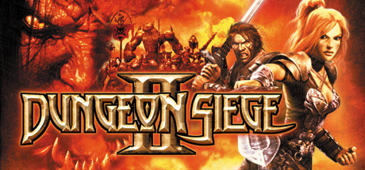
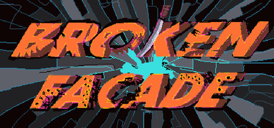
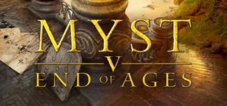
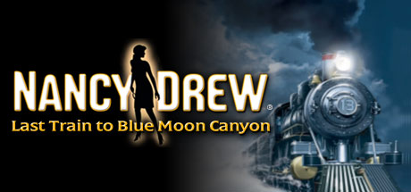
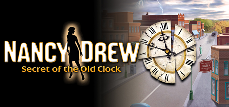

# 2005 in Video Games — July–September

[← All of 2005](../2005.md) · [Back to index](../../README.md)

188 titles.

### 187 Ride or Die

**Platforms:** PlayStation 2, Xbox &nbsp;|&nbsp; **Released:** August 23

[Wikipedia](https://en.wikipedia.org/wiki/187_Ride_or_Die)

---

### AFL Premiership 2005

**Platforms:** PlayStation 2, Xbox, Windows &nbsp;|&nbsp; **Developer:** IR Gurus &nbsp;|&nbsp; **Publisher:** Sony Computer Entertainment, THQ &nbsp;|&nbsp; **Genre:** Sports &nbsp;|&nbsp; **Released:** September 22, 2005

> AFL Premiership 2005 is based off the Australian Rules Football game that is quite popular in southern parts of Australia. Based off the official rules and has full licensing from the AFL board. It is a mixture of a few sports, originally developed by a Australian Cricket Coach who wanted to keep his team fit in the off season. It is mainly played throughout the state of Victoria but has now gotten a following in other states.  The game includes all the 16 teams, 692 AFL players with stats and 8 of the stadiums. The game also includes support for the Cameo Eyetoy (PS2 version) that will allow the player to put his/her head into the game on top of one of the players. Full multiplayer gameplay is supported, using Gamespy for online play, or using the Multi-tap you can have up to 4 players. The PS2 version also comes with a bonus "100 Years of Australian Football" DVD.  The later released Xbox and PC versions do not contain the DVD, but because of the later release changes from the AFL draft have been implemented, even though the overall team score has not been updated.
>
> _Synopsis source: IGDB_

[Wikipedia](https://en.wikipedia.org/wiki/AFL_Premiership_2005) · [IGDB](https://www.igdb.com/games/afl-premiership-2005)

---

### Another Code: Two Memories

**Platforms:** Nintendo DS &nbsp;|&nbsp; **Released:** September 26

---

### Anubis II

**Platforms:** PlayStation 2, Windows &nbsp;|&nbsp; **Developer:** Data Design Interactive &nbsp;|&nbsp; **Publisher:** Metro3D Europe, Data Design Interactive, Conspiracy Entertainment &nbsp;|&nbsp; **Genre:** Platform &nbsp;|&nbsp; **Released:** July 14, 2005

> A long time ago, an evil spirit known as Mumm'hotep sank the land of Egypt into eternal darkness. A deadly curse was spread across the once peaceful civilisation. The Gods had to send one man to deal with this threat, the warrior of the sand... Anubis. The player is armed with an arsenal consisting of the scepter of Ra and the Kanopic bombs of fury, with this, Anubis sets off to save Egypt once and for all! In this game, the player will have to face off with legions of evil enemies across nine playable levels of gameplay.  The player controls Anubis from a third-person perspective through levels with platform puzzles and enemies that are taken out by swinging his staff or locking on to them and shooting energy balls. In each level Anubis needs to find eight pyramids that open up the portal to end the stage. Contrary to the title, this is not the sequel to an earlier game.
>
> _Synopsis source: IGDB_

[Wikipedia](https://en.wikipedia.org/wiki/Anubis_II) · [IGDB](https://www.igdb.com/games/anubis-ii)

---

### Armored Core: Last Raven

**Platforms:** PlayStation 2 &nbsp;|&nbsp; **Developer:** FromSoftware &nbsp;|&nbsp; **Publisher:** FromSoftware, Agetec, 505 Games &nbsp;|&nbsp; **Genre:** Third-person shooter &nbsp;|&nbsp; **Released:** August 4, 2005

> Two powerful groups, the Alliance and the Vertex, are fighting for world dominance and victory hinges upon the "Raven" pilots. You are a Raven, an elite mech warrior who must choose sides between the fighting powers. Ravens face the ultimate decision in the fight for survival, either to fiercely defend their chosen side or fight alone and face the wrath of all Ravens.
>
> _Synopsis source: IGDB_

[Wikipedia](https://en.wikipedia.org/wiki/Armored_Core:_Last_Raven) · [IGDB](https://www.igdb.com/games/armored-core-last-raven)

---

### Armored Core: Nine Breaker

**Platforms:** PlayStation 2 &nbsp;|&nbsp; **Released:** September 13

---

### Asterix & Obelix XXL 2: Mission: Las Vegum

**Platforms:** Windows, PlayStation 2 &nbsp;|&nbsp; **Developer:** Étranges Libellules, OSome Studio &nbsp;|&nbsp; **Publisher:** Atari, Microids &nbsp;|&nbsp; **Genre:** Action-adventure &nbsp;|&nbsp; **Released:** September 30, 2005

> Astérix & Obélix XXL 2: Mission: Las Vegum is the sequel of Astérix & Obélix XXL, it was released exclusively in Europe due to the lower popularity of the franchise in the United States and Japan. The game stars the French comic book characters Asterix & Obelix and features spoofs to many classic games, in the same fashion that the comics spoof historical characters and make many cultural references.
>
> _Synopsis source: IGDB_

[Wikipedia](https://en.wikipedia.org/wiki/Asterix_&_Obelix_XXL_2:_Mission:_Las_Vegum) · [IGDB](https://www.igdb.com/games/asterix-and-obelix-xxl-2-mission-las-vegum)

---

### Battalion Wars

**Platforms:** GameCube &nbsp;|&nbsp; **Released:** September 29

[Wikipedia](https://en.wikipedia.org/wiki/Battalion_Wars)

---

### Battle of Britain II: Wings of Victory

**Platforms:** Windows &nbsp;|&nbsp; **Developer:** Shockwave Productions, Wild Hare Entertainment &nbsp;|&nbsp; **Publisher:** Tri Synergy, GMX Media, Wild Hare Entertainment &nbsp;|&nbsp; **Genre:** Combat flight simulation &nbsp;|&nbsp; **Released:** August 26, 2005

> Battle of Britain II: Wings of Victory simulates the struggle of air warfare over the deadly skies of Britain during July 1940 to September 1940. Options allow playing the game at a strategic role such as supreme air commander controlling at your disposal all of the RAF or Luftwaffe resources at the map campaign level. If fighter pilot instant action is prefer you can also jump into the cockpit of a RAF Spitfire or Luftwaffe Messerschmitt along with many other great airplanes of the Battle of Britain.
>
> _Synopsis source: IGDB_

[Wikipedia](https://en.wikipedia.org/wiki/Battle_of_Britain_II:_Wings_of_Victory) · [IGDB](https://www.igdb.com/games/battle-of-britain-ii-wings-of-victory)

---

### Beat Down: Fists of Vengeance

**Platforms:** PlayStation 2, Xbox &nbsp;|&nbsp; **Released:** August 23

---

### Bet On Soldier: Blood Sport

**Platforms:** Windows &nbsp;|&nbsp; **Developer:** Kylotonn &nbsp;|&nbsp; **Publisher:** Frogster Interactive, Focus Home Interactive, Digital Jesters &nbsp;|&nbsp; **Genre:** First-person shooter &nbsp;|&nbsp; **Released:** August 25, 2005

> Delve into a world where war has become a media frenzy! Survive your battles and bet on your victories!
>
> _Synopsis source: IGDB_

[Wikipedia](https://en.wikipedia.org/wiki/Bet_On_Soldier:_Blood_Sport) · [IGDB](https://www.igdb.com/games/bet-on-soldier-blood-sport)

---

### Blitzkrieg 2

**Platforms:** Windows &nbsp;|&nbsp; **Developer:** Nival Interactive &nbsp;|&nbsp; **Publisher:** 1C Company, CDV Software &nbsp;|&nbsp; **Genre:** Real-time tactics &nbsp;|&nbsp; **Released:** September 23, 2005

> As its predecessor and the similar Sudden Strike games, Blitzkrieg 2 focuses on the battles of World War II rather than real-time strategy aspects like base building and resource extraction. The game features many new features and units over its predecessor; the graphics engine is upgraded, allowing for full 3D and the game features over 250 units compared to Blitzkrieg's 200.
>
> _Synopsis source: IGDB_

[Wikipedia](https://en.wikipedia.org/wiki/Blitzkrieg_2) · [IGDB](https://www.igdb.com/games/blitzkrieg-2)

---

### BloodRayne 2

**Platforms:** Windows &nbsp;|&nbsp; **Released:** August 2 (NA)

[Wikipedia](https://en.wikipedia.org/wiki/BloodRayne_2)

---

### Bone: Out from Boneville

**Platforms:** Windows &nbsp;|&nbsp; **Developer:** Telltale Games &nbsp;|&nbsp; **Publisher:** Telltale Games &nbsp;|&nbsp; **Genre:** Adventure &nbsp;|&nbsp; **Released:** September 15, 2005

> After an attack by a swarm of locusts leaves Fone Bone lost in the mountains, he sets out to find his cousins, with a little help from a mysterious red dragon, a couple of talking bugs, and a pretty girl named Thorn. But with hungry rat creatures on his tail, will Fone Bone ever make his way back to Boneville?
>
> _Synopsis source: IGDB_

[Wikipedia](https://en.wikipedia.org/wiki/Bone:_Out_from_Boneville) · [IGDB](https://www.igdb.com/games/bone-out-from-boneville)

---

### Bonez Adventures: Tomb of Fulaos

**Platforms:** Windows &nbsp;|&nbsp; **Developer:** Bone Artz &nbsp;|&nbsp; **Publisher:** Bone Artz &nbsp;|&nbsp; **Genre:** Action-adventure &nbsp;|&nbsp; **Released:** July 8, 2005

[Wikipedia](https://en.wikipedia.org/wiki/Bonez_Adventures:_Tomb_of_Fulaos) · [IGDB](https://www.igdb.com/games/bonez-adventures-tomb-of-fulaos)

---

### Brave: The Search for Spirit Dancer

**Platforms:** PlayStation 2 &nbsp;|&nbsp; **Developer:** VIS Entertainment &nbsp;|&nbsp; **Publisher:** Sony Computer Entertainment, Evolved Games, SouthPeak Games &nbsp;|&nbsp; **Genre:** Action-adventure &nbsp;|&nbsp; **Released:** September 2, 2005

> Brave: The Search for Spirit Dancer is a 2005 platformer video game of the action-adventure genre originally released by VIS Entertainment for the PlayStation 2.
>
> _Synopsis source: IGDB_

[Wikipedia](https://en.wikipedia.org/wiki/Brave:_The_Search_for_Spirit_Dancer) · [IGDB](https://www.igdb.com/games/brave-the-search-for-spirit-dancer)

---

### Breeders' Cup World Thoroughbred Championships

**Platforms:** Xbox, PlayStation 2 &nbsp;|&nbsp; **Developer:** 4J Studios &nbsp;|&nbsp; **Publisher:** Bethesda Softworks &nbsp;|&nbsp; **Genre:** Horse racing &nbsp;|&nbsp; **Released:** September 21, 2005

> Experience the most realistic horse racing simulation ever created and the only game officially licensed by the NTRA, with Breeders' Cup World Thoroughbred Championships. With thousands of horses, ability to race your own Thoroughbred, play the ponies, and even build your own stable, Breeders' Cup is the horse racing game with something for everyone.
>
> _Synopsis source: IGDB_

[Wikipedia](https://en.wikipedia.org/wiki/Breeders'_Cup_World_Thoroughbred_Championships_(video_game)) · [IGDB](https://www.igdb.com/games/breeders-cup-world-thoroughbred-championships)

---

### Brian Lara International Cricket 2005

**Platforms:** Windows, PlayStation 2, Xbox &nbsp;|&nbsp; **Developer:** Swordfish Studios &nbsp;|&nbsp; **Publisher:** Codemasters &nbsp;|&nbsp; **Genre:** Sports &nbsp;|&nbsp; **Released:** July 21, 2005

> Brian Lara International Cricket 2005 (BLIC) (also known as Ricky Ponting Cricket in Australia and New Zealand) is a cricket video game from Codemasters, available on Xbox, PlayStation 2 and Windows PC platforms. released on 21 July 2005, which was the first day of the 2005 Ashes series.
>
> _Synopsis source: IGDB_

[Wikipedia](https://en.wikipedia.org/wiki/Brian_Lara_International_Cricket_2005) · [IGDB](https://www.igdb.com/games/brian-lara-international-cricket-2005)

---

### Burnout Legends

**Platforms:** PlayStation Portable, Nintendo DS &nbsp;|&nbsp; **Released:** September 13

[Wikipedia](https://en.wikipedia.org/wiki/Burnout_Legends)

---

### Burnout Revenge

**Platforms:** PlayStation 2, Xbox &nbsp;|&nbsp; **Publisher:** Electronic Arts &nbsp;|&nbsp; **Released:** September 13, 2005

[Wikipedia](https://en.wikipedia.org/wiki/Burnout_Revenge)

---

### Cabela's Big Game Hunter 2006 Trophy Season

**Platforms:** Windows &nbsp;|&nbsp; **Developer:** Magic Wand Productions &nbsp;|&nbsp; **Publisher:** Activision Value, Zoo Digital Publishing &nbsp;|&nbsp; **Genre:** Sports &nbsp;|&nbsp; **Released:** September 27, 2005

[Wikipedia](https://en.wikipedia.org/wiki/Cabela's_Big_Game_Hunter_2006_Trophy_Season)

---

### Cabela's Outdoor Adventures

**Platforms:** PlayStation 2, Xbox, GameCube &nbsp;|&nbsp; **Developer:** Sand Grain Studios, Fun Labs, Magic Wand Productions &nbsp;|&nbsp; **Publisher:** Activision Value, Zoo Digital Publishing &nbsp;|&nbsp; **Genre:** Simulation &nbsp;|&nbsp; **Released:** September 13, 2005

> Join Mama, Papa, Ichigo, and Ringo as they explore as a family on a tropical island.  Take the Hunting & Fishing expedition of a lifetime with 22 adventures across North America and beyond. Stalk monster bucks and trophy big game or stop off and fish the local waters.  Experience the sights and sounds of a true-to-life outdoor adventure where stealth, strategy and technique are of the utmost importance!
>
> _Synopsis source: IGDB_

[Wikipedia](https://en.wikipedia.org/wiki/Cabela's_Outdoor_Adventures_(2005_video_game)) · [IGDB](https://www.igdb.com/games/cabelas-outdoor-adventures--2)

---

### Capcom Classics Collection

**Platforms:** PlayStation 2, Xbox &nbsp;|&nbsp; **Released:** September 27

[Wikipedia](https://en.wikipedia.org/wiki/Capcom_Classics_Collection)

---

### Castlevania: Dawn of Sorrow

**Platforms:** Nintendo DS &nbsp;|&nbsp; **Publisher:** Konami &nbsp;|&nbsp; **Released:** August 25, 2005

---

### Caterpillar Construction Tycoon

**Platforms:** Windows &nbsp;|&nbsp; **Developer:** Gabriel Entertainment &nbsp;|&nbsp; **Publisher:** Activision Value, Zoo Digital Publishing &nbsp;|&nbsp; **Genre:** Business simulation &nbsp;|&nbsp; **Released:** September 15, 2005

[Wikipedia](https://en.wikipedia.org/wiki/Caterpillar_Construction_Tycoon) · [IGDB](https://www.igdb.com/games/caterpillar-construction-tycoon)

---

### Charlie and the Chocolate Factory

**Platforms:** PlayStation 2, Xbox, GameCube, Game Boy Advance &nbsp;|&nbsp; **Released:** July 11

[Wikipedia](https://en.wikipedia.org/wiki/Charlie_and_the_Chocolate_Factory_(2005_video_game))

---

### Coded Arms

**Platforms:** PlayStation Portable &nbsp;|&nbsp; **Released:** July 6

[Wikipedia](https://en.wikipedia.org/wiki/Coded_Arms)

---

### Codename: Panzers – Phase Two

**Platforms:** Windows &nbsp;|&nbsp; **Developer:** StormRegion &nbsp;|&nbsp; **Publisher:** cdv Software Entertainment &nbsp;|&nbsp; **Genre:** Real-time tactics &nbsp;|&nbsp; **Released:** July 22, 2005

[Wikipedia](https://en.wikipedia.org/wiki/Codename:_Panzers_%E2%80%93_Phase_Two)

---

### Colosseum: Road to Freedom

**Platforms:** PlayStation 2 &nbsp;|&nbsp; **Released:** July 20

---

### Conflict: Global Terror

**Platforms:** Windows, PlayStation 2, Xbox &nbsp;|&nbsp; **Developer:** Pivotal Games &nbsp;|&nbsp; **Publisher:** SCi Games, 2K, Synergenix &nbsp;|&nbsp; **Genre:** Tactical shooter &nbsp;|&nbsp; **Released:** September 30, 2005

> In the war on terror, the battlefield is global and only one special ops squad can protect the world's freedom. it's up to you to lead this elite group through deadly missions against and enemy fuelled by hatred.
>
> _Synopsis source: IGDB_

[Wikipedia](https://en.wikipedia.org/wiki/Conflict:_Global_Terror) · [IGDB](https://www.igdb.com/games/conflict-global-terror)

---

### Cowboy Bebop: Tsuioku no Serenade

**Platforms:** PlayStation 2 &nbsp;|&nbsp; **Developer:** Chime &nbsp;|&nbsp; **Publisher:** Bandai &nbsp;|&nbsp; **Genre:** Action &nbsp;|&nbsp; **Released:** August 25, 2005

> The Bebop crew go in search of criminal outlaws to capture for bounties when they get caught up in the story of a mysterious organization, space pirate treasure, and a song called "Diamonds".
>
> _Synopsis source: IGDB_

[Wikipedia](https://en.wikipedia.org/wiki/Cowboy_Bebop:_Tsuioku_no_Serenade) · [IGDB](https://www.igdb.com/games/cowboy-bebop-tsuioku-no-serenade)

---

### Dance Dance Revolution Extreme 2

**Platforms:** PlayStation 2 &nbsp;|&nbsp; **Released:** September 28

[Wikipedia](https://en.wikipedia.org/wiki/Dance_Dance_Revolution_Extreme_2)

---

### Danny Phantom: The Ultimate Enemy

**Platforms:** Game Boy Advance &nbsp;|&nbsp; **Released:** September 8

---

### Darkwatch

**Platforms:** PlayStation 2, Xbox &nbsp;|&nbsp; **Developer:** High Moon Studios &nbsp;|&nbsp; **Publisher:** Capcom, Ubisoft &nbsp;|&nbsp; **Genre:** First-person shooter &nbsp;|&nbsp; **Released:** August 16, 2005

> Darkwatch mixes the Western, horror and steampunk genres, telling the story of Jericho Cross, an outlaw gunfighter in the late 19th-century American Frontier who has been turned into a vampire and forcibly recruited by the titular monster-hunting secret organization to fight against supernatural forces.
>
> _Synopsis source: IGDB_

[Wikipedia](https://en.wikipedia.org/wiki/Darkwatch) · [IGDB](https://www.igdb.com/games/darkwatch)

---

### Day of Defeat: Source

**Platforms:** Windows &nbsp;|&nbsp; **Developer:** Valve &nbsp;|&nbsp; **Publisher:** Valve &nbsp;|&nbsp; **Genre:** First-person shooter &nbsp;|&nbsp; **Released:** September 26, 2005

> Day of Defeat offers intense online action gameplay set in Europe during WWII. Assume the role of infantry, sniper or machine-gunner classes, and more. DoD:S features enhanced graphics and sounds design to leverage the power of Source, Valve's new engine technology.
>
> _Synopsis source: IGDB_

[Wikipedia](https://en.wikipedia.org/wiki/Day_of_Defeat:_Source) · [IGDB](https://www.igdb.com/games/day-of-defeat-source)

---

### Death Jr.

**Platforms:** PlayStation Portable &nbsp;|&nbsp; **Released:** August 16

[Wikipedia](https://en.wikipedia.org/wiki/Death_Jr.)

---

### Dino Master

**Platforms:** Nintendo DS &nbsp;|&nbsp; **Developer:** Office Create &nbsp;|&nbsp; **Publisher:** Taito, Majesco &nbsp;|&nbsp; **Genre:** Action &nbsp;|&nbsp; **Released:** September 22, 2005

> Dino Master is a game for the Nintendo DS system similar to a fusion of Pokémon and the arcade game Qix. The player takes the role of "Dave the Digger", who excavates fossils from various sites while avoiding enemies. The fossils can then be revived into living dinosaurs and pitted against each other in Battle Mode.
>
> _Synopsis source: IGDB_

[Wikipedia](https://en.wikipedia.org/wiki/Dino_Master) · [IGDB](https://www.igdb.com/games/dino-master--1)

---

### Disney's Kim Possible 3: Team Possible

**Platforms:** Game Boy Advance, Nintendo DS &nbsp;|&nbsp; **Released:** July 26

[Wikipedia](https://en.wikipedia.org/wiki/Kim_Possible_(video_game_series))

---

### DK King of Swing

**Platforms:** Game Boy Advance &nbsp;|&nbsp; **Released:** September 19

[Wikipedia](https://en.wikipedia.org/wiki/DK_King_of_Swing)

---

### Doom RPG

**Platforms:** Mobile phone &nbsp;|&nbsp; **Developer:** Fountainhead Entertainment &nbsp;|&nbsp; **Publisher:** JAMDAT Mobile &nbsp;|&nbsp; **Genre:** Role playing, first-person shooter &nbsp;|&nbsp; **Released:** September 19, 2005

> Choose one of three different characters and get ready to battle through hordes of deadly monsters, including returning favorites such as the Pinky, Cacodemon, and Revenant, as well as new threats like the Sawcubus and Sentinel! Battle towering bosses such as the Cyberdemon, Spider Mastermind, or the Pinkinator!  Interact with other survivors of the invasion to get information about your environment and solve puzzles, but beware…not all of them can be trusted!
>
> _Synopsis source: IGDB_

[Wikipedia](https://en.wikipedia.org/wiki/Doom_RPG) · [IGDB](https://www.igdb.com/games/doom-rpg)

---

### Down in Flames

**Platforms:** Windows &nbsp;|&nbsp; **Developer:** Dan Verssen Games &nbsp;|&nbsp; **Publisher:** Battlefront.com &nbsp;|&nbsp; **Genre:** Turn-based strategy &nbsp;|&nbsp; **Released:** September 28, 2005

[Wikipedia](https://en.wikipedia.org/wiki/Down_in_Flames_(video_game))

---

### Dragon Ball GT: Transformation

**Platforms:** Game Boy Advance &nbsp;|&nbsp; **Released:** August 9

---

### Dream of Mirror Online

**Platforms:** Windows &nbsp;|&nbsp; **Developer:** Softstar &nbsp;|&nbsp; **Publisher:** Joypark, Gamania, Aeria Games, Goldensoft &nbsp;|&nbsp; **Genre:** MMORPG &nbsp;|&nbsp; **Released:** September 9, 2005

[Wikipedia](https://en.wikipedia.org/wiki/Dream_of_Mirror_Online)

---

### DT Racer

**Platforms:** PlayStation 2 &nbsp;|&nbsp; **Developer:** Axis Entertainment &nbsp;|&nbsp; **Publisher:** Sony Computer Entertainment Korea, XS Games &nbsp;|&nbsp; **Genre:** Racing &nbsp;|&nbsp; **Released:** September 27, 2005

> Extreme tuner racing just hit a whole new level of no holds barred racing. DT Racer drops you on to 22 of the slickest tracks around the globe. Completely fine tune every inch of your car's handling and performance with unlimited customization. And when you are done, put your foot to the floor and show them what you've got!
>
> _Synopsis source: IGDB_

[Wikipedia](https://en.wikipedia.org/wiki/DT_Racer) · [IGDB](https://www.igdb.com/games/dt-racer)

---

### Dungeon Fighter Online

**Platforms:** Windows &nbsp;|&nbsp; **Developer:** Neople &nbsp;|&nbsp; **Publisher:** Neople, Tencent &nbsp;|&nbsp; **Genre:** Beat 'em up &nbsp;|&nbsp; **Released:** August 2005

> Dungeon Fighter Online is a free-to-play multiplayer hack-and-slash RPG with a side-scrolling arcade style. There are currently 11 unique character classes. 3 classes have a mirrored class of the opposite gender with a 4th being added soon. Classes have Sub-classes to choose from and later has advancements of those classes to unlock upgraded skills. Of the 11 unique classes, 6 have 4 sub-classes, 3 have 2 sub-classes, and 2 have no sub-classes but still has advancements for new skills.  Developed by the Korean company Neople in 2005 the game was released in Japan in 2006, China in 2007, Taiwan in 2009, and North America in 2010. The publisher Nexon shut the North American version down in 2013. Neople relaunched the game globally in 2016, with Season 2, adding new content and characters to the game.  The game was released on the Xbox 360 Arcade under the title "Dungeon Fighter Live".
>
> _Synopsis source: IGDB_

[Wikipedia](https://en.wikipedia.org/wiki/Dungeon_Fighter_Online) · [IGDB](https://www.igdb.com/games/dungeon-fighter-online)

---

### Dungeon Siege II

**Platforms:** Windows &nbsp;|&nbsp; **Genre:** RPG &nbsp;|&nbsp; **Released:** August 16

> It’s been a generation since you vanquished the evil that plagued the Land of Ehb, and now…a new menace has awakened. In Dungeon Siege II, the sequel to the best-selling RPG from Gas Powered Games, you will be called on to again wield sword and spell to save the world from a growing abomination many years in the making.
>
> _Synopsis source: Steam_

[Wikipedia](https://en.wikipedia.org/wiki/Dungeon_Siege_II) · [Steam](https://store.steampowered.com/app/39200)

---

### Dungeons & Dragons: Dragonshard

**Platforms:** Windows &nbsp;|&nbsp; **Developer:** Liquid Entertainment &nbsp;|&nbsp; **Publisher:** Atari &nbsp;|&nbsp; **Genre:** Real-time strategy, Role-playing &nbsp;|&nbsp; **Released:** September 27, 2005

> Dungeons & Dragons: Dragonshard is a real-time strategy role-playing video game, developed for Microsoft Windows by Liquid Entertainment, and published by Atari in 2005. It takes place in Eberron, one of the official Dungeons & Dragons campaign settings. The game combines elements of traditional real-time strategy gameplay with role-playing elements such as hero units, and questing. Dragonshard includes two single-player campaigns, single-player skirmish maps, and multiplayer support. The single-player campaign follows the struggles of three competing factions to gain control of a magical artifact known as the Heart of Siberys.  Although Dragonshard was billed by Atari as "the first Dungeons & Dragons real-time strategy experience,"[2] Stronghold (1993) precedes it by over a decade.[3]
>
> _Synopsis source: IGDB_

[Wikipedia](https://en.wikipedia.org/wiki/Dungeons_&_Dragons:_Dragonshard) · [IGDB](https://www.igdb.com/games/dungeons-dragons-dragonshard)

---

### Dynasty Warriors Advance

**Platforms:** Game Boy Advance &nbsp;|&nbsp; **Released:** August 29

[Wikipedia](https://en.wikipedia.org/wiki/Dynasty_Warriors_Advance)

---

### EverQuest II: Desert of Flames

**Platforms:** Windows &nbsp;|&nbsp; **Released:** September 13

---

### Evil Dead: Regeneration

**Platforms:** Windows, PlayStation 2, Xbox &nbsp;|&nbsp; **Released:** September 13

---

### EyeToy: Play 2

**Platforms:** PlayStation 2 &nbsp;|&nbsp; **Released:** August 16

---

### F1 Grand Prix

**Platforms:** PlayStation Portable &nbsp;|&nbsp; **Developer:** Traveller's Tales &nbsp;|&nbsp; **Publisher:** Sony Computer Entertainment &nbsp;|&nbsp; **Genre:** Racing &nbsp;|&nbsp; **Released:** September 1, 2005

> FIA licensed Formula 1 racing game including the 2005 season teams, drivers, cars, and circuits. The player controls the car on the track and tries to either complete a lap in fastest possible time, or race against either computer controlled drivers (or in multiplayer mode, against other players) and finish in top position.
>
> _Synopsis source: IGDB_

[Wikipedia](https://en.wikipedia.org/wiki/F1_Grand_Prix_(2005_video_game)) · [IGDB](https://www.igdb.com/games/f1-grand-prix)

---

### Fahrenheit

**Platforms:** PlayStation 2, Xbox, Windows &nbsp;|&nbsp; **Released:** September 26

[Wikipedia](https://en.wikipedia.org/wiki/Fahrenheit_(2005_video_game))

---

### Fahrenheit: Indigo Prophecy

**Platforms:** Windows, PlayStation 2, Xbox &nbsp;|&nbsp; **Released:** September 20

[Wikipedia](https://en.wikipedia.org/wiki/Fahrenheit_(2005_video_game))

---

### Far Cry Instincts

**Platforms:** Xbox &nbsp;|&nbsp; **Released:** September 27

[Wikipedia](https://en.wikipedia.org/wiki/Far_Cry_Instincts)

---

### Façade

**Platforms:** Windows, macOS &nbsp;|&nbsp; **Genre:** Action, Indie &nbsp;|&nbsp; **Released:** July 5

> Broken Facade is an isometric metroidvania, inspired by Bullet Hell and Hack &amp; Slash games, with a post-apocalyptic cyberpunk 1920s vibe. Tear through brutal combat inspired by zero-to-hero fighting animes. Cross a shattered city and meet a small cast of colorful characters.
>
> _Synopsis source: Steam_

[Wikipedia](https://en.wikipedia.org/wiki/Fa%C3%A7ade_(interactive_story)) · [Steam](https://store.steampowered.com/app/4218870)

---

### Fire Pro Wrestling Returns

**Platforms:** PlayStation 2 &nbsp;|&nbsp; **Released:** September 15

[Wikipedia](https://en.wikipedia.org/wiki/Fire_Pro_Wrestling_Returns)

---

### Fired Up

**Platforms:** PlayStation Portable &nbsp;|&nbsp; **Developer:** London Studio &nbsp;|&nbsp; **Publisher:** Sony Computer Entertainment &nbsp;|&nbsp; **Genre:** Vehicular combat &nbsp;|&nbsp; **Released:** September 1, 2005

> Fired Up is a vehicular combat game available on the PlayStation Portable which supports up to eight players. The game features a demo of Wipeout Pure. The game features three places and five playable drivers. Fired up features game sharing and downloadable levels. It is an advancement on the 2003 PlayStation 2 game Hardware: Online Arena.
>
> _Synopsis source: IGDB_

[Wikipedia](https://en.wikipedia.org/wiki/Fired_Up_(video_game)) · [IGDB](https://www.igdb.com/games/fired-up)

---

### FlatOut

**Platforms:** Windows, Xbox, PlayStation 2 &nbsp;|&nbsp; **Released:** July 12 (NA/JP)

[Wikipedia](https://en.wikipedia.org/wiki/FlatOut_(video_game))

---

### Formula One 05

**Platforms:** PlayStation 2 &nbsp;|&nbsp; **Developer:** Studio Liverpool &nbsp;|&nbsp; **Publisher:** Sony Computer Entertainment &nbsp;|&nbsp; **Genre:** Racing &nbsp;|&nbsp; **Released:** July 1, 2005

[Wikipedia](https://en.wikipedia.org/wiki/Formula_One_05)

---

### Frantix

**Platforms:** PlayStation Portable &nbsp;|&nbsp; **Released:** September 19

[Wikipedia](https://en.wikipedia.org/wiki/Frantix)

---

### Frog Feast

**Platforms:** Neo Geo CD, Sega CD &nbsp;|&nbsp; **Developer:** Rastersoft &nbsp;|&nbsp; **Publisher:** OlderGames &nbsp;|&nbsp; **Genre:** Action &nbsp;|&nbsp; **Released:** August 20, 2005

> A 16-bit remake of the game Frog Bog, which was originally released on the Atari 2600. The game has been released on a variety of platforms, but originated during the Classic Gaming Expo 2005. It is consistently being ported to new platforms.
>
> _Synopsis source: IGDB_

[Wikipedia](https://en.wikipedia.org/wiki/Frog_Feast) · [IGDB](https://www.igdb.com/games/frog-feast)

---

### Frogger: Ancient Shadow

**Platforms:** PlayStation 2, Xbox, GameCube &nbsp;|&nbsp; **Released:** September 27

---

### Frogger: Helmet Chaos

**Platforms:** Nintendo DS, PlayStation Portable &nbsp;|&nbsp; **Released:** September 29

---

### Fullmetal Alchemist 3: Kami o Tsugu Shōjo

**Platforms:** PlayStation 2 &nbsp;|&nbsp; **Developer:** Racjin &nbsp;|&nbsp; **Publisher:** Square Enix &nbsp;|&nbsp; **Genre:** Role-playing video game &nbsp;|&nbsp; **Released:** July 21, 2005

[Wikipedia](https://en.wikipedia.org/wiki/Fullmetal_Alchemist_3:_Kami_o_Tsugu_Sh%C5%8Djo)

---

### Geist

**Platforms:** GameCube &nbsp;|&nbsp; **Released:** August 15

[Wikipedia](https://en.wikipedia.org/wiki/Geist_(video_game))

---

### Genji: Dawn of the Samurai

**Platforms:** PlayStation 2 &nbsp;|&nbsp; **Released:** September 20

---

### Glimmerati

**Platforms:** N-Gage &nbsp;|&nbsp; **Developer:** Bugbear Entertainment &nbsp;|&nbsp; **Publisher:** Nokia &nbsp;|&nbsp; **Genre:** Racing &nbsp;|&nbsp; **Released:** July 7, 2005

> In the game's story, the player is a wealthy heir who meets with another wealthy man one day, and he admires the player's skill in driving. He invites the player to compete with Club Glimmerati, an exclusive gathering of famous and rich people who race in the public streets for fun.
>
> _Synopsis source: IGDB_

[Wikipedia](https://en.wikipedia.org/wiki/Glimmerati) · [IGDB](https://www.igdb.com/games/glimmerati)

---

### Global Defence Force

**Platforms:** PlayStation 2 &nbsp;|&nbsp; **Developer:** Sandlot &nbsp;|&nbsp; **Publisher:** D3 Publisher, Essential Games, Xseed Games, PQube &nbsp;|&nbsp; **Genre:** Third-person shooter &nbsp;|&nbsp; **Released:** July 28, 2005

> The second game in the The Chikyuu Boueigun series, renamed Global Defence Force for its English release (similarly the first game was renamed Monster Attack for its English release).  It's been two years since the invading alien menace was defeated by the Global Defence Force (the game renames the "Earth Defence Force" from the previous game), but like any good off-world threat, they're back for more, and they've brought new weapons and technology in their attempts to take Earth and eliminate humanity. Thankfully, the GDF has also been developing new technology to fight them.  Global Defence Force is a third-person action shooter. Choose from either an GDF infantryman or the flight-capable Pale Wing, each with different abilities and dozens of weapons each, and set out to shoot down hordes of giant insects, enormous robots, and UFOs of incredible scale. You can choose two weapons to carry for each mission, and pickups dropped by enemies will unlock new weapons and increase your character's maximum health. You can play the game split-screen cooperatively.  Beyond adding a second player class to choose from; the Pale Wing; a fragile but powerful melee centric character with a limited Jetpack and her own weapon set, to go alongside the infantry man of the first game, Global Defence Force doesn't change much of the basic game play of Monster Attack. But leaving at that would undersell the game; there are numerous new alien types, weapons and environments that add much more variety to things. The maps are larger and more detailed and missions are longer and much more scripted (where as the original game nearly always threw you into an environment against some preplaced bug's, this time you often have some simple objective(s)) to add further variety. Finally the physics have been notably enhanced.  Like Monster Attack, the player in Global Defence Force fights completely by themselves despite being part of an army (unless playing offline only 2 player split screen); the original Japanese version features radio chatter from other GDF squads and your commanding officer, to give the illusion that you are fighting alongside others. This was cut from the English release.
>
> _Synopsis source: IGDB_

[Wikipedia](https://en.wikipedia.org/wiki/Global_Defence_Force) · [IGDB](https://www.igdb.com/games/global-defence-force)

---

### Gretzky NHL 06

**Platforms:** PlayStation 2, PlayStation Portable &nbsp;|&nbsp; **Developer:** Page 44 Studios &nbsp;|&nbsp; **Publisher:** Sony Computer Entertainment &nbsp;|&nbsp; **Genre:** Sports &nbsp;|&nbsp; **Released:** September 20, 2005

[Wikipedia](https://en.wikipedia.org/wiki/Gretzky_NHL_06)

---

### Gretzky NHL 2006

**Platforms:** PlayStation 2 &nbsp;|&nbsp; **Released:** September 20

[Wikipedia](https://en.wikipedia.org/wiki/Gretzky_NHL_2006)

---

### GripShift

**Platforms:** PlayStation Portable &nbsp;|&nbsp; **Released:** September 13

[Wikipedia](https://en.wikipedia.org/wiki/GripShift)

---

### Harvest Moon: More Friends of Mineral Town

**Platforms:** Game Boy Advance &nbsp;|&nbsp; **Released:** July 26

---

### Heavy Metal Thunder

**Platforms:** PlayStation 2 &nbsp;|&nbsp; **Developer:** Media.Vision &nbsp;|&nbsp; **Publisher:** Square Enix &nbsp;|&nbsp; **Genre:** Action game &nbsp;|&nbsp; **Released:** September 1, 2005

> The game pits futuristic robots against one another in wrestling matches. The player controls a robot during battles using a four-icon menu. Three actions—strike, guard and grapple—can be executed at any time and augments the player's "beat meter".
>
> _Synopsis source: IGDB_

[Wikipedia](https://en.wikipedia.org/wiki/Heavy_Metal_Thunder_(video_game)) · [IGDB](https://www.igdb.com/games/heavy-metal-thunder)

---

### Hello Kitty: Roller Rescue

**Platforms:** GameCube &nbsp;|&nbsp; **Released:** August 16

---

### Heroes of the Pacific

**Platforms:** PlayStation 2, Windows, Xbox &nbsp;|&nbsp; **Developer:** IR Gurus &nbsp;|&nbsp; **Publisher:** Codemasters, Ubisoft &nbsp;|&nbsp; **Genre:** Air combat simulation &nbsp;|&nbsp; **Released:** September 23, 2005

> Heroes of the Pacific is an aerial combat simulator game set in the Pacific Theater of Operations during World War II.
>
> _Synopsis source: IGDB_

[Wikipedia](https://en.wikipedia.org/wiki/Heroes_of_the_Pacific) · [IGDB](https://www.igdb.com/games/heroes-of-the-pacific)

---

### Howrse

**Platforms:** Browser &nbsp;|&nbsp; **Developer:** Owlient &nbsp;|&nbsp; **Publisher:** Owlient &nbsp;|&nbsp; **Genre:** Simulation &nbsp;|&nbsp; **Released:** September 8, 2005

> Breed horses, enter competitions and manage your own equestrian center!
>
> _Synopsis source: IGDB_

[Wikipedia](https://en.wikipedia.org/wiki/Howrse) · [IGDB](https://www.igdb.com/games/howrse)

---

### Ibara

**Platforms:** Arcade &nbsp;|&nbsp; **Developer:** Cave &nbsp;|&nbsp; **Publisher:** AMI, Taito &nbsp;|&nbsp; **Genre:** Scrolling shooter &nbsp;|&nbsp; **Released:** July 15, 2005

> Ibara is a vertical scrolling shoot 'em up. The back story revolves around a group of sisters, led by Professor Teresa Rose, who want to destroy all technological progress in the land of Edelweiss, essentially turning it into a rose garden. Players can choose to either lead the characters Bond or Dyne and their airplanes through several levels of "bullet hell"-style gameplay in an attempt to defeat the sisters.  The player's weapons arsenal consists of a main gun and bombs. Bombs must be collected in fragments, and once the player has all of them, the Hadou Cannon can be used. Staying behind the cannon will make the player invincible for the duration of the effect. Additionally, enemies drop various "options," up to two of which can be attached to the wings of the plane to further increase fire power.  The game has a ranking system. If the player does really well, they go up in rank and thus boss battles will be a lot harder. Rank can be strategically decreased either by dying or by collecting roses, which are created from enemy bullets when the player sets off a bomb. Scoring works by collecting gold medals dropped by destroyed enemies. They must be quickly collected to keep up a scoring chain. Once a new medal pops up, and the medals on screen already haven't been collected yet, the chain is broken.
>
> _Synopsis source: IGDB_

[Wikipedia](https://en.wikipedia.org/wiki/Ibara_(video_game)) · [IGDB](https://www.igdb.com/games/ibara)

---

### Imperia Online

**Platforms:** Windows, Browser, Linux &nbsp;|&nbsp; **Developer:** Imperia Online JSC &nbsp;|&nbsp; **Publisher:** Imperia Online JSC &nbsp;|&nbsp; **Genre:** MMORTS &nbsp;|&nbsp; **Released:** August 23, 2005

> Imperia Online is MMO strategy known for its deep gameplay. Build your capital, claim new territories by establishing provinces, trading posts and military encampments. Train your army to spy on the enemy and defend your Empire. With its pvp focus you can expect to become a part of an alliance and wage war against enemy players in competition for the title "Lord of the Realm"! Special weekly events, realms and tournaments are all present and further enrich your gameplay experience.
>
> _Synopsis source: IGDB_

[Wikipedia](https://en.wikipedia.org/wiki/Imperia_Online) · [IGDB](https://www.igdb.com/games/imperia-online)

---

### Indigo Prophecy

**Platforms:** PlayStation 2, Windows, Xbox &nbsp;|&nbsp; **Developer:** Quantic Dream &nbsp;|&nbsp; **Publisher:** Atari &nbsp;|&nbsp; **Genre:** Action-adventure &nbsp;|&nbsp; **Released:** September 16, 2005

> Indigo Prophecy is an action-adventure game that involves the player in making decisions to alter the narrative. The name change in North America was made to avoid confusion with Michael Moore's Fahrenheit 9/11 documentary film, which was released in 2004. Indigo Prophecy introduced elements like ethical ambiguity, romance, the inability to perish, and interactive storytelling that would endure in Quantic Dream's later games.
>
> _Synopsis source: IGDB_

[Wikipedia](https://en.wikipedia.org/wiki/Indigo_Prophecy) · [IGDB](https://www.igdb.com/games/indigo-prophecy)

---

### InuYasha: Feudal Combat

**Platforms:** PlayStation 2 &nbsp;|&nbsp; **Released:** August 25

---

### Jump Super Stars

**Platforms:** Nintendo DS &nbsp;|&nbsp; **Developer:** Ganbarion &nbsp;|&nbsp; **Publisher:** Nintendo &nbsp;|&nbsp; **Genre:** Fighting &nbsp;|&nbsp; **Released:** August 8, 2005

> Jump Super Stars is a 2D fighting game for the Nintendo DS. It was developed by Ganbarion and published by Nintendo. The game was released on August 8, 2005 in Japan and accompanied the release of a red Nintendo DS. A sequel, Jump Ultimate Stars, was released in Japan on November 23, 2006.
>
> _Synopsis source: IGDB_

[Wikipedia](https://en.wikipedia.org/wiki/Jump_Super_Stars) · [IGDB](https://www.igdb.com/games/jump-super-stars)

---

### Kidou Senshi Gundam Seed: Rengou vs. Z.A.F.T.

**Platforms:** Arcade, PlayStation 2 &nbsp;|&nbsp; **Developer:** Capcom &nbsp;|&nbsp; **Publisher:** Banpresto, Bandai, Namco Bandai Games &nbsp;|&nbsp; **Genre:** Action-adventure, Anime &nbsp;|&nbsp; **Released:** July 2005

[Wikipedia](https://en.wikipedia.org/wiki/Kidou_Senshi_Gundam_Seed:_Rengou_vs._Z.A.F.T.)

---

### killer7

**Platforms:** PlayStation 2, GameCube &nbsp;|&nbsp; **Released:** July 7

[Wikipedia](https://en.wikipedia.org/wiki/Killer7)

---

### Kingdom Under Fire:Heroes

**Platforms:** Xbox &nbsp;|&nbsp; **Released:** September 20

---

### Kusari

**Platforms:** Windows &nbsp;|&nbsp; **Developer:** Leaf &nbsp;|&nbsp; **Publisher:** Aquaplus &nbsp;|&nbsp; **Genre:** Visual novel, Eroge &nbsp;|&nbsp; **Released:** September 22, 2005

[Wikipedia](https://en.wikipedia.org/wiki/Kusari)

---

### Legend of Kay

**Platforms:** PlayStation 2 &nbsp;|&nbsp; **Released:** September 20

[Wikipedia](https://en.wikipedia.org/wiki/Legend_of_Kay)

---

### Lost in Blue

**Platforms:** Nintendo DS &nbsp;|&nbsp; **Released:** September 27

[Wikipedia](https://en.wikipedia.org/wiki/Lost_in_Blue)

---

### Lunar: Dragon Song

**Platforms:** Nintendo DS &nbsp;|&nbsp; **Released:** September 27

---

### Madden NFL 06

**Platforms:** PlayStation 2, GameCube, Nintendo DS, Windows &nbsp;|&nbsp; **Released:** August 8

[Wikipedia](https://en.wikipedia.org/wiki/Madden_NFL_06)

---

### Makai Kingdom: Chronicles of the Sacred Tome

**Platforms:** PlayStation 2 &nbsp;|&nbsp; **Released:** July 26

---

### Mario Superstar Baseball

**Platforms:** GameCube &nbsp;|&nbsp; **Released:** August 29

[Wikipedia](https://en.wikipedia.org/wiki/Mario_Superstar_Baseball)

---

### Marvel Nemesis: Rise of the Imperfects

**Platforms:** GameCube, PlayStation 2, Xbox, Nintendo DS, PlayStation Portable &nbsp;|&nbsp; **Released:** September 20

---

### Massive Snowboarding

**Platforms:** Mobile phone &nbsp;|&nbsp; **Developer:** Gameloft &nbsp;|&nbsp; **Publisher:** Gameloft &nbsp;|&nbsp; **Genre:** Snowboarding &nbsp;|&nbsp; **Released:** September 10, 2005

[Wikipedia](https://en.wikipedia.org/wiki/Massive_Snowboarding)

---

### MediEvil: Resurrection

**Platforms:** PlayStation Portable &nbsp;|&nbsp; **Released:** September 13

---

### Mega Man X8

**Platforms:** Windows &nbsp;|&nbsp; **Released:** September 21 (EU)

[Wikipedia](https://en.wikipedia.org/wiki/Mega_Man_X8)

---

### Midway Arcade Treasures 3

**Platforms:** GameCube, PlayStation 2, Xbox &nbsp;|&nbsp; **Developer:** Digital Eclipse, Gamestar, Midway Studios San Diego &nbsp;|&nbsp; **Publisher:** Midway &nbsp;|&nbsp; **Genre:** Racing &nbsp;|&nbsp; **Released:** September 26, 2005

[Wikipedia](https://en.wikipedia.org/wiki/Midway_Arcade_Treasures_3)

---

### Minerva

**Platforms:** Windows &nbsp;|&nbsp; **Developer:** Adam Foster &nbsp;|&nbsp; **Genre:** First-person shooter, puzzle &nbsp;|&nbsp; **Released:** September 2, 2005

> In Minerva, the player character is an anonymous person (who is hinted to be a renegade Overwatch Soldier in the in-game messages) who has either acquired or been provided with a stolen HEV suit. Guided by the mysterious Minerva, the player character is deployed on a tiny island occupied by the Combine - an island which hosts a huge facility - with the goal of infiltrating it and discovering its purpose.
>
> _Synopsis source: IGDB_

[Wikipedia](https://en.wikipedia.org/wiki/Minerva_(video_game)) · [IGDB](https://www.igdb.com/games/minerva)

---

### Mini Desktop Racing

**Platforms:** PlayStation 2, Windows &nbsp;|&nbsp; **Developer:** Data Design Interactive &nbsp;|&nbsp; **Publisher:** Metro3D Europe, Data Design Interactive, Conspiracy Entertainment &nbsp;|&nbsp; **Genre:** Racing &nbsp;|&nbsp; **Released:** July 20, 2005

> Mini Desktop Racing lets you loose with a crazy selection of officially licensed Minis, each accurately rendered with distinctive performance abilities. Players race in a variety of mini cars around a variety of desktop areas. The game offers reasonably interactive courses by allowing players to "turn on fans" and "spill drinks" in attempts to hinder opponents.
>
> _Synopsis source: IGDB_

[Wikipedia](https://en.wikipedia.org/wiki/Mini_Desktop_Racing) · [IGDB](https://www.igdb.com/games/mini-desktop-racing)

---

### Mortal Kombat: Shaolin Monks

**Platforms:** PlayStation 2, Xbox &nbsp;|&nbsp; **Released:** September 30 (EU)

---

### Mortal Kombat: Shaolin Monks (US)

**Platforms:** PlayStation 2, Xbox &nbsp;|&nbsp; **Released:** September 16

---

### MotoGP 3: Ultimate Racing Technology

**Platforms:** Windows, Xbox &nbsp;|&nbsp; **Released:** August 30

---

### MotoGP: Ultimate Racing Technology 3

**Platforms:** Windows, Xbox &nbsp;|&nbsp; **Developer:** Climax Racing &nbsp;|&nbsp; **Publisher:** THQ &nbsp;|&nbsp; **Genre:** Racing &nbsp;|&nbsp; **Released:** August 30, 2005

[Wikipedia](https://en.wikipedia.org/wiki/MotoGP:_Ultimate_Racing_Technology_3) · [IGDB](https://www.igdb.com/games/motogp-ultimate-racing-technology-3)

---

### Myst V: End of Ages

**Platforms:** Windows &nbsp;|&nbsp; **Genre:** Adventure, Casual &nbsp;|&nbsp; **Released:** September 20

> The Grand Finale of the greatest adventure! Decide the fate of a civilization in this triumphant final chapter to the Myst saga. Embark on an epic journey into the heart of a shattered empire as the only explorer who can still save it— or destroy it with the wrong choices.
>
> _Synopsis source: Steam_

[Steam](https://store.steampowered.com/app/208110)

---

### Namco Museum: 50th Anniversary

**Platforms:** Game Boy Advance, PlayStation 2, Xbox, GameCube, Windows &nbsp;|&nbsp; **Developer:** Digital Eclipse &nbsp;|&nbsp; **Publisher:** Namco, Namco Hometek, Electronic Arts &nbsp;|&nbsp; **Genre:** Various &nbsp;|&nbsp; **Released:** August 30, 2005

[Wikipedia](https://en.wikipedia.org/wiki/Namco_Museum:_50th_Anniversary)

---

### NamCollection

**Platforms:** PlayStation 2 &nbsp;|&nbsp; **Developer:** Namco &nbsp;|&nbsp; **Publisher:** Namco &nbsp;|&nbsp; **Genre:** Compilation &nbsp;|&nbsp; **Released:** July 21, 2005

[Wikipedia](https://en.wikipedia.org/wiki/NamCollection)

---

### Nancy Drew: Last Train to Blue Moon Canyon

**Platforms:** Windows &nbsp;|&nbsp; **Genre:** Action, Adventure, Casual, RPG, Simulation &nbsp;|&nbsp; **Released:** September 15

> Catch this train — it’s your ticket to solving a century-old mystery!
>
> _Synopsis source: Steam_

[Steam](https://store.steampowered.com/app/31810)

---

### Nancy Drew: Secret of the Old Clock

**Platforms:** Windows &nbsp;|&nbsp; **Genre:** Adventure &nbsp;|&nbsp; **Released:** July 12

> Venture into the Past and Outwit a Criminal Before Time Runs Out!
>
> _Synopsis source: Steam_

[Steam](https://store.steampowered.com/app/31880)

---

### Nanostray

**Platforms:** Nintendo DS &nbsp;|&nbsp; **Released:** July 19

[Wikipedia](https://en.wikipedia.org/wiki/Nanostray)

---

### NASCAR 06: Total Team Control

**Platforms:** PlayStation 2, Xbox &nbsp;|&nbsp; **Developer:** EA Tiburon &nbsp;|&nbsp; **Publisher:** EA Sports &nbsp;|&nbsp; **Genre:** Racing &nbsp;|&nbsp; **Released:** August 30, 2005

> Take command of the biggest teams in NASCAR by building a multi-car dynasty with NASCAR 06: Total Team Control. In the first-ever Squad Based Racing experience, you are not alone. Radio to teammates for assistance, while managing on-track partnerships, or take the wheel of a teammate's car in the middle of a race to fend off rivals. With all-new game controls, including real-time voice command, communicate with your crew chief, spotters, and on-track allies to help punch your team through the pack. As an owner, build your own racing empire or even buy top NASCAR Teams like Hendrick Motorsports. Earn the title of Teammate, Champion, and Hero in NASCAR 06: Total Team Control.
>
> _Synopsis source: IGDB_

[Wikipedia](https://en.wikipedia.org/wiki/NASCAR_06:_Total_Team_Control) · [IGDB](https://www.igdb.com/games/nascar-06-total-team-control)

---

### NBA 2K6

**Platforms:** PlayStation 2, Xbox, Xbox 360 &nbsp;|&nbsp; **Developer:** Visual Concepts &nbsp;|&nbsp; **Publisher:** 2K &nbsp;|&nbsp; **Genre:** Sports &nbsp;|&nbsp; **Released:** September 27, 2005

> NBA 2K6 hits the hardwood with all the ingredients necessary to continue its reign as the #1 rated pro basketball game. Achieve NBA superstar status with the new 24/ mode, where created players now partake in training camps, competitions and even land endorsement deals. Elevate your game by utilizing the innovative V.I.P. System to challenge profiels of friends and other NBA 2K6 ballers across the country that match their game-play tendencies down to every minute detail. Then head over to The Crib to customize your pad, buy music and unlock mini-games with crib credits earned playing the game. With the industry leading online experience and unrivaled francise control, NBA 2K6 offers the most complete and entertaining roundball experience available.
>
> _Synopsis source: IGDB_

[Wikipedia](https://en.wikipedia.org/wiki/NBA_2K6) · [IGDB](https://www.igdb.com/games/nba-2k6)

---

### NBA Live 06

**Platforms:** GameCube, PlayStation 2, Windows, Xbox, Xbox 360, PlayStation Portable, Mobile phone &nbsp;|&nbsp; **Developer:** EA Canada &nbsp;|&nbsp; **Publisher:** EA Sports &nbsp;|&nbsp; **Genre:** Sports &nbsp;|&nbsp; **Released:** September 26, 2005

> NBA Live 06 is the first game in the franchise to reach next generation consoles.
>
> _Synopsis source: IGDB_

[Wikipedia](https://en.wikipedia.org/wiki/NBA_Live_06) · [IGDB](https://www.igdb.com/games/nba-live-06)

---

### NCAA Football 06

**Platforms:** PlayStation 2, Xbox &nbsp;|&nbsp; **Developer:** EA Tiburon &nbsp;|&nbsp; **Publisher:** EA Sports &nbsp;|&nbsp; **Genre:** Sports &nbsp;|&nbsp; **Released:** July 12, 2005

> NCAA Football '06, known colloquially as College Football 2006, is a collegiate American football video game which was released on July 11, 2005. It is the successor to NCAA Football 2005 in the NCAA Football series. The product features former Michigan Wolverines standout and Heisman Trophy winner Desmond Howard on the cover. He is the only cover athlete not to have played the year before their respective game; Howard last played at Michigan in 1991. It is the only game in the series as of 2013 to have a music soundtrack, as the other games play school fight songs and general band pieces, and the last game in the series to feature FCS (Division 1-AA) teams.
>
> _Synopsis source: IGDB_

[Wikipedia](https://en.wikipedia.org/wiki/NCAA_Football_06) · [IGDB](https://www.igdb.com/games/ncaa-football-06)

---

### Neo Geo Battle Coliseum

**Platforms:** PlayStation 2, Arcade &nbsp;|&nbsp; **Developer:** SNK Playmore &nbsp;|&nbsp; **Publisher:** Sega, SNK Playmore, Ignition Entertainment &nbsp;|&nbsp; **Genre:** Fighting &nbsp;|&nbsp; **Released:** July 27, 2005

> Neo Geo Battle Coliseum (abbreviated NGBC or NBC) is a 2 on 2 tag team fighting game for the Atomiswave arcade board released in 2005. The game features characters from several SNK and ADK titles. Subsequently a PlayStation 2 version of the game was released in Japan, North America, and Europe. The Xbox Live Arcade version was released worldwide on June 9, 2010.
>
> _Synopsis source: IGDB_

[Wikipedia](https://en.wikipedia.org/wiki/Neo_Geo_Battle_Coliseum) · [IGDB](https://www.igdb.com/games/neo-geo-battle-coliseum)

---

### Neuro Hunter

**Platforms:** Windows &nbsp;|&nbsp; **Released:** September 23 (UK)

[Wikipedia](https://en.wikipedia.org/wiki/Neuro_Hunter)

---

### NHL 06

**Platforms:** PlayStation 2, GameCube, Windows, Xbox &nbsp;|&nbsp; **Developer:** EA Canada &nbsp;|&nbsp; **Publisher:** EA Sports &nbsp;|&nbsp; **Genre:** Sports &nbsp;|&nbsp; **Released:** September 6, 2005

> Hit the ice with EA Sports' NHL 06 for the XBOX. This entry in the NHL series builds on the 2005 version by adding new rules and an up to date rooster that includes just about every big name in the National Hockey League. NHL 06 includes everything from NHL 05, including the revamped shooting controls. New to the 2006 version is the use of the left analog stick for deking, which in hockey terms means to dodge and fake out defenders. The right analog stick is used to pull off fancy moves like a spin or between the legs pass. These fancy moves will distract goalkeepers, giving the gamer an opening to shoot. The drawback to these moves is that only superstar characters can pull them off regularly. The game includes many of the traditional hockey game modes, including dynasty mode. In dynasty mode, gamers will control their own hockey team and have to deal with outside pressures, sponsors, and more while trying to meet the team philosophy, which is different for each team. Other modes include single season, leagues and tournaments, quick game, and online play. The graphics of NHL 06 are top notch. This time, they've been tweaked to accurately show character size differences. The defense players and goalkeepers, who are traditionally larger players, actually look larger, while the smaller and faster scorers are indeed a little thinner and smaller. This is just one small change that adds to the overall amazing gameplay of NHL 06.
>
> _Synopsis source: IGDB_

[Wikipedia](https://en.wikipedia.org/wiki/NHL_06) · [IGDB](https://www.igdb.com/games/nhl-06)

---

### NHL 2K6

**Platforms:** PlayStation 2, Xbox, Xbox 360 &nbsp;|&nbsp; **Developer:** Kush Games &nbsp;|&nbsp; **Publisher:** 2K &nbsp;|&nbsp; **Genre:** Sports &nbsp;|&nbsp; **Released:** September 6, 2005

> NHL 2K6 is a realistic hockey simulation in which you must take part in all aspects of running a franchise, from scheduling workouts to hitting a slap shot. The game includes revamped animations and more realistic player movement. NHL 2K6 also includes on-the-fly coaching that lets you make decisions during the game to affect your teams strategy and execution. You can even go online to challenge other gamers, track stats, or join a league.
>
> _Synopsis source: IGDB_

[Wikipedia](https://en.wikipedia.org/wiki/NHL_2K6) · [IGDB](https://www.igdb.com/games/nhl-2k6)

---

### Night Watch

**Platforms:** Windows &nbsp;|&nbsp; **Developer:** Nival Interactive &nbsp;|&nbsp; **Publisher:** CDV Software &nbsp;|&nbsp; **Genre:** Tactical RPG &nbsp;|&nbsp; **Released:** August 18, 2005

> Based on the most successful Russian-made movie ever, the Night Watch game asks players to take part in a millennia-old struggle of supernatural forces; a conflict of which ordinary humans are either completely oblivious, or in which they are unwittingly being used as pawns.  In the Night Watch universe, there are people among us who appear ordinary, but who are different; they call themselves "Others." These Others can channel magical power as devastating attacks and defenses. Those who support the forces of light are known as the Night Watch, while those that fight on the side of darkness are the Day Watch. These two sides have been locked in an epic battle with the common hope of one ultimately claiming a decisive victory and a right to rule the world.
>
> _Synopsis source: IGDB_

[Wikipedia](https://en.wikipedia.org/wiki/Night_Watch_(video_game)) · [IGDB](https://www.igdb.com/games/night-watch)

---

### Ninja Gaiden Black

**Platforms:** Xbox &nbsp;|&nbsp; **Publisher:** Tecmo &nbsp;|&nbsp; **Released:** September 20, 2005

[Wikipedia](https://en.wikipedia.org/wiki/Ninja_Gaiden_(2004_video_game)#Ninja_Gaiden_Black)

---

### Ninjabread Man

**Platforms:** PlayStation 2, Windows &nbsp;|&nbsp; **Developer:** Data Design Interactive &nbsp;|&nbsp; **Publisher:** Metro3D Europe, Data Design Interactive, Conspiracy Entertainment &nbsp;|&nbsp; **Genre:** Platform, action-adventure &nbsp;|&nbsp; **Released:** July 13, 2005

> Ninjabread Man is a 2005 platform game developed and published by Data Design Interactive for the PlayStation 2 and Microsoft Windows. A port for the Wii was released in September 2007 in Europe and Australia, and on 3 October 2007 in North America. Ninjabread Man was later published as part of Data Design Interactive's 'Popcorn Arcade' brand of Wii games. Ninjabread Man is an action-adventure platformer. There are three levels in the game, plus a tutorial level. In order to proceed to the next level, players must collect eight power rods to activate a teleporter. Upon release, Ninjabread Man received universally negative reviews from critics and was criticized for its camera system, graphics, lack of story, short length, and controls; the Wii version received even lower reviews for its use of motion controls and has been listed as one of the worst games of all time.
>
> _Synopsis source: IGDB_

[Wikipedia](https://en.wikipedia.org/wiki/Ninjabread_Man) · [IGDB](https://www.igdb.com/games/ninjabread-man)

---

### Nintendogs

**Platforms:** Nintendo DS &nbsp;|&nbsp; **Released:** August 22

[Wikipedia](https://en.wikipedia.org/wiki/Nintendogs)

---

### One Piece

**Platforms:** Game Boy Advance &nbsp;|&nbsp; **Developer:** Dimps Corporation &nbsp;|&nbsp; **Publisher:** Bandai Games &nbsp;|&nbsp; **Genre:** Beat 'em up &nbsp;|&nbsp; **Released:** September 7, 2005

> One Piece also referred to as Shonen Jump's One Piece is a 2-D platforming adventure video game for the Nintendo Game Boy Advance based on the 4kids dub of the One Piece anime. Developed by Dimps and published by Bandai, it was released on September 7, 2005. It is the only One Piece game to be only released in the USA, and the first out of two to not see a release in Japan.
>
> _Synopsis source: IGDB_

[Wikipedia](https://en.wikipedia.org/wiki/One_Piece_(video_game)) · [IGDB](https://www.igdb.com/games/shonen-jumps-one-piece)

---

### One Piece: Grand Battle! Rush

**Platforms:** GameCube, PlayStation 2 &nbsp;|&nbsp; **Released:** September 7

---

### Operation: Matriarchy

**Platforms:** Windows &nbsp;|&nbsp; **Developer:** MADia Entertainment &nbsp;|&nbsp; **Publisher:** Buka Entertainment &nbsp;|&nbsp; **Genre:** First-person shooter &nbsp;|&nbsp; **Released:** August 25, 2005

> Operation: Matriarchy is a science fiction first-person shooter. In the 24th century mankind has formed itself into the Federation of Earth, and has colonized several other planets. However, around 2350 a mysterious virus ravages the colony planet of Velia, targeting only the females within the population.
>
> _Synopsis source: IGDB_

[Wikipedia](https://en.wikipedia.org/wiki/Operation:_Matriarchy) · [IGDB](https://www.igdb.com/games/operation-matriarchy)

---

### Osu! Tatakae! Ouendan

**Platforms:** Nintendo DS &nbsp;|&nbsp; **Developer:** iNiS Corporation &nbsp;|&nbsp; **Publisher:** Nintendo &nbsp;|&nbsp; **Genre:** Music video game &nbsp;|&nbsp; **Released:** July 28, 2005

> Osu! Tatakae! Ouendan, or simply Ouendan, is a rhythm video game developed by iNiS and published by Nintendo for the Nintendo DS handheld game console in 2005, for release only in Japan. Ouendan stars a cheer squad rhythmically cheering for various troubled people, presented in game in the style of a manga comic. In each stage, players use the DS touchscreen to tap specifically marked spots that appear in rhythm to various Japanese pop songs, scoring points for accurate timing and avoiding a poor performance which can cause the stage to end prematurely. Though never released in Western markets, it was a popular import to these regions, leading to the development of the Westernized spiritual sequel Elite Beat Agents, as well as a direct Japanese sequel Moero! Nekketsu Rhythm Damashii Osu! Tatakae! Ouendan 2.
>
> _Synopsis source: IGDB_

[Wikipedia](https://en.wikipedia.org/wiki/Osu!_Tatakae!_Ouendan) · [IGDB](https://www.igdb.com/games/osu-tatakae-ouendan)

---

### Outlaw Tennis

**Platforms:** Xbox, PlayStation 2 &nbsp;|&nbsp; **Developer:** Hypnotix &nbsp;|&nbsp; **Publisher:** Global Star Software &nbsp;|&nbsp; **Genre:** Sports, fighting &nbsp;|&nbsp; **Released:** July 26, 2005

> Outlaw Tennis is a video game based on the sport of tennis published for the Xbox and PlayStation 2, and the last game in the Outlaw series to be released in 2005. Actor and political satirist Stephen Colbert provides the voice of the game's announcer.
>
> _Synopsis source: IGDB_

[Wikipedia](https://en.wikipedia.org/wiki/Outlaw_Tennis) · [IGDB](https://www.igdb.com/games/outlaw-tennis)

---

### Pac 'n Roll

**Platforms:** Nintendo DS &nbsp;|&nbsp; **Released:** August 16

[Wikipedia](https://en.wikipedia.org/wiki/Pac_%27n_Roll)

---

### Phantasmagoria of Flower View

**Platforms:** Windows &nbsp;|&nbsp; **Developer:** Team Shanghai Alice &nbsp;|&nbsp; **Publisher:** Team Shanghai Alice &nbsp;|&nbsp; **Genre:** Bullet hell &nbsp;|&nbsp; **Released:** August 14, 2005

[Wikipedia](https://en.wikipedia.org/wiki/Phantasmagoria_of_Flower_View)

---

### Power Rangers S.P.D.

**Platforms:** Game Boy Advance &nbsp;|&nbsp; **Developer:** Natsume Co., Ltd. &nbsp;|&nbsp; **Publisher:** THQ &nbsp;|&nbsp; **Genre:** Action &nbsp;|&nbsp; **Released:** September 6, 2005

> THQ sixth game based on the Might Morphin' Power Rangers takes the team into space. POWER RANGERS: SPACE PATROL DELTA for the Game Boy Advance puts players in control of all five members of the Space Patrol Delta team as they battle the evil Emperor Gruumm and his army of robots. In the future, Earth has become home to many different alien races. While most of them are peaceful, some are not. In order to protect earth, six teens were called to form the Space Patrol Delta team. Players will control a certain ranger for each of the nine levels. While the rangers' fighting abilities are similar, each has his or her own unique power. The Red Ranger can move through objects, the Yellow Ranger can create duplicates of herself, the Green Ranger can see heat trails, the Blue Ranger can create a force field, and the Pink Ranger can replicate objects she touches. There's also a Shadow Ranger who has special abilities players will uncover as they progress through the game. Each level in this platformer has players running, jumping, and attacking enemies as they guide the chosen ranger through the many obstacles that Gruumm has created. Each of the nine levels is controlled by a boss that the Rangers must defeat to move on. After certain levels, the Rangers will summon the Megazord to do battle with giant monsters. Fans of the POWER RANGERS won't want to miss this instalment in the series. POWER RANGERS: SPACE PATROL DELTA is an out-of-this-world fighting experience.
>
> _Synopsis source: IGDB_

[Wikipedia](https://en.wikipedia.org/wiki/Power_Rangers_S.P.D._(video_game)) · [IGDB](https://www.igdb.com/games/power-rangers-s-p-d)

---

### Prison Tycoon

**Platforms:** Windows &nbsp;|&nbsp; **Developer:** Virtual Playground &nbsp;|&nbsp; **Publisher:** ValuSoft &nbsp;|&nbsp; **Genre:** Business simulation game &nbsp;|&nbsp; **Released:** July 21, 2005

> Prison Tycoon lets you run your own prison, controlling the buildings, inmates, and more.
>
> _Synopsis source: IGDB_

[Wikipedia](https://en.wikipedia.org/wiki/Prison_Tycoon) · [IGDB](https://www.igdb.com/games/prison-tycoon)

---

### Pro Evolution Soccer 5

**Platforms:** Windows &nbsp;|&nbsp; **Publisher:** Konami &nbsp;|&nbsp; **Released:** August 4, 2005

[Wikipedia](https://en.wikipedia.org/wiki/Pro_Evolution_Soccer_5)

---

### Quraish

**Platforms:** Windows &nbsp;|&nbsp; **Developer:** Afkar media Ltd. &nbsp;|&nbsp; **Publisher:** Dar al-Fiqr &nbsp;|&nbsp; **Genre:** Real-time strategy &nbsp;|&nbsp; **Released:** August 2, 2005

> Quraish: The game is a 2005 real-time strategy 3D computer video game produced by Syrian video game production, Afkar Media. It is the second Arabic language-based game and a third person strategy game based on the early battles of Islam, primarily focusing on the Rashidun Caliphate's successful campaigns against the Eastern Roman Empire and the Sassanid dynasty of Persia.
>
> _Synopsis source: IGDB_

[Wikipedia](https://en.wikipedia.org/wiki/Quraish_(video_game)) · [IGDB](https://www.igdb.com/games/quraish)

---

### Radiata Stories

**Platforms:** PlayStation 2 &nbsp;|&nbsp; **Released:** September 6

[Wikipedia](https://en.wikipedia.org/wiki/Radiata_Stories)

---

### Real World Golf

**Platforms:** Windows, PlayStation 2, Xbox &nbsp;|&nbsp; **Developer:** In2Games &nbsp;|&nbsp; **Publisher:** Valcon Games, Mad Catz &nbsp;|&nbsp; **Genre:** Sports &nbsp;|&nbsp; **Released:** August 26, 2005

> Real World Golf was released alongside the "Gametrak" peripheral in 2006 by Madcatz. It approximates real golf using straps attached to the player's wrists.
>
> _Synopsis source: IGDB_

[Wikipedia](https://en.wikipedia.org/wiki/Real_World_Golf) · [IGDB](https://www.igdb.com/games/real-world-golf)

---

### Rebelstar: Tactical Command

**Platforms:** Game Boy Advance &nbsp;|&nbsp; **Released:** September 6

---

### Rome: Total War: Barbarian Invasion

**Platforms:** Windows &nbsp;|&nbsp; **Developer:** Creative Assembly &nbsp;|&nbsp; **Publisher:** Sega, Feral Interactive &nbsp;|&nbsp; **Genre:** Real-time tactics, turn-based strategy &nbsp;|&nbsp; **Released:** September 27, 2005

[Wikipedia](https://en.wikipedia.org/wiki/Rome:_Total_War:_Barbarian_Invasion)

---

### ROSE Online

**Platforms:** MS-DOS, Windows &nbsp;|&nbsp; **Developer:** Triggersoft, naROSE: Gravity Interactive, Inc., naROSE: Rednim Games, jROSE: Faith Inc. &nbsp;|&nbsp; **Publisher:** naROSE: Rednim Games, jROSE: Faith Inc., naROSE: Gravity Interactive, Inc. &nbsp;|&nbsp; **Genre:** MMORPG &nbsp;|&nbsp; **Released:** July 7, 2005

[Wikipedia](https://en.wikipedia.org/wiki/ROSE_Online)

---

### S.L.A.I.: Steel Lancer Arena International

**Platforms:** PlayStation 2 &nbsp;|&nbsp; **Developer:** Genki &nbsp;|&nbsp; **Publisher:** Konami &nbsp;|&nbsp; **Genre:** Vehicular combat &nbsp;|&nbsp; **Released:** September 20, 2005

> In the year 2071, robots have become the new gladiators, and you're in the pilot's seat. Go head-to-head against other players to see who is the champion.
>
> _Synopsis source: IGDB_

[Wikipedia](https://en.wikipedia.org/wiki/S.L.A.I.:_Steel_Lancer_Arena_International) · [IGDB](https://www.igdb.com/games/s-dot-l-a-dot-i-steel-lancer-arena-international)

---

### Sakura Wars: So Long, My Love

**Platforms:** PlayStation 2 &nbsp;|&nbsp; **Developer:** Sega GE2 R&D, Red Entertainment &nbsp;|&nbsp; **Publisher:** Sega, NIS America &nbsp;|&nbsp; **Genre:** Tactical role-playing, dating sim, visual novel &nbsp;|&nbsp; **Released:** July 7, 2005

> Sakura Wars is a Strategy RPG that features a unique sim-based story system. An in-depth storyline exists, much like in any other RPG; however, the player's destiny in the game is not predetermined. Character interaction plays a major role, and your responses to the various characters in the game can ultimately change the story content and even the final outcome. The battle system is divided into two main parts; ground combat and air combat. Ground combat takes place using two-legged mechanized suits, which transform into jet fighters to take the fight to the sky. Every mech unit in the game can transform from battle mech mode to jet fighter mode during combat. Once transformed, weapons and movement methods will change as well. For example, the hero's ground mode utilizes a sword as his main weapon, but in jet mode he will use long-range missiles.
>
> _Synopsis source: IGDB_

[Wikipedia](https://en.wikipedia.org/wiki/Sakura_Wars:_So_Long,_My_Love) · [IGDB](https://www.igdb.com/games/sakura-wars-so-long-my-love)

---

### Samurai Shodown VI

**Platforms:** Arcade &nbsp;|&nbsp; **Developer:** SNK Playmore, Yuki Enterprise &nbsp;|&nbsp; **Publisher:** SNK Playmore, Sega &nbsp;|&nbsp; **Genre:** Fighting game &nbsp;|&nbsp; **Released:** September 14, 2005

> Among other series changes, aerial blocking was removed entirely, and the switch-around move, which enabled a player to shift quickly behind the other's back, as well as the dodge (evade, side-step), in which the move virtually brings a semi-3D environment to the defense in attempt to use each sword more effectively.  One can no longer charge one's own "pow" gauge. The off-screen delivery man was omitted entirely from the game. The "CD combo" was added, wherein a player can press the C and D buttons together, triggering a strike that can be followed up by a sequence of button taps.  SNK also added a "suicide" move, wherein one's character forfeits the round. The bonus to this is that the one committing suicide will start the next round with a full "POW" gauge. Certain finishes also enable a "fatality" move in the vein of Mortal Kombat.
>
> _Synopsis source: IGDB_

[Wikipedia](https://en.wikipedia.org/wiki/Samurai_Shodown_VI) · [IGDB](https://www.igdb.com/games/samurai-shodown-vi)

---

### Save Mary

**Platforms:** Atari 2600 &nbsp;|&nbsp; **Publisher:** Atari &nbsp;|&nbsp; **Released:** August 2005

> Save Mary is an Atari 2600 action game that revolves around creating platforms to save Mary, the damsel in distress. The character is a humble construction worker who must pick up crates to use as platforms to get Mary to climb up, eventually leading to the top of the valley. The villain of the story is a mustachioed fiend who keeps Mary at the bottom of the valley for his own perverse pleasure.  The player controls a crane at the top of the valley that moves picks up crates when the button is pressed. Bonus items can be picked up for extra points. The level can be restarted in the following ways:  - The water reaches above Mary's head - A crate is knocked into/dropped on Mary - Mary is dropped from a high place.  There is no definite ending, since once all the levels are completed, the game starts over. Therefore, the game loops on into eternity. Save Mary was in production for over 2 years, longer than any other Atari 2600 game.
>
> _Synopsis source: IGDB_

[Wikipedia](https://en.wikipedia.org/wiki/Save_Mary) · [IGDB](https://www.igdb.com/games/save-mary)

---

### Scooby-Doo! Unmasked

**Platforms:** PlayStation 2, GameCube, Xbox, Game Boy Advance, Nintendo DS &nbsp;|&nbsp; **Released:** September 13

[Wikipedia](https://en.wikipedia.org/wiki/Scooby-Doo!_Unmasked)

---

### Shaman King: Master of Spirits 2

**Platforms:** Game Boy Advance &nbsp;|&nbsp; **Released:** August 2

---

### Sigma Star Saga

**Platforms:** Game Boy Advance &nbsp;|&nbsp; **Released:** August 16

[Wikipedia](https://en.wikipedia.org/wiki/Sigma_Star_Saga)

---

### Sly 3: Honor Among Thieves

**Platforms:** PlayStation 2 &nbsp;|&nbsp; **Released:** September 26

---

### Sniper Elite

**Platforms:** Windows, PlayStation 2, Xbox &nbsp;|&nbsp; **Developer:** Rebellion Developments &nbsp;|&nbsp; **Publisher:** Namco Hometek, MC2 France &nbsp;|&nbsp; **Genre:** Tactical shooter, stealth &nbsp;|&nbsp; **Released:** September 30, 2005

> Sniper Elite is a third-person action strategy game with a focus on sniping. The player takes on the role of an American agent working for the OSS (the organization that later became the CIA) stationed in Berlin at the end of World War II, tasked with preventing the Russian troops from getting hold of the research Germany had been conducting into nuclear weaponry. As an elite sniper, the style of play is much less run-and-gun and much more about finding good positions, lining up shots and taking out the enemy before he even knows where you are.  The single-player campaign takes place over 28 missions set in and around Berlin. Players use stealth tactics, and things like wind and background noise can be a factor when lining up shots. When a shot is performed particularly well, players are rewarded with a 'bullet cam' which follows the bullet in slow-motion from gun barrel to target.
>
> _Synopsis source: IGDB_

[Wikipedia](https://en.wikipedia.org/wiki/Sniper_Elite_(video_game)) · [IGDB](https://www.igdb.com/games/sniper-elite)

---

### Sonic Gems Collection

**Platforms:** GameCube, PlayStation 2 &nbsp;|&nbsp; **Developer:** Sonic Team &nbsp;|&nbsp; **Publisher:** Sega &nbsp;|&nbsp; **Genre:** Various &nbsp;|&nbsp; **Released:** August 11, 2005

[Wikipedia](https://en.wikipedia.org/wiki/Sonic_Gems_Collection)

---

### Space Battleship Yamato: Nijū Ginga no Hōkai

**Platforms:** PlayStation 2 &nbsp;|&nbsp; **Developer:** Bandai &nbsp;|&nbsp; **Publisher:** Bandai &nbsp;|&nbsp; **Genre:** Action &nbsp;|&nbsp; **Released:** July 4, 2005

[Wikipedia](https://en.wikipedia.org/wiki/Space_Battleship_Yamato:_Nij%C5%AB_Ginga_no_H%C5%8Dkai)

---

### Space Invaders Revolution

**Platforms:** Nintendo DS &nbsp;|&nbsp; **Released:** September 20

[Wikipedia](https://en.wikipedia.org/wiki/List_of_Space_Invaders_video_games#Space_Invaders_Revolution)

---

### Super Robot Wars J

**Platforms:** Game Boy Advance &nbsp;|&nbsp; **Developer:** A.I &nbsp;|&nbsp; **Publisher:** Banpresto &nbsp;|&nbsp; **Genre:** Tactical role-playing game &nbsp;|&nbsp; **Released:** September 15, 2005

> Super Robot Taisen J is a tactical role-playing video game released for the Game Boy Advance by Banpresto.
>
> _Synopsis source: IGDB_

[Wikipedia](https://en.wikipedia.org/wiki/Super_Robot_Wars_J) · [IGDB](https://www.igdb.com/games/super-robot-taisen-j)

---

### System Rush

**Platforms:** N-Gage &nbsp;|&nbsp; **Developer:** Ideaworks Game Studio &nbsp;|&nbsp; **Publisher:** Nokia &nbsp;|&nbsp; **Genre:** racing game &nbsp;|&nbsp; **Released:** September 22, 2005

> Futuristic racing game on the N-Gage.
>
> _Synopsis source: IGDB_

[Wikipedia](https://en.wikipedia.org/wiki/System_Rush) · [IGDB](https://www.igdb.com/games/system-rush)

---

### Tak: The Great Juju Challenge

**Platforms:** PlayStation 2, Xbox, GameCube, Game Boy Advance, Nintendo DS, PlayStation Portable &nbsp;|&nbsp; **Released:** September 19

---

### Tecmo Classic Arcade

**Platforms:** Xbox &nbsp;|&nbsp; **Released:** September 14

[Wikipedia](https://en.wikipedia.org/wiki/Tecmo_Classic_Arcade)

---

### Tenchu: Time of the Assassins

**Platforms:** PlayStation Portable &nbsp;|&nbsp; **Developer:** K2 &nbsp;|&nbsp; **Publisher:** FromSoftware, Sega &nbsp;|&nbsp; **Genre:** Action-adventure, stealth &nbsp;|&nbsp; **Released:** July 28, 2005

> The Assassins are back... Tenchu: Time of the Assassins sees the return of Rikimaru, Ayame, Rin and Tesshu in their most impressive Ninja adventure to date.  -Create new storylines with scenario mode -Create and share your own missions -Play story mode or any of 50 standalone missions
>
> _Synopsis source: IGDB_

[Wikipedia](https://en.wikipedia.org/wiki/Tenchu:_Time_of_the_Assassins) · [IGDB](https://www.igdb.com/games/tenchu-time-of-the-assassins)

---

### The Adventures of El Ballo

**Platforms:** macOS &nbsp;|&nbsp; **Developer:** ProRattaFactor &nbsp;|&nbsp; **Publisher:** Ambrosia Software &nbsp;|&nbsp; **Genre:** Platform &nbsp;|&nbsp; **Released:** September 19, 2005

> The Adventures of El Ballo is a 2D side-scrolling platform game for Mac OS 9 and X released by Ambrosia Software on September 19, 2005.
>
> _Synopsis source: IGDB_

[Wikipedia](https://en.wikipedia.org/wiki/The_Adventures_of_El_Ballo) · [IGDB](https://www.igdb.com/games/the-adventures-of-el-ballo)

---

### The House of the Dead 4

**Platforms:** Arcade, PlayStation 3 &nbsp;|&nbsp; **Developer:** Sega AM1, Sega Shanghai Studio &nbsp;|&nbsp; **Publisher:** Sega &nbsp;|&nbsp; **Genre:** Rail shooter, light gun shooter, horror game &nbsp;|&nbsp; **Released:** July 2, 2005

> The House of the Dead 4 is a light gun arcade game with a horror theme and the fourth installment of the House of the Dead series of video games, developed by Sega. The game takes place between the events of The House of the Dead 2 and The House of the Dead III, and introduced several new gameplay concepts. Players can control characters James Taylor, from The House of the Dead 2, or Kate Green, a new character to the series.  The House of the Dead 4 is the first game to run on the Sega Lindbergh arcade system board. A PlayStation 3 version featuring support for PlayStation Move and the two stages from The House of the Dead 4 Special was released on April 17, 2012 on the PlayStation Network.
>
> _Synopsis source: IGDB_

[Wikipedia](https://en.wikipedia.org/wiki/The_House_of_the_Dead_4) · [IGDB](https://www.igdb.com/games/the-house-of-the-dead-4)

---

### The Idolmaster

**Platforms:** Arcade &nbsp;|&nbsp; **Developer:** Metro &nbsp;|&nbsp; **Publisher:** Namco, Namco Bandai Games &nbsp;|&nbsp; **Genre:** Raising simulation, Rhythm &nbsp;|&nbsp; **Released:** July 26, 2005

> The Idolmaster is a popular Japanese rhythm and simulation game that focuses on the management and training of virtual pop idols. Developed by Namco (later Bandai Namco Entertainment), the game places players in the role of a producer working with a talent agency to nurture and guide aspiring idols towards stardom, and the first title in the 1st Vision era. It was released as the second installment of the "Rewritable Stage" touchscreen cabinet.
>
> _Synopsis source: IGDB_

[Wikipedia](https://en.wikipedia.org/wiki/The_Idolmaster_(video_game)) · [IGDB](https://www.igdb.com/games/the-idolmaster--1)

---

### The Incredible Hulk: Ultimate Destruction

**Platforms:** PlayStation 2, GameCube, Xbox &nbsp;|&nbsp; **Released:** August 23

---

### The Sims 2: Nightlife

**Platforms:** Windows &nbsp;|&nbsp; **Developer:** Maxis &nbsp;|&nbsp; **Publisher:** Electronic Arts, Aspyr Media &nbsp;|&nbsp; **Genre:** Social simulation &nbsp;|&nbsp; **Released:** September 15, 2005

[Wikipedia](https://en.wikipedia.org/wiki/The_Sims_2:_Nightlife)

---

### The Stalin Subway

**Platforms:** Windows &nbsp;|&nbsp; **Developer:** G5 Software &nbsp;|&nbsp; **Publisher:** Buka Entertainment &nbsp;|&nbsp; **Genre:** First-person shooter &nbsp;|&nbsp; **Released:** September 29, 2005

> "The Stalin Subway" is a First Person Shooter-style game where the events take place in post-war Moscow. The game allows to plunge into the depressing atmosphere of the Stalin's period and to play as a Soviet officer.
>
> _Synopsis source: IGDB_

[Wikipedia](https://en.wikipedia.org/wiki/The_Stalin_Subway) · [IGDB](https://www.igdb.com/games/the-stalin-subway)

---

### The Suffering: Ties That Bind

**Platforms:** PlayStation 2, Windows, Xbox &nbsp;|&nbsp; **Developer:** Surreal Software &nbsp;|&nbsp; **Publisher:** Midway Games &nbsp;|&nbsp; **Genre:** First-person shooter, third-person shooter, survival horror &nbsp;|&nbsp; **Released:** September 26, 2005

> The Suffering: Ties That Bind follows in the footsteps of its predecessor by combining a disturbing horror atmosphere with action/shooter gameplay. Players can switch between third person and first person depending on their preference, and will shoot a lot of hideous demonic manifestations of evil before the game is done. The player is also able to transform into a hideous creature at key times in the game, which allows him to engage in intense melee combat. The game includes a morality system which records the player's actions during gameplay and changes the story accordingly, and also alters the player's creature form. Everything from the first The Suffering has been refined and turned up a notch for the sequel.
>
> _Synopsis source: IGDB_

[Wikipedia](https://en.wikipedia.org/wiki/The_Suffering:_Ties_That_Bind) · [IGDB](https://www.igdb.com/games/the-suffering-ties-that-bind)

---

### Tiger Woods PGA Tour 06

**Platforms:** PlayStation Portable &nbsp;|&nbsp; **Released:** September 26

[Wikipedia](https://en.wikipedia.org/wiki/Tiger_Woods_PGA_Tour_06)

---

### Tokyo Xtreme Racer: Drift 2

**Platforms:** PlayStation 2 &nbsp;|&nbsp; **Publisher:** Genki, Konami, Crave Entertainment &nbsp;|&nbsp; **Genre:** Racing &nbsp;|&nbsp; **Released:** July 28, 2005

[Wikipedia](https://en.wikipedia.org/wiki/Tokyo_Xtreme_Racer:_Drift_2)

---

### Tom Clancy's Ghost Recon 2: Summit Strike

**Platforms:** Xbox &nbsp;|&nbsp; **Released:** August 3

---

### Tom Clancy's Rainbow Six: Lockdown

**Platforms:** GameCube &nbsp;|&nbsp; **Released:** September 27

---

### Top Spin

**Platforms:** PlayStation 2 &nbsp;|&nbsp; **Released:** September 26

[Wikipedia](https://en.wikipedia.org/wiki/Top_Spin_(video_game))

---

### Total Overdose

**Platforms:** Windows, PlayStation 2, Xbox &nbsp;|&nbsp; **Developer:** Deadline Games &nbsp;|&nbsp; **Publisher:** SCi Games &nbsp;|&nbsp; **Genre:** Third-person shooter &nbsp;|&nbsp; **Released:** September 16, 2005

> Take control of Ramiro Cruz, a man on a crazy mission through Mexico's drug-fueled underworld. An amazing combat system keeps the action intense, mixing third person action with an incredible combo system for maximum carnage - and maximum replayability. Hilarious special moves and a huge amount of weaponry makes Total Overdose as frantic and fun an adventure as you could ever hope to find, and a red-hot latin soundtrack fits the action perfectly. This can be the perfect Latino gangsta sandbox game you were looking for all your life!
>
> _Synopsis source: IGDB_

[Wikipedia](https://en.wikipedia.org/wiki/Total_Overdose) · [IGDB](https://www.igdb.com/games/total-overdose)

---

### Touch Dictionary

**Platforms:** Nintendo DS &nbsp;|&nbsp; **Developer:** YBM Sisa &nbsp;|&nbsp; **Publisher:** Daiwon C&A Holdings &nbsp;|&nbsp; **Genre:** Dictionary &nbsp;|&nbsp; **Released:** July 2005

> A Korean dictionary for the Nintendo DS. The original title (Touch Dic) caused mild controversy due to its name sounding perverse to native English speakers. It was later renamed to "Touch Dictionary".
>
> _Synopsis source: IGDB_

[Wikipedia](https://en.wikipedia.org/wiki/Touch_Dictionary) · [IGDB](https://www.igdb.com/games/touch-dic)

---

### Trainz Railway Simulator 2006

**Platforms:** Windows &nbsp;|&nbsp; **Developer:** Auran &nbsp;|&nbsp; **Publisher:** Auran, Just Trains, Merscom, Nordic Softsales &nbsp;|&nbsp; **Genre:** Train simulation, strategy &nbsp;|&nbsp; **Released:** August 30, 2005

[Wikipedia](https://en.wikipedia.org/wiki/Trainz_Railway_Simulator_2006)

---

### Trash

**Platforms:** Windows &nbsp;|&nbsp; **Developer:** Inhuman Games &nbsp;|&nbsp; **Publisher:** Inhuman Games &nbsp;|&nbsp; **Genre:** Real-time strategy &nbsp;|&nbsp; **Released:** September 20, 2005

> Trash is a real-time strategy computer game developed by Inhuman Games for the Microsoft Windows operating systems. It was released on September 20, 2005.
>
> _Synopsis source: IGDB_

[Wikipedia](https://en.wikipedia.org/wiki/Trash_(video_game)) · [IGDB](https://www.igdb.com/games/trash)

---

### Ultimate Spider-Man

**Platforms:** Windows, GameCube, PlayStation 2, Xbox, Game Boy Advance, Nintendo DS &nbsp;|&nbsp; **Released:** September 22

[Wikipedia](https://en.wikipedia.org/wiki/Ultimate_Spider-Man_(video_game))

---

### Urban Dead

**Platforms:** Browser &nbsp;|&nbsp; **Developer:** Kevan Davis &nbsp;|&nbsp; **Genre:** Survival horror MMORPG &nbsp;|&nbsp; **Released:** July 3, 2005

> A free text based zombie themed MMO, with player classes involving military, citizens, scientists, and zombies.
>
> _Synopsis source: IGDB_

[Wikipedia](https://en.wikipedia.org/wiki/Urban_Dead) · [IGDB](https://www.igdb.com/games/urban-dead)

---

### Urban Reign

**Platforms:** PlayStation 2 &nbsp;|&nbsp; **Developer:** Namco &nbsp;|&nbsp; **Publisher:** Namco, Namco Hometek, Sony Computer Entertainment &nbsp;|&nbsp; **Genre:** Beat 'em up &nbsp;|&nbsp; **Released:** September 13, 2005

> Urban Reign is a Namco-produced 3D brawler, done in the tradition of Double Dragon and Final Fight.
>
> _Synopsis source: IGDB_

[Wikipedia](https://en.wikipedia.org/wiki/Urban_Reign) · [IGDB](https://www.igdb.com/games/urban-reign)

---

### Ururun Quest: Koiyuuki

**Platforms:** PlayStation 2 &nbsp;|&nbsp; **Developer:** Vingt-et-un Systems &nbsp;|&nbsp; **Publisher:** D3 &nbsp;|&nbsp; **Genre:** Love Simulation+RPG &nbsp;|&nbsp; **Released:** July 28, 2005

> Ururun Quest - Koiyuuki is a fully voiced Japanese PS2 videogame classified as an 'Onna no Ko Senyou (Girl-targeted) Love Simulation+RPG' by its developer. It was released in 2005 and marketed as the first 'RPG targeted towards girls'. The player acts as the main character, Ruri, while she adventures around her world with her friends and finding new companions.
>
> _Synopsis source: IGDB_

[Wikipedia](https://en.wikipedia.org/wiki/Ururun_Quest:_Koiyuuki) · [IGDB](https://www.igdb.com/games/ururun-quest-koiyuuki)

---

### Vivisector: Beast Within

**Platforms:** Windows &nbsp;|&nbsp; **Developer:** Action Forms &nbsp;|&nbsp; **Publisher:** 1C Company &nbsp;|&nbsp; **Genre:** First-person shooter &nbsp;|&nbsp; **Released:** September 30, 2005

> An FPS retelling of 'The Island of Doctor Moreau', this game pits you against an army of heavily armed genetically engineered half-man half-animal soldiers.
>
> _Synopsis source: IGDB_

[Wikipedia](https://en.wikipedia.org/wiki/Vivisector:_Beast_Within) · [IGDB](https://www.igdb.com/games/vivisector-beast-within)

---

### Voyage: Inspired by Jules Verne

**Platforms:** Windows &nbsp;|&nbsp; **Developer:** Kheops Studio, Microids &nbsp;|&nbsp; **Publisher:** The Adventure Company, Microids &nbsp;|&nbsp; **Genre:** Adventure &nbsp;|&nbsp; **Released:** August 16, 2005

> Make fantastic discoveries and dare to go into the deepest depths of the moon to solve puzzles that will allow you to go back to Earth.
>
> _Synopsis source: IGDB_

[Wikipedia](https://en.wikipedia.org/wiki/Voyage:_Inspired_by_Jules_Verne) · [IGDB](https://www.igdb.com/games/voyage-journey-to-the-moon)

---

### War World

**Platforms:** Windows &nbsp;|&nbsp; **Developer:** Third Wave Games &nbsp;|&nbsp; **Publisher:** Third Wave Games, Flashman Studios, Lighthouse Interactive &nbsp;|&nbsp; **Genre:** Action, First-person Shooter &nbsp;|&nbsp; **Released:** August 2, 2005

[Wikipedia](https://en.wikipedia.org/wiki/War_World_(video_game))

---

### Warhammer 40,000: Dawn of War: Winter Assault

**Platforms:** Windows &nbsp;|&nbsp; **Released:** September

---

### We Love Katamari

**Platforms:** PlayStation 2 &nbsp;|&nbsp; **Released:** September 20

[Wikipedia](https://en.wikipedia.org/wiki/We_Love_Katamari)

---

### Whac-A-Mole

**Platforms:** Game Boy Advance &nbsp;|&nbsp; **Released:** September 20

[Wikipedia](https://en.wikipedia.org/wiki/Whac-A-Mole)

---

### World Racing 2

**Platforms:** PlayStation 2, Windows, Xbox &nbsp;|&nbsp; **Developer:** Synetic &nbsp;|&nbsp; **Publisher:** Playlogic Entertainment, Evolved Games, TDK &nbsp;|&nbsp; **Genre:** Racing &nbsp;|&nbsp; **Released:** September 29, 2005

> Compared to its predecessor, where players could only drive different Mercedes Benz cars, this sequel allows them to control over 90 different cars from 17 different manufacturers, such as Alfa Romeo, Morgan, and others.  The core of the game is the career-mode with 120 races which take players all around the globe, from Italy to Florida, where players can earn their 'Speedbucks' to buy new cars and tuning options.  The game also features oncoming traffic and a detailed damage model including realistic driving physics. Players can also customize their cars with vinyls, alloy rims and many other extras.
>
> _Synopsis source: IGDB_

[Wikipedia](https://en.wikipedia.org/wiki/World_Racing_2) · [IGDB](https://www.igdb.com/games/world-racing-2)

---

### World Series of Poker

**Platforms:** PlayStation 2, Xbox, Windows, GameCube, PlayStation Portable &nbsp;|&nbsp; **Released:** August 31

[Wikipedia](https://en.wikipedia.org/wiki/World_Series_of_Poker_(video_game))

---

### Worms 4

**Platforms:** Windows, PlayStation 2, Xbox &nbsp;|&nbsp; **Released:** July 29

[Wikipedia](https://en.wikipedia.org/wiki/Worms_4)

---

### Worms 4: Mayhem

**Platforms:** PlayStation 2, Xbox, Windows &nbsp;|&nbsp; **Developer:** Team17 &nbsp;|&nbsp; **Publisher:** Codemasters, Majesco &nbsp;|&nbsp; **Genre:** Artillery, strategy &nbsp;|&nbsp; **Released:** July 29, 2005

> The Worms series continues with Worms 4: Mayhem. You can engage in the turn-based combat that the series has become known for across predesigned or random 3D maps. Worms 4: Mayhem delivers new weapons as well as more customization options, allowing you to design your teams and the arsenal that they use. You can unlock bonuses in the 25-mission story mode or play online against up to four other players.
>
> _Synopsis source: IGDB_

[Wikipedia](https://en.wikipedia.org/wiki/Worms_4:_Mayhem) · [IGDB](https://www.igdb.com/games/worms-4-mayhem)

---

### WWE Day of Reckoning 2

**Platforms:** GameCube &nbsp;|&nbsp; **Released:** August 29

[Wikipedia](https://en.wikipedia.org/wiki/WWE_Day_of_Reckoning_2)

---

### X-Men Legends II: Rise of Apocalypse

**Platforms:** Windows, GameCube, PlayStation 2, Xbox, PlayStation Portable &nbsp;|&nbsp; **Released:** September 20

---

### Yo-Jin-Bo

**Platforms:** Windows &nbsp;|&nbsp; **Developer:** Two-Five &nbsp;|&nbsp; **Publisher:** Two-Five, Hirameki International &nbsp;|&nbsp; **Genre:** Visual novel, Otome game &nbsp;|&nbsp; **Released:** July 29, 2005

> Yo-Jin-Bo: The Bodyguards is a Japanese visual novel produced by Two-Five.
>
> _Synopsis source: IGDB_

[Wikipedia](https://en.wikipedia.org/wiki/Yo-Jin-Bo) · [IGDB](https://www.igdb.com/games/yo-jin-bo-the-bodyguards)

---

### Yu-Gi-Oh! Nightmare Troubadour

**Platforms:** Nintendo DS &nbsp;|&nbsp; **Developer:** Konami Computer Entertainment Japan &nbsp;|&nbsp; **Publisher:** Konami &nbsp;|&nbsp; **Genre:** Digital collectible card game &nbsp;|&nbsp; **Released:** July 21, 2005

> Yu-Gi-Oh! Duel Monsters: Nightmare Troubadour is the first time that the Yu-Gi-Oh dueling card game has appeared on the Nintendo DS. You can build a deck out of more than 1000 cards, including three exclusive trading cards that come with each game. The bottom screen represents the card game area, utilizing full touch capabilities, and the upper levels displays characters as they battle in full 3D. Yu-Gi-Oh! Duel Monsters: Nightmare Troubadour also supports wireless play, letting you challenge your friends to a duel or trade cards wirelessly.
>
> _Synopsis source: IGDB_

[Wikipedia](https://en.wikipedia.org/wiki/Yu-Gi-Oh!_Nightmare_Troubadour) · [IGDB](https://www.igdb.com/games/yu-gi-oh-nightmare-troubadour)

---
