# 2006 in Video Games

[← Back to index](../README.md)

970 titles (524 from Wikipedia's category page) · [source](https://en.wikipedia.org/wiki/2006_in_video_games) · [category](https://en.wikipedia.org/wiki/Category:2006_video_games)

### 2006 FIFA World Cup

**Platforms:** Windows, PlayStation 2, PlayStation Portable, Xbox, Xbox 360, Nintendo DS, Game Boy Advance, GameCube, Mobile phone &nbsp;|&nbsp; **Developer:** EA Canada, Exient Entertainment &nbsp;|&nbsp; **Publisher:** EA Sports &nbsp;|&nbsp; **Genre:** Sports &nbsp;|&nbsp; **Released:** April 24, 2006

[Wikipedia](https://en.wikipedia.org/wiki/2006_FIFA_World_Cup_(video_game))

---

### 24: The Game

**Platforms:** Windows, GameCube, PlayStation 2, Xbox 360, Nintendo DS &nbsp;|&nbsp; **Released:** March 17

---

### 25 to Life

**Platforms:** Windows, PlayStation 2, Xbox &nbsp;|&nbsp; **Released:** January 17

[Wikipedia](https://en.wikipedia.org/wiki/25_to_Life)

---

### 3D Ultra Minigolf Adventures

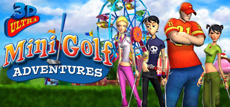

**Platforms:** Windows &nbsp;|&nbsp; **Genre:** Sports &nbsp;|&nbsp; **Released:** December 20

> Whether you're a seasoned player or just a beginner, get ready to tee off for a quick and fun match with four animated stylish characters. Putt your way through 36 fun-filled holes of minigolf on 3D designed courses with elevated greens, bunkers, bridges and water hazards, among other crazy obstacles.
>
> _Synopsis source: Steam_

[Wikipedia](https://en.wikipedia.org/wiki/3D_Ultra_Minigolf_Adventures) · [Steam](https://store.steampowered.com/app/10140)

---

### 3rd World Farmer

**Genre:** Business, Serious game &nbsp;|&nbsp; **Released:** May 9, 2006

[Wikipedia](https://en.wikipedia.org/wiki/3rd_World_Farmer)

---

### A Kiss for the Petals

**Platforms:** Windows, Linux, macOS, iOS, Nintendo DS, PlayStation Portable &nbsp;|&nbsp; **Developer:** Fuguriya &nbsp;|&nbsp; **Publisher:** MangaGamer, St. Michael Girls' School, Yurin Yurin &nbsp;|&nbsp; **Genre:** Visual novel

[Wikipedia](https://en.wikipedia.org/wiki/A_Kiss_for_the_Petals)

---

### Ace Combat X: Skies of Deception

**Platforms:** PlayStation Portable &nbsp;|&nbsp; **Developer:** Namco Bandai Games, Access Games &nbsp;|&nbsp; **Publisher:** Namco Bandai Games, Sony Computer Entertainment &nbsp;|&nbsp; **Genre:** Air combat simulation &nbsp;|&nbsp; **Released:** October 23, 2006

[Wikipedia](https://en.wikipedia.org/wiki/Ace_Combat_X:_Skies_of_Deception)

---

### Ace Combat Zero: The Belkan War

**Platforms:** PlayStation 2 &nbsp;|&nbsp; **Released:** April 25

---

### Ace Online

**Platforms:** Windows &nbsp;|&nbsp; **Developer:** Maiet Entertainment &nbsp;|&nbsp; **Publisher:** YD Online Corp., MasangSoft Inc., Suba Games, LLC, Axeso5 &nbsp;|&nbsp; **Genre:** MMO 3D Space Shooter &nbsp;|&nbsp; **Released:** May 26, 2006

[Wikipedia](https://en.wikipedia.org/wiki/Ace_Online)

---

### Act of War: High Treason

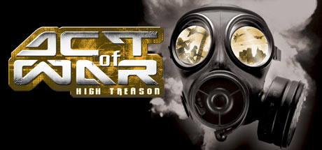

**Platforms:** Windows &nbsp;|&nbsp; **Genre:** Action &nbsp;|&nbsp; **Released:** March 26

> The highly anticipated sequel to the critically acclaimed game Act of War: Direct Action picks up where the techno-thriller left off. On the eve of the U.S. Presidential elections, simultaneous terrorist attacks hit both candidates. Clues point to corrupt elements within the U.S.
>
> _Synopsis source: Steam_

[Steam](https://store.steampowered.com/app/9760)

---

### AFL Premiership 2006 (AUS)

**Platforms:** PlayStation 2 &nbsp;|&nbsp; **Released:** July 20

[Wikipedia](https://en.wikipedia.org/wiki/AFL_Premiership_2006)

---

### After Burner: Climax

**Platforms:** Arcade &nbsp;|&nbsp; **Developer:** Sega AM2 &nbsp;|&nbsp; **Publisher:** Sega &nbsp;|&nbsp; **Genre:** Combat flight simulation &nbsp;|&nbsp; **Released:** October 19, 2006

[Wikipedia](https://en.wikipedia.org/wiki/After_Burner:_Climax)

---

### Agatha Christie: Murder on the Orient Express

**Platforms:** Windows &nbsp;|&nbsp; **Developer:** AWE Productions &nbsp;|&nbsp; **Publisher:** The Adventure Company &nbsp;|&nbsp; **Genre:** Adventure &nbsp;|&nbsp; **Released:** November 14, 2006

[Wikipedia](https://en.wikipedia.org/wiki/Agatha_Christie:_Murder_on_the_Orient_Express)

---

### Age of Empires III: The War Chiefs

**Platforms:** Windows &nbsp;|&nbsp; **Released:** October 17

---

### Age of Empires: The Age of Kings

**Platforms:** Nintendo DS &nbsp;|&nbsp; **Released:** February 14

---

### Age of Pirates: Caribbean Tales

**Platforms:** Windows &nbsp;|&nbsp; **Developer:** Akella &nbsp;|&nbsp; **Publisher:** 1C Company, Playlogic &nbsp;|&nbsp; **Genre:** Role-playing &nbsp;|&nbsp; **Released:** September 12, 2006

[Wikipedia](https://en.wikipedia.org/wiki/Age_of_Pirates:_Caribbean_Tales)

---

### Air Assault Task Force

**Platforms:** Windows &nbsp;|&nbsp; **Developer:** ProSIM Company &nbsp;|&nbsp; **Publisher:** Shrapnel Games &nbsp;|&nbsp; **Genre:** Wargame &nbsp;|&nbsp; **Released:** November 17, 2006

[Wikipedia](https://en.wikipedia.org/wiki/Air_Assault_Task_Force)

---

### Air Conflicts

**Platforms:** Windows &nbsp;|&nbsp; **Developer:** 3Division Entertainment &nbsp;|&nbsp; **Publisher:** Frogster Interactive &nbsp;|&nbsp; **Genre:** Combat flight simulation &nbsp;|&nbsp; **Released:** April 2006

[Wikipedia](https://en.wikipedia.org/wiki/Air_Conflicts)

---

### Al Emmo and the Lost Dutchman's Mine

**Platforms:** Windows, Linux &nbsp;|&nbsp; **Developer:** Himalaya Studios &nbsp;|&nbsp; **Publisher:** Himalaya Studios &nbsp;|&nbsp; **Genre:** Adventure &nbsp;|&nbsp; **Released:** September 5, 2006

[Wikipedia](https://en.wikipedia.org/wiki/Al_Emmo_and_the_Lost_Dutchman's_Mine)

---

### Alex Rider: Stormbreaker

**Platforms:** Windows, GameCube, PlayStation 2, Xbox, Xbox 360, Game Boy Advance, Nintendo DS, PlayStation Portable &nbsp;|&nbsp; **Released:** September 25

---

### Alien Crush

**Platforms:** Wii &nbsp;|&nbsp; **Released:** December 11

[Wikipedia](https://en.wikipedia.org/wiki/Alien_Crush)

---

### Alien Shooter: Vengeance

**Platforms:** Windows &nbsp;|&nbsp; **Developer:** Sigma Team &nbsp;|&nbsp; **Publisher:** Sigma Team, Virtual Programming &nbsp;|&nbsp; **Genre:** Top-down shooter &nbsp;|&nbsp; **Released:** September 7, 2006

[Wikipedia](https://en.wikipedia.org/wiki/Alien_Shooter:_Vengeance)

---

### Aliens: Extermination

[Wikipedia](https://en.wikipedia.org/wiki/Aliens:_Extermination)

---

### Altered Beast (Genesis)

**Platforms:** Wii &nbsp;|&nbsp; **Released:** November 19

[Wikipedia](https://en.wikipedia.org/wiki/Altered_Beast)

---

### American Dragon: Jake Long – Attack of the Dark Dragon

**Platforms:** Nintendo DS &nbsp;|&nbsp; **Released:** October 12

---

### American Dragon: Jake Long – Rise of the Huntsclan

**Platforms:** Game Boy Advance &nbsp;|&nbsp; **Released:** October 12

---

### AMF Xtreme Bowling 2006

**Platforms:** PlayStation 2, Xbox &nbsp;|&nbsp; **Developer:** Atomic Planet Entertainment &nbsp;|&nbsp; **Publisher:** Mud Duck Productions, Blast Entertainment &nbsp;|&nbsp; **Genre:** Sports &nbsp;|&nbsp; **Released:** June 13, 2006

[Wikipedia](https://en.wikipedia.org/wiki/AMF_Xtreme_Bowling_2006)

---

### Ancient Wars: Sparta

**Platforms:** Windows &nbsp;|&nbsp; **Developer:** World Forge &nbsp;|&nbsp; **Publisher:** Playlogic &nbsp;|&nbsp; **Genre:** Real-time strategy &nbsp;|&nbsp; **Released:** December 8, 2006

[Wikipedia](https://en.wikipedia.org/wiki/Ancient_Wars:_Sparta)

---

### AND 1 Streetball

**Platforms:** PlayStation 2, Xbox &nbsp;|&nbsp; **Released:** June 6

[Wikipedia](https://en.wikipedia.org/wiki/AND_1_Streetball)

---

### Angels Online

**Platforms:** Windows &nbsp;|&nbsp; **Developer:** UserJoy Technology &nbsp;|&nbsp; **Publisher:** Q Entertainment &nbsp;|&nbsp; **Genre:** MMORPG &nbsp;|&nbsp; **Released:** June 2006

[Wikipedia](https://en.wikipedia.org/wiki/Angels_Online)

---

### Animal Crossing: Wild World

**Platforms:** Nintendo DS &nbsp;|&nbsp; **Released:** March 31 (EU)

---

### Ankh: Heart of Osiris

**Platforms:** Linux, macOS, Windows &nbsp;|&nbsp; **Developer:** Deck13 Interactive &nbsp;|&nbsp; **Publisher:** Xider &nbsp;|&nbsp; **Genre:** Third-person adventure &nbsp;|&nbsp; **Released:** October 30, 2006

[Wikipedia](https://en.wikipedia.org/wiki/Ankh:_Heart_of_Osiris)

---

### Anno 1701

**Platforms:** Windows &nbsp;|&nbsp; **Developer:** Related Designs &nbsp;|&nbsp; **Publisher:** Sunflowers Interactive, Deep Silver, Ubisoft &nbsp;|&nbsp; **Genre:** Real-time strategy, city-building game &nbsp;|&nbsp; **Released:** October 26, 2006

[Wikipedia](https://en.wikipedia.org/wiki/Anno_1701)

---

### Another Century's Episode 2

**Platforms:** PlayStation 2 &nbsp;|&nbsp; **Developer:** From Software &nbsp;|&nbsp; **Publisher:** Banpresto &nbsp;|&nbsp; **Genre:** Action &nbsp;|&nbsp; **Released:** March 30, 2006

[Wikipedia](https://en.wikipedia.org/wiki/Another_Century's_Episode_2)

---

### Ape Escape 3

**Platforms:** PlayStation 2 &nbsp;|&nbsp; **Released:** January 17

[Wikipedia](https://en.wikipedia.org/wiki/Ape_Escape_3)

---

### Ape Escape: Million Monkeys

**Platforms:** PlayStation 2 &nbsp;|&nbsp; **Released:** December 29

---

### Aquastax

**Platforms:** Mobile phone &nbsp;|&nbsp; **Developer:** InfoSpace, IOMO &nbsp;|&nbsp; **Publisher:** InfoSpace &nbsp;|&nbsp; **Genre:** Platform game

[Wikipedia](https://en.wikipedia.org/wiki/Aquastax)

---

### Arabians Lost: The Engagement on Desert

**Platforms:** Windows &nbsp;|&nbsp; **Developer:** QuinRose &nbsp;|&nbsp; **Publisher:** QuinRose & Prototype &nbsp;|&nbsp; **Genre:** Role-playing video game, visual novel &nbsp;|&nbsp; **Released:** August 8, 2006

[Wikipedia](https://en.wikipedia.org/wiki/Arabians_Lost:_The_Engagement_on_Desert)

---

### Arcana Heart

**Platforms:** Arcade &nbsp;|&nbsp; **Developer:** Yuki Enterprise &nbsp;|&nbsp; **Publisher:** Atrativa Japan, Examu, AQ Interactive, Atlus &nbsp;|&nbsp; **Genre:** Fighting &nbsp;|&nbsp; **Released:** December 22, 2006

[Wikipedia](https://en.wikipedia.org/wiki/Arcana_Heart_(video_game))

---

### Arena Football

**Platforms:** PlayStation 2, Xbox &nbsp;|&nbsp; **Developer:** EA Tiburon &nbsp;|&nbsp; **Publisher:** EA Sports &nbsp;|&nbsp; **Genre:** Sports &nbsp;|&nbsp; **Released:** February 7, 2006

[Wikipedia](https://en.wikipedia.org/wiki/Arena_Football_(2006_video_game))

---

### Arma: Armed Assault

**Platforms:** Windows &nbsp;|&nbsp; **Developer:** Bohemia Interactive &nbsp;|&nbsp; **Publisher:** 505 Games, Atari &nbsp;|&nbsp; **Genre:** Tactical shooter &nbsp;|&nbsp; **Released:** November 10, 2006

[Wikipedia](https://en.wikipedia.org/wiki/Arma:_Armed_Assault)

---

### Armadillo Run

**Platforms:** Windows &nbsp;|&nbsp; **Publisher:** Peter Stock &nbsp;|&nbsp; **Released:** April 22, 2006

[Wikipedia](https://en.wikipedia.org/wiki/Armadillo_Run)

---

### Armored Core: Last Raven (USA)

**Platforms:** PlayStation 2 &nbsp;|&nbsp; **Released:** June 13

---

### Army Men: Major Malfunction

**Platforms:** Xbox, PlayStation 2 &nbsp;|&nbsp; **Developer:** Team17 &nbsp;|&nbsp; **Publisher:** Global Star Software &nbsp;|&nbsp; **Genre:** Third-person shooter &nbsp;|&nbsp; **Released:** April 11, 2006

[Wikipedia](https://en.wikipedia.org/wiki/Army_Men:_Major_Malfunction)

---

### Asphalt 3: Street Rules

**Platforms:** Mobile phone, Windows Mobile &nbsp;|&nbsp; **Developer:** Gameloft Shanghai &nbsp;|&nbsp; **Publisher:** Gameloft &nbsp;|&nbsp; **Genre:** Racing &nbsp;|&nbsp; **Released:** October 2006

[Wikipedia](https://en.wikipedia.org/wiki/Asphalt_3:_Street_Rules)

---

### Assault Heroes

**Platforms:** Xbox 360 &nbsp;|&nbsp; **Developer:** Wanako Games &nbsp;|&nbsp; **Publisher:** Vivendi Games, Konami &nbsp;|&nbsp; **Genre:** Top-down shooter &nbsp;|&nbsp; **Released:** December 13, 2006

[Wikipedia](https://en.wikipedia.org/wiki/Assault_Heroes)

---

### Astonishia Story

**Platforms:** PlayStation Portable &nbsp;|&nbsp; **Released:** June 27

[Wikipedia](https://en.wikipedia.org/wiki/Astonishia_Story)

---

### Atelier Iris 2: The Azoth of Destiny

**Platforms:** PlayStation 2 &nbsp;|&nbsp; **Released:** April 25

---

### Atlantis Sky Patrol

**Platforms:** Windows, macOS, iOS &nbsp;|&nbsp; **Developer:** Big Fish Studios &nbsp;|&nbsp; **Publisher:** Big Fish Games &nbsp;|&nbsp; **Genre:** Puzzle &nbsp;|&nbsp; **Released:** August 2006

[Wikipedia](https://en.wikipedia.org/wiki/Atlantis_Sky_Patrol)

---

### ATV Offroad Fury 4

**Platforms:** PlayStation 2 &nbsp;|&nbsp; **Released:** October 31

[Wikipedia](https://en.wikipedia.org/wiki/ATV_Offroad_Fury_4)

---

### ATV Offroad Fury Pro

**Platforms:** PlayStation Portable &nbsp;|&nbsp; **Released:** October 26

[Wikipedia](https://en.wikipedia.org/wiki/ATV_Offroad_Fury_Pro)

---

### ATV: Thunder Ridge Riders

**Platforms:** Game Boy Advance &nbsp;|&nbsp; **Developer:** Skyworks Technologies, Apex Design, Skyworks Interactive &nbsp;|&nbsp; **Publisher:** DSI Games, Zoo Digital Publishing &nbsp;|&nbsp; **Genre:** Racing &nbsp;|&nbsp; **Released:** September 1, 2006

[Wikipedia](https://en.wikipedia.org/wiki/ATV:_Thunder_Ridge_Riders)

---

### Auto Assault

**Platforms:** Windows &nbsp;|&nbsp; **Released:** April 13

[Wikipedia](https://en.wikipedia.org/wiki/Auto_Assault)

---

### Avatar: The Last Airbender

**Platforms:** Wii &nbsp;|&nbsp; **Released:** November 19

---

### Babar to the Rescue

**Platforms:** Game Boy Advance &nbsp;|&nbsp; **Released:** June 28

---

### Back to Stone

**Platforms:** Game Boy Advance &nbsp;|&nbsp; **Developer:** Hidden Floor &nbsp;|&nbsp; **Publisher:** Neko Entertainment / Big Ben Interactive, Graffiti Entertainment / O~3 Entertainment &nbsp;|&nbsp; **Genre:** Action role-playing &nbsp;|&nbsp; **Released:** December 14, 2006

[Wikipedia](https://en.wikipedia.org/wiki/Back_to_Stone)

---

### Bad Day L.A.

**Platforms:** Windows &nbsp;|&nbsp; **Released:** September 6

[Wikipedia](https://en.wikipedia.org/wiki/Bad_Day_L.A.)

---

### Bang! Howdy

**Platforms:** Windows, Linux, macOS &nbsp;|&nbsp; **Developer:** Three Rings Design &nbsp;|&nbsp; **Publisher:** Three Rings Design &nbsp;|&nbsp; **Genre:** Strategy, Western &nbsp;|&nbsp; **Released:** December 1, 2006

[Wikipedia](https://en.wikipedia.org/wiki/Bang!_Howdy)

---

### Barnyard

**Platforms:** Windows, PlayStation 2, GameCube, Game Boy Advance, Wii &nbsp;|&nbsp; **Released:** August 1 (NA/AU/PAL)

[Wikipedia](https://en.wikipedia.org/wiki/Barnyard_(video_game))

---

### Barrow Hill: Curse of the Ancient Circle

**Platforms:** Windows &nbsp;|&nbsp; **Developer:** Shadow Tor Studios &nbsp;|&nbsp; **Publisher:** Shadow Tor Studios, Got Game Entertainment, Lighthouse Interactive &nbsp;|&nbsp; **Genre:** Adventure &nbsp;|&nbsp; **Released:** April 24, 2006

[Wikipedia](https://en.wikipedia.org/wiki/Barrow_Hill:_Curse_of_the_Ancient_Circle)

---

### Bass Pro Shops Trophy Hunter 2007

**Platforms:** Xbox, Windows &nbsp;|&nbsp; **Developer:** Jarhead Games &nbsp;|&nbsp; **Publisher:** Vivendi Universal Games &nbsp;|&nbsp; **Released:** November 20, 2006

[Wikipedia](https://en.wikipedia.org/wiki/Bass_Pro_Shops_Trophy_Hunter_2007)

---

### Baten Kaitos Origins

**Platforms:** GameCube &nbsp;|&nbsp; **Released:** September 25 (NA)

[Wikipedia](https://en.wikipedia.org/wiki/Baten_Kaitos_Origins)

---

### Battle Stadium D.O.N

**Platforms:** GameCube, PlayStation 2 &nbsp;|&nbsp; **Developer:** Eighting, Q Entertainment &nbsp;|&nbsp; **Publisher:** Namco Bandai Games &nbsp;|&nbsp; **Genre:** Fighting &nbsp;|&nbsp; **Released:** July 20, 2006

[Wikipedia](https://en.wikipedia.org/wiki/Battle_Stadium_D.O.N)

---

### Battlefield 2142

**Platforms:** Windows &nbsp;|&nbsp; **Released:** October 17

[Wikipedia](https://en.wikipedia.org/wiki/Battlefield_2142)

---

### Battlefield 2: Armored Fury

**Platforms:** Windows &nbsp;|&nbsp; **Released:** June 6

---

### Battlefield 2: Euro Force

**Platforms:** Windows &nbsp;|&nbsp; **Released:** March 15

---

### Battlefield 2: Modern Combat

**Platforms:** Xbox 360 &nbsp;|&nbsp; **Released:** April 11

---

### Battleship/Connect Four/Sorry!/Trouble

**Platforms:** Nintendo DS &nbsp;|&nbsp; **Developer:** Gravity-I &nbsp;|&nbsp; **Publisher:** DSI Games &nbsp;|&nbsp; **Genre:** Puzzle game, Traditional game &nbsp;|&nbsp; **Released:** August 17, 2006

[Wikipedia](https://en.wikipedia.org/wiki/Battleship/Connect_Four/Sorry!/Trouble)

---

### Beatmania

**Platforms:** PlayStation 2 &nbsp;|&nbsp; **Developer:** Konami &nbsp;|&nbsp; **Publisher:** Konami of America, Inc &nbsp;|&nbsp; **Genre:** Music game &nbsp;|&nbsp; **Released:** March 28, 2006

[Wikipedia](https://en.wikipedia.org/wiki/Beatmania_(2006_video_game))

---

### Beggar Prince

**Platforms:** Genesis / Mega Drive, Windows &nbsp;|&nbsp; **Developer:** C&E Inc. &nbsp;|&nbsp; **Publisher:** C&E Inc., Super Fighter Team &nbsp;|&nbsp; **Genre:** Role-playing video game

[Wikipedia](https://en.wikipedia.org/wiki/Beggar_Prince)

---

### Belief & Betrayal

**Platforms:** Windows &nbsp;|&nbsp; **Developer:** Artematica &nbsp;|&nbsp; **Publisher:** Artematica, DTP Entertainment, Micro Application, S.A., Lighthouse Interactive &nbsp;|&nbsp; **Genre:** Graphic adventure game &nbsp;|&nbsp; **Released:** November 2006

[Wikipedia](https://en.wikipedia.org/wiki/Belief_&_Betrayal)

---

### Ben Jordan: Paranormal Investigator

**Platforms:** Windows &nbsp;|&nbsp; **Developer:** Grundislav Games &nbsp;|&nbsp; **Publisher:** Grundislav Games &nbsp;|&nbsp; **Genre:** Point-and-click adventure &nbsp;|&nbsp; **Released:** February 2, 2006

[Wikipedia](https://en.wikipedia.org/wiki/Ben_Jordan:_Paranormal_Investigator)

---

### Big Bumpin'

**Platforms:** Xbox, Xbox 360 &nbsp;|&nbsp; **Developer:** Blitz Games &nbsp;|&nbsp; **Publisher:** King Games &nbsp;|&nbsp; **Genre:** Racing, action &nbsp;|&nbsp; **Released:** November 19, 2006

[Wikipedia](https://en.wikipedia.org/wiki/Big_Bumpin')

---

### Biker Mice from Mars

**Platforms:** PlayStation 2 &nbsp;|&nbsp; **Developer:** Creat Studios, Full Fat &nbsp;|&nbsp; **Publisher:** The Game Factory &nbsp;|&nbsp; **Genre:** Racing &nbsp;|&nbsp; **Released:** November 17, 2006

[Wikipedia](https://en.wikipedia.org/wiki/Biker_Mice_from_Mars_(2006_video_game))

---

### Bionicle Heroes

**Platforms:** Windows, GameCube, PlayStation 2, Xbox 360, Game Boy Advance, Nintendo DS &nbsp;|&nbsp; **Released:** November 14

[Wikipedia](https://en.wikipedia.org/wiki/Bionicle_Heroes)

---

### Birth of America

**Platforms:** Windows &nbsp;|&nbsp; **Developer:** SEP BOA &nbsp;|&nbsp; **Publisher:** AGEOD &nbsp;|&nbsp; **Genre:** Wargame &nbsp;|&nbsp; **Released:** February 24, 2006

[Wikipedia](https://en.wikipedia.org/wiki/Birth_of_America)

---

### Black

**Platforms:** PlayStation 2, Xbox &nbsp;|&nbsp; **Released:** February 28

[Wikipedia](https://en.wikipedia.org/wiki/Black_(video_game))

---

### Black & White 2: Battle of the Gods

**Platforms:** Windows &nbsp;|&nbsp; **Released:** April 24

[Wikipedia](https://en.wikipedia.org/wiki/Black_%26_White_2)

---

### Blade Dancer: Lineage of Light

**Platforms:** PlayStation Portable &nbsp;|&nbsp; **Released:** July 18

---

### Blades of Thunder II

**Platforms:** Nintendo DS &nbsp;|&nbsp; **Released:** April 18

[Wikipedia](https://en.wikipedia.org/wiki/Blades_of_Thunder_II)

---

### Blast Factor

**Platforms:** PlayStation Network &nbsp;|&nbsp; **Released:** November 17

[Wikipedia](https://en.wikipedia.org/wiki/Blast_Factor)

---

### Blazing Angels: Squadrons of WWII

**Platforms:** Xbox, Xbox 360, Windows, PlayStation 3 &nbsp;|&nbsp; **Released:** March 23

---

### Blazing Souls

**Platforms:** PlayStation 2 &nbsp;|&nbsp; **Developer:** Idea Factory, HyperDevbox Japan &nbsp;|&nbsp; **Publisher:** Idea Factory, Aksys Games, Rising Star Games, HyperDevbox Japan &nbsp;|&nbsp; **Genre:** Tactical role-playing &nbsp;|&nbsp; **Released:** January 17, 2006

[Wikipedia](https://en.wikipedia.org/wiki/Blazing_Souls)

---

### Bliss Island

**Platforms:** Windows, PlayStation Portable &nbsp;|&nbsp; **Developer:** PomPom Games &nbsp;|&nbsp; **Publisher:** Codemasters &nbsp;|&nbsp; **Genre:** Puzzle &nbsp;|&nbsp; **Released:** May 30, 2006

[Wikipedia](https://en.wikipedia.org/wiki/Bliss_Island)

---

### Blood Wars

**Platforms:** Browser &nbsp;|&nbsp; **Developer:** BW Team &nbsp;|&nbsp; **Genre:** MMORPG text-based

[Wikipedia](https://en.wikipedia.org/wiki/Blood_Wars_(video_game))

---

### Blood+

[Wikipedia](https://en.wikipedia.org/wiki/Blood+)

---

### Blufr

**Platforms:** Browser &nbsp;|&nbsp; **Developer:** blufr.com &nbsp;|&nbsp; **Publisher:** blufr.com &nbsp;|&nbsp; **Genre:** Trivia &nbsp;|&nbsp; **Released:** July 2, 2006

[Wikipedia](https://en.wikipedia.org/wiki/Blufr)

---

### Bomberman '93

**Platforms:** Wii &nbsp;|&nbsp; **Released:** November 21

[Wikipedia](https://en.wikipedia.org/wiki/Bomberman_%2793)

---

### Bomberman Land Touch!

**Platforms:** Nintendo DS &nbsp;|&nbsp; **Released:** November 8

[Wikipedia](https://en.wikipedia.org/wiki/Bomberman_Land_Touch!)

---

### Bomberman PSP

**Platforms:** PlayStation Portable &nbsp;|&nbsp; **Released:** September 12

[Wikipedia](https://en.wikipedia.org/wiki/Bomberman_PSP)

---

### Bomberman: Act Zero

**Platforms:** Xbox 360 &nbsp;|&nbsp; **Released:** August 29

---

### Bone: The Great Cow Race

**Platforms:** Windows &nbsp;|&nbsp; **Developer:** Telltale Games &nbsp;|&nbsp; **Publisher:** Telltale Games &nbsp;|&nbsp; **Genre:** Adventure &nbsp;|&nbsp; **Released:** April 12, 2006

[Wikipedia](https://en.wikipedia.org/wiki/Bone:_The_Great_Cow_Race)

---

### Bonk's Adventure (TurboGrafx-16)

**Platforms:** Wii &nbsp;|&nbsp; **Released:** November 21

[Wikipedia](https://en.wikipedia.org/wiki/Bonk%27s_Adventure)

---

### Bookworm Adventures

**Platforms:** Windows &nbsp;|&nbsp; **Developer:** PopCap Games &nbsp;|&nbsp; **Publisher:** PopCap Games &nbsp;|&nbsp; **Genre:** Puzzle &nbsp;|&nbsp; **Released:** November 28, 2006

[Wikipedia](https://en.wikipedia.org/wiki/Bookworm_Adventures)

---

### Bots!!

**Platforms:** Windows &nbsp;|&nbsp; **Developer:** N-Log Soft &nbsp;|&nbsp; **Publisher:** Acclaim Games &nbsp;|&nbsp; **Genre:** MMO, Fighting &nbsp;|&nbsp; **Released:** November 2006

[Wikipedia](https://en.wikipedia.org/wiki/Bots!!)

---

### Bounty Hounds

**Platforms:** PlayStation Portable &nbsp;|&nbsp; **Developer:** XPEC Entertainment &nbsp;|&nbsp; **Publisher:** Namco &nbsp;|&nbsp; **Genre:** Action role-playing &nbsp;|&nbsp; **Released:** September 12, 2006

[Wikipedia](https://en.wikipedia.org/wiki/Bounty_Hounds)

---

### Boxer's Road 2: The Real

**Platforms:** PlayStation Portable &nbsp;|&nbsp; **Developer:** Grand Prix &nbsp;|&nbsp; **Publisher:** Ertain Corporation &nbsp;|&nbsp; **Genre:** Fighting, sports &nbsp;|&nbsp; **Released:** September 28, 2006

[Wikipedia](https://en.wikipedia.org/wiki/Boxer's_Road_2:_The_Real)

---

### Brain Age: Train Your Brain in Minutes a Day

**Platforms:** Nintendo DS &nbsp;|&nbsp; **Released:** April 17

---

### Brain Boost: Gamma Wave

**Platforms:** Nintendo DS &nbsp;|&nbsp; **Released:** November 17

---

### Brain Buster Puzzle Pak

**Platforms:** Nintendo DS &nbsp;|&nbsp; **Developer:** Nikoli &nbsp;|&nbsp; **Publisher:** Agetec, Jaleco, 505 Games &nbsp;|&nbsp; **Genre:** Puzzle game &nbsp;|&nbsp; **Released:** September 28, 2006

[Wikipedia](https://en.wikipedia.org/wiki/Brain_Buster_Puzzle_Pak)

---

### Brave Story: New Traveler

**Platforms:** PlayStation Portable &nbsp;|&nbsp; **Developer:** Game Republic &nbsp;|&nbsp; **Publisher:** Sony Computer Entertainment, Xseed Games &nbsp;|&nbsp; **Genre:** Role-playing &nbsp;|&nbsp; **Released:** July 4, 2006

[Wikipedia](https://en.wikipedia.org/wiki/Brave_Story:_New_Traveler)

---

### Break 'Em All

**Platforms:** Nintendo DS &nbsp;|&nbsp; **Released:** June 20

[Wikipedia](https://en.wikipedia.org/wiki/Break_%27Em_All)

---

### Broken Sword: The Angel of Death

**Platforms:** Windows &nbsp;|&nbsp; **Released:** September 15 (EU)

---

### Brothers in Arms: D-Day

**Platforms:** PlayStation Portable &nbsp;|&nbsp; **Developer:** Gearbox Software, Ubisoft Shanghai &nbsp;|&nbsp; **Publisher:** Ubisoft &nbsp;|&nbsp; **Genre:** First-person shooter &nbsp;|&nbsp; **Released:** December 5, 2006

[Wikipedia](https://en.wikipedia.org/wiki/Brothers_in_Arms:_D-Day)

---

### Bubble Bobble Evolution

**Platforms:** PlayStation Portable &nbsp;|&nbsp; **Released:** December 19

[Wikipedia](https://en.wikipedia.org/wiki/Bubble_Bobble_Evolution)

---

### Buku Sudoku

**Platforms:** Windows &nbsp;|&nbsp; **Developer:** Absolutist &nbsp;|&nbsp; **Publisher:** Merscom &nbsp;|&nbsp; **Genre:** Puzzle

[Wikipedia](https://en.wikipedia.org/wiki/Buku_Sudoku)

---

### Bully

**Platforms:** PlayStation 2 &nbsp;|&nbsp; **Released:** October 17

[Wikipedia](https://en.wikipedia.org/wiki/Bully_(video_game))

---

### Burnout Revenge

**Platforms:** Xbox 360 &nbsp;|&nbsp; **Publisher:** Electronic Arts &nbsp;|&nbsp; **Released:** March 7, 2006

[Wikipedia](https://en.wikipedia.org/wiki/Burnout_Revenge)

---

### Bust-a-Move Deluxe

**Platforms:** PlayStation Portable &nbsp;|&nbsp; **Released:** April 4

[Wikipedia](https://en.wikipedia.org/wiki/Puzzle_Bobble#Game_series)

---

### Buzz! Junior: Jungle Party

**Platforms:** PlayStation 2 &nbsp;|&nbsp; **Developer:** Magenta Software, Cohort Studios &nbsp;|&nbsp; **Publisher:** Sony Computer Entertainment &nbsp;|&nbsp; **Genre:** Party &nbsp;|&nbsp; **Released:** October 20, 2006

[Wikipedia](https://en.wikipedia.org/wiki/Buzz!_Junior:_Jungle_Party)

---

### Buzz!: The BIG Quiz

**Platforms:** PlayStation 2 &nbsp;|&nbsp; **Developer:** Relentless Software &nbsp;|&nbsp; **Publisher:** Sony Computer Entertainment &nbsp;|&nbsp; **Genre:** Party, quiz &nbsp;|&nbsp; **Released:** March 17, 2006

[Wikipedia](https://en.wikipedia.org/wiki/Buzz!:_The_BIG_Quiz)

---

### Buzz!: The Sports Quiz

**Platforms:** PlayStation 2 &nbsp;|&nbsp; **Developer:** Kuju Entertainment &nbsp;|&nbsp; **Publisher:** Sony Computer Entertainment &nbsp;|&nbsp; **Genre:** Party &nbsp;|&nbsp; **Released:** November 10, 2006

[Wikipedia](https://en.wikipedia.org/wiki/Buzz!:_The_Sports_Quiz)

---

### C-evo

[Wikipedia](https://en.wikipedia.org/wiki/C-evo)

---

### Cabela's African Safari

**Platforms:** PlayStation 2, PlayStation Portable, Windows, Xbox 360 &nbsp;|&nbsp; **Developer:** Sand Grain Studios, Magic Wand Productions, Fun Labs &nbsp;|&nbsp; **Publisher:** Activision Value &nbsp;|&nbsp; **Genre:** Sports &nbsp;|&nbsp; **Released:** October 17, 2006

[Wikipedia](https://en.wikipedia.org/wiki/Cabela's_African_Safari)

---

### Cabela's Alaskan Adventures

**Platforms:** PlayStation 2, Xbox 360, Windows &nbsp;|&nbsp; **Developer:** Sand Grain Studios, Magic Wand Productions, Fun Labs &nbsp;|&nbsp; **Publisher:** Activision &nbsp;|&nbsp; **Genre:** Sports &nbsp;|&nbsp; **Released:** September 19, 2006

[Wikipedia](https://en.wikipedia.org/wiki/Cabela's_Alaskan_Adventures)

---

### Cabela's Dangerous Hunts: Ultimate Challenge

**Platforms:** PlayStation Portable &nbsp;|&nbsp; **Developer:** Sand Grain Studios, Fun Labs &nbsp;|&nbsp; **Publisher:** Activision &nbsp;|&nbsp; **Genre:** Sports &nbsp;|&nbsp; **Released:** April 4, 2006

[Wikipedia](https://en.wikipedia.org/wiki/Cabela's_Dangerous_Hunts:_Ultimate_Challenge)

---

### Caesar IV

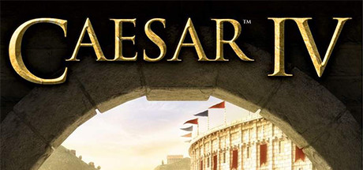

**Platforms:** Windows &nbsp;|&nbsp; **Genre:** Simulation, Strategy &nbsp;|&nbsp; **Released:** September 26

> Starting as governor of a newly formed province in the Roman Empire your goal is simple: advance up the empire's political ladder to become the next Caesar.
>
> _Synopsis source: Steam_

[Wikipedia](https://en.wikipedia.org/wiki/Caesar_IV) · [Steam](https://store.steampowered.com/app/517810)

---

### Cake Mania

**Platforms:** Windows, Browser, Mobile phone &nbsp;|&nbsp; **Developer:** Sandlot Games, Digital Embryo, Astraware, Red Marble Games &nbsp;|&nbsp; **Publisher:** Sandlot Games, Majesco, Eidos Interactive, Mr.Goodliving Studios &nbsp;|&nbsp; **Genre:** Strategy &nbsp;|&nbsp; **Released:** October 11, 2006

[Wikipedia](https://en.wikipedia.org/wiki/Cake_Mania)

---

### Call of Cthulhu: Dark Corners of the Earth

**Platforms:** Windows &nbsp;|&nbsp; **Released:** March 17 (EU)

---

### Call of Duty 3

**Platforms:** Xbox, Xbox 360, PlayStation 3, PlayStation 2 &nbsp;|&nbsp; **Released:** November 10 (EU/AU)

---

### Call of Duty 3 (USA)

**Platforms:** PlayStation 2, Xbox, Xbox 360, Wii &nbsp;|&nbsp; **Released:** November 7

[Wikipedia](https://en.wikipedia.org/wiki/Call_of_Duty_3)

---

### Call of Juarez

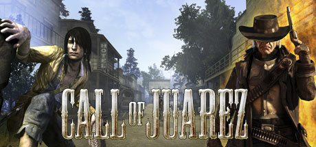

**Platforms:** Windows &nbsp;|&nbsp; **Genre:** Action &nbsp;|&nbsp; **Released:** September 5

> Call of Juarez is an epic adventure western themed FPS game. The player alternately assumes the roles of two distinct, antagonistic characters: a sneaking fugitive Billy and his hunter the reverend Ray.
>
> _Synopsis source: Steam_

[Wikipedia](https://en.wikipedia.org/wiki/Call_of_Juarez_(video_game)) · [Steam](https://store.steampowered.com/app/3020)

---

### Cars

**Platforms:** Windows, PlayStation 2, Xbox, GameCube, Game Boy Advance, Nintendo DS, PlayStation Portable, Xbox 360, Wii &nbsp;|&nbsp; **Released:** June 8 (AU/EU)

---

### Cars (USA)

**Platforms:** Windows, PlayStation 2, Xbox, GameCube, Game Boy Advance, Nintendo DS, PlayStation Portable, Xbox 360, Wii &nbsp;|&nbsp; **Released:** June 6

[Wikipedia](https://en.wikipedia.org/wiki/Cars_(video_game))

---

### Cars: Radiator Springs Adventures

**Platforms:** Windows, macOS &nbsp;|&nbsp; **Developer:** AWE Games &nbsp;|&nbsp; **Publisher:** THQ &nbsp;|&nbsp; **Genre:** Adventure, racing &nbsp;|&nbsp; **Released:** June 6, 2006

[Wikipedia](https://en.wikipedia.org/wiki/Cars:_Radiator_Springs_Adventures)

---

### Cartoon Network Racing

**Platforms:** PlayStation 2, Nintendo DS &nbsp;|&nbsp; **Released:** December 4

[Wikipedia](https://en.wikipedia.org/wiki/Cartoon_Network_Racing)

---

### Cash Guns Chaos DLX

**Platforms:** PlayStation 3 &nbsp;|&nbsp; **Released:** November 17

[Wikipedia](https://en.wikipedia.org/wiki/Cash_Guns_Chaos)

---

### Casper and the Ghostly Trio

**Platforms:** PlayStation 2 &nbsp;|&nbsp; **Developer:** Data Design Interactive &nbsp;|&nbsp; **Publisher:** Mastertronic Group &nbsp;|&nbsp; **Genre:** Platformer &nbsp;|&nbsp; **Released:** September 15, 2006

[Wikipedia](https://en.wikipedia.org/wiki/Casper_and_the_Ghostly_Trio_(video_game))

---

### Castle of Shikigami III

**Platforms:** Arcade, Windows &nbsp;|&nbsp; **Developer:** Alfa System, Skonec, Barnhouse Effect, Cosmo Machia &nbsp;|&nbsp; **Publisher:** Taito, Cyberfront Corporation, Arc System Works, Aksys Games &nbsp;|&nbsp; **Genre:** Scrolling shooter &nbsp;|&nbsp; **Released:** February 2006

[Wikipedia](https://en.wikipedia.org/wiki/Castle_of_Shikigami_III)

---

### Castlevania: Portrait of Ruin

**Platforms:** Nintendo DS &nbsp;|&nbsp; **Released:** December 5

---

### Catfishing

**Platforms:** Browser &nbsp;|&nbsp; **Developer:** Kevan Davis, Matthew &nbsp;|&nbsp; **Genre:** Trivia

[Wikipedia](https://en.wikipedia.org/wiki/Catfishing_(video_game))

---

### Catscratch

**Platforms:** Game Boy Advance, Nintendo DS &nbsp;|&nbsp; **Released:** October 31

---

### Championship Manager 2006

**Platforms:** Windows, Xbox, PlayStation 2, PlayStation Portable &nbsp;|&nbsp; **Developer:** Beautiful Game Studios, Gusto Games &nbsp;|&nbsp; **Publisher:** Eidos Interactive &nbsp;|&nbsp; **Genre:** Sports management &nbsp;|&nbsp; **Released:** March 31, 2006

[Wikipedia](https://en.wikipedia.org/wiki/Championship_Manager_2006)

---

### Championship Manager 2007

**Platforms:** Windows &nbsp;|&nbsp; **Developer:** Beautiful Game Studios &nbsp;|&nbsp; **Publisher:** Eidos Interactive, Virtual Programming &nbsp;|&nbsp; **Genre:** Sports management &nbsp;|&nbsp; **Released:** October 13, 2006

[Wikipedia](https://en.wikipedia.org/wiki/Championship_Manager_2007)

---

### Chantelise – A Tale of Two Sisters

**Platforms:** Windows &nbsp;|&nbsp; **Developer:** EasyGameStation &nbsp;|&nbsp; **Publisher:** EasyGameStation, DHM Interactive, Carpe Fulgur &nbsp;|&nbsp; **Genre:** Action RPG

[Wikipedia](https://en.wikipedia.org/wiki/Chantelise_%E2%80%93_A_Tale_of_Two_Sisters)

---

### Chaos Wars

**Platforms:** PlayStation 2 &nbsp;|&nbsp; **Developer:** Idea Factory &nbsp;|&nbsp; **Publisher:** Idea Factory, O~3 Entertainment &nbsp;|&nbsp; **Genre:** Tactical role-playing &nbsp;|&nbsp; **Released:** September 21, 2006

[Wikipedia](https://en.wikipedia.org/wiki/Chaos_Wars)

---

### Charlotte's Web

**Platforms:** Windows, PlayStation 2, Game Boy Advance, Nintendo DS &nbsp;|&nbsp; **Released:** November 14

[Wikipedia](https://en.wikipedia.org/wiki/Charlotte%27s_Web_(video_game))

---

### Chess Titans

[Wikipedia](https://en.wikipedia.org/wiki/Chess_Titans)

---

### Children of Mana

**Platforms:** Nintendo DS &nbsp;|&nbsp; **Developer:** Square Enix, Nex Entertainment &nbsp;|&nbsp; **Publisher:** Square Enix, Nintendo &nbsp;|&nbsp; **Genre:** Action role-playing &nbsp;|&nbsp; **Released:** March 2, 2006

[Wikipedia](https://en.wikipedia.org/wiki/Children_of_Mana)

---

### Chocobo de Mobile

[Wikipedia](https://en.wikipedia.org/wiki/Chocobo_de_Mobile)

---

### Choose Your Own Adventure: The Abominable Snowman

[Wikipedia](https://en.wikipedia.org/wiki/Choose_Your_Own_Adventure:_The_Abominable_Snowman)

---

### Chromehounds

**Platforms:** Xbox 360 &nbsp;|&nbsp; **Released:** July 11

[Wikipedia](https://en.wikipedia.org/wiki/Chromehounds)

---

### City Life

**Platforms:** Windows, Nintendo DS &nbsp;|&nbsp; **Developer:** Monte Cristo, Wizarbox &nbsp;|&nbsp; **Publisher:** Monte Cristo, Deep Silver, CDV &nbsp;|&nbsp; **Genre:** City building games &nbsp;|&nbsp; **Released:** April 14, 2006

[Wikipedia](https://en.wikipedia.org/wiki/City_Life_(video_game))

---

### CivCity: Rome

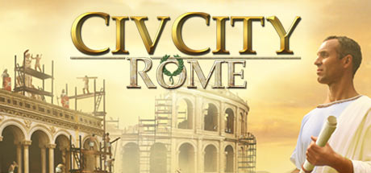

**Platforms:** Windows &nbsp;|&nbsp; **Genre:** Strategy &nbsp;|&nbsp; **Released:** July 24

> CivCity: Rome, an innovative city builder inspired by the world of Sid Meiers Civilization, and created by a collaboration between Firefly Studios and Firaxis Games, invites players to shift focus from building a multi-city empire and zoom-in on the great cities of the Roman Empire, culminating in Rome itself!
>
> _Synopsis source: Steam_

[Steam](https://store.steampowered.com/app/3980)

---

### Civilization IV: Warlords

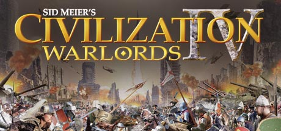

**Platforms:** Windows &nbsp;|&nbsp; **Genre:** Strategy &nbsp;|&nbsp; **Released:** July 24

> Sid Meier's Civilization IV: Warlords is the first expansion pack for the award-winning game that has become an instant world-wide hit. Paying homage to some of history's greatest military leaders, the expansion delivers six unique and interesting scenarios, giving players the chance to change the course of history with the help of their...
>
> _Synopsis source: Steam_

[Steam](https://store.steampowered.com/app/3990)

---

### Climate Challenge

**Developer:** Red Redemption Ltd &nbsp;|&nbsp; **Publisher:** BBC &nbsp;|&nbsp; **Genre:** Global warming game

[Wikipedia](https://en.wikipedia.org/wiki/Climate_Challenge)

---

### Cloning Clyde

**Platforms:** Xbox 360 &nbsp;|&nbsp; **Released:** July 19

[Wikipedia](https://en.wikipedia.org/wiki/Cloning_Clyde)

---

### Cocoto Magic Circus

**Platforms:** PlayStation 2, GameCube, Windows &nbsp;|&nbsp; **Developer:** Neko Entertainment &nbsp;|&nbsp; **Publisher:** Conspiracy Entertainment, BigBen Interactive &nbsp;|&nbsp; **Genre:** Shoot 'em up &nbsp;|&nbsp; **Released:** April 7, 2006

[Wikipedia](https://en.wikipedia.org/wiki/Cocoto_Magic_Circus)

---

### Cold War

**Platforms:** Linux &nbsp;|&nbsp; **Released:** August 4

[Wikipedia](https://en.wikipedia.org/wiki/Cold_War_(computer_game))

---

### College Hoops 2K7

**Platforms:** Xbox, Xbox 360, PlayStation 2 &nbsp;|&nbsp; **Developer:** Visual Concepts &nbsp;|&nbsp; **Publisher:** 2K &nbsp;|&nbsp; **Genre:** Sports &nbsp;|&nbsp; **Released:** November 20, 2006

[Wikipedia](https://en.wikipedia.org/wiki/College_Hoops_2K7)

---

### Columns (Genesis)

**Platforms:** Wii &nbsp;|&nbsp; **Released:** December 4

[Wikipedia](https://en.wikipedia.org/wiki/Columns_(video_game))

---

### Combat Wings

**Platforms:** Windows, Xbox 360, PlayStation 3 &nbsp;|&nbsp; **Developer:** City Interactive Games &nbsp;|&nbsp; **Publisher:** City Interactive Games &nbsp;|&nbsp; **Genre:** Combat flight simulation

[Wikipedia](https://en.wikipedia.org/wiki/Combat_Wings)

---

### Command & Conquer: The First Decade

**Platforms:** Windows &nbsp;|&nbsp; **Developer:** EA Los Angeles, Barking Lizards Technologies, Base Camp Films, Gametap Entertainment, Westwood Studios &nbsp;|&nbsp; **Publisher:** Electronic Arts &nbsp;|&nbsp; **Genre:** Real-time strategy, first-person shooter &nbsp;|&nbsp; **Released:** February 7, 2006

[Wikipedia](https://en.wikipedia.org/wiki/Command_&_Conquer:_The_First_Decade)

---

### Commandos: Strike Force

**Platforms:** Windows, PlayStation 2, Xbox &nbsp;|&nbsp; **Developer:** Pyro Studios &nbsp;|&nbsp; **Publisher:** Eidos Interactive &nbsp;|&nbsp; **Genre:** First-person shooter &nbsp;|&nbsp; **Released:** March 17, 2006

[Wikipedia](https://en.wikipedia.org/wiki/Commandos:_Strike_Force)

---

### Company of Heroes

**Platforms:** Windows &nbsp;|&nbsp; **Publisher:** THQ &nbsp;|&nbsp; **Genre:** Action, Strategy &nbsp;|&nbsp; **Released:** September 13, 2006

> Delivering a visceral WWII gaming experience, Company of Heroes redefines RTS by bringing the sacrifice of heroic soldiers, war-ravaged environments, and dynamic battlefields to life. Please visit the &quot;Company of Heroes - Legacy Edition&quot; page for additional user reviews.
>
> _Synopsis source: Steam_

[Wikipedia](https://en.wikipedia.org/wiki/Company_of_Heroes) · [Steam](https://store.steampowered.com/app/228200)

---

### Condemned: Criminal Origins

**Platforms:** Windows &nbsp;|&nbsp; **Released:** April 11

---

### Contact

**Platforms:** Nintendo DS &nbsp;|&nbsp; **Released:** October 19

[Wikipedia](https://en.wikipedia.org/wiki/Contact_(video_game))

---

### Cooking Mama

**Platforms:** Nintendo DS &nbsp;|&nbsp; **Released:** March 23

[Wikipedia](https://en.wikipedia.org/wiki/Cooking_Mama)

---

### Corvette Evolution GT

**Platforms:** PlayStation 2, Windows &nbsp;|&nbsp; **Developer:** Milestone, Island Racing Studios &nbsp;|&nbsp; **Publisher:** Valcon Games, Black Bean Games &nbsp;|&nbsp; **Genre:** Racing &nbsp;|&nbsp; **Released:** May 26, 2006

[Wikipedia](https://en.wikipedia.org/wiki/Corvette_Evolution_GT)

---

### Crash Boom Bang!

**Platforms:** Nintendo DS &nbsp;|&nbsp; **Released:** October 10

[Wikipedia](https://en.wikipedia.org/wiki/Crash_Boom_Bang!)

---

### Crashday

**Platforms:** Windows &nbsp;|&nbsp; **Developer:** Replay Studios, Moonbyte Games &nbsp;|&nbsp; **Publisher:** Atari Europe &nbsp;|&nbsp; **Genre:** Racing &nbsp;|&nbsp; **Released:** February 23, 2006

[Wikipedia](https://en.wikipedia.org/wiki/Crashday)

---

### Crayon Shin-chan: Saikyou Kazoku Kasukabe King Wii

**Platforms:** Wii &nbsp;|&nbsp; **Developer:** Banpresto &nbsp;|&nbsp; **Publisher:** Banpresto, 505 Games &nbsp;|&nbsp; **Genre:** Party &nbsp;|&nbsp; **Released:** December 2, 2006

[Wikipedia](https://en.wikipedia.org/wiki/Crayon_Shin-chan:_Saikyou_Kazoku_Kasukabe_King_Wii)

---

### Crazy Frog Racer 2

**Platforms:** PlayStation 2, Windows &nbsp;|&nbsp; **Developer:** Neko Entertainment &nbsp;|&nbsp; **Publisher:** Valcon Games, Turtle Games &nbsp;|&nbsp; **Genre:** Racing

[Wikipedia](https://en.wikipedia.org/wiki/Crazy_Frog_Racer_2)

---

### Cricket 07

**Platforms:** Windows, PlayStation 2 &nbsp;|&nbsp; **Developer:** EA Canada, HB Studios &nbsp;|&nbsp; **Publisher:** EA Sports &nbsp;|&nbsp; **Genre:** Sports &nbsp;|&nbsp; **Released:** November 16, 2006

[Wikipedia](https://en.wikipedia.org/wiki/Cricket_07)

---

### Crusty Demons

**Platforms:** PlayStation 2, Xbox &nbsp;|&nbsp; **Developer:** Fluent Entertainment &nbsp;|&nbsp; **Publisher:** Evolved Games, Deep Silver, Red Mile Entertainment &nbsp;|&nbsp; **Genre:** Sports &nbsp;|&nbsp; **Released:** June 27, 2006

[Wikipedia](https://en.wikipedia.org/wiki/Crusty_Demons_(video_game))

---

### Culdcept Saga

**Platforms:** Xbox 360 &nbsp;|&nbsp; **Developer:** OmiyaSoft, Jamsworks &nbsp;|&nbsp; **Publisher:** Namco Bandai Games &nbsp;|&nbsp; **Genre:** Board game, Collectible card game &nbsp;|&nbsp; **Released:** November 22, 2006

[Wikipedia](https://en.wikipedia.org/wiki/Culdcept_Saga)

---

### Curious George

**Platforms:** Xbox, GameCube, Game Boy Advance, PlayStation 2, Windows &nbsp;|&nbsp; **Developer:** Vicious Cycle Software, Torus Games &nbsp;|&nbsp; **Publisher:** Namco Hometek, Electronic Arts &nbsp;|&nbsp; **Genre:** Platform &nbsp;|&nbsp; **Released:** February 1, 2006

[Wikipedia](https://en.wikipedia.org/wiki/Curious_George_(video_game))

---

### D.i.R.T.: Origin of the Species

**Platforms:** Windows &nbsp;|&nbsp; **Developer:** Nu Generation Games &nbsp;|&nbsp; **Publisher:** Tri Synergy, Nobilis, THQ &nbsp;|&nbsp; **Genre:** Action-adventure, third-person shooter

[Wikipedia](https://en.wikipedia.org/wiki/D.i.R.T.:_Origin_of_the_Species)

---

### Da Capo II

[Wikipedia](https://en.wikipedia.org/wiki/Da_Capo_II)

---

### Dance Dance Revolution DVD Game

[Wikipedia](https://en.wikipedia.org/wiki/Dance_Dance_Revolution_DVD_Game)

---

### Dance Dance Revolution SuperNova

**Platforms:** PlayStation 2 &nbsp;|&nbsp; **Released:** September 26

[Wikipedia](https://en.wikipedia.org/wiki/Dance_Dance_Revolution_SuperNova)

---

### Dance Factory

**Platforms:** PlayStation 2 &nbsp;|&nbsp; **Developer:** Broadsword Interactive &nbsp;|&nbsp; **Publisher:** Codemasters &nbsp;|&nbsp; **Genre:** Music &nbsp;|&nbsp; **Released:** August 29, 2006

[Wikipedia](https://en.wikipedia.org/wiki/Dance_Factory_(video_game))

---

### Danny Phantom: Urban Jungle

**Platforms:** Game Boy Advance, Nintendo DS &nbsp;|&nbsp; **Released:** September 19

---

### Darfur is Dying

[Wikipedia](https://en.wikipedia.org/wiki/Darfur_is_Dying)

---

### Dark Age of Camelot: Labyrinth of the Minotaur

[Wikipedia](https://en.wikipedia.org/wiki/Dark_Age_of_Camelot:_Labyrinth_of_the_Minotaur)

---

### Dark and Light

**Platforms:** Windows &nbsp;|&nbsp; **Developer:** NPCube &nbsp;|&nbsp; **Publisher:** Farlan Entertainment &nbsp;|&nbsp; **Genre:** Massively multiplayer online role-playing &nbsp;|&nbsp; **Released:** June 5, 2006

[Wikipedia](https://en.wikipedia.org/wiki/Dark_and_Light_(2006_video_game))

---

### Dark Messiah of Might and Magic

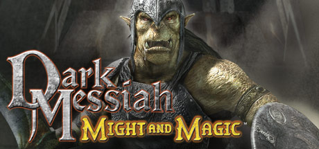

**Platforms:** Windows &nbsp;|&nbsp; **Genre:** Action, RPG &nbsp;|&nbsp; **Released:** October 24

> Discover a new breed of Action-RPG game powered by an enhanced version of the Source™ Engine by Valve. Set in the Might &amp; Magic® universe, players will experience ferocious combat in a dark and immersive fantasy environment. Swords, Stealth, Sorcery. Choose your way to kill.
>
> _Synopsis source: Steam_

[Wikipedia](https://en.wikipedia.org/wiki/Dark_Messiah_of_Might_and_Magic) · [Steam](https://store.steampowered.com/app/2100)

---

### DarkOrbit

**Platforms:** Browser, Windows, macOS, Linux &nbsp;|&nbsp; **Developer:** Bigpoint &nbsp;|&nbsp; **Publisher:** Bigpoint &nbsp;|&nbsp; **Genre:** MMO, Action role-playing &nbsp;|&nbsp; **Released:** December 11, 2006

[Wikipedia](https://en.wikipedia.org/wiki/DarkOrbit)

---

### DarkStar One

**Platforms:** Windows &nbsp;|&nbsp; **Developer:** Ascaron &nbsp;|&nbsp; **Publisher:** CDV Software, Kalypso Media &nbsp;|&nbsp; **Genre:** Space trading and combat simulator &nbsp;|&nbsp; **Released:** June 16, 2006

[Wikipedia](https://en.wikipedia.org/wiki/DarkStar_One)

---

### Dave Mirra BMX Challenge

**Platforms:** PlayStation Portable &nbsp;|&nbsp; **Released:** November 2

[Wikipedia](https://en.wikipedia.org/wiki/Dave_Mirra_BMX_Challenge)

---

### Daxter

**Platforms:** PlayStation Portable &nbsp;|&nbsp; **Developer:** Ready at Dawn &nbsp;|&nbsp; **Publisher:** Sony Computer Entertainment &nbsp;|&nbsp; **Genre:** Platform &nbsp;|&nbsp; **Released:** March 14, 2006

[Wikipedia](https://en.wikipedia.org/wiki/Daxter_(video_game))

---

### Dead or Alive Xtreme 2

**Platforms:** Xbox 360 &nbsp;|&nbsp; **Released:** November 13

[Wikipedia](https://en.wikipedia.org/wiki/Dead_or_Alive_Xtreme_2)

---

### Dead Rising

**Platforms:** Xbox 360 &nbsp;|&nbsp; **Released:** August 8

[Wikipedia](https://en.wikipedia.org/wiki/Dead_Rising_(video_game))

---

### Death Jr. II: Root of Evil

**Platforms:** PlayStation Portable &nbsp;|&nbsp; **Released:** October 31

---

### Def Jam Fight for NY: The Takeover

**Platforms:** PlayStation Portable &nbsp;|&nbsp; **Released:** August 29

---

### DEFCON

**Platforms:** Windows &nbsp;|&nbsp; **Developer:** Introversion Software &nbsp;|&nbsp; **Publisher:** Encore Software, Pinnacle Entertainment Group &nbsp;|&nbsp; **Genre:** Real-time strategy &nbsp;|&nbsp; **Released:** September 29, 2006

[Wikipedia](https://en.wikipedia.org/wiki/DEFCON_(video_game))

---

### DEFCON: Everybody Dies

**Platforms:** Windows &nbsp;|&nbsp; **Released:** September 29 (EU)

---

### Demonbane

[Wikipedia](https://en.wikipedia.org/wiki/Demonbane)

---

### Densetsu no Starfy 4

**Platforms:** Nintendo DS &nbsp;|&nbsp; **Developer:** Tose &nbsp;|&nbsp; **Publisher:** Nintendo &nbsp;|&nbsp; **Genre:** Platform &nbsp;|&nbsp; **Released:** April 13, 2006

[Wikipedia](https://en.wikipedia.org/wiki/Densetsu_no_Starfy_4)

---

### Desperados 2: Cooper's Revenge

**Platforms:** Windows &nbsp;|&nbsp; **Developer:** Spellbound Entertainment &nbsp;|&nbsp; **Publisher:** Atari &nbsp;|&nbsp; **Genre:** Real-time tactics &nbsp;|&nbsp; **Released:** April 27, 2006

[Wikipedia](https://en.wikipedia.org/wiki/Desperados_2:_Cooper's_Revenge)

---

### Desperate Housewives: The Game

**Platforms:** Windows &nbsp;|&nbsp; **Released:** October 5

---

### Destination: Treasure Island

**Platforms:** Windows &nbsp;|&nbsp; **Developer:** Kheops Studio &nbsp;|&nbsp; **Publisher:** Nobilis &nbsp;|&nbsp; **Genre:** Adventure &nbsp;|&nbsp; **Released:** November 17, 2006

[Wikipedia](https://en.wikipedia.org/wiki/Destination:_Treasure_Island)

---

### Destroy All Humans! 2

**Platforms:** PlayStation 2, Xbox &nbsp;|&nbsp; **Released:** October 19

[Wikipedia](https://en.wikipedia.org/wiki/Destroy_All_Humans!_2)

---

### Devil May Cry 3: Special Edition

**Platforms:** PlayStation 2 &nbsp;|&nbsp; **Publisher:** Capcom &nbsp;|&nbsp; **Released:** January 24, 2006

---

### Devil Summoner: Raidou Kuzunoha vs. the Soulless Army

**Platforms:** PlayStation 2 &nbsp;|&nbsp; **Developer:** Atlus &nbsp;|&nbsp; **Publisher:** Atlus, Koei, THQ &nbsp;|&nbsp; **Genre:** Action role-playing &nbsp;|&nbsp; **Released:** March 2, 2006

[Wikipedia](https://en.wikipedia.org/wiki/Devil_Summoner:_Raidou_Kuzunoha_vs._the_Soulless_Army)

---

### Diamond Rush

**Platforms:** Mobile phone &nbsp;|&nbsp; **Developer:** Gameloft &nbsp;|&nbsp; **Publisher:** Gameloft &nbsp;|&nbsp; **Genre:** Action, Puzzle &nbsp;|&nbsp; **Released:** December 1, 2006

[Wikipedia](https://en.wikipedia.org/wiki/Diamond_Rush)

---

### Digimon Fusion

[Wikipedia](https://en.wikipedia.org/wiki/Digimon_Fusion)

---

### Digimon World Data Squad

**Platforms:** PlayStation 2 &nbsp;|&nbsp; **Developer:** BEC &nbsp;|&nbsp; **Publisher:** Bandai Namco Games &nbsp;|&nbsp; **Genre:** Action-adventure, role-playing &nbsp;|&nbsp; **Released:** November 30, 2006

[Wikipedia](https://en.wikipedia.org/wiki/Digimon_World_Data_Squad)

---

### Digimon World DS

**Platforms:** Nintendo DS &nbsp;|&nbsp; **Developer:** BEC &nbsp;|&nbsp; **Publisher:** Bandai Namco Games &nbsp;|&nbsp; **Genre:** Role-playing video game &nbsp;|&nbsp; **Released:** June 15, 2006

[Wikipedia](https://en.wikipedia.org/wiki/Digimon_World_DS)

---

### Diner Dash 2: Restaurant Rescue

**Platforms:** Windows, macOS &nbsp;|&nbsp; **Developer:** PlayFirst &nbsp;|&nbsp; **Publisher:** PlayFirst &nbsp;|&nbsp; **Genre:** Strategy, simulation &nbsp;|&nbsp; **Released:** May 11, 2006

[Wikipedia](https://en.wikipedia.org/wiki/Diner_Dash_2:_Restaurant_Rescue)

---

### Dirge of Cerberus: Final Fantasy VII

**Platforms:** PlayStation 2 &nbsp;|&nbsp; **Released:** August 15

---

### Disgaea 2

**Platforms:** PlayStation 2 &nbsp;|&nbsp; **Developer:** Nippon Ichi Software &nbsp;|&nbsp; **Publisher:** Nippon Ichi Software, NIS America, Koei, NIS Europe &nbsp;|&nbsp; **Genre:** Tactical role-playing &nbsp;|&nbsp; **Released:** February 23, 2006

[Wikipedia](https://en.wikipedia.org/wiki/Disgaea_2)

---

### Disgaea 2: Cursed Memories

**Platforms:** PlayStation 2 &nbsp;|&nbsp; **Released:** August 29

---

### Disgaea: Afternoon of Darkness

**Platforms:** PlayStation Portable &nbsp;|&nbsp; **Publisher:** Nippon Ichi Software &nbsp;|&nbsp; **Released:** November 30, 2006

---

### Disney's Chicken Little: Ace in Action

**Platforms:** PlayStation 2, Nintendo DS, Windows, Wii &nbsp;|&nbsp; **Released:** November 9

---

### Disney's Kim Possible: What's the Switch?

**Platforms:** PlayStation 2 &nbsp;|&nbsp; **Released:** October 19

[Wikipedia](https://en.wikipedia.org/wiki/Kim_Possible_(video_game_series))

---

### DJMax Portable

**Platforms:** PlayStation Portable &nbsp;|&nbsp; **Developer:** Pentavision &nbsp;|&nbsp; **Publisher:** Pentavision &nbsp;|&nbsp; **Genre:** Music video game &nbsp;|&nbsp; **Released:** January 14, 2006

[Wikipedia](https://en.wikipedia.org/wiki/DJMax_Portable)

---

### Dogz and Catz

**Platforms:** Windows, Nintendo DS &nbsp;|&nbsp; **Developer:** ImaginEngine &nbsp;|&nbsp; **Publisher:** Ubisoft &nbsp;|&nbsp; **Genre:** virtual pet

[Wikipedia](https://en.wikipedia.org/wiki/Dogz_and_Catz_(2006_video_games))

---

### Dominions 3: The Awakening

**Platforms:** Linux, macOS, Windows &nbsp;|&nbsp; **Developer:** Illwinter Game Design &nbsp;|&nbsp; **Publisher:** Shrapnel Games, Desura and GamersGate, Steam &nbsp;|&nbsp; **Genre:** Turn-based strategy &nbsp;|&nbsp; **Released:** September 29, 2006

[Wikipedia](https://en.wikipedia.org/wiki/Dominions_3:_The_Awakening)

---

### Donkey Kong (NES)

**Platforms:** Wii &nbsp;|&nbsp; **Released:** November 19

[Wikipedia](https://en.wikipedia.org/wiki/Donkey_Kong_(1981_video_game))

---

### Donkey Kong Jr. (NES)

**Platforms:** Wii &nbsp;|&nbsp; **Released:** December 4

[Wikipedia](https://en.wikipedia.org/wiki/Donkey_Kong_Jr.)

---

### Dr. Robotnik's Mean Bean Machine (Genesis)

**Platforms:** Wii &nbsp;|&nbsp; **Released:** December 11

[Wikipedia](https://en.wikipedia.org/wiki/Dr._Robotnik%27s_Mean_Bean_Machine)

---

### Dr. Sudoku

**Platforms:** Game Boy Advance &nbsp;|&nbsp; **Developer:** Success &nbsp;|&nbsp; **Publisher:** Success Mastiff 505 Gamestreet &nbsp;|&nbsp; **Genre:** Puzzle &nbsp;|&nbsp; **Released:** April 6, 2006

[Wikipedia](https://en.wikipedia.org/wiki/Dr._Sudoku)

---

### Dracula Twins

**Platforms:** Windows &nbsp;|&nbsp; **Developer:** Legendo Entertainment, Nerlaska Studio &nbsp;|&nbsp; **Publisher:** Legendo Entertainment &nbsp;|&nbsp; **Genre:** Platform &nbsp;|&nbsp; **Released:** October 2006

[Wikipedia](https://en.wikipedia.org/wiki/Dracula_Twins)

---

### Dragon Ball Z: Shin Budokai

**Platforms:** PlayStation Portable &nbsp;|&nbsp; **Released:** March 7

---

### Dragon Quest & Final Fantasy in Itadaki Street Portable

**Platforms:** PlayStation Portable &nbsp;|&nbsp; **Developer:** Think Garage &nbsp;|&nbsp; **Publisher:** Square Enix &nbsp;|&nbsp; **Genre:** Party game, board game &nbsp;|&nbsp; **Released:** May 25, 2006

[Wikipedia](https://en.wikipedia.org/wiki/Dragon_Quest_&_Final_Fantasy_in_Itadaki_Street_Portable)

---

### Dragon Quest Fushigi no Dungeon Mobile

[Wikipedia](https://en.wikipedia.org/wiki/Dragon_Quest_Fushigi_no_Dungeon_Mobile)

---

### Dragon Quest: Young Yangus and the Mystery Dungeon

**Platforms:** PlayStation 2 &nbsp;|&nbsp; **Developer:** Cavia &nbsp;|&nbsp; **Publisher:** Square Enix &nbsp;|&nbsp; **Genre:** Action role-playing, Roguelike &nbsp;|&nbsp; **Released:** April 20, 2006

[Wikipedia](https://en.wikipedia.org/wiki/Dragon_Quest:_Young_Yangus_and_the_Mystery_Dungeon)

---

### DragonFable

**Developer:** Artix Entertainment &nbsp;|&nbsp; **Publisher:** Artix Entertainment &nbsp;|&nbsp; **Genre:** Role-playing game &nbsp;|&nbsp; **Released:** June 9, 2006

[Wikipedia](https://en.wikipedia.org/wiki/DragonFable)

---

### Drakengard 2

**Platforms:** PlayStation 2 &nbsp;|&nbsp; **Released:** February 14

[Wikipedia](https://en.wikipedia.org/wiki/Drakengard_2)

---

### Dream Match Tennis

**Platforms:** Windows &nbsp;|&nbsp; **Developer:** Bimboosoft Co. Ltd &nbsp;|&nbsp; **Genre:** Sports game

[Wikipedia](https://en.wikipedia.org/wiki/Dream_Match_Tennis)

---

### Dream Pinball 3D

**Platforms:** Windows &nbsp;|&nbsp; **Developer:** A. S. K. Homework, RuneSoft &nbsp;|&nbsp; **Publisher:** Zuxxez Entertainment, SouthPeak Games &nbsp;|&nbsp; **Genre:** Pinball &nbsp;|&nbsp; **Released:** September 2006

[Wikipedia](https://en.wikipedia.org/wiki/Dream_Pinball_3D)

---

### Dreamfall: The Longest Journey

**Platforms:** Windows, Xbox &nbsp;|&nbsp; **Genre:** Adventure, RPG &nbsp;|&nbsp; **Released:** April 17

> Dreamfall: The Longest Journey, winner of multiple E3 awards as the best game in its genre, is the continuation of a saga that began in the award-winning The Longest Journey, considered to be one of the finest adventure games ever made.
>
> _Synopsis source: Steam_

[Steam](https://store.steampowered.com/app/6300)

---

### Drill Dozer

**Platforms:** Game Boy Advance &nbsp;|&nbsp; **Released:** February 6

[Wikipedia](https://en.wikipedia.org/wiki/Drill_Dozer)

---

### Driver: Parallel Lines

**Platforms:** PlayStation 2, Xbox &nbsp;|&nbsp; **Released:** March 14

---

### Ducati World Championship

**Platforms:** Windows &nbsp;|&nbsp; **Developer:** Artematica &nbsp;|&nbsp; **Publisher:** Ubisoft, Lexicon Entertainment, Strategy First &nbsp;|&nbsp; **Genre:** Racing &nbsp;|&nbsp; **Released:** September 14, 2006

[Wikipedia](https://en.wikipedia.org/wiki/Ducati_World_Championship)

---

### Dungeon Crawl Stone Soup

[Wikipedia](https://en.wikipedia.org/wiki/Dungeon_Crawl_Stone_Soup)

---

### Dungeon Siege II: Broken World

**Platforms:** Windows &nbsp;|&nbsp; **Released:** August 1

[Wikipedia](https://en.wikipedia.org/wiki/Dungeon_Siege_II#Expansion)

---

### Dungeon Siege: Thorne of Agony

**Platforms:** PlayStation Portable &nbsp;|&nbsp; **Released:** October 30

---

### Dungeon Siege: Throne of Agony

**Platforms:** PlayStation Portable &nbsp;|&nbsp; **Developer:** SuperVillain Studios &nbsp;|&nbsp; **Publisher:** 2K, Take-Two Interactive &nbsp;|&nbsp; **Genre:** Role-playing &nbsp;|&nbsp; **Released:** October 30, 2006

[Wikipedia](https://en.wikipedia.org/wiki/Dungeon_Siege:_Throne_of_Agony)

---

### Dungeons & Dragons Online: Stormreach

**Platforms:** Windows &nbsp;|&nbsp; **Released:** February 28

[Wikipedia](https://en.wikipedia.org/wiki/Dungeons_%26_Dragons_Online)

---

### Dwarf Fortress

**Platforms:** Windows, Linux &nbsp;|&nbsp; **Developer:** Bay 12 Games &nbsp;|&nbsp; **Publisher:** Bay 12 Games, Kitfox Games &nbsp;|&nbsp; **Genre:** Construction and management simulation, roguelike, survival &nbsp;|&nbsp; **Released:** August 8, 2006

[Wikipedia](https://en.wikipedia.org/wiki/Dwarf_Fortress)

---

### Dynasty Warriors 5: Empires

**Platforms:** PlayStation 2, Xbox 360 &nbsp;|&nbsp; **Released:** March 28

[Wikipedia](https://en.wikipedia.org/wiki/Dynasty_Warriors_5)

---

### Dynasty Warriors Online

**Platforms:** Windows &nbsp;|&nbsp; **Developer:** Omega Force &nbsp;|&nbsp; **Publisher:** Koei, Tecmo Koei &nbsp;|&nbsp; **Genre:** MMOG

[Wikipedia](https://en.wikipedia.org/wiki/Dynasty_Warriors_Online)

---

### Dynasty Warriors Vol. 2

**Platforms:** PlayStation Portable &nbsp;|&nbsp; **Developer:** Omega Force &nbsp;|&nbsp; **Publisher:** Koei &nbsp;|&nbsp; **Genre:** Hack and slash &nbsp;|&nbsp; **Released:** March 23, 2006

[Wikipedia](https://en.wikipedia.org/wiki/Dynasty_Warriors_Vol._2)

---

### EA Replay

**Platforms:** PlayStation Portable &nbsp;|&nbsp; **Released:** November 14

[Wikipedia](https://en.wikipedia.org/wiki/EA_Replay)

---

### Earache: Extreme Metal Racing

**Platforms:** PlayStation 2, Windows &nbsp;|&nbsp; **Developer:** Data Design Interactive &nbsp;|&nbsp; **Publisher:** Data Design Interactive &nbsp;|&nbsp; **Genre:** Racing, vehicular combat &nbsp;|&nbsp; **Released:** October 27, 2006

[Wikipedia](https://en.wikipedia.org/wiki/Earache:_Extreme_Metal_Racing)

---

### Ecco the Dolphin (Genesis)

**Platforms:** Wii &nbsp;|&nbsp; **Released:** November 28

[Wikipedia](https://en.wikipedia.org/wiki/Ecco_the_Dolphin_(video_game))

---

### Ef: A Fairy Tale of the Two

[Wikipedia](https://en.wikipedia.org/wiki/Ef:_A_Fairy_Tale_of_the_Two)

---

### El Matador

**Platforms:** Windows &nbsp;|&nbsp; **Developer:** Plastic Reality Technologies &nbsp;|&nbsp; **Publisher:** Cenega Publishing, 1C Company &nbsp;|&nbsp; **Genre:** Third-person shooter &nbsp;|&nbsp; **Released:** September 8, 2006

[Wikipedia](https://en.wikipedia.org/wiki/El_Matador_(video_game))

---

### Elebits

**Platforms:** Wii &nbsp;|&nbsp; **Released:** December 12

[Wikipedia](https://en.wikipedia.org/wiki/Elebits)

---

### Electroplankton

**Platforms:** Nintendo DS &nbsp;|&nbsp; **Released:** January 9

[Wikipedia](https://en.wikipedia.org/wiki/Electroplankton)

---

### Elite Beat Agents

**Platforms:** Nintendo DS &nbsp;|&nbsp; **Publisher:** Nintendo &nbsp;|&nbsp; **Released:** November 6, 2006

[Wikipedia](https://en.wikipedia.org/wiki/Elite_Beat_Agents)

---

### Emergency 4: Global Fighters for Life

**Platforms:** Windows &nbsp;|&nbsp; **Developer:** Sixteen Tons Entertainment &nbsp;|&nbsp; **Publisher:** Take-Two Interactive, Bluestone Interactive &nbsp;|&nbsp; **Genre:** Real-time strategy &nbsp;|&nbsp; **Released:** April 13, 2006

[Wikipedia](https://en.wikipedia.org/wiki/Emergency_4:_Global_Fighters_for_Life)

---

### Empire Earth II: The Art of Supremacy

**Platforms:** Windows &nbsp;|&nbsp; **Released:** February 14

---

### Enchanted Arms

**Platforms:** Xbox 360 &nbsp;|&nbsp; **Released:** August 29

[Wikipedia](https://en.wikipedia.org/wiki/Enchanted_Arms)

---

### Enigmo

**Platforms:** Windows, macOS, PlayStation Portable &nbsp;|&nbsp; **Developer:** Pangea Software, Beatshapers &nbsp;|&nbsp; **Publisher:** Pangea Software, Beatshapers &nbsp;|&nbsp; **Genre:** Puzzle

[Wikipedia](https://en.wikipedia.org/wiki/Enigmo)

---

### Ennichi no Tatsujin

**Platforms:** Wii &nbsp;|&nbsp; **Developer:** Namco Bandai Games &nbsp;|&nbsp; **Publisher:** Namco Bandai Games &nbsp;|&nbsp; **Genre:** Mini-games &nbsp;|&nbsp; **Released:** December 2, 2006

[Wikipedia](https://en.wikipedia.org/wiki/Ennichi_no_Tatsujin)

---

### Eragon

**Platforms:** Windows, PlayStation 2, Xbox, Xbox 360, Game Boy Advance, Nintendo DS, PlayStation Portable &nbsp;|&nbsp; **Released:** November 14

[Wikipedia](https://en.wikipedia.org/wiki/Eragon_(video_game))

---

### EverQuest II: Echoes of Faydwer

**Platforms:** Windows &nbsp;|&nbsp; **Released:** November 13

---

### EverQuest II: Kingdom of Sky

**Platforms:** Windows &nbsp;|&nbsp; **Released:** February 21

---

### EverQuest: Prophecy of Ro

[Wikipedia](https://en.wikipedia.org/wiki/EverQuest:_Prophecy_of_Ro)

---

### EverQuest: The Serpent's Spine

**Platforms:** Windows &nbsp;|&nbsp; **Released:** September 19

[Wikipedia](https://en.wikipedia.org/wiki/The_Serpent%27s_Spine)

---

### Every Extend Extra

**Platforms:** PlayStation Portable &nbsp;|&nbsp; **Released:** November 7

[Wikipedia](https://en.wikipedia.org/wiki/Every_Extend_Extra)

---

### Everybody's Tennis

**Platforms:** PlayStation 2 &nbsp;|&nbsp; **Developer:** Clap Hanz &nbsp;|&nbsp; **Publisher:** Sony Computer Entertainment &nbsp;|&nbsp; **Genre:** Sports &nbsp;|&nbsp; **Released:** September 14, 2006

[Wikipedia](https://en.wikipedia.org/wiki/Everybody's_Tennis)

---

### Evidence: The Last Ritual

**Platforms:** Windows &nbsp;|&nbsp; **Developer:** Lexis Numérique &nbsp;|&nbsp; **Publisher:** Ubisoft, The Adventure Company &nbsp;|&nbsp; **Genre:** Alternate reality game, adventure, puzzle &nbsp;|&nbsp; **Released:** September 2006

[Wikipedia](https://en.wikipedia.org/wiki/Evidence:_The_Last_Ritual)

---

### Excite Truck (USA)

**Platforms:** Wii &nbsp;|&nbsp; **Released:** November 19

[Wikipedia](https://en.wikipedia.org/wiki/Excite_Truck)

---

### Exit

**Platforms:** PlayStation Portable &nbsp;|&nbsp; **Released:** February 14

[Wikipedia](https://en.wikipedia.org/wiki/Exit_(video_game))

---

### Exit 2

**Platforms:** PlayStation Portable &nbsp;|&nbsp; **Developer:** Taito &nbsp;|&nbsp; **Publisher:** Taito &nbsp;|&nbsp; **Genre:** Puzzle-platform &nbsp;|&nbsp; **Released:** September 7, 2006

[Wikipedia](https://en.wikipedia.org/wiki/Exit_2)

---

### F-Zero

**Platforms:** Wii &nbsp;|&nbsp; **Released:** November 19

[Wikipedia](https://en.wikipedia.org/wiki/F-Zero_(video_game))

---

### F.E.A.R. Extraction Point

**Platforms:** Windows &nbsp;|&nbsp; **Released:** October 24

[Wikipedia](https://en.wikipedia.org/wiki/F.E.A.R._Extraction_Point)

---

### F24: Stealth Fighter

**Platforms:** Game Boy Advance &nbsp;|&nbsp; **Publisher:** Majesco &nbsp;|&nbsp; **Genre:** Combat flight simulation &nbsp;|&nbsp; **Released:** November 6, 2006

[Wikipedia](https://en.wikipedia.org/wiki/F24:_Stealth_Fighter)

---

### Face of Mankind

**Platforms:** Windows &nbsp;|&nbsp; **Developer:** Duplex Systems, Nexeon Technologies &nbsp;|&nbsp; **Publisher:** Nexeon Technologies &nbsp;|&nbsp; **Genre:** MMO/Action RPG &nbsp;|&nbsp; **Released:** March 27, 2006

[Wikipedia](https://en.wikipedia.org/wiki/Face_of_Mankind)

---

### Faces of War

**Platforms:** Windows &nbsp;|&nbsp; **Developer:** Best Way &nbsp;|&nbsp; **Publisher:** 1C Company, Ubisoft &nbsp;|&nbsp; **Genre:** Real-time strategy, real-time tactics &nbsp;|&nbsp; **Released:** September 8, 2006

[Wikipedia](https://en.wikipedia.org/wiki/Faces_of_War)

---

### Family Guy Video Game!

**Platforms:** PlayStation 2, Xbox, PlayStation Portable &nbsp;|&nbsp; **Released:** October 17 (NA/EU/AU)

[Wikipedia](https://en.wikipedia.org/wiki/Family_Guy_Video_Game!)

---

### Fantasy Earth Zero

**Platforms:** Windows &nbsp;|&nbsp; **Developer:** SoftGear &nbsp;|&nbsp; **Publisher:** Square Enix &nbsp;|&nbsp; **Genre:** MMORPG &nbsp;|&nbsp; **Released:** February 23, 2006

[Wikipedia](https://en.wikipedia.org/wiki/Fantasy_Earth_Zero)

---

### Far Cry Instincts: Predator

**Platforms:** Xbox 360 &nbsp;|&nbsp; **Released:** March 28

[Wikipedia](https://en.wikipedia.org/wiki/Far_Cry_Instincts#Predator)

---

### Far Cry Vengeance

**Platforms:** Wii &nbsp;|&nbsp; **Developer:** Ubisoft Montreal &nbsp;|&nbsp; **Publisher:** Ubisoft &nbsp;|&nbsp; **Genre:** First-person shooter &nbsp;|&nbsp; **Released:** December 12, 2006

[Wikipedia](https://en.wikipedia.org/wiki/Far_Cry_Vengeance)

---

### FastCrawl

**Platforms:** Windows &nbsp;|&nbsp; **Developer:** Glen Pawley &nbsp;|&nbsp; **Publisher:** Pawleyscape &nbsp;|&nbsp; **Genre:** Role-playing &nbsp;|&nbsp; **Released:** October 12, 2006

[Wikipedia](https://en.wikipedia.org/wiki/FastCrawl)

---

### Feeding Frenzy 2

**Platforms:** Windows, Xbox 360, PlayStation 3, PlayStation Network &nbsp;|&nbsp; **Developer:** Sprout Games &nbsp;|&nbsp; **Publisher:** PopCap Games &nbsp;|&nbsp; **Genre:** Arcade &nbsp;|&nbsp; **Released:** March 15, 2006

[Wikipedia](https://en.wikipedia.org/wiki/Feeding_Frenzy_2)

---

### Field Commander

**Platforms:** PlayStation Portable &nbsp;|&nbsp; **Developer:** Sony Online Entertainment &nbsp;|&nbsp; **Publisher:** Sony Online Entertainment, Ubisoft &nbsp;|&nbsp; **Genre:** Turn-based tactics &nbsp;|&nbsp; **Released:** May 23, 2006

[Wikipedia](https://en.wikipedia.org/wiki/Field_Commander)

---

### FIFA 07

**Platforms:** GameCube, PlayStation 2, Windows, Xbox, Xbox 360, PlayStation Portable, Nintendo DS, Game Boy Advance, Mobile phone &nbsp;|&nbsp; **Developer:** EA Canada, Team Fusion, Exient Entertainment, Distinctive Developments &nbsp;|&nbsp; **Publisher:** Electronic Arts &nbsp;|&nbsp; **Genre:** Sports &nbsp;|&nbsp; **Released:** September 28, 2006

[Wikipedia](https://en.wikipedia.org/wiki/FIFA_07)

---

### FIFA Street 2

**Platforms:** GameCube, PlayStation 2, Xbox, Nintendo DS, PlayStation Portable, Mobile phone &nbsp;|&nbsp; **Developer:** EA Canada, HB Studios, Exient Entertainment, Distinctive Developments &nbsp;|&nbsp; **Publisher:** EA Sports BIG &nbsp;|&nbsp; **Genre:** Sports &nbsp;|&nbsp; **Released:** February 28, 2006

[Wikipedia](https://en.wikipedia.org/wiki/FIFA_Street_2)

---

### Fight Night Round 3

**Platforms:** PlayStation 3 &nbsp;|&nbsp; **Released:** December 5

[Wikipedia](https://en.wikipedia.org/wiki/Fight_Night_Round_3)

---

### Final Fantasy III

**Platforms:** Nintendo DS &nbsp;|&nbsp; **Released:** November 14

[Wikipedia](https://en.wikipedia.org/wiki/Final_Fantasy_III_(Nintendo_DS))

---

### Final Fantasy V

**Platforms:** Game Boy Advance &nbsp;|&nbsp; **Released:** November 3

[Wikipedia](https://en.wikipedia.org/wiki/Final_Fantasy_V)

---

### Final Fantasy VI Advance

**Platforms:** Game Boy Advance &nbsp;|&nbsp; **Publisher:** Square Enix &nbsp;|&nbsp; **Released:** November 30, 2006 (JP)

[Wikipedia](https://en.wikipedia.org/wiki/Final_Fantasy_VI#Nintendo_consoles)

---

### Final Fantasy XI

**Platforms:** Xbox 360 &nbsp;|&nbsp; **Released:** April 18

[Wikipedia](https://en.wikipedia.org/wiki/Final_Fantasy_XI)

---

### Final Fantasy XI: Treasures of Aht Urhgan

**Platforms:** Windows, PlayStation 2 &nbsp;|&nbsp; **Released:** April 18

[Wikipedia](https://en.wikipedia.org/wiki/Final_Fantasy_XI)

---

### Final Fantasy XII

**Platforms:** PlayStation 2 &nbsp;|&nbsp; **Publisher:** Square Enix &nbsp;|&nbsp; **Released:** March 16, 2006 (JP)

[Wikipedia](https://en.wikipedia.org/wiki/Final_Fantasy_XII)

---

### Final Fantasy XII (USA)

**Platforms:** PlayStation 2 &nbsp;|&nbsp; **Released:** October 31

[Wikipedia](https://en.wikipedia.org/wiki/Final_Fantasy_XII)

---

### Final Fight: Streetwise

**Platforms:** PlayStation 2, Xbox &nbsp;|&nbsp; **Released:** February 28

---

### Finder Love

**Platforms:** PlayStation Portable &nbsp;|&nbsp; **Developer:** Capcom &nbsp;|&nbsp; **Publisher:** Capcom &nbsp;|&nbsp; **Genre:** Adventure, dating sim &nbsp;|&nbsp; **Released:** June 29, 2006

[Wikipedia](https://en.wikipedia.org/wiki/Finder_Love)

---

### First Eagles: The Great War 1918

**Platforms:** Windows &nbsp;|&nbsp; **Developer:** Third Wire Productions &nbsp;|&nbsp; **Publisher:** G2 Games &nbsp;|&nbsp; **Genre:** Flight simulation &nbsp;|&nbsp; **Released:** December 2006

[Wikipedia](https://en.wikipedia.org/wiki/First_Eagles:_The_Great_War_1918)

---

### Fizzball

**Platforms:** Windows, macOS, Linux, Wii &nbsp;|&nbsp; **Developer:** Grubby Games, Steel Penny Games &nbsp;|&nbsp; **Publisher:** Grubby Games &nbsp;|&nbsp; **Genre:** Breakout &nbsp;|&nbsp; **Released:** November 2006

[Wikipedia](https://en.wikipedia.org/wiki/Fizzball)

---

### Flatout 2

**Platforms:** Windows, Xbox, Steam &nbsp;|&nbsp; **Released:** June 30 (EU/NA)

[Wikipedia](https://en.wikipedia.org/wiki/Flatout_2)

---

### Floatpoint

**Developer:** Emily Short &nbsp;|&nbsp; **Publisher:** Self published &nbsp;|&nbsp; **Genre:** Interactive fiction, adventure

[Wikipedia](https://en.wikipedia.org/wiki/Floatpoint)

---

### Flow

**Platforms:** Browser &nbsp;|&nbsp; **Developer:** Thatgamecompany &nbsp;|&nbsp; **Publisher:** Thatgamecompany, Sony Computer Entertainment &nbsp;|&nbsp; **Genre:** Life simulation &nbsp;|&nbsp; **Released:** March 11, 2006

[Wikipedia](https://en.wikipedia.org/wiki/Flow_(video_game))

---

### Flushed Away

**Platforms:** PlayStation 2, GameCube, Game Boy Advance, Nintendo DS &nbsp;|&nbsp; **Developer:** Vicious Cycle Software, Art Co., Ltd, Altron &nbsp;|&nbsp; **Publisher:** D3 Publisher &nbsp;|&nbsp; **Genre:** Action-adventure &nbsp;|&nbsp; **Released:** October 24, 2006

[Wikipedia](https://en.wikipedia.org/wiki/Flushed_Away_(video_game))

---

### Football Manager 2007

**Platforms:** Windows, macOS &nbsp;|&nbsp; **Released:** October 18

[Wikipedia](https://en.wikipedia.org/wiki/Football_Manager_2007)

---

### Ford Street Racing

**Platforms:** Windows, PlayStation 2, PlayStation Portable, Xbox &nbsp;|&nbsp; **Developer:** Razorworks &nbsp;|&nbsp; **Publisher:** Empire Interactive, Eidos Interactive &nbsp;|&nbsp; **Genre:** Racing &nbsp;|&nbsp; **Released:** February 24, 2006

[Wikipedia](https://en.wikipedia.org/wiki/Ford_Street_Racing)

---

### Forge of Freedom: The American Civil War

**Platforms:** Windows &nbsp;|&nbsp; **Developer:** Western Civilization Software &nbsp;|&nbsp; **Publisher:** Matrix Games &nbsp;|&nbsp; **Genre:** Computer wargame &nbsp;|&nbsp; **Released:** November 30, 2006

[Wikipedia](https://en.wikipedia.org/wiki/Forge_of_Freedom:_The_American_Civil_War)

---

### Formula One 06

**Platforms:** PlayStation 2, PlayStation Portable &nbsp;|&nbsp; **Developer:** Studio Liverpool &nbsp;|&nbsp; **Publisher:** Sony Computer Entertainment &nbsp;|&nbsp; **Genre:** Racing &nbsp;|&nbsp; **Released:** July 27, 2006

[Wikipedia](https://en.wikipedia.org/wiki/Formula_One_06)

---

### Foster's Home for Imaginary Friends

**Platforms:** Game Boy Advance &nbsp;|&nbsp; **Released:** November 3

[Wikipedia](https://en.wikipedia.org/wiki/Foster%27s_Home_for_Imaginary_Friends)

---

### Freedom Wings

**Platforms:** Nintendo DS &nbsp;|&nbsp; **Released:** August 21

[Wikipedia](https://en.wikipedia.org/wiki/Freedom_Wings)

---

### Freight Tycoon

**Platforms:** Windows &nbsp;|&nbsp; **Developer:** Nikita &nbsp;|&nbsp; **Publisher:** 1C Company &nbsp;|&nbsp; **Genre:** Strategy, simulation

[Wikipedia](https://en.wikipedia.org/wiki/Freight_Tycoon)

---

### Freshly-Picked Tingle's Rosy Rupeeland

**Platforms:** Nintendo DS &nbsp;|&nbsp; **Developer:** Vanpool &nbsp;|&nbsp; **Publisher:** Nintendo &nbsp;|&nbsp; **Genre:** Adventure &nbsp;|&nbsp; **Released:** September 2, 2006

[Wikipedia](https://en.wikipedia.org/wiki/Freshly-Picked_Tingle's_Rosy_Rupeeland)

---

### Frets on Fire

**Platforms:** Windows, macOS, Linux &nbsp;|&nbsp; **Developer:** Unreal Voodoo &nbsp;|&nbsp; **Genre:** Music &nbsp;|&nbsp; **Released:** August 3, 2006

[Wikipedia](https://en.wikipedia.org/wiki/Frets_on_Fire)

---

### Friends of Mana

[Wikipedia](https://en.wikipedia.org/wiki/Friends_of_Mana)

---

### Full Auto

**Platforms:** Xbox 360 &nbsp;|&nbsp; **Released:** February 14

[Wikipedia](https://en.wikipedia.org/wiki/Full_Auto)

---

### Full Auto 2: Battlelines

**Platforms:** PlayStation 3 &nbsp;|&nbsp; **Developer:** Pseudo Interactive, Deep Fried Entertainment &nbsp;|&nbsp; **Publisher:** Sega &nbsp;|&nbsp; **Genre:** Racing, vehicular combat &nbsp;|&nbsp; **Released:** December 12, 2006

[Wikipedia](https://en.wikipedia.org/wiki/Full_Auto_2:_Battlelines)

---

### Full Spectrum Warrior: Ten Hammers

**Platforms:** PlayStation 2, Windows, Xbox &nbsp;|&nbsp; **Developer:** Pandemic Studios &nbsp;|&nbsp; **Publisher:** THQ &nbsp;|&nbsp; **Genre:** Real-time tactics &nbsp;|&nbsp; **Released:** March 27, 2006

[Wikipedia](https://en.wikipedia.org/wiki/Full_Spectrum_Warrior:_Ten_Hammers)

---

### Fullmetal Alchemist: Dual Sympathy

**Platforms:** Nintendo DS &nbsp;|&nbsp; **Released:** December 12

---

### Gadget Trial

**Platforms:** Windows &nbsp;|&nbsp; **Developer:** KOGADO Studio &nbsp;|&nbsp; **Genre:** Turn-based strategy, Bishōjo game, Visual novel &nbsp;|&nbsp; **Released:** June 23, 2006

[Wikipedia](https://en.wikipedia.org/wiki/Gadget_Trial)

---

### Galactic Civilizations II: Dread Lords

**Platforms:** Windows &nbsp;|&nbsp; **Released:** February 27

---

### Galaxy Angel II

[Wikipedia](https://en.wikipedia.org/wiki/Galaxy_Angel_II)

---

### Game Tycoon

**Platforms:** Windows &nbsp;|&nbsp; **Developer:** Beat Games &nbsp;|&nbsp; **Publisher:** Tri Synergy &nbsp;|&nbsp; **Genre:** Business simulation game &nbsp;|&nbsp; **Released:** March 22, 2006

[Wikipedia](https://en.wikipedia.org/wiki/Game_Tycoon)

---

### Gamma Bros

**Developer:** PixelJAM Games &nbsp;|&nbsp; **Publisher:** PixelJAM Games &nbsp;|&nbsp; **Genre:** Shoot 'em up

[Wikipedia](https://en.wikipedia.org/wiki/Gamma_Bros)

---

### Gangs of London

**Platforms:** PlayStation Portable &nbsp;|&nbsp; **Released:** October 3

[Wikipedia](https://en.wikipedia.org/wiki/Gangs_of_London_(videogame))

---

### Gangstar: Crime City

**Platforms:** Mobile phone &nbsp;|&nbsp; **Developer:** Gameloft &nbsp;|&nbsp; **Publisher:** Gameloft &nbsp;|&nbsp; **Genre:** Action-adventure &nbsp;|&nbsp; **Released:** October 2006

[Wikipedia](https://en.wikipedia.org/wiki/Gangstar:_Crime_City)

---

### Garfield: A Tail of Two Kitties

**Platforms:** Nintendo DS, Windows, PlayStation 2 &nbsp;|&nbsp; **Developer:** Two Tribes, Asobo Studio &nbsp;|&nbsp; **Publisher:** The Game Factory &nbsp;|&nbsp; **Genre:** Action, platform &nbsp;|&nbsp; **Released:** August 25, 2006

[Wikipedia](https://en.wikipedia.org/wiki/Garfield:_A_Tail_of_Two_Kitties_(video_game))

---

### Garry's Mod

**Platforms:** Windows &nbsp;|&nbsp; **Genre:** Casual, Indie, Simulation &nbsp;|&nbsp; **Released:** November 29

> Garry's Mod is a physics sandbox. There aren't any predefined aims or goals. We give you the tools and leave you to play.
>
> _Synopsis source: Steam_

[Wikipedia](https://en.wikipedia.org/wiki/Garry%27s_Mod) · [Steam](https://store.steampowered.com/app/4000)

---

### Gears of War

**Platforms:** Xbox 360 &nbsp;|&nbsp; **Publisher:** Microsoft Game Studios &nbsp;|&nbsp; **Released:** November 7, 2006

[Wikipedia](https://en.wikipedia.org/wiki/Gears_of_War_(video_game))

---

### Geneforge 4: Rebellion

**Platforms:** macOS &nbsp;|&nbsp; **Developer:** Spiderweb Software &nbsp;|&nbsp; **Publisher:** Spiderweb Software &nbsp;|&nbsp; **Genre:** Role-playing &nbsp;|&nbsp; **Released:** November 20, 2006

[Wikipedia](https://en.wikipedia.org/wiki/Geneforge_4:_Rebellion)

---

### Generation of Chaos

**Platforms:** PlayStation Portable &nbsp;|&nbsp; **Released:** February 28

[Wikipedia](https://en.wikipedia.org/wiki/Generation_of_Chaos)

---

### Genji: Days of the Blade

**Platforms:** PlayStation 3 &nbsp;|&nbsp; **Released:** November 17

---

### Gibbage

**Platforms:** Windows &nbsp;|&nbsp; **Developer:** Zombie Cow Studios &nbsp;|&nbsp; **Genre:** Fighting game &nbsp;|&nbsp; **Released:** April 25, 2006

[Wikipedia](https://en.wikipedia.org/wiki/Gibbage)

---

### Giga Wing Generations

**Platforms:** Arcade, PlayStation 2 &nbsp;|&nbsp; **Developer:** Takumi Corporation &nbsp;|&nbsp; **Publisher:** Taito, 505 Game Street &nbsp;|&nbsp; **Genre:** Scrolling shooter &nbsp;|&nbsp; **Released:** February 3, 2006

[Wikipedia](https://en.wikipedia.org/wiki/Giga_Wing_Generations)

---

### Gitaroo Man Lives!

**Platforms:** PlayStation Portable &nbsp;|&nbsp; **Released:** November 14

[Wikipedia](https://en.wikipedia.org/wiki/Gitaroo_Man)

---

### Global Defence Force Tactics

**Platforms:** PlayStation 2 &nbsp;|&nbsp; **Developer:** thinkArts &nbsp;|&nbsp; **Publisher:** D3 Publisher &nbsp;|&nbsp; **Genre:** Turn-based strategy &nbsp;|&nbsp; **Released:** July 27, 2006

[Wikipedia](https://en.wikipedia.org/wiki/Global_Defence_Force_Tactics)

---

### Glory of the Roman Empire

**Platforms:** Windows &nbsp;|&nbsp; **Developer:** Haemimont Games &nbsp;|&nbsp; **Publisher:** CDV Software Entertainment, Enlight Interactive &nbsp;|&nbsp; **Genre:** City-building &nbsp;|&nbsp; **Released:** June 16, 2006

[Wikipedia](https://en.wikipedia.org/wiki/Glory_of_the_Roman_Empire)

---

### God Hand

**Platforms:** PlayStation 2 &nbsp;|&nbsp; **Released:** October 10

[Wikipedia](https://en.wikipedia.org/wiki/God_Hand)

---

### Golden Axe (Genesis)

**Platforms:** Wii &nbsp;|&nbsp; **Released:** November 28

[Wikipedia](https://en.wikipedia.org/wiki/Golden_Axe_(video_game))

---

### Golden Knight Garo

**Platforms:** PlayStation 2 &nbsp;|&nbsp; **Developer:** Bitstep &nbsp;|&nbsp; **Publisher:** Bandai &nbsp;|&nbsp; **Genre:** Fighting &nbsp;|&nbsp; **Released:** April 20, 2006

[Wikipedia](https://en.wikipedia.org/wiki/Golden_Knight_Garo)

---

### Gorky 17

**Platforms:** Linux &nbsp;|&nbsp; **Released:** June 15

[Wikipedia](https://en.wikipedia.org/wiki/Gorky_17)

---

### Gothic 3

**Platforms:** Windows &nbsp;|&nbsp; **Genre:** Action, RPG &nbsp;|&nbsp; **Released:** October 13

> A nameless hero becomes a legend! Myrtana, a world in upheaval: overrun by orcs from the dark lands in the north, King Rhobar is defending Vengard, the former stronghold of the humans, with his last troop of followers.
>
> _Synopsis source: Steam_

[Wikipedia](https://en.wikipedia.org/wiki/Gothic_3) · [Steam](https://store.steampowered.com/app/39500)

---

### Gradius Collection

**Platforms:** PlayStation Portable &nbsp;|&nbsp; **Released:** June 6

[Wikipedia](https://en.wikipedia.org/wiki/Gradius_Collection)

---

### Gran Turismo HD Concept

**Platforms:** PlayStation 3 &nbsp;|&nbsp; **Developer:** Polyphony Digital &nbsp;|&nbsp; **Publisher:** Sony Computer Entertainment &nbsp;|&nbsp; **Genre:** Sim racing &nbsp;|&nbsp; **Released:** December 24, 2006

[Wikipedia](https://en.wikipedia.org/wiki/Gran_Turismo_HD_Concept)

---

### Granado Espada

**Platforms:** Windows &nbsp;|&nbsp; **Developer:** IMC Games Co., Ltd. &nbsp;|&nbsp; **Publisher:** HanbitSoft, IMC Games &nbsp;|&nbsp; **Genre:** Fantasy MMORPG &nbsp;|&nbsp; **Released:** February 14, 2006

[Wikipedia](https://en.wikipedia.org/wiki/Granado_Espada)

---

### Grand Theft Auto: Liberty City Stories

**Platforms:** PlayStation 2 &nbsp;|&nbsp; **Released:** June 6

---

### Grand Theft Auto: Vice City Stories

**Platforms:** PlayStation Portable &nbsp;|&nbsp; **Released:** October 31

---

### Grandia III

**Platforms:** PlayStation 2 &nbsp;|&nbsp; **Released:** February 14

[Wikipedia](https://en.wikipedia.org/wiki/Grandia_III)

---

### Growlanser: Heritage of War

**Platforms:** PlayStation 2 &nbsp;|&nbsp; **Developer:** Career Soft &nbsp;|&nbsp; **Publisher:** Atlus, Atlus USA, Rising Star Games &nbsp;|&nbsp; **Genre:** Tactical role-playing &nbsp;|&nbsp; **Released:** August 3, 2006

[Wikipedia](https://en.wikipedia.org/wiki/Growlanser:_Heritage_of_War)

---

### GT Pro Series

**Platforms:** Wii &nbsp;|&nbsp; **Developer:** MTO &nbsp;|&nbsp; **Publisher:** MTO, Ubisoft &nbsp;|&nbsp; **Genre:** Racing &nbsp;|&nbsp; **Released:** November 19, 2006

[Wikipedia](https://en.wikipedia.org/wiki/GT_Pro_Series)

---

### GTR 2 – FIA GT Racing Game

**Platforms:** Windows &nbsp;|&nbsp; **Publisher:** 10tacle Studios &nbsp;|&nbsp; **Released:** September 29, 2006

[Wikipedia](https://en.wikipedia.org/wiki/GTR_2_%E2%80%93_FIA_GT_Racing_Game)

---

### Guild Wars Nightfall

**Platforms:** Windows &nbsp;|&nbsp; **Released:** October 26

[Wikipedia](https://en.wikipedia.org/wiki/Guild_Wars_Nightfall)

---

### Guild Wars: Factions

**Platforms:** Windows &nbsp;|&nbsp; **Released:** April 28

---

### Guilty Gear Dust Strikers

**Platforms:** Nintendo DS &nbsp;|&nbsp; **Released:** April 25

[Wikipedia](https://en.wikipedia.org/wiki/Guilty_Gear_Dust_Strikers)

---

### Guilty Gear Judgment

**Platforms:** PlayStation Portable &nbsp;|&nbsp; **Developer:** Arc System Works &nbsp;|&nbsp; **Publisher:** Majesco, Sega &nbsp;|&nbsp; **Genre:** Fighting game/Beat 'em up &nbsp;|&nbsp; **Released:** August 24, 2006

[Wikipedia](https://en.wikipedia.org/wiki/Guilty_Gear_Judgment)

---

### Guitar Hero II

**Platforms:** PlayStation 2 &nbsp;|&nbsp; **Publisher:** RedOctane &nbsp;|&nbsp; **Released:** November 7, 2006

[Wikipedia](https://en.wikipedia.org/wiki/Guitar_Hero_II)

---

### Gumboy: Crazy Adventures

**Platforms:** Windows &nbsp;|&nbsp; **Developer:** Cinemax &nbsp;|&nbsp; **Publisher:** Cinemax &nbsp;|&nbsp; **Genre:** Platform &nbsp;|&nbsp; **Released:** July 21, 2006

[Wikipedia](https://en.wikipedia.org/wiki/Gumboy:_Crazy_Adventures)

---

### Gun

**Platforms:** PlayStation Portable &nbsp;|&nbsp; **Released:** October 10

[Wikipedia](https://en.wikipedia.org/wiki/Gun_(video_game))

---

### Gunpey

**Platforms:** PlayStation Portable &nbsp;|&nbsp; **Released:** November 14

[Wikipedia](https://en.wikipedia.org/wiki/Gunpey)

---

### Gunstar Heroes

**Platforms:** Wii &nbsp;|&nbsp; **Released:** December 11

[Wikipedia](https://en.wikipedia.org/wiki/Gunstar_Heroes)

---

### Gunster: Rain of Bullets

**Platforms:** Windows &nbsp;|&nbsp; **Developer:** NHN Corp. &nbsp;|&nbsp; **Publisher:** NHN Corp. &nbsp;|&nbsp; **Genre:** 2D Run and gun &nbsp;|&nbsp; **Released:** September 13, 2006

[Wikipedia](https://en.wikipedia.org/wiki/Gunster:_Rain_of_Bullets)

---

### H2O: Footprints in the Sand

[Wikipedia](https://en.wikipedia.org/wiki/H2O:_Footprints_in_the_Sand)

---

### Half-Life 2: Episode One

**Platforms:** Windows &nbsp;|&nbsp; **Released:** June 1

---

### Half-Life Deathmatch: Source

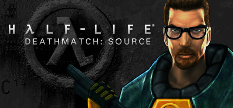

**Platforms:** Windows &nbsp;|&nbsp; **Genre:** Action &nbsp;|&nbsp; **Released:** May 1

> Half-Life Deathmatch: Source is a recreation of the first multiplayer game set in the Half-Life universe. Features all the classic weapons and most-played maps, now running on the Source engine.
>
> _Synopsis source: Steam_

[Steam](https://store.steampowered.com/app/360)

---

### Hammer Heads

**Platforms:** Windows, Browser &nbsp;|&nbsp; **Developer:** Nuclide Games &nbsp;|&nbsp; **Publisher:** PopCap Games &nbsp;|&nbsp; **Genre:** Action &nbsp;|&nbsp; **Released:** May 23, 2006

[Wikipedia](https://en.wikipedia.org/wiki/Hammer_Heads)

---

### Hamsterz Life

**Platforms:** Nintendo DS &nbsp;|&nbsp; **Developer:** Digital Kids &nbsp;|&nbsp; **Publisher:** Digital Kids, Ubisoft &nbsp;|&nbsp; **Genre:** Simulation &nbsp;|&nbsp; **Released:** November 2, 2006

[Wikipedia](https://en.wikipedia.org/wiki/Hamsterz_Life)

---

### Happy Feet

**Platforms:** Windows, PlayStation 2, GameCube, Game Boy Advance, Nintendo DS, Wii &nbsp;|&nbsp; **Released:** November 24 (EU)

---

### Happy Feet (USA)

**Platforms:** Windows, PlayStation 2, GameCube, Game Boy Advance, Nintendo DS, Wii &nbsp;|&nbsp; **Released:** November 14

[Wikipedia](https://en.wikipedia.org/wiki/Happy_Feet_(video_game))

---

### Hard Rock Casino

**Platforms:** Windows, macOS, Mobile phone, PlayStation 2 &nbsp;|&nbsp; **Developer:** MumboJumbo, Jamdat Mobile, FarSight Studios &nbsp;|&nbsp; **Publisher:** Jamdat Mobile, MacPlay, Crave Entertainment, Oxygen Games &nbsp;|&nbsp; **Genre:** Gambling &nbsp;|&nbsp; **Released:** November 28, 2006

[Wikipedia](https://en.wikipedia.org/wiki/Hard_Rock_Casino_(video_game))

---

### Harlem Globetrotters: World Tour

**Platforms:** Game Boy Advance &nbsp;|&nbsp; **Developer:** Full Fat &nbsp;|&nbsp; **Publisher:** Destination Software, Zoo Digital Publishing &nbsp;|&nbsp; **Genre:** Sports &nbsp;|&nbsp; **Released:** October 2, 2006

[Wikipedia](https://en.wikipedia.org/wiki/Harlem_Globetrotters:_World_Tour)

---

### Harukanaru Toki no Naka de 3

[Wikipedia](https://en.wikipedia.org/wiki/Harukanaru_Toki_no_Naka_de_3)

---

### Harukoi Otome

[Wikipedia](https://en.wikipedia.org/wiki/Harukoi_Otome)

---

### Harvest Moon: Magical Melody

**Platforms:** GameCube &nbsp;|&nbsp; **Released:** March 28

---

### Hero Online

**Platforms:** Windows &nbsp;|&nbsp; **Developer:** Netgame &nbsp;|&nbsp; **Publisher:** Mgame USA Inc. &nbsp;|&nbsp; **Genre:** MMORPG

[Wikipedia](https://en.wikipedia.org/wiki/Hero_Online)

---

### Heroes of Annihilated Empires

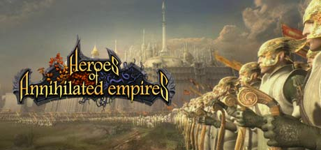

**Platforms:** Windows &nbsp;|&nbsp; **Genre:** Strategy &nbsp;|&nbsp; **Released:** October 6

> Heroes of Annihilated Empires - is a fantasy-based game from GSC Game World in the genre of RTS vs RPG for PC. 4 unique races awaits for the heroes, who want to fight in an Epic scale battles!
>
> _Synopsis source: Steam_

[Wikipedia](https://en.wikipedia.org/wiki/Heroes_of_Annihilated_Empires) · [Steam](https://store.steampowered.com/app/4800)

---

### Heroes of Might and Magic V

**Platforms:** Windows &nbsp;|&nbsp; **Released:** May 16

[Wikipedia](https://en.wikipedia.org/wiki/Heroes_of_Might_and_Magic_V)

---

### Heroes of Might and Magic V: Hammers of Fate

**Platforms:** Windows &nbsp;|&nbsp; **Released:** November 14

---

### Hi Hi Puffy AmiYumi: The Genie and the Amp

**Platforms:** Nintendo DS &nbsp;|&nbsp; **Released:** June 27

---

### Higurashi Daybreak

**Platforms:** Windows, PlayStation Portable &nbsp;|&nbsp; **Developer:** Twilight Frontier, Cavia &nbsp;|&nbsp; **Publisher:** Twilight Frontier, Alchemist &nbsp;|&nbsp; **Genre:** Third-person shooter &nbsp;|&nbsp; **Released:** August 13, 2006

[Wikipedia](https://en.wikipedia.org/wiki/Higurashi_Daybreak)

---

### Hiiro no Kakera

[Wikipedia](https://en.wikipedia.org/wiki/Hiiro_no_Kakera)

---

### Hitman: Blood Money

**Platforms:** Windows, PlayStation 2, Xbox, Xbox 360 &nbsp;|&nbsp; **Genre:** Action &nbsp;|&nbsp; **Released:** May 30

> Money Talks. Silence Pays. Prepare to Make a Killing. When assassins from Agent 47's contract agency, The ICA, are eliminated in a series of hits, it seems a larger, more powerful agency has entered the fray. Sensing he may be a target, 47 travels to America, and prepares to make a killing.
>
> _Synopsis source: Steam_

[Steam](https://store.steampowered.com/app/6860)

---

### Horké léto

**Platforms:** Windows &nbsp;|&nbsp; **Developer:** Maxon &nbsp;|&nbsp; **Publisher:** JRC Interactive &nbsp;|&nbsp; **Genre:** Adventure

[Wikipedia](https://en.wikipedia.org/wiki/Hork%C3%A9_l%C3%A9to)

---

### Horseland

**Platforms:** Browser &nbsp;|&nbsp; **Developer:** Horseland LLC &nbsp;|&nbsp; **Publisher:** Horseland LLC &nbsp;|&nbsp; **Genre:** Sim horse game Digital Pet &nbsp;|&nbsp; **Released:** September 1, 2006

[Wikipedia](https://en.wikipedia.org/wiki/Horseland)

---

### Horsez

**Platforms:** Nintendo DS, PlayStation 2, Windows &nbsp;|&nbsp; **Developer:** Virtual Toys &nbsp;|&nbsp; **Publisher:** Ubisoft &nbsp;|&nbsp; **Genre:** Strategy &nbsp;|&nbsp; **Released:** October 26, 2006

[Wikipedia](https://en.wikipedia.org/wiki/Horsez)

---

### Hot Wheels: All Out

**Platforms:** Game Boy Advance &nbsp;|&nbsp; **Developer:** TwoFiveSix &nbsp;|&nbsp; **Publisher:** Destination Software, ZOO Digital Publishing &nbsp;|&nbsp; **Genre:** Racing video game &nbsp;|&nbsp; **Released:** September 13, 2006

[Wikipedia](https://en.wikipedia.org/wiki/Hot_Wheels:_All_Out)

---

### Hummer Badlands

**Platforms:** PlayStation 2, Xbox &nbsp;|&nbsp; **Developer:** Eutechnyx &nbsp;|&nbsp; **Publisher:** Global Star Software &nbsp;|&nbsp; **Genre:** Racing &nbsp;|&nbsp; **Released:** April 13, 2006

[Wikipedia](https://en.wikipedia.org/wiki/Hummer_Badlands)

---

### Hyperball Racing

**Platforms:** Windows &nbsp;|&nbsp; **Developer:** Gabitasoft Entertainment &nbsp;|&nbsp; **Publisher:** Gabitasoft Entertainment &nbsp;|&nbsp; **Genre:** Racing &nbsp;|&nbsp; **Released:** September 18, 2006

[Wikipedia](https://en.wikipedia.org/wiki/Hyperball_Racing)

---

### I'm O.K – A Murder Simulator

**Platforms:** Windows &nbsp;|&nbsp; **Developer:** Thompsonsoft &nbsp;|&nbsp; **Publisher:** Thompsonsoft &nbsp;|&nbsp; **Genre:** Run and gun &nbsp;|&nbsp; **Released:** February 2006

[Wikipedia](https://en.wikipedia.org/wiki/I'm_O.K_%E2%80%93_A_Murder_Simulator)

---

### I/O

**Platforms:** PlayStation 2 &nbsp;|&nbsp; **Developer:** Regista &nbsp;|&nbsp; **Publisher:** GN Software, Asgard &nbsp;|&nbsp; **Genre:** Visual novel &nbsp;|&nbsp; **Released:** January 26, 2006

[Wikipedia](https://en.wikipedia.org/wiki/I/O_(video_game))

---

### Ice Age 2: The Meltdown

**Platforms:** Windows, PlayStation 2, Xbox, GameCube, Game Boy Advance, Nintendo DS, Wii &nbsp;|&nbsp; **Released:** March 31 (EU/JP)

---

### Ice Age 2: The Meltdown (USA)

**Platforms:** Windows, PlayStation 2, Xbox, GameCube, Game Boy Advance, Nintendo DS, Wii &nbsp;|&nbsp; **Released:** March 14

---

### Ice Hockey

**Platforms:** Wii &nbsp;|&nbsp; **Released:** December 11

[Wikipedia](https://en.wikipedia.org/wiki/Ice_Hockey_(1988_video_game))

---

### IGPX: Immortal Grand Prix

**Platforms:** PlayStation 2 &nbsp;|&nbsp; **Released:** September 12

---

### IHRA Drag Racing: Sportsman Edition

**Platforms:** PlayStation 2, Windows, Xbox &nbsp;|&nbsp; **Developer:** Bethesda Game Studios &nbsp;|&nbsp; **Publisher:** Bethesda Softworks &nbsp;|&nbsp; **Genre:** Racing &nbsp;|&nbsp; **Released:** June 12, 2006

[Wikipedia](https://en.wikipedia.org/wiki/IHRA_Drag_Racing:_Sportsman_Edition)

---

### IL-2 Sturmovik: 1946

**Platforms:** Windows &nbsp;|&nbsp; **Developer:** 1C:Maddox Games &nbsp;|&nbsp; **Publisher:** Ubisoft &nbsp;|&nbsp; **Genre:** Combat flight simulator &nbsp;|&nbsp; **Released:** December 8, 2006

[Wikipedia](https://en.wikipedia.org/wiki/IL-2_Sturmovik:_1946)

---

### Import Tuner Challenge

**Platforms:** Xbox 360 &nbsp;|&nbsp; **Developer:** Genki &nbsp;|&nbsp; **Publisher:** Genki, Ubisoft &nbsp;|&nbsp; **Genre:** Racing &nbsp;|&nbsp; **Released:** July 27, 2006

[Wikipedia](https://en.wikipedia.org/wiki/Import_Tuner_Challenge)

---

### Infinity Online

**Platforms:** Windows &nbsp;|&nbsp; **Developer:** Windysoft &nbsp;|&nbsp; **Publisher:** game & game &nbsp;|&nbsp; **Genre:** Action &nbsp;|&nbsp; **Released:** October 12, 2006

[Wikipedia](https://en.wikipedia.org/wiki/Infinity_Online)

---

### Inukami!

[Wikipedia](https://en.wikipedia.org/wiki/Inukami!)

---

### Iron Feather

**Platforms:** Nintendo DS &nbsp;|&nbsp; **Developer:** Konami &nbsp;|&nbsp; **Publisher:** Konami &nbsp;|&nbsp; **Genre:** Action RPG &nbsp;|&nbsp; **Released:** January 19, 2006

[Wikipedia](https://en.wikipedia.org/wiki/Iron_Feather)

---

### Izuna: Legend of the Unemployed Ninja

**Platforms:** Nintendo DS &nbsp;|&nbsp; **Developer:** Ninja Studio &nbsp;|&nbsp; **Publisher:** Success, Atlus, 505 Games &nbsp;|&nbsp; **Genre:** Roguelike, dungeon crawler &nbsp;|&nbsp; **Released:** June 8, 2006

[Wikipedia](https://en.wikipedia.org/wiki/Izuna:_Legend_of_the_Unemployed_Ninja)

---

### James Bond 007: From Russia with Love

**Platforms:** PlayStation Portable &nbsp;|&nbsp; **Released:** April 3

[Wikipedia](https://en.wikipedia.org/wiki/From_Russia_with_Love_(video_game))

---

### Jaws Unleashed (US)

**Platforms:** Windows &nbsp;|&nbsp; **Released:** October 18

[Wikipedia](https://en.wikipedia.org/wiki/Jaws_Unleashed)

---

### Jaws: Unleashed

**Platforms:** PlayStation 2, Xbox, Windows &nbsp;|&nbsp; **Released:** May 23 (EU/AU)

---

### Jeanne d'Arc

**Platforms:** PlayStation Portable &nbsp;|&nbsp; **Released:** November 22

[Wikipedia](https://en.wikipedia.org/wiki/Jeanne_d%27Arc_(video_game))

---

### Joint Task Force

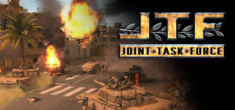

**Platforms:** Windows &nbsp;|&nbsp; **Genre:** Action, Strategy &nbsp;|&nbsp; **Released:** September 12

> Joint Task Force is the real-time strategy (RTS) game where you command the frontline forces in tomorrow's most hazardous conflicts. Lead twenty dramatic missions in explosive war-zones including the Middle East, Central Asia, and the Balkans.
>
> _Synopsis source: Steam_

[Wikipedia](https://en.wikipedia.org/wiki/Joint_Task_Force_(video_game)) · [Steam](https://store.steampowered.com/app/6400)

---

### Juiced: Eliminator

**Platforms:** PlayStation Portable &nbsp;|&nbsp; **Released:** June 28

---

### Juka and the Monophonic Menace

**Platforms:** Game Boy Advance &nbsp;|&nbsp; **Released:** October 24

[Wikipedia](https://en.wikipedia.org/wiki/Juka_and_the_Monophonic_Menace)

---

### Jump Ultimate Stars

**Platforms:** Nintendo DS &nbsp;|&nbsp; **Developer:** Ganbarion &nbsp;|&nbsp; **Publisher:** Nintendo &nbsp;|&nbsp; **Genre:** 2D versus fighting &nbsp;|&nbsp; **Released:** November 23, 2006

[Wikipedia](https://en.wikipedia.org/wiki/Jump_Ultimate_Stars)

---

### Just Cause

**Platforms:** Windows, PlayStation 2, Xbox, Xbox 360 &nbsp;|&nbsp; **Genre:** Action &nbsp;|&nbsp; **Released:** September 22

> Your world...Your rules!
>
> _Synopsis source: Steam_

[Wikipedia](https://en.wikipedia.org/wiki/Just_Cause_(video_game)) · [Steam](https://store.steampowered.com/app/6880)

---

### Justice League Heroes

**Platforms:** PlayStation 2, Xbox, Nintendo DS, PlayStation Portable &nbsp;|&nbsp; **Released:** October 17

[Wikipedia](https://en.wikipedia.org/wiki/Justice_League_Heroes)

---

### Justice League Heroes: The Flash

**Platforms:** Game Boy Advance &nbsp;|&nbsp; **Released:** October 17

---

### Jutland

**Platforms:** Windows &nbsp;|&nbsp; **Developer:** Norm Koger, Jim Rose &nbsp;|&nbsp; **Publisher:** Storm Eagle Studios &nbsp;|&nbsp; **Genre:** Ship simulation, strategy

[Wikipedia](https://en.wikipedia.org/wiki/Jutland_(video_game))

---

### Ka-Glom!

**Platforms:** BlackBerry OS, Windows Mobile, iOS &nbsp;|&nbsp; **Developer:** Magmic &nbsp;|&nbsp; **Publisher:** Magmic &nbsp;|&nbsp; **Genre:** Puzzle

[Wikipedia](https://en.wikipedia.org/wiki/Ka-Glom!)

---

### Kabus 22

**Platforms:** Windows &nbsp;|&nbsp; **Developer:** Son Işık Ltd. &nbsp;|&nbsp; **Publisher:** Vestel, Merscom &nbsp;|&nbsp; **Genre:** Survival horror &nbsp;|&nbsp; **Released:** December 25, 2006

[Wikipedia](https://en.wikipedia.org/wiki/Kabus_22)

---

### Kamaitachi no Yoru ×3

**Platforms:** PlayStation 2 &nbsp;|&nbsp; **Genre:** Visual novel &nbsp;|&nbsp; **Released:** July 27

[Wikipedia](https://en.wikipedia.org/wiki/Kamaitachi_no_Yoru_%C3%973)

---

### Kamiwaza

**Platforms:** PlayStation 2, Windows &nbsp;|&nbsp; **Developer:** Acquire &nbsp;|&nbsp; **Publisher:** Acquire, NIS America &nbsp;|&nbsp; **Genre:** Stealth, action &nbsp;|&nbsp; **Released:** August 31, 2006

[Wikipedia](https://en.wikipedia.org/wiki/Kamiwaza)

---

### Kanji Sonomama Rakubiki Jiten DS

**Platforms:** Nintendo DS &nbsp;|&nbsp; **Developer:** Nintendo SPD, Intelligent Systems &nbsp;|&nbsp; **Publisher:** Nintendo &nbsp;|&nbsp; **Genre:** Educational &nbsp;|&nbsp; **Released:** April 13, 2006

[Wikipedia](https://en.wikipedia.org/wiki/Kanji_Sonomama_Rakubiki_Jiten_DS)

---

### Karous

**Platforms:** Arcade, Wii, Windows &nbsp;|&nbsp; **Developer:** MileStone Inc. &nbsp;|&nbsp; **Publisher:** Sega, MileStone Inc. &nbsp;|&nbsp; **Genre:** Vertical-scrolling shooter &nbsp;|&nbsp; **Released:** November 15, 2006

[Wikipedia](https://en.wikipedia.org/wiki/Karous)

---

### Kashimashi: Girl Meets Girl

[Wikipedia](https://en.wikipedia.org/wiki/Kashimashi:_Girl_Meets_Girl)

---

### KDice

**Platforms:** Browser &nbsp;|&nbsp; **Developer:** Ryan Dewsbury &nbsp;|&nbsp; **Publisher:** aplayr &nbsp;|&nbsp; **Genre:** Turn-based Strategy &nbsp;|&nbsp; **Released:** December 1, 2006

[Wikipedia](https://en.wikipedia.org/wiki/KDice)

---

### Keepers: The Key of Life

**Platforms:** Windows &nbsp;|&nbsp; **Genre:** Adventure, Action, Puzzle

[Wikipedia](https://en.wikipedia.org/wiki/Keepers:_The_Key_of_Life)

---

### Keepsake

**Platforms:** Windows &nbsp;|&nbsp; **Released:** March 17 (EU)

[Wikipedia](https://en.wikipedia.org/wiki/Keepsake_(video_game))

---

### Kengo Zero

**Platforms:** Xbox 360 &nbsp;|&nbsp; **Developer:** Genki &nbsp;|&nbsp; **Publisher:** Genki, Majesco &nbsp;|&nbsp; **Genre:** Fighting, hack and slash &nbsp;|&nbsp; **Released:** September 7, 2006

[Wikipedia](https://en.wikipedia.org/wiki/Kengo_Zero)

---

### Kengo: Legend of the 9

**Platforms:** Xbox 360 &nbsp;|&nbsp; **Released:** September 7

[Wikipedia](https://en.wikipedia.org/wiki/Kengo#Legend_of_the_9)

---

### Keroro Gunsō the Super Movie

[Wikipedia](https://en.wikipedia.org/wiki/Keroro_Guns%C5%8D_the_Super_Movie)

---

### Kidou Senshi Gundam Seed Destiny: Rengou vs. Z.A.F.T. II

**Platforms:** Arcade, PlayStation 2 &nbsp;|&nbsp; **Developer:** Capcom &nbsp;|&nbsp; **Publisher:** Banpresto, Namco Bandai Games &nbsp;|&nbsp; **Genre:** Action-adventure &nbsp;|&nbsp; **Released:** June 29, 2006

[Wikipedia](https://en.wikipedia.org/wiki/Kidou_Senshi_Gundam_Seed_Destiny:_Rengou_vs._Z.A.F.T._II)

---

### Kidō Senshi Gundam: Senjō no Kizuna

**Platforms:** Arcade &nbsp;|&nbsp; **Developer:** Banpresto, Namco Bandai Games &nbsp;|&nbsp; **Publisher:** Namco Bandai Games &nbsp;|&nbsp; **Genre:** First-person shooter &nbsp;|&nbsp; **Released:** November 7, 2006

[Wikipedia](https://en.wikipedia.org/wiki/Kid%C5%8D_Senshi_Gundam:_Senj%C5%8D_no_Kizuna)

---

### Killzone: Liberation

**Platforms:** PlayStation Portable &nbsp;|&nbsp; **Released:** October 31

---

### KimiKiss

[Wikipedia](https://en.wikipedia.org/wiki/KimiKiss)

---

### King's Quest III

**Platforms:** Windows &nbsp;|&nbsp; **Developer:** Infamous Adventures &nbsp;|&nbsp; **Genre:** Adventure &nbsp;|&nbsp; **Released:** June 19, 2006

[Wikipedia](https://en.wikipedia.org/wiki/King's_Quest_III_(2006_video_game))

---

### Kingdom Hearts II

**Platforms:** PlayStation 2 &nbsp;|&nbsp; **Released:** September 28 (AU/EU)

[Wikipedia](https://en.wikipedia.org/wiki/Kingdom_Hearts_II)

---

### Kingdom Hearts II (USA)

**Platforms:** PlayStation 2 &nbsp;|&nbsp; **Released:** March 28

[Wikipedia](https://en.wikipedia.org/wiki/Kingdom_Hearts_II)

---

### Kinnikuman Muscle Grand Prix

[Wikipedia](https://en.wikipedia.org/wiki/Kinnikuman_Muscle_Grand_Prix)

---

### Kirby: Squeak Squad

**Platforms:** Nintendo DS &nbsp;|&nbsp; **Released:** November 2 (NA/JP)

---

### Knytt

**Platforms:** Windows &nbsp;|&nbsp; **Developer:** Nifflas &nbsp;|&nbsp; **Publisher:** Nifflas &nbsp;|&nbsp; **Genre:** Platformer &nbsp;|&nbsp; **Released:** December 10, 2006

[Wikipedia](https://en.wikipedia.org/wiki/Knytt)

---

### KOF: Maximum Impact 2

**Platforms:** PlayStation 2 &nbsp;|&nbsp; **Released:** April 27 (JP)

[Wikipedia](https://en.wikipedia.org/wiki/King_of_Fighters_Maximum_Impact_2)

---

### Konductra

**Platforms:** Nintendo DS &nbsp;|&nbsp; **Released:** October 31

[Wikipedia](https://en.wikipedia.org/wiki/Konductra)

---

### Kono Aozora ni Yakusoku o

[Wikipedia](https://en.wikipedia.org/wiki/Kono_Aozora_ni_Yakusoku_o)

---

### Kudos

**Platforms:** macOS, Windows &nbsp;|&nbsp; **Developer:** Positech Games &nbsp;|&nbsp; **Publisher:** Positech Games &nbsp;|&nbsp; **Genre:** Social simulation &nbsp;|&nbsp; **Released:** July 17, 2006

[Wikipedia](https://en.wikipedia.org/wiki/Kudos_(video_game))

---

### Kyo Kara Maoh!

[Wikipedia](https://en.wikipedia.org/wiki/Kyo_Kara_Maoh!)

---

### L.A. Street Racing

**Platforms:** Windows &nbsp;|&nbsp; **Developer:** Invictus Games &nbsp;|&nbsp; **Publisher:** Groove Games, City Interactive &nbsp;|&nbsp; **Genre:** Racing &nbsp;|&nbsp; **Released:** December 1, 2006

[Wikipedia](https://en.wikipedia.org/wiki/L.A._Street_Racing)

---

### La Tale

**Platforms:** Windows &nbsp;|&nbsp; **Developer:** Actoz Soft &nbsp;|&nbsp; **Publisher:** Actoz Soft, Papaya Play, Aeria Games, Happytuk &nbsp;|&nbsp; **Genre:** MMORPG &nbsp;|&nbsp; **Released:** July 21, 2006

[Wikipedia](https://en.wikipedia.org/wiki/La_Tale)

---

### La-Mulana

**Platforms:** Windows &nbsp;|&nbsp; **Developer:** GR3 Project, Nigoro &nbsp;|&nbsp; **Publisher:** GR3 Project, Playism, Asterizm, EnjoyUp Games &nbsp;|&nbsp; **Genre:** Metroidvania &nbsp;|&nbsp; **Released:** June 27, 2006

[Wikipedia](https://en.wikipedia.org/wiki/La-Mulana)

---

### Last Hope

**Platforms:** Neo Geo AES &nbsp;|&nbsp; **Developer:** NG:Dev.Team &nbsp;|&nbsp; **Publisher:** NG:Dev Team, RedSpotGames &nbsp;|&nbsp; **Genre:** Scrolling shooter &nbsp;|&nbsp; **Released:** July 10, 2006

[Wikipedia](https://en.wikipedia.org/wiki/Last_Hope_(video_game))

---

### Left Behind: Eternal Forces

**Platforms:** Windows &nbsp;|&nbsp; **Released:** November 14

---

### Legend: Legacy of the Dragons

[Wikipedia](https://en.wikipedia.org/wiki/Legend:_Legacy_of_the_Dragons)

---

### LEGO Star Wars II: The Original Trilogy

**Platforms:** Windows, PlayStation 2, Xbox, GameCube, Xbox 360, Nintendo DS, PlayStation Portable &nbsp;|&nbsp; **Released:** September 12

---

### Lemmings

**Platforms:** PlayStation Portable &nbsp;|&nbsp; **Released:** May 23

[Wikipedia](https://en.wikipedia.org/wiki/Lemmings_(video_game)#Ports_and_remakes)

---

### Let's Go Jungle!: Lost on the Island of Spice

**Platforms:** Arcade &nbsp;|&nbsp; **Developer:** Sega &nbsp;|&nbsp; **Publisher:** Sega &nbsp;|&nbsp; **Genre:** Shooter &nbsp;|&nbsp; **Released:** December 14, 2006

[Wikipedia](https://en.wikipedia.org/wiki/Let's_Go_Jungle!:_Lost_on_the_Island_of_Spice)

---

### Let's Make a Soccer Team!

**Platforms:** PlayStation 2 &nbsp;|&nbsp; **Developer:** Sega &nbsp;|&nbsp; **Publisher:** Sega &nbsp;|&nbsp; **Genre:** Football Management &nbsp;|&nbsp; **Released:** March 29, 2006

[Wikipedia](https://en.wikipedia.org/wiki/Let's_Make_a_Soccer_Team!)

---

### Line Rider

**Platforms:** Browser, iOS &nbsp;|&nbsp; **Developer:** Boštjan Čadež &nbsp;|&nbsp; **Publisher:** inXile Entertainment, Genius Products, Deep Silver &nbsp;|&nbsp; **Released:** September 23, 2006

[Wikipedia](https://en.wikipedia.org/wiki/Line_Rider)

---

### Lionel Trains: On Track

**Platforms:** Nintendo DS &nbsp;|&nbsp; **Developer:** Black Lantern Studios &nbsp;|&nbsp; **Publisher:** DSI Games, Zoo Digital Publishing &nbsp;|&nbsp; **Genre:** Business simulation &nbsp;|&nbsp; **Released:** December 6, 2006

[Wikipedia](https://en.wikipedia.org/wiki/Lionel_Trains:_On_Track)

---

### LocoMania

**Platforms:** Windows &nbsp;|&nbsp; **Developer:** 7FX &nbsp;|&nbsp; **Publisher:** Lighthouse Interactive &nbsp;|&nbsp; **Genre:** Simulation &nbsp;|&nbsp; **Released:** February 24, 2006

[Wikipedia](https://en.wikipedia.org/wiki/LocoMania)

---

### LocoRoco

**Platforms:** PlayStation Portable &nbsp;|&nbsp; **Released:** September 5

[Wikipedia](https://en.wikipedia.org/wiki/LocoRoco)

---

### London Taxi: Rush Hour

**Platforms:** PlayStation 2, Windows &nbsp;|&nbsp; **Developer:** Data Design Interactive &nbsp;|&nbsp; **Publisher:** Metro3D Europe, Data Design Interactive, Bold Games &nbsp;|&nbsp; **Genre:** Racing &nbsp;|&nbsp; **Released:** June 23, 2006

[Wikipedia](https://en.wikipedia.org/wiki/London_Taxi:_Rush_Hour)

---

### LostMagic

**Platforms:** Nintendo DS &nbsp;|&nbsp; **Released:** April 25

[Wikipedia](https://en.wikipedia.org/wiki/LostMagic)

---

### Lucinda Green's Equestrian Challenge

**Platforms:** PlayStation 2, Windows &nbsp;|&nbsp; **Developer:** IR Gurus &nbsp;|&nbsp; **Publisher:** Red Mile Entertainment &nbsp;|&nbsp; **Genre:** Sports game &nbsp;|&nbsp; **Released:** November 21, 2006

[Wikipedia](https://en.wikipedia.org/wiki/Lucinda_Green's_Equestrian_Challenge)

---

### Lumines

**Platforms:** Xbox 360 &nbsp;|&nbsp; **Released:** October 18

[Wikipedia](https://en.wikipedia.org/wiki/Lumines)

---

### Lumines II

**Platforms:** PlayStation Portable &nbsp;|&nbsp; **Released:** November 3

[Wikipedia](https://en.wikipedia.org/wiki/Lumines_II)

---

### Lumines Live!

**Platforms:** Xbox 360 &nbsp;|&nbsp; **Developer:** Q Entertainment &nbsp;|&nbsp; **Publisher:** Microsoft Studios &nbsp;|&nbsp; **Genre:** Puzzle &nbsp;|&nbsp; **Released:** October 18, 2006

[Wikipedia](https://en.wikipedia.org/wiki/Lumines_Live!)

---

### Luxor 2

**Platforms:** Windows &nbsp;|&nbsp; **Developer:** MumboJumbo &nbsp;|&nbsp; **Publisher:** Xbox Game Studios &nbsp;|&nbsp; **Genre:** Puzzle &nbsp;|&nbsp; **Released:** October 10, 2006

[Wikipedia](https://en.wikipedia.org/wiki/Luxor_2)

---

### Mad Rally

**Platforms:** Windows &nbsp;|&nbsp; **Developer:** TMReality &nbsp;|&nbsp; **Publisher:** Play Publishing &nbsp;|&nbsp; **Genre:** Racing &nbsp;|&nbsp; **Released:** May 4, 2006

[Wikipedia](https://en.wikipedia.org/wiki/Mad_Rally)

---

### Mad Tracks

**Platforms:** Windows &nbsp;|&nbsp; **Developer:** Load Inc. &nbsp;|&nbsp; **Publisher:** Micro Application, Frogster Interactive, Akella, Nicolas Games &nbsp;|&nbsp; **Genre:** Racing &nbsp;|&nbsp; **Released:** February 17, 2006

[Wikipedia](https://en.wikipedia.org/wiki/Mad_Tracks)

---

### Madden NFL 07

**Platforms:** PlayStation 2, PlayStation 3, PlayStation Portable, Xbox, Xbox 360, Windows, Nintendo DS, Game Boy Advance, Wii, GameCube, Mobile phone &nbsp;|&nbsp; **Developer:** EA Tiburon, EA Canada, HB Studios, Exient Entertainment &nbsp;|&nbsp; **Publisher:** EA Sports &nbsp;|&nbsp; **Genre:** Sports &nbsp;|&nbsp; **Released:** August 22, 2006

[Wikipedia](https://en.wikipedia.org/wiki/Madden_NFL_07)

---

### Mage Knight: Apocalypse

**Platforms:** Windows &nbsp;|&nbsp; **Developer:** InterServ International &nbsp;|&nbsp; **Publisher:** Namco Bandai Games, Deep Silver &nbsp;|&nbsp; **Genre:** Action role-playing &nbsp;|&nbsp; **Released:** September 26, 2006

[Wikipedia](https://en.wikipedia.org/wiki/Mage_Knight:_Apocalypse)

---

### Mage Knight: Destiny's Soldier

**Platforms:** Nintendo DS &nbsp;|&nbsp; **Released:** September 26

---

### Magical Starsign

**Platforms:** Nintendo DS &nbsp;|&nbsp; **Released:** October 23

[Wikipedia](https://en.wikipedia.org/wiki/Magical_Starsign)

---

### Magnant

**Platforms:** Windows &nbsp;|&nbsp; **Developer:** Mohydine Entertainment &nbsp;|&nbsp; **Genre:** RTS

[Wikipedia](https://en.wikipedia.org/wiki/Magnant_(video_game))

---

### Magnetic Joe

**Platforms:** Mobile phone, iOS &nbsp;|&nbsp; **Developer:** Most Wanted Entertainment &nbsp;|&nbsp; **Publisher:** HD Publishing &nbsp;|&nbsp; **Genre:** Puzzle-platform

[Wikipedia](https://en.wikipedia.org/wiki/Magnetic_Joe)

---

### Magnetica

**Platforms:** Nintendo DS &nbsp;|&nbsp; **Released:** June 5

[Wikipedia](https://en.wikipedia.org/wiki/Magnetica)

---

### Major League Baseball 2K6

**Platforms:** GameCube &nbsp;|&nbsp; **Released:** June 12

[Wikipedia](https://en.wikipedia.org/wiki/Major_League_Baseball_2K6)

---

### Marble Blast Ultra

**Platforms:** Xbox 360 &nbsp;|&nbsp; **Released:** January 25

[Wikipedia](https://en.wikipedia.org/wiki/Marble_Blast_Ultra)

---

### Marc Eckō's Getting Up: Contents Under Pressure

**Platforms:** Windows, PlayStation 2, Xbox &nbsp;|&nbsp; **Genre:** Action, Adventure &nbsp;|&nbsp; **Released:** February 14

> Play as Trane, a &quot;toy&quot; graffiti artist with the street smarts, athletic prowess and vision to become an &quot;All City King&quot; - the most reputable of all graffiti artists. Along your quest, uncover the mayor's deep, dark secret and use your fighting talents and high-wire graffiti to expose the city's leader as a corrupt...
>
> _Synopsis source: Steam_

[Steam](https://store.steampowered.com/app/260190)

---

### Mario Bros. (NES)

**Platforms:** Wii &nbsp;|&nbsp; **Released:** November 19

[Wikipedia](https://en.wikipedia.org/wiki/Mario_Bros.)

---

### Mario Hoops 3-on-3

**Platforms:** Nintendo DS &nbsp;|&nbsp; **Developer:** Square Enix &nbsp;|&nbsp; **Publisher:** Nintendo &nbsp;|&nbsp; **Genre:** Sports &nbsp;|&nbsp; **Released:** July 27, 2006

[Wikipedia](https://en.wikipedia.org/wiki/Mario_Hoops_3-on-3)

---

### Mario vs. Donkey Kong 2: March of the Minis

**Platforms:** Nintendo DS &nbsp;|&nbsp; **Released:** September 25

---

### Marvel: Ultimate Alliance

**Platforms:** Windows, PlayStation 2, Xbox, Xbox 360, Game Boy Advance, PlayStation 3 &nbsp;|&nbsp; **Released:** October 24

---

### Marvel: Ultimate Alliance (USA)

**Platforms:** Wii &nbsp;|&nbsp; **Released:** November 19

---

### Mashed

**Platforms:** PlayStation 2, Xbox &nbsp;|&nbsp; **Released:** December 13

[Wikipedia](https://en.wikipedia.org/wiki/Mashed_(video_game))

---

### Massive Assault Network 2

**Platforms:** Windows &nbsp;|&nbsp; **Publisher:** Wargaming &nbsp;|&nbsp; **Genre:** Turn-based tactics &nbsp;|&nbsp; **Released:** November 22, 2006

[Wikipedia](https://en.wikipedia.org/wiki/Massive_Assault_Network_2)

---

### Maximum-Football

**Platforms:** Windows &nbsp;|&nbsp; **Developer:** Wintervalley Software &nbsp;|&nbsp; **Publisher:** Matrix Games &nbsp;|&nbsp; **Genre:** Sports &nbsp;|&nbsp; **Released:** March 3, 2006

[Wikipedia](https://en.wikipedia.org/wiki/Maximum-Football)

---

### Mazes of Fate

**Platforms:** Game Boy Advance &nbsp;|&nbsp; **Developer:** Sabarasa &nbsp;|&nbsp; **Publisher:** O~3 Entertainment, Graffiti Entertainment, Neko Entertainment &nbsp;|&nbsp; **Genre:** Role-playing &nbsp;|&nbsp; **Released:** December 12, 2006

[Wikipedia](https://en.wikipedia.org/wiki/Mazes_of_Fate)

---

### McDonald's Video Game

**Platforms:** Browser &nbsp;|&nbsp; **Developer:** Molleindustria &nbsp;|&nbsp; **Publisher:** Molleindustria &nbsp;|&nbsp; **Genre:** Tycoon simulation, parody &nbsp;|&nbsp; **Released:** February 1, 2006

[Wikipedia](https://en.wikipedia.org/wiki/McDonald's_Video_Game)

---

### Me & My Katamari

**Platforms:** PlayStation Portable &nbsp;|&nbsp; **Released:** March 21

[Wikipedia](https://en.wikipedia.org/wiki/Me_%26_My_Katamari)

---

### MechAssault: Phantom War

**Platforms:** Nintendo DS &nbsp;|&nbsp; **Released:** September 12

---

### Medal of Honor: Heroes

**Platforms:** PlayStation Portable &nbsp;|&nbsp; **Released:** October 20

---

### Medieval 2: Total War

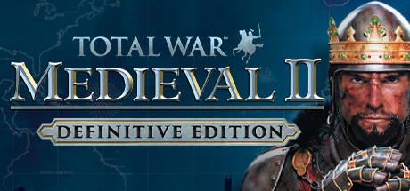

**Platforms:** Windows &nbsp;|&nbsp; **Genre:** Strategy &nbsp;|&nbsp; **Released:** November 13

> Spanning the most turbulent era in Western history, your quest for territory and power takes you through Europe, Africa, the Middle East, and even onto the shores of the New World.
>
> _Synopsis source: Steam_

[Steam](https://store.steampowered.com/app/4700)

---

### Medieval II: Total War

**Platforms:** Windows &nbsp;|&nbsp; **Publisher:** Sega &nbsp;|&nbsp; **Genre:** Strategy &nbsp;|&nbsp; **Released:** November 10, 2006

> Spanning the most turbulent era in Western history, your quest for territory and power takes you through Europe, Africa, the Middle East, and even onto the shores of the New World.
>
> _Synopsis source: Steam_

[Steam](https://store.steampowered.com/app/4700)

---

### Medieval Mayhem

**Platforms:** Atari 2600 &nbsp;|&nbsp; **Publisher:** SpiceWare &nbsp;|&nbsp; **Genre:** Action

[Wikipedia](https://en.wikipedia.org/wiki/Medieval_Mayhem)

---

### Mega Man Battle Network 6

**Platforms:** Game Boy Advance &nbsp;|&nbsp; **Released:** June 13

[Wikipedia](https://en.wikipedia.org/wiki/Mega_Man_Battle_Network_6)

---

### Mega Man Powered Up

**Platforms:** PlayStation Portable &nbsp;|&nbsp; **Released:** March 14

[Wikipedia](https://en.wikipedia.org/wiki/Mega_Man_Powered_Up)

---

### Mega Man X Collection

**Platforms:** GameCube, PlayStation 2 &nbsp;|&nbsp; **Released:** January 10

[Wikipedia](https://en.wikipedia.org/wiki/Mega_Man_X_Collection)

---

### Mega Man ZX

**Platforms:** Nintendo DS &nbsp;|&nbsp; **Released:** September 12

[Wikipedia](https://en.wikipedia.org/wiki/Mega_Man_ZX)

---

### Megachu!

[Wikipedia](https://en.wikipedia.org/wiki/Megachu!)

---

### Megami Ibunroku Persona: Ikū no Tō-hen

**Platforms:** Mobile phone &nbsp;|&nbsp; **Developer:** Bbmf &nbsp;|&nbsp; **Publisher:** Bbmf, G-Mode &nbsp;|&nbsp; **Genre:** Role-playing &nbsp;|&nbsp; **Released:** December 1, 2006

[Wikipedia](https://en.wikipedia.org/wiki/Megami_Ibunroku_Persona:_Ik%C5%AB_no_T%C5%8D-hen)

---

### Melbourne Cup Challenge

**Platforms:** Windows, PlayStation 2, Xbox &nbsp;|&nbsp; **Developer:** Sidhe Interactive &nbsp;|&nbsp; **Publisher:** Tru Blu Entertainment, Home Entertainment Suppliers &nbsp;|&nbsp; **Genre:** Sports, racing simulation &nbsp;|&nbsp; **Released:** December 8, 2006

[Wikipedia](https://en.wikipedia.org/wiki/Melbourne_Cup_Challenge)

---

### Mercury Meltdown

**Platforms:** PlayStation Portable &nbsp;|&nbsp; **Released:** October 3

[Wikipedia](https://en.wikipedia.org/wiki/Mercury_Meltdown)

---

### Mercury Meltdown Remix

**Platforms:** PlayStation 2 &nbsp;|&nbsp; **Released:** December 4

[Wikipedia](https://en.wikipedia.org/wiki/Mercury_Meltdown)

---

### Metal Gear Acid 2

**Platforms:** PlayStation Portable &nbsp;|&nbsp; **Released:** March 21

[Wikipedia](https://en.wikipedia.org/wiki/Metal_Gear_Acid_2)

---

### Metal Gear Solid 3: Subsistence

**Platforms:** PlayStation 2 &nbsp;|&nbsp; **Released:** March 14

---

### Metal Gear Solid: Portable Ops

**Platforms:** PlayStation Portable &nbsp;|&nbsp; **Released:** December 5

---

### Metal Saga: Season of Steel

**Platforms:** Nintendo DS &nbsp;|&nbsp; **Developer:** Crea-Tech &nbsp;|&nbsp; **Publisher:** Success &nbsp;|&nbsp; **Genre:** Role-playing video game &nbsp;|&nbsp; **Released:** June 15, 2006

[Wikipedia](https://en.wikipedia.org/wiki/Metal_Saga:_Season_of_Steel)

---

### Metal Slug

**Platforms:** PlayStation 2 &nbsp;|&nbsp; **Developer:** SNK Playmore &nbsp;|&nbsp; **Publisher:** SNK Playmore &nbsp;|&nbsp; **Genre:** Run and gun, third-person shooter &nbsp;|&nbsp; **Released:** June 29, 2006

[Wikipedia](https://en.wikipedia.org/wiki/Metal_Slug_(2006_video_game))

---

### Metal Slug 6

**Platforms:** Arcade, PlayStation 2 &nbsp;|&nbsp; **Developer:** Noise Factory, SNK Playmore &nbsp;|&nbsp; **Publisher:** Sega, SNK Playmore &nbsp;|&nbsp; **Genre:** Run and gun &nbsp;|&nbsp; **Released:** February 24, 2006

[Wikipedia](https://en.wikipedia.org/wiki/Metal_Slug_6)

---

### Metroid Prime Hunters

**Platforms:** Nintendo DS &nbsp;|&nbsp; **Released:** March 20

[Wikipedia](https://en.wikipedia.org/wiki/Metroid_Prime_Hunters)

---

### Metropolismania

**Platforms:** PlayStation 2 &nbsp;|&nbsp; **Developer:** Indi &nbsp;|&nbsp; **Publisher:** Media Factory, Natsume &nbsp;|&nbsp; **Genre:** City-building

[Wikipedia](https://en.wikipedia.org/wiki/Metropolismania)

---

### Miami Nights: Singles in the City

**Platforms:** Mobile phone &nbsp;|&nbsp; **Developer:** Gameloft Bucharest &nbsp;|&nbsp; **Publisher:** DS:, Ubisoft, J2ME, BlackBerry:, Gameloft &nbsp;|&nbsp; **Genre:** Dating simulator &nbsp;|&nbsp; **Released:** November 1, 2006

[Wikipedia](https://en.wikipedia.org/wiki/Miami_Nights:_Singles_in_the_City)

---

### Miami Vice: The Game

**Platforms:** PlayStation Portable &nbsp;|&nbsp; **Released:** July 18

---

### Microsoft Flight Simulator X

**Platforms:** Windows &nbsp;|&nbsp; **Released:** October 13

[Wikipedia](https://en.wikipedia.org/wiki/Microsoft_Flight_Simulator_X)

---

### Midway Arcade Treasures Deluxe Edition

**Platforms:** Windows &nbsp;|&nbsp; **Developer:** Midway, Digital Eclipse, GameStar, Midway Studios San Diego &nbsp;|&nbsp; **Publisher:** Midway, Zoo Digital Publishing &nbsp;|&nbsp; **Genre:** Various &nbsp;|&nbsp; **Released:** February 15, 2006

[Wikipedia](https://en.wikipedia.org/wiki/Midway_Arcade_Treasures_Deluxe_Edition)

---

### Military Madness

**Platforms:** Wii &nbsp;|&nbsp; **Released:** December 18

[Wikipedia](https://en.wikipedia.org/wiki/Military_Madness)

---

### Milon no Hoshizora Shabon: Puzzle Kumikyoku

**Platforms:** Nintendo DS &nbsp;|&nbsp; **Developer:** Takumi Corporation &nbsp;|&nbsp; **Publisher:** Hudson Soft &nbsp;|&nbsp; **Genre:** Puzzle &nbsp;|&nbsp; **Released:** July 6, 2006

[Wikipedia](https://en.wikipedia.org/wiki/Milon_no_Hoshizora_Shabon:_Puzzle_Kumikyoku)

---

### Mind Quiz

**Platforms:** Nintendo DS, PlayStation Portable &nbsp;|&nbsp; **Developer:** Sega &nbsp;|&nbsp; **Publisher:** Sega, Ubisoft &nbsp;|&nbsp; **Genre:** Educational &nbsp;|&nbsp; **Released:** September 14, 2006

[Wikipedia](https://en.wikipedia.org/wiki/Mind_Quiz)

---

### Minna de Kitaeru Zenno Training

**Platforms:** Arcade &nbsp;|&nbsp; **Developer:** Namco Bandai Games &nbsp;|&nbsp; **Publisher:** Namco Bandai Games &nbsp;|&nbsp; **Genre:** Noutore &nbsp;|&nbsp; **Released:** December 21, 2006

[Wikipedia](https://en.wikipedia.org/wiki/Minna_de_Kitaeru_Zenno_Training)

---

### Miyasato Miyoshi Kyoudai Naizou: Sega Golf Club

**Platforms:** PlayStation 3 &nbsp;|&nbsp; **Developer:** Sega &nbsp;|&nbsp; **Publisher:** Sega &nbsp;|&nbsp; **Genre:** Sports &nbsp;|&nbsp; **Released:** November 11, 2006

[Wikipedia](https://en.wikipedia.org/wiki/Miyasato_Miyoshi_Kyoudai_Naizou:_Sega_Golf_Club)

---

### MLB 06: The Show

**Platforms:** PlayStation 2, PlayStation Portable &nbsp;|&nbsp; **Developer:** San Diego Studio &nbsp;|&nbsp; **Publisher:** Sony Computer Entertainment &nbsp;|&nbsp; **Genre:** Sports &nbsp;|&nbsp; **Released:** February 28, 2006

[Wikipedia](https://en.wikipedia.org/wiki/MLB_06:_The_Show)

---

### MLB Slugfest 2006

**Platforms:** PlayStation 2, Xbox &nbsp;|&nbsp; **Developer:** Blue Shift &nbsp;|&nbsp; **Publisher:** Midway Home Entertainment &nbsp;|&nbsp; **Genre:** Sports &nbsp;|&nbsp; **Released:** June 5, 2006

[Wikipedia](https://en.wikipedia.org/wiki/MLB_Slugfest_2006)

---

### Mobile Suit Gundam: Crossfire

**Platforms:** PlayStation 3 &nbsp;|&nbsp; **Released:** November 13

---

### Monopoly Here and Now

**Platforms:** Mobile phone &nbsp;|&nbsp; **Developer:** Glu Mobile, Encore Software, EA Mobile, Hasbro &nbsp;|&nbsp; **Released:** October 1, 2006

[Wikipedia](https://en.wikipedia.org/wiki/Monopoly_Here_and_Now_(video_game))

---

### Monster 4x4: World Circuit

**Platforms:** Xbox, Wii &nbsp;|&nbsp; **Developer:** Ubisoft Barcelona &nbsp;|&nbsp; **Publisher:** Ubisoft &nbsp;|&nbsp; **Genre:** Racing &nbsp;|&nbsp; **Released:** March 23, 2006

[Wikipedia](https://en.wikipedia.org/wiki/Monster_4x4:_World_Circuit)

---

### Monster Bomber

**Platforms:** Nintendo DS &nbsp;|&nbsp; **Developer:** Taito &nbsp;|&nbsp; **Publisher:** Taito, Majesco, 505 Games, Red Ant Enterprises &nbsp;|&nbsp; **Genre:** Puzzle &nbsp;|&nbsp; **Released:** March 23, 2006

[Wikipedia](https://en.wikipedia.org/wiki/Monster_Bomber)

---

### Monster House

**Platforms:** PlayStation 2, GameCube, Game Boy Advance, Nintendo DS &nbsp;|&nbsp; **Released:** July 18 (NA/EU/AU)

[Wikipedia](https://en.wikipedia.org/wiki/Monster_House_(video_game))

---

### Monster Hunter 2

**Platforms:** PlayStation 2 &nbsp;|&nbsp; **Developer:** Capcom &nbsp;|&nbsp; **Publisher:** Capcom &nbsp;|&nbsp; **Genre:** Action role-playing &nbsp;|&nbsp; **Released:** February 16, 2006

[Wikipedia](https://en.wikipedia.org/wiki/Monster_Hunter_2)

---

### Monster Hunter Freedom

**Platforms:** PlayStation Portable &nbsp;|&nbsp; **Released:** May 23

[Wikipedia](https://en.wikipedia.org/wiki/Monster_Hunter_Freedom)

---

### Mortal Kombat: Armageddon

**Platforms:** PlayStation 2, Xbox &nbsp;|&nbsp; **Released:** October 11

---

### Mortal Kombat: Unchained

**Platforms:** PlayStation Portable &nbsp;|&nbsp; **Released:** November 13

---

### Moscow to Berlin: Red Siege

**Platforms:** Windows &nbsp;|&nbsp; **Developer:** INtex Publishing, Monte Cristo &nbsp;|&nbsp; **Publisher:** Koch Media, Cinemaware Marquee &nbsp;|&nbsp; **Genre:** Real-time strategy &nbsp;|&nbsp; **Released:** June 28, 2006

[Wikipedia](https://en.wikipedia.org/wiki/Moscow_to_Berlin:_Red_Siege)

---

### Mother 3

**Platforms:** Game Boy Advance &nbsp;|&nbsp; **Released:** April 20 (JP)

[Wikipedia](https://en.wikipedia.org/wiki/Mother_3)

---

### MotoGP

**Platforms:** PlayStation Portable &nbsp;|&nbsp; **Developer:** Namco Bandai Games &nbsp;|&nbsp; **Publisher:** Namco Bandai Games, Sony Computer Entertainment &nbsp;|&nbsp; **Genre:** Racing &nbsp;|&nbsp; **Released:** August 24, 2006

[Wikipedia](https://en.wikipedia.org/wiki/MotoGP_(2006_video_game))

---

### MotoGP '06

**Platforms:** Xbox 360 &nbsp;|&nbsp; **Released:** June 12

[Wikipedia](https://en.wikipedia.org/wiki/MotoGP_%2706)

---

### MS Saga: A New Dawn

**Platforms:** PlayStation 2 &nbsp;|&nbsp; **Released:** February 21

---

### MTX Mototrax

**Platforms:** PlayStation Portable &nbsp;|&nbsp; **Released:** June 28

[Wikipedia](https://en.wikipedia.org/wiki/MTX_Mototrax)

---

### Mushihimesama Futari

**Platforms:** Arcade &nbsp;|&nbsp; **Developer:** Cave, M2 &nbsp;|&nbsp; **Publisher:** AMI, Cave &nbsp;|&nbsp; **Genre:** Manic shooter &nbsp;|&nbsp; **Released:** October 27, 2006

[Wikipedia](https://en.wikipedia.org/wiki/Mushihimesama_Futari)

---

### Muv-Luv

[Wikipedia](https://en.wikipedia.org/wiki/Muv-Luv)

---

### MVP 06: NCAA Baseball

**Platforms:** PlayStation 2, Xbox &nbsp;|&nbsp; **Developer:** EA Canada &nbsp;|&nbsp; **Publisher:** Electronic Arts &nbsp;|&nbsp; **Genre:** Sports &nbsp;|&nbsp; **Released:** January 17, 2006

[Wikipedia](https://en.wikipedia.org/wiki/MVP_06:_NCAA_Baseball)

---

### MX vs. ATV: On the Edge

**Platforms:** PlayStation Portable &nbsp;|&nbsp; **Released:** February 27

---

### My Frogger Toy Trials

**Platforms:** Nintendo DS &nbsp;|&nbsp; **Developer:** Konami Computer Entertainment Hawaii &nbsp;|&nbsp; **Publisher:** Konami &nbsp;|&nbsp; **Genre:** Action &nbsp;|&nbsp; **Released:** November 7, 2006

[Wikipedia](https://en.wikipedia.org/wiki/My_Frogger_Toy_Trials)

---

### My Little Flufties

**Platforms:** Windows &nbsp;|&nbsp; **Developer:** DK Games &nbsp;|&nbsp; **Publisher:** Lexicon Entertainment &nbsp;|&nbsp; **Genre:** Simulation &nbsp;|&nbsp; **Released:** October 13, 2006

[Wikipedia](https://en.wikipedia.org/wiki/My_Little_Flufties)

---

### Myth War Online

**Platforms:** Windows &nbsp;|&nbsp; **Developer:** Unigium &nbsp;|&nbsp; **Publisher:** IGG Inc. &nbsp;|&nbsp; **Genre:** MMORPG

[Wikipedia](https://en.wikipedia.org/wiki/Myth_War_Online)

---

### Nacho Libre

**Platforms:** Nintendo DS &nbsp;|&nbsp; **Released:** October 24

[Wikipedia](https://en.wikipedia.org/wiki/Nacho_Libre_(video_game))

---

### Naked War

**Platforms:** Windows &nbsp;|&nbsp; **Developer:** Zee3 &nbsp;|&nbsp; **Publisher:** Zee3 &nbsp;|&nbsp; **Genre:** turn-based strategy, Play-by-mail game &nbsp;|&nbsp; **Released:** October 2006

[Wikipedia](https://en.wikipedia.org/wiki/Naked_War)

---

### Nanatsuiro Drops

[Wikipedia](https://en.wikipedia.org/wiki/Nanatsuiro_Drops)

---

### Nancy Drew: Danger by Design

**Platforms:** Windows &nbsp;|&nbsp; **Genre:** Adventure &nbsp;|&nbsp; **Released:** July 24

> Go Undercover in Paris and Unravel a Case in Style!
>
> _Synopsis source: Steam_

[Steam](https://store.steampowered.com/app/31800)

---

### Nancy Drew: The Creature of Kapu Cave

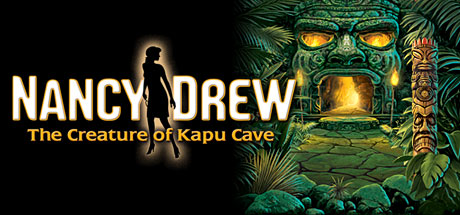

**Platforms:** Windows &nbsp;|&nbsp; **Genre:** Adventure &nbsp;|&nbsp; **Released:** October 12

> Team up with the Hardy Boys® and Track an Ancient Legend Through Hawaii!
>
> _Synopsis source: Steam_

[Steam](https://store.steampowered.com/app/31900)

---

### Naruto: Ninja Council

**Platforms:** Game Boy Advance &nbsp;|&nbsp; **Released:** March 7

---

### Naruto: Ninja Destiny

**Platforms:** Nintendo DS &nbsp;|&nbsp; **Developer:** DreamFactory &nbsp;|&nbsp; **Publisher:** Takara Tomy, Tomy &nbsp;|&nbsp; **Genre:** Fighting game &nbsp;|&nbsp; **Released:** December 14, 2006

[Wikipedia](https://en.wikipedia.org/wiki/Naruto:_Ninja_Destiny)

---

### Naruto: Ultimate Ninja Heroes 2 - The Phantom Fortress

**Platforms:** PlayStation Portable &nbsp;|&nbsp; **Developer:** CyberConnect2, Artdink &nbsp;|&nbsp; **Publisher:** Namco Bandai Games &nbsp;|&nbsp; **Genre:** Fighting game &nbsp;|&nbsp; **Released:** March 30, 2006

[Wikipedia](https://en.wikipedia.org/wiki/Naruto:_Ultimate_Ninja_Heroes_2_-_The_Phantom_Fortress)

---

### NASCAR 07

**Platforms:** PlayStation 2, PlayStation Portable, Xbox &nbsp;|&nbsp; **Developer:** EA Tiburon, Exient Entertainment &nbsp;|&nbsp; **Publisher:** EA Sports &nbsp;|&nbsp; **Genre:** Racing &nbsp;|&nbsp; **Released:** September 8, 2006

[Wikipedia](https://en.wikipedia.org/wiki/NASCAR_07)

---

### Naval Ops: Warship Gunner 2

**Platforms:** PlayStation 2, PlayStation Portable &nbsp;|&nbsp; **Developer:** Koei &nbsp;|&nbsp; **Publisher:** Koei &nbsp;|&nbsp; **Genre:** Vehicle simulation game &nbsp;|&nbsp; **Released:** February 23, 2006

[Wikipedia](https://en.wikipedia.org/wiki/Naval_Ops:_Warship_Gunner_2)

---

### NBA 07

**Platforms:** PlayStation 2, PlayStation 3, PlayStation Portable &nbsp;|&nbsp; **Developer:** San Diego Studio, A.C.R.O.N.Y.M. Games &nbsp;|&nbsp; **Publisher:** Sony Computer Entertainment &nbsp;|&nbsp; **Genre:** Sports &nbsp;|&nbsp; **Released:** September 25, 2006

[Wikipedia](https://en.wikipedia.org/wiki/NBA_07)

---

### NBA 2K7

**Platforms:** PlayStation 2, PlayStation 3, Xbox, Xbox 360 &nbsp;|&nbsp; **Developer:** Visual Concepts &nbsp;|&nbsp; **Publisher:** 2K &nbsp;|&nbsp; **Genre:** Sports &nbsp;|&nbsp; **Released:** September 26, 2006

[Wikipedia](https://en.wikipedia.org/wiki/NBA_2K7)

---

### NBA Ballers: Phenom

**Platforms:** PlayStation 2, Xbox &nbsp;|&nbsp; **Developer:** Midway &nbsp;|&nbsp; **Publisher:** Midway Home Entertainment &nbsp;|&nbsp; **Genre:** Sports &nbsp;|&nbsp; **Released:** March 31, 2006

[Wikipedia](https://en.wikipedia.org/wiki/NBA_Ballers:_Phenom)

---

### NBA Ballers: Rebound

**Platforms:** PlayStation Portable &nbsp;|&nbsp; **Released:** May 9

---

### NBA Live 07

**Platforms:** PlayStation 2, PlayStation Portable, Xbox 360, Xbox, Windows &nbsp;|&nbsp; **Developer:** EA Canada &nbsp;|&nbsp; **Publisher:** EA Sports &nbsp;|&nbsp; **Genre:** Sports &nbsp;|&nbsp; **Released:** September 25, 2006

[Wikipedia](https://en.wikipedia.org/wiki/NBA_Live_07)

---

### NCAA Football 07

**Platforms:** Xbox, PlayStation 2, Xbox 360, PlayStation Portable &nbsp;|&nbsp; **Publisher:** EA Sports &nbsp;|&nbsp; **Released:** July 18, 2006

[Wikipedia](https://en.wikipedia.org/wiki/NCAA_Football_07)

---

### Need for Speed: Carbon

**Platforms:** Windows, PlayStation 2, Xbox, GameCube, Xbox 360, PlayStation 3 &nbsp;|&nbsp; **Released:** October 31

---

### Need for Speed: Carbon – Own the City

**Platforms:** Game Boy Advance, Nintendo DS, PlayStation Portable &nbsp;|&nbsp; **Developer:** Team Fusion, Exient Entertainment, Pocketeers &nbsp;|&nbsp; **Publisher:** Electronic Arts &nbsp;|&nbsp; **Genre:** Racing &nbsp;|&nbsp; **Released:** October 31, 2006

[Wikipedia](https://en.wikipedia.org/wiki/Need_for_Speed:_Carbon_%E2%80%93_Own_the_City)

---

### Neon Wars

**Platforms:** Windows &nbsp;|&nbsp; **Developer:** Blitwise Productions &nbsp;|&nbsp; **Genre:** Arcade Shooter &nbsp;|&nbsp; **Released:** October 24, 2006

[Wikipedia](https://en.wikipedia.org/wiki/Neon_Wars)

---

### Neopets: Petpet Adventures: The Wand of Wishing

**Platforms:** PlayStation Portable &nbsp;|&nbsp; **Released:** March 14

---

### NetKar Pro

**Platforms:** Windows &nbsp;|&nbsp; **Developer:** Kunos Simulazioni &nbsp;|&nbsp; **Publisher:** Kunos Simulazioni &nbsp;|&nbsp; **Genre:** Sim racing &nbsp;|&nbsp; **Released:** April 10, 2006

[Wikipedia](https://en.wikipedia.org/wiki/NetKar_Pro)

---

### Neuro

**Platforms:** Windows &nbsp;|&nbsp; **Developer:** Revolt Games &nbsp;|&nbsp; **Publisher:** Russobit-M &nbsp;|&nbsp; **Genre:** First-person shooter &nbsp;|&nbsp; **Released:** March 10, 2006

[Wikipedia](https://en.wikipedia.org/wiki/Neuro_(video_game))

---

### Neverwinter Nights 2

**Platforms:** Windows &nbsp;|&nbsp; **Released:** October 31

[Wikipedia](https://en.wikipedia.org/wiki/Neverwinter_Nights_2)

---

### Neverwinter Nights: Darkness over Daggerford

**Platforms:** Windows, macOS, Linux &nbsp;|&nbsp; **Developer:** Ossian Studios &nbsp;|&nbsp; **Publisher:** Ossian Studios &nbsp;|&nbsp; **Genre:** Role-playing &nbsp;|&nbsp; **Released:** August 16, 2006

[Wikipedia](https://en.wikipedia.org/wiki/Neverwinter_Nights:_Darkness_over_Daggerford)

---

### New Rally-X

**Platforms:** Xbox 360 &nbsp;|&nbsp; **Released:** December 27

[Wikipedia](https://en.wikipedia.org/wiki/New_Rally-X)

---

### New Super Mario Bros.

**Platforms:** Nintendo DS &nbsp;|&nbsp; **Publisher:** Nintendo &nbsp;|&nbsp; **Released:** May 15, 2006

[Wikipedia](https://en.wikipedia.org/wiki/New_Super_Mario_Bros.)

---

### NFL Head Coach

**Platforms:** Windows, PlayStation 2, Xbox &nbsp;|&nbsp; **Released:** June 20

[Wikipedia](https://en.wikipedia.org/wiki/NFL_Head_Coach)

---

### NFL Street 3

**Platforms:** PlayStation 2, PlayStation Portable &nbsp;|&nbsp; **Developer:** Buzz Monkey Software, EA Tiburon &nbsp;|&nbsp; **Publisher:** EA Sports BIG &nbsp;|&nbsp; **Genre:** Sports &nbsp;|&nbsp; **Released:** November 14, 2006

[Wikipedia](https://en.wikipedia.org/wiki/NFL_Street_3)

---

### NHL 07

**Platforms:** Windows, PlayStation 2, Xbox, GameCube, Xbox 360 &nbsp;|&nbsp; **Released:** September 12

[Wikipedia](https://en.wikipedia.org/wiki/NHL_07)

---

### NHL 2K7

**Platforms:** PlayStation 2, PlayStation 3, Xbox, Xbox 360 &nbsp;|&nbsp; **Developer:** Kush Games &nbsp;|&nbsp; **Publisher:** 2K &nbsp;|&nbsp; **Genre:** Sports &nbsp;|&nbsp; **Released:** September 12, 2006

[Wikipedia](https://en.wikipedia.org/wiki/NHL_2K7)

---

### NHL Eastside Hockey Manager 2007

**Platforms:** Windows, macOS &nbsp;|&nbsp; **Developer:** Sports Interactive &nbsp;|&nbsp; **Publisher:** Sega &nbsp;|&nbsp; **Genre:** Sports, ice hockey &nbsp;|&nbsp; **Released:** September 22, 2006

[Wikipedia](https://en.wikipedia.org/wiki/NHL_Eastside_Hockey_Manager_2007)

---

### Nicktoons Unite!

**Platforms:** Nintendo DS &nbsp;|&nbsp; **Released:** January 10

[Wikipedia](https://en.wikipedia.org/wiki/Nicktoons_Unite!)

---

### Nicktoons Winners Cup Racing

**Platforms:** Windows &nbsp;|&nbsp; **Developer:** Pronto Games &nbsp;|&nbsp; **Publisher:** ValuSoft, THQ &nbsp;|&nbsp; **Genre:** Racing &nbsp;|&nbsp; **Released:** February 15, 2006

[Wikipedia](https://en.wikipedia.org/wiki/Nicktoons_Winners_Cup_Racing)

---

### Nicktoons: Battle for Volcano Island

**Platforms:** PlayStation 2, GameCube, Game Boy Advance, Nintendo DS &nbsp;|&nbsp; **Released:** October 24

---

### Ninety-Nine Nights

**Platforms:** Xbox 360 &nbsp;|&nbsp; **Released:** August 15

[Wikipedia](https://en.wikipedia.org/wiki/Ninety-Nine_Nights)

---

### Novadrome

**Platforms:** Xbox 360 &nbsp;|&nbsp; **Released:** December 20

[Wikipedia](https://en.wikipedia.org/wiki/Novadrome)

---

### NRA Gun Club

**Platforms:** PlayStation 2 &nbsp;|&nbsp; **Developer:** Jarhead Games &nbsp;|&nbsp; **Publisher:** Crave Entertainment, 505 Games &nbsp;|&nbsp; **Genre:** First-person shooter &nbsp;|&nbsp; **Released:** October 2, 2006

[Wikipedia](https://en.wikipedia.org/wiki/NRA_Gun_Club)

---

### Odama

**Platforms:** GameCube &nbsp;|&nbsp; **Released:** April 11

[Wikipedia](https://en.wikipedia.org/wiki/Odama)

---

### Oil God

**Developer:** Persuasive Games &nbsp;|&nbsp; **Genre:** Strategy game

[Wikipedia](https://en.wikipedia.org/wiki/Oil_God)

---

### One Piece: Grand Adventure

**Platforms:** GameCube, PlayStation 2 &nbsp;|&nbsp; **Released:** August 29

---

### Onechanbara: Bikini Samurai Squad

**Platforms:** Xbox 360 &nbsp;|&nbsp; **Developer:** Tamsoft &nbsp;|&nbsp; **Publisher:** D3 Publisher &nbsp;|&nbsp; **Genre:** Hack and slash &nbsp;|&nbsp; **Released:** December 14, 2006

[Wikipedia](https://en.wikipedia.org/wiki/Onechanbara:_Bikini_Samurai_Squad)

---

### Onimusha: Dawn of Dreams

**Platforms:** PlayStation 2 &nbsp;|&nbsp; **Released:** March 8

---

### Online Chess Kingdoms

**Platforms:** PlayStation Portable &nbsp;|&nbsp; **Released:** November 28

[Wikipedia](https://en.wikipedia.org/wiki/Online_Chess_Kingdoms)

---

### Open Season

**Platforms:** Windows, GameCube, PlayStation 2, Xbox, Xbox 360, Game Boy Advance, Nintendo DS, PlayStation Portable, Wii &nbsp;|&nbsp; **Released:** October 6 (EU/AU)

---

### Open Season (USA)

**Platforms:** Windows, GameCube, PlayStation 2, Xbox, Xbox 360, Game Boy Advance, Nintendo DS, PlayStation Portable, Wii &nbsp;|&nbsp; **Released:** September 18

[Wikipedia](https://en.wikipedia.org/wiki/Open_Season_(video_game))

---

### Orbient

**Platforms:** Game Boy Advance &nbsp;|&nbsp; **Developer:** Skip Ltd. &nbsp;|&nbsp; **Publisher:** Nintendo &nbsp;|&nbsp; **Genre:** Puzzle &nbsp;|&nbsp; **Released:** July 27, 2006

[Wikipedia](https://en.wikipedia.org/wiki/Orbient)

---

### Otometeki Koi Kakumei Love Revo!!

**Platforms:** PlayStation 2, Nintendo DS, Windows, PlayStation Portable &nbsp;|&nbsp; **Developer:** HuneX &nbsp;|&nbsp; **Publisher:** Interchannel, GungHo Works, Asgard, Idea Factory &nbsp;|&nbsp; **Genre:** Dating sim &nbsp;|&nbsp; **Released:** January 26, 2006

[Wikipedia](https://en.wikipedia.org/wiki/Otometeki_Koi_Kakumei_Love_Revo!!)

---

### OutRun 2006: Coast 2 Coast

**Platforms:** PlayStation 2, Xbox, PlayStation Portable &nbsp;|&nbsp; **Released:** April 25

---

### Over G Fighters

**Platforms:** Xbox 360 &nbsp;|&nbsp; **Released:** June 27

[Wikipedia](https://en.wikipedia.org/wiki/Over_G_Fighters)

---

### Over the Hedge

**Platforms:** Windows, PlayStation 2, Xbox, GameCube, Game Boy Advance &nbsp;|&nbsp; **Released:** May 9 (NA/EU/AU)

[Wikipedia](https://en.wikipedia.org/wiki/Over_the_Hedge_(video_game))

---

### Over the Hedge (Nintendo DS)

**Platforms:** Nintendo DS &nbsp;|&nbsp; **Released:** May 9 (NA/EU/AU)

[Wikipedia](https://en.wikipedia.org/wiki/Over_the_Hedge_(Nintendo_DS_video_game))

---

### Over the Hedge: Hammy Goes Nuts!

**Platforms:** Game Boy Advance, Nintendo DS, PlayStation Portable &nbsp;|&nbsp; **Developer:** Vicarious Visions, Amaze Entertainment &nbsp;|&nbsp; **Publisher:** Activision &nbsp;|&nbsp; **Genre:** Sports, Action-adventure, Platform &nbsp;|&nbsp; **Released:** October 12, 2006

[Wikipedia](https://en.wikipedia.org/wiki/Over_the_Hedge:_Hammy_Goes_Nuts!)

---

### Pac-Man World Rally

**Platforms:** Windows, PlayStation 2, GameCube, PlayStation Portable &nbsp;|&nbsp; **Released:** August 22

[Wikipedia](https://en.wikipedia.org/wiki/Pac-Man_World_Rally)

---

### Panzer Command

**Platforms:** Windows &nbsp;|&nbsp; **Released:** June 29

[Wikipedia](https://en.wikipedia.org/wiki/Panzer_Command)

---

### Panzer Elite Action: Fields of Glory

**Platforms:** Windows, PlayStation 2, Xbox &nbsp;|&nbsp; **Developer:** ZootFly, Wizarbox &nbsp;|&nbsp; **Publisher:** JoWooD Productions &nbsp;|&nbsp; **Genre:** Vehicular combat &nbsp;|&nbsp; **Released:** March 24, 2006

[Wikipedia](https://en.wikipedia.org/wiki/Panzer_Elite_Action:_Fields_of_Glory)

---

### Paradise

**Platforms:** Windows &nbsp;|&nbsp; **Developer:** White Birds Productions &nbsp;|&nbsp; **Publisher:** Micro Application, Ubisoft, Focus Home Interactive &nbsp;|&nbsp; **Genre:** Adventure &nbsp;|&nbsp; **Released:** April 21, 2006

[Wikipedia](https://en.wikipedia.org/wiki/Paradise_(video_game))

---

### ParaWorld

**Platforms:** Windows &nbsp;|&nbsp; **Developer:** Spieleentwicklungskombinat GmbH &nbsp;|&nbsp; **Publisher:** Sunflowers, Deep Silver, Aspyr, Auran &nbsp;|&nbsp; **Genre:** Real-time strategy &nbsp;|&nbsp; **Released:** September 15, 2006

[Wikipedia](https://en.wikipedia.org/wiki/ParaWorld)

---

### Party Land

**Platforms:** Mobile phone &nbsp;|&nbsp; **Developer:** Namco Bandai Games &nbsp;|&nbsp; **Publisher:** Namco Bandai Games &nbsp;|&nbsp; **Released:** May 15, 2006

[Wikipedia](https://en.wikipedia.org/wiki/Party_Land)

---

### Pathologic

**Platforms:** Windows &nbsp;|&nbsp; **Released:** August 18 (UK)

[Wikipedia](https://en.wikipedia.org/wiki/Pathologic)

---

### Paws and Claws: Pet Vet

**Platforms:** Windows &nbsp;|&nbsp; **Developer:** Independent Arts Software, DTP Entertainment, Neopica BVBA, Sproing Interactive Media &nbsp;|&nbsp; **Publisher:** THQ, ValuSoft &nbsp;|&nbsp; **Genre:** Pet-raising simulation &nbsp;|&nbsp; **Released:** February 13, 2006

[Wikipedia](https://en.wikipedia.org/wiki/Paws_and_Claws:_Pet_Vet)

---

### PDC World Championship Darts

**Platforms:** PlayStation 2, Windows &nbsp;|&nbsp; **Developer:** Mere Mortals &nbsp;|&nbsp; **Publisher:** Oxygen Interactive, Red Ant Enterprises &nbsp;|&nbsp; **Genre:** Sports &nbsp;|&nbsp; **Released:** December 1, 2006

[Wikipedia](https://en.wikipedia.org/wiki/PDC_World_Championship_Darts)

---

### Performous

[Wikipedia](https://en.wikipedia.org/wiki/Performous)

---

### Persona 3

**Platforms:** PlayStation 2 &nbsp;|&nbsp; **Released:** July 13 (JP)

[Wikipedia](https://en.wikipedia.org/wiki/Persona_3)

---

### Pet Pals: Animal Doctor

**Platforms:** macOS, Windows &nbsp;|&nbsp; **Developer:** Legacy Interactive, Frontline Studios &nbsp;|&nbsp; **Publisher:** Legacy Interactive, Majesco &nbsp;|&nbsp; **Genre:** Simulation &nbsp;|&nbsp; **Released:** December 2006

[Wikipedia](https://en.wikipedia.org/wiki/Pet_Pals:_Animal_Doctor)

---

### PGA Tour Golf Team Challenge

**Platforms:** Arcade &nbsp;|&nbsp; **Developer:** Global VR, Electronic Arts &nbsp;|&nbsp; **Genre:** Golf

[Wikipedia](https://en.wikipedia.org/wiki/PGA_Tour_Golf_Team_Challenge)

---

### Phantasy Star Universe

**Platforms:** Windows, PlayStation 2, Xbox 360 &nbsp;|&nbsp; **Released:** October 24

[Wikipedia](https://en.wikipedia.org/wiki/Phantasy_Star_Universe)

---

### Pilot Academy

**Platforms:** PlayStation Portable &nbsp;|&nbsp; **Developer:** Kuju Sheffield &nbsp;|&nbsp; **Publisher:** Rising Star Games, Marvelous Interactive &nbsp;|&nbsp; **Genre:** Amateur flight simulator &nbsp;|&nbsp; **Released:** September 7, 2006

[Wikipedia](https://en.wikipedia.org/wiki/Pilot_Academy)

---

### Pinball

**Platforms:** Wii &nbsp;|&nbsp; **Released:** November 19

[Wikipedia](https://en.wikipedia.org/wiki/Pinball_(1984_video_game))

---

### Pink Sweets: Ibara Sorekara

**Platforms:** Arcade &nbsp;|&nbsp; **Developer:** Cave &nbsp;|&nbsp; **Publisher:** AMI &nbsp;|&nbsp; **Genre:** Vertical scrolling shooter &nbsp;|&nbsp; **Released:** April 21, 2006

[Wikipedia](https://en.wikipedia.org/wiki/Pink_Sweets:_Ibara_Sorekara)

---

### Pioneer

[Wikipedia](https://en.wikipedia.org/wiki/Pioneer_(video_game))

---

### Pippa Funnell: Take the Reins

**Platforms:** PlayStation 2, Windows &nbsp;|&nbsp; **Developer:** Lexis Numerique &nbsp;|&nbsp; **Publisher:** Ubisoft &nbsp;|&nbsp; **Genre:** Strategy &nbsp;|&nbsp; **Released:** October 27, 2006

[Wikipedia](https://en.wikipedia.org/wiki/Pippa_Funnell:_Take_the_Reins)

---

### Pirates of the Caribbean Multiplayer Mobile

**Platforms:** Mobile phone &nbsp;|&nbsp; **Developer:** Floodgate Entertainment &nbsp;|&nbsp; **Publisher:** Disney &nbsp;|&nbsp; **Genre:** Massively multiplayer online game &nbsp;|&nbsp; **Released:** July 2006

[Wikipedia](https://en.wikipedia.org/wiki/Pirates_of_the_Caribbean_Multiplayer_Mobile)

---

### Pirates of the Caribbean: Dead Man's Chest

**Platforms:** PlayStation Portable, Nintendo DS, Game Boy Advance, Mobile phone &nbsp;|&nbsp; **Developer:** Griptonite Games, Amaze Entertainment, Floodgate Entertainment &nbsp;|&nbsp; **Publisher:** Buena Vista Games &nbsp;|&nbsp; **Genre:** Action-adventure &nbsp;|&nbsp; **Released:** June 27, 2006

[Wikipedia](https://en.wikipedia.org/wiki/Pirates_of_the_Caribbean:_Dead_Man's_Chest_(video_game))

---

### Pirates of the Caribbean: The Legend of Jack Sparrow

**Platforms:** Windows, PlayStation 2 &nbsp;|&nbsp; **Released:** June 28

---

### PocketBike Racer

**Platforms:** Xbox, Xbox 360 &nbsp;|&nbsp; **Released:** November 19

[Wikipedia](https://en.wikipedia.org/wiki/PocketBike_Racer)

---

### Point Blank DS

**Platforms:** Nintendo DS &nbsp;|&nbsp; **Released:** June 14

[Wikipedia](https://en.wikipedia.org/wiki/Point_Blank_(1994_video_game))

---

### Poke646: Vendetta

[Wikipedia](https://en.wikipedia.org/wiki/Poke646:_Vendetta)

---

### PokerTH

[Wikipedia](https://en.wikipedia.org/wiki/PokerTH)

---

### Pokémon Diamond and Pearl

**Platforms:** Nintendo DS &nbsp;|&nbsp; **Released:** September 28 (JP)

[Wikipedia](https://en.wikipedia.org/wiki/Pok%C3%A9mon_Diamond_and_Pearl)

---

### Pokémon Mystery Dungeon: Blue Rescue Team

**Platforms:** Nintendo DS &nbsp;|&nbsp; **Released:** September 18

---

### Pokémon Mystery Dungeon: Red Rescue Team

**Platforms:** Game Boy Advance &nbsp;|&nbsp; **Released:** September 18

---

### Pokémon Ranger

**Platforms:** Nintendo DS &nbsp;|&nbsp; **Released:** October 30 (NA)

[Wikipedia](https://en.wikipedia.org/wiki/Pok%C3%A9mon_Ranger)

---

### Pokémon Trozei!

**Platforms:** Nintendo DS &nbsp;|&nbsp; **Released:** March 6

[Wikipedia](https://en.wikipedia.org/wiki/Pok%C3%A9mon_Trozei!)

---

### Polarium Advance

**Platforms:** Game Boy Advance &nbsp;|&nbsp; **Released:** November 13

[Wikipedia](https://en.wikipedia.org/wiki/Polarium_Advance)

---

### Portable Island: Te no Hira no Resort

**Platforms:** PlayStation Portable &nbsp;|&nbsp; **Developer:** Bandai Namco Games &nbsp;|&nbsp; **Publisher:** Bandai Namco Games &nbsp;|&nbsp; **Genre:** Simulation, Non-game &nbsp;|&nbsp; **Released:** July 30, 2006

[Wikipedia](https://en.wikipedia.org/wiki/Portable_Island:_Te_no_Hira_no_Resort)

---

### Power Stone Collection

**Platforms:** PlayStation Portable &nbsp;|&nbsp; **Released:** October 31

[Wikipedia](https://en.wikipedia.org/wiki/Power_Stone_(video_game))

---

### PoxNora

**Developer:** Octopi Media Design Lab, Sony Online Entertainment, Desert Owl Games &nbsp;|&nbsp; **Genre:** Turn-based strategy, collectible card game &nbsp;|&nbsp; **Released:** August 1, 2006

[Wikipedia](https://en.wikipedia.org/wiki/PoxNora)

---

### PQ: Practical Intelligence Quotient

**Platforms:** PlayStation Portable &nbsp;|&nbsp; **Released:** January 10

---

### President Forever 2008 + Primaries

**Platforms:** Windows &nbsp;|&nbsp; **Developer:** TheorySpark &nbsp;|&nbsp; **Publisher:** TheorySpark &nbsp;|&nbsp; **Genre:** Political simulation

[Wikipedia](https://en.wikipedia.org/wiki/President_Forever_2008_+_Primaries)

---

### Prey

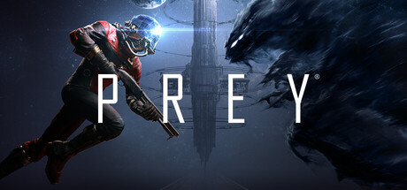

**Platforms:** Windows, Xbox 360 &nbsp;|&nbsp; **Genre:** Action, Adventure &nbsp;|&nbsp; **Released:** July 11

> In Prey, you awaken aboard Talos I, a space station orbiting the moon in the year 2032. You are the key subject of an experiment meant to alter humanity forever – but things have gone terribly wrong. The space station has been overrun by hostile aliens and you are now being hunted.
>
> _Synopsis source: Steam_

[Wikipedia](https://en.wikipedia.org/wiki/Prey_(2006_video_game)) · [Steam](https://store.steampowered.com/app/480490)

---

### Prince of Persia Trilogy

[Wikipedia](https://en.wikipedia.org/wiki/Prince_of_Persia_Trilogy)

---

### Prism Ark

[Wikipedia](https://en.wikipedia.org/wiki/Prism_Ark)

---

### Prism: Light the Way

**Platforms:** Mobile phone, Windows &nbsp;|&nbsp; **Developer:** Morpheme Game Studios, Zattikka &nbsp;|&nbsp; **Publisher:** Eidos Interactive, Zattikka &nbsp;|&nbsp; **Genre:** Puzzle &nbsp;|&nbsp; **Released:** November 2006

[Wikipedia](https://en.wikipedia.org/wiki/Prism:_Light_the_Way)

---

### Pro Evolution Soccer 6

**Platforms:** Windows, PlayStation 2, PlayStation Portable, Nintendo DS, Xbox 360 &nbsp;|&nbsp; **Developer:** Konami &nbsp;|&nbsp; **Publisher:** Konami &nbsp;|&nbsp; **Genre:** Sports &nbsp;|&nbsp; **Released:** April 27, 2006

[Wikipedia](https://en.wikipedia.org/wiki/Pro_Evolution_Soccer_6)

---

### Pro Evolution Soccer Management

**Platforms:** PlayStation 2 &nbsp;|&nbsp; **Developer:** Konami &nbsp;|&nbsp; **Publisher:** Konami &nbsp;|&nbsp; **Genre:** Sports, business simulation &nbsp;|&nbsp; **Released:** March 24, 2006

[Wikipedia](https://en.wikipedia.org/wiki/Pro_Evolution_Soccer_Management)

---

### Project Hacker: Kakusei

**Platforms:** Nintendo DS &nbsp;|&nbsp; **Developer:** Red Entertainment &nbsp;|&nbsp; **Publisher:** Nintendo &nbsp;|&nbsp; **Genre:** Point and click adventure game &nbsp;|&nbsp; **Released:** July 13, 2006

[Wikipedia](https://en.wikipedia.org/wiki/Project_Hacker:_Kakusei)

---

### ProStroke Golf: World Tour 2007

**Platforms:** Windows, PlayStation 2, Xbox, PlayStation Portable &nbsp;|&nbsp; **Developer:** Gusto Games &nbsp;|&nbsp; **Publisher:** Oxygen Games &nbsp;|&nbsp; **Genre:** Sports &nbsp;|&nbsp; **Released:** August 18, 2006

[Wikipedia](https://en.wikipedia.org/wiki/ProStroke_Golf:_World_Tour_2007)

---

### Puppy Luv

**Platforms:** Wii, Windows &nbsp;|&nbsp; **Developer:** Gogii Games, Blue Monkey Studios &nbsp;|&nbsp; **Publisher:** GameMill Publishing, Activision &nbsp;|&nbsp; **Genre:** Virtual Life

[Wikipedia](https://en.wikipedia.org/wiki/Puppy_Luv)

---

### Puyo Puyo! 15th Anniversary

**Platforms:** Nintendo DS &nbsp;|&nbsp; **Developer:** Sonic Team &nbsp;|&nbsp; **Publisher:** Sega &nbsp;|&nbsp; **Genre:** Puzzle &nbsp;|&nbsp; **Released:** December 14, 2006

[Wikipedia](https://en.wikipedia.org/wiki/Puyo_Puyo!_15th_Anniversary)

---

### Puzzle Challenge: Crosswords and More

**Platforms:** PlayStation 2, PlayStation Portable, Wii &nbsp;|&nbsp; **Developer:** Supersonic Software &nbsp;|&nbsp; **Publisher:** Crave Entertainment &nbsp;|&nbsp; **Genre:** Puzzle &nbsp;|&nbsp; **Released:** June 9, 2006

[Wikipedia](https://en.wikipedia.org/wiki/Puzzle_Challenge:_Crosswords_and_More)

---

### Quest for Bush

**Platforms:** Windows &nbsp;|&nbsp; **Developer:** Global Islamic Media Front &nbsp;|&nbsp; **Publisher:** Global Islamic Media Front &nbsp;|&nbsp; **Genre:** First-person shooter &nbsp;|&nbsp; **Released:** September 11, 2006

[Wikipedia](https://en.wikipedia.org/wiki/Quest_for_Bush)

---

### QuickSpot

**Platforms:** Nintendo DS &nbsp;|&nbsp; **Developer:** Namco &nbsp;|&nbsp; **Publisher:** Namco, Namco Bandai Games &nbsp;|&nbsp; **Genre:** Puzzle &nbsp;|&nbsp; **Released:** February 9, 2006

[Wikipedia](https://en.wikipedia.org/wiki/QuickSpot)

---

### R-Type (TurboGrafx-16)

**Platforms:** Wii &nbsp;|&nbsp; **Released:** December 25

[Wikipedia](https://en.wikipedia.org/wiki/R-Type)

---

### Race Driver 2006

**Platforms:** PlayStation Portable &nbsp;|&nbsp; **Released:** June 6

[Wikipedia](https://en.wikipedia.org/wiki/Race_Driver_2006)

---

### Race – The Official WTCC Game

**Platforms:** Windows &nbsp;|&nbsp; **Developer:** SimBin Studios &nbsp;|&nbsp; **Publisher:** SimBin Studios &nbsp;|&nbsp; **Genre:** Sim racing &nbsp;|&nbsp; **Released:** November 24, 2006

[Wikipedia](https://en.wikipedia.org/wiki/Race_%E2%80%93_The_Official_WTCC_Game)

---

### Raging Thunder

**Platforms:** Mobile phone, Windows Mobile, iOS &nbsp;|&nbsp; **Developer:** Polarbit &nbsp;|&nbsp; **Publisher:** Polarbit, Filao &nbsp;|&nbsp; **Genre:** Racing

[Wikipedia](https://en.wikipedia.org/wiki/Raging_Thunder)

---

### Ragnarok Online 2: The Gate of the World

**Platforms:** Windows &nbsp;|&nbsp; **Developer:** Gravity, Team Mercury &nbsp;|&nbsp; **Publisher:** Gravity, AsiaSoft, Level Up!

[Wikipedia](https://en.wikipedia.org/wiki/Ragnarok_Online_2:_The_Gate_of_the_World)

---

### Railfan

**Platforms:** PlayStation 3 &nbsp;|&nbsp; **Developer:** Taito, Ongakukan &nbsp;|&nbsp; **Publisher:** Ongakukan &nbsp;|&nbsp; **Genre:** Train simulator &nbsp;|&nbsp; **Released:** December 20, 2006

[Wikipedia](https://en.wikipedia.org/wiki/Railfan_(video_game))

---

### Rampage: Total Destruction

**Platforms:** PlayStation 2, GameCube, Wii &nbsp;|&nbsp; **Released:** April 24

---

### Rapala Tournament Fishing

**Platforms:** Xbox 360, Wii &nbsp;|&nbsp; **Released:** November 21

[Wikipedia](https://en.wikipedia.org/wiki/Rapala_Tournament_Fishing)

---

### RapeLay

**Platforms:** Windows &nbsp;|&nbsp; **Developer:** Illusion Soft &nbsp;|&nbsp; **Publisher:** Illusion Soft &nbsp;|&nbsp; **Genre:** Eroge &nbsp;|&nbsp; **Released:** April 21, 2006

[Wikipedia](https://en.wikipedia.org/wiki/RapeLay)

---

### Rappelz

**Platforms:** Windows &nbsp;|&nbsp; **Developer:** Gala Lab &nbsp;|&nbsp; **Publisher:** Gala Lab Corp., Gala Japan Inc., Digeam Inc. &nbsp;|&nbsp; **Genre:** Fantasy MMORPG

[Wikipedia](https://en.wikipedia.org/wiki/Rappelz)

---

### Rayman Raving Rabbids

**Platforms:** Windows, PlayStation 2, Wii &nbsp;|&nbsp; **Released:** December 7 (AU/EU)

---

### Rayman Raving Rabbids (handheld)

**Platforms:** Game Boy Advance &nbsp;|&nbsp; **Released:** November 14 (NA/AU/EU)

[Wikipedia](https://en.wikipedia.org/wiki/Rayman_Raving_Rabbids_(handheld_game))

---

### Rayman Raving Rabbids (USA)

**Platforms:** Wii, PlayStation 2, Windows &nbsp;|&nbsp; **Released:** November 19

[Wikipedia](https://en.wikipedia.org/wiki/Rayman_Raving_Rabbids)

---

### Re-Mission

**Platforms:** Windows &nbsp;|&nbsp; **Developer:** Realtime Associates, Inc. &nbsp;|&nbsp; **Publisher:** HopeLab &nbsp;|&nbsp; **Genre:** Third-person shooters, serious games &nbsp;|&nbsp; **Released:** April 3, 2006

[Wikipedia](https://en.wikipedia.org/wiki/Re-Mission)

---

### Really? Really!

[Wikipedia](https://en.wikipedia.org/wiki/Really%3F_Really!)

---

### Red Jets

**Platforms:** Windows &nbsp;|&nbsp; **Developer:** InterActive Vision &nbsp;|&nbsp; **Publisher:** Graffiti Entertainment &nbsp;|&nbsp; **Genre:** Combat flight simulator

[Wikipedia](https://en.wikipedia.org/wiki/Red_Jets)

---

### Red Orchestra: Ostfront 41–45

**Platforms:** Windows &nbsp;|&nbsp; **Developer:** Tripwire Interactive &nbsp;|&nbsp; **Publisher:** Bold Games &nbsp;|&nbsp; **Genre:** Tactical first-person shooter &nbsp;|&nbsp; **Released:** March 14, 2006

[Wikipedia](https://en.wikipedia.org/wiki/Red_Orchestra:_Ostfront_41%E2%80%9345)

---

### Red Steel (USA)

**Platforms:** Wii &nbsp;|&nbsp; **Released:** November 19

[Wikipedia](https://en.wikipedia.org/wiki/Red_Steel)

---

### Redline

**Platforms:** macOS &nbsp;|&nbsp; **Developer:** Jonas Echterhoff and Ambrosia Software &nbsp;|&nbsp; **Publisher:** Ambrosia Software &nbsp;|&nbsp; **Genre:** Sim racing &nbsp;|&nbsp; **Released:** September 21, 2006

[Wikipedia](https://en.wikipedia.org/wiki/Redline_(2006_video_game))

---

### Remindelight

**Platforms:** Nintendo DS &nbsp;|&nbsp; **Developer:** Japan Art Media &nbsp;|&nbsp; **Publisher:** Taito &nbsp;|&nbsp; **Genre:** Action role-playing &nbsp;|&nbsp; **Released:** September 28, 2006

[Wikipedia](https://en.wikipedia.org/wiki/Remindelight)

---

### Rengoku II: The Stairway to Heaven

**Platforms:** PlayStation Portable &nbsp;|&nbsp; **Released:** September 12

---

### Requital

**Platforms:** Windows &nbsp;|&nbsp; **Developer:** Akella, Primal Software &nbsp;|&nbsp; **Publisher:** Excalibur Publishing &nbsp;|&nbsp; **Genre:** Role-playing video game

[Wikipedia](https://en.wikipedia.org/wiki/Requital)

---

### Reservoir Dogs

**Platforms:** Windows, PlayStation 2, Xbox &nbsp;|&nbsp; **Released:** October 24

[Wikipedia](https://en.wikipedia.org/wiki/Reservoir_Dogs_(video_game))

---

### Resident Evil: Deadly Silence

**Platforms:** Nintendo DS &nbsp;|&nbsp; **Released:** February 7

[Wikipedia](https://en.wikipedia.org/wiki/Resident_Evil_(1996_video_game)#Deadly_Silence)

---

### Resistance: Fall of Man

**Platforms:** PlayStation 3 &nbsp;|&nbsp; **Released:** November 17

---

### Rhye's and Fall of Civilization

**Platforms:** Windows, macOS &nbsp;|&nbsp; **Genre:** Mod, turn-based strategy game, 4X &nbsp;|&nbsp; **Released:** April 26, 2006

[Wikipedia](https://en.wikipedia.org/wiki/Rhye's_and_Fall_of_Civilization)

---

### Rhythm Tengoku

**Platforms:** Nintendo DS, Game Boy Advance &nbsp;|&nbsp; **Released:** August 3

[Wikipedia](https://en.wikipedia.org/wiki/Rhythm_Tengoku)

---

### Ridge Racer 2

**Platforms:** PlayStation Portable &nbsp;|&nbsp; **Developer:** Namco Bandai Games &nbsp;|&nbsp; **Publisher:** Namco Bandai Games, Sony Computer Entertainment &nbsp;|&nbsp; **Genre:** Racing &nbsp;|&nbsp; **Released:** September 14, 2006

[Wikipedia](https://en.wikipedia.org/wiki/Ridge_Racer_2_(2006_video_game))

---

### Ridge Racer 7

**Platforms:** PlayStation 3 &nbsp;|&nbsp; **Released:** November 17

[Wikipedia](https://en.wikipedia.org/wiki/Ridge_Racer_7)

---

### Rise and Fall: Civilizations at War

**Platforms:** Windows &nbsp;|&nbsp; **Released:** June 12

---

### Rise of Nations: Rise of Legends

**Platforms:** Windows &nbsp;|&nbsp; **Released:** May 9

---

### Ristar

**Platforms:** Wii &nbsp;|&nbsp; **Released:** December 4

[Wikipedia](https://en.wikipedia.org/wiki/Ristar)

---

### Ro

**Platforms:** iOS &nbsp;|&nbsp; **Developer:** Duael Designs LLC &nbsp;|&nbsp; **Publisher:** Roamular LLC &nbsp;|&nbsp; **Genre:** Puzzle game

[Wikipedia](https://en.wikipedia.org/wiki/Ro_(video_game))

---

### Ro(c)k Podvraťáků

**Developer:** Centauri Production

[Wikipedia](https://en.wikipedia.org/wiki/Ro(c)k_Podvra%C5%A5%C3%A1k%C5%AF_(video_game))

---

### Roblox

**Platforms:** Windows &nbsp;|&nbsp; **Released:** September 1

[Wikipedia](https://en.wikipedia.org/wiki/Roblox)

---

### RoboBlitz

**Platforms:** Windows, Xbox 360 &nbsp;|&nbsp; **Developer:** Naked Sky Entertainment &nbsp;|&nbsp; **Publisher:** Naked Sky Entertainment, Microsoft Game Studios &nbsp;|&nbsp; **Genre:** Puzzle, action &nbsp;|&nbsp; **Released:** November 6, 2006

[Wikipedia](https://en.wikipedia.org/wiki/RoboBlitz)

---

### Rock 'Em Sock 'Em Robots

**Platforms:** Game Boy Advance &nbsp;|&nbsp; **Released:** October 26

[Wikipedia](https://en.wikipedia.org/wiki/Rock_%27Em_Sock_%27Em_Robots_(video_game))

---

### Rockman EXE Legend of Network

**Platforms:** Mobile phone &nbsp;|&nbsp; **Publisher:** Capcom &nbsp;|&nbsp; **Genre:** Real-time tactical role-playing game &nbsp;|&nbsp; **Released:** October 7, 2006

[Wikipedia](https://en.wikipedia.org/wiki/Rockman_EXE_Legend_of_Network)

---

### Rockstar Games Presents Table Tennis

**Platforms:** Xbox 360 &nbsp;|&nbsp; **Released:** May 23

[Wikipedia](https://en.wikipedia.org/wiki/Rockstar_Games_Presents_Table_Tennis)

---

### Rogue Trooper

**Platforms:** Windows, PlayStation 2, Xbox &nbsp;|&nbsp; **Developer:** Rebellion Developments, TickTock Games &nbsp;|&nbsp; **Publisher:** Eidos Interactive, Reef Entertainment, Rebellion Developments &nbsp;|&nbsp; **Genre:** Third-person shooter &nbsp;|&nbsp; **Released:** April 21, 2006

[Wikipedia](https://en.wikipedia.org/wiki/Rogue_Trooper_(video_game))

---

### Roma Victor

**Platforms:** Windows &nbsp;|&nbsp; **Developer:** RedBedlam www.redbedlam.com &nbsp;|&nbsp; **Publisher:** RedBedlam &nbsp;|&nbsp; **Genre:** Historical MMORPG &nbsp;|&nbsp; **Released:** July 2006

[Wikipedia](https://en.wikipedia.org/wiki/Roma_Victor)

---

### Romance of the Three Kingdoms XI

**Platforms:** Windows, PlayStation 2 &nbsp;|&nbsp; **Developer:** Koei &nbsp;|&nbsp; **Publisher:** Koei &nbsp;|&nbsp; **Genre:** Turn-based strategy &nbsp;|&nbsp; **Released:** March 17, 2006

[Wikipedia](https://en.wikipedia.org/wiki/Romance_of_the_Three_Kingdoms_XI)

---

### Rome: Total War: Alexander

**Platforms:** Windows &nbsp;|&nbsp; **Developer:** Creative Assembly, Feral Interactive &nbsp;|&nbsp; **Publisher:** Sega, Feral Interactive &nbsp;|&nbsp; **Genre:** Real-time tactics, Turn-based strategy &nbsp;|&nbsp; **Released:** June 19, 2006

[Wikipedia](https://en.wikipedia.org/wiki/Rome:_Total_War:_Alexander)

---

### Rotohex

**Platforms:** Game Boy Advance &nbsp;|&nbsp; **Developer:** Skip Ltd. &nbsp;|&nbsp; **Publisher:** Nintendo &nbsp;|&nbsp; **Genre:** Puzzle &nbsp;|&nbsp; **Released:** July 13, 2006

[Wikipedia](https://en.wikipedia.org/wiki/Rotohex)

---

### Ruff Trigger: The Vanocore Conspiracy

**Platforms:** PlayStation 2 &nbsp;|&nbsp; **Developer:** Playstos Entertainment &nbsp;|&nbsp; **Publisher:** Natsume Inc., Zoo Digital Publishing &nbsp;|&nbsp; **Genre:** Action, platform &nbsp;|&nbsp; **Released:** June 27, 2006

[Wikipedia](https://en.wikipedia.org/wiki/Ruff_Trigger:_The_Vanocore_Conspiracy)

---

### Rugby 06

**Platforms:** PlayStation 2, Windows, Xbox &nbsp;|&nbsp; **Developer:** EA Canada, HB Studios &nbsp;|&nbsp; **Publisher:** EA Sports &nbsp;|&nbsp; **Genre:** Sports &nbsp;|&nbsp; **Released:** February 10, 2006

[Wikipedia](https://en.wikipedia.org/wiki/Rugby_06)

---

### Rugby Challenge 2006

**Platforms:** PlayStation 2, Windows, Xbox &nbsp;|&nbsp; **Developer:** Swordfish Studios &nbsp;|&nbsp; **Publisher:** Hip Interactive, Ubisoft &nbsp;|&nbsp; **Genre:** Sports &nbsp;|&nbsp; **Released:** February 3, 2006

[Wikipedia](https://en.wikipedia.org/wiki/Rugby_Challenge_2006)

---

### Rule of Rose

**Platforms:** PlayStation 2 &nbsp;|&nbsp; **Released:** September 12

[Wikipedia](https://en.wikipedia.org/wiki/Rule_of_Rose)

---

### Rumble Roses XX

**Platforms:** Xbox 360 &nbsp;|&nbsp; **Released:** March 28

[Wikipedia](https://en.wikipedia.org/wiki/Rumble_Roses_XX)

---

### Runaway 2: The Dream of the Turtle

**Platforms:** Windows &nbsp;|&nbsp; **Developer:** Pendulo Studios &nbsp;|&nbsp; **Publisher:** Focus Home Interactive, FX Interactive &nbsp;|&nbsp; **Genre:** Adventure &nbsp;|&nbsp; **Released:** November 17, 2006

[Wikipedia](https://en.wikipedia.org/wiki/Runaway_2:_The_Dream_of_the_Turtle)

---

### Rush for Berlin

**Platforms:** Windows &nbsp;|&nbsp; **Developer:** StormRegion &nbsp;|&nbsp; **Publisher:** Deep Silver, Paradox Interactive &nbsp;|&nbsp; **Genre:** Real-time tactics &nbsp;|&nbsp; **Released:** May 26, 2006

[Wikipedia](https://en.wikipedia.org/wiki/Rush_for_Berlin)

---

### Safecracker: The Ultimate Puzzle Adventure

**Platforms:** Windows &nbsp;|&nbsp; **Developer:** Kheops Studio &nbsp;|&nbsp; **Publisher:** The Adventure Company &nbsp;|&nbsp; **Genre:** Adventure &nbsp;|&nbsp; **Released:** August 2, 2006

[Wikipedia](https://en.wikipedia.org/wiki/Safecracker:_The_Ultimate_Puzzle_Adventure)

---

### Saint Seiya: The Hades

**Platforms:** PlayStation 2 &nbsp;|&nbsp; **Developer:** Dimps &nbsp;|&nbsp; **Publisher:** Namco Bandai Games &nbsp;|&nbsp; **Genre:** Fighting &nbsp;|&nbsp; **Released:** September 29, 2006

[Wikipedia](https://en.wikipedia.org/wiki/Saint_Seiya:_The_Hades)

---

### Saints Row

**Platforms:** Xbox 360 &nbsp;|&nbsp; **Released:** August 29

[Wikipedia](https://en.wikipedia.org/wiki/Saints_Row)

---

### Samurai Champloo: Sidetracked

**Platforms:** PlayStation 2 &nbsp;|&nbsp; **Developer:** Grasshopper Manufacture &nbsp;|&nbsp; **Publisher:** Namco Bandai Games &nbsp;|&nbsp; **Genre:** Action-adventure &nbsp;|&nbsp; **Released:** February 23, 2006

[Wikipedia](https://en.wikipedia.org/wiki/Samurai_Champloo:_Sidetracked)

---

### Samurai Shodown V

**Platforms:** Xbox &nbsp;|&nbsp; **Released:** January 18

[Wikipedia](https://en.wikipedia.org/wiki/Samurai_Shodown_V)

---

### Samurai Warriors 2

**Platforms:** PlayStation 2, Xbox 360 &nbsp;|&nbsp; **Developer:** Omega Force &nbsp;|&nbsp; **Publisher:** Koei, Koei Tecmo &nbsp;|&nbsp; **Genre:** Hack and slash &nbsp;|&nbsp; **Released:** February 24, 2006

[Wikipedia](https://en.wikipedia.org/wiki/Samurai_Warriors_2)

---

### Saru! Get You! Million Monkeys

**Platforms:** PlayStation 2 &nbsp;|&nbsp; **Developer:** Sony Computer Entertainment Japan &nbsp;|&nbsp; **Publisher:** Sony Computer Entertainment &nbsp;|&nbsp; **Genre:** Platform &nbsp;|&nbsp; **Released:** July 13, 2006

[Wikipedia](https://en.wikipedia.org/wiki/Saru!_Get_You!_Million_Monkeys)

---

### Scarface: Money. Power. Respect.

**Platforms:** PlayStation Portable, Windows Mobile &nbsp;|&nbsp; **Developer:** FarSight Studios &nbsp;|&nbsp; **Publisher:** Vivendi Games &nbsp;|&nbsp; **Genre:** Turn-based strategy &nbsp;|&nbsp; **Released:** October 10, 2006

[Wikipedia](https://en.wikipedia.org/wiki/Scarface:_Money._Power._Respect.)

---

### Scarface: The World Is Yours

**Platforms:** Windows, PlayStation 2, Xbox &nbsp;|&nbsp; **Released:** October 8

---

### Scooby-Doo! Who's Watching Who?

**Platforms:** PlayStation Portable, Nintendo DS &nbsp;|&nbsp; **Developer:** Savage Entertainment, Human Soft, Inc. &nbsp;|&nbsp; **Publisher:** THQ &nbsp;|&nbsp; **Genre:** Action-adventure &nbsp;|&nbsp; **Released:** October 11, 2006

[Wikipedia](https://en.wikipedia.org/wiki/Scooby-Doo!_Who's_Watching_Who%3F)

---

### Scratches

**Platforms:** Windows &nbsp;|&nbsp; **Developer:** Nucleosys &nbsp;|&nbsp; **Publisher:** Got Game Entertainment &nbsp;|&nbsp; **Genre:** Adventure &nbsp;|&nbsp; **Released:** January 25, 2006

[Wikipedia](https://en.wikipedia.org/wiki/Scratches_(video_game))

---

### Scurge: Hive

**Platforms:** Game Boy Advance, Nintendo DS &nbsp;|&nbsp; **Released:** October 24

---

### SD Gundam: Scad Hammers

**Platforms:** Wii &nbsp;|&nbsp; **Developer:** Bandai &nbsp;|&nbsp; **Publisher:** Namco Bandai Games &nbsp;|&nbsp; **Genre:** Action-adventure &nbsp;|&nbsp; **Released:** December 2, 2006

[Wikipedia](https://en.wikipedia.org/wiki/SD_Gundam:_Scad_Hammers)

---

### Secret Files: Tunguska

**Platforms:** Windows &nbsp;|&nbsp; **Developer:** Fusionsphere Systems, Animation Arts &nbsp;|&nbsp; **Publisher:** Deep Silver &nbsp;|&nbsp; **Genre:** Graphic adventure &nbsp;|&nbsp; **Released:** September 4, 2006

[Wikipedia](https://en.wikipedia.org/wiki/Secret_Files:_Tunguska)

---

### Seed

**Platforms:** Windows &nbsp;|&nbsp; **Released:** May 2

[Wikipedia](https://en.wikipedia.org/wiki/Seed_(2006_video_game))

---

### Sega Genesis Collection

**Platforms:** PlayStation 3, PlayStation Portable &nbsp;|&nbsp; **Released:** November 16

[Wikipedia](https://en.wikipedia.org/wiki/Sega_Genesis_Collection)

---

### Sega Rally 2006

**Platforms:** PlayStation 2 &nbsp;|&nbsp; **Developer:** Sega AM3 &nbsp;|&nbsp; **Publisher:** Sega &nbsp;|&nbsp; **Genre:** Racing game &nbsp;|&nbsp; **Released:** January 12, 2006

[Wikipedia](https://en.wikipedia.org/wiki/Sega_Rally_2006)

---

### Shaberu! DS Oryōri Navi

**Platforms:** Nintendo DS &nbsp;|&nbsp; **Developer:** indieszero &nbsp;|&nbsp; **Publisher:** Nintendo &nbsp;|&nbsp; **Genre:** Edutainment &nbsp;|&nbsp; **Released:** July 20, 2006

[Wikipedia](https://en.wikipedia.org/wiki/Shaberu!_DS_Ory%C5%8Dri_Navi)

---

### Shadow Hearts: From the New World

**Platforms:** PlayStation 2 &nbsp;|&nbsp; **Released:** March 7

---

### Shakugan no Shana

[Wikipedia](https://en.wikipedia.org/wiki/Shakugan_no_Shana)

---

### Sherlock Holmes: The Awakened

**Platforms:** Windows &nbsp;|&nbsp; **Developer:** Frogwares &nbsp;|&nbsp; **Publisher:** Frogwares, Focus Home Interactive, Ascaron, 93Games, CDV Entertainment &nbsp;|&nbsp; **Genre:** Adventure &nbsp;|&nbsp; **Released:** November 24, 2006

[Wikipedia](https://en.wikipedia.org/wiki/Sherlock_Holmes:_The_Awakened)

---

### Shinkyoku Sōkai Polyphonica

[Wikipedia](https://en.wikipedia.org/wiki/Shinkyoku_S%C5%8Dkai_Polyphonica)

---

### Shinobido: Tales of the Ninja

**Platforms:** PlayStation Portable &nbsp;|&nbsp; **Developer:** Acquire &nbsp;|&nbsp; **Publisher:** Spike, Sony Computer Entertainment &nbsp;|&nbsp; **Genre:** Stealth &nbsp;|&nbsp; **Released:** October 26, 2006

[Wikipedia](https://en.wikipedia.org/wiki/Shinobido:_Tales_of_the_Ninja)

---

### Ship Simulator

**Platforms:** Windows &nbsp;|&nbsp; **Developer:** VSTEP &nbsp;|&nbsp; **Publisher:** Lighthouse Interactive, Dreamcatcher Interactive &nbsp;|&nbsp; **Genre:** Vehicle simulation &nbsp;|&nbsp; **Released:** June 15, 2006

[Wikipedia](https://en.wikipedia.org/wiki/Ship_Simulator)

---

### Shrek Smash n' Crash Racing

**Platforms:** PlayStation Portable &nbsp;|&nbsp; **Released:** December 12

[Wikipedia](https://en.wikipedia.org/wiki/Shrek_Smash_n%27_Crash_Racing)

---

### Sid Meier's Railroads!

**Platforms:** Windows &nbsp;|&nbsp; **Released:** October 17 (NA)

[Wikipedia](https://en.wikipedia.org/wiki/Sid_Meier%27s_Railroads!)

---

### SimCity (SNES)

**Platforms:** Wii &nbsp;|&nbsp; **Released:** November 19

[Wikipedia](https://en.wikipedia.org/wiki/SimCity_(1989_video_game))

---

### Sin Episodes: Emergence

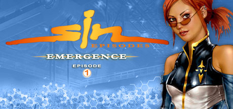

**Platforms:** Windows &nbsp;|&nbsp; **Genre:** Action &nbsp;|&nbsp; **Released:** May 10

> You are John Blade, commander of HardCorps, an elite security force dedicated to protecting the people of Freeport City. Four years have passed since your first battle with Elexis Sinclaire, a beautiful, brilliant, and ruthless scientist who is out to remake humanity according to her own twisted vision.
>
> _Synopsis source: Steam_

[Steam](https://store.steampowered.com/app/1300)

---

### Siren 2

**Platforms:** PlayStation 2 &nbsp;|&nbsp; **Released:** February 9 (JP)

[Wikipedia](https://en.wikipedia.org/wiki/Forbidden_Siren_2)

---

### SketchFighter 4000 Alpha

**Platforms:** macOS &nbsp;|&nbsp; **Developer:** Lost Minds &nbsp;|&nbsp; **Publisher:** Ambrosia Software, Lost Minds &nbsp;|&nbsp; **Genre:** Scrolling shooter, Metroidvania &nbsp;|&nbsp; **Released:** November 30, 2006

[Wikipedia](https://en.wikipedia.org/wiki/SketchFighter_4000_Alpha)

---

### Skyrates

**Platforms:** Browser &nbsp;|&nbsp; **Genre:** MMORPG

[Wikipedia](https://en.wikipedia.org/wiki/Skyrates)

---

### Small Arms

**Platforms:** Xbox 360 &nbsp;|&nbsp; **Released:** November 22

[Wikipedia](https://en.wikipedia.org/wiki/Small_Arms_(video_game))

---

### Smarties: Meltdown

**Platforms:** PlayStation 2 &nbsp;|&nbsp; **Developer:** EM Studios &nbsp;|&nbsp; **Publisher:** Koch Media &nbsp;|&nbsp; **Genre:** Platform &nbsp;|&nbsp; **Released:** March 17, 2006

[Wikipedia](https://en.wikipedia.org/wiki/Smarties:_Meltdown)

---

### Sneak King

**Platforms:** Xbox, Xbox 360 &nbsp;|&nbsp; **Released:** November 19

[Wikipedia](https://en.wikipedia.org/wiki/Sneak_King)

---

### Snoopy vs. the Red Baron

**Platforms:** PlayStation Portable, PlayStation 2, Windows &nbsp;|&nbsp; **Developer:** Smart Bomb Interactive &nbsp;|&nbsp; **Publisher:** Namco Bandai Games America &nbsp;|&nbsp; **Genre:** Flight simulator &nbsp;|&nbsp; **Released:** October 24, 2006

[Wikipedia](https://en.wikipedia.org/wiki/Snoopy_vs._the_Red_Baron_(video_game))

---

### Soccer

**Platforms:** Wii &nbsp;|&nbsp; **Released:** November 19

[Wikipedia](https://en.wikipedia.org/wiki/Soccer_(1985_video_game))

---

### SOCOM U.S. Navy SEALs: Combined Assault

**Platforms:** PlayStation 2 &nbsp;|&nbsp; **Released:** November 7

---

### SOCOM U.S. Navy SEALs: Fireteam Bravo 2

**Platforms:** PlayStation Portable &nbsp;|&nbsp; **Developer:** Zipper Interactive &nbsp;|&nbsp; **Publisher:** Sony Computer Entertainment &nbsp;|&nbsp; **Genre:** Tactical shooter &nbsp;|&nbsp; **Released:** November 21, 2006

[Wikipedia](https://en.wikipedia.org/wiki/SOCOM_U.S._Navy_SEALs:_Fireteam_Bravo_2)

---

### Solomon's Key (NES)

**Platforms:** Wii &nbsp;|&nbsp; **Released:** November 19

[Wikipedia](https://en.wikipedia.org/wiki/Solomon%27s_Key)

---

### Sonic Riders

**Platforms:** PlayStation 2, Xbox, GameCube &nbsp;|&nbsp; **Released:** February 21

[Wikipedia](https://en.wikipedia.org/wiki/Sonic_Riders)

---

### Sonic Rivals

**Platforms:** PlayStation Portable &nbsp;|&nbsp; **Released:** November 16

[Wikipedia](https://en.wikipedia.org/wiki/Sonic_Rivals)

---

### Sonic the Hedgehog

**Platforms:** Wii &nbsp;|&nbsp; **Released:** November 19

[Wikipedia](https://en.wikipedia.org/wiki/Sonic_the_Hedgehog_(1991_video_game))

---

### Sonic the Hedgehog (2006)

**Platforms:** Xbox 360, PlayStation 3 &nbsp;|&nbsp; **Released:** November 24 (PAL/JP)

---

### Sonic the Hedgehog (2006) (USA)

**Platforms:** Xbox 360 &nbsp;|&nbsp; **Released:** November 14

[Wikipedia](https://en.wikipedia.org/wiki/Sonic_the_Hedgehog_(2006_game))

---

### Soul of the Ultimate Nation

**Platforms:** Windows &nbsp;|&nbsp; **Developer:** Webzen &nbsp;|&nbsp; **Publisher:** Webzen, The9, GameOn, NHN via ijji &nbsp;|&nbsp; **Genre:** Fantasy MMORPG

[Wikipedia](https://en.wikipedia.org/wiki/Soul_of_the_Ultimate_Nation)

---

### Souptoys

**Platforms:** Windows &nbsp;|&nbsp; **Developer:** Souptoys Pty Ltd &nbsp;|&nbsp; **Publisher:** Oberon Media &nbsp;|&nbsp; **Genre:** Sandbox game

[Wikipedia](https://en.wikipedia.org/wiki/Souptoys)

---

### Space Empires V

**Platforms:** Windows &nbsp;|&nbsp; **Developer:** Malfador Machinations &nbsp;|&nbsp; **Publisher:** Strategy First &nbsp;|&nbsp; **Genre:** Turn-based strategy &nbsp;|&nbsp; **Released:** October 16, 2006

[Wikipedia](https://en.wikipedia.org/wiki/Space_Empires_V)

---

### Space Harrier II (Genesis)

**Platforms:** Wii &nbsp;|&nbsp; **Released:** December 18

[Wikipedia](https://en.wikipedia.org/wiki/Space_Harrier_II)

---

### SpaceStationSim

**Platforms:** Windows &nbsp;|&nbsp; **Developer:** Vision Videogames &nbsp;|&nbsp; **Publisher:** Enlight Interactive, 1C Company &nbsp;|&nbsp; **Genre:** Life simulation &nbsp;|&nbsp; **Released:** November 2006

[Wikipedia](https://en.wikipedia.org/wiki/SpaceStationSim)

---

### Specnaz: Project Wolf

**Platforms:** Windows &nbsp;|&nbsp; **Developer:** Byte Software &nbsp;|&nbsp; **Publisher:** GMX Media &nbsp;|&nbsp; **Genre:** Tactical first-person shooter &nbsp;|&nbsp; **Released:** June 30, 2006

[Wikipedia](https://en.wikipedia.org/wiki/Specnaz:_Project_Wolf)

---

### Spectral Force 3

**Platforms:** Xbox 360 &nbsp;|&nbsp; **Developer:** Idea Factory, XPEC Entertainment &nbsp;|&nbsp; **Publisher:** Idea Factory, Atlus USA &nbsp;|&nbsp; **Genre:** Tactical role-playing &nbsp;|&nbsp; **Released:** June 29, 2006

[Wikipedia](https://en.wikipedia.org/wiki/Spectral_Force_3)

---

### Spectral Souls: Resurrection of the Ethereal Empires

**Platforms:** PlayStation Portable &nbsp;|&nbsp; **Released:** September 26

---

### SpellForce 2: Shadow Wars

**Platforms:** Windows &nbsp;|&nbsp; **Developer:** Phenomic &nbsp;|&nbsp; **Publisher:** JoWooD Productions, Deep Silver, Aspyr Media, Dreamcatcher Interactive &nbsp;|&nbsp; **Genre:** Real-time strategy, role-playing &nbsp;|&nbsp; **Released:** April 7, 2006

[Wikipedia](https://en.wikipedia.org/wiki/SpellForce_2:_Shadow_Wars)

---

### Spider-Man: Battle for New York

**Platforms:** Game Boy Advance, Nintendo DS &nbsp;|&nbsp; **Developer:** Torus Games &nbsp;|&nbsp; **Publisher:** Activision &nbsp;|&nbsp; **Genre:** Action, platform &nbsp;|&nbsp; **Released:** November 14, 2006

[Wikipedia](https://en.wikipedia.org/wiki/Spider-Man:_Battle_for_New_York)

---

### SpongeBob SquarePants: Creature from the Krusty Krab

**Platforms:** Windows, PlayStation 2, GameCube, Game Boy Advance, Nintendo DS, Wii &nbsp;|&nbsp; **Released:** August 15 (AU/EU)

---

### SpongeBob SquarePants: Creature from the Krusty Krab (USA)

**Platforms:** PlayStation 2, GameCube, Game Boy Advance, Nintendo DS, Wii &nbsp;|&nbsp; **Released:** October 18

---

### SpongeBob SquarePants: The Yellow Avenger

**Platforms:** PlayStation Portable &nbsp;|&nbsp; **Released:** March 6

---

### Spy Hunter: Nowhere to Run

**Platforms:** PlayStation 2, Xbox &nbsp;|&nbsp; **Released:** September 5

---

### Stacked with Daniel Negreanu

**Platforms:** PlayStation Portable &nbsp;|&nbsp; **Released:** October 6

[Wikipedia](https://en.wikipedia.org/wiki/Stacked_with_Daniel_Negreanu)

---

### Star Fox Command

**Platforms:** Nintendo DS &nbsp;|&nbsp; **Released:** August 28

[Wikipedia](https://en.wikipedia.org/wiki/Star_Fox_Command)

---

### Star Trek: Encounters

**Platforms:** PlayStation 2 &nbsp;|&nbsp; **Released:** October 4

---

### Star Trek: Legacy

**Platforms:** Windows &nbsp;|&nbsp; **Released:** December 5

---

### Star Trek: Tactical Assault

**Platforms:** Nintendo DS, PlayStation Portable &nbsp;|&nbsp; **Developer:** Quicksilver Software &nbsp;|&nbsp; **Publisher:** Bethesda Softworks &nbsp;|&nbsp; **Genre:** Real-time tactics &nbsp;|&nbsp; **Released:** October 26, 2006

[Wikipedia](https://en.wikipedia.org/wiki/Star_Trek:_Tactical_Assault)

---

### Star Wars: Empire at War

**Platforms:** Windows &nbsp;|&nbsp; **Released:** February 18

---

### Star Wars: Empire at War: Forces of Corruption

**Platforms:** Windows &nbsp;|&nbsp; **Released:** October 24

---

### Star Wars: Lethal Alliance

**Platforms:** PlayStation Portable, Nintendo DS &nbsp;|&nbsp; **Released:** December 7

---

### State of Emergency 2

**Platforms:** PlayStation 2 &nbsp;|&nbsp; **Released:** February 14

[Wikipedia](https://en.wikipedia.org/wiki/State_of_Emergency_2)

---

### Steambot Chronicles

**Platforms:** PlayStation 2 &nbsp;|&nbsp; **Released:** May 23

[Wikipedia](https://en.wikipedia.org/wiki/Steambot_Chronicles)

---

### Strategic Command 2: Blitzkrieg

**Platforms:** Windows &nbsp;|&nbsp; **Developer:** Fury Software &nbsp;|&nbsp; **Publisher:** Battlefront.com &nbsp;|&nbsp; **Genre:** Turn-based strategy

[Wikipedia](https://en.wikipedia.org/wiki/Strategic_Command_2:_Blitzkrieg)

---

### Strawberry Panic!

[Wikipedia](https://en.wikipedia.org/wiki/Strawberry_Panic!)

---

### Strawberry Shortcake: The Sweet Dreams Game

[Wikipedia](https://en.wikipedia.org/wiki/Strawberry_Shortcake:_The_Sweet_Dreams_Game)

---

### Street Fighter Alpha 3 MAX

**Platforms:** PlayStation Portable &nbsp;|&nbsp; **Released:** February 7

[Wikipedia](https://en.wikipedia.org/wiki/Street_Fighter_Alpha_3)

---

### Street Fighter Alpha Anthology

**Platforms:** PlayStation 2 &nbsp;|&nbsp; **Developer:** Capcom Production Studio 2 &nbsp;|&nbsp; **Publisher:** Capcom &nbsp;|&nbsp; **Genre:** Fighting &nbsp;|&nbsp; **Released:** May 25, 2006

[Wikipedia](https://en.wikipedia.org/wiki/Street_Fighter_Alpha_Anthology)

---

### Street Fighter II' Hyper Fighting

**Platforms:** Xbox 360 &nbsp;|&nbsp; **Released:** August 2

[Wikipedia](https://en.wikipedia.org/wiki/Street_Fighter_II%27_Hyper_Fighting)

---

### Street Fighter II: The World Warrior (SNES)

**Platforms:** Wii &nbsp;|&nbsp; **Released:** December 25

[Wikipedia](https://en.wikipedia.org/wiki/Street_Fighter_II)

---

### Stronghold Legends

**Platforms:** Windows &nbsp;|&nbsp; **Developer:** Firefly Studios &nbsp;|&nbsp; **Publisher:** 2K &nbsp;|&nbsp; **Genre:** Real-time strategy &nbsp;|&nbsp; **Released:** October 13, 2006

[Wikipedia](https://en.wikipedia.org/wiki/Stronghold_Legends)

---

### Sudoku Fever

**Platforms:** Game Boy Advance &nbsp;|&nbsp; **Developer:** puzzle.tv &nbsp;|&nbsp; **Publisher:** Global Star Software &nbsp;|&nbsp; **Genre:** Puzzle &nbsp;|&nbsp; **Released:** February 8, 2006

[Wikipedia](https://en.wikipedia.org/wiki/Sudoku_Fever)

---

### Sudoku Gridmaster

**Platforms:** Nintendo DS &nbsp;|&nbsp; **Released:** June 26

[Wikipedia](https://en.wikipedia.org/wiki/Sudoku_Gridmaster)

---

### Sudoku Mania

**Platforms:** Nintendo DS &nbsp;|&nbsp; **Developer:** Frontline Studios &nbsp;|&nbsp; **Publisher:** UFO Interactive Games &nbsp;|&nbsp; **Genre:** Puzzle &nbsp;|&nbsp; **Released:** June 30, 2006

[Wikipedia](https://en.wikipedia.org/wiki/Sudoku_Mania)

---

### Suikoden I & II

**Platforms:** PlayStation Portable &nbsp;|&nbsp; **Developer:** Konami &nbsp;|&nbsp; **Publisher:** Konami &nbsp;|&nbsp; **Genre:** Role-playing &nbsp;|&nbsp; **Released:** February 23, 2006

[Wikipedia](https://en.wikipedia.org/wiki/Suikoden_I_&_II)

---

### Suikoden V

**Platforms:** PlayStation 2 &nbsp;|&nbsp; **Released:** March 21

[Wikipedia](https://en.wikipedia.org/wiki/Suikoden_V)

---

### Summer Days

[Wikipedia](https://en.wikipedia.org/wiki/Summer_Days)

---

### Summon Night: Swordcraft Story

**Platforms:** Game Boy Advance &nbsp;|&nbsp; **Released:** July 26

---

### Summon Night: Swordcraft Story 2

**Platforms:** Game Boy Advance &nbsp;|&nbsp; **Released:** October 17

---

### Super Castlevania IV

**Platforms:** Wii &nbsp;|&nbsp; **Released:** December 25

[Wikipedia](https://en.wikipedia.org/wiki/Super_Castlevania_IV)

---

### Super Dragon Ball Z

**Platforms:** PlayStation 2 &nbsp;|&nbsp; **Released:** July 18

[Wikipedia](https://en.wikipedia.org/wiki/Super_Dragon_Ball_Z)

---

### Super Fruit Fall

**Platforms:** Wii, PlayStation 2, PlayStation Portable, Nintendo DS &nbsp;|&nbsp; **Developer:** Nissimo, SLAM Productions, Aqua Pacific &nbsp;|&nbsp; **Publisher:** Codemasters, System 3 &nbsp;|&nbsp; **Genre:** Puzzle &nbsp;|&nbsp; **Released:** December 8, 2006

[Wikipedia](https://en.wikipedia.org/wiki/Super_Fruit_Fall)

---

### Super Mario 64

**Platforms:** Wii &nbsp;|&nbsp; **Released:** November 19

[Wikipedia](https://en.wikipedia.org/wiki/Super_Mario_64)

---

### Super Mario Bros.

**Platforms:** Wii &nbsp;|&nbsp; **Released:** December 25

[Wikipedia](https://en.wikipedia.org/wiki/Super_Mario_Bros.)

---

### Super Monkey Ball Adventure

**Platforms:** GameCube, PlayStation 2, PlayStation Portable &nbsp;|&nbsp; **Released:** August 1

[Wikipedia](https://en.wikipedia.org/wiki/Super_Monkey_Ball_Adventure)

---

### Super Monkey Ball: Banana Blitz

**Platforms:** Wii &nbsp;|&nbsp; **Developer:** New Entertainment R&D Dept. &nbsp;|&nbsp; **Publisher:** Sega &nbsp;|&nbsp; **Genre:** Platform, party &nbsp;|&nbsp; **Released:** November 19, 2006

[Wikipedia](https://en.wikipedia.org/wiki/Super_Monkey_Ball:_Banana_Blitz)

---

### Super Monkey Ball: Banana Blitz (USA)

**Platforms:** Wii &nbsp;|&nbsp; **Released:** November 19

---

### Super Monkey Ball: Touch & Roll

**Platforms:** Nintendo DS &nbsp;|&nbsp; **Released:** February 21

---

### Super Robot Wars XO

**Platforms:** Xbox 360 &nbsp;|&nbsp; **Developer:** Banpresto &nbsp;|&nbsp; **Publisher:** Banpresto &nbsp;|&nbsp; **Genre:** Tactical role-playing &nbsp;|&nbsp; **Released:** November 30, 2006

[Wikipedia](https://en.wikipedia.org/wiki/Super_Robot_Wars_XO)

---

### Super Smash Flash

**Platforms:** Windows, macOS, Linux, Browser &nbsp;|&nbsp; **Developer:** SSF2 Team &nbsp;|&nbsp; **Publisher:** McLeodGaming &nbsp;|&nbsp; **Genre:** Fighting

[Wikipedia](https://en.wikipedia.org/wiki/Super_Smash_Flash)

---

### Super Star Soldier

**Platforms:** Wii &nbsp;|&nbsp; **Released:** November 27

[Wikipedia](https://en.wikipedia.org/wiki/Super_Star_Soldier)

---

### Super Swing Golf

**Platforms:** Wii &nbsp;|&nbsp; **Developer:** Ntreev Soft &nbsp;|&nbsp; **Publisher:** Tecmo, Nintendo &nbsp;|&nbsp; **Genre:** Golf &nbsp;|&nbsp; **Released:** December 2, 2006

[Wikipedia](https://en.wikipedia.org/wiki/Super_Swing_Golf)

---

### Super-Bikes Riding Challenge

**Platforms:** Windows, PlayStation 2 &nbsp;|&nbsp; **Developer:** Milestone &nbsp;|&nbsp; **Publisher:** Black Bean Games &nbsp;|&nbsp; **Genre:** Racing &nbsp;|&nbsp; **Released:** October 6, 2006

[Wikipedia](https://en.wikipedia.org/wiki/Super-Bikes_Riding_Challenge)

---

### Superman Returns

**Platforms:** PlayStation 2, Xbox, Xbox 360, Nintendo DS &nbsp;|&nbsp; **Released:** November 22

[Wikipedia](https://en.wikipedia.org/wiki/Superman_Returns_(video_game))

---

### SWAT Force

**Platforms:** Mobile phone &nbsp;|&nbsp; **Developer:** Kaolink &nbsp;|&nbsp; **Publisher:** Vivendi Universal Games Mobile &nbsp;|&nbsp; **Genre:** Shoot 'em up &nbsp;|&nbsp; **Released:** February 28, 2006

[Wikipedia](https://en.wikipedia.org/wiki/SWAT_Force)

---

### Sword of the Stars

**Platforms:** Windows &nbsp;|&nbsp; **Developer:** Kerberos Productions &nbsp;|&nbsp; **Publisher:** Paradox Interactive, Lighthouse Interactive &nbsp;|&nbsp; **Genre:** Turn-based strategy, real-time tactics &nbsp;|&nbsp; **Released:** August 22, 2006

[Wikipedia](https://en.wikipedia.org/wiki/Sword_of_the_Stars)

---

### Synthesia

[Wikipedia](https://en.wikipedia.org/wiki/Synthesia_(video_game))

---

### Syphon Filter: Dark Mirror

**Platforms:** PlayStation Portable &nbsp;|&nbsp; **Released:** March 14

---

### Take Command

[Wikipedia](https://en.wikipedia.org/wiki/Take_Command_(video_game))

---

### Tales of Legendia

**Platforms:** PlayStation 2 &nbsp;|&nbsp; **Released:** February 7

[Wikipedia](https://en.wikipedia.org/wiki/Tales_of_Legendia)

---

### Tales of Phantasia

**Platforms:** Game Boy Advance &nbsp;|&nbsp; **Released:** March 6

[Wikipedia](https://en.wikipedia.org/wiki/Tales_of_Phantasia)

---

### Tales of the Abyss

**Platforms:** PlayStation 2 &nbsp;|&nbsp; **Released:** October 10

[Wikipedia](https://en.wikipedia.org/wiki/Tales_of_the_Abyss)

---

### Tales of the Tempest

**Platforms:** Nintendo DS &nbsp;|&nbsp; **Developer:** Dimps, Namco Tales Studio &nbsp;|&nbsp; **Publisher:** Namco Bandai Games &nbsp;|&nbsp; **Genre:** Role-playing video game &nbsp;|&nbsp; **Released:** October 26, 2006

[Wikipedia](https://en.wikipedia.org/wiki/Tales_of_the_Tempest)

---

### Tamagotchi Connection: Corner Shop

**Platforms:** Nintendo DS &nbsp;|&nbsp; **Released:** January 31

---

### Tamagotchi Connection: Corner Shop 2

**Platforms:** Nintendo DS &nbsp;|&nbsp; **Developer:** NanaOn-Sha, Dimps &nbsp;|&nbsp; **Publisher:** Namco Bandai Games, Atari &nbsp;|&nbsp; **Genre:** Life simulation game &nbsp;|&nbsp; **Released:** July 27, 2006

[Wikipedia](https://en.wikipedia.org/wiki/Tamagotchi_Connection:_Corner_Shop_2)

---

### Tamagotchi Town

[Wikipedia](https://en.wikipedia.org/wiki/Tamagotchi_Town)

---

### Tamagotchi: Party On!

**Platforms:** Wii &nbsp;|&nbsp; **Developer:** h.a.n.d. &nbsp;|&nbsp; **Publisher:** Namco Bandai Games &nbsp;|&nbsp; **Genre:** Party &nbsp;|&nbsp; **Released:** December 2, 2006

[Wikipedia](https://en.wikipedia.org/wiki/Tamagotchi:_Party_On!)

---

### Tamriel Rebuilt

**Platforms:** Windows &nbsp;|&nbsp; **Developer:** Tamriel Rebuilt Project &nbsp;|&nbsp; **Genre:** Role-playing &nbsp;|&nbsp; **Released:** September 13, 2006

[Wikipedia](https://en.wikipedia.org/wiki/Tamriel_Rebuilt)

---

### Tanita: Plasticine Dream

**Platforms:** Windows &nbsp;|&nbsp; **Developer:** Trickster Games &nbsp;|&nbsp; **Publisher:** Akella &nbsp;|&nbsp; **Genre:** Adventure game

[Wikipedia](https://en.wikipedia.org/wiki/Tanita:_Plasticine_Dream)

---

### Tao's Adventure: Curse of the Demon Seal

**Platforms:** Nintendo DS &nbsp;|&nbsp; **Released:** March 21

---

### Tekken 5: Dark Resurrection

**Platforms:** PlayStation Portable &nbsp;|&nbsp; **Publisher:** Namco Bandai Games &nbsp;|&nbsp; **Released:** July 6, 2006

---

### Tekken: Dark Resurrection

**Platforms:** PlayStation Portable &nbsp;|&nbsp; **Released:** July 25

---

### Tenchu: Dark Secret

**Platforms:** Nintendo DS &nbsp;|&nbsp; **Released:** August 21

---

### Tennis (NES)

**Platforms:** Wii &nbsp;|&nbsp; **Released:** December 18

[Wikipedia](https://en.wikipedia.org/wiki/Tennis_(1984_video_game))

---

### Terrawars: New York Invasion

**Platforms:** Windows &nbsp;|&nbsp; **Developer:** Ladyluck Digital Media &nbsp;|&nbsp; **Publisher:** Tri Synergy, G2 Games &nbsp;|&nbsp; **Genre:** First-person shooter &nbsp;|&nbsp; **Released:** June 28, 2006

[Wikipedia](https://en.wikipedia.org/wiki/Terrawars:_New_York_Invasion)

---

### Tetris DS

**Platforms:** Nintendo DS &nbsp;|&nbsp; **Released:** March 20

[Wikipedia](https://en.wikipedia.org/wiki/Tetris_DS)

---

### Texas Hold 'em

**Platforms:** Xbox 360 &nbsp;|&nbsp; **Developer:** TikGames &nbsp;|&nbsp; **Publisher:** Microsoft Game Studios &nbsp;|&nbsp; **Genre:** Card game &nbsp;|&nbsp; **Released:** August 23, 2006

[Wikipedia](https://en.wikipedia.org/wiki/Texas_Hold_'em_(video_game))

---

### That's So Raven: Psychic on the Scene

**Platforms:** Nintendo DS &nbsp;|&nbsp; **Developer:** Handheld Games &nbsp;|&nbsp; **Publisher:** Buena Vista Games &nbsp;|&nbsp; **Genre:** Adventure &nbsp;|&nbsp; **Released:** November 2, 2006

[Wikipedia](https://en.wikipedia.org/wiki/That's_So_Raven:_Psychic_on_the_Scene)

---

### The Ant Bully

**Platforms:** PlayStation 2, GameCube, Game Boy Advance, Windows, Wii &nbsp;|&nbsp; **Developer:** Artificial Mind and Movement &nbsp;|&nbsp; **Publisher:** Midway &nbsp;|&nbsp; **Genre:** Action-adventure &nbsp;|&nbsp; **Released:** July 24, 2006

[Wikipedia](https://en.wikipedia.org/wiki/The_Ant_Bully_(video_game))

---

### The Blackwell Legacy

**Platforms:** Windows &nbsp;|&nbsp; **Developer:** Wadjet Eye Games &nbsp;|&nbsp; **Publisher:** Wadjet Eye Games &nbsp;|&nbsp; **Genre:** Adventure game &nbsp;|&nbsp; **Released:** December 23, 2006

[Wikipedia](https://en.wikipedia.org/wiki/The_Blackwell_Legacy)

---

### The Cheetah Girls

**Platforms:** Game Boy Advance &nbsp;|&nbsp; **Released:** September 14

[Wikipedia](https://en.wikipedia.org/wiki/The_Cheetah_Girls_(video_game))

---

### The Conveni 200X

**Platforms:** Xbox 360 &nbsp;|&nbsp; **Developer:** Masterpiece &nbsp;|&nbsp; **Publisher:** Hamster &nbsp;|&nbsp; **Genre:** Simulation &nbsp;|&nbsp; **Released:** March 30, 2006

[Wikipedia](https://en.wikipedia.org/wiki/The_Conveni_200X)

---

### The Da Vinci Code

**Platforms:** Windows, PlayStation 2, Xbox &nbsp;|&nbsp; **Released:** May 19

[Wikipedia](https://en.wikipedia.org/wiki/The_Da_Vinci_Code_(video_game))

---

### The Dog: Happy Life

**Platforms:** PlayStation Portable &nbsp;|&nbsp; **Developer:** Alvion &nbsp;|&nbsp; **Publisher:** Yuke's &nbsp;|&nbsp; **Genre:** Life simulation &nbsp;|&nbsp; **Released:** April 27, 2006

[Wikipedia](https://en.wikipedia.org/wiki/The_Dog:_Happy_Life)

---

### The Elder Scrolls IV: Knights of the Nine

**Platforms:** Windows &nbsp;|&nbsp; **Released:** November 21

[Wikipedia](https://en.wikipedia.org/wiki/Knights_of_the_Nine)

---

### The Elder Scrolls IV: Oblivion

**Platforms:** Xbox 360, Windows &nbsp;|&nbsp; **Publisher:** 2K Games &nbsp;|&nbsp; **Released:** March 20, 2006

---

### The Elder Scrolls Travels

[Wikipedia](https://en.wikipedia.org/wiki/The_Elder_Scrolls_Travels)

---

### The Fast and the Furious

**Platforms:** PlayStation 2 &nbsp;|&nbsp; **Released:** September 26

[Wikipedia](https://en.wikipedia.org/wiki/The_Fast_and_the_Furious_(2006_video_game))

---

### The Fast and the Furious: Super Bikes

[Wikipedia](https://en.wikipedia.org/wiki/The_Fast_and_the_Furious:_Super_Bikes)

---

### The Godfather: The Game

**Platforms:** Windows, PlayStation 2, Xbox, Xbox 360, PlayStation Portable &nbsp;|&nbsp; **Released:** March 21

[Wikipedia](https://en.wikipedia.org/wiki/The_Godfather_(2006_video_game))

---

### The Grim Adventures of Billy & Mandy

**Platforms:** GameCube, PlayStation 2, Game Boy Advance, Wii &nbsp;|&nbsp; **Released:** September 25 (NA)

[Wikipedia](https://en.wikipedia.org/wiki/The_Grim_Adventures_of_Billy_%26_Mandy_(video_game))

---

### The Guild 2

**Platforms:** Windows &nbsp;|&nbsp; **Developer:** 4HEAD Studios &nbsp;|&nbsp; **Publisher:** Aspyr, JoWooD Productions, Deep Silver, Game Factory Interactive &nbsp;|&nbsp; **Genre:** Life simulation &nbsp;|&nbsp; **Released:** September 29, 2006

[Wikipedia](https://en.wikipedia.org/wiki/The_Guild_2)

---

### The History Channel: Civil War – A Nation Divided

**Platforms:** Windows, PlayStation 2, Xbox 360 &nbsp;|&nbsp; **Developer:** Cauldron HQ &nbsp;|&nbsp; **Publisher:** Activision Value &nbsp;|&nbsp; **Genre:** First-person shooter &nbsp;|&nbsp; **Released:** November 7, 2006

[Wikipedia](https://en.wikipedia.org/wiki/The_History_Channel:_Civil_War_%E2%80%93_A_Nation_Divided)

---

### The King of Fighters Neowave

**Platforms:** Xbox &nbsp;|&nbsp; **Released:** April 18

[Wikipedia](https://en.wikipedia.org/wiki/The_King_of_Fighters_Neowave)

---

### The Land Before Time: Into the Mysterious Beyond

[Wikipedia](https://en.wikipedia.org/wiki/The_Land_Before_Time:_Into_the_Mysterious_Beyond)

---

### The Legend of Heroes II: Prophecy of the Moonlight Witch

**Platforms:** PlayStation Portable &nbsp;|&nbsp; **Released:** June 20

---

### The Legend of Heroes: Trails in the Sky SC

**Platforms:** Windows &nbsp;|&nbsp; **Developer:** Nihon Falcom, Paon DP &nbsp;|&nbsp; **Publisher:** Xseed Games, Nihon Falcom, Kadokawa Games, Broadmedia &nbsp;|&nbsp; **Genre:** Role-playing &nbsp;|&nbsp; **Released:** March 9, 2006

[Wikipedia](https://en.wikipedia.org/wiki/The_Legend_of_Heroes:_Trails_in_the_Sky_SC)

---

### The Legend of Spyro: A New Beginning

**Platforms:** PlayStation 2, Xbox, GameCube, Game Boy Advance, Nintendo DS &nbsp;|&nbsp; **Released:** October 10 (NA/EU/AU)

---

### The Legend of Zelda

**Platforms:** Wii &nbsp;|&nbsp; **Released:** November 19

[Wikipedia](https://en.wikipedia.org/wiki/The_Legend_of_Zelda_(video_game))

---

### The Legend of Zelda: Twilight Princess

**Platforms:** GameCube, Wii &nbsp;|&nbsp; **Publisher:** Nintendo &nbsp;|&nbsp; **Released:** December 2, 2006

---

### The Legend of Zelda: Twilight Princess (USA)

**Platforms:** Wii &nbsp;|&nbsp; **Released:** November 19

---

### The Lord of the Rings: The Battle for Middle-earth II

**Platforms:** Windows, Xbox 360 &nbsp;|&nbsp; **Released:** March 2

---

### The Lord of the Rings: The Battle for Middle-earth II: The Rise of the Witch-king

**Platforms:** Windows &nbsp;|&nbsp; **Released:** November 28

---

### The Movies: Stunts & Effects

**Platforms:** Windows &nbsp;|&nbsp; **Released:** June 6

---

### The Outfit

**Platforms:** Xbox 360 &nbsp;|&nbsp; **Released:** March 13

[Wikipedia](https://en.wikipedia.org/wiki/The_Outfit_(video_game))

---

### The Plan

**Platforms:** PlayStation 2, Windows &nbsp;|&nbsp; **Developer:** Eko Software &nbsp;|&nbsp; **Publisher:** Monte Cristo, Ghostlight, Crave Entertainment &nbsp;|&nbsp; **Genre:** Action &nbsp;|&nbsp; **Released:** March 17, 2006

[Wikipedia](https://en.wikipedia.org/wiki/The_Plan_(video_game))

---

### The Quest

**Platforms:** Windows Mobile, Mobile phone, iOS, Windows, macOS &nbsp;|&nbsp; **Developer:** Redshift &nbsp;|&nbsp; **Publisher:** Chillingo, Redshift &nbsp;|&nbsp; **Genre:** Role-playing video game

[Wikipedia](https://en.wikipedia.org/wiki/The_Quest_(2006_video_game))

---

### The Railway Series and Thomas & Friends merchandise

[Wikipedia](https://en.wikipedia.org/wiki/The_Railway_Series_and_Thomas_&_Friends_merchandise)

---

### The Regiment

**Platforms:** Windows &nbsp;|&nbsp; **Developer:** Kuju London &nbsp;|&nbsp; **Publisher:** Konami, Encore Inc &nbsp;|&nbsp; **Genre:** First-person shooter &nbsp;|&nbsp; **Released:** February 17, 2006

[Wikipedia](https://en.wikipedia.org/wiki/The_Regiment_(video_game))

---

### The Rub Rabbits!

**Platforms:** Nintendo DS &nbsp;|&nbsp; **Released:** February 7

[Wikipedia](https://en.wikipedia.org/wiki/The_Rub_Rabbits!)

---

### The Secrets of Atlantis: The Sacred Legacy

**Platforms:** Windows, macOS, iOS &nbsp;|&nbsp; **Developer:** Atlantis Interactive Entertainment &nbsp;|&nbsp; **Genre:** Adventure &nbsp;|&nbsp; **Released:** November 3, 2006

[Wikipedia](https://en.wikipedia.org/wiki/The_Secrets_of_Atlantis:_The_Sacred_Legacy)

---

### The Secrets of Da Vinci: The Forbidden Manuscript

**Platforms:** Windows &nbsp;|&nbsp; **Developer:** Kheops Studio &nbsp;|&nbsp; **Publisher:** Tri Synergy &nbsp;|&nbsp; **Genre:** Adventure &nbsp;|&nbsp; **Released:** May 12, 2006

[Wikipedia](https://en.wikipedia.org/wiki/The_Secrets_of_Da_Vinci:_The_Forbidden_Manuscript)

---

### The Settlers II (10th Anniversary)

**Platforms:** Windows &nbsp;|&nbsp; **Developer:** Blue Byte &nbsp;|&nbsp; **Publisher:** Ubisoft &nbsp;|&nbsp; **Genre:** City-building, real-time strategy &nbsp;|&nbsp; **Released:** September 7, 2006

[Wikipedia](https://en.wikipedia.org/wiki/The_Settlers_II_(10th_Anniversary))

---

### The Ship

**Platforms:** Windows &nbsp;|&nbsp; **Genre:** Action, Indie, RPG &nbsp;|&nbsp; **Released:** August 30

> The Ship is a murder mystery multiplayer.
>
> _Synopsis source: Steam_

[Wikipedia](https://en.wikipedia.org/wiki/The_Ship_(video_game)) · [Steam](https://store.steampowered.com/app/2400)

---

### The Shivah

**Platforms:** Windows, macOS, iOS, Linux &nbsp;|&nbsp; **Developer:** Wadjet Eye Games &nbsp;|&nbsp; **Publisher:** Wadjet Eye Games &nbsp;|&nbsp; **Genre:** Adventure &nbsp;|&nbsp; **Released:** August 14, 2006

[Wikipedia](https://en.wikipedia.org/wiki/The_Shivah)

---

### The Silent Hill Experience

**Platforms:** PlayStation Portable &nbsp;|&nbsp; **Released:** April 6

[Wikipedia](https://en.wikipedia.org/wiki/The_Silent_Hill_Experience)

---

### The Sims 2: Open for Business

**Platforms:** Windows &nbsp;|&nbsp; **Released:** March 2

---

### The Sims 2: Pets

**Platforms:** Windows &nbsp;|&nbsp; **Released:** October 17

---

### The Sopranos: Road to Respect

**Platforms:** PlayStation 2 &nbsp;|&nbsp; **Released:** November 7

---

### The Space Sheriff Spirits

**Platforms:** PlayStation 2 &nbsp;|&nbsp; **Developer:** Namco Bandai Games &nbsp;|&nbsp; **Publisher:** Namco Bandai Games &nbsp;|&nbsp; **Genre:** Action &nbsp;|&nbsp; **Released:** May 25, 2006

[Wikipedia](https://en.wikipedia.org/wiki/The_Space_Sheriff_Spirits)

---

### The Wild

[Wikipedia](https://en.wikipedia.org/wiki/The_Wild_(video_game))

---

### Theatre of War

**Platforms:** Windows &nbsp;|&nbsp; **Developer:** 1C Company &nbsp;|&nbsp; **Publisher:** 1C Company, Battlefront.com, CDV Software &nbsp;|&nbsp; **Genre:** Strategy &nbsp;|&nbsp; **Released:** October 20, 2006

[Wikipedia](https://en.wikipedia.org/wiki/Theatre_of_War_(video_game))

---

### This is How You Will Die

[Wikipedia](https://en.wikipedia.org/wiki/This_is_How_You_Will_Die)

---

### Thrillville

**Platforms:** PlayStation 2, Xbox, PlayStation Portable &nbsp;|&nbsp; **Released:** November 21

[Wikipedia](https://en.wikipedia.org/wiki/Thrillville)

---

### Tiger Woods PGA Tour 07

**Platforms:** Windows, PlayStation 2, Xbox, PlayStation Portable, Xbox 360, PlayStation 3 &nbsp;|&nbsp; **Developer:** EA Redwood Shores, Team Fusion &nbsp;|&nbsp; **Publisher:** EA Sports &nbsp;|&nbsp; **Genre:** Sports &nbsp;|&nbsp; **Released:** September 21, 2006

[Wikipedia](https://en.wikipedia.org/wiki/Tiger_Woods_PGA_Tour_07)

---

### Titan Attacks!

**Platforms:** Windows, macOS, Linux, PlayStation 3 &nbsp;|&nbsp; **Developer:** Puppy Games &nbsp;|&nbsp; **Publisher:** Puppy Games, Curve Studios &nbsp;|&nbsp; **Genre:** Fixed shooter &nbsp;|&nbsp; **Released:** March 13, 2006

[Wikipedia](https://en.wikipedia.org/wiki/Titan_Attacks!)

---

### Titan Quest

**Platforms:** Windows &nbsp;|&nbsp; **Released:** June 26

[Wikipedia](https://en.wikipedia.org/wiki/Titan_Quest)

---

### TOCA Race Driver 3

**Platforms:** Windows, PlayStation 2, Xbox &nbsp;|&nbsp; **Released:** February 22

[Wikipedia](https://en.wikipedia.org/wiki/TOCA_Race_Driver_3)

---

### ToeJam & Earl

**Platforms:** Wii &nbsp;|&nbsp; **Released:** December 25

[Wikipedia](https://en.wikipedia.org/wiki/ToeJam_%26_Earl)

---

### Tokimeki Memorial Girl's Side: 2nd Kiss

**Platforms:** PlayStation 2, Nintendo DS &nbsp;|&nbsp; **Developer:** Konami &nbsp;|&nbsp; **Publisher:** Konami &nbsp;|&nbsp; **Genre:** Dating sim &nbsp;|&nbsp; **Released:** August 3, 2006

[Wikipedia](https://en.wikipedia.org/wiki/Tokimeki_Memorial_Girl's_Side:_2nd_Kiss)

---

### Tokimeki Memorial Online

**Platforms:** Windows &nbsp;|&nbsp; **Developer:** Konami &nbsp;|&nbsp; **Publisher:** Konami &nbsp;|&nbsp; **Genre:** MMO dating sim &nbsp;|&nbsp; **Released:** March 2006

[Wikipedia](https://en.wikipedia.org/wiki/Tokimeki_Memorial_Online)

---

### Tokobot

**Platforms:** PlayStation 2 &nbsp;|&nbsp; **Released:** October 24

[Wikipedia](https://en.wikipedia.org/wiki/Tokobot)

---

### Tokyo Xtreme Racer

**Platforms:** PlayStation Portable &nbsp;|&nbsp; **Released:** February 28

[Wikipedia](https://en.wikipedia.org/wiki/Tokyo_Xtreme_Racer)

---

### Tokyo Xtreme Racer: Drift

**Platforms:** PlayStation 2 &nbsp;|&nbsp; **Released:** April 18

---

### Tom and Jerry Tales

**Platforms:** Game Boy Advance, Nintendo DS &nbsp;|&nbsp; **Released:** October 31

[Wikipedia](https://en.wikipedia.org/wiki/Tom_and_Jerry_Tales)

---

### Tom Clancy's Ghost Recon Advanced Warfighter

**Platforms:** Xbox 360, Xbox, PlayStation 2, Windows &nbsp;|&nbsp; **Publisher:** Ubisoft &nbsp;|&nbsp; **Released:** March 9, 2006

[Wikipedia](https://en.wikipedia.org/wiki/Tom_Clancy%27s_Ghost_Recon_Advanced_Warfighter)

---

### Tom Clancy's Rainbow Six: Critical Hour

**Platforms:** Xbox &nbsp;|&nbsp; **Developer:** Ubisoft Quebec &nbsp;|&nbsp; **Publisher:** Ubisoft &nbsp;|&nbsp; **Genre:** Tactical shooter &nbsp;|&nbsp; **Released:** March 14, 2006

[Wikipedia](https://en.wikipedia.org/wiki/Tom_Clancy's_Rainbow_Six:_Critical_Hour)

---

### Tom Clancy's Rainbow Six: Vegas

**Platforms:** Xbox 360 &nbsp;|&nbsp; **Publisher:** Ubisoft &nbsp;|&nbsp; **Released:** November 22, 2006

---

### Tom Clancy's Splinter Cell: Double Agent

**Platforms:** Xbox, Xbox 360, PlayStation 2, GameCube, Windows, Wii &nbsp;|&nbsp; **Publisher:** Ubisoft &nbsp;|&nbsp; **Genre:** Action &nbsp;|&nbsp; **Released:** October 24, 2006

> In the sequel to the 2005 Game of the Year, Splinter Cell: Double Agent, play as legendary covert operative Sam Fisher, infiltrate a ruthless terrorist organization, and destroy it from within.
>
> _Synopsis source: Steam_

[Steam](https://store.steampowered.com/app/13580)

---

### Tom Clancy's Splinter Cell: Essentials

**Platforms:** PlayStation Portable &nbsp;|&nbsp; **Released:** March 21

---

### Tomb Raider: Legend

**Platforms:** Windows, PlayStation 2, Xbox, Xbox 360, PlayStation Portable, GameCube, Game Boy Advance, Nintendo DS &nbsp;|&nbsp; **Genre:** Action, Adventure &nbsp;|&nbsp; **Released:** April 11

> Follow Lara Croft down a path of discovery as she travels the globe to remote, exotic locales in search of one of history's greatest artifacts, that unleashes unwelcome figures from Lara's mysterious past.
>
> _Synopsis source: Steam_

[Steam](https://store.steampowered.com/app/7000)

---

### Tomb Raider: The Action Adventure

[Wikipedia](https://en.wikipedia.org/wiki/Tomb_Raider:_The_Action_Adventure)

---

### Tony Hawk's Downhill Jam

**Platforms:** Nintendo DS, Game Boy Advance, Wii &nbsp;|&nbsp; **Developer:** Vicarious Visions, Visual Impact, Toys for Bob &nbsp;|&nbsp; **Publisher:** Activision &nbsp;|&nbsp; **Genre:** Sports, racing &nbsp;|&nbsp; **Released:** October 24, 2006

[Wikipedia](https://en.wikipedia.org/wiki/Tony_Hawk's_Downhill_Jam)

---

### Tony Hawk's Project 8

**Platforms:** PlayStation 2, Xbox, Xbox 360, PlayStation 3, PlayStation Portable &nbsp;|&nbsp; **Released:** November 7

[Wikipedia](https://en.wikipedia.org/wiki/Tony_Hawk%27s_Project_8)

---

### Tony Tough 2: A Rake's Progress

**Platforms:** Windows &nbsp;|&nbsp; **Developer:** Dtp-entertainment &nbsp;|&nbsp; **Publisher:** Dtp-entertainment &nbsp;|&nbsp; **Genre:** Adventure game

[Wikipedia](https://en.wikipedia.org/wiki/Tony_Tough_2:_A_Rake's_Progress)

---

### Top Spin 2

**Platforms:** Xbox 360, Game Boy Advance, Nintendo DS, Windows, Mobile phone &nbsp;|&nbsp; **Developer:** Indie Built, Aspyr, Magic Pockets, MENT &nbsp;|&nbsp; **Publisher:** 2K, Aspyr, Superscape &nbsp;|&nbsp; **Genre:** Sports &nbsp;|&nbsp; **Released:** March 29, 2006

[Wikipedia](https://en.wikipedia.org/wiki/Top_Spin_2)

---

### Toribash

**Platforms:** Windows &nbsp;|&nbsp; **Developer:** Nabi Studios &nbsp;|&nbsp; **Publisher:** Nicalis &nbsp;|&nbsp; **Genre:** Fighting &nbsp;|&nbsp; **Released:** March 2, 2006

[Wikipedia](https://en.wikipedia.org/wiki/Toribash)

---

### Torino 2006

**Platforms:** Windows, PlayStation 2, Xbox &nbsp;|&nbsp; **Developer:** 49Games &nbsp;|&nbsp; **Publisher:** 2K &nbsp;|&nbsp; **Genre:** Sports &nbsp;|&nbsp; **Released:** January 20, 2006

[Wikipedia](https://en.wikipedia.org/wiki/Torino_2006_(video_game))

---

### Tornado Mania!

**Platforms:** Mobile phone &nbsp;|&nbsp; **Developer:** Digital Chocolate &nbsp;|&nbsp; **Released:** February 28, 2006

[Wikipedia](https://en.wikipedia.org/wiki/Tornado_Mania!)

---

### Totally Spies! 2: Undercover

**Platforms:** Game Boy Advance, Nintendo DS &nbsp;|&nbsp; **Released:** November 17

---

### TotemBall

**Platforms:** Xbox 360 &nbsp;|&nbsp; **Developer:** Strange Flavour &nbsp;|&nbsp; **Publisher:** Microsoft Game Studios &nbsp;|&nbsp; **Genre:** Action Musical &nbsp;|&nbsp; **Released:** October 4, 2006

[Wikipedia](https://en.wikipedia.org/wiki/TotemBall)

---

### Touch Detective

**Platforms:** Nintendo DS &nbsp;|&nbsp; **Released:** October 24

[Wikipedia](https://en.wikipedia.org/wiki/Touch_Detective)

---

### Tourist Trophy

**Platforms:** PlayStation 2 &nbsp;|&nbsp; **Released:** April 4

[Wikipedia](https://en.wikipedia.org/wiki/Tourist_Trophy_(video_game))

---

### TrackMania Nations

**Platforms:** Windows &nbsp;|&nbsp; **Developer:** Nadeo &nbsp;|&nbsp; **Publisher:** Focus Home Interactive, Deep Silver &nbsp;|&nbsp; **Genre:** Racing &nbsp;|&nbsp; **Released:** January 27, 2006

[Wikipedia](https://en.wikipedia.org/wiki/TrackMania_Nations)

---

### TrackMania United

**Platforms:** Windows &nbsp;|&nbsp; **Developer:** Nadeo &nbsp;|&nbsp; **Publisher:** Focus Home Interactive, Deep Silver, Enlight &nbsp;|&nbsp; **Genre:** Racing &nbsp;|&nbsp; **Released:** November 17, 2006

[Wikipedia](https://en.wikipedia.org/wiki/TrackMania_United)

---

### Trauma Center: Second Opinion

**Platforms:** Wii &nbsp;|&nbsp; **Developer:** Atlus &nbsp;|&nbsp; **Publisher:** Atlus USA, Atlus, Nintendo &nbsp;|&nbsp; **Genre:** Simulation, visual novel &nbsp;|&nbsp; **Released:** November 19, 2006

[Wikipedia](https://en.wikipedia.org/wiki/Trauma_Center:_Second_Opinion)

---

### Trauma Center: Second Opinion (USA)

**Platforms:** Wii &nbsp;|&nbsp; **Released:** November 19

---

### Traveler IQ Challenge

**Platforms:** Browser &nbsp;|&nbsp; **Developer:** Travelpod &nbsp;|&nbsp; **Publisher:** Travelpod &nbsp;|&nbsp; **Genre:** Geography

[Wikipedia](https://en.wikipedia.org/wiki/Traveler_IQ_Challenge)

---

### Tremulous

[Wikipedia](https://en.wikipedia.org/wiki/Tremulous)

---

### Trendio.com

[Wikipedia](https://en.wikipedia.org/wiki/Trendio.com)

---

### Triggerheart Exelica

**Platforms:** Arcade &nbsp;|&nbsp; **Developer:** Warashi, Gulti / P.A. Works &nbsp;|&nbsp; **Publisher:** Warashi, Alchemist, Cosmo Machia &nbsp;|&nbsp; **Genre:** vertical scrolling shooter &nbsp;|&nbsp; **Released:** May 2006

[Wikipedia](https://en.wikipedia.org/wiki/Triggerheart_Exelica)

---

### Tringo

**Platforms:** Game Boy Advance &nbsp;|&nbsp; **Developer:** Kermitt Quick, Nathan Keir &nbsp;|&nbsp; **Publisher:** Donnerwood Media, Crave Entertainment &nbsp;|&nbsp; **Genre:** Puzzle video game &nbsp;|&nbsp; **Released:** April 11, 2006

[Wikipedia](https://en.wikipedia.org/wiki/Tringo)

---

### Trioncube

**Platforms:** Nintendo DS &nbsp;|&nbsp; **Developer:** Namco Bandai Games &nbsp;|&nbsp; **Publisher:** Namco Bandai Games &nbsp;|&nbsp; **Genre:** Puzzle &nbsp;|&nbsp; **Released:** August 3, 2006

[Wikipedia](https://en.wikipedia.org/wiki/Trioncube)

---

### Triplane Turmoil

[Wikipedia](https://en.wikipedia.org/wiki/Triplane_Turmoil)

---

### True Crime: New York City

**Platforms:** Windows &nbsp;|&nbsp; **Released:** March 24

---

### True Remembrance

**Platforms:** Windows &nbsp;|&nbsp; **Developer:** Shiba Satomi &nbsp;|&nbsp; **Publisher:** insani &nbsp;|&nbsp; **Genre:** Visual novel &nbsp;|&nbsp; **Released:** June 15, 2006

[Wikipedia](https://en.wikipedia.org/wiki/True_Remembrance)

---

### True Swing Golf

**Platforms:** Nintendo DS &nbsp;|&nbsp; **Released:** January 23

[Wikipedia](https://en.wikipedia.org/wiki/True_Swing_Golf)

---

### True Tears

[Wikipedia](https://en.wikipedia.org/wiki/True_Tears)

---

### Tycoon City: New York

**Platforms:** Windows &nbsp;|&nbsp; **Developer:** Deep Red Games &nbsp;|&nbsp; **Publisher:** Atari &nbsp;|&nbsp; **Genre:** City-building game &nbsp;|&nbsp; **Released:** February 21, 2006

[Wikipedia](https://en.wikipedia.org/wiki/Tycoon_City:_New_York)

---

### Ultimate Board Game Collection

**Platforms:** Wii, PlayStation 2, PlayStation 3 &nbsp;|&nbsp; **Developer:** Mere Mortals &nbsp;|&nbsp; **Publisher:** Valcon Games &nbsp;|&nbsp; **Released:** July 5, 2006

[Wikipedia](https://en.wikipedia.org/wiki/Ultimate_Board_Game_Collection)

---

### Ultimate Ghosts 'n Goblins

**Platforms:** PlayStation Portable &nbsp;|&nbsp; **Released:** August 29

[Wikipedia](https://en.wikipedia.org/wiki/Ultimate_Ghosts_%27n_Goblins)

---

### Ultimate Mortal Kombat 3

**Platforms:** Xbox 360 &nbsp;|&nbsp; **Released:** October 22

[Wikipedia](https://en.wikipedia.org/wiki/Ultimate_Mortal_Kombat_3)

---

### Ultraman Fighting Evolution 0

[Wikipedia](https://en.wikipedia.org/wiki/Ultraman_Fighting_Evolution_0)

---

### Undercover: Operation Wintersun

**Platforms:** Windows &nbsp;|&nbsp; **Developer:** Sproing Interactive Media &nbsp;|&nbsp; **Publisher:** Lighthouse Interactive &nbsp;|&nbsp; **Genre:** Adventure

[Wikipedia](https://en.wikipedia.org/wiki/Undercover:_Operation_Wintersun)

---

### Unfabulous

**Platforms:** Game Boy Advance &nbsp;|&nbsp; **Released:** October 2

[Wikipedia](https://en.wikipedia.org/wiki/Unfabulous)

---

### Universal Century Gundam Online

[Wikipedia](https://en.wikipedia.org/wiki/Universal_Century_Gundam_Online)

---

### Uno

**Platforms:** Xbox 360, Mobile phone &nbsp;|&nbsp; **Developer:** Carbonated Games, Gameloft, Ubisoft Chengdu &nbsp;|&nbsp; **Publisher:** Microsoft Game Studios, Gameloft, Ubisoft &nbsp;|&nbsp; **Genre:** Digital tabletop &nbsp;|&nbsp; **Released:** May 9, 2006

[Wikipedia](https://en.wikipedia.org/wiki/Uno_(video_game))

---

### Untold Legends: Dark Kingdom

**Platforms:** PlayStation 3 &nbsp;|&nbsp; **Released:** November 15

---

### Untold Legends: The Warrior's Code

**Platforms:** PlayStation Portable &nbsp;|&nbsp; **Released:** March 28

---

### UPIXO in Action: Mission in Snowdriftland

**Platforms:** Browser &nbsp;|&nbsp; **Developer:** tons of bits &nbsp;|&nbsp; **Publisher:** tons of bits &nbsp;|&nbsp; **Genre:** Platformer &nbsp;|&nbsp; **Released:** December 1, 2006

[Wikipedia](https://en.wikipedia.org/wiki/UPIXO_in_Action:_Mission_in_Snowdriftland)

---

### Urban Chaos: Riot Response

**Platforms:** PlayStation 2, Xbox &nbsp;|&nbsp; **Released:** June 15

---

### Urban Rivals

**Platforms:** Browser, Mobile phone, Windows &nbsp;|&nbsp; **Developer:** Acute Games &nbsp;|&nbsp; **Publisher:** Acute Games &nbsp;|&nbsp; **Genre:** Card Battler &nbsp;|&nbsp; **Released:** January 17, 2006

[Wikipedia](https://en.wikipedia.org/wiki/Urban_Rivals)

---

### Utawarerumono

[Wikipedia](https://en.wikipedia.org/wiki/Utawarerumono)

---

### Valhalla Knights

**Platforms:** PlayStation Portable &nbsp;|&nbsp; **Developer:** K2 LLC &nbsp;|&nbsp; **Publisher:** Marvelous Entertainment, Xseed Games, Rising Star Games &nbsp;|&nbsp; **Genre:** Action role-playing &nbsp;|&nbsp; **Released:** August 31, 2006

[Wikipedia](https://en.wikipedia.org/wiki/Valhalla_Knights)

---

### Valkyrie Profile 2: Silmeria

**Platforms:** PlayStation 2 &nbsp;|&nbsp; **Released:** September 26

---

### Valkyrie Profile: Lenneth

**Platforms:** PlayStation Portable &nbsp;|&nbsp; **Released:** July 18

[Wikipedia](https://en.wikipedia.org/wiki/Valkyrie_Profile)

---

### Victory Run

**Platforms:** Wii &nbsp;|&nbsp; **Released:** December 4

[Wikipedia](https://en.wikipedia.org/wiki/Victory_Run)

---

### Viewtiful Joe: Red Hot Rumble

**Platforms:** PlayStation Portable &nbsp;|&nbsp; **Released:** March 22

---

### Vigil: Blood Bitterness

**Platforms:** Windows &nbsp;|&nbsp; **Developer:** Freegamer &nbsp;|&nbsp; **Publisher:** Freegamer

[Wikipedia](https://en.wikipedia.org/wiki/Vigil:_Blood_Bitterness)

---

### Virtonomics

[Wikipedia](https://en.wikipedia.org/wiki/Virtonomics)

---

### Virtua Pro Football

**Platforms:** PlayStation 2 &nbsp;|&nbsp; **Developer:** Smilebit &nbsp;|&nbsp; **Publisher:** Sega &nbsp;|&nbsp; **Genre:** Football simulation &nbsp;|&nbsp; **Released:** June 1, 2006

[Wikipedia](https://en.wikipedia.org/wiki/Virtua_Pro_Football)

---

### Virtual Regatta

**Platforms:** Browser &nbsp;|&nbsp; **Publisher:** Virtual Regatta SAS &nbsp;|&nbsp; **Genre:** Massively online real time ocean race simulator

[Wikipedia](https://en.wikipedia.org/wiki/Virtual_Regatta)

---

### Virtual Villagers

**Platforms:** Windows, macOS, Nintendo DS, iOS, Mobile phone &nbsp;|&nbsp; **Developer:** Last Day of Work &nbsp;|&nbsp; **Publisher:** Last Day of Work &nbsp;|&nbsp; **Genre:** Life simulation, God game, Social simulation &nbsp;|&nbsp; **Released:** July 18, 2006

[Wikipedia](https://en.wikipedia.org/wiki/Virtual_Villagers)

---

### Viva Piñata

**Platforms:** Xbox 360 &nbsp;|&nbsp; **Developer:** Rare, Climax Group &nbsp;|&nbsp; **Publisher:** Microsoft Game Studios &nbsp;|&nbsp; **Genre:** Life simulation &nbsp;|&nbsp; **Released:** November 9, 2006

[Wikipedia](https://en.wikipedia.org/wiki/Viva_Pi%C3%B1ata_(video_game))

---

### Vortex

**Developer:** Apple Inc., Kabloom Entertainment &nbsp;|&nbsp; **Genre:** Breakout clone &nbsp;|&nbsp; **Released:** September 12, 2006

[Wikipedia](https://en.wikipedia.org/wiki/Vortex_(iPod_game))

---

### Voyage Century Online

**Platforms:** Windows &nbsp;|&nbsp; **Developer:** Snail Games &nbsp;|&nbsp; **Publisher:** IGG Inc., Snail Games &nbsp;|&nbsp; **Genre:** Historical MMORPG &nbsp;|&nbsp; **Released:** December 22, 2006

[Wikipedia](https://en.wikipedia.org/wiki/Voyage_Century_Online)

---

### VSide

**Platforms:** Windows, macOS &nbsp;|&nbsp; **Developer:** ExitReality &nbsp;|&nbsp; **Genre:** Music and party-focused social virtual world &nbsp;|&nbsp; **Released:** May 15, 2006

[Wikipedia](https://en.wikipedia.org/wiki/VSide)

---

### W.I.T.C.H.

**Platforms:** PlayStation 2, GameCube, Xbox, Game Boy Advance, Nintendo DS &nbsp;|&nbsp; **Released:** September 15

[Wikipedia](https://en.wikipedia.org/wiki/W.I.T.C.H._(video_game))

---

### War Rock

**Platforms:** Windows &nbsp;|&nbsp; **Developer:** Dream Execution &nbsp;|&nbsp; **Publisher:** Nexon Europe, UtoPlanet, Leadhope Digital Inc, Dream Execution &nbsp;|&nbsp; **Genre:** First-person shooter &nbsp;|&nbsp; **Released:** July 14, 2006

[Wikipedia](https://en.wikipedia.org/wiki/War_Rock)

---

### Warhammer 40,000: Dawn of War: Dark Crusade

**Platforms:** Windows &nbsp;|&nbsp; **Released:** October 9

---

### Warhammer 40,000: Glory in Death

**Platforms:** N-Gage &nbsp;|&nbsp; **Developer:** Razorback Developments &nbsp;|&nbsp; **Publisher:** THQ &nbsp;|&nbsp; **Genre:** Turn-based strategy &nbsp;|&nbsp; **Released:** April 6, 2006

[Wikipedia](https://en.wikipedia.org/wiki/Warhammer_40,000:_Glory_in_Death)

---

### Warhammer: Battle for Atluma

**Platforms:** PlayStation Portable &nbsp;|&nbsp; **Developer:** JV Games &nbsp;|&nbsp; **Publisher:** Namco Bandai Games &nbsp;|&nbsp; **Genre:** Collectible card game &nbsp;|&nbsp; **Released:** November 14, 2006

[Wikipedia](https://en.wikipedia.org/wiki/Warhammer:_Battle_for_Atluma)

---

### Warhammer: Mark of Chaos

**Platforms:** Windows &nbsp;|&nbsp; **Released:** November 14

---

### Wario's Woods (NES)

**Platforms:** Wii &nbsp;|&nbsp; **Released:** November 19

[Wikipedia](https://en.wikipedia.org/wiki/Wario%27s_Woods)

---

### Warpath

**Platforms:** Windows, Xbox &nbsp;|&nbsp; **Developer:** Digital Extremes &nbsp;|&nbsp; **Publisher:** Groove Games &nbsp;|&nbsp; **Genre:** First-person shooter &nbsp;|&nbsp; **Released:** July 18, 2006

[Wikipedia](https://en.wikipedia.org/wiki/Warpath_(video_game))

---

### Wasteland Racers 2071

**Platforms:** Arcade &nbsp;|&nbsp; **Developer:** Triotech &nbsp;|&nbsp; **Publisher:** Triotech &nbsp;|&nbsp; **Genre:** Racing &nbsp;|&nbsp; **Released:** November 20, 2006

[Wikipedia](https://en.wikipedia.org/wiki/Wasteland_Racers_2071)

---

### Wii Shop Channel

[Wikipedia](https://en.wikipedia.org/wiki/Wii_Shop_Channel)

---

### Wii Sports (USA)

**Platforms:** Wii &nbsp;|&nbsp; **Released:** November 19

[Wikipedia](https://en.wikipedia.org/wiki/Wii_Sports)

---

### Wild Earth

**Platforms:** Windows, Browser &nbsp;|&nbsp; **Developer:** Super X Studios &nbsp;|&nbsp; **Publisher:** Akella, Ubisoft, Empire Interactive, Majesco &nbsp;|&nbsp; **Genre:** Motion simulator &nbsp;|&nbsp; **Released:** March 16, 2006

[Wikipedia](https://en.wikipedia.org/wiki/Wild_Earth_(video_game))

---

### WinBack 2: Project Poseidon

**Platforms:** PlayStation 2, Xbox &nbsp;|&nbsp; **Released:** April 25

---

### WingNuts 2

**Platforms:** macOS &nbsp;|&nbsp; **Developer:** Freeverse Software &nbsp;|&nbsp; **Publisher:** Freeverse Software &nbsp;|&nbsp; **Genre:** Multi-directional shooter &nbsp;|&nbsp; **Released:** June 2006

[Wikipedia](https://en.wikipedia.org/wiki/WingNuts_2)

---

### WingNuts: Temporal Navigator

**Platforms:** macOS, Windows &nbsp;|&nbsp; **Developer:** Freeverse Software &nbsp;|&nbsp; **Publisher:** Freeverse Software &nbsp;|&nbsp; **Genre:** Shooter game

[Wikipedia](https://en.wikipedia.org/wiki/WingNuts:_Temporal_Navigator)

---

### Wings of Power

**Platforms:** Windows &nbsp;|&nbsp; **Developer:** Shockwave Productions &nbsp;|&nbsp; **Publisher:** Tri Synergy &nbsp;|&nbsp; **Genre:** Flight simulation &nbsp;|&nbsp; **Released:** July 11, 2006

[Wikipedia](https://en.wikipedia.org/wiki/Wings_of_Power)

---

### Wings Over Europe

**Platforms:** Windows &nbsp;|&nbsp; **Developer:** Third Wire &nbsp;|&nbsp; **Publisher:** Bold Games, Empire Interactive &nbsp;|&nbsp; **Genre:** Flight simulation &nbsp;|&nbsp; **Released:** May 24, 2006

[Wikipedia](https://en.wikipedia.org/wiki/Wings_Over_Europe)

---

### Within a Deep Forest

**Platforms:** Windows &nbsp;|&nbsp; **Developer:** Nifflas &nbsp;|&nbsp; **Publisher:** Nifflas &nbsp;|&nbsp; **Genre:** Platformer

[Wikipedia](https://en.wikipedia.org/wiki/Within_a_Deep_Forest)

---

### Work Time Fun

**Platforms:** PlayStation Portable &nbsp;|&nbsp; **Released:** October 23

[Wikipedia](https://en.wikipedia.org/wiki/Work_Time_Fun)

---

### World Series of Poker: Tournament of Champions

**Platforms:** Xbox 360, PlayStation 2, Wii, PlayStation Portable, Windows &nbsp;|&nbsp; **Developer:** Left Field Productions &nbsp;|&nbsp; **Publisher:** Activision &nbsp;|&nbsp; **Genre:** Card game &nbsp;|&nbsp; **Released:** September 21, 2006

[Wikipedia](https://en.wikipedia.org/wiki/World_Series_of_Poker:_Tournament_of_Champions)

---

### World Tour Soccer 2

**Platforms:** PlayStation Portable &nbsp;|&nbsp; **Developer:** London Studio &nbsp;|&nbsp; **Publisher:** Sony Computer Entertainment &nbsp;|&nbsp; **Genre:** Sports &nbsp;|&nbsp; **Released:** June 23, 2006

[Wikipedia](https://en.wikipedia.org/wiki/World_Tour_Soccer_2)

---

### World War II Combat: Iwo Jima

**Platforms:** Windows, Xbox &nbsp;|&nbsp; **Developer:** Direct Action Games &nbsp;|&nbsp; **Publisher:** Groove Games &nbsp;|&nbsp; **Genre:** First-person shooter &nbsp;|&nbsp; **Released:** July 21, 2006

[Wikipedia](https://en.wikipedia.org/wiki/World_War_II_Combat:_Iwo_Jima)

---

### World War II Combat: Road to Berlin

**Platforms:** Windows, Xbox &nbsp;|&nbsp; **Developer:** Direct Action Games &nbsp;|&nbsp; **Publisher:** Groove Games &nbsp;|&nbsp; **Genre:** First-person shooter &nbsp;|&nbsp; **Released:** January 24, 2006

[Wikipedia](https://en.wikipedia.org/wiki/World_War_II_Combat:_Road_to_Berlin)

---

### Worms: Open Warfare

**Platforms:** Nintendo DS, PlayStation Portable &nbsp;|&nbsp; **Released:** March 22

---

### Wurm Online

**Developer:** Code Club AB &nbsp;|&nbsp; **Publisher:** Code Club AB

[Wikipedia](https://en.wikipedia.org/wiki/Wurm_Online)

---

### WWE SmackDown! vs. RAW 2007

**Platforms:** PlayStation 2, Xbox 360, PlayStation Portable &nbsp;|&nbsp; **Released:** November 14

[Wikipedia](https://en.wikipedia.org/wiki/WWE_SmackDown!_vs._RAW_2007)

---

### X-Men: The Official Game

**Platforms:** Windows, PlayStation 2, Xbox, GameCube, Xbox 360, Game Boy Advance, Nintendo DS, PlayStation Portable &nbsp;|&nbsp; **Released:** May 16

---

### X2: The Threat

**Platforms:** Linux &nbsp;|&nbsp; **Released:** May 30

---

### Xbox Live Arcade Unplugged

[Wikipedia](https://en.wikipedia.org/wiki/Xbox_Live_Arcade_Unplugged)

---

### Xenosaga Episode III

**Platforms:** PlayStation 2 &nbsp;|&nbsp; **Developer:** Monolith Soft &nbsp;|&nbsp; **Publisher:** Namco Bandai Games &nbsp;|&nbsp; **Genre:** Role-playing &nbsp;|&nbsp; **Released:** July 6, 2006

[Wikipedia](https://en.wikipedia.org/wiki/Xenosaga_Episode_III)

---

### Xenosaga Episode III: Also sprach Zarathustra

**Platforms:** PlayStation 2 &nbsp;|&nbsp; **Released:** August 29

---

### Xenosaga I & II

**Platforms:** Nintendo DS &nbsp;|&nbsp; **Developer:** Monolith Soft, Tom Create &nbsp;|&nbsp; **Publisher:** Namco &nbsp;|&nbsp; **Genre:** Role-playing &nbsp;|&nbsp; **Released:** March 30, 2006

[Wikipedia](https://en.wikipedia.org/wiki/Xenosaga_I_&_II)

---

### Xiaolin Showdown

**Platforms:** PlayStation 2, PlayStation Portable, Xbox, Nintendo DS &nbsp;|&nbsp; **Released:** November 14

[Wikipedia](https://en.wikipedia.org/wiki/Xiaolin_Showdown_(video_game))

---

### XII Stag

**Platforms:** Arcade, PlayStation 2 &nbsp;|&nbsp; **Developer:** Triangle Service, Dreams &nbsp;|&nbsp; **Publisher:** Taito, 505 Game Street &nbsp;|&nbsp; **Genre:** Shoot 'em up

[Wikipedia](https://en.wikipedia.org/wiki/XII_Stag)

---

### Xpand Rally

**Platforms:** Windows &nbsp;|&nbsp; **Developer:** Techland &nbsp;|&nbsp; **Publisher:** TopWare Interactive &nbsp;|&nbsp; **Genre:** Racing &nbsp;|&nbsp; **Released:** April 4, 2006

[Wikipedia](https://en.wikipedia.org/wiki/Xpand_Rally)

---

### Xpand Rally Xtreme

**Platforms:** Windows &nbsp;|&nbsp; **Developer:** Techland &nbsp;|&nbsp; **Publisher:** Techland &nbsp;|&nbsp; **Genre:** Racing game &nbsp;|&nbsp; **Released:** December 1, 2006

[Wikipedia](https://en.wikipedia.org/wiki/Xpand_Rally_Xtreme)

---

### Xyanide

**Platforms:** Xbox &nbsp;|&nbsp; **Released:** August 15

[Wikipedia](https://en.wikipedia.org/wiki/Xyanide)

---

### Yakuza 2

**Platforms:** PlayStation 2 &nbsp;|&nbsp; **Released:** December 7 (JP)

[Wikipedia](https://en.wikipedia.org/wiki/Yakuza_2)

---

### Yawaraka sensha VS Space Invaders

[Wikipedia](https://en.wikipedia.org/wiki/Yawaraka_sensha_VS_Space_Invaders)

---

### Yggdra Union

**Platforms:** Game Boy Advance &nbsp;|&nbsp; **Developer:** Sting &nbsp;|&nbsp; **Publisher:** Sting, Atlus, 505 Games &nbsp;|&nbsp; **Genre:** Tactical role-playing &nbsp;|&nbsp; **Released:** March 23, 2006

[Wikipedia](https://en.wikipedia.org/wiki/Yggdra_Union)

---

### Yggdra Union: We'll Never Fight Alone

**Platforms:** Game Boy Advance &nbsp;|&nbsp; **Released:** November 21

---

### Yoomurjak's Ring

**Platforms:** Windows, iOS &nbsp;|&nbsp; **Developer:** Private Moon Studios &nbsp;|&nbsp; **Genre:** Adventure &nbsp;|&nbsp; **Released:** October 2006

[Wikipedia](https://en.wikipedia.org/wiki/Yoomurjak's_Ring)

---

### Yoshi's Island DS

**Platforms:** Nintendo DS &nbsp;|&nbsp; **Released:** November 13

[Wikipedia](https://en.wikipedia.org/wiki/Yoshi%27s_Island_DS)

---

### Yotsunoha

[Wikipedia](https://en.wikipedia.org/wiki/Yotsunoha)

---

### You Are Empty

**Platforms:** Windows &nbsp;|&nbsp; **Developer:** Mandel ArtPlains, Digital Spray Studios &nbsp;|&nbsp; **Publisher:** 1C Company &nbsp;|&nbsp; **Genre:** First-person shooter &nbsp;|&nbsp; **Released:** October 27, 2006

[Wikipedia](https://en.wikipedia.org/wiki/You_Are_Empty)

---

### Ys Origin

**Platforms:** Windows &nbsp;|&nbsp; **Developer:** Nihon Falcom &nbsp;|&nbsp; **Publisher:** Nihon Falcom, Xseed Games, Dotemu &nbsp;|&nbsp; **Genre:** Action role-playing &nbsp;|&nbsp; **Released:** December 21, 2006

[Wikipedia](https://en.wikipedia.org/wiki/Ys_Origin)

---

### Ys Strategy

**Platforms:** Nintendo DS &nbsp;|&nbsp; **Developer:** Future Creates &nbsp;|&nbsp; **Publisher:** Marvelous Interactive, Rising Star Games &nbsp;|&nbsp; **Genre:** Real-time strategy &nbsp;|&nbsp; **Released:** March 23, 2006

[Wikipedia](https://en.wikipedia.org/wiki/Ys_Strategy)

---

### Zatch Bell! Mamodo Fury

**Platforms:** PlayStation 2, GameCube &nbsp;|&nbsp; **Released:** September 19

[Wikipedia](https://en.wikipedia.org/wiki/Zatch_Bell!_Mamodo_Fury)

---

### Zoo Tycoon 2: African Adventure

**Platforms:** Windows &nbsp;|&nbsp; **Released:** May 16

---

### Zoo Tycoon 2: Marine Mania

**Platforms:** Windows &nbsp;|&nbsp; **Released:** October 17

---

### Zoo Tycoon 2: Zookeeper Collection

**Platforms:** Windows &nbsp;|&nbsp; **Released:** October 17

[Wikipedia](https://en.wikipedia.org/wiki/Zoo_Tycoon_2)

---

### Ōkami

**Platforms:** PlayStation 2 &nbsp;|&nbsp; **Publisher:** Capcom &nbsp;|&nbsp; **Released:** April 20, 2006

[Wikipedia](https://en.wikipedia.org/wiki/%C5%8Ckami)

---
