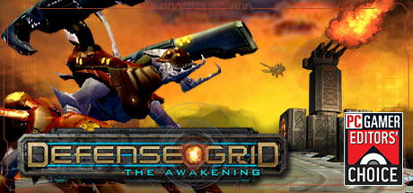
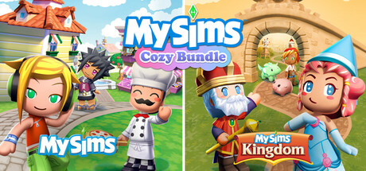
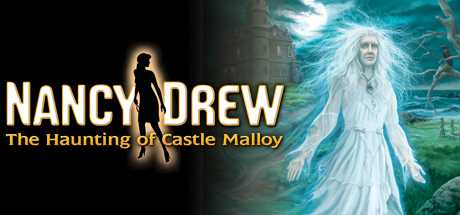
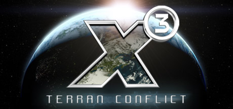

# 2008 in Video Games — October–December

[← All of 2008](../2008.md) · [Back to index](../../README.md)

353 titles.

### 007: Quantum of Solace

**Platforms:** Nintendo DS, PlayStation 2, PlayStation 3, Wii, Windows, Xbox 360 &nbsp;|&nbsp; **Developer:** Treyarch, Eurocom, Vicarious Visions &nbsp;|&nbsp; **Publisher:** Activision &nbsp;|&nbsp; **Genre:** First-person shooter, Third-person shooter &nbsp;|&nbsp; **Released:** October 31, 2008

[Wikipedia](https://en.wikipedia.org/wiki/007:_Quantum_of_Solace)

---

### 100 Classic Book Collection

**Platforms:** Nintendo DS &nbsp;|&nbsp; **Developer:** Genius Sonority &nbsp;|&nbsp; **Publisher:** Nintendo &nbsp;|&nbsp; **Genre:** Educational &nbsp;|&nbsp; **Released:** December 26, 2008

> 100 Classic Book Collection turns your Nintendo DS into a portable library containing must-read novels from iconic authors such as Charles Dickens, Jane Austen, William Shakespeare, and many more. From Sense and Sensibility to Treasure Island, Moby Dick to A Midsummer Night's Dream, Nintendo's 100 Classic Book Collection presents 100 books that everyone should read--all conveniently housed in one single DS game cartridge. Hold the DS like a book and use the touch screen to turn the pages. 100 Classic Book Collection provides search methods to help you find a book that suits your mood and the amount of time you have to read.
>
> _Synopsis source: IGDB_

[Wikipedia](https://en.wikipedia.org/wiki/100_Classic_Book_Collection) · [IGDB](https://www.igdb.com/games/100-classic-book-collection)

---

### 101-in-1 Explosive Megamix

**Platforms:** Nintendo DS &nbsp;|&nbsp; **Developer:** Nordcurrent &nbsp;|&nbsp; **Genre:** Video game compilation &nbsp;|&nbsp; **Released:** November 28, 2008

> Welcome to the home of 101 mind-blowing games for all tastes!  Whether you like puzzle games, sport games or fast-paced arcade action, you'll definitely find something to suit you here! Jump in - ten of hours of games await you!
>
> _Synopsis source: IGDB_

[Wikipedia](https://en.wikipedia.org/wiki/101-in-1_Explosive_Megamix) · [IGDB](https://www.igdb.com/games/101-in-1-explosive-megamix)

---

### 428: Shibuya Scramble

**Platforms:** Wii &nbsp;|&nbsp; **Released:** December 4

---

### A Kingdom for Keflings

**Platforms:** Xbox 360 &nbsp;|&nbsp; **Developer:** NinjaBee &nbsp;|&nbsp; **Publisher:** Microsoft Studios &nbsp;|&nbsp; **Genre:** City-building game &nbsp;|&nbsp; **Released:** November 19, 2008

> The Keflings need your help! Play as a giant and help the tiny Keflings build up and beautify their Kingdom. Start out small, unlocking new blueprints, buildings and tasks as you work towards designing and building a Kefling castle. Create your own, private, medieval world with the help of the little Keflings!
>
> _Synopsis source: IGDB_

[Wikipedia](https://en.wikipedia.org/wiki/A_Kingdom_for_Keflings) · [IGDB](https://www.igdb.com/games/a-kingdom-for-keflings)

---

### A Second Face

**Platforms:** Windows &nbsp;|&nbsp; **Developer:** Jospin Le Woltaire &nbsp;|&nbsp; **Genre:** Point-and-click adventure &nbsp;|&nbsp; **Released:** December 23, 2008

[Wikipedia](https://en.wikipedia.org/wiki/A_Second_Face)

---

### A Vampyre Story

**Platforms:** Windows, macOS &nbsp;|&nbsp; **Developer:** Autumn Moon Entertainment &nbsp;|&nbsp; **Publisher:** Crimson Cow, The Adventure Company, Jordan Freeman Group &nbsp;|&nbsp; **Genre:** Adventure &nbsp;|&nbsp; **Released:** November 21, 2008

> Help Mona De Lafitte escape from Baron Shrowdy von Kiefer and return to Paris!
>
> _Synopsis source: IGDB_

[Wikipedia](https://en.wikipedia.org/wiki/A_Vampyre_Story) · [IGDB](https://www.igdb.com/games/a-vampyre-story)

---

### AdventureQuest Worlds

**Platforms:** Browser &nbsp;|&nbsp; **Developer:** Artix Entertainment &nbsp;|&nbsp; **Publisher:** Artix Entertainment &nbsp;|&nbsp; **Genre:** Massively multiplayer online role-playing game &nbsp;|&nbsp; **Released:** October 14, 2008

> Updated every Friday with new stories, items, quests, monsters and more! Join thousands online and defend the world from Drakath and his 13 Chaos Lords. Team with your friends and take on challenging bosses to get rare rewards! With a storyline that updates weekly, our very first MMO always has something new for you to do, epic loot to collect, and other heroes to battle with... or against!
>
> _Synopsis source: IGDB_

[Wikipedia](https://en.wikipedia.org/wiki/AdventureQuest_Worlds) · [IGDB](https://www.igdb.com/games/adventurequest-worlds)

---

### Age of Booty

**Platforms:** Xbox 360 &nbsp;|&nbsp; **Released:** October 15

[Wikipedia](https://en.wikipedia.org/wiki/Age_of_Booty)

---

### Age of Empires: Mythologies

**Platforms:** Nintendo DS &nbsp;|&nbsp; **Developer:** Griptonite Games &nbsp;|&nbsp; **Publisher:** THQ &nbsp;|&nbsp; **Genre:** Turn-based strategy &nbsp;|&nbsp; **Released:** November 24, 2008

> Inspired by the hit PC title and built on the game engine behind the critically acclaimed Age of Empires: Age of Kings, Age of Empires: Mythologies will be the ultimate portable tactical strategy game with its refined gameplay, inspired design, fantastic multiplayer, and extensive replay value.  Age of Empires: Mythologies for the Nintendo DS is a compelling new turn-based strategy game that challenges players to shape the destiny of three unique cultures in a fantasy world filled with mighty heroes, legendary monsters, and powerful gods. Players will lead their Egyptian, Greek, and Norse heroes to victory by raising massive armies, waging war, exploring new frontiers, and advancing through three distinct ages that offer fantastic new units, abilities, and god powers like lighting storms, earthquakes, and devastating plagues that players can call on to smite their enemies.
>
> _Synopsis source: IGDB_

[Wikipedia](https://en.wikipedia.org/wiki/Age_of_Empires:_Mythologies) · [IGDB](https://www.igdb.com/games/age-of-empires-mythologies)

---

### Ai Space

**Platforms:** Windows &nbsp;|&nbsp; **Developer:** Ai Space Production Committee &nbsp;|&nbsp; **Publisher:** Ai Space Production Committee &nbsp;|&nbsp; **Genre:** MMOSG, Virtual world &nbsp;|&nbsp; **Released:** October 15, 2008

> A now defunct Japanese 3D MMO social game. Formed by a partnership between several companies, players had the chance to interact with characters and visit locations from the worlds of "Clannad", "Shuffle!", and "Da Capo II".  Players could furnish their own dwellings, and meet up with one another on Akihabara Island to socialize. There were also online events such as water gun battles for players to participate in.
>
> _Synopsis source: IGDB_

[Wikipedia](https://en.wikipedia.org/wiki/Ai_Space) · [IGDB](https://www.igdb.com/games/ai-space)

---

### Aion

**Platforms:** Windows &nbsp;|&nbsp; **Developer:** NCSoft &nbsp;|&nbsp; **Publisher:** NCSoft, Gameforge &nbsp;|&nbsp; **Genre:** Massively multiplayer online role-playing game &nbsp;|&nbsp; **Released:** November 25, 2008

> A massively multiplayer online role-playing game released by NCSOFT. The game combines PvP and PvE in a fantasy game environment.
>
> _Synopsis source: IGDB_

[Wikipedia](https://en.wikipedia.org/wiki/Aion_(video_game)) · [IGDB](https://www.igdb.com/games/aion)

---

### Alien Crush Returns

**Platforms:** Wii &nbsp;|&nbsp; **Released:** November 3

[Wikipedia](https://en.wikipedia.org/wiki/Alien_Crush_Returns)

---

### All Star Cheer Squad

**Platforms:** Nintendo DS, Wii &nbsp;|&nbsp; **Released:** October 27

[Wikipedia](https://en.wikipedia.org/wiki/All_Star_Cheer_Squad)

---

### Alone in the Dark: Inferno

**Platforms:** PlayStation 3 &nbsp;|&nbsp; **Released:** November 18

[Wikipedia](https://en.wikipedia.org/wiki/Alone_in_the_Dark_(2008_video_game))

---

### AMF Bowling World Lanes

**Platforms:** Wii &nbsp;|&nbsp; **Developer:** Frontline Studios &nbsp;|&nbsp; **Publisher:** Vir2L Studios &nbsp;|&nbsp; **Genre:** Sports &nbsp;|&nbsp; **Released:** November 18, 2008

> AMF Bowling World Lanes is a sports video game developed by Front Line Studios and published by Bethesda Softworks on November 18, 2008.
>
> _Synopsis source: IGDB_

[Wikipedia](https://en.wikipedia.org/wiki/AMF_Bowling_World_Lanes) · [IGDB](https://www.igdb.com/games/amf-bowling-world-lanes)

---

### Animal Boxing

**Platforms:** Nintendo DS &nbsp;|&nbsp; **Developer:** Akaoni Studio &nbsp;|&nbsp; **Publisher:** Destineer, Gammick Entertainment &nbsp;|&nbsp; **Genre:** Sports, fighting &nbsp;|&nbsp; **Released:** October 28, 2008

> Animal Boxing lets you box animals!
>
> _Synopsis source: IGDB_

[Wikipedia](https://en.wikipedia.org/wiki/Animal_Boxing) · [IGDB](https://www.igdb.com/games/animal-boxing)

---

### Animal Crossing: City Folk

**Platforms:** Wii &nbsp;|&nbsp; **Released:** November 16

---

### Aquia

**Platforms:** Nintendo DS &nbsp;|&nbsp; **Developer:** Skip Ltd. &nbsp;|&nbsp; **Publisher:** Nintendo &nbsp;|&nbsp; **Genre:** Puzzle &nbsp;|&nbsp; **Released:** December 24, 2008

[Wikipedia](https://en.wikipedia.org/wiki/Aquia_(video_game))

---

### AssaultCube

**Platforms:** Windows, Linux, macOS, Android &nbsp;|&nbsp; **Developer:** Rabid Viper Productions &nbsp;|&nbsp; **Genre:** First-person shooter &nbsp;|&nbsp; **Released:** November 21, 2008

> AssaultCube is a FREE, multiplayer, first-person shooter game, based on the CUBE engine. Taking place in realistic environments, with fast, arcade gameplay, it's addictive and fun!
>
> _Synopsis source: IGDB_

[Wikipedia](https://en.wikipedia.org/wiki/AssaultCube) · [IGDB](https://www.igdb.com/games/assaultcube)

---

### Avatar: The Last Airbender – Into the Inferno

**Platforms:** Nintendo DS, PlayStation 2, Wii, PlayStation 3, Xbox 360 &nbsp;|&nbsp; **Released:** October 13

---

### Away: Shuffle Dungeon

**Platforms:** Nintendo DS &nbsp;|&nbsp; **Released:** October 30

---

### Baby Life

**Platforms:** Nintendo DS &nbsp;|&nbsp; **Developer:** Pasta Games &nbsp;|&nbsp; **Publisher:** Deep Silver &nbsp;|&nbsp; **Genre:** Life simulation game &nbsp;|&nbsp; **Released:** November 28, 2008

[Wikipedia](https://en.wikipedia.org/wiki/Baby_Life)

---

### Back at the Barnyard: Slop Bucket Games

**Platforms:** Nintendo DS &nbsp;|&nbsp; **Released:** October 20

---

### Bananagrams

**Platforms:** Browser, Facebook &nbsp;|&nbsp; **Developer:** Large Animal Games &nbsp;|&nbsp; **Publisher:** Majesco &nbsp;|&nbsp; **Genre:** Puzzle &nbsp;|&nbsp; **Released:** November 17, 2008

[Wikipedia](https://en.wikipedia.org/wiki/Bananagrams_(video_game))

---

### Bang Attack

**Platforms:** Wii &nbsp;|&nbsp; **Developer:** Engine Software &nbsp;|&nbsp; **Genre:** Puzzle game &nbsp;|&nbsp; **Released:** December 5, 2008

[Wikipedia](https://en.wikipedia.org/wiki/Bang_Attack)

---

### Banjo-Kazooie: Nuts & Bolts

**Platforms:** Xbox 360 &nbsp;|&nbsp; **Released:** November 11

---

### Base 10

**Platforms:** Nintendo DS &nbsp;|&nbsp; **Developer:** Skip Ltd. &nbsp;|&nbsp; **Publisher:** Nintendo &nbsp;|&nbsp; **Genre:** Puzzle &nbsp;|&nbsp; **Released:** December 24, 2008

[Wikipedia](https://en.wikipedia.org/wiki/Base_10_(video_game))

---

### Beat'n Groovy

**Platforms:** Xbox 360 &nbsp;|&nbsp; **Developer:** Voltex &nbsp;|&nbsp; **Publisher:** Konami &nbsp;|&nbsp; **Genre:** Rhythm game &nbsp;|&nbsp; **Released:** October 8, 2008

[Wikipedia](https://en.wikipedia.org/wiki/Beat'n_Groovy) · [IGDB](https://www.igdb.com/games/beatn-groovy)

---

### Beatmania IIDX 16: Empress

**Platforms:** Arcade &nbsp;|&nbsp; **Developer:** Konami Digital Entertainment &nbsp;|&nbsp; **Publisher:** Konami Digital Entertainment &nbsp;|&nbsp; **Genre:** Music &nbsp;|&nbsp; **Released:** November 19, 2008

[Wikipedia](https://en.wikipedia.org/wiki/Beatmania_IIDX_16:_Empress)

---

### Bejeweled Twist

**Platforms:** Windows, Mobile phone, Zeebo, Browser, Nintendo DS &nbsp;|&nbsp; **Developer:** PopCap Games, Griptonite Games &nbsp;|&nbsp; **Publisher:** PopCap Games, Square Enix, Media Sales & Licensing &nbsp;|&nbsp; **Genre:** Puzzle &nbsp;|&nbsp; **Released:** October 27, 2008

> Spin, match, explode... WOW! It's a brilliant new way to play Bejeweled! Get set for a vivid sensory rush as you spin and match explosive gems for shockwaves of fun. Rotate jewels freely to set up electrifying combos, outwit surprising obstacles like Locks and Bombs, and create high-voltage Flame and Lightning gems. When you need to dial up the intensity or fine-tune your skills, turn to Challenge mode or five-minute Blitz. And if relaxing is more your style, kick up your feet with stress-free Zen. No matter the mode, you'll discover new strategies, improve your moves, and find endless ways to win!
>
> _Synopsis source: IGDB_

[Wikipedia](https://en.wikipedia.org/wiki/Bejeweled_Twist) · [IGDB](https://www.igdb.com/games/bejeweled-twist)

---

### Bella Sara

**Platforms:** Nintendo DS, Windows &nbsp;|&nbsp; **Developer:** Hidden City Games &nbsp;|&nbsp; **Publisher:** Codemasters &nbsp;|&nbsp; **Genre:** Life simulation, puzzle &nbsp;|&nbsp; **Released:** October 3, 2008

> The Bella Sara games will immerse players in an interactive world of fantasy horses. Players will be able to ride, care for, accessorise and trade the horses with friends whilst discovering secret items and exclusive cards to activate on the official website.
>
> _Synopsis source: IGDB_

[Wikipedia](https://en.wikipedia.org/wiki/Bella_Sara_(video_game)) · [IGDB](https://www.igdb.com/games/bella-sara--2)

---

### Ben 10: Alien Force

**Platforms:** Nintendo DS, PlayStation 2, PlayStation Portable, Wii &nbsp;|&nbsp; **Released:** October 28

---

### Beyond Protocol

**Platforms:** Windows &nbsp;|&nbsp; **Released:** November 21

---

### Big Kahuna Party

**Platforms:** Wii &nbsp;|&nbsp; **Released:** December 15

[Wikipedia](https://en.wikipedia.org/wiki/Big_Kahuna_Party)

---

### Biology Battle

**Platforms:** Xbox 360, Xbox &nbsp;|&nbsp; **Developer:** Novaleaf &nbsp;|&nbsp; **Genre:** Multidirectional shooter &nbsp;|&nbsp; **Released:** November 19, 2008

> In this classic space-shooter, you take the role of a medical nanobot and embark on an exciting journey into the depths of a biological cell. Evade the defense tactics of the other cells and try to survive for as long as possible.
>
> _Synopsis source: IGDB_

[Wikipedia](https://en.wikipedia.org/wiki/Biology_Battle) · [IGDB](https://www.igdb.com/games/biology-battle)

---

### BioShock

**Platforms:** PlayStation 3 &nbsp;|&nbsp; **Publisher:** 2K Games &nbsp;|&nbsp; **Released:** October 17, 2008

[Wikipedia](https://en.wikipedia.org/wiki/BioShock)

---

### Bleach: Dark Souls

**Platforms:** Nintendo DS &nbsp;|&nbsp; **Released:** October 7

---

### Blitz: The League II

**Platforms:** PlayStation 3, Xbox 360 &nbsp;|&nbsp; **Released:** October 13

---

### Boingz

**Platforms:** Wii &nbsp;|&nbsp; **Developer:** NinjaBee &nbsp;|&nbsp; **Publisher:** RealNetworks &nbsp;|&nbsp; **Genre:** Action &nbsp;|&nbsp; **Released:** November 24, 2008

> Bend, stretch and flick your way to freedom!  Stretch, flex, and flick your way to freedom! A truly mind-bending experience, Boingz introduces you to cute, colorful, stretchable friends lost in an alien world, searching for the magical gates that will take them home. Boingz springs to life with 30 levels of puzzle-platforming fun. The Boingz are bendy little critters that can be pulled, stretched, and flicked from place to place like rubber bands. It's a team effort, as all the Boingz will have to work together to unwind the game's puzzles. What's more, many of the Boingz have fallen into a deep slumber, and you'll have to lead the stronger Boingz to find and wake up their sleepy friends. Explore surreal landscapes, sail through the air like a trapeze artist, walk along the seafloor, and collect the Twinklies to power up your elastic-powered flights!
>
> _Synopsis source: IGDB_

[Wikipedia](https://en.wikipedia.org/wiki/Boingz) · [IGDB](https://www.igdb.com/games/boingz)

---

### Bolt

**Platforms:** Nintendo DS, PlayStation 2, PlayStation 3, Wii, Windows, Xbox 360 &nbsp;|&nbsp; **Genre:** Strategy &nbsp;|&nbsp; **Released:** November 18

> Step into the boots of a battlefield commander in Bolt Action, a turn-based WWII strategy inspired by Warlord Games’ tabletop classic.
>
> _Synopsis source: Steam_

[Wikipedia](https://en.wikipedia.org/wiki/Bolt_(video_game)) · [Steam](https://store.steampowered.com/app/3856030)

---

### Bomberman 2

**Platforms:** Nintendo DS &nbsp;|&nbsp; **Developer:** Hudson Soft &nbsp;|&nbsp; **Publisher:** Hudson Soft &nbsp;|&nbsp; **Genre:** Action &nbsp;|&nbsp; **Released:** December 4, 2008

> In Bomberman 2 DS, players can customize their own Bomberman using an assortment of different body parts with various statistical advantages that are unlocked as you progress through the main story mode in which you solve puzzles and defeat enemies. In multiplayer, up to four players may battle each other using their own customized Bomberman. Bomberman 2 also features the classic arcade style multiplayer mode from Bomberman DS and Bomberman Story DS for up to eight players in LAN and a maximum of four players over Wi-Fi.
>
> _Synopsis source: IGDB_

[Wikipedia](https://en.wikipedia.org/wiki/Bomberman_2) · [IGDB](https://www.igdb.com/games/bomberman-2)

---

### BoneTown

**Platforms:** Windows &nbsp;|&nbsp; **Developer:** D-Dub Software &nbsp;|&nbsp; **Publisher:** D-Dub Software &nbsp;|&nbsp; **Genre:** Action-adventure &nbsp;|&nbsp; **Released:** November 12, 2008

[Wikipedia](https://en.wikipedia.org/wiki/BoneTown) · [IGDB](https://www.igdb.com/games/bonetown)

---

### Boogie Superstar

**Platforms:** Wii &nbsp;|&nbsp; **Released:** October 14

[Wikipedia](https://en.wikipedia.org/wiki/Boogie_Superstar)

---

### Brain Age Express

**Platforms:** Nintendo DS &nbsp;|&nbsp; **Developer:** Nintendo NSD &nbsp;|&nbsp; **Publisher:** Nintendo &nbsp;|&nbsp; **Genre:** Puzzle, edutainment &nbsp;|&nbsp; **Released:** December 24, 2008

[Wikipedia](https://en.wikipedia.org/wiki/Brain_Age_Express)

---

### BrainPipe

**Platforms:** PlayStation Portable, macOS, Windows &nbsp;|&nbsp; **Developer:** Digital Eel &nbsp;|&nbsp; **Publisher:** Shrapnel Games &nbsp;|&nbsp; **Genre:** Action &nbsp;|&nbsp; **Released:** December 24, 2008

> BRAINPIPE is a unique gaming experience. The ultimate objective is to transcend humanity. You do this by navigating the tunnels of your mind, exercising your hand-eye coordination while relishing in the funkadelic sights and sounds of your inner self. Collect the illuminated glyphs while avoiding the nasty obstacles. They may look all nice and shiny, even warm and inviting, but each brush with them brings you one step closer to eternal darkness!
>
> _Synopsis source: IGDB_

[Wikipedia](https://en.wikipedia.org/wiki/BrainPipe) · [IGDB](https://www.igdb.com/games/brainpipe-a-plunge-to-unhumanity)

---

### Bratz Kidz

**Platforms:** Nintendo DS, Wii &nbsp;|&nbsp; **Released:** November 4

[Wikipedia](https://en.wikipedia.org/wiki/Bratz_Kidz)

---

### Brothers in Arms: Hour of Heroes

**Platforms:** iOS &nbsp;|&nbsp; **Released:** November 23

---

### Bruiser and Scratch

**Platforms:** Wii &nbsp;|&nbsp; **Developer:** Steel Penny Games &nbsp;|&nbsp; **Publisher:** Steel Penny Games &nbsp;|&nbsp; **Genre:** Puzzle, adventure &nbsp;|&nbsp; **Released:** December 8, 2008

> Test your mental agility with the most challenging and fun puzzles ever!  Bruiser and Scratch are stranded in a strange world with a dark secret. Their only hope to find a path home is to unravel the mystery of this place, one over-sized puzzle at a time. Along the way, they make new friends and meet up with old adversaries, each of whom play a role in their journey. Bruiser and Scratch offers a number of tutorial levels to bring the player up to speed gradually. The story unfolds over 48 puzzles and six landscapes. And for players who can't get enough, Challenge mode offers 75 additional puzzles that range from child's play to mind-bogglingly difficult.
>
> _Synopsis source: IGDB_

[Wikipedia](https://en.wikipedia.org/wiki/Bruiser_and_Scratch) · [IGDB](https://www.igdb.com/games/bruiser-and-scratch)

---

### Buccaneer: The Pursuit of Infamy

**Platforms:** Windows &nbsp;|&nbsp; **Developer:** Stickman Studios &nbsp;|&nbsp; **Publisher:** Blitz Arcade &nbsp;|&nbsp; **Genre:** Shooter game &nbsp;|&nbsp; **Released:** December 6, 2008

> Buccaneer is a single and multiplayer game where players strive to become the most infamous pirate captain of all time and etch their name in The Hall of Infamy.Set against a backdrop of the sunny Caribbean, players will control a variety of classic tall ships, bristling with cannons, as they plunder their way through a 50 mission campaign and go head to head against other cut-throats online.Employing a simple and intuitive control system, players will be able to jump straight into the action and begin their career in piracy.With a wide variety of non-linear single player missions and a choice of more than a dozen fully customisable ships, Buccaneer will have budding pirate captains clamouring for more!
>
> _Synopsis source: IGDB_

[Wikipedia](https://en.wikipedia.org/wiki/Buccaneer:_The_Pursuit_of_Infamy) · [IGDB](https://www.igdb.com/games/buccaneer-the-pursuit-of-infamy)

---

### Buzz! Junior: Ace Racers

**Platforms:** PlayStation 2 &nbsp;|&nbsp; **Developer:** Cohort Studios &nbsp;|&nbsp; **Publisher:** Sony Computer Entertainment &nbsp;|&nbsp; **Genre:** Party, racing &nbsp;|&nbsp; **Released:** October 24, 2008

[Wikipedia](https://en.wikipedia.org/wiki/Buzz!_Junior:_Ace_Racers)

---

### Buzz!: Brain Bender

**Platforms:** PlayStation Portable &nbsp;|&nbsp; **Developer:** Curve Studios &nbsp;|&nbsp; **Publisher:** Sony Computer Entertainment &nbsp;|&nbsp; **Genre:** Puzzle &nbsp;|&nbsp; **Released:** November 28, 2008

[Wikipedia](https://en.wikipedia.org/wiki/Buzz!:_Brain_Bender)

---

### Call of Duty: World at War

**Platforms:** Nintendo DS, PlayStation 3, Wii, Windows, Xbox 360, PlayStation 2 &nbsp;|&nbsp; **Genre:** Action &nbsp;|&nbsp; **Released:** November 11

> Call of Duty is back, redefining war like you've never experienced before. Building on the Call of Duty 4®: Modern Warfare engine, Call of Duty: World at War immerses players into the most gritty and chaotic WWII combat ever experienced.
>
> _Synopsis source: Steam_

[Steam](https://store.steampowered.com/app/10090)

---

### Call of Duty: World at War (Nintendo DS)

**Platforms:** Nintendo DS &nbsp;|&nbsp; **Developer:** n-Space &nbsp;|&nbsp; **Publisher:** Activision &nbsp;|&nbsp; **Genre:** First-person shooter &nbsp;|&nbsp; **Released:** November 11, 2008

[Wikipedia](https://en.wikipedia.org/wiki/Call_of_Duty:_World_at_War_(Nintendo_DS))

---

### Call of Duty: World at War – Final Fronts

**Platforms:** PlayStation 2 &nbsp;|&nbsp; **Developer:** Rebellion Developments &nbsp;|&nbsp; **Publisher:** Activision &nbsp;|&nbsp; **Genre:** First-person shooter &nbsp;|&nbsp; **Released:** November 11, 2008

[Wikipedia](https://en.wikipedia.org/wiki/Call_of_Duty:_World_at_War_%E2%80%93_Final_Fronts)

---

### Calvin Tucker's Redneck Jamboree

**Platforms:** Wii, Windows &nbsp;|&nbsp; **Developer:** Humagade &nbsp;|&nbsp; **Publisher:** Zoo Games &nbsp;|&nbsp; **Genre:** Various &nbsp;|&nbsp; **Released:** December 19, 2008

> Every year, the people of Redneck County gather to compete in the great Redneck Jamboree! Come join them and test your redneck skills in 12 hilarious events to gain more bottle caps than any of the four families participating to become the greatest family of the county for a year. Not only will you get bragging rights, but you'll also get the privilege to move in "The Big Trailer" where fabulous redneck style luxuries await!
>
> _Synopsis source: IGDB_

[Wikipedia](https://en.wikipedia.org/wiki/Calvin_Tucker's_Redneck_Jamboree) · [IGDB](https://www.igdb.com/games/calvin-tucker-s-redneck-jamboree)

---

### Car Jack Streets

**Platforms:** Mobile phone &nbsp;|&nbsp; **Developer:** Tag Games &nbsp;|&nbsp; **Publisher:** Tag Games &nbsp;|&nbsp; **Genre:** Racing &nbsp;|&nbsp; **Released:** October 23, 2008

[Wikipedia](https://en.wikipedia.org/wiki/Car_Jack_Streets)

---

### CarneyVale: Showtime

**Platforms:** Xbox 360 &nbsp;|&nbsp; **Developer:** Singapore-MIT GAMBIT Game Lab &nbsp;|&nbsp; **Publisher:** Singapore-MIT GAMBIT Game Lab, Microsoft Game Studios, Appxplore &nbsp;|&nbsp; **Genre:** Platform game &nbsp;|&nbsp; **Released:** December 22, 2008

[Wikipedia](https://en.wikipedia.org/wiki/CarneyVale:_Showtime)

---

### Carnival Games: Mini-Golf

**Platforms:** Wii &nbsp;|&nbsp; **Developer:** Cat Daddy Games &nbsp;|&nbsp; **Publisher:** 2K Play &nbsp;|&nbsp; **Genre:** Sports &nbsp;|&nbsp; **Released:** October 21, 2008

[Wikipedia](https://en.wikipedia.org/wiki/Carnival_Games:_Mini-Golf)

---

### Casebook

**Platforms:** Windows &nbsp;|&nbsp; **Developer:** Areo Cinematic Games &nbsp;|&nbsp; **Publisher:** Big Fish Games &nbsp;|&nbsp; **Genre:** Interactive movie, Point-and-click adventure &nbsp;|&nbsp; **Released:** December 1, 2008

[Wikipedia](https://en.wikipedia.org/wiki/Casebook_(video_game))

---

### Casper's Scare School

**Platforms:** Nintendo DS &nbsp;|&nbsp; **Released:** October 26

[Wikipedia](https://en.wikipedia.org/wiki/Casper%27s_Scare_School_(video_game))

---

### Castlevania Judgment

**Platforms:** Wii &nbsp;|&nbsp; **Released:** November 18

[Wikipedia](https://en.wikipedia.org/wiki/Castlevania_Judgment)

---

### Castlevania: Order of Ecclesia

**Platforms:** Nintendo DS &nbsp;|&nbsp; **Released:** October 21

---

### Celebrity Sports Showdown

**Platforms:** Wii &nbsp;|&nbsp; **Released:** October 20

[Wikipedia](https://en.wikipedia.org/wiki/Celebrity_Sports_Showdown)

---

### Chronicles of Mystery: The Scorpio Ritual

**Platforms:** Windows &nbsp;|&nbsp; **Developer:** City Interactive &nbsp;|&nbsp; **Publisher:** City Interactive &nbsp;|&nbsp; **Genre:** Adventure &nbsp;|&nbsp; **Released:** November 10, 2008

> Uncover the darkest secret of humanity! Young archeologist Sylvie Leroux accidentally stumbles upon an ancient secret. What she doesn't realize is that her research will put her in deadly peril. Who wants to prevent her from finishing her research? Are mere humans standing in her way, or is it a supernatural power?
>
> _Synopsis source: IGDB_

[Wikipedia](https://en.wikipedia.org/wiki/Chronicles_of_Mystery:_The_Scorpio_Ritual) · [IGDB](https://www.igdb.com/games/chronicles-of-mystery-the-scorpio-ritual)

---

### Chrono Trigger

**Platforms:** Nintendo DS &nbsp;|&nbsp; **Publisher:** Square Enix &nbsp;|&nbsp; **Released:** November 20, 2008

[Wikipedia](https://en.wikipedia.org/wiki/Chrono_Trigger#Nintendo_DS)

---

### Chrysler Classic Racing

**Platforms:** Wii, Nintendo DS &nbsp;|&nbsp; **Developer:** Extra Mile Studios &nbsp;|&nbsp; **Publisher:** Zoo Entertainment &nbsp;|&nbsp; **Genre:** Racing &nbsp;|&nbsp; **Released:** November 18, 2008

> You might be a nerdy wallflower, but you're about to become the coolest cat out there. Chrysler Classic Racing is set in America during the car-crazed era of 1950s and 1960s, and you're on a mission to become the "King of Cool" by redefining not only your own style, but creating the hippest racing vehicle on the road! With just enough dough in your pocket to buy an entry-level Chrysler, take part in "after-hours" races. Win some cash and buy new cars, better engines sweet decals, or faster tires. Or make yourself look cooler with a sleek new haircut, more fashionable threads, and swankier sunglasses. If your car looks hot and your style is slick, you could just become the "King of Cool."
>
> _Synopsis source: IGDB_

[Wikipedia](https://en.wikipedia.org/wiki/Chrysler_Classic_Racing) · [IGDB](https://www.igdb.com/games/chrysler-classic-racing)

---

### Club Penguin: Elite Penguin Force

**Platforms:** Nintendo DS &nbsp;|&nbsp; **Released:** November 25

---

### Colour Cross

**Platforms:** Nintendo DS &nbsp;|&nbsp; **Developer:** Little Worlds Studio &nbsp;|&nbsp; **Publisher:** Rising Star Games, Zoo Digital &nbsp;|&nbsp; **Genre:** Puzzle &nbsp;|&nbsp; **Released:** December 5, 2008

[Wikipedia](https://en.wikipedia.org/wiki/Colour_Cross)

---

### Command & Conquer: Red Alert 3

**Platforms:** Windows, Xbox 360 &nbsp;|&nbsp; **Genre:** Action, Strategy &nbsp;|&nbsp; **Released:** October 28

> The desperate leadership of a doomed Soviet Union travels back in time to change history and restore the glory of Mother Russia.
>
> _Synopsis source: Steam_

[Steam](https://store.steampowered.com/app/17480)

---

### Cooking Mama: World Kitchen

**Platforms:** Wii &nbsp;|&nbsp; **Released:** November 18

---

### Cosmic Break

**Platforms:** Windows &nbsp;|&nbsp; **Developer:** CyberStep &nbsp;|&nbsp; **Publisher:** CyberStep &nbsp;|&nbsp; **Genre:** Third-person shooter &nbsp;|&nbsp; **Released:** December 19, 2008

> Cosmic Break (Japanese: コズミックブレイク, Hepburn: Kozumikku Bureiku, also stylized as CosmicBreak) is a free to play 3D MMO third-person shooter with big robots and colorful, explosive battles in an anime style. The game was developed and published by the Japanese company CyberStep, Inc. and was officially released in several countries. As is the case with GetAmped2, Cosmic Break also has various NPCs and playable characters voiced by famous Japanese voice-over artists.
>
> _Synopsis source: IGDB_

[Wikipedia](https://en.wikipedia.org/wiki/Cosmic_Break) · [IGDB](https://www.igdb.com/games/cosmic-break)

---

### Cradle of Rome

**Platforms:** Nintendo DS &nbsp;|&nbsp; **Released:** November 18

[Wikipedia](https://en.wikipedia.org/wiki/Cradle_of_Rome)

---

### Crash Commando

**Platforms:** PlayStation 3 &nbsp;|&nbsp; **Developer:** EPOS Game Studios &nbsp;|&nbsp; **Publisher:** Sony Computer Entertainment &nbsp;|&nbsp; **Genre:** Shooter &nbsp;|&nbsp; **Released:** December 18, 2008

> Crash commando is a fast-paced PlayStation 3-exclusive side-scrolling shooter. Obviously inspired by Worms and Soldat, the large levels and small characters allow for hectic action in both single and online multiplayer modes.
>
> _Synopsis source: IGDB_

[Wikipedia](https://en.wikipedia.org/wiki/Crash_Commando) · [IGDB](https://www.igdb.com/games/crash-commando)

---

### Crash: Mind over Mutant

**Platforms:** PlayStation 2, Wii, Xbox 360, PlayStation Portable, Nintendo DS &nbsp;|&nbsp; **Released:** October 7

---

### Crazy Mouse

**Platforms:** Xbox 360 &nbsp;|&nbsp; **Developer:** Ultizen Games &nbsp;|&nbsp; **Publisher:** Ultizen Games &nbsp;|&nbsp; **Genre:** Puzzle &nbsp;|&nbsp; **Released:** October 15, 2008

[Wikipedia](https://en.wikipedia.org/wiki/Crazy_Mouse) · [IGDB](https://www.igdb.com/games/crazy-mouse)

---

### Cryostasis: Sleep of Reason

**Platforms:** Windows &nbsp;|&nbsp; **Developer:** Action Forms &nbsp;|&nbsp; **Publisher:** 1C Company, 505 Games, Aspyr, Zoo Corporation &nbsp;|&nbsp; **Genre:** Psychological horror &nbsp;|&nbsp; **Released:** December 5, 2008

[Wikipedia](https://en.wikipedia.org/wiki/Cryostasis:_Sleep_of_Reason)

---

### Crystal Defenders

**Platforms:** iOS &nbsp;|&nbsp; **Released:** December 23

[Wikipedia](https://en.wikipedia.org/wiki/Crystal_Defenders)

---

### CSI: NY

**Platforms:** Windows &nbsp;|&nbsp; **Released:** November 18

---

### Cubello

**Platforms:** Wii &nbsp;|&nbsp; **Released:** October 13

[Wikipedia](https://en.wikipedia.org/wiki/Cubello)

---

### Culdcept DS

**Platforms:** Nintendo DS &nbsp;|&nbsp; **Released:** October 16

[Wikipedia](https://en.wikipedia.org/wiki/Culdcept_DS)

---

### Dance Dance Revolution Universe 3

**Platforms:** Xbox 360 &nbsp;|&nbsp; **Released:** October 21

[Wikipedia](https://en.wikipedia.org/wiki/Dance_Dance_Revolution_Universe_3)

---

### Dancing with the Stars: We Dance!

**Platforms:** Wii, Nintendo DS &nbsp;|&nbsp; **Developer:** Zoë Mode, Jet Black Games &nbsp;|&nbsp; **Publisher:** Activision &nbsp;|&nbsp; **Genre:** Rhythm &nbsp;|&nbsp; **Released:** October 21, 2008

> Seize your moment of glory in the battle of the ballroom with an all new all-star cast, new dances, and more music! The competition has never been as intense or more fun.  All New Stars from Past Seasons!  Including Apolo Anton Ohno, Joey Fatone, Drew Lachey, Jennie Garth, Mel “Scary Spice” B, Jane Seymour, Mark Cuban, and more! New Professional Dancers! Including two-time champion Julianne Hough, Derek Hough, and 6 others! 40 New Songs! Including hits like Mony Mony, Push It, Lady Marmalade, She Bangs, Bootylicious, Black Horse and Cherry Tree, and more! Engaging Dance Mechanics! All new, special “flair moves”! Improved gameplay including top-down scrolling dance moves, memory mini-games, and score multipliers. All moves are tailored to the ease and playability of the Nintendo Wii and DS controls. New and Improved Multiplayer Mode: Including tournament play, co-op, and dance-off.
>
> _Synopsis source: IGDB_

[Wikipedia](https://en.wikipedia.org/wiki/Dancing_with_the_Stars:_We_Dance!) · [IGDB](https://www.igdb.com/games/dancing-with-the-stars-we-dance)

---

### Dash of Destruction

**Platforms:** Xbox 360 &nbsp;|&nbsp; **Released:** December 17

[Wikipedia](https://en.wikipedia.org/wiki/Dash_of_Destruction)

---

### Dead Space

**Platforms:** Xbox 360, PlayStation 3, Windows &nbsp;|&nbsp; **Publisher:** Electronic Arts &nbsp;|&nbsp; **Genre:** Action, Adventure &nbsp;|&nbsp; **Released:** October 13, 2008

> The sci-fi survival-horror classic returns, completely rebuilt to offer an even more immersive experience — including visual, audio, and gameplay improvements — while staying faithful to the original game’s thrilling vision.
>
> _Synopsis source: Steam_

[Wikipedia](https://en.wikipedia.org/wiki/Dead_Space_(video_game)) · [Steam](https://store.steampowered.com/app/1693980)

---

### Defense Grid: The Awakening

**Platforms:** Windows &nbsp;|&nbsp; **Genre:** Indie, Strategy &nbsp;|&nbsp; **Released:** December 8

> Defense Grid: The Awakening is a unique spin on tower defense gameplay that will appeal to players of all skill levels. A horde of enemies is invading, and it's up to the player to stop them by strategically building fortification towers around their base.
>
> _Synopsis source: Steam_

[Steam](https://store.steampowered.com/app/18500)

---

### Derby Time Online

**Platforms:** PlayStation 3 &nbsp;|&nbsp; **Developer:** Japan Studio &nbsp;|&nbsp; **Publisher:** Sony Computer Entertainment &nbsp;|&nbsp; **Genre:** Sports &nbsp;|&nbsp; **Released:** November 13, 2008

> This Sony-developed horse racing game is coming to the PlayStation 3.
>
> _Synopsis source: IGDB_

[Wikipedia](https://en.wikipedia.org/wiki/Derby_Time_Online) · [IGDB](https://www.igdb.com/games/derby-time-online)

---

### Destroy All Humans! Path of the Furon

**Platforms:** Xbox 360 &nbsp;|&nbsp; **Released:** December 1

[Wikipedia](https://en.wikipedia.org/wiki/Destroy_All_Humans!_Path_of_the_Furon)

---

### Devil Summoner 2: Raidou Kuzunoha vs. King Abaddon

**Platforms:** PlayStation 2 &nbsp;|&nbsp; **Developer:** Atlus &nbsp;|&nbsp; **Publisher:** Atlus &nbsp;|&nbsp; **Genre:** Action role-playing &nbsp;|&nbsp; **Released:** October 23, 2008

> Devil Summoner Raidou Kuzunoha is back on the case in this action RPG sequel. While Kuzunoha may look like your average gumshoe, he's anything but. When Japan's capital is threatened, Kuzunoha and his demon-summoning powers are called into action. Crack a new case load in stylish 1920s Japan. You've got more than double the number of demons to negotiate with. Win them over to harness their abilities, then fuse them to increase their powers or control two at a time to create more tactical combat options. Combat is even better than ever, with new battle mechanics and a retooled Weapons Alchemy system that lets you create swords to deliver special attacks.
>
> _Synopsis source: IGDB_

[Wikipedia](https://en.wikipedia.org/wiki/Devil_Summoner_2:_Raidou_Kuzunoha_vs._King_Abaddon) · [IGDB](https://www.igdb.com/games/shin-megami-tensei-devil-summoner-2-raidou-kuzunoha-vs-king-abaddon)

---

### Digital Combat Simulator

**Platforms:** Windows &nbsp;|&nbsp; **Developer:** Eagle Dynamics &nbsp;|&nbsp; **Publisher:** The Fighter Collection &nbsp;|&nbsp; **Genre:** Combat flight simulator &nbsp;|&nbsp; **Released:** October 17, 2008

> Feel the excitement of flying the Su-25T "Frogfoot" attack jet and the TF-51D "Mustang" in the free-to-play Digital Combat Simulator World!
>
> _Synopsis source: IGDB_

[Wikipedia](https://en.wikipedia.org/wiki/Digital_Combat_Simulator) · [IGDB](https://www.igdb.com/games/dcs-world)

---

### Disney Sing It

**Platforms:** PlayStation 2, PlayStation 3, Wii, Xbox 360, Windows &nbsp;|&nbsp; **Developer:** Zoë Mode &nbsp;|&nbsp; **Publisher:** Disney Interactive Studios &nbsp;|&nbsp; **Genre:** Karaoke &nbsp;|&nbsp; **Released:** October 21, 2008

> Disney Sing It is a karaoke video game and sequel to High School Musical: Sing It!. It was released on October 28, 2008 across multiple platforms. The game's product description refers to additional downloadable song packs being available. However, as of 28 April 2009, Disney Interactive Support has replied (to a query): "Thank you for contacting us.In some circumstances we need to make some business decisions and drop certain projects that might have been planned or even announced previously. This case falls in one of those situations and currently we don't have any plans on adding any downloadable contents for either Disney Sing It title."  The game has received mixed reviews, with both 1UP.com and IGN praising its accessibility towards kids but finding serious fault with the gameplay, with Official Xbox Magazine ultimately calling it a "gateway game" at best.  Track List  Aly & AJ - Like Whoa Aly & AJ - Potential Break-Up song Aly & AJ - Chemicals React Billy Ray Cyrus - Ready, Set, Don't Go Camp Rock - We Rock Camp Rock - Start the Party Camp Rock - This is Me Camp Rock - Gotta Find You Camp Rock - Play My Music Camp Rock - Hasta La Vista Camp Rock - Here I Am Cheetah Girls 3 - One World Cheetah Girls 2 - Dance with Me Cheetah Girls 2 - The Party's Just Begun Corbin Bleu - Push It To The Limit Everlife - Find Yourself In You Everlife - Real Wild Child Hannah Montana - Best of Both Worlds Hannah Montana - Life is What You Make It Hannah Montana - Nobody's Perfect Hannah Montana - Rock Star High School Musical - Breaking Free High School Musical - Get'cha Head in the Game High School Musical - Start of Something New High School Musical 2 - Bet On It High School Musical 2 - Fabulous High School Musical 2 - What Time Is It High School Musical 2 - You Are the Music in Me Jesse McCartney - She's No You Jordan Pruitt - Jump to the Rhythm Jordan Pruitt - Outside Looking In Miley Cyrus - Girls Night Out Miley Cyrus - See You Again Miley Cyrus - Start All Over Vanessa Hudgens - Say OK
>
> _Synopsis source: IGDB_

[Wikipedia](https://en.wikipedia.org/wiki/Disney_Sing_It) · [IGDB](https://www.igdb.com/games/disney-sing-it)

---

### Disney Think Fast

**Platforms:** Wii &nbsp;|&nbsp; **Released:** October 21

[Wikipedia](https://en.wikipedia.org/wiki/Disney_Think_Fast)

---

### Dissidia: Final Fantasy

**Platforms:** PlayStation Portable &nbsp;|&nbsp; **Released:** December 18

---

### DJMax Portable Black Square

**Platforms:** PlayStation Portable &nbsp;|&nbsp; **Developer:** Pentavision &nbsp;|&nbsp; **Publisher:** Pentavision, CyberFront &nbsp;|&nbsp; **Genre:** Music video game &nbsp;|&nbsp; **Released:** December 24, 2008

> DJMax Portable Black Square is a music game for the PlayStation Portable developed by South Korean developer Pentavision released on December 24, 2008. This is the fourth major game of the DJMax series released for the PSP.
>
> _Synopsis source: IGDB_

[Wikipedia](https://en.wikipedia.org/wiki/DJMax_Portable_Black_Square) · [IGDB](https://www.igdb.com/games/djmax-portable-black-square)

---

### DJMax Technika

**Platforms:** Arcade &nbsp;|&nbsp; **Developer:** Pentavision &nbsp;|&nbsp; **Publisher:** Pentavision &nbsp;|&nbsp; **Genre:** Music video game &nbsp;|&nbsp; **Released:** October 31, 2008

> Pentavision's first arcade music game features Ouendan-style gameplay using a touchscreen HDTV. It was first released in South Korea in 2008, followed by a worldwide release the following year.
>
> _Synopsis source: IGDB_

[Wikipedia](https://en.wikipedia.org/wiki/DJMax_Technika) · [IGDB](https://www.igdb.com/games/djmax-technika)

---

### DJMax Trilogy

**Platforms:** Windows &nbsp;|&nbsp; **Developer:** Pentavision &nbsp;|&nbsp; **Publisher:** Neowiz Games &nbsp;|&nbsp; **Genre:** Music &nbsp;|&nbsp; **Released:** December 24, 2008

> DJMax Trilogy is a rhythm action game with five difficulty modes ranging from limited four-key gameplay to a challenging eight-key setup. As notes are played with perfect accuracy, a "fever gauge" will be charged. When it is fully charged, Fever can be activated. Fever acts as a multiplier to score and it varies between x2 and x5.
>
> _Synopsis source: IGDB_

[Wikipedia](https://en.wikipedia.org/wiki/DJMax_Trilogy) · [IGDB](https://www.igdb.com/games/djmax-trilogy)

---

### Dora the Explorer: Dora Saves the Snow Princess

**Platforms:** Nintendo DS, PlayStation 2, Wii &nbsp;|&nbsp; **Released:** October 28

[Wikipedia](https://en.wikipedia.org/wiki/Dora_the_Explorer_(TV_series))

---

### Dragon Ball Z: Infinite World

**Platforms:** PlayStation 2 &nbsp;|&nbsp; **Released:** November 4

---

### Dynasty Warriors: Gundam 2

**Platforms:** PlayStation 2, PlayStation 3, Xbox 360 &nbsp;|&nbsp; **Released:** December 18

---

### EarthBound Halloween Hack

**Platforms:** Super Nintendo Entertainment System &nbsp;|&nbsp; **Developer:** Toby Fox &nbsp;|&nbsp; **Genre:** Role-playing &nbsp;|&nbsp; **Released:** November 1, 2008

> EarthBound Halloween Hack, or Radiation's Halloween Hack, also sometimes known as Press the B Button, Stupid! is a romhack of EarthBound made by Toby Fox and released in 2008 for starmen.net's Halloween Funfest. It was inspired by the Brandish series, where the hack's protagonist, Varik comes from. It is much shorter than the original EarthBound.
>
> _Synopsis source: IGDB_

[Wikipedia](https://en.wikipedia.org/wiki/EarthBound_Halloween_Hack) · [IGDB](https://www.igdb.com/games/earthbound-halloween-hack)

---

### Edge

**Platforms:** iOS &nbsp;|&nbsp; **Developer:** Mobigame &nbsp;|&nbsp; **Publisher:** Mobigame &nbsp;|&nbsp; **Genre:** Puzzle-platform &nbsp;|&nbsp; **Released:** December 2008

> In Edge players take direct control of the cube and roll their way around the game's dozens of levels. Search for all the prisms and find the shortcuts to improve your times.
>
> _Synopsis source: IGDB_

[Wikipedia](https://en.wikipedia.org/wiki/Edge_(video_game)) · [IGDB](https://www.igdb.com/games/edge)

---

### Elebits: The Adventures of Kai and Zero

**Platforms:** Nintendo DS &nbsp;|&nbsp; **Released:** December 11

---

### Eternal Eden

**Platforms:** Windows &nbsp;|&nbsp; **Developer:** Blossomsoft &nbsp;|&nbsp; **Publisher:** Blossomsoft &nbsp;|&nbsp; **Genre:** Role-playing game &nbsp;|&nbsp; **Released:** December 11, 2008

[Wikipedia](https://en.wikipedia.org/wiki/Eternal_Eden) · [IGDB](https://www.igdb.com/games/eternal-eden)

---

### Eternal Poison

**Platforms:** PlayStation 2 &nbsp;|&nbsp; **Released:** November 11

[Wikipedia](https://en.wikipedia.org/wiki/Eternal_Poison)

---

### Eversion

**Platforms:** Windows &nbsp;|&nbsp; **Developer:** Zaratustra Productions &nbsp;|&nbsp; **Publisher:** Zaratustra Productions &nbsp;|&nbsp; **Genre:** Platform &nbsp;|&nbsp; **Released:** December 29, 2008

> The Princess of the Flower Kingdom has vanished! She was taken by the Ghulibas of the north, and it is up to brave Zee Tee to rescue her. On his quest, he - and you - will discover the hidden lands behind the peaceful kingdom, and come face to face with secrets that will set you on edge!
>
> _Synopsis source: IGDB_

[Wikipedia](https://en.wikipedia.org/wiki/Eversion_(video_game)) · [IGDB](https://www.igdb.com/games/eversion)

---

### Everyday Shooter

**Platforms:** PlayStation Portable &nbsp;|&nbsp; **Released:** December 4

[Wikipedia](https://en.wikipedia.org/wiki/Everyday_Shooter)

---

### Exit

**Platforms:** Nintendo DS &nbsp;|&nbsp; **Released:** November 5

[Wikipedia](https://en.wikipedia.org/wiki/Exit_(video_game))

---

### Fable II

**Platforms:** Xbox 360 &nbsp;|&nbsp; **Publisher:** Microsoft Game Studios &nbsp;|&nbsp; **Released:** October 21, 2008

[Wikipedia](https://en.wikipedia.org/wiki/Fable_II)

---

### Fallout 3

**Platforms:** Xbox 360, Windows, PlayStation 3 &nbsp;|&nbsp; **Publisher:** Bethesda Softworks &nbsp;|&nbsp; **Genre:** RPG &nbsp;|&nbsp; **Released:** October 28, 2008

> Vault-Tec engineers have worked around the clock on an interactive reproduction of Wasteland life for you to enjoy from the comfort of your own vault. Included is an expansive world, unique combat, shockingly realistic visuals, tons of player choice, and an incredible cast of dynamic characters.
>
> _Synopsis source: Steam_

[Wikipedia](https://en.wikipedia.org/wiki/Fallout_3) · [Steam](https://store.steampowered.com/app/22300)

---

### Family Glide Hockey

**Platforms:** Wii &nbsp;|&nbsp; **Developer:** Arc System Works &nbsp;|&nbsp; **Publisher:** Aksys Games &nbsp;|&nbsp; **Genre:** Sports &nbsp;|&nbsp; **Released:** October 21, 2008

> Daddy, Mommy, Sarah, and Billy are back for some more family fun, and this time it's glide hockey! This time you can hone and master your skills in a gymnasium, a forest park, a beach, an amusement park, and even in the freezing arctic! Family Glide.
>
> _Synopsis source: IGDB_

[Wikipedia](https://en.wikipedia.org/wiki/Family_Glide_Hockey) · [IGDB](https://www.igdb.com/games/family-glide-hockey)

---

### Family Park Tycoon

**Platforms:** Nintendo DS &nbsp;|&nbsp; **Developer:** Visual Imagination Software &nbsp;|&nbsp; **Publisher:** Astragon &nbsp;|&nbsp; **Genre:** Business simulation game &nbsp;|&nbsp; **Released:** November 17, 2008

[Wikipedia](https://en.wikipedia.org/wiki/Family_Park_Tycoon)

---

### Far Cry 2

**Platforms:** PlayStation 3, Windows, Xbox 360 &nbsp;|&nbsp; **Genre:** Action &nbsp;|&nbsp; **Released:** October 21

> You are a gun for hire, trapped in a war-torn African state, stricken with malaria and forced to make deals with corrupt warlords on both sides of the conflict in order to make this country your home. You must identify and exploit your enemies' weaknesses, neutralizing their superior numbers and firepower with surprise, subversion,...
>
> _Synopsis source: Steam_

[Wikipedia](https://en.wikipedia.org/wiki/Far_Cry_2) · [Steam](https://store.steampowered.com/app/19900)

---

### Ferrari GT: Evolution

**Platforms:** iOS, Mobile phone &nbsp;|&nbsp; **Developer:** Gameloft Bucharest &nbsp;|&nbsp; **Genre:** Racing game &nbsp;|&nbsp; **Released:** December 8, 2008

[Wikipedia](https://en.wikipedia.org/wiki/Ferrari_GT:_Evolution)

---

### Fieldrunners

**Platforms:** iOS &nbsp;|&nbsp; **Released:** October 5

[Wikipedia](https://en.wikipedia.org/wiki/Fieldrunners)

---

### FIFA 09

**Platforms:** Mobile phone, Nintendo DS, PlayStation 2, PlayStation 3, PlayStation Portable, Wii, Windows, Xbox 360 &nbsp;|&nbsp; **Released:** October 14

[Wikipedia](https://en.wikipedia.org/wiki/FIFA_09)

---

### FIFA Soccer 09

**Platforms:** Xbox 360 &nbsp;|&nbsp; **Publisher:** EA Sports &nbsp;|&nbsp; **Released:** October 13, 2008

[Wikipedia](https://en.wikipedia.org/wiki/FIFA_Soccer_09)

---

### Flipnote Studio

**Platforms:** Nintendo DS &nbsp;|&nbsp; **Publisher:** Nintendo &nbsp;|&nbsp; **Released:** December 24, 2008

[Wikipedia](https://en.wikipedia.org/wiki/Flipnote_Studio)

---

### Football Manager 2009

**Platforms:** Windows, macOS, PlayStation Portable &nbsp;|&nbsp; **Released:** November 14

[Wikipedia](https://en.wikipedia.org/wiki/Football_Manager_2009)

---

### Football Manager Live

**Platforms:** Windows, macOS &nbsp;|&nbsp; **Developer:** Sports Interactive &nbsp;|&nbsp; **Publisher:** Sega &nbsp;|&nbsp; **Genre:** Sports management &nbsp;|&nbsp; **Released:** November 4, 2008

> Football Manager Live is a online-only managerial soccer simulation where the player is responsible for the financial and athletic success of his club. The main difference to regular games of this genre is that the players don't manage an existing club but create their own.
>
> _Synopsis source: IGDB_

[Wikipedia](https://en.wikipedia.org/wiki/Football_Manager_Live) · [IGDB](https://www.igdb.com/games/football-manager-live)

---

### Football Superstars

**Platforms:** Windows &nbsp;|&nbsp; **Developer:** Monumental Games, Coli Games UK &nbsp;|&nbsp; **Publisher:** Cybersports [now defunct] / Coli Games UK &nbsp;|&nbsp; **Genre:** Association football, Sports simulation &nbsp;|&nbsp; **Released:** December 31, 2008

[Wikipedia](https://en.wikipedia.org/wiki/Football_Superstars)

---

### Fracture

**Platforms:** PlayStation 3, Xbox 360 &nbsp;|&nbsp; **Released:** October 7

[Wikipedia](https://en.wikipedia.org/wiki/Fracture_(video_game))

---

### Fun! Fun! Minigolf

**Platforms:** Wii &nbsp;|&nbsp; **Developer:** Shin'en Multimedia &nbsp;|&nbsp; **Publisher:** Shin'en Multimedia &nbsp;|&nbsp; **Genre:** Sports &nbsp;|&nbsp; **Released:** December 22, 2008

> Play minigolf with your friends in beautiful environments.
>
> _Synopsis source: IGDB_

[Wikipedia](https://en.wikipedia.org/wiki/Fun!_Fun!_Minigolf) · [IGDB](https://www.igdb.com/games/fun-fun-minigolf)

---

### Gallop & Ride

**Platforms:** Wii &nbsp;|&nbsp; **Released:** November 20

[Wikipedia](https://en.wikipedia.org/wiki/Gallop_%26_Ride)

---

### Gears of War 2

**Platforms:** Xbox 360 &nbsp;|&nbsp; **Publisher:** Microsoft Game Studios &nbsp;|&nbsp; **Released:** November 7, 2008

[Wikipedia](https://en.wikipedia.org/wiki/Gears_of_War_2)

---

### Geneforge 5: Overthrow

**Platforms:** macOS &nbsp;|&nbsp; **Developer:** Spiderweb Software &nbsp;|&nbsp; **Publisher:** Spiderweb Software &nbsp;|&nbsp; **Genre:** Role-playing &nbsp;|&nbsp; **Released:** November 28, 2008

> Geneforge 5: Overthrow is the fifth and final video game in the Geneforge series of role-playing video game created by Spiderweb Software.
>
> _Synopsis source: IGDB_

[Wikipedia](https://en.wikipedia.org/wiki/Geneforge_5:_Overthrow) · [IGDB](https://www.igdb.com/games/geneforge-5-overthrow)

---

### Ghajini – The Game

**Platforms:** Windows, Mobile phone &nbsp;|&nbsp; **Developer:** FXLabs, Indiagames &nbsp;|&nbsp; **Publisher:** FXLabs and Geetha Arts &nbsp;|&nbsp; **Genre:** Action &nbsp;|&nbsp; **Released:** December 25, 2008

[Wikipedia](https://en.wikipedia.org/wiki/Ghajini_%E2%80%93_The_Game)

---

### Go, Diego, Go!: The Great Dinosaur Rescue

**Platforms:** Nintendo DS, PlayStation 2, Wii &nbsp;|&nbsp; **Released:** October 28

[Wikipedia](https://en.wikipedia.org/wiki/Go,_Diego,_Go!)

---

### Gold's Gym: Cardio Workout

**Platforms:** Wii &nbsp;|&nbsp; **Publisher:** Ubisoft, Rocket Company &nbsp;|&nbsp; **Genre:** Fitness game &nbsp;|&nbsp; **Released:** October 30, 2008

> Gold's Gym Cardio Workout brings your own personal Gold's Gym cardio trainer into your living room! Gold's Gym is the largest gym in the world and is known for leading the industry in personal training, so expect to get in shape fast. It's a fun way to exercise and maintain a healthy body.
>
> _Synopsis source: IGDB_

[Wikipedia](https://en.wikipedia.org/wiki/Gold's_Gym:_Cardio_Workout) · [IGDB](https://www.igdb.com/games/gold-s-gym-cardio-workout)

---

### Golden Axe: Beast Rider

**Platforms:** PlayStation 3, Xbox 360 &nbsp;|&nbsp; **Released:** October 14

---

### Goosebumps HorrorLand

**Platforms:** Nintendo DS, PlayStation 2, Wii &nbsp;|&nbsp; **Released:** October 28

[Wikipedia](https://en.wikipedia.org/wiki/Goosebumps_HorrorLand_Video_Game)

---

### Gothic 3: Forsaken Gods

**Platforms:** Windows &nbsp;|&nbsp; **Developer:** Trine Games &nbsp;|&nbsp; **Publisher:** JoWooD Productions &nbsp;|&nbsp; **Genre:** Action role-playing &nbsp;|&nbsp; **Released:** November 18, 2008

> Forsaken Gods is a standalone expansion for Gothic 3.
>
> _Synopsis source: IGDB_

[Wikipedia](https://en.wikipedia.org/wiki/Gothic_3:_Forsaken_Gods) · [IGDB](https://www.igdb.com/games/gothic-3-forsaken-gods)

---

### GTI Club+: Rally Côte d'Azur

**Platforms:** PlayStation 3 &nbsp;|&nbsp; **Developer:** Sumo Digital &nbsp;|&nbsp; **Publisher:** Konami &nbsp;|&nbsp; **Genre:** Racing &nbsp;|&nbsp; **Released:** December 4, 2008

> GTI Club+: Rally Côte d'Azur is the PlayStation 3 remake of the original GTI Club released in 1996.
>
> _Synopsis source: IGDB_

[Wikipedia](https://en.wikipedia.org/wiki/GTI_Club+:_Rally_C%C3%B4te_d'Azur) · [IGDB](https://www.igdb.com/games/gti-club-plus-rally-cote-dazur)

---

### Guilty Gear 2: Overture

**Platforms:** Xbox 360 &nbsp;|&nbsp; **Released:** October 7

---

### Guinness World Records: The Videogame

**Platforms:** Nintendo DS, Wii &nbsp;|&nbsp; **Released:** November 11

---

### Guitar Hero On Tour: Decades

**Platforms:** Nintendo DS &nbsp;|&nbsp; **Released:** November 17

---

### Guitar Hero World Tour

**Platforms:** macOS, PlayStation 2, PlayStation 3, Wii, Windows, Xbox 360 &nbsp;|&nbsp; **Released:** October 26

[Wikipedia](https://en.wikipedia.org/wiki/Guitar_Hero_World_Tour)

---

### Guitar Rock Tour

**Platforms:** Nintendo DS, iOS, Mobile phone &nbsp;|&nbsp; **Developer:** Gameloft &nbsp;|&nbsp; **Publisher:** Gameloft &nbsp;|&nbsp; **Genre:** Music &nbsp;|&nbsp; **Released:** November 3, 2008

[Wikipedia](https://en.wikipedia.org/wiki/Guitar_Rock_Tour) · [IGDB](https://www.igdb.com/games/guitar-rock-tour)

---

### Happy Farm

**Platforms:** Windows, macOS &nbsp;|&nbsp; **Developer:** 5 Minutes &nbsp;|&nbsp; **Publisher:** 5 Minutes &nbsp;|&nbsp; **Genre:** Farm management, MMORPG, social network game &nbsp;|&nbsp; **Released:** November 2008

[Wikipedia](https://en.wikipedia.org/wiki/Happy_Farm)

---

### Harvest Moon DS: Grand Bazaar

**Platforms:** Nintendo DS, Windows &nbsp;|&nbsp; **Developer:** Marvelous Interactive &nbsp;|&nbsp; **Publisher:** Marvelous Interactive, Natsume Inc., Rising Star Games &nbsp;|&nbsp; **Genre:** Simulation, role-playing &nbsp;|&nbsp; **Released:** December 18, 2008

> Harvest Moon DS: Grand Bazaar is a video game released on December 18, 2008 by Marvelous Interactive in Japan, and released on August 24, 2010 by Natsume in North America. It was also released in Europe on September 30, 2011 by Rising Star Games.[2] The game is the nineteenth game in the Story of Seasons series and the fifth game in the series for the Nintendo DS.
>
> _Synopsis source: IGDB_

[Wikipedia](https://en.wikipedia.org/wiki/Harvest_Moon_DS:_Grand_Bazaar) · [IGDB](https://www.igdb.com/games/harvest-moon-ds-grand-bazaar)

---

### Hello Kitty: Big City Dreams

**Platforms:** Nintendo DS &nbsp;|&nbsp; **Developer:** Human Soft &nbsp;|&nbsp; **Publisher:** Empire Interactive &nbsp;|&nbsp; **Genre:** Puzzle game &nbsp;|&nbsp; **Released:** November 11, 2008

> Hello Kitty: Big City Dreams takes the cute little mascot of Sanrio where no kitty has gone before: out of Sanrio Town! You see, Hello Kitty has gotten bored of life in the middle of scenic nowhere and craves a more exciting lifestyle in the big city. But her main reason why she's moving to the big city is because she's always wanted to live in a penthouse on the top floor of her new apartment building. With the help of her friends - both old and new - she just might make it in the big city. And, to coin the old phrase, if you can make it there, you can make it anywhere!  As Hello Kitty, the player explores a massive city, full of streets, buildings, attractions, shops... practically anything that a city this large can offer. Within these localities lie a series of mini-games which can help Hello Kitty earn friendship points, which in turn entitle Hello Kitty to ride public transportation, purchase new stuff, customize her apartment, and move her one step closer to her dream penthouse.
>
> _Synopsis source: IGDB_

[Wikipedia](https://en.wikipedia.org/wiki/Hello_Kitty:_Big_City_Dreams) · [IGDB](https://www.igdb.com/games/hello-kitty-big-city-dreams)

---

### Hero of Sparta

**Platforms:** Mobile phone, Android, iOS, PlayStation Portable, Nintendo DS &nbsp;|&nbsp; **Developer:** Gameloft Barcelona &nbsp;|&nbsp; **Publisher:** Gameloft &nbsp;|&nbsp; **Genre:** Action-adventure, Hack-and-slash &nbsp;|&nbsp; **Released:** December 9, 2008

> Take up the fiercest challenge and fight from the Oracle's island to the summit of Olympus. Hero of Sparta features an innovative double-view system combining absolute action and platforming. Face legions of enemies across eight levels of action, with the most impressive mythical creatures standing in your path -- Cerberus, the Colossus, etc. Upgrade your equipment to gain the the Chronos Sword, the Medusa Shield, and more.
>
> _Synopsis source: IGDB_

[Wikipedia](https://en.wikipedia.org/wiki/Hero_of_Sparta) · [IGDB](https://www.igdb.com/games/hero-of-sparta)

---

### High School Musical 3: Senior Year

**Platforms:** Nintendo DS &nbsp;|&nbsp; **Developer:** Griptonite Games &nbsp;|&nbsp; **Publisher:** Disney Interactive Studios &nbsp;|&nbsp; **Genre:** Music video game &nbsp;|&nbsp; **Released:** October 21, 2008

> Experience the fun, music and rhythm of Senior Year - the High School Musical way! Play as Troy, Gabriella, Sharpay, Ryan, Chad, Taylor and Kelsi. Answer quizzes and discover tour HSM personality. Create your own custom East High Yearbook.
>
> _Synopsis source: IGDB_

[Wikipedia](https://en.wikipedia.org/wiki/High_School_Musical_3:_Senior_Year_(video_game)) · [IGDB](https://www.igdb.com/games/high-school-musical-3-senior-year)

---

### High School Musical 3: Senior Year Dance

**Platforms:** Windows, PlayStation 2, Wii, Xbox 360 &nbsp;|&nbsp; **Developer:** Page 44 Studios &nbsp;|&nbsp; **Publisher:** Disney Interactive Studios &nbsp;|&nbsp; **Genre:** Music video game, Adventure, Rhythm &nbsp;|&nbsp; **Released:** October 21, 2008

> High School Musical 3: Senior Year DANCE lets fans experience the energy, fun, and music of all three "High School Musical" movies. Players can dance to the beat of favorite "High School Musical" songs in familiar movie locations alongside their favorite characters.
>
> _Synopsis source: IGDB_

[Wikipedia](https://en.wikipedia.org/wiki/High_School_Musical_3:_Senior_Year_Dance) · [IGDB](https://www.igdb.com/games/high-school-musical-3-senior-year-dance)

---

### History Civil War: Secret Missions

**Platforms:** Windows, PlayStation 2, PlayStation 3, Xbox 360 &nbsp;|&nbsp; **Developer:** Cauldron Ltd &nbsp;|&nbsp; **Publisher:** Activision Value &nbsp;|&nbsp; **Genre:** First-person shooter &nbsp;|&nbsp; **Released:** November 4, 2008

> Experience secret missions of the American Civil War.
>
> _Synopsis source: IGDB_

[Wikipedia](https://en.wikipedia.org/wiki/History_Civil_War:_Secret_Missions) · [IGDB](https://www.igdb.com/games/history-civil-war-secret-missions)

---

### Hockey Allstar Shootout

**Platforms:** Wii &nbsp;|&nbsp; **Released:** December 8

[Wikipedia](https://en.wikipedia.org/wiki/Hockey_Allstar_Shootout)

---

### I Love Katamari

**Platforms:** iOS &nbsp;|&nbsp; **Released:** December 14

[Wikipedia](https://en.wikipedia.org/wiki/I_Love_Katamari)

---

### Ikki Tousen: Eloquent Fist

**Platforms:** PlayStation Portable &nbsp;|&nbsp; **Released:** October 2

---

### IncrediBots

**Platforms:** Browser &nbsp;|&nbsp; **Publisher:** Grubby Games &nbsp;|&nbsp; **Genre:** Physics simulation &nbsp;|&nbsp; **Released:** October 31, 2008

[Wikipedia](https://en.wikipedia.org/wiki/IncrediBots)

---

### Iron Chef America: Supreme Cuisine

**Platforms:** Nintendo DS, Wii &nbsp;|&nbsp; **Released:** November 18

---

### Iron Grip: Warlord

**Platforms:** Windows &nbsp;|&nbsp; **Developer:** ISOTX &nbsp;|&nbsp; **Publisher:** ISOTX &nbsp;|&nbsp; **Genre:** First-person shooter, tower defense &nbsp;|&nbsp; **Released:** November 5, 2008

> Iron Grip: Warlord invigorates tower defense with first-person shooter elements to give a new twist to the genre.It puts you in the heat of the battle, fighting off hordes of AI-controlled invaders. Play alone or with friends, in a diverse and challenging struggle to save all of Atelia.
>
> _Synopsis source: IGDB_

[Wikipedia](https://en.wikipedia.org/wiki/Iron_Grip:_Warlord) · [IGDB](https://www.igdb.com/games/iron-grip-warlord)

---

### Ironclads: American Civil War

**Platforms:** Windows &nbsp;|&nbsp; **Developer:** Totem Games &nbsp;|&nbsp; **Publisher:** Totem Games, Strategy First &nbsp;|&nbsp; **Genre:** 3D naval historical turned-based strategy &nbsp;|&nbsp; **Released:** October 2008

> Battle of the civil war ironclads. Take part in battles from USS Monitor vs CSS Virginia before battles between armored squadrons of steamships and other vessels. The flow of time is organized into rounds. Within the limits of each round, the player and the computer opponent take turns executing all actions possible within five minutes of real time combat for each of their ships. At the moment when the selected active ship is carrying out an action, all other game units are motionless. Time for decision-making is not limited.
>
> _Synopsis source: IGDB_

[Wikipedia](https://en.wikipedia.org/wiki/Ironclads:_American_Civil_War) · [IGDB](https://www.igdb.com/games/ironclads-american-civil-war)

---

### Jillian Michaels' Fitness Ultimatum 2009

**Platforms:** Wii &nbsp;|&nbsp; **Released:** October 21

[Wikipedia](https://en.wikipedia.org/wiki/Jillian_Michaels%27_Fitness_Ultimatum_2009)

---

### Kamen Rider Battle: Ganbaride

**Platforms:** Arcade, Nintendo DS &nbsp;|&nbsp; **Publisher:** Namco Bandai Games &nbsp;|&nbsp; **Genre:** Arcade &nbsp;|&nbsp; **Released:** October 15, 2008

> Kamen Rider Battle: Ganbaride is a combination of an arcade game and a collectible item game featuring the protagonists of the Kamen Rider Series. The game is being released as part of the 10th anniversary of the Heisei run Kamen Rider Series by Toei, TV Asahi & Ishimori Productions and features heavy tie-ins with the television series Kamen Rider Decade, whose protagonists use cards similar to those used in the game. It is played in a similar fashion to Sega's Mushiking and Dinosaur King games, and uses special Data Cardass cards released by Bandai.
>
> _Synopsis source: IGDB_

[Wikipedia](https://en.wikipedia.org/wiki/Kamen_Rider_Battle:_Ganbaride) · [IGDB](https://www.igdb.com/games/kamen-rider-battle-ganbaride)

---

### KamiCrazy

**Platforms:** iOS &nbsp;|&nbsp; **Developer:** Fluid Pixel &nbsp;|&nbsp; **Publisher:** Fluid Pixel &nbsp;|&nbsp; **Genre:** Puzzle &nbsp;|&nbsp; **Released:** December 12, 2008

[Wikipedia](https://en.wikipedia.org/wiki/KamiCrazy)

---

### Karaoke Joysound

**Platforms:** Wii &nbsp;|&nbsp; **Developer:** Xing &nbsp;|&nbsp; **Publisher:** Hudson Soft, Konami, Namco Bandai Games, Nintendo &nbsp;|&nbsp; **Genre:** Music &nbsp;|&nbsp; **Released:** December 18, 2008

> "KARAOKE JOYSOUND" is a game that allows you to enjoy online karaoke in the comfort of your home.  Going online gives you access to a large library of songs, with more being added all the time!  Your voice's pitch is displayed while you sing, and you can also sing along with guide vocals on some songs.  Using the scoring system ranks your performance, and you can also see how you fare against others in the rankings singing the same song.  What's more, your initial software purchase comes with a complimentary 6-hour ticket (limited to one use).  So gather your friends and have a blast singing karaoke together! Try it now!
>
> _Synopsis source: IGDB_

[Wikipedia](https://en.wikipedia.org/wiki/Karaoke_Joysound) · [IGDB](https://www.igdb.com/games/karaoke-joysound--1)

---

### Kimi no Yusha

**Platforms:** Nintendo DS &nbsp;|&nbsp; **Developer:** SNK Playmore &nbsp;|&nbsp; **Publisher:** SNK Playmore &nbsp;|&nbsp; **Genre:** Role-playing video game &nbsp;|&nbsp; **Released:** October 23, 2008

> A SNK playmore developed Nintendo DS exclusive JRPG title released in 2008.
>
> _Synopsis source: IGDB_

[Wikipedia](https://en.wikipedia.org/wiki/Kimi_no_Yusha) · [IGDB](https://www.igdb.com/games/kimi-no-yusha)

---

### Kingdom Hearts Coded

**Platforms:** Mobile phone &nbsp;|&nbsp; **Developer:** Square Enix &nbsp;|&nbsp; **Publisher:** Square Enix &nbsp;|&nbsp; **Genre:** Action role-playing, puzzle &nbsp;|&nbsp; **Released:** November 18, 2008

> Kingdom Hearts coded is the fourth game in the Kingdom Hearts series, taking place just before the epilogue of Kingdom Hearts II and possessing a deep connection with Kingdom Hearts Birth by Sleep. It is an episodic puzzle video game which was released from 2008 to 2010 in eight episodes on the Docomo Prime Series-P-01A Panasonic mobile phone.
>
> _Synopsis source: IGDB_

[Wikipedia](https://en.wikipedia.org/wiki/Kingdom_Hearts_Coded) · [IGDB](https://www.igdb.com/games/kingdom-hearts-coded)

---

### Kingdom Hearts Re:Chain of Memories

**Platforms:** PlayStation 2 &nbsp;|&nbsp; **Released:** December 2

---

### Kivi's Underworld

**Platforms:** Windows, macOS &nbsp;|&nbsp; **Developer:** Soldak Entertainment &nbsp;|&nbsp; **Genre:** action role-playing game &nbsp;|&nbsp; **Released:** November 4, 2008

> Kivi's Underworld is a casual, hack and slash game.
>
> _Synopsis source: IGDB_

[Wikipedia](https://en.wikipedia.org/wiki/Kivi's_Underworld) · [IGDB](https://www.igdb.com/games/kivis-underworld)

---

### KORG DS-10

**Platforms:** Nintendo DS &nbsp;|&nbsp; **Released:** November 4

[Wikipedia](https://en.wikipedia.org/wiki/KORG_DS-10)

---

### Kudos 2

**Platforms:** Windows &nbsp;|&nbsp; **Developer:** Positech Games &nbsp;|&nbsp; **Genre:** Social simulation &nbsp;|&nbsp; **Released:** October 1, 2008

> Kudos 2 is the life-simulation strategy game from Positech Games (makers of Kudos, Democracy and Rock Legend). Kudos is the original inspiration for the game SimSocial by EA (also known as the myspace sims game). Kudos is a turn-based game that puts you in control of a single character and manages their life from age 20 to 30. You get to pick their friends, their job, and how they spend their free time, but there is a catch! You can only choose to do one thing each day, or two at the weekends. This makes Kudos 2 a game of agonizing choices. Do you turn down an invitation from a friend because you are too tired from work? Do you put more time into your friends or your career? When do you find time to look for a better job, or to spend time with your pet?  Kudos 2 is unlike any strategy or casual game you have played before. The game has a totally original style, and uses artwork by legendary comic artist Jamie McKelvie. Every game of Kudos is unique. Did you become a high-flying corporate lawyer who cruises to the office each morning in a luxury car, but has no social life, or do you become a popular, trendy and much loved guitar-player, who works as a waitress to pay the bills? Will you have the money to splash out on a burglar alarm, or rely on your martial arts (or your faithful pet dog) to protect you from crime?
>
> _Synopsis source: IGDB_

[Wikipedia](https://en.wikipedia.org/wiki/Kudos_2) · [IGDB](https://www.igdb.com/games/kudos-2)

---

### Kung Fu Panda: Legendary Warriors

**Platforms:** Nintendo DS, Wii &nbsp;|&nbsp; **Released:** November 5

---

### Left 4 Dead

**Platforms:** Xbox 360, Windows &nbsp;|&nbsp; **Publisher:** Valve &nbsp;|&nbsp; **Genre:** Action &nbsp;|&nbsp; **Released:** November 18, 2008

> Set in the zombie apocalypse, Left 4 Dead 2 is a co-operative action horror FPS takes you and your friends through the cities, swamps and cemeteries of the Deep South, from Savannah to New Orleans across five expansive campaigns.
>
> _Synopsis source: Steam_

[Wikipedia](https://en.wikipedia.org/wiki/Left_4_Dead) · [Steam](https://store.steampowered.com/app/550)

---

### Legend of the Galactic Heroes

**Platforms:** Windows &nbsp;|&nbsp; **Developer:** MicroVision &nbsp;|&nbsp; **Publisher:** Bandai Namco Games &nbsp;|&nbsp; **Genre:** Real-time tactics &nbsp;|&nbsp; **Released:** October 16, 2008

> A PC strategy game based on the series of novels, manga, and anime of the same name.
>
> _Synopsis source: IGDB_

[Wikipedia](https://en.wikipedia.org/wiki/Legend_of_the_Galactic_Heroes_(2008_video_game)) · [IGDB](https://www.igdb.com/games/ginga-eiyuu-densetsu--1)

---

### Legendary

**Platforms:** PlayStation 3, Windows, Xbox 360 &nbsp;|&nbsp; **Released:** November 4

[Wikipedia](https://en.wikipedia.org/wiki/Legendary_(video_game))

---

### Let's Catch

**Platforms:** Wii &nbsp;|&nbsp; **Developer:** Prope &nbsp;|&nbsp; **Publisher:** Sega &nbsp;|&nbsp; **Genre:** Simulator, Sport &nbsp;|&nbsp; **Released:** December 16, 2008

> Play catch with friends in multiplayer party games and compete for high scores using your Mii character and others.  Choose from six different single and multiplayer modes such as Speed Catch, which tests your ability to catch a fastball, and Bomb Catch, an elimination party game for up to four players. Select from a variety of characters or use your Mii character to play other favorite catch games. Unlock special features when you own both Let’s TAP and Let’s CATCH.
>
> _Synopsis source: IGDB_

[Wikipedia](https://en.wikipedia.org/wiki/Let's_Catch) · [IGDB](https://www.igdb.com/games/lets-catch)

---

### Let's Tap

**Platforms:** Wii, iOS &nbsp;|&nbsp; **Developer:** Prope &nbsp;|&nbsp; **Publisher:** Sega &nbsp;|&nbsp; **Genre:** Rhythm, Minigames &nbsp;|&nbsp; **Released:** December 18, 2008

> TAP INTO A WHOLE NEW WAY TO PLAY!  Let’s TAP is a completely innovative gaming experience on Wii with easy to pick-up-and-play controls that will appeal to gamers of all ages. Simply place the Wii Remote on a box or a flat surface and tap! All methods of tapping (light, medium, hard) will allow you to jump hurdles and create environmental effects such as a dazzling fireworks display. All five fun-filled game modes can be played by up to four players: Tap Runner, Silent Blocks, Rhythm Tap, Bubble Voyager and Visualizer.
>
> _Synopsis source: IGDB_

[Wikipedia](https://en.wikipedia.org/wiki/Let's_Tap) · [IGDB](https://www.igdb.com/games/let-s-tap)

---

### Linger in Shadows

**Platforms:** PlayStation 3 &nbsp;|&nbsp; **Released:** October 9

[Wikipedia](https://en.wikipedia.org/wiki/Linger_in_Shadows)

---

### Lips

**Platforms:** Xbox 360 &nbsp;|&nbsp; **Developer:** iNiS &nbsp;|&nbsp; **Publisher:** Microsoft Game Studios &nbsp;|&nbsp; **Genre:** Music / Rhythm &nbsp;|&nbsp; **Released:** November 18, 2008

> "Lips" is a Karaoke game similar to the SingStar franchise. "Lips" comes bundled with two motion-sensing, LED-lit microphones for $69.99 US. In addition to the 40 songs that come on the disc, players can plug in their MP3 player and sing along to their own music.
>
> _Synopsis source: IGDB_

[Wikipedia](https://en.wikipedia.org/wiki/Lips_(video_game)) · [IGDB](https://www.igdb.com/games/lips)

---

### Little Red Riding Hood's Zombie BBQ

**Platforms:** Nintendo DS &nbsp;|&nbsp; **Released:** October 21

[Wikipedia](https://en.wikipedia.org/wiki/Little_Red_Riding_Hood%27s_Zombie_BBQ)

---

### LittleBigPlanet

**Platforms:** PlayStation 3 &nbsp;|&nbsp; **Publisher:** Sony Computer Entertainment &nbsp;|&nbsp; **Released:** October 27, 2008

[Wikipedia](https://en.wikipedia.org/wiki/LittleBigPlanet_(2008_video_game))

---

### Littlest Pet Shop

**Platforms:** Windows, Wii &nbsp;|&nbsp; **Developer:** EA Salt Lake, Full Fat &nbsp;|&nbsp; **Publisher:** Electronic Arts &nbsp;|&nbsp; **Genre:** Simulation &nbsp;|&nbsp; **Released:** October 14, 2008

> Littlest Pet Shop puts you right in the middle of all the fun in the Littlest Pet Shop world. Collect some of the newest and cutest pets from the Littlest Pet Shop. Have your pet explore the four separate environments in the Littlest Pet Shop world, where you can care for and play with your pets in a variety of mini-games too. You can even share your pets with your friends. The more time you spend with your pet having fun, the more great stuff you earn for your pet shop, including new pets, playsets, accessories, and more. Experience your Littlest Pet Shop in a whole new way.  Key Game Features: Collect and name 32 pets—all your soon to be favorite Littlest Pet Shop friends including brand new Fanciest, Cuddliest, Sportiest, and Chilliest pets, and many others too. Dress up your pets with over 100 accessories to make them even cuter with tons of unique pet accessories like scarves, glasses, and more. Play with your pets in three unique pet-sized worlds. Engage in all of your favorite winter activities, explore the depths of a thriving jungle, and enjoy a day out in the garden. Plus you’ll manage your pet shop through the hopping Pet Plaza. Compete in mini-games with your little pets. Play 16 fun and challenging games with your pet to unlock accessories, playsets, and new pets too! With a number of difficulty levels for each game, you can replay them over and over again.
>
> _Synopsis source: IGDB_

[Wikipedia](https://en.wikipedia.org/wiki/Littlest_Pet_Shop_(video_game)) · [IGDB](https://www.igdb.com/games/littlest-pet-shop)

---

### LocoRoco 2

**Platforms:** PlayStation Portable &nbsp;|&nbsp; **Released:** November 21

[Wikipedia](https://en.wikipedia.org/wiki/LocoRoco_2)

---

### Lumines Supernova

**Platforms:** PlayStation 3 &nbsp;|&nbsp; **Released:** December 23

[Wikipedia](https://en.wikipedia.org/wiki/Lumines#Lumines_Supernova)

---

### Luxor: Quest for the Afterlife

**Platforms:** Windows &nbsp;|&nbsp; **Developer:** MumboJumbo &nbsp;|&nbsp; **Publisher:** MumboJumbo &nbsp;|&nbsp; **Genre:** Puzzle &nbsp;|&nbsp; **Released:** November 11, 2008

> LUXOR, the #1-selling, action-puzzle game, blasts outside Egypt's borders and onto the Silk Road in search of riches beyond imagination. One of the most beautiful and well-known faces in history is also one of its greatest mysteries.
>
> _Synopsis source: IGDB_

[Wikipedia](https://en.wikipedia.org/wiki/Luxor:_Quest_for_the_Afterlife) · [IGDB](https://www.igdb.com/games/luxor-quest-for-the-afterlife--1)

---

### MaBoShi: The Three Shape Arcade

**Platforms:** Wii &nbsp;|&nbsp; **Released:** December 29

---

### Macross Ace Frontier

**Platforms:** PlayStation Portable &nbsp;|&nbsp; **Released:** October 9

[Wikipedia](https://en.wikipedia.org/wiki/Macross_Ace_Frontier)

---

### Madagascar: Escape 2 Africa

**Platforms:** PlayStation 3, PlayStation 2, Xbox 360, Windows, Wii, Nintendo DS &nbsp;|&nbsp; **Released:** November 4

---

### MadStone

**Platforms:** Wii &nbsp;|&nbsp; **Developer:** Riverman Media &nbsp;|&nbsp; **Genre:** Puzzle &nbsp;|&nbsp; **Released:** October 6, 2008

> MadStone is a puzzle game in which players must break apart blocks to help special gems (called MadStones) drop down to a pool at the bottom of the screen through their own weight and gravity. Players use the D-pad on the Wii Remote to move an onscreen cursor to select which blocks to break, and can also cause an earthquake that breaks up random blocks by shaking the Wii Remote. The game also features a versus mode against the computer or a second player in addition to the single player arcade mode.
>
> _Synopsis source: IGDB_

[Wikipedia](https://en.wikipedia.org/wiki/MadStone) · [IGDB](https://www.igdb.com/games/madstone)

---

### Master of the Monster Lair

**Platforms:** Nintendo DS &nbsp;|&nbsp; **Released:** October 31

---

### Mata Hari

**Platforms:** Windows &nbsp;|&nbsp; **Developer:** Cranberry Production &nbsp;|&nbsp; **Publisher:** DTP Entertainment, Viva Media &nbsp;|&nbsp; **Genre:** Adventure &nbsp;|&nbsp; **Released:** November 21, 2008

> TRUST NO ONE BUT YOURSELF as you adventure into the dark world of espionage amidst the volatile atmosphere of impending war.  As a double agent, you must find clever ways to pit enemy factions against each other while eluding pursuers in each of your increasingly dangerous missions. As a femme fatale, your notorious charm can entice any man. Yet, will the one man who holds the key to your heart ever be yours?
>
> _Synopsis source: IGDB_

[Wikipedia](https://en.wikipedia.org/wiki/Mata_Hari_(video_game)) · [IGDB](https://www.igdb.com/games/mata-hari)

---

### MazeFinger

**Platforms:** iOS &nbsp;|&nbsp; **Developer:** ngmoco &nbsp;|&nbsp; **Publisher:** ngmoco &nbsp;|&nbsp; **Genre:** Puzzle video game &nbsp;|&nbsp; **Released:** October 17, 2008

[Wikipedia](https://en.wikipedia.org/wiki/MazeFinger)

---

### Meat Boy

**Platforms:** Browser &nbsp;|&nbsp; **Released:** October 4

[Wikipedia](https://en.wikipedia.org/wiki/Meat_Boy)

---

### Men of War

**Platforms:** Windows &nbsp;|&nbsp; **Genre:** Strategy &nbsp;|&nbsp; **Released:** November 7

> Red Tide blends deep RTS tactics with the raw intensity of third-person combat. Created in collaboration with author Alexander Zorich, this standalone expansion tells the story of the Black Coats – Soviet Naval Infantry famed for their ruthless precision in the Black Sea campaigns.
>
> _Synopsis source: Steam_

[Wikipedia](https://en.wikipedia.org/wiki/Men_of_War_(video_game)) · [Steam](https://store.steampowered.com/app/3130)

---

### Meteos

**Platforms:** Xbox 360 &nbsp;|&nbsp; **Released:** December 10

[Wikipedia](https://en.wikipedia.org/wiki/Meteos)

---

### Meteos Wars

**Platforms:** Xbox 360 &nbsp;|&nbsp; **Developer:** Q Entertainment &nbsp;|&nbsp; **Publisher:** Q Entertainment &nbsp;|&nbsp; **Genre:** Tile-matching &nbsp;|&nbsp; **Released:** December 10, 2008

> Meteos Wars is a falling block puzzle game based on the Nintendo DS game Meteos. While the basic gameplay is identical in design, controlling with a gamepad instead of the touch-screen & Stylus pair makes it a different game. It consists of a board where coloured meteos plummet towards a planet's atmosphere. There, they form columns that the user can manipulate. The player moves a red cursor with two buttons to slide the meteos up or down. When three or more are lined up horizontally or vertically, they turn into ignited stone and are launched into space (the top of the screen) boosted by rockets. There they also catch all incoming meteos and often chain combos together. Ignitions based on vertical matches provide a more powerful ignition. As a group catches more incoming meteos, it becomes heavier and gravity pulls it down. The player can avoid that by causing secondary ignitions, either directly in the group or from below. If meteos can be lifted past the top of the screen, they fall down into the opponent's board. The game is over when a player's board is filled up entirely.  An additional button can be used to speed up time, creating time bombs to be sent into the opponent's board to cause an explosion. Meteos can also turn into ash and drop back down. When there is a full gauge at the bottom of the screen a planet impact can be caused. There are four types (Armageddon, Gambit, Sentinel and Tempest) each with different effects. Respectively, they lower the attack power, send more meteos while receiving less, fire a meteos missile, and fire lasers to clear away falling meteos as an additional means of defense.  The single-player has three game modes: a versus battle against the computer, mission mode, and attack mode. In the mission mode different planets need to be defeated before reaching Meteo. It is possible to unlock new planets and accessories along the way. Multiplayer against a human player is available both offline and online.
>
> _Synopsis source: IGDB_

[Wikipedia](https://en.wikipedia.org/wiki/Meteos_Wars) · [IGDB](https://www.igdb.com/games/meteos-wars)

---

### Midnight Club: Los Angeles

**Platforms:** PlayStation 3, Xbox 360, PlayStation Portable &nbsp;|&nbsp; **Released:** October 20

---

### Mirror's Edge

**Platforms:** PlayStation 3, Xbox 360 &nbsp;|&nbsp; **Released:** November 11

[Wikipedia](https://en.wikipedia.org/wiki/Mirror%27s_Edge)

---

### MLB Stickball

**Platforms:** Xbox 360 &nbsp;|&nbsp; **Released:** October 8

[Wikipedia](https://en.wikipedia.org/wiki/MLB_Stickball)

---

### MLB Superstars

**Platforms:** Wii &nbsp;|&nbsp; **Developer:** Deep Fried Entertainment &nbsp;|&nbsp; **Publisher:** 2K &nbsp;|&nbsp; **Genre:** Sports &nbsp;|&nbsp; **Released:** November 10, 2008

> Welcome to the zaniest ballpark ever!  Choose from a variety of multiplayer mini-games to play with your favorite pros and challenge each other to baseball’s wacky versions of golf, bocce, piñata, and other original games.  Grab your Wii Remote and take turns using an underhand throwing motion to get your ball as close to the jack (white ball) as possible. Watch out for gophers, lawnmowers, and other obstacles that can block your path.  Smash the Wall O Bricks with your bat and avoid the Behemoth! Players will swing the Wii Remote like a baseball bat to knock out bricks and earn power-ups.  The fans are hungry and they’re letting you know it. Can you feed them all in time? Look at the bubble above a fan’s head to see what kind of snack he wants. Aim and launch the correct food at the fans to earn points.  Bat, bunt, and toss the ball to sink it in the hole in the fewest strokes possible! Multiple Wii Remote motions will be used to complete a hole. Swinging motions for drives, throwing for mid range shots and once on the green you’ll utilize a bunting motion to finish off the hole.  Try to knock marbles out of the circle in this baseball themed take on a classic childhood game! Hold the B Button and perform an under-arm throwing motion with your Wii Remote. Release the B Button when you wish to release the ball.  Don’t want to play a full game of Baseball Golf? Work on your swing at the Batting Range!  Bat balls into the stands and try to earn prizes on the biggest pachinko board around. The baseballs you’ve collected can be spent in Pachinko to earn prizes such as bats, balls, shirts and more which can then be equipped in your player’s locker!  As you play the different mini games, you can win Piñatas. These Piñatas are needed to play the Piñata Smash mini game. You’ve got 30 seconds to swing the Wii Remote to smash the Piñata and reveal the prizes within.  Head on into the Trophy Room to see the prizes you have won by completing and winning the mini games.  Here you can equip your character with all of the unlockable gear you’ve discovered along the way! The gear is broken down into categories: headgear, clothing and equipment.  Think you’ve got the moves? Play with Wally the Green Monster, Fredbird, Mr. Met, or Phillie Phanatic. Perform for the crowd and show them what you’ve got. Mimic the gestures on screen with the Nunchuk and Wii Remote to earn points before time runs out.
>
> _Synopsis source: IGDB_

[Wikipedia](https://en.wikipedia.org/wiki/MLB_Superstars) · [IGDB](https://www.igdb.com/games/mlb-superstars)

---

### Monster Lab

**Platforms:** Wii, PlayStation 2, Nintendo DS &nbsp;|&nbsp; **Developer:** Backbone Entertainment &nbsp;|&nbsp; **Publisher:** Eidos &nbsp;|&nbsp; **Genre:** Action role-playing &nbsp;|&nbsp; **Released:** November 4, 2008

> Will you create the ultimate monster? Perform outrageous experiements to build your very own mad monsters! Face creepy quests and challenges in the eerie uncanny valley and pitch your ultimate creations in fierce combat against the super-evil Baron and his grotesque army of monsters.
>
> _Synopsis source: IGDB_

[Wikipedia](https://en.wikipedia.org/wiki/Monster_Lab) · [IGDB](https://www.igdb.com/games/monster-lab)

---

### Monster Trucks Nitro

**Platforms:** Browser, Windows, macOS, iOS &nbsp;|&nbsp; **Developer:** Ubisoft RedLynx &nbsp;|&nbsp; **Publisher:** Miniclip, Ubisoft RedLynx &nbsp;|&nbsp; **Genre:** Racing, Simulator, Sport, Indie &nbsp;|&nbsp; **Released:** December 19, 2008

> Race, jump and nitroboost your way pass thrilling dynamic levels with your monster trucks. Earn medals and unlock new levels and vehicles.
>
> _Synopsis source: IGDB_

[Wikipedia](https://en.wikipedia.org/wiki/Monster_Trucks_Nitro) · [IGDB](https://www.igdb.com/games/monster-trucks-nitro)

---

### MorphX

**Platforms:** Windows, Xbox 360 &nbsp;|&nbsp; **Developer:** Targem Games &nbsp;|&nbsp; **Publisher:** Buka Entertainment, 505 Games &nbsp;|&nbsp; **Genre:** Action-adventure, third-person shooter &nbsp;|&nbsp; **Released:** October 23, 2008

> An action-packed third-person shooter, MorphX drops players into the middle of the fallout in Moscow, Russia. As part of the new resistance, players awaken in an alien laboratory with the option to enhance their stamina and health with Alien DNA, but at the cost of gradually turning into a monster. In an effort to fight the aliens and find an antidote to the mutation, players can choose to either use the Alien DNA to their advantage, or reject it and focus solely on collecting a variety of weapons to take down their enemies.
>
> _Synopsis source: IGDB_

[Wikipedia](https://en.wikipedia.org/wiki/MorphX_(video_game)) · [IGDB](https://www.igdb.com/games/morphx)

---

### Mortal Kombat vs. DC Universe

**Platforms:** PlayStation 3, Xbox 360 &nbsp;|&nbsp; **Released:** November 16

[Wikipedia](https://en.wikipedia.org/wiki/Mortal_Kombat_vs._DC_Universe)

---

### Mosby's Confederacy

**Platforms:** Windows &nbsp;|&nbsp; **Developer:** Tilted Mill Entertainment &nbsp;|&nbsp; **Publisher:** Tilted Mill Entertainment &nbsp;|&nbsp; **Genre:** turn based strategy, real time tactics &nbsp;|&nbsp; **Released:** November 19, 2008

> As John Singleton Mosby, one of the Civil War's most interesting and dynamic leaders, you are charged, not with leading vast armies into battle, but with commanding small bands of skirmishers, scouts, and guerilla fighters on opportunistic missions to scout, ambush, steal supplies, and harass a larger and better-armed force of Union soldiers, in this game of turn-based strategy and real-time tactical combat for the PC.  Missions and their objectives are randomized, so you'll need to approach each game differently, carefully planning your strategy for success. You draw your soldiers from local towns, then, through hard-won battlefield experience, transform them into fighting men — scouts, cavalry, rangers, and riflemen. Between battles you'll invest in local towns, so they can serve as field hospitals, stables and munitions caches, helping to keep your forces fit and able to fight, and so that they remain confident and supportive of your ongoing efforts and willingly supply men to fight for your cause - and as the war rages on this becomes increasingly challenging.  Throughout the campaign your progress is tracked, with a full report of your accomplishments provided at its completion. Can you build a name for yourself, just like Mosby?
>
> _Synopsis source: IGDB_

[Wikipedia](https://en.wikipedia.org/wiki/Mosby's_Confederacy_(video_game)) · [IGDB](https://www.igdb.com/games/mosbys-confederacy)

---

### Moto Racer DS

**Platforms:** Nintendo DS &nbsp;|&nbsp; **Developer:** Artefacts Studio &nbsp;|&nbsp; **Publisher:** Nobilis, SouthPeak Games &nbsp;|&nbsp; **Genre:** Racing &nbsp;|&nbsp; **Released:** November 28, 2008

> In Moto Racer DS, the player races motorcycles in various settings in order to complete the game. The game has races on both dirt and paved roads, and contains a number of different game modes: Moto GP, Traffic, Supercross, and Freestyle. Moto GP makes up the core of the game, where the player races against the computer in a series of different races on pavement. A championship mode inside of Moto GP places the player in a tournament where to advance, they are required to place at a certain level. Multiple people can play each other in races through the multiplayer function in Moto GP.
>
> _Synopsis source: IGDB_

[Wikipedia](https://en.wikipedia.org/wiki/Moto_Racer_DS) · [IGDB](https://www.igdb.com/games/moto-racer-ds)

---

### MotoGP '08

**Platforms:** PlayStation 3, Windows, PlayStation 2, Wii, Xbox 360 &nbsp;|&nbsp; **Developer:** Milestone &nbsp;|&nbsp; **Publisher:** Capcom &nbsp;|&nbsp; **Genre:** Racing, sports &nbsp;|&nbsp; **Released:** October 24, 2008

> For the first time in recent years, the game includes the addition of playable 125cc and 250cc support classes.  MotoGP '07 for the PlayStation 2 had a reputation for emphasis on simulation in contrast to the MotoGP titles published by THQ, which have a reputation for arcade gameplay. MotoGP '08 is reported to balance these different styles and allow the player to configure an emphasis towards their desired gameplay.
>
> _Synopsis source: IGDB_

[Wikipedia](https://en.wikipedia.org/wiki/MotoGP_'08) · [IGDB](https://www.igdb.com/games/motogp-08)

---

### MotorStorm: Pacific Rift

**Platforms:** PlayStation 3 &nbsp;|&nbsp; **Released:** October 28

---

### Mushroom Men: Rise of the Fungi

**Platforms:** Nintendo DS &nbsp;|&nbsp; **Released:** December 2

[Wikipedia](https://en.wikipedia.org/wiki/Mushroom_Men)

---

### Mushroom Men: The Spore Wars

**Platforms:** Wii &nbsp;|&nbsp; **Released:** December 2

[Wikipedia](https://en.wikipedia.org/wiki/Mushroom_Men)

---

### My Horse & Me 2

**Platforms:** Xbox 360, PlayStation 2, Wii, Windows, Nintendo DS &nbsp;|&nbsp; **Developer:** Tate Interactive, Mistic Software &nbsp;|&nbsp; **Publisher:** Atari Europe &nbsp;|&nbsp; **Genre:** Racing &nbsp;|&nbsp; **Released:** October 31, 2008

[Wikipedia](https://en.wikipedia.org/wiki/My_Horse_&_Me_2)

---

### My Japanese Coach

**Platforms:** Nintendo DS &nbsp;|&nbsp; **Developer:** Sensory Sweep Studios &nbsp;|&nbsp; **Publisher:** Ubisoft &nbsp;|&nbsp; **Genre:** Educational game &nbsp;|&nbsp; **Released:** October 14, 2008

[Wikipedia](https://en.wikipedia.org/wiki/My_Japanese_Coach) · [IGDB](https://www.igdb.com/games/my-japanese-coach)

---

### MySims

**Platforms:** Windows &nbsp;|&nbsp; **Genre:** Casual, Simulation &nbsp;|&nbsp; **Released:** October 28

> Explore a new world with MySims™ — it's your world to transform in this retro re-release with updated graphics! Move to an adorable town. With a little creativity and some help from the locals, you can make this place thrive!
>
> _Synopsis source: Steam_

[Wikipedia](https://en.wikipedia.org/wiki/MySims) · [Steam](https://store.steampowered.com/app/3328900)

---

### MySims Kingdom

**Platforms:** Nintendo DS, Wii &nbsp;|&nbsp; **Released:** October 27

[Wikipedia](https://en.wikipedia.org/wiki/MySims_Kingdom)

---

### Namco Museum Virtual Arcade

**Platforms:** Xbox 360 &nbsp;|&nbsp; **Released:** November 4

[Wikipedia](https://en.wikipedia.org/wiki/Namco_Museum_Virtual_Arcade)

---

### Nancy Drew Dossier: Lights, Camera, Curses

**Platforms:** Windows &nbsp;|&nbsp; **Developer:** Her Interactive &nbsp;|&nbsp; **Publisher:** Big Fish Games, Her Interactive &nbsp;|&nbsp; **Genre:** Puzzle &nbsp;|&nbsp; **Released:** November 11, 2008

[Wikipedia](https://en.wikipedia.org/wiki/Nancy_Drew_Dossier:_Lights,_Camera,_Curses)

---

### Nancy Drew: The Haunting of Castle Malloy

**Platforms:** Windows &nbsp;|&nbsp; **Genre:** Adventure &nbsp;|&nbsp; **Released:** October 16

> Unveil a Ghostly Legend and Find a Vanished Groom!
>
> _Synopsis source: Steam_

[Steam](https://store.steampowered.com/app/31910)

---

### Nancy Drew: The White Wolf of Icicle Creek

**Platforms:** Wii &nbsp;|&nbsp; **Released:** December 2

---

### Naruto: Clash of Ninja Revolution 2

**Platforms:** Wii &nbsp;|&nbsp; **Released:** October 21

---

### Naruto: The Broken Bond

**Platforms:** Xbox 360 &nbsp;|&nbsp; **Released:** November 18

---

### Naruto: Ultimate Ninja Storm

**Platforms:** PlayStation 3 &nbsp;|&nbsp; **Released:** November 4

---

### National Geographic Panda

**Platforms:** Nintendo DS &nbsp;|&nbsp; **Developer:** Namco Bandai Games &nbsp;|&nbsp; **Publisher:** Namco Bandai Games &nbsp;|&nbsp; **Genre:** Virtual pets &nbsp;|&nbsp; **Released:** November 2008

[Wikipedia](https://en.wikipedia.org/wiki/National_Geographic_Panda) · [IGDB](https://www.igdb.com/games/national-geographic-panda)

---

### NBA 09: The Inside

**Platforms:** PlayStation Portable, PlayStation 2, PlayStation 3 &nbsp;|&nbsp; **Developer:** San Diego Studio, A.C.R.O.N.Y.M. Games &nbsp;|&nbsp; **Publisher:** Sony Computer Entertainment &nbsp;|&nbsp; **Genre:** Sports, Simulation, Arcade &nbsp;|&nbsp; **Released:** October 7, 2008

> NBA 09: The Inside is the sequel to NBA 08 where once again the player can partake in a new chapter in "The Life" mode. This time around the player can take control of a created superstar (five total) with the ability to interact with three different characters and constantly change the storyline.  The Team Progression System makes a return, rewarding the player for game exploration and completing certain achievements given to them throughout the game. Completing these tasks can unlock certain accessories that they can use for their created character, showing off their status. Players can also associate with various teammates and coaches, how they act towards these characters will determine their place with the team (being a team player and helping out others will have the coaches play you more and have create a bigger fan base and being a individual loner will alienate them from the team and have a smaller fan base).  The obligatory game modes also exist in this version as well (Franchise, Exhibition) as well as updated NBA rosters with every NBA team available. The Havok engine is introduced for this version, giving the game a more realistic feel when combined with new animations and enhanced character models.  NBA Replay also returns, letting players relive classic moments from the 07/08 as well as partake in the 08/09 season by downloading them off of the Playstation Network (five each week during the season). Players can also upload and share data, show off their created superstars and track their progress through leaderboards and even play against each other in online exhibition games.  Audio commentary is provided by Seattle Supersonics star Kevin Calabro and franchise newcomer Kenny "The Jet" Smith.
>
> _Synopsis source: IGDB_

[Wikipedia](https://en.wikipedia.org/wiki/NBA_09:_The_Inside) · [IGDB](https://www.igdb.com/games/nba-09-the-inside)

---

### NBA 2K9

**Platforms:** PlayStation 2, PlayStation 3, Wii, Xbox 360, Windows &nbsp;|&nbsp; **Released:** October 7

[Wikipedia](https://en.wikipedia.org/wiki/NBA_2K9)

---

### NBA Live 09

**Platforms:** PlayStation 2, PlayStation 3, PlayStation Portable, Wii, Xbox 360 &nbsp;|&nbsp; **Released:** October 7

[Wikipedia](https://en.wikipedia.org/wiki/NBA_Live_09)

---

### NCAA Basketball 09

**Platforms:** PlayStation 3, PlayStation 2, Xbox 360 &nbsp;|&nbsp; **Developer:** EA Canada &nbsp;|&nbsp; **Publisher:** Electronic Arts &nbsp;|&nbsp; **Genre:** Sports &nbsp;|&nbsp; **Released:** November 17, 2008

> NCAA Basketball 09 was the 2008 installment in the NCAA Basketball series. It was released on November 17, 2008 for the PlayStation 3, PlayStation 2, and Xbox 360.[1] Former UCLA forward Kevin Love was featured on the cover.
>
> _Synopsis source: IGDB_

[Wikipedia](https://en.wikipedia.org/wiki/NCAA_Basketball_09) · [IGDB](https://www.igdb.com/games/ncaa-basketball-09)

---

### Need for Speed: Undercover

**Platforms:** Mobile phone, PlayStation 2, PlayStation 3, PlayStation Portable, Wii, Windows, Xbox 360 &nbsp;|&nbsp; **Released:** November 18

---

### Neopets Puzzle Adventure

**Platforms:** Nintendo DS &nbsp;|&nbsp; **Released:** November 25

[Wikipedia](https://en.wikipedia.org/wiki/Neopets_Puzzle_Adventure)

---

### Nerf N-Strike

**Platforms:** Wii &nbsp;|&nbsp; **Developer:** EA Salt Lake &nbsp;|&nbsp; **Publisher:** Electronic Arts &nbsp;|&nbsp; **Genre:** Rail shooter &nbsp;|&nbsp; **Released:** October 28, 2008

> Become the master of mayhem in the first NERF blaster action game. In a world created to be the perfect landscape for NERF pandemonium, players can wreak havoc and perfect their blasting skills or challenge friends to clashes with both single and multi-player game modes. With the brand new custom NERF blaster, players can then take the action outside as their controller transforms to fire actual NERF darts.
>
> _Synopsis source: IGDB_

[Wikipedia](https://en.wikipedia.org/wiki/Nerf_N-Strike) · [IGDB](https://www.igdb.com/games/nerf-n-strike)

---

### Neverwinter Nights 2: Storm of Zehir

**Platforms:** Windows &nbsp;|&nbsp; **Developer:** Obsidian Entertainment &nbsp;|&nbsp; **Publisher:** Atari Interactive &nbsp;|&nbsp; **Genre:** Role-playing video game &nbsp;|&nbsp; **Released:** November 18, 2008

[Wikipedia](https://en.wikipedia.org/wiki/Neverwinter_Nights_2:_Storm_of_Zehir)

---

### Niki – Rock 'n' Ball

**Platforms:** Wii &nbsp;|&nbsp; **Developer:** Bplus &nbsp;|&nbsp; **Publisher:** Bplus &nbsp;|&nbsp; **Genre:** Action &nbsp;|&nbsp; **Released:** December 19, 2008

[Wikipedia](https://en.wikipedia.org/wiki/Niki_%E2%80%93_Rock_'n'_Ball)

---

### Ninjatown

**Platforms:** Nintendo DS &nbsp;|&nbsp; **Released:** October 28

[Wikipedia](https://en.wikipedia.org/wiki/Ninjatown)

---

### NPPL Championship Paintball 2009

**Platforms:** PlayStation 2, PlayStation 3, Xbox 360, Wii &nbsp;|&nbsp; **Developer:** Sand Grain Studios &nbsp;|&nbsp; **Publisher:** Activision &nbsp;|&nbsp; **Genre:** First-person shooter, Sports &nbsp;|&nbsp; **Released:** November 18, 2008

> NPPL: Championship Paintball 2009 (NPPL 09) is a first person paintball video game released for Xbox 360, PlayStation 2, PlayStation 3, and the Nintendo Wii. The game features multiple game modes, officially licensed gear,
>
> _Synopsis source: IGDB_

[Wikipedia](https://en.wikipedia.org/wiki/NPPL_Championship_Paintball_2009) · [IGDB](https://www.igdb.com/games/nppl-championship-paintball-2009)

---

### Officers

**Platforms:** Windows &nbsp;|&nbsp; **Developer:** 3A Games &nbsp;|&nbsp; **Publisher:** Tri Synergy &nbsp;|&nbsp; **Genre:** Real-time strategy &nbsp;|&nbsp; **Released:** November 28, 2008

> Officers is a Real Time Strategy Game for the PC set during World War II and features three distinct campaigns to play.
>
> _Synopsis source: IGDB_

[Wikipedia](https://en.wikipedia.org/wiki/Officers_(video_game)) · [IGDB](https://www.igdb.com/games/officers)

---

### Overturn

**Platforms:** Wii &nbsp;|&nbsp; **Developer:** Studio Zan &nbsp;|&nbsp; **Publisher:** Studio Zan, Gamebridge &nbsp;|&nbsp; **Genre:** Action &nbsp;|&nbsp; **Released:** December 2, 2008

> Overturn is a futuristic robot versus robot fighting game. Choose from eight different robots to pilot and master using various close and far range weapons to blast away enemies in six single-player tournaments. Unlock secret modes and up to twelve new weapons. Customize your robot's color and weapons to prepare for your next battle. Then take the action online to play in a 2 player Versus battle or a 4 player Battle Royale match. Search for Friends or other people across the world that are online and ready for battle! Use of the Wii Balance Board is optional to control your robot by shifting your weight.
>
> _Synopsis source: IGDB_

[Wikipedia](https://en.wikipedia.org/wiki/Overturn) · [IGDB](https://www.igdb.com/games/overturn)

---

### Parallel Kingdom

**Platforms:** iOS, Android &nbsp;|&nbsp; **Developer:** PerBlue &nbsp;|&nbsp; **Publisher:** PerBlue &nbsp;|&nbsp; **Genre:** Role-playing video game, MMORPG &nbsp;|&nbsp; **Released:** October 2008

[Wikipedia](https://en.wikipedia.org/wiki/Parallel_Kingdom)

---

### Patapon 2

**Platforms:** PlayStation Portable &nbsp;|&nbsp; **Released:** November 27

[Wikipedia](https://en.wikipedia.org/wiki/Patapon_2)

---

### Penny Arcade Adventures: On the Rain-Slick Precipice of Darkness – Episode 2

**Platforms:** Linux, macOS, Windows, Xbox 360 &nbsp;|&nbsp; **Released:** October 29

---

### Petz: Crazy Monkeyz

**Platforms:** Wii &nbsp;|&nbsp; **Developer:** Y'sK &nbsp;|&nbsp; **Publisher:** Ubisoft &nbsp;|&nbsp; **Genre:** Virtual life &nbsp;|&nbsp; **Released:** November 18, 2008

[Wikipedia](https://en.wikipedia.org/wiki/Petz:_Crazy_Monkeyz)

---

### Pit Crew Panic!

**Platforms:** Wii &nbsp;|&nbsp; **Developer:** Hudson Soft &nbsp;|&nbsp; **Publisher:** Hudson Soft &nbsp;|&nbsp; **Genre:** Puzzle &nbsp;|&nbsp; **Released:** December 1, 2008

[Wikipedia](https://en.wikipedia.org/wiki/Pit_Crew_Panic!) · [IGDB](https://www.igdb.com/games/pit-crew-panic)

---

### Point Blank

**Platforms:** Windows &nbsp;|&nbsp; **Developer:** Zepetto Co. &nbsp;|&nbsp; **Publisher:** Zepetto Co., NfinityGames, Zepetto Co. NA., OnGame &nbsp;|&nbsp; **Genre:** First-person shooter &nbsp;|&nbsp; **Released:** October 2008

> Point Blank is a fast-paced online first-person shooter, where players join either the Free Rebels or CT-Force team (the Free Rebels are based on the Terrorists from Counter-Strike, while CT-Force is based on the Counter-Terrorists). Each team attempts to complete their mission objective and/or eliminate the opposing team. Each round starts with the two teams spawning simultaneously, usually at opposite ends of the map from each other.  A player can choose to play as one of four different default character models (Acid and Keen Eyes for CT-Force, and Red Bull and Tarantula for the Free Rebels). There are four purchasable deluxe character models: Fennec and Pit Viper for CT-Force or Cheshire and Shadow for the Free Rebels. Players are generally given a few seconds before the round begins, or before respawning, to change weapons and/or equipment.  Game points and experience are awarded for winning a round, losing a round, killing enemies, and completing mini missions.
>
> _Synopsis source: IGDB_

[Wikipedia](https://en.wikipedia.org/wiki/Point_Blank_(2008_video_game)) · [IGDB](https://www.igdb.com/games/point-blank--1)

---

### Pool Revolution: Cue Sports

**Platforms:** Wii &nbsp;|&nbsp; **Publisher:** Hudson Soft &nbsp;|&nbsp; **Genre:** Sports simulation – cue sports &nbsp;|&nbsp; **Released:** November 18, 2008

[Wikipedia](https://en.wikipedia.org/wiki/Pool_Revolution:_Cue_Sports) · [IGDB](https://www.igdb.com/games/pool-revolution-cue-sports--1)

---

### PopStar Guitar

**Platforms:** Wii, PlayStation 2 &nbsp;|&nbsp; **Developer:** Broadsword Interactive &nbsp;|&nbsp; **Publisher:** XS Games &nbsp;|&nbsp; **Genre:** Music game &nbsp;|&nbsp; **Released:** November 18, 2008

> PopStar Guitar is a music game for the Wii and PlayStation 2
>
> _Synopsis source: IGDB_

[Wikipedia](https://en.wikipedia.org/wiki/PopStar_Guitar) · [IGDB](https://www.igdb.com/games/popstar-guitar)

---

### Portal: Still Alive

**Platforms:** Xbox 360 &nbsp;|&nbsp; **Publisher:** Valve &nbsp;|&nbsp; **Released:** October 22, 2008

[Wikipedia](https://en.wikipedia.org/wiki/Portal_(video_game)#Release)

---

### PowerUp Forever

**Platforms:** Xbox 360, PlayStation Network &nbsp;|&nbsp; **Released:** December 10

[Wikipedia](https://en.wikipedia.org/wiki/PowerUp_Forever)

---

### Prey

**Platforms:** Linux &nbsp;|&nbsp; **Released:** December 7

[Wikipedia](https://en.wikipedia.org/wiki/Prey_(2006_video_game))

---

### Prey the Stars

**Platforms:** Nintendo DS &nbsp;|&nbsp; **Released:** October 13

[Wikipedia](https://en.wikipedia.org/wiki/Prey_the_Stars)

---

### Prince of Persia

**Platforms:** PlayStation 3, Xbox 360, Windows &nbsp;|&nbsp; **Genre:** Action, Adventure &nbsp;|&nbsp; **Released:** December 2

> The critically acclaimed Prince of Persia® franchise returns for the first time on next-generation platforms with an all-new epic journey. Built by the same award-winning Ubisoft Montreal studio that created Assassin's Creed™, Prince of Persia has been in development for over three years to deliver a whole new action-adventure gaming...
>
> _Synopsis source: Steam_

[Wikipedia](https://en.wikipedia.org/wiki/Prince_of_Persia_(2008_video_game)) · [Steam](https://store.steampowered.com/app/19980)

---

### Prince of Persia Classic

**Platforms:** PlayStation Network &nbsp;|&nbsp; **Released:** October 23

[Wikipedia](https://en.wikipedia.org/wiki/Prince_of_Persia_(1989_video_game)#Legacy)

---

### Prince of Persia: The Fallen King

**Platforms:** Nintendo DS &nbsp;|&nbsp; **Released:** December 2

---

### Pro Evolution Soccer 2009

**Platforms:** PlayStation 2, PlayStation 3, PlayStation Portable, Wii, Windows, Xbox 360 &nbsp;|&nbsp; **Released:** November 12

[Wikipedia](https://en.wikipedia.org/wiki/Pro_Evolution_Soccer_2009)

---

### Professor Heinz Wolff's Gravity

**Platforms:** Nintendo DS, Wii, Windows &nbsp;|&nbsp; **Developer:** Extra Mile Studios &nbsp;|&nbsp; **Publisher:** Deep Silver, Namco Networks &nbsp;|&nbsp; **Genre:** Puzzle &nbsp;|&nbsp; **Released:** November 28, 2008

> Professor Heinz Wolff's Gravity is an exciting puzzle game released on Nintendo Wii and Nintendo DS. Although there are subtle differences between each version, they all contain 100 puzzles of varying difficulty for you to solve. As the name suggests, these puzzles involve using gravity and other properties of physics to solve them. Gravity is suitable for the whole family and is a fun way to keep your mind at its sharpest!
>
> _Synopsis source: IGDB_

[Wikipedia](https://en.wikipedia.org/wiki/Professor_Heinz_Wolff's_Gravity) · [IGDB](https://www.igdb.com/games/professor-heinz-wolff-s-gravity)

---

### Professor Layton and the Unwound Future

**Platforms:** Nintendo DS &nbsp;|&nbsp; **Developer:** Level-5, Matrix Software &nbsp;|&nbsp; **Publisher:** Level-5, Nintendo &nbsp;|&nbsp; **Genre:** Puzzle, Adventure &nbsp;|&nbsp; **Released:** November 27, 2008

> As with previous Professor Layton games, Unwound Future is an adventure game where the player solves puzzles offered by local citizens to progress the story forward, through dialogue and around 32 minutes of full motion video. The player moves about the game through still images of locations. The player can use the DS touchscreen to tap on non-player characters to start a dialog or to obtain a puzzle, and also can search anywhere on the background for hint coins, with some areas needing to be tapped several times to reveal a secret hint coin or puzzle. Puzzles are brainteasers of many varieties, including visual, math, and logic. There is no time limit to solve puzzles, and the player can get up to 3 hints at a cost of one hint coin each; a new feature in Unwound Future is a "super hint", costing 2 coins, that can only be bought after the other 3 hints have been revealed, but that nearly reveals the puzzle's solution. If the player is correct in solving the puzzle, they gain a number of "Picarats", a form of currency within the game. Guessing the incorrect answer will reduce the number of picarats the player can get on subsequent attempts. Players can visit certain areas in order to play undiscovered or unsolved puzzles that are left behind as the story progresses.
>
> _Synopsis source: IGDB_

[Wikipedia](https://en.wikipedia.org/wiki/Professor_Layton_and_the_Unwound_Future) · [IGDB](https://www.igdb.com/games/professor-layton-and-the-unwound-future)

---

### Puzzlegeddon

**Platforms:** Windows, Xbox 360, PlayStation Network &nbsp;|&nbsp; **Developer:** Pieces Interactive &nbsp;|&nbsp; **Publisher:** Tecmo &nbsp;|&nbsp; **Genre:** Puzzle, Strategy &nbsp;|&nbsp; **Released:** November 27, 2008

> Puzzle Geddon a puzzle brawler
>
> _Synopsis source: IGDB_

[Wikipedia](https://en.wikipedia.org/wiki/Puzzlegeddon) · [IGDB](https://www.igdb.com/games/puzzlegeddon)

---

### Pyroblazer

**Platforms:** Windows &nbsp;|&nbsp; **Developer:** Eipix Entertainment &nbsp;|&nbsp; **Publisher:** Candella Software, City Interactive &nbsp;|&nbsp; **Genre:** Combat racing &nbsp;|&nbsp; **Released:** November 13, 2008

> Pyroblazer is a futuristic combat racing game. Set amidst the awe-inspiring locations of New Apeiron, players get the opportunity to race through a multitude of environments using a wide selection of anti-gravity craft known as Blazers. In their quest for glory, players can blast their way through the scorched valleys of Gnosis, the deserted cities of Haedra or the densely populated Underdome of Evelads.  As the players fight their way through the championship, improved Blazers with better speed, handling and superior firepower become available. Players also have the ability to pick up weapon and ammo upgrades during the race, further enhancing their ability to land the killer blow.
>
> _Synopsis source: IGDB_

[Wikipedia](https://en.wikipedia.org/wiki/Pyroblazer) · [IGDB](https://www.igdb.com/games/pyroblazer)

---

### QWOP

**Platforms:** Browser &nbsp;|&nbsp; **Developer:** Bennett Foddy &nbsp;|&nbsp; **Publisher:** Bennett Foddy &nbsp;|&nbsp; **Genre:** Sports &nbsp;|&nbsp; **Released:** November 2008

> QWOP is a 2008 ragdoll-based Flash game created by former Cut Copy bassist Bennett Foddy. Players control an athlete named "Qwop" using only the Q, W, O, and P keys. The game has become a popular meme since it's outbreak in 2010.
>
> _Synopsis source: IGDB_

[Wikipedia](https://en.wikipedia.org/wiki/QWOP) · [IGDB](https://www.igdb.com/games/qwop)

---

### R-Tuned: Ultimate Street Racing

**Platforms:** Arcade &nbsp;|&nbsp; **Developer:** Sega AM2 &nbsp;|&nbsp; **Publisher:** Sega &nbsp;|&nbsp; **Genre:** Racing &nbsp;|&nbsp; **Released:** October 23, 2008

[Wikipedia](https://en.wikipedia.org/wiki/R-Tuned:_Ultimate_Street_Racing)

---

### Ragnarok DS

**Platforms:** Nintendo DS &nbsp;|&nbsp; **Developer:** Tose &nbsp;|&nbsp; **Publisher:** GungHo Online Entertainment, Gravity, Xseed Games &nbsp;|&nbsp; **Genre:** Role-playing &nbsp;|&nbsp; **Released:** December 18, 2008

> Ragnarok DS, known in Japan as Ragnarok Online DS, is a Nintendo DS video game based on the MMORPG Ragnarok Online and was released in Japan on December 18, 2008. It was announced that publisher Xseed Games had teamed up with developer GungHo Online Entertainment to bring the game to North America on February 16, 2010.
>
> _Synopsis source: IGDB_

[Wikipedia](https://en.wikipedia.org/wiki/Ragnarok_DS) · [IGDB](https://www.igdb.com/games/ragnarok-ds)

---

### Raid Gaza!

**Platforms:** Browser &nbsp;|&nbsp; **Developer:** Marcus Richert &nbsp;|&nbsp; **Genre:** Real-time strategy &nbsp;|&nbsp; **Released:** December 18, 2008

> Raid Gaza! is a short real-time strategy Flash game by Marcus Richert which satirizes the Israel–Palestine conflict from a pro-Palestinian perspective.
>
> _Synopsis source: IGDB_

[Wikipedia](https://en.wikipedia.org/wiki/Raid_Gaza!) · [IGDB](https://www.igdb.com/games/raid-gaza)

---

### Rayman Raving Rabbids: TV Party

**Platforms:** Nintendo DS, Wii &nbsp;|&nbsp; **Released:** November 18

---

### Resistance 2

**Platforms:** PlayStation 3 &nbsp;|&nbsp; **Released:** November 4

[Wikipedia](https://en.wikipedia.org/wiki/Resistance_2)

---

### Rhiannon: Curse of the Four Branches

**Platforms:** Windows &nbsp;|&nbsp; **Developer:** Arberth Studios &nbsp;|&nbsp; **Publisher:** Got Game Entertainment, Lighthouse Interactive &nbsp;|&nbsp; **Genre:** Adventure &nbsp;|&nbsp; **Released:** October 6, 2008

[Wikipedia](https://en.wikipedia.org/wiki/Rhiannon:_Curse_of_the_Four_Branches)

---

### Rise of the Argonauts

**Platforms:** PlayStation 3, Windows, Xbox 360 &nbsp;|&nbsp; **Released:** December 18

[Wikipedia](https://en.wikipedia.org/wiki/Rise_of_the_Argonauts)

---

### RIZ-ZOAWD

**Platforms:** Nintendo DS &nbsp;|&nbsp; **Released:** December 25

[Wikipedia](https://en.wikipedia.org/wiki/RIZ-ZOAWD)

---

### Robocalypse

**Platforms:** Nintendo DS &nbsp;|&nbsp; **Released:** November 17

[Wikipedia](https://en.wikipedia.org/wiki/Robocalypse)

---

### Rock Revolution

**Platforms:** Nintendo DS, PlayStation 3, Wii, Xbox 360 &nbsp;|&nbsp; **Released:** October 14

[Wikipedia](https://en.wikipedia.org/wiki/Rock_Revolution)

---

### Rolando

**Platforms:** iOS &nbsp;|&nbsp; **Developer:** HandCircus &nbsp;|&nbsp; **Publisher:** ngmoco &nbsp;|&nbsp; **Genre:** Adventure, puzzle &nbsp;|&nbsp; **Released:** December 18, 2008

[Wikipedia](https://en.wikipedia.org/wiki/Rolando_(video_game)) · [IGDB](https://www.igdb.com/games/rolando)

---

### Rubik's Puzzle World

**Platforms:** Nintendo DS, Wii &nbsp;|&nbsp; **Developer:** Two Tribes &nbsp;|&nbsp; **Publisher:** The Game Factory &nbsp;|&nbsp; **Genre:** Puzzle &nbsp;|&nbsp; **Released:** October 28, 2008

> Step inside the mysterious “27th part” of the Rubik's cube - and discover a world of Rubik's themed puzzles to tease and challenge the whole family.  Welcome to Rubik's World - an abstract environment populated by “Cubies” which make up the game's DNA. Rubik's World takes the shape, functionality and concept behind the famous Rubik's Cube but twists and turns the rules to transform it into a unique Puzzle filled game experience for players of all ages. Get ready for a collection of games infused with the mental challenges which made the original Rubik's Cube such a hit!  The construction of the games will challenge your brain, enable you to solve increasingly difficult puzzles, and develop your logical capabilities – while having lots of fun! So take a trip inside the Rubik's Cube and enter an abstract world of Rubik's themed puzzles - each as addictive as the original cube we know and love!  Features  • Play 8 unique games which mix puzzles, quizzes, music and sound activities – as well as the classic cube solving game! • Multiplayer games allowing you to share the fun with family and friends. Compare your stats and progress, share environments, music compositions and more! • Each game requires forward thinking and involves complex mechanics but a simple interface – all based on the idea that every reaction can have multiple reactions • Expand your Rubik’s universe. The better you play, the more cubies come to life, unlocking new challenges and activities • Compose your own music. Hear your music being played by cubies in different places of the game! • See and hear your very own creations in the Rubik's universe.
>
> _Synopsis source: IGDB_

[Wikipedia](https://en.wikipedia.org/wiki/Rubik's_Puzzle_World) · [IGDB](https://www.igdb.com/games/rubik-s-puzzle-world)

---

### Rugby League 2: World Cup Edition

**Platforms:** PlayStation 2 &nbsp;|&nbsp; **Developer:** Sidhe Interactive &nbsp;|&nbsp; **Publisher:** Tru Blu Entertainment &nbsp;|&nbsp; **Genre:** Sports &nbsp;|&nbsp; **Released:** November 6, 2008

[Wikipedia](https://en.wikipedia.org/wiki/Rugby_League_2:_World_Cup_Edition)

---

### Rune Factory Frontier

**Platforms:** Wii &nbsp;|&nbsp; **Released:** November 27

[Wikipedia](https://en.wikipedia.org/wiki/Rune_Factory_Frontier)

---

### Rygar: The Battle of Argus

**Platforms:** Wii &nbsp;|&nbsp; **Released:** December 4

---

### Sacred 2 Fallen Angel

**Platforms:** Windows &nbsp;|&nbsp; **Released:** November 7

[Wikipedia](https://en.wikipedia.org/wiki/Sacred_2_Fallen_Angel)

---

### Safecracker: The Ultimate Puzzle Adventure

**Platforms:** Wii &nbsp;|&nbsp; **Released:** December 2

---

### Saints Row 2

**Platforms:** PlayStation 3, Xbox 360 &nbsp;|&nbsp; **Released:** October 14

[Wikipedia](https://en.wikipedia.org/wiki/Saints_Row_2)

---

### Saints Row 2 (mobile)

**Platforms:** Mobile phone &nbsp;|&nbsp; **Developer:** G5 Entertainment &nbsp;|&nbsp; **Publisher:** THQ Wireless &nbsp;|&nbsp; **Genre:** Action &nbsp;|&nbsp; **Released:** October 2008

[Wikipedia](https://en.wikipedia.org/wiki/Saints_Row_2_(mobile))

---

### Scene It? Box Office Smash

**Platforms:** Xbox 360 &nbsp;|&nbsp; **Developer:** Krome Studios, Screenlife Games &nbsp;|&nbsp; **Publisher:** Microsoft Game Studios &nbsp;|&nbsp; **Genre:** Party &nbsp;|&nbsp; **Released:** October 28, 2008

> Scene It? Box Office Smash brings movie and trivia fans together for a game that provides hours of laughter as you challenge your friends and family to see whose movie knowledge reigns supreme reliving some of your favorite moments from the silver screen. Continuing the franchise's social and engaging trivia experience on the Xbox 360, Scene It? Box Office Smash features all-new questions, more high-definition (HD) movie clips and several new puzzle types, giving you a trivia game overflowing with images as well as audio and video clips from hundreds of films you know and love.
>
> _Synopsis source: IGDB_

[Wikipedia](https://en.wikipedia.org/wiki/Scene_It%3F_Box_Office_Smash) · [IGDB](https://www.igdb.com/games/scene-it-box-office-smash)

---

### Secret Service

**Platforms:** Windows, PlayStation 2, Xbox 360 &nbsp;|&nbsp; **Developer:** Cauldron HQ &nbsp;|&nbsp; **Publisher:** Activision &nbsp;|&nbsp; **Genre:** First-person shooter &nbsp;|&nbsp; **Released:** November 4, 2008

> Secret Service puts you in the role of a Secret Service agent trying to bring order after the newly inaugurated United States President is shot on Inauguration Day.
>
> _Synopsis source: IGDB_

[Wikipedia](https://en.wikipedia.org/wiki/Secret_Service_(2008_video_game)) · [IGDB](https://www.igdb.com/games/secret-service)

---

### Shadow Assault: Tenchu

**Platforms:** Xbox 360 &nbsp;|&nbsp; **Developer:** FromSoftware &nbsp;|&nbsp; **Publisher:** FromSoftware &nbsp;|&nbsp; **Genre:** Action, puzzle &nbsp;|&nbsp; **Released:** October 8, 2008

> Shadow Assault: Tenchu is a downloadable action puzzle video game developed and published by FromSoftware for the Xbox 360 on October 8, 2008.  The game places the player in charge of one of several selectable characters from the Tenchu universe. Players are given a task to complete on the level, playing out much like Bomberman, where players must place ninja traps and other items on the field for enemies to run afoul of. Enemies in the game have a hit point total, displayed above their heads, and a line of sight grid, shown as yellow squares over the regular terrain. When a player is spotted by a unit, its sight turns to red squares, and it begins to chase the player. After a time, if the player has yet to be reacquired by the enemy, it will return to its original pathfinding.
>
> _Synopsis source: IGDB_

[Wikipedia](https://en.wikipedia.org/wiki/Shadow_Assault:_Tenchu) · [IGDB](https://www.igdb.com/games/shadow-assault-tenchu)

---

### Shaun White Snowboarding

**Platforms:** PlayStation 3, Wii, Windows, Xbox 360 &nbsp;|&nbsp; **Released:** November 16

[Wikipedia](https://en.wikipedia.org/wiki/Shaun_White_Snowboarding)

---

### Shikkoku no Sharnoth: What a Beautiful Tomorrow

**Platforms:** Windows &nbsp;|&nbsp; **Developer:** Liar-soft &nbsp;|&nbsp; **Publisher:** Liar-soft &nbsp;|&nbsp; **Genre:** Eroge, visual novel &nbsp;|&nbsp; **Released:** November 21, 2008

> The player assumes the role of Mary Clarissa Christie. Mary has heterochromia eyes, her right eye is gold while her left eye is blue. She originally had blue eyes but her right eye changed colours one year prior to the game's events and she has been seeing strange visions since.
>
> _Synopsis source: IGDB_

[Wikipedia](https://en.wikipedia.org/wiki/Shikkoku_no_Sharnoth:_What_a_Beautiful_Tomorrow) · [IGDB](https://www.igdb.com/games/shikkoku-no-sharnoth-what-a-beautiful-tomorrow)

---

### Shin Megami Tensei: Imagine

**Platforms:** Windows &nbsp;|&nbsp; **Released:** December 31 (NA)

---

### Shrek's Carnival Craze

**Platforms:** Wii, PlayStation 2, Windows, Nintendo DS &nbsp;|&nbsp; **Developer:** Ivolgamus &nbsp;|&nbsp; **Publisher:** Activision &nbsp;|&nbsp; **Genre:** Party &nbsp;|&nbsp; **Released:** October 28, 2008

> Play through 28 carnival minigames with your favorite Shrek character.
>
> _Synopsis source: IGDB_

[Wikipedia](https://en.wikipedia.org/wiki/Shrek's_Carnival_Craze) · [IGDB](https://www.igdb.com/games/shreks-carnival-craze)

---

### SingStar ABBA

**Platforms:** PlayStation 2, PlayStation 3 &nbsp;|&nbsp; **Developer:** London Studio &nbsp;|&nbsp; **Publisher:** Sony Computer Entertainment &nbsp;|&nbsp; **Genre:** Music &nbsp;|&nbsp; **Released:** November 14, 2008

[Wikipedia](https://en.wikipedia.org/wiki/SingStar_ABBA)

---

### Skate It

**Platforms:** Nintendo DS, Wii &nbsp;|&nbsp; **Released:** November 17

[Wikipedia](https://en.wikipedia.org/wiki/Skate_It)

---

### Snoopy DS: Let's Go Meet Snoopy and His Friends!

**Platforms:** Nintendo DS &nbsp;|&nbsp; **Released:** October 9

---

### Sock and Awe

**Platforms:** Browser &nbsp;|&nbsp; **Developer:** Alex Tew &nbsp;|&nbsp; **Genre:** Newsgame &nbsp;|&nbsp; **Released:** December 18, 2008

> Sock and Awe is a minimal 2008 Flash game created by British entrepreneur Alex Tew, recreating the Bush shoeing incident and putting the player in the shoes of journalist Muntadar al-Zaidi who flinged a shoe at George W. Bush during a news conference.
>
> _Synopsis source: IGDB_

[Wikipedia](https://en.wikipedia.org/wiki/Sock_and_Awe) · [IGDB](https://www.igdb.com/games/sock-and-awe)

---

### SOCOM U.S. Navy SEALs: Confrontation

**Platforms:** PlayStation 3 &nbsp;|&nbsp; **Released:** October 14

---

### Sonic Unleashed

**Platforms:** PlayStation 2, PlayStation 3, Wii, Xbox 360 &nbsp;|&nbsp; **Released:** November 18

[Wikipedia](https://en.wikipedia.org/wiki/Sonic_Unleashed)

---

### Space Bust-a-Move

**Platforms:** Nintendo DS &nbsp;|&nbsp; **Developer:** Lancarse &nbsp;|&nbsp; **Publisher:** Taito, Square Enix &nbsp;|&nbsp; **Genre:** Puzzle &nbsp;|&nbsp; **Released:** December 18, 2008

> The smash-hit classic arcade game is going where no bubble has gone before in Space Bust A Move! Help the twin brothers, Bub and Bob, as you journey to distant planets to collect "Cosmo Bubbles" in order to stop the evil Devilin from taking over the galaxy. With intense multiplayer competition, improved graphics, customization options, and mini-games, you've never busted bubbles like these!
>
> _Synopsis source: IGDB_

[Wikipedia](https://en.wikipedia.org/wiki/Space_Bust-a-Move) · [IGDB](https://www.igdb.com/games/space-bust-a-move)

---

### Space Invaders Get Even

**Platforms:** Wii &nbsp;|&nbsp; **Released:** December 1

[Wikipedia](https://en.wikipedia.org/wiki/Space_Invaders_Get_Even)

---

### Space Invaders Infinity Gene

**Platforms:** Mobile phone &nbsp;|&nbsp; **Developer:** Taito &nbsp;|&nbsp; **Publisher:** Taito, Square Enix &nbsp;|&nbsp; **Genre:** Shoot 'em up &nbsp;|&nbsp; **Released:** December 17, 2008

[Wikipedia](https://en.wikipedia.org/wiki/Space_Invaders_Infinity_Gene)

---

### Spectrobes: Beyond the Portals

**Platforms:** Nintendo DS &nbsp;|&nbsp; **Released:** October 7

---

### Spectromancer

**Platforms:** Windows, iOS &nbsp;|&nbsp; **Developer:** Three Donkeys LLC, Apus Software, Jagdish Chanda &nbsp;|&nbsp; **Genre:** Turn-based strategy &nbsp;|&nbsp; **Released:** October 2008

> Open your mind and discover your power as you explore the world of Spectromancer! A turn-based online fantasy card game, co-designed by Magic: The Gathering's Richard Garfield and Alexey Stankevich, creator of Astral Tournament and Astral Masters, Spectromancer allows players to participate in a magical duel against other mages by strategically summoning creatures and casting spells.
>
> _Synopsis source: IGDB_

[Wikipedia](https://en.wikipedia.org/wiki/Spectromancer) · [IGDB](https://www.igdb.com/games/spectromancer)

---

### Spelunky

**Platforms:** Windows &nbsp;|&nbsp; **Developer:** Mossmouth &nbsp;|&nbsp; **Publisher:** Mossmouth, Microsoft Studios &nbsp;|&nbsp; **Genre:** Platform, roguelike &nbsp;|&nbsp; **Released:** December 21, 2008

> Spelunky is a cave exploration / treasure-hunting game inspired by classic platform games and roguelikes, where the goal is to grab as much treasure from the cave as possible. Every time you play the cave's layout will be different. Use your wits, your reflexes, and the items available to you to survive and go ever deeper! Perhaps at the end you may find what you're looking for...  Don't be afraid to die! But also don't be afraid to live! Happy Spelunky-ing!
>
> _Synopsis source: IGDB_

[Wikipedia](https://en.wikipedia.org/wiki/Spelunky) · [IGDB](https://www.igdb.com/games/spelunky-classic)

---

### Spider-Man: Web of Shadows

**Platforms:** Nintendo DS, PlayStation 2, PlayStation 3, PlayStation Portable, Wii, Windows, Xbox 360 &nbsp;|&nbsp; **Released:** October 21

---

### SpongeBob SquarePants Featuring Nicktoons: Globs of Doom

**Platforms:** PlayStation 2, Wii, Nintendo DS, PlayStation 3, PlayStation Portable, Xbox 360 &nbsp;|&nbsp; **Released:** October 20

---

### Spray

**Platforms:** Wii &nbsp;|&nbsp; **Developer:** Eko Software &nbsp;|&nbsp; **Publisher:** Tecmo &nbsp;|&nbsp; **Genre:** Action-adventure &nbsp;|&nbsp; **Released:** December 3, 2008

> Make a Mess! Play as young prince Ray and use your two helpful spirits to spray slime, water, vomit, and ice on enemies and surfaces! Wipe out evil, save the village, and be the hero! SPRay is an action-adventure game in which you play an eccentric Prince who must save his village from a banished evil Queen who's returned to capture and enslave the villagers. After donning a magic crown which summons two liquid spraying spirits of the Prince's personality, he sets out to defeat the evil Queen and her army of anti-matter soldiers. Use the "good" and "mischievous" spirits to spray water, oil, goo, and other liquids on enemies and surfaces to help you solve puzzles and wipe out evil!
>
> _Synopsis source: IGDB_

[Wikipedia](https://en.wikipedia.org/wiki/Spray_(video_game)) · [IGDB](https://www.igdb.com/games/spray)

---

### Star Wars: The Clone Wars – Jedi Alliance

**Platforms:** Nintendo DS &nbsp;|&nbsp; **Released:** November 11

---

### Star Wars: The Clone Wars – Lightsaber Duels

**Platforms:** Wii &nbsp;|&nbsp; **Released:** November 11

---

### Strike Fighters 2

**Platforms:** Windows &nbsp;|&nbsp; **Developer:** Third Wire Productions &nbsp;|&nbsp; **Publisher:** Third Wire Productions &nbsp;|&nbsp; **Genre:** Flight simulation &nbsp;|&nbsp; **Released:** December 22, 2008

> Combat flight sim focusing on the early jet age, when aviation technology was still primitive but advancing rapidly, this game, along with its many standalone expansions (that can be combined into one game), encompasses the range of air combat from the mid-1950s to the late 1970s (and beyond with mods).
>
> _Synopsis source: IGDB_

[Wikipedia](https://en.wikipedia.org/wiki/Strike_Fighters_2) · [IGDB](https://www.igdb.com/games/strike-fighters-2)

---

### Sudoku Challenge!

**Platforms:** Wii &nbsp;|&nbsp; **Developer:** Digital Leisure &nbsp;|&nbsp; **Publisher:** Digital Leisure &nbsp;|&nbsp; **Genre:** Puzzle &nbsp;|&nbsp; **Released:** November 24, 2008

> Now’s your chance to play the brain-busting puzzle game taking the world by storm.
>
> _Synopsis source: IGDB_

[Wikipedia](https://en.wikipedia.org/wiki/Sudoku_Challenge!) · [IGDB](https://www.igdb.com/games/sudoku-challenge)

---

### Suikoden Tierkreis

**Platforms:** Nintendo DS &nbsp;|&nbsp; **Released:** December 18

[Wikipedia](https://en.wikipedia.org/wiki/Suikoden_Tierkreis)

---

### Super Street Fighter II Turbo HD Remix

**Platforms:** Xbox 360, PlayStation 3 &nbsp;|&nbsp; **Publisher:** Capcom &nbsp;|&nbsp; **Released:** November 26, 2008

[Wikipedia](https://en.wikipedia.org/wiki/Super_Street_Fighter_II_Turbo_HD_Remix)

---

### Supersonic Acrobatic Rocket-Powered Battle-Cars

**Platforms:** PlayStation 3 &nbsp;|&nbsp; **Released:** October 9

[Wikipedia](https://en.wikipedia.org/wiki/Supersonic_Acrobatic_Rocket-Powered_Battle-Cars)

---

### Sweet Pool

**Platforms:** Windows &nbsp;|&nbsp; **Developer:** NITRO CHiRAL &nbsp;|&nbsp; **Publisher:** NITRO CHiRAL, JAST USA &nbsp;|&nbsp; **Genre:** BL game, visual novel, horror &nbsp;|&nbsp; **Released:** December 19, 2008

> The third Boys Love Game by Nitro+CHiRAL of Togainu no Chi fame, sweet pool begins with the return of Youji Sakiyama to his Catholic high school after being confined in hospital for a year. Suddenly he finds his life changing in unbelievable ways as his fate becomes entangled with his classmate Tetsuo Shironuma, upperclassman Zenya Okinaga and best friend Makoto Mita. Sounds like your typical school boys' love setting right? Except that this being a Nitro+ production means that the story is also infused with horror of the most potent kind. Filled to the brim with Primal Fear and Body Horror, all heightened with a brilliantly creepy soundtrack, this is definitely not a game for the faint-hearted.
>
> _Synopsis source: IGDB_

[Wikipedia](https://en.wikipedia.org/wiki/Sweet_Pool) · [IGDB](https://www.igdb.com/games/sweet-pool)

---

### Söldner-X: Himmelsstürmer

**Platforms:** PlayStation Network &nbsp;|&nbsp; **Released:** December 4

---

### Taikodom

**Platforms:** Windows &nbsp;|&nbsp; **Developer:** Hoplon Infotainment &nbsp;|&nbsp; **Publisher:** Hoplon Infotainment &nbsp;|&nbsp; **Genre:** MMOSG &nbsp;|&nbsp; **Released:** October 15, 2008

> Humanity is awakened in the year 2234, inhabited by a new space civilization. Taikodom is a Massive Multiplayer Online where players explore the farthest reaches of space by boarding starships, collecting raw materials, manufacturing crafts, and equipment. The universe is at war, it is your duty to save the universe from economic domination from fighting corporations and warring factions. The MMO Taikodom, launched in 2008, is no longer available as of May 2015.
>
> _Synopsis source: IGDB_

[Wikipedia](https://en.wikipedia.org/wiki/Taikodom) · [IGDB](https://www.igdb.com/games/taikodom)

---

### Tak and the Guardians of Gross

**Platforms:** PlayStation 2, Wii &nbsp;|&nbsp; **Developer:** Blitz Games &nbsp;|&nbsp; **Publisher:** THQ &nbsp;|&nbsp; **Genre:** Action-adventure, platformer &nbsp;|&nbsp; **Released:** October 13, 2008

> While cleaning up a shrine, Tak removes a giant crystal and inadvertently releases the four Big G's, four of the nastiest, most disgusting Titans to terrorize Tak's village: Trashthulu the landfill giant, Slopviathan the slime giant, Gorgonzilla the molten cheese giant, and Stinkolossus the stink giant. Now Tak must find the Juju masters of the Big G's and acquire the magic needed to stop the giants before they make a mess that will take Tak an eternity to clean up!
>
> _Synopsis source: IGDB_

[Wikipedia](https://en.wikipedia.org/wiki/Tak_and_the_Guardians_of_Gross) · [IGDB](https://www.igdb.com/games/tak-and-the-guardians-of-gross)

---

### Tak: Mojo Mistake

**Platforms:** Nintendo DS &nbsp;|&nbsp; **Released:** October 13

---

### Tales of Hearts

**Platforms:** Nintendo DS &nbsp;|&nbsp; **Released:** December 18

[Wikipedia](https://en.wikipedia.org/wiki/Tales_of_Hearts)

---

### Tatsunoko vs. Capcom

**Platforms:** Arcade, Wii &nbsp;|&nbsp; **Developer:** Eighting &nbsp;|&nbsp; **Publisher:** Capcom &nbsp;|&nbsp; **Genre:** Fighting &nbsp;|&nbsp; **Released:** December 11, 2008

[Wikipedia](https://en.wikipedia.org/wiki/Tatsunoko_vs._Capcom)

---

### Tecmo Bowl: Kickoff

**Platforms:** Nintendo DS &nbsp;|&nbsp; **Released:** November 11

---

### Temporal

**Platforms:** Windows &nbsp;|&nbsp; **Developer:** Oren Bartal &nbsp;|&nbsp; **Publisher:** Oren Bartal &nbsp;|&nbsp; **Genre:** platform, puzzle &nbsp;|&nbsp; **Released:** October 2, 2008

[Wikipedia](https://en.wikipedia.org/wiki/Temporal_(video_game))

---

### Tetris Friends

**Platforms:** Windows, macOS, Linux &nbsp;|&nbsp; **Developer:** Tetris Online, Inc. &nbsp;|&nbsp; **Genre:** Puzzle &nbsp;|&nbsp; **Released:** November 21, 2008

> A browser-based online version of Tetris with leaderboards and multiple game modes. It was the only official Flash version of Tetris.
>
> _Synopsis source: IGDB_

[Wikipedia](https://en.wikipedia.org/wiki/Tetris_Friends) · [IGDB](https://www.igdb.com/games/tetris-friends)

---

### Tetris Party

**Platforms:** Nintendo DS, Wii &nbsp;|&nbsp; **Developer:** Blue Planet Software &nbsp;|&nbsp; **Publisher:** Hudson Soft, Tetris Online, Inc. &nbsp;|&nbsp; **Genre:** Puzzle &nbsp;|&nbsp; **Released:** October 14, 2008

> Experience Tetris like never before!  Tetris Party is a deceptively simple, totally addictive puzzle game that is sure to keep you and all of your friends and family entertained for hours on end. The WiiWare game features ten never-before-seen single-player and multiplayer variations of Tetris, including Field Climber, Stage Racer, Shadow, and Wii Balance Board-enabled modes. Several of the modes give users the chance to take advantage of the unique point-and-shoot capabilities of the Wii Remote controller.
>
> _Synopsis source: IGDB_

[Wikipedia](https://en.wikipedia.org/wiki/Tetris_Party) · [IGDB](https://www.igdb.com/games/tetris-party)

---

### The Chronicles of Spellborn

**Platforms:** Windows &nbsp;|&nbsp; **Developer:** Spellborn International &nbsp;|&nbsp; **Publisher:** Frogster Interactive, Mindscape, Acclaim Games &nbsp;|&nbsp; **Genre:** Massively multiplayer online role-playing &nbsp;|&nbsp; **Released:** November 27, 2008

> Set within a unique post-apocalyptic fantasy universe, The Chronicles of Spellborn provides an immersive combat system along with a well fleshed out and unique storyline.
>
> _Synopsis source: IGDB_

[Wikipedia](https://en.wikipedia.org/wiki/The_Chronicles_of_Spellborn) · [IGDB](https://www.igdb.com/games/the-chronicles-of-spellborn)

---

### The Creeps!

**Platforms:** Android, iOS &nbsp;|&nbsp; **Developer:** Super Squawk Software &nbsp;|&nbsp; **Genre:** Tower defense &nbsp;|&nbsp; **Released:** December 23, 2008

> The Creeps! is a tower defense mobile game developed by Super Squawk Software for iOS and Android devices. The creeps (monsters) come out in waves from an open closet door and travel in a path going towards a child's bed. The player must prevent the creeps from reaching the child's bed by placing towers to destroy them before they get to the bed.  The Creeps! has three game modes: Survival, Endurance, and Door Buster.
>
> _Synopsis source: IGDB_

[Wikipedia](https://en.wikipedia.org/wiki/The_Creeps!) · [IGDB](https://www.igdb.com/games/the-creeps)

---

### The Incredible Maze

**Platforms:** Wii &nbsp;|&nbsp; **Developer:** Digital Leisure &nbsp;|&nbsp; **Publisher:** Digital Leisure, Gameloft &nbsp;|&nbsp; **Genre:** Puzzle &nbsp;|&nbsp; **Released:** October 20, 2008

> A WiiWare maze game in which you tilt your Wiimote (or optionally Wii Balance Board) in order to navigate a ball through a maze and around obstacles.
>
> _Synopsis source: IGDB_

[Wikipedia](https://en.wikipedia.org/wiki/The_Incredible_Maze) · [IGDB](https://www.igdb.com/games/the-incredible-maze)

---

### The Last Remnant

**Platforms:** Xbox 360 &nbsp;|&nbsp; **Released:** November 20

[Wikipedia](https://en.wikipedia.org/wiki/The_Last_Remnant)

---

### The Legend of Kage 2

**Platforms:** Nintendo DS &nbsp;|&nbsp; **Released:** October 8

[Wikipedia](https://en.wikipedia.org/wiki/The_Legend_of_Kage_2)

---

### The Legend of Spyro: Dawn of the Dragon

**Platforms:** Nintendo DS, PlayStation 2, PlayStation 3, Wii, Xbox 360 &nbsp;|&nbsp; **Released:** October 21

---

### The Lord of the Rings Online: Mines of Moria

**Platforms:** Windows &nbsp;|&nbsp; **Developer:** Turbine, Inc. &nbsp;|&nbsp; **Publisher:** Turbine, Inc., Warner Bros. Interactive Entertainment, Codemasters &nbsp;|&nbsp; **Genre:** Massively multiplayer online role-playing game &nbsp;|&nbsp; **Released:** November 18, 2008

[Wikipedia](https://en.wikipedia.org/wiki/The_Lord_of_the_Rings_Online:_Mines_of_Moria)

---

### The Majesty of Colors

**Platforms:** Browser &nbsp;|&nbsp; **Developer:** Gregory Weir &nbsp;|&nbsp; **Genre:** Puzzle, artgame &nbsp;|&nbsp; **Released:** December 2008

> As a strange being from beneath the ocean, discover the beauty of the surface world. What relationship will you have with the humans? Can you survive? Will they?
>
> _Synopsis source: IGDB_

[Wikipedia](https://en.wikipedia.org/wiki/The_Majesty_of_Colors) · [IGDB](https://www.igdb.com/games/the-majesty-of-colors)

---

### The Naked Brothers Band: The Video Game

**Platforms:** Nintendo DS, PlayStation 2, Wii, Windows &nbsp;|&nbsp; **Released:** October 20

[Wikipedia](https://en.wikipedia.org/wiki/The_Naked_Brothers_Band_(video_game))

---

### The Sky Crawlers: Innocent Aces

**Platforms:** Wii &nbsp;|&nbsp; **Developer:** Project Aces, Access Games &nbsp;|&nbsp; **Publisher:** Namco Bandai Games, Xseed Games &nbsp;|&nbsp; **Genre:** Air combat simulation &nbsp;|&nbsp; **Released:** October 16, 2008

> Use the Remote and Nunchuk to steer your plane through the skies as you seek out and gun down enemy jets.
>
> _Synopsis source: IGDB_

[Wikipedia](https://en.wikipedia.org/wiki/The_Sky_Crawlers:_Innocent_Aces) · [IGDB](https://www.igdb.com/games/the-sky-crawlers-innocent-aces)

---

### The Tale of Despereaux

**Platforms:** Nintendo DS, Wii, PlayStation 2, Windows &nbsp;|&nbsp; **Developer:** Sensory Sweep Studios, The Fizz Factor &nbsp;|&nbsp; **Publisher:** Atari, Universal Pictures Digital Platforms Group, Warner Bros. Interactive Entertainment &nbsp;|&nbsp; **Genre:** Action &nbsp;|&nbsp; **Released:** December 2, 2008

> Small Mouse. Big Dreams. In this epic adventure, play as the courageous mouse Despereaux on a heroic quest to save the Princess Pea. Discover a magical world in this tale of bravery where the tiniest mouse finds the courage of knight in shining armor.
>
> _Synopsis source: IGDB_

[Wikipedia](https://en.wikipedia.org/wiki/The_Tale_of_Despereaux_(video_game)) · [IGDB](https://www.igdb.com/games/the-tale-of-despereaux)

---

### Thunder Force VI

**Platforms:** PlayStation 2 &nbsp;|&nbsp; **Developer:** Sega &nbsp;|&nbsp; **Publisher:** Sega &nbsp;|&nbsp; **Genre:** Horizontal-scrolling shooter &nbsp;|&nbsp; **Released:** October 30, 2008

> Thunder Force VI is a Shoot-'Em-Up game, developed and published by Sega, which was released in Japan in 2008.
>
> _Synopsis source: IGDB_

[Wikipedia](https://en.wikipedia.org/wiki/Thunder_Force_VI) · [IGDB](https://www.igdb.com/games/thunder-force-vi)

---

### Tiki Towers

**Platforms:** Wii, iOS &nbsp;|&nbsp; **Developer:** Mock Science &nbsp;|&nbsp; **Publisher:** RealNetworks GameHouse &nbsp;|&nbsp; **Genre:** Puzzle &nbsp;|&nbsp; **Released:** December 3, 2008

> A physics-based builder similar to World of Goo. Build bridges and towers to guide monkeys across 5 islands and 45 levels.
>
> _Synopsis source: IGDB_

[Wikipedia](https://en.wikipedia.org/wiki/Tiki_Towers) · [IGDB](https://www.igdb.com/games/tiki-towers)

---

### Tokyo City Nights

**Platforms:** Mobile phone, Wii &nbsp;|&nbsp; **Developer:** Gameloft Japan &nbsp;|&nbsp; **Publisher:** Gameloft &nbsp;|&nbsp; **Genre:** Life simulation &nbsp;|&nbsp; **Released:** November 2008

[Wikipedia](https://en.wikipedia.org/wiki/Tokyo_City_Nights) · [IGDB](https://www.igdb.com/games/tokyo-city-nights)

---

### Tom Clancy's EndWar

**Platforms:** Nintendo DS, PlayStation 3, PlayStation Portable, Xbox 360 &nbsp;|&nbsp; **Released:** November 4

[Wikipedia](https://en.wikipedia.org/wiki/Tom_Clancy%27s_EndWar)

---

### Tomb Raider: Underworld

**Platforms:** Nintendo DS, PlayStation 2, PlayStation 3, Wii, Windows, Xbox 360 &nbsp;|&nbsp; **Genre:** Action, Adventure &nbsp;|&nbsp; **Released:** November 18

> Tomb Raider: Underworld represents a new advancement in exploration-based gameplay. As fearless adventurer Lara Croft explore exotic locations around the world, each designed with an incredible attention to detail resulting in breathtaking high-definition visual fidelity that creates a truly believable world and delivers a new level of...
>
> _Synopsis source: Steam_

[Steam](https://store.steampowered.com/app/8140)

---

### Tony Hawk's Motion

**Platforms:** Nintendo DS &nbsp;|&nbsp; **Released:** November 18

[Wikipedia](https://en.wikipedia.org/wiki/Tony_Hawk%27s_Motion)

---

### Topple

**Platforms:** iOS &nbsp;|&nbsp; **Developer:** Chris DeLeon &nbsp;|&nbsp; **Publisher:** ngmoco &nbsp;|&nbsp; **Genre:** Action &nbsp;|&nbsp; **Released:** October 17, 2008

> Topple turns the rules of puzzle-action games upside down with a beautiful, engaging and endlessly replayable tower building game. Players build wobbly and delicate towers to dizzying heights, while the expressive, hilarious and occasionally mischievous shapes are dragged and rotated with multi-touch controls as you battle gravity by tilting the tower. Unlock all the levels and game modes, challenge others via email and discover the 20 achievements as you ask: how high can you go?
>
> _Synopsis source: IGDB_

[Wikipedia](https://en.wikipedia.org/wiki/Topple) · [IGDB](https://www.igdb.com/games/topple)

---

### Transformers Animated: The Game

**Platforms:** Nintendo DS &nbsp;|&nbsp; **Released:** October 21

---

### Transformers G1: Awakening

**Platforms:** Mobile phone, Android, BlackBerry OS &nbsp;|&nbsp; **Developer:** Glu Mobile &nbsp;|&nbsp; **Publisher:** Glu Mobile &nbsp;|&nbsp; **Genre:** Turn-based tactics &nbsp;|&nbsp; **Released:** November 12, 2008

[Wikipedia](https://en.wikipedia.org/wiki/Transformers_G1:_Awakening)

---

### Tuttuki Bako

**Platforms:** Handheld Electronic LCD &nbsp;|&nbsp; **Developer:** Bandai &nbsp;|&nbsp; **Publisher:** Bandai &nbsp;|&nbsp; **Genre:** Mini-game, party &nbsp;|&nbsp; **Released:** October 2008

[Wikipedia](https://en.wikipedia.org/wiki/Tuttuki_Bako) · [IGDB](https://www.igdb.com/games/tuttuki-bako)

---

### TV Show King Party

**Platforms:** Wii &nbsp;|&nbsp; **Developer:** Gameloft Montreal &nbsp;|&nbsp; **Publisher:** Gameloft &nbsp;|&nbsp; **Genre:** Quiz &nbsp;|&nbsp; **Released:** October 28, 2008

> Become King of a TV trivia show! Confront friends - see who is the smartest!  Let your Mii try to answer fun and challenging trivia questions, from the classics to original stumpers, spanning across history, geography, literature, science, sports and entertainment! For an extra challenge, use your Wii Remote in original ways. Make it to the finals and see who can win the greatest amount of cash in one last, ultimate duel. TV Show King will challenge your brain! Now, get ready... get set... and go play TV Show King!
>
> _Synopsis source: IGDB_

[Wikipedia](https://en.wikipedia.org/wiki/TV_Show_King_Party) · [IGDB](https://www.igdb.com/games/tv-show-king-party)

---

### Ultimate Band

**Platforms:** Nintendo DS, Wii &nbsp;|&nbsp; **Released:** November 18

[Wikipedia](https://en.wikipedia.org/wiki/Ultimate_Band)

---

### Ultimate I Spy

**Platforms:** Wii &nbsp;|&nbsp; **Developer:** Gusto Games &nbsp;|&nbsp; **Publisher:** Scholastic &nbsp;|&nbsp; **Genre:** Puzzle &nbsp;|&nbsp; **Released:** October 29, 2008

> Play I SPY Like Never Before!  I SPY takes a revolutionary turn that will have you up and moving! Play paddleball, throw darts, juggle, and more to solve immersive 3-D riddles. Solving riddles uncovers a mysterious machine and unlocks a heart-stopping game that reveals a special surprise! Plus, grab a friend and compete for bragging rights in the Game Room fetauring 10 multi-player games. Revolutionary I SPY Experience - 3-D riddles, action-oriented play and multiplayer features introduce an interactive I SPY experience like no other. 3-D Immersive Environments - For the first time in an I SPY game, 3-D riddle screens allow players to navigate through 360º and 180º environments with multiple angle views--searching above, under and between objects. Move to Solve Riddles - Solve 40 I SPY riddles actively! Use the Wii Remote and Nunchuk to search the scenes, pick up objects and engage in activities like connect-the-dots, juggling or playing maracas to finish the riddles. Intriguing Mystery - Solving riddles reveals pieces of a mysterious machine. Complete all 40 riddles to unveil the machinge. Scavenger Hunt - Follow the clues to search for objects throughout all the riddles and bring the machine to life! Heart-Stopping Climactic Game - Break a sweat in a final game to power-up the machine through an intense series of movements with objects such as a boomerang, a yo-yo or a tennis racket that you've collected over the course of the game. Multi-Player Games - Compete in 10 replayable games, boasting multi-player options and leaderboard features. Fly rockets, play paddleball, throw darts, or win races.
>
> _Synopsis source: IGDB_

[Wikipedia](https://en.wikipedia.org/wiki/Ultimate_I_Spy) · [IGDB](https://www.igdb.com/games/ultimate-i-spy)

---

### Unknown Horizons

**Platforms:** Windows, Linux &nbsp;|&nbsp; **Developer:** The Unknown Horizons Team &nbsp;|&nbsp; **Genre:** City-building, real-time strategy &nbsp;|&nbsp; **Released:** October 2008

[Wikipedia](https://en.wikipedia.org/wiki/Unknown_Horizons)

---

### Valkyrie Profile: Covenant of the Plume

**Platforms:** Nintendo DS &nbsp;|&nbsp; **Released:** October 30

---

### Vigilante 8 Arcade

**Platforms:** Xbox 360 &nbsp;|&nbsp; **Developer:** Isopod Labs &nbsp;|&nbsp; **Publisher:** Activision &nbsp;|&nbsp; **Genre:** Vehicular combat &nbsp;|&nbsp; **Released:** November 5, 2008

[Wikipedia](https://en.wikipedia.org/wiki/Vigilante_8_Arcade)

---

### WarioWare: Snapped!

**Platforms:** Nintendo DS &nbsp;|&nbsp; **Developer:** Nintendo SPD, Intelligent Systems &nbsp;|&nbsp; **Publisher:** Nintendo &nbsp;|&nbsp; **Genre:** Action &nbsp;|&nbsp; **Released:** December 24, 2008

> A downloadable WarioWare game for the DSi which lets the player use the camera to play a variety of absurd microgames.
>
> _Synopsis source: IGDB_

[Wikipedia](https://en.wikipedia.org/wiki/WarioWare:_Snapped!) · [IGDB](https://www.igdb.com/games/warioware-snapped)

---

### We Ski & Snowboard

**Platforms:** Wii &nbsp;|&nbsp; **Developer:** Namco Bandai Games &nbsp;|&nbsp; **Publisher:** Namco Bandai Games &nbsp;|&nbsp; **Genre:** Sports &nbsp;|&nbsp; **Released:** November 13, 2008

> We Ski & Snowboard is a wintry thrill ride through many different environments on the awesome Mt. Angrio and cool Jamboree Snow Resort. Players enjoy the classic motion-based controls popularized by We Ski using the Wii Remote and Nunchuk controllers, or by adding the increased realism of the Wii Balance Board for even more ski and snowboard action. Custom characters and player Mii's add even more dimension to snow-capped adventures across even more mountain terrain than ever with vast free-riding areas. Leisurely gondola rides to sloping peaks invite a breathtaking panoramic experience, while heli-drops from extreme dizzying heights offer-up opportunities to shred down vertical cliffs and severe precipices. Players should be sure to watch out for avalanches!  Hot Doggers can quench their thirst for excitement with half-pipe courses, and ski technique challenges, while loungers can look forward to other activities including ski school, board school, moguls and slaloms, as well as animal search and rescue. Players can enjoy the sprawling vistas with day, night and dusk skiing, offering countless nuances to an ever-expanding list of experiences. The whole family can still enjoy fast-paced racing action or free-skiing with four-player fun, while single players can enjoy the ride with up to three AI-controlled skiing buddies.
>
> _Synopsis source: IGDB_

[Wikipedia](https://en.wikipedia.org/wiki/We_Ski_&_Snowboard) · [IGDB](https://www.igdb.com/games/we-ski-snowboard)

---

### Weapon of Choice

**Platforms:** Xbox 360 &nbsp;|&nbsp; **Released:** November 19

[Wikipedia](https://en.wikipedia.org/wiki/Weapon_of_Choice_(video_game))

---

### What Did I Do to Deserve This, My Lord? 2

**Platforms:** PlayStation Portable &nbsp;|&nbsp; **Developer:** Japan Studio, Acquire &nbsp;|&nbsp; **Publisher:** Sony Computer Entertainment, Nippon Ichi Software, Tecmo Koei &nbsp;|&nbsp; **Genre:** Real-time strategy, God game &nbsp;|&nbsp; **Released:** October 16, 2008

> As the God of Destruction, you must create a dungeon that is both difficult and powerful enough to fend off the human hero invaders. The dungeon must have a self-sustaining ecosystem, so players must strategically dig and create a dungeon with a balanced food chain. Periodically, human heroes will invade the dungeon, in order to bring peace and harmony to the world. But, they are your enemies. You must destroy the heroes before they capture the Overlord and take him back to the surface in this, hilarious real-time strategy/god game!
>
> _Synopsis source: IGDB_

[Wikipedia](https://en.wikipedia.org/wiki/What_Did_I_Do_to_Deserve_This,_My_Lord%3F_2) · [IGDB](https://www.igdb.com/games/what-did-i-do-to-deserve-this-my-lord-2)

---

### What's Cooking? with Jamie Oliver

**Platforms:** Nintendo DS &nbsp;|&nbsp; **Released:** October 21

[Wikipedia](https://en.wikipedia.org/wiki/What%27s_Cooking%3F_with_Jamie_Oliver)

---

### White Gold: War in Paradise

**Platforms:** Windows &nbsp;|&nbsp; **Developer:** Deep Shadows &nbsp;|&nbsp; **Publisher:** CIS: Russobit-M &nbsp;|&nbsp; **Genre:** First-person shooter, role playing &nbsp;|&nbsp; **Released:** October 24, 2008

> Caribbean islands; islands full of secrets, mystery and the spirit of romance. These islands are both beautiful and lethally dangerous. Centuries ago the waters of this region were teeming with pirates and adventurers... and frankly, not much has changed since then. Many books have been written about the Caribbean basin and many films have depicted it. Now you have a unique chance to visit these places yourself and personally witness the everyday life of drug-dealers, bandits and the Mafioso. You'll be able to take part in various mysterious events and get involved in fights between various hostile forces, or just admire the luscious tropical environment while drinking the traditional pirate's liquor - rum. The Caribs are waiting for you!
>
> _Synopsis source: IGDB_

[Wikipedia](https://en.wikipedia.org/wiki/White_Gold:_War_in_Paradise) · [IGDB](https://www.igdb.com/games/xenus-2-white-gold)

---

### White Knight Chronicles

**Platforms:** PlayStation 3 &nbsp;|&nbsp; **Released:** December 25

[Wikipedia](https://en.wikipedia.org/wiki/White_Knight_Chronicles)

---

### Wii Music

**Platforms:** Wii &nbsp;|&nbsp; **Released:** October 16

[Wikipedia](https://en.wikipedia.org/wiki/Wii_Music)

---

### Winter Sports 2: The Next Challenge

**Platforms:** Nintendo DS, PlayStation 2, Wii, Xbox 360 &nbsp;|&nbsp; **Released:** November 25

---

### Work Time Fun

**Platforms:** PlayStation Network &nbsp;|&nbsp; **Released:** October 2

[Wikipedia](https://en.wikipedia.org/wiki/Work_Time_Fun)

---

### World of Goo

**Platforms:** Wii, Windows &nbsp;|&nbsp; **Publisher:** 2D Boy &nbsp;|&nbsp; **Genre:** Indie &nbsp;|&nbsp; **Released:** October 13, 2008

> World of Goo is a multiple award winning physics based puzzle / construction game made entirely by two guys.
>
> _Synopsis source: Steam_

[Wikipedia](https://en.wikipedia.org/wiki/World_of_Goo) · [Steam](https://store.steampowered.com/app/22000)

---

### World of Warcraft: Wrath of the Lich King

**Platforms:** Windows, macOS &nbsp;|&nbsp; **Publisher:** Blizzard Entertainment &nbsp;|&nbsp; **Released:** November 13, 2008

---

### World War One

**Platforms:** Windows &nbsp;|&nbsp; **Developer:** AGEOD &nbsp;|&nbsp; **Publisher:** Ascaron Entertainment &nbsp;|&nbsp; **Genre:** Strategy &nbsp;|&nbsp; **Released:** November 14, 2008

[Wikipedia](https://en.wikipedia.org/wiki/World_War_One_(video_game))

---

### WSC Real 08: World Snooker Championship

**Platforms:** Wii &nbsp;|&nbsp; **Developer:** Blade Interactive &nbsp;|&nbsp; **Publisher:** Blade Interactive, Koch Media &nbsp;|&nbsp; **Genre:** Sports &nbsp;|&nbsp; **Released:** November 14, 2008

> WSC Real 08 promises to be the most authentic Snooker experience ever created, with a host of groundbreaking new features which immerse you in the shoes of a pro like never before. Create your own Snooker personality and get ready to compete at the very top in the Official game of World Snooker!
>
> _Synopsis source: IGDB_

[Wikipedia](https://en.wikipedia.org/wiki/WSC_Real_08:_World_Snooker_Championship) · [IGDB](https://www.igdb.com/games/wsc-real-08-world-snooker-championship)

---

### WWE SmackDown vs. Raw 2009

**Platforms:** Mobile phone, Nintendo DS, PlayStation 2, PlayStation 3, PlayStation Portable, Wii, Xbox 360 &nbsp;|&nbsp; **Released:** November 11

[Wikipedia](https://en.wikipedia.org/wiki/WWE_SmackDown_vs._Raw_2009)

---

### X3: Reunion

**Platforms:** Linux &nbsp;|&nbsp; **Released:** December 5

---

### X3: Terran Conflict

**Platforms:** Windows &nbsp;|&nbsp; **Genre:** Action, Simulation, Strategy &nbsp;|&nbsp; **Released:** October 16

> It is the year 2938. The long wished-for encounter of the X Universe and the Earth holds both joy and sorrow for the people. Despite flourishing trade, the clash of the diverse races, cultures and life forms creates new tensions, mistrust and open conflict that need to be overcome!
>
> _Synopsis source: Steam_

[Steam](https://store.steampowered.com/app/2820)

---

### Yo Frankie!

**Platforms:** Linux, macOS, Windows &nbsp;|&nbsp; **Developer:** Blender Institute &nbsp;|&nbsp; **Genre:** Platform &nbsp;|&nbsp; **Released:** November 14, 2008

> Yo Frankie! is an open source video game based on the universe and characters of the free film produced in 2008, Big Buck Bunny.
>
> _Synopsis source: IGDB_

[Wikipedia](https://en.wikipedia.org/wiki/Yo_Frankie!) · [IGDB](https://www.igdb.com/games/yo-frankie)

---

### You're in the Movies

**Platforms:** Xbox 360 &nbsp;|&nbsp; **Released:** November 18

[Wikipedia](https://en.wikipedia.org/wiki/You%27re_in_the_Movies)

---

### Yummy Yummy Cooking Jam

**Platforms:** Wii &nbsp;|&nbsp; **Publisher:** Virtual Toys &nbsp;|&nbsp; **Genre:** Action &nbsp;|&nbsp; **Released:** November 10, 2008

> A downloadable cooking game.
>
> _Synopsis source: IGDB_

[Wikipedia](https://en.wikipedia.org/wiki/Yummy_Yummy_Cooking_Jam) · [IGDB](https://www.igdb.com/games/yummy-yummy-cooking-jam)

---

### Zubo

**Platforms:** Nintendo DS &nbsp;|&nbsp; **Developer:** EA Bright Light &nbsp;|&nbsp; **Publisher:** Electronic Arts &nbsp;|&nbsp; **Genre:** Rhythm, action &nbsp;|&nbsp; **Released:** October 3, 2008

> Zubo is a 3D rhythm action game set in the vibrant and melodic universe of Zubalon. Players enter Zubalon to help the zany inhabitants, the Zubos, defeat a malicious mastermind and his army of dastardly Zombos.
>
> _Synopsis source: IGDB_

[Wikipedia](https://en.wikipedia.org/wiki/Zubo) · [IGDB](https://www.igdb.com/games/zubo)

---
