# 2009 in Video Games — January–March

[← All of 2009](../2009.md) · [Back to index](../../README.md)

226 titles.

### 3 on 3 NHL Arcade

**Platforms:** PlayStation 3, Xbox 360 &nbsp;|&nbsp; **Released:** February 11

[Wikipedia](https://en.wikipedia.org/wiki/3_on_3_NHL_Arcade)

---

### 3D Brick Breaker Revolution

**Platforms:** iOS, Windows Phone &nbsp;|&nbsp; **Developer:** Digital Chocolate &nbsp;|&nbsp; **Publisher:** Digital Chocolate &nbsp;|&nbsp; **Genre:** Arcade &nbsp;|&nbsp; **Released:** March 16, 2009

> A revolutionary arkanoid with 3D graphics and lots of crazy bonuses, including Jump, Guns, Laser, Change of survey, as well as Nuclear explosion and a lot of other things! The game has a great number of different levels, including secret and astounding battles with bosses. Four modes will let everybody find the game after ones one heart beginning from classics, and ending with a real Arcade Revolution!
>
> _Synopsis source: IGDB_

[Wikipedia](https://en.wikipedia.org/wiki/3D_Brick_Breaker_Revolution) · [IGDB](https://www.igdb.com/games/3d-brick-breaker-revolution)

---

### 50 Cent: Blood on the Sand

**Platforms:** PlayStation 3, Xbox 360 &nbsp;|&nbsp; **Released:** February 24

---

### 7th Dragon

**Platforms:** Nintendo DS &nbsp;|&nbsp; **Developer:** Imageepoch &nbsp;|&nbsp; **Publisher:** Sega &nbsp;|&nbsp; **Genre:** Role-playing &nbsp;|&nbsp; **Released:** March 5, 2009

> 7th Dragon is a Japanese role-playing video game and the first game in the 7th Dragon series. 7th Dragon takes place in the world of Eden of which 80% is ruled by dragons, so the premise of the game is simple: Kill all the dragons, or the human race is going to be wiped out of existence. When players start their journey, they can create their own characters from the following classes: Mage, Princess, Rogue, Knight, Samurai, Fighter, or Healer. Outside of battle the characters will be viewed traveling the overworld from an overhead perspective, while the battles are viewed from a side perspective showing each character as they attack their foes.
>
> _Synopsis source: IGDB_

[Wikipedia](https://en.wikipedia.org/wiki/7th_Dragon) · [IGDB](https://www.igdb.com/games/7th-dragon)

---

### Afro Samurai

**Platforms:** PlayStation 3, Xbox 360 &nbsp;|&nbsp; **Released:** January 27

[Wikipedia](https://en.wikipedia.org/wiki/Afro_Samurai_(video_game))

---

### Another Code: R – A Journey into Lost Memories

**Platforms:** Wii &nbsp;|&nbsp; **Developer:** Cing &nbsp;|&nbsp; **Publisher:** Nintendo &nbsp;|&nbsp; **Genre:** Point-and-click adventure &nbsp;|&nbsp; **Released:** February 5, 2009

[Wikipedia](https://en.wikipedia.org/wiki/Another_Code:_R_%E2%80%93_A_Journey_into_Lost_Memories)

---

### Aqua Moto Racing

**Platforms:** iOS &nbsp;|&nbsp; **Developer:** Resolution Interactive &nbsp;|&nbsp; **Publisher:** Resolution Interactive &nbsp;|&nbsp; **Genre:** Racing &nbsp;|&nbsp; **Released:** March 7, 2009

[Wikipedia](https://en.wikipedia.org/wiki/Aqua_Moto_Racing)

---

### Ar tonelico II: Melody of Metafalica

**Platforms:** PlayStation 2 &nbsp;|&nbsp; **Released:** January 20

---

### Art of Murder: Hunt for the Puppeteer

**Platforms:** Windows &nbsp;|&nbsp; **Developer:** City Interactive &nbsp;|&nbsp; **Publisher:** City Interactive &nbsp;|&nbsp; **Genre:** Adventure &nbsp;|&nbsp; **Released:** February 17, 2009

> Art of Murder 2 is a full 3-D adventure game played from a third-person perspective. Players move their character by clicking on locations shown in the main display, and each scene will only be finished when a character has completed all the actions on the screen. Players interact with NPCs as well as specific objects by clicking or dragging. An in-game hint system is located on the bottom left corner of the screen as a question mark. Items carried by players can be combined with additional items. Objects return to their original position whenever they are dropped. Interactive cut scenes are triggered once a player has completed location objectives.  To complete the game, the player explores real life locations such as Paris, New Orleans or Havana. Some game stages have a time limit that, if not completed is punishable by the character’s death. If a character dies, the player’s progress is saved automatically and the player may start over from their last save.  Art of Murder contains a range of mechanical and slider puzzles.
>
> _Synopsis source: IGDB_

[Wikipedia](https://en.wikipedia.org/wiki/Art_of_Murder:_Hunt_for_the_Puppeteer) · [IGDB](https://www.igdb.com/games/art-of-murder-hunt-for-the-puppeteer)

---

### Astro Tripper

**Platforms:** PlayStation Network &nbsp;|&nbsp; **Released:** March 12

---

### Avalon Code

**Platforms:** Nintendo DS &nbsp;|&nbsp; **Released:** March 10

[Wikipedia](https://en.wikipedia.org/wiki/Avalon_Code)

---

### Baldr Sky

**Platforms:** Windows &nbsp;|&nbsp; **Developer:** Giga &nbsp;|&nbsp; **Publisher:** Giga, Sekai Project &nbsp;|&nbsp; **Genre:** Visual novel, beat 'em up &nbsp;|&nbsp; **Released:** March 27, 2009

[Wikipedia](https://en.wikipedia.org/wiki/Baldr_Sky)

---

### BattleForge

**Platforms:** Windows &nbsp;|&nbsp; **Released:** March 23

[Wikipedia](https://en.wikipedia.org/wiki/BattleForge)

---

### Big Bang Mini

**Platforms:** Nintendo DS &nbsp;|&nbsp; **Released:** January 21

[Wikipedia](https://en.wikipedia.org/wiki/Big_Bang_Mini)

---

### Bigfoot: Collision Course

**Platforms:** Nintendo DS &nbsp;|&nbsp; **Released:** January 6

---

### Bit.Trip Beat

**Platforms:** Wii &nbsp;|&nbsp; **Released:** March 16

[Wikipedia](https://en.wikipedia.org/wiki/Bit.Trip_Beat)

---

### Bloody Fun Day

**Platforms:** Browser &nbsp;|&nbsp; **Developer:** Urban Squall &nbsp;|&nbsp; **Publisher:** Kongregate &nbsp;|&nbsp; **Genre:** Puzzle &nbsp;|&nbsp; **Released:** March 12, 2009

> What would Death himself do if he were surrounded by ultra-cute critters? Kill them, of course! You play the reaper, who needs to kill red cuties in order to stay alive. Killing other cuties will help charge super powers that make it easier to get to the red cuties. How long can you survive before the dwindling cutie population stifles your life? You can’t help but have a bloody fun day in this addictive puzzler.
>
> _Synopsis source: IGDB_

[Wikipedia](https://en.wikipedia.org/wiki/Bloody_Fun_Day) · [IGDB](https://www.igdb.com/games/bloody-fun-day)

---

### Blue Defense

**Platforms:** iOS &nbsp;|&nbsp; **Developer:** Cat in a Box Games &nbsp;|&nbsp; **Publisher:** Cat in a Box Games &nbsp;|&nbsp; **Released:** January 31, 2009

[Wikipedia](https://en.wikipedia.org/wiki/Blue_Defense)

---

### Blue Dragon Plus

**Platforms:** Nintendo DS &nbsp;|&nbsp; **Released:** February 19

[Wikipedia](https://en.wikipedia.org/wiki/Blue_Dragon_Plus)

---

### Boing! Docomodake DS

**Platforms:** Nintendo DS &nbsp;|&nbsp; **Released:** March 10

[Wikipedia](https://en.wikipedia.org/wiki/Boing!_Docomodake_DS)

---

### Bonsai Barber

**Platforms:** Wii &nbsp;|&nbsp; **Developer:** Zoonami &nbsp;|&nbsp; **Publisher:** Nintendo &nbsp;|&nbsp; **Genre:** Simulation &nbsp;|&nbsp; **Released:** March 30, 2009

> The game places players in the role of a barber who must groom and style the foliage of their plant, fruit and vegetable customers in similar manner to the art of bonsai pruning. Using the Wii Remote, the player uses tools such as scissors, hair clippers, combs and hairspray to work on the requests of up to five customers per day and try to achieve a professional five star rated cut for each.  The game also features unlockable modes and rewards as well as an achievement system, and players will be able to send photos of their stylings to friends via WiiConnect24
>
> _Synopsis source: IGDB_

[Wikipedia](https://en.wikipedia.org/wiki/Bonsai_Barber) · [IGDB](https://www.igdb.com/games/bonsai-barber)

---

### Brain Challenge Deluxe

**Platforms:** PlayStation Network &nbsp;|&nbsp; **Released:** March 3

[Wikipedia](https://en.wikipedia.org/wiki/Brain_Challenge)

---

### Brave: Shaman's Challenge

**Platforms:** Nintendo DS &nbsp;|&nbsp; **Released:** February 17

---

### Broken Sword: Shadow of the Templars – The Director's Cut

**Platforms:** Nintendo DS, Wii &nbsp;|&nbsp; **Released:** March 21

---

### Burn Zombie Burn

**Platforms:** PlayStation 3, Windows, macOS &nbsp;|&nbsp; **Developer:** Doublesix &nbsp;|&nbsp; **Publisher:** Doublesix &nbsp;|&nbsp; **Genre:** Shooter &nbsp;|&nbsp; **Released:** March 26, 2009

[Wikipedia](https://en.wikipedia.org/wiki/Burn_Zombie_Burn)

---

### Burning Tires 3D

**Platforms:** iOS, Android, Mobile phone &nbsp;|&nbsp; **Developer:** Deep Silver Fishlabs &nbsp;|&nbsp; **Released:** January 13, 2009

[Wikipedia](https://en.wikipedia.org/wiki/Burning_Tires_3D)

---

### Burnout Paradise: The Ultimate Box

**Platforms:** Windows, PlayStation 3, Xbox 360 &nbsp;|&nbsp; **Publisher:** Electronic Arts &nbsp;|&nbsp; **Released:** February 5, 2009

[Wikipedia](https://en.wikipedia.org/wiki/Burnout_Paradise)

---

### Buzz!: Brain of the World

**Platforms:** PlayStation 3, PlayStation 2, PlayStation Portable &nbsp;|&nbsp; **Developer:** Relentless Software, Curve Studios &nbsp;|&nbsp; **Publisher:** Sony Computer Entertainment &nbsp;|&nbsp; **Genre:** Trivia &nbsp;|&nbsp; **Released:** March 26, 2009

[Wikipedia](https://en.wikipedia.org/wiki/Buzz!:_Brain_of_the_World) · [IGDB](https://www.igdb.com/games/buzz-brain-of-the-world)

---

### Castlevania: The Arcade

**Platforms:** Arcade &nbsp;|&nbsp; **Developer:** Konami &nbsp;|&nbsp; **Publisher:** Konami &nbsp;|&nbsp; **Genre:** Light gun shooter &nbsp;|&nbsp; **Released:** February 2009

> Arcade Castlevania game in which you use a whip controller to fend off demons.
>
> _Synopsis source: IGDB_

[Wikipedia](https://en.wikipedia.org/wiki/Castlevania:_The_Arcade) · [IGDB](https://www.igdb.com/games/castlevania-the-arcade)

---

### Ceville

**Platforms:** Windows, OnLive &nbsp;|&nbsp; **Developer:** Realmforge Studios &nbsp;|&nbsp; **Publisher:** Kalypso Media &nbsp;|&nbsp; **Genre:** Graphic adventure &nbsp;|&nbsp; **Released:** February 19, 2009

> Be the lesser of two evils in this tongue-and-cheek sendup of the fantasy genre. Point and click your way back into royalty as the vertically challenged (and recently deposed) despot Ceville.
>
> _Synopsis source: IGDB_

[Wikipedia](https://en.wikipedia.org/wiki/Ceville) · [IGDB](https://www.igdb.com/games/ceville)

---

### Cho Aniki Zero

**Platforms:** PlayStation Portable, Android &nbsp;|&nbsp; **Developer:** extreme Co., Ltd. &nbsp;|&nbsp; **Publisher:** GungHo Works, Inc., Aksys Games &nbsp;|&nbsp; **Genre:** Horizontal scrolling shooter &nbsp;|&nbsp; **Released:** March 19, 2009

[Wikipedia](https://en.wikipedia.org/wiki/Cho_Aniki_Zero)

---

### Chocolatier: Decadence by Design

**Platforms:** Windows, macOS &nbsp;|&nbsp; **Developer:** Big Splash Games LLC &nbsp;|&nbsp; **Publisher:** PlayFirst &nbsp;|&nbsp; **Genre:** Business simulation, strategy &nbsp;|&nbsp; **Released:** January 22, 2009

> Chocolatier: Decadence by Design is an economic sim focused on mouth-watering chocolate, and is the latest installment of the award-winning Chocolatier series. For the first time ever, you have complete control over the ingredients, look, name and description of your customized recipes. How you customize your chocolates has an economic impact on your success. Travel to ports around the globe to discover ingredients, build your empire, and follow the continuing saga of the Baumeister family.
>
> _Synopsis source: IGDB_

[Wikipedia](https://en.wikipedia.org/wiki/Chocolatier:_Decadence_by_Design) · [IGDB](https://www.igdb.com/games/chocolatier-decadence-by-design)

---

### Codename Panzers: Cold War

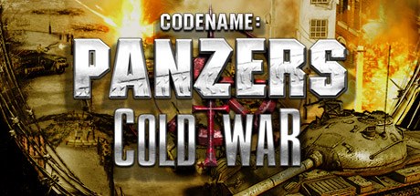

**Platforms:** Windows &nbsp;|&nbsp; **Genre:** Simulation, Strategy &nbsp;|&nbsp; **Released:** March 13

> Tempelhof, Berlin, dawn of 8th April 1949.A major armed conflict is brewing between the Western powers and the Soviet bloc. The Red Army has been growing ever stronger since the end of World War II. With the growth of their army the Soviets realize that they hold the advantage, and are only waiting for the right moment to attack.
>
> _Synopsis source: Steam_

[Steam](https://store.steampowered.com/app/9850)

---

### Command & Conquer Red Alert 3: Uprising

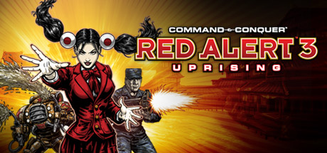

**Platforms:** Windows &nbsp;|&nbsp; **Genre:** Action, Strategy &nbsp;|&nbsp; **Released:** March 12

> Red Alert 3: Uprising features four new mini-campaigns, giving players a deeper dive into the storyline's of the Soviets, the Allies, the Empire of the Rising Sun and a unique campaign centered on the origins of everyone’s favorite psionic Japanese schoolgirl commando, Yuriko Omega.
>
> _Synopsis source: Steam_

[Steam](https://store.steampowered.com/app/24800)

---

### Command & Conquer: Red Alert 3

**Platforms:** PlayStation 3, iOS &nbsp;|&nbsp; **Released:** March 23

---

### Coraline

**Platforms:** PlayStation 2, Nintendo DS, Wii &nbsp;|&nbsp; **Released:** January 27

[Wikipedia](https://en.wikipedia.org/wiki/Coraline_(video_game))

---

### Crayon Physics Deluxe

**Platforms:** Windows, iOS, Android &nbsp;|&nbsp; **Developer:** Petri Purho &nbsp;|&nbsp; **Genre:** Puzzle &nbsp;|&nbsp; **Released:** January 5, 2009

> Crayon Physics Deluxe is a 2D physics puzzle / sandbox game, in which you get to experience what it would be like if your drawings would be magically transformed into real physical objects. Solve puzzles with your artistic vision and creative use of physics.
>
> _Synopsis source: IGDB_

[Wikipedia](https://en.wikipedia.org/wiki/Crayon_Physics_Deluxe) · [IGDB](https://www.igdb.com/games/crayon-physics-deluxe)

---

### Crystal Defenders

**Platforms:** Xbox 360, PlayStation 3, PlayStation Portable &nbsp;|&nbsp; **Released:** March 11

[Wikipedia](https://en.wikipedia.org/wiki/Crystal_Defenders)

---

### Cuboid

**Platforms:** PlayStation Network &nbsp;|&nbsp; **Released:** January 8

[Wikipedia](https://en.wikipedia.org/wiki/Cuboid_(video_game))

---

### Dark Sector

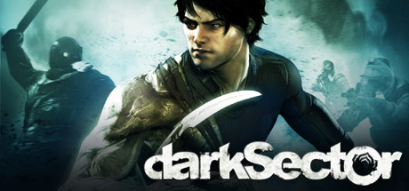

**Platforms:** Windows &nbsp;|&nbsp; **Genre:** Action &nbsp;|&nbsp; **Released:** March 23

> A third-person Action/Shooter that thrusts players into a sci-fi flavored nightmare scenario set in the post Cold War era.
>
> _Synopsis source: Steam_

[Wikipedia](https://en.wikipedia.org/wiki/Dark_Sector) · [Steam](https://store.steampowered.com/app/29900)

---

### Darkfall

**Platforms:** Windows &nbsp;|&nbsp; **Developer:** Aventurine SA &nbsp;|&nbsp; **Publisher:** Audiovisual Enterprises SA &nbsp;|&nbsp; **Genre:** MMOFPS &nbsp;|&nbsp; **Released:** February 25, 2009

> Darkfall (also known as Darkfall Online) is a massively multiplayer online role-playing game (MMORPG) released 2009 by Aventurine SA that combines real-time action and strategy in a fantasy setting. Featuring unrestricted PvP, complete looting, and a player skill dependent combat system, Darkfall is the only MMO to offer such freedom and has spawned a huge community.  Aventurine has sold the license of Darkfall Online to two independent companies, Ub3rgames and Big Picture Games.
>
> _Synopsis source: IGDB_

[Wikipedia](https://en.wikipedia.org/wiki/Darkfall) · [IGDB](https://www.igdb.com/games/darkfall)

---

### Dead Rising: Chop Till You Drop

**Platforms:** Wii &nbsp;|&nbsp; **Released:** February 24

---

### Deadly Creatures

**Platforms:** Wii &nbsp;|&nbsp; **Released:** February 9

[Wikipedia](https://en.wikipedia.org/wiki/Deadly_Creatures)

---

### Deal or No Deal

**Platforms:** Wii &nbsp;|&nbsp; **Released:** January 13

[Wikipedia](https://en.wikipedia.org/wiki/Deal_or_No_Deal_(video_game))

---

### Death Tank

**Platforms:** Xbox 360 &nbsp;|&nbsp; **Released:** February 18

[Wikipedia](https://en.wikipedia.org/wiki/Death_Tank#Xbox_Live_Arcade_version)

---

### Demon's Souls

**Platforms:** PlayStation 3 &nbsp;|&nbsp; **Publisher:** Sony Computer Entertainment &nbsp;|&nbsp; **Released:** February 5, 2009

[Wikipedia](https://en.wikipedia.org/wiki/Demon%27s_Souls)

---

### Dengeki Gakuen RPG: Cross of Venus

**Platforms:** Nintendo DS &nbsp;|&nbsp; **Developer:** Pegasus Japan &nbsp;|&nbsp; **Publisher:** ASCII Media Works &nbsp;|&nbsp; **Genre:** Action role-playing &nbsp;|&nbsp; **Released:** March 19, 2009

> The player assumes the role of an unnamed protagonist attending Dengeki Academy who stumbles into a fight between heroines from Dengeki Bunko novel worlds and the evil organization Zetsumu. The reality-based world of Dengeki Academy and the novel worlds have become connected and the player is able to help the Dengeki Bunko heroines fight the Zetsumu by going between the worlds. Eight heroines are presented including Shana from Shakugan no Shana, Kino from Kino's Journey, and Kana Iriya from Iriya no Sora, UFO no Natsu. Each heroine fights with her own unique style of weapon, combos, and special attacks.
>
> _Synopsis source: IGDB_

[Wikipedia](https://en.wikipedia.org/wiki/Dengeki_Gakuen_RPG:_Cross_of_Venus) · [IGDB](https://www.igdb.com/games/dengeki-gakuen-rpg-cross-of-venus)

---

### Disney Sing It! – High School Musical 3: Senior Year

**Platforms:** PlayStation 3, PlayStation 2, Wii, Xbox 360 &nbsp;|&nbsp; **Released:** February 17

---

### DJ Max Fever

**Platforms:** PlayStation Portable &nbsp;|&nbsp; **Released:** January 27

[Wikipedia](https://en.wikipedia.org/wiki/DJ_Max_Fever)

---

### Don King Boxing

**Platforms:** Nintendo DS, Wii &nbsp;|&nbsp; **Developer:** 2K Shanghai &nbsp;|&nbsp; **Publisher:** 2K &nbsp;|&nbsp; **Genre:** Sports video game &nbsp;|&nbsp; **Released:** March 27, 2009

> The most famously successful, enthusiastically coiffured promoter in all of pugilism lends his half-century of experience, wisdom, and name recognition to Prizefighter, a hardcore boxing game with a role-playing sideline designed to demonstrate the dedication and diligence demanded of heavyweight champ hopefuls, even outside of the squared circle and away from the gym. In the role of their own custom up-and-comer, players must make decisions to balance the boxer's conflicting needs. It takes training to stay sharp, but time spent at promotion may lead to bigger matches, and all work with no play can be bad for a man's mental health. Story development occurs through documentary-style updates and cut scenes. The game aims to present, in the words of its presenter himself, "a glimpse at what life is like in and out of the ring for these incredible athletes."
>
> _Synopsis source: IGDB_

[Wikipedia](https://en.wikipedia.org/wiki/Don_King_Boxing) · [IGDB](https://www.igdb.com/games/don-king-boxing)

---

### Don't Shit Your Pants

**Platforms:** Browser &nbsp;|&nbsp; **Publisher:** Cellar Door Games &nbsp;|&nbsp; **Genre:** Text adventure game &nbsp;|&nbsp; **Released:** February 19, 2009

> Despite the title and cover, Shit!! is a simple puzzle game.
>
> _Synopsis source: IGDB_

[Wikipedia](https://en.wikipedia.org/wiki/Don't_Shit_Your_Pants) · [IGDB](https://www.igdb.com/games/dont-shit-your-pants)

---

### Doodle Jump

**Platforms:** BlackBerry OS, iOS, Arcade &nbsp;|&nbsp; **Developer:** Igor and Marko Pušenjak &nbsp;|&nbsp; **Publisher:** Lima Sky &nbsp;|&nbsp; **Genre:** Platformer &nbsp;|&nbsp; **Released:** March 2009

> In Doodle Jump, the aim is to guide a four-legged animal called "The Doodler" up a never-ending series of platforms without falling.
>
> _Synopsis source: IGDB_

[Wikipedia](https://en.wikipedia.org/wiki/Doodle_Jump) · [IGDB](https://www.igdb.com/games/doodle-jump)

---

### Dragon Quest V: Hand of the Heavenly Bride

**Platforms:** Nintendo DS &nbsp;|&nbsp; **Released:** February 17

---

### Eat Lead: The Return of Matt Hazard

**Platforms:** PlayStation 3, Xbox 360 &nbsp;|&nbsp; **Released:** February 26

---

### Elebits: The Adventures of Kai and Zero

**Platforms:** Nintendo DS &nbsp;|&nbsp; **Released:** January 6

---

### Eliss

**Platforms:** iOS &nbsp;|&nbsp; **Genre:** Puzzle &nbsp;|&nbsp; **Released:** March 6, 2009

> Eliss is a puzzle video game developed and published by Steph Thirion. It was released for the iPhone OS on March 6, 2009. Eliss' gameplay revolves around filling "squeesars" with planets of like color and size. Planets can be combined, split, and moved around using the multi-touch interface. Further complication is added by passing red stars and vortices.
>
> _Synopsis source: IGDB_

[Wikipedia](https://en.wikipedia.org/wiki/Eliss) · [IGDB](https://www.igdb.com/games/eliss)

---

### Elite Forces: Unit 77

**Developer:** Abylight &nbsp;|&nbsp; **Publisher:** Deep Silver &nbsp;|&nbsp; **Genre:** Action &nbsp;|&nbsp; **Released:** March 6, 2009

[Wikipedia](https://en.wikipedia.org/wiki/Elite_Forces:_Unit_77)

---

### Emerald City Confidential

**Platforms:** Windows, macOS &nbsp;|&nbsp; **Developer:** Wadjet Eye Games &nbsp;|&nbsp; **Publisher:** PlayFirst &nbsp;|&nbsp; **Genre:** Adventure &nbsp;|&nbsp; **Released:** February 19, 2009

> Work with the world's most cunning detective in the shadowy underbelly of the Emerald City of Oz! As Petra, you'll be lured deep into mysteries involving new foes and familiar faces; Scarecrow, Lion, and Toto included. This is Oz as you've never seen it before! Solve your detective's quest and unravel a conspiracy of magic and intrigue! Follow a case through five chapters full of puzzles, witnesses, suspects, and allies.
>
> _Synopsis source: IGDB_

[Wikipedia](https://en.wikipedia.org/wiki/Emerald_City_Confidential) · [IGDB](https://www.igdb.com/games/emerald-city-confidential)

---

### Empire: Total War

**Platforms:** Windows &nbsp;|&nbsp; **Publisher:** Sega &nbsp;|&nbsp; **Released:** March 3, 2009

---

### Evasive Space

**Platforms:** Wii &nbsp;|&nbsp; **Released:** February 16

[Wikipedia](https://en.wikipedia.org/wiki/Evasive_Space)

---

### EVE Online: Special Edition

**Platforms:** Windows &nbsp;|&nbsp; **Publisher:** Atari &nbsp;|&nbsp; **Released:** March 10, 2009

[Wikipedia](https://en.wikipedia.org/wiki/Eve_Online)

---

### Evochron Legends

**Platforms:** Windows &nbsp;|&nbsp; **Developer:** StarWraith 3D Games &nbsp;|&nbsp; **Publisher:** StarWraith 3D Games &nbsp;|&nbsp; **Genre:** Space simulation &nbsp;|&nbsp; **Released:** February 5, 2009

[Wikipedia](https://en.wikipedia.org/wiki/Evochron_Legends)

---

### EWB Baseball

**Platforms:** iOS &nbsp;|&nbsp; **Developer:** Eddie Dombrower &nbsp;|&nbsp; **Publisher:** Eddie Dombrower &nbsp;|&nbsp; **Genre:** Sports &nbsp;|&nbsp; **Released:** March 23, 2009

[Wikipedia](https://en.wikipedia.org/wiki/EWB_Baseball)

---

### Exploit

**Platforms:** Browser &nbsp;|&nbsp; **Developer:** Gregory Weir &nbsp;|&nbsp; **Genre:** Puzzle &nbsp;|&nbsp; **Released:** March 4, 2009

> Exploit is a strategic pseudohacking game about a US hacker. One day, he receives a message from his friend sk3tch who tells him about the island Locha, a dictatorship in the middle of the ocean that filters internet access through a firewall, a government-mandated censor designed to curtail any political dissent. Sk3tch urges the hacker to use his skills for good and compromise it to bring some freedom to the country.
>
> _Synopsis source: IGDB_

[Wikipedia](https://en.wikipedia.org/wiki/Exploit_(video_game)) · [IGDB](https://www.igdb.com/games/exploit)

---

### F.E.A.R. 2: Project Origin

**Platforms:** PlayStation 3, Windows, Xbox 360 &nbsp;|&nbsp; **Genre:** Action &nbsp;|&nbsp; **Released:** February 10

> Assume the role of Special Forces Sgt. Becket as your routine mission quickly turns into a fight for survival against the wrath of Alma Wade. As Alma's terrifying power surges out of control, your squad is forced to battle through an apocalyptic landscape in search of clues for how to destroy her!
>
> _Synopsis source: Steam_

[Steam](https://store.steampowered.com/app/16450)

---

### Faerie Solitaire

**Platforms:** Windows, Linux, macOS &nbsp;|&nbsp; **Developer:** Subsoap &nbsp;|&nbsp; **Publisher:** Subsoap &nbsp;|&nbsp; **Genre:** Solitaire &nbsp;|&nbsp; **Released:** March 15, 2009

> Have magical fun in the addicting Card game, Faerie Solitaire! Find and raise a Faerie pet and repopulate the magical land of Avalon using the resources found by clearing each level.
>
> _Synopsis source: IGDB_

[Wikipedia](https://en.wikipedia.org/wiki/Faerie_Solitaire) · [IGDB](https://www.igdb.com/games/faerie-solitaire)

---

### Fallout 3 downloadable content

**Platforms:** Windows, PlayStation 3, Xbox 360 &nbsp;|&nbsp; **Developer:** Bethesda Game Studios &nbsp;|&nbsp; **Publisher:** Bethesda Softworks &nbsp;|&nbsp; **Released:** January 27, 2009

[Wikipedia](https://en.wikipedia.org/wiki/Fallout_3_downloadable_content)

---

### Family & Friends Party

**Platforms:** Wii &nbsp;|&nbsp; **Developer:** Gammick Entertainment &nbsp;|&nbsp; **Publisher:** Gammick Entertainment &nbsp;|&nbsp; **Genre:** Various &nbsp;|&nbsp; **Released:** March 2, 2009

> Have fun with all your friends and family as you take on some very exciting challenges! This is an interactive board game for all ages and for one to eight players.
>
> _Synopsis source: IGDB_

[Wikipedia](https://en.wikipedia.org/wiki/Family_&_Friends_Party) · [IGDB](https://www.igdb.com/games/family-and-friends-party)

---

### Family Mini Golf

**Platforms:** Wii &nbsp;|&nbsp; **Developer:** Arc System Works &nbsp;|&nbsp; **Publisher:** Aksys Games &nbsp;|&nbsp; **Genre:** Sports &nbsp;|&nbsp; **Released:** March 10, 2009

> Test Your Golfing Mettle Against The Family!  Daddy, Mommy, Sarah, and Billy are back for some mini-golf action! Play through multiple golf courses that contain obstacles ranging from bumpers to speed ramps to fans and more! Up to eight players can play with one another using a single Wii Remote! See who among all your friends is truly the best at tackling every course. You can download new courses to continue the fun-filled mini-golf experience. They up the ante, creating even more complex and difficult mini-golf courses to overcome. Can you conquer all the courses and become the mini-golf champion!?
>
> _Synopsis source: IGDB_

[Wikipedia](https://en.wikipedia.org/wiki/Family_Mini_Golf) · [IGDB](https://www.igdb.com/games/family-mini-golf)

---

### Family Pirate Party

**Platforms:** Wii &nbsp;|&nbsp; **Developer:** Arc System Works &nbsp;|&nbsp; **Publisher:** Aksys Games &nbsp;|&nbsp; **Genre:** Party &nbsp;|&nbsp; **Released:** January 17, 2009

> Daddy, Mommy, Sarah, and Billy make their return as pirates sailing the seas and skies! Roll the dice and sail through the islands to gather the treasures each island holds. The person with the most gold at the end wins! Family Pirate Party shines with its appealing cel-shaded graphics and endearing music. Challenge up to three other players, be they friends, the CPU, or both, for some four-player board-game fun. Do you have it in you to defeat your opponents and become the king of Family Pirate Party!?
>
> _Synopsis source: IGDB_

[Wikipedia](https://en.wikipedia.org/wiki/Family_Pirate_Party) · [IGDB](https://www.igdb.com/games/family-pirate-party)

---

### Family Slot Car Racing

**Platforms:** Wii &nbsp;|&nbsp; **Developer:** Arc System Works &nbsp;|&nbsp; **Publisher:** Aksys Games &nbsp;|&nbsp; **Genre:** Racing &nbsp;|&nbsp; **Released:** February 10, 2009

> A kart racing game in the Family Series from Arc System Works.
>
> _Synopsis source: IGDB_

[Wikipedia](https://en.wikipedia.org/wiki/Family_Slot_Car_Racing) · [IGDB](https://www.igdb.com/games/family-slot-car-racing)

---

### Ferrari Virtual Race

**Platforms:** Windows &nbsp;|&nbsp; **Developer:** Synetic &nbsp;|&nbsp; **Publisher:** Ferrari &nbsp;|&nbsp; **Genre:** Racing simulator &nbsp;|&nbsp; **Released:** March 30, 2009

> Among car companies, Ferrari stands alone as a symbol of luxury, power, and grace under pressure. Few auto fans would give up the chance for a virtual test-drive of these wonderful machines, and this is exactly the appeal of "Ferrari Virtual Race" to newer and older gamers alike.  If you've ever wanted to experience the feel of taking out a Ferrari on a track, this game might be for you. If you or someone you love is a car fanatic, few games offer quite the punch of the game, which allows players to get behind the wheel of several classic Ferrari sports cars and have fun on a compelling track and landscape.  The key-word here is fun: For many, this game will be a sort of dream come true. Featuring the chance to "test drive" the 430 Scuderia, 599 Fiorano and 612 Scaglietti models of Ferrari, the game is a great introduction to what makes the company such a powerhouse in the auto and racing industries.
>
> _Synopsis source: IGDB_

[Wikipedia](https://en.wikipedia.org/wiki/Ferrari_Virtual_Race) · [IGDB](https://www.igdb.com/games/ferrari-virtual-race)

---

### Final Fantasy Crystal Chronicles: Echoes of Time

**Platforms:** Nintendo DS, Wii &nbsp;|&nbsp; **Released:** March 24

---

### Fire Emblem: Shadow Dragon

**Platforms:** Nintendo DS &nbsp;|&nbsp; **Released:** February 16

---

### Flight Control

**Platforms:** iOS &nbsp;|&nbsp; **Released:** March 5

[Wikipedia](https://en.wikipedia.org/wiki/Flight_Control_(video_game))

---

### Flower

**Platforms:** PlayStation 3 &nbsp;|&nbsp; **Released:** February 12

[Wikipedia](https://en.wikipedia.org/wiki/Flower_(video_game))

---

### Flyable Heart

**Platforms:** Windows &nbsp;|&nbsp; **Developer:** UNiSONSHIFT: Blossom &nbsp;|&nbsp; **Publisher:** UNiSONSHIFT &nbsp;|&nbsp; **Genre:** Eroge, Visual novel &nbsp;|&nbsp; **Released:** March 19, 2009

> ―It began with a single envelope.  One day, an admission pamphlet to a famous academy arrived, containing an “all-you-can-eat” cafeteria pass. That alone was enough to lure our hero into visiting the super-prestigious Otori Ryouran College Community, home to students who excel in a variety of fields. Offbeat and unique students like a robot seem natural at Otori Ryouran. Organizing this odd student body is the responsibility of two groups ― the Student Council and the Ryouran Society.  I was so happy to change schools, so why is a fortuneteller saying ominous things the moment I step out the door!  Why did all the fireworks explode on the bridge!!  And why was the only available room in the women’s dorm!!!  “Be wary, boy who carries an exceptional fate. Misfortune awaits you beyond here.”
>
> _Synopsis source: IGDB_

[Wikipedia](https://en.wikipedia.org/wiki/Flyable_Heart) · [IGDB](https://www.igdb.com/games/flyable-heart)

---

### Football Academy

**Platforms:** Nintendo DS &nbsp;|&nbsp; **Developer:** EA Canada &nbsp;|&nbsp; **Publisher:** EA Sports &nbsp;|&nbsp; **Genre:** Sports trivia and card game &nbsp;|&nbsp; **Released:** March 2009

[Wikipedia](https://en.wikipedia.org/wiki/Football_Academy)

---

### Freaky Creatures

**Platforms:** Windows &nbsp;|&nbsp; **Released:** March 24

---

### FunTown Mahjong

**Platforms:** Xbox 360 &nbsp;|&nbsp; **Developer:** FunTown World Limited &nbsp;|&nbsp; **Publisher:** Microsoft Game Studios &nbsp;|&nbsp; **Genre:** Card and Board &nbsp;|&nbsp; **Released:** January 28, 2009

> A Mahjong game available through Xbox Live Arcade.
>
> _Synopsis source: IGDB_

[Wikipedia](https://en.wikipedia.org/wiki/FunTown_Mahjong) · [IGDB](https://www.igdb.com/games/funtown-mahjong)

---

### FusionFall

**Platforms:** Windows, macOS &nbsp;|&nbsp; **Developer:** Grigon Entertainment &nbsp;|&nbsp; **Publisher:** Cartoon Network &nbsp;|&nbsp; **Genre:** Massively multiplayer online role-playing game, third-person shooter &nbsp;|&nbsp; **Released:** January 13, 2009

[Wikipedia](https://en.wikipedia.org/wiki/FusionFall)

---

### Galaga Remix

**Platforms:** iOS &nbsp;|&nbsp; **Released:** March 31

[Wikipedia](https://en.wikipedia.org/wiki/Galaga_Remix_(iOS))

---

### Gardening Mama

**Platforms:** Nintendo DS &nbsp;|&nbsp; **Developer:** Cooking Mama Limited &nbsp;|&nbsp; **Publisher:** Taito, Majesco, 505 Games &nbsp;|&nbsp; **Genre:** Simulation, minigame &nbsp;|&nbsp; **Released:** March 19, 2009

> A spin-off of the Cooking Mama franchise, this game puts Mama in the role of a gardener. Gardening Mama is the first Gardening game for the Nintendo DS.
>
> _Synopsis source: IGDB_

[Wikipedia](https://en.wikipedia.org/wiki/Gardening_Mama) · [IGDB](https://www.igdb.com/games/gardening-mama)

---

### Globulation 2

**Platforms:** Linux &nbsp;|&nbsp; **Developer:** Globulation 2 Team &nbsp;|&nbsp; **Genre:** Real-time strategy &nbsp;|&nbsp; **Released:** February 2, 2009

> Globulation 2 is an Real-Time Strategy (RTS) game which reduces micro-management by automatically assigning tasks to units.
>
> _Synopsis source: IGDB_

[Wikipedia](https://en.wikipedia.org/wiki/Globulation_2) · [IGDB](https://www.igdb.com/games/globulation-2)

---

### Gradius ReBirth

**Platforms:** Wii &nbsp;|&nbsp; **Released:** March 9

[Wikipedia](https://en.wikipedia.org/wiki/Gradius_ReBirth)

---

### Grand Ages: Rome

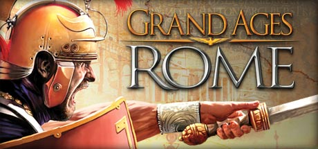

**Platforms:** Windows &nbsp;|&nbsp; **Genre:** Simulation, Strategy &nbsp;|&nbsp; **Released:** March 17

> As Governor of a Roman Province in the time-honoured Roman Empire, its fortune very much lies in your hands. Choose one of five Roman noble families such as Caesar’s Julii with different abilities to accomplish the comprehensive missions.
>
> _Synopsis source: Steam_

[Steam](https://store.steampowered.com/app/23450)

---

### Grand Theft Auto IV: The Lost and Damned

**Platforms:** Xbox 360 &nbsp;|&nbsp; **Publisher:** Rockstar Games &nbsp;|&nbsp; **Released:** February 17, 2009

---

### Grand Theft Auto: Chinatown Wars

**Platforms:** Nintendo DS, PlayStation Portable &nbsp;|&nbsp; **Publisher:** Rockstar Games &nbsp;|&nbsp; **Released:** March 17, 2009

---

### Grey's Anatomy: The Video Game

**Platforms:** Windows, Nintendo DS, PlayStation 3, Wii, Xbox 360 &nbsp;|&nbsp; **Released:** March 10

---

### Guitar Hero: Metallica

**Platforms:** PlayStation 2, PlayStation 3, Wii, Xbox 360 &nbsp;|&nbsp; **Released:** March 29

---

### Halo Wars

**Platforms:** Xbox 360 &nbsp;|&nbsp; **Released:** February 26

[Wikipedia](https://en.wikipedia.org/wiki/Halo_Wars)

---

### Henry Hatsworth in the Puzzling Adventure

**Platforms:** Nintendo DS &nbsp;|&nbsp; **Released:** March 17

[Wikipedia](https://en.wikipedia.org/wiki/Henry_Hatsworth_in_the_Puzzling_Adventure)

---

### High Voltage Hot Rod Show

**Platforms:** Wii &nbsp;|&nbsp; **Released:** January 19

[Wikipedia](https://en.wikipedia.org/wiki/High_Voltage_Hot_Rod_Show)

---

### Hilton Garden Inn: Ultimate Team Play

**Platforms:** PlayStation Portable &nbsp;|&nbsp; **Developer:** Virtual Heroes &nbsp;|&nbsp; **Publisher:** Virtual Heroes &nbsp;|&nbsp; **Genre:** Simulation &nbsp;|&nbsp; **Released:** January 2009

[Wikipedia](https://en.wikipedia.org/wiki/Hilton_Garden_Inn:_Ultimate_Team_Play)

---

### Host Master and the Conquest of Humor

**Platforms:** Browser &nbsp;|&nbsp; **Developer:** Double Fine Productions &nbsp;|&nbsp; **Publisher:** Double Fine Productions &nbsp;|&nbsp; **Genre:** Adventure &nbsp;|&nbsp; **Released:** March 23, 2009

[Wikipedia](https://en.wikipedia.org/wiki/Host_Master_and_the_Conquest_of_Humor)

---

### Imagine Fashion Party

**Platforms:** Wii &nbsp;|&nbsp; **Released:** January 20

---

### Jets'n'Guns

**Platforms:** Linux &nbsp;|&nbsp; **Released:** January 30

[Wikipedia](https://en.wikipedia.org/wiki/Jets%27n%27Guns)

---

### KarmaStar

**Platforms:** iOS &nbsp;|&nbsp; **Developer:** Arkane Studios &nbsp;|&nbsp; **Publisher:** Majesco &nbsp;|&nbsp; **Genre:** Strategy, Turn-based strategy (TBS), Card & Board Game &nbsp;|&nbsp; **Released:** March 25, 2009

> Turn-based three-player strategy game for the iPhone, designed by Harvey Smith. The game takes you from childhood to old age in eight turns, and the goal is to end your life on top of the scoreboard.
>
> _Synopsis source: IGDB_

[Wikipedia](https://en.wikipedia.org/wiki/KarmaStar) · [IGDB](https://www.igdb.com/games/karmastar)

---

### Killzone 2

**Platforms:** PlayStation 3 &nbsp;|&nbsp; **Publisher:** Sony Computer Entertainment &nbsp;|&nbsp; **Released:** February 26, 2009

[Wikipedia](https://en.wikipedia.org/wiki/Killzone_2)

---

### King of Fighters '98: Ultimate Match

**Platforms:** PlayStation 2 &nbsp;|&nbsp; **Released:** March 3

---

### Leisure Suit Larry: Box Office Bust

**Platforms:** Windows, Xbox 360, PlayStation 3 &nbsp;|&nbsp; **Released:** March 27

---

### Let's Golf

**Platforms:** iOS &nbsp;|&nbsp; **Released:** March 11

---

### LightBike

**Platforms:** iOS, Android &nbsp;|&nbsp; **Developer:** Pankaku &nbsp;|&nbsp; **Genre:** Snake &nbsp;|&nbsp; **Released:** January 29, 2009

> LightBike is a 3D game application for iPhone. You drive the LightBike, which builds walls of light on your track, and beat enemies in cyberspace. Being easy and simple, LightBike excites you all!
>
> _Synopsis source: IGDB_

[Wikipedia](https://en.wikipedia.org/wiki/LightBike) · [IGDB](https://www.igdb.com/games/lightbike)

---

### LIT

**Platforms:** Wii &nbsp;|&nbsp; **Released:** February 9

[Wikipedia](https://en.wikipedia.org/wiki/LIT_(video_game))

---

### LocoRoco 2

**Platforms:** PlayStation Portable &nbsp;|&nbsp; **Released:** February 10

[Wikipedia](https://en.wikipedia.org/wiki/LocoRoco_2)

---

### Lux-Pain

**Platforms:** Nintendo DS &nbsp;|&nbsp; **Released:** March 24

[Wikipedia](https://en.wikipedia.org/wiki/Lux-Pain)

---

### MadWorld

**Platforms:** Wii &nbsp;|&nbsp; **Released:** March 10

[Wikipedia](https://en.wikipedia.org/wiki/MadWorld)

---

### Magic Orbz

**Platforms:** PlayStation 3, PlayStation Network &nbsp;|&nbsp; **Developer:** Creat Studios, HeroCraft &nbsp;|&nbsp; **Publisher:** Creat Studios & TikGames, HeroCraft &nbsp;|&nbsp; **Genre:** Breakout clone &nbsp;|&nbsp; **Released:** January 15, 2009

> Get Magic Orbz, Puzzle game for PS3 console from the official PlayStation website. Know more about Magic Orbz Game.
>
> _Synopsis source: IGDB_

[Wikipedia](https://en.wikipedia.org/wiki/Magic_Orbz) · [IGDB](https://www.igdb.com/games/magic-orbz)

---

### Major League Baseball 2K9

**Platforms:** Xbox 360, PlayStation 3, PlayStation 2, PlayStation Portable, Wii &nbsp;|&nbsp; **Released:** March 3

[Wikipedia](https://en.wikipedia.org/wiki/Major_League_Baseball_2K9)

---

### Major Minor's Majestic March

**Platforms:** Wii &nbsp;|&nbsp; **Released:** March 24

[Wikipedia](https://en.wikipedia.org/wiki/Major_Minor%27s_Majestic_March)

---

### Mana Khemia: Student Alliance

**Platforms:** PlayStation Portable &nbsp;|&nbsp; **Released:** March 10

---

### Marble Saga: Kororinpa

**Platforms:** Wii &nbsp;|&nbsp; **Released:** March 17

---

### Mario & Luigi: Bowser's Inside Story

**Platforms:** Nintendo DS &nbsp;|&nbsp; **Publisher:** Nintendo &nbsp;|&nbsp; **Released:** February 11, 2009

---

### Mega Man 2

**Platforms:** iOS &nbsp;|&nbsp; **Released:** March 26

[Wikipedia](https://en.wikipedia.org/wiki/Mega_Man_2)

---

### Men of War

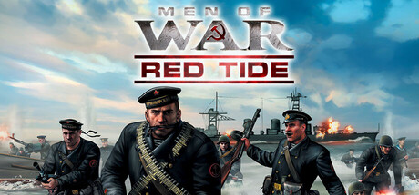

**Platforms:** Windows &nbsp;|&nbsp; **Genre:** Strategy &nbsp;|&nbsp; **Released:** March 10

> Red Tide blends deep RTS tactics with the raw intensity of third-person combat. Created in collaboration with author Alexander Zorich, this standalone expansion tells the story of the Black Coats – Soviet Naval Infantry famed for their ruthless precision in the Black Sea campaigns.
>
> _Synopsis source: Steam_

[Wikipedia](https://en.wikipedia.org/wiki/Men_of_War_(video_game)) · [Steam](https://store.steampowered.com/app/3130)

---

### Metal Gear Solid Touch

**Platforms:** iOS &nbsp;|&nbsp; **Released:** March 18

[Wikipedia](https://en.wikipedia.org/wiki/Metal_Gear_Solid_Touch)

---

### Minesweeper Flags

**Platforms:** Xbox 360 &nbsp;|&nbsp; **Developer:** TikGames &nbsp;|&nbsp; **Publisher:** Microsoft &nbsp;|&nbsp; **Genre:** Puzzle video game &nbsp;|&nbsp; **Released:** February 11, 2009

> Minesweeper Flag includes LIVE multiplayer Flags action, exciting achievements, rankings, ratings and true skill. See how you stack up against your friends in Minesweeper action! This game requires the Xbox 360 hard drive or the 512MB Memory Unit for storage
>
> _Synopsis source: IGDB_

[Wikipedia](https://en.wikipedia.org/wiki/Minesweeper_Flags) · [IGDB](https://www.igdb.com/games/minesweeper-flags)

---

### Mirror's Edge

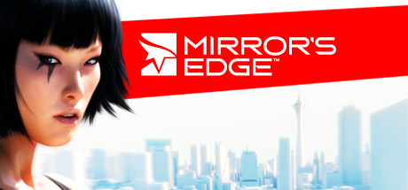

**Platforms:** Windows &nbsp;|&nbsp; **Genre:** Action, Adventure &nbsp;|&nbsp; **Released:** January 13

> In a city where information is heavily monitored, couriers called Runners transport sensitive data. In this seemingly utopian paradise, a crime has been committed, &amp; you are being hunted. You are a Runner called Faith and this innovative first-person action-adventure is your story.
>
> _Synopsis source: Steam_

[Wikipedia](https://en.wikipedia.org/wiki/Mirror%27s_Edge) · [Steam](https://store.steampowered.com/app/17410)

---

### MLB 09: The Show

**Platforms:** PlayStation 3, PlayStation 2, PlayStation Portable &nbsp;|&nbsp; **Publisher:** Sony Computer Entertainment &nbsp;|&nbsp; **Released:** March 3, 2009

---

### MLB Front Office Manager

**Platforms:** PlayStation 3, Windows, Xbox 360 &nbsp;|&nbsp; **Released:** January 26

[Wikipedia](https://en.wikipedia.org/wiki/MLB_Front_Office_Manager)

---

### Mobile Suit Gundam: Gundam vs. Gundam Next

**Platforms:** Arcade, PlayStation Portable &nbsp;|&nbsp; **Developer:** Capcom &nbsp;|&nbsp; **Publisher:** Namco Bandai Games &nbsp;|&nbsp; **Genre:** Fighting &nbsp;|&nbsp; **Released:** March 18, 2009

> Mobile Suit Gundam: Gundam vs. Gundam Next is the game in the Gundam VS video game series from the Namco Bandai Games, it is the sequel to Mobile Suit Gundam: Gundam vs. Gundam
>
> _Synopsis source: IGDB_

[Wikipedia](https://en.wikipedia.org/wiki/Mobile_Suit_Gundam:_Gundam_vs._Gundam_Next) · [IGDB](https://www.igdb.com/games/mobile-suit-gundam-gundam-vs-gundam-next)

---

### Monster Racers

**Platforms:** Nintendo DS &nbsp;|&nbsp; **Developer:** Koei &nbsp;|&nbsp; **Publisher:** Koei, UFO Interactive Games &nbsp;|&nbsp; **Genre:** Role-playing, racing &nbsp;|&nbsp; **Released:** January 22, 2009

> In Monster Racers, players embark on a quest that will take them around the globe in search of monster breeds to train, nurture and race. Throughout their journeys, players build lasting friendships with new allies, and encounter daunting challenges from a bevy of rival trainers. The real fun comes from capturing wild monsters in their native habitats. As the player progresses, he or she can explore different regions, venture into secret habitats and discover more adventures. The game's race courses are filled with challenging obstacles that test both the players' and monsters' skills in controlling speed, jumping ability, and reaction time. With enough courage, skill and practice, players can make it to the greatest race in the world, the "Super Cup." Using the Nintendo Wi-Fi connection, players can join up to three other trainers to compete in race tournaments or to capture new monsters on safari.
>
> _Synopsis source: IGDB_

[Wikipedia](https://en.wikipedia.org/wiki/Monster_Racers) · [IGDB](https://www.igdb.com/games/monster-racers--1)

---

### Monsters vs. Aliens

**Platforms:** Windows, Wii, PlayStation 2, PlayStation 3, Xbox 360, Nintendo DS &nbsp;|&nbsp; **Developer:** Beenox, Amaze Entertainment &nbsp;|&nbsp; **Publisher:** Activision &nbsp;|&nbsp; **Genre:** Action-adventure &nbsp;|&nbsp; **Released:** March 24, 2009

> Monsters vs. Aliens is a 2009 video game based on the film with the same name. The game was released on March 24, 2009 on Microsoft Windows, PlayStation 3, Xbox 360, Nintendo DS, PlayStation 2, and Wii.  The game, developed by Beenox on all platforms except the Nintendo DS which was developed by Amaze Entertainment, allows users to play through scenes from the movie as Ginormica, B.O.B., and The Missing Link, and features drop-in/out co-op.  A significant feature has Reese Witherspoon, Seth Rogen, Will Arnett, and Rainn Wilson reprising their roles from the movie, however Hugh Laurie & Kiefer Sutherland do not, they are replaced by James Horan & Fred Tatasciore respectively.  This is the last DreamWorks Animation game to be released for PlayStation 2.  It is also the last DreamWorks Animation game to be developed by Beenox.
>
> _Synopsis source: IGDB_

[Wikipedia](https://en.wikipedia.org/wiki/Monsters_vs._Aliens_(video_game)) · [IGDB](https://www.igdb.com/games/monsters-vs-aliens)

---

### Moon

**Platforms:** Nintendo DS &nbsp;|&nbsp; **Released:** January 13

[Wikipedia](https://en.wikipedia.org/wiki/Moon_(2009_video_game))

---

### Musou Orochi Z

**Platforms:** PlayStation 3, Windows &nbsp;|&nbsp; **Developer:** Omega Force &nbsp;|&nbsp; **Publisher:** Koei &nbsp;|&nbsp; **Genre:** Hack and slash &nbsp;|&nbsp; **Released:** March 12, 2009

> Musou Orochi Z, is a 2009 hack and slash video game developed by Koei and Omega Force for the Sony PlayStation 3 and Microsoft Windows. Z is the third installment of the Warriors Orochi series, a crossover video game of the Dynasty Warriors and Samurai Warriors series. Musou Orochi Z was intended to be a combination of the first two games with more characters and stages on an updated gaming platform. The game was released in Japan for PlayStation 3 on March 12, 2009 and released on Microsoft Windows platform on November 27, 2009. Koei had planned to release the game as Warriors Orochi Z in North America and Europe, but those plans have since been cancelled.
>
> _Synopsis source: IGDB_

[Wikipedia](https://en.wikipedia.org/wiki/Musou_Orochi_Z) · [IGDB](https://www.igdb.com/games/musou-orochi-z)

---

### Musō Tōrō

**Platforms:** PlayStation Portable &nbsp;|&nbsp; **Developer:** FOG Inc. &nbsp;|&nbsp; **Publisher:** Nippon Ichi Software &nbsp;|&nbsp; **Genre:** Visual novel &nbsp;|&nbsp; **Released:** March 19, 2009

[Wikipedia](https://en.wikipedia.org/wiki/Mus%C5%8D_T%C5%8Dr%C5%8D)

---

### My World, My Way

**Platforms:** Nintendo DS &nbsp;|&nbsp; **Released:** February 3

[Wikipedia](https://en.wikipedia.org/wiki/My_World,_My_Way_(video_game))

---

### MySims Party

**Platforms:** Nintendo DS, Wii &nbsp;|&nbsp; **Released:** March 10

[Wikipedia](https://en.wikipedia.org/wiki/MySims_Party)

---

### NASCAR Kart Racing

**Platforms:** Wii &nbsp;|&nbsp; **Released:** February 10

[Wikipedia](https://en.wikipedia.org/wiki/NASCAR_Kart_Racing)

---

### NecroVisioN

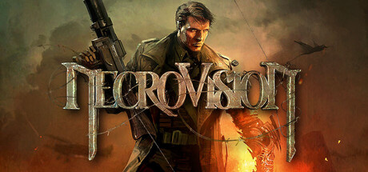

**Platforms:** Windows &nbsp;|&nbsp; **Genre:** Action &nbsp;|&nbsp; **Released:** February 27

> War is Hell. NecroVision is a first-person shooter that takes gamers across the frantic battlegrounds of World War I and into a dark underworld of vampires, demons and dark magic.
>
> _Synopsis source: Steam_

[Wikipedia](https://en.wikipedia.org/wiki/NecroVisioN) · [Steam](https://store.steampowered.com/app/7860)

---

### Neighborhood Games

**Platforms:** Wii &nbsp;|&nbsp; **Released:** January 12

[Wikipedia](https://en.wikipedia.org/wiki/Neighborhood_Games)

---

### Noby Noby Boy

**Platforms:** PlayStation 3 &nbsp;|&nbsp; **Released:** February 19

[Wikipedia](https://en.wikipedia.org/wiki/Noby_Noby_Boy)

---

### OneChanbara: Bikini Samurai Squad

**Platforms:** Xbox 360 &nbsp;|&nbsp; **Released:** February 10

---

### OneChanbara: Bikini Zombie Slayers

**Platforms:** Wii &nbsp;|&nbsp; **Released:** February 10

---

### Onslaught

**Platforms:** Wii &nbsp;|&nbsp; **Developer:** Shade &nbsp;|&nbsp; **Publisher:** Hudson Soft &nbsp;|&nbsp; **Genre:** First-person shooter &nbsp;|&nbsp; **Released:** February 13, 2009

> "Onslaught" is a FPS that puts you in the middle of a futuristic war between humans and insectoid aliens.
>
> _Synopsis source: IGDB_

[Wikipedia](https://en.wikipedia.org/wiki/Onslaught_(2009_video_game)) · [IGDB](https://www.igdb.com/games/onslaught--1)

---

### Peggle: Dual Shot

**Platforms:** Nintendo DS &nbsp;|&nbsp; **Released:** February 27

[Wikipedia](https://en.wikipedia.org/wiki/Peggle)

---

### Perimeter 2: New Earth

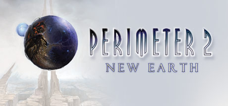

**Platforms:** Windows &nbsp;|&nbsp; **Genre:** Strategy &nbsp;|&nbsp; **Released:** February 13

> &lt;p&gt;&lt;i&gt;Perimeter 2: New Earth&lt;/i&gt; is the long-awaited sequel of the critically acclaimed RTS &lt;i&gt;Perimeter&lt;/i&gt;. Ideas of territorial gameplay and landscape modification, introduced in the original game, are now realized on a new concept &amp; technology level.
>
> _Synopsis source: Steam_

[Steam](https://store.steampowered.com/app/12420)

---

### Phantasy Star Portable

**Platforms:** PlayStation Portable &nbsp;|&nbsp; **Released:** March 3

[Wikipedia](https://en.wikipedia.org/wiki/Phantasy_Star_Portable)

---

### Phineas and Ferb

**Platforms:** Nintendo DS &nbsp;|&nbsp; **Released:** February 3

[Wikipedia](https://en.wikipedia.org/wiki/Phineas_and_Ferb_(video_game))

---

### Photo Spot

**Platforms:** iOS &nbsp;|&nbsp; **Developer:** Nexx Studio &nbsp;|&nbsp; **Genre:** Spot the difference, Puzzle, Arcade &nbsp;|&nbsp; **Released:** February 2, 2009

[Wikipedia](https://en.wikipedia.org/wiki/Photo_Spot)

---

### Picross 3D

**Platforms:** Nintendo DS &nbsp;|&nbsp; **Developer:** HAL Laboratory &nbsp;|&nbsp; **Publisher:** Nintendo &nbsp;|&nbsp; **Genre:** Puzzle &nbsp;|&nbsp; **Released:** March 12, 2009

> Picross 3D is the sequel to the popular Picross DS puzzle game. The original game was a number-based grid puzzle that challenged players to reveal a hidden picture. Picross 3D moves the action into three dimensions. Picross 3D blends the logical challenge of a sudoku puzzle with the excitement of discovering the hidden images within.
>
> _Synopsis source: IGDB_

[Wikipedia](https://en.wikipedia.org/wiki/Picross_3D) · [IGDB](https://www.igdb.com/games/picross-3d)

---

### Pictobits

**Platforms:** Nintendo DS &nbsp;|&nbsp; **Developer:** Skip Ltd. &nbsp;|&nbsp; **Publisher:** Nintendo &nbsp;|&nbsp; **Genre:** Puzzle &nbsp;|&nbsp; **Released:** January 28, 2009

[Wikipedia](https://en.wikipedia.org/wiki/Pictobits)

---

### PictureBook Games: Pop-Up Pursuit

**Platforms:** Wii &nbsp;|&nbsp; **Developer:** Grounding Inc. &nbsp;|&nbsp; **Publisher:** Nintendo &nbsp;|&nbsp; **Genre:** Party &nbsp;|&nbsp; **Released:** March 26, 2009

> A virtual board game for Wiiware that plays inside of a pop-up picture book.
>
> _Synopsis source: IGDB_

[Wikipedia](https://en.wikipedia.org/wiki/PictureBook_Games:_Pop-Up_Pursuit) · [IGDB](https://www.igdb.com/games/picturebook-games-pop-up-pursuit)

---

### Planet Pachinko

**Platforms:** Wii &nbsp;|&nbsp; **Released:** January 12

[Wikipedia](https://en.wikipedia.org/wiki/Planet_Pachinko)

---

### Pocket God

**Platforms:** iOS &nbsp;|&nbsp; **Developer:** Bolt Creative &nbsp;|&nbsp; **Publisher:** Bolt Creative, ngmoco, Frima studio &nbsp;|&nbsp; **Genre:** God game &nbsp;|&nbsp; **Released:** January 9, 2009

> Pocket God is a game developed by Bolt Creative, in which the player manipulates an island and its inhabitants. It was originally released for the iPad, iPhone, and iPod Touch on January 9, 2009, and later released for Verizon Wireless on September 1, 2010, Android on December 1, 2010, and Windows Phone on December 4, 2010. The Facebook version was released December 23, 2010.
>
> _Synopsis source: IGDB_

[Wikipedia](https://en.wikipedia.org/wiki/Pocket_God) · [IGDB](https://www.igdb.com/games/pocket-god)

---

### Pokémon Platinum

**Platforms:** Nintendo DS &nbsp;|&nbsp; **Released:** March 22 (NA)

[Wikipedia](https://en.wikipedia.org/wiki/Pok%C3%A9mon_Platinum)

---

### Pole's Big Adventure

**Platforms:** Wii &nbsp;|&nbsp; **Developer:** Sega, Mobile & Game Studio, Flat-Out &nbsp;|&nbsp; **Publisher:** Sega &nbsp;|&nbsp; **Genre:** Platform &nbsp;|&nbsp; **Released:** February 3, 2009

> Sega's wacky send-up of 8-bit NES-era console games references classic platformers from Mario to Master Higgins and Kunio Kun.
>
> _Synopsis source: IGDB_

[Wikipedia](https://en.wikipedia.org/wiki/Pole's_Big_Adventure) · [IGDB](https://www.igdb.com/games/chindouchuu-pole-no-daibouken)

---

### PopCap Arcade

**Platforms:** Xbox 360 &nbsp;|&nbsp; **Developer:** PopCap Games &nbsp;|&nbsp; **Publisher:** PopCap Games, Mastertronic &nbsp;|&nbsp; **Genre:** Various &nbsp;|&nbsp; **Released:** March 31, 2009

[Wikipedia](https://en.wikipedia.org/wiki/PopCap_Arcade)

---

### Postal Babes

**Platforms:** Android, Mobile phone &nbsp;|&nbsp; **Developer:** HeroCraft &nbsp;|&nbsp; **Publisher:** HeroCraft &nbsp;|&nbsp; **Released:** February 2009

> The beautiful Postal Babes are back and now they have their own videogame! If there’s one thing these girls are good at, other than looking hot, it’s kicking ass, and that’s just what they’ll have to do when they get the message that there’s strange goings on at the local University. Maniacs have taken over the campus and now the first year student girls are hostages, the Postal Babes can’t waste any time infiltrating the campus and rescuing those hostages.  Grab whatever you can find, a baseball bat, a knife and start dishing out some tough love to those kidnappers. With an intuitive hack and slash control system you’ll be dishing out the punishment in no time, get in close and go in for the kill, it’s the Postal Babes way. You’ll even have a chance to pick up a few firearms, make sure you use them wisely, headshots are the only way to keep the bloodthirsty Postal Babes happy!
>
> _Synopsis source: IGDB_

[Wikipedia](https://en.wikipedia.org/wiki/Postal_Babes) · [IGDB](https://www.igdb.com/games/postal-babes)

---

### Precipice

**Platforms:** Nintendo DS &nbsp;|&nbsp; **Developer:** Skip Ltd. &nbsp;|&nbsp; **Publisher:** Nintendo &nbsp;|&nbsp; **Genre:** Puzzle &nbsp;|&nbsp; **Released:** February 25, 2009

[Wikipedia](https://en.wikipedia.org/wiki/Precipice_(video_game))

---

### Prinny: Can I Really Be the Hero?

**Platforms:** PlayStation Portable &nbsp;|&nbsp; **Released:** February 17

---

### Puzzle Quest: Galactrix

**Platforms:** Nintendo DS, Windows, Xbox 360, PlayStation 3 &nbsp;|&nbsp; **Genre:** Casual, RPG &nbsp;|&nbsp; **Released:** February 24

> The puzzle game of the future has arrived! The original best-selling new Puzzle franchise is back in an all new dimension with its signature Match-3, turn based battles in an insanely addictive and masterful hybrid of RPG and Puzzle genres.
>
> _Synopsis source: Steam_

[Steam](https://store.steampowered.com/app/23500)

---

### Race Pro

**Platforms:** Xbox 360 &nbsp;|&nbsp; **Released:** February 17

[Wikipedia](https://en.wikipedia.org/wiki/Race_Pro)

---

### Ready 2 Rumble: Revolution

**Platforms:** Wii &nbsp;|&nbsp; **Developer:** AKI Corporation USA &nbsp;|&nbsp; **Publisher:** Atari, Inc. &nbsp;|&nbsp; **Genre:** Sports &nbsp;|&nbsp; **Released:** March 17, 2009

> Ready 2 Rumble: Revolution is the third game in the Ready 2 Rumble Boxing series
>
> _Synopsis source: IGDB_

[Wikipedia](https://en.wikipedia.org/wiki/Ready_2_Rumble:_Revolution) · [IGDB](https://www.igdb.com/games/ready-2-rumble-revolution)

---

### Resident Evil 5

**Platforms:** PlayStation 3, Xbox 360, Windows &nbsp;|&nbsp; **Genre:** Action, Adventure &nbsp;|&nbsp; **Released:** March 13

> This game is a port of the Games for Windows - Live version that was released in 2009. If you buy the Untold Stories Bundle here on Steam, it will be the same as upgrading to Resident Evil 5 Gold Edition.
>
> _Synopsis source: Steam_

[Wikipedia](https://en.wikipedia.org/wiki/Resident_Evil_5) · [Steam](https://store.steampowered.com/app/21690)

---

### Resistance: Retribution

**Platforms:** PlayStation Portable &nbsp;|&nbsp; **Released:** March 17

---

### Retro Game Challenge

**Platforms:** Nintendo DS &nbsp;|&nbsp; **Released:** February 10

[Wikipedia](https://en.wikipedia.org/wiki/Retro_Game_Challenge)

---

### Retro Game Challenge 2

**Platforms:** Nintendo DS &nbsp;|&nbsp; **Developer:** indieszero &nbsp;|&nbsp; **Publisher:** Namco Bandai Games &nbsp;|&nbsp; **Genre:** Minigame &nbsp;|&nbsp; **Released:** February 26, 2009

> The sequel to Retro Game Challenge, released only in Japan.
>
> _Synopsis source: IGDB_

[Wikipedia](https://en.wikipedia.org/wiki/Retro_Game_Challenge_2) · [IGDB](https://www.igdb.com/games/gamecenter-cx-arino-no-chousenjou-2)

---

### Rogue Trooper

**Platforms:** Wii &nbsp;|&nbsp; **Released:** February 27

[Wikipedia](https://en.wikipedia.org/wiki/Rogue_Trooper_(video_game))

---

### Rune Factory Frontier

**Platforms:** Wii &nbsp;|&nbsp; **Released:** March 17

[Wikipedia](https://en.wikipedia.org/wiki/Rune_Factory_Frontier)

---

### Runes of Magic

**Platforms:** Windows &nbsp;|&nbsp; **Developer:** Runewaker Entertainment &nbsp;|&nbsp; **Publisher:** Gameforge, Runewaker Entertainment &nbsp;|&nbsp; **Genre:** Fantasy, MMORPG &nbsp;|&nbsp; **Released:** March 19, 2009

> Runes of Magic (RoM) is a massively multiplayer online role-playing game (MMORPG) developed by the Taiwanese developer Runewaker Entertainment and adapted for the English and German-speaking market by German company Frogster Interactive. Frogster has also opened servers for France, Spain, Poland, Italy, and Australia as well as servers dedicated to the European Union. After going through an open beta phase, the game was launched on March 19, 2009 and Chapter II – The Elven Prophecy was launched on September 15, 2009.  The next chapter, Chapter III – The Elder Kingdoms, started April 22, 2010, however all of Chapter III did not become available until August 11, 2010. Chapter IV - Lands of Despair, was released June 16, 2011. The latest Chapter, Chapter V - Fires of Shadowforge, was released on June 12, 2012. The game client is free to download, and no monthly subscription fee is required because the service is funded by real money transactions (RMT) in the Runes of Magic Item Shop.
>
> _Synopsis source: IGDB_

[Wikipedia](https://en.wikipedia.org/wiki/Runes_of_Magic) · [IGDB](https://www.igdb.com/games/runes-of-magic)

---

### Rygar: The Battle of Argus

**Platforms:** Wii &nbsp;|&nbsp; **Released:** January 28

---

### Sacred Blaze

**Platforms:** PlayStation 2 &nbsp;|&nbsp; **Developer:** Flight-Plan &nbsp;|&nbsp; **Publisher:** Flight-Plan &nbsp;|&nbsp; **Genre:** Tactical role-playing game &nbsp;|&nbsp; **Released:** February 19, 2009

> Sacred Blaze is a tactical role-playing game by Flight-Plan for the Sony PlayStation 2 system. It is the second self-published game by Flight-Plan after 2007's Dragon Shadow Spell. In Sacred Blaze, the player assumes the role of God and has the ability to bestow various player characters with abilities to use in combat.
>
> _Synopsis source: IGDB_

[Wikipedia](https://en.wikipedia.org/wiki/Sacred_Blaze) · [IGDB](https://www.igdb.com/games/sacred-blaze)

---

### Saints Row 2

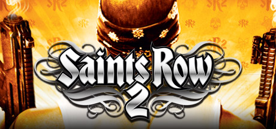

**Platforms:** Windows &nbsp;|&nbsp; **Genre:** Action &nbsp;|&nbsp; **Released:** January 6

> Saints Row 2 brings true freedom to open-world gaming. Players can play as who they want, how they want, and with whomever they want in this sequel to the much acclaimed and tremendously successful Saints Row.
>
> _Synopsis source: Steam_

[Wikipedia](https://en.wikipedia.org/wiki/Saints_Row_2) · [Steam](https://store.steampowered.com/app/9480)

---

### Samurai Shodown Anthology

**Platforms:** PlayStation 2, PlayStation Portable, Wii &nbsp;|&nbsp; **Developer:** Terminal Reality &nbsp;|&nbsp; **Publisher:** SNK Playmore, Ignition Entertainment &nbsp;|&nbsp; **Genre:** Fighting &nbsp;|&nbsp; **Released:** March 24, 2009

[Wikipedia](https://en.wikipedia.org/wiki/Samurai_Shodown_Anthology)

---

### Sandy Beach

**Platforms:** Wii &nbsp;|&nbsp; **Released:** January 5

[Wikipedia](https://en.wikipedia.org/wiki/Sandy_Beach_(video_game))

---

### Savage Moon

**Platforms:** PlayStation 3 &nbsp;|&nbsp; **Released:** January 29

[Wikipedia](https://en.wikipedia.org/wiki/Savage_Moon)

---

### Sentinel

**Platforms:** iOS &nbsp;|&nbsp; **Developer:** Origin8 Technologies &nbsp;|&nbsp; **Genre:** Tower defense &nbsp;|&nbsp; **Released:** February 27, 2009

[Wikipedia](https://en.wikipedia.org/wiki/Sentinel_(iOS_game))

---

### Shellshock 2: Blood Trails

**Platforms:** PlayStation 3, Windows, Xbox 360 &nbsp;|&nbsp; **Released:** February 24

---

### Shin Megami Tensei: Devil Survivor

**Platforms:** Nintendo DS &nbsp;|&nbsp; **Developer:** Atlus &nbsp;|&nbsp; **Publisher:** Atlus, Ghostlight &nbsp;|&nbsp; **Genre:** Tactical role-playing &nbsp;|&nbsp; **Released:** January 15, 2009

> Tokyo is in full lockdown, the government's swift, coldblooded response to a surprise demon invasion. Trapped within the sprawling metropolis is the city's helpless populace, forced to turn on each other in order to survive. A mysterious piece of technology, the COMP, falls into the hands of you and your peers. This device allows you to form contracts, forcing demons to serve you in battle against the otherworldly creatures. There are others with COMPs, so-called demon tamers, who seek to use the demons to satisfy their own whims-be they for justice, peace, or power-in the chaos that was once downtown Tokyo. Where did the demons come from? Why did they appear? Who created the COMPs, and what is their purpose? These questions must soon be answered, for if you fail to solve the mystery, much more is at stake than your own lives.
>
> _Synopsis source: IGDB_

[Wikipedia](https://en.wikipedia.org/wiki/Shin_Megami_Tensei:_Devil_Survivor) · [IGDB](https://www.igdb.com/games/shin-megami-tensei-devil-survivor)

---

### Shining Force Feather

**Platforms:** Nintendo DS &nbsp;|&nbsp; **Developer:** Flight-Plan &nbsp;|&nbsp; **Publisher:** Sega &nbsp;|&nbsp; **Genre:** Tactical RPG &nbsp;|&nbsp; **Released:** February 19, 2009

[Wikipedia](https://en.wikipedia.org/wiki/Shining_Force_Feather) · [IGDB](https://www.igdb.com/games/shining-force-feather)

---

### Shooting Love, 200X

**Platforms:** Xbox 360, Steam &nbsp;|&nbsp; **Developer:** Triangle Service &nbsp;|&nbsp; **Publisher:** Triangle Service &nbsp;|&nbsp; **Genre:** Shoot 'em up &nbsp;|&nbsp; **Released:** February 19, 2009

> The historic success story of the arcades! Introducing the "Shmups Skill Test", a way to evalute your skills as a "gamer age". The high brow style of "EXZEAL", with 4 types of craft to choose from. The classic style of "TRIZEAL Remix", where you can switch between wide shots, lasers and missiles to strategically conquer a wide variety of stages. And, the console-only abstract shooter, "MINUS ZERO". Enjoy these 4 diverse shooters all from one package!
>
> _Synopsis source: IGDB_

[Wikipedia](https://en.wikipedia.org/wiki/Shooting_Love,_200X) · [IGDB](https://www.igdb.com/games/shooting-love-200x)

---

### SimAnimals

**Platforms:** Nintendo DS, Wii &nbsp;|&nbsp; **Released:** January 21

[Wikipedia](https://en.wikipedia.org/wiki/SimAnimals)

---

### Simon the Sorcerer: Who'd Even Want Contact

**Platforms:** Windows &nbsp;|&nbsp; **Developer:** Silver Style Entertainment &nbsp;|&nbsp; **Genre:** Adventure &nbsp;|&nbsp; **Released:** March 26, 2009

[Wikipedia](https://en.wikipedia.org/wiki/Simon_the_Sorcerer:_Who'd_Even_Want_Contact)

---

### Skate 2

**Platforms:** PlayStation 3, Xbox 360 &nbsp;|&nbsp; **Released:** January 21

[Wikipedia](https://en.wikipedia.org/wiki/Skate_2)

---

### Ski-Doo: Snowmobile Challenge

**Platforms:** PlayStation 3, Wii &nbsp;|&nbsp; **Released:** March 10

---

### Snowboard Riot

**Platforms:** Wii &nbsp;|&nbsp; **Developer:** Hudson Soft &nbsp;|&nbsp; **Publisher:** Hudson Soft &nbsp;|&nbsp; **Genre:** Snowboarding &nbsp;|&nbsp; **Released:** February 2, 2009

> This snowboard racing and battle game can be enjoyed by multiple players and is compatible with the Wii Balance Board accessory. In an intense scramble for first place, guide your character down the slopes while snatching up items to attack and defend against rivals along the way. Up to four players can battle and participate in various ranking modes via Nintendo Wi-Fi Connection.
>
> _Synopsis source: IGDB_

[Wikipedia](https://en.wikipedia.org/wiki/Snowboard_Riot) · [IGDB](https://www.igdb.com/games/snowboard-riot)

---

### Sonic and the Black Knight

**Platforms:** Wii &nbsp;|&nbsp; **Released:** March 3

[Wikipedia](https://en.wikipedia.org/wiki/Sonic_and_the_Black_Knight)

---

### Sonic's Ultimate Genesis Collection

**Platforms:** PlayStation 3, Xbox 360 &nbsp;|&nbsp; **Released:** February 10

[Wikipedia](https://en.wikipedia.org/wiki/Sonic%27s_Ultimate_Genesis_Collection)

---

### Space Invaders Extreme 2

**Platforms:** Nintendo DS &nbsp;|&nbsp; **Developer:** Project Just &nbsp;|&nbsp; **Publisher:** Taito, Square Enix &nbsp;|&nbsp; **Genre:** Shooter &nbsp;|&nbsp; **Released:** March 26, 2009

> High-speed action-packed game play returns with the addition of exciting head-to-head battle modes, a challenging new time attack mode, and expanded game play progression that goes beyond Fever Time to SUPER FEVER TIME! Space Invaders Extreme 2 - faster and more exhilarating than ever before!
>
> _Synopsis source: IGDB_

[Wikipedia](https://en.wikipedia.org/wiki/Space_Invaders_Extreme_2) · [IGDB](https://www.igdb.com/games/space-invaders-extreme-2)

---

### SpongeBob vs. The Big One: Beach Party Cook-Off

**Platforms:** Nintendo DS &nbsp;|&nbsp; **Released:** March 3

---

### Star Ocean: Second Evolution

**Platforms:** PlayStation Portable &nbsp;|&nbsp; **Released:** January 20

---

### Star Ocean: The Last Hope

**Platforms:** Xbox 360 &nbsp;|&nbsp; **Released:** February 24

---

### Stoked

**Platforms:** Xbox 360 &nbsp;|&nbsp; **Released:** February 24

[Wikipedia](https://en.wikipedia.org/wiki/Stoked_(video_game))

---

### Stormrise

**Platforms:** PlayStation 3, Windows, Xbox 360 &nbsp;|&nbsp; **Released:** March 24

[Wikipedia](https://en.wikipedia.org/wiki/Stormrise)

---

### Street Fighter IV

**Platforms:** PlayStation 3, Xbox 360, Windows &nbsp;|&nbsp; **Publisher:** Capcom &nbsp;|&nbsp; **Genre:** Action &nbsp;|&nbsp; **Released:** February 12, 2009

> Street Fighter® IV brings the legendary fighting series back to its roots by taking the beloved fighting moves and techniques of the original Street Fighter® II, and infusing them with Capcom's latest advancements in next generation technology.
>
> _Synopsis source: Steam_

[Wikipedia](https://en.wikipedia.org/wiki/Street_Fighter_IV) · [Steam](https://store.steampowered.com/app/21660)

---

### Suikoden Tierkreis

**Platforms:** Nintendo DS &nbsp;|&nbsp; **Released:** March 17

[Wikipedia](https://en.wikipedia.org/wiki/Suikoden_Tierkreis)

---

### Sunday vs Magazine: Shūketsu! Chōjō Daikessen

**Platforms:** PlayStation Portable &nbsp;|&nbsp; **Developer:** Konami Computer Entertainment Aomori, Hudson Soft &nbsp;|&nbsp; **Publisher:** Konami &nbsp;|&nbsp; **Genre:** Fighting &nbsp;|&nbsp; **Released:** March 26, 2009

[Wikipedia](https://en.wikipedia.org/wiki/Sunday_vs_Magazine:_Sh%C5%ABketsu!_Ch%C5%8Dj%C5%8D_Daikessen)

---

### Tales of the World: Radiant Mythology 2

**Platforms:** PlayStation Portable &nbsp;|&nbsp; **Developer:** Alfa System &nbsp;|&nbsp; **Publisher:** Namco Bandai Games &nbsp;|&nbsp; **Genre:** Action RPG &nbsp;|&nbsp; **Released:** January 29, 2009

> In this sequel to the Tales spin-off, 50 characters from different Tales games will appear, and several new classes will be introduced.
>
> _Synopsis source: IGDB_

[Wikipedia](https://en.wikipedia.org/wiki/Tales_of_the_World:_Radiant_Mythology_2) · [IGDB](https://www.igdb.com/games/tales-of-the-world-radiant-mythology-2)

---

### Tenchu: Shadow Assassins

**Platforms:** Wii, PlayStation Portable &nbsp;|&nbsp; **Released:** February 3

---

### Texas Hold'em Tournament

**Platforms:** Wii &nbsp;|&nbsp; **Developer:** Digital Leisure &nbsp;|&nbsp; **Publisher:** Digital Leisure &nbsp;|&nbsp; **Genre:** Simulation, Card Game &nbsp;|&nbsp; **Released:** March 27, 2009

[Wikipedia](https://en.wikipedia.org/wiki/Texas_Hold'em_Tournament)

---

### The House of the Dead: Overkill

**Platforms:** Wii &nbsp;|&nbsp; **Released:** February 10

---

### The Idolmaster SP

**Platforms:** PlayStation Portable &nbsp;|&nbsp; **Developer:** Namco Bandai Games &nbsp;|&nbsp; **Publisher:** Namco Bandai Games &nbsp;|&nbsp; **Genre:** Raising simulation, Rhythm &nbsp;|&nbsp; **Released:** February 19, 2009

[Wikipedia](https://en.wikipedia.org/wiki/The_Idolmaster_SP)

---

### The King of Fighters 2002 Unlimited Match

**Platforms:** PlayStation 2, Arcade &nbsp;|&nbsp; **Developer:** SNK Playmore &nbsp;|&nbsp; **Publisher:** SNK Playmore &nbsp;|&nbsp; **Genre:** Fighting &nbsp;|&nbsp; **Released:** February 26, 2009

[Wikipedia](https://en.wikipedia.org/wiki/The_King_of_Fighters_2002_Unlimited_Match)

---

### The Last Remnant

**Platforms:** Windows &nbsp;|&nbsp; **Released:** March 24

[Wikipedia](https://en.wikipedia.org/wiki/The_Last_Remnant)

---

### The Lord of the Rings: Conquest

**Platforms:** PlayStation 3, Windows, Xbox 360, Nintendo DS &nbsp;|&nbsp; **Released:** January 13

---

### The Maw

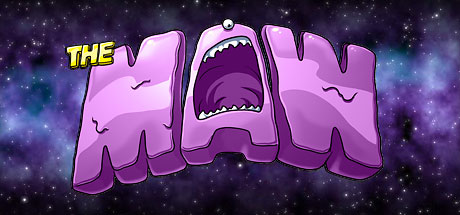

**Platforms:** Xbox 360, Windows &nbsp;|&nbsp; **Genre:** Action, Indie &nbsp;|&nbsp; **Released:** January 21

> The pinnacle of alien evolution, Maw is a cowardly fat blob concerned mostly with snacking and lounging. He can, however, absorb the traits of anything he eats, is virtually indestructible, and can grow to unlimited size. If he wasn't a danger to all life in the universe, he'd make the perfect pet.
>
> _Synopsis source: Steam_

[Wikipedia](https://en.wikipedia.org/wiki/The_Maw_(video_game)) · [Steam](https://store.steampowered.com/app/26000)

---

### The Nameless Mod

**Platforms:** Windows &nbsp;|&nbsp; **Developer:** Off Topic Productions &nbsp;|&nbsp; **Genre:** Action role-playing game &nbsp;|&nbsp; **Released:** March 14, 2009

> The Nameless Mod is a third-party total conversion modification released for Deus Ex in 2009 by Off Topic Productions. It was in development for 7 years, during which it was highly anticipated.
>
> _Synopsis source: IGDB_

[Wikipedia](https://en.wikipedia.org/wiki/The_Nameless_Mod) · [IGDB](https://www.igdb.com/games/the-nameless-mod)

---

### The Oregon Trail

**Platforms:** Mobile phone, iOS, Nintendo DS &nbsp;|&nbsp; **Developer:** Gameloft Shanghai, Gameloft New York &nbsp;|&nbsp; **Publisher:** Gameloft &nbsp;|&nbsp; **Genre:** Strategy &nbsp;|&nbsp; **Released:** March 11, 2009

> The Oregon Trail is a strategy video game developed by Gameloft New York and Gameloft Shanghai and published by Gameloft. It was released for Java ME-based mobile phones in 2009; a high-definition version was later released for iOS the same year. The game was then ported to DSiware, followed by a number of other mobile operating systems and devices. The game was followed by two sequels: The Oregon Trail: Gold Rush and The Oregon Trail: American Settler.
>
> _Synopsis source: IGDB_

[Wikipedia](https://en.wikipedia.org/wiki/The_Oregon_Trail_(2009_video_game)) · [IGDB](https://www.igdb.com/games/the-oregon-trail--1)

---

### The Path

**Platforms:** Windows, macOS &nbsp;|&nbsp; **Developer:** Tale of Tales &nbsp;|&nbsp; **Publisher:** Tale of Tales, TransGaming, TopWare, 1C Company &nbsp;|&nbsp; **Genre:** Psychological horror, art &nbsp;|&nbsp; **Released:** March 18, 2009

> The Path is a psychological horror art game developed by Tale of Tales originally released for the Microsoft Windows operating system on March 18, 2009 in English and Dutch, and later ported to Mac OS X by TransGaming Technologies.  It is inspired by several versions of the fairy tale Little Red Riding Hood, and by folklore tropes and conventions in general, but set in contemporary times. The player can choose to control one of six different sisters, who are sent one-by-one on errands by their mother to see their sick grandmother. The player can choose whether to stay on the path or to wander, where wolves are lying in wait.
>
> _Synopsis source: IGDB_

[Wikipedia](https://en.wikipedia.org/wiki/The_Path_(video_game)) · [IGDB](https://www.igdb.com/games/the-path)

---

### The Wheelman

**Platforms:** PlayStation 3, Windows, Xbox 360 &nbsp;|&nbsp; **Released:** March 24

[Wikipedia](https://en.wikipedia.org/wiki/The_Wheelman)

---

### TNA Wrestling

**Platforms:** iOS &nbsp;|&nbsp; **Released:** March 30

[Wikipedia](https://en.wikipedia.org/wiki/TNA_Wrestling_(video_game))

---

### Tom Clancy's EndWar

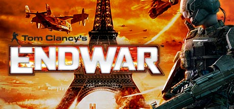

**Platforms:** Windows &nbsp;|&nbsp; **Genre:** Strategy &nbsp;|&nbsp; **Released:** February 24

> Live the thrilling career of an army commander and lead your army to victory in a massive online World War III! Take control of the U.S.-led Joint Strike Force, the European Enforcers Corps, or the Russian Spetsnaz Guards Brigade in a persistent ongoing World War.
>
> _Synopsis source: Steam_

[Wikipedia](https://en.wikipedia.org/wiki/Tom_Clancy%27s_EndWar) · [Steam](https://store.steampowered.com/app/21800)

---

### Tom Clancy's H.A.W.X.

**Platforms:** PlayStation 3, Xbox 360, iOS, Windows &nbsp;|&nbsp; **Released:** March 6

[Wikipedia](https://en.wikipedia.org/wiki/Tom_Clancy%27s_H.A.W.X.)

---

### Tomb Raider: Underworld

**Platforms:** PlayStation 2 &nbsp;|&nbsp; **Released:** March 9

---

### Touch Mechanic

**Platforms:** Nintendo DS &nbsp;|&nbsp; **Released:** March 23

---

### Touch Solitaire

**Platforms:** Nintendo DS &nbsp;|&nbsp; **Developer:** Nintendo &nbsp;|&nbsp; **Publisher:** Nintendo &nbsp;|&nbsp; **Genre:** Solitaire &nbsp;|&nbsp; **Released:** January 28, 2009

> Touch Solitaire features two of the most popular versions of Solitaire—Spider and Klondike—with simple Touch Screen controls and an easy to understand interface. Various difficulty levels are available for both games, allowing beginners or experts to enjoy the game at their own pace.
>
> _Synopsis source: IGDB_

[Wikipedia](https://en.wikipedia.org/wiki/Touch_Solitaire) · [IGDB](https://www.igdb.com/games/touch-solitaire)

---

### TrackMania DS

**Platforms:** Nintendo DS &nbsp;|&nbsp; **Released:** March 17

[Wikipedia](https://en.wikipedia.org/wiki/TrackMania_DS)

---

### Ultimate Shooting Collection

**Platforms:** Wii &nbsp;|&nbsp; **Released:** February 3

[Wikipedia](https://en.wikipedia.org/wiki/Ultimate_Shooting_Collection)

---

### Uno Rush

**Platforms:** Xbox 360 &nbsp;|&nbsp; **Developer:** Carbonated Games &nbsp;|&nbsp; **Publisher:** Microsoft Game Studios &nbsp;|&nbsp; **Genre:** Card game &nbsp;|&nbsp; **Released:** March 25, 2009

> UNO RUSH is a four-player, social party game that's easy to jump into, but hard to leave because you'll have so much fun playing. Sort your cards (even off-turn) so you can play them sequentially when it is your turn. The first player to get rid of all their cards wins the round, and scores points based on the remaining cards in opponents' hands. This fast-paced, family-friendly game is sure to become a hit with you and your friends. UNO RUSH is the sequel to the number-one selling Xbox LIVE Arcade title UNO, and is exclusive to Xbox LIVE Arcade.
>
> _Synopsis source: IGDB_

[Wikipedia](https://en.wikipedia.org/wiki/Uno_Rush) · [IGDB](https://www.igdb.com/games/uno-rush)

---

### Valkyrie Profile: Covenant of the Plume

**Platforms:** Nintendo DS &nbsp;|&nbsp; **Released:** March 16

---

### W.L.O. Sekai Renai Kikō

**Platforms:** Windows, Xbox 360 &nbsp;|&nbsp; **Developer:** Akabeisoft2 &nbsp;|&nbsp; **Publisher:** 5pb., Akabeisoft2 &nbsp;|&nbsp; **Genre:** Visual novel &nbsp;|&nbsp; **Released:** March 26, 2009

[Wikipedia](https://en.wikipedia.org/wiki/W.L.O._Sekai_Renai_Kik%C5%8D)

---

### Wallace & Gromit's Grand Adventures

**Platforms:** Windows &nbsp;|&nbsp; **Genre:** Adventure, Casual &nbsp;|&nbsp; **Released:** March 24

> Enter the colorful world of West Wallaby Street in a series of four cracking adventures brought to you by Aardman Animations, the creators of the Wallace &amp; Gromit animated films, and award-winning Telltale Games.
>
> _Synopsis source: Steam_

[Wikipedia](https://en.wikipedia.org/wiki/Wallace_%26_Gromit%27s_Grand_Adventures) · [Steam](https://store.steampowered.com/app/31100)

---

### Wanted: Weapons of Fate

**Platforms:** PlayStation 3, Windows, Xbox 360 &nbsp;|&nbsp; **Released:** March 17

---

### Warhammer 40,000: Dawn of War II

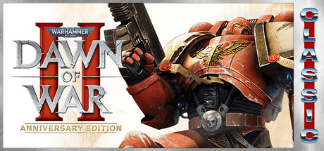

**Platforms:** Windows &nbsp;|&nbsp; **Genre:** Strategy &nbsp;|&nbsp; **Released:** February 19

> All of Warhammer 40,000: Dawn of War II in one package. Play the award-winning real-time strategy game in all its glory, including three full campaigns, six multiplayer factions, and a full co-op Last Stand mode with eight unique heroes.
>
> _Synopsis source: Steam_

[Steam](https://store.steampowered.com/app/15620)

---

### Watchmen: The End Is Nigh

**Platforms:** PlayStation 3, Windows, Xbox 360 &nbsp;|&nbsp; **Genre:** Action &nbsp;|&nbsp; **Released:** March 4

> The lines between good and bad have been blurred and crime and terror run rampant in the streets. The alleys, rooftops and sewers are crawling with criminals and brutal gangs. And now, Underboss — in a daring escape — has broken out of prison and is ruling with vicious darkness.
>
> _Synopsis source: Steam_

[Steam](https://store.steampowered.com/app/21010)

---

### Wheelman

**Platforms:** Windows, PlayStation 3, Xbox 360 &nbsp;|&nbsp; **Developer:** Tigon Studios, Midway Studios – Newcastle &nbsp;|&nbsp; **Publisher:** Ubisoft, Midway Games &nbsp;|&nbsp; **Genre:** Action-adventure &nbsp;|&nbsp; **Released:** March 24, 2009

> The game is set in an open world environment modeled after Barcelona, full of destructible objects, alleyways, shortcuts through office blocks and a total of 31 story missions and 105 side missions. While most missions are driving-oriented, there are also foot missions which are played from a third person perspective. A wide variety of weapons are available to the player, such as pistols and RPGs.
>
> _Synopsis source: IGDB_

[Wikipedia](https://en.wikipedia.org/wiki/Wheelman_(video_game)) · [IGDB](https://www.igdb.com/games/wheelman)

---

### Where in the World is Carmen Sandiego? 3 - New Carmen Adventure

**Platforms:** Nintendo DS, Windows &nbsp;|&nbsp; **Developer:** Strass Productions &nbsp;|&nbsp; **Publisher:** Mindscape &nbsp;|&nbsp; **Genre:** Point-and-click Educational &nbsp;|&nbsp; **Released:** February 18, 2009

[Wikipedia](https://en.wikipedia.org/wiki/Where_in_the_World_is_Carmen_Sandiego%3F_3_-_New_Carmen_Adventure)

---

### Wiffle Ball

**Platforms:** Nintendo DS &nbsp;|&nbsp; **Developer:** Skyworks Technologies &nbsp;|&nbsp; **Publisher:** Destination Software Inc., Zoo Digital Publishing &nbsp;|&nbsp; **Genre:** Sports &nbsp;|&nbsp; **Released:** March 12, 2009

[Wikipedia](https://en.wikipedia.org/wiki/Wiffle_Ball_(video_game))

---

### World in Conflict: Soviet Assault

**Platforms:** Windows &nbsp;|&nbsp; **Released:** March 10

---

### Worms

**Platforms:** PlayStation Network &nbsp;|&nbsp; **Released:** March 26

[Wikipedia](https://en.wikipedia.org/wiki/Worms_(2007_video_game))

---

### WWE Legends of WrestleMania

**Platforms:** PlayStation 3, Xbox 360 &nbsp;|&nbsp; **Released:** March 24

[Wikipedia](https://en.wikipedia.org/wiki/WWE_Legends_of_WrestleMania)

---

### X-Blades

**Platforms:** PlayStation 3, Windows, Xbox 360 &nbsp;|&nbsp; **Genre:** Nudity, Violent, Action, Adventure, RPG &nbsp;|&nbsp; **Released:** February 10

> In X-Blades, the player takes on the role of the enchanting heroine Ayumi, who survives a breathtaking dance of blades through the Hordes of Darkness. The long-haired beautiful anime, with her pistol blades and mind-blowing leaps, whirls and swirls from one fantastic level to the next.
>
> _Synopsis source: Steam_

[Wikipedia](https://en.wikipedia.org/wiki/X-Blades) · [Steam](https://store.steampowered.com/app/7510)

---

### Xi

**Platforms:** PlayStation 3 &nbsp;|&nbsp; **Developer:** nDreams &nbsp;|&nbsp; **Publisher:** SCEE, SCEA &nbsp;|&nbsp; **Genre:** Alternate reality game &nbsp;|&nbsp; **Released:** March 23, 2009

[Wikipedia](https://en.wikipedia.org/wiki/Xi_(alternate_reality_game))

---

### Zen Bound

**Platforms:** Android, iOS &nbsp;|&nbsp; **Developer:** Secret Exit &nbsp;|&nbsp; **Publisher:** Chillingo Ltd &nbsp;|&nbsp; **Genre:** Puzzle &nbsp;|&nbsp; **Released:** March 9, 2009

> A puzzle game about covering wooden block figures with paint by covering them in rope.
>
> _Synopsis source: IGDB_

[Wikipedia](https://en.wikipedia.org/wiki/Zen_Bound) · [IGDB](https://www.igdb.com/games/zen-bound)

---

### Zengage

**Platforms:** Nintendo DS &nbsp;|&nbsp; **Developer:** Skip Ltd. &nbsp;|&nbsp; **Publisher:** Nintendo &nbsp;|&nbsp; **Genre:** Puzzle &nbsp;|&nbsp; **Released:** January 30, 2009

[Wikipedia](https://en.wikipedia.org/wiki/Zengage)

---
