# 2010 in Video Games

[← Back to index](../README.md)

1065 titles (511 from Wikipedia's category page) · [source](https://en.wikipedia.org/wiki/2010_in_video_games) · [category](https://en.wikipedia.org/wiki/Category:2010_video_games)

### .hack//Link

**Platforms:** PlayStation Portable &nbsp;|&nbsp; **Developer:** CyberConnect2 &nbsp;|&nbsp; **Publisher:** Namco Bandai Games &nbsp;|&nbsp; **Genre:** Role-playing game &nbsp;|&nbsp; **Released:** March 4, 2010

[Wikipedia](https://en.wikipedia.org/wiki/.hack//Link)

---

### 0 A.D.

[Wikipedia](https://en.wikipedia.org/wiki/0_A.D._(video_game))

---

### 007: GoldenEye

**Platforms:** Wii, Nintendo DS &nbsp;|&nbsp; **Released:** November 2

---

### 10 Minute Solution

**Platforms:** Wii &nbsp;|&nbsp; **Released:** June 29

---

### 100 Classic Books

**Platforms:** Nintendo DS &nbsp;|&nbsp; **Released:** June 15

[Wikipedia](https://en.wikipedia.org/wiki/100_Classic_Book_Collection)

---

### 100 Rogues

**Platforms:** iOS &nbsp;|&nbsp; **Developer:** Dinofarm Games, Fusion Reactions &nbsp;|&nbsp; **Publisher:** Fusion Reactions &nbsp;|&nbsp; **Genre:** Role-playing &nbsp;|&nbsp; **Released:** May 4, 2010

[Wikipedia](https://en.wikipedia.org/wiki/100_Rogues)

---

### 1001 Crystal Mazes Collection

**Platforms:** Nintendo DS &nbsp;|&nbsp; **Developer:** Teyon &nbsp;|&nbsp; **Publisher:** Teyon &nbsp;|&nbsp; **Genre:** Puzzle &nbsp;|&nbsp; **Released:** May 3, 2010

[Wikipedia](https://en.wikipedia.org/wiki/1001_Crystal_Mazes_Collection)

---

### 101 Shark Pets

**Platforms:** Nintendo DS &nbsp;|&nbsp; **Developer:** Teyon &nbsp;|&nbsp; **Publisher:** Teyon &nbsp;|&nbsp; **Genre:** Pet-raising simulation &nbsp;|&nbsp; **Released:** July 5, 2010

[Wikipedia](https://en.wikipedia.org/wiki/101_Shark_Pets)

---

### 101-in-1 Sports Party Megamix

**Platforms:** Wii, Nintendo DS &nbsp;|&nbsp; **Developer:** Nordcurrent &nbsp;|&nbsp; **Publisher:** Nordcurrent, Atlus, Starfish-SD &nbsp;|&nbsp; **Genre:** Sports

[Wikipedia](https://en.wikipedia.org/wiki/101-in-1_Sports_Party_Megamix)

---

### 1378 (km)

**Platforms:** Windows &nbsp;|&nbsp; **Developer:** Jens M. Stober &nbsp;|&nbsp; **Publisher:** Jens M. Stober &nbsp;|&nbsp; **Genre:** First-person shooter &nbsp;|&nbsp; **Released:** December 10, 2010

[Wikipedia](https://en.wikipedia.org/wiki/1378_(km))

---

### 15 Days

**Platforms:** Windows &nbsp;|&nbsp; **Developer:** House of Tales &nbsp;|&nbsp; **Publisher:** DTP Entertainment &nbsp;|&nbsp; **Genre:** Adventure &nbsp;|&nbsp; **Released:** June 18, 2010

[Wikipedia](https://en.wikipedia.org/wiki/15_Days_(video_game))

---

### 2010 FIFA World Cup South Africa

**Platforms:** PlayStation 3, Xbox 360, Wii, PlayStation Portable, iOS &nbsp;|&nbsp; **Released:** April 27

[Wikipedia](https://en.wikipedia.org/wiki/2010_FIFA_World_Cup_South_Africa_(video_game))

---

### 2XL TrophyLite Rally

**Platforms:** iOS &nbsp;|&nbsp; **Developer:** 2XL Games &nbsp;|&nbsp; **Genre:** Racing game &nbsp;|&nbsp; **Released:** June 10, 2010

[Wikipedia](https://en.wikipedia.org/wiki/2XL_TrophyLite_Rally)

---

### 3D Dot Game Heroes

**Platforms:** PlayStation 3 &nbsp;|&nbsp; **Released:** May 11

[Wikipedia](https://en.wikipedia.org/wiki/3D_Dot_Game_Heroes)

---

### 8-Bit Rebellion!

**Platforms:** iOS &nbsp;|&nbsp; **Developer:** Artificial Life, Inc. &nbsp;|&nbsp; **Publisher:** Artificial Life, Inc. &nbsp;|&nbsp; **Genre:** Action-adventure MMORPG &nbsp;|&nbsp; **Released:** April 26, 2010

[Wikipedia](https://en.wikipedia.org/wiki/8-Bit_Rebellion!)

---

### 999: Nine Hours, Nine Persons, Nine Doors

**Platforms:** Nintendo DS &nbsp;|&nbsp; **Released:** November 16

---

### A Kappa's Trail

**Platforms:** Nintendo DS &nbsp;|&nbsp; **Released:** June 14

[Wikipedia](https://en.wikipedia.org/wiki/A_Kappa%27s_Trail)

---

### A New Beginning

**Platforms:** Windows, macOS, iOS &nbsp;|&nbsp; **Developer:** Daedalic Entertainment &nbsp;|&nbsp; **Publisher:** Lace International &nbsp;|&nbsp; **Genre:** Point-and-click adventure &nbsp;|&nbsp; **Released:** October 8, 2010

[Wikipedia](https://en.wikipedia.org/wiki/A_New_Beginning_(video_game))

---

### A Space Shooter for 2 Bucks!

**Platforms:** PlayStation Portable, PlayStation 3 &nbsp;|&nbsp; **Developer:** Frima Studio &nbsp;|&nbsp; **Publisher:** Frima Studio &nbsp;|&nbsp; **Genre:** Shooter &nbsp;|&nbsp; **Released:** December 21, 2010

[Wikipedia](https://en.wikipedia.org/wiki/A_Space_Shooter_for_2_Bucks!)

---

### A World of Keflings

**Platforms:** Xbox 360 &nbsp;|&nbsp; **Released:** December 22

[Wikipedia](https://en.wikipedia.org/wiki/A_World_of_Keflings)

---

### A.R.E.S.: Extinction Agenda

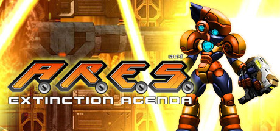

**Platforms:** Windows &nbsp;|&nbsp; **Genre:** Action, Indie &nbsp;|&nbsp; **Released:** December 14

> You are the ultimate weapon with an ultimate sidekick – Collect secret items and get power ups to become the perfect weapon.
>
> _Synopsis source: Steam_

[Steam](https://store.steampowered.com/app/92300)

---

### Abyss of the Sacrifice

**Platforms:** PlayStation Portable &nbsp;|&nbsp; **Developer:** Intense &nbsp;|&nbsp; **Publisher:** D3 Publisher &nbsp;|&nbsp; **Genre:** Adventure, visual novel &nbsp;|&nbsp; **Released:** February 4, 2010

[Wikipedia](https://en.wikipedia.org/wiki/Abyss_of_the_Sacrifice)

---

### Ace Attorney Investigations: Miles Edgeworth

**Platforms:** Nintendo DS &nbsp;|&nbsp; **Released:** February 16

---

### Ace Combat: Joint Assault

**Platforms:** PlayStation Portable &nbsp;|&nbsp; **Released:** August 31

---

### Achtung Panzer: Kharkov 1943

**Platforms:** Windows &nbsp;|&nbsp; **Developer:** Graviteam &nbsp;|&nbsp; **Publisher:** 1C Games, Paradox Interactive, Mamba Games &nbsp;|&nbsp; **Genre:** Real-time strategy, wargame &nbsp;|&nbsp; **Released:** February 25, 2010

[Wikipedia](https://en.wikipedia.org/wiki/Achtung_Panzer:_Kharkov_1943)

---

### Active Life: Explorer

**Platforms:** Wii &nbsp;|&nbsp; **Developer:** h.a.n.d. &nbsp;|&nbsp; **Publisher:** Namco Bandai Games &nbsp;|&nbsp; **Genre:** Exergaming &nbsp;|&nbsp; **Released:** October 19, 2010

[Wikipedia](https://en.wikipedia.org/wiki/Active_Life:_Explorer)

---

### Adrenalin Misfits

**Platforms:** Xbox 360 &nbsp;|&nbsp; **Developer:** Konami &nbsp;|&nbsp; **Publisher:** Konami &nbsp;|&nbsp; **Genre:** Sports, racing &nbsp;|&nbsp; **Released:** November 4, 2010

[Wikipedia](https://en.wikipedia.org/wiki/Adrenalin_Misfits)

---

### Adrenaline Misfits

**Platforms:** Xbox 360 &nbsp;|&nbsp; **Released:** November 4

---

### Again

**Platforms:** Nintendo DS &nbsp;|&nbsp; **Released:** April 2

[Wikipedia](https://en.wikipedia.org/wiki/Again_(video_game))

---

### Age of Conan: Rise of the Godslayer

**Platforms:** Windows &nbsp;|&nbsp; **Developer:** Funcom &nbsp;|&nbsp; **Publisher:** Funcom &nbsp;|&nbsp; **Genre:** Massively multiplayer online role-playing &nbsp;|&nbsp; **Released:** May 11, 2010

[Wikipedia](https://en.wikipedia.org/wiki/Age_of_Conan:_Rise_of_the_Godslayer)

---

### Age of Hammer Wars

**Platforms:** PlayStation 3, PlayStation Portable &nbsp;|&nbsp; **Released:** October 19

---

### Age of Zombies

**Platforms:** PlayStation Portable, PlayStation 3, iOS &nbsp;|&nbsp; **Developer:** Halfbrick Studios &nbsp;|&nbsp; **Publisher:** Halfbrick Studios, BlitWorks &nbsp;|&nbsp; **Genre:** Action-adventure, shoot 'em up, survival horror &nbsp;|&nbsp; **Released:** February 25, 2010

[Wikipedia](https://en.wikipedia.org/wiki/Age_of_Zombies)

---

### AirAttack

**Platforms:** iOS, Android &nbsp;|&nbsp; **Developer:** Art In Games &nbsp;|&nbsp; **Publisher:** Art In Games &nbsp;|&nbsp; **Genre:** Shoot 'em up &nbsp;|&nbsp; **Released:** July 15, 2010

[Wikipedia](https://en.wikipedia.org/wiki/AirAttack)

---

### Akai Katana

**Platforms:** Arcade &nbsp;|&nbsp; **Developer:** Cave, exA-Arcadia &nbsp;|&nbsp; **Publisher:** Cave &nbsp;|&nbsp; **Genre:** Scrolling shooter, bullet hell &nbsp;|&nbsp; **Released:** August 20, 2010

[Wikipedia](https://en.wikipedia.org/wiki/Akai_Katana)

---

### Alan Wake

**Platforms:** Xbox 360 &nbsp;|&nbsp; **Released:** May 18

[Wikipedia](https://en.wikipedia.org/wiki/Alan_Wake)

---

### Alice in Wonderland

**Platforms:** Nintendo DS, Wii &nbsp;|&nbsp; **Released:** March 2

[Wikipedia](https://en.wikipedia.org/wiki/Alice_in_Wonderland_(2010_video_game))

---

### Alien Breed 2: Assault

**Platforms:** Xbox 360, Windows, PlayStation 3 &nbsp;|&nbsp; **Genre:** Action &nbsp;|&nbsp; **Released:** September 22

> Can you survive the alien onslaught? Gamers across the world will now have a chance to play the next chapter in this high-budget, high-quality series.
>
> _Synopsis source: Steam_

[Steam](https://store.steampowered.com/app/22650)

---

### Alien Breed 3: Descent

**Platforms:** PlayStation Network, Windows, Xbox 360 &nbsp;|&nbsp; **Genre:** Action &nbsp;|&nbsp; **Released:** November 17

> Experience the final explosive chapter in the Alien Breed series and uncover the horrifying truth surrounding the existence of the Breed. Launch discount good thru Nov. 24 10am PST.
>
> _Synopsis source: Steam_

[Steam](https://store.steampowered.com/app/22670)

---

### Alien Breed Evolution

**Platforms:** PlayStation Network &nbsp;|&nbsp; **Released:** September 1

[Wikipedia](https://en.wikipedia.org/wiki/Alien_Breed_Evolution)

---

### Alien Swarm

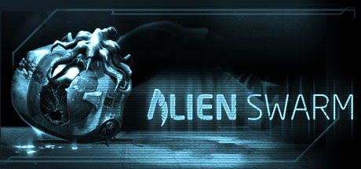

**Platforms:** Windows &nbsp;|&nbsp; **Genre:** Action, Free To Play &nbsp;|&nbsp; **Released:** July 19

> Co-operative multiplayer game and complete code base available for free.
>
> _Synopsis source: Steam_

[Wikipedia](https://en.wikipedia.org/wiki/Alien_Swarm) · [Steam](https://store.steampowered.com/app/630)

---

### Aliens vs. Predator

**Platforms:** Windows, Xbox 360, PlayStation 3 &nbsp;|&nbsp; **Genre:** Action &nbsp;|&nbsp; **Released:** February 16

> Survive, hunt and prey in the deadly jungles and swamps in distinctly new and thrilling first person gameplay.
>
> _Synopsis source: Steam_

[Wikipedia](https://en.wikipedia.org/wiki/Aliens_vs._Predator_(2010_video_game)) · [Steam](https://store.steampowered.com/app/10680)

---

### Alive 4-Ever Returns

**Platforms:** iOS &nbsp;|&nbsp; **Developer:** Meridian Digital Entertainment &nbsp;|&nbsp; **Publisher:** Meridian Digital Entertainment &nbsp;|&nbsp; **Genre:** Shooter &nbsp;|&nbsp; **Released:** April 27, 2010

[Wikipedia](https://en.wikipedia.org/wiki/Alive_4-Ever_Returns)

---

### Allods Online

**Platforms:** Windows &nbsp;|&nbsp; **Developer:** Allods Team &nbsp;|&nbsp; **Publisher:** Mail.Ru Group, My.Games &nbsp;|&nbsp; **Genre:** Fantasy MMORPG &nbsp;|&nbsp; **Released:** October 21, 2010

[Wikipedia](https://en.wikipedia.org/wiki/Allods_Online)

---

### Alpha Protocol

**Platforms:** Windows, Xbox 360, PlayStation 3 &nbsp;|&nbsp; **Genre:** Action, RPG &nbsp;|&nbsp; **Released:** June 1

> Loyalty carries a price and no one knows this more than agent Michael Thorton. A talented young agent cast out by his government, Thorton is the only one with the information needed to stop an impending international catastrophe.
>
> _Synopsis source: Steam_

[Wikipedia](https://en.wikipedia.org/wiki/Alpha_Protocol) · [Steam](https://store.steampowered.com/app/34010)

---

### AlphaBounce

**Platforms:** Nintendo DS &nbsp;|&nbsp; **Developer:** Motion Twin &nbsp;|&nbsp; **Publisher:** Mad Monkey Studio &nbsp;|&nbsp; **Genre:** Action &nbsp;|&nbsp; **Released:** April 9, 2010

[Wikipedia](https://en.wikipedia.org/wiki/AlphaBounce)

---

### Alt-Play: Jason Rohrer Anthology

**Platforms:** Nintendo DS &nbsp;|&nbsp; **Developer:** Sabarasa Entertainment &nbsp;|&nbsp; **Publisher:** Sabarasa Entertainment &nbsp;|&nbsp; **Genre:** Action-adventure &nbsp;|&nbsp; **Released:** December 31, 2010

[Wikipedia](https://en.wikipedia.org/wiki/Alt-Play:_Jason_Rohrer_Anthology)

---

### Alter Ego

**Platforms:** Windows &nbsp;|&nbsp; **Developer:** Future Games &nbsp;|&nbsp; **Publisher:** Viva Media &nbsp;|&nbsp; **Genre:** Adventure &nbsp;|&nbsp; **Released:** February 18, 2010

[Wikipedia](https://en.wikipedia.org/wiki/Alter_Ego_(2010_video_game))

---

### Alternativa

**Platforms:** Windows &nbsp;|&nbsp; **Developer:** Centauri Production, First Reality &nbsp;|&nbsp; **Publisher:** Bohemia Interactive

[Wikipedia](https://en.wikipedia.org/wiki/Alternativa_(video_game))

---

### Alundra

**Platforms:** PlayStation Network &nbsp;|&nbsp; **Released:** October 12

[Wikipedia](https://en.wikipedia.org/wiki/Alundra)

---

### America's Next Top Model

[Wikipedia](https://en.wikipedia.org/wiki/America's_Next_Top_Model_(video_game))

---

### Amnesia: The Dark Descent

**Platforms:** Windows, macOS, Linux &nbsp;|&nbsp; **Genre:** Action, Adventure, Indie &nbsp;|&nbsp; **Released:** September 8

> Amnesia: The Dark Descent, a first person survival horror. A game about immersion, discovery and living through a nightmare. An experience that will chill you to the core.
>
> _Synopsis source: Steam_

[Steam](https://store.steampowered.com/app/57300)

---

### Anarchy: Rush Hour

**Platforms:** PlayStation 3 &nbsp;|&nbsp; **Released:** March 26

[Wikipedia](https://en.wikipedia.org/wiki/Gaijin_Entertainment#Games)

---

### Ancient Trader

**Platforms:** iOS, Windows, Xbox 360 &nbsp;|&nbsp; **Developer:** 4Kids Games &nbsp;|&nbsp; **Publisher:** 4Kids Games &nbsp;|&nbsp; **Genre:** Turn-based strategy &nbsp;|&nbsp; **Released:** June 27, 2010

[Wikipedia](https://en.wikipedia.org/wiki/Ancient_Trader)

---

### Ancients of Ooga

**Platforms:** Xbox 360 &nbsp;|&nbsp; **Developer:** Bacon Wrapped Games &nbsp;|&nbsp; **Publisher:** NinjaBee &nbsp;|&nbsp; **Genre:** Puzzle-platform &nbsp;|&nbsp; **Released:** June 30, 2010

[Wikipedia](https://en.wikipedia.org/wiki/Ancients_of_Ooga)

---

### Angry Birds Seasons

**Platforms:** iOS &nbsp;|&nbsp; **Released:** October 21

[Wikipedia](https://en.wikipedia.org/wiki/Angry_Birds_Seasons)

---

### Animal Jam Classic

**Platforms:** Windows, macOS, Browser &nbsp;|&nbsp; **Developer:** WildWorks &nbsp;|&nbsp; **Publisher:** WildWorks &nbsp;|&nbsp; **Genre:** MMO, Education &nbsp;|&nbsp; **Released:** September 9, 2010

[Wikipedia](https://en.wikipedia.org/wiki/Animal_Jam_Classic)

---

### Another Century's Episode: R

**Platforms:** PlayStation 3 &nbsp;|&nbsp; **Developer:** FromSoftware &nbsp;|&nbsp; **Publisher:** Banpresto &nbsp;|&nbsp; **Genre:** Third-person shooter &nbsp;|&nbsp; **Released:** August 19, 2010

[Wikipedia](https://en.wikipedia.org/wiki/Another_Century's_Episode:_R)

---

### Apache: Air Assault

**Platforms:** PlayStation 3, Windows, Xbox 360 &nbsp;|&nbsp; **Released:** November 16

---

### APB All Points Bulletin

**Platforms:** Windows &nbsp;|&nbsp; **Released:** June 29

[Wikipedia](https://en.wikipedia.org/wiki/APB_(video_game))

---

### Apple Jack

**Platforms:** Xbox 360 &nbsp;|&nbsp; **Developer:** My Owl Software &nbsp;|&nbsp; **Publisher:** My Owl Software &nbsp;|&nbsp; **Genre:** Puzzle-platform &nbsp;|&nbsp; **Released:** May 29, 2010

[Wikipedia](https://en.wikipedia.org/wiki/Apple_Jack_(video_game))

---

### Apron of Magic

**Platforms:** Arcade &nbsp;|&nbsp; **Developer:** Examu &nbsp;|&nbsp; **Publisher:** Examu &nbsp;|&nbsp; **Genre:** Digital collectible card game, cooking &nbsp;|&nbsp; **Released:** July 26, 2010

[Wikipedia](https://en.wikipedia.org/wiki/Apron_of_Magic)

---

### Aqua – Naval Warfare

**Platforms:** Xbox 360 &nbsp;|&nbsp; **Released:** May 19

[Wikipedia](https://en.wikipedia.org/wiki/Aqua_(video_game))

---

### Ar Tonelico Qoga

**Platforms:** PlayStation 3 &nbsp;|&nbsp; **Developer:** Gust Co. Ltd., Banpresto &nbsp;|&nbsp; **Publisher:** Namco Bandai Games, NIS America &nbsp;|&nbsp; **Genre:** Action role-playing &nbsp;|&nbsp; **Released:** January 28, 2010

[Wikipedia](https://en.wikipedia.org/wiki/Ar_Tonelico_Qoga)

---

### Arc Rise Fantasia

**Platforms:** Wii &nbsp;|&nbsp; **Released:** July 20

[Wikipedia](https://en.wikipedia.org/wiki/Arc_Rise_Fantasia)

---

### Arc the Lad

**Platforms:** PlayStation Network &nbsp;|&nbsp; **Released:** October 12

[Wikipedia](https://en.wikipedia.org/wiki/Arc_the_Lad_(video_game))

---

### Arc the Lad II

**Platforms:** PlayStation Network &nbsp;|&nbsp; **Released:** November 23

[Wikipedia](https://en.wikipedia.org/wiki/Arc_the_Lad_II)

---

### Arcania: Gothic 4

**Platforms:** Windows, Xbox 360 &nbsp;|&nbsp; **Released:** October 12

---

### Archetype

**Platforms:** iOS &nbsp;|&nbsp; **Released:** July 2

[Wikipedia](https://en.wikipedia.org/wiki/Archetype_(video_game))

---

### Argo Online

**Developer:** Green Forrest &nbsp;|&nbsp; **Publisher:** mGame Corporation, Games-Masters.com &nbsp;|&nbsp; **Genre:** Hybrid MMORPG

[Wikipedia](https://en.wikipedia.org/wiki/Argo_Online)

---

### Arma 2: Operation Arrowhead

**Platforms:** Windows &nbsp;|&nbsp; **Developer:** Bohemia Interactive Studio &nbsp;|&nbsp; **Publisher:** 505 Games, Meridian4 &nbsp;|&nbsp; **Genre:** First-person shooter, tactical shooter &nbsp;|&nbsp; **Released:** June 29, 2010

[Wikipedia](https://en.wikipedia.org/wiki/Arma_2:_Operation_Arrowhead)

---

### Armin van Buuren: In the Mix

**Platforms:** Wii &nbsp;|&nbsp; **Developer:** TransGaming Technologies &nbsp;|&nbsp; **Publisher:** Foreign Media Games &nbsp;|&nbsp; **Genre:** Music video game &nbsp;|&nbsp; **Released:** November 12, 2010

[Wikipedia](https://en.wikipedia.org/wiki/Armin_van_Buuren:_In_the_Mix)

---

### Army of Two: The 40th Day

**Platforms:** PlayStation 3, Xbox 360, PlayStation Portable &nbsp;|&nbsp; **Genre:** TPS &nbsp;|&nbsp; **Released:** January 12

---

### Arrow of Laputa

**Platforms:** Nintendo DS &nbsp;|&nbsp; **Developer:** ArtePiazza &nbsp;|&nbsp; **Publisher:** ArtePiazza &nbsp;|&nbsp; **Genre:** Tower defense &nbsp;|&nbsp; **Released:** November 24, 2010

[Wikipedia](https://en.wikipedia.org/wiki/Arrow_of_Laputa)

---

### Arsenal of Democracy

**Platforms:** Windows &nbsp;|&nbsp; **Genre:** Strategy &nbsp;|&nbsp; **Released:** February 23

> Taking place from 1936-64, Arsenal of Democracy lets you play as any nation during the era of WW2, complete with detailed models for economics, diplomacy, research, and intelligence. Warfare is also fully represented with all three branches of operations: land, sea, and air.
>
> _Synopsis source: Steam_

[Wikipedia](https://en.wikipedia.org/wiki/Arsenal_of_Democracy_(video_game)) · [Steam](https://store.steampowered.com/app/42850)

---

### Arsenal of Democracy: A Hearts of Iron Game

**Platforms:** Windows &nbsp;|&nbsp; **Developer:** BL-Logic &nbsp;|&nbsp; **Publisher:** Paradox Interactive &nbsp;|&nbsp; **Genre:** Real-time Grand strategy &nbsp;|&nbsp; **Released:** February 23, 2010

[Wikipedia](https://en.wikipedia.org/wiki/Arsenal_of_Democracy:_A_Hearts_of_Iron_Game)

---

### Art of Balance

**Platforms:** Wii &nbsp;|&nbsp; **Released:** February 15

[Wikipedia](https://en.wikipedia.org/wiki/Shin%27en_Multimedia)

---

### Art of Murder: Cards of Destiny

**Platforms:** Windows &nbsp;|&nbsp; **Developer:** City Interactive &nbsp;|&nbsp; **Publisher:** City Interactive &nbsp;|&nbsp; **Genre:** Adventure &nbsp;|&nbsp; **Released:** February 23, 2010

[Wikipedia](https://en.wikipedia.org/wiki/Art_of_Murder:_Cards_of_Destiny)

---

### Art Style: Rotozoa

**Platforms:** Wii &nbsp;|&nbsp; **Released:** June 21

[Wikipedia](https://en.wikipedia.org/wiki/Rotozoa)

---

### Ash

**Platforms:** iOS &nbsp;|&nbsp; **Developer:** SRRN Games &nbsp;|&nbsp; **Publisher:** SRRN Games, Konami, CIRCLE Entertainment &nbsp;|&nbsp; **Genre:** Role-playing &nbsp;|&nbsp; **Released:** October 21, 2010

[Wikipedia](https://en.wikipedia.org/wiki/Ash_(video_game))

---

### Asphalt 6: Adrenaline

**Platforms:** iOS &nbsp;|&nbsp; **Released:** December 21

---

### Assassin's Creed II

**Platforms:** Windows &nbsp;|&nbsp; **Genre:** Action, Adventure &nbsp;|&nbsp; **Released:** March 9

> An epic story of family, vengeance and conspiracy set in the pristine, yet brutal, backdrop of a Renaissance Italy. New low price!
>
> _Synopsis source: Steam_

[Wikipedia](https://en.wikipedia.org/wiki/Assassin%27s_Creed_II) · [Steam](https://store.steampowered.com/app/33230)

---

### Assassin's Creed II: Discovery

**Platforms:** iOS &nbsp;|&nbsp; **Genre:** Action-adventure &nbsp;|&nbsp; **Released:** January 7

---

### Assassin's Creed: Brotherhood

**Platforms:** Xbox 360, PlayStation 3 &nbsp;|&nbsp; **Publisher:** Ubisoft &nbsp;|&nbsp; **Released:** November 16, 2010

---

### Atari Greatest Hits

**Platforms:** Nintendo DS &nbsp;|&nbsp; **Released:** November 2

[Wikipedia](https://en.wikipedia.org/wiki/Atari_Greatest_Hits)

---

### Atelier Rorona: The Alchemist of Arland

**Platforms:** PlayStation 3 &nbsp;|&nbsp; **Released:** September 28

---

### Atelier Totori: The Adventurer of Arland

**Platforms:** PlayStation 3 &nbsp;|&nbsp; **Developer:** Gust Co. Ltd. &nbsp;|&nbsp; **Publisher:** Gust Co. Ltd., NIS America, Tecmo Koei &nbsp;|&nbsp; **Genre:** Role-playing &nbsp;|&nbsp; **Released:** June 24, 2010

[Wikipedia](https://en.wikipedia.org/wiki/Atelier_Totori:_The_Adventurer_of_Arland)

---

### Attack of the Movies 3D

**Platforms:** Wii, Xbox 360 &nbsp;|&nbsp; **Released:** May 18

[Wikipedia](https://en.wikipedia.org/wiki/Attack_of_the_Movies_3D)

---

### Aura-Aura Climber

**Platforms:** Nintendo DS &nbsp;|&nbsp; **Released:** February 22

[Wikipedia](https://en.wikipedia.org/wiki/Aura-Aura_Climber)

---

### Avalon Heroes

**Platforms:** Windows &nbsp;|&nbsp; **Developer:** WeMade Entertainment &nbsp;|&nbsp; **Publisher:** alaplaya &nbsp;|&nbsp; **Genre:** MOBA &nbsp;|&nbsp; **Released:** February 10, 2010

[Wikipedia](https://en.wikipedia.org/wiki/Avalon_Heroes)

---

### Azkend

**Platforms:** iOS &nbsp;|&nbsp; **Developer:** 10tons Ltd &nbsp;|&nbsp; **Publisher:** 10tons Ltd &nbsp;|&nbsp; **Genre:** Puzzle &nbsp;|&nbsp; **Released:** April 1, 2010

[Wikipedia](https://en.wikipedia.org/wiki/Azkend)

---

### Babysitting Mama

**Platforms:** Wii &nbsp;|&nbsp; **Released:** November 5

[Wikipedia](https://en.wikipedia.org/wiki/Babysitting_Mama)

---

### Back to the Future: The Game

**Platforms:** Windows, macOS &nbsp;|&nbsp; **Released:** December 22

---

### Backbreaker

**Platforms:** Xbox 360, PlayStation 3 &nbsp;|&nbsp; **Released:** June 1

[Wikipedia](https://en.wikipedia.org/wiki/Backbreaker_(video_game))

---

### Backyard Sports: Rookie Rush

**Platforms:** Nintendo DS, Wii, Windows, Xbox 360 &nbsp;|&nbsp; **Released:** October 26

---

### Bakugan Battle Brawlers: Battle Trainer

**Platforms:** Nintendo DS &nbsp;|&nbsp; **Released:** March 23

---

### Bakugan: Defenders of the Core

**Platforms:** Nintendo DS, PlayStation 3, PlayStation Portable, Wii, Xbox 360 &nbsp;|&nbsp; **Released:** October 19

---

### Bang Bang Busters

**Platforms:** Neo Geo AES &nbsp;|&nbsp; **Developer:** Visco Corporation &nbsp;|&nbsp; **Publisher:** Neo Conception International, JoshProd &nbsp;|&nbsp; **Genre:** Platform &nbsp;|&nbsp; **Released:** December 2010

[Wikipedia](https://en.wikipedia.org/wiki/Bang_Bang_Busters)

---

### Banzai Rabbit

**Platforms:** iOS &nbsp;|&nbsp; **Developer:** Revolutionary Concepts &nbsp;|&nbsp; **Publisher:** Revolutionary Concepts &nbsp;|&nbsp; **Released:** June 9, 2010

[Wikipedia](https://en.wikipedia.org/wiki/Banzai_Rabbit)

---

### Bar Oasis

**Platforms:** iOS &nbsp;|&nbsp; **Released:** June 19

[Wikipedia](https://en.wikipedia.org/wiki/Bar_Oasis)

---

### Batman: The Brave and the Bold

**Platforms:** Wii, Nintendo DS &nbsp;|&nbsp; **Released:** September 7

---

### Batman: The Brave and the Bold – The Videogame

**Platforms:** Wii, Nintendo DS &nbsp;|&nbsp; **Developer:** WayForward Technologies &nbsp;|&nbsp; **Publisher:** Warner Bros. Interactive Entertainment &nbsp;|&nbsp; **Genre:** Beat 'em up, platform &nbsp;|&nbsp; **Released:** September 7, 2010

[Wikipedia](https://en.wikipedia.org/wiki/Batman:_The_Brave_and_the_Bold_%E2%80%93_The_Videogame)

---

### Battle Academy

**Platforms:** Windows, macOS, iOS, Xbox 360 &nbsp;|&nbsp; **Developer:** Slitherine Software &nbsp;|&nbsp; **Publisher:** Slitherine Software &nbsp;|&nbsp; **Genre:** Turn-based strategy &nbsp;|&nbsp; **Released:** August 5, 2010

[Wikipedia](https://en.wikipedia.org/wiki/Battle_Academy)

---

### Battle Dex

**Platforms:** Windows &nbsp;|&nbsp; **Released:** November 7

[Wikipedia](https://en.wikipedia.org/wiki/Battle_Dex)

---

### Battle Kid: Fortress of Peril

**Platforms:** Nintendo Entertainment System &nbsp;|&nbsp; **Developer:** Sivak Games, bit-games &nbsp;|&nbsp; **Publisher:** Retrozone, Columbus Circle, 8 Bit Legit &nbsp;|&nbsp; **Genre:** Platform, Metroidvania &nbsp;|&nbsp; **Released:** February 22, 2010

[Wikipedia](https://en.wikipedia.org/wiki/Battle_Kid:_Fortress_of_Peril)

---

### Battle of Giants: Mutant Insects

**Platforms:** Nintendo DS &nbsp;|&nbsp; **Released:** March 2

---

### Battle of the Immortals

**Platforms:** Windows &nbsp;|&nbsp; **Developer:** Beijing Perfect World &nbsp;|&nbsp; **Publisher:** Joygame, Beijing Perfect World, Perfect World Entertainment, Nexon &nbsp;|&nbsp; **Genre:** MMORPG &nbsp;|&nbsp; **Released:** May 4, 2010

[Wikipedia](https://en.wikipedia.org/wiki/Battle_of_the_Immortals)

---

### Battlefield Bad Company 2: Vietnam

**Platforms:** Xbox 360, PlayStation 3, Windows &nbsp;|&nbsp; **Released:** December 11

---

### Battlefield Online

**Platforms:** Windows &nbsp;|&nbsp; **Developer:** Neowiz, DICE &nbsp;|&nbsp; **Publisher:** Neowiz &nbsp;|&nbsp; **Genre:** First-person shooter &nbsp;|&nbsp; **Released:** March 30, 2010

[Wikipedia](https://en.wikipedia.org/wiki/Battlefield_Online)

---

### Battlefield: Bad Company 2

**Platforms:** Windows, Xbox 360, PlayStation 3, iOS &nbsp;|&nbsp; **Released:** March 2

---

### Bayonetta

**Platforms:** PlayStation 3, Xbox 360 &nbsp;|&nbsp; **Genre:** Action-adventure, Hack and slash &nbsp;|&nbsp; **Released:** January 5

[Wikipedia](https://en.wikipedia.org/wiki/Bayonetta_(video_game))

---

### Beast Boxing 3D

**Platforms:** iOS, macOS, Windows &nbsp;|&nbsp; **Developer:** Goodhustle Studios &nbsp;|&nbsp; **Genre:** Sports &nbsp;|&nbsp; **Released:** October 28, 2010

[Wikipedia](https://en.wikipedia.org/wiki/Beast_Boxing_3D)

---

### Beat City

**Platforms:** Nintendo DS &nbsp;|&nbsp; **Developer:** Universomo &nbsp;|&nbsp; **Publisher:** THQ &nbsp;|&nbsp; **Genre:** Rhythm &nbsp;|&nbsp; **Released:** April 20, 2010

[Wikipedia](https://en.wikipedia.org/wiki/Beat_City)

---

### Beat Sketcher

**Platforms:** PlayStation 3 &nbsp;|&nbsp; **Developer:** Japan Studio &nbsp;|&nbsp; **Publisher:** Sony Computer Entertainment &nbsp;|&nbsp; **Genre:** Rhythm &nbsp;|&nbsp; **Released:** October 21, 2010

[Wikipedia](https://en.wikipedia.org/wiki/Beat_Sketcher)

---

### Beatmania IIDX 18 Resort Anthem

**Platforms:** Arcade &nbsp;|&nbsp; **Developer:** Konami &nbsp;|&nbsp; **Publisher:** Konami &nbsp;|&nbsp; **Genre:** Music &nbsp;|&nbsp; **Released:** September 15, 2010

[Wikipedia](https://en.wikipedia.org/wiki/Beatmania_IIDX_18_Resort_Anthem)

---

### Bejeweled 3

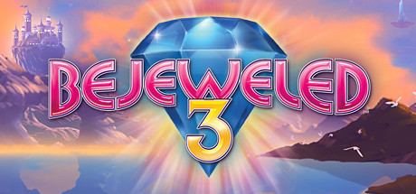

**Platforms:** Windows, macOS &nbsp;|&nbsp; **Genre:** Casual, Strategy &nbsp;|&nbsp; **Released:** December 7

> The biggest, brightest Bejeweled ever! Discover all-new ways to play the world’s #1 puzzle game. Find your perfect match with 8 breathtaking game modes that meet all your moods.
>
> _Synopsis source: Steam_

[Wikipedia](https://en.wikipedia.org/wiki/Bejeweled_3) · [Steam](https://store.steampowered.com/app/78000)

---

### Bejeweled Blitz

**Platforms:** Windows, macOS, iOS, Facebook, Android &nbsp;|&nbsp; **Developer:** PopCap Games &nbsp;|&nbsp; **Publisher:** Electronic Arts &nbsp;|&nbsp; **Genre:** Puzzle &nbsp;|&nbsp; **Released:** April 5, 2010

[Wikipedia](https://en.wikipedia.org/wiki/Bejeweled_Blitz)

---

### Bejeweled Twist

**Platforms:** Nintendo DS &nbsp;|&nbsp; **Released:** January 19

[Wikipedia](https://en.wikipedia.org/wiki/Bejeweled_Twist)

---

### Ben 10 Alien Force: The Rise of Hex

**Platforms:** Xbox 360, Wii &nbsp;|&nbsp; **Released:** May 26

---

### Ben 10 Ultimate Alien: Cosmic Destruction

**Platforms:** Xbox 360, Wii, Nintendo DS, PlayStation 2, PlayStation 3, PlayStation Portable &nbsp;|&nbsp; **Released:** October 5

---

### Ben Jordan: Paranormal Investigator

**Platforms:** Windows &nbsp;|&nbsp; **Developer:** Grundislav Games &nbsp;|&nbsp; **Publisher:** Grundislav Games &nbsp;|&nbsp; **Genre:** Point-and-click adventure &nbsp;|&nbsp; **Released:** March 25, 2010

[Wikipedia](https://en.wikipedia.org/wiki/Ben_Jordan:_Paranormal_Investigator)

---

### Beyblade: Metal Fusion

**Platforms:** Nintendo DS &nbsp;|&nbsp; **Released:** November 9

---

### Beyblade: Metal Fusion – Battle Fortress

**Platforms:** Wii &nbsp;|&nbsp; **Released:** November 9

---

### Beyond Ynth

**Platforms:** iOS, Android &nbsp;|&nbsp; **Developer:** Krabl.com &nbsp;|&nbsp; **Publisher:** FDG Entertainment &nbsp;|&nbsp; **Genre:** Puzzle &nbsp;|&nbsp; **Released:** September 10, 2010

[Wikipedia](https://en.wikipedia.org/wiki/Beyond_Ynth)

---

### BioShock 2

**Platforms:** Windows, Xbox 360, PlayStation 3 &nbsp;|&nbsp; **Genre:** Action &nbsp;|&nbsp; **Released:** February 9

> Set approximately 10 years after the events of the original BioShock, the halls of Rapture once again echo with sins of the past. Along the Atlantic coastline, a monster has been snatching little girls and bringing them back to the undersea city of Rapture.
>
> _Synopsis source: Steam_

[Wikipedia](https://en.wikipedia.org/wiki/BioShock_2) · [Steam](https://store.steampowered.com/app/8850)

---

### BioShock 2: Minerva's Den

**Platforms:** PlayStation 3, Xbox 360 &nbsp;|&nbsp; **Developer:** 2K Marin &nbsp;|&nbsp; **Publisher:** 2K &nbsp;|&nbsp; **Genre:** First-person shooter &nbsp;|&nbsp; **Released:** August 23, 2010

[Wikipedia](https://en.wikipedia.org/wiki/BioShock_2:_Minerva's_Den)

---

### Biozone

**Platforms:** Windows &nbsp;|&nbsp; **Released:** May 7

---

### Bit Pilot

**Platforms:** iOS &nbsp;|&nbsp; **Released:** March 4

[Wikipedia](https://en.wikipedia.org/wiki/Bit_Pilot)

---

### Bit.Trip Beat

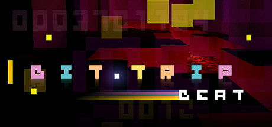

**Platforms:** iOS, Windows, macOS &nbsp;|&nbsp; **Genre:** Action, Casual, Indie &nbsp;|&nbsp; **Released:** September 30

> From gameplay to visuals to music and imagination, BIT.TRIP BEAT is inspired by classic games in every way. Get sucked into a whole new world of sight and sound as you juggle beats and ride the vibe in this modern look at the beginning of it all. BIT.
>
> _Synopsis source: Steam_

[Wikipedia](https://en.wikipedia.org/wiki/Bit.Trip_Beat) · [Steam](https://store.steampowered.com/app/63700)

---

### Bit.Trip Fate

**Platforms:** Wii &nbsp;|&nbsp; **Released:** October 25

[Wikipedia](https://en.wikipedia.org/wiki/Bit.Trip_Fate)

---

### Bit.Trip Runner

**Platforms:** Wii &nbsp;|&nbsp; **Released:** May 17

[Wikipedia](https://en.wikipedia.org/wiki/Bit.Trip_Runner)

---

### Black Sails: The Ghost Ship

**Platforms:** Windows &nbsp;|&nbsp; **Developer:** Deck 13 Interactive &nbsp;|&nbsp; **Publisher:** Astragon Software &nbsp;|&nbsp; **Genre:** Adventure &nbsp;|&nbsp; **Released:** April 22, 2010

[Wikipedia](https://en.wikipedia.org/wiki/Black_Sails:_The_Ghost_Ship)

---

### Blacklight: Tango Down

**Platforms:** Xbox 360, Windows, PlayStation Network &nbsp;|&nbsp; **Released:** July 7

---

### Blade Kitten

**Platforms:** PlayStation Network, Windows, Xbox 360 &nbsp;|&nbsp; **Genre:** Action, Adventure &nbsp;|&nbsp; **Released:** September 22

> In Blade Kitten, join Kit Ballard as she explores the mysterious world of Hollow Wish to hunt down rogue mechs and soft targets.
>
> _Synopsis source: Steam_

[Wikipedia](https://en.wikipedia.org/wiki/Blade_Kitten) · [Steam](https://store.steampowered.com/app/9940)

---

### Blaster Master: Overdrive

**Platforms:** Wii &nbsp;|&nbsp; **Released:** February 8

---

### BlayzBloo: Super Melee Brawlers Battle Royale

**Platforms:** Nintendo DS &nbsp;|&nbsp; **Released:** August 2

---

### BlazBlue: Calamity Trigger Portable

**Platforms:** PlayStation Portable &nbsp;|&nbsp; **Released:** March 9

---

### BlazBlue: Continuum Shift

**Platforms:** PlayStation 3, Xbox 360 &nbsp;|&nbsp; **Released:** July 27

---

### Blaze Union

**Platforms:** PlayStation Portable, Android, iOS &nbsp;|&nbsp; **Developer:** Sting &nbsp;|&nbsp; **Publisher:** Atlus &nbsp;|&nbsp; **Genre:** Tactical role-playing game &nbsp;|&nbsp; **Released:** May 27, 2010

[Wikipedia](https://en.wikipedia.org/wiki/Blaze_Union)

---

### Blazing Souls

**Platforms:** PlayStation Portable &nbsp;|&nbsp; **Released:** October 19

[Wikipedia](https://en.wikipedia.org/wiki/Blazing_Souls)

---

### Blood Drive

**Platforms:** PlayStation 3, Xbox 360 &nbsp;|&nbsp; **Released:** November 2

[Wikipedia](https://en.wikipedia.org/wiki/Blood_Drive_(video_game))

---

### Bloody Good Time

**Platforms:** Windows, Xbox 360 &nbsp;|&nbsp; **Genre:** Action &nbsp;|&nbsp; **Released:** October 28

> Congratulations, you’ve just been cast in your first slasher movie by the notorious Director X!
>
> _Synopsis source: Steam_

[Wikipedia](https://en.wikipedia.org/wiki/Bloody_Good_Time) · [Steam](https://store.steampowered.com/app/2450)

---

### Blue Dragon: Awakened Shadow

**Platforms:** Nintendo DS &nbsp;|&nbsp; **Released:** May 18

---

### Blur

**Platforms:** Windows, Xbox 360, PlayStation 3 &nbsp;|&nbsp; **Genre:** Action, Indie &nbsp;|&nbsp; **Released:** May 25

> Ricochet Blur is a fast-paced top-down shooter where your bullets bounce off walls. Kill all the armed demons and uncover the secrets of the mystery world.
>
> _Synopsis source: Steam_

[Wikipedia](https://en.wikipedia.org/wiki/Blur_(video_game)) · [Steam](https://store.steampowered.com/app/2184260)

---

### Bomberman Live: Battlefest

**Platforms:** Xbox 360 &nbsp;|&nbsp; **Released:** December 8

---

### Borderlands

**Platforms:** macOS &nbsp;|&nbsp; **Released:** December 3

[Wikipedia](https://en.wikipedia.org/wiki/Borderlands_(video_game))

---

### Braveheart

**Platforms:** iOS &nbsp;|&nbsp; **Developer:** Gaijin Entertainment &nbsp;|&nbsp; **Publisher:** Gaijin Entertainment &nbsp;|&nbsp; **Genre:** Action role-playing game &nbsp;|&nbsp; **Released:** December 2, 2010

[Wikipedia](https://en.wikipedia.org/wiki/Braveheart_(2010_video_game))

---

### Breakaway

**Developer:** Emergent Media Center at Champlain College &nbsp;|&nbsp; **Released:** July 2010

[Wikipedia](https://en.wikipedia.org/wiki/Breakaway_(2010_video_game))

---

### Breath of Death VII: The Beginning

**Platforms:** Xbox 360, Windows &nbsp;|&nbsp; **Developer:** Zeboyd Games &nbsp;|&nbsp; **Publisher:** Zeboyd Games &nbsp;|&nbsp; **Genre:** Turn-based role-playing game &nbsp;|&nbsp; **Released:** April 22, 2010

[Wikipedia](https://en.wikipedia.org/wiki/Breath_of_Death_VII:_The_Beginning)

---

### Brothers in Arms 2: Global Front

**Platforms:** iOS &nbsp;|&nbsp; **Developer:** Gameloft Romania &nbsp;|&nbsp; **Publisher:** Gameloft &nbsp;|&nbsp; **Genre:** First-person shooter, action-adventure &nbsp;|&nbsp; **Released:** February 22, 2010

[Wikipedia](https://en.wikipedia.org/wiki/Brothers_in_Arms_2:_Global_Front)

---

### Bubble Ball

**Platforms:** iOS, Android &nbsp;|&nbsp; **Developer:** Robert Nay &nbsp;|&nbsp; **Publisher:** Nay Games &nbsp;|&nbsp; **Genre:** Puzzle &nbsp;|&nbsp; **Released:** December 22, 2010

[Wikipedia](https://en.wikipedia.org/wiki/Bubble_Ball)

---

### Busou Shinki

[Wikipedia](https://en.wikipedia.org/wiki/Busou_Shinki)

---

### Buzz!: The Ultimate Music Quiz

**Platforms:** PlayStation 3 &nbsp;|&nbsp; **Developer:** Relentless Software, Curve Studios &nbsp;|&nbsp; **Publisher:** Sony Computer Entertainment &nbsp;|&nbsp; **Genre:** Party &nbsp;|&nbsp; **Released:** October 22, 2010

[Wikipedia](https://en.wikipedia.org/wiki/Buzz!:_The_Ultimate_Music_Quiz)

---

### Cabela's Dangerous Hunts 2011

**Platforms:** Nintendo DS, PlayStation 3, Xbox 360, Wii, iOS &nbsp;|&nbsp; **Developer:** Cauldron &nbsp;|&nbsp; **Publisher:** Activision &nbsp;|&nbsp; **Genre:** Hunting, action, Survival horror &nbsp;|&nbsp; **Released:** October 26, 2010

[Wikipedia](https://en.wikipedia.org/wiki/Cabela's_Dangerous_Hunts_2011)

---

### Call of Duty: Black Ops

**Platforms:** Xbox 360, PlayStation 3, Wii, Windows &nbsp;|&nbsp; **Genre:** Action &nbsp;|&nbsp; **Released:** November 9

> The biggest first-person action series of all time and the follow-up to critically acclaimed Call of Duty®: Modern Warfare 2 returns with Call of Duty®: Black Ops.
>
> _Synopsis source: Steam_

[Steam](https://store.steampowered.com/app/42700)

---

### Calling

**Platforms:** Wii &nbsp;|&nbsp; **Released:** March 9

[Wikipedia](https://en.wikipedia.org/wiki/Calling_(video_game))

---

### Camp Rock: The Final Jam

**Platforms:** Nintendo DS &nbsp;|&nbsp; **Released:** August 31

---

### Carnivores: Dinosaur Hunter

**Platforms:** iOS, PlayStation Portable, PlayStation 3 &nbsp;|&nbsp; **Developer:** Tatem Games, Beatshapers &nbsp;|&nbsp; **Genre:** First-person shooter &nbsp;|&nbsp; **Released:** June 12, 2010

[Wikipedia](https://en.wikipedia.org/wiki/Carnivores:_Dinosaur_Hunter)

---

### Cart Life

**Platforms:** Windows &nbsp;|&nbsp; **Developer:** Richard Hofmeier &nbsp;|&nbsp; **Publisher:** Adventure Game Studio &nbsp;|&nbsp; **Genre:** Simulation &nbsp;|&nbsp; **Released:** July 29, 2010

[Wikipedia](https://en.wikipedia.org/wiki/Cart_Life)

---

### Casebook

**Platforms:** Windows &nbsp;|&nbsp; **Developer:** Areo Cinematic Games &nbsp;|&nbsp; **Publisher:** Big Fish Games &nbsp;|&nbsp; **Genre:** Interactive movie, Point-and-click adventure &nbsp;|&nbsp; **Released:** July 6, 2010

[Wikipedia](https://en.wikipedia.org/wiki/Casebook_(video_game))

---

### Castle Crashers

**Platforms:** PlayStation 3 &nbsp;|&nbsp; **Released:** August 31

[Wikipedia](https://en.wikipedia.org/wiki/Castle_Crashers)

---

### Castlevania Puzzle: Encore of the Night

**Platforms:** iOS &nbsp;|&nbsp; **Released:** July 21

---

### Castlevania: Harmony of Despair

**Platforms:** Xbox 360 &nbsp;|&nbsp; **Released:** August 4

---

### Castlevania: Lords of Shadow

**Platforms:** Xbox 360, PlayStation 3 &nbsp;|&nbsp; **Released:** October 5

---

### Cause of Death

**Platforms:** iOS, macOS &nbsp;|&nbsp; **Developer:** Centerscore, EA Mobile &nbsp;|&nbsp; **Genre:** Interactive fiction, visual novel &nbsp;|&nbsp; **Released:** December 16, 2010

[Wikipedia](https://en.wikipedia.org/wiki/Cause_of_Death_(video_game))

---

### Cave Story

**Platforms:** Wii, Nintendo DS &nbsp;|&nbsp; **Publisher:** Nicalis &nbsp;|&nbsp; **Released:** March 22, 2010

[Wikipedia](https://en.wikipedia.org/wiki/Cave_Story)

---

### Championship Manager 2011

**Platforms:** iOS &nbsp;|&nbsp; **Developer:** Beautiful Game Studios &nbsp;|&nbsp; **Publisher:** Eidos Interactive &nbsp;|&nbsp; **Genre:** Sports management &nbsp;|&nbsp; **Released:** October 14, 2010

[Wikipedia](https://en.wikipedia.org/wiki/Championship_Manager_2011)

---

### Chaos Rings

**Platforms:** iOS &nbsp;|&nbsp; **Released:** April 10

[Wikipedia](https://en.wikipedia.org/wiki/Chaos_Rings_(video_game))

---

### Chaos;Head Love Chu Chu!

**Platforms:** Xbox 360 &nbsp;|&nbsp; **Developer:** 5pb., Nitroplus &nbsp;|&nbsp; **Publisher:** 5pb. &nbsp;|&nbsp; **Genre:** Visual novel &nbsp;|&nbsp; **Released:** March 25, 2010

[Wikipedia](https://en.wikipedia.org/wiki/Chaos;Head_Love_Chu_Chu!)

---

### Cherry Tree High Comedy Club

**Platforms:** Windows &nbsp;|&nbsp; **Developer:** 773 &nbsp;|&nbsp; **Publisher:** Capcom &nbsp;|&nbsp; **Genre:** Adventure game &nbsp;|&nbsp; **Released:** June 20, 2010

[Wikipedia](https://en.wikipedia.org/wiki/Cherry_Tree_High_Comedy_Club)

---

### Chocobo Panic

[Wikipedia](https://en.wikipedia.org/wiki/Chocobo_Panic)

---

### Chocobo's Crystal Tower

[Wikipedia](https://en.wikipedia.org/wiki/Chocobo's_Crystal_Tower)

---

### Chronos Twins DX

**Platforms:** Wii, Nintendo DS &nbsp;|&nbsp; **Genre:** Action-adventure &nbsp;|&nbsp; **Released:** January 11

[Wikipedia](https://en.wikipedia.org/wiki/Chronos_Twins)

---

### Chu's Dynasty

**Platforms:** Xbox 360 &nbsp;|&nbsp; **Released:** December 10

---

### Cities XL 2011

**Platforms:** Windows &nbsp;|&nbsp; **Developer:** Focus Home Interactive &nbsp;|&nbsp; **Publisher:** Focus Home Interactive &nbsp;|&nbsp; **Genre:** City simulator &nbsp;|&nbsp; **Released:** October 14, 2010

[Wikipedia](https://en.wikipedia.org/wiki/Cities_XL_2011)

---

### CityVille

**Platforms:** Browser, Facebook &nbsp;|&nbsp; **Developer:** Zynga &nbsp;|&nbsp; **Genre:** City-building, construction and management simulation &nbsp;|&nbsp; **Released:** December 2, 2010

[Wikipedia](https://en.wikipedia.org/wiki/CityVille)

---

### Civilization V

**Platforms:** Windows &nbsp;|&nbsp; **Publisher:** 2K &nbsp;|&nbsp; **Genre:** Strategy &nbsp;|&nbsp; **Released:** September 21, 2010

> Create, discover, and download new player-created maps, scenarios, interfaces, and more!
>
> _Synopsis source: Steam_

[Wikipedia](https://en.wikipedia.org/wiki/Civilization_V) · [Steam](https://store.steampowered.com/app/8930)

---

### Cladun: This is an RPG

**Platforms:** PlayStation Portable &nbsp;|&nbsp; **Released:** September 20

---

### Clash of the Titans

**Platforms:** PlayStation 3, Xbox 360 &nbsp;|&nbsp; **Released:** July 27

[Wikipedia](https://en.wikipedia.org/wiki/Clash_of_the_Titans_(video_game))

---

### Clone Wars Adventures

**Platforms:** Windows, macOS &nbsp;|&nbsp; **Developer:** Sony Online Entertainment &nbsp;|&nbsp; **Publisher:** Sony Online Entertainment &nbsp;|&nbsp; **Genre:** Massively multiplayer online, adventure, digital collectible card game &nbsp;|&nbsp; **Released:** September 15, 2010

[Wikipedia](https://en.wikipedia.org/wiki/Clone_Wars_Adventures)

---

### Clones

**Platforms:** Windows &nbsp;|&nbsp; **Developer:** Tomkorp &nbsp;|&nbsp; **Genre:** Puzzle &nbsp;|&nbsp; **Released:** November 18, 2010

[Wikipedia](https://en.wikipedia.org/wiki/Clones_(video_game))

---

### Club Penguin: Elite Penguin Force: Herbert's Revenge

**Platforms:** Nintendo DS &nbsp;|&nbsp; **Released:** May 25

[Wikipedia](https://en.wikipedia.org/wiki/Club_Penguin_(video_game_console_series)#Nintendo_DS)

---

### Club Penguin: Game Day!

**Platforms:** Wii &nbsp;|&nbsp; **Released:** September 21

---

### Colour Cross

**Platforms:** Nintendo DS &nbsp;|&nbsp; **Released:** May 25

[Wikipedia](https://en.wikipedia.org/wiki/Colour_Cross)

---

### Combat of Giants: Dinosaurs

**Platforms:** Wii &nbsp;|&nbsp; **Released:** November 2

---

### Comic Jumper: The Adventures of Captain Smiley

**Platforms:** Xbox 360 &nbsp;|&nbsp; **Released:** October 6

---

### Command & Conquer 4: Tiberian Twilight

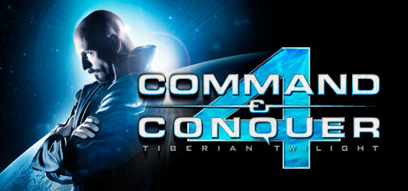

**Platforms:** Windows &nbsp;|&nbsp; **Genre:** Adventure, Strategy &nbsp;|&nbsp; **Released:** March 16

> Level Up For the Epic Conclusion of the Tiberium Saga.
>
> _Synopsis source: Steam_

[Steam](https://store.steampowered.com/app/47700)

---

### Command Ops: Battles from the Bulge

**Platforms:** Windows &nbsp;|&nbsp; **Developer:** Panther Games Pty Ltd &nbsp;|&nbsp; **Publisher:** Matrix Games &nbsp;|&nbsp; **Genre:** Computer Wargame &nbsp;|&nbsp; **Released:** May 26, 2010

[Wikipedia](https://en.wikipedia.org/wiki/Command_Ops:_Battles_from_the_Bulge)

---

### Cosmos X2

**Platforms:** Nintendo DS &nbsp;|&nbsp; **Developer:** Saturnine Games &nbsp;|&nbsp; **Publisher:** Saturnine Games &nbsp;|&nbsp; **Genre:** Shoot 'em up &nbsp;|&nbsp; **Released:** August 30, 2010

[Wikipedia](https://en.wikipedia.org/wiki/Cosmos_X2)

---

### Costume Quest

**Platforms:** PlayStation 3, Xbox 360 &nbsp;|&nbsp; **Developer:** Double Fine Productions &nbsp;|&nbsp; **Publisher:** Double Fine Productions, THQ &nbsp;|&nbsp; **Genre:** Role-playing &nbsp;|&nbsp; **Released:** October 20, 2010

[Wikipedia](https://en.wikipedia.org/wiki/Costume_Quest)

---

### Cow Clicker

**Developer:** Ian Bogost &nbsp;|&nbsp; **Genre:** Incremental &nbsp;|&nbsp; **Released:** July 21, 2010

[Wikipedia](https://en.wikipedia.org/wiki/Cow_Clicker)

---

### Crackdown 2

**Platforms:** Xbox 360 &nbsp;|&nbsp; **Released:** July 6

[Wikipedia](https://en.wikipedia.org/wiki/Crackdown_2)

---

### Crafting Mama

**Platforms:** Nintendo DS &nbsp;|&nbsp; **Released:** October 26

[Wikipedia](https://en.wikipedia.org/wiki/Crafting_Mama)

---

### Crash Bandicoot Nitro Kart 2

**Platforms:** iOS &nbsp;|&nbsp; **Developer:** Polarbit &nbsp;|&nbsp; **Publisher:** Activision &nbsp;|&nbsp; **Genre:** Racing &nbsp;|&nbsp; **Released:** May 27, 2010

[Wikipedia](https://en.wikipedia.org/wiki/Crash_Bandicoot_Nitro_Kart_2)

---

### Crash Team Racing

**Platforms:** PlayStation Network &nbsp;|&nbsp; **Released:** August 10

[Wikipedia](https://en.wikipedia.org/wiki/Crash_Team_Racing)

---

### Crazy Taxi

**Platforms:** PlayStation Network &nbsp;|&nbsp; **Released:** November 16

[Wikipedia](https://en.wikipedia.org/wiki/Crazy_Taxi_(video_game))

---

### Create

**Platforms:** PlayStation 3, Wii, Windows, Xbox 360 &nbsp;|&nbsp; **Genre:** Casual, Indie &nbsp;|&nbsp; **Released:** November 16

> Gain experience and level up in this voxel sandbox world as you travel through space and time. Craft equipment and recipes to help you survive the treacherous landscape and sculpt it into your own masterpiece!
>
> _Synopsis source: Steam_

[Wikipedia](https://en.wikipedia.org/wiki/Create_(video_game)) · [Steam](https://store.steampowered.com/app/1744350)

---

### Creebies

**Platforms:** Mobile phone &nbsp;|&nbsp; **Developer:** Gameware Development &nbsp;|&nbsp; **Publisher:** Nokia Games Publishing &nbsp;|&nbsp; **Genre:** Life simulation, Virtual pet &nbsp;|&nbsp; **Released:** March 26, 2010

[Wikipedia](https://en.wikipedia.org/wiki/Creebies)

---

### Crime Lab: Body of Evidence

**Platforms:** Nintendo DS &nbsp;|&nbsp; **Developer:** City Interactive &nbsp;|&nbsp; **Publisher:** City Interactive &nbsp;|&nbsp; **Genre:** Adventure &nbsp;|&nbsp; **Released:** October 1, 2010

[Wikipedia](https://en.wikipedia.org/wiki/Crime_Lab:_Body_of_Evidence)

---

### Crime Scene

**Platforms:** Nintendo DS &nbsp;|&nbsp; **Released:** February 16

[Wikipedia](https://en.wikipedia.org/wiki/Crime_Scene_(video_game))

---

### Criminal Girls: Invite Only

**Platforms:** PlayStation Portable &nbsp;|&nbsp; **Developer:** Imageepoch &nbsp;|&nbsp; **Publisher:** Nippon Ichi Software &nbsp;|&nbsp; **Genre:** Role-playing &nbsp;|&nbsp; **Released:** November 18, 2010

[Wikipedia](https://en.wikipedia.org/wiki/Criminal_Girls:_Invite_Only)

---

### Crimson Gem Saga

**Platforms:** iOS &nbsp;|&nbsp; **Released:** August 3

[Wikipedia](https://en.wikipedia.org/wiki/Crimson_Gem_Saga)

---

### Cross Days

[Wikipedia](https://en.wikipedia.org/wiki/Cross_Days)

---

### Crystal Monsters

**Platforms:** Nintendo DS &nbsp;|&nbsp; **Released:** July 26

[Wikipedia](https://en.wikipedia.org/wiki/Crystal_Monsters)

---

### CSI: Crime City

**Platforms:** Facebook &nbsp;|&nbsp; **Developer:** Area/Code &nbsp;|&nbsp; **Publisher:** Ubisoft &nbsp;|&nbsp; **Genre:** Adventure &nbsp;|&nbsp; **Released:** October 20, 2010

[Wikipedia](https://en.wikipedia.org/wiki/CSI:_Crime_City)

---

### CSI: Fatal Conspiracy

**Platforms:** Windows, PlayStation 3, Xbox 360, Wii &nbsp;|&nbsp; **Developer:** Telltale Games &nbsp;|&nbsp; **Publisher:** Ubisoft &nbsp;|&nbsp; **Genre:** Adventure &nbsp;|&nbsp; **Released:** October 26, 2010

[Wikipedia](https://en.wikipedia.org/wiki/CSI:_Fatal_Conspiracy)

---

### CSI: Unsolved

**Platforms:** Nintendo DS &nbsp;|&nbsp; **Released:** November 23

---

### Cthulhu Saves the World

**Platforms:** Xbox 360, Windows &nbsp;|&nbsp; **Developer:** Zeboyd Games &nbsp;|&nbsp; **Publisher:** Zeboyd Games &nbsp;|&nbsp; **Genre:** Turn-based role-playing video game

[Wikipedia](https://en.wikipedia.org/wiki/Cthulhu_Saves_the_World)

---

### Cubixx

**Platforms:** PlayStation Portable &nbsp;|&nbsp; **Released:** June 8

---

### Cut the Rope

**Platforms:** iOS &nbsp;|&nbsp; **Released:** October 6

[Wikipedia](https://en.wikipedia.org/wiki/Cut_the_Rope_(video_game))

---

### Dance Central

**Platforms:** Xbox 360 &nbsp;|&nbsp; **Developer:** Harmonix &nbsp;|&nbsp; **Publisher:** MTV Games &nbsp;|&nbsp; **Genre:** Rhythm &nbsp;|&nbsp; **Released:** November 4, 2010

[Wikipedia](https://en.wikipedia.org/wiki/Dance_Central_(2010_video_game))

---

### Dance Dance Revolution

**Platforms:** Wii, PlayStation 3 &nbsp;|&nbsp; **Developer:** Hudson Soft, Studio ZAN &nbsp;|&nbsp; **Publisher:** Konami &nbsp;|&nbsp; **Genre:** Music, Exercise &nbsp;|&nbsp; **Released:** November 16, 2010

[Wikipedia](https://en.wikipedia.org/wiki/Dance_Dance_Revolution_(2010_video_game))

---

### Dance Evolution

**Platforms:** Xbox 360 &nbsp;|&nbsp; **Released:** November 4

[Wikipedia](https://en.wikipedia.org/wiki/Dance_Evolution)

---

### Dance Masters

**Platforms:** Xbox 360 &nbsp;|&nbsp; **Developer:** Bemani &nbsp;|&nbsp; **Publisher:** Konami &nbsp;|&nbsp; **Genre:** Music, rhythm, exercise &nbsp;|&nbsp; **Released:** November 4, 2010

[Wikipedia](https://en.wikipedia.org/wiki/Dance_Masters)

---

### Dance on Broadway

**Platforms:** Wii &nbsp;|&nbsp; **Released:** June 15

[Wikipedia](https://en.wikipedia.org/wiki/Dance_on_Broadway)

---

### Danganronpa: Trigger Happy Havoc

**Platforms:** PlayStation Portable &nbsp;|&nbsp; **Developer:** Spike &nbsp;|&nbsp; **Publisher:** Spike &nbsp;|&nbsp; **Genre:** Adventure, visual novel &nbsp;|&nbsp; **Released:** November 25, 2010

[Wikipedia](https://en.wikipedia.org/wiki/Danganronpa:_Trigger_Happy_Havoc)

---

### Daniel X: The Ultimate Power

**Platforms:** Nintendo DS &nbsp;|&nbsp; **Genre:** Platformer &nbsp;|&nbsp; **Released:** January 12

[Wikipedia](https://en.wikipedia.org/wiki/Griptonite_Games#Games)

---

### Dante's Inferno

**Platforms:** PlayStation 3, Xbox 360, PlayStation Portable &nbsp;|&nbsp; **Released:** February 9

[Wikipedia](https://en.wikipedia.org/wiki/Dante%27s_Inferno_(video_game))

---

### Dark Void

**Platforms:** Windows, Xbox 360, PlayStation 3 &nbsp;|&nbsp; **Genre:** Action, Indie &nbsp;|&nbsp; **Released:** January 19

> Dark Side Void is a 2D side-scrolling mecha action game set in space. Scarred by devastating interstellar wars, the Solar System is riddled with hidden dangers across its cosmic frontiers. Pilot your fully armed combat mech and embark on a cosmic journey packed with fierce mecha battles.
>
> _Synopsis source: Steam_

[Wikipedia](https://en.wikipedia.org/wiki/Dark_Void) · [Steam](https://store.steampowered.com/app/4770970)

---

### Dark Void Zero

**Platforms:** iOS, Windows &nbsp;|&nbsp; **Released:** April 12

[Wikipedia](https://en.wikipedia.org/wiki/Dark_Void_Zero)

---

### Darkness Within 2: The Dark Lineage

**Platforms:** Windows &nbsp;|&nbsp; **Developer:** Zoetrope Interactive &nbsp;|&nbsp; **Publisher:** Iceberg Interactive &nbsp;|&nbsp; **Genre:** Adventure &nbsp;|&nbsp; **Released:** May 28, 2010

[Wikipedia](https://en.wikipedia.org/wiki/Darkness_Within_2:_The_Dark_Lineage)

---

### Darksiders

**Platforms:** Windows, PlayStation 3, Xbox 360 &nbsp;|&nbsp; **Genre:** Action-adventure, Hack and slash &nbsp;|&nbsp; **Released:** January 5

> The legendary saga of the Four Horsemen continues in Darksiders 4, an all-new action-adventure set in an apocalyptic version of earth and continues where the original Darksiders game left off.
>
> _Synopsis source: Steam_

[Wikipedia](https://en.wikipedia.org/wiki/Darksiders) · [Steam](https://store.steampowered.com/app/1203170)

---

### Darkstar: The Interactive Movie

**Platforms:** macOS, Windows &nbsp;|&nbsp; **Developer:** Parallax Studio &nbsp;|&nbsp; **Publisher:** Parallax Studio, Lace Mamba Global &nbsp;|&nbsp; **Genre:** Interactive movie &nbsp;|&nbsp; **Released:** November 5, 2010

[Wikipedia](https://en.wikipedia.org/wiki/Darkstar:_The_Interactive_Movie)

---

### Data East Arcade Classics

**Platforms:** Wii &nbsp;|&nbsp; **Released:** February 19

[Wikipedia](https://en.wikipedia.org/wiki/Data_East_Arcade_Classics)

---

### Date Warp

**Platforms:** Windows, macOS, Linux &nbsp;|&nbsp; **Developer:** Spiky Caterpillar, Hanako Games &nbsp;|&nbsp; **Publisher:** Hanako Games &nbsp;|&nbsp; **Genre:** Visual novel &nbsp;|&nbsp; **Released:** May 22, 2010

[Wikipedia](https://en.wikipedia.org/wiki/Date_Warp)

---

### Dead Nation

**Platforms:** PlayStation Network &nbsp;|&nbsp; **Released:** November 30

[Wikipedia](https://en.wikipedia.org/wiki/Dead_Nation)

---

### Dead or Alive Paradise

**Platforms:** PlayStation Portable &nbsp;|&nbsp; **Released:** March 30

[Wikipedia](https://en.wikipedia.org/wiki/Dead_or_Alive_Paradise)

---

### Dead Rising 2

**Platforms:** Windows, PlayStation 3, Xbox 360 &nbsp;|&nbsp; **Genre:** Action, Adventure &nbsp;|&nbsp; **Released:** September 28

> The sequel to the million-plus selling Dead Rising, Dead Rising 2 takes the zombie survival horror to Fortune City, America’s latest and greatest entertainment playground.
>
> _Synopsis source: Steam_

[Wikipedia](https://en.wikipedia.org/wiki/Dead_Rising_2) · [Steam](https://store.steampowered.com/app/45740)

---

### Dead Rising Mobile

**Platforms:** iOS &nbsp;|&nbsp; **Released:** December 9

[Wikipedia](https://en.wikipedia.org/wiki/Dead_Rising#Mobile_phone_versions)

---

### Dead Space Ignition

**Platforms:** PlayStation Network, Xbox 360 &nbsp;|&nbsp; **Released:** October 12

[Wikipedia](https://en.wikipedia.org/wiki/Dead_Space_Ignition)

---

### Dead to Rights: Retribution

**Platforms:** Xbox 360, PlayStation 3 &nbsp;|&nbsp; **Released:** April 27

---

### Deadliest Warrior: The Game

**Platforms:** Xbox 360, PlayStation Network &nbsp;|&nbsp; **Released:** July 14

---

### Deadly Premonition

**Platforms:** Xbox 360 &nbsp;|&nbsp; **Released:** February 17

[Wikipedia](https://en.wikipedia.org/wiki/Deadly_Premonition)

---

### Deadstorm Pirates

**Platforms:** Arcade, PlayStation 3 &nbsp;|&nbsp; **Developer:** Namco Bandai Games, Nex Entertainment &nbsp;|&nbsp; **Publisher:** Namco Bandai Games, Sony Computer Entertainment &nbsp;|&nbsp; **Genre:** Rail shooter &nbsp;|&nbsp; **Released:** April 2010

[Wikipedia](https://en.wikipedia.org/wiki/Deadstorm_Pirates)

---

### Deadtime Stories

**Platforms:** Windows &nbsp;|&nbsp; **Developer:** I-play &nbsp;|&nbsp; **Publisher:** Big Fish Games &nbsp;|&nbsp; **Genre:** Hidden object game

[Wikipedia](https://en.wikipedia.org/wiki/Deadtime_Stories_(video_game))

---

### Death By Cube

**Platforms:** Xbox 360 &nbsp;|&nbsp; **Developer:** Premium Agency &nbsp;|&nbsp; **Publisher:** Square Enix &nbsp;|&nbsp; **Genre:** Multidirectional shooter &nbsp;|&nbsp; **Released:** January 20, 2010

[Wikipedia](https://en.wikipedia.org/wiki/Death_By_Cube)

---

### Deathsmiles

**Platforms:** Xbox 360 &nbsp;|&nbsp; **Released:** June 29

[Wikipedia](https://en.wikipedia.org/wiki/Deathsmiles)

---

### DeathSpank

**Platforms:** PlayStation Network, Xbox 360, Windows &nbsp;|&nbsp; **Genre:** Action, Indie, RPG &nbsp;|&nbsp; **Released:** July 13

> For uncounted years, DeathSpank has been a Dispenser of Justice, a Vanquisher of Evil, and a Hero to the Downtrodden.
>
> _Synopsis source: Steam_

[Wikipedia](https://en.wikipedia.org/wiki/DeathSpank) · [Steam](https://store.steampowered.com/app/18040)

---

### DeathSpank: Thongs of Virtue

**Platforms:** PlayStation Network, Xbox 360 &nbsp;|&nbsp; **Released:** September 21

---

### Deca Sports 3

**Platforms:** Wii &nbsp;|&nbsp; **Released:** October 26

[Wikipedia](https://en.wikipedia.org/wiki/Deca_Sports#Sequels)

---

### Deca Sports DS

**Platforms:** Nintendo DS &nbsp;|&nbsp; **Released:** March 2

[Wikipedia](https://en.wikipedia.org/wiki/Deca_Sports_DS)

---

### Def Jam Rapstar

**Platforms:** Xbox 360, PlayStation 3, Wii &nbsp;|&nbsp; **Released:** October 5

[Wikipedia](https://en.wikipedia.org/wiki/Def_Jam_Rapstar)

---

### Dementium II

**Platforms:** Nintendo DS &nbsp;|&nbsp; **Released:** May 4

[Wikipedia](https://en.wikipedia.org/wiki/Dementium_II)

---

### Despicable Me: Minion Mania

**Platforms:** iOS &nbsp;|&nbsp; **Released:** June 28

[Wikipedia](https://en.wikipedia.org/wiki/Despicable_Me#Video_games)

---

### Despicable Me: Minion Mayhem

**Platforms:** Nintendo DS &nbsp;|&nbsp; **Released:** July 6

[Wikipedia](https://en.wikipedia.org/wiki/Despicable_Me)

---

### Despicable Me: The Game

**Platforms:** PlayStation 2, PlayStation Portable, Wii, Nintendo DS &nbsp;|&nbsp; **Developer:** Vicious Cycle Software, Wayforward Technologies &nbsp;|&nbsp; **Publisher:** D3 Publisher, Namco Bandai Games &nbsp;|&nbsp; **Genre:** Platformer &nbsp;|&nbsp; **Released:** July 6, 2010

[Wikipedia](https://en.wikipedia.org/wiki/Despicable_Me:_The_Game)

---

### Digimon Story Lost Evolution

**Platforms:** Nintendo DS &nbsp;|&nbsp; **Developer:** BEC &nbsp;|&nbsp; **Publisher:** Bandai Namco Games &nbsp;|&nbsp; **Genre:** Role-playing, simulation &nbsp;|&nbsp; **Released:** July 1, 2010

[Wikipedia](https://en.wikipedia.org/wiki/Digimon_Story_Lost_Evolution)

---

### Digital: A Love Story

**Platforms:** Windows, macOS, Linux &nbsp;|&nbsp; **Developer:** Love Conquers All Games &nbsp;|&nbsp; **Genre:** Visual novel &nbsp;|&nbsp; **Released:** February 2010

[Wikipedia](https://en.wikipedia.org/wiki/Digital:_A_Love_Story)

---

### Din's Curse

**Platforms:** Windows, macOS, Linux &nbsp;|&nbsp; **Developer:** Soldak Entertainment &nbsp;|&nbsp; **Publisher:** Soldak Entertainment, Masque Publishing &nbsp;|&nbsp; **Genre:** Action role-playing &nbsp;|&nbsp; **Released:** March 31, 2010

[Wikipedia](https://en.wikipedia.org/wiki/Din's_Curse)

---

### Diner Dash 5: Boom!

**Platforms:** Windows, macOS &nbsp;|&nbsp; **Developer:** PlayFirst &nbsp;|&nbsp; **Publisher:** PlayFirst, KatGames, Big Splash Games LLC &nbsp;|&nbsp; **Genre:** Strategy &nbsp;|&nbsp; **Released:** March 16, 2010

[Wikipedia](https://en.wikipedia.org/wiki/Diner_Dash_5:_Boom!)

---

### Dinner Date

**Platforms:** Windows &nbsp;|&nbsp; **Developer:** Stout Games, Jeroen D. Stout &nbsp;|&nbsp; **Genre:** Casual &nbsp;|&nbsp; **Released:** November 17, 2010

[Wikipedia](https://en.wikipedia.org/wiki/Dinner_Date_(video_game))

---

### Disc Drivin'

**Platforms:** iOS &nbsp;|&nbsp; **Developer:** Pixelocity Software &nbsp;|&nbsp; **Released:** December 13, 2010

[Wikipedia](https://en.wikipedia.org/wiki/Disc_Drivin')

---

### Disgaea Infinite

**Platforms:** PlayStation Portable &nbsp;|&nbsp; **Released:** June 8

[Wikipedia](https://en.wikipedia.org/wiki/Disgaea_Infinite)

---

### Disney Channel All Star Party

**Platforms:** Wii &nbsp;|&nbsp; **Released:** October 26

[Wikipedia](https://en.wikipedia.org/wiki/Disney_Channel_All_Star_Party)

---

### Disney Fairies: Tinker Bell and the Great Fairy Rescue

**Platforms:** Nintendo DS &nbsp;|&nbsp; **Released:** September 21

---

### Disney Sing It: Family Hits

**Platforms:** PlayStation 3, Wii &nbsp;|&nbsp; **Developer:** Zoë Mode &nbsp;|&nbsp; **Publisher:** Disney Interactive Studios &nbsp;|&nbsp; **Genre:** Karaoke &nbsp;|&nbsp; **Released:** August 3, 2010

[Wikipedia](https://en.wikipedia.org/wiki/Disney_Sing_It:_Family_Hits)

---

### Disney Sing It: Party Hits

**Platforms:** PlayStation 3, Wii &nbsp;|&nbsp; **Developer:** Zoë Mode &nbsp;|&nbsp; **Publisher:** Disney Interactive Studios &nbsp;|&nbsp; **Genre:** Karaoke &nbsp;|&nbsp; **Released:** September 24, 2010

[Wikipedia](https://en.wikipedia.org/wiki/Disney_Sing_It:_Party_Hits)

---

### Disney Stitch Jam

**Platforms:** Nintendo DS &nbsp;|&nbsp; **Released:** March 23

[Wikipedia](https://en.wikipedia.org/wiki/Disney_Stitch_Jam)

---

### Distant Worlds

**Platforms:** Windows &nbsp;|&nbsp; **Developer:** Code Force &nbsp;|&nbsp; **Publisher:** Matrix Games &nbsp;|&nbsp; **Genre:** 4X &nbsp;|&nbsp; **Released:** March 25, 2010

[Wikipedia](https://en.wikipedia.org/wiki/Distant_Worlds_(video_game))

---

### Dive: The Medes Islands Secret

**Platforms:** Wii &nbsp;|&nbsp; **Developer:** Cosmonaut Games, Over the Top Games &nbsp;|&nbsp; **Publisher:** Cosmonaut Games, 46 To Shinjuku Medialab, S.L. &nbsp;|&nbsp; **Genre:** Platform, adventure &nbsp;|&nbsp; **Released:** July 26, 2010

[Wikipedia](https://en.wikipedia.org/wiki/Dive:_The_Medes_Islands_Secret)

---

### Divinity II: Ego Draconis

**Platforms:** Windows, Xbox 360 &nbsp;|&nbsp; **Genre:** Action RPG &nbsp;|&nbsp; **Released:** January 5

[Wikipedia](https://en.wikipedia.org/wiki/Divinity_II)

---

### Dizzypad

[Wikipedia](https://en.wikipedia.org/wiki/Dizzypad)

---

### DJ Hero 2

**Platforms:** Xbox 360, PlayStation 3, Wii &nbsp;|&nbsp; **Released:** October 19

[Wikipedia](https://en.wikipedia.org/wiki/DJ_Hero_2)

---

### DJ Max Portable 3

**Platforms:** PlayStation Portable, PlayStation Network &nbsp;|&nbsp; **Released:** October 14

[Wikipedia](https://en.wikipedia.org/wiki/DJ_Max_Portable_3)

---

### DJMax Portable Hot Tunes

**Platforms:** PlayStation Portable &nbsp;|&nbsp; **Developer:** Pentavision &nbsp;|&nbsp; **Publisher:** Pentavision &nbsp;|&nbsp; **Genre:** Music video game &nbsp;|&nbsp; **Released:** June 11, 2010

[Wikipedia](https://en.wikipedia.org/wiki/DJMax_Portable_Hot_Tunes)

---

### DJMax Technika 2

**Platforms:** Arcade &nbsp;|&nbsp; **Developer:** Pentavision &nbsp;|&nbsp; **Publisher:** Pentavision &nbsp;|&nbsp; **Genre:** Music video game &nbsp;|&nbsp; **Released:** June 16, 2010

[Wikipedia](https://en.wikipedia.org/wiki/DJMax_Technika_2)

---

### Doctor Who: Evacuation Earth

**Platforms:** Nintendo DS &nbsp;|&nbsp; **Developer:** Asylum Entertainment &nbsp;|&nbsp; **Publisher:** Asylum Entertainment &nbsp;|&nbsp; **Genre:** Adventure, puzzle &nbsp;|&nbsp; **Released:** November 12, 2010

[Wikipedia](https://en.wikipedia.org/wiki/Doctor_Who:_Evacuation_Earth)

---

### Doctor Who: Return to Earth

**Platforms:** Wii &nbsp;|&nbsp; **Developer:** Asylum Entertainment &nbsp;|&nbsp; **Publisher:** Asylum Entertainment &nbsp;|&nbsp; **Genre:** Action-adventure &nbsp;|&nbsp; **Released:** November 19, 2010

[Wikipedia](https://en.wikipedia.org/wiki/Doctor_Who:_Return_to_Earth)

---

### Doctor Who: The Adventure Games

**Platforms:** Windows, macOS &nbsp;|&nbsp; **Developer:** Sumo Digital &nbsp;|&nbsp; **Publisher:** BBC Wales Interactive, Legacy Games &nbsp;|&nbsp; **Genre:** Graphic adventure &nbsp;|&nbsp; **Released:** June 5, 2010

[Wikipedia](https://en.wikipedia.org/wiki/Doctor_Who:_The_Adventure_Games)

---

### Doctor Who: The Adventure Games – City of the Daleks

**Platforms:** Windows &nbsp;|&nbsp; **Released:** July 24

---

### Doctor Who: The Mazes of Time

**Platforms:** iOS, Android &nbsp;|&nbsp; **Developer:** Tag Games &nbsp;|&nbsp; **Publisher:** BBC Worldwide &nbsp;|&nbsp; **Genre:** Adventure/Puzzle &nbsp;|&nbsp; **Released:** December 17, 2010

[Wikipedia](https://en.wikipedia.org/wiki/Doctor_Who:_The_Mazes_of_Time)

---

### Dofus Arena

**Platforms:** Linux, macOS, Windows &nbsp;|&nbsp; **Developer:** Ankama Games &nbsp;|&nbsp; **Genre:** MMORPG &nbsp;|&nbsp; **Released:** March 6, 2010

[Wikipedia](https://en.wikipedia.org/wiki/Dofus_Arena)

---

### Dogfight 1951

**Platforms:** iOS &nbsp;|&nbsp; **Developer:** Treehouse Ltd &nbsp;|&nbsp; **Genre:** Aeroplane dog-fighting &nbsp;|&nbsp; **Released:** July 28, 2010

[Wikipedia](https://en.wikipedia.org/wiki/Dogfight_1951)

---

### Dogfighter

**Platforms:** Windows &nbsp;|&nbsp; **Developer:** Dark Water Studios &nbsp;|&nbsp; **Publisher:** Dark Water Studios &nbsp;|&nbsp; **Genre:** Combat flight simulator, Third-person shooter &nbsp;|&nbsp; **Released:** June 14, 2010

[Wikipedia](https://en.wikipedia.org/wiki/Dogfighter_(2010_video_game))

---

### Donkey Kong Country Returns

**Platforms:** Wii &nbsp;|&nbsp; **Released:** November 21

[Wikipedia](https://en.wikipedia.org/wiki/Donkey_Kong_Country_Returns)

---

### Dood's Big Adventure

**Platforms:** Wii &nbsp;|&nbsp; **Released:** November 14

[Wikipedia](https://en.wikipedia.org/wiki/Dood%27s_Big_Adventure)

---

### Doodle God

**Platforms:** Browser, Android, Bada, BlackBerry OS, iOS, Mobile phone, macOS, Windows Phone &nbsp;|&nbsp; **Developer:** JoyBits &nbsp;|&nbsp; **Genre:** Puzzle &nbsp;|&nbsp; **Released:** June 11, 2010

[Wikipedia](https://en.wikipedia.org/wiki/Doodle_God)

---

### Doom II: No Rest for the Living

[Wikipedia](https://en.wikipedia.org/wiki/Doom_II:_No_Rest_for_the_Living)

---

### Doritos Crash Course

**Platforms:** Xbox 360 &nbsp;|&nbsp; **Released:** December 8

[Wikipedia](https://en.wikipedia.org/wiki/Doritos_Crash_Course)

---

### Double Spoiler

**Platforms:** Windows &nbsp;|&nbsp; **Developer:** Team Shanghai Alice &nbsp;|&nbsp; **Publisher:** Team Shanghai Alice &nbsp;|&nbsp; **Genre:** Shoot 'em up photography &nbsp;|&nbsp; **Released:** March 14, 2010

[Wikipedia](https://en.wikipedia.org/wiki/Double_Spoiler)

---

### Dragon Age: Origins – Awakening

**Platforms:** Windows, Xbox 360, PlayStation 3 &nbsp;|&nbsp; **Released:** March 16

---

### Dragon Age: Origins – Return to Ostagar

**Platforms:** Xbox 360, Windows, PlayStation 3 &nbsp;|&nbsp; **Developer:** BioWare &nbsp;|&nbsp; **Publisher:** Electronic Arts &nbsp;|&nbsp; **Genre:** Role-playing &nbsp;|&nbsp; **Released:** January 13, 2010

[Wikipedia](https://en.wikipedia.org/wiki/Dragon_Age:_Origins_%E2%80%93_Return_to_Ostagar)

---

### Dragon Age: Origins – Ultimate Edition

**Platforms:** PlayStation 3, Windows, Xbox 360 &nbsp;|&nbsp; **Released:** October 25

---

### Dragon Ball Heroes

**Platforms:** Arcade, Nintendo 3DS, Windows &nbsp;|&nbsp; **Developer:** Dimps &nbsp;|&nbsp; **Publisher:** Bandai Namco Entertainment &nbsp;|&nbsp; **Genre:** Digital collectible card game &nbsp;|&nbsp; **Released:** November 11, 2010

[Wikipedia](https://en.wikipedia.org/wiki/Dragon_Ball_Heroes)

---

### Dragon Ball Online

**Platforms:** Windows &nbsp;|&nbsp; **Developer:** NTL Inc., Bird Studio / Shueisha &nbsp;|&nbsp; **Publisher:** CJ Internet Corporation, Shanda Games, Namco Bandai Games, Cayenne Tech &nbsp;|&nbsp; **Genre:** MMORPG &nbsp;|&nbsp; **Released:** February 4, 2010

[Wikipedia](https://en.wikipedia.org/wiki/Dragon_Ball_Online)

---

### Dragon Ball Z: Tenkaichi Tag Team

**Platforms:** PlayStation Portable &nbsp;|&nbsp; **Released:** October 19

---

### Dragon Ball: Origins 2

**Platforms:** Nintendo DS &nbsp;|&nbsp; **Released:** February 11

---

### Dragon Ball: Raging Blast 2

**Platforms:** PlayStation 3, Xbox 360 &nbsp;|&nbsp; **Developer:** Spike &nbsp;|&nbsp; **Publisher:** Namco Bandai Games &nbsp;|&nbsp; **Genre:** Fighting &nbsp;|&nbsp; **Released:** November 2, 2010

[Wikipedia](https://en.wikipedia.org/wiki/Dragon_Ball:_Raging_Blast_2)

---

### Dragon Collection

[Wikipedia](https://en.wikipedia.org/wiki/Dragon_Collection)

---

### Dragon Nest

[Wikipedia](https://en.wikipedia.org/wiki/Dragon_Nest)

---

### Dragon Quest IX: Sentinels of the Starry Skies

**Platforms:** Nintendo DS &nbsp;|&nbsp; **Released:** July 11

---

### Drakensang: The River of Time

**Platforms:** Windows &nbsp;|&nbsp; **Developer:** Radon Labs &nbsp;|&nbsp; **Publisher:** dtp entertainment, THQ &nbsp;|&nbsp; **Genre:** Role-playing &nbsp;|&nbsp; **Released:** February 19, 2010

[Wikipedia](https://en.wikipedia.org/wiki/Drakensang:_The_River_of_Time)

---

### Dream Chronicles: The Book of Air

**Platforms:** Windows &nbsp;|&nbsp; **Released:** June 24

---

### Duck Attack!

**Platforms:** Atari 2600 &nbsp;|&nbsp; **Developer:** Will Nicholes &nbsp;|&nbsp; **Publisher:** AtariAge &nbsp;|&nbsp; **Genre:** Action-adventure &nbsp;|&nbsp; **Released:** July 2010

[Wikipedia](https://en.wikipedia.org/wiki/Duck_Attack!)

---

### Durarara!!

[Wikipedia](https://en.wikipedia.org/wiki/Durarara!!)

---

### Dynasty Warriors: Strikeforce

**Platforms:** Xbox 360, PlayStation 3, PlayStation Portable &nbsp;|&nbsp; **Released:** February 16

---

### EA Sports Active 2

**Platforms:** PlayStation 3, Xbox 360, Wii &nbsp;|&nbsp; **Developer:** EA Canada &nbsp;|&nbsp; **Publisher:** EA Sports &nbsp;|&nbsp; **Genre:** Fitness game &nbsp;|&nbsp; **Released:** November 16, 2010

[Wikipedia](https://en.wikipedia.org/wiki/EA_Sports_Active_2)

---

### EA Sports Active NFL Training Camp

**Platforms:** Wii &nbsp;|&nbsp; **Released:** November 16

[Wikipedia](https://en.wikipedia.org/wiki/EA_Sports_Active_NFL_Training_Camp)

---

### EA Sports MMA

**Platforms:** PlayStation 3, Xbox 360 &nbsp;|&nbsp; **Released:** October 19

[Wikipedia](https://en.wikipedia.org/wiki/EA_Sports_MMA)

---

### Earthworm Jim

**Platforms:** Nintendo DS &nbsp;|&nbsp; **Released:** May 10

[Wikipedia](https://en.wikipedia.org/wiki/Earthworm_Jim_(video_game))

---

### Earthworm Jim HD

**Platforms:** Xbox 360, PlayStation 3, PlayStation Network, Windows Phone &nbsp;|&nbsp; **Developer:** Gameloft &nbsp;|&nbsp; **Publisher:** Gameloft &nbsp;|&nbsp; **Genre:** Platform shoot 'em up &nbsp;|&nbsp; **Released:** June 9, 2010

[Wikipedia](https://en.wikipedia.org/wiki/Earthworm_Jim_HD)

---

### Eat Them!

**Platforms:** PlayStation 3 &nbsp;|&nbsp; **Developer:** FluffyLogic &nbsp;|&nbsp; **Publisher:** Sony Computer Entertainment &nbsp;|&nbsp; **Genre:** Action &nbsp;|&nbsp; **Released:** December 21, 2010

[Wikipedia](https://en.wikipedia.org/wiki/Eat_Them!)

---

### Echochrome II

**Platforms:** PlayStation 3 &nbsp;|&nbsp; **Released:** December 23

[Wikipedia](https://en.wikipedia.org/wiki/Echochrome_II)

---

### echoshift

**Platforms:** PlayStation Portable &nbsp;|&nbsp; **Released:** February 24

[Wikipedia](https://en.wikipedia.org/wiki/Echoshift)

---

### ECrew Development Program

**Platforms:** Nintendo DS &nbsp;|&nbsp; **Developer:** McDonald's &nbsp;|&nbsp; **Publisher:** McDonald's &nbsp;|&nbsp; **Genre:** Education, simulation, quiz

[Wikipedia](https://en.wikipedia.org/wiki/ECrew_Development_Program)

---

### Eden Eternal

**Platforms:** Windows &nbsp;|&nbsp; **Developer:** X-Legend &nbsp;|&nbsp; **Publisher:** Aeria Games &nbsp;|&nbsp; **Genre:** Massively multiplayer online role-playing game &nbsp;|&nbsp; **Released:** October 28, 2010

[Wikipedia](https://en.wikipedia.org/wiki/Eden_Eternal)

---

### Elemental: War of Magic

**Platforms:** Windows &nbsp;|&nbsp; **Released:** August 24

---

### Empire.Kred

[Wikipedia](https://en.wikipedia.org/wiki/Empire.Kred)

---

### Endless Ocean 2: Adventures of the Deep

**Platforms:** Wii &nbsp;|&nbsp; **Released:** February 22

---

### Enslaved: Odyssey to the West

**Platforms:** Xbox 360, PlayStation 3 &nbsp;|&nbsp; **Released:** October 5

---

### Epic Mickey

**Platforms:** Wii &nbsp;|&nbsp; **Released:** November 30

[Wikipedia](https://en.wikipedia.org/wiki/Epic_Mickey)

---

### Eschalon: Book II

**Platforms:** Windows, macOS, Linux &nbsp;|&nbsp; **Genre:** Indie, RPG &nbsp;|&nbsp; **Released:** May 12

> Return to the world of Eschalon in the sequel to 2007's award-winning RPG. The blight of war now threatens all of Eschalon and the only hope for peace lies in the secret of your past. Don't miss this second chapter in the epic Eschalon trilogy given &quot;5 Stars&quot; by RPGWatch and called &quot;immensely appealing&quot; by The...
>
> _Synopsis source: Steam_

[Steam](https://store.steampowered.com/app/25620)

---

### Espgaluda II

**Platforms:** iOS &nbsp;|&nbsp; **Released:** April 10

[Wikipedia](https://en.wikipedia.org/wiki/Espgaluda_II)

---

### EteRNA

[Wikipedia](https://en.wikipedia.org/wiki/EteRNA)

---

### Etrian Odyssey III

**Platforms:** Nintendo DS &nbsp;|&nbsp; **Developer:** Atlus &nbsp;|&nbsp; **Publisher:** Atlus, Atlus USA, Sega &nbsp;|&nbsp; **Genre:** Role-playing, dungeon crawler &nbsp;|&nbsp; **Released:** April 1, 2010

[Wikipedia](https://en.wikipedia.org/wiki/Etrian_Odyssey_III)

---

### Etrian Odyssey III: The Drowned City

**Platforms:** Nintendo DS &nbsp;|&nbsp; **Released:** September 21

---

### EverQuest II: Sentinel's Fate

[Wikipedia](https://en.wikipedia.org/wiki/EverQuest_II:_Sentinel's_Fate)

---

### EverQuest: House of Thule

[Wikipedia](https://en.wikipedia.org/wiki/EverQuest:_House_of_Thule)

---

### Everybody's Tennis Portable

**Platforms:** PlayStation Portable &nbsp;|&nbsp; **Developer:** Clap Hanz &nbsp;|&nbsp; **Publisher:** Sony Computer Entertainment &nbsp;|&nbsp; **Genre:** Sports &nbsp;|&nbsp; **Released:** February 25, 2010

[Wikipedia](https://en.wikipedia.org/wiki/Everybody's_Tennis_Portable)

---

### EyePet

**Platforms:** PlayStation Portable &nbsp;|&nbsp; **Released:** October 1

[Wikipedia](https://en.wikipedia.org/wiki/EyePet)

---

### EyePet: Move Edition

**Platforms:** PlayStation 3 &nbsp;|&nbsp; **Released:** September 18

[Wikipedia](https://en.wikipedia.org/wiki/EyePet)

---

### F1 2010

**Platforms:** Windows, Xbox 360, PlayStation 3 &nbsp;|&nbsp; **Released:** September 22

[Wikipedia](https://en.wikipedia.org/wiki/F1_2010_(video_game))

---

### Fable II: Game of the Year Edition

**Platforms:** Xbox 360 &nbsp;|&nbsp; **Genre:** Action RPG &nbsp;|&nbsp; **Released:** January 5

[Wikipedia](https://en.wikipedia.org/wiki/Fable_II)

---

### Fable III

**Platforms:** Xbox 360 &nbsp;|&nbsp; **Released:** October 26

[Wikipedia](https://en.wikipedia.org/wiki/Fable_III)

---

### Faery: Legends of Avalon

**Platforms:** Xbox 360 &nbsp;|&nbsp; **Developer:** Spiders &nbsp;|&nbsp; **Publisher:** Focus Home Interactive &nbsp;|&nbsp; **Genre:** Role-playing &nbsp;|&nbsp; **Released:** November 10, 2010

[Wikipedia](https://en.wikipedia.org/wiki/Faery:_Legends_of_Avalon)

---

### Fairy Wars

**Platforms:** Windows &nbsp;|&nbsp; **Developer:** Team Shanghai Alice &nbsp;|&nbsp; **Publisher:** Team Shanghai Alice &nbsp;|&nbsp; **Genre:** Shoot 'em up &nbsp;|&nbsp; **Released:** August 14, 2010

[Wikipedia](https://en.wikipedia.org/wiki/Fairy_Wars)

---

### Fallout: New Vegas

**Platforms:** PlayStation 3, Xbox 360, Windows &nbsp;|&nbsp; **Genre:** Action, RPG &nbsp;|&nbsp; **Released:** October 19

> Welcome to Vegas. New Vegas. Enjoy your stay!
>
> _Synopsis source: Steam_

[Steam](https://store.steampowered.com/app/22380)

---

### Family Go-Kart Racing

[Wikipedia](https://en.wikipedia.org/wiki/Family_Go-Kart_Racing)

---

### Fancy Nancy: Tea Party Time

**Platforms:** Nintendo DS &nbsp;|&nbsp; **Released:** September 14

---

### Fast Striker

**Platforms:** Dreamcast, iOS, Neo Geo AES, PlayStation Vita &nbsp;|&nbsp; **Developer:** NG:Dev.Team &nbsp;|&nbsp; **Publisher:** NG:Dev.Team &nbsp;|&nbsp; **Genre:** Scrolling shooter &nbsp;|&nbsp; **Released:** June 30, 2010

[Wikipedia](https://en.wikipedia.org/wiki/Fast_Striker)

---

### Fat Princess: Fistful of Cake

**Platforms:** PlayStation Portable &nbsp;|&nbsp; **Released:** May 4

[Wikipedia](https://en.wikipedia.org/wiki/Fat_Princess)

---

### Ferrari Virtual Academy

**Platforms:** Windows &nbsp;|&nbsp; **Developer:** Kunos Simulazioni &nbsp;|&nbsp; **Publisher:** Scuderia Ferrari &nbsp;|&nbsp; **Genre:** Racing simulation &nbsp;|&nbsp; **Released:** September 9, 2010

[Wikipedia](https://en.wikipedia.org/wiki/Ferrari_Virtual_Academy)

---

### Ferrari: The Race Experience

**Platforms:** PlayStation 3, Wii &nbsp;|&nbsp; **Developer:** Eutechnyx &nbsp;|&nbsp; **Publisher:** System 3 &nbsp;|&nbsp; **Genre:** Racing &nbsp;|&nbsp; **Released:** October 6, 2010

[Wikipedia](https://en.wikipedia.org/wiki/Ferrari:_The_Race_Experience)

---

### Fieldrunners

**Platforms:** Nintendo DS &nbsp;|&nbsp; **Released:** February 8

[Wikipedia](https://en.wikipedia.org/wiki/Fieldrunners)

---

### FIFA 11

**Platforms:** Windows, Xbox 360, Wii, Nintendo DS, PlayStation 2, PlayStation 3, PlayStation Portable &nbsp;|&nbsp; **Released:** September 28

[Wikipedia](https://en.wikipedia.org/wiki/FIFA_11)

---

### FIFA Manager 11

**Platforms:** Windows &nbsp;|&nbsp; **Released:** October 28

[Wikipedia](https://en.wikipedia.org/wiki/FIFA_Manager_11)

---

### FIFA Online

**Platforms:** Windows &nbsp;|&nbsp; **Released:** June 4

[Wikipedia](https://en.wikipedia.org/wiki/FIFA_Online)

---

### FIFA Superstars

**Platforms:** Facebook &nbsp;|&nbsp; **Developer:** Playfish &nbsp;|&nbsp; **Publisher:** Electronic Arts &nbsp;|&nbsp; **Genre:** Sports &nbsp;|&nbsp; **Released:** May 26, 2010

[Wikipedia](https://en.wikipedia.org/wiki/FIFA_Superstars)

---

### Fighters Uncaged

**Platforms:** Xbox 360 &nbsp;|&nbsp; **Developer:** AMA Studios &nbsp;|&nbsp; **Publisher:** Ubisoft &nbsp;|&nbsp; **Genre:** Fighting &nbsp;|&nbsp; **Released:** November 4, 2010

[Wikipedia](https://en.wikipedia.org/wiki/Fighters_Uncaged)

---

### Final Fantasy Dimensions

**Platforms:** Mobile phone &nbsp;|&nbsp; **Developer:** Matrix Software, Square Enix &nbsp;|&nbsp; **Publisher:** Square Enix &nbsp;|&nbsp; **Genre:** Role-playing &nbsp;|&nbsp; **Released:** September 6, 2010

[Wikipedia](https://en.wikipedia.org/wiki/Final_Fantasy_Dimensions)

---

### Final Fantasy XIII

**Platforms:** PlayStation 3, Xbox 360 &nbsp;|&nbsp; **Released:** March 9

[Wikipedia](https://en.wikipedia.org/wiki/Final_Fantasy_XIII)

---

### Final Fantasy XIV

**Platforms:** Windows &nbsp;|&nbsp; **Released:** September 30

[Wikipedia](https://en.wikipedia.org/wiki/Final_Fantasy_XIV_(2010_video_game))

---

### Final Fantasy: The 4 Heroes of Light

**Platforms:** Nintendo DS &nbsp;|&nbsp; **Released:** October 4

---

### Final Fight: Double Impact

**Platforms:** Xbox 360 &nbsp;|&nbsp; **Released:** April 14

---

### Fire Emblem: New Mystery of the Emblem

**Platforms:** Nintendo DS &nbsp;|&nbsp; **Developer:** Intelligent Systems &nbsp;|&nbsp; **Publisher:** Nintendo &nbsp;|&nbsp; **Genre:** Tactical role-playing &nbsp;|&nbsp; **Released:** July 15, 2010

[Wikipedia](https://en.wikipedia.org/wiki/Fire_Emblem:_New_Mystery_of_the_Emblem)

---

### Fireburst

**Platforms:** PlayStation 3 &nbsp;|&nbsp; **Publisher:** IndiePub, Bigben Interactive &nbsp;|&nbsp; **Genre:** Racing &nbsp;|&nbsp; **Released:** April 16, 2010

[Wikipedia](https://en.wikipedia.org/wiki/Fireburst)

---

### Fish Tank

**Platforms:** PlayStation Portable, iOS, Wii &nbsp;|&nbsp; **Developer:** iFun4all &nbsp;|&nbsp; **Genre:** Puzzle

[Wikipedia](https://en.wikipedia.org/wiki/Fish_Tank_(video_game))

---

### FishVille

**Platforms:** Browser &nbsp;|&nbsp; **Developer:** Zynga &nbsp;|&nbsp; **Genre:** Simulation

[Wikipedia](https://en.wikipedia.org/wiki/FishVille)

---

### Fist of the North Star: Ken's Rage

**Platforms:** PlayStation 3, Xbox 360 &nbsp;|&nbsp; **Released:** November 2

---

### Flick Golf!

**Platforms:** iOS &nbsp;|&nbsp; **Developer:** Full Fat &nbsp;|&nbsp; **Genre:** Sports game &nbsp;|&nbsp; **Released:** November 23, 2010

[Wikipedia](https://en.wikipedia.org/wiki/Flick_Golf!)

---

### Flight Control

**Platforms:** Nintendo DS &nbsp;|&nbsp; **Released:** February 22

[Wikipedia](https://en.wikipedia.org/wiki/Flight_Control_(video_game))

---

### Flight of the Icarus

**Platforms:** Windows, macOS, Linux, Browser &nbsp;|&nbsp; **Developer:** Muse Games &nbsp;|&nbsp; **Genre:** Strategy, first-person shooter &nbsp;|&nbsp; **Released:** April 11, 2010

[Wikipedia](https://en.wikipedia.org/wiki/Flight_of_the_Icarus)

---

### FlingSmash

**Platforms:** Wii &nbsp;|&nbsp; **Developer:** Artoon &nbsp;|&nbsp; **Publisher:** Nintendo &nbsp;|&nbsp; **Genre:** Action &nbsp;|&nbsp; **Released:** November 7, 2010

[Wikipedia](https://en.wikipedia.org/wiki/FlingSmash)

---

### Flip's Twisted World

**Platforms:** Wii &nbsp;|&nbsp; **Released:** October 19

[Wikipedia](https://en.wikipedia.org/wiki/Flip%27s_Twisted_World)

---

### Florist Shop

**Platforms:** Nintendo DS &nbsp;|&nbsp; **Developer:** Teyon &nbsp;|&nbsp; **Publisher:** Rondomedia, UFO Interactive Games &nbsp;|&nbsp; **Genre:** Puzzle &nbsp;|&nbsp; **Released:** June 29, 2010

[Wikipedia](https://en.wikipedia.org/wiki/Florist_Shop)

---

### Flotilla

**Platforms:** Xbox 360, Windows &nbsp;|&nbsp; **Genre:** Adventure, Indie, Strategy &nbsp;|&nbsp; **Released:** March 25

> Lead your orbital battleships to victory in Flotilla! Fight, trade, and explore new planets in your journey through the galaxy. Featuring tactically rich 3D combat, flank and surprise the enemy from any direction. When the dust settles, generate another randomized universe for a brand new adventure!
>
> _Synopsis source: Steam_

[Wikipedia](https://en.wikipedia.org/wiki/Flotilla_(video_game)) · [Steam](https://store.steampowered.com/app/55000)

---

### Fluidity

**Platforms:** Wii &nbsp;|&nbsp; **Released:** December 6

[Wikipedia](https://en.wikipedia.org/wiki/Fluidity_(video_game))

---

### Flux Family Secrets: The Rabbit Hole

**Platforms:** Windows, macOS &nbsp;|&nbsp; **Developer:** Skunk Studios &nbsp;|&nbsp; **Publisher:** Big Fish Games &nbsp;|&nbsp; **Genre:** Puzzle &nbsp;|&nbsp; **Released:** June 11, 2010

[Wikipedia](https://en.wikipedia.org/wiki/Flux_Family_Secrets:_The_Rabbit_Hole)

---

### Football Manager 2011

**Platforms:** Windows &nbsp;|&nbsp; **Released:** November 5

[Wikipedia](https://en.wikipedia.org/wiki/Football_Manager_2011)

---

### Football Manager Handheld 2011

**Platforms:** PlayStation Portable &nbsp;|&nbsp; **Released:** December 6

---

### Fractal

**Platforms:** Windows, macOS &nbsp;|&nbsp; **Developer:** Cipher Prime &nbsp;|&nbsp; **Genre:** Puzzle, strategy &nbsp;|&nbsp; **Released:** May 26, 2010

[Wikipedia](https://en.wikipedia.org/wiki/Fractal_(video_game))

---

### Fragger

**Platforms:** Browser, iOS, Android, Windows Phone, Mobile phone &nbsp;|&nbsp; **Developer:** Harold Brenes, Miniclip.com &nbsp;|&nbsp; **Genre:** Action, Puzzle &nbsp;|&nbsp; **Released:** June 3, 2010

[Wikipedia](https://en.wikipedia.org/wiki/Fragger)

---

### Fragile Dreams: Farewell Ruins of the Moon

**Platforms:** Wii &nbsp;|&nbsp; **Released:** March 16

---

### Freekscape: Escape From Hell

**Platforms:** PlayStation Portable &nbsp;|&nbsp; **Developer:** Kidguru Studios &nbsp;|&nbsp; **Publisher:** Creat Studios &nbsp;|&nbsp; **Genre:** Puzzle-platform &nbsp;|&nbsp; **Released:** April 8, 2010

[Wikipedia](https://en.wikipedia.org/wiki/Freekscape:_Escape_From_Hell)

---

### Fret Nice

**Platforms:** Xbox 360, PlayStation 3, PlayStation Network &nbsp;|&nbsp; **Developer:** Pieces Interactive AB &nbsp;|&nbsp; **Publisher:** Tecmo &nbsp;|&nbsp; **Genre:** Platform game, Music video game &nbsp;|&nbsp; **Released:** February 4, 2010

[Wikipedia](https://en.wikipedia.org/wiki/Fret_Nice)

---

### Frobot

**Platforms:** Wii &nbsp;|&nbsp; **Released:** December 20

[Wikipedia](https://en.wikipedia.org/wiki/Frobot)

---

### Frogatto & Friends

**Developer:** David White &nbsp;|&nbsp; **Genre:** Platform &nbsp;|&nbsp; **Released:** July 13, 2010

[Wikipedia](https://en.wikipedia.org/wiki/Frogatto_&_Friends)

---

### Frogger Returns

**Platforms:** Nintendo DS &nbsp;|&nbsp; **Released:** May 17

[Wikipedia](https://en.wikipedia.org/wiki/Frogger_Returns)

---

### Front Mission Evolved

**Platforms:** Windows, Xbox 360, PlayStation 3 &nbsp;|&nbsp; **Genre:** Action &nbsp;|&nbsp; **Released:** September 28

> Experience piloting and customizing massive armored units called Wanzers while engaging in high-intensity battles driven by a compelling story. The battle begins now!
>
> _Synopsis source: Steam_

[Wikipedia](https://en.wikipedia.org/wiki/Front_Mission_Evolved) · [Steam](https://store.steampowered.com/app/43000)

---

### Fruit Ninja

**Platforms:** iOS &nbsp;|&nbsp; **Released:** April 27

[Wikipedia](https://en.wikipedia.org/wiki/Fruit_Ninja)

---

### Funky Lab Rat

**Platforms:** PlayStation 3 &nbsp;|&nbsp; **Released:** November 24

[Wikipedia](https://en.wikipedia.org/wiki/Funky_Lab_Rat)

---

### Furry Legends

**Platforms:** Wii &nbsp;|&nbsp; **Released:** July 19

[Wikipedia](https://en.wikipedia.org/wiki/Furry_Legends)

---

### Galactic Arms Race

**Platforms:** Windows &nbsp;|&nbsp; **Developer:** Evolutionary Games &nbsp;|&nbsp; **Genre:** Shooter

[Wikipedia](https://en.wikipedia.org/wiki/Galactic_Arms_Race)

---

### Galactic Taz Ball

**Platforms:** Nintendo DS &nbsp;|&nbsp; **Released:** August 10

[Wikipedia](https://en.wikipedia.org/wiki/List_of_Looney_Tunes_video_games)

---

### Galaxy on Fire 2

**Platforms:** iOS, Android, Mobile phone, macOS, Windows &nbsp;|&nbsp; **Developer:** Fishlabs &nbsp;|&nbsp; **Publisher:** Deep Silver &nbsp;|&nbsp; **Genre:** Space trading and combat simulator

[Wikipedia](https://en.wikipedia.org/wiki/Galaxy_on_Fire_2)

---

### Galaxy Racers

**Platforms:** Nintendo DS &nbsp;|&nbsp; **Released:** July 27

---

### Game Party: In Motion

**Platforms:** Xbox 360 &nbsp;|&nbsp; **Released:** November 18

---

### Game Room

**Platforms:** Xbox 360, Windows &nbsp;|&nbsp; **Developer:** Krome Studios &nbsp;|&nbsp; **Publisher:** Microsoft Studios &nbsp;|&nbsp; **Genre:** Various &nbsp;|&nbsp; **Released:** March 24, 2010

[Wikipedia](https://en.wikipedia.org/wiki/Game_Room)

---

### Gamestar Mechanic

[Wikipedia](https://en.wikipedia.org/wiki/Gamestar_Mechanic)

---

### Gangstar 2: Kings of L.A.

**Platforms:** Nintendo DS &nbsp;|&nbsp; **Released:** April 12

---

### Gangstar: Miami Vindication

**Platforms:** iOS, Android, Mobile phone &nbsp;|&nbsp; **Developer:** Gameloft Montreal &nbsp;|&nbsp; **Publisher:** Gameloft &nbsp;|&nbsp; **Genre:** Action-adventure, shooter &nbsp;|&nbsp; **Released:** September 23, 2010

[Wikipedia](https://en.wikipedia.org/wiki/Gangstar:_Miami_Vindication)

---

### Gary Grigsby's War in the East

**Platforms:** Windows &nbsp;|&nbsp; **Developer:** 2 by 3 Games &nbsp;|&nbsp; **Publisher:** Matrix Games &nbsp;|&nbsp; **Genre:** Computer wargame &nbsp;|&nbsp; **Released:** December 7, 2010

[Wikipedia](https://en.wikipedia.org/wiki/Gary_Grigsby's_War_in_the_East)

---

### Geometry Wars: Touch

[Wikipedia](https://en.wikipedia.org/wiki/Geometry_Wars:_Touch)

---

### Geon HD

[Wikipedia](https://en.wikipedia.org/wiki/Geon_HD)

---

### Get Fit with Mel B

**Platforms:** PlayStation 3, Wii, Xbox 360 &nbsp;|&nbsp; **Developer:** Lightning Fish &nbsp;|&nbsp; **Publisher:** Deep Silver, Black Bean Games &nbsp;|&nbsp; **Genre:** Fitness game &nbsp;|&nbsp; **Released:** October 20, 2010

[Wikipedia](https://en.wikipedia.org/wiki/Get_Fit_with_Mel_B)

---

### Ghosts 'n Goblins: Gold Knights II

**Platforms:** iOS &nbsp;|&nbsp; **Released:** November 12

---

### GKART

**Platforms:** Windows &nbsp;|&nbsp; **Developer:** TiMi Studio Group &nbsp;|&nbsp; **Publisher:** Tencent Games, Garena, VNG Games &nbsp;|&nbsp; **Genre:** Racing &nbsp;|&nbsp; **Released:** October 1, 2010

[Wikipedia](https://en.wikipedia.org/wiki/GKART)

---

### Gladiator Begins

**Platforms:** PlayStation Portable &nbsp;|&nbsp; **Released:** September 15

[Wikipedia](https://en.wikipedia.org/wiki/Gladiator_Begins)

---

### Global Agenda

**Platforms:** Windows &nbsp;|&nbsp; **Released:** February 1

[Wikipedia](https://en.wikipedia.org/wiki/Global_Agenda)

---

### Glory of Heracles

**Platforms:** Nintendo DS &nbsp;|&nbsp; **Released:** January 18

[Wikipedia](https://en.wikipedia.org/wiki/Glory_of_Heracles)

---

### God Eater

**Platforms:** PlayStation Portable, PlayStation Vita, Windows &nbsp;|&nbsp; **Developer:** Shift &nbsp;|&nbsp; **Publisher:** Namco Bandai Games, D3 Publisher &nbsp;|&nbsp; **Genre:** Action role-playing &nbsp;|&nbsp; **Released:** February 4, 2010

[Wikipedia](https://en.wikipedia.org/wiki/God_Eater_(video_game))

---

### God of War III

**Platforms:** PlayStation 3 &nbsp;|&nbsp; **Publisher:** Sony Computer Entertainment &nbsp;|&nbsp; **Released:** March 16, 2010

[Wikipedia](https://en.wikipedia.org/wiki/God_of_War_III)

---

### God of War: Ghost of Sparta

**Platforms:** PlayStation Portable &nbsp;|&nbsp; **Released:** November 2

---

### GodFinger

**Platforms:** iOS &nbsp;|&nbsp; **Developer:** Wonderland Software &nbsp;|&nbsp; **Publisher:** ngmoco &nbsp;|&nbsp; **Genre:** God game &nbsp;|&nbsp; **Released:** April 3, 2010

[Wikipedia](https://en.wikipedia.org/wiki/GodFinger)

---

### Godville

[Wikipedia](https://en.wikipedia.org/wiki/Godville)

---

### Golden Sun: Dark Dawn

**Platforms:** Nintendo DS &nbsp;|&nbsp; **Released:** November 29

---

### GoldenEye 007

**Platforms:** Wii, Nintendo DS, PlayStation 3, Xbox 360 &nbsp;|&nbsp; **Developer:** Eurocom, n-Space &nbsp;|&nbsp; **Publisher:** Activision, Nintendo &nbsp;|&nbsp; **Genre:** First-person shooter &nbsp;|&nbsp; **Released:** November 2, 2010

[Wikipedia](https://en.wikipedia.org/wiki/GoldenEye_007_(2010_video_game))

---

### GoldenEye: Source

[Wikipedia](https://en.wikipedia.org/wiki/GoldenEye:_Source)

---

### Gran Turismo 5

**Platforms:** PlayStation 3 &nbsp;|&nbsp; **Released:** November 24

[Wikipedia](https://en.wikipedia.org/wiki/Gran_Turismo_5)

---

### Grand Theft Auto: Chinatown Wars Mobile

**Platforms:** iOS &nbsp;|&nbsp; **Released:** January 17

---

### Grand Theft Auto: Episodes from Liberty City

**Platforms:** PlayStation 3, Windows &nbsp;|&nbsp; **Genre:** Action &nbsp;|&nbsp; **Released:** April 13

> Grand Theft Auto: Episodes from Liberty City includes both The Lost and Damned and The Ballad of Gay Tony together and does not require a copy of the original Grand Theft Auto IV to play.
>
> _Synopsis source: Steam_

[Steam](https://store.steampowered.com/app/12220)

---

### Gravity Crash

**Platforms:** PlayStation Portable &nbsp;|&nbsp; **Released:** July 20

[Wikipedia](https://en.wikipedia.org/wiki/Gravity_Crash)

---

### Gravity Guy

**Platforms:** iOS &nbsp;|&nbsp; **Released:** December 8

[Wikipedia](https://en.wikipedia.org/wiki/Gravity_Guy)

---

### Gravonaut

[Wikipedia](https://en.wikipedia.org/wiki/Gravonaut)

---

### Gray Matter

**Platforms:** Windows &nbsp;|&nbsp; **Genre:** Adventure, Casual &nbsp;|&nbsp; **Released:** May 21

> After a tragic accident, neurobiologist Dr. David Styles has become a recluse, rarely leaving his home, the Dread Hill House. One day, Samantha Everett, a street magician, appears at Dr. Style's doorstep just as he is seeking a new assistant.
>
> _Synopsis source: Steam_

[Wikipedia](https://en.wikipedia.org/wiki/Gray_Matter_(video_game)) · [Steam](https://store.steampowered.com/app/260570)

---

### Grease

**Platforms:** Nintendo DS, Wii &nbsp;|&nbsp; **Released:** August 24

[Wikipedia](https://en.wikipedia.org/wiki/Grease_(video_game))

---

### Greed Corp

**Platforms:** Xbox 360, PlayStation Network, Windows &nbsp;|&nbsp; **Genre:** Strategy &nbsp;|&nbsp; **Released:** February 24

> Turn-based strategy at its finest.
>
> _Synopsis source: Steam_

[Wikipedia](https://en.wikipedia.org/wiki/Greed_Corp) · [Steam](https://store.steampowered.com/app/48950)

---

### Green Day: Rock Band

**Platforms:** Xbox 360, PlayStation 3, Wii &nbsp;|&nbsp; **Released:** June 8

---

### Guardians of Graxia

**Platforms:** Windows &nbsp;|&nbsp; **Developer:** Petroglyph Games &nbsp;|&nbsp; **Publisher:** Petroglyph Games &nbsp;|&nbsp; **Genre:** Turn-based strategy &nbsp;|&nbsp; **Released:** October 2010

[Wikipedia](https://en.wikipedia.org/wiki/Guardians_of_Graxia)

---

### Guilty Party

**Platforms:** Wii &nbsp;|&nbsp; **Developer:** Wideload Games &nbsp;|&nbsp; **Publisher:** Disney Interactive Studios &nbsp;|&nbsp; **Genre:** Party, puzzle &nbsp;|&nbsp; **Released:** August 26, 2010

[Wikipedia](https://en.wikipedia.org/wiki/Guilty_Party_(video_game))

---

### Guitar Hero: Warriors of Rock

**Platforms:** PlayStation 3, Wii, Xbox 360 &nbsp;|&nbsp; **Released:** September 28

---

### Guitar Praise: Stryper

[Wikipedia](https://en.wikipedia.org/wiki/Guitar_Praise:_Stryper)

---

### GuJian

**Platforms:** Windows &nbsp;|&nbsp; **Developer:** Aurogon &nbsp;|&nbsp; **Publisher:** Gamebar, Typhoon Games, Interwise &nbsp;|&nbsp; **Genre:** Turn-based role-playing &nbsp;|&nbsp; **Released:** July 10, 2010

[Wikipedia](https://en.wikipedia.org/wiki/GuJian)

---

### Gundemonium Collection

[Wikipedia](https://en.wikipedia.org/wiki/Gundemonium_Collection)

---

### Guwange

**Platforms:** Xbox 360 &nbsp;|&nbsp; **Released:** November 10

[Wikipedia](https://en.wikipedia.org/wiki/Guwange)

---

### Halo 2600

**Platforms:** Atari 2600 &nbsp;|&nbsp; **Publisher:** AtariAge &nbsp;|&nbsp; **Genre:** Action-adventure &nbsp;|&nbsp; **Released:** July 2010

[Wikipedia](https://en.wikipedia.org/wiki/Halo_2600)

---

### Halo: Reach

**Platforms:** Xbox 360 &nbsp;|&nbsp; **Publisher:** Microsoft Game Studios &nbsp;|&nbsp; **Released:** September 14, 2010

---

### Hamlet

**Platforms:** Windows &nbsp;|&nbsp; **Developer:** Denis Galanin &nbsp;|&nbsp; **Publisher:** Denis Galanin, Big Fish Games, Alawar Entertainment &nbsp;|&nbsp; **Genre:** Adventure, puzzle &nbsp;|&nbsp; **Released:** April 8, 2010

[Wikipedia](https://en.wikipedia.org/wiki/Hamlet_(video_game))

---

### Happy Wheels

**Platforms:** Windows &nbsp;|&nbsp; **Genre:** Action, Casual, Indie, Racing &nbsp;|&nbsp; **Released:** June 4

> Choose your inadequately prepared racer, and disregard severe consequences in your desperate pursuit of short-lived victory.
>
> _Synopsis source: Steam_

[Wikipedia](https://en.wikipedia.org/wiki/Happy_Wheels) · [Steam](https://store.steampowered.com/app/4705510)

---

### Harms Way

**Platforms:** Xbox 360 &nbsp;|&nbsp; **Released:** December 8

[Wikipedia](https://en.wikipedia.org/wiki/Harms_Way_(video_game))

---

### Harry Potter and the Deathly Hallows – Part 1

**Platforms:** Nintendo DS, Windows, PlayStation 3, Wii, Xbox 360, Mobile phone &nbsp;|&nbsp; **Developer:** EA Bright Light, Full Fat, EA Romania &nbsp;|&nbsp; **Publisher:** Electronic Arts, EA Mobile &nbsp;|&nbsp; **Genre:** Action-adventure &nbsp;|&nbsp; **Released:** November 16, 2010

[Wikipedia](https://en.wikipedia.org/wiki/Harry_Potter_and_the_Deathly_Hallows_%E2%80%93_Part_1_(video_game))

---

### Harry Potter and the Deathly Hallows: Part I

**Platforms:** Windows, Nintendo DS, PlayStation 3, Xbox 360, Wii &nbsp;|&nbsp; **Released:** November 16

---

### Haruka Nogizaka's Secret

[Wikipedia](https://en.wikipedia.org/wiki/Haruka_Nogizaka's_Secret)

---

### Harvest Moon: Hero of Leaf Valley

**Platforms:** PlayStation Portable &nbsp;|&nbsp; **Released:** April 26

---

### Hasbro Family Game Night 3

**Platforms:** PlayStation 3, Wii, Xbox 360 &nbsp;|&nbsp; **Released:** October 26

[Wikipedia](https://en.wikipedia.org/wiki/Hasbro_Family_Game_Night_3)

---

### Hatsune Miku: Project Diva 2nd

**Platforms:** PlayStation Portable, PlayStation 3 &nbsp;|&nbsp; **Developer:** Sega, Crypton Future Media, Dingo &nbsp;|&nbsp; **Publisher:** Sega &nbsp;|&nbsp; **Genre:** Rhythm game &nbsp;|&nbsp; **Released:** July 29, 2010

[Wikipedia](https://en.wikipedia.org/wiki/Hatsune_Miku:_Project_Diva_2nd)

---

### Hatsune Miku: Project Diva Arcade

**Platforms:** Arcade, Windows &nbsp;|&nbsp; **Developer:** Sega AM2 &nbsp;|&nbsp; **Publisher:** Sega, Dwango Music Entertainment &nbsp;|&nbsp; **Genre:** Rhythm game &nbsp;|&nbsp; **Released:** June 23, 2010

[Wikipedia](https://en.wikipedia.org/wiki/Hatsune_Miku:_Project_Diva_Arcade)

---

### Heaven's Lost Property

[Wikipedia](https://en.wikipedia.org/wiki/Heaven's_Lost_Property)

---

### Heavy Rain

**Platforms:** PlayStation 3 &nbsp;|&nbsp; **Released:** February 23

[Wikipedia](https://en.wikipedia.org/wiki/Heavy_Rain)

---

### Hector: Badge of Carnage

**Platforms:** iOS, Windows, macOS &nbsp;|&nbsp; **Developer:** Straandlooper &nbsp;|&nbsp; **Publisher:** Telltale Games &nbsp;|&nbsp; **Genre:** Graphic adventure &nbsp;|&nbsp; **Released:** June 2, 2010

[Wikipedia](https://en.wikipedia.org/wiki/Hector:_Badge_of_Carnage)

---

### Hector: Badge of Carnage (Episode 1)

**Platforms:** iOS &nbsp;|&nbsp; **Released:** June 2

---

### Hegemony Gold: Wars of Ancient Greece

**Platforms:** Windows &nbsp;|&nbsp; **Developer:** Longbow Games &nbsp;|&nbsp; **Publisher:** Longbow Games &nbsp;|&nbsp; **Genre:** Real-time strategy &nbsp;|&nbsp; **Released:** May 11, 2010

[Wikipedia](https://en.wikipedia.org/wiki/Hegemony_Gold:_Wars_of_Ancient_Greece)

---

### Hello Kitty Seasons

**Platforms:** Wii &nbsp;|&nbsp; **Released:** December 7

[Wikipedia](https://en.wikipedia.org/wiki/Hello_Kitty#Video_games)

---

### Hello, Good-bye

[Wikipedia](https://en.wikipedia.org/wiki/Hello,_Good-bye)

---

### Helsing's Fire

**Platforms:** iOS &nbsp;|&nbsp; **Developer:** Ratloop &nbsp;|&nbsp; **Publisher:** Clickgamer.com &nbsp;|&nbsp; **Genre:** Puzzle &nbsp;|&nbsp; **Released:** July 10, 2010

[Wikipedia](https://en.wikipedia.org/wiki/Helsing's_Fire)

---

### Hero Core

**Developer:** Daniel Remar &nbsp;|&nbsp; **Genre:** Shooter, Metroidvania &nbsp;|&nbsp; **Released:** May 3, 2010

[Wikipedia](https://en.wikipedia.org/wiki/Hero_Core)

---

### Hero of Sparta II

**Platforms:** iOS &nbsp;|&nbsp; **Released:** July 29

[Wikipedia](https://en.wikipedia.org/wiki/Hero_of_Sparta_II)

---

### Heroes of Newerth

**Platforms:** Windows, macOS, Linux &nbsp;|&nbsp; **Released:** May 12

[Wikipedia](https://en.wikipedia.org/wiki/Heroes_of_Newerth)

---

### Herotopia

**Platforms:** Browser &nbsp;|&nbsp; **Developer:** Herotainment &nbsp;|&nbsp; **Publisher:** Jagex &nbsp;|&nbsp; **Genre:** MMORPG &nbsp;|&nbsp; **Released:** July 14, 2010

[Wikipedia](https://en.wikipedia.org/wiki/Herotopia)

---

### Hexyz Force

**Platforms:** PlayStation Portable &nbsp;|&nbsp; **Released:** June 2

[Wikipedia](https://en.wikipedia.org/wiki/Hexyz_Force)

---

### Hoard

**Platforms:** PlayStation 3, Linux &nbsp;|&nbsp; **Developer:** Big Sandwich Games Inc. &nbsp;|&nbsp; **Publisher:** Big Sandwich Games Inc. &nbsp;|&nbsp; **Genre:** Action, strategy, shoot 'em up &nbsp;|&nbsp; **Released:** November 2, 2010

[Wikipedia](https://en.wikipedia.org/wiki/Hoard_(video_game))

---

### Homerun Hitters

**Platforms:** PlayStation Network &nbsp;|&nbsp; **Released:** April 22

---

### Hook Worlds

**Platforms:** iOS, Android &nbsp;|&nbsp; **Developer:** Rocketcat Games &nbsp;|&nbsp; **Publisher:** Rocketcat Games &nbsp;|&nbsp; **Genre:** Platform &nbsp;|&nbsp; **Released:** December 16, 2010

[Wikipedia](https://en.wikipedia.org/wiki/Hook_Worlds)

---

### HoopWorld

**Platforms:** Wii &nbsp;|&nbsp; **Developer:** Streamline Studios, Virtual Toys &nbsp;|&nbsp; **Publisher:** Virtual Toys &nbsp;|&nbsp; **Genre:** Arcade Sports &nbsp;|&nbsp; **Released:** July 19, 2010

[Wikipedia](https://en.wikipedia.org/wiki/HoopWorld)

---

### Horse Isle

**Platforms:** Browser &nbsp;|&nbsp; **Developer:** Joe and Miranda Durbin &nbsp;|&nbsp; **Genre:** MMORPG

[Wikipedia](https://en.wikipedia.org/wiki/Horse_Isle_(video_game))

---

### Hoshizora e Kakaru Hashi

[Wikipedia](https://en.wikipedia.org/wiki/Hoshizora_e_Kakaru_Hashi)

---

### Hot Wheels Track Attack

**Platforms:** Nintendo DS, Wii &nbsp;|&nbsp; **Released:** November 23

[Wikipedia](https://en.wikipedia.org/wiki/Hot_Wheels_Track_Attack)

---

### Houthoff Buruma The Game

[Wikipedia](https://en.wikipedia.org/wiki/Houthoff_Buruma_The_Game)

---

### How to Train Your Dragon

**Platforms:** Xbox 360, Nintendo DS, PlayStation 3, Wii &nbsp;|&nbsp; **Released:** March 23

[Wikipedia](https://en.wikipedia.org/wiki/How_to_Train_Your_Dragon_(video_game))

---

### HTR High Tech Racing

**Platforms:** Windows, iOS &nbsp;|&nbsp; **Developer:** QUByte Interactive &nbsp;|&nbsp; **Publisher:** QUByte Interactive &nbsp;|&nbsp; **Genre:** Racing &nbsp;|&nbsp; **Released:** June 24, 2010

[Wikipedia](https://en.wikipedia.org/wiki/HTR_High_Tech_Racing)

---

### Hubert the Teddy Bear: Winter Games

**Platforms:** Wii &nbsp;|&nbsp; **Developer:** Teyon &nbsp;|&nbsp; **Publisher:** Teyon &nbsp;|&nbsp; **Genre:** Sports, Party &nbsp;|&nbsp; **Released:** February 8, 2010

[Wikipedia](https://en.wikipedia.org/wiki/Hubert_the_Teddy_Bear:_Winter_Games)

---

### Huxley

**Platforms:** Windows &nbsp;|&nbsp; **Developer:** Webzen Games Inc. &nbsp;|&nbsp; **Publisher:** Webzen Games Inc., NHN &nbsp;|&nbsp; **Genre:** MMOFPS &nbsp;|&nbsp; **Released:** May 3, 2010

[Wikipedia](https://en.wikipedia.org/wiki/Huxley_(video_game))

---

### Hydro Thunder Hurricane

**Platforms:** Xbox 360 &nbsp;|&nbsp; **Released:** July 28

[Wikipedia](https://en.wikipedia.org/wiki/Hydro_Thunder_Hurricane)

---

### Hydrophobia

**Platforms:** Xbox 360 &nbsp;|&nbsp; **Released:** September 29

[Wikipedia](https://en.wikipedia.org/wiki/Hydrophobia_(video_game))

---

### Hypership Out of Control

**Platforms:** Xbox 360 &nbsp;|&nbsp; **Released:** September 15

[Wikipedia](https://en.wikipedia.org/wiki/Hypership_Out_of_Control)

---

### I Wanna Be the Boshy

[Wikipedia](https://en.wikipedia.org/wiki/I_Wanna_Be_the_Boshy)

---

### IBM CityOne

**Platforms:** Browser &nbsp;|&nbsp; **Developer:** IBM &nbsp;|&nbsp; **Publisher:** IBM &nbsp;|&nbsp; **Genre:** Construction and management simulation games &nbsp;|&nbsp; **Released:** October 4, 2010

[Wikipedia](https://en.wikipedia.org/wiki/IBM_CityOne)

---

### iCarly 2: iJoin the Click!

**Platforms:** Nintendo DS, PlayStation 3, Wii, Xbox 360 &nbsp;|&nbsp; **Released:** November 16

---

### Illusia

**Platforms:** iOS &nbsp;|&nbsp; **Developer:** Gamevil &nbsp;|&nbsp; **Publisher:** Gamevil &nbsp;|&nbsp; **Genre:** Action role-playing game, platformer &nbsp;|&nbsp; **Released:** December 9, 2010

[Wikipedia](https://en.wikipedia.org/wiki/Illusia_(video_game))

---

### Ilomilo

**Platforms:** Windows Phone, Xbox 360 &nbsp;|&nbsp; **Developer:** Southend Interactive, Microsoft Game Studios &nbsp;|&nbsp; **Publisher:** Microsoft Game Studios &nbsp;|&nbsp; **Genre:** Puzzle &nbsp;|&nbsp; **Released:** November 8, 2010

[Wikipedia](https://en.wikipedia.org/wiki/Ilomilo)

---

### In Search of the Lost Future

[Wikipedia](https://en.wikipedia.org/wiki/In_Search_of_the_Lost_Future)

---

### Inazuma Eleven 3

**Platforms:** Nintendo DS &nbsp;|&nbsp; **Developer:** Level-5 &nbsp;|&nbsp; **Publisher:** Level-5, Nintendo &nbsp;|&nbsp; **Genre:** Role-playing, sports &nbsp;|&nbsp; **Released:** July 1, 2010

[Wikipedia](https://en.wikipedia.org/wiki/Inazuma_Eleven_3)

---

### Infinite Space

**Platforms:** Nintendo DS &nbsp;|&nbsp; **Released:** March 16

[Wikipedia](https://en.wikipedia.org/wiki/Infinite_Space)

---

### Infinity Blade

**Platforms:** iOS &nbsp;|&nbsp; **Released:** December 9

[Wikipedia](https://en.wikipedia.org/wiki/Infinity_Blade)

---

### Instant Jam

**Platforms:** Browser &nbsp;|&nbsp; **Developer:** InstantAction &nbsp;|&nbsp; **Genre:** Rhythm game &nbsp;|&nbsp; **Released:** August 16, 2010

[Wikipedia](https://en.wikipedia.org/wiki/Instant_Jam)

---

### International Cricket 2010

**Platforms:** PlayStation 3, Xbox 360 &nbsp;|&nbsp; **Developer:** Trickstar Games &nbsp;|&nbsp; **Publisher:** Codemasters &nbsp;|&nbsp; **Genre:** Sports, Cricket &nbsp;|&nbsp; **Released:** June 18, 2010

[Wikipedia](https://en.wikipedia.org/wiki/International_Cricket_2010)

---

### Invizimals

**Platforms:** PlayStation Portable &nbsp;|&nbsp; **Released:** October 12

[Wikipedia](https://en.wikipedia.org/wiki/Invizimals)

---

### Iro ni Ide ni Keri Waga Koi wa

**Platforms:** Windows &nbsp;|&nbsp; **Developer:** Windmill &nbsp;|&nbsp; **Publisher:** Windmill &nbsp;|&nbsp; **Genre:** Eroge, Visual novel &nbsp;|&nbsp; **Released:** April 29, 2010

[Wikipedia](https://en.wikipedia.org/wiki/Iro_ni_Ide_ni_Keri_Waga_Koi_wa)

---

### Iron Man 2

**Platforms:** PlayStation 3, PlayStation Portable, Xbox 360, Wii, Nintendo DS &nbsp;|&nbsp; **Released:** May 4

[Wikipedia](https://en.wikipedia.org/wiki/Iron_Man_2_(video_game))

---

### Ivy the Kiwi?

**Platforms:** Wii, Nintendo DS &nbsp;|&nbsp; **Released:** August 24

[Wikipedia](https://en.wikipedia.org/wiki/Ivy_the_Kiwi%3F)

---

### J.League Winning Eleven 2010 Club Championship

**Platforms:** PlayStation 2 &nbsp;|&nbsp; **Developer:** Konami &nbsp;|&nbsp; **Publisher:** Konami &nbsp;|&nbsp; **Genre:** Traditional soccer simulation &nbsp;|&nbsp; **Released:** August 5, 2010

[Wikipedia](https://en.wikipedia.org/wiki/J.League_Winning_Eleven_2010_Club_Championship)

---

### James Bond 007: Blood Stone

**Platforms:** Windows, Xbox 360, PlayStation 3, Nintendo DS &nbsp;|&nbsp; **Released:** November 2

---

### Jett Rocket

**Platforms:** Wii &nbsp;|&nbsp; **Released:** June 28

[Wikipedia](https://en.wikipedia.org/wiki/Jett_Rocket)

---

### Jinki: Extend

[Wikipedia](https://en.wikipedia.org/wiki/Jinki:_Extend)

---

### Joe Danger

**Platforms:** PlayStation 3 &nbsp;|&nbsp; **Released:** June 8

[Wikipedia](https://en.wikipedia.org/wiki/Joe_Danger)

---

### Joey Kramer Hit Hard

**Platforms:** iOS &nbsp;|&nbsp; **Developer:** Paid, Inc. &nbsp;|&nbsp; **Genre:** Music &nbsp;|&nbsp; **Released:** February 26, 2010

[Wikipedia](https://en.wikipedia.org/wiki/Joey_Kramer_Hit_Hard)

---

### John Daly's ProStroke Golf

**Platforms:** PlayStation 3, Xbox 360 &nbsp;|&nbsp; **Developer:** Gusto Games &nbsp;|&nbsp; **Publisher:** O-Games &nbsp;|&nbsp; **Genre:** Sports &nbsp;|&nbsp; **Released:** October 5, 2010

[Wikipedia](https://en.wikipedia.org/wiki/John_Daly's_ProStroke_Golf)

---

### Jolly Rover

**Platforms:** OnLive, macOS, Windows &nbsp;|&nbsp; **Developer:** Brawsome &nbsp;|&nbsp; **Publisher:** Brawsome &nbsp;|&nbsp; **Genre:** Graphic adventure &nbsp;|&nbsp; **Released:** June 8, 2010

[Wikipedia](https://en.wikipedia.org/wiki/Jolly_Rover)

---

### Just Cause 2

**Platforms:** Windows, Xbox 360, PlayStation 3 &nbsp;|&nbsp; **Genre:** Action, Adventure &nbsp;|&nbsp; **Released:** March 23

> Dive into an adrenaline-fuelled free-roaming adventure with 400 square miles of rugged terrain and hundreds of weapons and vehicles.
>
> _Synopsis source: Steam_

[Wikipedia](https://en.wikipedia.org/wiki/Just_Cause_2) · [Steam](https://store.steampowered.com/app/8190)

---

### Just Dance 2

**Platforms:** Wii &nbsp;|&nbsp; **Released:** October 12

[Wikipedia](https://en.wikipedia.org/wiki/Just_Dance_2)

---

### Just Dance Kids

**Platforms:** Wii &nbsp;|&nbsp; **Developer:** Land Ho! &nbsp;|&nbsp; **Publisher:** Ubisoft &nbsp;|&nbsp; **Genre:** Music, rhythm &nbsp;|&nbsp; **Released:** November 9, 2010

[Wikipedia](https://en.wikipedia.org/wiki/Just_Dance_Kids_(2010_video_game))

---

### Kane & Lynch 2: Dog Days

**Platforms:** Windows, Xbox 360, PlayStation 3 &nbsp;|&nbsp; **Genre:** Action &nbsp;|&nbsp; **Released:** August 17

> Pure adrenaline of non-stop action in Single Player, Online Co-op and Multiplayer. Double the pleasure and mayhem with new multiplayer DLCs! (click for details)
>
> _Synopsis source: Steam_

[Steam](https://store.steampowered.com/app/28000)

---

### Keroro RPG: Kishi to Musha to Densetsu no Kaizoku

**Platforms:** Nintendo DS &nbsp;|&nbsp; **Developer:** Namco Tales Studio, 7th Chord &nbsp;|&nbsp; **Publisher:** Namco Bandai Games &nbsp;|&nbsp; **Genre:** Action role-playing game &nbsp;|&nbsp; **Released:** March 4, 2010

[Wikipedia](https://en.wikipedia.org/wiki/Keroro_RPG:_Kishi_to_Musha_to_Densetsu_no_Kaizoku)

---

### Kick-Ass: The Game

**Platforms:** PlayStation Network &nbsp;|&nbsp; **Released:** April 29

---

### Kimi no Nagori wa Shizuka ni Yurete

**Platforms:** Windows &nbsp;|&nbsp; **Developer:** Unisonshift: Blossom &nbsp;|&nbsp; **Publisher:** Unisonshift &nbsp;|&nbsp; **Genre:** Eroge, visual novel &nbsp;|&nbsp; **Released:** May 28, 2010

[Wikipedia](https://en.wikipedia.org/wiki/Kimi_no_Nagori_wa_Shizuka_ni_Yurete)

---

### Kinect Adventures!

**Platforms:** Xbox 360 &nbsp;|&nbsp; **Released:** November 4

[Wikipedia](https://en.wikipedia.org/wiki/Kinect_Adventures!)

---

### Kinect Joy Ride

**Platforms:** Xbox 360 &nbsp;|&nbsp; **Released:** November 4

[Wikipedia](https://en.wikipedia.org/wiki/Kinect_Joy_Ride)

---

### Kinect Sports

**Platforms:** Xbox 360 &nbsp;|&nbsp; **Released:** November 4

[Wikipedia](https://en.wikipedia.org/wiki/Kinect_Sports)

---

### Kinectimals

**Platforms:** Xbox 360 &nbsp;|&nbsp; **Released:** November 4

[Wikipedia](https://en.wikipedia.org/wiki/Kinectimals)

---

### King's Bounty: Crossworlds

**Platforms:** Windows &nbsp;|&nbsp; **Developer:** Katauri Interactive &nbsp;|&nbsp; **Publisher:** 1C Company &nbsp;|&nbsp; **Genre:** Tactical role-playing &nbsp;|&nbsp; **Released:** September 17, 2010

[Wikipedia](https://en.wikipedia.org/wiki/King's_Bounty:_Crossworlds)

---

### Kingdom Conquest

**Platforms:** iOS, Android &nbsp;|&nbsp; **Developer:** Sega &nbsp;|&nbsp; **Publisher:** Sega &nbsp;|&nbsp; **Genre:** Massively-multiplayer, Strategy &nbsp;|&nbsp; **Released:** November 17, 2010

[Wikipedia](https://en.wikipedia.org/wiki/Kingdom_Conquest)

---

### Kingdom Hearts Birth by Sleep

**Platforms:** PlayStation Portable &nbsp;|&nbsp; **Released:** September 7

[Wikipedia](https://en.wikipedia.org/wiki/Kingdom_Hearts_Birth_by_Sleep)

---

### Kingdom Hearts Re:coded

**Platforms:** Nintendo DS &nbsp;|&nbsp; **Released:** October 7

---

### Kirby's Epic Yarn

**Platforms:** Wii &nbsp;|&nbsp; **Released:** October 17

[Wikipedia](https://en.wikipedia.org/wiki/Kirby%27s_Epic_Yarn)

---

### Knights in the Nightmare

**Platforms:** PlayStation Portable &nbsp;|&nbsp; **Released:** November 9

[Wikipedia](https://en.wikipedia.org/wiki/Knights_in_the_Nightmare)

---

### KOF: Sky Stage

**Platforms:** Arcade, Xbox 360 &nbsp;|&nbsp; **Developer:** SNK Playmore &nbsp;|&nbsp; **Publisher:** SNK Playmore, MOSS &nbsp;|&nbsp; **Genre:** Vertical Scrolling shooter, run and gun &nbsp;|&nbsp; **Released:** January 22, 2010

[Wikipedia](https://en.wikipedia.org/wiki/KOF:_Sky_Stage)

---

### Kud Wafter

**Platforms:** Windows &nbsp;|&nbsp; **Developer:** Key &nbsp;|&nbsp; **Publisher:** Visual Arts, Prototype &nbsp;|&nbsp; **Genre:** Eroge, visual novel &nbsp;|&nbsp; **Released:** June 25, 2010

[Wikipedia](https://en.wikipedia.org/wiki/Kud_Wafter)

---

### Kung Fu Panda World

**Developer:** HumaNature Studios &nbsp;|&nbsp; **Publisher:** DreamWorks Animation &nbsp;|&nbsp; **Genre:** MMOG &nbsp;|&nbsp; **Released:** April 12, 2010

[Wikipedia](https://en.wikipedia.org/wiki/Kung_Fu_Panda_World)

---

### Kung Fu Rider

**Platforms:** PlayStation 3 &nbsp;|&nbsp; **Developer:** Japan Studio &nbsp;|&nbsp; **Publisher:** Sony Computer Entertainment &nbsp;|&nbsp; **Genre:** Platform &nbsp;|&nbsp; **Released:** September 7, 2010

[Wikipedia](https://en.wikipedia.org/wiki/Kung_Fu_Rider)

---

### Kung-Fu Live

**Platforms:** PlayStation 3, PlayStation Network &nbsp;|&nbsp; **Developer:** Virtual Air Guitar &nbsp;|&nbsp; **Publisher:** Virtual Air Guitar &nbsp;|&nbsp; **Genre:** Action, Fighting &nbsp;|&nbsp; **Released:** December 7, 2010

[Wikipedia](https://en.wikipedia.org/wiki/Kung-Fu_Live)

---

### Kurohyō: Ryū ga Gotoku Shinshō

**Platforms:** PlayStation Portable &nbsp;|&nbsp; **Developer:** Sega CS3, Syn Sophia &nbsp;|&nbsp; **Publisher:** Sega &nbsp;|&nbsp; **Genre:** Action-adventure &nbsp;|&nbsp; **Released:** September 22, 2010

[Wikipedia](https://en.wikipedia.org/wiki/Kurohy%C5%8D:_Ry%C5%AB_ga_Gotoku_Shinsh%C5%8D)

---

### Land Air Sea Warfare

**Platforms:** Windows, macOS, Android, iOS, Windows Mobile &nbsp;|&nbsp; **Developer:** Isotope 244 &nbsp;|&nbsp; **Publisher:** Isotope 244/iTunes &nbsp;|&nbsp; **Genre:** Real-time strategy &nbsp;|&nbsp; **Released:** January 15, 2010

[Wikipedia](https://en.wikipedia.org/wiki/Land_Air_Sea_Warfare)

---

### Lara Croft and the Guardian of Light

**Platforms:** Xbox 360, PlayStation Network, Windows, iOS &nbsp;|&nbsp; **Genre:** Action, Adventure &nbsp;|&nbsp; **Released:** August 18

> Take control of Lara and her new partner Totec, a Mayan tribesman, and uncover the ancient artifact known as the &quot;Mirror of Smoke&quot; in this all new action adventure game.
>
> _Synopsis source: Steam_

[Wikipedia](https://en.wikipedia.org/wiki/Lara_Croft_and_the_Guardian_of_Light) · [Steam](https://store.steampowered.com/app/35130)

---

### Last Ranker

**Platforms:** PlayStation Portable &nbsp;|&nbsp; **Developer:** Imageepoch &nbsp;|&nbsp; **Publisher:** Capcom &nbsp;|&nbsp; **Genre:** Role-playing &nbsp;|&nbsp; **Released:** July 15, 2010

[Wikipedia](https://en.wikipedia.org/wiki/Last_Ranker)

---

### Last Rebellion

**Platforms:** PlayStation 3 &nbsp;|&nbsp; **Released:** February 23

[Wikipedia](https://en.wikipedia.org/wiki/Last_Rebellion)

---

### Last Window: The Secret of Cape West

**Platforms:** Nintendo DS &nbsp;|&nbsp; **Developer:** Cing &nbsp;|&nbsp; **Publisher:** Nintendo &nbsp;|&nbsp; **Genre:** Adventure &nbsp;|&nbsp; **Released:** January 14, 2010

[Wikipedia](https://en.wikipedia.org/wiki/Last_Window:_The_Secret_of_Cape_West)

---

### Lazy Raiders

**Platforms:** Xbox 360 &nbsp;|&nbsp; **Developer:** Sarbakan, Namco Networks &nbsp;|&nbsp; **Publisher:** Microsoft Game Studios, Namco Networks &nbsp;|&nbsp; **Genre:** Action/Puzzle &nbsp;|&nbsp; **Released:** February 24, 2010

[Wikipedia](https://en.wikipedia.org/wiki/Lazy_Raiders)

---

### Lead and Gold: Gangs of the Wild West

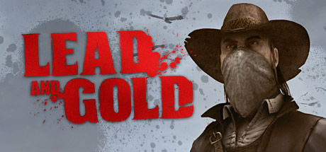

**Platforms:** Windows, PlayStation 3 &nbsp;|&nbsp; **Genre:** Action &nbsp;|&nbsp; **Released:** April 8

> Lead and Gold: Gangs of the Wild West is a third-person shooter that delivers an intense team-based multiplayer experience. Relive the violent era of the Wild West with adrenaline-fueled action and fast-paced gunfights. Engage in gritty battles in beautifully rendered classic Western settings.
>
> _Synopsis source: Steam_

[Steam](https://store.steampowered.com/app/42120)

---

### Leelh

**Platforms:** Windows &nbsp;|&nbsp; **Developer:** 3DDUO &nbsp;|&nbsp; **Genre:** Massively multiplayer online role-playing game &nbsp;|&nbsp; **Released:** June 10, 2010

[Wikipedia](https://en.wikipedia.org/wiki/Leelh)

---

### Legend of Kay

**Platforms:** Nintendo DS &nbsp;|&nbsp; **Released:** June 14

[Wikipedia](https://en.wikipedia.org/wiki/Legend_of_Kay)

---

### Legend of the Guardians: The Owls of Ga'Hoole

**Platforms:** Nintendo DS, PlayStation 3, Wii, Xbox 360 &nbsp;|&nbsp; **Developer:** Krome Studios, Tantalus Media &nbsp;|&nbsp; **Publisher:** Warner Bros. Interactive Entertainment &nbsp;|&nbsp; **Genre:** Combat flight simulator &nbsp;|&nbsp; **Released:** September 14, 2010

[Wikipedia](https://en.wikipedia.org/wiki/Legend_of_the_Guardians:_The_Owls_of_Ga'Hoole_(video_game))

---

### Legendary Wars: T-Rex Rumble

**Platforms:** Nintendo DS &nbsp;|&nbsp; **Released:** June 21

---

### Legends of War

**Platforms:** PlayStation Portable, PlayStation 3, Xbox 360, Windows, PlayStation Vita &nbsp;|&nbsp; **Developer:** Enigma Software Productions &nbsp;|&nbsp; **Publisher:** Enigma Software Productions &nbsp;|&nbsp; **Genre:** Turn-based strategy &nbsp;|&nbsp; **Released:** October 20, 2010

[Wikipedia](https://en.wikipedia.org/wiki/Legends_of_War)

---

### Lego Harry Potter: Years 1-4

**Platforms:** Windows, PlayStation 3, Wii, PlayStation Portable, Xbox 360, Nintendo DS &nbsp;|&nbsp; **Genre:** Action, Adventure &nbsp;|&nbsp; **Released:** June 29

> Build the adventure from Privet Drive to the Triwizard Tournament and experience the magic of the first four Harry Potter stories – LEGO style! Explore Hogwarts™ School of Witchcraft and Wizardry, learn spells, brew potions and relive the adventures like never before with tongue-in-cheek humor and creative customization that is unique to...
>
> _Synopsis source: Steam_

[Steam](https://store.steampowered.com/app/21130)

---

### Lego Universe

**Platforms:** Windows &nbsp;|&nbsp; **Released:** October 26

[Wikipedia](https://en.wikipedia.org/wiki/Lego_Universe)

---

### Let's Golf 2

**Platforms:** iOS, Android, Nintendo 3DS &nbsp;|&nbsp; **Developer:** Gameloft &nbsp;|&nbsp; **Publisher:** Gameloft &nbsp;|&nbsp; **Genre:** Sports &nbsp;|&nbsp; **Released:** July 22, 2010

[Wikipedia](https://en.wikipedia.org/wiki/Let's_Golf_2)

---

### Limbo

**Platforms:** Xbox 360 &nbsp;|&nbsp; **Publisher:** Microsoft Game Studios &nbsp;|&nbsp; **Released:** July 21, 2010

[Wikipedia](https://en.wikipedia.org/wiki/Limbo_(video_game))

---

### Lips: I Love the 80's

**Platforms:** Xbox 360 &nbsp;|&nbsp; **Developer:** iNiS &nbsp;|&nbsp; **Publisher:** Microsoft Game Studios &nbsp;|&nbsp; **Genre:** Music / Rhythm &nbsp;|&nbsp; **Released:** April 2, 2010

[Wikipedia](https://en.wikipedia.org/wiki/Lips:_I_Love_the_80's)

---

### Lips: Party Classics

**Platforms:** Xbox 360 &nbsp;|&nbsp; **Released:** March 2

---

### Little Things

**Platforms:** iOS &nbsp;|&nbsp; **Released:** May 31

[Wikipedia](https://en.wikipedia.org/wiki/Little_Things_(video_game))

---

### Lord of Ultima

**Developer:** EA Phenomic &nbsp;|&nbsp; **Genre:** Real-time military strategy, City-building &nbsp;|&nbsp; **Released:** April 20, 2010

[Wikipedia](https://en.wikipedia.org/wiki/Lord_of_Ultima)

---

### Lost Horizon

**Platforms:** Windows &nbsp;|&nbsp; **Genre:** Adventure &nbsp;|&nbsp; **Released:** September 24

> 1936: Soldiers of the Third Reich roam the world seeking occult weapons for their insane plans of conquest. When Fenton Paddock, a former British soldier and hapless smuggler, is asked to look for his friend Richard, who went missing in Tibet, he has no idea that this search will lead him across three continents to a secret that could...
>
> _Synopsis source: Steam_

[Wikipedia](https://en.wikipedia.org/wiki/Lost_Horizon_(video_game)) · [Steam](https://store.steampowered.com/app/40350)

---

### Lost Planet 2

**Platforms:** Xbox 360, PlayStation 3, Windows &nbsp;|&nbsp; **Released:** May 11

[Wikipedia](https://en.wikipedia.org/wiki/Lost_Planet_2)

---

### Love

**Platforms:** Windows &nbsp;|&nbsp; **Developer:** Eskil Steenberg &nbsp;|&nbsp; **Genre:** Massively multiplayer online role-playing game &nbsp;|&nbsp; **Released:** March 25, 2010

[Wikipedia](https://en.wikipedia.org/wiki/Love_(2010_video_game))

---

### Love, Election and Chocolate

[Wikipedia](https://en.wikipedia.org/wiki/Love,_Election_and_Chocolate)

---

### Loved

**Platforms:** Browser &nbsp;|&nbsp; **Developer:** Alexander Ocias &nbsp;|&nbsp; **Publisher:** Alexander Ocias &nbsp;|&nbsp; **Genre:** Platform &nbsp;|&nbsp; **Released:** June 14, 2010

[Wikipedia](https://en.wikipedia.org/wiki/Loved_(video_game))

---

### Luanti

[Wikipedia](https://en.wikipedia.org/wiki/Luanti)

---

### Lucha Libre AAA: Héroes del Ring

**Platforms:** PlayStation 3, Xbox 360 &nbsp;|&nbsp; **Released:** October 12

---

### Lufia: Curse of the Sinistrals

**Platforms:** Nintendo DS &nbsp;|&nbsp; **Released:** October 12

---

### Lunar: Silver Star Harmony

**Platforms:** PlayStation Portable &nbsp;|&nbsp; **Released:** March 2

---

### Luxor 5th Passage

**Platforms:** Windows, macOS &nbsp;|&nbsp; **Developer:** Absolutist &nbsp;|&nbsp; **Publisher:** MumboJumbo &nbsp;|&nbsp; **Genre:** Puzzle &nbsp;|&nbsp; **Released:** November 19, 2010

[Wikipedia](https://en.wikipedia.org/wiki/Luxor_5th_Passage)

---

### Lyric Legend

**Developer:** Tic Toc Games &nbsp;|&nbsp; **Publisher:** TuneWiki

[Wikipedia](https://en.wikipedia.org/wiki/Lyric_Legend)

---

### M.U.D. TV

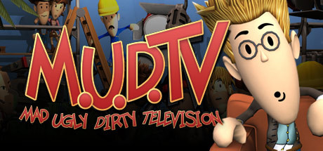

**Platforms:** Windows &nbsp;|&nbsp; **Genre:** Simulation, Strategy &nbsp;|&nbsp; **Released:** February 23

> Always wanted to see if you can hack the day-to-day life of a TV producer? Here's your chance! M.U.D. TV is your ticket to the weird wild world of television.
>
> _Synopsis source: Steam_

[Wikipedia](https://en.wikipedia.org/wiki/M.U.D._TV) · [Steam](https://store.steampowered.com/app/43500)

---

### Madden NFL 11

**Platforms:** PlayStation 2, PlayStation 3, PlayStation Portable, Wii, Xbox 360 &nbsp;|&nbsp; **Released:** August 10

[Wikipedia](https://en.wikipedia.org/wiki/Madden_NFL_11)

---

### Maestro! Jump in Music

**Platforms:** Nintendo DS &nbsp;|&nbsp; **Released:** June 28

[Wikipedia](https://en.wikipedia.org/wiki/Maestro!_Jump_in_Music)

---

### Mafia II

**Platforms:** Windows, Xbox 360, PlayStation 3 &nbsp;|&nbsp; **Genre:** Action &nbsp;|&nbsp; **Released:** August 24

> Vito Scaletta has started to make a name for himself on the streets of Empire Bay as someone who can be trusted to get a job done. Together with his buddy Joe, he is working to prove himself to the Mafia, quickly escalating up the family ladder with crimes of larger reward, status and consequence… the life as a wise guy isn’t quite as...
>
> _Synopsis source: Steam_

[Wikipedia](https://en.wikipedia.org/wiki/Mafia_II) · [Steam](https://store.steampowered.com/app/50130)

---

### MAG

**Platforms:** PlayStation 3 &nbsp;|&nbsp; **Released:** January 26

[Wikipedia](https://en.wikipedia.org/wiki/MAG_(video_game))

---

### Magical Girl Lyrical Nanoha A's

[Wikipedia](https://en.wikipedia.org/wiki/Magical_Girl_Lyrical_Nanoha_A's)

---

### Majin and the Forsaken Kingdom

**Platforms:** Xbox 360, PlayStation 3 &nbsp;|&nbsp; **Released:** November 23

[Wikipedia](https://en.wikipedia.org/wiki/Majin_and_the_Forsaken_Kingdom)

---

### Making History II: The War of the World

**Platforms:** Windows, macOS &nbsp;|&nbsp; **Developer:** Muzzy Lane &nbsp;|&nbsp; **Publisher:** Factus Games &nbsp;|&nbsp; **Genre:** Turn-based strategy &nbsp;|&nbsp; **Released:** June 15, 2010

[Wikipedia](https://en.wikipedia.org/wiki/Making_History_II:_The_War_of_the_World)

---

### Malicious

**Platforms:** PlayStation Network &nbsp;|&nbsp; **Released:** July 24

[Wikipedia](https://en.wikipedia.org/wiki/Malicious_(video_game))

---

### MapleStory DS

**Platforms:** Nintendo DS &nbsp;|&nbsp; **Developer:** Nexon &nbsp;|&nbsp; **Publisher:** Nexon, Nintendo of Korea &nbsp;|&nbsp; **Genre:** Fantasy, RPG &nbsp;|&nbsp; **Released:** April 15, 2010

[Wikipedia](https://en.wikipedia.org/wiki/MapleStory_DS)

---

### Mario vs. Donkey Kong: Mini-Land Mayhem!

**Platforms:** Nintendo DS &nbsp;|&nbsp; **Developer:** Nintendo Software Technology &nbsp;|&nbsp; **Publisher:** Nintendo &nbsp;|&nbsp; **Genre:** Puzzle-platform &nbsp;|&nbsp; **Released:** November 14, 2010

[Wikipedia](https://en.wikipedia.org/wiki/Mario_vs._Donkey_Kong:_Mini-Land_Mayhem!)

---

### Marvel Pinball

**Platforms:** Xbox 360, PlayStation 3, PlayStation Network, Nintendo 3DS, macOS &nbsp;|&nbsp; **Developer:** Zen Studios &nbsp;|&nbsp; **Publisher:** Microsoft Studios, Sony Computer Entertainment, Zen Studios &nbsp;|&nbsp; **Genre:** Pinball &nbsp;|&nbsp; **Released:** December 8, 2010

[Wikipedia](https://en.wikipedia.org/wiki/Marvel_Pinball)

---

### Marvel Super Hero Squad: The Infinity Gauntlet

**Platforms:** Nintendo DS, Wii, PlayStation 3, Xbox 360 &nbsp;|&nbsp; **Developer:** Griptonite Games &nbsp;|&nbsp; **Publisher:** THQ &nbsp;|&nbsp; **Genre:** Fighting, beat 'em up &nbsp;|&nbsp; **Released:** November 16, 2010

[Wikipedia](https://en.wikipedia.org/wiki/Marvel_Super_Hero_Squad:_The_Infinity_Gauntlet)

---

### Mass Effect 2

**Platforms:** Xbox 360, Windows, PlayStation 3 &nbsp;|&nbsp; **Publisher:** Electronic Arts &nbsp;|&nbsp; **Released:** January 26, 2010

[Wikipedia](https://en.wikipedia.org/wiki/Mass_Effect_2)

---

### Mass Effect 2: Kasumi – Stolen Memory

**Platforms:** Windows, Xbox 360 &nbsp;|&nbsp; **Developer:** BioWare &nbsp;|&nbsp; **Publisher:** Electronic Arts, Microsoft Game Studios &nbsp;|&nbsp; **Genre:** Action role-playing, third-person shooter &nbsp;|&nbsp; **Released:** April 6, 2010

[Wikipedia](https://en.wikipedia.org/wiki/Mass_Effect_2:_Kasumi_%E2%80%93_Stolen_Memory)

---

### Mass Effect 2: Lair of the Shadow Broker

**Platforms:** Windows, Xbox 360 &nbsp;|&nbsp; **Developer:** BioWare &nbsp;|&nbsp; **Publisher:** Electronic Arts, Microsoft Game Studios &nbsp;|&nbsp; **Genre:** Action role-playing, third-person shooter &nbsp;|&nbsp; **Released:** September 7, 2010

[Wikipedia](https://en.wikipedia.org/wiki/Mass_Effect_2:_Lair_of_the_Shadow_Broker)

---

### Mass Effect 2: Overlord

**Platforms:** Windows, Xbox 360 &nbsp;|&nbsp; **Developer:** BioWare &nbsp;|&nbsp; **Publisher:** Electronic Arts, Microsoft Game Studios &nbsp;|&nbsp; **Genre:** Action role-playing, third-person shooter &nbsp;|&nbsp; **Released:** June 15, 2010

[Wikipedia](https://en.wikipedia.org/wiki/Mass_Effect_2:_Overlord)

---

### Matt Hazard: Blood Bath and Beyond

**Platforms:** Xbox 360, PlayStation Network &nbsp;|&nbsp; **Genre:** Shoot 'em up &nbsp;|&nbsp; **Released:** January 6

---

### Max & the Magic Marker

**Platforms:** Wii &nbsp;|&nbsp; **Released:** March 8

[Wikipedia](https://en.wikipedia.org/wiki/Max_%26_the_Magic_Marker)

---

### Medal of Honor

**Platforms:** Windows, PlayStation 3, Xbox 360 &nbsp;|&nbsp; **Genre:** Action &nbsp;|&nbsp; **Released:** October 12

> Fight Today's War: Elite Special Forces in a gritty combat campaign using the surgical tactics of Tier 1 Operators combined with the sledgehammer force of Army Rangers.
>
> _Synopsis source: Steam_

[Wikipedia](https://en.wikipedia.org/wiki/Medal_of_Honor_(2010_video_game)) · [Steam](https://store.steampowered.com/app/47790)

---

### Mega Man 10

**Platforms:** Wii, PlayStation Network, Xbox 360 &nbsp;|&nbsp; **Released:** March 1

[Wikipedia](https://en.wikipedia.org/wiki/Mega_Man_10)

---

### Mega Man Zero Collection

**Platforms:** Nintendo DS &nbsp;|&nbsp; **Released:** June 8

[Wikipedia](https://en.wikipedia.org/wiki/Mega_Man_Zero_Collection)

---

### MegaGlest

**Platforms:** Linux, Windows, macOS &nbsp;|&nbsp; **Developer:** MegaGlest Team &nbsp;|&nbsp; **Genre:** Real-time strategy &nbsp;|&nbsp; **Released:** January 6, 2010

[Wikipedia](https://en.wikipedia.org/wiki/MegaGlest)

---

### Megamind

**Platforms:** Wii, Xbox 360, PlayStation 3, PlayStation Portable, Nintendo DS &nbsp;|&nbsp; **Released:** November 2

[Wikipedia](https://en.wikipedia.org/wiki/Megamind_(video_game))

---

### Megamind: Mega Team Unite

**Platforms:** Wii &nbsp;|&nbsp; **Developer:** THQ Studio Australia &nbsp;|&nbsp; **Publisher:** THQ &nbsp;|&nbsp; **Genre:** Party &nbsp;|&nbsp; **Released:** November 2, 2010

[Wikipedia](https://en.wikipedia.org/wiki/Megamind:_Mega_Team_Unite)

---

### Megamind: Ultimate Showdown

**Platforms:** PlayStation 3, Xbox 360, PlayStation Portable, Nintendo DS &nbsp;|&nbsp; **Developer:** THQ Studio Australia, Tantalus &nbsp;|&nbsp; **Publisher:** THQ &nbsp;|&nbsp; **Genre:** Action &nbsp;|&nbsp; **Released:** November 2, 2010

[Wikipedia](https://en.wikipedia.org/wiki/Megamind:_Ultimate_Showdown)

---

### Memories Off: Yubikiri no Kioku

**Platforms:** Xbox 360 &nbsp;|&nbsp; **Developer:** 5pb. &nbsp;|&nbsp; **Publisher:** 5pb., Koei Tecmo, Softmax, Mages Inc. &nbsp;|&nbsp; **Genre:** Visual novel &nbsp;|&nbsp; **Released:** July 29, 2010

[Wikipedia](https://en.wikipedia.org/wiki/Memories_Off:_Yubikiri_no_Kioku)

---

### Merry Gear Solid 2

**Platforms:** Windows &nbsp;|&nbsp; **Developer:** Arthur Lee &nbsp;|&nbsp; **Publisher:** Arthur Lee &nbsp;|&nbsp; **Genre:** Stealth game &nbsp;|&nbsp; **Released:** December 13, 2010

[Wikipedia](https://en.wikipedia.org/wiki/Merry_Gear_Solid_2)

---

### Metal Gear Solid: Peace Walker

**Platforms:** PlayStation Portable &nbsp;|&nbsp; **Released:** June 8

---

### Metal Max 3

**Platforms:** Nintendo DS &nbsp;|&nbsp; **Developer:** Cattle Call &nbsp;|&nbsp; **Publisher:** Kadokawa Games, Enterbrain, Crea-Tech &nbsp;|&nbsp; **Genre:** Role-playing &nbsp;|&nbsp; **Released:** July 29, 2010

[Wikipedia](https://en.wikipedia.org/wiki/Metal_Max_3)

---

### Metal Slug XX

**Platforms:** PlayStation Portable, Xbox 360 &nbsp;|&nbsp; **Released:** February 23

[Wikipedia](https://en.wikipedia.org/wiki/Metal_Slug_XX)

---

### Metro 2033

**Platforms:** Windows, Xbox 360 &nbsp;|&nbsp; **Released:** March 16

[Wikipedia](https://en.wikipedia.org/wiki/Metro_2033_(video_game))

---

### Metroid: Other M

**Platforms:** Wii &nbsp;|&nbsp; **Released:** August 31

---

### Michael Jackson: The Experience

**Platforms:** Wii, Nintendo DS, PlayStation Portable &nbsp;|&nbsp; **Released:** November 23

---

### MicroBot

**Platforms:** Xbox 360, PlayStation 3 &nbsp;|&nbsp; **Developer:** Naked Sky Entertainment &nbsp;|&nbsp; **Publisher:** Electronic Arts &nbsp;|&nbsp; **Genre:** Shoot 'em up &nbsp;|&nbsp; **Released:** December 29, 2010

[Wikipedia](https://en.wikipedia.org/wiki/MicroBot)

---

### MicroVolts

**Platforms:** Windows &nbsp;|&nbsp; **Developer:** NQ Games Masangsoft &nbsp;|&nbsp; **Publisher:** Rock Hippo Productions LTD.; Masangsoft &nbsp;|&nbsp; **Genre:** Third-person shooter &nbsp;|&nbsp; **Released:** August 12, 2010

[Wikipedia](https://en.wikipedia.org/wiki/MicroVolts)

---

### Mimana Iyar Chronicle

**Platforms:** PlayStation Portable &nbsp;|&nbsp; **Released:** March 30

[Wikipedia](https://en.wikipedia.org/wiki/Mimana_Iyar_Chronicle)

---

### Mini Ninjas

**Platforms:** macOS &nbsp;|&nbsp; **Released:** July 8

[Wikipedia](https://en.wikipedia.org/wiki/Mini_Ninjas)

---

### Ministry of War

**Platforms:** Browser &nbsp;|&nbsp; **Developer:** Snail Games &nbsp;|&nbsp; **Publisher:** Snail Games USA &nbsp;|&nbsp; **Genre:** Strategy MMORTS &nbsp;|&nbsp; **Released:** November 27, 2010

[Wikipedia](https://en.wikipedia.org/wiki/Ministry_of_War_(game))

---

### Minute to Win It

**Platforms:** Wii, Xbox 360 &nbsp;|&nbsp; **Released:** November 10

---

### Mirror's Edge (mobile)

**Platforms:** iOS &nbsp;|&nbsp; **Developer:** IronMonkey Studios &nbsp;|&nbsp; **Publisher:** Electronic Arts &nbsp;|&nbsp; **Genre:** Platform &nbsp;|&nbsp; **Released:** April 1, 2010

[Wikipedia](https://en.wikipedia.org/wiki/Mirror's_Edge_(mobile))

---

### MLB 10: The Show

**Platforms:** PlayStation 3, PlayStation 2, PlayStation Portable &nbsp;|&nbsp; **Publisher:** Sony Computer Entertainment &nbsp;|&nbsp; **Released:** March 2, 2010

---

### MLB 2K10

**Platforms:** Windows, Xbox 360, PlayStation 2, PlayStation 3, Wii, PlayStation Portable &nbsp;|&nbsp; **Released:** March 2

[Wikipedia](https://en.wikipedia.org/wiki/Major_League_Baseball_2K10)

---

### Mobile Suit Gundam: Extreme Vs.

**Platforms:** Arcade &nbsp;|&nbsp; **Developer:** Namco Bandai Games &nbsp;|&nbsp; **Publisher:** Namco Bandai Games &nbsp;|&nbsp; **Genre:** Fighting, Mecha, Sci-Fi &nbsp;|&nbsp; **Released:** September 28, 2010

[Wikipedia](https://en.wikipedia.org/wiki/Mobile_Suit_Gundam:_Extreme_Vs.)

---

### Modern Combat 2: Black Pegasus

**Platforms:** iOS &nbsp;|&nbsp; **Released:** October 4

---

### ModNation Racers

**Platforms:** PlayStation 3, PlayStation Portable &nbsp;|&nbsp; **Released:** May 25

[Wikipedia](https://en.wikipedia.org/wiki/ModNation_Racers)

---

### Monday Night Combat

**Platforms:** Xbox 360 &nbsp;|&nbsp; **Released:** August 11

[Wikipedia](https://en.wikipedia.org/wiki/Monday_Night_Combat)

---

### Monkey Island 2 Special Edition: LeChuck's Revenge

**Platforms:** iOS &nbsp;|&nbsp; **Released:** June 26

---

### Monopoly

**Platforms:** Nintendo DS &nbsp;|&nbsp; **Developer:** Electronic Arts &nbsp;|&nbsp; **Publisher:** Electronic Arts &nbsp;|&nbsp; **Genre:** Digital board game &nbsp;|&nbsp; **Released:** October 26, 2010

[Wikipedia](https://en.wikipedia.org/wiki/Monopoly_(2010_video_game))

---

### Monopoly Streets

**Platforms:** PlayStation 3, Xbox 360, Wii &nbsp;|&nbsp; **Developer:** EA Salt Lake &nbsp;|&nbsp; **Publisher:** Electronic Arts &nbsp;|&nbsp; **Genre:** Board game, strategy &nbsp;|&nbsp; **Released:** October 26, 2010

[Wikipedia](https://en.wikipedia.org/wiki/Monopoly_Streets)

---

### Monsteca Corral

**Platforms:** Wii &nbsp;|&nbsp; **Released:** August 16

[Wikipedia](https://en.wikipedia.org/wiki/Monsteca_Corral)

---

### Monster Hunter Diary

**Platforms:** PlayStation Portable, Nintendo 3DS &nbsp;|&nbsp; **Developer:** FromSoftware &nbsp;|&nbsp; **Publisher:** Capcom &nbsp;|&nbsp; **Genre:** Adventure &nbsp;|&nbsp; **Released:** August 26, 2010

[Wikipedia](https://en.wikipedia.org/wiki/Monster_Hunter_Diary)

---

### Monster Hunter Portable 3rd

**Platforms:** PlayStation Portable &nbsp;|&nbsp; **Developer:** Capcom &nbsp;|&nbsp; **Publisher:** Capcom &nbsp;|&nbsp; **Genre:** Action role-playing &nbsp;|&nbsp; **Released:** December 1, 2010

[Wikipedia](https://en.wikipedia.org/wiki/Monster_Hunter_Portable_3rd)

---

### Monster Hunter Tri

**Platforms:** Wii &nbsp;|&nbsp; **Released:** April 20

[Wikipedia](https://en.wikipedia.org/wiki/Monster_Hunter_Tri)

---

### Monster Jam: Path of Destruction

**Platforms:** Nintendo DS, PlayStation 3, PlayStation Portable, Wii, Xbox 360 &nbsp;|&nbsp; **Released:** November 9

---

### Monsters (Probably) Stole My Princess

**Platforms:** PlayStation Portable, Xbox 360 &nbsp;|&nbsp; **Developer:** Mediatonic &nbsp;|&nbsp; **Publisher:** Mediatonic &nbsp;|&nbsp; **Genre:** Platform game &nbsp;|&nbsp; **Released:** April 22, 2010

[Wikipedia](https://en.wikipedia.org/wiki/Monsters_(Probably)_Stole_My_Princess)

---

### Moonbase Alpha

**Platforms:** Windows &nbsp;|&nbsp; **Developer:** Virtual Heroes, Army Game Studio &nbsp;|&nbsp; **Publisher:** NASA Learning Technologies &nbsp;|&nbsp; **Genre:** Simulation &nbsp;|&nbsp; **Released:** July 6, 2010

[Wikipedia](https://en.wikipedia.org/wiki/Moonbase_Alpha)

---

### MorphX

**Platforms:** Xbox 360 &nbsp;|&nbsp; **Released:** September 28

[Wikipedia](https://en.wikipedia.org/wiki/MorphX_(video_game))

---

### Mortal Online

**Platforms:** Windows &nbsp;|&nbsp; **Developer:** Star Vault &nbsp;|&nbsp; **Publisher:** Star Vault &nbsp;|&nbsp; **Genre:** MMORPG &nbsp;|&nbsp; **Released:** June 9, 2010

[Wikipedia](https://en.wikipedia.org/wiki/Mortal_Online)

---

### MotionSports

**Platforms:** Xbox 360 &nbsp;|&nbsp; **Released:** November 4

[Wikipedia](https://en.wikipedia.org/wiki/MotionSports)

---

### Moto Racer DS

**Platforms:** Nintendo DS &nbsp;|&nbsp; **Released:** July 3

[Wikipedia](https://en.wikipedia.org/wiki/Moto_Racer_DS)

---

### MotoGP 09/10

**Platforms:** Xbox 360, PlayStation 3 &nbsp;|&nbsp; **Released:** March 23

[Wikipedia](https://en.wikipedia.org/wiki/MotoGP_09/10)

---

### Mount & Blade: Warband

**Platforms:** Windows &nbsp;|&nbsp; **Developer:** TaleWorlds Entertainment &nbsp;|&nbsp; **Publisher:** Paradox Interactive, Ravenscourt &nbsp;|&nbsp; **Genre:** Action role-playing, strategy &nbsp;|&nbsp; **Released:** March 30, 2010

[Wikipedia](https://en.wikipedia.org/wiki/Mount_&_Blade:_Warband)

---

### MovieCat!

**Platforms:** iOS, Android &nbsp;|&nbsp; **Developer:** OtherWise Games &nbsp;|&nbsp; **Publisher:** OtherWise Games &nbsp;|&nbsp; **Genre:** Trivia &nbsp;|&nbsp; **Released:** September 11, 2010

[Wikipedia](https://en.wikipedia.org/wiki/MovieCat!)

---

### Mr. Driller: Drill Till You Drop

**Platforms:** Nintendo DS &nbsp;|&nbsp; **Released:** April 5

[Wikipedia](https://en.wikipedia.org/wiki/Mr._Driller)

---

### Mundo Gaturro

**Platforms:** Windows, macOS &nbsp;|&nbsp; **Developer:** QB9 Entertainment &nbsp;|&nbsp; **Genre:** MMO

[Wikipedia](https://en.wikipedia.org/wiki/Mundo_Gaturro)

---

### Mushihimesama Bug Panic

**Platforms:** iOS &nbsp;|&nbsp; **Developer:** Cave &nbsp;|&nbsp; **Publisher:** Cave, G-Gee &nbsp;|&nbsp; **Genre:** Scrolling shooter, bullet hell &nbsp;|&nbsp; **Released:** November 5, 2010

[Wikipedia](https://en.wikipedia.org/wiki/Mushihimesama_Bug_Panic)

---

### My Aquarium

**Platforms:** Wii, PlayStation 3, PlayStation Network &nbsp;|&nbsp; **Developer:** Hudson Soft &nbsp;|&nbsp; **Genre:** Virtual pet simulation &nbsp;|&nbsp; **Released:** August 3, 2010

[Wikipedia](https://en.wikipedia.org/wiki/My_Aquarium)

---

### My Empire

**Developer:** Playfish &nbsp;|&nbsp; **Genre:** Simulation &nbsp;|&nbsp; **Released:** May 13, 2010

[Wikipedia](https://en.wikipedia.org/wiki/My_Empire)

---

### MySims SkyHeroes

**Platforms:** Nintendo DS, PlayStation 3, Wii, Xbox 360 &nbsp;|&nbsp; **Released:** September 28

[Wikipedia](https://en.wikipedia.org/wiki/MySims_SkyHeroes)

---

### Mystery Manor

**Platforms:** Facebook, Browser, Android &nbsp;|&nbsp; **Developer:** Game Insight &nbsp;|&nbsp; **Genre:** Hidden Object &nbsp;|&nbsp; **Released:** March 2010

[Wikipedia](https://en.wikipedia.org/wiki/Mystery_Manor)

---

### N.O.V.A. 2: The Hero Rises Again

**Platforms:** iOS, Android, BlackBerry OS, macOS &nbsp;|&nbsp; **Developer:** Gameloft Bucharest &nbsp;|&nbsp; **Publisher:** Gameloft &nbsp;|&nbsp; **Genre:** Action-adventure, first-person shooter &nbsp;|&nbsp; **Released:** December 16, 2010

[Wikipedia](https://en.wikipedia.org/wiki/N.O.V.A._2:_The_Hero_Rises_Again)

---

### N.O.V.A. Near Orbit Vanguard Alliance

**Platforms:** PlayStation Network &nbsp;|&nbsp; **Released:** December 21

[Wikipedia](https://en.wikipedia.org/wiki/N.O.V.A._Near_Orbit_Vanguard_Alliance)

---

### nail'd

**Platforms:** PlayStation 3, Xbox 360, Windows &nbsp;|&nbsp; **Genre:** Racing &nbsp;|&nbsp; **Released:** November 30

> Constant sense of ultimate speed is your only companion, and fast reflexes and tactical skills are what stands between victory and defeat. Buy before Dec. 7 10AM PST and get 10% off.
>
> _Synopsis source: Steam_

[Wikipedia](https://en.wikipedia.org/wiki/Nail%27d) · [Steam](https://store.steampowered.com/app/40380)

---

### Namco Museum Megamix

**Platforms:** Wii &nbsp;|&nbsp; **Released:** November 16

[Wikipedia](https://en.wikipedia.org/wiki/Namco_Museum_Remix)

---

### Nancy Drew: Secrets Can Kill Remastered

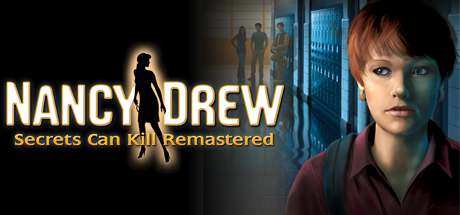

**Platforms:** Windows, macOS &nbsp;|&nbsp; **Genre:** Adventure &nbsp;|&nbsp; **Released:** August 24

> Play the Game that Started the Award-Winning Series!
>
> _Synopsis source: Steam_

[Steam](https://store.steampowered.com/app/42210)

---

### Nancy Drew: Shadow at the Water's Edge

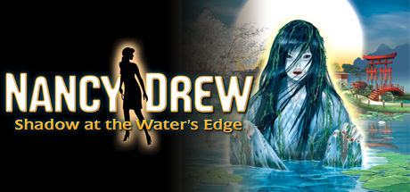

**Platforms:** Windows, macOS &nbsp;|&nbsp; **Genre:** Adventure &nbsp;|&nbsp; **Released:** October 19

> Confront Terrifying Secrets in a Haunted Japanese Inn!
>
> _Synopsis source: Steam_

[Steam](https://store.steampowered.com/app/200080)

---

### Nancy Drew: Trail of the Twister

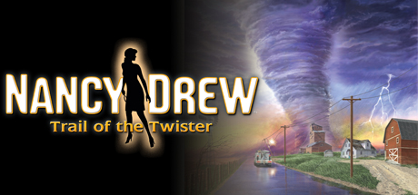

**Platforms:** Windows, macOS &nbsp;|&nbsp; **Genre:** Adventure &nbsp;|&nbsp; **Released:** June 29

> Apprehend a Saboteur Stirring up Turbulent Trouble!
>
> _Synopsis source: Steam_

[Steam](https://store.steampowered.com/app/42230)

---

### Napoleon: Total War

**Platforms:** Windows &nbsp;|&nbsp; **Released:** February 23

---

### Naruto Shippuden: Dragon Blade Chronicles

**Platforms:** Wii &nbsp;|&nbsp; **Released:** November 16

---

### Naruto Shippuden: Ultimate Ninja Heroes 3

**Platforms:** PlayStation Portable &nbsp;|&nbsp; **Released:** May 11

---

### Naruto Shippuden: Ultimate Ninja Storm 2

**Platforms:** PlayStation 3, Xbox 360 &nbsp;|&nbsp; **Released:** October 19

---

### Naughty Bear

**Platforms:** Xbox 360, PlayStation 3 &nbsp;|&nbsp; **Released:** June 29

[Wikipedia](https://en.wikipedia.org/wiki/Naughty_Bear)

---

### Naval Assault: The Killing Tide

**Platforms:** Xbox 360 &nbsp;|&nbsp; **Developer:** Artech Studios &nbsp;|&nbsp; **Publisher:** 505 Games &nbsp;|&nbsp; **Genre:** Action &nbsp;|&nbsp; **Released:** June 15, 2010

[Wikipedia](https://en.wikipedia.org/wiki/Naval_Assault:_The_Killing_Tide)

---

### NBA 2K11

**Platforms:** Windows, PlayStation 3, Xbox 360, PlayStation Portable, PlayStation 2, Wii, iOS &nbsp;|&nbsp; **Released:** October 5

[Wikipedia](https://en.wikipedia.org/wiki/NBA_2K11)

---

### NBA Elite 11

**Platforms:** iOS &nbsp;|&nbsp; **Developer:** EA Canada &nbsp;|&nbsp; **Publisher:** EA Sports &nbsp;|&nbsp; **Genre:** Sports &nbsp;|&nbsp; **Released:** November 5, 2010

[Wikipedia](https://en.wikipedia.org/wiki/NBA_Elite_11)

---

### NBA Hotshot

**Platforms:** iOS &nbsp;|&nbsp; **Developer:** Freeverse Inc. &nbsp;|&nbsp; **Publisher:** Freeverse Inc. &nbsp;|&nbsp; **Genre:** Sports &nbsp;|&nbsp; **Released:** January 5, 2010

[Wikipedia](https://en.wikipedia.org/wiki/NBA_Hotshot)

---

### NBA Jam

**Platforms:** Wii &nbsp;|&nbsp; **Released:** October 5

[Wikipedia](https://en.wikipedia.org/wiki/NBA_Jam_(2010_video_game))

---

### NBA Jam: On Fire Edition

**Platforms:** PlayStation 3, Xbox 360 &nbsp;|&nbsp; **Released:** November 17

[Wikipedia](https://en.wikipedia.org/wiki/NBA_Jam_(2010_video_game))

---

### NCAA Football 11

**Platforms:** PlayStation 2, PlayStation 3, Xbox 360 &nbsp;|&nbsp; **Released:** July 13

[Wikipedia](https://en.wikipedia.org/wiki/NCAA_Football_11)

---

### NecroVisioN: Lost Company

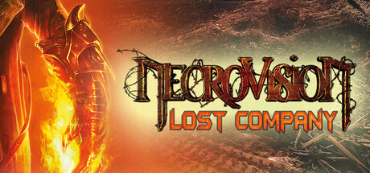

**Platforms:** Windows &nbsp;|&nbsp; **Genre:** Action &nbsp;|&nbsp; **Released:** February 19

> NecroVisioN: Lost Company is the prequel to original horror FPS shooter, taking place before the NecroVisioN story begins. It contains a bunch of unique levels, characters, weapons and gameplay elements as well as new main hero that presents the original game story from opposite perspective.
>
> _Synopsis source: Steam_

[Steam](https://store.steampowered.com/app/46250)

---

### Need for Speed: Hot Pursuit

**Platforms:** Xbox 360, PlayStation 3, Windows, Wii &nbsp;|&nbsp; **Released:** November 16

---

### Need for Speed: World

**Platforms:** Windows &nbsp;|&nbsp; **Released:** July 27

---

### Nehrim: At Fate's Edge

**Platforms:** Windows &nbsp;|&nbsp; **Developer:** SureAI &nbsp;|&nbsp; **Genre:** First person, action role-playing, sandbox &nbsp;|&nbsp; **Released:** June 9, 2010

[Wikipedia](https://en.wikipedia.org/wiki/Nehrim:_At_Fate's_Edge)

---

### Neo Geo Heroes: Ultimate Shooting

**Platforms:** PlayStation Portable &nbsp;|&nbsp; **Developer:** SNK Playmore &nbsp;|&nbsp; **Publisher:** SNK Playmore &nbsp;|&nbsp; **Genre:** Vertical Scrolling shooter, run and gun &nbsp;|&nbsp; **Released:** July 29, 2010

[Wikipedia](https://en.wikipedia.org/wiki/Neo_Geo_Heroes:_Ultimate_Shooting)

---

### NeoGeo Battle Coliseum

**Platforms:** Xbox 360 &nbsp;|&nbsp; **Released:** June 9

[Wikipedia](https://en.wikipedia.org/wiki/NeoGeo_Battle_Coliseum)

---

### Neptune's Pride

**Platforms:** Browser &nbsp;|&nbsp; **Developer:** Iron Helmet Games &nbsp;|&nbsp; **Publisher:** Iron Helmet Games &nbsp;|&nbsp; **Genre:** 4X, space trading and combat game

[Wikipedia](https://en.wikipedia.org/wiki/Neptune's_Pride)

---

### New Carnival Games

**Platforms:** Nintendo DS, Wii &nbsp;|&nbsp; **Released:** September 21

[Wikipedia](https://en.wikipedia.org/wiki/New_Carnival_Games)

---

### NHL 11

**Platforms:** PlayStation 3, Xbox 360 &nbsp;|&nbsp; **Released:** September 7

[Wikipedia](https://en.wikipedia.org/wiki/NHL_11)

---

### NHL 2K11

**Platforms:** Wii &nbsp;|&nbsp; **Released:** September 24

[Wikipedia](https://en.wikipedia.org/wiki/NHL_2K11)

---

### NHL Slapshot

**Platforms:** Wii &nbsp;|&nbsp; **Released:** September 7

[Wikipedia](https://en.wikipedia.org/wiki/NHL_Slapshot)

---

### Ni no Kuni: Dominion of the Dark Djinn

**Platforms:** Nintendo DS &nbsp;|&nbsp; **Developer:** Level-5 &nbsp;|&nbsp; **Publisher:** Level-5 &nbsp;|&nbsp; **Genre:** Role-playing &nbsp;|&nbsp; **Released:** December 9, 2010

[Wikipedia](https://en.wikipedia.org/wiki/Ni_no_Kuni:_Dominion_of_the_Dark_Djinn)

---

### Nier

**Platforms:** Xbox 360, PlayStation 3 &nbsp;|&nbsp; **Released:** April 27

[Wikipedia](https://en.wikipedia.org/wiki/Nier_(video_game))

---

### Ninety-Nine Nights II

**Platforms:** Xbox 360 &nbsp;|&nbsp; **Released:** June 29

[Wikipedia](https://en.wikipedia.org/wiki/Ninety-Nine_Nights_II)

---

### Ninja Chicken: Shoot 'Em Up

**Platforms:** iOS &nbsp;|&nbsp; **Released:** September 30

[Wikipedia](https://en.wikipedia.org/wiki/Ninja_Chicken_2)

---

### Ninja Senki

**Platforms:** PlayStation Vita, Windows, macOS &nbsp;|&nbsp; **Developer:** Jonathan Lavigne, Tribute Games &nbsp;|&nbsp; **Publisher:** Jonathan Lavigne, Tribute Games &nbsp;|&nbsp; **Genre:** Action platformer, side-scroller &nbsp;|&nbsp; **Released:** December 20, 2010

[Wikipedia](https://en.wikipedia.org/wiki/Ninja_Senki)

---

### No Fate! Only the Power of Will

**Platforms:** Xbox 360, PlayStation Portable &nbsp;|&nbsp; **Developer:** Alchemist &nbsp;|&nbsp; **Publisher:** Alchemist &nbsp;|&nbsp; **Genre:** Visual novel &nbsp;|&nbsp; **Released:** February 25, 2010

[Wikipedia](https://en.wikipedia.org/wiki/No_Fate!_Only_the_Power_of_Will)

---

### No Heroes Allowed!

**Platforms:** PlayStation Portable &nbsp;|&nbsp; **Developer:** Japan Studio, Acquire &nbsp;|&nbsp; **Publisher:** Sony Computer Entertainment &nbsp;|&nbsp; **Genre:** Real-time strategy, God game &nbsp;|&nbsp; **Released:** March 11, 2010

[Wikipedia](https://en.wikipedia.org/wiki/No_Heroes_Allowed!)

---

### No More Heroes 2: Desperate Struggle

**Platforms:** Wii &nbsp;|&nbsp; **Released:** January 26

---

### Nokia Climate Mission

[Wikipedia](https://en.wikipedia.org/wiki/Nokia_Climate_Mission)

---

### Numen: Contest of Heroes

**Platforms:** Windows &nbsp;|&nbsp; **Developer:** Cinemax &nbsp;|&nbsp; **Genre:** Action role-playing game &nbsp;|&nbsp; **Released:** June 3, 2010

[Wikipedia](https://en.wikipedia.org/wiki/Numen:_Contest_of_Heroes)

---

### Octodad

**Platforms:** Windows, macOS &nbsp;|&nbsp; **Developer:** DePaul University &nbsp;|&nbsp; **Genre:** Adventure &nbsp;|&nbsp; **Released:** October 31, 2010

[Wikipedia](https://en.wikipedia.org/wiki/Octodad)

---

### Oddboxx

**Platforms:** Windows &nbsp;|&nbsp; **Released:** December 20

[Wikipedia](https://en.wikipedia.org/wiki/Oddworld#OddBoxx)

---

### One Chance

**Platforms:** Browser &nbsp;|&nbsp; **Developer:** Dean Moynihan &nbsp;|&nbsp; **Publisher:** Dean Moynihan &nbsp;|&nbsp; **Genre:** Puzzle &nbsp;|&nbsp; **Released:** December 2, 2010

[Wikipedia](https://en.wikipedia.org/wiki/One_Chance_(video_game))

---

### OpenClonk

[Wikipedia](https://en.wikipedia.org/wiki/OpenClonk)

---

### OpenRails

[Wikipedia](https://en.wikipedia.org/wiki/OpenRails)

---

### Organ Trail

**Platforms:** Browser &nbsp;|&nbsp; **Developer:** The Men Who Wear Many Hats &nbsp;|&nbsp; **Publisher:** The Men Who Wear Many Hats, Boco &nbsp;|&nbsp; **Genre:** Simulation, survival

[Wikipedia](https://en.wikipedia.org/wiki/Organ_Trail)

---

### Otome wa Boku ni Koishiteru

[Wikipedia](https://en.wikipedia.org/wiki/Otome_wa_Boku_ni_Koishiteru)

---

### Pac-Man Championship Edition DX

**Platforms:** Xbox 360, PlayStation 3, PlayStation Network &nbsp;|&nbsp; **Publisher:** Namco Bandai Games &nbsp;|&nbsp; **Released:** November 17, 2010

[Wikipedia](https://en.wikipedia.org/wiki/Pac-Man_Championship_Edition_DX)

---

### Pac-Man Google Doodle

**Developer:** Google &nbsp;|&nbsp; **Publisher:** Google &nbsp;|&nbsp; **Genre:** Maze &nbsp;|&nbsp; **Released:** May 21, 2010

[Wikipedia](https://en.wikipedia.org/wiki/Pac-Man_Google_Doodle)

---

### Pac-Man Party

**Platforms:** Wii &nbsp;|&nbsp; **Released:** November 16

[Wikipedia](https://en.wikipedia.org/wiki/Pac-Man_Party)

---

### Pang: Magical Michael

**Platforms:** Nintendo DS &nbsp;|&nbsp; **Developer:** Mitchell Corporation &nbsp;|&nbsp; **Publisher:** Rising Star Games &nbsp;|&nbsp; **Genre:** Puzzle-platform &nbsp;|&nbsp; **Released:** September 17, 2010

[Wikipedia](https://en.wikipedia.org/wiki/Pang:_Magical_Michael)

---

### Paper Wars: Cannon Fodder

**Platforms:** PlayStation Portable, PlayStation 3 &nbsp;|&nbsp; **Developer:** iFun4all &nbsp;|&nbsp; **Publisher:** iFun4all &nbsp;|&nbsp; **Genre:** Tower defense &nbsp;|&nbsp; **Released:** October 6, 2010

[Wikipedia](https://en.wikipedia.org/wiki/Paper_Wars:_Cannon_Fodder)

---

### Parachute Ninja

**Platforms:** iOS &nbsp;|&nbsp; **Developer:** Freeverse Inc. &nbsp;|&nbsp; **Publisher:** ZeptoLab &nbsp;|&nbsp; **Genre:** Action &nbsp;|&nbsp; **Released:** January 28, 2010

[Wikipedia](https://en.wikipedia.org/wiki/Parachute_Ninja)

---

### Paradise Island

**Platforms:** iOS, Android, macOS &nbsp;|&nbsp; **Developer:** Game Insight &nbsp;|&nbsp; **Genre:** Strategy &nbsp;|&nbsp; **Released:** December 2010

[Wikipedia](https://en.wikipedia.org/wiki/Paradise_Island_(video_game))

---

### Participatory Chinatown

**Developer:** Engagement Game Lab &nbsp;|&nbsp; **Genre:** Simulation &nbsp;|&nbsp; **Released:** May 2010

[Wikipedia](https://en.wikipedia.org/wiki/Participatory_Chinatown)

---

### Patchwork Heroes

**Platforms:** PlayStation Portable &nbsp;|&nbsp; **Developer:** Acquire, Japan Studio &nbsp;|&nbsp; **Publisher:** Sony Computer Entertainment &nbsp;|&nbsp; **Genre:** Action &nbsp;|&nbsp; **Released:** February 18, 2010

[Wikipedia](https://en.wikipedia.org/wiki/Patchwork_Heroes)

---

### Patrician IV

**Platforms:** Windows, macOS &nbsp;|&nbsp; **Developer:** Gaming Minds Studios, RuneSoft &nbsp;|&nbsp; **Publisher:** Kalypso Media &nbsp;|&nbsp; **Genre:** Business simulation &nbsp;|&nbsp; **Released:** September 2010

[Wikipedia](https://en.wikipedia.org/wiki/Patrician_IV)

---

### PDC World Championship Darts Pro Tour

**Platforms:** PlayStation 3, Wii, Xbox 360 &nbsp;|&nbsp; **Developer:** Redoubt, Rebellion Developments &nbsp;|&nbsp; **Publisher:** O-Games &nbsp;|&nbsp; **Genre:** Sports, simulation &nbsp;|&nbsp; **Released:** November 26, 2010

[Wikipedia](https://en.wikipedia.org/wiki/PDC_World_Championship_Darts_Pro_Tour)

---

### Pearl Harbor Trilogy – 1941: Red Sun Rising

**Platforms:** Wii &nbsp;|&nbsp; **Developer:** Legendo Entertainment &nbsp;|&nbsp; **Publisher:** Legendo Entertainment &nbsp;|&nbsp; **Genre:** Action-adventure, combat flight simulation &nbsp;|&nbsp; **Released:** July 5, 2010

[Wikipedia](https://en.wikipedia.org/wiki/Pearl_Harbor_Trilogy_%E2%80%93_1941:_Red_Sun_Rising)

---

### People Power: the Game of Civil Resistance

**Platforms:** Windows, macOS, Linux &nbsp;|&nbsp; **Developer:** York Zimmerman Inc., Art & Logic Inc. &nbsp;|&nbsp; **Publisher:** International Center on Nonviolent Conflict &nbsp;|&nbsp; **Genre:** Turn-based strategy game

[Wikipedia](https://en.wikipedia.org/wiki/People_Power:_the_Game_of_Civil_Resistance)

---

### Percy Jackson & the Olympians: The Lightning Thief

**Platforms:** Nintendo DS &nbsp;|&nbsp; **Released:** February 11

---

### Perfect Dark

**Platforms:** Xbox 360 &nbsp;|&nbsp; **Released:** March 17

[Wikipedia](https://en.wikipedia.org/wiki/Perfect_Dark_(Xbox_Live_Arcade))

---

### Perpetuum

**Platforms:** Windows &nbsp;|&nbsp; **Developer:** Avatar Creations Ltd &nbsp;|&nbsp; **Genre:** Vehicular combat MMORPG &nbsp;|&nbsp; **Released:** November 25, 2010

[Wikipedia](https://en.wikipedia.org/wiki/Perpetuum)

---

### Persona 3

**Platforms:** PlayStation Portable &nbsp;|&nbsp; **Released:** July 6

[Wikipedia](https://en.wikipedia.org/wiki/Persona_3)

---

### Phantasy Star II

**Platforms:** iOS &nbsp;|&nbsp; **Released:** August 26

[Wikipedia](https://en.wikipedia.org/wiki/Phantasy_Star_II)

---

### Phantasy Star Portable 2

**Platforms:** PlayStation Portable &nbsp;|&nbsp; **Released:** September 14

[Wikipedia](https://en.wikipedia.org/wiki/Phantasy_Star_Portable_2)

---

### Phineas and Ferb: Ride Again

**Platforms:** Nintendo DS, Wii &nbsp;|&nbsp; **Released:** September 14

---

### Phoenix Wright: Ace Attorney

**Platforms:** iOS &nbsp;|&nbsp; **Released:** May 24

---

### Phoenix Wright: Ace Attorney (Episode 5)

**Platforms:** Wii &nbsp;|&nbsp; **Released:** May 24

---

### Phoenix Wright: Ace Attorney (Episodes 1–4)

**Platforms:** Wii &nbsp;|&nbsp; **Genre:** Visual novel, Adventure &nbsp;|&nbsp; **Released:** January 11

---

### Phoenix Wright: Ace Attorney − Justice for All

**Platforms:** Wii &nbsp;|&nbsp; **Released:** February 15

---

### Phoenix Wright: Ace Attorney − Trials and Tribulations

**Platforms:** Wii &nbsp;|&nbsp; **Released:** May 10

---

### Phylo

[Wikipedia](https://en.wikipedia.org/wiki/Phylo_(video_game))

---

### Pier Solar and the Great Architects

**Platforms:** Genesis / Mega Drive &nbsp;|&nbsp; **Developer:** WaterMelon &nbsp;|&nbsp; **Publisher:** WaterMelon &nbsp;|&nbsp; **Genre:** Role-playing &nbsp;|&nbsp; **Released:** December 20, 2010

[Wikipedia](https://en.wikipedia.org/wiki/Pier_Solar_and_the_Great_Architects)

---

### Pillowfight Girls

**Platforms:** iOS &nbsp;|&nbsp; **Developer:** I-Play &nbsp;|&nbsp; **Publisher:** I-Play &nbsp;|&nbsp; **Released:** May 22, 2010

[Wikipedia](https://en.wikipedia.org/wiki/Pillowfight_Girls)

---

### Pinball FX 2

**Platforms:** Xbox 360 &nbsp;|&nbsp; **Released:** October 27

[Wikipedia](https://en.wikipedia.org/wiki/Pinball_FX_2)

---

### Pinball HD

**Platforms:** iOS, macOS, Android &nbsp;|&nbsp; **Developer:** Gameprom &nbsp;|&nbsp; **Publisher:** Gameprom

[Wikipedia](https://en.wikipedia.org/wiki/Pinball_HD)

---

### Pirates Plund-Arrr

**Platforms:** Wii &nbsp;|&nbsp; **Released:** May 25

[Wikipedia](https://en.wikipedia.org/wiki/Pirates_Plund-Arrr)

---

### Pix'n Love Rush

**Platforms:** iOS &nbsp;|&nbsp; **Developer:** Pasta Games, Bulkypix, Advanced Mobile Applications &nbsp;|&nbsp; **Publisher:** Bulkypix, Sanuk Games, Advanced Mobile Applications &nbsp;|&nbsp; **Genre:** Platformer &nbsp;|&nbsp; **Released:** June 16, 2010

[Wikipedia](https://en.wikipedia.org/wiki/Pix'n_Love_Rush)

---

### Pixel Force: Left 4 Dead

**Platforms:** Windows &nbsp;|&nbsp; **Developer:** Eric Ruth Games &nbsp;|&nbsp; **Publisher:** Eric Ruth Games &nbsp;|&nbsp; **Genre:** Top-down shooter &nbsp;|&nbsp; **Released:** January 4, 2010

[Wikipedia](https://en.wikipedia.org/wiki/Pixel_Force:_Left_4_Dead)

---

### PixelJunk Monsters Deluxe

**Platforms:** PlayStation Portable &nbsp;|&nbsp; **Released:** April 27

[Wikipedia](https://en.wikipedia.org/wiki/PixelJunk_Monsters#Deluxe)

---

### Piyo Blocks 2

**Platforms:** Android, iOS &nbsp;|&nbsp; **Developer:** Big Pixel Studios &nbsp;|&nbsp; **Publisher:** Big Pixel Studios &nbsp;|&nbsp; **Genre:** Puzzle &nbsp;|&nbsp; **Released:** April 1, 2010

[Wikipedia](https://en.wikipedia.org/wiki/Piyo_Blocks_2)

---

### Planet Minigolf

**Platforms:** PlayStation Network &nbsp;|&nbsp; **Released:** June 1

[Wikipedia](https://en.wikipedia.org/wiki/Planet_Minigolf)

---

### Plants vs. Zombies

**Platforms:** Xbox 360 &nbsp;|&nbsp; **Released:** September 8

[Wikipedia](https://en.wikipedia.org/wiki/Plants_vs._Zombies)

---

### Playmobil Knights

**Platforms:** Nintendo DS &nbsp;|&nbsp; **Released:** January 25

---

### Pocket Frogs

**Platforms:** iOS, Android &nbsp;|&nbsp; **Developer:** NimbleBit &nbsp;|&nbsp; **Publisher:** NimbleBit &nbsp;|&nbsp; **Genre:** Simulation &nbsp;|&nbsp; **Released:** September 15, 2010

[Wikipedia](https://en.wikipedia.org/wiki/Pocket_Frogs)

---

### Pocket Legends

**Platforms:** iOS, Android &nbsp;|&nbsp; **Developer:** Spacetime Games &nbsp;|&nbsp; **Genre:** MMORPG &nbsp;|&nbsp; **Released:** April 3, 2010

[Wikipedia](https://en.wikipedia.org/wiki/Pocket_Legends)

---

### Poker Night at the Inventory

**Platforms:** Windows &nbsp;|&nbsp; **Genre:** Casual &nbsp;|&nbsp; **Released:** November 22

> Seven years after the Inventory closed its doors, this underground social club has reopened for business. Play No Limit Texas Hold’em with four video game icons in a high-stakes battle of cards, bets, and trash talk.
>
> _Synopsis source: Steam_

[Wikipedia](https://en.wikipedia.org/wiki/Poker_Night_at_the_Inventory) · [Steam](https://store.steampowered.com/app/3897800)

---

### Pokémon Black and White

**Platforms:** Nintendo DS &nbsp;|&nbsp; **Released:** September 18 (JP)

[Wikipedia](https://en.wikipedia.org/wiki/Pok%C3%A9mon_Black_and_White)

---

### Pokémon HeartGold and SoulSilver

**Platforms:** Nintendo DS &nbsp;|&nbsp; **Released:** March 14 (NA)

[Wikipedia](https://en.wikipedia.org/wiki/Pok%C3%A9mon_HeartGold_and_SoulSilver)

---

### Pokémon Ranger: Guardian Signs

**Platforms:** Nintendo DS &nbsp;|&nbsp; **Released:** October 4

---

### PokéPark Wii: Pikachu's Adventure

**Platforms:** Wii &nbsp;|&nbsp; **Released:** November 1

---

### Pop Island Paperfield

**Platforms:** Nintendo DS &nbsp;|&nbsp; **Developer:** ODENIS Studio &nbsp;|&nbsp; **Publisher:** ODENIS Studio &nbsp;|&nbsp; **Genre:** Action &nbsp;|&nbsp; **Released:** July 15, 2010

[Wikipedia](https://en.wikipedia.org/wiki/Pop_Island_Paperfield)

---

### Pot Farm

**Platforms:** Android, iOS &nbsp;|&nbsp; **Developer:** Brain Warp Studios &nbsp;|&nbsp; **Genre:** Simulation, role-playing &nbsp;|&nbsp; **Released:** April 20, 2010

[Wikipedia](https://en.wikipedia.org/wiki/Pot_Farm)

---

### Power Gig: Rise of the SixString

**Platforms:** PlayStation 3, Xbox 360 &nbsp;|&nbsp; **Developer:** Seven45 Studios &nbsp;|&nbsp; **Publisher:** Seven45 Studios &nbsp;|&nbsp; **Genre:** Rhythm &nbsp;|&nbsp; **Released:** October 18, 2010

[Wikipedia](https://en.wikipedia.org/wiki/Power_Gig:_Rise_of_the_SixString)

---

### Predators

**Platforms:** iOS &nbsp;|&nbsp; **Developer:** Angry Mob Games, Chillingo &nbsp;|&nbsp; **Publisher:** Chillingo, Fox Digital Entertainment &nbsp;|&nbsp; **Genre:** Real-time strategy &nbsp;|&nbsp; **Released:** July 1, 2010

[Wikipedia](https://en.wikipedia.org/wiki/Predators_(video_game))

---

### Primeval Evolved

**Platforms:** Browser &nbsp;|&nbsp; **Developer:** Hoodlum Entertainment &nbsp;|&nbsp; **Publisher:** ITV1

[Wikipedia](https://en.wikipedia.org/wiki/Primeval_Evolved)

---

### Prince of Persia Trilogy

[Wikipedia](https://en.wikipedia.org/wiki/Prince_of_Persia_Trilogy)

---

### Prince of Persia: The Forgotten Sands

**Platforms:** Nintendo DS, Wii, PlayStation Portable, PlayStation 3, Xbox 360, Windows &nbsp;|&nbsp; **Genre:** Action, Adventure &nbsp;|&nbsp; **Released:** May 18

> Prince of Persia The Forgotten Sands is the next chapter in the fan-favorite Sands of Time universe. Visiting his brother's kingdom following his adventure in Azad, the Prince finds the royal palace under siege from a mighty army bent on its destruction.
>
> _Synopsis source: Steam_

[Steam](https://store.steampowered.com/app/33320)

---

### Prince of Persia: The Forgotten Sands (Wii)

**Platforms:** Wii &nbsp;|&nbsp; **Developer:** Ubisoft Quebec &nbsp;|&nbsp; **Publisher:** Ubisoft &nbsp;|&nbsp; **Genre:** Action-adventure, platform &nbsp;|&nbsp; **Released:** May 18, 2010

[Wikipedia](https://en.wikipedia.org/wiki/Prince_of_Persia:_The_Forgotten_Sands_(Wii))

---

### Prinny 2

**Platforms:** PlayStation Portable &nbsp;|&nbsp; **Developer:** Nippon Ichi Software &nbsp;|&nbsp; **Publisher:** Nippon Ichi Software &nbsp;|&nbsp; **Genre:** Platform &nbsp;|&nbsp; **Released:** March 25, 2010

[Wikipedia](https://en.wikipedia.org/wiki/Prinny_2)

---

### Prism Rhythm

[Wikipedia](https://en.wikipedia.org/wiki/Prism_Rhythm)

---

### Prison Break: The Conspiracy

**Platforms:** Windows, Xbox 360, PlayStation 3 &nbsp;|&nbsp; **Released:** March 30

---

### Privates

**Platforms:** Windows &nbsp;|&nbsp; **Developer:** Size Five Games &nbsp;|&nbsp; **Publisher:** Size Five Games &nbsp;|&nbsp; **Genre:** Multidirectional shooter &nbsp;|&nbsp; **Released:** August 6, 2010

[Wikipedia](https://en.wikipedia.org/wiki/Privates_(video_game))

---

### Pro Evolution Soccer 2011

**Platforms:** Windows, Xbox 360, Wii, Nintendo DS, PlayStation 2, PlayStation 3, PlayStation Portable &nbsp;|&nbsp; **Released:** October 5

[Wikipedia](https://en.wikipedia.org/wiki/Pro_Evolution_Soccer_2011)

---

### Pro Jumper! Guilty Gear Tangent!?

**Platforms:** Nintendo DS &nbsp;|&nbsp; **Developer:** Arc System Works &nbsp;|&nbsp; **Publisher:** Arc System Works, Aksys Games &nbsp;|&nbsp; **Genre:** Platformer &nbsp;|&nbsp; **Released:** September 1, 2010

[Wikipedia](https://en.wikipedia.org/wiki/Pro_Jumper!_Guilty_Gear_Tangent!%3F)

---

### Pro Zombie Soccer

**Platforms:** Android, iOS &nbsp;|&nbsp; **Developer:** Super Awesome Hyper Dimensional Mega Team &nbsp;|&nbsp; **Publisher:** Chillingo &nbsp;|&nbsp; **Genre:** Sports

[Wikipedia](https://en.wikipedia.org/wiki/Pro_Zombie_Soccer)

---

### Professor Layton and the Unwound Future

**Platforms:** Nintendo DS &nbsp;|&nbsp; **Released:** September 12

[Wikipedia](https://en.wikipedia.org/wiki/Professor_Layton_and_the_Unwound_Future)

---

### Project Runway

**Platforms:** Wii, Windows &nbsp;|&nbsp; **Developer:** Tornado Studios &nbsp;|&nbsp; **Publisher:** Atari, Inc. &nbsp;|&nbsp; **Genre:** Life simulation &nbsp;|&nbsp; **Released:** March 2, 2010

[Wikipedia](https://en.wikipedia.org/wiki/Project_Runway_(video_game))

---

### Protect Me Knight

**Platforms:** Xbox 360 &nbsp;|&nbsp; **Developer:** Ancient &nbsp;|&nbsp; **Publisher:** Ancient &nbsp;|&nbsp; **Genre:** Tower defense &nbsp;|&nbsp; **Released:** May 24, 2010

[Wikipedia](https://en.wikipedia.org/wiki/Protect_Me_Knight)

---

### ProtoGalaxy

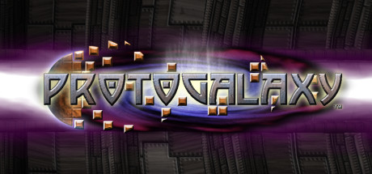

**Platforms:** Windows &nbsp;|&nbsp; **Genre:** Action, Indie &nbsp;|&nbsp; **Released:** October 6

> Earth is under siege! A mysterious and powerful alien race has come to enslave the entire galaxy, and your fleet is humanity's last hope. You must put an end to the attacks and rebuild a home for the survivors.
>
> _Synopsis source: Steam_

[Wikipedia](https://en.wikipedia.org/wiki/ProtoGalaxy) · [Steam](https://store.steampowered.com/app/60600)

---

### Pure Football

**Platforms:** PlayStation 3, Xbox 360 &nbsp;|&nbsp; **Developer:** Ubisoft Vancouver &nbsp;|&nbsp; **Publisher:** Ubisoft &nbsp;|&nbsp; **Genre:** Sports &nbsp;|&nbsp; **Released:** May 27, 2010

[Wikipedia](https://en.wikipedia.org/wiki/Pure_Football)

---

### Push Panic

**Platforms:** iOS &nbsp;|&nbsp; **Released:** November 23

[Wikipedia](https://en.wikipedia.org/wiki/Push_Panic)

---

### Puzzle Agent

**Platforms:** Windows, macOS, iOS, PlayStation Network &nbsp;|&nbsp; **Developer:** Telltale Games &nbsp;|&nbsp; **Publisher:** Telltale Games &nbsp;|&nbsp; **Genre:** Adventure, puzzle &nbsp;|&nbsp; **Released:** June 30, 2010

[Wikipedia](https://en.wikipedia.org/wiki/Puzzle_Agent)

---

### Puzzle Bots

**Platforms:** Windows &nbsp;|&nbsp; **Developer:** Ivy Games &nbsp;|&nbsp; **Publisher:** Wadjet Eye Games &nbsp;|&nbsp; **Genre:** Adventure &nbsp;|&nbsp; **Released:** May 7, 2010

[Wikipedia](https://en.wikipedia.org/wiki/Puzzle_Bots)

---

### Puzzle Quest 2

**Platforms:** Nintendo DS, Xbox 360, iOS, Windows Phone, Windows, Android &nbsp;|&nbsp; **Developer:** Infinite Interactive &nbsp;|&nbsp; **Publisher:** D3 Publisher, Namco Bandai Games &nbsp;|&nbsp; **Genre:** Puzzle RPG &nbsp;|&nbsp; **Released:** June 22, 2010

[Wikipedia](https://en.wikipedia.org/wiki/Puzzle_Quest_2)

---

### Qlione Evolve

**Platforms:** PlayStation 3 &nbsp;|&nbsp; **Released:** December 7

---

### Quake Live

**Platforms:** Windows &nbsp;|&nbsp; **Developer:** id Software &nbsp;|&nbsp; **Publisher:** Bethesda Softworks &nbsp;|&nbsp; **Genre:** First-person shooter &nbsp;|&nbsp; **Released:** August 6, 2010

[Wikipedia](https://en.wikipedia.org/wiki/Quake_Live)

---

### Quantum Theory

**Platforms:** PlayStation 3, Xbox 360 &nbsp;|&nbsp; **Released:** September 28

[Wikipedia](https://en.wikipedia.org/wiki/Quantum_Theory_(video_game))

---

### Quell

**Platforms:** iOS, Android, Windows &nbsp;|&nbsp; **Developer:** Fallen Tree Games &nbsp;|&nbsp; **Publisher:** Fallen Tree Games, Green Man Gaming, BulkyPix, CIRCLE Entertainment &nbsp;|&nbsp; **Genre:** Puzzle &nbsp;|&nbsp; **Released:** August 7, 2010

[Wikipedia](https://en.wikipedia.org/wiki/Quell_(video_game))

---

### R.U.S.E.

**Platforms:** Xbox 360, PlayStation 3, Windows &nbsp;|&nbsp; **Genre:** Strategy &nbsp;|&nbsp; **Released:** September 17

> A one-of-a-kind real-time strategy game that allows players to bluff their enemies to lead their nation to victory. The Definitive Edition — includes all DLCs and Steam Deck support.
>
> _Synopsis source: Steam_

[Wikipedia](https://en.wikipedia.org/wiki/R.U.S.E.) · [Steam](https://store.steampowered.com/app/21970)

---

### Racket Sports Party

**Platforms:** Wii, PlayStation 3 &nbsp;|&nbsp; **Developer:** Asobo Studio &nbsp;|&nbsp; **Publisher:** Ubisoft &nbsp;|&nbsp; **Genre:** Sports &nbsp;|&nbsp; **Released:** March 9, 2010

[Wikipedia](https://en.wikipedia.org/wiki/Racket_Sports_Party)

---

### Rage of the Gladiator

**Platforms:** Wii &nbsp;|&nbsp; **Released:** March 15

[Wikipedia](https://en.wikipedia.org/wiki/Rage_of_the_Gladiator)

---

### RAGE: Mutant Bash TV

**Platforms:** iOS &nbsp;|&nbsp; **Released:** November 18

[Wikipedia](https://en.wikipedia.org/wiki/Rage_(video_game)#Promotion)

---

### Ragnarok DS

**Platforms:** Nintendo DS &nbsp;|&nbsp; **Released:** February 16

[Wikipedia](https://en.wikipedia.org/wiki/Ragnarok_DS)

---

### Raskulls

**Platforms:** Xbox 360 &nbsp;|&nbsp; **Released:** December 29

[Wikipedia](https://en.wikipedia.org/wiki/Raskulls)

---

### Ravenwood Fair

**Platforms:** Facebook &nbsp;|&nbsp; **Developer:** Lolapps &nbsp;|&nbsp; **Publisher:** Lolapps, Inc. &nbsp;|&nbsp; **Genre:** Business sim, RPG &nbsp;|&nbsp; **Released:** October 19, 2010

[Wikipedia](https://en.wikipedia.org/wiki/Ravenwood_Fair)

---

### Raving Rabbids: Travel in Time

**Platforms:** Wii &nbsp;|&nbsp; **Released:** November 21

---

### Rayman 2

**Platforms:** iOS &nbsp;|&nbsp; **Released:** March 2

[Wikipedia](https://en.wikipedia.org/wiki/Rayman_2)

---

### Real Madrid Fantasy Manager

**Platforms:** Facebook, iOS &nbsp;|&nbsp; **Developer:** From The Bench &nbsp;|&nbsp; **Publisher:** Real Madrid CF &nbsp;|&nbsp; **Genre:** Role-Playing, Business Simulation &nbsp;|&nbsp; **Released:** September 17, 2010

[Wikipedia](https://en.wikipedia.org/wiki/Real_Madrid_Fantasy_Manager)

---

### Real Racing 2

**Platforms:** iOS &nbsp;|&nbsp; **Developer:** Firemint &nbsp;|&nbsp; **Publisher:** Firemint &nbsp;|&nbsp; **Genre:** Racing &nbsp;|&nbsp; **Released:** December 16, 2010

[Wikipedia](https://en.wikipedia.org/wiki/Real_Racing_2)

---

### Realm of the Titans

**Platforms:** Windows &nbsp;|&nbsp; **Developer:** Ningbo Shengguang Tianyi &nbsp;|&nbsp; **Publisher:** Aeria Games &nbsp;|&nbsp; **Genre:** Multiplayer online battle arena &nbsp;|&nbsp; **Released:** October 2010

[Wikipedia](https://en.wikipedia.org/wiki/Realm_of_the_Titans)

---

### Recettear: An Item Shop's Tale

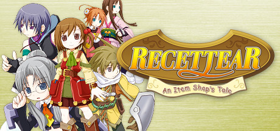

**Platforms:** Windows &nbsp;|&nbsp; **Genre:** RPG, Indie &nbsp;|&nbsp; **Released:** September 10

> Recettear is the story of an item shop, the girl who lives in it, and the fairy who turned her life upside down. Recette Lemongrass finds herself in charge of an item shop built into her house, in order to pay back a loan her father took and then skipped out on - and Tear, her newfound fairy "companion", won't take no for an answer!
>
> _Synopsis source: Steam_

[Steam](https://store.steampowered.com/app/70400)

---

### Record of Agarest War

**Platforms:** PlayStation 3, Xbox 360 &nbsp;|&nbsp; **Released:** April 27

[Wikipedia](https://en.wikipedia.org/wiki/Record_of_Agarest_War)

---

### Record of Agarest War 2

**Platforms:** PlayStation 3 &nbsp;|&nbsp; **Developer:** Idea Factory, Red Entertainment, Laughing Jackal &nbsp;|&nbsp; **Publisher:** Compile Heart, Aksys Games, Ghostlight &nbsp;|&nbsp; **Genre:** Tactical role-playing &nbsp;|&nbsp; **Released:** November 18, 2010

[Wikipedia](https://en.wikipedia.org/wiki/Record_of_Agarest_War_2)

---

### Red Dead Redemption

**Platforms:** PlayStation 3, Xbox 360 &nbsp;|&nbsp; **Publisher:** Rockstar Games &nbsp;|&nbsp; **Released:** May 18, 2010

[Wikipedia](https://en.wikipedia.org/wiki/Red_Dead_Redemption)

---

### Red Dead Redemption: Undead Nightmare

**Platforms:** PlayStation 3, Xbox 360 &nbsp;|&nbsp; **Released:** October 26

---

### Red Steel 2

**Platforms:** Wii &nbsp;|&nbsp; **Released:** March 23

[Wikipedia](https://en.wikipedia.org/wiki/Red_Steel_2)

---

### Resident Evil 5: Gold Edition

**Platforms:** PlayStation 3 &nbsp;|&nbsp; **Released:** March 9

[Wikipedia](https://en.wikipedia.org/wiki/Resident_Evil_5)

---

### Resonance of Fate

**Platforms:** Xbox 360, PlayStation 3 &nbsp;|&nbsp; **Released:** March 16

[Wikipedia](https://en.wikipedia.org/wiki/Resonance_of_Fate)

---

### Revenge of the Titans

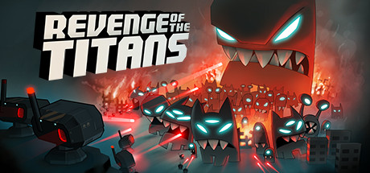

**Platforms:** Windows &nbsp;|&nbsp; **Genre:** Action, Indie, Strategy &nbsp;|&nbsp; **Released:** December 14

> The ultimate mash-up of Real-time Strategy and Tower Defense!
>
> _Synopsis source: Steam_

[Wikipedia](https://en.wikipedia.org/wiki/Revenge_of_the_Titans) · [Steam](https://store.steampowered.com/app/93200)

---

### RHEM 4: The Golden Fragments

**Platforms:** Windows, macOS &nbsp;|&nbsp; **Developer:** Knut Müller &nbsp;|&nbsp; **Publisher:** Lace Mamba Global &nbsp;|&nbsp; **Genre:** Graphic adventure &nbsp;|&nbsp; **Released:** July 30, 2010

[Wikipedia](https://en.wikipedia.org/wiki/RHEM_4:_The_Golden_Fragments)

---

### Ribbon Hero

**Developer:** Microsoft Office Labs &nbsp;|&nbsp; **Publisher:** Microsoft &nbsp;|&nbsp; **Genre:** Puzzle video game, interactive tutorial &nbsp;|&nbsp; **Released:** January 19, 2010

[Wikipedia](https://en.wikipedia.org/wiki/Ribbon_Hero)

---

### Riddim Ribbon

**Platforms:** iOS &nbsp;|&nbsp; **Developer:** Tapulous &nbsp;|&nbsp; **Publisher:** Tapulous &nbsp;|&nbsp; **Genre:** Music, Platformer

[Wikipedia](https://en.wikipedia.org/wiki/Riddim_Ribbon)

---

### Ridge Racer Drift

**Platforms:** Mobile phone, BlackBerry OS, Windows Mobile &nbsp;|&nbsp; **Developer:** Namco Bandai Games &nbsp;|&nbsp; **Publisher:** Namco Bandai Networks Europe/EA Mobile, Namco America Networks &nbsp;|&nbsp; **Genre:** Racing &nbsp;|&nbsp; **Released:** October 22, 2010

[Wikipedia](https://en.wikipedia.org/wiki/Ridge_Racer_Drift)

---

### Rimelands: Hammer of Thor

**Platforms:** iOS &nbsp;|&nbsp; **Developer:** Dicework Games &nbsp;|&nbsp; **Publisher:** Crescent Moon Games &nbsp;|&nbsp; **Genre:** Role-playing / Turn-based strategy &nbsp;|&nbsp; **Released:** September 2, 2010

[Wikipedia](https://en.wikipedia.org/wiki/Rimelands:_Hammer_of_Thor)

---

### Rise of Prussia

**Platforms:** Windows &nbsp;|&nbsp; **Released:** March 9

[Wikipedia](https://en.wikipedia.org/wiki/Rise_of_Prussia)

---

### Risen

**Platforms:** Xbox 360 &nbsp;|&nbsp; **Released:** February 22

[Wikipedia](https://en.wikipedia.org/wiki/Risen_(video_game))

---

### Risk: Factions

**Platforms:** Xbox 360, PlayStation 3, PlayStation Network, Windows, Steam, Facebook &nbsp;|&nbsp; **Developer:** Stainless Games &nbsp;|&nbsp; **Publisher:** Electronic Arts &nbsp;|&nbsp; **Genre:** Strategy &nbsp;|&nbsp; **Released:** June 23, 2010

[Wikipedia](https://en.wikipedia.org/wiki/Risk:_Factions)

---

### River City Soccer Hooligans

**Platforms:** Nintendo DS &nbsp;|&nbsp; **Released:** June 10

[Wikipedia](https://en.wikipedia.org/wiki/River_City_Soccer_Hooligans)

---

### Robocalypse: Beaver Defense

**Platforms:** Wii &nbsp;|&nbsp; **Developer:** Vogster Entertainment &nbsp;|&nbsp; **Publisher:** Vogster Entertainment &nbsp;|&nbsp; **Genre:** Tower defense &nbsp;|&nbsp; **Released:** May 31, 2010

[Wikipedia](https://en.wikipedia.org/wiki/Robocalypse:_Beaver_Defense)

---

### Robot Unicorn Attack

**Platforms:** Browser, iOS, Android &nbsp;|&nbsp; **Developer:** Spiritonin Media Games &nbsp;|&nbsp; **Publisher:** Adult Swim Games &nbsp;|&nbsp; **Genre:** Endless runner &nbsp;|&nbsp; **Released:** February 4, 2010

[Wikipedia](https://en.wikipedia.org/wiki/Robot_Unicorn_Attack)

---

### Robot Wants Kitty

**Platforms:** Browser &nbsp;|&nbsp; **Developer:** Hamumu Software &nbsp;|&nbsp; **Publisher:** Raptisoft &nbsp;|&nbsp; **Genre:** Platform-adventure, Metroidvania &nbsp;|&nbsp; **Released:** March 9, 2010

[Wikipedia](https://en.wikipedia.org/wiki/Robot_Wants_Kitty)

---

### Robox

**Platforms:** Wii &nbsp;|&nbsp; **Developer:** Dreambox Games &nbsp;|&nbsp; **Publisher:** Dreambox Games &nbsp;|&nbsp; **Genre:** Platform-adventure &nbsp;|&nbsp; **Released:** November 1, 2010

[Wikipedia](https://en.wikipedia.org/wiki/Robox)

---

### Rock Band 3

**Platforms:** Xbox 360, PlayStation 3, Wii, Nintendo DS &nbsp;|&nbsp; **Publisher:** MTV Games &nbsp;|&nbsp; **Released:** October 26, 2010

[Wikipedia](https://en.wikipedia.org/wiki/Rock_Band_3)

---

### Rock Band Reloaded

**Platforms:** iOS &nbsp;|&nbsp; **Developer:** EA Montreal &nbsp;|&nbsp; **Publisher:** EA Mobile &nbsp;|&nbsp; **Genre:** Rhythm &nbsp;|&nbsp; **Released:** December 2, 2010

[Wikipedia](https://en.wikipedia.org/wiki/Rock_Band_Reloaded)

---

### Rock of the Dead

**Platforms:** Xbox 360, PlayStation 3, Wii &nbsp;|&nbsp; **Released:** October 19

[Wikipedia](https://en.wikipedia.org/wiki/Rock_of_the_Dead_(video_game))

---

### Rock-Paper-Sumo

[Wikipedia](https://en.wikipedia.org/wiki/Rock-Paper-Sumo)

---

### Rocket Knight

**Platforms:** Windows, Xbox 360, PlayStation Network &nbsp;|&nbsp; **Released:** May 12

[Wikipedia](https://en.wikipedia.org/wiki/Rocket_Knight)

---

### Rooms: The Main Building

**Platforms:** Wii &nbsp;|&nbsp; **Released:** March 23

---

### Rudolph the Red-Nosed Reindeer

**Platforms:** Nintendo DS, Wii &nbsp;|&nbsp; **Released:** November 9

[Wikipedia](https://en.wikipedia.org/wiki/Rudolph_the_Red-Nosed_Reindeer_(video_game))

---

### Rugby League 3

**Platforms:** Wii &nbsp;|&nbsp; **Developer:** Sidhe Interactive &nbsp;|&nbsp; **Publisher:** Tru Blu Entertainment &nbsp;|&nbsp; **Genre:** Sports &nbsp;|&nbsp; **Released:** March 18, 2010

[Wikipedia](https://en.wikipedia.org/wiki/Rugby_League_3)

---

### Rugby League Live

**Platforms:** PlayStation 3, Xbox 360 &nbsp;|&nbsp; **Developer:** Big Ant Studios &nbsp;|&nbsp; **Publisher:** Tru Blu Entertainment &nbsp;|&nbsp; **Genre:** Sports &nbsp;|&nbsp; **Released:** August 27, 2010

[Wikipedia](https://en.wikipedia.org/wiki/Rugby_League_Live)

---

### Rulers of Nations

**Platforms:** Windows &nbsp;|&nbsp; **Developer:** Eversim &nbsp;|&nbsp; **Genre:** Government simulation game, Real-time strategy &nbsp;|&nbsp; **Released:** October 1, 2010

[Wikipedia](https://en.wikipedia.org/wiki/Rulers_of_Nations)

---

### Runaway: A Twist of Fate

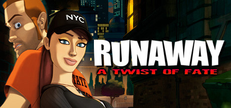

**Platforms:** Windows, Nintendo DS &nbsp;|&nbsp; **Genre:** Adventure &nbsp;|&nbsp; **Released:** May 18

> Runaway: A Twist of Fate is the adventure game of the year! Featuring a production worthy of a big 2D animated movie, Runaway follows a story full of twists and turns, and packed with comical highlights. All in all, you will be confronted with more than 200 mysteries and puzzles to keep your brain running through a big adventure that you...
>
> _Synopsis source: Steam_

[Steam](https://store.steampowered.com/app/58560)

---

### Rune Factory 3: A Fantasy Harvest Moon

**Platforms:** Nintendo DS &nbsp;|&nbsp; **Released:** November 9

---

### S.T.A.L.K.E.R.: Call of Pripyat

**Platforms:** Windows &nbsp;|&nbsp; **Released:** February 2

---

### Sackboy's Prehistoric Moves

**Platforms:** PlayStation 3 &nbsp;|&nbsp; **Released:** December 7

[Wikipedia](https://en.wikipedia.org/wiki/Sackboy%27s_Prehistoric_Moves)

---

### Sakura Wars: So Long, My Love

**Platforms:** PlayStation 2, Wii &nbsp;|&nbsp; **Released:** March 30

---

### Sam & Max: Beyond Time and Space

**Platforms:** Wii &nbsp;|&nbsp; **Released:** March 16

---

### Sam & Max: The Devil's Playhouse

**Platforms:** Windows, macOS, PlayStation 3, iOS &nbsp;|&nbsp; **Developer:** Telltale Games &nbsp;|&nbsp; **Publisher:** Telltale Games &nbsp;|&nbsp; **Genre:** Graphic adventure &nbsp;|&nbsp; **Released:** April 1, 2010

[Wikipedia](https://en.wikipedia.org/wiki/Sam_&_Max:_The_Devil's_Playhouse)

---

### Sam & Max: The Devil's Playhouse Episode 1: The Penal Zone

**Platforms:** Windows, macOS, PlayStation 3 &nbsp;|&nbsp; **Released:** April 15

---

### Samurai II: Vengeance

**Platforms:** iOS, Android, BlackBerry OS, Windows, macOS &nbsp;|&nbsp; **Developer:** Madfinger Games &nbsp;|&nbsp; **Publisher:** Madfinger Games &nbsp;|&nbsp; **Genre:** Hack and slash &nbsp;|&nbsp; **Released:** October 21, 2010

[Wikipedia](https://en.wikipedia.org/wiki/Samurai_II:_Vengeance)

---

### Samurai Shodown: Edge of Destiny

**Platforms:** Xbox 360 &nbsp;|&nbsp; **Released:** March 30

---

### Samurai Warriors 3

**Platforms:** Wii &nbsp;|&nbsp; **Released:** September 27

[Wikipedia](https://en.wikipedia.org/wiki/Samurai_Warriors_3)

---

### Sands of Destruction

**Platforms:** Nintendo DS &nbsp;|&nbsp; **Released:** January 12

[Wikipedia](https://en.wikipedia.org/wiki/Sands_of_Destruction)

---

### Saw II: Flesh & Blood

**Platforms:** PlayStation 3, Xbox 360 &nbsp;|&nbsp; **Released:** October 19

---

### SBK X: Superbike World Championship

**Platforms:** Windows, PlayStation 3, Xbox 360 &nbsp;|&nbsp; **Developer:** Milestone &nbsp;|&nbsp; **Publisher:** Black Bean Games &nbsp;|&nbsp; **Genre:** Motorcycle racing &nbsp;|&nbsp; **Released:** June 4, 2010

[Wikipedia](https://en.wikipedia.org/wiki/SBK_X:_Superbike_World_Championship)

---

### Scared Rider Xechs

[Wikipedia](https://en.wikipedia.org/wiki/Scared_Rider_Xechs)

---

### Scene It? Twilight

**Platforms:** Nintendo DS &nbsp;|&nbsp; **Released:** February 9

[Wikipedia](https://en.wikipedia.org/wiki/Scene_It%3F_Twilight)

---

### Scooby-Doo! And the Spooky Swamp

**Platforms:** PlayStation 2, Wii, Nintendo DS &nbsp;|&nbsp; **Released:** September 14

[Wikipedia](https://en.wikipedia.org/wiki/Scooby-Doo!_And_the_Spooky_Swamp)

---

### Scott Pilgrim vs. the World: The Game

**Platforms:** PlayStation Network, Xbox 360 &nbsp;|&nbsp; **Released:** August 10

---

### Scrap Metal

**Platforms:** Xbox 360 &nbsp;|&nbsp; **Developer:** Slick Entertainment &nbsp;|&nbsp; **Publisher:** Microsoft &nbsp;|&nbsp; **Genre:** Vehicular combat racing &nbsp;|&nbsp; **Released:** March 10, 2010

[Wikipedia](https://en.wikipedia.org/wiki/Scrap_Metal_(video_game))

---

### Secret Files 2: Puritas Cordis

**Platforms:** Windows &nbsp;|&nbsp; **Genre:** Adventure &nbsp;|&nbsp; **Released:** January 15

> The sequel to the award winning adventure hit Secret Files Tunguska. Famine in Africa, floods in Southeast Asia, economic crisis in Europe, and civil wars in South America, the world is on the brink of disaster.
>
> _Synopsis source: Steam_

[Steam](https://store.steampowered.com/app/40340)

---

### Secret of Mana

**Platforms:** iOS &nbsp;|&nbsp; **Released:** December 21

[Wikipedia](https://en.wikipedia.org/wiki/Secret_of_Mana)

---

### Section 8

**Platforms:** PlayStation 3 &nbsp;|&nbsp; **Released:** March 25

[Wikipedia](https://en.wikipedia.org/wiki/Section_8_(video_game))

---

### Sega Genesis Classics

**Platforms:** Windows &nbsp;|&nbsp; **Developer:** Sega, D3T &nbsp;|&nbsp; **Publisher:** Sega &nbsp;|&nbsp; **Genre:** Various &nbsp;|&nbsp; **Released:** June 1, 2010

[Wikipedia](https://en.wikipedia.org/wiki/Sega_Genesis_Classics)

---

### Sengoku Basara: Samurai Heroes

**Platforms:** PlayStation 3, Wii &nbsp;|&nbsp; **Released:** October 12

---

### Sengoku Collection

[Wikipedia](https://en.wikipedia.org/wiki/Sengoku_Collection)

---

### Sesame Street: Cookie's Counting Carnival

**Platforms:** Windows, Wii, Nintendo DS &nbsp;|&nbsp; **Developer:** Black Lantern Studios &nbsp;|&nbsp; **Publisher:** Warner Bros. Interactive Entertainment &nbsp;|&nbsp; **Genre:** Adventure, edutainment &nbsp;|&nbsp; **Released:** October 19, 2010

[Wikipedia](https://en.wikipedia.org/wiki/Sesame_Street:_Cookie's_Counting_Carnival)

---

### Sesame Street: Elmo's A-to-Zoo Adventure

**Platforms:** Windows, Wii, Nintendo DS &nbsp;|&nbsp; **Developer:** Black Lantern Studios &nbsp;|&nbsp; **Publisher:** Warner Bros. Interactive Entertainment &nbsp;|&nbsp; **Genre:** Adventure, edutainment &nbsp;|&nbsp; **Released:** October 19, 2010

[Wikipedia](https://en.wikipedia.org/wiki/Sesame_Street:_Elmo's_A-to-Zoo_Adventure)

---

### Shadow Cities

**Platforms:** iOS &nbsp;|&nbsp; **Developer:** Grey Area &nbsp;|&nbsp; **Publisher:** Grey Area &nbsp;|&nbsp; **Genre:** Location-based mobile game

[Wikipedia](https://en.wikipedia.org/wiki/Shadow_Cities)

---

### Shadow of Destiny

**Platforms:** PlayStation Portable &nbsp;|&nbsp; **Released:** January 26

[Wikipedia](https://en.wikipedia.org/wiki/Shadow_of_Destiny)

---

### ShadowPlay

**Platforms:** Wii &nbsp;|&nbsp; **Developer:** Deep Fried Entertainment &nbsp;|&nbsp; **Publisher:** Deep Fried Entertainment &nbsp;|&nbsp; **Genre:** Puzzle &nbsp;|&nbsp; **Released:** January 11, 2010

[Wikipedia](https://en.wikipedia.org/wiki/ShadowPlay)

---

### Shank

**Platforms:** Windows, PlayStation 3, Xbox 360 &nbsp;|&nbsp; **Developer:** Klei Entertainment &nbsp;|&nbsp; **Publisher:** Electronic Arts &nbsp;|&nbsp; **Genre:** Hack and slash &nbsp;|&nbsp; **Released:** August 24, 2010

[Wikipedia](https://en.wikipedia.org/wiki/Shank_(video_game))

---

### Shantae: Risky's Revenge

**Platforms:** Nintendo DS &nbsp;|&nbsp; **Released:** October 4

---

### Shaun White Skateboarding

**Platforms:** PlayStation 3, Wii, Windows, Xbox 360 &nbsp;|&nbsp; **Released:** October 24

[Wikipedia](https://en.wikipedia.org/wiki/Shaun_White_Skateboarding)

---

### Shenmue City

**Platforms:** Mobile phone &nbsp;|&nbsp; **Developer:** Ys Net &nbsp;|&nbsp; **Publisher:** Ys Net &nbsp;|&nbsp; **Genre:** Social role-playing video game &nbsp;|&nbsp; **Released:** December 2010

[Wikipedia](https://en.wikipedia.org/wiki/Shenmue_City)

---

### Sherlock Holmes and the Mystery of Osborne House

**Platforms:** Nintendo DS &nbsp;|&nbsp; **Developer:** Frogwares &nbsp;|&nbsp; **Publisher:** Frogwares, Focus Home Interactive, THQ &nbsp;|&nbsp; **Genre:** Adventure &nbsp;|&nbsp; **Released:** June 24, 2010

[Wikipedia](https://en.wikipedia.org/wiki/Sherlock_Holmes_and_the_Mystery_of_Osborne_House)

---

### Sherlock Holmes vs. Jack the Ripper

**Platforms:** Xbox 360 &nbsp;|&nbsp; **Released:** April 23

[Wikipedia](https://en.wikipedia.org/wiki/Sherlock_Holmes_vs._Jack_the_Ripper)

---

### Shin Megami Tensei: Strange Journey

**Platforms:** Nintendo DS &nbsp;|&nbsp; **Released:** March 23

---

### Shining Hearts

**Platforms:** PlayStation Portable &nbsp;|&nbsp; **Developer:** Studio Saizensen &nbsp;|&nbsp; **Publisher:** Sega &nbsp;|&nbsp; **Genre:** Role-playing &nbsp;|&nbsp; **Released:** December 16, 2010

[Wikipedia](https://en.wikipedia.org/wiki/Shining_Hearts)

---

### Shiren the Wanderer

**Platforms:** Wii &nbsp;|&nbsp; **Released:** February 9

[Wikipedia](https://en.wikipedia.org/wiki/Shiren_the_Wanderer_(2008_video_game))

---

### Shiren the Wanderer 4: The Eye of God and the Devil's Navel

**Platforms:** Nintendo DS &nbsp;|&nbsp; **Developer:** Chunsoft &nbsp;|&nbsp; **Publisher:** Spike, Spike Chunsoft &nbsp;|&nbsp; **Genre:** Role-playing &nbsp;|&nbsp; **Released:** February 25, 2010

[Wikipedia](https://en.wikipedia.org/wiki/Shiren_the_Wanderer_4:_The_Eye_of_God_and_the_Devil's_Navel)

---

### Shiren the Wanderer: The Tower of Fortune and the Dice of Fate

**Platforms:** Nintendo DS &nbsp;|&nbsp; **Developer:** Chunsoft &nbsp;|&nbsp; **Publisher:** Chunsoft, Spike Chunsoft, Aksys Games &nbsp;|&nbsp; **Genre:** Roguelike, role-playing &nbsp;|&nbsp; **Released:** December 9, 2010

[Wikipedia](https://en.wikipedia.org/wiki/Shiren_the_Wanderer:_The_Tower_of_Fortune_and_the_Dice_of_Fate)

---

### Shonen Kininden Tsumuji

**Platforms:** Nintendo DS &nbsp;|&nbsp; **Developer:** Neuron Age &nbsp;|&nbsp; **Publisher:** Electronic Arts &nbsp;|&nbsp; **Genre:** Action-adventure &nbsp;|&nbsp; **Released:** February 25, 2010

[Wikipedia](https://en.wikipedia.org/wiki/Shonen_Kininden_Tsumuji)

---

### Shrek Forever After

**Platforms:** iOS, Nintendo DS, PlayStation 3, Wii, Windows, Xbox 360 &nbsp;|&nbsp; **Released:** May 18

[Wikipedia](https://en.wikipedia.org/wiki/Shrek_Forever_After_(video_game))

---

### Sibak Al Fursan (Race of the Horsemen)

**Platforms:** Windows &nbsp;|&nbsp; **Developer:** Kuma Reality Games &nbsp;|&nbsp; **Publisher:** Kuma Reality Games &nbsp;|&nbsp; **Genre:** Racing

[Wikipedia](https://en.wikipedia.org/wiki/Sibak_Al_Fursan_(Race_of_the_Horsemen))

---

### Silent Hill: Shattered Memories

**Platforms:** PlayStation 2, PlayStation Portable &nbsp;|&nbsp; **Released:** January 19

---

### Silent Hunter 5: Battle of the Atlantic

**Platforms:** Windows &nbsp;|&nbsp; **Developer:** Ubisoft Bucharest &nbsp;|&nbsp; **Publisher:** Ubisoft &nbsp;|&nbsp; **Genre:** Submarine simulator &nbsp;|&nbsp; **Released:** March 2, 2010

[Wikipedia](https://en.wikipedia.org/wiki/Silent_Hunter_5:_Battle_of_the_Atlantic)

---

### Silent Hunter V: Battle of the Atlantic

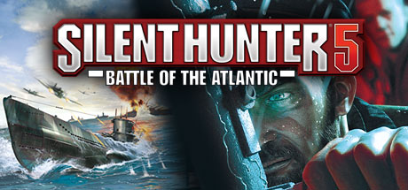

**Platforms:** Windows &nbsp;|&nbsp; **Genre:** Simulation &nbsp;|&nbsp; **Released:** March 2

> Step behind the periscope of a German U-boat and take on the Allied Forces in famous battles across the vast Atlantic Ocean and Mediterranean Sea. The best-selling submarine series of all time continues with the highly anticipated Silent Hunter: Battle of the Atlantic.
>
> _Synopsis source: Steam_

[Steam](https://store.steampowered.com/app/48110)

---

### Silent Line: Armored Core

**Platforms:** PlayStation Portable &nbsp;|&nbsp; **Released:** February 4

---

### Silverfish

**Platforms:** iOS &nbsp;|&nbsp; **Developer:** Chaotic Box &nbsp;|&nbsp; **Publisher:** Chaotic Box &nbsp;|&nbsp; **Genre:** Action game &nbsp;|&nbsp; **Released:** November 9, 2010

[Wikipedia](https://en.wikipedia.org/wiki/Silverfish_(video_game))

---

### SimCity Deluxe

**Platforms:** iOS &nbsp;|&nbsp; **Released:** July 29

[Wikipedia](https://en.wikipedia.org/wiki/SimCity#SmiCity_Deluxe_and_SimCity_Deluxe_HD)

---

### Sin and Punishment: Star Successor

**Platforms:** Wii &nbsp;|&nbsp; **Released:** June 27

---

### SingStar Dance

**Platforms:** PlayStation 3 &nbsp;|&nbsp; **Developer:** London Studio &nbsp;|&nbsp; **Publisher:** Sony Computer Entertainment &nbsp;|&nbsp; **Genre:** Music, exercise &nbsp;|&nbsp; **Released:** November 5, 2010

[Wikipedia](https://en.wikipedia.org/wiki/SingStar_Dance)

---

### SingStar Guitar

**Platforms:** PlayStation 3 &nbsp;|&nbsp; **Developer:** London Studio &nbsp;|&nbsp; **Publisher:** Sony Computer Entertainment &nbsp;|&nbsp; **Genre:** Music &nbsp;|&nbsp; **Released:** October 15, 2010

[Wikipedia](https://en.wikipedia.org/wiki/SingStar_Guitar)

---

### Singularity

**Platforms:** Windows, Xbox 360, PlayStation 3 &nbsp;|&nbsp; **Genre:** Simulation, Strategy &nbsp;|&nbsp; **Released:** June 29

> In this massive RTS game, command vast armies fighting for control of entire worlds. Control the forces of Earth, the mechanical AI Substrate, or the enigmatic Post-Human Coalition as you battle across the solar system in single player, cooperative multiplayer, or competitive multiplayer.
>
> _Synopsis source: Steam_

[Wikipedia](https://en.wikipedia.org/wiki/Singularity_(video_game)) · [Steam](https://store.steampowered.com/app/3499790)

---

### Skate 3

**Platforms:** PlayStation 3, Xbox 360 &nbsp;|&nbsp; **Released:** May 11

[Wikipedia](https://en.wikipedia.org/wiki/Skate_3)

---

### Ski-Doo: Snowmobile Challenge

**Platforms:** Xbox 360 &nbsp;|&nbsp; **Released:** March 24

---

### Sled Shred featuring the Jamaican Bobsled Team

**Platforms:** Wii &nbsp;|&nbsp; **Developer:** Just for Fun Studios &nbsp;|&nbsp; **Publisher:** SouthPeak Games &nbsp;|&nbsp; **Genre:** Sports, Racing &nbsp;|&nbsp; **Released:** October 12, 2010

[Wikipedia](https://en.wikipedia.org/wiki/Sled_Shred_featuring_the_Jamaican_Bobsled_Team)

---

### Slice It!

**Platforms:** iOS, Android, Nintendo 3DS &nbsp;|&nbsp; **Developer:** Com2uS Studios, Arc System Works &nbsp;|&nbsp; **Publisher:** Com2uS Studios, Arc System Works, Aksys Games &nbsp;|&nbsp; **Genre:** Puzzle &nbsp;|&nbsp; **Released:** August 31, 2010

[Wikipedia](https://en.wikipedia.org/wiki/Slice_It!)

---

### Sniper: Ghost Warrior

**Platforms:** Windows, Xbox 360 &nbsp;|&nbsp; **Genre:** Action &nbsp;|&nbsp; **Released:** June 29

> As a Ghost Warrior, an elite sniper in a highly trained special ops unit, your unique skills in the art of stalking, target detection, surveillance and shooting accuracy will determine mission success.
>
> _Synopsis source: Steam_

[Steam](https://store.steampowered.com/app/34830)

---

### Snoopy Flying Ace

**Platforms:** Xbox 360 &nbsp;|&nbsp; **Released:** June 2

[Wikipedia](https://en.wikipedia.org/wiki/Snoopy_Flying_Ace)

---

### Snowpack Park

**Platforms:** Wii &nbsp;|&nbsp; **Developer:** Skip Ltd. &nbsp;|&nbsp; **Publisher:** Nintendo &nbsp;|&nbsp; **Genre:** Life simulation &nbsp;|&nbsp; **Released:** November 22, 2010

[Wikipedia](https://en.wikipedia.org/wiki/Snowpack_Park)

---

### So Blonde: Back to the Island

**Platforms:** Wii, Nintendo DS &nbsp;|&nbsp; **Developer:** Wizarbox &nbsp;|&nbsp; **Publisher:** dtp Entertainment &nbsp;|&nbsp; **Genre:** Adventure &nbsp;|&nbsp; **Released:** March 26, 2010

[Wikipedia](https://en.wikipedia.org/wiki/So_Blonde:_Back_to_the_Island)

---

### Social City

**Platforms:** Browser, iOS, Facebook &nbsp;|&nbsp; **Developer:** PushButton Labs, Playdom Eugene &nbsp;|&nbsp; **Publisher:** Playdom &nbsp;|&nbsp; **Genre:** City-building, Simulation &nbsp;|&nbsp; **Released:** March 2010

[Wikipedia](https://en.wikipedia.org/wiki/Social_City)

---

### SOCOM U.S. Navy SEALs: Fireteam Bravo 3

**Platforms:** PlayStation Portable &nbsp;|&nbsp; **Released:** February 16

---

### Solipskier

**Platforms:** Browser, iOS, Android &nbsp;|&nbsp; **Developer:** Mikengreg &nbsp;|&nbsp; **Publisher:** Kongregate &nbsp;|&nbsp; **Genre:** Sports &nbsp;|&nbsp; **Released:** August 29, 2010

[Wikipedia](https://en.wikipedia.org/wiki/Solipskier)

---

### Sonic & Sega All-Stars Racing

**Platforms:** PlayStation 3, Xbox 360, Nintendo DS, Wii, Windows &nbsp;|&nbsp; **Genre:** Racing &nbsp;|&nbsp; **Released:** February 23

> SONIC AND SEGA ALL-STARS RACE FOR VICTORY IN A HIGH SPEED HIGH SKILL RACETRACK SHOWDOWN! TAKE TO THE TRACK BY CAR, MONSTER TRUCK, BIKE AND EVEN AEROPLANE IN SONIC &amp; SEGA ALL-STARS RACING. Explore stunning new circuits including Sonic Seaside Hill, Curien Mansion and Blizzard Castle as you zip around medieval castle ramparts, hurtle...
>
> _Synopsis source: Steam_

[Wikipedia](https://en.wikipedia.org/wiki/Sonic_%26_Sega_All-Stars_Racing) · [Steam](https://store.steampowered.com/app/34190)

---

### Sonic Classic Collection

**Platforms:** Nintendo DS &nbsp;|&nbsp; **Released:** March 2

[Wikipedia](https://en.wikipedia.org/wiki/Sonic_Classic_Collection)

---

### Sonic Colors

**Platforms:** Wii, Nintendo DS &nbsp;|&nbsp; **Released:** November 16

[Wikipedia](https://en.wikipedia.org/wiki/Sonic_Colors)

---

### Sonic Free Riders

**Platforms:** Xbox 360 &nbsp;|&nbsp; **Released:** November 4

[Wikipedia](https://en.wikipedia.org/wiki/Sonic_Free_Riders)

---

### Sonic the Hedgehog 4: Episode 1

**Platforms:** iOS, Wii, PlayStation Network, Xbox 360 &nbsp;|&nbsp; **Released:** October 7

---

### Sonic the Hedgehog 4: Episode I

**Platforms:** iOS, Wii, PlayStation 3, Xbox 360 &nbsp;|&nbsp; **Developer:** Dimps, Sonic Team &nbsp;|&nbsp; **Publisher:** Sega &nbsp;|&nbsp; **Genre:** Platform &nbsp;|&nbsp; **Released:** October 7, 2010

[Wikipedia](https://en.wikipedia.org/wiki/Sonic_the_Hedgehog_4:_Episode_I)

---

### Sonny with a Chance

**Platforms:** Nintendo DS &nbsp;|&nbsp; **Released:** March 16

[Wikipedia](https://en.wikipedia.org/wiki/Sonny_with_a_Chance)

---

### Sound of the Sky

[Wikipedia](https://en.wikipedia.org/wiki/Sound_of_the_Sky)

---

### Space Ark

**Platforms:** Xbox 360, Windows &nbsp;|&nbsp; **Developer:** Strawdog Studios &nbsp;|&nbsp; **Publisher:** Strawdog Studios &nbsp;|&nbsp; **Genre:** Arcade &nbsp;|&nbsp; **Released:** June 16, 2010

[Wikipedia](https://en.wikipedia.org/wiki/Space_Ark)

---

### Space Funeral

**Platforms:** Windows &nbsp;|&nbsp; **Developer:** Stephen "thecatamites" Gillmurphy &nbsp;|&nbsp; **Genre:** Role-playing &nbsp;|&nbsp; **Released:** September 17, 2010

[Wikipedia](https://en.wikipedia.org/wiki/Space_Funeral)

---

### Space Invaders Infinity Gene

**Platforms:** PlayStation 3, Xbox 360 &nbsp;|&nbsp; **Released:** September 14

[Wikipedia](https://en.wikipedia.org/wiki/Space_Invaders_Infinity_Gene)

---

### Space Miner: Space Ore Bust

**Platforms:** iOS &nbsp;|&nbsp; **Released:** February 5

---

### Spaceball Revolution

**Platforms:** PlayStation Portable, Nintendo DS &nbsp;|&nbsp; **Released:** February 11

[Wikipedia](https://en.wikipedia.org/wiki/Spaceball_Revolution)

---

### SpaceEngine

[Wikipedia](https://en.wikipedia.org/wiki/SpaceEngine)

---

### Spacetime Studios

[Wikipedia](https://en.wikipedia.org/wiki/Spacetime_Studios)

---

### Speed Dreams

[Wikipedia](https://en.wikipedia.org/wiki/Speed_Dreams)

---

### Spelunker HD

**Platforms:** PlayStation Network &nbsp;|&nbsp; **Released:** November 23

[Wikipedia](https://en.wikipedia.org/wiki/Spelunker_HD)

---

### Spider-Man: Shattered Dimensions

**Platforms:** Nintendo DS, PlayStation 3, Wii, Xbox 360 &nbsp;|&nbsp; **Released:** September 7

---

### Spinzizzle

**Platforms:** iOS, Android &nbsp;|&nbsp; **Developer:** PressOK Entertainment &nbsp;|&nbsp; **Released:** May 21, 2010

[Wikipedia](https://en.wikipedia.org/wiki/Spinzizzle)

---

### Spirits

**Platforms:** iOS &nbsp;|&nbsp; **Developer:** Spaces of Play &nbsp;|&nbsp; **Publisher:** Spaces of Play &nbsp;|&nbsp; **Genre:** Puzzle, strategy &nbsp;|&nbsp; **Released:** November 11, 2010

[Wikipedia](https://en.wikipedia.org/wiki/Spirits_(video_game))

---

### Splatterhouse

**Platforms:** Xbox 360, PlayStation 3 &nbsp;|&nbsp; **Released:** November 23

[Wikipedia](https://en.wikipedia.org/wiki/Splatterhouse_(2010_video_game))

---

### Split Second: Velocity

**Platforms:** Windows, Xbox 360, PlayStation 3 &nbsp;|&nbsp; **Released:** May 18

[Wikipedia](https://en.wikipedia.org/wiki/Split_Second_(video_game))

---

### Split/Second

**Platforms:** PlayStation Portable &nbsp;|&nbsp; **Released:** November 16

[Wikipedia](https://en.wikipedia.org/wiki/Split/Second)

---

### SpongeBob's Boating Bash

**Platforms:** Nintendo DS, Wii &nbsp;|&nbsp; **Released:** March 2

[Wikipedia](https://en.wikipedia.org/wiki/SpongeBob%27s_Boating_Bash)

---

### Sports Champions

**Platforms:** PlayStation 3 &nbsp;|&nbsp; **Developer:** San Diego Studio, Zindagi Games &nbsp;|&nbsp; **Publisher:** Sony Computer Entertainment &nbsp;|&nbsp; **Genre:** Sports &nbsp;|&nbsp; **Released:** September 15, 2010

[Wikipedia](https://en.wikipedia.org/wiki/Sports_Champions)

---

### Star Ocean: The Last Hope International

**Platforms:** PlayStation 3 &nbsp;|&nbsp; **Released:** February 8

---

### Star Ruler

**Platforms:** Windows &nbsp;|&nbsp; **Developer:** Blind Mind Studios &nbsp;|&nbsp; **Publisher:** Interactive Gaming Software, Iceberg Interactive &nbsp;|&nbsp; **Genre:** Real-time strategy / 4X &nbsp;|&nbsp; **Released:** August 21, 2010

[Wikipedia](https://en.wikipedia.org/wiki/Star_Ruler)

---

### Star Trek Fyne

[Wikipedia](https://en.wikipedia.org/wiki/Star_Trek_Fyne)

---

### Star Trek Online

**Platforms:** Windows &nbsp;|&nbsp; **Genre:** Massively Multiplayer, RPG, Free To Play &nbsp;|&nbsp; **Released:** February 2

> In Star Trek Online, the Star Trek universe appears for the first time on a truly massive scale. Players take the captain's chair as they command their own starship and crew. Explore strange new worlds, seek out new life and new civilizations, and boldly go where no one has gone before.
>
> _Synopsis source: Steam_

[Wikipedia](https://en.wikipedia.org/wiki/Star_Trek_Online) · [Steam](https://store.steampowered.com/app/9900)

---

### Star Wars: Cantina

**Platforms:** iOS &nbsp;|&nbsp; **Released:** April 2

---

### Star Wars: The Battle for Hoth

**Platforms:** iOS, Windows Mobile &nbsp;|&nbsp; **Developer:** FluffyLogic &nbsp;|&nbsp; **Publisher:** THQ &nbsp;|&nbsp; **Genre:** Real-time strategy &nbsp;|&nbsp; **Released:** July 15, 2010

[Wikipedia](https://en.wikipedia.org/wiki/Star_Wars:_The_Battle_for_Hoth)

---

### Star Wars: The Force Unleashed II

**Platforms:** PlayStation 3, Xbox 360, Windows, Wii, Nintendo DS &nbsp;|&nbsp; **Genre:** Action &nbsp;|&nbsp; **Released:** October 26

> The Star Wars® Saga continues with Star Wars®: The Force Unleashed™ II, the highly anticipated sequel to the fastest-selling Star Wars game ever created.
>
> _Synopsis source: Steam_

[Steam](https://store.steampowered.com/app/32500)

---

### StarCraft II: Wings of Liberty

**Platforms:** Windows, macOS &nbsp;|&nbsp; **Publisher:** Blizzard Entertainment &nbsp;|&nbsp; **Released:** July 27, 2010

---

### StarDunk

**Platforms:** iOS &nbsp;|&nbsp; **Released:** July 12

[Wikipedia](https://en.wikipedia.org/wiki/StarDunk)

---

### Stargate Resistance

**Platforms:** Windows &nbsp;|&nbsp; **Released:** February 10

[Wikipedia](https://en.wikipedia.org/wiki/Stargate_Resistance)

---

### Starpoint Gemini

**Platforms:** Windows &nbsp;|&nbsp; **Developer:** Little Green Men Games &nbsp;|&nbsp; **Publisher:** Iceberg Interactive &nbsp;|&nbsp; **Genre:** Real-time strategy, role-playing &nbsp;|&nbsp; **Released:** December 15, 2010

[Wikipedia](https://en.wikipedia.org/wiki/Starpoint_Gemini)

---

### Starship Defense

**Platforms:** Nintendo DS &nbsp;|&nbsp; **Released:** January 18

[Wikipedia](https://en.wikipedia.org/wiki/Q-Games#Games_developed)

---

### Start the Party!

**Platforms:** PlayStation 3 &nbsp;|&nbsp; **Developer:** Supermassive Games &nbsp;|&nbsp; **Publisher:** Sony Computer Entertainment &nbsp;|&nbsp; **Genre:** Party &nbsp;|&nbsp; **Released:** September 15, 2010

[Wikipedia](https://en.wikipedia.org/wiki/Start_the_Party!)

---

### SteamWorld Tower Defense

**Platforms:** Nintendo DS &nbsp;|&nbsp; **Developer:** Image & Form &nbsp;|&nbsp; **Publisher:** Image & Form &nbsp;|&nbsp; **Genre:** Real-time strategy, tower defense &nbsp;|&nbsp; **Released:** July 5, 2010

[Wikipedia](https://en.wikipedia.org/wiki/SteamWorld_Tower_Defense)

---

### Steel Storm

**Platforms:** Windows, macOS, Linux &nbsp;|&nbsp; **Developer:** Kot-in-Action Creative Artel &nbsp;|&nbsp; **Genre:** Arcade shooter &nbsp;|&nbsp; **Released:** September 9, 2010

[Wikipedia](https://en.wikipedia.org/wiki/Steel_Storm)

---

### Strategic Command WWII Global Conflict

**Platforms:** Windows &nbsp;|&nbsp; **Developer:** Fury Software &nbsp;|&nbsp; **Publisher:** Battlefront.com &nbsp;|&nbsp; **Genre:** Turn-based strategy &nbsp;|&nbsp; **Released:** March 5, 2010

[Wikipedia](https://en.wikipedia.org/wiki/Strategic_Command_WWII_Global_Conflict)

---

### Streemerz

**Platforms:** Browser, Nintendo Entertainment System &nbsp;|&nbsp; **Developer:** Arthur Lee &nbsp;|&nbsp; **Publisher:** Arthur Lee &nbsp;|&nbsp; **Genre:** Platformer

[Wikipedia](https://en.wikipedia.org/wiki/Streemerz)

---

### Street Fighter IV

**Platforms:** iOS &nbsp;|&nbsp; **Released:** March 10

[Wikipedia](https://en.wikipedia.org/wiki/Street_Fighter_IV)

---

### Strimko

[Wikipedia](https://en.wikipedia.org/wiki/Strimko)

---

### Super Crate Box

**Platforms:** Windows, macOS &nbsp;|&nbsp; **Developer:** Vlambeer &nbsp;|&nbsp; **Publisher:** Vlambeer &nbsp;|&nbsp; **Genre:** Shoot 'em up &nbsp;|&nbsp; **Released:** October 22, 2010

[Wikipedia](https://en.wikipedia.org/wiki/Super_Crate_Box)

---

### Super Hydorah

**Developer:** Locomalito &nbsp;|&nbsp; **Publisher:** Abylight Studios &nbsp;|&nbsp; **Genre:** Side-scrolling shoot 'em up

[Wikipedia](https://en.wikipedia.org/wiki/Super_Hydorah)

---

### Super Mario All-Stars

**Platforms:** Wii &nbsp;|&nbsp; **Released:** December 12

[Wikipedia](https://en.wikipedia.org/wiki/Super_Mario_All-Stars)

---

### Super Mario Bros. Crossover

**Platforms:** Windows, macOS, Linux, Browser &nbsp;|&nbsp; **Developer:** Jay Pavlina &nbsp;|&nbsp; **Publisher:** Exploding Rabbit &nbsp;|&nbsp; **Genre:** Platforming &nbsp;|&nbsp; **Released:** April 27, 2010

[Wikipedia](https://en.wikipedia.org/wiki/Super_Mario_Bros._Crossover)

---

### Super Mario Galaxy 2

**Platforms:** Wii &nbsp;|&nbsp; **Publisher:** Nintendo &nbsp;|&nbsp; **Released:** May 23, 2010

[Wikipedia](https://en.wikipedia.org/wiki/Super_Mario_Galaxy_2)

---

### Super Meat Boy

**Platforms:** Xbox 360, Windows &nbsp;|&nbsp; **Publisher:** Team Meat &nbsp;|&nbsp; **Genre:** Indie &nbsp;|&nbsp; **Released:** October 20, 2010

> The infamous, tough-as-nails platformer comes to Steam with a playable Head Crab character (Steam-exclusive)!
>
> _Synopsis source: Steam_

[Wikipedia](https://en.wikipedia.org/wiki/Super_Meat_Boy) · [Steam](https://store.steampowered.com/app/40800)

---

### Super Mega Worm

**Platforms:** iOS &nbsp;|&nbsp; **Developer:** Deceased Pixel &nbsp;|&nbsp; **Publisher:** Deceased Pixel &nbsp;|&nbsp; **Genre:** Action &nbsp;|&nbsp; **Released:** August 26, 2010

[Wikipedia](https://en.wikipedia.org/wiki/Super_Mega_Worm)

---

### Super Monkey Ball 2: Sakura Edition

**Platforms:** iOS &nbsp;|&nbsp; **Released:** April 1

[Wikipedia](https://en.wikipedia.org/wiki/Super_Monkey_Ball#Games)

---

### Super Monkey Ball: Step & Roll

**Platforms:** Wii &nbsp;|&nbsp; **Released:** February 9

---

### Super QuickHook

**Platforms:** iOS &nbsp;|&nbsp; **Developer:** Rocketcat Games &nbsp;|&nbsp; **Publisher:** Rocketcat Games, Noodlecake Studios &nbsp;|&nbsp; **Genre:** 2D platformer &nbsp;|&nbsp; **Released:** June 17, 2010

[Wikipedia](https://en.wikipedia.org/wiki/Super_QuickHook)

---

### Super Robot Wars OG Saga: Endless Frontier Exceed

**Platforms:** Nintendo DS &nbsp;|&nbsp; **Developer:** Monolith Soft &nbsp;|&nbsp; **Publisher:** Bandai Namco Games &nbsp;|&nbsp; **Genre:** Role-playing &nbsp;|&nbsp; **Released:** February 25, 2010

[Wikipedia](https://en.wikipedia.org/wiki/Super_Robot_Wars_OG_Saga:_Endless_Frontier_Exceed)

---

### Super Scribblenauts

**Platforms:** Nintendo DS &nbsp;|&nbsp; **Released:** October 12

[Wikipedia](https://en.wikipedia.org/wiki/Super_Scribblenauts)

---

### Super Sentai Battle: Dice-O

**Platforms:** Arcade &nbsp;|&nbsp; **Publisher:** Bandai &nbsp;|&nbsp; **Genre:** Arcade &nbsp;|&nbsp; **Released:** March 4, 2010

[Wikipedia](https://en.wikipedia.org/wiki/Super_Sentai_Battle:_Dice-O)

---

### Super Street Fighter IV

**Platforms:** PlayStation 3, Xbox 360 &nbsp;|&nbsp; **Publisher:** Capcom &nbsp;|&nbsp; **Released:** April 27, 2010

[Wikipedia](https://en.wikipedia.org/wiki/Super_Street_Fighter_IV)

---

### Super Street Fighter IV: Arcade Edition

**Platforms:** Arcade, PlayStation 3, Xbox 360 &nbsp;|&nbsp; **Developer:** Capcom, Dimps &nbsp;|&nbsp; **Publisher:** Capcom &nbsp;|&nbsp; **Genre:** Fighting &nbsp;|&nbsp; **Released:** December 16, 2010

[Wikipedia](https://en.wikipedia.org/wiki/Super_Street_Fighter_IV:_Arcade_Edition)

---

### Super Swap

**Platforms:** Nintendo DS &nbsp;|&nbsp; **Developer:** Teyon &nbsp;|&nbsp; **Publisher:** Selectsoft &nbsp;|&nbsp; **Genre:** Puzzle &nbsp;|&nbsp; **Released:** June 21, 2010

[Wikipedia](https://en.wikipedia.org/wiki/Super_Swap)

---

### Supreme Commander 2

**Platforms:** Windows, Xbox 360 &nbsp;|&nbsp; **Genre:** Strategy &nbsp;|&nbsp; **Released:** March 2

> Includes 47 Steam achievements, leaderboards, and stats!
>
> _Synopsis source: Steam_

[Wikipedia](https://en.wikipedia.org/wiki/Supreme_Commander_2) · [Steam](https://store.steampowered.com/app/40100)

---

### Sword & Poker

**Platforms:** iOS &nbsp;|&nbsp; **Developer:** Gaia &nbsp;|&nbsp; **Publisher:** Konami &nbsp;|&nbsp; **Genre:** Role-playing &nbsp;|&nbsp; **Released:** January 7, 2010

[Wikipedia](https://en.wikipedia.org/wiki/Sword_&_Poker)

---

### Syphon Filter: Logan's Shadow

**Platforms:** PlayStation 2 &nbsp;|&nbsp; **Released:** June 1

---

### System Flaw

**Platforms:** Nintendo DS &nbsp;|&nbsp; **Released:** April 26

[Wikipedia](https://en.wikipedia.org/wiki/System_Flaw)

---

### Taishō Baseball Girls

[Wikipedia](https://en.wikipedia.org/wiki/Taish%C5%8D_Baseball_Girls)

---

### Tales of Phantasia: Narikiri Dungeon X

**Platforms:** PlayStation Portable &nbsp;|&nbsp; **Developer:** Namco Tales Studio &nbsp;|&nbsp; **Publisher:** Namco Bandai Games &nbsp;|&nbsp; **Genre:** Action role-playing game &nbsp;|&nbsp; **Released:** August 5, 2010

[Wikipedia](https://en.wikipedia.org/wiki/Tales_of_Phantasia:_Narikiri_Dungeon_X)

---

### Talking Tom & Friends

[Wikipedia](https://en.wikipedia.org/wiki/Talking_Tom_&_Friends)

---

### Tangled: The Video Game

**Platforms:** Nintendo DS, Wii, Windows &nbsp;|&nbsp; **Released:** November 23

---

### Tantei Opera Milky Holmes

[Wikipedia](https://en.wikipedia.org/wiki/Tantei_Opera_Milky_Holmes)

---

### Tatsunoko vs. Capcom

**Platforms:** Arcade, Wii &nbsp;|&nbsp; **Developer:** Eighting &nbsp;|&nbsp; **Publisher:** Capcom &nbsp;|&nbsp; **Genre:** Fighting &nbsp;|&nbsp; **Released:** January 26, 2010

[Wikipedia](https://en.wikipedia.org/wiki/Tatsunoko_vs._Capcom)

---

### Tatsunoko vs. Capcom: Ultimate All-Stars

**Platforms:** Wii &nbsp;|&nbsp; **Released:** January 26

---

### Tears to Tiara

[Wikipedia](https://en.wikipedia.org/wiki/Tears_to_Tiara)

---

### Tecmo Bowl Throwback

**Platforms:** Xbox 360, PlayStation Network &nbsp;|&nbsp; **Released:** April 28

[Wikipedia](https://en.wikipedia.org/wiki/Tecmo_Bowl_Throwback)

---

### Tetris Party Deluxe

**Platforms:** Wii &nbsp;|&nbsp; **Released:** May 25

[Wikipedia](https://en.wikipedia.org/wiki/Tetris_Party_Deluxe)

---

### The Ball

**Platforms:** Windows, OnLive &nbsp;|&nbsp; **Developer:** Teotl Studios &nbsp;|&nbsp; **Publisher:** Tripwire Interactive &nbsp;|&nbsp; **Genre:** Action-adventure &nbsp;|&nbsp; **Released:** October 26, 2010

[Wikipedia](https://en.wikipedia.org/wiki/The_Ball_(video_game))

---

### The Biggest Loser: Challenge

**Platforms:** Wii &nbsp;|&nbsp; **Released:** November 4

---

### The Dream Machine

**Platforms:** Windows, macOS &nbsp;|&nbsp; **Developer:** Cockroach Inc. &nbsp;|&nbsp; **Publisher:** Cockroach Inc. &nbsp;|&nbsp; **Genre:** Point-and-click adventure &nbsp;|&nbsp; **Released:** December 14, 2010

[Wikipedia](https://en.wikipedia.org/wiki/The_Dream_Machine_(video_game))

---

### The Eye of Judgment: Legends

**Platforms:** PlayStation Portable &nbsp;|&nbsp; **Released:** March 9

---

### The Fight: Lights Out

**Platforms:** PlayStation 3 &nbsp;|&nbsp; **Released:** November 9

---

### The Green Hornet: Wheels of Justice

**Platforms:** iOS &nbsp;|&nbsp; **Released:** November 9

---

### The Incident

**Platforms:** iOS &nbsp;|&nbsp; **Developer:** Big Bucket Software &nbsp;|&nbsp; **Publisher:** Big Bucket Software &nbsp;|&nbsp; **Genre:** Platform &nbsp;|&nbsp; **Released:** August 10, 2010

[Wikipedia](https://en.wikipedia.org/wiki/The_Incident_(video_game))

---

### The Journey Down

**Developer:** Skygoblin &nbsp;|&nbsp; **Publisher:** Skygoblin &nbsp;|&nbsp; **Genre:** Adventure &nbsp;|&nbsp; **Released:** August 18, 2010

[Wikipedia](https://en.wikipedia.org/wiki/The_Journey_Down)

---

### The Kings' Crusade

**Platforms:** Windows &nbsp;|&nbsp; **Developer:** NeocoreGames &nbsp;|&nbsp; **Publisher:** Paradox Interactive, 1C Company, Snowball Studios &nbsp;|&nbsp; **Genre:** Real-time strategy, role-playing &nbsp;|&nbsp; **Released:** October 8, 2010

[Wikipedia](https://en.wikipedia.org/wiki/The_Kings'_Crusade)

---

### The Kore Gang

**Platforms:** Wii &nbsp;|&nbsp; **Developer:** Zoink, SnapDragon Games, Unique Development Studios &nbsp;|&nbsp; **Publisher:** Pixonauts, Atari &nbsp;|&nbsp; **Genre:** Adventure, Platform &nbsp;|&nbsp; **Released:** August 11, 2010

[Wikipedia](https://en.wikipedia.org/wiki/The_Kore_Gang)

---

### The Last Airbender

**Platforms:** Nintendo DS, Wii &nbsp;|&nbsp; **Released:** June 29

[Wikipedia](https://en.wikipedia.org/wiki/The_Last_Airbender_(video_game))

---

### The Legend of Heroes: Trails from Zero

**Platforms:** PlayStation Portable &nbsp;|&nbsp; **Developer:** Nihon Falcom &nbsp;|&nbsp; **Publisher:** NIS America, Nihon Falcom &nbsp;|&nbsp; **Genre:** Role-playing &nbsp;|&nbsp; **Released:** September 30, 2010

[Wikipedia](https://en.wikipedia.org/wiki/The_Legend_of_Heroes:_Trails_from_Zero)

---

### The Lord of the Rings: Aragorn's Quest

**Platforms:** PlayStation 3, PlayStation 2, PlayStation Portable, Wii, Nintendo DS &nbsp;|&nbsp; **Released:** September 14

---

### The Misadventures of P.B. Winterbottom

**Platforms:** Xbox 360, Windows &nbsp;|&nbsp; **Developer:** The Odd Gentlemen, 2K China &nbsp;|&nbsp; **Publisher:** 2K &nbsp;|&nbsp; **Genre:** Puzzle-platform &nbsp;|&nbsp; **Released:** February 17, 2010

[Wikipedia](https://en.wikipedia.org/wiki/The_Misadventures_of_P.B._Winterbottom)

---

### The Next Star 3

**Platforms:** Windows, Xbox 360, PlayStation 2, PlayStation 3, Wii, PlayStation Portable &nbsp;|&nbsp; **Released:** September 5

---

### The Oregon Trail HD

[Wikipedia](https://en.wikipedia.org/wiki/The_Oregon_Trail_HD)

---

### The Oregon Trail: Gold Rush

[Wikipedia](https://en.wikipedia.org/wiki/The_Oregon_Trail:_Gold_Rush)

---

### The Penguins of Madagascar

**Platforms:** Nintendo DS &nbsp;|&nbsp; **Released:** November 2

[Wikipedia](https://en.wikipedia.org/wiki/The_Penguins_of_Madagascar_(video_game))

---

### The Pioneer Trail

**Platforms:** Facebook &nbsp;|&nbsp; **Developer:** Zynga East &nbsp;|&nbsp; **Publisher:** Zynga &nbsp;|&nbsp; **Genre:** Simulation, RPG &nbsp;|&nbsp; **Released:** June 9, 2010

[Wikipedia](https://en.wikipedia.org/wiki/The_Pioneer_Trail)

---

### The Powder Toy

[Wikipedia](https://en.wikipedia.org/wiki/The_Powder_Toy)

---

### The Room Tribute

**Platforms:** Browser &nbsp;|&nbsp; **Developer:** Newgrounds &nbsp;|&nbsp; **Publisher:** Newgrounds &nbsp;|&nbsp; **Genre:** Point-and-click adventure game &nbsp;|&nbsp; **Released:** September 3, 2010

[Wikipedia](https://en.wikipedia.org/wiki/The_Room_Tribute)

---

### The Settlers 7: Paths to a Kingdom

**Platforms:** Windows &nbsp;|&nbsp; **Released:** March 23

---

### The Shoot

**Platforms:** PlayStation 3 &nbsp;|&nbsp; **Released:** October 19

[Wikipedia](https://en.wikipedia.org/wiki/The_Shoot_(video_game))

---

### The Silver Lining

**Platforms:** Windows &nbsp;|&nbsp; **Developer:** Phoenix Online Studios &nbsp;|&nbsp; **Genre:** Adventure &nbsp;|&nbsp; **Released:** July 18, 2010

[Wikipedia](https://en.wikipedia.org/wiki/The_Silver_Lining_(video_game))

---

### The Sims 3

**Platforms:** PlayStation 3, Xbox 360, Wii, Nintendo DS &nbsp;|&nbsp; **Released:** October 26

[Wikipedia](https://en.wikipedia.org/wiki/The_Sims_3_(console_video_game))

---

### The Sims 3: Ambitions

**Platforms:** Windows &nbsp;|&nbsp; **Released:** June 1

---

### The Sims 3: High-End Loft Stuff

**Platforms:** Windows, macOS &nbsp;|&nbsp; **Released:** February 2

[Wikipedia](https://en.wikipedia.org/wiki/HELS)

---

### The Sims 3: Late Night

**Platforms:** Windows, macOS &nbsp;|&nbsp; **Released:** October 26

---

### The Sky Crawlers: Innocent Aces

**Platforms:** Wii &nbsp;|&nbsp; **Released:** January 12

---

### The Sly Collection

**Platforms:** PlayStation 3 &nbsp;|&nbsp; **Released:** November 9

[Wikipedia](https://en.wikipedia.org/wiki/The_Sly_Collection)

---

### The Sorcerer's Apprentice

**Platforms:** Nintendo DS, PlayStation 3, Wii, Xbox 360 &nbsp;|&nbsp; **Released:** July 13

[Wikipedia](https://en.wikipedia.org/wiki/The_Sorcerer%27s_Apprentice_(2010_film))

---

### The Tales of Bearsworth Manor

**Platforms:** Wii &nbsp;|&nbsp; **Developer:** Square Enix &nbsp;|&nbsp; **Publisher:** Square Enix &nbsp;|&nbsp; **Genre:** Puzzle &nbsp;|&nbsp; **Released:** June 8, 2010

[Wikipedia](https://en.wikipedia.org/wiki/The_Tales_of_Bearsworth_Manor)

---

### The UnderGarden

**Platforms:** Windows, PlayStation 3, Xbox 360 &nbsp;|&nbsp; **Developer:** Artech Studios &nbsp;|&nbsp; **Publisher:** Atari &nbsp;|&nbsp; **Genre:** Puzzle &nbsp;|&nbsp; **Released:** November 10, 2010

[Wikipedia](https://en.wikipedia.org/wiki/The_UnderGarden)

---

### The War of Eustrath

**Platforms:** iOS &nbsp;|&nbsp; **Developer:** iQubi Inc. &nbsp;|&nbsp; **Publisher:** iQubi Inc. &nbsp;|&nbsp; **Genre:** Turn-based tactical RPG &nbsp;|&nbsp; **Released:** June 4, 2010

[Wikipedia](https://en.wikipedia.org/wiki/The_War_of_Eustrath)

---

### The World of Cars Online

**Platforms:** Windows, macOS &nbsp;|&nbsp; **Developer:** The Walt Disney Company &nbsp;|&nbsp; **Publisher:** The Walt Disney Company &nbsp;|&nbsp; **Genre:** Massively multiplayer online, racing &nbsp;|&nbsp; **Released:** June 29, 2010

[Wikipedia](https://en.wikipedia.org/wiki/The_World_of_Cars_Online)

---

### Thexder Neo

**Platforms:** PlayStation 3 &nbsp;|&nbsp; **Released:** January 28

[Wikipedia](https://en.wikipedia.org/wiki/Thexder#Other_games_in_the_series)

---

### Things on Wheels

**Platforms:** Xbox 360 &nbsp;|&nbsp; **Released:** May 12

[Wikipedia](https://en.wikipedia.org/wiki/Things_on_Wheels)

---

### This Is Football Management

**Platforms:** PlayStation Portable &nbsp;|&nbsp; **Developer:** Sports Director &nbsp;|&nbsp; **Publisher:** Sony Computer Entertainment &nbsp;|&nbsp; **Genre:** Sports &nbsp;|&nbsp; **Released:** February 11, 2010

[Wikipedia](https://en.wikipedia.org/wiki/This_Is_Football_Management)

---

### Three Cards to Dead Time

[Wikipedia](https://en.wikipedia.org/wiki/Three_Cards_to_Dead_Time)

---

### ThruSpace

**Platforms:** Wii &nbsp;|&nbsp; **Developer:** Keys Factory &nbsp;|&nbsp; **Publisher:** Nintendo &nbsp;|&nbsp; **Genre:** Puzzle &nbsp;|&nbsp; **Released:** September 7, 2010

[Wikipedia](https://en.wikipedia.org/wiki/ThruSpace)

---

### Tidalis

**Platforms:** Windows, macOS, Linux &nbsp;|&nbsp; **Developer:** Arcen Games &nbsp;|&nbsp; **Genre:** Puzzle &nbsp;|&nbsp; **Released:** July 16, 2010

[Wikipedia](https://en.wikipedia.org/wiki/Tidalis)

---

### Tiger Woods PGA Tour 11

**Platforms:** Xbox 360, PlayStation 3, Wii &nbsp;|&nbsp; **Released:** June 8

[Wikipedia](https://en.wikipedia.org/wiki/Tiger_Woods_PGA_Tour_11)

---

### Tilt to Live

**Platforms:** iOS &nbsp;|&nbsp; **Released:** February 24

[Wikipedia](https://en.wikipedia.org/wiki/Tilt_to_Live)

---

### Time Crisis 2nd Strike

**Platforms:** iOS &nbsp;|&nbsp; **Developer:** Namco Networks, Namco Bandai Games &nbsp;|&nbsp; **Publisher:** Namco Networks, Namco Bandai Games &nbsp;|&nbsp; **Genre:** First-person shooter &nbsp;|&nbsp; **Released:** September 15, 2010

[Wikipedia](https://en.wikipedia.org/wiki/Time_Crisis_2nd_Strike)

---

### Time Crisis: Razing Storm

**Platforms:** PlayStation 3 &nbsp;|&nbsp; **Developer:** Nex Entertainment &nbsp;|&nbsp; **Publisher:** Namco Bandai Games, Sony Computer Entertainment &nbsp;|&nbsp; **Genre:** Light gun shooter &nbsp;|&nbsp; **Released:** October 19, 2010

[Wikipedia](https://en.wikipedia.org/wiki/Time_Crisis:_Razing_Storm)

---

### Times Tables Rock Stars

**Developer:** Bruno Reddy &nbsp;|&nbsp; **Publisher:** Maths Circle Ltd &nbsp;|&nbsp; **Genre:** Educational

[Wikipedia](https://en.wikipedia.org/wiki/Times_Tables_Rock_Stars)

---

### TNA Impact!: Cross the Line

**Platforms:** Nintendo DS, PlayStation Portable &nbsp;|&nbsp; **Released:** June 25

---

### TNT Racers

**Platforms:** PlayStation 3 &nbsp;|&nbsp; **Released:** December 1

[Wikipedia](https://en.wikipedia.org/wiki/TNT_Racers)

---

### Tokimeki Memorial Girl's Side: 3rd Story

**Platforms:** Nintendo DS, PlayStation Portable &nbsp;|&nbsp; **Developer:** Konami &nbsp;|&nbsp; **Publisher:** Konami &nbsp;|&nbsp; **Genre:** Dating sim &nbsp;|&nbsp; **Released:** June 24, 2010

[Wikipedia](https://en.wikipedia.org/wiki/Tokimeki_Memorial_Girl's_Side:_3rd_Story)

---

### Tokyo Mono Hara Shi: Karasu no Mori Gakuen Kitan

**Platforms:** PlayStation Portable &nbsp;|&nbsp; **Developer:** Atlus &nbsp;|&nbsp; **Publisher:** Atlus &nbsp;|&nbsp; **Genre:** Adventure, role-playing &nbsp;|&nbsp; **Released:** April 22, 2010

[Wikipedia](https://en.wikipedia.org/wiki/Tokyo_Mono_Hara_Shi:_Karasu_no_Mori_Gakuen_Kitan)

---

### Tom Clancy's Ghost Recon

**Platforms:** Wii &nbsp;|&nbsp; **Released:** November 16

[Wikipedia](https://en.wikipedia.org/wiki/Tom_Clancy%27s_Ghost_Recon_(2010_video_game))

---

### Tom Clancy's Ghost Recon Predator

**Platforms:** PlayStation Portable &nbsp;|&nbsp; **Developer:** Virtuos &nbsp;|&nbsp; **Publisher:** Ubisoft &nbsp;|&nbsp; **Genre:** Tactical shooter &nbsp;|&nbsp; **Released:** October 1, 2010

[Wikipedia](https://en.wikipedia.org/wiki/Tom_Clancy's_Ghost_Recon_Predator)

---

### Tom Clancy's H.A.W.X 2

**Platforms:** PlayStation 3, Xbox 360, Wii, Windows &nbsp;|&nbsp; **Released:** September 7

[Wikipedia](https://en.wikipedia.org/wiki/Tom_Clancy%27s_H.A.W.X_2)

---

### Tom Clancy's Splinter Cell: Conviction

**Platforms:** Xbox 360, Windows &nbsp;|&nbsp; **Genre:** Action &nbsp;|&nbsp; **Released:** April 13

> In this stealth-action thriller, Sam Fisher investigates his daughter’s death, only to uncover a betrayal by his former agency. Now hunted, he races against time to thwart a terrorist plot threatening millions.
>
> _Synopsis source: Steam_

[Steam](https://store.steampowered.com/app/33220)

---

### Tony Hawk: Shred

**Platforms:** PlayStation 3, Wii, Xbox 360 &nbsp;|&nbsp; **Developer:** Robomodo, Buzz Monkey &nbsp;|&nbsp; **Publisher:** Activision &nbsp;|&nbsp; **Genre:** Sports &nbsp;|&nbsp; **Released:** October 26, 2010

[Wikipedia](https://en.wikipedia.org/wiki/Tony_Hawk:_Shred)

---

### Top Darts

**Platforms:** PlayStation Network &nbsp;|&nbsp; **Released:** December 21

[Wikipedia](https://en.wikipedia.org/wiki/Top_Darts)

---

### Top Gun

**Platforms:** PlayStation 3, Windows &nbsp;|&nbsp; **Developer:** Doublesix &nbsp;|&nbsp; **Publisher:** Paramount Digital Entertainment &nbsp;|&nbsp; **Genre:** Combat flight simulation &nbsp;|&nbsp; **Released:** August 17, 2010

[Wikipedia](https://en.wikipedia.org/wiki/Top_Gun_(2010_video_game))

---

### Totally Spies!: Revenge of the Undercover

**Platforms:** PlayStation 3, Xbox 360, Wii, PlayStation Portable, Nintendo DS &nbsp;|&nbsp; **Released:** June 15

---

### Touch Pets: Dogs

**Platforms:** iOS &nbsp;|&nbsp; **Developer:** Ngmoco &nbsp;|&nbsp; **Publisher:** Rod Kiewiet &nbsp;|&nbsp; **Genre:** Simulation game

[Wikipedia](https://en.wikipedia.org/wiki/Touch_Pets:_Dogs)

---

### Touch Racing Nitro

**Platforms:** iOS, PlayStation 3, Android &nbsp;|&nbsp; **Developer:** Bravo Game Studios &nbsp;|&nbsp; **Publisher:** Bravo Game Studios &nbsp;|&nbsp; **Genre:** Racing &nbsp;|&nbsp; **Released:** March 29, 2010

[Wikipedia](https://en.wikipedia.org/wiki/Touch_Racing_Nitro)

---

### Tournament of Legends

**Platforms:** Wii &nbsp;|&nbsp; **Released:** July 6

[Wikipedia](https://en.wikipedia.org/wiki/Tournament_of_Legends)

---

### Toy Soldiers

**Platforms:** Xbox 360 &nbsp;|&nbsp; **Developer:** Signal Studios &nbsp;|&nbsp; **Publisher:** Xbox Game Studios, Accelerate Games &nbsp;|&nbsp; **Genre:** Action, strategy, First-person shooter &nbsp;|&nbsp; **Released:** March 3, 2010

[Wikipedia](https://en.wikipedia.org/wiki/Toy_Soldiers_(video_game))

---

### Toy Story 3

**Platforms:** iOS, macOS, Nintendo DS, PlayStation 3, PlayStation Portable, Wii, Windows, Xbox 360, PlayStation 2 &nbsp;|&nbsp; **Developer:** Avalanche Software &nbsp;|&nbsp; **Publisher:** Disney Interactive Studios &nbsp;|&nbsp; **Genre:** Platform, sandbox &nbsp;|&nbsp; **Released:** June 15, 2010

[Wikipedia](https://en.wikipedia.org/wiki/Toy_Story_3_(video_game))

---

### Toy Story 3: The Video Game

**Platforms:** PlayStation 3, Xbox 360, Wii, PlayStation Portable, Nintendo DS, Windows, PlayStation 2 &nbsp;|&nbsp; **Released:** June 15

---

### TrackMania Turbo

**Platforms:** Nintendo DS &nbsp;|&nbsp; **Developer:** Firebrand Games &nbsp;|&nbsp; **Publisher:** Focus Home Interactive, City Interactive &nbsp;|&nbsp; **Genre:** Racing &nbsp;|&nbsp; **Released:** September 24, 2010

[Wikipedia](https://en.wikipedia.org/wiki/TrackMania_Turbo_(2010_video_game))

---

### TrackMania Wii

**Platforms:** Wii &nbsp;|&nbsp; **Released:** December 21

[Wikipedia](https://en.wikipedia.org/wiki/TrackMania)

---

### Trade Nations

**Platforms:** iOS &nbsp;|&nbsp; **Developer:** Z2Live &nbsp;|&nbsp; **Genre:** Simulation &nbsp;|&nbsp; **Released:** November 15, 2010

[Wikipedia](https://en.wikipedia.org/wiki/Trade_Nations)

---

### Transformers: Cybertron Adventures

**Platforms:** Wii &nbsp;|&nbsp; **Released:** June 22

---

### Transformers: War for Cybertron

**Platforms:** Windows, Xbox 360, PlayStation 3, Wii, Nintendo DS &nbsp;|&nbsp; **Released:** June 22

---

### Transformice

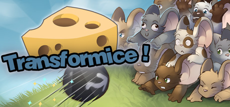

**Platforms:** Windows &nbsp;|&nbsp; **Genre:** Free To Play, Indie, Massively Multiplayer &nbsp;|&nbsp; **Released:** May 1

> Transformice is an MMO platformer about dozens of mice running to bring back the cheese! Will the almighty Shaman help you or just ruin everything? Millions of levels, hectic physics, skill trees, and more importantly... hats!
>
> _Synopsis source: Steam_

[Wikipedia](https://en.wikipedia.org/wiki/Transformice) · [Steam](https://store.steampowered.com/app/335240)

---

### Trauma Team

**Platforms:** Wii &nbsp;|&nbsp; **Released:** May 18

[Wikipedia](https://en.wikipedia.org/wiki/Trauma_Team)

---

### Treasure Isle

**Platforms:** Facebook &nbsp;|&nbsp; **Developer:** Zynga &nbsp;|&nbsp; **Genre:** Simulation, RPG &nbsp;|&nbsp; **Released:** April 4, 2010

[Wikipedia](https://en.wikipedia.org/wiki/Treasure_Isle_(video_game))

---

### Trinity Universe

**Platforms:** PlayStation 3 &nbsp;|&nbsp; **Released:** June 29

[Wikipedia](https://en.wikipedia.org/wiki/Trinity_Universe_(video_game))

---

### Triple Town

**Platforms:** Facebook, iOS, Android, Fire OS, Windows, macOS &nbsp;|&nbsp; **Developer:** Spry Fox &nbsp;|&nbsp; **Publisher:** Spry Fox &nbsp;|&nbsp; **Genre:** Strategy &nbsp;|&nbsp; **Released:** October 14, 2010

[Wikipedia](https://en.wikipedia.org/wiki/Triple_Town)

---

### Tron: Evolution

**Platforms:** Windows, PlayStation 3, Xbox 360, iOS &nbsp;|&nbsp; **Released:** December 7

---

### Tron: Evolution – Battle Grids

**Platforms:** Wii, Nintendo DS &nbsp;|&nbsp; **Released:** December 7

---

### Tropico 3

**Platforms:** Xbox 360 &nbsp;|&nbsp; **Released:** February 16

[Wikipedia](https://en.wikipedia.org/wiki/Tropico_3)

---

### True Swing Golf

**Platforms:** Nintendo DS &nbsp;|&nbsp; **Released:** February 1

[Wikipedia](https://en.wikipedia.org/wiki/True_Swing_Golf)

---

### Truth or Lies

**Platforms:** Xbox 360, PlayStation 3, Wii, iOS &nbsp;|&nbsp; **Developer:** Big Ant Studios, Imagination Entertainment, HandyGames &nbsp;|&nbsp; **Publisher:** THQ &nbsp;|&nbsp; **Genre:** Party, Trivia &nbsp;|&nbsp; **Released:** September 14, 2010

[Wikipedia](https://en.wikipedia.org/wiki/Truth_or_Lies)

---

### Turf

**Platforms:** Android, iOS &nbsp;|&nbsp; **Developer:** Andrimon &nbsp;|&nbsp; **Genre:** massively multiplayer online, location based game &nbsp;|&nbsp; **Released:** July 10, 2010

[Wikipedia](https://en.wikipedia.org/wiki/Turf_(video_game))

---

### TV Superstars

**Platforms:** PlayStation 3 &nbsp;|&nbsp; **Developer:** Cambridge Studio &nbsp;|&nbsp; **Publisher:** Sony Computer Entertainment &nbsp;|&nbsp; **Genre:** Party &nbsp;|&nbsp; **Released:** October 13, 2010

[Wikipedia](https://en.wikipedia.org/wiki/TV_Superstars)

---

### uDraw Pictionary

**Platforms:** Wii &nbsp;|&nbsp; **Released:** November 14

[Wikipedia](https://en.wikipedia.org/wiki/UDraw_Pictionary)

---

### UDraw Studio

**Platforms:** Wii &nbsp;|&nbsp; **Developer:** Pipeworks Software &nbsp;|&nbsp; **Publisher:** THQ &nbsp;|&nbsp; **Genre:** Art &nbsp;|&nbsp; **Released:** November 14, 2010

[Wikipedia](https://en.wikipedia.org/wiki/UDraw_Studio)

---

### UFC 2010

**Platforms:** Xbox 360, PlayStation 3, PlayStation Portable &nbsp;|&nbsp; **Released:** May 25

[Wikipedia](https://en.wikipedia.org/wiki/UFC_Undisputed_2010)

---

### Ultimate Mortal Kombat 3

**Platforms:** iOS &nbsp;|&nbsp; **Released:** December 16

[Wikipedia](https://en.wikipedia.org/wiki/Ultimate_Mortal_Kombat_3#iOS)

---

### Ultimate Spider-Man: Total Mayhem

**Platforms:** iOS &nbsp;|&nbsp; **Developer:** Gameloft &nbsp;|&nbsp; **Publisher:** Gameloft &nbsp;|&nbsp; **Genre:** Beat-em-up &nbsp;|&nbsp; **Released:** September 1, 2010

[Wikipedia](https://en.wikipedia.org/wiki/Ultimate_Spider-Man:_Total_Mayhem)

---

### Umineko: Golden Fantasia

**Platforms:** Windows &nbsp;|&nbsp; **Developer:** 07th Expansion &nbsp;|&nbsp; **Publisher:** 07th Expansion, Alchemist, MangaGamer, Entergram &nbsp;|&nbsp; **Genre:** Fighting &nbsp;|&nbsp; **Released:** December 31, 2010

[Wikipedia](https://en.wikipedia.org/wiki/Umineko:_Golden_Fantasia)

---

### Un Juego de Huevos

**Platforms:** Zeebo &nbsp;|&nbsp; **Developer:** Fabrication Games &nbsp;|&nbsp; **Publisher:** Zeebo Inc. &nbsp;|&nbsp; **Genre:** Platform &nbsp;|&nbsp; **Released:** April 19, 2010

[Wikipedia](https://en.wikipedia.org/wiki/Un_Juego_de_Huevos)

---

### Unbound Saga

**Platforms:** Xbox 360 &nbsp;|&nbsp; **Released:** December 1

[Wikipedia](https://en.wikipedia.org/wiki/Unbound_Saga)

---

### Undead Nightmare

**Platforms:** PlayStation 3, Xbox 360 &nbsp;|&nbsp; **Developer:** Rockstar San Diego &nbsp;|&nbsp; **Publisher:** Rockstar Games &nbsp;|&nbsp; **Genre:** Action-adventure &nbsp;|&nbsp; **Released:** October 26, 2010

[Wikipedia](https://en.wikipedia.org/wiki/Undead_Nightmare)

---

### Unlight

**Developer:** Techway &nbsp;|&nbsp; **Genre:** Card battle &nbsp;|&nbsp; **Released:** October 12, 2010

[Wikipedia](https://en.wikipedia.org/wiki/Unlight)

---

### Us and Them − Cold War

**Platforms:** Windows, macOS &nbsp;|&nbsp; **Developer:** Icehole Games &nbsp;|&nbsp; **Publisher:** Icehole Games, AVE, Avanquest, UIE &nbsp;|&nbsp; **Genre:** Turn-based strategy &nbsp;|&nbsp; **Released:** March 17, 2010

[Wikipedia](https://en.wikipedia.org/wiki/Us_and_Them_%E2%88%92_Cold_War)

---

### Uta no Prince-sama

[Wikipedia](https://en.wikipedia.org/wiki/Uta_no_Prince-sama)

---

### Utacchi

**Platforms:** Nintendo DS &nbsp;|&nbsp; **Developer:** Konami &nbsp;|&nbsp; **Publisher:** Konami &nbsp;|&nbsp; **Genre:** Music rhythm game &nbsp;|&nbsp; **Released:** February 25, 2010

[Wikipedia](https://en.wikipedia.org/wiki/Utacchi)

---

### Valkyria Chronicles II

**Platforms:** PlayStation Portable &nbsp;|&nbsp; **Released:** August 31

[Wikipedia](https://en.wikipedia.org/wiki/Valkyria_Chronicles_II)

---

### Vancouver 2010

**Platforms:** Windows, Xbox 360, PlayStation 3 &nbsp;|&nbsp; **Released:** January 12

[Wikipedia](https://en.wikipedia.org/wiki/Vancouver_2010_(video_game))

---

### Vandal Hearts: Flames of Judgment

**Platforms:** Xbox 360, PlayStation 3 &nbsp;|&nbsp; **Released:** January 20

---

### Vanquish

**Platforms:** PlayStation 3, Xbox 360 &nbsp;|&nbsp; **Released:** October 19

[Wikipedia](https://en.wikipedia.org/wiki/Vanquish_(video_game))

---

### Vector TD

[Wikipedia](https://en.wikipedia.org/wiki/Vector_TD)

---

### Vectorman

**Platforms:** Windows &nbsp;|&nbsp; **Released:** June 1

[Wikipedia](https://en.wikipedia.org/wiki/Vectorman)

---

### Vera Blanc

**Platforms:** Android, iOS, Linux, macOS, Windows &nbsp;|&nbsp; **Developer:** Winter Wolves &nbsp;|&nbsp; **Publisher:** Winter Wolves, Ratalaika Games &nbsp;|&nbsp; **Genre:** Visual Novel &nbsp;|&nbsp; **Released:** June 30, 2010

[Wikipedia](https://en.wikipedia.org/wiki/Vera_Blanc)

---

### Vibes

**Platforms:** PlayStation 3, PlayStation Portable &nbsp;|&nbsp; **Developer:** Laughing Jackal &nbsp;|&nbsp; **Publisher:** Laughing Jackal &nbsp;|&nbsp; **Genre:** Rhythm action &nbsp;|&nbsp; **Released:** June 8, 2010

[Wikipedia](https://en.wikipedia.org/wiki/Vibes_(video_game))

---

### Victoria 2

**Platforms:** Windows &nbsp;|&nbsp; **Genre:** Strategy &nbsp;|&nbsp; **Released:** August 13

> Carefully guide your nation from the era of absolute monarchies in the early 19th century, through expansion and colonization, to finally become a truly great power by the dawn of the 20th century. Victoria II is a grand strategy game played during the colonial era of the 19th century, where the player takes control of a country, guiding...
>
> _Synopsis source: Steam_

[Wikipedia](https://en.wikipedia.org/wiki/Victoria_2) · [Steam](https://store.steampowered.com/app/42960)

---

### Victoria II

**Platforms:** Windows, macOS &nbsp;|&nbsp; **Developer:** Paradox Development Studio &nbsp;|&nbsp; **Publisher:** Paradox Interactive, Virtual Programming, 1C/Snowball Studios &nbsp;|&nbsp; **Genre:** Grand strategy &nbsp;|&nbsp; **Released:** August 13, 2010

[Wikipedia](https://en.wikipedia.org/wiki/Victoria_II)

---

### Vindictus

**Platforms:** Windows &nbsp;|&nbsp; **Released:** October 13

[Wikipedia](https://en.wikipedia.org/wiki/Vindictus)

---

### Voice Fantasy

**Platforms:** iOS &nbsp;|&nbsp; **Developer:** Square Enix, Koto Laboratories &nbsp;|&nbsp; **Genre:** Action game &nbsp;|&nbsp; **Released:** November 1, 2010

[Wikipedia](https://en.wikipedia.org/wiki/Voice_Fantasy)

---

### Voodoo Dice

**Platforms:** iOS, PlayStation 3, PlayStation Portable, PlayStation Network, Wii, Windows, Xbox 360 &nbsp;|&nbsp; **Developer:** Exkee &nbsp;|&nbsp; **Publisher:** Ubisoft &nbsp;|&nbsp; **Genre:** Action, puzzle &nbsp;|&nbsp; **Released:** May 26, 2010

[Wikipedia](https://en.wikipedia.org/wiki/Voodoo_Dice)

---

### VVVVVV

**Platforms:** Windows &nbsp;|&nbsp; **Genre:** Puzzle-platformer &nbsp;|&nbsp; **Released:** January 11

> VVVVVV is a platform game all about exploring one simple mechanical idea - what if you reversed gravity instead of jumping?
>
> _Synopsis source: Steam_

[Wikipedia](https://en.wikipedia.org/wiki/VVVVVV) · [Steam](https://store.steampowered.com/app/70300)

---

### Wakeboarding HD

**Platforms:** PlayStation 3 &nbsp;|&nbsp; **Released:** March 25

[Wikipedia](https://en.wikipedia.org/wiki/Wakeboarding_HD)

---

### Walk It Out!

**Platforms:** Wii &nbsp;|&nbsp; **Released:** January 12

---

### War Commander

**Platforms:** Windows, macOS &nbsp;|&nbsp; **Developer:** Kixeye &nbsp;|&nbsp; **Publisher:** Kixeye &nbsp;|&nbsp; **Genre:** Strategy, Combat, Wargaming

[Wikipedia](https://en.wikipedia.org/wiki/War_Commander)

---

### War of Legends

**Platforms:** Browser &nbsp;|&nbsp; **Developer:** Ultizen &nbsp;|&nbsp; **Publisher:** Jagex &nbsp;|&nbsp; **Genre:** Fantasy Manhua MMORTS &nbsp;|&nbsp; **Released:** January 19, 2010

[Wikipedia](https://en.wikipedia.org/wiki/War_of_Legends)

---

### Warhammer 40,000: Dawn of War II – Chaos Rising

**Platforms:** Windows &nbsp;|&nbsp; **Released:** March 11

---

### WarioWare D.I.Y.

**Platforms:** Nintendo DS &nbsp;|&nbsp; **Released:** March 28

[Wikipedia](https://en.wikipedia.org/wiki/WarioWare_D.I.Y.)

---

### We Farm

**Platforms:** iOS &nbsp;|&nbsp; **Developer:** Bonfire Studios Dallas &nbsp;|&nbsp; **Publisher:** ngmoco &nbsp;|&nbsp; **Genre:** Simulation, role-playing

[Wikipedia](https://en.wikipedia.org/wiki/We_Farm)

---

### We Rule

**Platforms:** Android, iOS &nbsp;|&nbsp; **Developer:** Newtoy, Inc. &nbsp;|&nbsp; **Publisher:** Ngmoco &nbsp;|&nbsp; **Genre:** Simulation, RPG &nbsp;|&nbsp; **Released:** March 20, 2010

[Wikipedia](https://en.wikipedia.org/wiki/We_Rule)

---

### We Sing Encore

**Platforms:** Wii &nbsp;|&nbsp; **Developer:** Le Cortex &nbsp;|&nbsp; **Publisher:** Nordic Games &nbsp;|&nbsp; **Genre:** Music &nbsp;|&nbsp; **Released:** August 20, 2010

[Wikipedia](https://en.wikipedia.org/wiki/We_Sing_Encore)

---

### We Sing Robbie Williams

**Platforms:** Wii &nbsp;|&nbsp; **Developer:** Le Cortex &nbsp;|&nbsp; **Publisher:** Nordic Games Publishing &nbsp;|&nbsp; **Genre:** Music &nbsp;|&nbsp; **Released:** November 12, 2010

[Wikipedia](https://en.wikipedia.org/wiki/We_Sing_Robbie_Williams)

---

### What Did I Do To Deserve This My Lord? 2

**Platforms:** PlayStation Portable &nbsp;|&nbsp; **Released:** May 4

---

### White Album 2

[Wikipedia](https://en.wikipedia.org/wiki/White_Album_2)

---

### White Knight Chronicles

**Platforms:** PlayStation 3 &nbsp;|&nbsp; **Released:** February 2

[Wikipedia](https://en.wikipedia.org/wiki/White_Knight_Chronicles)

---

### Who's That Flying?!

**Platforms:** PlayStation Portable &nbsp;|&nbsp; **Developer:** Mediatonic, Beeline Interactive &nbsp;|&nbsp; **Publisher:** Mediatonic, Kalypso Media, Beeline Interactive &nbsp;|&nbsp; **Genre:** Shooter &nbsp;|&nbsp; **Released:** November 16, 2010

[Wikipedia](https://en.wikipedia.org/wiki/Who's_That_Flying%3F!)

---

### Wii Party

**Platforms:** Wii &nbsp;|&nbsp; **Released:** October 3

[Wikipedia](https://en.wikipedia.org/wiki/Wii_Party)

---

### Wispin

**Platforms:** iOS &nbsp;|&nbsp; **Developer:** Grumpyface Studios &nbsp;|&nbsp; **Publisher:** Grumpyface Studios &nbsp;|&nbsp; **Genre:** Action &nbsp;|&nbsp; **Released:** November 18, 2010

[Wikipedia](https://en.wikipedia.org/wiki/Wispin)

---

### Wizards of Waverly Place: Spellbound

**Platforms:** Nintendo DS &nbsp;|&nbsp; **Released:** November 16

---

### Wonderful Everyday

**Platforms:** Windows &nbsp;|&nbsp; **Released:** March 26

[Wikipedia](https://en.wikipedia.org/wiki/Wonderful_Everyday)

---

### World Cup of Pool

**Platforms:** Nintendo DS &nbsp;|&nbsp; **Released:** February 12

[Wikipedia](https://en.wikipedia.org/wiki/World_Cup_of_Pool)

---

### World of Goo

**Platforms:** iOS &nbsp;|&nbsp; **Released:** December 16

[Wikipedia](https://en.wikipedia.org/wiki/World_of_Goo)

---

### World of Outlaws: Sprint Cars

**Platforms:** Xbox 360, Windows, PlayStation Network &nbsp;|&nbsp; **Released:** February 9

---

### World of Tanks

**Platforms:** Windows &nbsp;|&nbsp; **Genre:** Action, Massively Multiplayer, Simulation, Free To Play &nbsp;|&nbsp; **Released:** September 30

> World of Tanks is a tactical action game with very different gameplay depending on the vehicle type and role. Aside from regular PvP, there are competitive and clan-based modes, special PvE and PvPvE events, and much more. Whether you play to dominate or just enjoy the ride, you'll fit right in.
>
> _Synopsis source: Steam_

[Wikipedia](https://en.wikipedia.org/wiki/World_of_Tanks) · [Steam](https://store.steampowered.com/app/1407200)

---

### World of Warcraft: Cataclysm

**Platforms:** Windows, macOS &nbsp;|&nbsp; **Publisher:** Blizzard Entertainment &nbsp;|&nbsp; **Released:** December 7, 2010

---

### World Poker Tour: Texas Hold 'Em

**Platforms:** Nintendo DS &nbsp;|&nbsp; **Released:** May 24

---

### Worms Reloaded

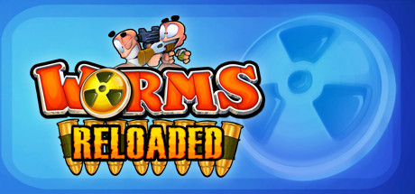

**Platforms:** Windows, macOS &nbsp;|&nbsp; **Genre:** Strategy &nbsp;|&nbsp; **Released:** August 26

> Ten years on from Worms™ Armageddon and the turn-based comic mayhem continues in Worms™ Reloaded, an all-new edition available for PC through Steam.
>
> _Synopsis source: Steam_

[Wikipedia](https://en.wikipedia.org/wiki/Worms_Reloaded) · [Steam](https://store.steampowered.com/app/22600)

---

### Worms: Battle Islands

**Platforms:** PlayStation Portable, Wii &nbsp;|&nbsp; **Released:** November 21

---

### WRC FIA World Rally Championship

**Platforms:** Windows, PlayStation 3, Xbox 360 &nbsp;|&nbsp; **Developer:** Milestone srl &nbsp;|&nbsp; **Publisher:** Black Bean Games, Cyberfront &nbsp;|&nbsp; **Genre:** Racing &nbsp;|&nbsp; **Released:** October 7, 2010

[Wikipedia](https://en.wikipedia.org/wiki/WRC_FIA_World_Rally_Championship)

---

### WWE SmackDown vs Raw 2011

**Platforms:** PlayStation 3, Xbox 360, PlayStation Portable, PlayStation 2, Wii &nbsp;|&nbsp; **Released:** October 26

[Wikipedia](https://en.wikipedia.org/wiki/WWE_SmackDown_vs_Raw_2011)

---

### X-Men

**Platforms:** PlayStation Network, Xbox 360 &nbsp;|&nbsp; **Released:** December 14

[Wikipedia](https://en.wikipedia.org/wiki/X-Men_(arcade_game))

---

### X-Scape

**Platforms:** Nintendo DS &nbsp;|&nbsp; **Released:** May 31

[Wikipedia](https://en.wikipedia.org/wiki/X-Scape)

---

### Xenoblade Chronicles

**Platforms:** Wii &nbsp;|&nbsp; **Publisher:** Nintendo &nbsp;|&nbsp; **Released:** June 10, 2010

[Wikipedia](https://en.wikipedia.org/wiki/Xenoblade_Chronicles_(video_game))

---

### Yakuza 3

**Platforms:** PlayStation 3 &nbsp;|&nbsp; **Released:** March 9

[Wikipedia](https://en.wikipedia.org/wiki/Yakuza_3)

---

### Yogi Bear

**Platforms:** Nintendo DS, Wii &nbsp;|&nbsp; **Released:** December 7

[Wikipedia](https://en.wikipedia.org/wiki/Yogi_Bear_(film))

---

### Young Thor

**Platforms:** PlayStation Portable &nbsp;|&nbsp; **Released:** June 20

[Wikipedia](https://en.wikipedia.org/wiki/Young_Thor)

---

### Your Doodles Are Bugged!

**Platforms:** Xbox 360 &nbsp;|&nbsp; **Developer:** Spyn Doctor Games &nbsp;|&nbsp; **Publisher:** Spyn Doctor Games, Blitz 1UP &nbsp;|&nbsp; **Genre:** Puzzle &nbsp;|&nbsp; **Released:** February 1, 2010

[Wikipedia](https://en.wikipedia.org/wiki/Your_Doodles_Are_Bugged!)

---

### Your Shape: Fitness Evolved

**Platforms:** Xbox 360 &nbsp;|&nbsp; **Developer:** Ubisoft Montreal &nbsp;|&nbsp; **Publisher:** Ubisoft &nbsp;|&nbsp; **Genre:** Exergaming, aerobics &nbsp;|&nbsp; **Released:** November 4, 2010

[Wikipedia](https://en.wikipedia.org/wiki/Your_Shape:_Fitness_Evolved)

---

### Ys Seven

**Platforms:** PlayStation Portable &nbsp;|&nbsp; **Released:** August 17

[Wikipedia](https://en.wikipedia.org/wiki/Ys_Seven)

---

### Ys vs. Trails in the Sky

**Platforms:** PlayStation Portable &nbsp;|&nbsp; **Developer:** Nihon Falcom &nbsp;|&nbsp; **Publisher:** Nihon Falcom, Refint/games &nbsp;|&nbsp; **Genre:** Fighting &nbsp;|&nbsp; **Released:** July 29, 2010

[Wikipedia](https://en.wikipedia.org/wiki/Ys_vs._Trails_in_the_Sky)

---

### Ys: The Oath in Felghana

**Platforms:** PlayStation Portable &nbsp;|&nbsp; **Released:** November 2

---

### Yu-Gi-Oh! 5D's Tag Force 5

**Platforms:** PlayStation Portable &nbsp;|&nbsp; **Released:** October 26

[Wikipedia](https://en.wikipedia.org/wiki/Yu-Gi-Oh!_5D%27s_Tag_Force_5)

---

### Yu-Gi-Oh! 5D's: Duel Transer

**Platforms:** Wii &nbsp;|&nbsp; **Released:** December 7

[Wikipedia](https://en.wikipedia.org/wiki/List_of_Yu-Gi-Oh!_video_games)

---

### Z.H.P. Unlosing Ranger VS Darkdeath Evilman

**Platforms:** PlayStation Portable &nbsp;|&nbsp; **Released:** October 26

[Wikipedia](https://en.wikipedia.org/wiki/Z.H.P._Unlosing_Ranger_VS_Darkdeath_Evilman)

---

### Zangeki no Reginleiv

**Platforms:** Wii &nbsp;|&nbsp; **Developer:** Sandlot &nbsp;|&nbsp; **Publisher:** Nintendo &nbsp;|&nbsp; **Genre:** Action &nbsp;|&nbsp; **Released:** February 11, 2010

[Wikipedia](https://en.wikipedia.org/wiki/Zangeki_no_Reginleiv)

---

### Zenonia 2

**Platforms:** iOS &nbsp;|&nbsp; **Released:** March 29

[Wikipedia](https://en.wikipedia.org/wiki/Zenonia_2)

---

### Zentia

**Developer:** ChangYou, Pixel Soft &nbsp;|&nbsp; **Publisher:** ChangYou &nbsp;|&nbsp; **Genre:** Fantasy MMORPG &nbsp;|&nbsp; **Released:** October 13, 2010

[Wikipedia](https://en.wikipedia.org/wiki/Zentia)

---

### Zero-K

**Platforms:** Windows, Linux, macOS &nbsp;|&nbsp; **Developer:** See Credits Supporters &nbsp;|&nbsp; **Genre:** Real-time strategy &nbsp;|&nbsp; **Released:** October 1, 2010

[Wikipedia](https://en.wikipedia.org/wiki/Zero-K)

---

### Zhu Zhu Pets

**Platforms:** Nintendo DS &nbsp;|&nbsp; **Released:** March 21

[Wikipedia](https://en.wikipedia.org/wiki/Zhu_Zhu_Pets)

---

### Zombie Highway

**Platforms:** iOS &nbsp;|&nbsp; **Developer:** Auxbrain &nbsp;|&nbsp; **Genre:** Survival game &nbsp;|&nbsp; **Released:** August 27, 2010

[Wikipedia](https://en.wikipedia.org/wiki/Zombie_Highway)

---

### Zombie Panic in Wonderland

**Platforms:** Wii, Android &nbsp;|&nbsp; **Developer:** Akaoni Studio &nbsp;|&nbsp; **Publisher:** Akaoni Studio, Marvelous Entertainment, Arc System Works &nbsp;|&nbsp; **Genre:** Third-person shooter, shooting gallery &nbsp;|&nbsp; **Released:** March 16, 2010

[Wikipedia](https://en.wikipedia.org/wiki/Zombie_Panic_in_Wonderland)

---

### ZooMumba

**Platforms:** Browser &nbsp;|&nbsp; **Developer:** Bigpoint &nbsp;|&nbsp; **Publisher:** Bigpoint &nbsp;|&nbsp; **Genre:** Simulation &nbsp;|&nbsp; **Released:** August 19, 2010

[Wikipedia](https://en.wikipedia.org/wiki/ZooMumba)

---

### Zorro: Quest for Justice

**Platforms:** Nintendo DS &nbsp;|&nbsp; **Released:** February 12

---

### Zumba Fitness

**Platforms:** PlayStation 3, Wii, Xbox 360 &nbsp;|&nbsp; **Developer:** Pipeworks Software &nbsp;|&nbsp; **Publisher:** Majesco, 505 Games &nbsp;|&nbsp; **Genre:** Fitness game &nbsp;|&nbsp; **Released:** November 18, 2010

[Wikipedia](https://en.wikipedia.org/wiki/Zumba_Fitness_(video_game))

---
