# 2011 in Video Games

[← Back to index](../README.md)

980 titles (452 from Wikipedia's category page) · [source](https://en.wikipedia.org/wiki/2011_in_video_games) · [category](https://en.wikipedia.org/wiki/Category:2011_video_games)

### 1-Bit Ninja

**Platforms:** iOS &nbsp;|&nbsp; **Released:** June 23

[Wikipedia](https://en.wikipedia.org/wiki/1-bit_Ninja)

---

### 1000 Heroz

**Platforms:** iOS &nbsp;|&nbsp; **Developer:** Ubisoft RedLynx &nbsp;|&nbsp; **Publisher:** Ubisoft RedLynx &nbsp;|&nbsp; **Genre:** Puzzle-platform &nbsp;|&nbsp; **Released:** June 8, 2011

[Wikipedia](https://en.wikipedia.org/wiki/1000_Heroz)

---

### 1000 Tiny Claws

**Platforms:** PlayStation Portable &nbsp;|&nbsp; **Developer:** Mediatonic &nbsp;|&nbsp; **Publisher:** Mediatonic &nbsp;|&nbsp; **Genre:** Action &nbsp;|&nbsp; **Released:** October 4, 2011

[Wikipedia](https://en.wikipedia.org/wiki/1000_Tiny_Claws)

---

### 3D Classics

[Wikipedia](https://en.wikipedia.org/wiki/3D_Classics)

---

### 3D Classics: Excitebike

**Platforms:** Nintendo 3DS &nbsp;|&nbsp; **Released:** June 7

[Wikipedia](https://en.wikipedia.org/wiki/Excitebike)

---

### 3D Classics: Kirby's Adventure

**Platforms:** Nintendo 3DS &nbsp;|&nbsp; **Released:** November 17

[Wikipedia](https://en.wikipedia.org/wiki/Kirby%27s_Adventure)

---

### 3D Classics: TwinBee

**Platforms:** Nintendo 3DS &nbsp;|&nbsp; **Released:** September 22

[Wikipedia](https://en.wikipedia.org/wiki/TwinBee)

---

### 3D Classics: Urban Champion

**Platforms:** Nintendo 3DS &nbsp;|&nbsp; **Released:** August 18

[Wikipedia](https://en.wikipedia.org/wiki/Urban_Champion)

---

### 3D Classics: Xevious

**Platforms:** Nintendo 3DS &nbsp;|&nbsp; **Released:** July 21

[Wikipedia](https://en.wikipedia.org/wiki/Xevious)

---

### 3D Pixel Racing

**Platforms:** Wii, iOS &nbsp;|&nbsp; **Developer:** Vidia &nbsp;|&nbsp; **Publisher:** Microforum Games, Vidia &nbsp;|&nbsp; **Genre:** Racing &nbsp;|&nbsp; **Released:** July 14, 2011

[Wikipedia](https://en.wikipedia.org/wiki/3D_Pixel_Racing)

---

### 7554

**Platforms:** Windows &nbsp;|&nbsp; **Developer:** Emobi Games &nbsp;|&nbsp; **Publisher:** Emobi Games &nbsp;|&nbsp; **Genre:** First-person shooter &nbsp;|&nbsp; **Released:** December 16, 2011

[Wikipedia](https://en.wikipedia.org/wiki/7554)

---

### A Certain Magical Index

[Wikipedia](https://en.wikipedia.org/wiki/A_Certain_Magical_Index_(video_game))

---

### A Game of Thrones: Genesis

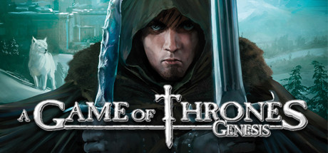

**Platforms:** Windows &nbsp;|&nbsp; **Genre:** Strategy &nbsp;|&nbsp; **Released:** September 29

> Immerse yourself into the battles and intrigues between the Houses that shaped the Kingdom of Westeros and keep your spot on the Iron Throne by any means.
>
> _Synopsis source: Steam_

[Steam](https://store.steampowered.com/app/58550)

---

### ABBA: You Can Dance

**Platforms:** Wii &nbsp;|&nbsp; **Released:** November 15

---

### Absolute Baseball

**Platforms:** Nintendo DS &nbsp;|&nbsp; **Released:** April 4

---

### Acceleration of Suguri X Edition

**Platforms:** PlayStation 3 &nbsp;|&nbsp; **Developer:** Orange Juice &nbsp;|&nbsp; **Publisher:** Rockin' Android &nbsp;|&nbsp; **Genre:** Fighting &nbsp;|&nbsp; **Released:** February 15, 2011

[Wikipedia](https://en.wikipedia.org/wiki/Acceleration_of_Suguri_X_Edition)

---

### Ace Attorney Investigations 2: Prosecutor's Gambit

**Platforms:** Nintendo DS &nbsp;|&nbsp; **Developer:** Capcom &nbsp;|&nbsp; **Publisher:** Capcom &nbsp;|&nbsp; **Genre:** Adventure &nbsp;|&nbsp; **Released:** February 3, 2011

[Wikipedia](https://en.wikipedia.org/wiki/Ace_Attorney_Investigations_2:_Prosecutor's_Gambit)

---

### Ace Combat: Assault Horizon

**Platforms:** PlayStation 3, Xbox 360 &nbsp;|&nbsp; **Released:** October 11

---

### Ace Combat: Assault Horizon Legacy

**Platforms:** Nintendo 3DS &nbsp;|&nbsp; **Developer:** Access Games &nbsp;|&nbsp; **Publisher:** Namco Bandai Games &nbsp;|&nbsp; **Genre:** Air combat simulation &nbsp;|&nbsp; **Released:** November 15, 2011

[Wikipedia](https://en.wikipedia.org/wiki/Ace_Combat:_Assault_Horizon_Legacy)

---

### Achron

**Platforms:** Windows, macOS, Linux &nbsp;|&nbsp; **Genre:** Indie, Strategy &nbsp;|&nbsp; **Released:** August 29

> As one of the survivors and humankind's first “Achronal” being, you must piece together what happened and unravel the mysteries surrounding the alien invasion.
>
> _Synopsis source: Steam_

[Wikipedia](https://en.wikipedia.org/wiki/Achron) · [Steam](https://store.steampowered.com/app/109700)

---

### Adam's Venture

**Platforms:** Windows, PlayStation 3 &nbsp;|&nbsp; **Developer:** Vertigo Digital Entertainment &nbsp;|&nbsp; **Publisher:** Soedesco &nbsp;|&nbsp; **Genre:** Adventure

[Wikipedia](https://en.wikipedia.org/wiki/Adam's_Venture)

---

### AFL

**Platforms:** Wii, iOS &nbsp;|&nbsp; **Developer:** Wicked Witch Software &nbsp;|&nbsp; **Publisher:** Tru Blu Entertainment &nbsp;|&nbsp; **Genre:** Sports &nbsp;|&nbsp; **Released:** May 19, 2011

[Wikipedia](https://en.wikipedia.org/wiki/AFL_(2011_video_game))

---

### AFL Live

**Platforms:** PlayStation 3, Xbox 360 &nbsp;|&nbsp; **Developer:** Big Ant Studios &nbsp;|&nbsp; **Publisher:** Tru Blu Entertainment &nbsp;|&nbsp; **Genre:** Sports &nbsp;|&nbsp; **Released:** April 21, 2011

[Wikipedia](https://en.wikipedia.org/wiki/AFL_Live)

---

### Afterfall: InSanity

**Platforms:** Windows, Xbox 360, PlayStation 3 &nbsp;|&nbsp; **Released:** November 25

---

### Age of Empires Online

**Platforms:** Windows &nbsp;|&nbsp; **Released:** August 16

[Wikipedia](https://en.wikipedia.org/wiki/Age_of_Empires_Online)

---

### Air Conflicts: Secret Wars

**Platforms:** Windows, Xbox 360, PlayStation 3 &nbsp;|&nbsp; **Developer:** Games Farm &nbsp;|&nbsp; **Publisher:** bitComposer, Kalypso Media, 2tainment, U&I Entertainment &nbsp;|&nbsp; **Genre:** Combat flight simulation &nbsp;|&nbsp; **Released:** June 30, 2011

[Wikipedia](https://en.wikipedia.org/wiki/Air_Conflicts:_Secret_Wars)

---

### Air Penguin

**Platforms:** iOS, Android &nbsp;|&nbsp; **Developer:** Enterfly &nbsp;|&nbsp; **Publisher:** Gamevil &nbsp;|&nbsp; **Genre:** Action &nbsp;|&nbsp; **Released:** April 14, 2011

[Wikipedia](https://en.wikipedia.org/wiki/Air_Penguin)

---

### Airport City

**Platforms:** Facebook &nbsp;|&nbsp; **Developer:** Game Insight &nbsp;|&nbsp; **Publisher:** Game Insight &nbsp;|&nbsp; **Genre:** City-building game, construction, management simulation &nbsp;|&nbsp; **Released:** September 1, 2011

[Wikipedia](https://en.wikipedia.org/wiki/Airport_City)

---

### Aiyoku no Eustia

[Wikipedia](https://en.wikipedia.org/wiki/Aiyoku_no_Eustia)

---

### Akane the Kunoichi

**Platforms:** Xbox 360 &nbsp;|&nbsp; **Released:** May 28

[Wikipedia](https://en.wikipedia.org/wiki/Akane_the_Kunoichi)

---

### Akimi Village

**Platforms:** PlayStation Network &nbsp;|&nbsp; **Released:** June 15

[Wikipedia](https://en.wikipedia.org/wiki/Akimi_Village)

---

### Alice in the Country of Hearts

[Wikipedia](https://en.wikipedia.org/wiki/Alice_in_the_Country_of_Hearts)

---

### Alice: Madness Returns

**Platforms:** Windows, PlayStation 3, Xbox 360 &nbsp;|&nbsp; **Genre:** Action, Adventure &nbsp;|&nbsp; **Released:** June 14

> Alice: Madness Returns is a third-person, single-player, action adventure platformer. Visit the grim reality of Victorian London and travel to the beautiful yet ghastly Wonderland to uncover the root of Alice's madness.
>
> _Synopsis source: Steam_

[Steam](https://store.steampowered.com/app/19680)

---

### Alien Zombie Megadeath

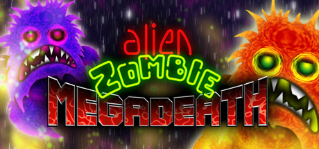

**Platforms:** Windows, PlayStation 3 &nbsp;|&nbsp; **Genre:** Action, Indie &nbsp;|&nbsp; **Released:** June 21

> Alien Zombie Megadeath is a gloriously intense platform shoot-em-up!
>
> _Synopsis source: Steam_

[Wikipedia](https://en.wikipedia.org/wiki/Alien_Zombie_Megadeath) · [Steam](https://store.steampowered.com/app/110610)

---

### Aliens Infestation

**Platforms:** Nintendo DS &nbsp;|&nbsp; **Released:** October 11

[Wikipedia](https://en.wikipedia.org/wiki/Aliens_Infestation)

---

### All Kamen Rider: Rider Generation

**Platforms:** Nintendo DS &nbsp;|&nbsp; **Developer:** 7thChord &nbsp;|&nbsp; **Publisher:** Bandai Namco Games &nbsp;|&nbsp; **Genre:** Beat 'em up &nbsp;|&nbsp; **Released:** August 4, 2011

[Wikipedia](https://en.wikipedia.org/wiki/All_Kamen_Rider:_Rider_Generation)

---

### All Zombies Must Die!

**Platforms:** PlayStation Network &nbsp;|&nbsp; **Released:** December 27

[Wikipedia](https://en.wikipedia.org/wiki/All_Zombies_Must_Die!)

---

### Alpha Kimori

**Platforms:** Windows &nbsp;|&nbsp; **Developer:** Sherman3D &nbsp;|&nbsp; **Publisher:** Sherman3D &nbsp;|&nbsp; **Genre:** Role-playing

[Wikipedia](https://en.wikipedia.org/wiki/Alpha_Kimori)

---

### Alpha Mission

**Platforms:** PlayStation 3, PlayStation Portable &nbsp;|&nbsp; **Released:** September 6

[Wikipedia](https://en.wikipedia.org/wiki/Alpha_Mission)

---

### Alpha Polaris

**Platforms:** Windows &nbsp;|&nbsp; **Developer:** Turmoil Games &nbsp;|&nbsp; **Publisher:** Just a Game &nbsp;|&nbsp; **Genre:** Point-and-click adventure, horror &nbsp;|&nbsp; **Released:** June 24, 2011

[Wikipedia](https://en.wikipedia.org/wiki/Alpha_Polaris)

---

### Alvin and the Chipmunks: Chipwrecked

**Platforms:** Nintendo DS, Wii, Xbox 360 &nbsp;|&nbsp; **Released:** November 15

---

### Amnesia

[Wikipedia](https://en.wikipedia.org/wiki/Amnesia_(2011_video_game))

---

### Angry Birds Rio

**Platforms:** macOS, iOS &nbsp;|&nbsp; **Released:** March 22

[Wikipedia](https://en.wikipedia.org/wiki/Angry_Birds_Rio)

---

### Anno 2070

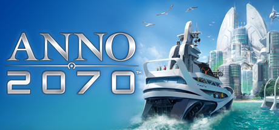

**Platforms:** Windows &nbsp;|&nbsp; **Genre:** Strategy &nbsp;|&nbsp; **Released:** November 17

> Build your society of the future, colonize islands, and create sprawling megacities with multitudes of buildings, vehicles, and resources to manage.
>
> _Synopsis source: Steam_

[Wikipedia](https://en.wikipedia.org/wiki/Anno_2070) · [Steam](https://store.steampowered.com/app/48240)

---

### Annoying Orange: Kitchen Carnage

**Platforms:** iOS &nbsp;|&nbsp; **Developer:** Bottle Rocket &nbsp;|&nbsp; **Publisher:** Eastedge Studios, 14th Hour Productions, LLC &nbsp;|&nbsp; **Genre:** Casual &nbsp;|&nbsp; **Released:** April 7, 2011

[Wikipedia](https://en.wikipedia.org/wiki/Annoying_Orange:_Kitchen_Carnage)

---

### Anomaly: Warzone Earth

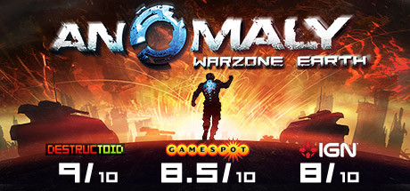

**Platforms:** Windows, iOS &nbsp;|&nbsp; **Genre:** Action, Indie, Strategy &nbsp;|&nbsp; **Released:** April 8

> Lead an armored squad through the perils of this reversed tower defense action-strategy game!
>
> _Synopsis source: Steam_

[Steam](https://store.steampowered.com/app/91200)

---

### Another Century's Episode Portable

**Platforms:** PlayStation Portable &nbsp;|&nbsp; **Developer:** FromSoftware &nbsp;|&nbsp; **Publisher:** Namco Bandai Games &nbsp;|&nbsp; **Genre:** Third-person shooter &nbsp;|&nbsp; **Released:** January 13, 2011

[Wikipedia](https://en.wikipedia.org/wiki/Another_Century's_Episode_Portable)

---

### Ant Raid

**Platforms:** iOS &nbsp;|&nbsp; **Released:** July 6

[Wikipedia](https://en.wikipedia.org/wiki/Ant_Raid)

---

### APOX

**Platforms:** Windows &nbsp;|&nbsp; **Developer:** BlueGiant Interactive &nbsp;|&nbsp; **Publisher:** BlueGiant Interactive &nbsp;|&nbsp; **Genre:** Real Time Strategy, Indie, Action &nbsp;|&nbsp; **Released:** January 20, 2011

[Wikipedia](https://en.wikipedia.org/wiki/APOX)

---

### Aquapazza: Aquaplus Dream Match

**Platforms:** Arcade &nbsp;|&nbsp; **Developer:** Examu, Aquaplus &nbsp;|&nbsp; **Publisher:** Aquaplus, Atlus, DMM GAMES, Shiravune &nbsp;|&nbsp; **Genre:** 2D Versus fighting &nbsp;|&nbsp; **Released:** June 22, 2011

[Wikipedia](https://en.wikipedia.org/wiki/Aquapazza:_Aquaplus_Dream_Match)

---

### Ar tonelico Qoga: Knell of Ar Ciel

**Platforms:** PlayStation 3 &nbsp;|&nbsp; **Released:** March 15

---

### Arc the Lad III

**Platforms:** PlayStation Network &nbsp;|&nbsp; **Genre:** Tactical RPG &nbsp;|&nbsp; **Released:** January 4

[Wikipedia](https://en.wikipedia.org/wiki/Arc_the_Lad_III)

---

### Arcana Heart 3

**Platforms:** PlayStation 3 &nbsp;|&nbsp; **Released:** April 19

[Wikipedia](https://en.wikipedia.org/wiki/Arcana_Heart_3)

---

### Arcania: Fall of Setarrif

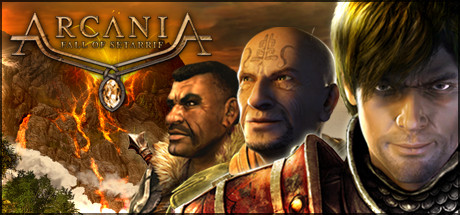

**Platforms:** Windows &nbsp;|&nbsp; **Genre:** RPG &nbsp;|&nbsp; **Released:** October 25

> Face the last challenge - determine destiny! A new threat casts its shadow over the Southern Isles. A mysterious demon, consumed by hatred, terrifies the population and pools his force against the coastal city of Setarrif. The dramatic situation exacerbates after a volcanic eruption in the mountains nearby.
>
> _Synopsis source: Steam_

[Steam](https://store.steampowered.com/app/65610)

---

### Arctic Escape

**Platforms:** Nintendo DS, iOS &nbsp;|&nbsp; **Developer:** Teyon &nbsp;|&nbsp; **Publisher:** Teyon &nbsp;|&nbsp; **Genre:** Puzzle &nbsp;|&nbsp; **Released:** February 21, 2011

[Wikipedia](https://en.wikipedia.org/wiki/Arctic_Escape)

---

### Armageddon Riders

**Platforms:** PlayStation Network &nbsp;|&nbsp; **Released:** June 2

[Wikipedia](https://en.wikipedia.org/wiki/Armageddon_Riders)

---

### Army Attack

**Platforms:** Facebook &nbsp;|&nbsp; **Developer:** Digital Chocolate &nbsp;|&nbsp; **Genre:** Strategy, Multiplayer &nbsp;|&nbsp; **Released:** May 2011

[Wikipedia](https://en.wikipedia.org/wiki/Army_Attack)

---

### Army of Darkness: Defense

**Platforms:** iOS &nbsp;|&nbsp; **Developer:** Backflip Studios &nbsp;|&nbsp; **Publisher:** Backflip Studios &nbsp;|&nbsp; **Genre:** Tower defense &nbsp;|&nbsp; **Released:** May 12, 2011

[Wikipedia](https://en.wikipedia.org/wiki/Army_of_Darkness:_Defense)

---

### Ascension: Chronicle of the Godslayer

**Platforms:** iOS &nbsp;|&nbsp; **Released:** June 30

---

### Ascension: Deckbuilding Game

**Platforms:** iOS &nbsp;|&nbsp; **Developer:** Playdek &nbsp;|&nbsp; **Publisher:** Playdek &nbsp;|&nbsp; **Released:** June 30, 2011

[Wikipedia](https://en.wikipedia.org/wiki/Ascension:_Deckbuilding_Game)

---

### Asphalt 3D

**Platforms:** Nintendo 3DS &nbsp;|&nbsp; **Released:** March 27

[Wikipedia](https://en.wikipedia.org/wiki/Asphalt_3D)

---

### Asphalt 6: Adrenaline

**Platforms:** macOS &nbsp;|&nbsp; **Released:** February 17

---

### Assassin's Creed: Brotherhood

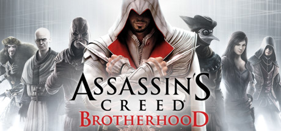

**Platforms:** Windows &nbsp;|&nbsp; **Genre:** Action, Adventure &nbsp;|&nbsp; **Released:** March 22

> It’s time to join the Brotherhood.
>
> _Synopsis source: Steam_

[Steam](https://store.steampowered.com/app/48190)

---

### Assassin's Creed: Brotherhood - The Da Vinci Disappearance

**Platforms:** PlayStation 3, Xbox 360, Windows &nbsp;|&nbsp; **Developer:** Ubisoft Montreal &nbsp;|&nbsp; **Publisher:** Ubisoft &nbsp;|&nbsp; **Genre:** Action-adventure, stealth &nbsp;|&nbsp; **Released:** March 8, 2011

[Wikipedia](https://en.wikipedia.org/wiki/Assassin's_Creed:_Brotherhood_-_The_Da_Vinci_Disappearance)

---

### Assassin's Creed: Recollection

[Wikipedia](https://en.wikipedia.org/wiki/Assassin's_Creed:_Recollection)

---

### Assassin's Creed: Revelations

**Platforms:** PlayStation 3, Xbox 360, Windows &nbsp;|&nbsp; **Genre:** Action, Adventure &nbsp;|&nbsp; **Released:** November 15

> Ezio Auditore walks in the footsteps of the legendary mentor Altair, on a dangerous journey of discovery and revelation.
>
> _Synopsis source: Steam_

[Steam](https://store.steampowered.com/app/201870)

---

### Async Corp.

**Platforms:** iOS &nbsp;|&nbsp; **Released:** June 28

[Wikipedia](https://en.wikipedia.org/wiki/Async_Corp.)

---

### Atari Greatest Hits Volume 2

**Platforms:** Nintendo DS &nbsp;|&nbsp; **Released:** March 8

[Wikipedia](https://en.wikipedia.org/wiki/Atari_Greatest_Hits)

---

### Atelier Totori: Alchemist of Arland 2

**Platforms:** PlayStation 3 &nbsp;|&nbsp; **Released:** September 27

---

### Atom Zombie Smasher

**Platforms:** Windows, macOS, Linux &nbsp;|&nbsp; **Developer:** Blendo Games &nbsp;|&nbsp; **Genre:** Real-time strategy &nbsp;|&nbsp; **Released:** January 22, 2011

[Wikipedia](https://en.wikipedia.org/wiki/Atom_Zombie_Smasher)

---

### Avadon: The Black Fortress

**Platforms:** macOS, Windows, iOS &nbsp;|&nbsp; **Developer:** Spiderweb Software &nbsp;|&nbsp; **Publisher:** Spiderweb Software &nbsp;|&nbsp; **Genre:** Role-playing &nbsp;|&nbsp; **Released:** February 28, 2011

[Wikipedia](https://en.wikipedia.org/wiki/Avadon:_The_Black_Fortress)

---

### Back to Bed

**Platforms:** Browser &nbsp;|&nbsp; **Developer:** Bedtime Digital Games &nbsp;|&nbsp; **Publisher:** Bedtime Digital Games, Loot Interactive, 2Awesome Studio &nbsp;|&nbsp; **Genre:** Puzzle

[Wikipedia](https://en.wikipedia.org/wiki/Back_to_Bed)

---

### Back to the Future: The Game

**Platforms:** PlayStation Network &nbsp;|&nbsp; **Released:** February 15

---

### Backbreaker: Vengeance

**Platforms:** Xbox 360 &nbsp;|&nbsp; **Released:** June 29

---

### Bag It!

**Platforms:** iOS, Android &nbsp;|&nbsp; **Developer:** Hidden Variable Studios &nbsp;|&nbsp; **Genre:** Puzzle &nbsp;|&nbsp; **Released:** October 15, 2011

[Wikipedia](https://en.wikipedia.org/wiki/Bag_It!)

---

### Bangai-O HD: Missile Fury

**Platforms:** Xbox 360 &nbsp;|&nbsp; **Developer:** Treasure &nbsp;|&nbsp; **Publisher:** D3 Publisher &nbsp;|&nbsp; **Genre:** Multidirectional shooter &nbsp;|&nbsp; **Released:** May 4, 2011

[Wikipedia](https://en.wikipedia.org/wiki/Bangai-O_HD:_Missile_Fury)

---

### Baron Wittard: Nemesis of Ragnarok

**Platforms:** Windows &nbsp;|&nbsp; **Developer:** Wax Lyrical Games &nbsp;|&nbsp; **Publisher:** Iceberg Interactive &nbsp;|&nbsp; **Genre:** Adventure &nbsp;|&nbsp; **Released:** February 18, 2011

[Wikipedia](https://en.wikipedia.org/wiki/Baron_Wittard:_Nemesis_of_Ragnarok)

---

### Bastion

**Platforms:** Windows, Xbox 360 &nbsp;|&nbsp; **Publisher:** Warner Bros. Interactive Entertainment &nbsp;|&nbsp; **Released:** August 16, 2011

[Wikipedia](https://en.wikipedia.org/wiki/Bastion_(video_game))

---

### Batman: Arkham City

**Platforms:** PlayStation 3, Xbox 360, Windows &nbsp;|&nbsp; **Publisher:** Warner Bros. Interactive Entertainment &nbsp;|&nbsp; **Genre:** Action, Adventure &nbsp;|&nbsp; **Released:** October 18, 2011

> Get Batman: Arkham City and all DLC for one low price with the release of the GOTY Edition!
>
> _Synopsis source: Steam_

[Steam](https://store.steampowered.com/app/200260)

---

### Batman: Arkham City Lockdown

**Platforms:** iOS &nbsp;|&nbsp; **Released:** December 7

---

### Battle High: San Bruno

**Platforms:** Windows, Xbox 360 &nbsp;|&nbsp; **Released:** February 8

---

### Battle Nations

**Platforms:** iOS, macOS, Android, Windows &nbsp;|&nbsp; **Developer:** Madrona Games, Inc., Z2 &nbsp;|&nbsp; **Genre:** Turn-based strategy, simulation &nbsp;|&nbsp; **Released:** November 17, 2011

[Wikipedia](https://en.wikipedia.org/wiki/Battle_Nations)

---

### Battle Rap Stars

**Platforms:** iOS, Mobile phone &nbsp;|&nbsp; **Developer:** Jump Shot Media &nbsp;|&nbsp; **Publisher:** Jump Shot Media &nbsp;|&nbsp; **Genre:** Strategy

[Wikipedia](https://en.wikipedia.org/wiki/Battle_Rap_Stars)

---

### Battle vs. Chess

**Platforms:** Windows, Nintendo DS, PlayStation 3, PlayStation Portable, Wii, Xbox 360 &nbsp;|&nbsp; **Released:** May 17

[Wikipedia](https://en.wikipedia.org/wiki/Battle_vs._Chess)

---

### Battle: Los Angeles

**Platforms:** Windows, Xbox 360, PlayStation 3 &nbsp;|&nbsp; **Developer:** Saber Interactive &nbsp;|&nbsp; **Publisher:** Konami &nbsp;|&nbsp; **Genre:** First-person shooter &nbsp;|&nbsp; **Released:** March 11, 2011

[Wikipedia](https://en.wikipedia.org/wiki/Battle:_Los_Angeles_(video_game))

---

### Battlefield 3

**Platforms:** Windows, PlayStation 3, Xbox 360 &nbsp;|&nbsp; **Genre:** Action &nbsp;|&nbsp; **Released:** October 25

> Enjoy total freedom to fight the way you want. Explore 29 massive multiplayer maps and use loads of vehicles, weapons, and gadgets to help you turn up the heat. Every second of battle gets you closer to unlocking tons of extras and moving up in the Ranks. So get in the action.
>
> _Synopsis source: Steam_

[Wikipedia](https://en.wikipedia.org/wiki/Battlefield_3) · [Steam](https://store.steampowered.com/app/1238820)

---

### Battlefield Play4Free

**Platforms:** Windows &nbsp;|&nbsp; **Developer:** Easy Studios &nbsp;|&nbsp; **Publisher:** Electronic Arts &nbsp;|&nbsp; **Genre:** First-person shooter &nbsp;|&nbsp; **Released:** April 4, 2011

[Wikipedia](https://en.wikipedia.org/wiki/Battlefield_Play4Free)

---

### Battleheart

**Platforms:** iOS, Android &nbsp;|&nbsp; **Developer:** Mika Mobile &nbsp;|&nbsp; **Genre:** Role-playing &nbsp;|&nbsp; **Released:** January 31, 2011

[Wikipedia](https://en.wikipedia.org/wiki/Battleheart)

---

### Battlestar Galactica Online

**Platforms:** Windows, macOS &nbsp;|&nbsp; **Developer:** Bigpoint Games, Artplant &nbsp;|&nbsp; **Publisher:** Bigpoint Games &nbsp;|&nbsp; **Genre:** MMO &nbsp;|&nbsp; **Released:** February 8, 2011

[Wikipedia](https://en.wikipedia.org/wiki/Battlestar_Galactica_Online)

---

### Beastly: Frantic Foto

**Platforms:** Nintendo DS &nbsp;|&nbsp; **Released:** March 10

---

### Beat Hazard Ultra

**Platforms:** PlayStation 3 &nbsp;|&nbsp; **Released:** October 18

---

### Beatmania IIDX 19: Lincle

**Platforms:** Arcade &nbsp;|&nbsp; **Developer:** Konami &nbsp;|&nbsp; **Genre:** Music &nbsp;|&nbsp; **Released:** September 15, 2011

[Wikipedia](https://en.wikipedia.org/wiki/Beatmania_IIDX_19:_Lincle)

---

### Beep

**Platforms:** Windows, macOS, Linux &nbsp;|&nbsp; **Developer:** Big Fat Alien &nbsp;|&nbsp; **Genre:** Platform &nbsp;|&nbsp; **Released:** March 3, 2011

[Wikipedia](https://en.wikipedia.org/wiki/Beep_(video_game))

---

### Before the Echo

**Platforms:** Xbox 360, Windows &nbsp;|&nbsp; **Developer:** Iridium Studios &nbsp;|&nbsp; **Publisher:** Iridium Studios &nbsp;|&nbsp; **Genre:** Music, role-playing &nbsp;|&nbsp; **Released:** May 5, 2011

[Wikipedia](https://en.wikipedia.org/wiki/Before_the_Echo)

---

### Ben 10: Galactic Racing

**Platforms:** PlayStation 3, Xbox 360, Nintendo DS, Wii, Nintendo 3DS &nbsp;|&nbsp; **Released:** October 18

---

### Beyblade: Metal Masters

**Platforms:** Nintendo DS &nbsp;|&nbsp; **Released:** November 15

---

### Beyond Good & Evil HD

**Platforms:** PlayStation Network &nbsp;|&nbsp; **Released:** June 28

[Wikipedia](https://en.wikipedia.org/wiki/Beyond_Good_%26_Evil_(video_game))

---

### Big Huggin'

**Platforms:** Windows &nbsp;|&nbsp; **Developer:** Critical Gameplay &nbsp;|&nbsp; **Publisher:** Critical Gameplay &nbsp;|&nbsp; **Genre:** Affective videogames

[Wikipedia](https://en.wikipedia.org/wiki/Big_Huggin')

---

### Bionic Commando Rearmed 2

**Platforms:** PlayStation 3, Xbox 360 &nbsp;|&nbsp; **Genre:** Run and gun &nbsp;|&nbsp; **Released:** February 1

[Wikipedia](https://en.wikipedia.org/wiki/Bionic_Commando_Rearmed_2)

---

### Bird Zapper!

**Platforms:** iOS &nbsp;|&nbsp; **Developer:** Namco Networks &nbsp;|&nbsp; **Publisher:** Namco Bandai Games &nbsp;|&nbsp; **Genre:** Puzzle &nbsp;|&nbsp; **Released:** March 24, 2011

[Wikipedia](https://en.wikipedia.org/wiki/Bird_Zapper!)

---

### Bit.Trip Complete

**Platforms:** Wii &nbsp;|&nbsp; **Developer:** Gaijin Games &nbsp;|&nbsp; **Publisher:** Aksys Games, Rising Star Games &nbsp;|&nbsp; **Genre:** Action, music &nbsp;|&nbsp; **Released:** September 13, 2011

[Wikipedia](https://en.wikipedia.org/wiki/Bit.Trip_Complete)

---

### Bit.Trip Flux

**Platforms:** Wii, Nintendo 3DS &nbsp;|&nbsp; **Developer:** Gaijin Games &nbsp;|&nbsp; **Publisher:** Aksys Games, Gaijin Games, QubicGames &nbsp;|&nbsp; **Genre:** Action, Music &nbsp;|&nbsp; **Released:** February 25, 2011

[Wikipedia](https://en.wikipedia.org/wiki/Bit.Trip_Flux)

---

### Bit.Trip Saga

**Platforms:** Nintendo 3DS &nbsp;|&nbsp; **Released:** September 13

[Wikipedia](https://en.wikipedia.org/wiki/Bit.Trip_Saga)

---

### Black Prophecy

**Platforms:** Windows &nbsp;|&nbsp; **Developer:** Reakktor Media &nbsp;|&nbsp; **Publisher:** gamigo AG &nbsp;|&nbsp; **Genre:** MMORPG Space simulation &nbsp;|&nbsp; **Released:** March 21, 2011

[Wikipedia](https://en.wikipedia.org/wiki/Black_Prophecy)

---

### Black Rock Shooter: The Game

**Platforms:** PlayStation Portable &nbsp;|&nbsp; **Developer:** Imageepoch &nbsp;|&nbsp; **Publisher:** Imageepoch, NIS America &nbsp;|&nbsp; **Genre:** Action RPG &nbsp;|&nbsp; **Released:** August 25, 2011

[Wikipedia](https://en.wikipedia.org/wiki/Black_Rock_Shooter:_The_Game)

---

### Blackwater

**Platforms:** Xbox 360 &nbsp;|&nbsp; **Released:** October 25

[Wikipedia](https://en.wikipedia.org/wiki/Blackwater_(video_game))

---

### Blast Monkeys

**Platforms:** iOS &nbsp;|&nbsp; **Genre:** Puzzle &nbsp;|&nbsp; **Released:** January 26

---

### BlazBlue: Continuum Shift II

**Platforms:** Nintendo 3DS &nbsp;|&nbsp; **Released:** May 31

---

### Bleach: Soul Resurrección

**Platforms:** PlayStation 3 &nbsp;|&nbsp; **Released:** August 2

---

### Blobster

**Platforms:** iOS &nbsp;|&nbsp; **Developer:** Divine Robot &nbsp;|&nbsp; **Publisher:** Chillingo &nbsp;|&nbsp; **Genre:** Puzzle-platform &nbsp;|&nbsp; **Released:** July 14, 2011

[Wikipedia](https://en.wikipedia.org/wiki/Blobster)

---

### Blocks That Matter

**Platforms:** Windows, macOS, Linux, Xbox 360 &nbsp;|&nbsp; **Developer:** Swing Swing Submarine &nbsp;|&nbsp; **Publisher:** Swing Swing Submarine &nbsp;|&nbsp; **Genre:** Puzzle-platform &nbsp;|&nbsp; **Released:** August 19, 2011

[Wikipedia](https://en.wikipedia.org/wiki/Blocks_That_Matter)

---

### Bloodline Champions

**Platforms:** Windows &nbsp;|&nbsp; **Developer:** Stunlock Studios &nbsp;|&nbsp; **Publisher:** Funcom &nbsp;|&nbsp; **Genre:** Action &nbsp;|&nbsp; **Released:** January 13, 2011

[Wikipedia](https://en.wikipedia.org/wiki/Bloodline_Champions)

---

### BloodRayne: Betrayal

**Platforms:** PlayStation 3, Xbox 360 &nbsp;|&nbsp; **Released:** September 6

---

### Blueprint 3D

**Platforms:** iOS, Android &nbsp;|&nbsp; **Developer:** FDG Entertainment &nbsp;|&nbsp; **Publisher:** FDG Entertainment &nbsp;|&nbsp; **Genre:** Puzzle &nbsp;|&nbsp; **Released:** November 2011

[Wikipedia](https://en.wikipedia.org/wiki/Blueprint_3D)

---

### Body and Brain Connection

**Platforms:** Xbox 360 &nbsp;|&nbsp; **Released:** February 8

[Wikipedia](https://en.wikipedia.org/wiki/Body_and_Brain_Connection)

---

### Bodycount

**Platforms:** PlayStation 3, Xbox 360 &nbsp;|&nbsp; **Released:** August 30

[Wikipedia](https://en.wikipedia.org/wiki/Bodycount_(2011_video_game))

---

### Boulder Dash-XL

**Platforms:** Xbox 360 &nbsp;|&nbsp; **Released:** July 13

[Wikipedia](https://en.wikipedia.org/wiki/Boulder_Dash-XL)

---

### Brawl Busters

**Platforms:** Windows &nbsp;|&nbsp; **Developer:** SkeinGlobe &nbsp;|&nbsp; **Publisher:** Rock Hippo Productions Ltd. & Weezor Inc. &nbsp;|&nbsp; **Genre:** Action &nbsp;|&nbsp; **Released:** December 15, 2011

[Wikipedia](https://en.wikipedia.org/wiki/Brawl_Busters)

---

### Breach

**Platforms:** Windows, Xbox 360 &nbsp;|&nbsp; **Genre:** FPS &nbsp;|&nbsp; **Released:** January 26

[Wikipedia](https://en.wikipedia.org/wiki/Breach_(2011_video_game))

---

### Bridge Constructor

**Platforms:** Android, iOS, Linux, macOS, Windows, PlayStation Vita, Wii U, Windows Phone &nbsp;|&nbsp; **Developer:** ClockStone &nbsp;|&nbsp; **Publisher:** Headup Games, ClockStone, Joindots &nbsp;|&nbsp; **Genre:** Simulation, puzzle

> Bridge Constructor put you into the role of an engineer in bridge building. In numerous different levels you'll design and create bridges over deep valleys, dangerous canyons, city streets and raging rivers. Once satisfied with your creation, send the trucks and cars to cross the bridge.
>
> _Synopsis source: IGDB_

[Wikipedia](https://en.wikipedia.org/wiki/Bridge_Constructor) · [IGDB](https://www.igdb.com/games/bridge-constructor)

---

### Bring me Sandwiches!!

**Platforms:** iOS &nbsp;|&nbsp; **Developer:** Grumpyface Studios &nbsp;|&nbsp; **Publisher:** Adult Swim Games &nbsp;|&nbsp; **Genre:** Puzzle-platform &nbsp;|&nbsp; **Released:** October 20, 2011

[Wikipedia](https://en.wikipedia.org/wiki/Bring_me_Sandwiches!!)

---

### Brink

**Platforms:** Windows, PlayStation 3, Xbox 360 &nbsp;|&nbsp; **Genre:** Action, Indie &nbsp;|&nbsp; **Released:** May 10

> It is a Co-Op horror game that can be played with at least 1 and at most 4 players on the Brink of Death. Your goal is to defeat the killer doctor who feeds on fear in the cursed area. You'll need a lot of things, but don't stop destroying the scarecrows it draws on. Death is just the beginning.
>
> _Synopsis source: Steam_

[Wikipedia](https://en.wikipedia.org/wiki/Brink_(video_game)) · [Steam](https://store.steampowered.com/app/2179940)

---

### Brunswick Pro Bowling

**Platforms:** Nintendo 3DS &nbsp;|&nbsp; **Released:** September 27

[Wikipedia](https://en.wikipedia.org/wiki/Brunswick_Pro_Bowling)

---

### Bug Heroes

**Platforms:** iOS, Android &nbsp;|&nbsp; **Genre:** Shooter &nbsp;|&nbsp; **Released:** January 6

[Wikipedia](https://en.wikipedia.org/wiki/Bug_Heroes)

---

### Bulletstorm

**Platforms:** Windows, Xbox 360, PlayStation 3 &nbsp;|&nbsp; **Released:** February 22

[Wikipedia](https://en.wikipedia.org/wiki/Bulletstorm)

---

### Bumpy Road

**Platforms:** iOS, macOS &nbsp;|&nbsp; **Developer:** Simogo &nbsp;|&nbsp; **Publisher:** Simogo &nbsp;|&nbsp; **Genre:** Platform &nbsp;|&nbsp; **Released:** May 19, 2011

[Wikipedia](https://en.wikipedia.org/wiki/Bumpy_Road)

---

### BurgerTime: World Tour

**Platforms:** Xbox 360, PlayStation 3 &nbsp;|&nbsp; **Released:** November 2

[Wikipedia](https://en.wikipedia.org/wiki/BurgerTime_World_Tour)

---

### Burnout Crash!

**Platforms:** PlayStation Network, Xbox 360 &nbsp;|&nbsp; **Released:** September 20

[Wikipedia](https://en.wikipedia.org/wiki/Burnout_Crash!)

---

### Bust-A-Move Universe

**Platforms:** Nintendo 3DS &nbsp;|&nbsp; **Released:** March 27

[Wikipedia](https://en.wikipedia.org/wiki/Bust-A-Move_Universe)

---

### Cabals: Magic & Battle Cards

**Platforms:** Browser, iOS, Android, Windows, macOS, Windows Phone &nbsp;|&nbsp; **Developer:** Kyy Games &nbsp;|&nbsp; **Publisher:** Kyy Games &nbsp;|&nbsp; **Genre:** Digital collectible card game &nbsp;|&nbsp; **Released:** November 30, 2011

[Wikipedia](https://en.wikipedia.org/wiki/Cabals:_Magic_&_Battle_Cards)

---

### Cabela's Adventure Camp

**Platforms:** PlayStation 3, Wii, Xbox 360 &nbsp;|&nbsp; **Released:** November 1

[Wikipedia](https://en.wikipedia.org/wiki/Cabela%27s_Adventure_Camp)

---

### Cabela's Big Game Hunter 2012

**Platforms:** PlayStation 3, Wii, Xbox 360 &nbsp;|&nbsp; **Developer:** Cauldron &nbsp;|&nbsp; **Publisher:** Activision &nbsp;|&nbsp; **Genre:** Sports &nbsp;|&nbsp; **Released:** September 27, 2011

[Wikipedia](https://en.wikipedia.org/wiki/Cabela's_Big_Game_Hunter_2012)

---

### Cabela's Survival: Shadows of Katmai

**Platforms:** Wii, PlayStation 3, Xbox 360 &nbsp;|&nbsp; **Released:** November 1

---

### Café 0: The Drowned Mermaid

**Platforms:** Android, iOS, Linux, macOS, Windows &nbsp;|&nbsp; **Developer:** ROSEVERTE &nbsp;|&nbsp; **Publisher:** ROSEVERTE &nbsp;|&nbsp; **Genre:** Visual novel &nbsp;|&nbsp; **Released:** October 4, 2011

[Wikipedia](https://en.wikipedia.org/wiki/Caf%C3%A9_0:_The_Drowned_Mermaid)

---

### Call of Duty: Black Ops – Zombies

**Platforms:** iOS &nbsp;|&nbsp; **Developer:** Ideaworks Game Studio &nbsp;|&nbsp; **Publisher:** Activision &nbsp;|&nbsp; **Genre:** First-person shooter &nbsp;|&nbsp; **Released:** December 1, 2011

[Wikipedia](https://en.wikipedia.org/wiki/Call_of_Duty:_Black_Ops_%E2%80%93_Zombies)

---

### Call of Duty: Modern Warfare 3

**Platforms:** Windows, PlayStation 3, Xbox 360, Wii &nbsp;|&nbsp; **Genre:** Action &nbsp;|&nbsp; **Released:** November 8

> The best-selling first-person action series of all-time returns with an epic sequel to the multiple GOTY award winner Call of Duty®: Modern Warfare® 2
>
> _Synopsis source: Steam_

[Steam](https://store.steampowered.com/app/42680)

---

### Call of Duty: Modern Warfare 3: Defiance

**Platforms:** Nintendo DS &nbsp;|&nbsp; **Released:** November 8

---

### Call of Juarez: The Cartel

**Platforms:** PlayStation 3, Xbox 360, Windows &nbsp;|&nbsp; **Released:** July 14

---

### Camping Mama: Outdoor Adventures

**Platforms:** Nintendo DS &nbsp;|&nbsp; **Developer:** Cooking Mama Limited &nbsp;|&nbsp; **Publisher:** Office Create, Majesco, 505 Games &nbsp;|&nbsp; **Genre:** Simulation, minigame &nbsp;|&nbsp; **Released:** July 14, 2011

[Wikipedia](https://en.wikipedia.org/wiki/Camping_Mama:_Outdoor_Adventures)

---

### Cannon Fodder 3

**Platforms:** Windows &nbsp;|&nbsp; **Developer:** Burut CT &nbsp;|&nbsp; **Publisher:** Game Factory Interactive &nbsp;|&nbsp; **Genre:** Action, strategy &nbsp;|&nbsp; **Released:** December 2011

[Wikipedia](https://en.wikipedia.org/wiki/Cannon_Fodder_3)

---

### Capsized

**Platforms:** Windows &nbsp;|&nbsp; **Developer:** Alientrap &nbsp;|&nbsp; **Publisher:** Alientrap, indiePub, Namco Bandai Games &nbsp;|&nbsp; **Genre:** Platform, run and gun &nbsp;|&nbsp; **Released:** April 29, 2011

[Wikipedia](https://en.wikipedia.org/wiki/Capsized_(video_game))

---

### Captain America: Super Soldier

**Platforms:** Xbox 360, PlayStation 3, Wii, Nintendo DS, Nintendo 3DS &nbsp;|&nbsp; **Released:** July 14

---

### CardMon Hero

**Platforms:** Windows &nbsp;|&nbsp; **Developer:** Redbana &nbsp;|&nbsp; **Publisher:** HanbitSoft &nbsp;|&nbsp; **Genre:** Card battle, MMORPG &nbsp;|&nbsp; **Released:** January 19, 2011

[Wikipedia](https://en.wikipedia.org/wiki/CardMon_Hero)

---

### Cargo! The Quest for Gravity

**Platforms:** Windows, Steam &nbsp;|&nbsp; **Developer:** Ice-Pick Lodge &nbsp;|&nbsp; **Publisher:** bitComposer Interactive, Viva Media &nbsp;|&nbsp; **Genre:** Action-adventure &nbsp;|&nbsp; **Released:** April 21, 2011

[Wikipedia](https://en.wikipedia.org/wiki/Cargo!_The_Quest_for_Gravity)

---

### Carmen Sandiego Adventures in Math

**Platforms:** Wii, Windows &nbsp;|&nbsp; **Developer:** Houghton Mifflin Harcourt &nbsp;|&nbsp; **Publisher:** The Learning Company &nbsp;|&nbsp; **Genre:** Educational game

[Wikipedia](https://en.wikipedia.org/wiki/Carmen_Sandiego_Adventures_in_Math)

---

### Carnival Island

**Platforms:** PlayStation 3 &nbsp;|&nbsp; **Released:** November 15

[Wikipedia](https://en.wikipedia.org/wiki/Carnival_Island)

---

### Cars 2

**Platforms:** Windows, Xbox 360, PlayStation 3, Wii, Nintendo DS, Nintendo 3DS, PlayStation Portable &nbsp;|&nbsp; **Released:** June 21

[Wikipedia](https://en.wikipedia.org/wiki/Cars_2_(video_game))

---

### Cars 2: The Video Game

**Platforms:** PlayStation 3, Xbox 360, Windows, Wii, Nintendo DS, Nintendo 3DS, PlayStation Portable, macOS, iOS &nbsp;|&nbsp; **Developer:** Avalanche Software, TransGaming, Firebrand Games, Virtual Toys &nbsp;|&nbsp; **Publisher:** Disney Interactive Studios, Sony Computer Entertainment, Disney Mobile Studios &nbsp;|&nbsp; **Genre:** Racing &nbsp;|&nbsp; **Released:** June 21, 2011

[Wikipedia](https://en.wikipedia.org/wiki/Cars_2:_The_Video_Game)

---

### Cartoon Network: Punch Time Explosion

**Platforms:** Nintendo 3DS &nbsp;|&nbsp; **Released:** June 7

---

### Cartoon Network: Punch Time Explosion XL

**Platforms:** Wii, PlayStation 3, Xbox 360 &nbsp;|&nbsp; **Released:** November 15

---

### Casey's Contraptions

**Platforms:** iOS &nbsp;|&nbsp; **Developer:** Snappy Touch, Mystery Coconut &nbsp;|&nbsp; **Publisher:** Snappy Touch, Mystery Coconut &nbsp;|&nbsp; **Genre:** Puzzle &nbsp;|&nbsp; **Released:** May 19, 2011

[Wikipedia](https://en.wikipedia.org/wiki/Casey's_Contraptions)

---

### CastleMiner

**Platforms:** Xbox 360 &nbsp;|&nbsp; **Developer:** DigitalDNA Games &nbsp;|&nbsp; **Publisher:** DigitalDNA Games &nbsp;|&nbsp; **Genre:** Sandbox &nbsp;|&nbsp; **Released:** July 27, 2011

[Wikipedia](https://en.wikipedia.org/wiki/CastleMiner)

---

### CastleVille

**Platforms:** Browser, Facebook &nbsp;|&nbsp; **Developer:** Zynga Dallas &nbsp;|&nbsp; **Publisher:** Zynga &nbsp;|&nbsp; **Genre:** Simulation, role-playing &nbsp;|&nbsp; **Released:** November 2011

[Wikipedia](https://en.wikipedia.org/wiki/CastleVille)

---

### Catherine

**Platforms:** PlayStation 3, Xbox 360 &nbsp;|&nbsp; **Released:** July 26

[Wikipedia](https://en.wikipedia.org/wiki/Catherine_(video_game))

---

### Cave Story 3D

**Platforms:** Nintendo 3DS &nbsp;|&nbsp; **Released:** November 8

[Wikipedia](https://en.wikipedia.org/wiki/Cave_Story_3D)

---

### Cave Story+

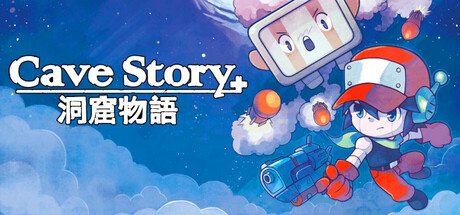

**Platforms:** Windows &nbsp;|&nbsp; **Genre:** Action, Adventure, Indie &nbsp;|&nbsp; **Released:** November 22

> Run, jump, shoot, fly and explore your way through a massive action-adventure reminiscent of classic 8- and 16-bit games.
>
> _Synopsis source: Steam_

[Wikipedia](https://en.wikipedia.org/wiki/Cave_Story) · [Steam](https://store.steampowered.com/app/200900)

---

### Centipede: Infestation

**Platforms:** Wii, Nintendo 3DS &nbsp;|&nbsp; **Released:** October 25

---

### Champion Jockey: G1 Jockey & Gallop Racer

**Platforms:** PlayStation 3, Wii, Xbox 360 &nbsp;|&nbsp; **Developer:** Tecmo Koei, Kou Shibusawa &nbsp;|&nbsp; **Publisher:** Tecmo Koei &nbsp;|&nbsp; **Genre:** Alternative sports &nbsp;|&nbsp; **Released:** September 2, 2011

[Wikipedia](https://en.wikipedia.org/wiki/Champion_Jockey:_G1_Jockey_&_Gallop_Racer)

---

### Chantelise – A Tale of Two Sisters

**Platforms:** Windows &nbsp;|&nbsp; **Released:** July 30

[Wikipedia](https://en.wikipedia.org/wiki/Chantelise_%E2%80%93_A_Tale_of_Two_Sisters)

---

### Chaos Code

**Platforms:** Arcade, PlayStation 3, Windows, PlayStation Vita &nbsp;|&nbsp; **Developer:** FK Digital &nbsp;|&nbsp; **Publisher:** FK Digital, Arc System Works, exA-Arcadia [2020s arcades]), Arc System Works &nbsp;|&nbsp; **Genre:** Fighting, Visual novel

[Wikipedia](https://en.wikipedia.org/wiki/Chaos_Code)

---

### Chaos Rings Omega

**Platforms:** iOS &nbsp;|&nbsp; **Developer:** Media.Vision &nbsp;|&nbsp; **Publisher:** Square Enix &nbsp;|&nbsp; **Genre:** Role-playing &nbsp;|&nbsp; **Released:** May 19, 2011

[Wikipedia](https://en.wikipedia.org/wiki/Chaos_Rings_Omega)

---

### Child of Eden

**Platforms:** Xbox 360, PlayStation 3 &nbsp;|&nbsp; **Released:** June 14

[Wikipedia](https://en.wikipedia.org/wiki/Child_of_Eden)

---

### Chime Super Deluxe

**Platforms:** PlayStation Network &nbsp;|&nbsp; **Released:** March 29

[Wikipedia](https://en.wikipedia.org/wiki/Chime_(video_game))

---

### Chrono Trigger

**Platforms:** iOS &nbsp;|&nbsp; **Released:** December 8

[Wikipedia](https://en.wikipedia.org/wiki/Chrono_Trigger)

---

### Cities in Motion

**Platforms:** Windows &nbsp;|&nbsp; **Genre:** Simulation &nbsp;|&nbsp; **Released:** February 23

> Manage transportation for commuters in four of the world's greatest cities - Vienna, Helsinki, Berlin, and Amsterdam
>
> _Synopsis source: Steam_

[Wikipedia](https://en.wikipedia.org/wiki/Cities_in_Motion) · [Steam](https://store.steampowered.com/app/73010)

---

### Cities XL 2012

**Platforms:** Windows &nbsp;|&nbsp; **Released:** October 20

[Wikipedia](https://en.wikipedia.org/wiki/Cities_XL_2012)

---

### CityVille Hometown

**Platforms:** iOS, Android &nbsp;|&nbsp; **Developer:** Zynga &nbsp;|&nbsp; **Genre:** Social city-building simulation game &nbsp;|&nbsp; **Released:** June 2011

[Wikipedia](https://en.wikipedia.org/wiki/CityVille_Hometown)

---

### Civilization World

**Platforms:** Facebook &nbsp;|&nbsp; **Developer:** Firaxis Games &nbsp;|&nbsp; **Publisher:** 2K &nbsp;|&nbsp; **Genre:** Strategy &nbsp;|&nbsp; **Released:** July 6, 2011

[Wikipedia](https://en.wikipedia.org/wiki/Civilization_World)

---

### Cloning Clyde

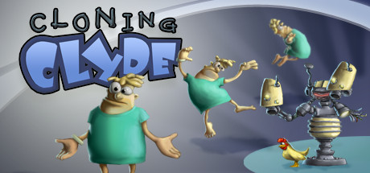

**Platforms:** Windows &nbsp;|&nbsp; **Genre:** Casual, Indie &nbsp;|&nbsp; **Released:** March 15

> Have you ever been cloned? Ever wonder what it would be like to be half chicken? Half monkey? Half frog? Well, wonder no more when you play Cloning Clyde. As Clyde, or one of his clones, work your way through the levels of the nefarious Dupliclone, Inc. building.
>
> _Synopsis source: Steam_

[Wikipedia](https://en.wikipedia.org/wiki/Cloning_Clyde) · [Steam](https://store.steampowered.com/app/91800)

---

### Code 18

**Platforms:** PlayStation Portable, Xbox 360 &nbsp;|&nbsp; **Developer:** Cyberfront &nbsp;|&nbsp; **Publisher:** Cyberfront &nbsp;|&nbsp; **Genre:** Visual novel &nbsp;|&nbsp; **Released:** September 29, 2011

[Wikipedia](https://en.wikipedia.org/wiki/Code_18)

---

### Coin Drop!

**Platforms:** iOS &nbsp;|&nbsp; **Developer:** Full Fat &nbsp;|&nbsp; **Genre:** Puzzle game &nbsp;|&nbsp; **Released:** April 19, 2011

[Wikipedia](https://en.wikipedia.org/wiki/Coin_Drop!)

---

### Combat Mission: Battle for Normandy

**Platforms:** Windows, macOS &nbsp;|&nbsp; **Developer:** Battlefront.com &nbsp;|&nbsp; **Publisher:** Battlefront.com &nbsp;|&nbsp; **Genre:** Turn-based, real-time strategy &nbsp;|&nbsp; **Released:** May 2011

[Wikipedia](https://en.wikipedia.org/wiki/Combat_Mission:_Battle_for_Normandy)

---

### Combat of Giants: Dinosaurs 3D

**Platforms:** Nintendo 3DS &nbsp;|&nbsp; **Released:** March 27

---

### Conduit 2

**Platforms:** Wii &nbsp;|&nbsp; **Released:** April 19

[Wikipedia](https://en.wikipedia.org/wiki/Conduit_2)

---

### Conspiracies II – Lethal Networks

**Platforms:** Windows &nbsp;|&nbsp; **Developer:** Anima Interactive &nbsp;|&nbsp; **Publisher:** Anima Interactive &nbsp;|&nbsp; **Genre:** Adventure, Interactive movie &nbsp;|&nbsp; **Released:** March 2011

[Wikipedia](https://en.wikipedia.org/wiki/Conspiracies_II_%E2%80%93_Lethal_Networks)

---

### Contre Jour

**Platforms:** Browser, iOS, Windows Phone, Android, Windows &nbsp;|&nbsp; **Developer:** Mokus &nbsp;|&nbsp; **Publisher:** Chillingo &nbsp;|&nbsp; **Genre:** Puzzle &nbsp;|&nbsp; **Released:** August 24, 2011

[Wikipedia](https://en.wikipedia.org/wiki/Contre_Jour)

---

### Cooking Mama 4: Kitchen Magic

**Platforms:** Nintendo 3DS &nbsp;|&nbsp; **Released:** November 16

---

### Cordy

**Platforms:** iOS &nbsp;|&nbsp; **Released:** July 27

[Wikipedia](https://en.wikipedia.org/wiki/Cordy_(video_game))

---

### Corpse Party

**Platforms:** PlayStation Portable &nbsp;|&nbsp; **Released:** November 22

[Wikipedia](https://en.wikipedia.org/wiki/Corpse_Party)

---

### Crazy Hedgy

**Platforms:** iOS &nbsp;|&nbsp; **Developer:** Cybertime &nbsp;|&nbsp; **Publisher:** Cybertime &nbsp;|&nbsp; **Genre:** 3D platformer, Beat 'em up &nbsp;|&nbsp; **Released:** December 20, 2011

[Wikipedia](https://en.wikipedia.org/wiki/Crazy_Hedgy)

---

### Crazy Machines Elements

**Platforms:** Windows, PlayStation 3, PlayStation Network, Xbox 360 &nbsp;|&nbsp; **Developer:** Fakt Software &nbsp;|&nbsp; **Publisher:** DTP Entertainment &nbsp;|&nbsp; **Genre:** Puzzle &nbsp;|&nbsp; **Released:** March 25, 2011

[Wikipedia](https://en.wikipedia.org/wiki/Crazy_Machines_Elements)

---

### Crimson Alliance

**Platforms:** Xbox 360 &nbsp;|&nbsp; **Released:** September 7

[Wikipedia](https://en.wikipedia.org/wiki/Crimson_Alliance)

---

### Crimson: Steam Pirates

**Platforms:** iOS &nbsp;|&nbsp; **Developer:** Harebrained Schemes &nbsp;|&nbsp; **Publisher:** Bungie Aerospace Corporation &nbsp;|&nbsp; **Genre:** Strategy &nbsp;|&nbsp; **Released:** September 1, 2011

[Wikipedia](https://en.wikipedia.org/wiki/Crimson:_Steam_Pirates)

---

### Crimzon Clover

**Platforms:** Windows &nbsp;|&nbsp; **Developer:** Yotsubane &nbsp;|&nbsp; **Publisher:** Yotsubane, Degica &nbsp;|&nbsp; **Genre:** Scrolling shooter, bullet hell &nbsp;|&nbsp; **Released:** January 11, 2011

[Wikipedia](https://en.wikipedia.org/wiki/Crimzon_Clover)

---

### Cryptozookeeper

**Developer:** Robb Sherwin &nbsp;|&nbsp; **Publisher:** Robb Sherwin &nbsp;|&nbsp; **Genre:** Interactive Fiction

[Wikipedia](https://en.wikipedia.org/wiki/Cryptozookeeper)

---

### Crysis 2

**Platforms:** Windows, PlayStation 3, Xbox 360 &nbsp;|&nbsp; **Genre:** Action &nbsp;|&nbsp; **Released:** March 22

> Aliens are decimating New York City, only you have the technology to survive. Be The Weapon.
>
> _Synopsis source: Steam_

[Wikipedia](https://en.wikipedia.org/wiki/Crysis_2) · [Steam](https://store.steampowered.com/app/108800)

---

### Cubic Ninja

**Platforms:** Nintendo 3DS &nbsp;|&nbsp; **Released:** June 14

[Wikipedia](https://en.wikipedia.org/wiki/Cubic_Ninja)

---

### Cubixx HD

**Platforms:** PlayStation 3 &nbsp;|&nbsp; **Developer:** Laughing Jackal &nbsp;|&nbsp; **Publisher:** Laughing Jackal, Ghostlight &nbsp;|&nbsp; **Genre:** Puzzle &nbsp;|&nbsp; **Released:** August 17, 2011

[Wikipedia](https://en.wikipedia.org/wiki/Cubixx_HD)

---

### Cut the Rope: Experiments

**Platforms:** iOS &nbsp;|&nbsp; **Released:** August 4

---

### Dance Central 2

**Platforms:** Xbox 360 &nbsp;|&nbsp; **Released:** October 25

[Wikipedia](https://en.wikipedia.org/wiki/Dance_Central_2)

---

### Dance Dance Revolution Freedom

**Platforms:** iOS &nbsp;|&nbsp; **Developer:** Konami &nbsp;|&nbsp; **Publisher:** Konami &nbsp;|&nbsp; **Genre:** Music &nbsp;|&nbsp; **Released:** February 11, 2011

[Wikipedia](https://en.wikipedia.org/wiki/Dance_Dance_Revolution_Freedom)

---

### Dance Dance Revolution II

**Platforms:** Wii &nbsp;|&nbsp; **Developer:** Konami &nbsp;|&nbsp; **Publisher:** Konami &nbsp;|&nbsp; **Genre:** Music, Exercise &nbsp;|&nbsp; **Released:** October 11, 2011

[Wikipedia](https://en.wikipedia.org/wiki/Dance_Dance_Revolution_II)

---

### Dance Dance Revolution X3 vs. 2ndMix

**Platforms:** Arcade &nbsp;|&nbsp; **Developer:** Konami, Bemani &nbsp;|&nbsp; **Publisher:** Konami &nbsp;|&nbsp; **Genre:** Music, exercise &nbsp;|&nbsp; **Released:** November 16, 2011

[Wikipedia](https://en.wikipedia.org/wiki/Dance_Dance_Revolution_X3_vs._2ndMix)

---

### Dance on Broadway

**Platforms:** PlayStation 3 &nbsp;|&nbsp; **Released:** March 17

[Wikipedia](https://en.wikipedia.org/wiki/Dance_on_Broadway)

---

### Dark Souls

**Platforms:** PlayStation 3, Xbox 360 &nbsp;|&nbsp; **Released:** October 4

[Wikipedia](https://en.wikipedia.org/wiki/Dark_Souls_(video_game))

---

### Darkest Hour: A Hearts of Iron Game

**Platforms:** Windows &nbsp;|&nbsp; **Developer:** Martin Ivanov &nbsp;|&nbsp; **Publisher:** Paradox Interactive &nbsp;|&nbsp; **Genre:** Real-time Grand strategy &nbsp;|&nbsp; **Released:** April 5, 2011

[Wikipedia](https://en.wikipedia.org/wiki/Darkest_Hour:_A_Hearts_of_Iron_Game)

---

### Darkspore

**Platforms:** Windows &nbsp;|&nbsp; **Released:** April 26

[Wikipedia](https://en.wikipedia.org/wiki/Darkspore)

---

### Dawn of Fantasy

**Platforms:** Windows &nbsp;|&nbsp; **Released:** September 6

[Wikipedia](https://en.wikipedia.org/wiki/Dawn_of_Fantasy)

---

### Days of Thunder

**Platforms:** PlayStation Network, Xbox 360, PlayStation Portable &nbsp;|&nbsp; **Released:** February 22

[Wikipedia](https://en.wikipedia.org/wiki/Days_of_Thunder_(2011_video_game))

---

### DC Universe Online

**Platforms:** Windows, PlayStation 3 &nbsp;|&nbsp; **Genre:** Action, MMO &nbsp;|&nbsp; **Released:** January 11

> DC Universe Online is a Free-to-Play, massive multiplayer online action game set in the popular DC Universe. Become one of a new breed of Heroes or Villains and wield incredible powers as you go to war with legendary characters such as Batman, Superman, Lex Luthor and The Joker.
>
> _Synopsis source: Steam_

[Wikipedia](https://en.wikipedia.org/wiki/DC_Universe_Online) · [Steam](https://store.steampowered.com/app/24200)

---

### de Blob 2

**Platforms:** Nintendo DS, PlayStation 3, Xbox 360, Wii &nbsp;|&nbsp; **Released:** February 22

[Wikipedia](https://en.wikipedia.org/wiki/De_Blob_2)

---

### Dead Island

**Platforms:** Windows, Xbox 360, PlayStation 3 &nbsp;|&nbsp; **Released:** September 6

[Wikipedia](https://en.wikipedia.org/wiki/Dead_Island)

---

### Dead or Alive: Dimensions

**Platforms:** Nintendo 3DS &nbsp;|&nbsp; **Released:** May 24

---

### Dead Rising 2: Off the Record

**Platforms:** Windows, PlayStation 3, Xbox 360 &nbsp;|&nbsp; **Genre:** Action, Adventure &nbsp;|&nbsp; **Released:** October 11

> You are Frank West – photojournalist and original hero of the Dead Rising Willamette incident – taking center stage experiencing the re-imagined Fortune City outbreak.
>
> _Synopsis source: Steam_

[Steam](https://store.steampowered.com/app/45770)

---

### Dead Space

**Platforms:** iOS, Android &nbsp;|&nbsp; **Developer:** IronMonkey Studios &nbsp;|&nbsp; **Publisher:** Electronic Arts &nbsp;|&nbsp; **Genre:** Survival horror &nbsp;|&nbsp; **Released:** January 25, 2011

[Wikipedia](https://en.wikipedia.org/wiki/Dead_Space_(mobile_game))

---

### Dead Space 2

**Platforms:** Xbox 360, Windows, PlayStation 3 &nbsp;|&nbsp; **Publisher:** Electronic Arts &nbsp;|&nbsp; **Genre:** Survival horror &nbsp;|&nbsp; **Released:** January 25, 2011

> Three years after the Necromorph infestation aboard the USS Ishimura, Isaac Clarke awakens from a coma, confused, disoriented, and on a space station called The Sprawl. Explore this world and its zero-g environments to discover the truth about the Unitology and its role in the Necromorph epidemic.
>
> _Synopsis source: Steam_

[Wikipedia](https://en.wikipedia.org/wiki/Dead_Space_2) · [Steam](https://store.steampowered.com/app/47780)

---

### Deadliest Warrior: Legends

**Platforms:** Xbox 360, PlayStation Network, PlayStation 3 &nbsp;|&nbsp; **Developer:** Pipeworks Software &nbsp;|&nbsp; **Publisher:** 345 Games, Spike Games &nbsp;|&nbsp; **Genre:** Fighting &nbsp;|&nbsp; **Released:** July 6, 2011

[Wikipedia](https://en.wikipedia.org/wiki/Deadliest_Warrior:_Legends)

---

### Deathsmiles

**Platforms:** iOS &nbsp;|&nbsp; **Released:** July 7

[Wikipedia](https://en.wikipedia.org/wiki/Deathsmiles)

---

### Deathsmiles II

**Platforms:** Xbox 360 &nbsp;|&nbsp; **Released:** May 17

[Wikipedia](https://en.wikipedia.org/wiki/Deathsmiles_II)

---

### Deca Sports Extreme

**Platforms:** Nintendo 3DS &nbsp;|&nbsp; **Developer:** Hudson Soft &nbsp;|&nbsp; **Publisher:** Hudson Soft, Konami &nbsp;|&nbsp; **Genre:** Sports &nbsp;|&nbsp; **Released:** April 28, 2011

[Wikipedia](https://en.wikipedia.org/wiki/Deca_Sports_Extreme)

---

### Deepak Chopra's Leela

**Platforms:** Wii, Xbox 360 &nbsp;|&nbsp; **Released:** November 8

---

### Defenders of Ardania

**Platforms:** iOS &nbsp;|&nbsp; **Released:** December 6

[Wikipedia](https://en.wikipedia.org/wiki/Defenders_of_Ardania)

---

### Deus Ex: Human Revolution

**Platforms:** Windows, PlayStation 3, Xbox 360 &nbsp;|&nbsp; **Publisher:** Square Enix &nbsp;|&nbsp; **Released:** August 23, 2011

---

### Deus Ex: Human Revolution – The Missing Link

**Platforms:** Windows, PlayStation 3, Xbox 360, macOS, Wii U &nbsp;|&nbsp; **Developer:** Eidos Montréal &nbsp;|&nbsp; **Publisher:** Square Enix &nbsp;|&nbsp; **Genre:** Action role-playing, first-person shooter, stealth &nbsp;|&nbsp; **Released:** October 18, 2011

[Wikipedia](https://en.wikipedia.org/wiki/Deus_Ex:_Human_Revolution_%E2%80%93_The_Missing_Link)

---

### Dice Soccer

**Platforms:** iOS &nbsp;|&nbsp; **Developer:** LambdaMu Games &nbsp;|&nbsp; **Publisher:** LambdaMu Games &nbsp;|&nbsp; **Genre:** Sports &nbsp;|&nbsp; **Released:** July 28, 2011

[Wikipedia](https://en.wikipedia.org/wiki/Dice_Soccer)

---

### Digimon Collectors

[Wikipedia](https://en.wikipedia.org/wiki/Digimon_Collectors)

---

### Digimon Story: Super Xros Wars Red and Blue

[Wikipedia](https://en.wikipedia.org/wiki/Digimon_Story:_Super_Xros_Wars_Red_and_Blue)

---

### Dino D-Day

**Platforms:** Windows &nbsp;|&nbsp; **Developer:** 800 North, Digital Ranch &nbsp;|&nbsp; **Publisher:** 800 North, Digital Ranch &nbsp;|&nbsp; **Genre:** First-person shooter &nbsp;|&nbsp; **Released:** April 8, 2011

[Wikipedia](https://en.wikipedia.org/wiki/Dino_D-Day)

---

### Dirt 3

**Platforms:** Windows, Xbox 360, PlayStation 3 &nbsp;|&nbsp; **Released:** May 24

[Wikipedia](https://en.wikipedia.org/wiki/Dirt_3)

---

### Dirty Drivin'

**Platforms:** Arcade &nbsp;|&nbsp; **Developer:** Specular Interactive &nbsp;|&nbsp; **Publisher:** Raw Thrills &nbsp;|&nbsp; **Genre:** Racing

[Wikipedia](https://en.wikipedia.org/wiki/Dirty_Drivin')

---

### Disgaea 4

**Platforms:** PlayStation 3 &nbsp;|&nbsp; **Developer:** Nippon Ichi Software &nbsp;|&nbsp; **Publisher:** Nippon Ichi Software, NIS America &nbsp;|&nbsp; **Genre:** Tactical role-playing &nbsp;|&nbsp; **Released:** February 24, 2011

[Wikipedia](https://en.wikipedia.org/wiki/Disgaea_4)

---

### Disgaea 4: A Promise Unforgotten

**Platforms:** PlayStation 3 &nbsp;|&nbsp; **Released:** September 6

---

### Disney Princess: Enchanting Storybooks

**Platforms:** Nintendo DS, Wii &nbsp;|&nbsp; **Released:** November 1

---

### Disney Universe

**Platforms:** Windows, macOS, Wii, PlayStation 3, Xbox 360 &nbsp;|&nbsp; **Released:** October 25

[Wikipedia](https://en.wikipedia.org/wiki/Disney_Universe)

---

### Dissidia 012 Final Fantasy

**Platforms:** PlayStation Portable &nbsp;|&nbsp; **Released:** March 22

[Wikipedia](https://en.wikipedia.org/wiki/Dissidia_012_Final_Fantasy)

---

### Divinity II: The Dragon Knight Saga

**Platforms:** Xbox 360 &nbsp;|&nbsp; **Released:** April 12

[Wikipedia](https://en.wikipedia.org/wiki/Divinity_II#Remake)

---

### DJMax Technika 3

**Platforms:** Arcade &nbsp;|&nbsp; **Developer:** Pentavision &nbsp;|&nbsp; **Publisher:** Pentavision &nbsp;|&nbsp; **Genre:** Music &nbsp;|&nbsp; **Released:** October 27, 2011

[Wikipedia](https://en.wikipedia.org/wiki/DJMax_Technika_3)

---

### Doctor Lautrec and the Forgotten Knights

**Platforms:** Nintendo 3DS &nbsp;|&nbsp; **Released:** December 6

[Wikipedia](https://en.wikipedia.org/wiki/Doctor_Lautrec_and_the_Forgotten_Knights)

---

### Don't Take It Personally, Babe, It Just Ain't Your Story

**Platforms:** Windows, macOS, Linux &nbsp;|&nbsp; **Developer:** Love Conquers All Games &nbsp;|&nbsp; **Genre:** Visual novel &nbsp;|&nbsp; **Released:** April 4, 2011

[Wikipedia](https://en.wikipedia.org/wiki/Don't_Take_It_Personally,_Babe,_It_Just_Ain't_Your_Story)

---

### Dragon Age II

**Platforms:** Windows, PlayStation 3, Xbox 360 &nbsp;|&nbsp; **Released:** March 8

[Wikipedia](https://en.wikipedia.org/wiki/Dragon_Age_II)

---

### Dragon Age Legends

**Platforms:** Facebook &nbsp;|&nbsp; **Developer:** EA2D &nbsp;|&nbsp; **Publisher:** Electronic Arts &nbsp;|&nbsp; **Genre:** Tactical role-playing, strategy &nbsp;|&nbsp; **Released:** March 16, 2011

[Wikipedia](https://en.wikipedia.org/wiki/Dragon_Age_Legends)

---

### Dragon Ball Kai: Ultimate Butōden

**Platforms:** Nintendo DS &nbsp;|&nbsp; **Developer:** Game Republic &nbsp;|&nbsp; **Publisher:** Namco Bandai Games &nbsp;|&nbsp; **Genre:** Fighting &nbsp;|&nbsp; **Released:** February 3, 2011

[Wikipedia](https://en.wikipedia.org/wiki/Dragon_Ball_Kai:_Ultimate_But%C5%8Dden)

---

### Dragon Ball Z: Ultimate Tenkaichi

**Platforms:** PlayStation 3, Xbox 360 &nbsp;|&nbsp; **Developer:** Spike &nbsp;|&nbsp; **Publisher:** Namco Bandai Games &nbsp;|&nbsp; **Genre:** Fighting &nbsp;|&nbsp; **Released:** October 25, 2011

[Wikipedia](https://en.wikipedia.org/wiki/Dragon_Ball_Z:_Ultimate_Tenkaichi)

---

### Dragon Fantasy

**Platforms:** iOS, Windows, macOS &nbsp;|&nbsp; **Developer:** The Muteki Corporation &nbsp;|&nbsp; **Publisher:** The Muteki Corporation &nbsp;|&nbsp; **Genre:** Role-playing &nbsp;|&nbsp; **Released:** August 25, 2011

[Wikipedia](https://en.wikipedia.org/wiki/Dragon_Fantasy)

---

### Dragon Quest Monsters: Joker 2

**Platforms:** Nintendo DS &nbsp;|&nbsp; **Released:** September 19

---

### Dragon Quest VI: Realms of Revelation

**Platforms:** Nintendo DS &nbsp;|&nbsp; **Released:** February 14

---

### DragonVale

**Platforms:** iOS &nbsp;|&nbsp; **Developer:** Backflip Studios, DECA Games &nbsp;|&nbsp; **Publisher:** DECA Games &nbsp;|&nbsp; **Genre:** Park simulator &nbsp;|&nbsp; **Released:** September 14, 2011

[Wikipedia](https://en.wikipedia.org/wiki/DragonVale)

---

### Drakensang Online

**Platforms:** Windows &nbsp;|&nbsp; **Developer:** Bigpoint Berlin &nbsp;|&nbsp; **Publisher:** Bigpoint, bitComposer Games &nbsp;|&nbsp; **Genre:** MMORPG &nbsp;|&nbsp; **Released:** August 2011

[Wikipedia](https://en.wikipedia.org/wiki/Drakensang_Online)

---

### Drawn: Trail of Shadows

**Platforms:** Windows &nbsp;|&nbsp; **Developer:** Big Fish Games &nbsp;|&nbsp; **Publisher:** Big Fish Games &nbsp;|&nbsp; **Genre:** Adventure &nbsp;|&nbsp; **Released:** October 19, 2011

[Wikipedia](https://en.wikipedia.org/wiki/Drawn:_Trail_of_Shadows)

---

### DrawRace 2

**Platforms:** iOS &nbsp;|&nbsp; **Developer:** Ubisoft RedLynx &nbsp;|&nbsp; **Publisher:** EA Chillingo &nbsp;|&nbsp; **Genre:** racing &nbsp;|&nbsp; **Released:** September 1, 2011

[Wikipedia](https://en.wikipedia.org/wiki/DrawRace_2)

---

### Dream Chronicles: The Book of Water

**Platforms:** Windows &nbsp;|&nbsp; **Released:** April 24

---

### Dream Club Zero

**Platforms:** Xbox 360, PlayStation Vita, PlayStation 3 &nbsp;|&nbsp; **Developer:** Tamsoft &nbsp;|&nbsp; **Publisher:** D3 Publisher &nbsp;|&nbsp; **Genre:** Dating sim &nbsp;|&nbsp; **Released:** January 27, 2011

[Wikipedia](https://en.wikipedia.org/wiki/Dream_Club_Zero)

---

### Dream Trigger 3D

**Platforms:** Nintendo 3DS &nbsp;|&nbsp; **Released:** May 10

---

### Dreamcast Collection

**Platforms:** Xbox 360, Windows &nbsp;|&nbsp; **Developer:** Sega &nbsp;|&nbsp; **Publisher:** Sega &nbsp;|&nbsp; **Genre:** Various &nbsp;|&nbsp; **Released:** February 22, 2011

[Wikipedia](https://en.wikipedia.org/wiki/Dreamcast_Collection)

---

### Dreamscape

**Platforms:** iOS &nbsp;|&nbsp; **Released:** June 9

[Wikipedia](https://en.wikipedia.org/wiki/Dreamscape_(video_game))

---

### DreamWorks Super Star Kartz

**Platforms:** Nintendo 3DS, Nintendo DS, PlayStation 3, Wii, Xbox 360 &nbsp;|&nbsp; **Released:** November 15

[Wikipedia](https://en.wikipedia.org/wiki/DreamWorks_Super_Star_Kartz)

---

### Driver: Renegade

**Platforms:** Nintendo 3DS &nbsp;|&nbsp; **Developer:** VD-dev &nbsp;|&nbsp; **Publisher:** Ubisoft &nbsp;|&nbsp; **Genre:** Sandbox, action, racing &nbsp;|&nbsp; **Released:** September 1, 2011

[Wikipedia](https://en.wikipedia.org/wiki/Driver:_Renegade)

---

### Driver: Renegade 3D

**Platforms:** Nintendo 3DS &nbsp;|&nbsp; **Released:** August 30

---

### Driver: San Francisco

**Platforms:** PlayStation 3, Xbox 360, Wii, Windows &nbsp;|&nbsp; **Released:** September 6

---

### DualPenSports

**Platforms:** Nintendo 3DS &nbsp;|&nbsp; **Released:** June 21

[Wikipedia](https://en.wikipedia.org/wiki/DualPenSports)

---

### Duke Nukem Forever

**Platforms:** Windows, PlayStation 3, Xbox 360, macOS &nbsp;|&nbsp; **Genre:** Action &nbsp;|&nbsp; **Released:** June 14

> The King arrives with an arsenal of over-the-top weapons, giant explosions and pure unadulterated fun!
>
> _Synopsis source: Steam_

[Wikipedia](https://en.wikipedia.org/wiki/Duke_Nukem_Forever) · [Steam](https://store.steampowered.com/app/57900)

---

### Duke Nukem: Critical Mass

**Platforms:** Nintendo DS &nbsp;|&nbsp; **Released:** June 6

---

### Dunamis 15

**Platforms:** PlayStation 3, Xbox 360 &nbsp;|&nbsp; **Developer:** 5pb. &nbsp;|&nbsp; **Publisher:** 5pb. &nbsp;|&nbsp; **Genre:** Adventure, visual Novel &nbsp;|&nbsp; **Released:** September 15, 2011

[Wikipedia](https://en.wikipedia.org/wiki/Dunamis_15)

---

### Dungeon Defenders

**Platforms:** PlayStation Network, Windows, Xbox 360 &nbsp;|&nbsp; **Genre:** Action, Indie, RPG, Strategy &nbsp;|&nbsp; **Released:** October 18

> Create a hero from one of four classes to save Etheria in this 4-player coop Tower Defense Action-RPG. Includes Steam exclusive Portal gun &amp; TF2 familiars!
>
> _Synopsis source: Steam_

[Wikipedia](https://en.wikipedia.org/wiki/Dungeon_Defenders) · [Steam](https://store.steampowered.com/app/65800)

---

### Dungeon Hunter: Alliance

**Platforms:** PlayStation Network &nbsp;|&nbsp; **Released:** April 3

---

### Dungeon Siege III

**Platforms:** Windows, Xbox 360, PlayStation 3 &nbsp;|&nbsp; **Released:** June 21

[Wikipedia](https://en.wikipedia.org/wiki/Dungeon_Siege_III)

---

### Dungeons

**Platforms:** Windows &nbsp;|&nbsp; **Released:** February 10

[Wikipedia](https://en.wikipedia.org/wiki/Dungeons_(video_game))

---

### Dungeons & Dragons: Daggerdale

**Platforms:** Windows, Xbox 360 &nbsp;|&nbsp; **Genre:** Action, RPG &nbsp;|&nbsp; **Released:** May 25

> Dungeons & Dragons: Daggerdale offers engaging "hack and slash" gameplay, bringing Dungeons & Dragons to life. Travel to the Dalelands of the Forgotten Realms, where the journey begins in the remote Desertsmouth Mountains.
>
> _Synopsis source: Steam_

[Steam](https://store.steampowered.com/app/99100)

---

### Dungeons of Dredmor

**Platforms:** Windows, macOS, Linux &nbsp;|&nbsp; **Developer:** Gaslamp Games &nbsp;|&nbsp; **Genre:** Roguelike &nbsp;|&nbsp; **Released:** July 13, 2011

[Wikipedia](https://en.wikipedia.org/wiki/Dungeons_of_Dredmor)

---

### Duolingo

[Wikipedia](https://en.wikipedia.org/wiki/Duolingo)

---

### Dwarfs

**Platforms:** Windows &nbsp;|&nbsp; **Developer:** Power of 2 &nbsp;|&nbsp; **Publisher:** Tripwire Interactive &nbsp;|&nbsp; **Genre:** Real-time strategy &nbsp;|&nbsp; **Released:** May 4, 2011

[Wikipedia](https://en.wikipedia.org/wiki/Dwarfs_(video_game))

---

### Dynasty Warriors 7

**Platforms:** PlayStation 3, Xbox 360 &nbsp;|&nbsp; **Released:** March 29

[Wikipedia](https://en.wikipedia.org/wiki/Dynasty_Warriors_7)

---

### Dynasty Warriors 7: Xtreme Legends

**Platforms:** Windows, PlayStation 3 &nbsp;|&nbsp; **Released:** November 15

[Wikipedia](https://en.wikipedia.org/wiki/Dynasty_Warriors_7)

---

### Dynasty Warriors: Gundam 3

**Platforms:** PlayStation 3, Xbox 360 &nbsp;|&nbsp; **Released:** June 28

---

### E.Y.E.: Divine Cybermancy

**Platforms:** Windows &nbsp;|&nbsp; **Developer:** Streum On Studio &nbsp;|&nbsp; **Publisher:** Streum On Studio &nbsp;|&nbsp; **Genre:** First-person shooter, action role-playing &nbsp;|&nbsp; **Released:** July 29, 2011

[Wikipedia](https://en.wikipedia.org/wiki/E.Y.E.:_Divine_Cybermancy)

---

### Earth Defense Force: Insect Armageddon

**Platforms:** PlayStation 3, Xbox 360, Windows &nbsp;|&nbsp; **Genre:** Action &nbsp;|&nbsp; **Released:** July 5

> Thousands of giant insects and aliens once again ravage the earth, and only the Earth Defense Force can stop them.
>
> _Synopsis source: Steam_

[Steam](https://store.steampowered.com/app/23530)

---

### Earth Seeker

**Platforms:** Wii &nbsp;|&nbsp; **Developer:** Crafts & Meister, Kadokawa Shoten &nbsp;|&nbsp; **Publisher:** Enterbrain &nbsp;|&nbsp; **Genre:** Role-playing game &nbsp;|&nbsp; **Released:** June 23, 2011

[Wikipedia](https://en.wikipedia.org/wiki/Earth_Seeker)

---

### Earthrise

**Platforms:** Windows &nbsp;|&nbsp; **Genre:** MMO, RPG &nbsp;|&nbsp; **Released:** February 4

[Wikipedia](https://en.wikipedia.org/wiki/Earthrise_(video_game))

---

### Edna & Harvey: Harvey's New Eyes

**Platforms:** Windows &nbsp;|&nbsp; **Developer:** Daedalic Entertainment &nbsp;|&nbsp; **Publisher:** rondomedia, Daedalic Entertainment &nbsp;|&nbsp; **Genre:** Graphic adventure &nbsp;|&nbsp; **Released:** August 26, 2011

> In Edna & Harvey: Harvey’s New Eyes, players return to the world of adventure game hit Edna & Harvey: The Breakout. Be prepared to meet many old friends and discover many new hand-made cartoon locations, realized in full HD glory!  Lilli, a young girl at a convent school, is the main character of Edna & Harvey: Harvey’s New Eyes. Seemingly the best-behaved little girl in the world, she executes all her chores in a diligent manner, no matter how unfair they may be. Her innocent, imperturbable way of carrying out the orders of others has something both tragic and eerie about it. Any angry thoughts, any childlike disobedience is buried deep beneath a seemingly impenetrable surface of sweetness. But how long will these feelings stay hidden? And where do the friendly little gnomes come from that paint over everything unpleasant in Lilli’s vicinity with a pleasant pink color? Are they real or just a product of her subconscious?
>
> _Synopsis source: IGDB_

[Wikipedia](https://en.wikipedia.org/wiki/Edna_&_Harvey:_Harvey's_New_Eyes) · [IGDB](https://www.igdb.com/games/edna-harvey-harvey-s-new-eyes)

---

### El Shaddai: Ascension of the Metatron

**Platforms:** PlayStation 3, Xbox 360 &nbsp;|&nbsp; **Released:** August 16

---

### Elder Sign: Omens

**Platforms:** iOS, Windows &nbsp;|&nbsp; **Developer:** Fantasy Flight Games &nbsp;|&nbsp; **Genre:** Board game &nbsp;|&nbsp; **Released:** October 31, 2011

[Wikipedia](https://en.wikipedia.org/wiki/Elder_Sign:_Omens)

---

### Elemental Rage

**Platforms:** iOS &nbsp;|&nbsp; **Developer:** Oniric Games &nbsp;|&nbsp; **Publisher:** Oniric Games &nbsp;|&nbsp; **Genre:** Platform-adventure, Metroidvania &nbsp;|&nbsp; **Released:** April 14, 2011

[Wikipedia](https://en.wikipedia.org/wiki/Elemental_Rage)

---

### Elsword

**Platforms:** Windows &nbsp;|&nbsp; **Released:** March 23 (NA)

[Wikipedia](https://en.wikipedia.org/wiki/Elsword)

---

### Empire & State

**Platforms:** Windows &nbsp;|&nbsp; **Developer:** Novel, Inc. &nbsp;|&nbsp; **Publisher:** Novel, Inc. &nbsp;|&nbsp; **Genre:** MOBA, MMORPG &nbsp;|&nbsp; **Released:** November 28, 2011

[Wikipedia](https://en.wikipedia.org/wiki/Empire_&_State)

---

### Empires & Allies

**Platforms:** Browser &nbsp;|&nbsp; **Developer:** Zynga Los Angeles &nbsp;|&nbsp; **Publisher:** Zynga &nbsp;|&nbsp; **Genre:** Simulation, role-playing, Turn-based strategy &nbsp;|&nbsp; **Released:** June 1, 2011

[Wikipedia](https://en.wikipedia.org/wiki/Empires_&_Allies)

---

### Encyclopedia Fuckme and the Case of the Vanishing Entree

**Platforms:** Browser &nbsp;|&nbsp; **Developer:** Anna Anthropy &nbsp;|&nbsp; **Genre:** Dating sim

[Wikipedia](https://en.wikipedia.org/wiki/Encyclopedia_Fuckme_and_the_Case_of_the_Vanishing_Entree)

---

### Enercities

**Platforms:** Browser &nbsp;|&nbsp; **Developer:** Paladin Studios &nbsp;|&nbsp; **Genre:** Simulation game

[Wikipedia](https://en.wikipedia.org/wiki/Enercities)

---

### English Country Tune

**Platforms:** iOS, macOS, Windows &nbsp;|&nbsp; **Developer:** Increpare Games &nbsp;|&nbsp; **Publisher:** Increpare Games &nbsp;|&nbsp; **Genre:** Puzzle &nbsp;|&nbsp; **Released:** November 25, 2011

[Wikipedia](https://en.wikipedia.org/wiki/English_Country_Tune)

---

### Epic Astro Story

**Platforms:** Android, iOS &nbsp;|&nbsp; **Developer:** Kairosoft &nbsp;|&nbsp; **Genre:** Simulation

[Wikipedia](https://en.wikipedia.org/wiki/Epic_Astro_Story)

---

### Escape Goat

**Platforms:** Windows, Xbox 360 &nbsp;|&nbsp; **Genre:** Action, Indie &nbsp;|&nbsp; **Released:** November 2

> Escape Goat is a puzzle platformer where you take control of a goat, who has been imprisoned for witchcraft, and overcome traps and obstacles to escape the Prison of Agnus. Fear not, for with your supreme agility, sturdy horns, and the help of a magic mouse friend, you can turn the tables on foes and use the environment to your advantage.
>
> _Synopsis source: Steam_

[Wikipedia](https://en.wikipedia.org/wiki/Escape_Goat) · [Steam](https://store.steampowered.com/app/251370)

---

### Eschatos

**Platforms:** Xbox 360 &nbsp;|&nbsp; **Developer:** Qute &nbsp;|&nbsp; **Publisher:** Qute, Degica &nbsp;|&nbsp; **Genre:** Scrolling shooter &nbsp;|&nbsp; **Released:** April 7, 2011

[Wikipedia](https://en.wikipedia.org/wiki/Eschatos)

---

### Eufloria

**Platforms:** PlayStation Network &nbsp;|&nbsp; **Released:** October 4

[Wikipedia](https://en.wikipedia.org/wiki/Eufloria)

---

### EverQuest II: Destiny of Velious

[Wikipedia](https://en.wikipedia.org/wiki/EverQuest_II:_Destiny_of_Velious)

---

### EverQuest: Veil of Alaris

[Wikipedia](https://en.wikipedia.org/wiki/EverQuest:_Veil_of_Alaris)

---

### Everybody Dance

**Platforms:** PlayStation 3 &nbsp;|&nbsp; **Released:** October 18

[Wikipedia](https://en.wikipedia.org/wiki/Everybody_Dance_(video_game))

---

### Explodemon

**Platforms:** PlayStation Network &nbsp;|&nbsp; **Released:** February 8

[Wikipedia](https://en.wikipedia.org/wiki/Explodemon)

---

### F.E.A.R. 3

**Platforms:** Windows, Xbox 360, PlayStation 3 &nbsp;|&nbsp; **Genre:** Action &nbsp;|&nbsp; **Released:** June 21

> F.E.A.R. 3 delivers all the hallmarks that define the F.E.A.R. brand: terrifying paranormal experience, frenetic combat and a dramatic storyline.
>
> _Synopsis source: Steam_

[Wikipedia](https://en.wikipedia.org/wiki/F.E.A.R._3) · [Steam](https://store.steampowered.com/app/21100)

---

### F1 2011

**Platforms:** Windows, Xbox 360, PlayStation 3, Nintendo 3DS &nbsp;|&nbsp; **Released:** September 20

[Wikipedia](https://en.wikipedia.org/wiki/F1_2011_(video_game))

---

### Fable III

**Platforms:** Windows &nbsp;|&nbsp; **Released:** May 17

[Wikipedia](https://en.wikipedia.org/wiki/Fable_III)

---

### Face Racers: Photo Finish

**Platforms:** Nintendo 3DS &nbsp;|&nbsp; **Released:** December 6

---

### Face Raiders

**Platforms:** Nintendo 3DS &nbsp;|&nbsp; **Developer:** HAL Laboratory &nbsp;|&nbsp; **Publisher:** Nintendo &nbsp;|&nbsp; **Genre:** Simulator, shooter &nbsp;|&nbsp; **Released:** February 26, 2011

[Wikipedia](https://en.wikipedia.org/wiki/Face_Raiders)

---

### Fancy Pants Adventures

**Platforms:** PlayStation Network, Xbox 360 &nbsp;|&nbsp; **Released:** April 19

[Wikipedia](https://en.wikipedia.org/wiki/Fancy_Pants_Adventures)

---

### Fantastic Pets

**Platforms:** Xbox 360 &nbsp;|&nbsp; **Developer:** Blitz Games Studios &nbsp;|&nbsp; **Publisher:** THQ Inc. &nbsp;|&nbsp; **Genre:** Virtual pet &nbsp;|&nbsp; **Released:** April 12, 2011

[Wikipedia](https://en.wikipedia.org/wiki/Fantastic_Pets)

---

### FAST - Racing League

**Platforms:** Wii &nbsp;|&nbsp; **Released:** May 30

---

### Fast Beat Loop Racer

**Platforms:** Arcade &nbsp;|&nbsp; **Developer:** Saint-Fun International &nbsp;|&nbsp; **Publisher:** UFO Interactive &nbsp;|&nbsp; **Genre:** Racing game

[Wikipedia](https://en.wikipedia.org/wiki/Fast_Beat_Loop_Racer)

---

### Fast Five

**Platforms:** Android, iOS, Mobile phone, macOS &nbsp;|&nbsp; **Developer:** Gameloft Srl, Gameloft Beijing &nbsp;|&nbsp; **Publisher:** Gameloft &nbsp;|&nbsp; **Genre:** Racing &nbsp;|&nbsp; **Released:** April 20, 2011

[Wikipedia](https://en.wikipedia.org/wiki/Fast_Five_(video_game))

---

### Fate of the World

**Platforms:** Windows, macOS &nbsp;|&nbsp; **Developer:** Red Redemption Ltd &nbsp;|&nbsp; **Publisher:** Red Redemption Ltd, Lace Mamba Global &nbsp;|&nbsp; **Genre:** Global warming game &nbsp;|&nbsp; **Released:** February 28, 2011

[Wikipedia](https://en.wikipedia.org/wiki/Fate_of_the_World)

---

### Fate/Extra

**Platforms:** PlayStation Portable &nbsp;|&nbsp; **Released:** November 21

[Wikipedia](https://en.wikipedia.org/wiki/Fate/Extra)

---

### Feed Me Oil

**Platforms:** iOS &nbsp;|&nbsp; **Released:** June 2

[Wikipedia](https://en.wikipedia.org/wiki/Feed_Me_Oil)

---

### FIFA 12

**Platforms:** PlayStation 3, Xbox 360, Windows, Wii, PlayStation 2, PlayStation Portable, Nintendo 3DS, iOS &nbsp;|&nbsp; **Publisher:** EA Sports &nbsp;|&nbsp; **Released:** September 27, 2011

[Wikipedia](https://en.wikipedia.org/wiki/FIFA_12)

---

### FIFA Manager 12

**Platforms:** Windows &nbsp;|&nbsp; **Released:** October 21

[Wikipedia](https://en.wikipedia.org/wiki/FIFA_Manager_12)

---

### Fight Night Champion

**Platforms:** iOS, PlayStation 3, Xbox 360 &nbsp;|&nbsp; **Released:** March 1

[Wikipedia](https://en.wikipedia.org/wiki/Fight_Night_Champion)

---

### Fightin' Words

**Platforms:** Android, BlackBerry OS &nbsp;|&nbsp; **Released:** June 15

---

### Final Fantasy III

**Platforms:** iOS &nbsp;|&nbsp; **Released:** March 24

[Wikipedia](https://en.wikipedia.org/wiki/Final_Fantasy_III)

---

### Final Fantasy IV: The Complete Collection

**Platforms:** PlayStation Portable &nbsp;|&nbsp; **Released:** April 19

---

### Final Fantasy Tactics: The War of the Lions

**Platforms:** PlayStation Portable &nbsp;|&nbsp; **Released:** July 19

---

### Final Fantasy Type-0

**Platforms:** PlayStation Portable &nbsp;|&nbsp; **Developer:** Square Enix 1st Production Department &nbsp;|&nbsp; **Publisher:** Square Enix &nbsp;|&nbsp; **Genre:** Action role-playing &nbsp;|&nbsp; **Released:** October 27, 2011

[Wikipedia](https://en.wikipedia.org/wiki/Final_Fantasy_Type-0)

---

### Final Fantasy VI

**Platforms:** PlayStation Network &nbsp;|&nbsp; **Released:** December 6

[Wikipedia](https://en.wikipedia.org/wiki/Final_Fantasy_VI)

---

### Fire Emblem: The Sacred Stones

**Platforms:** Nintendo 3DS &nbsp;|&nbsp; **Released:** December 16

---

### First Touch Soccer

**Platforms:** iOS &nbsp;|&nbsp; **Released:** May 4

---

### Fishing Resort

**Platforms:** Wii &nbsp;|&nbsp; **Developer:** Prope &nbsp;|&nbsp; **Publisher:** Namco Bandai Games, XSEED Games, Nintendo &nbsp;|&nbsp; **Genre:** Fishing &nbsp;|&nbsp; **Released:** August 4, 2011

[Wikipedia](https://en.wikipedia.org/wiki/Fishing_Resort)

---

### FlatOut 3: Chaos & Destruction

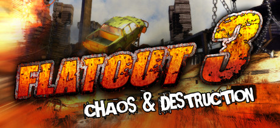

**Platforms:** Windows &nbsp;|&nbsp; **Genre:** Racing &nbsp;|&nbsp; **Released:** December 13

> Feel the adrenaline pulse through your veins as you barrel through insane race tracks against monster trucks, race cars, off road vehicles and much more.
>
> _Synopsis source: Steam_

[Steam](https://store.steampowered.com/app/201510)

---

### Flick Home Run!

**Platforms:** iOS, Android &nbsp;|&nbsp; **Developer:** Infinity Pocket &nbsp;|&nbsp; **Genre:** Sports &nbsp;|&nbsp; **Released:** October 15, 2011

[Wikipedia](https://en.wikipedia.org/wiki/Flick_Home_Run!)

---

### Flick Soccer!

**Platforms:** iOS &nbsp;|&nbsp; **Developer:** Full Fat &nbsp;|&nbsp; **Genre:** Sports &nbsp;|&nbsp; **Released:** August 11, 2011

[Wikipedia](https://en.wikipedia.org/wiki/Flick_Soccer!)

---

### Flight Control

**Platforms:** Wii &nbsp;|&nbsp; **Released:** August 18

[Wikipedia](https://en.wikipedia.org/wiki/Flight_Control_(video_game))

---

### Football Manager 2012

**Platforms:** Windows, macOS &nbsp;|&nbsp; **Released:** October 21

[Wikipedia](https://en.wikipedia.org/wiki/Football_Manager_2012)

---

### Forget-Me-Not

**Platforms:** iOS &nbsp;|&nbsp; **Released:** March 22

[Wikipedia](https://en.wikipedia.org/wiki/Forget-Me-Not_(video_game))

---

### FortressCraft

**Platforms:** Xbox 360 &nbsp;|&nbsp; **Developer:** ProjectorGames &nbsp;|&nbsp; **Publisher:** ProjectorGames &nbsp;|&nbsp; **Genre:** Sandbox &nbsp;|&nbsp; **Released:** April 8, 2011

[Wikipedia](https://en.wikipedia.org/wiki/FortressCraft)

---

### Fortune Street

**Platforms:** Wii &nbsp;|&nbsp; **Released:** December 5

[Wikipedia](https://en.wikipedia.org/wiki/Fortune_Street)

---

### Forza Motorsport 4

**Platforms:** Xbox 360 &nbsp;|&nbsp; **Publisher:** Microsoft Game Studios &nbsp;|&nbsp; **Released:** October 11, 2011

[Wikipedia](https://en.wikipedia.org/wiki/Forza_Motorsport_4)

---

### Fossil Fighters: Champions

**Platforms:** Nintendo DS &nbsp;|&nbsp; **Released:** November 15

---

### Fotonica

**Platforms:** Windows, macOS &nbsp;|&nbsp; **Developer:** Santa Ragione &nbsp;|&nbsp; **Genre:** Endless runner &nbsp;|&nbsp; **Released:** July 17, 2011

[Wikipedia](https://en.wikipedia.org/wiki/Fotonica)

---

### Frayed Knights

**Platforms:** Windows &nbsp;|&nbsp; **Developer:** Rampant Games &nbsp;|&nbsp; **Genre:** RPG

[Wikipedia](https://en.wikipedia.org/wiki/Frayed_Knights)

---

### Freakyforms: Your Creations, Alive!

**Platforms:** Nintendo 3DS &nbsp;|&nbsp; **Released:** November 10

---

### Frisbee Forever

**Platforms:** iOS, Android &nbsp;|&nbsp; **Developer:** Kiloo, Wham-O &nbsp;|&nbsp; **Publisher:** Kiloo &nbsp;|&nbsp; **Genre:** Sports &nbsp;|&nbsp; **Released:** May 5, 2011

[Wikipedia](https://en.wikipedia.org/wiki/Frisbee_Forever)

---

### Frogger 3D

**Platforms:** Nintendo 3DS &nbsp;|&nbsp; **Released:** September 20

[Wikipedia](https://en.wikipedia.org/wiki/Frogger_3D)

---

### Frogger Decades

**Platforms:** iOS &nbsp;|&nbsp; **Developer:** Konami Mobile & Online, Inc. &nbsp;|&nbsp; **Publisher:** Konami Mobile & Online, Inc. &nbsp;|&nbsp; **Genre:** Action-adventure &nbsp;|&nbsp; **Released:** September 1, 2011

[Wikipedia](https://en.wikipedia.org/wiki/Frogger_Decades)

---

### From Dust

**Platforms:** Xbox 360, Windows &nbsp;|&nbsp; **Genre:** Adventure, Simulation &nbsp;|&nbsp; **Released:** July 27

> Immerse yourself in a world as exotically beautiful as it is dangerous in this modern God-Game where Nature is the Star!
>
> _Synopsis source: Steam_

[Wikipedia](https://en.wikipedia.org/wiki/From_Dust) · [Steam](https://store.steampowered.com/app/33460)

---

### Frozen Synapse

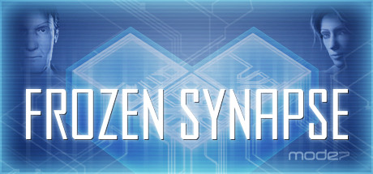

**Platforms:** Windows &nbsp;|&nbsp; **Genre:** Indie, Strategy &nbsp;|&nbsp; **Released:** May 26

> Brings the simultaneous turn-based strategy genre up-to-date and lets you give detailed, accurate orders to your squad.
>
> _Synopsis source: Steam_

[Wikipedia](https://en.wikipedia.org/wiki/Frozen_Synapse) · [Steam](https://store.steampowered.com/app/98200)

---

### Fruit Ninja: Puss in Boots

**Platforms:** iOS &nbsp;|&nbsp; **Released:** October 20

---

### Full House Poker

**Platforms:** Xbox 360, Windows Phone &nbsp;|&nbsp; **Developer:** Microsoft Studios, Krome Studios &nbsp;|&nbsp; **Publisher:** Microsoft Studios &nbsp;|&nbsp; **Genre:** Card game, MMO &nbsp;|&nbsp; **Released:** March 16, 2011

[Wikipedia](https://en.wikipedia.org/wiki/Full_House_Poker)

---

### Gal Gun

**Platforms:** Xbox 360 &nbsp;|&nbsp; **Developer:** Inti Creates &nbsp;|&nbsp; **Publisher:** Alchemist, Inti Creates, PQube &nbsp;|&nbsp; **Genre:** Bishōjo, rail shooter &nbsp;|&nbsp; **Released:** January 27, 2011

[Wikipedia](https://en.wikipedia.org/wiki/Gal_Gun)

---

### Galaga 30th Collection

**Platforms:** iOS &nbsp;|&nbsp; **Released:** July 23

[Wikipedia](https://en.wikipedia.org/wiki/Galaga_30th_Collection)

---

### Galaga Legions DX

**Platforms:** Xbox 360, PlayStation Network &nbsp;|&nbsp; **Released:** June 29

[Wikipedia](https://en.wikipedia.org/wiki/Galaga_Legions_DX)

---

### Gangstar Rio: City of Saints

**Platforms:** iOS &nbsp;|&nbsp; **Released:** November 10

---

### Garshasp: The Monster Slayer

**Platforms:** Windows &nbsp;|&nbsp; **Developer:** Fanafzar Sharif Co., Dead Mage Inc. &nbsp;|&nbsp; **Publisher:** Loh Zarrin Nikan, Just a Game &nbsp;|&nbsp; **Genre:** Action-adventure, hack and slash &nbsp;|&nbsp; **Released:** May 8, 2011

[Wikipedia](https://en.wikipedia.org/wiki/Garshasp:_The_Monster_Slayer)

---

### Gatling Gears

**Platforms:** Xbox 360, PlayStation Network, Windows &nbsp;|&nbsp; **Genre:** Action, Adventure, Indie &nbsp;|&nbsp; **Released:** May 11

> When the Empire begins its reign of destruction in a thirst for natural resources, it’s up to Max Brawley, a retired Gatling Gear pilot, to stop them.
>
> _Synopsis source: Steam_

[Wikipedia](https://en.wikipedia.org/wiki/Gatling_Gears) · [Steam](https://store.steampowered.com/app/102810)

---

### Gears of War 3

**Platforms:** Xbox 360 &nbsp;|&nbsp; **Publisher:** Microsoft Game Studios &nbsp;|&nbsp; **Released:** September 20, 2011

[Wikipedia](https://en.wikipedia.org/wiki/Gears_of_War_3)

---

### Gem Keeper

**Platforms:** iOS &nbsp;|&nbsp; **Released:** October 14

[Wikipedia](https://en.wikipedia.org/wiki/Gem_Keeper)

---

### Gemini Rue

**Platforms:** Windows, macOS, Linux &nbsp;|&nbsp; **Developer:** Joshua Nuernberger &nbsp;|&nbsp; **Publisher:** Wadjet Eye Games &nbsp;|&nbsp; **Genre:** Graphic adventure &nbsp;|&nbsp; **Released:** February 24, 2011

[Wikipedia](https://en.wikipedia.org/wiki/Gemini_Rue)

---

### Gesundheit!

**Platforms:** iOS, Android, macOS &nbsp;|&nbsp; **Developer:** Revolutionary Concepts &nbsp;|&nbsp; **Publisher:** Konami &nbsp;|&nbsp; **Genre:** Puzzle &nbsp;|&nbsp; **Released:** August 3, 2011

[Wikipedia](https://en.wikipedia.org/wiki/Gesundheit!_(video_game))

---

### Get Up and Dance

**Platforms:** PlayStation 3, Wii &nbsp;|&nbsp; **Developer:** Gusto Games &nbsp;|&nbsp; **Publisher:** O Games &nbsp;|&nbsp; **Genre:** Rhythm game &nbsp;|&nbsp; **Released:** November 4, 2011

[Wikipedia](https://en.wikipedia.org/wiki/Get_Up_and_Dance)

---

### Ghost Trick: Phantom Detective

**Platforms:** Nintendo DS &nbsp;|&nbsp; **Genre:** Adventure, Puzzle &nbsp;|&nbsp; **Released:** January 11

---

### Ghostbusters: Sanctum of Slime

**Platforms:** Windows, Xbox 360, PlayStation Network &nbsp;|&nbsp; **Released:** March 23

---

### Giana Sisters DS

**Platforms:** Nintendo DS &nbsp;|&nbsp; **Released:** February 22

[Wikipedia](https://en.wikipedia.org/wiki/Giana_Sisters_DS)

---

### GIRP

**Developer:** Bennett Foddy &nbsp;|&nbsp; **Genre:** Sports

[Wikipedia](https://en.wikipedia.org/wiki/GIRP)

---

### Glitch

**Platforms:** Browser &nbsp;|&nbsp; **Developer:** Tiny Speck &nbsp;|&nbsp; **Genre:** MMO &nbsp;|&nbsp; **Released:** September 27, 2011

[Wikipedia](https://en.wikipedia.org/wiki/Glitch_(video_game))

---

### Global Warfare

**Genre:** Strategy &nbsp;|&nbsp; **Released:** May 3, 2011

[Wikipedia](https://en.wikipedia.org/wiki/Global_Warfare)

---

### Gloria Union

**Platforms:** PlayStation Portable &nbsp;|&nbsp; **Developer:** Sting &nbsp;|&nbsp; **Publisher:** Atlus &nbsp;|&nbsp; **Genre:** Tactical role-playing game &nbsp;|&nbsp; **Released:** June 23, 2011

[Wikipedia](https://en.wikipedia.org/wiki/Gloria_Union)

---

### Glorious Mission

**Platforms:** Windows &nbsp;|&nbsp; **Developer:** Giant Interactive Group &nbsp;|&nbsp; **Publisher:** Giant Interactive Group &nbsp;|&nbsp; **Genre:** First-person shooter &nbsp;|&nbsp; **Released:** June 26, 2011

[Wikipedia](https://en.wikipedia.org/wiki/Glorious_Mission)

---

### Gnomz

**Platforms:** Wii &nbsp;|&nbsp; **Developer:** QubicGames &nbsp;|&nbsp; **Publisher:** QubicGames &nbsp;|&nbsp; **Genre:** Platform game, fighting game &nbsp;|&nbsp; **Released:** November 3, 2011

[Wikipedia](https://en.wikipedia.org/wiki/Gnomz)

---

### Go Vacation

**Platforms:** Wii &nbsp;|&nbsp; **Developer:** Namco Bandai Games &nbsp;|&nbsp; **Publisher:** Namco Bandai Games, Nintendo, Bandai Namco Entertainment &nbsp;|&nbsp; **Genre:** Party, Sports &nbsp;|&nbsp; **Released:** October 11, 2011

[Wikipedia](https://en.wikipedia.org/wiki/Go_Vacation)

---

### Go! Go! Kokopolo - Harmonious Forest Revenge

**Platforms:** Nintendo DS &nbsp;|&nbsp; **Released:** August 11

[Wikipedia](https://en.wikipedia.org/wiki/Go!_Go!_Kokopolo)

---

### Go! Go! Nippon!

**Platforms:** Windows &nbsp;|&nbsp; **Genre:** Visual novel &nbsp;|&nbsp; **Released:** September 30

[Wikipedia](https://en.wikipedia.org/wiki/Go!_Go!_Nippon!)

---

### GoatUp

**Platforms:** iOS &nbsp;|&nbsp; **Publisher:** Llamasoft &nbsp;|&nbsp; **Genre:** Platform

[Wikipedia](https://en.wikipedia.org/wiki/GoatUp)

---

### God Hand

**Platforms:** PlayStation Network &nbsp;|&nbsp; **Released:** October 4

[Wikipedia](https://en.wikipedia.org/wiki/God_Hand)

---

### God of War: Origins Collection

**Platforms:** PlayStation 3 &nbsp;|&nbsp; **Released:** September 13

---

### Gods & Heroes: Rome Rising

**Platforms:** Windows &nbsp;|&nbsp; **Developer:** Perpetual Entertainment, Heatwave Interactive &nbsp;|&nbsp; **Genre:** MMORPG &nbsp;|&nbsp; **Released:** June 21, 2011

[Wikipedia](https://en.wikipedia.org/wiki/Gods_&_Heroes:_Rome_Rising)

---

### Gods Eater Burst

**Platforms:** PlayStation Portable &nbsp;|&nbsp; **Released:** March 15

[Wikipedia](https://en.wikipedia.org/wiki/Gods_Eater_Burst)

---

### GoldenEye 007 Reloaded

**Platforms:** PlayStation 3, Xbox 360 &nbsp;|&nbsp; **Released:** November 1

[Wikipedia](https://en.wikipedia.org/wiki/GoldenEye_007_Reloaded)

---

### GolfStar

**Platforms:** Windows, iOS, Android &nbsp;|&nbsp; **Developer:** Com2Us &nbsp;|&nbsp; **Publisher:** gamigo AG &nbsp;|&nbsp; **Genre:** Sports, MMORPG

[Wikipedia](https://en.wikipedia.org/wiki/GolfStar)

---

### Grand Knights History

**Platforms:** PlayStation Portable &nbsp;|&nbsp; **Developer:** Vanillaware &nbsp;|&nbsp; **Publisher:** Marvelous Entertainment &nbsp;|&nbsp; **Genre:** Tactical role-playing &nbsp;|&nbsp; **Released:** September 1, 2011

[Wikipedia](https://en.wikipedia.org/wiki/Grand_Knights_History)

---

### Grand Prix Story

**Platforms:** iOS &nbsp;|&nbsp; **Released:** September 8

[Wikipedia](https://en.wikipedia.org/wiki/Grand_Prix_Story)

---

### Grand Theft Auto III: 10 Year Anniversary Edition

**Platforms:** iOS, Android &nbsp;|&nbsp; **Released:** December 15

[Wikipedia](https://en.wikipedia.org/wiki/Grand_Theft_Auto_III)

---

### Gray Matter

**Platforms:** Windows, Xbox 360 &nbsp;|&nbsp; **Genre:** Adventure, Casual &nbsp;|&nbsp; **Released:** February 22

> After a tragic accident, neurobiologist Dr. David Styles has become a recluse, rarely leaving his home, the Dread Hill House. One day, Samantha Everett, a street magician, appears at Dr. Style's doorstep just as he is seeking a new assistant.
>
> _Synopsis source: Steam_

[Wikipedia](https://en.wikipedia.org/wiki/Gray_Matter_(video_game)) · [Steam](https://store.steampowered.com/app/260570)

---

### Grease Dance

**Platforms:** PlayStation 3, Xbox 360 &nbsp;|&nbsp; **Developer:** Zoë Mode &nbsp;|&nbsp; **Publisher:** 505 Games &nbsp;|&nbsp; **Genre:** Music, Rhythm &nbsp;|&nbsp; **Released:** October 25, 2011

[Wikipedia](https://en.wikipedia.org/wiki/Grease_Dance)

---

### Great Little War Game

**Platforms:** iOS &nbsp;|&nbsp; **Released:** March 26

[Wikipedia](https://en.wikipedia.org/wiki/Great_Little_War_Game)

---

### Green Lantern: Rise of the Manhunters

**Platforms:** PlayStation 3, Xbox 360, Wii, Nintendo DS, Nintendo 3DS &nbsp;|&nbsp; **Released:** June 7

---

### GreenSpace

**Platforms:** Browser, iOS &nbsp;|&nbsp; **Developer:** RocketOwl &nbsp;|&nbsp; **Genre:** Simulation &nbsp;|&nbsp; **Released:** August 1, 2011

[Wikipedia](https://en.wikipedia.org/wiki/GreenSpace)

---

### Groove Coaster

**Platforms:** iOS &nbsp;|&nbsp; **Released:** July 28

[Wikipedia](https://en.wikipedia.org/wiki/Groove_Coaster)

---

### Gua-Le-Ni; or, The Horrendous Parade

**Platforms:** iOS &nbsp;|&nbsp; **Developer:** Double Jungle S.a.s. & Stefano Gualeni &nbsp;|&nbsp; **Publisher:** Double Jungle S.a.s. &nbsp;|&nbsp; **Genre:** Casual, puzzle video game

[Wikipedia](https://en.wikipedia.org/wiki/Gua-Le-Ni;_or,_The_Horrendous_Parade)

---

### Guardian Heroes

**Platforms:** Xbox 360 &nbsp;|&nbsp; **Released:** October 12

[Wikipedia](https://en.wikipedia.org/wiki/Guardian_Heroes)

---

### GunZ 2

**Platforms:** Windows &nbsp;|&nbsp; **Developer:** MAIET Entertainment &nbsp;|&nbsp; **Publisher:** MAIET Entertainment, ProSiebenSat.1 Media, INI3 &nbsp;|&nbsp; **Genre:** Third-person shooter

[Wikipedia](https://en.wikipedia.org/wiki/GunZ_2)

---

### Gyro13

**Platforms:** iOS &nbsp;|&nbsp; **Developer:** Cinemax &nbsp;|&nbsp; **Genre:** Action video game, Puzzle video game &nbsp;|&nbsp; **Released:** September 21, 2011

[Wikipedia](https://en.wikipedia.org/wiki/Gyro13)

---

### Half-Minute Hero: Super Mega Neo Climax

**Platforms:** Xbox 360 &nbsp;|&nbsp; **Released:** June 29

---

### Half-Minute Hero: The Second Coming

**Platforms:** PlayStation Portable &nbsp;|&nbsp; **Developer:** Opus &nbsp;|&nbsp; **Publisher:** Marvelous AQL &nbsp;|&nbsp; **Genre:** Action role-playing &nbsp;|&nbsp; **Released:** August 4, 2011

[Wikipedia](https://en.wikipedia.org/wiki/Half-Minute_Hero:_The_Second_Coming)

---

### Halo: Combat Evolved Anniversary

**Platforms:** Xbox 360 &nbsp;|&nbsp; **Released:** November 15

---

### Hamilton's Great Adventure

**Platforms:** Windows, PlayStation 3, Android &nbsp;|&nbsp; **Developer:** Fatshark &nbsp;|&nbsp; **Publisher:** Fatshark &nbsp;|&nbsp; **Genre:** Puzzle video game &nbsp;|&nbsp; **Released:** May 31, 2011

[Wikipedia](https://en.wikipedia.org/wiki/Hamilton's_Great_Adventure)

---

### Hank Hazard

**Platforms:** iOS, Android &nbsp;|&nbsp; **Developer:** Chillingo &nbsp;|&nbsp; **Publisher:** Chillingo &nbsp;|&nbsp; **Released:** December 22, 2011

[Wikipedia](https://en.wikipedia.org/wiki/Hank_Hazard)

---

### Happy Feet Two: The Video Game

**Platforms:** Nintendo 3DS, Nintendo DS, PlayStation 3, Wii, Xbox 360 &nbsp;|&nbsp; **Released:** November 8

[Wikipedia](https://en.wikipedia.org/wiki/Happy_Feet_Two)

---

### Hard Corps: Uprising

**Platforms:** Xbox 360, PlayStation 3 &nbsp;|&nbsp; **Released:** February 16

---

### Hard Lines

**Platforms:** iOS, Android &nbsp;|&nbsp; **Developer:** Spilt Milk Studios Ltd &nbsp;|&nbsp; **Genre:** Action, puzzle &nbsp;|&nbsp; **Released:** June 9, 2011

[Wikipedia](https://en.wikipedia.org/wiki/Hard_Lines)

---

### Hard Reset

**Platforms:** Windows &nbsp;|&nbsp; **Genre:** Action, Indie &nbsp;|&nbsp; **Released:** September 13

> Over-the-top destruction, loads of enemies &amp; a beautifully realized cyberpunk setting. Hard Reset is here to shake up the shooter scene. Try the demo now.
>
> _Synopsis source: Steam_

[Wikipedia](https://en.wikipedia.org/wiki/Hard_Reset_(video_game)) · [Steam](https://store.steampowered.com/app/98400)

---

### Harry Potter and the Deathly Hallows – Part 2

**Platforms:** Windows, Xbox 360, PlayStation 3, Wii, Nintendo DS &nbsp;|&nbsp; **Released:** July 12

[Wikipedia](https://en.wikipedia.org/wiki/Harry_Potter_and_the_Deathly_Hallows_%E2%80%93_Part_2_(video_game))

---

### Harvest Moon: The Tale of Two Towns

**Platforms:** Nintendo DS, Nintendo 3DS &nbsp;|&nbsp; **Released:** September 13

---

### Hatoful Boyfriend

**Developer:** PigeoNation Inc., Mediatonic &nbsp;|&nbsp; **Publisher:** PigeoNation Inc., Devolver Digital &nbsp;|&nbsp; **Genre:** Nakige, dating sim, otome &nbsp;|&nbsp; **Released:** July 31, 2011

[Wikipedia](https://en.wikipedia.org/wiki/Hatoful_Boyfriend)

---

### Hector: Badge of Carnage - Episode 1

**Platforms:** Windows &nbsp;|&nbsp; **Released:** April 27

---

### Hector: Badge of Carnage - Episode 2

**Platforms:** Windows, iOS &nbsp;|&nbsp; **Released:** August 25

---

### Hector: Badge of Carnage - Episode 3

**Platforms:** Windows, iOS &nbsp;|&nbsp; **Released:** September 22

---

### Hero of Robots

**Platforms:** Arcade &nbsp;|&nbsp; **Developer:** International Games System &nbsp;|&nbsp; **Publisher:** International Games System, SNK &nbsp;|&nbsp; **Genre:** Hybrid collectible card and arcade video game

[Wikipedia](https://en.wikipedia.org/wiki/Hero_of_Robots)

---

### Heroes of Might and Magic III: Horn of the Abyss

**Platforms:** Windows &nbsp;|&nbsp; **Developer:** HotA Crew &nbsp;|&nbsp; **Genre:** Turn-based strategy &nbsp;|&nbsp; **Released:** December 31, 2011

[Wikipedia](https://en.wikipedia.org/wiki/Heroes_of_Might_and_Magic_III:_Horn_of_the_Abyss)

---

### Higanbana no Saku Yoru ni

[Wikipedia](https://en.wikipedia.org/wiki/Higanbana_no_Saku_Yoru_ni)

---

### Hole in the Wall

**Platforms:** Xbox 360 &nbsp;|&nbsp; **Developer:** Ludia &nbsp;|&nbsp; **Publisher:** Microsoft Game Studios &nbsp;|&nbsp; **Genre:** Party &nbsp;|&nbsp; **Released:** August 24, 2011

[Wikipedia](https://en.wikipedia.org/wiki/Hole_in_the_Wall_(video_game))

---

### Homefront

**Platforms:** Windows, Xbox 360, PlayStation 3 &nbsp;|&nbsp; **Genre:** Action &nbsp;|&nbsp; **Released:** March 15

> The Rock Map Pack is Now Available! Join the Resistance, stand united and fight for freedom against an overwhelming military force.
>
> _Synopsis source: Steam_

[Wikipedia](https://en.wikipedia.org/wiki/Homefront_(video_game)) · [Steam](https://store.steampowered.com/app/55100)

---

### Honor in Vengeance II

**Platforms:** Xbox 360 &nbsp;|&nbsp; **Developer:** MichaelArts &nbsp;|&nbsp; **Publisher:** MichaelArts &nbsp;|&nbsp; **Genre:** Space Shooter &nbsp;|&nbsp; **Released:** August 5, 2011

[Wikipedia](https://en.wikipedia.org/wiki/Honor_in_Vengeance_II)

---

### Hot Shots Shorties

**Platforms:** PlayStation Portable &nbsp;|&nbsp; **Genre:** Sports &nbsp;|&nbsp; **Released:** January 4

[Wikipedia](https://en.wikipedia.org/wiki/Everybody%27s_Golf#Everybody's_Stress_Buster)

---

### Hot Springs Story

**Platforms:** iOS, Android &nbsp;|&nbsp; **Developer:** Kairosoft &nbsp;|&nbsp; **Publisher:** Samsung Electronics &nbsp;|&nbsp; **Genre:** Simulation &nbsp;|&nbsp; **Released:** February 28, 2011

[Wikipedia](https://en.wikipedia.org/wiki/Hot_Springs_Story)

---

### House of the Dead: Overkill

**Platforms:** PlayStation 3 &nbsp;|&nbsp; **Released:** October 25

---

### Hugo Retro Mania

**Platforms:** Android, iOS, Windows &nbsp;|&nbsp; **Developer:** Progressive Media &nbsp;|&nbsp; **Publisher:** Krea Medie, Software Pyramide &nbsp;|&nbsp; **Genre:** Action game &nbsp;|&nbsp; **Released:** December 15, 2011

[Wikipedia](https://en.wikipedia.org/wiki/Hugo_Retro_Mania)

---

### Hulk Hogan's Main Event

**Platforms:** Xbox 360 &nbsp;|&nbsp; **Released:** October 11

[Wikipedia](https://en.wikipedia.org/wiki/Hulk_Hogan%27s_Main_Event)

---

### Hungribles

**Platforms:** iOS &nbsp;|&nbsp; **Developer:** Futuremark &nbsp;|&nbsp; **Genre:** Puzzle video game &nbsp;|&nbsp; **Released:** July 2011

[Wikipedia](https://en.wikipedia.org/wiki/Hungribles)

---

### Hunted: The Demon's Forge

**Platforms:** Windows, PlayStation 3, Xbox 360 &nbsp;|&nbsp; **Genre:** Action, Adventure &nbsp;|&nbsp; **Released:** May 31

> It will take the combined efforts of two great warriors to explore menacing dungeons, overgrown ruins, and downtrodden towns … and discover the secrets of the Demon’s Forge.
>
> _Synopsis source: Steam_

[Steam](https://store.steampowered.com/app/22450)

---

### Hydrophobia Prophecy

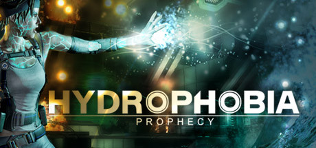

**Platforms:** Windows, PlayStation 3 &nbsp;|&nbsp; **Genre:** Action, Adventure, Indie, Strategy &nbsp;|&nbsp; **Released:** May 10

> The ultimate edition of the jaw-dropping action-adventure game set onboard a floating city.
>
> _Synopsis source: Steam_

[Wikipedia](https://en.wikipedia.org/wiki/Hydrophobia_(video_game)#Hydrophobia_Prophecy) · [Steam](https://store.steampowered.com/app/92000)

---

### Hyperdimension Neptunia

**Platforms:** PlayStation 3 &nbsp;|&nbsp; **Released:** February 15

[Wikipedia](https://en.wikipedia.org/wiki/Hyperdimension_Neptunia_(video_game))

---

### HyperRogue

**Platforms:** Windows, macOS, Linux, iOS, Android &nbsp;|&nbsp; **Developer:** Zeno Rogue &nbsp;|&nbsp; **Genre:** Roguelike &nbsp;|&nbsp; **Released:** November 2011

[Wikipedia](https://en.wikipedia.org/wiki/HyperRogue)

---

### Hysteria Project 2

**Platforms:** Windows, PlayStation Network &nbsp;|&nbsp; **Genre:** Adventure, Survival horror, FMV &nbsp;|&nbsp; **Released:** January 27

[Wikipedia](https://en.wikipedia.org/wiki/Hysteria_Project_2)

---

### I Am Playr

**Platforms:** Browser &nbsp;|&nbsp; **Developer:** We R Interactive / Big Balls Productions &nbsp;|&nbsp; **Genre:** Sports, Full motion video based game &nbsp;|&nbsp; **Released:** March 21, 2011

[Wikipedia](https://en.wikipedia.org/wiki/I_Am_Playr)

---

### Ikenie no Yoru

**Platforms:** Wii &nbsp;|&nbsp; **Developer:** Square Enix, Marvelous Entertainment &nbsp;|&nbsp; **Publisher:** Marvelous Entertainment &nbsp;|&nbsp; **Genre:** Horror, adventure &nbsp;|&nbsp; **Released:** March 24, 2011

[Wikipedia](https://en.wikipedia.org/wiki/Ikenie_no_Yoru)

---

### IL-2 Sturmovik: Cliffs of Dover

**Platforms:** Windows &nbsp;|&nbsp; **Developer:** 1C:Maddox Games, Team Fusion Simulations &nbsp;|&nbsp; **Publisher:** 1C Company, Ubisoft &nbsp;|&nbsp; **Genre:** Combat flight simulator &nbsp;|&nbsp; **Released:** March 25, 2011

[Wikipedia](https://en.wikipedia.org/wiki/IL-2_Sturmovik:_Cliffs_of_Dover)

---

### Illyriad

**Platforms:** Browser &nbsp;|&nbsp; **Developer:** Illyriad Games Ltd &nbsp;|&nbsp; **Publisher:** Illyriad Games Ltd &nbsp;|&nbsp; **Genre:** Real-time Strategy, Fantasy City-building Browser game &nbsp;|&nbsp; **Released:** March 31, 2011

[Wikipedia](https://en.wikipedia.org/wiki/Illyriad)

---

### Imouto Paradise!

[Wikipedia](https://en.wikipedia.org/wiki/Imouto_Paradise!)

---

### Inazuma Eleven GO

**Platforms:** Nintendo 3DS &nbsp;|&nbsp; **Developer:** Level-5 &nbsp;|&nbsp; **Publisher:** Level-5, Nintendo &nbsp;|&nbsp; **Genre:** Role-playing, sports &nbsp;|&nbsp; **Released:** December 15, 2011

[Wikipedia](https://en.wikipedia.org/wiki/Inazuma_Eleven_GO_(video_game))

---

### Inazuma Eleven Strikers

**Platforms:** Wii &nbsp;|&nbsp; **Developer:** Level-5, Shade &nbsp;|&nbsp; **Publisher:** Level-5, Nintendo &nbsp;|&nbsp; **Genre:** Role-playing, sports &nbsp;|&nbsp; **Released:** July 16, 2011

[Wikipedia](https://en.wikipedia.org/wiki/Inazuma_Eleven_Strikers)

---

### Indiana Jones Adventure World

**Platforms:** Facebook &nbsp;|&nbsp; **Developer:** Zynga Boston &nbsp;|&nbsp; **Publisher:** Zynga &nbsp;|&nbsp; **Genre:** Social, adventure &nbsp;|&nbsp; **Released:** September 9, 2011

[Wikipedia](https://en.wikipedia.org/wiki/Indiana_Jones_Adventure_World)

---

### inFamous 2

**Platforms:** PlayStation 3 &nbsp;|&nbsp; **Released:** June 7

[Wikipedia](https://en.wikipedia.org/wiki/InFamous_2)

---

### Infamous: Festival of Blood

**Platforms:** PlayStation 3 &nbsp;|&nbsp; **Released:** October 25

---

### Infinite Flight

**Platforms:** Android, iOS &nbsp;|&nbsp; **Developer:** Infinite Flight LLC &nbsp;|&nbsp; **Publisher:** Infinite Flight LLC &nbsp;|&nbsp; **Genre:** Flight simulation video game &nbsp;|&nbsp; **Released:** April 25, 2011

[Wikipedia](https://en.wikipedia.org/wiki/Infinite_Flight)

---

### Infinity Blade II

**Platforms:** iOS &nbsp;|&nbsp; **Released:** December 1

[Wikipedia](https://en.wikipedia.org/wiki/Infinity_Blade_II)

---

### Infinity Field

**Platforms:** iOS &nbsp;|&nbsp; **Genre:** Shooter &nbsp;|&nbsp; **Released:** January 27

[Wikipedia](https://en.wikipedia.org/wiki/Infinity_Field)

---

### Insane 2

**Platforms:** Windows &nbsp;|&nbsp; **Developer:** Targem Games &nbsp;|&nbsp; **Publisher:** Game Factory Interactive, Peter Games, Overland &nbsp;|&nbsp; **Genre:** Racing &nbsp;|&nbsp; **Released:** September 30, 2011

[Wikipedia](https://en.wikipedia.org/wiki/Insane_2)

---

### Insanely Twisted Shadow Planet

**Platforms:** Xbox 360 &nbsp;|&nbsp; **Released:** August 3

[Wikipedia](https://en.wikipedia.org/wiki/Insanely_Twisted_Shadow_Planet)

---

### Instant Brain

**Platforms:** Xbox 360 &nbsp;|&nbsp; **Developer:** Design Factory &nbsp;|&nbsp; **Publisher:** Cave &nbsp;|&nbsp; **Genre:** Visual novel &nbsp;|&nbsp; **Released:** November 11, 2011

[Wikipedia](https://en.wikipedia.org/wiki/Instant_Brain)

---

### Invizimals: Shadow Zone

**Platforms:** PlayStation Portable &nbsp;|&nbsp; **Released:** October 25

---

### Invizimals: The Lost Tribes

**Platforms:** PlayStation Portable &nbsp;|&nbsp; **Developer:** Novarama &nbsp;|&nbsp; **Publisher:** Sony Computer Entertainment &nbsp;|&nbsp; **Genre:** Monster-taming &nbsp;|&nbsp; **Released:** November 4, 2011

[Wikipedia](https://en.wikipedia.org/wiki/Invizimals:_The_Lost_Tribes)

---

### Iron Grip: Marauders

**Platforms:** Windows, macOS &nbsp;|&nbsp; **Developer:** ISOTX &nbsp;|&nbsp; **Publisher:** ISOTX &nbsp;|&nbsp; **Genre:** Turn-based strategy, Multiplayer online game &nbsp;|&nbsp; **Released:** January 17, 2011

[Wikipedia](https://en.wikipedia.org/wiki/Iron_Grip:_Marauders)

---

### Islands of Wakfu

**Platforms:** Xbox 360 &nbsp;|&nbsp; **Released:** March 30

[Wikipedia](https://en.wikipedia.org/wiki/Islands_of_Wakfu)

---

### James Noir's Hollywood Crimes

**Platforms:** Nintendo 3DS &nbsp;|&nbsp; **Released:** November 1

[Wikipedia](https://en.wikipedia.org/wiki/James_Noir%27s_Hollywood_Crimes)

---

### James Pond in the Deathly Shallows

**Platforms:** iOS &nbsp;|&nbsp; **Released:** June 30

[Wikipedia](https://en.wikipedia.org/wiki/James_Pond_in_the_Deathly_Shallows)

---

### Jamestown: Legend of the Lost Colony

**Platforms:** Windows &nbsp;|&nbsp; **Released:** June 8

---

### JASF: Jane's Advanced Strike Fighters

**Platforms:** Windows, PlayStation 3, Xbox 360 &nbsp;|&nbsp; **Released:** October 18

---

### Jetpack Joyride

**Platforms:** iOS &nbsp;|&nbsp; **Developer:** Halfbrick Studios &nbsp;|&nbsp; **Publisher:** Halfbrick Studios, Beatshapers, Big Ant Studios, Storms &nbsp;|&nbsp; **Genre:** Endless runner &nbsp;|&nbsp; **Released:** September 1, 2011

[Wikipedia](https://en.wikipedia.org/wiki/Jetpack_Joyride)

---

### Jikandia: The Timeless Land

**Platforms:** PlayStation Portable &nbsp;|&nbsp; **Released:** March 15

---

### Jimmie Johnson's Anything with an Engine

**Platforms:** PlayStation 3, Wii, Xbox 360 &nbsp;|&nbsp; **Released:** November 1

[Wikipedia](https://en.wikipedia.org/wiki/Jimmie_Johnson%27s_Anything_with_an_Engine)

---

### Johnny Test

**Platforms:** Nintendo DS &nbsp;|&nbsp; **Released:** March 29

[Wikipedia](https://en.wikipedia.org/wiki/Johnny_Test_(video_game))

---

### Junk Jack

**Platforms:** iOS, Windows, macOS, Linux, Android &nbsp;|&nbsp; **Developer:** Pixbits &nbsp;|&nbsp; **Publisher:** Pixbits &nbsp;|&nbsp; **Genre:** Action-adventure &nbsp;|&nbsp; **Released:** November 7, 2011

[Wikipedia](https://en.wikipedia.org/wiki/Junk_Jack)

---

### Jurassic Park: The Game

**Platforms:** Windows, PlayStation 3, Xbox 360 &nbsp;|&nbsp; **Released:** November 15

---

### Jurassic Park: The Game - Episode 2: The Cavalry

**Platforms:** iOS &nbsp;|&nbsp; **Released:** December 17

---

### Just Dance 3

**Platforms:** Wii, PlayStation 3, Xbox 360 &nbsp;|&nbsp; **Released:** October 7

[Wikipedia](https://en.wikipedia.org/wiki/Just_Dance_3)

---

### Just Dance Kids 2

**Platforms:** PlayStation 3, Wii, Xbox 360 &nbsp;|&nbsp; **Released:** October 25

[Wikipedia](https://en.wikipedia.org/wiki/Just_Dance_Kids_2)

---

### Just Dance Wii

**Platforms:** Wii &nbsp;|&nbsp; **Developer:** Ubisoft Paris &nbsp;|&nbsp; **Publisher:** Nintendo &nbsp;|&nbsp; **Genre:** Music, rhythm &nbsp;|&nbsp; **Released:** October 13, 2011

[Wikipedia](https://en.wikipedia.org/wiki/Just_Dance_Wii)

---

### Just Dance: Summer Party

**Platforms:** Wii &nbsp;|&nbsp; **Released:** July 19

---

### Kajiri Kamui Kagura

**Platforms:** Windows, PlayStation Vita &nbsp;|&nbsp; **Developer:** Light &nbsp;|&nbsp; **Publisher:** Wen Yang &nbsp;|&nbsp; **Genre:** Visual novel &nbsp;|&nbsp; **Released:** September 2011

[Wikipedia](https://en.wikipedia.org/wiki/Kajiri_Kamui_Kagura)

---

### Kamikaze Explorer!

[Wikipedia](https://en.wikipedia.org/wiki/Kamikaze_Explorer!)

---

### Kaptain Brawe: A Brawe New World

**Platforms:** Windows, Windows Phone, macOS, iOS, Android &nbsp;|&nbsp; **Developer:** Cateia Games &nbsp;|&nbsp; **Genre:** Adventure, hidden object, puzzle

[Wikipedia](https://en.wikipedia.org/wiki/Kaptain_Brawe:_A_Brawe_New_World)

---

### Kard Combat

**Platforms:** iOS &nbsp;|&nbsp; **Developer:** Hothead Games &nbsp;|&nbsp; **Publisher:** Hothead Games &nbsp;|&nbsp; **Genre:** Card game &nbsp;|&nbsp; **Released:** July 13, 2011

[Wikipedia](https://en.wikipedia.org/wiki/Kard_Combat)

---

### Katamari Amore

**Platforms:** iOS &nbsp;|&nbsp; **Released:** September 29

[Wikipedia](https://en.wikipedia.org/wiki/Katamari_Amore)

---

### Kersploosh!

**Platforms:** Nintendo 3DS &nbsp;|&nbsp; **Developer:** Poisoft &nbsp;|&nbsp; **Publisher:** Poisoft, Nintendo &nbsp;|&nbsp; **Genre:** Action, puzzle &nbsp;|&nbsp; **Released:** June 7, 2011

[Wikipedia](https://en.wikipedia.org/wiki/Kersploosh!)

---

### Kickin Momma

**Platforms:** iOS &nbsp;|&nbsp; **Developer:** Hothead Games &nbsp;|&nbsp; **Genre:** Puzzle game &nbsp;|&nbsp; **Released:** August 4, 2011

[Wikipedia](https://en.wikipedia.org/wiki/Kickin_Momma)

---

### Killzone 3

**Platforms:** PlayStation 3 &nbsp;|&nbsp; **Released:** February 22

[Wikipedia](https://en.wikipedia.org/wiki/Killzone_3)

---

### Kimi ni Todoke: Tsutaeru Kimochi

[Wikipedia](https://en.wikipedia.org/wiki/Kimi_ni_Todoke:_Tsutaeru_Kimochi)

---

### Kinect Disneyland Adventures

**Platforms:** Xbox 360 &nbsp;|&nbsp; **Released:** November 15

[Wikipedia](https://en.wikipedia.org/wiki/Kinect_Disneyland_Adventures)

---

### Kinect Fun Labs

**Platforms:** Xbox 360 &nbsp;|&nbsp; **Developer:** Good Science Studio &nbsp;|&nbsp; **Publisher:** Microsoft Studios &nbsp;|&nbsp; **Released:** June 6, 2011

[Wikipedia](https://en.wikipedia.org/wiki/Kinect_Fun_Labs)

---

### Kinect Sports: Season Two

**Platforms:** Xbox 360 &nbsp;|&nbsp; **Developer:** Rare, BigPark &nbsp;|&nbsp; **Publisher:** Microsoft Studios &nbsp;|&nbsp; **Genre:** Sports &nbsp;|&nbsp; **Released:** October 25, 2011

[Wikipedia](https://en.wikipedia.org/wiki/Kinect_Sports:_Season_Two)

---

### King Cashing

**Platforms:** iOS &nbsp;|&nbsp; **Developer:** Productions Multimage Inc. &nbsp;|&nbsp; **Publisher:** Productions Multimage Inc. &nbsp;|&nbsp; **Released:** October 6, 2011

[Wikipedia](https://en.wikipedia.org/wiki/King_Cashing)

---

### King's Bounty: Legions

**Platforms:** Facebook, iOS, Android, Windows Phone &nbsp;|&nbsp; **Developer:** Nival and KranX Productions &nbsp;|&nbsp; **Publisher:** Nival &nbsp;|&nbsp; **Genre:** Turn-based strategy &nbsp;|&nbsp; **Released:** August 9, 2011

[Wikipedia](https://en.wikipedia.org/wiki/King's_Bounty:_Legions)

---

### King's Quest III Redux

**Platforms:** Windows, macOS &nbsp;|&nbsp; **Developer:** AGD Interactive/Himalaya Studios &nbsp;|&nbsp; **Genre:** Adventure &nbsp;|&nbsp; **Released:** February 2011

[Wikipedia](https://en.wikipedia.org/wiki/King's_Quest_III_Redux)

---

### Kingdom Hearts Re:coded

**Platforms:** Nintendo DS &nbsp;|&nbsp; **Genre:** Action RPG &nbsp;|&nbsp; **Released:** January 11

---

### Kingdom Rush

**Platforms:** Browser, iOS &nbsp;|&nbsp; **Developer:** Ironhide Game Studio &nbsp;|&nbsp; **Publisher:** Armor Games &nbsp;|&nbsp; **Genre:** Tower defense game &nbsp;|&nbsp; **Released:** July 28, 2011

[Wikipedia](https://en.wikipedia.org/wiki/Kingdom_Rush)

---

### Kirby Mass Attack

**Platforms:** Nintendo DS &nbsp;|&nbsp; **Released:** September 19

[Wikipedia](https://en.wikipedia.org/wiki/Kirby_Mass_Attack)

---

### Kirby's Return to Dream Land

**Platforms:** Wii &nbsp;|&nbsp; **Released:** October 24

[Wikipedia](https://en.wikipedia.org/wiki/Kirby%27s_Return_to_Dream_Land)

---

### Knights Contract

**Platforms:** Xbox 360, PlayStation 3 &nbsp;|&nbsp; **Released:** February 22

[Wikipedia](https://en.wikipedia.org/wiki/Knights_Contract)

---

### Konami Krazy Racers

**Platforms:** Android &nbsp;|&nbsp; **Released:** August 17

[Wikipedia](https://en.wikipedia.org/wiki/Konami_Krazy_Racers)

---

### Kung Fu Panda 2

**Platforms:** PlayStation 3, Xbox 360, Wii, Nintendo DS &nbsp;|&nbsp; **Released:** May 24

[Wikipedia](https://en.wikipedia.org/wiki/Kung_Fu_Panda_2_(video_game))

---

### Kung-Fu High Impact

**Platforms:** Xbox 360 &nbsp;|&nbsp; **Released:** November 15

---

### L.A. Noire

**Platforms:** PlayStation 3, Xbox 360, Windows &nbsp;|&nbsp; **Genre:** Adventure, Strategy &nbsp;|&nbsp; **Released:** May 17

> In his fight to climb the ranks and do what's right, LAPD detective Cole Phelps must unravel the truth behind a string of arson attacks, conspiracies, and brutal murders, battling the L.A. underworld and even members of his own department.
>
> _Synopsis source: Steam_

[Wikipedia](https://en.wikipedia.org/wiki/L.A._Noire) · [Steam](https://store.steampowered.com/app/110800)

---

### La storia della Arcana Famiglia

[Wikipedia](https://en.wikipedia.org/wiki/La_storia_della_Arcana_Famiglia)

---

### Law & Order: Legacies

**Platforms:** iOS, Windows, macOS &nbsp;|&nbsp; **Developer:** Telltale Games &nbsp;|&nbsp; **Publisher:** Telltale Games &nbsp;|&nbsp; **Genre:** Graphic adventure

[Wikipedia](https://en.wikipedia.org/wiki/Law_&_Order:_Legacies)

---

### League of Evil

**Platforms:** iOS, Android &nbsp;|&nbsp; **Developer:** Ravenous Games &nbsp;|&nbsp; **Genre:** Platform &nbsp;|&nbsp; **Released:** February 3, 2011

[Wikipedia](https://en.wikipedia.org/wiki/League_of_Evil)

---

### Learn with Pokémon: Typing Adventure

**Platforms:** Nintendo DS &nbsp;|&nbsp; **Developer:** Genius Sonority &nbsp;|&nbsp; **Publisher:** The Pokémon Company, Nintendo &nbsp;|&nbsp; **Genre:** Educational typing &nbsp;|&nbsp; **Released:** April 21, 2011

[Wikipedia](https://en.wikipedia.org/wiki/Learn_with_Pok%C3%A9mon:_Typing_Adventure)

---

### Leedmees

**Platforms:** Xbox 360 &nbsp;|&nbsp; **Developer:** Konami &nbsp;|&nbsp; **Publisher:** Konami &nbsp;|&nbsp; **Genre:** Puzzle &nbsp;|&nbsp; **Released:** September 7, 2011

[Wikipedia](https://en.wikipedia.org/wiki/Leedmees)

---

### Legend of Fae

**Platforms:** Windows &nbsp;|&nbsp; **Developer:** Endless Fluff Games &nbsp;|&nbsp; **Publisher:** Endless Fluff Games &nbsp;|&nbsp; **Genre:** Action RPG, puzzle &nbsp;|&nbsp; **Released:** July 28, 2011

[Wikipedia](https://en.wikipedia.org/wiki/Legend_of_Fae)

---

### Legendary Wars

**Platforms:** iOS, Android &nbsp;|&nbsp; **Developer:** Liv Games &nbsp;|&nbsp; **Genre:** Real-Time Strategy &nbsp;|&nbsp; **Released:** January 27, 2011

[Wikipedia](https://en.wikipedia.org/wiki/Legendary_Wars)

---

### Lego Battles: Ninjago

**Platforms:** Nintendo DS &nbsp;|&nbsp; **Released:** April 12

---

### Lego Harry Potter: Years 5–7

**Platforms:** Windows, Xbox 360, PlayStation 3, PlayStation Portable, Wii, Nintendo DS, Nintendo 3DS, iOS &nbsp;|&nbsp; **Genre:** Adventure &nbsp;|&nbsp; **Released:** November 11

> LEGO Harry Potter: Years 5-7 takes players through Harry Potter's heroic adventures in the Muggle and wizarding worlds.
>
> _Synopsis source: Steam_

[Steam](https://store.steampowered.com/app/204120)

---

### Lego Pirates of the Caribbean: The Video Game

**Platforms:** Nintendo 3DS, Xbox 360, PlayStation 3, Wii, PlayStation Portable, Nintendo DS, Windows &nbsp;|&nbsp; **Genre:** Action, Adventure &nbsp;|&nbsp; **Released:** May 10

> LEGO® Pirates of the Caribbean: The Video Game is an action adventure game that brings the Pirates of the Caribbean world and all its colorful characters to life in LEGO Brick form. Players experience all the memorable scenes from all four films in the humorous and quirky LEGO Video Games style.
>
> _Synopsis source: Steam_

[Steam](https://store.steampowered.com/app/311770)

---

### Lego Star Wars III: The Clone Wars

**Platforms:** Windows, Xbox 360, PlayStation 3, PlayStation Portable, Wii, Nintendo DS, Nintendo 3DS &nbsp;|&nbsp; **Genre:** Action, Adventure &nbsp;|&nbsp; **Released:** March 22

> LEGO Star Wars III: The Clone Wars will allow fans to explore endlessly and laugh their way through the Star Wars galaxy in the most humorous, accessible and action-packed LEGO game to date.
>
> _Synopsis source: Steam_

[Steam](https://store.steampowered.com/app/32510)

---

### Limbo

**Platforms:** PlayStation 3, Xbox 360, PlayStation Network, Windows &nbsp;|&nbsp; **Publisher:** Playdead &nbsp;|&nbsp; **Genre:** Action, Adventure, Indie &nbsp;|&nbsp; **Released:** July 19, 2011

> Uncertain of his sister's fate, a boy enters LIMBO
>
> _Synopsis source: Steam_

[Wikipedia](https://en.wikipedia.org/wiki/Limbo_(video_game)) · [Steam](https://store.steampowered.com/app/48000)

---

### Little Battlers Experience

**Platforms:** PlayStation Portable, Nintendo 3DS, PlayStation Vita, Windows, Android, iOS &nbsp;|&nbsp; **Developer:** Level-5, DMM Games &nbsp;|&nbsp; **Publisher:** Level-5 &nbsp;|&nbsp; **Genre:** Action role-playing, Gacha game &nbsp;|&nbsp; **Released:** June 16, 2011

[Wikipedia](https://en.wikipedia.org/wiki/Little_Battlers_Experience)

---

### Little Racers

**Platforms:** Xbox 360 &nbsp;|&nbsp; **Developer:** Milkstone Studios &nbsp;|&nbsp; **Publisher:** Milkstone Studios &nbsp;|&nbsp; **Genre:** Racing &nbsp;|&nbsp; **Released:** July 27, 2011

[Wikipedia](https://en.wikipedia.org/wiki/Little_Racers)

---

### LittleBigPlanet 2

**Platforms:** PlayStation 3 &nbsp;|&nbsp; **Publisher:** Sony Computer Entertainment &nbsp;|&nbsp; **Genre:** Puzzle-platformer &nbsp;|&nbsp; **Released:** January 18, 2011

[Wikipedia](https://en.wikipedia.org/wiki/LittleBigPlanet_2)

---

### Lord of Arcana

**Platforms:** PlayStation Portable &nbsp;|&nbsp; **Genre:** Action RPG &nbsp;|&nbsp; **Released:** January 25

[Wikipedia](https://en.wikipedia.org/wiki/Lord_of_Arcana)

---

### Lost in Shadow

**Platforms:** Wii &nbsp;|&nbsp; **Genre:** Puzzle-platformer &nbsp;|&nbsp; **Released:** January 4

[Wikipedia](https://en.wikipedia.org/wiki/Lost_in_Shadow)

---

### LostWinds

**Platforms:** iOS &nbsp;|&nbsp; **Released:** December 21

[Wikipedia](https://en.wikipedia.org/wiki/LostWinds)

---

### Lucha Fury

**Platforms:** Xbox 360 &nbsp;|&nbsp; **Released:** June 22

---

### Mad Blocker Alpha

**Platforms:** PlayStation 3, PlayStation Portable &nbsp;|&nbsp; **Released:** April 19

[Wikipedia](https://en.wikipedia.org/wiki/Mad_Blocker_Alpha)

---

### Madden NFL 12

**Platforms:** PlayStation 2, PlayStation 3, PlayStation Portable, Xbox 360, Wii, iOS &nbsp;|&nbsp; **Released:** August 30

[Wikipedia](https://en.wikipedia.org/wiki/Madden_NFL_12)

---

### Madden NFL Football

**Platforms:** Nintendo 3DS &nbsp;|&nbsp; **Released:** March 27

[Wikipedia](https://en.wikipedia.org/wiki/Madden_NFL_Football)

---

### Mage Gauntlet

**Platforms:** iOS, Android &nbsp;|&nbsp; **Developer:** Rocketcat Games &nbsp;|&nbsp; **Genre:** Action-adventure &nbsp;|&nbsp; **Released:** October 20, 2011

[Wikipedia](https://en.wikipedia.org/wiki/Mage_Gauntlet)

---

### Magic: The Gathering – Duels of the Planeswalkers 2012

**Platforms:** Xbox 360, PlayStation 3, Windows &nbsp;|&nbsp; **Developer:** Stainless Games &nbsp;|&nbsp; **Publisher:** Wizards of the Coast &nbsp;|&nbsp; **Genre:** Collectible card game &nbsp;|&nbsp; **Released:** June 15, 2011

[Wikipedia](https://en.wikipedia.org/wiki/Magic:_The_Gathering_%E2%80%93_Duels_of_the_Planeswalkers_2012)

---

### Magic: The Gathering – Tactics

**Platforms:** Windows &nbsp;|&nbsp; **Developer:** Sony Online Entertainment &nbsp;|&nbsp; **Genre:** Turn-based strategy &nbsp;|&nbsp; **Released:** January 18, 2011

[Wikipedia](https://en.wikipedia.org/wiki/Magic:_The_Gathering_%E2%80%93_Tactics)

---

### Magical Diary

**Platforms:** Windows, macOS, Linux &nbsp;|&nbsp; **Developer:** Hanako Games and Spiky Caterpillar &nbsp;|&nbsp; **Publisher:** Hanako Games &nbsp;|&nbsp; **Genre:** Visual novel &nbsp;|&nbsp; **Released:** June 19, 2011

[Wikipedia](https://en.wikipedia.org/wiki/Magical_Diary)

---

### Magicka

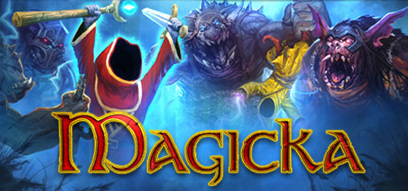

**Platforms:** Windows &nbsp;|&nbsp; **Genre:** Action-adventure &nbsp;|&nbsp; **Released:** January 25

> Magicka is a satirical action-adventure game set in a rich fantasy world based on Norse mythology. The player assumes the role of a wizard from a sacred order tasked with stopping an evil sorcerer who has thrown the world into turmoil, his foul creations besieging the forces of good.
>
> _Synopsis source: Steam_

[Wikipedia](https://en.wikipedia.org/wiki/Magicka) · [Steam](https://store.steampowered.com/app/42910)

---

### Mahjong Cub3d

**Platforms:** Nintendo 3DS &nbsp;|&nbsp; **Developer:** Sunsoft &nbsp;|&nbsp; **Publisher:** Sunsoft, Index Digital Media &nbsp;|&nbsp; **Genre:** Puzzle &nbsp;|&nbsp; **Released:** March 3, 2011

[Wikipedia](https://en.wikipedia.org/wiki/Mahjong_Cub3d)

---

### Major League Baseball 2K11

**Platforms:** Windows, PlayStation 3, PlayStation 2, PlayStation Portable, Xbox 360, Wii &nbsp;|&nbsp; **Released:** March 8

[Wikipedia](https://en.wikipedia.org/wiki/Major_League_Baseball_2K11)

---

### Man vs. Wild

**Platforms:** PlayStation 3, Wii, Xbox 360 &nbsp;|&nbsp; **Released:** April 26

[Wikipedia](https://en.wikipedia.org/wiki/Man_vs._Wild_(video_game))

---

### MapleStory Adventures

**Platforms:** Facebook &nbsp;|&nbsp; **Developer:** Nexon &nbsp;|&nbsp; **Publisher:** Nexon America &nbsp;|&nbsp; **Genre:** Fantasy, social game, massively multiplayer online role-playing game &nbsp;|&nbsp; **Released:** July 27, 2011

[Wikipedia](https://en.wikipedia.org/wiki/MapleStory_Adventures)

---

### Mappy World

**Platforms:** Mobile phone &nbsp;|&nbsp; **Developer:** Namco Bandai Games &nbsp;|&nbsp; **Publisher:** Namco Bandai Games &nbsp;|&nbsp; **Genre:** Platform game &nbsp;|&nbsp; **Released:** September 2011

[Wikipedia](https://en.wikipedia.org/wiki/Mappy_World)

---

### Mario & Sonic at the London 2012 Olympic Games

**Platforms:** Wii &nbsp;|&nbsp; **Released:** November 15

[Wikipedia](https://en.wikipedia.org/wiki/Mario_%26_Sonic_at_the_London_2012_Olympic_Games)

---

### Mario Kart 7

**Platforms:** Nintendo 3DS &nbsp;|&nbsp; **Released:** December 4

[Wikipedia](https://en.wikipedia.org/wiki/Mario_Kart_7)

---

### Mario Sports Mix

**Platforms:** Wii &nbsp;|&nbsp; **Genre:** Sports &nbsp;|&nbsp; **Released:** February 7

[Wikipedia](https://en.wikipedia.org/wiki/Mario_Sports_Mix)

---

### Mark Leung

**Platforms:** Windows &nbsp;|&nbsp; **Developer:** Uglysoft &nbsp;|&nbsp; **Genre:** Role-playing game &nbsp;|&nbsp; **Released:** January 2011

[Wikipedia](https://en.wikipedia.org/wiki/Mark_Leung)

---

### Marvel Super Hero Squad Online

**Platforms:** Windows, macOS &nbsp;|&nbsp; **Genre:** Massively multiplayer online role-playing game &nbsp;|&nbsp; **Released:** April 29, 2011

[Wikipedia](https://en.wikipedia.org/wiki/Marvel_Super_Hero_Squad_Online)

---

### Marvel Super Hero Squad: Comic Combat

**Platforms:** PlayStation 3, Wii, Xbox 360 &nbsp;|&nbsp; **Released:** November 15

---

### Marvel vs. Capcom 3: Fate of Two Worlds

**Platforms:** Xbox 360, PlayStation 3 &nbsp;|&nbsp; **Released:** February 15

---

### Mass Effect 2

**Platforms:** PlayStation 3 &nbsp;|&nbsp; **Publisher:** Electronic Arts &nbsp;|&nbsp; **Genre:** Action RPG, TPS &nbsp;|&nbsp; **Released:** January 17, 2011

[Wikipedia](https://en.wikipedia.org/wiki/Mass_Effect_2)

---

### Mass Effect 2: Arrival

**Platforms:** Windows, PlayStation 3, Xbox 360 &nbsp;|&nbsp; **Developer:** BioWare &nbsp;|&nbsp; **Publisher:** Electronic Arts, Microsoft Game Studios &nbsp;|&nbsp; **Genre:** Action role-playing, third-person shooter &nbsp;|&nbsp; **Released:** March 29, 2011

[Wikipedia](https://en.wikipedia.org/wiki/Mass_Effect_2:_Arrival)

---

### Max & the Magic Marker

**Platforms:** Nintendo DS &nbsp;|&nbsp; **Released:** November 8

[Wikipedia](https://en.wikipedia.org/wiki/Max_%26_the_Magic_Marker)

---

### Mayhem

**Platforms:** PlayStation 3, Xbox 360 &nbsp;|&nbsp; **Developer:** Left Field Productions &nbsp;|&nbsp; **Publisher:** Rombax Games &nbsp;|&nbsp; **Genre:** Racing &nbsp;|&nbsp; **Released:** March 25, 2011

[Wikipedia](https://en.wikipedia.org/wiki/Mayhem_(video_game))

---

### MDK2 HD

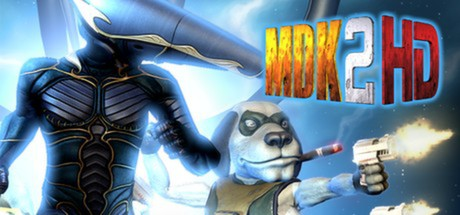

**Platforms:** Windows &nbsp;|&nbsp; **Genre:** Action &nbsp;|&nbsp; **Released:** October 12

> Overhaul Games brings MDK2 back to the PC in incredible high definition, with enhanced graphics, sound, and gameplay. See the classic action platformer the way it was meant to be seen, heard, and played... on a PC!Kurt Hectic in his snazzy suit with ribbon chute is back to save the universe. This time he is teamed with the genius Dr.
>
> _Synopsis source: Steam_

[Wikipedia](https://en.wikipedia.org/wiki/MDK2#Wii_port_and_MDK2_HD) · [Steam](https://store.steampowered.com/app/213350)

---

### Medieval Moves: Deadmund's Quest

**Platforms:** PlayStation 3 &nbsp;|&nbsp; **Released:** November 15

---

### Mega Mall Story

**Platforms:** iOS &nbsp;|&nbsp; **Developer:** Kairosoft &nbsp;|&nbsp; **Publisher:** Byril &nbsp;|&nbsp; **Genre:** Simulation game &nbsp;|&nbsp; **Released:** August 9, 2011

[Wikipedia](https://en.wikipedia.org/wiki/Mega_Mall_Story)

---

### Mega Man 3

**Platforms:** PlayStation Network &nbsp;|&nbsp; **Released:** March 8

[Wikipedia](https://en.wikipedia.org/wiki/Mega_Man_3)

---

### Mega Man 4

**Platforms:** PlayStation Network &nbsp;|&nbsp; **Released:** September 6

[Wikipedia](https://en.wikipedia.org/wiki/Mega_Man_4)

---

### Mega Man X

**Platforms:** iOS &nbsp;|&nbsp; **Released:** December 21

[Wikipedia](https://en.wikipedia.org/wiki/Mega_Man_X_(video_game))

---

### Megacity

**Platforms:** iOS, Android &nbsp;|&nbsp; **Developer:** ColePowered Games &nbsp;|&nbsp; **Genre:** Puzzle, city-building &nbsp;|&nbsp; **Released:** August 2, 2011

[Wikipedia](https://en.wikipedia.org/wiki/Megacity_(video_game))

---

### Men of War: Assault Squad

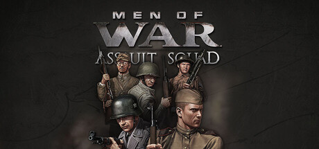

**Platforms:** Windows &nbsp;|&nbsp; **Genre:** Strategy &nbsp;|&nbsp; **Released:** February 25

> Men of War: Assault Squad delivers a deeply tactical WWII experience, blending large-scale strategy with intense, hands-on combat. Fight across multiple fronts – from European countryside to Pacific jungles and command every unit and every bullet on the battlefield.
>
> _Synopsis source: Steam_

[Steam](https://store.steampowered.com/app/64000)

---

### Men of War: Vietnam

**Platforms:** Windows &nbsp;|&nbsp; **Developer:** 1C Company &nbsp;|&nbsp; **Publisher:** 1C Company &nbsp;|&nbsp; **Genre:** Real-time tactics, strategy &nbsp;|&nbsp; **Released:** September 9, 2011

[Wikipedia](https://en.wikipedia.org/wiki/Men_of_War:_Vietnam)

---

### Mercury Hg

**Platforms:** PlayStation 3, Xbox 360 &nbsp;|&nbsp; **Developer:** Eiconic Games &nbsp;|&nbsp; **Publisher:** UTV Ignition Games &nbsp;|&nbsp; **Genre:** Puzzle-platform &nbsp;|&nbsp; **Released:** September 27, 2011

[Wikipedia](https://en.wikipedia.org/wiki/Mercury_Hg)

---

### Metal Dead

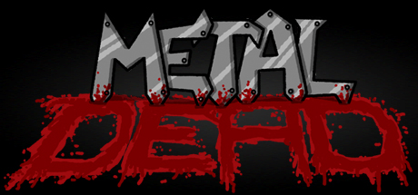

**Platforms:** Windows &nbsp;|&nbsp; **Genre:** Adventure, Indie &nbsp;|&nbsp; **Released:** December 19

> A hilariously terrifying adventure filled with laughs, blood, insanity, and of course... hordes of the undead.
>
> _Synopsis source: Steam_

[Wikipedia](https://en.wikipedia.org/wiki/Metal_Dead) · [Steam](https://store.steampowered.com/app/302690)

---

### Metal Gear Solid HD Collection

**Platforms:** PlayStation 3, Xbox 360 &nbsp;|&nbsp; **Publisher:** Konami &nbsp;|&nbsp; **Released:** November 8, 2011

[Wikipedia](https://en.wikipedia.org/wiki/Metal_Gear_Solid_HD_Collection)

---

### Metroid Fusion

**Platforms:** Nintendo 3DS &nbsp;|&nbsp; **Released:** December 16

[Wikipedia](https://en.wikipedia.org/wiki/Metroid_Fusion)

---

### Michael Jackson: The Experience

**Platforms:** Xbox 360, PlayStation 3, Nintendo 3DS, iOS &nbsp;|&nbsp; **Released:** April 12

---

### Might & Magic: Clash of Heroes

**Platforms:** PlayStation 3 &nbsp;|&nbsp; **Released:** April 12

---

### Might and Magic Heroes VI

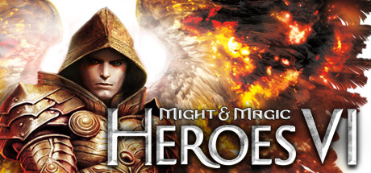

**Platforms:** Windows &nbsp;|&nbsp; **Genre:** RPG, Strategy &nbsp;|&nbsp; **Released:** October 13

> Heroes VI is a fast-paced epic story where Angels plot to end -- once and for all -- an unfinished war with their ancient rivals, the Faceless.
>
> _Synopsis source: Steam_

[Wikipedia](https://en.wikipedia.org/wiki/Might_and_Magic_Heroes_VI) · [Steam](https://store.steampowered.com/app/48220)

---

### Mighty Flip Champs! DX

**Platforms:** PlayStation Network &nbsp;|&nbsp; **Released:** July 12

[Wikipedia](https://en.wikipedia.org/wiki/Mighty_Flip_Champs!)

---

### Mighty Milky Way

**Platforms:** Nintendo DS &nbsp;|&nbsp; **Released:** May 9

[Wikipedia](https://en.wikipedia.org/wiki/Mighty_Milky_Way)

---

### Mighty Switch Force!

**Platforms:** Nintendo 3DS &nbsp;|&nbsp; **Released:** December 22

[Wikipedia](https://en.wikipedia.org/wiki/Mighty_Switch_Force!)

---

### MindJack

**Platforms:** PlayStation 3, Xbox 360 &nbsp;|&nbsp; **Genre:** TPS &nbsp;|&nbsp; **Released:** January 18

[Wikipedia](https://en.wikipedia.org/wiki/MindJack)

---

### Minecraft

**Platforms:** iOS, Windows, Linux, macOS &nbsp;|&nbsp; **Released:** November 17

[Wikipedia](https://en.wikipedia.org/wiki/Minecraft)

---

### Mini Militia

**Platforms:** iOS, Android &nbsp;|&nbsp; **Developer:** Appsomniacs LLC &nbsp;|&nbsp; **Publisher:** Miniclip &nbsp;|&nbsp; **Genre:** Shooter &nbsp;|&nbsp; **Released:** April 5, 2011

[Wikipedia](https://en.wikipedia.org/wiki/Mini_Militia)

---

### Mini Motor Racing

**Platforms:** iOS &nbsp;|&nbsp; **Developer:** The Binary Mill &nbsp;|&nbsp; **Genre:** Racing &nbsp;|&nbsp; **Released:** December 8, 2011

[Wikipedia](https://en.wikipedia.org/wiki/Mini_Motor_Racing)

---

### Minicraft

**Platforms:** Browser &nbsp;|&nbsp; **Genre:** Action, survival &nbsp;|&nbsp; **Released:** December 19, 2011

[Wikipedia](https://en.wikipedia.org/wiki/Minicraft)

---

### MiniMonos

**Platforms:** Browser &nbsp;|&nbsp; **Developer:** Melissa Clark-Reynolds, Greg Montgomery &nbsp;|&nbsp; **Publisher:** MiniMonos LLC. &nbsp;|&nbsp; **Genre:** MMORPG &nbsp;|&nbsp; **Released:** April 1, 2011

[Wikipedia](https://en.wikipedia.org/wiki/MiniMonos)

---

### Minotaur Rescue

**Platforms:** iOS &nbsp;|&nbsp; **Publisher:** Llamasoft &nbsp;|&nbsp; **Genre:** Multidirectional shooter &nbsp;|&nbsp; **Released:** January 2011

[Wikipedia](https://en.wikipedia.org/wiki/Minotaur_Rescue)

---

### Minotron: 2112

**Platforms:** iOS &nbsp;|&nbsp; **Developer:** Llamasoft &nbsp;|&nbsp; **Publisher:** Llamasoft &nbsp;|&nbsp; **Genre:** Multidirectional shooter

[Wikipedia](https://en.wikipedia.org/wiki/Minotron:_2112)

---

### Mir-Mahna

**Platforms:** Windows &nbsp;|&nbsp; **Publisher:** ESPRIS, Tehran, Iran &nbsp;|&nbsp; **Genre:** FPS

[Wikipedia](https://en.wikipedia.org/wiki/Mir-Mahna)

---

### Misao

**Platforms:** Windows &nbsp;|&nbsp; **Developer:** Sen &nbsp;|&nbsp; **Publisher:** Miscreant's Room, Playism &nbsp;|&nbsp; **Genre:** Adventure &nbsp;|&nbsp; **Released:** May 26, 2011

[Wikipedia](https://en.wikipedia.org/wiki/Misao_(video_game))

---

### Mission Against Terror

**Platforms:** Windows &nbsp;|&nbsp; **Developer:** Kingsoft Dalian JingCai Studio &nbsp;|&nbsp; **Publisher:** Wicked Interactive / Suba Games, CiB Net Station, Winner Online, M1 Games &nbsp;|&nbsp; **Genre:** Action-adventure, First-person shooter &nbsp;|&nbsp; **Released:** July 8, 2011

[Wikipedia](https://en.wikipedia.org/wiki/Mission_Against_Terror)

---

### MLB 11: The Show

**Platforms:** PlayStation 3, PlayStation 2, PlayStation Portable &nbsp;|&nbsp; **Publisher:** Sony Computer Entertainment &nbsp;|&nbsp; **Released:** March 8, 2011

---

### Mobile Suit Gundam: Try Age

[Wikipedia](https://en.wikipedia.org/wiki/Mobile_Suit_Gundam:_Try_Age)

---

### Modern Combat 3: Fallen Nation

**Platforms:** iOS &nbsp;|&nbsp; **Released:** October 27

---

### Modern Combat: Domination

**Platforms:** PlayStation 3, PlayStation Network, macOS &nbsp;|&nbsp; **Developer:** Gameloft &nbsp;|&nbsp; **Publisher:** Gameloft &nbsp;|&nbsp; **Genre:** First-person shooter &nbsp;|&nbsp; **Released:** January 18, 2011

[Wikipedia](https://en.wikipedia.org/wiki/Modern_Combat:_Domination)

---

### Mole's World

[Wikipedia](https://en.wikipedia.org/wiki/Mole's_World)

---

### Monday Night Combat

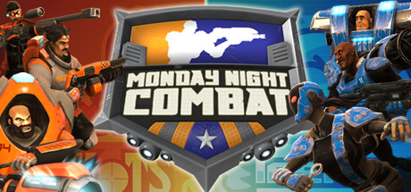

**Platforms:** Windows &nbsp;|&nbsp; **Genre:** MOBA, TPS &nbsp;|&nbsp; **Released:** January 24

> Monday Night Combat is a class-based, third-person shooter… and the most popular lethal sport of the future!
>
> _Synopsis source: Steam_

[Wikipedia](https://en.wikipedia.org/wiki/Monday_Night_Combat) · [Steam](https://store.steampowered.com/app/63200)

---

### Monkey Quest

[Wikipedia](https://en.wikipedia.org/wiki/Monkey_Quest)

---

### Monochrome Racing

**Platforms:** Wii, PlayStation Portable &nbsp;|&nbsp; **Developer:** Nordcurrent &nbsp;|&nbsp; **Publisher:** Nordcurrent &nbsp;|&nbsp; **Genre:** Racing &nbsp;|&nbsp; **Released:** August 2, 2011

[Wikipedia](https://en.wikipedia.org/wiki/Monochrome_Racing)

---

### Monster Burner

**Platforms:** iOS &nbsp;|&nbsp; **Developer:** Ubisoft Montreal &nbsp;|&nbsp; **Publisher:** Ubisoft &nbsp;|&nbsp; **Genre:** Puzzle &nbsp;|&nbsp; **Released:** November 3, 2011

[Wikipedia](https://en.wikipedia.org/wiki/Monster_Burner)

---

### Monster High: Ghoul Spirit

**Platforms:** Nintendo DS, Wii &nbsp;|&nbsp; **Developer:** ImaginEngine &nbsp;|&nbsp; **Publisher:** THQ, Little Orbit &nbsp;|&nbsp; **Genre:** Party game &nbsp;|&nbsp; **Released:** October 25, 2011

[Wikipedia](https://en.wikipedia.org/wiki/Monster_High:_Ghoul_Spirit)

---

### Monster Hunter Dynamic Hunting

**Platforms:** iOS, Android &nbsp;|&nbsp; **Developer:** Capcom &nbsp;|&nbsp; **Publisher:** Capcom &nbsp;|&nbsp; **Genre:** Fighting &nbsp;|&nbsp; **Released:** June 1, 2011

[Wikipedia](https://en.wikipedia.org/wiki/Monster_Hunter_Dynamic_Hunting)

---

### Monster Tale

**Platforms:** Nintendo DS &nbsp;|&nbsp; **Released:** March 22

[Wikipedia](https://en.wikipedia.org/wiki/Monster_Tale)

---

### Monsters Ate My Condo

**Platforms:** iOS &nbsp;|&nbsp; **Released:** September 15

[Wikipedia](https://en.wikipedia.org/wiki/Monsters_Ate_My_Condo)

---

### Monty Python's Cow Tossing

**Platforms:** iOS, Mobile phone &nbsp;|&nbsp; **Developer:** Luma Arcade &nbsp;|&nbsp; **Publisher:** Zed Group &nbsp;|&nbsp; **Genre:** Strategy &nbsp;|&nbsp; **Released:** February 3, 2011

[Wikipedia](https://en.wikipedia.org/wiki/Monty_Python's_Cow_Tossing)

---

### Moon Diver

**Platforms:** PlayStation Network, Xbox 360 &nbsp;|&nbsp; **Developer:** feelplus &nbsp;|&nbsp; **Publisher:** Square Enix &nbsp;|&nbsp; **Genre:** Side-scroller, platformer &nbsp;|&nbsp; **Released:** March 29, 2011

[Wikipedia](https://en.wikipedia.org/wiki/Moon_Diver)

---

### Mortal Kombat

**Platforms:** PlayStation 3, Xbox 360 &nbsp;|&nbsp; **Released:** April 19

[Wikipedia](https://en.wikipedia.org/wiki/Mortal_Kombat_(2011_video_game))

---

### Mortal Kombat Arcade Kollection

**Platforms:** PlayStation Network, Xbox 360 &nbsp;|&nbsp; **Released:** August 30

[Wikipedia](https://en.wikipedia.org/wiki/Mortal_Kombat_Arcade_Kollection)

---

### Mos Speedrun

**Platforms:** iOS, Android, Windows, Linux &nbsp;|&nbsp; **Developer:** Physmo &nbsp;|&nbsp; **Genre:** Platformer &nbsp;|&nbsp; **Released:** April 7, 2011

[Wikipedia](https://en.wikipedia.org/wiki/Mos_Speedrun)

---

### MotionSports Adrenaline

**Platforms:** Xbox 360, PlayStation 3 &nbsp;|&nbsp; **Developer:** Ubisoft Milan &nbsp;|&nbsp; **Publisher:** Ubisoft &nbsp;|&nbsp; **Genre:** Sports &nbsp;|&nbsp; **Released:** October 27, 2011

[Wikipedia](https://en.wikipedia.org/wiki/MotionSports_Adrenaline)

---

### MotoGP 10/11

**Platforms:** PlayStation 3, Xbox 360 &nbsp;|&nbsp; **Developer:** Monumental Games &nbsp;|&nbsp; **Publisher:** Capcom &nbsp;|&nbsp; **Genre:** Racing, sports &nbsp;|&nbsp; **Released:** March 15, 2011

[Wikipedia](https://en.wikipedia.org/wiki/MotoGP_10/11)

---

### MotoHeroz

**Platforms:** Wii &nbsp;|&nbsp; **Developer:** Ubisoft RedLynx &nbsp;|&nbsp; **Publisher:** Ubisoft RedLynx, Ubisoft &nbsp;|&nbsp; **Genre:** Platform, racing &nbsp;|&nbsp; **Released:** September 15, 2011

[Wikipedia](https://en.wikipedia.org/wiki/MotoHeroz)

---

### MotorStorm: Apocalypse

**Platforms:** PlayStation 3 &nbsp;|&nbsp; **Released:** May 3

---

### Mount&Blade: With Fire & Sword

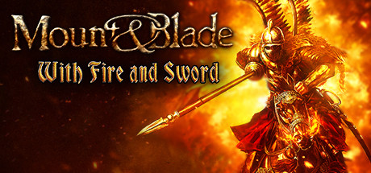

**Platforms:** Windows &nbsp;|&nbsp; **Genre:** Action, RPG &nbsp;|&nbsp; **Released:** May 3

> The standalone expansion for Mount &amp; Blade! With Fire &amp; Sword builds and expands upon the highly regarded combat system from Mount &amp; Blade: Warband. Firearms have been introduced to the battlefield.
>
> _Synopsis source: Steam_

[Steam](https://store.steampowered.com/app/48720)

---

### Ms. Splosion Man

**Platforms:** Xbox 360 &nbsp;|&nbsp; **Released:** July 11

[Wikipedia](https://en.wikipedia.org/wiki/Ms._Splosion_Man)

---

### Murder Dog IV: Trial of the Murder Dog

**Platforms:** Windows, macOS &nbsp;|&nbsp; **Developer:** Stephen Gillmurphy &nbsp;|&nbsp; **Genre:** Adventure &nbsp;|&nbsp; **Released:** August 1, 2011

[Wikipedia](https://en.wikipedia.org/wiki/Murder_Dog_IV:_Trial_of_the_Murder_Dog)

---

### MX vs. ATV Alive

**Platforms:** Xbox 360, PlayStation 3 &nbsp;|&nbsp; **Released:** May 10

[Wikipedia](https://en.wikipedia.org/wiki/MX_vs._ATV_Alive)

---

### My Little Pony: Twilight Sparkle, Teacher for a Day

**Platforms:** iOS &nbsp;|&nbsp; **Developer:** Ruckus Media Group &nbsp;|&nbsp; **Publisher:** Hasbro &nbsp;|&nbsp; **Genre:** Puzzle/Storybook &nbsp;|&nbsp; **Released:** September 22, 2011

[Wikipedia](https://en.wikipedia.org/wiki/My_Little_Pony:_Twilight_Sparkle,_Teacher_for_a_Day)

---

### Mystery Case Files: The Malgrave Incident

**Platforms:** Wii &nbsp;|&nbsp; **Developer:** Big Fish Games, Sanzaru Games &nbsp;|&nbsp; **Publisher:** Nintendo &nbsp;|&nbsp; **Genre:** Adventure, puzzle &nbsp;|&nbsp; **Released:** June 27, 2011

[Wikipedia](https://en.wikipedia.org/wiki/Mystery_Case_Files:_The_Malgrave_Incident)

---

### Mytheon

**Platforms:** Windows &nbsp;|&nbsp; **Developer:** Petroglyph Games &nbsp;|&nbsp; **Publisher:** True Games &nbsp;|&nbsp; **Genre:** Massively multiplayer online role-playing game &nbsp;|&nbsp; **Released:** March 3, 2011

[Wikipedia](https://en.wikipedia.org/wiki/Mytheon)

---

### Mythos

**Platforms:** Windows &nbsp;|&nbsp; **Developer:** Flagship Studios &nbsp;|&nbsp; **Publisher:** HanbitSoft, Frogster &nbsp;|&nbsp; **Genre:** Action RPG, MMORPG

[Wikipedia](https://en.wikipedia.org/wiki/Mythos_(video_game))

---

### Nancy Drew: Alibi in Ashes

**Platforms:** Windows, macOS &nbsp;|&nbsp; **Genre:** Adventure &nbsp;|&nbsp; **Released:** October 18

> Escape the Smoky Intrigue of a Hometown Inferno!
>
> _Synopsis source: Steam_

[Steam](https://store.steampowered.com/app/202670)

---

### Nancy Drew: The Captive Curse

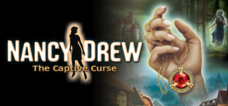

**Platforms:** Windows, macOS &nbsp;|&nbsp; **Genre:** Adventure, Casual &nbsp;|&nbsp; **Released:** June 28

> A terrifying myth comes alive in Germany!
>
> _Synopsis source: Steam_

[Steam](https://store.steampowered.com/app/42220)

---

### Nano Assault

**Platforms:** Nintendo 3DS &nbsp;|&nbsp; **Developer:** Shin'en Multimedia &nbsp;|&nbsp; **Publisher:** Majesco, Shin'en Multimedia &nbsp;|&nbsp; **Genre:** Shoot 'em up &nbsp;|&nbsp; **Released:** December 5, 2011

[Wikipedia](https://en.wikipedia.org/wiki/Nano_Assault)

---

### Naruto Shippuden: Kizuna Drive

**Platforms:** PlayStation Portable &nbsp;|&nbsp; **Released:** March 22

---

### Naruto Shippuden: Shinobi Rumble

**Platforms:** Nintendo DS &nbsp;|&nbsp; **Released:** February 8

---

### Naruto Shippūden 3D: The New Era

**Platforms:** Nintendo 3DS &nbsp;|&nbsp; **Developer:** Takara Tomy &nbsp;|&nbsp; **Publisher:** Takara Tomy, 505 Games &nbsp;|&nbsp; **Genre:** Action &nbsp;|&nbsp; **Released:** March 31, 2011

[Wikipedia](https://en.wikipedia.org/wiki/Naruto_Shipp%C5%ABden_3D:_The_New_Era)

---

### NASCAR The Game: 2011

**Platforms:** Xbox 360, PlayStation 3, Wii &nbsp;|&nbsp; **Released:** March 29

---

### NASCAR Unleashed

**Platforms:** PlayStation 3, Xbox 360, Nintendo 3DS, Wii &nbsp;|&nbsp; **Released:** November 1

[Wikipedia](https://en.wikipedia.org/wiki/NASCAR_Unleashed)

---

### NBA 2K12

**Platforms:** PlayStation 3, Xbox 360, Windows, Wii, PlayStation Portable, PlayStation 2 &nbsp;|&nbsp; **Publisher:** 2K &nbsp;|&nbsp; **Released:** October 4, 2011

[Wikipedia](https://en.wikipedia.org/wiki/NBA_2K12)

---

### NBA Jam

**Platforms:** iOS &nbsp;|&nbsp; **Released:** February 10

[Wikipedia](https://en.wikipedia.org/wiki/NBA_Jam_(2010_video_game))

---

### NCAA Football 12

**Platforms:** Xbox 360, PlayStation 3 &nbsp;|&nbsp; **Released:** July 12

[Wikipedia](https://en.wikipedia.org/wiki/NCAA_Football_12)

---

### NCIS

**Platforms:** PlayStation 3, Wii, Windows, Xbox 360, Nintendo 3DS &nbsp;|&nbsp; **Developer:** Ubisoft Shanghai &nbsp;|&nbsp; **Publisher:** Ubisoft &nbsp;|&nbsp; **Genre:** Adventure &nbsp;|&nbsp; **Released:** October 27, 2011

[Wikipedia](https://en.wikipedia.org/wiki/NCIS_(video_game))

---

### Need for Speed: The Run

**Platforms:** Windows, PlayStation 3, Wii, Xbox 360, Nintendo 3DS &nbsp;|&nbsp; **Released:** November 15

---

### NEStalgia

**Platforms:** Windows &nbsp;|&nbsp; **Developer:** Silk Games &nbsp;|&nbsp; **Publisher:** Silk Games &nbsp;|&nbsp; **Genre:** Role-playing game &nbsp;|&nbsp; **Released:** February 23, 2011

[Wikipedia](https://en.wikipedia.org/wiki/NEStalgia)

---

### New Puzzle Bobble

**Platforms:** iOS &nbsp;|&nbsp; **Developer:** Moss &nbsp;|&nbsp; **Publisher:** Taito &nbsp;|&nbsp; **Genre:** Tile-matching, Puzzle &nbsp;|&nbsp; **Released:** February 4, 2011

[Wikipedia](https://en.wikipedia.org/wiki/New_Puzzle_Bobble)

---

### NHL 12

**Platforms:** PlayStation 3, Xbox 360 &nbsp;|&nbsp; **Released:** September 13

[Wikipedia](https://en.wikipedia.org/wiki/NHL_12)

---

### Ni no Kuni: Wrath of the White Witch

**Platforms:** PlayStation 3 &nbsp;|&nbsp; **Developer:** Level-5 &nbsp;|&nbsp; **Publisher:** Namco Bandai Games, Level-5 &nbsp;|&nbsp; **Genre:** Action role-playing &nbsp;|&nbsp; **Released:** November 17, 2011

[Wikipedia](https://en.wikipedia.org/wiki/Ni_no_Kuni:_Wrath_of_the_White_Witch)

---

### Nichijou

[Wikipedia](https://en.wikipedia.org/wiki/Nichijou)

---

### Nickelodeon Dance

**Platforms:** Wii, Xbox 360 &nbsp;|&nbsp; **Released:** November 8

---

### Nicktoons MLB

**Platforms:** Xbox 360, Wii, Nintendo DS &nbsp;|&nbsp; **Released:** September 13

[Wikipedia](https://en.wikipedia.org/wiki/Nicktoons_MLB)

---

### Nintendogs + Cats

**Platforms:** Nintendo 3DS &nbsp;|&nbsp; **Released:** March 27

[Wikipedia](https://en.wikipedia.org/wiki/Nintendogs_%2B_Cats)

---

### No More Heroes: Heroes' Paradise

**Platforms:** PlayStation 3 &nbsp;|&nbsp; **Released:** August 16

---

### No More Room in Hell

**Platforms:** Windows, macOS, Linux &nbsp;|&nbsp; **Developer:** No More Room in Hell Team &nbsp;|&nbsp; **Publisher:** Lever Games &nbsp;|&nbsp; **Genre:** First-person shooter, survival horror &nbsp;|&nbsp; **Released:** October 30, 2011

[Wikipedia](https://en.wikipedia.org/wiki/No_More_Room_in_Hell)

---

### No Time to Explain

**Platforms:** Linux, Windows, macOS &nbsp;|&nbsp; **Developer:** tinyBuild &nbsp;|&nbsp; **Publisher:** tinyBuild &nbsp;|&nbsp; **Genre:** Platform &nbsp;|&nbsp; **Released:** August 15, 2011

[Wikipedia](https://en.wikipedia.org/wiki/No_Time_to_Explain)

---

### Nuclear Dawn

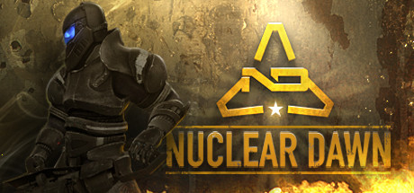

**Platforms:** Windows, macOS &nbsp;|&nbsp; **Genre:** Action, Strategy &nbsp;|&nbsp; **Released:** September 26

> Explore war-torn post-apocalyptic landscapes and take fight against enemies using various weapons in this FPS/RTS hybrid.
>
> _Synopsis source: Steam_

[Wikipedia](https://en.wikipedia.org/wiki/Nuclear_Dawn) · [Steam](https://store.steampowered.com/app/17710)

---

### Nurse Love Syndrome

**Platforms:** PlayStation Portable &nbsp;|&nbsp; **Developer:** Kogado Studio &nbsp;|&nbsp; **Publisher:** Limited Run Games &nbsp;|&nbsp; **Genre:** Visual novel &nbsp;|&nbsp; **Released:** September 29, 2011

[Wikipedia](https://en.wikipedia.org/wiki/Nurse_Love_Syndrome)

---

### Oddworld: Stranger's Wrath HD

**Platforms:** PlayStation Network &nbsp;|&nbsp; **Released:** December 27

---

### Okabu

**Platforms:** PlayStation 3 &nbsp;|&nbsp; **Released:** October 18

---

### OMG-Z

**Platforms:** PlayStation Portable &nbsp;|&nbsp; **Released:** February 8

[Wikipedia](https://en.wikipedia.org/wiki/OMG-Z)

---

### OMSI

**Platforms:** Windows &nbsp;|&nbsp; **Developer:** MR Software &nbsp;|&nbsp; **Publisher:** Aerosoft &nbsp;|&nbsp; **Genre:** Simulation &nbsp;|&nbsp; **Released:** March 25, 2011

[Wikipedia](https://en.wikipedia.org/wiki/OMSI_(video_game))

---

### One Epic Game

**Platforms:** iOS, PlayStation Network, PlayStation Portable &nbsp;|&nbsp; **Released:** August 11

[Wikipedia](https://en.wikipedia.org/wiki/One_Epic_Game)

---

### Operation Flashpoint: Red River

**Platforms:** Windows, Xbox 360, PlayStation 3 &nbsp;|&nbsp; **Released:** June 7

---

### Orcs Must Die!

**Platforms:** Xbox 360, Windows &nbsp;|&nbsp; **Genre:** Action, Indie, Strategy &nbsp;|&nbsp; **Released:** October 5

> Slice them, burn them, skewer them, and launch them - no matter how you get it done, orcs must die in this fantasy action-strategy game from Robot Entertainment.
>
> _Synopsis source: Steam_

[Wikipedia](https://en.wikipedia.org/wiki/Orcs_Must_Die!) · [Steam](https://store.steampowered.com/app/102600)

---

### Order & Chaos Online

**Platforms:** iOS, Android, Windows, Windows Phone &nbsp;|&nbsp; **Developer:** Gameloft Beijing &nbsp;|&nbsp; **Publisher:** Gameloft &nbsp;|&nbsp; **Genre:** Massively multiplayer online role-playing game &nbsp;|&nbsp; **Released:** June 23, 2011

[Wikipedia](https://en.wikipedia.org/wiki/Order_&_Chaos_Online)

---

### Oreimo

[Wikipedia](https://en.wikipedia.org/wiki/Oreimo)

---

### Otomedius Excellent

**Platforms:** Xbox 360 &nbsp;|&nbsp; **Released:** November 8

[Wikipedia](https://en.wikipedia.org/wiki/Otomedius_Excellent)

---

### Outdoors Unleashed: Africa 3D

**Platforms:** Nintendo 3DS &nbsp;|&nbsp; **Released:** December 13

[Wikipedia](https://en.wikipedia.org/wiki/Teyon#Nintendo_3DS)

---

### Outland

**Platforms:** Xbox 360, PlayStation Network &nbsp;|&nbsp; **Released:** April 27

[Wikipedia](https://en.wikipedia.org/wiki/Outland_(video_game))

---

### Pac-Man & Galaga Dimensions

**Platforms:** Nintendo 3DS &nbsp;|&nbsp; **Released:** July 26

[Wikipedia](https://en.wikipedia.org/wiki/Pac-Man_%26_Galaga_Dimensions)

---

### Pac-Man Battle Royale

**Platforms:** Arcade &nbsp;|&nbsp; **Developer:** Namco Bandai Games &nbsp;|&nbsp; **Publisher:** Namco Bandai Games &nbsp;|&nbsp; **Genre:** Maze &nbsp;|&nbsp; **Released:** January 21, 2011

[Wikipedia](https://en.wikipedia.org/wiki/Pac-Man_Battle_Royale)

---

### Pac-Man Party 3D

**Platforms:** Nintendo 3DS &nbsp;|&nbsp; **Released:** November 1

[Wikipedia](https://en.wikipedia.org/wiki/Pac-Man_Party)

---

### Pandora's Tower

**Platforms:** Wii &nbsp;|&nbsp; **Developer:** Ganbarion &nbsp;|&nbsp; **Publisher:** Nintendo, Xseed Games &nbsp;|&nbsp; **Genre:** Action role-playing &nbsp;|&nbsp; **Released:** May 26, 2011

[Wikipedia](https://en.wikipedia.org/wiki/Pandora's_Tower)

---

### Panzer Corps

**Platforms:** Windows &nbsp;|&nbsp; **Released:** July 11

[Wikipedia](https://en.wikipedia.org/wiki/Panzer_Corps_(video_game))

---

### Patapon 3

**Platforms:** PlayStation Portable &nbsp;|&nbsp; **Released:** April 12

[Wikipedia](https://en.wikipedia.org/wiki/Patapon_3)

---

### Payday: The Heist

**Platforms:** PlayStation Network, Windows &nbsp;|&nbsp; **Genre:** Action &nbsp;|&nbsp; **Released:** October 18

> Take on the role of a hardened career criminal executing intense, dynamic heists in constant pursuit of the next “big score”
>
> _Synopsis source: Steam_

[Steam](https://store.steampowered.com/app/24240)

---

### Persona 2: Innocent Sin

**Platforms:** PlayStation Portable &nbsp;|&nbsp; **Released:** September 20

---

### Phantom Breaker

**Platforms:** Xbox 360, Arcade, PlayStation 3, Windows &nbsp;|&nbsp; **Developer:** 5pb., exA-Arcadia &nbsp;|&nbsp; **Publisher:** 5pb., Rocket Panda Games, exA-Arcadia &nbsp;|&nbsp; **Genre:** Fighting &nbsp;|&nbsp; **Released:** June 2, 2011

[Wikipedia](https://en.wikipedia.org/wiki/Phantom_Breaker)

---

### Phineas and Ferb: Across the 2nd Dimension

**Platforms:** PlayStation 3, Nintendo DS, Wii &nbsp;|&nbsp; **Developer:** High Impact Games, Altron, Virtual Toys &nbsp;|&nbsp; **Publisher:** Disney Interactive Studios, Sony Computer Entertainment &nbsp;|&nbsp; **Genre:** Action-adventure, platform &nbsp;|&nbsp; **Released:** August 2, 2011

[Wikipedia](https://en.wikipedia.org/wiki/Phineas_and_Ferb:_Across_the_2nd_Dimension_(video_game))

---

### Phone Story

**Platforms:** iOS, Browser &nbsp;|&nbsp; **Developer:** Molleindustria &nbsp;|&nbsp; **Publisher:** Molleindustria &nbsp;|&nbsp; **Genre:** Satire, minigames &nbsp;|&nbsp; **Released:** September 9, 2011

[Wikipedia](https://en.wikipedia.org/wiki/Phone_Story)

---

### Pilotwings Resort

**Platforms:** Nintendo 3DS &nbsp;|&nbsp; **Released:** March 27

[Wikipedia](https://en.wikipedia.org/wiki/Pilotwings_Resort)

---

### Pinball Hall of Fame: The Williams Collection

**Platforms:** Nintendo 3DS &nbsp;|&nbsp; **Released:** September 23

---

### Pirates of Black Cove

**Platforms:** Windows &nbsp;|&nbsp; **Developer:** Nitro Games &nbsp;|&nbsp; **Publisher:** Paradox Interactive &nbsp;|&nbsp; **Genre:** Real-time strategy &nbsp;|&nbsp; **Released:** August 2, 2011

[Wikipedia](https://en.wikipedia.org/wiki/Pirates_of_Black_Cove)

---

### PixelJunk Shooter 2

**Platforms:** PlayStation 3 &nbsp;|&nbsp; **Released:** March 1

[Wikipedia](https://en.wikipedia.org/wiki/PixelJunk_Shooter_2)

---

### PixelJunk SideScroller

**Platforms:** PlayStation 3 &nbsp;|&nbsp; **Released:** October 25

[Wikipedia](https://en.wikipedia.org/wiki/PixelJunk_SideScroller)

---

### Planet Stronghold

**Platforms:** Linux, macOS, Windows &nbsp;|&nbsp; **Developer:** Winter Wolves &nbsp;|&nbsp; **Publisher:** Winter Wolves &nbsp;|&nbsp; **Genre:** Visual novel &nbsp;|&nbsp; **Released:** February 28, 2011

[Wikipedia](https://en.wikipedia.org/wiki/Planet_Stronghold)

---

### Plants vs. Zombies: Social Edition

**Developer:** PopCap Games &nbsp;|&nbsp; **Publisher:** Beijing Silver Crown Electronic Publishing &nbsp;|&nbsp; **Genre:** Tower defense, strategy &nbsp;|&nbsp; **Released:** June 2011

[Wikipedia](https://en.wikipedia.org/wiki/Plants_vs._Zombies:_Social_Edition)

---

### PlayStation Move Ape Escape

**Platforms:** PlayStation 3 &nbsp;|&nbsp; **Released:** July 5

[Wikipedia](https://en.wikipedia.org/wiki/PlayStation_Move_Ape_Escape)

---

### PlayStation Move Heroes

**Platforms:** PlayStation 3 &nbsp;|&nbsp; **Released:** March 22

[Wikipedia](https://en.wikipedia.org/wiki/PlayStation_Move_Heroes)

---

### Pokémon Black and White

**Platforms:** Nintendo DS &nbsp;|&nbsp; **Released:** March 6 (NA)

[Wikipedia](https://en.wikipedia.org/wiki/Pok%C3%A9mon_Black_and_White)

---

### Pokémon Card Game: How To Play DS

[Wikipedia](https://en.wikipedia.org/wiki/Pok%C3%A9mon_Card_Game:_How_To_Play_DS)

---

### Pokémon Rumble Blast

**Platforms:** Nintendo 3DS &nbsp;|&nbsp; **Developer:** Ambrella &nbsp;|&nbsp; **Publisher:** The Pokémon Company, Nintendo &nbsp;|&nbsp; **Genre:** Action role-playing &nbsp;|&nbsp; **Released:** August 11, 2011

[Wikipedia](https://en.wikipedia.org/wiki/Pok%C3%A9mon_Rumble_Blast)

---

### Pokémon Showdown

[Wikipedia](https://en.wikipedia.org/wiki/Pok%C3%A9mon_Showdown)

---

### Pokémon TCG Online

**Platforms:** Browser &nbsp;|&nbsp; **Developer:** Dire Wolf Digital &nbsp;|&nbsp; **Publisher:** The Pokémon Company International &nbsp;|&nbsp; **Genre:** Digital collectible card game &nbsp;|&nbsp; **Released:** March 24, 2011

[Wikipedia](https://en.wikipedia.org/wiki/Pok%C3%A9mon_TCG_Online)

---

### PopCap Arcade

**Platforms:** Xbox 360 &nbsp;|&nbsp; **Developer:** PopCap Games &nbsp;|&nbsp; **Publisher:** PopCap Games, Mastertronic &nbsp;|&nbsp; **Genre:** Various &nbsp;|&nbsp; **Released:** February 18, 2011

[Wikipedia](https://en.wikipedia.org/wiki/PopCap_Arcade)

---

### Portal 2

**Platforms:** Windows, Xbox 360, PlayStation 3, macOS &nbsp;|&nbsp; **Publisher:** Valve &nbsp;|&nbsp; **Genre:** Action, Adventure &nbsp;|&nbsp; **Released:** April 19, 2011

> The &quot;Perpetual Testing Initiative&quot; has been expanded to allow you to design co-op puzzles for you and your friends!
>
> _Synopsis source: Steam_

[Wikipedia](https://en.wikipedia.org/wiki/Portal_2) · [Steam](https://store.steampowered.com/app/620)

---

### Postal III

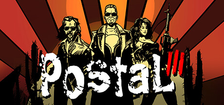

**Platforms:** Windows &nbsp;|&nbsp; **Genre:** Action &nbsp;|&nbsp; **Released:** December 20

> Good or Insane? The choice is yours. Following the Apocalyptic end to the Postal Dude’s week in Paradise, we follow him and his insane pitbull Champ as they emigrate to its appropriately named sister city, Catharsis.
>
> _Synopsis source: Steam_

[Wikipedia](https://en.wikipedia.org/wiki/Postal_III) · [Steam](https://store.steampowered.com/app/10220)

---

### PowerUp Heroes

**Platforms:** Xbox 360 &nbsp;|&nbsp; **Released:** October 18

[Wikipedia](https://en.wikipedia.org/wiki/PowerUp_Heroes)

---

### Prelude of the Chambered

[Wikipedia](https://en.wikipedia.org/wiki/Prelude_of_the_Chambered)

---

### Pretty Pet Salon

**Platforms:** iOS, Android &nbsp;|&nbsp; **Developer:** Dream Cortex &nbsp;|&nbsp; **Publisher:** Animoca &nbsp;|&nbsp; **Genre:** Casual, Strategy, Simulation &nbsp;|&nbsp; **Released:** January 26, 2011

[Wikipedia](https://en.wikipedia.org/wiki/Pretty_Pet_Salon)

---

### Pride of Nations

**Platforms:** Windows &nbsp;|&nbsp; **Developer:** AGEOD &nbsp;|&nbsp; **Publisher:** Paradox Interactive &nbsp;|&nbsp; **Genre:** Turn-based, Grand strategy &nbsp;|&nbsp; **Released:** June 8, 2011

[Wikipedia](https://en.wikipedia.org/wiki/Pride_of_Nations)

---

### Prinny 2: Dawn of Operation Panties, Dood!

**Platforms:** PlayStation Portable &nbsp;|&nbsp; **Genre:** Platformer &nbsp;|&nbsp; **Released:** January 10

---

### Pro Evolution Soccer 2011

**Platforms:** Nintendo 3DS &nbsp;|&nbsp; **Released:** March 27

[Wikipedia](https://en.wikipedia.org/wiki/Pro_Evolution_Soccer_2011)

---

### Pro Evolution Soccer 2011 3D

**Platforms:** Nintendo 3DS &nbsp;|&nbsp; **Developer:** Konami &nbsp;|&nbsp; **Publisher:** Konami &nbsp;|&nbsp; **Genre:** Sports game &nbsp;|&nbsp; **Released:** February 26, 2011

[Wikipedia](https://en.wikipedia.org/wiki/Pro_Evolution_Soccer_2011_3D)

---

### Pro Evolution Soccer 2012

**Platforms:** Windows, PlayStation 3, Xbox 360, Wii, PlayStation Portable, Nintendo 3DS, PlayStation 2 &nbsp;|&nbsp; **Released:** September 27

[Wikipedia](https://en.wikipedia.org/wiki/Pro_Evolution_Soccer_2012)

---

### Prodigy Math Game

**Platforms:** Browser, Android, iOS &nbsp;|&nbsp; **Developer:** SMARTeacher, Inc. &nbsp;|&nbsp; **Publisher:** Prodigy Education, Inc &nbsp;|&nbsp; **Genre:** Massively multiplayer online role-playing game

[Wikipedia](https://en.wikipedia.org/wiki/Prodigy_Math_Game)

---

### Project M

**Platforms:** Wii &nbsp;|&nbsp; **Developer:** Project M Development Team &nbsp;|&nbsp; **Genre:** Fighting &nbsp;|&nbsp; **Released:** February 7, 2011

[Wikipedia](https://en.wikipedia.org/wiki/Project_M)

---

### Pucca Power Up

**Platforms:** Nintendo DS &nbsp;|&nbsp; **Released:** September 13

---

### Pulse

**Platforms:** iOS &nbsp;|&nbsp; **Developer:** Cipher Prime &nbsp;|&nbsp; **Genre:** Music game &nbsp;|&nbsp; **Released:** May 5, 2011

[Wikipedia](https://en.wikipedia.org/wiki/Pulse_(video_game))

---

### Pushmo

**Platforms:** Nintendo 3DS &nbsp;|&nbsp; **Publisher:** Nintendo &nbsp;|&nbsp; **Released:** October 5, 2011

[Wikipedia](https://en.wikipedia.org/wiki/Pushmo)

---

### Puss in Boots

**Platforms:** PlayStation 3, Nintendo DS, Wii, Xbox 360 &nbsp;|&nbsp; **Released:** October 25

[Wikipedia](https://en.wikipedia.org/wiki/Puss_in_Boots_(video_game))

---

### Puyo Puyo!! 20th Anniversary

**Platforms:** PlayStation Portable, Wii, Nintendo DS, Nintendo 3DS &nbsp;|&nbsp; **Released:** July 14

[Wikipedia](https://en.wikipedia.org/wiki/Puyo_Puyo!!_20th_Anniversary)

---

### Puzzle Agent 2

**Platforms:** Windows, macOS, iOS &nbsp;|&nbsp; **Developer:** Telltale Games &nbsp;|&nbsp; **Publisher:** Telltale Games &nbsp;|&nbsp; **Genre:** Adventure/Puzzle &nbsp;|&nbsp; **Released:** June 30, 2011

[Wikipedia](https://en.wikipedia.org/wiki/Puzzle_Agent_2)

---

### Quarrel

**Platforms:** iOS &nbsp;|&nbsp; **Developer:** Denki &nbsp;|&nbsp; **Publisher:** UTV Ignition Entertainment &nbsp;|&nbsp; **Genre:** Word, Strategy &nbsp;|&nbsp; **Released:** August 25, 2011

[Wikipedia](https://en.wikipedia.org/wiki/Quarrel_(video_game))

---

### Queen's Gate

[Wikipedia](https://en.wikipedia.org/wiki/Queen's_Gate_(gamebook))

---

### Qvoid

**Platforms:** iOS, Android &nbsp;|&nbsp; **Developer:** Gavina Games &nbsp;|&nbsp; **Released:** July 21, 2011

[Wikipedia](https://en.wikipedia.org/wiki/Qvoid)

---

### R4: Ridge Racer Type 4

**Platforms:** PlayStation Network &nbsp;|&nbsp; **Released:** March 8

---

### Rabbids: Travel In Time 3D

**Platforms:** Nintendo 3DS &nbsp;|&nbsp; **Released:** April 10

---

### Radiant Historia

**Platforms:** Nintendo DS &nbsp;|&nbsp; **Released:** February 22

[Wikipedia](https://en.wikipedia.org/wiki/Radiant_Historia)

---

### Radiant Silvergun

**Platforms:** Xbox 360 &nbsp;|&nbsp; **Released:** September 14

[Wikipedia](https://en.wikipedia.org/wiki/Radiant_Silvergun)

---

### Rage

**Platforms:** Windows, PlayStation 3, Xbox 360 &nbsp;|&nbsp; **Released:** October 4

[Wikipedia](https://en.wikipedia.org/wiki/Rage_(video_game))

---

### Rango

**Platforms:** Nintendo DS, PlayStation 3, Wii, Xbox 360 &nbsp;|&nbsp; **Developer:** Behaviour Interactive &nbsp;|&nbsp; **Publisher:** Electronic Arts, Paramount Digital Entertainment &nbsp;|&nbsp; **Genre:** Action-adventure, platform &nbsp;|&nbsp; **Released:** February 25, 2011

[Wikipedia](https://en.wikipedia.org/wiki/Rango_(video_game))

---

### Ratchet & Clank: All 4 One

**Platforms:** PlayStation 3 &nbsp;|&nbsp; **Released:** October 18

---

### Ravenmark: Scourge of Estellion

**Platforms:** iOS, Windows, Android &nbsp;|&nbsp; **Developer:** Witching Hour Studios &nbsp;|&nbsp; **Publisher:** Witching Hour Studios &nbsp;|&nbsp; **Genre:** Turn-based strategy &nbsp;|&nbsp; **Released:** November 11, 2011

[Wikipedia](https://en.wikipedia.org/wiki/Ravenmark:_Scourge_of_Estellion)

---

### Raving Rabbids: Alive & Kicking

**Platforms:** Xbox 360 &nbsp;|&nbsp; **Released:** November 1

---

### Rayman 3D

**Platforms:** Nintendo 3DS &nbsp;|&nbsp; **Released:** March 27

[Wikipedia](https://en.wikipedia.org/wiki/Rayman_3D)

---

### Rayman Origins

**Platforms:** Wii, PlayStation 3, Xbox 360 &nbsp;|&nbsp; **Publisher:** Ubisoft &nbsp;|&nbsp; **Released:** November 15, 2011

[Wikipedia](https://en.wikipedia.org/wiki/Rayman_Origins)

---

### Realm of the Mad God

**Platforms:** Windows, macOS &nbsp;|&nbsp; **Developer:** Wild Shadow Studios, Spry Fox, Kabam, DECA Games &nbsp;|&nbsp; **Publisher:** DECA Games &nbsp;|&nbsp; **Genre:** MMORPG, Bullet hell, Roguelike &nbsp;|&nbsp; **Released:** June 20, 2011

[Wikipedia](https://en.wikipedia.org/wiki/Realm_of_the_Mad_God)

---

### Red Eclipse

**Platforms:** Windows, Linux, macOS &nbsp;|&nbsp; **Developer:** Quinton Reeves, Lee Salzman, various contributors &nbsp;|&nbsp; **Genre:** First-person shooter &nbsp;|&nbsp; **Released:** March 15, 2011

[Wikipedia](https://en.wikipedia.org/wiki/Red_Eclipse)

---

### Red Faction: Armageddon

**Platforms:** Windows, Xbox 360, PlayStation 3 &nbsp;|&nbsp; **Genre:** Action &nbsp;|&nbsp; **Released:** June 7

> Red Faction: Armageddon Path to War includes 4 new missions, 2 unlockable items and 10 new achievements!
>
> _Synopsis source: Steam_

[Steam](https://store.steampowered.com/app/55110)

---

### Red Faction: Battlegrounds

**Platforms:** PlayStation 3, PlayStation Network, Xbox 360 &nbsp;|&nbsp; **Developer:** THQ Digital Studios UK &nbsp;|&nbsp; **Publisher:** THQ &nbsp;|&nbsp; **Genre:** Vehicle simulation, multi-directional shooter &nbsp;|&nbsp; **Released:** April 5, 2011

[Wikipedia](https://en.wikipedia.org/wiki/Red_Faction:_Battlegrounds)

---

### Red Orchestra 2: Heroes of Stalingrad

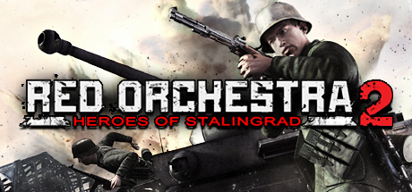

**Platforms:** Windows &nbsp;|&nbsp; **Genre:** Action, Massively Multiplayer, Simulation &nbsp;|&nbsp; **Released:** September 13

> Contains full Rising Storm content as well!
>
> _Synopsis source: Steam_

[Steam](https://store.steampowered.com/app/35450)

---

### Reel Fishing Paradise 3D

**Platforms:** Nintendo 3DS &nbsp;|&nbsp; **Released:** June 28

[Wikipedia](https://en.wikipedia.org/wiki/Reel_Fishing_Paradise_3D)

---

### Renegade Ops

**Platforms:** Xbox 360, Windows &nbsp;|&nbsp; **Genre:** Action &nbsp;|&nbsp; **Released:** September 14

> Blast your way through enemy lines to defeat Inferno, a madman intent on global domination. Destruction just got awesome.
>
> _Synopsis source: Steam_

[Wikipedia](https://en.wikipedia.org/wiki/Renegade_Ops) · [Steam](https://store.steampowered.com/app/99300)

---

### Resident Evil 4 HD

**Platforms:** PlayStation 3, Xbox 360 &nbsp;|&nbsp; **Released:** September 20

[Wikipedia](https://en.wikipedia.org/wiki/Resident_Evil_4)

---

### Resident Evil Code: Veronica X

**Platforms:** PlayStation 3, Xbox 360 &nbsp;|&nbsp; **Released:** September 27

---

### Resident Evil: Mercenaries Vs.

**Platforms:** iOS &nbsp;|&nbsp; **Released:** April 14

---

### Resident Evil: The Mercenaries 3D

**Platforms:** Nintendo 3DS &nbsp;|&nbsp; **Released:** June 28

---

### Resistance 3

**Platforms:** PlayStation 3 &nbsp;|&nbsp; **Released:** September 6

[Wikipedia](https://en.wikipedia.org/wiki/Resistance_3)

---

### Rewrite

**Platforms:** Windows &nbsp;|&nbsp; **Developer:** Key &nbsp;|&nbsp; **Publisher:** Visual Arts, Prototype, Sekai Project &nbsp;|&nbsp; **Genre:** Visual novel &nbsp;|&nbsp; **Released:** June 24, 2011

[Wikipedia](https://en.wikipedia.org/wiki/Rewrite_(video_game))

---

### Ridge Racer 3D

**Platforms:** Nintendo 3DS &nbsp;|&nbsp; **Released:** March 27

[Wikipedia](https://en.wikipedia.org/wiki/Ridge_Racer_3D)

---

### Rift

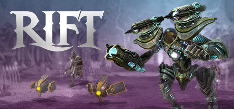

**Platforms:** Windows &nbsp;|&nbsp; **Genre:** Action, Adventure, Massively Multiplayer, RPG, Free To Play &nbsp;|&nbsp; **Released:** March 1

> Dive into a world of epic adventure! Create your perfect hero thanks to a uniquely customizable class system. Collect, craft, and customize your gear. Go it alone or group up to challenge dungeons, raids, dynamic open-world content, and your fellow players.
>
> _Synopsis source: Steam_

[Wikipedia](https://en.wikipedia.org/wiki/Rift_(video_game)) · [Steam](https://store.steampowered.com/app/39120)

---

### Rio

**Platforms:** PlayStation 3, Xbox 360, Nintendo DS, Wii &nbsp;|&nbsp; **Released:** April 12

[Wikipedia](https://en.wikipedia.org/wiki/Rio_(video_game))

---

### Riptide GP

**Platforms:** iOS, Android, Windows &nbsp;|&nbsp; **Developer:** Vector Unit &nbsp;|&nbsp; **Publisher:** Starz digital , vector unit &nbsp;|&nbsp; **Genre:** Racing

[Wikipedia](https://en.wikipedia.org/wiki/Riptide_GP)

---

### Rise of Immortals

**Platforms:** Windows &nbsp;|&nbsp; **Released:** September 12

[Wikipedia](https://en.wikipedia.org/wiki/Rise_of_Immortals)

---

### Rise of Nightmares

**Platforms:** Xbox 360 &nbsp;|&nbsp; **Released:** September 6

[Wikipedia](https://en.wikipedia.org/wiki/Rise_of_Nightmares)

---

### Ro-Kyu-Bu!

[Wikipedia](https://en.wikipedia.org/wiki/Ro-Kyu-Bu!)

---

### Robo Surf

**Platforms:** iOS, Android &nbsp;|&nbsp; **Released:** June 1

[Wikipedia](https://en.wikipedia.org/wiki/Robo_Surf)

---

### Rochard

**Platforms:** Windows &nbsp;|&nbsp; **Released:** November 15

[Wikipedia](https://en.wikipedia.org/wiki/Rochard)

---

### Rock Band Country Track Pack 2

**Platforms:** PlayStation 3, Wii, Xbox 360 &nbsp;|&nbsp; **Genre:** Music &nbsp;|&nbsp; **Released:** February 1

[Wikipedia](https://en.wikipedia.org/wiki/Rock_Band_Country_Track_Pack_2)

---

### Rock of Ages

**Platforms:** Windows, Xbox 360, PlayStation Network &nbsp;|&nbsp; **Genre:** Action, Indie, Racing, Strategy &nbsp;|&nbsp; **Released:** August 31

> A rock-solid combination of rock-rolling action, deep strategy, and captivating art and music from different ages of history, this is a game of crush or be crushed!
>
> _Synopsis source: Steam_

[Wikipedia](https://en.wikipedia.org/wiki/Rock_of_Ages_(video_game)) · [Steam](https://store.steampowered.com/app/22230)

---

### Rocketbirds: Hardboiled Chicken

**Platforms:** PlayStation 3 &nbsp;|&nbsp; **Released:** October 18

---

### Rocksmith

**Platforms:** PlayStation 3, Xbox 360 &nbsp;|&nbsp; **Released:** October 18

[Wikipedia](https://en.wikipedia.org/wiki/Rocksmith)

---

### Rope Rescue

**Platforms:** iOS, Android &nbsp;|&nbsp; **Developer:** Untame Games &nbsp;|&nbsp; **Publisher:** Chillingo &nbsp;|&nbsp; **Genre:** Puzzle &nbsp;|&nbsp; **Released:** October 20, 2011

[Wikipedia](https://en.wikipedia.org/wiki/Rope_Rescue)

---

### Rugby Challenge

**Platforms:** Windows, PlayStation 3, Xbox 360 &nbsp;|&nbsp; **Released:** October 20

[Wikipedia](https://en.wikipedia.org/wiki/Rugby_Challenge_(video_game))

---

### Rugby World Cup 2011

**Platforms:** Xbox 360, PlayStation 3 &nbsp;|&nbsp; **Released:** August 26

[Wikipedia](https://en.wikipedia.org/wiki/Rugby_World_Cup_2011_(video_game))

---

### Rune Factory: Tides of Destiny

**Platforms:** PlayStation 3, Wii &nbsp;|&nbsp; **Released:** September 27

---

### Rune Legend

**Platforms:** Windows Phone &nbsp;|&nbsp; **Developer:** Dreadlocks Ltd &nbsp;|&nbsp; **Publisher:** Dreadlocks Ltd &nbsp;|&nbsp; **Genre:** Puzzle &nbsp;|&nbsp; **Released:** December 30, 2011

[Wikipedia](https://en.wikipedia.org/wiki/Rune_Legend)

---

### Rush'n Attack: Ex-Patriot

**Platforms:** PlayStation Network, Xbox 360 &nbsp;|&nbsp; **Released:** March 29

---

### Rusty Hearts

**Platforms:** Windows &nbsp;|&nbsp; **Developer:** Stairway Games Korea &nbsp;|&nbsp; **Publisher:** Windysoft, Perfect World Entertainment, Sega, Xunlei &nbsp;|&nbsp; **Genre:** MMORPG &nbsp;|&nbsp; **Released:** May 11, 2011

[Wikipedia](https://en.wikipedia.org/wiki/Rusty_Hearts)

---

### Sacred Odyssey: Rise of Ayden

**Platforms:** iOS, Android &nbsp;|&nbsp; **Developer:** Gameloft &nbsp;|&nbsp; **Genre:** Role-playing &nbsp;|&nbsp; **Released:** January 29, 2011

[Wikipedia](https://en.wikipedia.org/wiki/Sacred_Odyssey:_Rise_of_Ayden)

---

### Sailor Moon: La Luna Splende

**Platforms:** Nintendo DS &nbsp;|&nbsp; **Developer:** Open Sesame &nbsp;|&nbsp; **Publisher:** Namco Bandai Games &nbsp;|&nbsp; **Genre:** Action, Platform, Puzzle &nbsp;|&nbsp; **Released:** March 16, 2011

[Wikipedia](https://en.wikipedia.org/wiki/Sailor_Moon:_La_Luna_Splende)

---

### Saint Seiya: Sanctuary Battle

**Platforms:** PlayStation 3 &nbsp;|&nbsp; **Developer:** Dimps &nbsp;|&nbsp; **Publisher:** Namco Bandai Games &nbsp;|&nbsp; **Genre:** Beat'em up, action-adventure &nbsp;|&nbsp; **Released:** November 23, 2011

[Wikipedia](https://en.wikipedia.org/wiki/Saint_Seiya:_Sanctuary_Battle)

---

### Saints Row: The Third

**Platforms:** Windows, Xbox 360, PlayStation 3 &nbsp;|&nbsp; **Genre:** Action &nbsp;|&nbsp; **Released:** November 15

> Get ready for the most out-landish gameplay scenarios ever seen as the Third Street Saints take on the Syndicate!
>
> _Synopsis source: Steam_

[Steam](https://store.steampowered.com/app/55230)

---

### Samurai Warriors: Chronicles

**Platforms:** Nintendo 3DS &nbsp;|&nbsp; **Released:** March 27

---

### Satazius

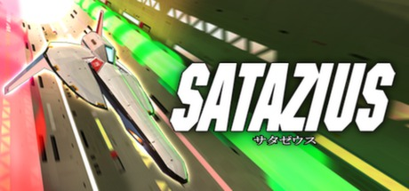

**Platforms:** Windows &nbsp;|&nbsp; **Genre:** Action, Indie &nbsp;|&nbsp; **Released:** December 16

> The year is 2051. Location: SATAZIUS, a long-abandoned planet. The cruiser Agano was on patrol when it was attacked and stricken by a confederacy of space pirates that had established a base on SATAZIUS. The pirates attacked the Agano intending to steal the assault ship ‘Trafalgar’ that was stowed aboard the Agano, but the Trafalgar made...
>
> _Synopsis source: Steam_

[Steam](https://store.steampowered.com/app/203990)

---

### Say What?!

**Platforms:** iOS &nbsp;|&nbsp; **Developer:** 8linQ &nbsp;|&nbsp; **Genre:** Music game &nbsp;|&nbsp; **Released:** August 10, 2011

[Wikipedia](https://en.wikipedia.org/wiki/Say_What%3F!_(video_game))

---

### SBK 2011

**Platforms:** Windows, PlayStation 3, Xbox 360 &nbsp;|&nbsp; **Developer:** Milestone &nbsp;|&nbsp; **Publisher:** Black Bean Games &nbsp;|&nbsp; **Genre:** Racing &nbsp;|&nbsp; **Released:** May 13, 2011

[Wikipedia](https://en.wikipedia.org/wiki/SBK_2011)

---

### Scribblenauts Remix

**Platforms:** iOS &nbsp;|&nbsp; **Released:** October 11

[Wikipedia](https://en.wikipedia.org/wiki/Scribblenauts_Remix)

---

### Section 8: Prejudice

**Platforms:** Windows, PlayStation 3, Xbox 360 &nbsp;|&nbsp; **Developer:** TimeGate Studios &nbsp;|&nbsp; **Publisher:** TimeGate Studios, Atari &nbsp;|&nbsp; **Genre:** First-person shooter &nbsp;|&nbsp; **Released:** April 20, 2011

[Wikipedia](https://en.wikipedia.org/wiki/Section_8:_Prejudice)

---

### Sega Rally Online Arcade

**Platforms:** Xbox 360 &nbsp;|&nbsp; **Released:** May 18

[Wikipedia](https://en.wikipedia.org/wiki/Sega_Rally_3)

---

### Self-Defense Training Camp

**Platforms:** Xbox 360 &nbsp;|&nbsp; **Released:** November 8

[Wikipedia](https://en.wikipedia.org/wiki/Self-Defense_Training_Camp)

---

### Sengoku: Way of the Warrior

**Platforms:** Windows &nbsp;|&nbsp; **Released:** September 13

[Wikipedia](https://en.wikipedia.org/wiki/Sengoku_(2011_video_game))

---

### Senran Kagura Burst

**Platforms:** Nintendo 3DS &nbsp;|&nbsp; **Developer:** Tamsoft &nbsp;|&nbsp; **Publisher:** Marvelous Entertainment Inc., Xseed Games, Marvelous AQL, Zen United &nbsp;|&nbsp; **Genre:** Hack and slash &nbsp;|&nbsp; **Released:** September 22, 2011

[Wikipedia](https://en.wikipedia.org/wiki/Senran_Kagura_Burst)

---

### Serious Sam 3: BFE

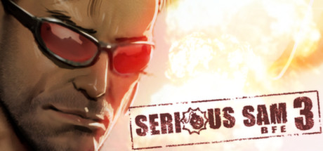

**Platforms:** Windows &nbsp;|&nbsp; **Genre:** Action, Indie &nbsp;|&nbsp; **Released:** November 22

> Serious Sam 3: BFE is a prequel to the original indie fast action FPS and Game of the Year sensation - Serious Sam: The First Encounter!
>
> _Synopsis source: Steam_

[Steam](https://store.steampowered.com/app/41070)

---

### Serious Sam Double D

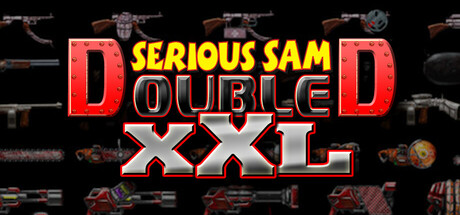

**Platforms:** Windows &nbsp;|&nbsp; **Genre:** Action, Indie &nbsp;|&nbsp; **Released:** August 3

> Pile on the firepower with the revolutionary Gunstacker and fire all your weapons at once in a symphony of destruction!
>
> _Synopsis source: Steam_

[Wikipedia](https://en.wikipedia.org/wiki/Serious_Sam_Double_D) · [Steam](https://store.steampowered.com/app/111600)

---

### Serious Sam: Kamikaze Attack!

**Platforms:** Android, iOS &nbsp;|&nbsp; **Developer:** Be-Rad Entertainment &nbsp;|&nbsp; **Publisher:** Devolver Digital &nbsp;|&nbsp; **Genre:** Auto-running &nbsp;|&nbsp; **Released:** September 15, 2011

[Wikipedia](https://en.wikipedia.org/wiki/Serious_Sam:_Kamikaze_Attack!)

---

### Serious Sam: The Random Encounter

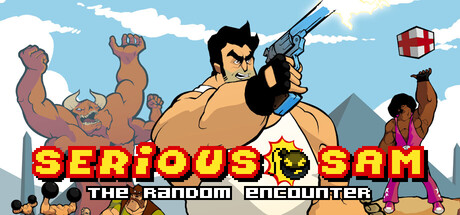

**Platforms:** Windows &nbsp;|&nbsp; **Genre:** Action, Indie, RPG &nbsp;|&nbsp; **Released:** October 24

> Choose your weapons and take aim at the most random Serious Sam adventure yet!
>
> _Synopsis source: Steam_

[Steam](https://store.steampowered.com/app/201480)

---

### Sesame Street: Once Upon a Monster

**Platforms:** Xbox 360 &nbsp;|&nbsp; **Released:** October 11

---

### Sesame Street: Ready, Set, Grover!

**Platforms:** Wii, Nintendo DS &nbsp;|&nbsp; **Developer:** Griptonite Games &nbsp;|&nbsp; **Publisher:** Warner Bros. Interactive Entertainment &nbsp;|&nbsp; **Genre:** Adventure, edutainment &nbsp;|&nbsp; **Released:** August 2, 2011

[Wikipedia](https://en.wikipedia.org/wiki/Sesame_Street:_Ready,_Set,_Grover!)

---

### Shadow Era

**Platforms:** Windows, iOS, macOS, Android &nbsp;|&nbsp; **Developer:** Wulven Studios &nbsp;|&nbsp; **Publisher:** Wulven Studios &nbsp;|&nbsp; **Genre:** Digital CCG &nbsp;|&nbsp; **Released:** February 24, 2011

[Wikipedia](https://en.wikipedia.org/wiki/Shadow_Era)

---

### Shadowgun

**Platforms:** iOS, Windows &nbsp;|&nbsp; **Released:** September 29

[Wikipedia](https://en.wikipedia.org/wiki/Shadowgun)

---

### Shadows of the Damned

**Platforms:** PlayStation 3, Xbox 360 &nbsp;|&nbsp; **Released:** June 21

[Wikipedia](https://en.wikipedia.org/wiki/Shadows_of_the_Damned)

---

### Shake It Up

**Platforms:** Wii &nbsp;|&nbsp; **Released:** December 9

---

### Shantae: Risky's Revenge

**Platforms:** iOS &nbsp;|&nbsp; **Released:** October 27

---

### Shift 2: Unleashed

**Platforms:** Windows, PlayStation 3, Xbox 360, iOS &nbsp;|&nbsp; **Genre:** Racing &nbsp;|&nbsp; **Released:** March 29

> Bring the true driver’s experience to life with all the intensity and exhilaration of being behind the wheel!
>
> _Synopsis source: Steam_

[Steam](https://store.steampowered.com/app/47920)

---

### Shin Kamaitachi no Yoru

**Platforms:** PlayStation 3, PlayStation Vita &nbsp;|&nbsp; **Genre:** Visual novel &nbsp;|&nbsp; **Released:** December 17

[Wikipedia](https://en.wikipedia.org/wiki/Shin_Kamaitachi_no_Yoru)

---

### Shin Megami Tensei: Devil Survivor Overclocked

**Platforms:** Nintendo 3DS &nbsp;|&nbsp; **Released:** August 23

---

### Shining Force II

**Platforms:** Windows &nbsp;|&nbsp; **Genre:** Tactical RPG &nbsp;|&nbsp; **Released:** January 26

[Wikipedia](https://en.wikipedia.org/wiki/Shining_Force_II)

---

### Shinobi

**Platforms:** Nintendo 3DS &nbsp;|&nbsp; **Released:** November 15

[Wikipedia](https://en.wikipedia.org/wiki/Shinobi_(2011_video_game))

---

### Shuffle! Love Rainbow

**Platforms:** Windows &nbsp;|&nbsp; **Developer:** Navel &nbsp;|&nbsp; **Publisher:** Navel &nbsp;|&nbsp; **Genre:** Eroge, visual novel &nbsp;|&nbsp; **Released:** April 28, 2011

[Wikipedia](https://en.wikipedia.org/wiki/Shuffle!_Love_Rainbow)

---

### Sissy's Magical Ponycorn Adventure

**Platforms:** Browser, iOS, BlackBerry OS &nbsp;|&nbsp; **Developer:** Untold Entertainment Inc. &nbsp;|&nbsp; **Publisher:** Untold Entertainment Inc. &nbsp;|&nbsp; **Genre:** Graphic adventure game &nbsp;|&nbsp; **Released:** May 24, 2011

[Wikipedia](https://en.wikipedia.org/wiki/Sissy's_Magical_Ponycorn_Adventure)

---

### Six-Guns

**Platforms:** iOS &nbsp;|&nbsp; **Developer:** Gameloft Barcelona &nbsp;|&nbsp; **Publisher:** Gameloft &nbsp;|&nbsp; **Genre:** Action-adventure &nbsp;|&nbsp; **Released:** December 5, 2011

[Wikipedia](https://en.wikipedia.org/wiki/Six-Guns)

---

### SkyDrift

**Platforms:** PlayStation 3, PlayStation Network, Windows, Xbox 360 &nbsp;|&nbsp; **Developer:** Digital Reality, THQ Nordic &nbsp;|&nbsp; **Publisher:** Digital Reality, Bandai Namco Partners, HandyGames &nbsp;|&nbsp; **Genre:** Arcade racing &nbsp;|&nbsp; **Released:** September 6, 2011

[Wikipedia](https://en.wikipedia.org/wiki/SkyDrift)

---

### Skylanders: Spyro's Adventure

**Platforms:** Windows, Nintendo 3DS, PlayStation 3, Wii, Xbox 360 &nbsp;|&nbsp; **Released:** October 16

---

### Slam Bolt Scrappers

**Platforms:** PlayStation Network &nbsp;|&nbsp; **Released:** March 15

[Wikipedia](https://en.wikipedia.org/wiki/Slam_Bolt_Scrappers)

---

### Slime Mori Mori Dragon Quest 3

**Platforms:** Nintendo 3DS &nbsp;|&nbsp; **Developer:** Tose &nbsp;|&nbsp; **Publisher:** Square Enix &nbsp;|&nbsp; **Genre:** Action-adventure &nbsp;|&nbsp; **Released:** November 2, 2011

[Wikipedia](https://en.wikipedia.org/wiki/Slime_Mori_Mori_Dragon_Quest_3)

---

### Slotomania

**Platforms:** iOS, Android, Windows Phone &nbsp;|&nbsp; **Developer:** Playtika &nbsp;|&nbsp; **Publisher:** Playtika &nbsp;|&nbsp; **Genre:** Casual mobile game

[Wikipedia](https://en.wikipedia.org/wiki/Slotomania)

---

### Snail Mail

**Platforms:** Windows, Wii, macOS, iOS, Android &nbsp;|&nbsp; **Publisher:** Sandlot Games &nbsp;|&nbsp; **Genre:** Racing

[Wikipedia](https://en.wikipedia.org/wiki/Snail_Mail_(video_game))

---

### Sniper: Ghost Warrior

**Platforms:** PlayStation 3 &nbsp;|&nbsp; **Released:** June 28

---

### Snoopy's Street Fair

**Platforms:** iOS &nbsp;|&nbsp; **Developer:** Beeline Interactive &nbsp;|&nbsp; **Publisher:** Capcom &nbsp;|&nbsp; **Genre:** City-building, simulation &nbsp;|&nbsp; **Released:** November 3, 2011

[Wikipedia](https://en.wikipedia.org/wiki/Snoopy's_Street_Fair)

---

### Snoticles

**Platforms:** iOS &nbsp;|&nbsp; **Released:** December 15

[Wikipedia](https://en.wikipedia.org/wiki/Snoticles)

---

### Snuggle Truck

**Platforms:** iOS, macOS, Windows, BlackBerry OS, Mobile phone, Linux, Android &nbsp;|&nbsp; **Developer:** Owlchemy Labs &nbsp;|&nbsp; **Publisher:** Owlchemy Labs &nbsp;|&nbsp; **Genre:** racing &nbsp;|&nbsp; **Released:** April 28, 2011

[Wikipedia](https://en.wikipedia.org/wiki/Snuggle_Truck)

---

### SOCOM 4: U.S. Navy SEALs

**Platforms:** PlayStation 3 &nbsp;|&nbsp; **Released:** April 19

[Wikipedia](https://en.wikipedia.org/wiki/SOCOM_4)

---

### Sodium

**Platforms:** PlayStation 3 &nbsp;|&nbsp; **Developer:** Outso &nbsp;|&nbsp; **Publisher:** Lockwood Publishing, SCEA, SCEE &nbsp;|&nbsp; **Genre:** MMO &nbsp;|&nbsp; **Released:** June 16, 2011

[Wikipedia](https://en.wikipedia.org/wiki/Sodium_(video_game))

---

### Sodium 2: Project Velocity

**Platforms:** PlayStation Network &nbsp;|&nbsp; **Released:** June 16

[Wikipedia](https://en.wikipedia.org/wiki/Sodium_(PlayStation_Home)#Sodium2)

---

### Solar 2

**Platforms:** Windows, macOS, Linux, Android, iOS &nbsp;|&nbsp; **Developer:** Jay Watts &nbsp;|&nbsp; **Publisher:** Murudai &nbsp;|&nbsp; **Genre:** Open world, sandbox video game &nbsp;|&nbsp; **Released:** June 17, 2011

[Wikipedia](https://en.wikipedia.org/wiki/Solar_2)

---

### Solatorobo: Red the Hunter

**Platforms:** Nintendo DS &nbsp;|&nbsp; **Released:** September 27

---

### Sonic & Sega All-Stars Racing

**Platforms:** iOS &nbsp;|&nbsp; **Released:** June 18

[Wikipedia](https://en.wikipedia.org/wiki/Sonic_%26_Sega_All-Stars_Racing)

---

### Sonic CD

**Platforms:** iOS &nbsp;|&nbsp; **Released:** December 15

[Wikipedia](https://en.wikipedia.org/wiki/Sonic_the_Hedgehog_CD)

---

### Sonic Generations

**Platforms:** PlayStation 3, Xbox 360, Windows, Nintendo 3DS &nbsp;|&nbsp; **Genre:** Action &nbsp;|&nbsp; **Released:** November 1

> Celebrate 20 years of Sonic in an all new adventure that delivers a definitive experience to Sonic fans new and old!
>
> _Synopsis source: Steam_

[Wikipedia](https://en.wikipedia.org/wiki/Sonic_Generations) · [Steam](https://store.steampowered.com/app/71340)

---

### Space Channel 5: Part 2

**Platforms:** PlayStation Network &nbsp;|&nbsp; **Released:** October 4

---

### Space Heroes Universe!

**Platforms:** Browser &nbsp;|&nbsp; **Developer:** Bubble Gum Interactive &nbsp;|&nbsp; **Publisher:** Bubble Gum Interactive &nbsp;|&nbsp; **Genre:** Virtual World

[Wikipedia](https://en.wikipedia.org/wiki/Space_Heroes_Universe!)

---

### Space Pirates and Zombies

**Platforms:** Windows, OnLive &nbsp;|&nbsp; **Developer:** MinMax Games &nbsp;|&nbsp; **Genre:** Real-time Strategy, RPG &nbsp;|&nbsp; **Released:** August 15, 2011

[Wikipedia](https://en.wikipedia.org/wiki/Space_Pirates_and_Zombies)

---

### Space Quest: Vohaul Strikes Back

**Platforms:** Windows, Linux, macOS &nbsp;|&nbsp; **Developer:** Team VSB &nbsp;|&nbsp; **Genre:** Adventure &nbsp;|&nbsp; **Released:** December 22, 2011

[Wikipedia](https://en.wikipedia.org/wiki/Space_Quest:_Vohaul_Strikes_Back)

---

### SpaceChem

**Platforms:** Windows, macOS, Linux, iOS, Android &nbsp;|&nbsp; **Developer:** Zachtronics Industries &nbsp;|&nbsp; **Publisher:** Zachtronics Industries &nbsp;|&nbsp; **Genre:** Puzzle game &nbsp;|&nbsp; **Released:** January 1, 2011

[Wikipedia](https://en.wikipedia.org/wiki/SpaceChem)

---

### Spare Parts

**Platforms:** PlayStation 3, PlayStation Network, Xbox 360 &nbsp;|&nbsp; **Developer:** EA Bright Light &nbsp;|&nbsp; **Publisher:** Electronic Arts &nbsp;|&nbsp; **Genre:** Platform &nbsp;|&nbsp; **Released:** January 18, 2011

[Wikipedia](https://en.wikipedia.org/wiki/Spare_Parts_(video_game))

---

### Sparkle 2 Evo

**Platforms:** Linux, macOS, Windows &nbsp;|&nbsp; **Developer:** Madman Theory Games, Plastic Games &nbsp;|&nbsp; **Publisher:** Forever Entertainment &nbsp;|&nbsp; **Genre:** Logic, arcade &nbsp;|&nbsp; **Released:** November 29, 2011

[Wikipedia](https://en.wikipedia.org/wiki/Sparkle_2_Evo)

---

### Sparkle Snapshots

**Platforms:** Nintendo DS &nbsp;|&nbsp; **Developer:** Atlus &nbsp;|&nbsp; **Publisher:** Nintendo &nbsp;|&nbsp; **Genre:** Photo booth

[Wikipedia](https://en.wikipedia.org/wiki/Sparkle_Snapshots)

---

### Spent

**Platforms:** Browser &nbsp;|&nbsp; **Developer:** McKinney &nbsp;|&nbsp; **Released:** February 2011

[Wikipedia](https://en.wikipedia.org/wiki/Spent_(video_game))

---

### Spider-Man: Edge of Time

**Platforms:** Xbox 360, PlayStation 3, Wii, Nintendo DS, Nintendo 3DS &nbsp;|&nbsp; **Released:** October 4

---

### Spiral Knights

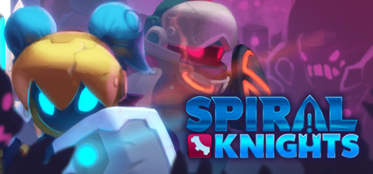

**Platforms:** Windows &nbsp;|&nbsp; **Genre:** Action, Adventure, Casual, Indie, Massively Multiplayer, RPG, Free To Play &nbsp;|&nbsp; **Released:** April 4

> Join the ranks of the Spiral Knights. Stranded on an alien world, you must explore the ever-changing Clockworks beneath its surface.
>
> _Synopsis source: Steam_

[Wikipedia](https://en.wikipedia.org/wiki/Spiral_Knights) · [Steam](https://store.steampowered.com/app/99900)

---

### SpongeBob SquigglePants

**Platforms:** Wii, Nintendo 3DS &nbsp;|&nbsp; **Released:** April 10

[Wikipedia](https://en.wikipedia.org/wiki/SpongeBob_SquigglePants)

---

### SpongeBob's Surf & Skate Roadtrip

**Platforms:** Nintendo DS, Xbox 360 &nbsp;|&nbsp; **Released:** November 8

[Wikipedia](https://en.wikipedia.org/wiki/SpongeBob%27s_Surf_%26_Skate_Roadtrip)

---

### Spy Mouse

**Platforms:** iOS, Android, Windows Phone &nbsp;|&nbsp; **Released:** August 25

[Wikipedia](https://en.wikipedia.org/wiki/Spy_Mouse)

---

### Squids

**Platforms:** iOS &nbsp;|&nbsp; **Developer:** The Game Bakers &nbsp;|&nbsp; **Genre:** Tactical role-playing &nbsp;|&nbsp; **Released:** October 2011

[Wikipedia](https://en.wikipedia.org/wiki/Squids_(video_game))

---

### Stacking

**Platforms:** PlayStation 3, Xbox 360 &nbsp;|&nbsp; **Released:** February 8

[Wikipedia](https://en.wikipedia.org/wiki/Stacking_(video_game))

---

### Star Fox 64 3D

**Platforms:** Nintendo 3DS &nbsp;|&nbsp; **Released:** September 9

[Wikipedia](https://en.wikipedia.org/wiki/Star_Fox_64_3D)

---

### Star Legends: The Blackstar Chronicles

**Platforms:** iOS, Android, Browser &nbsp;|&nbsp; **Developer:** Spacetime Studios &nbsp;|&nbsp; **Genre:** MMORPG, Sci-fi

[Wikipedia](https://en.wikipedia.org/wiki/Star_Legends:_The_Blackstar_Chronicles)

---

### Star Raiders

**Platforms:** Windows, Xbox 360, PlayStation 3 &nbsp;|&nbsp; **Developer:** Incinerator Studios &nbsp;|&nbsp; **Publisher:** Atari, Inc. &nbsp;|&nbsp; **Genre:** Space combat &nbsp;|&nbsp; **Released:** May 11, 2011

[Wikipedia](https://en.wikipedia.org/wiki/Star_Raiders_(2011_video_game))

---

### Star Wars: The Old Republic

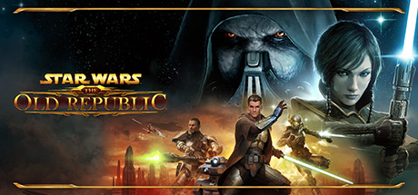

**Platforms:** Windows &nbsp;|&nbsp; **Genre:** Massively Multiplayer, RPG, Free To Play &nbsp;|&nbsp; **Released:** December 20

> STAR WARS™: The Old Republic™ is a free-to-play MMORPG that puts you at the center of your own story-driven saga. Play as a Jedi, Sith, Bounty Hunter, or one of many other iconic STAR WARS roles in the galaxy far, far away over three thousand years before the classic films.
>
> _Synopsis source: Steam_

[Steam](https://store.steampowered.com/app/1286830)

---

### Stealth Bastard

**Platforms:** Windows &nbsp;|&nbsp; **Genre:** Action, Indie &nbsp;|&nbsp; **Released:** November 4

> Armed with only your wits and a pair of Stealthing Goggles, it’s your job to sneak your way through a deadly facility that’s determined to extinguish your fragile little life.
>
> _Synopsis source: Steam_

[Wikipedia](https://en.wikipedia.org/wiki/Stealth_Bastard_Deluxe) · [Steam](https://store.steampowered.com/app/209190)

---

### Steel Diver

**Platforms:** Nintendo 3DS &nbsp;|&nbsp; **Released:** March 27

[Wikipedia](https://en.wikipedia.org/wiki/Steel_Diver)

---

### Steins;Gate: My Darling's Embrace

**Platforms:** Xbox 360 &nbsp;|&nbsp; **Developer:** 5pb. &nbsp;|&nbsp; **Publisher:** 5pb., Spike Chunsoft &nbsp;|&nbsp; **Genre:** Visual novel &nbsp;|&nbsp; **Released:** June 16, 2011

[Wikipedia](https://en.wikipedia.org/wiki/Steins;Gate:_My_Darling's_Embrace)

---

### Stoked

**Platforms:** Windows &nbsp;|&nbsp; **Released:** March 11

[Wikipedia](https://en.wikipedia.org/wiki/Stoked_(video_game))

---

### Storm: Frontline Nation

**Platforms:** Windows &nbsp;|&nbsp; **Developer:** Colossai Studios &nbsp;|&nbsp; **Publisher:** SimBin Studios &nbsp;|&nbsp; **Genre:** Turn-based strategy &nbsp;|&nbsp; **Released:** June 10, 2011

[Wikipedia](https://en.wikipedia.org/wiki/Storm:_Frontline_Nation)

---

### Strategic Command WW1: The Great War 1914–1918

**Platforms:** Windows &nbsp;|&nbsp; **Developer:** Fury Software &nbsp;|&nbsp; **Publisher:** Battlefront.com &nbsp;|&nbsp; **Genre:** Turn-based strategy &nbsp;|&nbsp; **Released:** March 1, 2011

[Wikipedia](https://en.wikipedia.org/wiki/Strategic_Command_WW1:_The_Great_War_1914%E2%80%931918)

---

### Street Cleaning Simulator

**Platforms:** Windows &nbsp;|&nbsp; **Developer:** TML Studios &nbsp;|&nbsp; **Publisher:** Astragon, Excalibur Publishing &nbsp;|&nbsp; **Genre:** Simulator &nbsp;|&nbsp; **Released:** July 1, 2011

[Wikipedia](https://en.wikipedia.org/wiki/Street_Cleaning_Simulator)

---

### StreetPass Mii Plaza

[Wikipedia](https://en.wikipedia.org/wiki/StreetPass_Mii_Plaza)

---

### Streets of Rage Remake

**Genre:** Beat 'em up &nbsp;|&nbsp; **Released:** April 3, 2011

[Wikipedia](https://en.wikipedia.org/wiki/Streets_of_Rage_Remake)

---

### Strong Bad's Cool Game for Attractive People: Episode 1 - Homestar Ruiner

**Platforms:** Windows, Wii &nbsp;|&nbsp; **Released:** August 11

[Wikipedia](https://en.wikipedia.org/wiki/Strong_Bad%27s_Cool_Game_for_Attractive_People)

---

### Stronghold 3

**Platforms:** Windows &nbsp;|&nbsp; **Genre:** Simulation, Strategy &nbsp;|&nbsp; **Released:** October 25

> Set 10 years after the original, Stronghold 3: Gold follows the vengeful story of The Wolf in the third installment of the award-winning castle building series. The Wolf has cheated death become even more bitter and twisted. Build castles, rally your troops and save medieval England!
>
> _Synopsis source: Steam_

[Wikipedia](https://en.wikipedia.org/wiki/Stronghold_3) · [Steam](https://store.steampowered.com/app/47400)

---

### SummitX Snowboarding

**Platforms:** iOS, Android &nbsp;|&nbsp; **Developer:** Free Range Games &nbsp;|&nbsp; **Publisher:** Com2uS &nbsp;|&nbsp; **Genre:** Snowboarding &nbsp;|&nbsp; **Released:** December 15, 2011

[Wikipedia](https://en.wikipedia.org/wiki/SummitX_Snowboarding)

---

### Super Mario 3D Land

**Platforms:** Nintendo 3DS &nbsp;|&nbsp; **Publisher:** Nintendo &nbsp;|&nbsp; **Released:** November 3, 2011

[Wikipedia](https://en.wikipedia.org/wiki/Super_Mario_3D_Land)

---

### Super Monkey Ball 3D

**Platforms:** Nintendo 3DS &nbsp;|&nbsp; **Released:** March 27

[Wikipedia](https://en.wikipedia.org/wiki/Super_Monkey_Ball_3D)

---

### Super Smash Land

**Platforms:** Windows &nbsp;|&nbsp; **Developer:** Dan Fornace &nbsp;|&nbsp; **Publisher:** Dan Fornace &nbsp;|&nbsp; **Genre:** Fighting &nbsp;|&nbsp; **Released:** September 14, 2011

[Wikipedia](https://en.wikipedia.org/wiki/Super_Smash_Land)

---

### Super Sonico

[Wikipedia](https://en.wikipedia.org/wiki/Super_Sonico)

---

### Super Stickman Golf

**Platforms:** iOS, Android &nbsp;|&nbsp; **Developer:** Noodlecake Games &nbsp;|&nbsp; **Publisher:** Noodlecake Games &nbsp;|&nbsp; **Released:** June 7, 2011

[Wikipedia](https://en.wikipedia.org/wiki/Super_Stickman_Golf)

---

### Super Street Fighter IV: 3D Edition

**Platforms:** Nintendo 3DS &nbsp;|&nbsp; **Released:** March 27

---

### Superstars V8 Next Challenge

**Platforms:** Windows, PlayStation 3, Xbox 360 &nbsp;|&nbsp; **Genre:** Racing &nbsp;|&nbsp; **Released:** January 25

[Wikipedia](https://en.wikipedia.org/wiki/Superstars_V8_Next_Challenge)

---

### Supreme Ruler: Cold War

**Platforms:** Windows &nbsp;|&nbsp; **Developer:** BattleGoat Studios &nbsp;|&nbsp; **Publisher:** Paradox Interactive &nbsp;|&nbsp; **Genre:** Grand strategy &nbsp;|&nbsp; **Released:** July 19, 2011

[Wikipedia](https://en.wikipedia.org/wiki/Supreme_Ruler:_Cold_War)

---

### Survivalcraft

**Platforms:** Windows Phone, Android, iOS, Windows &nbsp;|&nbsp; **Developer:** Candy Rufus Games &nbsp;|&nbsp; **Publisher:** Candy Rufus Games &nbsp;|&nbsp; **Genre:** Sandbox, survival &nbsp;|&nbsp; **Released:** November 16, 2011

[Wikipedia](https://en.wikipedia.org/wiki/Survivalcraft)

---

### Swarm

**Platforms:** PlayStation Network, Xbox 360 &nbsp;|&nbsp; **Released:** March 22

[Wikipedia](https://en.wikipedia.org/wiki/Swarm_(2011_video_game))

---

### Sweatshop

**Platforms:** macOS, Windows &nbsp;|&nbsp; **Genre:** Simulation, Strategy, Early Access &nbsp;|&nbsp; **Released:** July 18

> A dark management tycoon where profit has consequences. Grow from basement to factory and choose profit over workers' rights. Survive on small margins and even smaller morals. Keep the state happy or face brutal inspections.
>
> _Synopsis source: Steam_

[Wikipedia](https://en.wikipedia.org/wiki/Sweatshop_(video_game)) · [Steam](https://store.steampowered.com/app/4318110)

---

### Sword Girls

**Developer:** Zeonix &nbsp;|&nbsp; **Genre:** Fantasy, NTCG

[Wikipedia](https://en.wikipedia.org/wiki/Sword_Girls)

---

### Sword of the Stars II: Lords of Winter

**Platforms:** Windows &nbsp;|&nbsp; **Developer:** Kerberos Productions &nbsp;|&nbsp; **Publisher:** Paradox Interactive &nbsp;|&nbsp; **Genre:** Turn-based strategy, real-time tactics &nbsp;|&nbsp; **Released:** October 28, 2011

[Wikipedia](https://en.wikipedia.org/wiki/Sword_of_the_Stars_II:_Lords_of_Winter)

---

### Sword of the Stars II: The Lords of Winter

**Platforms:** Windows &nbsp;|&nbsp; **Released:** October 28

---

### Süpercan

**Platforms:** Windows &nbsp;|&nbsp; **Developer:** Sobee Studios &nbsp;|&nbsp; **Publisher:** TTÇocuk &nbsp;|&nbsp; **Genre:** Action-adventure &nbsp;|&nbsp; **Released:** May 2011

[Wikipedia](https://en.wikipedia.org/wiki/S%C3%BCpercan)

---

### Tactics Ogre: Let Us Cling Together

**Platforms:** PlayStation Portable &nbsp;|&nbsp; **Released:** February 15

---

### Take On Helicopters

**Platforms:** Windows &nbsp;|&nbsp; **Developer:** Bohemia Interactive &nbsp;|&nbsp; **Genre:** Amateur flight simulation &nbsp;|&nbsp; **Released:** October 27, 2011

[Wikipedia](https://en.wikipedia.org/wiki/Take_On_Helicopters)

---

### Tales from Space: About a Blob

**Platforms:** PlayStation Network &nbsp;|&nbsp; **Released:** February 8

---

### Tales of the World: Radiant Mythology 3

**Platforms:** PlayStation Portable &nbsp;|&nbsp; **Developer:** Alfa System &nbsp;|&nbsp; **Publisher:** Namco Bandai Games &nbsp;|&nbsp; **Genre:** Action RPG &nbsp;|&nbsp; **Released:** February 10, 2011

[Wikipedia](https://en.wikipedia.org/wiki/Tales_of_the_World:_Radiant_Mythology_3)

---

### Tales of Xillia

**Platforms:** PlayStation 3 &nbsp;|&nbsp; **Developer:** Namco Tales Studio, DokiDoki Groove Works Inc. &nbsp;|&nbsp; **Publisher:** Namco Bandai Games &nbsp;|&nbsp; **Genre:** Action role-playing &nbsp;|&nbsp; **Released:** September 8, 2011

[Wikipedia](https://en.wikipedia.org/wiki/Tales_of_Xillia)

---

### Talking Angela

**Platforms:** iOS, Android, Windows &nbsp;|&nbsp; **Developer:** Outfit7 &nbsp;|&nbsp; **Publisher:** Outfit7 &nbsp;|&nbsp; **Genre:** Entertainment • Virtual pet • Chatbot

[Wikipedia](https://en.wikipedia.org/wiki/Talking_Angela)

---

### Tapper World Tour

**Platforms:** iOS &nbsp;|&nbsp; **Developer:** Square One Studios &nbsp;|&nbsp; **Publisher:** WB Games &nbsp;|&nbsp; **Genre:** Action &nbsp;|&nbsp; **Released:** March 16, 2011

[Wikipedia](https://en.wikipedia.org/wiki/Tapper_World_Tour)

---

### Team Umizoomi

**Platforms:** Nintendo DS &nbsp;|&nbsp; **Released:** November 1

[Wikipedia](https://en.wikipedia.org/wiki/Team_Umizoomi)

---

### Techno Kitten Adventure

**Platforms:** Xbox 360 &nbsp;|&nbsp; **Released:** September 6

[Wikipedia](https://en.wikipedia.org/wiki/Techno_Kitten_Adventure)

---

### Tekken Hybrid

**Platforms:** PlayStation 3 &nbsp;|&nbsp; **Released:** November 22

[Wikipedia](https://en.wikipedia.org/wiki/Tekken_Hybrid)

---

### Temple Run

**Platforms:** iOS &nbsp;|&nbsp; **Released:** August 4

[Wikipedia](https://en.wikipedia.org/wiki/Temple_Run)

---

### Ten Desires

**Platforms:** Windows &nbsp;|&nbsp; **Developer:** Team Shanghai Alice &nbsp;|&nbsp; **Publisher:** Team Shanghai Alice &nbsp;|&nbsp; **Genre:** Bullet hell &nbsp;|&nbsp; **Released:** August 13, 2011

[Wikipedia](https://en.wikipedia.org/wiki/Ten_Desires)

---

### Terraria

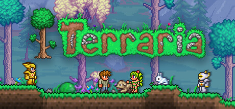

**Platforms:** Windows &nbsp;|&nbsp; **Genre:** Action, Adventure, Indie, RPG &nbsp;|&nbsp; **Released:** May 16

> Dig, fight, explore, build! Nothing is impossible in this action-packed adventure game. Four Pack also available!
>
> _Synopsis source: Steam_

[Wikipedia](https://en.wikipedia.org/wiki/Terraria) · [Steam](https://store.steampowered.com/app/105600)

---

### Terror of the Stratus

**Platforms:** PlayStation Portable &nbsp;|&nbsp; **Developer:** Nude Maker &nbsp;|&nbsp; **Publisher:** Konami &nbsp;|&nbsp; **Genre:** Action role-playing &nbsp;|&nbsp; **Released:** October 27, 2011

[Wikipedia](https://en.wikipedia.org/wiki/Terror_of_the_Stratus)

---

### Test Drive Unlimited 2

**Platforms:** Windows, Xbox 360, PlayStation 3 &nbsp;|&nbsp; **Released:** February 8

[Wikipedia](https://en.wikipedia.org/wiki/Test_Drive_Unlimited_2)

---

### Tetris: Axis

**Platforms:** Nintendo 3DS &nbsp;|&nbsp; **Released:** October 2

---

### The 3rd Birthday

**Platforms:** PlayStation Portable &nbsp;|&nbsp; **Released:** March 29

[Wikipedia](https://en.wikipedia.org/wiki/The_3rd_Birthday)

---

### The 7th Guest: Infection

**Platforms:** iOS &nbsp;|&nbsp; **Developer:** Trilobyte &nbsp;|&nbsp; **Publisher:** Trilobyte &nbsp;|&nbsp; **Genre:** Strategy &nbsp;|&nbsp; **Released:** April 27, 2011

[Wikipedia](https://en.wikipedia.org/wiki/The_7th_Guest:_Infection)

---

### The Adventures of Shuggy

**Platforms:** Xbox 360 &nbsp;|&nbsp; **Released:** June 25

[Wikipedia](https://en.wikipedia.org/wiki/The_Adventures_of_Shuggy)

---

### The Adventures of Tintin: The Game

**Platforms:** Windows, PlayStation 3, Xbox 360, Wii, Nintendo 3DS &nbsp;|&nbsp; **Released:** December 6

---

### The Adventures of Tintin: The Secret of the Unicorn

**Platforms:** Windows, Nintendo 3DS, PlayStation 3, Wii, Xbox 360, iOS, Android &nbsp;|&nbsp; **Developer:** Ubisoft Montpellier, Gameloft Barcelona &nbsp;|&nbsp; **Publisher:** Ubisoft, Gameloft &nbsp;|&nbsp; **Genre:** Action-adventure, platformer, stealth &nbsp;|&nbsp; **Released:** October 21, 2011

[Wikipedia](https://en.wikipedia.org/wiki/The_Adventures_of_Tintin:_The_Secret_of_the_Unicorn_(video_game))

---

### The Baconing

**Platforms:** PlayStation Network, Xbox 360 &nbsp;|&nbsp; **Released:** August 30

[Wikipedia](https://en.wikipedia.org/wiki/The_Baconing)

---

### The Binding of Isaac

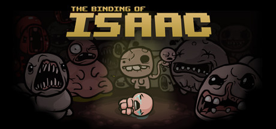

**Platforms:** Windows &nbsp;|&nbsp; **Genre:** Action, Adventure, Indie, RPG &nbsp;|&nbsp; **Released:** September 28

> Now 20% More Evil with the Free Halloween update!
>
> _Synopsis source: Steam_

[Wikipedia](https://en.wikipedia.org/wiki/The_Binding_of_Isaac_(video_game)) · [Steam](https://store.steampowered.com/app/113200)

---

### The Black Eyed Peas Experience

**Platforms:** Xbox 360 &nbsp;|&nbsp; **Released:** November 8

[Wikipedia](https://en.wikipedia.org/wiki/The_Black_Eyed_Peas_Experience)

---

### The Blackwell Deception

**Platforms:** Windows, iOS, Linux, macOS &nbsp;|&nbsp; **Developer:** Wadjet Eye Games &nbsp;|&nbsp; **Publisher:** Wadjet Eye Games &nbsp;|&nbsp; **Genre:** Adventure &nbsp;|&nbsp; **Released:** October 12, 2011

[Wikipedia](https://en.wikipedia.org/wiki/The_Blackwell_Deception)

---

### The Cat and the Coup

**Platforms:** Windows &nbsp;|&nbsp; **Developer:** Peter Brinson, Kurosh ValaNejad &nbsp;|&nbsp; **Genre:** Puzzle

[Wikipedia](https://en.wikipedia.org/wiki/The_Cat_and_the_Coup)

---

### The Cursed Crusade

**Platforms:** Windows, PlayStation 3, Xbox 360 &nbsp;|&nbsp; **Released:** October 25

[Wikipedia](https://en.wikipedia.org/wiki/The_Cursed_Crusade)

---

### The Dishwasher: Vampire Smile

**Platforms:** Xbox 360 &nbsp;|&nbsp; **Released:** April 6

---

### The Elder Scrolls V: Skyrim

**Platforms:** Xbox 360, Windows, PlayStation 3 &nbsp;|&nbsp; **Publisher:** Bethesda Softworks &nbsp;|&nbsp; **Released:** November 11, 2011

---

### The First Templar

**Platforms:** Windows, Xbox 360 &nbsp;|&nbsp; **Genre:** Action, Adventure &nbsp;|&nbsp; **Released:** May 10

> Uncover the mysteries behind the Templar Order! Steam Exclusive Edition includes bonus mission “The Arena”.
>
> _Synopsis source: Steam_

[Wikipedia](https://en.wikipedia.org/wiki/The_First_Templar) · [Steam](https://store.steampowered.com/app/57680)

---

### The Fruit of Grisaia

[Wikipedia](https://en.wikipedia.org/wiki/The_Fruit_of_Grisaia)

---

### The Great Jitters: Pudding Panic

**Platforms:** iOS, Android, Windows, macOS &nbsp;|&nbsp; **Developer:** kunst-stoff GmbH &nbsp;|&nbsp; **Publisher:** kunst-stoff GmbH &nbsp;|&nbsp; **Genre:** Action &nbsp;|&nbsp; **Released:** June 7, 2011

[Wikipedia](https://en.wikipedia.org/wiki/The_Great_Jitters:_Pudding_Panic)

---

### The Gunstringer

**Platforms:** Xbox 360 &nbsp;|&nbsp; **Released:** September 13

[Wikipedia](https://en.wikipedia.org/wiki/The_Gunstringer)

---

### The Ico & Shadow of the Colossus Collection

**Platforms:** PlayStation 3 &nbsp;|&nbsp; **Publisher:** Sony Computer Entertainment &nbsp;|&nbsp; **Released:** September 22, 2011

[Wikipedia](https://en.wikipedia.org/wiki/The_Ico_%26_Shadow_of_the_Colossus_Collection)

---

### The Idolmaster 2

**Platforms:** PlayStation 3, Xbox 360 &nbsp;|&nbsp; **Developer:** Namco Bandai Games &nbsp;|&nbsp; **Publisher:** Namco Bandai Games &nbsp;|&nbsp; **Genre:** Raising simulation, Rhythm &nbsp;|&nbsp; **Released:** February 24, 2011

[Wikipedia](https://en.wikipedia.org/wiki/The_Idolmaster_2)

---

### The Idolmaster Cinderella Girls

[Wikipedia](https://en.wikipedia.org/wiki/The_Idolmaster_Cinderella_Girls)

---

### The King of Fighters XIII

**Platforms:** PlayStation 3, Xbox 360 &nbsp;|&nbsp; **Released:** November 22

[Wikipedia](https://en.wikipedia.org/wiki/The_King_of_Fighters_XIII)

---

### The King of Fighters-i

**Platforms:** iOS &nbsp;|&nbsp; **Released:** July 7

[Wikipedia](https://en.wikipedia.org/wiki/The_King_of_Fighters_XIII)

---

### The Legend of Heroes: Trails in the Sky

**Platforms:** PlayStation Portable &nbsp;|&nbsp; **Released:** March 29

---

### The Legend of Heroes: Trails to Azure

**Platforms:** PlayStation Portable &nbsp;|&nbsp; **Developer:** Nihon Falcom &nbsp;|&nbsp; **Publisher:** NIS America, Nihon Falcom &nbsp;|&nbsp; **Genre:** Role-playing &nbsp;|&nbsp; **Released:** September 29, 2011

[Wikipedia](https://en.wikipedia.org/wiki/The_Legend_of_Heroes:_Trails_to_Azure)

---

### The Legend of Sword and Fairy 5

**Platforms:** Windows &nbsp;|&nbsp; **Developer:** Softstar Technology Co., Ltd &nbsp;|&nbsp; **Publisher:** Softstar Entertainment Inc. &nbsp;|&nbsp; **Genre:** Role-playing video game &nbsp;|&nbsp; **Released:** July 7, 2011

[Wikipedia](https://en.wikipedia.org/wiki/The_Legend_of_Sword_and_Fairy_5)

---

### The Legend of Zelda: Ocarina of Time 3D

**Platforms:** Nintendo 3DS &nbsp;|&nbsp; **Publisher:** Nintendo &nbsp;|&nbsp; **Released:** June 16, 2011

---

### The Legend of Zelda: Skyward Sword

**Platforms:** Wii &nbsp;|&nbsp; **Publisher:** Nintendo &nbsp;|&nbsp; **Released:** November 18, 2011

---

### The Lord of the Rings Online: Rise of Isengard

**Platforms:** Windows &nbsp;|&nbsp; **Developer:** Turbine, Inc. &nbsp;|&nbsp; **Publisher:** Turbine, Inc. &nbsp;|&nbsp; **Genre:** MMORPG &nbsp;|&nbsp; **Released:** September 27, 2011

[Wikipedia](https://en.wikipedia.org/wiki/The_Lord_of_the_Rings_Online:_Rise_of_Isengard)

---

### The Lord of the Rings: War in the North

**Platforms:** Windows, PlayStation 3, Xbox 360 &nbsp;|&nbsp; **Released:** November 1

---

### The Next Big Thing

**Platforms:** Windows, macOS &nbsp;|&nbsp; **Developer:** Pendulo Studios &nbsp;|&nbsp; **Publisher:** Focus Home Interactive, FX Interactive, Crimson Cow &nbsp;|&nbsp; **Genre:** Graphic adventure &nbsp;|&nbsp; **Released:** February 4, 2011

[Wikipedia](https://en.wikipedia.org/wiki/The_Next_Big_Thing_(video_game))

---

### The Oregon Trail

**Platforms:** Nintendo 3DS, Wii &nbsp;|&nbsp; **Released:** December 6

[Wikipedia](https://en.wikipedia.org/wiki/The_Oregon_Trail_(2011_video_game))

---

### The Oregon Trail: American Settler

**Platforms:** iOS &nbsp;|&nbsp; **Developer:** Gameloft &nbsp;|&nbsp; **Publisher:** Gameloft &nbsp;|&nbsp; **Genre:** City-building &nbsp;|&nbsp; **Released:** November 17, 2011

[Wikipedia](https://en.wikipedia.org/wiki/The_Oregon_Trail:_American_Settler)

---

### The Penguins of Madagascar: Dr. Blowhole Returns – Again!

**Platforms:** Nintendo DS, PlayStation 3, Wii, Xbox 360 &nbsp;|&nbsp; **Developer:** Griptonite Games &nbsp;|&nbsp; **Publisher:** THQ &nbsp;|&nbsp; **Genre:** Action &nbsp;|&nbsp; **Released:** September 6, 2011

[Wikipedia](https://en.wikipedia.org/wiki/The_Penguins_of_Madagascar:_Dr._Blowhole_Returns_%E2%80%93_Again!)

---

### The Settlers Online

**Developer:** CipSoft &nbsp;|&nbsp; **Publisher:** CipSoft &nbsp;|&nbsp; **Released:** September 19, 2011

[Wikipedia](https://en.wikipedia.org/wiki/The_Settlers_Online)

---

### The Sims 3

**Platforms:** Nintendo 3DS &nbsp;|&nbsp; **Released:** March 27

[Wikipedia](https://en.wikipedia.org/wiki/The_Sims_3)

---

### The Sims 3 Town Life Stuff

**Platforms:** macOS, Windows &nbsp;|&nbsp; **Released:** July 26

[Wikipedia](https://en.wikipedia.org/wiki/The_Sims_3_Stuff_packs#Town_Life_Stuff)

---

### The Sims 3: Generations

**Platforms:** Windows, macOS &nbsp;|&nbsp; **Released:** May 31

---

### The Sims 3: Outdoor Living Stuff

**Platforms:** macOS, Windows &nbsp;|&nbsp; **Genre:** Social sim &nbsp;|&nbsp; **Released:** February 1

[Wikipedia](https://en.wikipedia.org/wiki/The_Sims_3_Stuff_packs#Outdoor_Living_Stuff)

---

### The Sims 3: Pets

**Platforms:** macOS, Windows &nbsp;|&nbsp; **Released:** October 18

---

### The Sims FreePlay

**Platforms:** iOS &nbsp;|&nbsp; **Released:** December 15

[Wikipedia](https://en.wikipedia.org/wiki/The_Sims_FreePlay)

---

### The Sims Medieval

**Platforms:** Windows, macOS &nbsp;|&nbsp; **Released:** March 22

[Wikipedia](https://en.wikipedia.org/wiki/The_Sims_Medieval)

---

### The Sims Social

**Platforms:** Facebook &nbsp;|&nbsp; **Developer:** Playfish &nbsp;|&nbsp; **Publisher:** Electronic Arts &nbsp;|&nbsp; **Genre:** Dating sim, Social simulation &nbsp;|&nbsp; **Released:** August 9, 2011

[Wikipedia](https://en.wikipedia.org/wiki/The_Sims_Social)

---

### The Smurfs

**Platforms:** Nintendo DS &nbsp;|&nbsp; **Developer:** Ubisoft Osaka &nbsp;|&nbsp; **Publisher:** Ubisoft &nbsp;|&nbsp; **Genre:** Party &nbsp;|&nbsp; **Released:** July 19, 2011

[Wikipedia](https://en.wikipedia.org/wiki/The_Smurfs_(video_game))

---

### The Smurfs Dance Party

**Platforms:** Wii &nbsp;|&nbsp; **Released:** July 19

[Wikipedia](https://en.wikipedia.org/wiki/The_Smurfs_Dance_Party)

---

### The Snowfield

**Platforms:** Windows, macOS &nbsp;|&nbsp; **Developer:** Singapore-MIT Gambit Game Lab &nbsp;|&nbsp; **Publisher:** Singapore-MIT Gambit Game Lab &nbsp;|&nbsp; **Genre:** Action, Experimental narrative

[Wikipedia](https://en.wikipedia.org/wiki/The_Snowfield)

---

### The Stanley Parable

**Developer:** Galactic Cafe &nbsp;|&nbsp; **Publisher:** Galactic Cafe &nbsp;|&nbsp; **Genre:** Adventure

[Wikipedia](https://en.wikipedia.org/wiki/The_Stanley_Parable)

---

### The Tiny Bang Story

**Platforms:** Windows, macOS, Windows Phone &nbsp;|&nbsp; **Developer:** Colibri Games &nbsp;|&nbsp; **Publisher:** Colibri Games &nbsp;|&nbsp; **Genre:** Graphic adventure &nbsp;|&nbsp; **Released:** April 22, 2011

[Wikipedia](https://en.wikipedia.org/wiki/The_Tiny_Bang_Story)

---

### The Tomb Raider Trilogy

**Platforms:** PlayStation 3 &nbsp;|&nbsp; **Released:** March 22

[Wikipedia](https://en.wikipedia.org/wiki/List_of_Tomb_Raider_media#The_Tomb_Raider_Trilogy)

---

### The Witcher 2: Assassins of Kings

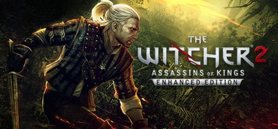

**Platforms:** Windows &nbsp;|&nbsp; **Genre:** RPG &nbsp;|&nbsp; **Released:** May 17

> A time of untold chaos has come. Mighty forces clash behind the scenes in a struggle for power and influence. The Northern Kingdoms mobilize for war. But armies on the march are not enough to stop a bloody conspiracy...
>
> _Synopsis source: Steam_

[Steam](https://store.steampowered.com/app/20920)

---

### Thor: God of Thunder

**Platforms:** Xbox 360, PlayStation 3, Wii, Nintendo DS, Nintendo 3DS &nbsp;|&nbsp; **Released:** May 3

---

### Thor: Son of Asgard

**Platforms:** iOS &nbsp;|&nbsp; **Developer:** Disney Mobile Games Studios &nbsp;|&nbsp; **Publisher:** Marvel Entertainment &nbsp;|&nbsp; **Genre:** Beat 'em up &nbsp;|&nbsp; **Released:** May 10, 2011

[Wikipedia](https://en.wikipedia.org/wiki/Thor:_Son_of_Asgard_(video_game))

---

### Tiger Woods PGA Tour 12

**Platforms:** PlayStation 3, Xbox 360, Wii &nbsp;|&nbsp; **Released:** March 29

[Wikipedia](https://en.wikipedia.org/wiki/Tiger_Woods_PGA_Tour_12)

---

### Time Viking!!!!!AndSpaceRaptor

**Platforms:** Windows Phone &nbsp;|&nbsp; **Developer:** Ska Studios &nbsp;|&nbsp; **Publisher:** Ska Studios &nbsp;|&nbsp; **Genre:** Shoot 'em up &nbsp;|&nbsp; **Released:** November 29, 2011

[Wikipedia](https://en.wikipedia.org/wiki/Time_Viking!!!!!AndSpaceRaptor)

---

### Tiny Heroes

**Platforms:** iOS &nbsp;|&nbsp; **Developer:** Simutronics &nbsp;|&nbsp; **Publisher:** Simutronics &nbsp;|&nbsp; **Genre:** Tower defense &nbsp;|&nbsp; **Released:** September 8, 2011

[Wikipedia](https://en.wikipedia.org/wiki/Tiny_Heroes)

---

### Tiny Tower

**Platforms:** iOS, Android &nbsp;|&nbsp; **Developer:** NimbleBit &nbsp;|&nbsp; **Publisher:** NimbleBit &nbsp;|&nbsp; **Genre:** Simulation, incremental &nbsp;|&nbsp; **Released:** June 23, 2011

[Wikipedia](https://en.wikipedia.org/wiki/Tiny_Tower)

---

### TNA Wrestling Impact!

**Platforms:** Android, iOS &nbsp;|&nbsp; **Released:** May 19

[Wikipedia](https://en.wikipedia.org/wiki/TNA_Wrestling_Impact!)

---

### TNT Racers

**Platforms:** Xbox 360, PlayStation Portable, Wii &nbsp;|&nbsp; **Released:** February 8

[Wikipedia](https://en.wikipedia.org/wiki/TNT_Racers)

---

### To Heart 2

[Wikipedia](https://en.wikipedia.org/wiki/To_Heart_2)

---

### To Heart 2: Dungeon Travelers

[Wikipedia](https://en.wikipedia.org/wiki/To_Heart_2:_Dungeon_Travelers)

---

### To the Moon

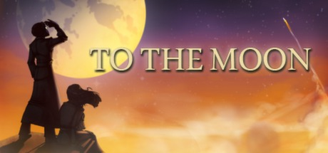

**Platforms:** Windows &nbsp;|&nbsp; **Genre:** Adventure, Indie, RPG &nbsp;|&nbsp; **Released:** November 1

> A story-driven experience about two doctors traversing backwards through a dying man's memories to artificially fulfill his last wish.
>
> _Synopsis source: Steam_

[Wikipedia](https://en.wikipedia.org/wiki/To_the_Moon_(video_game)) · [Steam](https://store.steampowered.com/app/206440)

---

### To-Fu: The Trials of Chi

**Platforms:** iOS &nbsp;|&nbsp; **Developer:** HotGen &nbsp;|&nbsp; **Publisher:** HotGen, Devolver Digital, Rising Star Games &nbsp;|&nbsp; **Genre:** Action, puzzle &nbsp;|&nbsp; **Released:** May 26, 2011

[Wikipedia](https://en.wikipedia.org/wiki/To-Fu:_The_Trials_of_Chi)

---

### Tom Clancy's Ghost Recon: Shadow Wars

**Platforms:** Nintendo 3DS &nbsp;|&nbsp; **Released:** March 27

---

### Tom Clancy's Rainbow Six: Shadow Vanguard

**Platforms:** iOS &nbsp;|&nbsp; **Released:** April 17

---

### Tom Clancy's Splinter Cell Classic Trilogy HD

**Platforms:** PlayStation 3 &nbsp;|&nbsp; **Released:** September 27

[Wikipedia](https://en.wikipedia.org/wiki/Tom_Clancy%27s_Splinter_Cell)

---

### Tom Clancy's Splinter Cell: Chaos Theory

**Platforms:** Nintendo 3DS &nbsp;|&nbsp; **Released:** April 10

---

### Top Eleven Football Manager

**Platforms:** iOS, Android, Browser, Facebook &nbsp;|&nbsp; **Developer:** Nordeus &nbsp;|&nbsp; **Publisher:** Nordeus &nbsp;|&nbsp; **Genre:** Simulation, RPG &nbsp;|&nbsp; **Released:** October 20, 2011

[Wikipedia](https://en.wikipedia.org/wiki/Top_Eleven_Football_Manager)

---

### Top Spin 4

**Platforms:** PlayStation 3, Xbox 360, Wii &nbsp;|&nbsp; **Released:** March 15

[Wikipedia](https://en.wikipedia.org/wiki/Top_Spin_4)

---

### Total War: Shogun 2

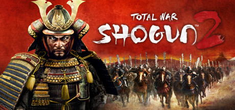

**Platforms:** Windows &nbsp;|&nbsp; **Publisher:** Sega &nbsp;|&nbsp; **Genre:** Strategy &nbsp;|&nbsp; **Released:** March 15, 2011

> Total War: SHOGUN 2 is the perfect mix of real-time and turn-based strategy gaming for newcomers and veterans alike.
>
> _Synopsis source: Steam_

[Steam](https://store.steampowered.com/app/201270)

---

### Tour de France

**Platforms:** PlayStation 3, Xbox 360 &nbsp;|&nbsp; **Developer:** Cyanide &nbsp;|&nbsp; **Publisher:** Focus Entertainment &nbsp;|&nbsp; **Genre:** Sports &nbsp;|&nbsp; **Released:** July 1, 2011

[Wikipedia](https://en.wikipedia.org/wiki/Tour_de_France_(2011_video_game))

---

### Toy Soldiers: Cold War

**Platforms:** Windows, Xbox 360 &nbsp;|&nbsp; **Released:** August 17

---

### TrackMania 2

**Platforms:** Windows &nbsp;|&nbsp; **Developer:** Ubisoft Nadeo &nbsp;|&nbsp; **Publisher:** Ubisoft &nbsp;|&nbsp; **Genre:** Racing &nbsp;|&nbsp; **Released:** September 14, 2011

[Wikipedia](https://en.wikipedia.org/wiki/TrackMania_2)

---

### TrackMania 2: Canyon

**Platforms:** Windows &nbsp;|&nbsp; **Released:** September 14

---

### Transformers: Dark of the Moon

**Platforms:** Xbox 360, PlayStation 3, Wii, Nintendo DS, Nintendo 3DS &nbsp;|&nbsp; **Released:** June 14

---

### Trash Tycoon

**Platforms:** Browser, Facebook &nbsp;|&nbsp; **Developer:** Guerillapps &nbsp;|&nbsp; **Genre:** Social network game &nbsp;|&nbsp; **Released:** September 6, 2011

[Wikipedia](https://en.wikipedia.org/wiki/Trash_Tycoon)

---

### Trauma

**Platforms:** Windows, macOS, Linux &nbsp;|&nbsp; **Developer:** Krystian Majewski &nbsp;|&nbsp; **Genre:** Graphical adventure &nbsp;|&nbsp; **Released:** August 8, 2011

[Wikipedia](https://en.wikipedia.org/wiki/Trauma_(video_game))

---

### Trenches 2

**Platforms:** iOS &nbsp;|&nbsp; **Developer:** Thunder Game Works &nbsp;|&nbsp; **Publisher:** EA Games &nbsp;|&nbsp; **Released:** December 15, 2011

[Wikipedia](https://en.wikipedia.org/wiki/Trenches_2)

---

### Trine 2

**Platforms:** Windows, macOS, PlayStation Network, Xbox 360 &nbsp;|&nbsp; **Released:** December 7

[Wikipedia](https://en.wikipedia.org/wiki/Trine_2)

---

### Trinity: Souls of Zill O'll

**Platforms:** PlayStation 3 &nbsp;|&nbsp; **Released:** February 8

---

### Tropico 4

**Platforms:** Windows, Xbox 360 &nbsp;|&nbsp; **Genre:** Simulation, Strategy &nbsp;|&nbsp; **Released:** August 30

> The world is changing and Tropico is moving with the times - geographical powers rise and fall and the world market is dominated by new players with new demands and offers - and you, as El Presidente, face a whole new set of challenges.
>
> _Synopsis source: Steam_

[Wikipedia](https://en.wikipedia.org/wiki/Tropico_4) · [Steam](https://store.steampowered.com/app/57690)

---

### Tsukumonogatari

**Platforms:** PlayStation Portable &nbsp;|&nbsp; **Developer:** Killaware &nbsp;|&nbsp; **Publisher:** FuRyu &nbsp;|&nbsp; **Genre:** Adventure RPG &nbsp;|&nbsp; **Released:** January 27, 2011

[Wikipedia](https://en.wikipedia.org/wiki/Tsukumonogatari)

---

### Tsuyokiss

[Wikipedia](https://en.wikipedia.org/wiki/Tsuyokiss)

---

### TwinKomplex

**Developer:** Martin Burckardt &nbsp;|&nbsp; **Publisher:** Ludic Philosophy &nbsp;|&nbsp; **Released:** November 15, 2011

[Wikipedia](https://en.wikipedia.org/wiki/TwinKomplex)

---

### Twister Mania

**Platforms:** Xbox 360 &nbsp;|&nbsp; **Released:** November 1

[Wikipedia](https://en.wikipedia.org/wiki/Twister_Mania)

---

### Two Worlds II

**Platforms:** Windows, Xbox 360, PlayStation 3 &nbsp;|&nbsp; **Genre:** Action RPG &nbsp;|&nbsp; **Released:** January 25

> Check out the new Velvet Edition bundle including both Two Worlds II and Pirates of the Flying Fortress DLC.
>
> _Synopsis source: Steam_

[Wikipedia](https://en.wikipedia.org/wiki/Two_Worlds_II) · [Steam](https://store.steampowered.com/app/7520)

---

### UFC Personal Trainer

**Platforms:** PlayStation 3, Xbox 360, Wii &nbsp;|&nbsp; **Developer:** Heavy Iron Studios &nbsp;|&nbsp; **Publisher:** THQ &nbsp;|&nbsp; **Genre:** Sports, fighting &nbsp;|&nbsp; **Released:** June 28, 2011

[Wikipedia](https://en.wikipedia.org/wiki/UFC_Personal_Trainer)

---

### Ugly Americans: Apocalypsegeddon

**Platforms:** PlayStation Network, Xbox 360 &nbsp;|&nbsp; **Released:** August 30

---

### Ultimate Marvel vs. Capcom 3

**Platforms:** PlayStation 3, Xbox 360 &nbsp;|&nbsp; **Released:** November 15

[Wikipedia](https://en.wikipedia.org/wiki/Ultimate_Marvel_vs._Capcom_3)

---

### Uncharted 3: Drake's Deception

**Platforms:** PlayStation 3 &nbsp;|&nbsp; **Publisher:** Sony Computer Entertainment &nbsp;|&nbsp; **Released:** November 1, 2011

---

### Under Siege

**Platforms:** PlayStation 3 &nbsp;|&nbsp; **Released:** June 2

[Wikipedia](https://en.wikipedia.org/wiki/Under_Siege_(2011_video_game))

---

### Unepic

**Platforms:** Windows &nbsp;|&nbsp; **Genre:** Action, Indie, RPG &nbsp;|&nbsp; **Released:** September 30

> Daniel was just an average guy. He was a great videogame player, a big fan of sci-fi movies, and a novice RPG player. In the midst of an RPG, he was teleported to a castle. At first, Daniel believed that he was having a massive hallucination.
>
> _Synopsis source: Steam_

[Wikipedia](https://en.wikipedia.org/wiki/Unepic) · [Steam](https://store.steampowered.com/app/233980)

---

### Unity of Command

**Platforms:** Windows, macOS, Linux &nbsp;|&nbsp; **Developer:** 2x2 Games &nbsp;|&nbsp; **Publisher:** Dvaput, 2x2 Games &nbsp;|&nbsp; **Genre:** Turn-based strategy &nbsp;|&nbsp; **Released:** November 15, 2011

[Wikipedia](https://en.wikipedia.org/wiki/Unity_of_Command_(video_game))

---

### Unpleasant Horse

**Platforms:** iOS &nbsp;|&nbsp; **Developer:** 4th and Battery &nbsp;|&nbsp; **Publisher:** PopCap Games &nbsp;|&nbsp; **Genre:** Platform &nbsp;|&nbsp; **Released:** April 28, 2011

[Wikipedia](https://en.wikipedia.org/wiki/Unpleasant_Horse)

---

### Urbanix

**Platforms:** Wii &nbsp;|&nbsp; **Genre:** Puzzle &nbsp;|&nbsp; **Released:** January 17

---

### Valkyria Chronicles III

**Platforms:** PlayStation Portable &nbsp;|&nbsp; **Developer:** Media.Vision &nbsp;|&nbsp; **Publisher:** Sega &nbsp;|&nbsp; **Genre:** Tactical role-playing &nbsp;|&nbsp; **Released:** January 27, 2011

[Wikipedia](https://en.wikipedia.org/wiki/Valkyria_Chronicles_III)

---

### Venetica

**Platforms:** Windows, Xbox 360, PlayStation 3 &nbsp;|&nbsp; **Genre:** Action RPG &nbsp;|&nbsp; **Released:** January 18

[Wikipedia](https://en.wikipedia.org/wiki/Venetica)

---

### Villagers & Heroes

**Platforms:** iOS, Android, Windows &nbsp;|&nbsp; **Developer:** Mad Otter Games &nbsp;|&nbsp; **Publisher:** Mad Otter Games &nbsp;|&nbsp; **Genre:** Massively multiplayer online role-playing game &nbsp;|&nbsp; **Released:** October 27, 2011

[Wikipedia](https://en.wikipedia.org/wiki/Villagers_&_Heroes)

---

### Virtua Tennis 4

**Platforms:** Xbox 360, PlayStation 3, Wii &nbsp;|&nbsp; **Released:** May 10

[Wikipedia](https://en.wikipedia.org/wiki/Virtua_Tennis_4)

---

### Voltron: Defender of the Universe

**Platforms:** PlayStation 3, Xbox 360 &nbsp;|&nbsp; **Developer:** Behaviour Interactive &nbsp;|&nbsp; **Publisher:** THQ &nbsp;|&nbsp; **Genre:** Adventure, multidirectional shooter &nbsp;|&nbsp; **Released:** November 29, 2011

[Wikipedia](https://en.wikipedia.org/wiki/Voltron:_Defender_of_the_Universe_(video_game))

---

### VVVVVV

**Platforms:** Nintendo 3DS &nbsp;|&nbsp; **Released:** December 29

[Wikipedia](https://en.wikipedia.org/wiki/VVVVVV)

---

### Walkure Romanze

[Wikipedia](https://en.wikipedia.org/wiki/Walkure_Romanze)

---

### Wanted Corp

**Platforms:** PlayStation Network &nbsp;|&nbsp; **Released:** December 6

---

### Wappy Dog

**Platforms:** Nintendo DS, Nintendo 3DS &nbsp;|&nbsp; **Developer:** MTO &nbsp;|&nbsp; **Publisher:** Sega Toys, Activision &nbsp;|&nbsp; **Genre:** Pet simulation &nbsp;|&nbsp; **Released:** November 8, 2011

[Wikipedia](https://en.wikipedia.org/wiki/Wappy_Dog)

---

### War Pinball

**Platforms:** Android, iOS &nbsp;|&nbsp; **Developer:** OOO Gameprom &nbsp;|&nbsp; **Publisher:** OOO Gameprom &nbsp;|&nbsp; **Genre:** Pinball &nbsp;|&nbsp; **Released:** March 20, 2011

[Wikipedia](https://en.wikipedia.org/wiki/War_Pinball)

---

### Warco

**Developer:** Defiant Development

[Wikipedia](https://en.wikipedia.org/wiki/Warco)

---

### Warhammer 40,000: Dawn of War II – Retribution

**Platforms:** Windows &nbsp;|&nbsp; **Released:** March 1

---

### Warhammer 40,000: Kill Team

**Platforms:** PlayStation 3, Xbox 360 &nbsp;|&nbsp; **Developer:** THQ Digital Studios UK &nbsp;|&nbsp; **Publisher:** THQ &nbsp;|&nbsp; **Genre:** Shooter &nbsp;|&nbsp; **Released:** July 13, 2011

[Wikipedia](https://en.wikipedia.org/wiki/Warhammer_40,000:_Kill_Team)

---

### Warhammer 40,000: Space Marine

**Platforms:** Windows, Xbox 360, PlayStation 3 &nbsp;|&nbsp; **Genre:** Action &nbsp;|&nbsp; **Released:** September 6

> In Warhammer 40,000 Space Marine you are Captain Titus, a Space Marine of the Ultramarines chapter and a seasoned veteran of countless battles.
>
> _Synopsis source: Steam_

[Steam](https://store.steampowered.com/app/55150)

---

### Wario Land 4

**Platforms:** Nintendo 3DS &nbsp;|&nbsp; **Released:** December 16

[Wikipedia](https://en.wikipedia.org/wiki/Wario_Land_4)

---

### Warriors: Legends of Troy

**Platforms:** Xbox 360, PlayStation 3 &nbsp;|&nbsp; **Released:** March 15

---

### Wasteland Angel

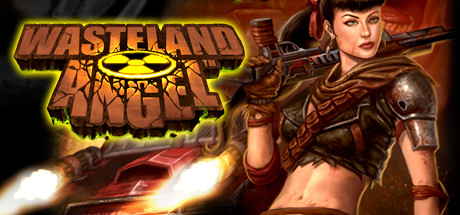

**Platforms:** Windows &nbsp;|&nbsp; **Genre:** Action, Indie &nbsp;|&nbsp; **Released:** September 1

> Wasteland Angel is a top-down twin-stick shoot ‘em up arena shooter. Fend off waves and waves of enemies and epic bosses as you try and survive in a post-apocalyptic America. Drive and shoot your way through the wasteland, protecting civilians, completing missions, and surviving another day.
>
> _Synopsis source: Steam_

[Wikipedia](https://en.wikipedia.org/wiki/Wasteland_Angel) · [Steam](https://store.steampowered.com/app/46520)

---

### We Dare

**Platforms:** PlayStation 3, Wii &nbsp;|&nbsp; **Developer:** Ubisoft Milan &nbsp;|&nbsp; **Publisher:** Ubisoft &nbsp;|&nbsp; **Genre:** Party &nbsp;|&nbsp; **Released:** March 14, 2011

[Wikipedia](https://en.wikipedia.org/wiki/We_Dare)

---

### We Sing Deutsche Hits

**Platforms:** Wii &nbsp;|&nbsp; **Developer:** Le Cortex &nbsp;|&nbsp; **Publisher:** Nordic Games &nbsp;|&nbsp; **Genre:** Music Video game &nbsp;|&nbsp; **Released:** May 26, 2011

[Wikipedia](https://en.wikipedia.org/wiki/We_Sing_Deutsche_Hits)

---

### We Sing Down Under

**Platforms:** Wii &nbsp;|&nbsp; **Developer:** Le Cortex &nbsp;|&nbsp; **Publisher:** Nordic Games &nbsp;|&nbsp; **Genre:** Music Video game &nbsp;|&nbsp; **Released:** March 31, 2011

[Wikipedia](https://en.wikipedia.org/wiki/We_Sing_Down_Under)

---

### We Sing Rock!

**Platforms:** Wii &nbsp;|&nbsp; **Developer:** Le Cortex &nbsp;|&nbsp; **Publisher:** Nordic Games Publishing &nbsp;|&nbsp; **Genre:** Music Video game &nbsp;|&nbsp; **Released:** November 11, 2011

[Wikipedia](https://en.wikipedia.org/wiki/We_Sing_Rock!)

---

### We Sing UK Hits

**Platforms:** Wii &nbsp;|&nbsp; **Developer:** Le Cortex &nbsp;|&nbsp; **Publisher:** Nordic Games Publishing &nbsp;|&nbsp; **Genre:** Music Video game &nbsp;|&nbsp; **Released:** September 30, 2011

[Wikipedia](https://en.wikipedia.org/wiki/We_Sing_UK_Hits)

---

### Whale Trail

**Platforms:** iOS, Android &nbsp;|&nbsp; **Developer:** Ustwo &nbsp;|&nbsp; **Publisher:** Ustwo &nbsp;|&nbsp; **Genre:** Endless runner &nbsp;|&nbsp; **Released:** October 20, 2011

[Wikipedia](https://en.wikipedia.org/wiki/Whale_Trail)

---

### Where in the World Is Carmen Sandiego?

**Platforms:** Facebook &nbsp;|&nbsp; **Developer:** Blue Fang Games &nbsp;|&nbsp; **Publisher:** The Learning Company &nbsp;|&nbsp; **Genre:** Educational game/Puzzle game/Adventure game &nbsp;|&nbsp; **Released:** February 9, 2011

[Wikipedia](https://en.wikipedia.org/wiki/Where_in_the_World_Is_Carmen_Sandiego%3F_(2011_video_game))

---

### Where Is My Heart?

**Platforms:** PlayStation 3, PlayStation Portable, Linux &nbsp;|&nbsp; **Developer:** Schulenburg Software, Die Gute Fabrik &nbsp;|&nbsp; **Publisher:** Die Gute Fabrik &nbsp;|&nbsp; **Genre:** Platform, puzzle &nbsp;|&nbsp; **Released:** November 8, 2011

[Wikipedia](https://en.wikipedia.org/wiki/Where_Is_My_Heart%3F)

---

### Where's My Water?

**Platforms:** iOS, Android, Windows Phone, Windows, macOS, BlackBerry OS, Fire OS, Browser &nbsp;|&nbsp; **Developer:** Creature Feep &nbsp;|&nbsp; **Publisher:** Disney Mobile &nbsp;|&nbsp; **Genre:** Puzzle &nbsp;|&nbsp; **Released:** September 22, 2011

[Wikipedia](https://en.wikipedia.org/wiki/Where's_My_Water%3F)

---

### White Knight Chronicles II

**Platforms:** PlayStation 3 &nbsp;|&nbsp; **Released:** September 13

[Wikipedia](https://en.wikipedia.org/wiki/White_Knight_Chronicles_II)

---

### White Knight Chronicles: Origins

**Platforms:** PlayStation Portable &nbsp;|&nbsp; **Developer:** Matrix Software, Japan Studio &nbsp;|&nbsp; **Publisher:** Sony Computer Entertainment &nbsp;|&nbsp; **Genre:** Role-playing &nbsp;|&nbsp; **Released:** February 3, 2011

[Wikipedia](https://en.wikipedia.org/wiki/White_Knight_Chronicles:_Origins)

---

### Wicked Monsters Blast!

**Platforms:** Wii &nbsp;|&nbsp; **Released:** July 7

[Wikipedia](https://en.wikipedia.org/wiki/Wicked_Monsters_Blast!)

---

### Wii Play: Motion

**Platforms:** Wii &nbsp;|&nbsp; **Released:** June 13

---

### Wild West Guns

**Platforms:** Mobile phone, Wii, iOS &nbsp;|&nbsp; **Developer:** Gameloft Bucharest &nbsp;|&nbsp; **Publisher:** Gameloft &nbsp;|&nbsp; **Genre:** Action-adventure, Shooting

[Wikipedia](https://en.wikipedia.org/wiki/Wild_West_Guns)

---

### Wildlife Park 3

**Platforms:** Windows &nbsp;|&nbsp; **Developer:** Deep Silver &nbsp;|&nbsp; **Publisher:** B-Alive &nbsp;|&nbsp; **Genre:** Business simulation &nbsp;|&nbsp; **Released:** March 25, 2011

[Wikipedia](https://en.wikipedia.org/wiki/Wildlife_Park_3)

---

### Wind and Water: Puzzle Battles

**Platforms:** Windows &nbsp;|&nbsp; **Genre:** Puzzle &nbsp;|&nbsp; **Released:** January 3

---

### Wind-up Knight

**Platforms:** iOS, Android &nbsp;|&nbsp; **Developer:** Robot Invader &nbsp;|&nbsp; **Publisher:** Robot Invader &nbsp;|&nbsp; **Released:** December 10, 2011

[Wikipedia](https://en.wikipedia.org/wiki/Wind-up_Knight)

---

### Wipeout in the Zone

**Platforms:** Xbox 360 &nbsp;|&nbsp; **Released:** June 14

[Wikipedia](https://en.wikipedia.org/wiki/Wipeout_in_the_Zone)

---

### Wizorb

**Platforms:** Xbox 360 &nbsp;|&nbsp; **Released:** September 29

[Wikipedia](https://en.wikipedia.org/wiki/Wizorb)

---

### Wolfenstein 1-D

**Platforms:** Browser &nbsp;|&nbsp; **Genre:** Shooter &nbsp;|&nbsp; **Released:** January 24, 2011

[Wikipedia](https://en.wikipedia.org/wiki/Wolfenstein_1-D)

---

### Wonderputt

**Platforms:** Browser &nbsp;|&nbsp; **Released:** August 15

[Wikipedia](https://en.wikipedia.org/wiki/Wonderputt)

---

### Wooords

**Platforms:** Android, iOS &nbsp;|&nbsp; **Released:** July 21

[Wikipedia](https://en.wikipedia.org/wiki/Wooords)

---

### Word Worm

**Platforms:** Android, iOS, Windows &nbsp;|&nbsp; **Developer:** Hawk Industries, LLC. &nbsp;|&nbsp; **Publisher:** Hawk Industries, LLC. &nbsp;|&nbsp; **Genre:** Puzzle &nbsp;|&nbsp; **Released:** February 18, 2011

[Wikipedia](https://en.wikipedia.org/wiki/Word_Worm)

---

### World of Tanks

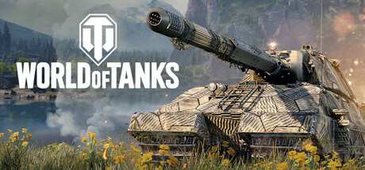

**Platforms:** Windows &nbsp;|&nbsp; **Genre:** Action, Massively Multiplayer, Simulation, Free To Play &nbsp;|&nbsp; **Released:** April 12

> World of Tanks is a tactical action game with very different gameplay depending on the vehicle type and role. Aside from regular PvP, there are competitive and clan-based modes, special PvE and PvPvE events, and much more. Whether you play to dominate or just enjoy the ride, you'll fit right in.
>
> _Synopsis source: Steam_

[Wikipedia](https://en.wikipedia.org/wiki/World_of_Tanks) · [Steam](https://store.steampowered.com/app/1407200)

---

### World's Biggest Pac-Man

**Platforms:** Browser &nbsp;|&nbsp; **Developer:** Soap Creative &nbsp;|&nbsp; **Genre:** Maze &nbsp;|&nbsp; **Released:** April 13, 2011

[Wikipedia](https://en.wikipedia.org/wiki/World's_Biggest_Pac-Man)

---

### Worms Crazy Golf

**Platforms:** iOS, Windows, PlayStation 3, macOS &nbsp;|&nbsp; **Developer:** Team17 &nbsp;|&nbsp; **Publisher:** Team17 &nbsp;|&nbsp; **Genre:** Sports &nbsp;|&nbsp; **Released:** October 19, 2011

[Wikipedia](https://en.wikipedia.org/wiki/Worms_Crazy_Golf)

---

### Worms Ultimate Mayhem

**Platforms:** Windows, Xbox 360 &nbsp;|&nbsp; **Genre:** Strategy &nbsp;|&nbsp; **Released:** September 28

> Load your weapons and experience a whole new dimension in destructive turn-based cartoon action!
>
> _Synopsis source: Steam_

[Wikipedia](https://en.wikipedia.org/wiki/Worms_Ultimate_Mayhem) · [Steam](https://store.steampowered.com/app/70600)

---

### WRC 2: FIA World Rally Championship

**Platforms:** Windows, PlayStation 3, Xbox 360 &nbsp;|&nbsp; **Developer:** Milestone srl &nbsp;|&nbsp; **Publisher:** Black Bean Games, Plug In Digital, Cyberfront &nbsp;|&nbsp; **Genre:** Racing &nbsp;|&nbsp; **Released:** October 14, 2011

[Wikipedia](https://en.wikipedia.org/wiki/WRC_2:_FIA_World_Rally_Championship)

---

### WSC Real 11: World Snooker Championship

**Platforms:** PlayStation 3, Xbox 360 &nbsp;|&nbsp; **Developer:** Dark Energy Digital &nbsp;|&nbsp; **Publisher:** Koch Media &nbsp;|&nbsp; **Genre:** Sports &nbsp;|&nbsp; **Released:** April 15, 2011

[Wikipedia](https://en.wikipedia.org/wiki/WSC_Real_11:_World_Snooker_Championship)

---

### WWE 12

**Platforms:** PlayStation 3, Wii, Xbox 360 &nbsp;|&nbsp; **Released:** November 22

[Wikipedia](https://en.wikipedia.org/wiki/WWE_12)

---

### WWE All Stars

**Platforms:** PlayStation 2, PlayStation 3, PlayStation Portable, Xbox 360, Wii, Nintendo 3DS &nbsp;|&nbsp; **Released:** March 29

[Wikipedia](https://en.wikipedia.org/wiki/WWE_All_Stars)

---

### X-Men: Destiny

**Platforms:** PlayStation 3, Wii, Xbox 360, Nintendo DS &nbsp;|&nbsp; **Released:** September 27

---

### X3: Albion Prelude

**Platforms:** Windows, macOS, Linux &nbsp;|&nbsp; **Developer:** Egosoft &nbsp;|&nbsp; **Publisher:** Deep Silver &nbsp;|&nbsp; **Genre:** Space trading and combat simulator &nbsp;|&nbsp; **Released:** December 15, 2011

[Wikipedia](https://en.wikipedia.org/wiki/X3:_Albion_Prelude)

---

### Xonotic

**Platforms:** Linux, macOS, Windows &nbsp;|&nbsp; **Developer:** Team Xonotic &nbsp;|&nbsp; **Publisher:** Team Xonotic &nbsp;|&nbsp; **Genre:** First-person shooter &nbsp;|&nbsp; **Released:** September 8, 2011

[Wikipedia](https://en.wikipedia.org/wiki/Xonotic)

---

### Xotic

**Platforms:** Windows, Xbox 360 &nbsp;|&nbsp; **Developer:** WXP Games &nbsp;|&nbsp; **Publisher:** WXP Games, Valcon Games &nbsp;|&nbsp; **Genre:** First-person shooter &nbsp;|&nbsp; **Released:** September 16, 2011

[Wikipedia](https://en.wikipedia.org/wiki/Xotic)

---

### Xsyon

**Platforms:** Windows &nbsp;|&nbsp; **Developer:** Notorious Games &nbsp;|&nbsp; **Publisher:** Notorious Games &nbsp;|&nbsp; **Genre:** MMORPG &nbsp;|&nbsp; **Released:** March 15, 2011

[Wikipedia](https://en.wikipedia.org/wiki/Xsyon)

---

### Yakuza 4

**Platforms:** PlayStation 3 &nbsp;|&nbsp; **Released:** March 15

[Wikipedia](https://en.wikipedia.org/wiki/Yakuza_4)

---

### Yar's Revenge

**Platforms:** Xbox 360, Windows &nbsp;|&nbsp; **Developer:** Killspace Entertainment &nbsp;|&nbsp; **Publisher:** Atari &nbsp;|&nbsp; **Genre:** Rail shooter &nbsp;|&nbsp; **Released:** April 13, 2011

[Wikipedia](https://en.wikipedia.org/wiki/Yar's_Revenge)

---

### Yoostar

**Platforms:** PlayStation 3, Xbox 360, Windows, macOS &nbsp;|&nbsp; **Developer:** Blitz Games Studios &nbsp;|&nbsp; **Publisher:** Yoostar Entertainment Group &nbsp;|&nbsp; **Genre:** Casual

[Wikipedia](https://en.wikipedia.org/wiki/Yoostar)

---

### You Don't Know Jack

**Platforms:** Windows, Nintendo DS, PlayStation 3, Wii, Xbox 360 &nbsp;|&nbsp; **Released:** February 8

[Wikipedia](https://en.wikipedia.org/wiki/You_Don%27t_Know_Jack_(2011_video_game))

---

### Your Diary

[Wikipedia](https://en.wikipedia.org/wiki/Your_Diary_(video_game))

---

### Your Shape: Fitness Evolved 2012

**Platforms:** Xbox 360 &nbsp;|&nbsp; **Developer:** Ubisoft Montreal &nbsp;|&nbsp; **Publisher:** Ubisoft &nbsp;|&nbsp; **Genre:** Exergaming, aerobics &nbsp;|&nbsp; **Released:** November 8, 2011

[Wikipedia](https://en.wikipedia.org/wiki/Your_Shape:_Fitness_Evolved_2012)

---

### Ys I & II Chronicles

**Platforms:** PlayStation Portable &nbsp;|&nbsp; **Released:** February 12

[Wikipedia](https://en.wikipedia.org/wiki/Ys_I_%26_II_Chronicles)

---

### Yu-Gi-Oh! 5D's World Championship 2011: Over the Nexus

**Platforms:** Nintendo DS &nbsp;|&nbsp; **Released:** May 10

---

### Z-Type

**Platforms:** Browser &nbsp;|&nbsp; **Genre:** Shoot 'em up &nbsp;|&nbsp; **Released:** January 10

[Wikipedia](https://en.wikipedia.org/wiki/Z-Type)

---

### Zeit²

**Platforms:** Windows, Xbox 360 &nbsp;|&nbsp; **Genre:** Shoot 'em up &nbsp;|&nbsp; **Released:** January 12

> Zeit² brings a new twist to the traditional side-scrolling, 2D, shoot-’em-up game sporting a unique time travel feature never seen before in this genre.
>
> _Synopsis source: Steam_

[Wikipedia](https://en.wikipedia.org/wiki/Zeit%C2%B2) · [Steam](https://store.steampowered.com/app/33390)

---

### Zenonia 3

**Platforms:** iOS &nbsp;|&nbsp; **Released:** April 28

[Wikipedia](https://en.wikipedia.org/wiki/Zenonia_3)

---

### Zenonia 4

**Platforms:** iOS &nbsp;|&nbsp; **Developer:** Gamevil &nbsp;|&nbsp; **Publisher:** Gamevil &nbsp;|&nbsp; **Genre:** Action RPG &nbsp;|&nbsp; **Released:** December 22, 2011

[Wikipedia](https://en.wikipedia.org/wiki/Zenonia_4)

---

### Zombie Apocalypse: Never Die Alone

**Platforms:** PlayStation 3, Xbox 360, PlayStation Network &nbsp;|&nbsp; **Developer:** Backbone Entertainment &nbsp;|&nbsp; **Publisher:** Konami &nbsp;|&nbsp; **Genre:** Action &nbsp;|&nbsp; **Released:** October 25, 2011

[Wikipedia](https://en.wikipedia.org/wiki/Zombie_Apocalypse:_Never_Die_Alone)

---

### Zombie Cafe

**Platforms:** iOS &nbsp;|&nbsp; **Developer:** Beeline Interactive, Inc. &nbsp;|&nbsp; **Publisher:** Capcom &nbsp;|&nbsp; **Genre:** Simulator &nbsp;|&nbsp; **Released:** January 26, 2011

[Wikipedia](https://en.wikipedia.org/wiki/Zombie_Cafe)

---

### Zombie Gunship

**Platforms:** iOS, Android &nbsp;|&nbsp; **Developer:** Limbic Software, Hidden Elephant &nbsp;|&nbsp; **Publisher:** Limbic Software &nbsp;|&nbsp; **Genre:** Arcade, Action, FPS &nbsp;|&nbsp; **Released:** July 21, 2011

[Wikipedia](https://en.wikipedia.org/wiki/Zombie_Gunship)

---

### Zombie Lane

**Platforms:** Facebook, Android, iOS &nbsp;|&nbsp; **Developer:** Digital Chocolate &nbsp;|&nbsp; **Publisher:** RockYou &nbsp;|&nbsp; **Genre:** Simulation, RPG

[Wikipedia](https://en.wikipedia.org/wiki/Zombie_Lane)

---

### Zombie Parkour Runner

**Platforms:** iOS &nbsp;|&nbsp; **Developer:** Up Up Down Down &nbsp;|&nbsp; **Publisher:** Break Media &nbsp;|&nbsp; **Genre:** Platformer

[Wikipedia](https://en.wikipedia.org/wiki/Zombie_Parkour_Runner)

---

### Zombies

**Platforms:** Windows Phone, iOS, Android &nbsp;|&nbsp; **Developer:** Babaroga &nbsp;|&nbsp; **Publisher:** Twilight Creations Inc. &nbsp;|&nbsp; **Genre:** Turn-based strategy &nbsp;|&nbsp; **Released:** January 12, 2011

[Wikipedia](https://en.wikipedia.org/wiki/Zombies_(video_game))

---

### Zoo Keeper

**Platforms:** iOS &nbsp;|&nbsp; **Released:** June 10

[Wikipedia](https://en.wikipedia.org/wiki/Zoo_Keeper_(2003_video_game))

---

### Zoobles! Spring to Life!

**Platforms:** Nintendo DS &nbsp;|&nbsp; **Developer:** Now Production &nbsp;|&nbsp; **Publisher:** Activision &nbsp;|&nbsp; **Genre:** Simulation, Role-playing game, Puzzle &nbsp;|&nbsp; **Released:** November 1, 2011

[Wikipedia](https://en.wikipedia.org/wiki/Zoobles!_Spring_to_Life!)

---

### Zoonies - Escape from Makatu

**Platforms:** Nintendo DS &nbsp;|&nbsp; **Developer:** Kiloo &nbsp;|&nbsp; **Publisher:** Kiloo &nbsp;|&nbsp; **Genre:** Platform game &nbsp;|&nbsp; **Released:** April 29, 2011

[Wikipedia](https://en.wikipedia.org/wiki/Zoonies_-_Escape_from_Makatu)

---

### Zumba Fitness 2

**Platforms:** Wii &nbsp;|&nbsp; **Developer:** Zoë Mode &nbsp;|&nbsp; **Publisher:** Majesco &nbsp;|&nbsp; **Genre:** Fitness game &nbsp;|&nbsp; **Released:** November 15, 2011

[Wikipedia](https://en.wikipedia.org/wiki/Zumba_Fitness_2)

---

### Ōkamiden

**Platforms:** Nintendo DS &nbsp;|&nbsp; **Released:** March 15

[Wikipedia](https://en.wikipedia.org/wiki/%C5%8Ckamiden)

---
