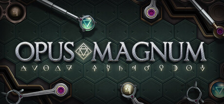
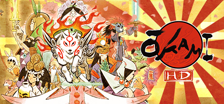

# 2017 in Video Games — October–December

[← All of 2017](../2017.md) · [Back to index](../../README.md)

191 titles.

### .hack//G.U. Last Recode

**Platforms:** Windows, PlayStation 4 &nbsp;|&nbsp; **Genre:** Action RPG &nbsp;|&nbsp; **Released:** November 3

[Wikipedia](https://en.wikipedia.org/wiki/.hack//G.U._Last_Recode)

---

### 88 Heroes: 98 Heroes Edition

**Platforms:** Nintendo Switch &nbsp;|&nbsp; **Released:** October 10

---

### A Hat in Time

**Platforms:** Windows, macOS, PlayStation 4, Xbox One &nbsp;|&nbsp; **Genre:** Platformer, Action-adventure &nbsp;|&nbsp; **Released:** October 5

> A Hat in Time is a cute-as-heck 3D platformer featuring a little girl who stitches hats for wicked powers! Freely explore giant worlds and recover Time Pieces to travel to new heights!
>
> _Synopsis source: IGDB_

[Wikipedia](https://en.wikipedia.org/wiki/A_Hat_in_Time) · [IGDB](https://www.igdb.com/games/a-hat-in-time)

---

### A Mortician's Tale

**Platforms:** Windows, macOS &nbsp;|&nbsp; **Released:** October 18

[Wikipedia](https://en.wikipedia.org/wiki/A_Mortician%27s_Tale)

---

### Ace of Seafood

**Platforms:** PlayStation 4 &nbsp;|&nbsp; **Released:** November 9

---

### Aer: Memories of Old

**Platforms:** Windows, PlayStation 4, Xbox One &nbsp;|&nbsp; **Developer:** Forgotten Key &nbsp;|&nbsp; **Publisher:** Daedalic Entertainment &nbsp;|&nbsp; **Genre:** Action-adventure &nbsp;|&nbsp; **Released:** October 25, 2017

> Transform into a bird and fly to explore and experience a vibrant world of floating islands in the sky. Venture down into lost ancient ruins where each step leads you closer to the end of the world.  AER puts you in the shoes of Auk, a magical shape-shifting girl who can transform between human and bird.
>
> _Synopsis source: IGDB_

[Wikipedia](https://en.wikipedia.org/wiki/Aer:_Memories_of_Old) · [IGDB](https://www.igdb.com/games/aer-memories-of-old)

---

### Animal Crossing: Pocket Camp

**Platforms:** iOS, Android &nbsp;|&nbsp; **Genre:** Social sim &nbsp;|&nbsp; **Released:** November 21

> In Animal Crossing: Pocket Camp, it's up to you to build a fun campsite for you and your friends to enjoy. Tents, hammocks, fireplaces, a stuffed-animal sofa... mix and match to your heart's content! Make a trendy open-air café, or line up some microphones and guitars to create an outdoor music festival. In the mood for a little extra fun? Set up a merry-go-round and open a theme park. You can even make a pool, or fill the sky with fireworks!
>
> _Synopsis source: IGDB_

[IGDB](https://www.igdb.com/games/animal-crossing-pocket-camp)

---

### Arcana Heart 3: Love Max Six Stars

**Platforms:** Windows &nbsp;|&nbsp; **Released:** December 12

---

### Arktika.1

**Platforms:** Meta Quest &nbsp;|&nbsp; **Released:** October 10

[Wikipedia](https://en.wikipedia.org/wiki/Arktika.1)

---

### Arms Race - TCWE

**Platforms:** Windows &nbsp;|&nbsp; **Genre:** Simulation &nbsp;|&nbsp; **Released:** October 5

---

### Ashes Cricket

**Platforms:** PlayStation 4, Xbox One, Windows &nbsp;|&nbsp; **Developer:** Big Ant Studios &nbsp;|&nbsp; **Publisher:** Big Ant Studios &nbsp;|&nbsp; **Genre:** Sports &nbsp;|&nbsp; **Released:** November 2017

> Ashes Cricket is the officially licensed video game of cricket’s greatest rivalry. Bringing all the fast paced action, big hits and skill that you see in the greatest cricket competition on earth, in both a more realistic and authentic way than ever before, you’ll be able to bathe your team in glory in the men’s and women’s 2017/2018 Ashes tours.
>
> _Synopsis source: IGDB_

[Wikipedia](https://en.wikipedia.org/wiki/Ashes_Cricket) · [IGDB](https://www.igdb.com/games/ashes-cricket)

---

### Assassin's Creed: Origins

**Platforms:** Windows, PlayStation 4, Xbox One &nbsp;|&nbsp; **Genre:** Action-adventure, Stealth &nbsp;|&nbsp; **Released:** October 27

> Assassin’s Creed Origins is an action-adventure game set in ancient Egypt at the end of the Ptolemaic era. The story follows Bayek, a Medjay tasked with protecting the people, as personal tragedy draws him into a wider conflict that leads to the origins of the Assassin Brotherhood.  The game features a large open-world recreation of Egypt, including cities, deserts, and the Nile, with an increased emphasis on exploration. Gameplay combines stealth, melee and ranged combat, and role-playing elements such as character leveling, skill trees, and gear progression.
>
> _Synopsis source: IGDB_

[IGDB](https://www.igdb.com/games/assassins-creed-origins)

---

### Attentat 1942

**Platforms:** macOS, Windows, Linux, Android, iOS &nbsp;|&nbsp; **Developer:** Charles University, Czech Academy of Sciences &nbsp;|&nbsp; **Publisher:** Charles University, Czech Academy of Sciences &nbsp;|&nbsp; **Genre:** Adventure, Educational &nbsp;|&nbsp; **Released:** October 31, 2017

> Attentat 1942 tells the story of Nazi occupation from the perspective of those who experienced it firsthand. The game is built on dialogues, interactive comics, and authentic footage. Speak to eyewitnesses, live their memories, and discover the untold story of your family!
>
> _Synopsis source: IGDB_

[Wikipedia](https://en.wikipedia.org/wiki/Attentat_1942) · [IGDB](https://www.igdb.com/games/attentat-1942)

---

### Axiom Verge

**Platforms:** Nintendo Switch &nbsp;|&nbsp; **Genre:** Metroidvania &nbsp;|&nbsp; **Released:** October 5

[Wikipedia](https://en.wikipedia.org/wiki/Axiom_Verge)

---

### Batman: The Telltale Series

**Platforms:** Nintendo Switch &nbsp;|&nbsp; **Genre:** Graphic adventure &nbsp;|&nbsp; **Released:** November 14

> Batman: The Telltale Series is an episodic graphic adventure game developed by Telltale Games, first released in 2016. The game offers a narrative-focused experience, where players control Bruce Wayne and his alter ego, Batman, making choices that shape the story and relationships with characters.  The plot explores Bruce Wayne’s struggle to uncover corruption in Gotham City, while confronting revelations about his family’s past. The game features dialogue-driven gameplay, quick-time combat, and detective sequences. Decisions carry over across episodes, influencing the narrative’s direction and character arcs.
>
> _Synopsis source: IGDB_

[IGDB](https://www.igdb.com/games/batman-the-telltale-series)

---

### Battle Chasers: Nightwar

**Platforms:** Windows, PlayStation 4, Xbox One &nbsp;|&nbsp; **Genre:** Role-playing (RPG), Strategy, Turn-based strategy (TBS), Indie &nbsp;|&nbsp; **Released:** October 3

> Battle Chasers: Nightwar is an American made JPRG and dungeon-crawler, based on the best-selling Battle Chasers comic series by Joe Maduriera and inspired by JPRG greats such as Final Fantasy, Suikoden, Chrono Trigger, and Phantasy Star. It was developed by Airship Syndicate, funded through Kickstarter and published by THQ Nordic. The game features beautiful environments; a gorgeously animated strategic turn-based combat system; and hand-crafted dungeon rooms which are randomly arranged for a different experience each time. Players will battle enemies, find secrets, solve puzzles and explore the world.
>
> _Synopsis source: IGDB_

[IGDB](https://www.igdb.com/games/battle-chasers-nightwar)

---

### Battle Chef Brigade

**Platforms:** Windows, Nintendo Switch, PlayStation 4 &nbsp;|&nbsp; **Developer:** Trinket Studios &nbsp;|&nbsp; **Publisher:** Adult Swim Games, Trinket Studios &nbsp;|&nbsp; **Genre:** Brawler, puzzle &nbsp;|&nbsp; **Released:** November 20, 2017

> Battle Chef Brigade features fantasy chefs, including Orcs, Elves, and Humans, who need to hunt dangerous monsters for ingredients. With those ingredients, before the critical eye of the judges, the chefs create culinary masterpieces in an intense tournament. Battle Chef Brigade pairs one part combo-based action hunting and one part puzzle-based cooking, all as the round clock ticks down.
>
> _Synopsis source: IGDB_

[Wikipedia](https://en.wikipedia.org/wiki/Battle_Chef_Brigade) · [IGDB](https://www.igdb.com/games/battle-chef-brigade)

---

### Battlerite

**Platforms:** Windows, Xbox One &nbsp;|&nbsp; **Developer:** Stunlock Studios &nbsp;|&nbsp; **Publisher:** Stunlock Studios &nbsp;|&nbsp; **Genre:** Team brawler &nbsp;|&nbsp; **Released:** November 7, 2017

> Battlerite is a Team Arena Brawler focused on adrenaline-fueled player vs player combat. Short and intense matches, stripped of random elements to optimize the action. Welcome to a world where champions dedicate their lives to the arena.
>
> _Synopsis source: IGDB_

[Wikipedia](https://en.wikipedia.org/wiki/Battlerite) · [IGDB](https://www.igdb.com/games/battlerite)

---

### Ben 10

**Platforms:** Windows, Nintendo Switch, PlayStation 4, Xbox One &nbsp;|&nbsp; **Released:** November 14

[Wikipedia](https://en.wikipedia.org/wiki/Ben_10_(2017_video_game))

---

### Black Mirror

**Platforms:** Windows, macOS, Linux, PlayStation 4, Xbox One &nbsp;|&nbsp; **Genre:** Adventure &nbsp;|&nbsp; **Released:** November 28

[Wikipedia](https://en.wikipedia.org/wiki/Black_Mirror_(2017_video_game))

---

### Blossom Tales: The Sleeping King

**Platforms:** Nintendo Switch &nbsp;|&nbsp; **Released:** December 21

---

### Bomber Crew

**Platforms:** Windows, macOS, Linux &nbsp;|&nbsp; **Developer:** Runner Duck &nbsp;|&nbsp; **Publisher:** Curve Digital &nbsp;|&nbsp; **Genre:** Strategy, Survival game, Simulation video game, Management sim &nbsp;|&nbsp; **Released:** October 19, 2017

> Players will find themselves deep behind enemy lines, attempting to destroy their most coveted assets, while dealing with various hazards such as flak guns, enemy radar, weather and dreaded Ace Pilots.  Recruiting, training and guiding the right crew, and keeping them alive, is vital in turning the tides of war and achieving success on your bombing campaign.
>
> _Synopsis source: IGDB_

[Wikipedia](https://en.wikipedia.org/wiki/Bomber_Crew) · [IGDB](https://www.igdb.com/games/bomber-crew)

---

### Brawlhalla

**Platforms:** macOS, PlayStation 4, Windows &nbsp;|&nbsp; **Developer:** Blue Mammoth Games &nbsp;|&nbsp; **Publisher:** Blue Mammoth Games, Ubisoft &nbsp;|&nbsp; **Genre:** Platform fighter &nbsp;|&nbsp; **Released:** October 17, 2017

> Brawlhalla is a free platform fighting game with over 100 million players that supports up to 8 players online in a single match with full cross-play. Frequent updates. 50 unique characters and counting. Come fight for glory in the halls of Valhalla!
>
> _Synopsis source: IGDB_

[Wikipedia](https://en.wikipedia.org/wiki/Brawlhalla) · [IGDB](https://www.igdb.com/games/brawlhalla)

---

### Bridge Constructor Portal

**Platforms:** Android, iOS, Linux, macOS, Windows &nbsp;|&nbsp; **Developer:** ClockStone &nbsp;|&nbsp; **Publisher:** Headup Games &nbsp;|&nbsp; **Genre:** Simulation, puzzle &nbsp;|&nbsp; **Released:** December 20, 2017

> Enter the Aperture Science Enrichment Center and experience Bridge Constructor Portal – the unique merging of the classic Portal and Bridge Constructor games.
>
> _Synopsis source: IGDB_

[Wikipedia](https://en.wikipedia.org/wiki/Bridge_Constructor_Portal) · [IGDB](https://www.igdb.com/games/bridge-constructor-portal)

---

### Bubsy: The Woolies Strike Back

**Platforms:** Windows, PlayStation 4 &nbsp;|&nbsp; **Genre:** Platformer &nbsp;|&nbsp; **Released:** October 31

---

### Bud Spencer & Terence Hill: Slaps and Beans

**Platforms:** Windows, Linux, macOS, Android, iOS &nbsp;|&nbsp; **Developer:** Trinity Team srls &nbsp;|&nbsp; **Publisher:** Buddy Productions GmbH &nbsp;|&nbsp; **Genre:** Beat 'em up &nbsp;|&nbsp; **Released:** December 15, 2017

> Bud Spencer and Terence Hill in their first virtual adventure. Slaps And Beans is a co-operative or single player scrolling beat’ em up game with the addition of platform elements and mini-games in which you'll interpret the characters of Bud Spencer and Terence Hill
>
> _Synopsis source: IGDB_

[Wikipedia](https://en.wikipedia.org/wiki/Bud_Spencer_&_Terence_Hill:_Slaps_and_Beans) · [IGDB](https://www.igdb.com/games/bud-spencer-and-terence-hill-slaps-and-beans)

---

### Bury Me, My Love

**Platforms:** iOS, Android &nbsp;|&nbsp; **Genre:** Visual novel &nbsp;|&nbsp; **Released:** October 25

[Wikipedia](https://en.wikipedia.org/wiki/Bury_Me,_My_Love)

---

### Call of Duty: WWII

**Platforms:** Windows, PlayStation 4, Xbox One &nbsp;|&nbsp; **Genre:** FPS &nbsp;|&nbsp; **Released:** November 3

> Call of Duty: WWII creates the definitive World War II next generation experience across three different game modes: Campaign, Multiplayer, and Co-Operative. Featuring stunning visuals, the Campaign transports players to the European theater as they engage in an all-new Call of Duty story set in iconic World War II battles. Multiplayer marks a return to original, boots-on-the ground Call of Duty gameplay. Authentic weapons and traditional run-and-gun action immerse you in a vast array of World War II-themed locations. The Co-Operative mode unleashes a new and original story in a standalone game experience full of unexpected, adrenaline-pumping moments.
>
> _Synopsis source: IGDB_

[IGDB](https://www.igdb.com/games/call-of-duty-wwii)

---

### Carcassonne – Tiles & Tactics

**Platforms:** Windows, Android &nbsp;|&nbsp; **Genre:** Digital tabletop &nbsp;|&nbsp; **Released:** November 29

[Wikipedia](https://en.wikipedia.org/wiki/Carcassonne_%E2%80%93_Tiles_%26_Tactics)

---

### Cartoon Network: Battle Crashers

**Platforms:** Nintendo Switch &nbsp;|&nbsp; **Genre:** Brawler &nbsp;|&nbsp; **Released:** October 31

---

### Cat Quest

**Platforms:** Nintendo Switch &nbsp;|&nbsp; **Genre:** Action RPG &nbsp;|&nbsp; **Released:** November 10

> Cat Quest is a 2D open world RPG with the exploration of Skyrim, but set in the visual style of an overworld. This is a fantasy world that asks the question of how different it would be if cats lived in it instead of humans! Go to places like the Catpital where the Lion King rules, or experience delicacies like the catnip pie! Talk to the locals, some already on their 7th or 8th lives(what? not all cats have nine lives y'know), and go on a catventure through a world you've never seen before!
>
> _Synopsis source: IGDB_

[Wikipedia](https://en.wikipedia.org/wiki/Cat_Quest) · [IGDB](https://www.igdb.com/games/cat-quest)

---

### Cattails

**Platforms:** Windows, macOS, Linux &nbsp;|&nbsp; **Developer:** Falcon Development &nbsp;|&nbsp; **Genre:** Role-playing video game, survival game, life simulation game &nbsp;|&nbsp; **Released:** December 1, 2017

> Become a cat! Cattails is a unique animal simulation RPG. Hunt for food, fight invading cats, explore to gather herbs, and socialize with other cats in an expansive open world. Get married and raise a family of kittens, befriend your neighbors, and learn to live in the dangerous wilderness!
>
> _Synopsis source: IGDB_

[Wikipedia](https://en.wikipedia.org/wiki/Cattails_(video_game)) · [IGDB](https://www.igdb.com/games/cattails)

---

### Chaos;Child

**Platforms:** PlayStation 4, PlayStation Vita &nbsp;|&nbsp; **Genre:** Visual novel &nbsp;|&nbsp; **Released:** October 13

[Wikipedia](https://en.wikipedia.org/wiki/Chaos;Child)

---

### City Shrouded in Shadow

**Platforms:** PlayStation 4 &nbsp;|&nbsp; **Genre:** Survival &nbsp;|&nbsp; **Released:** October 19 (JP)

[Wikipedia](https://en.wikipedia.org/wiki/City_Shrouded_in_Shadow)

---

### Civilization VI

**Platforms:** iOS &nbsp;|&nbsp; **Genre:** TBS, 4X &nbsp;|&nbsp; **Released:** December 21

[Wikipedia](https://en.wikipedia.org/wiki/Civilization_VI)

---

### Cobalt WASD

**Platforms:** Windows &nbsp;|&nbsp; **Developer:** Oxeye Game Studio &nbsp;|&nbsp; **Publisher:** Mojang Studios &nbsp;|&nbsp; **Genre:** Action &nbsp;|&nbsp; **Released:** November 30, 2017

> Cobalt WASD is a multiplayer bomb-defusal action platformer with grenades that stop time. Blast your way to the bomb site or repel the assault! Use teleporter guns, grappling hooks, sticky sentry turrets and quick tactical thinking to lead your team to victory! Play online or against AI!
>
> _Synopsis source: IGDB_

[Wikipedia](https://en.wikipedia.org/wiki/Cobalt_WASD) · [IGDB](https://www.igdb.com/games/cobalt-wasd)

---

### Creeping Terror

**Platforms:** Nintendo 3DS &nbsp;|&nbsp; **Released:** October 31

---

### CryptoKitties

**Developer:** Dapper Labs &nbsp;|&nbsp; **Publisher:** Dapper Labs &nbsp;|&nbsp; **Genre:** Virtual pet &nbsp;|&nbsp; **Released:** November 2017

[Wikipedia](https://en.wikipedia.org/wiki/CryptoKitties)

---

### Culdcept Revolt

**Platforms:** Nintendo 3DS &nbsp;|&nbsp; **Genre:** TBS &nbsp;|&nbsp; **Released:** October 3

[Wikipedia](https://en.wikipedia.org/wiki/Culdcept_Revolt)

---

### Cyberdimension Neptunia: 4 Goddesses Online

**Platforms:** PlayStation 4 &nbsp;|&nbsp; **Genre:** Action RPG, Puzzle &nbsp;|&nbsp; **Released:** October 10

---

### Dead Rising 4: Frank's Big Package

**Platforms:** PlayStation 4 &nbsp;|&nbsp; **Genre:** Action-adventure &nbsp;|&nbsp; **Released:** December 5

[Wikipedia](https://en.wikipedia.org/wiki/Dead_Rising_4)

---

### Defunct

**Platforms:** PlayStation 4, Xbox One &nbsp;|&nbsp; **Genre:** Adventure &nbsp;|&nbsp; **Released:** December 20

[Wikipedia](https://en.wikipedia.org/wiki/Defunct_(video_game))

---

### Demon Gaze II

**Platforms:** PlayStation 4, PlayStation Vita &nbsp;|&nbsp; **Genre:** RPG, Dungeon crawl &nbsp;|&nbsp; **Released:** November 14

[Wikipedia](https://en.wikipedia.org/wiki/Demon_Gaze_II)

---

### Divided We Fall

**Platforms:** Windows, macOS, Linux &nbsp;|&nbsp; **Genre:** RTS &nbsp;|&nbsp; **Released:** October 2

[Wikipedia](https://en.wikipedia.org/wiki/Divided_We_Fall_(video_game))

---

### Dominions 5: Warriors of the Faith

**Platforms:** Windows, Linux, macOS &nbsp;|&nbsp; **Developer:** Illwinter Game Design &nbsp;|&nbsp; **Publisher:** Illwinter Game Design &nbsp;|&nbsp; **Genre:** Strategy &nbsp;|&nbsp; **Released:** November 27, 2017

> A turn based strategy game.
>
> _Synopsis source: IGDB_

[Wikipedia](https://en.wikipedia.org/wiki/Dominions_5:_Warriors_of_the_Faith) · [IGDB](https://www.igdb.com/games/dominions-5-warriors-of-the-faith)

---

### Doom

**Platforms:** Nintendo Switch &nbsp;|&nbsp; **Genre:** FPS &nbsp;|&nbsp; **Type:** Port &nbsp;|&nbsp; **Released:** November 10

[Wikipedia](https://en.wikipedia.org/wiki/Doom_(2016_video_game))

---

### Dragon Fang Z: The Rose & Dungeon of Time

**Platforms:** Nintendo Switch &nbsp;|&nbsp; **Released:** December 20

---

### Dragon's Dogma: Dark Arisen

**Platforms:** PlayStation 4, Xbox One &nbsp;|&nbsp; **Genre:** Action RPG, Hack and slash &nbsp;|&nbsp; **Released:** October 5 (JP)

---

### Dreadnought

**Platforms:** PlayStation 4 &nbsp;|&nbsp; **Genre:** Vehicular combat (spaceship) &nbsp;|&nbsp; **Released:** December 7

[Wikipedia](https://en.wikipedia.org/wiki/Dreadnought_(video_game))

---

### Dungeons 3

**Platforms:** Linux, macOS, Windows, PlayStation 4, Xbox One &nbsp;|&nbsp; **Developer:** Realmforge Studios &nbsp;|&nbsp; **Publisher:** Kalypso Media &nbsp;|&nbsp; **Genre:** Strategy, simulation &nbsp;|&nbsp; **Released:** October 13, 2017

> Unleash your dark side by creating a unique underground dungeon from a huge array of rooms, traps and structures. Raise the most terrifying army the world has ever seen, by choosing from despicable creatures such as orcs, succubae, zombies and much, much more. Then, once you have built your forces, emerge from the darkness and guide your army to the light of the overworld, where you will corrupt the land and dispatch anything even vaguely heroic, cute or unicorn-shaped. And in a first for the Dungeons series, experience randomly generated levels, so that no two sessions are alike – never-ending fun for any evil conqueror!
>
> _Synopsis source: IGDB_

[Wikipedia](https://en.wikipedia.org/wiki/Dungeons_3) · [IGDB](https://www.igdb.com/games/dungeons-3)

---

### Earth Atlantis

**Platforms:** Nintendo Switch, Windows, macOS, Linux &nbsp;|&nbsp; **Developer:** Pixel Perfex &nbsp;|&nbsp; **Publisher:** Headup Games &nbsp;|&nbsp; **Genre:** Simulation, strategy &nbsp;|&nbsp; **Released:** October 5, 2017

> A side-scrolling Metroidvania-style underwater shooter focused on hunting boss monsters in post-apocalyptic ocean.
>
> _Synopsis source: IGDB_

[Wikipedia](https://en.wikipedia.org/wiki/Earth_Atlantis) · [IGDB](https://www.igdb.com/games/earth-atlantis)

---

### Earth Defense Force 4.1: Wing Diver The Shooter

**Platforms:** PlayStation 4 &nbsp;|&nbsp; **Genre:** TPS &nbsp;|&nbsp; **Released:** November 22

[Wikipedia](https://en.wikipedia.org/wiki/Earth_Defense_Force_4.1)

---

### Earth Defense Force 5

**Platforms:** PlayStation 4 &nbsp;|&nbsp; **Genre:** TPS &nbsp;|&nbsp; **Released:** December 7 (JP)

[Wikipedia](https://en.wikipedia.org/wiki/Earth_Defense_Force_5)

---

### ELEX

**Platforms:** Windows, PlayStation 4, Xbox One &nbsp;|&nbsp; **Genre:** Action RPG &nbsp;|&nbsp; **Released:** October 17

> An action, role-playing open world game for PC and Consoles, Elex was developed by Piranha Bytes, creators of the award winning Gothic series and is set in a brand new, post-apocalyptic, Science-Fantasy universe where magic meets mechs.  "Advanced in technology, civilized and with a population of billions, Magalan was a planet looking to the future. Then the meteor hit.  Those who survived are now trapped in a battle to survive, a struggle to decide the fate of a planet. At the center of this fight is the element “Elex”. A precious, limited resource that arrived with the meteor, Elex can power machines, open the door to magic, or re-sculpt life into new, different forms.  But which of these choices should be the future of Magalan? Can technology or magic save this world? Or will this new power destroy all those left alive amongst the ruins?"
>
> _Synopsis source: IGDB_

[Wikipedia](https://en.wikipedia.org/wiki/ELEX) · [IGDB](https://www.igdb.com/games/elex)

---

### Engare

**Platforms:** macOS, Windows &nbsp;|&nbsp; **Developer:** Mahdi Bahrami &nbsp;|&nbsp; **Publisher:** Mahdi Bahrami &nbsp;|&nbsp; **Genre:** Puzzle &nbsp;|&nbsp; **Released:** October 23, 2017

> Engare is a game about movement and geometry. Part puzzle game, part drawing tool, Engare is a all about your geometric imagination. It’s a meditation on the dynamics of simple machines and the beauty buried deep within repeating motion.
>
> _Synopsis source: IGDB_

[Wikipedia](https://en.wikipedia.org/wiki/Engare) · [IGDB](https://www.igdb.com/games/engare)

---

### Enter the Gungeon

**Platforms:** Nintendo Switch &nbsp;|&nbsp; **Genre:** Bullet hell , Roguelike &nbsp;|&nbsp; **Released:** December 14

[Wikipedia](https://en.wikipedia.org/wiki/Enter_the_Gungeon)

---

### Etrian Odyssey V: Beyond the Myth

**Platforms:** Nintendo 3DS &nbsp;|&nbsp; **Genre:** RPG, Dungeon crawl &nbsp;|&nbsp; **Released:** October 17

---

### Faith: The Unholy Trinity

**Platforms:** Windows, Nintendo Switch &nbsp;|&nbsp; **Developer:** Airdorf Games &nbsp;|&nbsp; **Publisher:** New Blood Interactive &nbsp;|&nbsp; **Genre:** Survival horror, Religious horror &nbsp;|&nbsp; **Released:** October 4, 2017

[Wikipedia](https://en.wikipedia.org/wiki/Faith:_The_Unholy_Trinity)

---

### Fearful Symmetry & The Cursed Prince

**Platforms:** Windows, Xbox One &nbsp;|&nbsp; **Released:** December 12

---

### Finding Paradise

**Platforms:** Windows, macOS, Linux &nbsp;|&nbsp; **Genre:** Interactive drama , Adventure, RPG &nbsp;|&nbsp; **Released:** December 14

> A story-driven experience about two doctors traversing through a dying man's memories to artificially fulfill his last wish.
>
> _Synopsis source: IGDB_

[Wikipedia](https://en.wikipedia.org/wiki/Finding_Paradise) · [IGDB](https://www.igdb.com/games/finding-paradise)

---

### Fire Emblem Warriors

**Platforms:** Nintendo Switch, Nintendo 3DS &nbsp;|&nbsp; **Genre:** Hack and slash, RPG &nbsp;|&nbsp; **Released:** October 20

> "Clash with legions of soldiers and fierce monsters as Marth, Xander, Corrin, and other Fire Emblem heroes unleashing over-the-top-powerful Dynasty Warriors-style moves. Take direct control of known and original Fire Emblem characters, issue them strategic commands in the midst of battle, pair up heroes to unleash stunning attacks, and more. Unlock new playable heroes, each with their own unique moves, special attacks, weapon types, and voiced dialogue in this large-scale action game from the Hyrule Warriors team."
>
> _Synopsis source: IGDB_

[Wikipedia](https://en.wikipedia.org/wiki/Fire_Emblem_Warriors) · [IGDB](https://www.igdb.com/games/fire-emblem-warriors)

---

### Fire Pro Wrestling World

**Platforms:** Windows &nbsp;|&nbsp; **Developer:** ZEX Corporation &nbsp;|&nbsp; **Publisher:** Spike Chunsoft &nbsp;|&nbsp; **Genre:** Fighting, wrestling &nbsp;|&nbsp; **Released:** December 19, 2017

> The greatest grappling game returns to take on the world! Customize every aspect of the match, from your wrestler to the ring itself, in your fight for the championship belt.
>
> _Synopsis source: IGDB_

[Wikipedia](https://en.wikipedia.org/wiki/Fire_Pro_Wrestling_World) · [IGDB](https://www.igdb.com/games/fire-pro-wrestling-world)

---

### Football Manager 2018

**Platforms:** Windows, macOS, Linux &nbsp;|&nbsp; **Genre:** Sports &nbsp;|&nbsp; **Released:** November 10

> They say football is a game of opinions and everyone has theirs, but it’s only yours that counts around here.  You make the decisions now, from who you sign and who you sell, to how you manage your budget. Will you build tactics around the players at your disposal or train them in your vision of how the game should be played? Who you pick and who you bench will affect squad harmony, and it’s up to you to manage it. Every decision comes back to you.  Get it right and you’ll be the star of the show, grabbing the newspaper headlines and dominating trends on social media. They’ll write your name in footballing folklore…if you succeed, of course.  With unparalleled choices both on and off the pitch, all within the immersive footballing world, it’s time to decide what kind of manager do you want to be?  Try your hand in 50 of the biggest footballing countries Win the title with any one of world’s top 2500 clubs Play the transfer market with over 600,000 real players and staff Watch your football vision come to life before your very eyes  All purchases of Football Manager 2018 also include a free copy of Football Manager Touch 2018 for PC/Mac and Linux.  New for this season!  Dynamics – A harmonious squad produces better results on the pitch. By building partnerships amongst your players – both on and off the pitch – and maintaining a good dressing room atmosphere you’ll get the best performances out of your squad.  Matchday Live – A brand new graphics engine produces the best lighting, stadiums and player models in the series’ history, alongside a sleeker match interface and modernised presentation that bring your fixtures to life.  Real World Scouting System – A true-to-life representation of the techniques used by the world’s biggest clubs including more detailed data analysis that, combined with a wider range of scouting options, give you a better overview of any potential signing.  Sports Science – The new Medical Centre gives you a more complete overview of your squad’s injury situation, with your medical team providing advice on feedback on individual players’ injury risks and how to avoid injuries occurring during training.  Tactics – A redesigned tactics screen puts analysis at its heart, giving you a clear view of whether your tactic is working. The new pre-match briefing allows you to be better prepared for your upcoming fixtures, while new player roles give you more ways to exploit your players’ abilities.  Fantasy Draft – Redesigned with a new interface that is perfect for streaming and with several new setup options that help tailor the Fantasy Draft experience to you, including a bigger squad budget and a Quick Start option.  Football Intelligence – A realistic transfer market that reflects the inflated transfer fees and contract values, more clauses to help finalise that blockbuster deal and the more intelligent transfer and board AI that take into account more contextual information from the game world.
>
> _Synopsis source: IGDB_

[Wikipedia](https://en.wikipedia.org/wiki/Football_Manager_2018) · [IGDB](https://www.igdb.com/games/football-manager-2018)

---

### Forza Motorsport 7

**Platforms:** Windows, Xbox One &nbsp;|&nbsp; **Genre:** Racing &nbsp;|&nbsp; **Released:** October 3

> Forza Motorsport 7 immerses players in the exhilarating thrill of competitive racing. From mastering the new motorsport-inspired campaign to collecting a wide range of cars to experiencing the excitement of driving at the limit, this is Forza reimagined.
>
> _Synopsis source: IGDB_

[Wikipedia](https://en.wikipedia.org/wiki/Forza_Motorsport_7) · [IGDB](https://www.igdb.com/games/forza-motorsport-7)

---

### Fractured Minds

**Platforms:** PlayStation 4, Xbox One, Windows, iOS, Android, Nintendo Switch &nbsp;|&nbsp; **Developer:** Emily Mitchell &nbsp;|&nbsp; **Publisher:** Wired Productions &nbsp;|&nbsp; **Genre:** Role-playing, puzzle &nbsp;|&nbsp; **Released:** November 14, 2017

[Wikipedia](https://en.wikipedia.org/wiki/Fractured_Minds)

---

### Free Fire

**Platforms:** Android, iOS &nbsp;|&nbsp; **Developer:** Garena &nbsp;|&nbsp; **Publisher:** Garena &nbsp;|&nbsp; **Genre:** Battle royale &nbsp;|&nbsp; **Released:** December 8, 2017

> Free Fire is the ultimate survival shooter game available on mobile. Each 10-minute game places you on a remote island where you are pit against 49 other players, all seeking survival. Players freely choose their starting point with their parachute, and aim to stay in the safe zone for as long as possible. Drive vehicles to explore the vast map, hide in the wild, or become invisible by proning under grass or rifts. Ambush, snipe, survive, there is only one goal: to survive and answer the call of duty.
>
> _Synopsis source: IGDB_

[Wikipedia](https://en.wikipedia.org/wiki/Free_Fire_(video_game)) · [IGDB](https://www.igdb.com/games/free-fire)

---

### Gang Beasts

**Platforms:** Linux, macOS, Windows, PlayStation 4 &nbsp;|&nbsp; **Developer:** Boneloaf &nbsp;|&nbsp; **Publisher:** Double Fine Presents, Boneloaf &nbsp;|&nbsp; **Genre:** Beat 'em up, party &nbsp;|&nbsp; **Released:** December 12, 2017

> Gang Beasts is a silly multiplayer party game with surly gelatinous characters, brutal slapstick fight sequences, and absurd hazardous environments, set in the mean streets of Beef City.
>
> _Synopsis source: IGDB_

[Wikipedia](https://en.wikipedia.org/wiki/Gang_Beasts) · [IGDB](https://www.igdb.com/games/gang-beasts)

---

### Gear.Club Unlimited

**Platforms:** Nintendo Switch &nbsp;|&nbsp; **Genre:** Racing &nbsp;|&nbsp; **Released:** November 21

[Wikipedia](https://en.wikipedia.org/wiki/Gear.Club_Unlimited)

---

### Getting Over It with Bennett Foddy

**Platforms:** Windows, macOS, iOS &nbsp;|&nbsp; **Developer:** Bennett Foddy &nbsp;|&nbsp; **Genre:** Platform &nbsp;|&nbsp; **Released:** October 6, 2017

> Getting Over It with Bennett Foddy is a punishing climbing game, a homage to Jazzuo's 2002 B-Game classic 'Sexy Hiking'. You move the hammer with the mouse, and that's all there is. With practice, you'll be able to jump, swing, climb and fly. Great mysteries and a wonderful reward await the master hikers who reach the top of the mountain.  To quote Jazzuo himself: "The hiking action is very similar to way you would do it in real life, remember that and you will do well".
>
> _Synopsis source: IGDB_

[Wikipedia](https://en.wikipedia.org/wiki/Getting_Over_It_with_Bennett_Foddy) · [IGDB](https://www.igdb.com/games/getting-over-it-with-bennett-foddy)

---

### Gorogoa

**Platforms:** Windows, macOS, Nintendo Switch &nbsp;|&nbsp; **Genre:** Puzzle &nbsp;|&nbsp; **Released:** December 14

> Gorogoa is a beautiful hand-drawn story suspended inside a completely unique puzzle. Arrange and combine lavishly illustrated panels, each one a separate interactive window into a living game world.
>
> _Synopsis source: IGDB_

[Wikipedia](https://en.wikipedia.org/wiki/Gorogoa) · [IGDB](https://www.igdb.com/games/gorogoa)

---

### Gran Turismo Sport

**Platforms:** PlayStation 4 &nbsp;|&nbsp; **Genre:** Racing &nbsp;|&nbsp; **Released:** October 17

> Welcome to the future of motorsports – the definitive motor racing experience is back and better than ever only on PlayStation 4.  Gran Turismo Sport is the world’s first racing experience to be built from the ground up to bring global, online competitions sanctioned by the highest governing body of international motorsports, the FIA (Federation International Automobile). Create your legacy as you represent and compete for your home country or favorite manufacturer.
>
> _Synopsis source: IGDB_

[Wikipedia](https://en.wikipedia.org/wiki/Gran_Turismo_Sport) · [IGDB](https://www.igdb.com/games/gran-turismo-sport)

---

### Granny

**Platforms:** Android, iOS &nbsp;|&nbsp; **Developer:** DVloper &nbsp;|&nbsp; **Publisher:** DVloper &nbsp;|&nbsp; **Genre:** Adventure, Indie, Arcade &nbsp;|&nbsp; **Released:** November 24, 2017

> Granny is a stealth horror game in which the player must escape from a house within five days while avoiding detection by an elderly captor who reacts to sound. Players hide in wardrobes and under beds, solve puzzles, and quietly navigate the environment to find a way out.
>
> _Synopsis source: IGDB_

[IGDB](https://www.igdb.com/games/granny)

---

### Guardians of the Galaxy: The Telltale Series – Episode 5: Don't Stop Believin'

**Platforms:** Windows, macOS, PlayStation 4, Xbox One, iOS, Android &nbsp;|&nbsp; **Genre:** Graphic adventure &nbsp;|&nbsp; **Released:** November 7

---

### Guardians of the Galaxy: The Telltale Series — Episode 4: Who Needs You

**Platforms:** Windows, macOS, PlayStation 4, Xbox One, iOS, Android &nbsp;|&nbsp; **Genre:** Graphic adventure &nbsp;|&nbsp; **Released:** October 10

---

### Gungrave VR

**Platforms:** PlayStation VR &nbsp;|&nbsp; **Genre:** TPS &nbsp;|&nbsp; **Released:** December 14

---

### Hand of Fate 2

**Platforms:** Windows, macOS, Linux, PlayStation 4, Xbox One &nbsp;|&nbsp; **Genre:** Action RPG &nbsp;|&nbsp; **Released:** November 7

> Hand of Fate 2 is a dungeon crawler set in a world of dark fantasy. Master a living boardgame where every stage of the adventure is drawn from a deck of legendary encounters chosen by you! Choose wisely - your opponent, the enigmatic Dealer, will pull no punches as he shapes you into the instrument of his revenge.  The table has changed, but the stakes remain the same: life or death!  KEY GAME FEATURES  A world transformed - 100 years have passed since the Dealer was usurped and the Game of Life and Death gained a new master.  22 exciting new challenges that will push your deck-building skills to the limit - Hunt fiendish assassins, reunite star-crossed lovers or build up a fortress to withstand a raider assault!  Enlist the aid of all new companion characters - team up with them in battle, or have them bend the rules of the boardgame in your favor!  Hundreds of new encounters, artifacts and items to earn and upgrade.  Enhanced action-RPG combat - shred foes with quick dual-wielded daggers or brutalize them with heavy two-handed hammers. Build up your combo meter to unleash powerful special attacks!  Engage new foes united by all-new card suits - Cross swords with disciplined Imperial soldiers, purge corrupted mutants and fend off northern raiders.
>
> _Synopsis source: IGDB_

[Wikipedia](https://en.wikipedia.org/wiki/Hand_of_Fate_2) · [IGDB](https://www.igdb.com/games/hand-of-fate-2)

---

### Harvest Moon: Light of Hope

**Platforms:** Windows &nbsp;|&nbsp; **Genre:** Farming &nbsp;|&nbsp; **Released:** November 14

---

### Hello Neighbor

**Platforms:** Windows, macOS, Xbox One &nbsp;|&nbsp; **Genre:** Stealth, Survival horror &nbsp;|&nbsp; **Released:** December 8

> Hello Neighbor is a stealth horror game about sneaking into your creepy neighbor's house to figure out what horrible secrets he's hiding in his basement. You play against an AI that adapts from your actions. Really enjoying climbing through that backyard window? Expect a bear trap there. Sneaking through the front door? There'll be cameras there soon. Trying to escape? Your neighbor will find a shortcut and catch you.
>
> _Synopsis source: IGDB_

[Wikipedia](https://en.wikipedia.org/wiki/Hello_Neighbor) · [IGDB](https://www.igdb.com/games/hello-neighbor)

---

### Hidden Agenda

**Platforms:** PlayStation 4 &nbsp;|&nbsp; **Genre:** Adventure, Interactive film &nbsp;|&nbsp; **Released:** October 24

> Hidden Agenda follows homicide detective Becky Marney and district attorney Felicity Graves as they investigate doubts about a convicted serial killer's guilt. Five years after the Trapper killer's arrest, Finn awaits execution while maintaining his innocence, prompting both women to reexamine the case. Players shape the narrative through a companion smartphone app that connects to the PS4, making choices that affect character relationships, uncover evidence, and determine the true identity of the killer. The game features both single-player story mode and competitive multiplayer, where participants pursue hidden objectives. Through quick-time events, clue searches, and dialogue choices tracked via the app's logbook system, players navigate three chapters of branching storylines that can lead to multiple conclusions, including the possibility of becoming a suspect themselves.
>
> _Synopsis source: IGDB_

[Wikipedia](https://en.wikipedia.org/wiki/Hidden_Agenda_(2017_video_game)) · [IGDB](https://www.igdb.com/games/hidden-agenda)

---

### High Hell

**Platforms:** Windows, macOS &nbsp;|&nbsp; **Genre:** FPS &nbsp;|&nbsp; **Released:** October 23

[Wikipedia](https://en.wikipedia.org/wiki/High_Hell)

---

### Horizon Zero Dawn: The Frozen Wilds

**Platforms:** PlayStation 4 &nbsp;|&nbsp; **Developer:** Guerrilla Games &nbsp;|&nbsp; **Publisher:** Sony Interactive Entertainment &nbsp;|&nbsp; **Genre:** Action role-playing &nbsp;|&nbsp; **Released:** November 7, 2017

[Wikipedia](https://en.wikipedia.org/wiki/Horizon_Zero_Dawn:_The_Frozen_Wilds)

---

### Ittle Dew 2+

**Platforms:** Nintendo Switch &nbsp;|&nbsp; **Genre:** Action-adventure, RPG &nbsp;|&nbsp; **Released:** November 14

[Wikipedia](https://en.wikipedia.org/wiki/Ittle_Dew_2%2B)

---

### Just Dance 2018

**Platforms:** PlayStation 4, PlayStation 3, Xbox One, Xbox 360, Nintendo Switch, Wii U, Wii &nbsp;|&nbsp; **Genre:** Rhythm &nbsp;|&nbsp; **Released:** October 24

[Wikipedia](https://en.wikipedia.org/wiki/Just_Dance_2018)

---

### Jydge

**Platforms:** Android, iOS, Linux, macOS, Windows, Nintendo Switch, PlayStation 4, Xbox One &nbsp;|&nbsp; **Developer:** 10tons &nbsp;|&nbsp; **Publisher:** 10tons &nbsp;|&nbsp; **Genre:** Twin-stick shooter &nbsp;|&nbsp; **Released:** October 3, 2017

> Build your Jydge. Enter Edenbyrg. Get out alive.  Jydge is a lawful but awful roguehate top-down shooter where you get to build your own cybernetic Jydge and eradicate crime in the never-sleeping megacity of Edenbyrg.
>
> _Synopsis source: IGDB_

[Wikipedia](https://en.wikipedia.org/wiki/Jydge) · [IGDB](https://www.igdb.com/games/jydge)

---

### Kamen Rider: Climax Fighters

**Platforms:** PlayStation 4 &nbsp;|&nbsp; **Released:** December 7

---

### Knowledge is Power

**Platforms:** PlayStation 4 &nbsp;|&nbsp; **Developer:** Wish Studios &nbsp;|&nbsp; **Publisher:** Sony Interactive Entertainment &nbsp;|&nbsp; **Genre:** Party &nbsp;|&nbsp; **Released:** October 24, 2017

> A trivia game in the PlayLink line of PlayStation 4 games that utilize mobile devices as controllers.
>
> _Synopsis source: IGDB_

[Wikipedia](https://en.wikipedia.org/wiki/Knowledge_is_Power_(video_game)) · [IGDB](https://www.igdb.com/games/knowledge-is-power)

---

### Kowloon's Gate VR: Suzaku

**Platforms:** PlayStation VR &nbsp;|&nbsp; **Released:** October 26 (JP)

---

### Kyoei Toshi

**Platforms:** PlayStation 4 &nbsp;|&nbsp; **Developer:** Granzella &nbsp;|&nbsp; **Publisher:** Bandai Namco Entertainment &nbsp;|&nbsp; **Genre:** Survival &nbsp;|&nbsp; **Released:** October 19, 2017

> Disaster Report-esque game starring villains from disaster movies.
>
> _Synopsis source: IGDB_

[Wikipedia](https://en.wikipedia.org/wiki/Kyoei_Toshi) · [IGDB](https://www.igdb.com/games/kyoei-toshi)

---

### L.A. Noire

**Platforms:** Nintendo Switch, PlayStation 4, Xbox One &nbsp;|&nbsp; **Genre:** Action-adventure &nbsp;|&nbsp; **Type:** Port &nbsp;|&nbsp; **Released:** November 14

> L.A. Noire for PlayStation 4 and Xbox One delivers the complete original game and all additional downloadable content with a range of technical enhancements for greater visual fidelity and authenticity, including enhanced lighting and clouds, new cinematic camera angles, high resolution textures and more. L.A. Noire plays natively in 1080p for the PlayStation 4 and Xbox One consoles, and stunning 4K for PlayStation 4 Pro and Xbox One X, capturing the grit and grime of the City of Angels like never before.
>
> _Synopsis source: IGDB_

[Wikipedia](https://en.wikipedia.org/wiki/L.A._Noire) · [IGDB](https://www.igdb.com/games/la-noire)

---

### Layton's Mystery Journey

**Platforms:** Nintendo 3DS &nbsp;|&nbsp; **Genre:** Puzzle, Adventure &nbsp;|&nbsp; **Released:** October 6

[Wikipedia](https://en.wikipedia.org/wiki/Layton%27s_Mystery_Journey)

---

### Lego Marvel Super Heroes 2

**Platforms:** Windows, Nintendo Switch, PlayStation 4, Xbox One &nbsp;|&nbsp; **Genre:** Action-adventure &nbsp;|&nbsp; **Released:** November 14

> Lego Marvel Super Heroes 2 is a Lego-themed action-adventure video game developed by Traveller's Tales. It is the sequel to 2013's Lego Marvel Super Heroes and the third instalment of the Lego Marvel franchise.  With the core gameplay following the same style of past Lego titles, the game features the ability to manipulate time and a four-player competitive Super Hero battle mode. Lego Marvel Super Heroes 2's storyline centers around superheroes from different eras and realities of the Marvel Universe as they fight against the time-travelling villain Kang the Conqueror in a battle across space and time.
>
> _Synopsis source: IGDB_

[Wikipedia](https://en.wikipedia.org/wiki/Lego_Marvel_Super_Heroes_2) · [IGDB](https://www.igdb.com/games/lego-marvel-super-heroes-2)

---

### Life Is Strange: Before the Storm — Episode 2

**Platforms:** Windows, PlayStation 4, Xbox One &nbsp;|&nbsp; **Genre:** Graphic adventure &nbsp;|&nbsp; **Released:** October 19

---

### Life Is Strange: Before the Storm — Episode 3

**Platforms:** Windows, PlayStation 4, Xbox One &nbsp;|&nbsp; **Genre:** Graphic adventure &nbsp;|&nbsp; **Released:** December 20

---

### Little Witch Academia: Chamber of Time

**Platforms:** PlayStation 4 &nbsp;|&nbsp; **Genre:** Action RPG &nbsp;|&nbsp; **Released:** November 30 (JP)

---

### LocoRoco 2 Remastered

**Platforms:** PlayStation 4 &nbsp;|&nbsp; **Genre:** Puzzle-platformer &nbsp;|&nbsp; **Released:** December 9

[Wikipedia](https://en.wikipedia.org/wiki/LocoRoco_2)

---

### Lost Dimension

**Platforms:** Windows &nbsp;|&nbsp; **Genre:** Tactical RPG &nbsp;|&nbsp; **Released:** October 30

[Wikipedia](https://en.wikipedia.org/wiki/Lost_Dimension)

---

### Lumo

**Platforms:** Nintendo Switch &nbsp;|&nbsp; **Genre:** Puzzle-platformer &nbsp;|&nbsp; **Released:** November 16

[Wikipedia](https://en.wikipedia.org/wiki/Lumo_(video_game))

---

### Mario & Luigi: Superstar Saga + Bowser's Minions

**Platforms:** Nintendo 3DS &nbsp;|&nbsp; **Genre:** RPG &nbsp;|&nbsp; **Released:** October 6

---

### Mario Party: The Top 100

**Platforms:** Nintendo 3DS &nbsp;|&nbsp; **Genre:** Party &nbsp;|&nbsp; **Released:** November 10

---

### Max: The Curse of Brotherhood

**Platforms:** Nintendo Switch &nbsp;|&nbsp; **Genre:** Puzzle-platformer &nbsp;|&nbsp; **Released:** December 21

---

### Megaton Rainfall

**Platforms:** PlayStation 4, PlayStation VR &nbsp;|&nbsp; **Genre:** Action &nbsp;|&nbsp; **Released:** October 17

[Wikipedia](https://en.wikipedia.org/wiki/Megaton_Rainfall)

---

### Metropolis: Lux Obscura

**Platforms:** Nintendo Switch, Windows, PlayStation 4, PlayStation Vita, Xbox One &nbsp;|&nbsp; **Developer:** Ktulhu Solutions &nbsp;|&nbsp; **Publisher:** Ktulhu Solutions/Sometimes You &nbsp;|&nbsp; **Genre:** Adventure, match-three &nbsp;|&nbsp; **Released:** October 11, 2017

> Metropolis Lux Obscura is a unique game with a film noir atmosphere, seductive wanton women, and dirty dangerous secrets. Gameplay is based on a motion comic with a non-linear plot mixed with MATCH3 puzzle fights. This city is rotten to the core. You can’t even tell night from day in this hell where big money runs everything. And the best way to prove you’re right is with brute force.  Jon Lockhart walked through the prison gates a free man, after spending years imprisoned as the supposed murderer of an old friend. He returned once more to the city where it all started intent on figuring out who it was that framed him for the murder and make them pay in blood for the crime. It'd take some work with the key witness dead, but that just meant he'd have to flush out every rat from hiding. Old friends and new enemies. Search for the truth, for loyalty and sanity - but all you can find here is redemption, betrayal and death.  Welcome to Metropolis.
>
> _Synopsis source: IGDB_

[Wikipedia](https://en.wikipedia.org/wiki/Metropolis:_Lux_Obscura) · [IGDB](https://www.igdb.com/games/metropolis-lux-obscura)

---

### Middle-earth: Shadow of War

**Platforms:** Windows, PlayStation 4, Xbox One &nbsp;|&nbsp; **Genre:** Action RPG, Hack and slash &nbsp;|&nbsp; **Released:** October 10

> Go behind enemy lines to forge your army, conquer Fortresses and dominate Mordor from within. Experience how the award winning Nemesis System creates unique personal stories with every enemy and follower, and confront the full power of the Dark Lord Sauron and his Ringwraiths in this epic new story of Middle-earth.
>
> _Synopsis source: IGDB_

[IGDB](https://www.igdb.com/games/middle-earth-shadow-of-war)

---

### Monopoly for Nintendo Switch

**Platforms:** Nintendo Switch &nbsp;|&nbsp; **Released:** October 31

[Wikipedia](https://en.wikipedia.org/wiki/Monopoly_for_Nintendo_Switch)

---

### Monster Jam: Crush It!

**Platforms:** Nintendo Switch &nbsp;|&nbsp; **Released:** October 31

---

### Monster of the Deep: Final Fantasy XV

**Platforms:** PlayStation 4 &nbsp;|&nbsp; **Developer:** Square Enix Business Division 2 &nbsp;|&nbsp; **Publisher:** Square Enix &nbsp;|&nbsp; **Genre:** Simulation &nbsp;|&nbsp; **Released:** November 21, 2017

> The acclaimed fishing feature of FINAL FANTASY XV has been revamped and revitalized for PlayStationVR. Join Noctis, Ignis, Prompto, Gladio, and other familiar faces in a picturesque virtual reality backdrop en route to a thrilling encounter with the menace that lurks in the depths.  Dive into the story mode for an exhilarating, action-packed showdown with the notorious Monster of the Deep, or take in the sights, sounds, and scenery of FINAL FANTASY XV as you kick back and cast off in the free fishing mode. Bounties and tournaments offer fresh new challenges as you customize your rods, reels, and lures to catch the big one!
>
> _Synopsis source: IGDB_

[Wikipedia](https://en.wikipedia.org/wiki/Monster_of_the_Deep:_Final_Fantasy_XV) · [IGDB](https://www.igdb.com/games/monster-of-the-deep-final-fantasy-xv)

---

### MudRunner

**Platforms:** Windows, PlayStation 4, Xbox One &nbsp;|&nbsp; **Developer:** Saber Interactive &nbsp;|&nbsp; **Publisher:** Focus Home Interactive &nbsp;|&nbsp; **Genre:** Vehicle simulation &nbsp;|&nbsp; **Released:** October 31, 2017

> Like Spintires before it, Spintires: MudRunner puts players in the driver seat and dares them to take charge of incredible all-terrain vehicles, venturing across extreme Siberian landscapes with only a map and compass as guides! This edition comes complete with a brand new Sandbox Map joining the original game's 5 environments, a total graphical overhaul, a new Challenge mode with 9 new dedicated maps, 13 new vehicles and other comprehensive improvements.
>
> _Synopsis source: IGDB_

[Wikipedia](https://en.wikipedia.org/wiki/MudRunner) · [IGDB](https://www.igdb.com/games/mudrunner)

---

### Need for Speed Payback

**Platforms:** Windows, PlayStation 4, Xbox One &nbsp;|&nbsp; **Genre:** Racing &nbsp;|&nbsp; **Released:** November 10

> "This explosive adventure is filled with intense heist missions, high stakes car battles, epic cop pursuits and jaw dropping set pieces. It’s blockbuster gameplay never before seen from the series, fueled by a gripping story of betrayal and revenge. With Need for Speed: Payback, it’s no longer just about being the first to cross the finish line or racing to prove to be the best, it’s about building the perfect ride, getting behind the wheel and playing out an action driving fantasy.  Set in the underworld of Fortune Valley, players will drive as three distinct characters reunited by a quest for vengeance against The House, a nefarious cartel that rules the city’s casinos, criminals and cops. They will take on a variety of challenges and events as Tyler, the Racer; Mac, the Showman; and Jess, the Wheelman to earn the respect of the underground. Featuring the deepest customization from the series, players can truly craft a personalized and unique ride, or spend hours finding and tuning an abandoned derelict into a supercar. They can then push their cars to the limit and raise the stakes by betting on their own performance, where they can either multiply their winnings or risk losing it all."
>
> _Synopsis source: IGDB_

[Wikipedia](https://en.wikipedia.org/wiki/Need_for_Speed_Payback) · [IGDB](https://www.igdb.com/games/need-for-speed-payback)

---

### Nekojishi

**Platforms:** Windows &nbsp;|&nbsp; **Genre:** Visual novel &nbsp;|&nbsp; **Released:** November 12

---

### Never Stop Sneakin'

**Platforms:** Nintendo Switch &nbsp;|&nbsp; **Genre:** Action RPG, Hack and slash, Metroidvania &nbsp;|&nbsp; **Released:** December 14

[Wikipedia](https://en.wikipedia.org/wiki/Never_Stop_Sneakin%27)

---

### Nights of Azure 2: Bride of the New Moon

**Platforms:** Windows, Nintendo Switch, PlayStation 4 &nbsp;|&nbsp; **Genre:** Action RPG &nbsp;|&nbsp; **Released:** October 24

---

### Nine Parchments

**Platforms:** Windows, Nintendo Switch, PlayStation 4, Xbox One &nbsp;|&nbsp; **Released:** December 5

[Wikipedia](https://en.wikipedia.org/wiki/Nine_Parchments)

---

### Ode

**Platforms:** Windows &nbsp;|&nbsp; **Developer:** Ubisoft Reflections &nbsp;|&nbsp; **Publisher:** Ubisoft &nbsp;|&nbsp; **Genre:** Adventure, Music &nbsp;|&nbsp; **Released:** November 26, 2017

> "Ode is an immersive, enchanting visual & musical experience through beautiful open worlds. Spread joy as you explore each sensory level, bringing the world to life by collecting and releasing fallen stars to create a harmonious musical garden full of colour and wonder."  "Ode IS UNLIKE ANY GAME YOU’VE PLAYED! Unlike most traditional games, ode is an experiential journey through music and light. With no HUD to guide you, no tutorial and no hints, ode allows you to explore the sensory worlds around you at your own pace and direction. Your only goal is to spread joy throughout the world! - Complete freedom to explore fantasy landscapes - Everything in the world reacts to you - Bring each world to life through light, sound and colour"
>
> _Synopsis source: IGDB_

[Wikipedia](https://en.wikipedia.org/wiki/Ode_(video_game)) · [IGDB](https://www.igdb.com/games/ode)

---

### Omega Quintet

**Platforms:** Windows &nbsp;|&nbsp; **Genre:** RPG &nbsp;|&nbsp; **Released:** December 15

[Wikipedia](https://en.wikipedia.org/wiki/Omega_Quintet)

---

### Opus Magnum

**Platforms:** Windows &nbsp;|&nbsp; **Developer:** Zachtronics &nbsp;|&nbsp; **Publisher:** Zachtronics &nbsp;|&nbsp; **Genre:** Indie, Simulation &nbsp;|&nbsp; **Released:** December 8, 2017

> Opus Magnum is the latest open-ended puzzle game from Zachtronics, the creators of SpaceChem, Infinifactory, and SHENZHEN I/O. Design and build machines that assemble potions, poisons, and more using the alchemical engineer’s most advanced tool: the transmutation engine!
>
> _Synopsis source: Steam_

[Wikipedia](https://en.wikipedia.org/wiki/Opus_Magnum) · [Steam](https://store.steampowered.com/app/558990) · [IGDB](https://www.igdb.com/games/opus-magnum)

---

### Our World Is Ended

**Platforms:** PlayStation Vita &nbsp;|&nbsp; **Developer:** Red Entertainment &nbsp;|&nbsp; **Publisher:** 5pb., PQube &nbsp;|&nbsp; **Genre:** Visual Novel &nbsp;|&nbsp; **Released:** November 9, 2017

> Japanese visual novel for PS Vita published by Red Entertainment.
>
> _Synopsis source: IGDB_

[Wikipedia](https://en.wikipedia.org/wiki/Our_World_Is_Ended) · [IGDB](https://www.igdb.com/games/our-world-is-ended)

---

### Overgrowth

**Platforms:** Windows, macOS, Linux &nbsp;|&nbsp; **Developer:** Wolfire Games &nbsp;|&nbsp; **Publisher:** Wolfire Games &nbsp;|&nbsp; **Genre:** Action &nbsp;|&nbsp; **Released:** October 16, 2017

> Feel like the star of a martial arts film in Overgrowth, as you jump, kick, throw, and slash your way to victory. Free the rabbits from their evil overlords in the main story, then play through the prequel story, and finally, try out nine years of mods developed by the community, or create your own!
>
> _Synopsis source: IGDB_

[Wikipedia](https://en.wikipedia.org/wiki/Overgrowth_(video_game)) · [IGDB](https://www.igdb.com/games/overgrowth)

---

### Oxenfree

**Platforms:** Nintendo Switch &nbsp;|&nbsp; **Genre:** Graphic adventure &nbsp;|&nbsp; **Released:** October 6

[Wikipedia](https://en.wikipedia.org/wiki/Oxenfree)

---

### Pako 2

**Platforms:** Windows, macOS &nbsp;|&nbsp; **Developer:** Tree Men Games &nbsp;|&nbsp; **Publisher:** Tree Men Games &nbsp;|&nbsp; **Genre:** Action, Racing &nbsp;|&nbsp; **Released:** November 16, 2017

> Arcade drive-by shooting action with heist game mechanics
>
> _Synopsis source: IGDB_

[Wikipedia](https://en.wikipedia.org/wiki/Pako_2) · [IGDB](https://www.igdb.com/games/pako-2)

---

### Party Planet

**Platforms:** Nintendo Switch &nbsp;|&nbsp; **Released:** December 12

---

### Planet of the Apes: Last Frontier

**Platforms:** PlayStation 4 &nbsp;|&nbsp; **Developer:** The Imaginati Studios &nbsp;|&nbsp; **Publisher:** FoxNext, The Imaginarium, Creative England &nbsp;|&nbsp; **Genre:** Interactive fiction &nbsp;|&nbsp; **Released:** November 21, 2017

> The game allows you to follow and interact with a new group of characters. The tale is a new one set in the North American Rocky Mountains during the timeline between ‘Dawn of Planet of the Apes’ and ‘War for Planet of the Apes.’ Explore your own morals and ethics as you drive the fortunes of an ape troop and band of human survivors. Your decisions will have real consequences as these two worlds collide amidst a stunning backdrop.  Are You Ready to Choose?
>
> _Synopsis source: IGDB_

[Wikipedia](https://en.wikipedia.org/wiki/Planet_of_the_Apes:_Last_Frontier) · [IGDB](https://www.igdb.com/games/planet-of-the-apes-last-frontier)

---

### Pokémon Ultra Moon

**Platforms:** Nintendo 3DS &nbsp;|&nbsp; **Developer:** Game Freak &nbsp;|&nbsp; **Publisher:** Nintendo of America, Nintendo, Nintendo of Europe, The Pokémon Company &nbsp;|&nbsp; **Genre:** Role-playing (RPG), Turn-based strategy (TBS), Adventure &nbsp;|&nbsp; **Released:** November 17, 2017

> "Take on the role of a Pokémon Trainer and uncover new tales, and unravel the mystery behind the two forms reminiscent of the Legendary Pokémon. With new story additions and features this earns Pokémon Ultra Sun and Pokémon Ultra Moon the name "Ultra!" Another adventure is about to begin!  New Pokémon forms have been discovered in the Alola region in Pokémon Ultra Sun and Pokémon Ultra Moon! These forms are reminiscent of the Legendary Pokémon Solgaleo, Lunala, and Necrozma, first revealed in Pokémon Sun and Pokémon Moon. Head out on an epic journey as you solve the mystery behind these fascinating Pokémon! In this expanded adventure, get ready to explore more of the Alola region, catch more amazing Pokémon, and battle more formidable foes in Pokémon Ultra Sun and Pokémon Ultra Moon!"
>
> _Synopsis source: IGDB_

[IGDB](https://www.igdb.com/games/pokemon-ultra-moon)

---

### Pokémon Ultra Sun

**Platforms:** Nintendo 3DS &nbsp;|&nbsp; **Developer:** Game Freak &nbsp;|&nbsp; **Publisher:** Nintendo of Europe, Nintendo, The Pokémon Company, Nintendo of America &nbsp;|&nbsp; **Genre:** Role-playing (RPG), Adventure &nbsp;|&nbsp; **Released:** November 17, 2017

> "Take on the role of a Pokémon Trainer and uncover new tales, and unravel the mystery behind the two forms reminiscent of the Legendary Pokémon. With new story additions and features this earns Pokémon Ultra Sun and Pokémon Ultra Moon the name "Ultra!" Another adventure is about to begin!  New Pokémon forms have been discovered in the Alola region in Pokémon Ultra Sun and Pokémon Ultra Moon! These forms are reminiscent of the Legendary Pokémon Solgaleo, Lunala, and Necrozma, first revealed in Pokémon Sun and Pokémon Moon. Head out on an epic journey as you solve the mystery behind these fascinating Pokémon! In this expanded adventure, get ready to explore more of the Alola region, catch more amazing Pokémon, and battle more formidable foes in Pokémon Ultra Sun and Pokémon Ultra Moon!"
>
> _Synopsis source: IGDB_

[IGDB](https://www.igdb.com/games/pokemon-ultra-sun)

---

### Pokémon Ultra Sun and Ultra Moon

**Platforms:** Nintendo 3DS &nbsp;|&nbsp; **Genre:** RPG &nbsp;|&nbsp; **Released:** November 17

[Wikipedia](https://en.wikipedia.org/wiki/Pok%C3%A9mon_Ultra_Sun_and_Ultra_Moon)

---

### Portal Knights

**Platforms:** Nintendo Switch &nbsp;|&nbsp; **Genre:** Action RPG, Survival &nbsp;|&nbsp; **Released:** November 23

> Leave the familiar world behind and step into the fantastic unknown with Portal Knights! Play with your friends in this action-packed crafting adventure across dozens of sandbox islands connected by ancient portals. No one can remember how long it’s been since the peaceful world was torn apart by The Fracture, plummeting it into darkness. Is there any soul brave enough to reunite the shattered realm? Craft your adventure. Forge your hero. Become the ultimate Portal Knight!
>
> _Synopsis source: IGDB_

[Wikipedia](https://en.wikipedia.org/wiki/Portal_Knights) · [IGDB](https://www.igdb.com/games/portal-knights)

---

### Project Nimbus: Code Mirai

**Platforms:** PlayStation 4 &nbsp;|&nbsp; **Genre:** Action, Shooter &nbsp;|&nbsp; **Released:** November 21 (JP)

---

### PUBG: Battlegrounds

**Platforms:** Windows &nbsp;|&nbsp; **Developer:** PUBG Studios &nbsp;|&nbsp; **Publisher:** Krafton, Microsoft Studios, Tencent Games, Kakao Games &nbsp;|&nbsp; **Genre:** Battle royale &nbsp;|&nbsp; **Released:** December 20, 2017

> PUBG: Battlegrounds is a battle royale shooter that pits 100 players against each other in a struggle for survival. Gather supplies and outwit your opponents to become the last person standing.
>
> _Synopsis source: IGDB_

[Wikipedia](https://en.wikipedia.org/wiki/PUBG:_Battlegrounds) · [IGDB](https://www.igdb.com/games/pubg-battlegrounds)

---

### Raiden V: Director's Cut

**Platforms:** Windows, PlayStation 4 &nbsp;|&nbsp; **Genre:** Shoot 'em up &nbsp;|&nbsp; **Released:** October 5

[Wikipedia](https://en.wikipedia.org/wiki/Raiden_V)

---

### Reigns: Her Majesty

**Platforms:** Android, iOS, Linux, macOS, Windows &nbsp;|&nbsp; **Developer:** Nerial &nbsp;|&nbsp; **Publisher:** Devolver Digital &nbsp;|&nbsp; **Genre:** Strategy &nbsp;|&nbsp; **Released:** December 6, 2017

> Reigns: Her Majesty is the revolutionary sequel to the smash swipe 'em up hit Reigns. A cultural renaissance has bestowed the world with a new era of knowledge and enlightenment but greed and jealousy still conspire against the benevolent queen. Outwit and outlast those that would seek to depose you and your husband by swiping left or right, making just decisions on all manner of royal matters. Maintain the balance between the kingdom's most powerful factions, use mystical items from your inventory, and navigate the increasingly complex politics and personal relationships of your dynasty.
>
> _Synopsis source: IGDB_

[Wikipedia](https://en.wikipedia.org/wiki/Reigns:_Her_Majesty) · [IGDB](https://www.igdb.com/games/reigns-her-majesty)

---

### Resident Evil: Revelations 2

**Platforms:** Nintendo Switch &nbsp;|&nbsp; **Genre:** Survival horror &nbsp;|&nbsp; **Released:** November 28

---

### Road Rage

**Platforms:** Windows, PlayStation 4, Xbox One &nbsp;|&nbsp; **Genre:** Vehicular combat , Racing &nbsp;|&nbsp; **Released:** November 14

[Wikipedia](https://en.wikipedia.org/wiki/Road_Rage_(2017_video_game))

---

### Road Redemption

**Platforms:** Windows, macOS, Linux &nbsp;|&nbsp; **Developer:** Redemption Road Games, Pixel Dash Studios &nbsp;|&nbsp; **Publisher:** Tripwire Interactive &nbsp;|&nbsp; **Genre:** Vehicular combat, racing &nbsp;|&nbsp; **Released:** October 4, 2017

> Lead your motorcycle gang on an epic journey across the country in this brutal driving combat adventure. Earn money by completing races, assassinations, robberies, and other challenges in your path. As you collect loot, you'll upgrade your character, your bike, and your weapons.
>
> _Synopsis source: IGDB_

[Wikipedia](https://en.wikipedia.org/wiki/Road_Redemption) · [IGDB](https://www.igdb.com/games/road-redemption)

---

### Robbie Swifthand and the Orb of Mysteries

**Platforms:** Windows, macOS &nbsp;|&nbsp; **Developer:** Pixel Reign &nbsp;|&nbsp; **Publisher:** Pixel Reign, East2west Games, Kiss Publishing &nbsp;|&nbsp; **Genre:** Platform &nbsp;|&nbsp; **Released:** December 5, 2017

> Robbie Swifthand and the Orb of Mysteries! A hardcore 2D platformer that will mess with your mind and test your skills. Enter a Temple full of devious traps and of course, lots of treasure!
>
> _Synopsis source: IGDB_

[Wikipedia](https://en.wikipedia.org/wiki/Robbie_Swifthand_and_the_Orb_of_Mysteries) · [IGDB](https://www.igdb.com/games/robbie-swifthand-and-the-orb-of-mysteries)

---

### Rocket League

**Platforms:** Nintendo Switch &nbsp;|&nbsp; **Genre:** Sports &nbsp;|&nbsp; **Released:** November 14

[Wikipedia](https://en.wikipedia.org/wiki/Rocket_League)

---

### Rogue Trooper Redux

**Platforms:** Windows, PlayStation 4, Xbox One &nbsp;|&nbsp; **Released:** October 17

[Wikipedia](https://en.wikipedia.org/wiki/Rogue_Trooper)

---

### Romancing SaGa 2

**Platforms:** Windows, Nintendo Switch, PlayStation 4, PlayStation Vita, Xbox One &nbsp;|&nbsp; **Genre:** RPG &nbsp;|&nbsp; **Released:** December 15

[Wikipedia](https://en.wikipedia.org/wiki/Romancing_SaGa_2)

---

### Rugby 18

**Platforms:** PlayStation 4, Windows, Xbox One &nbsp;|&nbsp; **Developer:** Eko Software &nbsp;|&nbsp; **Publisher:** Bigben Interactive &nbsp;|&nbsp; **Genre:** Sports, simulation &nbsp;|&nbsp; **Released:** October 27, 2017

> Live the intensity of the greatest matches with RUGBY 18. Play as the most prestigious teams and championships: Aviva Premiership Rugby, PRO14, National Teams... Master all the game phases, face other players online and build up your dream team in My Squad mode.
>
> _Synopsis source: IGDB_

[Wikipedia](https://en.wikipedia.org/wiki/Rugby_18) · [IGDB](https://www.igdb.com/games/rugby-18)

---

### Rumu

**Platforms:** Windows, Linux, macOS &nbsp;|&nbsp; **Developer:** Robot House &nbsp;|&nbsp; **Publisher:** Hammerfall Publishing &nbsp;|&nbsp; **Genre:** Point-and-click adventure &nbsp;|&nbsp; **Released:** December 12

[Wikipedia](https://en.wikipedia.org/wiki/Rumu)

---

### SCP: Secret Laboratory

**Platforms:** Windows &nbsp;|&nbsp; **Developer:** Northwood Studios &nbsp;|&nbsp; **Publisher:** Northwood Studios &nbsp;|&nbsp; **Genre:** Survival horror, first-person shooter &nbsp;|&nbsp; **Released:** December 29, 2017

> Deep within a secure underground facility, a sudden containment breach allows many of the secured anomalies to escape from their chambers. Assist the Foundation in re-securing the facility, help the Insurgency in their goal to capture it, or wreak havoc as an SCP in a frantic bid to escape.
>
> _Synopsis source: IGDB_

[Wikipedia](https://en.wikipedia.org/wiki/SCP:_Secret_Laboratory) · [IGDB](https://www.igdb.com/games/scp-secret-laboratory)

---

### Seven: The Days Long Gone

**Platforms:** Windows &nbsp;|&nbsp; **Genre:** RPG &nbsp;|&nbsp; **Released:** December 1

---

### Simulacra

**Platforms:** Android, iOS, Windows &nbsp;|&nbsp; **Developer:** Kaigan Games &nbsp;|&nbsp; **Publisher:** Kaigan Games &nbsp;|&nbsp; **Genre:** Horror &nbsp;|&nbsp; **Released:** October 26, 2017

> An interactive horror experience of exploring a missing woman’s phone.
>
> _Synopsis source: IGDB_

[Wikipedia](https://en.wikipedia.org/wiki/Simulacra_(video_game)) · [IGDB](https://www.igdb.com/games/simulacra)

---

### SingStar Celebration

**Platforms:** PlayStation 4 &nbsp;|&nbsp; **Released:** October 24

[Wikipedia](https://en.wikipedia.org/wiki/SingStar_Celebration)

---

### Slice Dice and Rice

**Platforms:** PlayStation 4 &nbsp;|&nbsp; **Released:** December 20 (JP)

---

### Sonic Forces

**Platforms:** Windows, Nintendo Switch, PlayStation 4, Xbox One &nbsp;|&nbsp; **Genre:** Platformer &nbsp;|&nbsp; **Released:** November 7

> Fight through a world destroyed by Dr. Eggman and a powerful new villain in Sonic Forces, the new fast-paced action platformer from the team that brought you Sonic Colors and Sonic Generations. Sonic Forces lets you speed through rolling ruined landscapes as Modern Sonic, catapult past perilous platforms as Classic Sonic, and use powerful new gadgets as your own Custom Hero Character.
>
> _Synopsis source: IGDB_

[Wikipedia](https://en.wikipedia.org/wiki/Sonic_Forces) · [IGDB](https://www.igdb.com/games/sonic-forces)

---

### Sorcer Striker

**Platforms:** PlayStation 4 &nbsp;|&nbsp; **Genre:** Scrolling shooter &nbsp;|&nbsp; **Released:** November 2 (JP)

[Wikipedia](https://en.wikipedia.org/wiki/Sorcer_Striker)

---

### South Park: Phone Destroyer

**Platforms:** iOS, Android &nbsp;|&nbsp; **Developer:** Ubisoft RedLynx &nbsp;|&nbsp; **Publisher:** Ubisoft &nbsp;|&nbsp; **Genre:** Real-time strategy, action, collectible card game &nbsp;|&nbsp; **Released:** November 9, 2017

> South Park: Phone Destroyer combines real-time strategy, collectible cards and South Park characters as you’ve never seen them before to create a new brand of mobile role-playing game.
>
> _Synopsis source: IGDB_

[Wikipedia](https://en.wikipedia.org/wiki/South_Park:_Phone_Destroyer) · [IGDB](https://www.igdb.com/games/south-park-phone-destroyer)

---

### South Park: The Fractured but Whole

**Platforms:** Windows, PlayStation 4, Xbox One &nbsp;|&nbsp; **Genre:** RPG &nbsp;|&nbsp; **Released:** October 17

> Players will once again assume the role of the New Kid, and join South Park favorites Stan, Kyle, Kenny and Cartman in a new hilarious and outrageous adventure. This time, players will delve into the crime-ridden underbelly of South Park with Coon and Friends.  This dedicated group of crime fighters was formed by Eric Cartman whose superhero alter-ego, The Coon, is half man, half raccoon. As the New Kid, players will join Mysterion, Toolshed, Human Kite, Mosquito, Mint Berry Crunch and a host of others to battle the forces of evil while Coon strives to make his team the most beloved superheroes in history.
>
> _Synopsis source: IGDB_

[IGDB](https://www.igdb.com/games/south-park-the-fractured-but-whole)

---

### Space Pirate Trainer

**Platforms:** Windows &nbsp;|&nbsp; **Developer:** I-Illusions &nbsp;|&nbsp; **Genre:** Shooter, Arcade &nbsp;|&nbsp; **Released:** October 12, 2017

> Space Pirate Trainer is the official trainer for wannabe space pirates on the HTC Vive. Pick up your blasters, put on your sneakers, and dance your way into the Space Pirate Trainer hall of fame.
>
> _Synopsis source: IGDB_

[Wikipedia](https://en.wikipedia.org/wiki/Space_Pirate_Trainer) · [IGDB](https://www.igdb.com/games/space-pirate-trainer)

---

### SpellForce 3

**Platforms:** Windows &nbsp;|&nbsp; **Genre:** RTS, RPG &nbsp;|&nbsp; **Released:** December 7

[Wikipedia](https://en.wikipedia.org/wiki/SpellForce_3)

---

### Spelunker Party!

**Platforms:** Windows, Nintendo Switch &nbsp;|&nbsp; **Genre:** Platformer &nbsp;|&nbsp; **Released:** October 19

[Wikipedia](https://en.wikipedia.org/wiki/Spelunker_(video_game)#Legacy)

---

### Star Wars Battlefront II

**Platforms:** Windows, PlayStation 4, Xbox One &nbsp;|&nbsp; **Genre:** FPS, TPS &nbsp;|&nbsp; **Released:** November 17

> Star Wars Battlefront II is a first- and third-person shooter set across all three eras of the Star Wars saga. Players engage in large-scale ground and space battles using class-based soldiers, reinforcements, vehicles, and iconic heroes or villains from the franchise. Multiplayer modes span maps drawn from locations across the films, while a single-player campaign follows an original story set between Return of the Jedi and The Force Awakens. The game launched in 2017 amid a major loot box controversy that led to the removal of microtransactions and a complete overhaul of its progression system, after which it received years of free content updates that substantially expanded its offerings.
>
> _Synopsis source: IGDB_

[Wikipedia](https://en.wikipedia.org/wiki/Star_Wars_Battlefront_II_(2017_video_game)) · [IGDB](https://www.igdb.com/games/star-wars-battlefront-ii--1)

---

### Stardew Valley

**Platforms:** Nintendo Switch &nbsp;|&nbsp; **Genre:** Simulation, RPG &nbsp;|&nbsp; **Released:** October 5

[Wikipedia](https://en.wikipedia.org/wiki/Stardew_Valley)

---

### SteamWorld Heist: Ultimate Edition

**Platforms:** Nintendo Switch &nbsp;|&nbsp; **Developer:** Image & Form &nbsp;|&nbsp; **Publisher:** Image & Form &nbsp;|&nbsp; **Released:** December 28, 2017

[Wikipedia](https://en.wikipedia.org/wiki/SteamWorld_Heist)

---

### Style Savvy: Styling Star

**Platforms:** Nintendo 3DS &nbsp;|&nbsp; **Genre:** Simulation &nbsp;|&nbsp; **Released:** December 25

---

### Summon Night 6: Lost Borders

**Platforms:** PlayStation 4, PlayStation Vita &nbsp;|&nbsp; **Genre:** Tactical RPG &nbsp;|&nbsp; **Released:** October 31

[Wikipedia](https://en.wikipedia.org/wiki/Summon_Night_6)

---

### Super Lucky's Tale

**Platforms:** Windows, Xbox One &nbsp;|&nbsp; **Genre:** Platformer &nbsp;|&nbsp; **Released:** November 7

> Super Lucky’s Tale is a delightful, playground platformer for all ages that follows Lucky, the ever-optimistic and lovable hero, on his quest to find his inner strength and help his beloved sister rescue the Book of Ages from the nefarious Jinx. Head back to the era of classic platformers with challenges players of all skill levels and all ages can enjoy.
>
> _Synopsis source: IGDB_

[Wikipedia](https://en.wikipedia.org/wiki/Super_Lucky%27s_Tale) · [IGDB](https://www.igdb.com/games/super-luckys-tale)

---

### Super Mario Odyssey

**Platforms:** Nintendo Switch &nbsp;|&nbsp; **Developer:** Nintendo EPD &nbsp;|&nbsp; **Publisher:** Nintendo &nbsp;|&nbsp; **Genre:** Platformer, Action-adventure &nbsp;|&nbsp; **Released:** October 27, 2017

> Explore incredible places far from the Mushroom Kingdom as you join Mario and his new ally Cappy on a massive, globe-trotting 3D adventure. Use amazing new abilities, like the power to capture and control objects, animals, and enemies to collect Power Moons so you can power up the Odyssey airship and save Princess Peach from Bowser’s wedding plans!
>
> _Synopsis source: IGDB_

[Wikipedia](https://en.wikipedia.org/wiki/Super_Mario_Odyssey) · [IGDB](https://www.igdb.com/games/super-mario-odyssey)

---

### Surviv.io

**Platforms:** Browser &nbsp;|&nbsp; **Developer:** Justin Kim, Nick Clark, Kongregate &nbsp;|&nbsp; **Genre:** Battle royale &nbsp;|&nbsp; **Released:** October 11, 2017

> 2D battle royal packed into an intense 3-5 minute experience. No lobbies, no lengthy drop sequences. In surviv.io, you're always in the fight!  Choose the mode that fits your mood. Go it alone in solo mode, battle with a partner in duos, or field a four-person team in squads.  Loot, loot everywhere. Famous firearms, melee weapons, throwables, medical items, armor, scopes, and backpacks to hold it all. Raid an air drop to get the rarest loot! Tired of looting the same set of static locations every game?  surviv.io features something no other Battle Royale offers: a completely new map in each game. Every rock, tree, building, bunker, and river spawns in a randomly chosen place using our intelligent map generation tech.  The surviv.io dev team is dedicated to keeping the game fresh and exciting. We believe in frequent updates and open communication with the community. Join us on Discord and say hello!
>
> _Synopsis source: IGDB_

[Wikipedia](https://en.wikipedia.org/wiki/Surviv.io) · [IGDB](https://www.igdb.com/games/surviv-dot-io)

---

### Sword Art Online: Integral Factor

**Platforms:** Android, iOS &nbsp;|&nbsp; **Developer:** Asobimo &nbsp;|&nbsp; **Publisher:** Bandai Namco Entertainment &nbsp;|&nbsp; **Genre:** MMORPG &nbsp;|&nbsp; **Released:** December 2, 2017

> Sword Art Online: Integral Factor is a new online RPG for mobile devices.
>
> _Synopsis source: IGDB_

[Wikipedia](https://en.wikipedia.org/wiki/Sword_Art_Online:_Integral_Factor) · [IGDB](https://www.igdb.com/games/sword-art-online-integral-factor)

---

### Syberia

**Platforms:** Nintendo Switch &nbsp;|&nbsp; **Genre:** Graphic adventure &nbsp;|&nbsp; **Released:** October 20

[Wikipedia](https://en.wikipedia.org/wiki/Syberia_(video_game))

---

### Syberia II

**Platforms:** Nintendo Switch &nbsp;|&nbsp; **Genre:** Graphic adventure &nbsp;|&nbsp; **Released:** November 30

[Wikipedia](https://en.wikipedia.org/wiki/Syberia_II)

---

### Taiko Drum Master: Drum Session

**Platforms:** PlayStation 4 &nbsp;|&nbsp; **Released:** October 26

---

### Tannenberg

**Platforms:** Windows, macOS, Linux &nbsp;|&nbsp; **Genre:** FPS &nbsp;|&nbsp; **Released:** November 16

[Wikipedia](https://en.wikipedia.org/wiki/Tannenberg_(video_game))

---

### Tear: Owari to Hajimari no Shizuku

**Platforms:** PlayStation 4 &nbsp;|&nbsp; **Released:** October 15 (JP)

---

### Thaumistry: In Charm's Way

**Platforms:** Windows, macOS, Linux, Android, iOS &nbsp;|&nbsp; **Genre:** Interactive fiction &nbsp;|&nbsp; **Released:** October 7, 2017

> Thaumistry: In Charm's Way is an all-new comedy text adventure from award-winning Infocom and Legend Entertainment author Bob Bates.
>
> _Synopsis source: IGDB_

[Wikipedia](https://en.wikipedia.org/wiki/Thaumistry:_In_Charm's_Way) · [IGDB](https://www.igdb.com/games/thaumistry-in-charms-way)

---

### The Culling

**Platforms:** Linux, Windows, Xbox One &nbsp;|&nbsp; **Developer:** Xaviant &nbsp;|&nbsp; **Publisher:** Xaviant &nbsp;|&nbsp; **Genre:** Action, battle royale &nbsp;|&nbsp; **Released:** October 5, 2017

> In a remote island paradise, 16 contestants have 20 minutes to explore, scavenge items, craft weapons, build traps, and hunt and kill each other. Only one will be crowned the winner. Do you have the guts to survive? Prepare for the most focused, brutal, and adrenaline-filled battle royale game you've ever seen!
>
> _Synopsis source: IGDB_

[Wikipedia](https://en.wikipedia.org/wiki/The_Culling_(video_game)) · [IGDB](https://www.igdb.com/games/the-culling)

---

### The Elder Scrolls V: Skyrim

**Platforms:** Nintendo Switch, PlayStation VR &nbsp;|&nbsp; **Genre:** Action RPG &nbsp;|&nbsp; **Released:** November 17

---

### The Evil Within 2

**Platforms:** Windows, PlayStation 4, Xbox One &nbsp;|&nbsp; **Genre:** Survival horror &nbsp;|&nbsp; **Released:** October 13

> The Evil Within 2 is the latest evolution of survival horror. Detective Sebastian Castellanos has lost it all. But when given a chance to save his daughter, he must descend once more into the nightmarish world of STEM.  Horrifying threats emerge from every corner as the world twists and warps around him. Will Sebastian face adversity head on with weapons and traps, or sneak through the shadows to survive.
>
> _Synopsis source: IGDB_

[Wikipedia](https://en.wikipedia.org/wiki/The_Evil_Within_2) · [IGDB](https://www.igdb.com/games/the-evil-within-2)

---

### The Game Paradise: CruisinMix

**Platforms:** Windows, PlayStation 4 &nbsp;|&nbsp; **Genre:** Scrolling shooter &nbsp;|&nbsp; **Released:** November 30 (JP)

[Wikipedia](https://en.wikipedia.org/wiki/Game_Tengoku)

---

### The Jackbox Party Pack 4

**Platforms:** Windows, macOS, Nintendo Switch, PlayStation 4, Xbox One &nbsp;|&nbsp; **Developer:** Jackbox Games &nbsp;|&nbsp; **Publisher:** Jackbox Games &nbsp;|&nbsp; **Genre:** Party &nbsp;|&nbsp; **Released:** October 17

> The biggest and fourthiest addition to this storied party game franchise features the blanking fun sequel Fibbage 3 and its new game mode, Fibbage: Enough About You; the web-based frame game Survive the Internet; the spooky date-a-thon Monster Seeking Monster; the deranged debate match Bracketeering; and the one-up art game Civic Doodle. Use your phones or tablets as controllers and play with up to 16 players, plus an audience of up to 10,000!
>
> _Synopsis source: IGDB_

[Wikipedia](https://en.wikipedia.org/wiki/The_Jackbox_Party_Pack_4) · [IGDB](https://www.igdb.com/games/the-jackbox-party-pack-4)

---

### The Mummy Demastered

**Platforms:** Windows, Nintendo Switch, PlayStation 4, Xbox One &nbsp;|&nbsp; **Genre:** Metroidvania &nbsp;|&nbsp; **Released:** October 24

[Wikipedia](https://en.wikipedia.org/wiki/The_Mummy_Demastered)

---

### The Norwood Suite

**Platforms:** macOS, Windows &nbsp;|&nbsp; **Developer:** Cosmo D &nbsp;|&nbsp; **Publisher:** Alliance &nbsp;|&nbsp; **Genre:** Adventure game &nbsp;|&nbsp; **Released:** October 2, 2017

> The sequel to Off-Peak, The Norwood Suite is a surreal first-person adventure game by Cosmo D. Journey to the secluded Hotel Norwood, where odd characters, forgotten secrets, and head-nodding music await.
>
> _Synopsis source: IGDB_

[Wikipedia](https://en.wikipedia.org/wiki/The_Norwood_Suite) · [IGDB](https://www.igdb.com/games/the-norwood-suite)

---

### The Sims 4

**Platforms:** PlayStation 4, Xbox One &nbsp;|&nbsp; **Genre:** Simulation &nbsp;|&nbsp; **Released:** November 17

[Wikipedia](https://en.wikipedia.org/wiki/The_Sims_4)

---

### This Is the Police

**Platforms:** Nintendo Switch &nbsp;|&nbsp; **Genre:** Adventure, Strategy &nbsp;|&nbsp; **Released:** October 24

[Wikipedia](https://en.wikipedia.org/wiki/This_Is_the_Police)

---

### Tiny Barbarian DX

**Platforms:** Nintendo Switch &nbsp;|&nbsp; **Released:** October 10

---

### Tiny Metal

**Platforms:** Windows, Nintendo Switch, PlayStation 4 &nbsp;|&nbsp; **Genre:** TBT &nbsp;|&nbsp; **Released:** December 21

[Wikipedia](https://en.wikipedia.org/wiki/Tiny_Metal)

---

### Tokyo Tattoo Girls

**Platforms:** Windows, PlayStation Vita &nbsp;|&nbsp; **Genre:** Strategy &nbsp;|&nbsp; **Released:** November 14

[Wikipedia](https://en.wikipedia.org/wiki/Tokyo_Tattoo_Girls)

---

### Tokyo Xanadu eX+

**Platforms:** Windows, PlayStation 4 &nbsp;|&nbsp; **Genre:** Action RPG &nbsp;|&nbsp; **Released:** December 8

[Wikipedia](https://en.wikipedia.org/wiki/Tokyo_Xanadu_eX%2B)

---

### Touhou Kobuto V: Burst Battle

**Platforms:** Nintendo Switch, PlayStation 4, PlayStation Vita &nbsp;|&nbsp; **Genre:** Bullet hell , Shoot 'em up, Fighting &nbsp;|&nbsp; **Released:** October 10

[Wikipedia](https://en.wikipedia.org/wiki/Touhou_Project#Reception_and_fanworks)

---

### Travel Frog

**Platforms:** iOS, Android &nbsp;|&nbsp; **Developer:** Hit-Point &nbsp;|&nbsp; **Publisher:** Hit-Point &nbsp;|&nbsp; **Genre:** Virtual pet, incremental game &nbsp;|&nbsp; **Released:** November 24, 2017

> A mobile game about a frog who goes on various trips to distant places, sending postcards during their journey and bringing back souvenirs.
>
> _Synopsis source: IGDB_

[Wikipedia](https://en.wikipedia.org/wiki/Travel_Frog) · [IGDB](https://www.igdb.com/games/tabikaeru)

---

### Unbox: Newbies Adventure

**Platforms:** Nintendo Switch &nbsp;|&nbsp; **Released:** October 11

---

### Unforgiving: A Northern Hymn

**Platforms:** Windows &nbsp;|&nbsp; **Developer:** Angry Demon Studio &nbsp;|&nbsp; **Publisher:** Angry Demon Studio &nbsp;|&nbsp; **Genre:** Survival horror &nbsp;|&nbsp; **Released:** November 27, 2017

[Wikipedia](https://en.wikipedia.org/wiki/Unforgiving:_A_Northern_Hymn)

---

### Universal Paperclips

**Platforms:** Browser, iOS, Android &nbsp;|&nbsp; **Genre:** Incremental, Clicker &nbsp;|&nbsp; **Released:** October 9, 2017

> Universal Paperclips is a browser game were the player takes on the role of an AI tasked with creating paperclips.
>
> _Synopsis source: IGDB_

[Wikipedia](https://en.wikipedia.org/wiki/Universal_Paperclips) · [IGDB](https://www.igdb.com/games/universal-paperclips)

---

### Wolfenstein II: The New Colossus

**Platforms:** Windows, PlayStation 4, Xbox One &nbsp;|&nbsp; **Genre:** Action-adventure, FPS &nbsp;|&nbsp; **Released:** October 27

> Wolfenstein II: The New Colossus is the eleventh installment of the Wolfenstein series and a sequel to the 2014's Wolfenstein: The New Order. The game follows the main protagonist, William Joseph "B.J." Blazkowicz, in his efforts to ignite a Second American Revolution.  The game is played from a first-person perspective and most of its levels are navigated on foot. The story is arranged in chapters, which players complete in order to progress. A binary choice in the prologue alters the game's entire storyline; some characters and small plot points are replaced throughout the timelines. The game features a variety of weapons, most of which can be dual wielded. A cover system is also present.
>
> _Synopsis source: IGDB_

[IGDB](https://www.igdb.com/games/wolfenstein-ii-the-new-colossus)

---

### WWE 2K18

**Platforms:** Windows, PlayStation 4, Xbox One, Nintendo Switch &nbsp;|&nbsp; **Genre:** Sports &nbsp;|&nbsp; **Released:** October 17

> This latest entry in 2k Sports WWE series boasts a next generation graphics engine, the largest roster of any WWE game before it with the rosters updated gimmick sets and show stylings to closely resembles the current TV product, and the first WWE 2k only be released on current generation hardware.  Seth Rollins was revealed to be the cover star, and the game's slogan is "Be Like No One."
>
> _Synopsis source: IGDB_

[Wikipedia](https://en.wikipedia.org/wiki/WWE_2K18) · [IGDB](https://www.igdb.com/games/wwe-2k18)

---

### Xenoblade Chronicles 2

**Platforms:** Nintendo Switch &nbsp;|&nbsp; **Genre:** Action RPG &nbsp;|&nbsp; **Released:** December 1

> The next adventure is on the Nintendo Switch console set on the backs of colossal, living Titans. Discover each Titan's diverse regions, culture, wildlife, equipment, and hidden secrets. Find, bond with, and command weaponized life forms known as Blades to earn abilities and enhance them. Uncover the history of Alrest and the mystery of its endless ocean of clouds.
>
> _Synopsis source: IGDB_

[Wikipedia](https://en.wikipedia.org/wiki/Xenoblade_Chronicles_2) · [IGDB](https://www.igdb.com/games/xenoblade-chronicles-2)

---

### Yakuza Kiwami 2

**Platforms:** PlayStation 4 &nbsp;|&nbsp; **Genre:** Action-adventure &nbsp;|&nbsp; **Released:** December 7 (JP)

> Yakuza Kiwami 2 is a remake of Yakuza 2, and is an action-adventure game set in an open world environment and played from a third-person perspective. Combat is based on that previously seen in Yakuza 6. A new "Majima Saga" story scenario features recurring series anti-hero Goro Majima as a playable character.
>
> _Synopsis source: IGDB_

[Wikipedia](https://en.wikipedia.org/wiki/Yakuza_Kiwami_2) · [IGDB](https://www.igdb.com/games/yakuza-kiwami-2)

---

### Yo-kai Watch Busters 2: Secret of the Legendary Treasure Bambalaya

**Platforms:** Nintendo 3DS &nbsp;|&nbsp; **Developer:** Digital Works Entertainment &nbsp;|&nbsp; **Publisher:** Level-5 &nbsp;|&nbsp; **Genre:** Role-playing &nbsp;|&nbsp; **Released:** December 16, 2017

[Wikipedia](https://en.wikipedia.org/wiki/Yo-kai_Watch_Busters_2:_Secret_of_the_Legendary_Treasure_Bambalaya)

---

### Yomawari: Midnight Shadows

**Platforms:** Windows, PlayStation 4, PlayStation Vita &nbsp;|&nbsp; **Genre:** Survival horror &nbsp;|&nbsp; **Released:** October 24

---

### Zwei: The Ilvard Insurrection

**Platforms:** Windows &nbsp;|&nbsp; **Genre:** Action RPG &nbsp;|&nbsp; **Released:** October 31

---

### Ōkami HD

**Platforms:** Windows, PlayStation 4, Xbox One &nbsp;|&nbsp; **Developer:** Capcom &nbsp;|&nbsp; **Publisher:** Capcom &nbsp;|&nbsp; **Genre:** Action-adventure &nbsp;|&nbsp; **Released:** December 12, 2017

> Experience the critically acclaimed masterpiece with its renowned Sumi-e ink art style in breathtaking high resolution.
>
> _Synopsis source: Steam_

[Wikipedia](https://en.wikipedia.org/wiki/%C5%8Ckami#High-definition_remaster) · [Steam](https://store.steampowered.com/app/587620)

---
