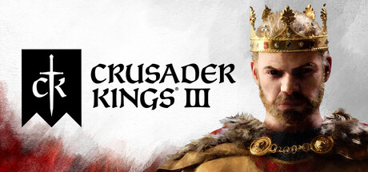
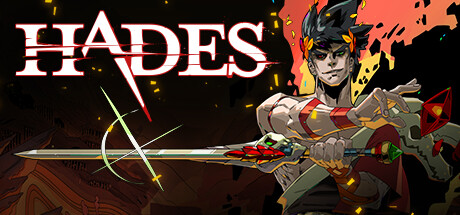
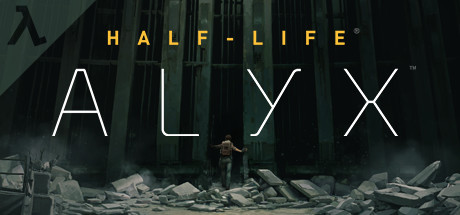
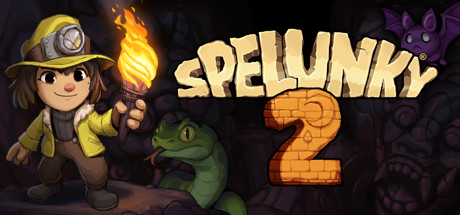

# 2020 in Video Games

[← Back to index](../README.md)

830 titles (265 from Wikipedia's category page, 23 added from [IGDB](https://www.igdb.com)) · [source](https://en.wikipedia.org/wiki/2020_in_video_games) · [release list](https://en.wikipedia.org/wiki/List_of_video_games_released_in_2020) · [category](https://en.wikipedia.org/wiki/Category:2020_video_games)

### 13 Sentinels: Aegis Rim

**Platforms:** PlayStation 4 &nbsp;|&nbsp; **Publisher:** Atlus &nbsp;|&nbsp; **Genre:** Adventure, RTS &nbsp;|&nbsp; **Released:** September 22

> Uncover the truth and delve into a 2D sidescrolling adventure featuring gorgeous art and environments. Then, battle the kaiju in fast-paced, top-down combat. Customize the Sentinels with an arsenal of mechsuit weaponry, and fight to defend humanity!
>
> _Synopsis source: IGDB_

[IGDB](https://www.igdb.com/games/13-sentinels-aegis-rim)

---

### 3 out of 10

**Platforms:** Windows &nbsp;|&nbsp; **Developer:** Terrible Posture Games &nbsp;|&nbsp; **Publisher:** Terrible Posture Games &nbsp;|&nbsp; **Released:** August 6, 2020

[Wikipedia](https://en.wikipedia.org/wiki/3_out_of_10)

---

### 5D Chess with Multiverse Time Travel

**Platforms:** Windows, macOS, Linux &nbsp;|&nbsp; **Developer:** Thunkspace &nbsp;|&nbsp; **Genre:** Chess variant &nbsp;|&nbsp; **Released:** July 22, 2020

[Wikipedia](https://en.wikipedia.org/wiki/5D_Chess_with_Multiverse_Time_Travel)

---

### 9 Monkeys of Shaolin

**Platforms:** Linux, macOS, Nintendo Switch, PlayStation 4, Windows, Xbox One &nbsp;|&nbsp; **Developer:** Sobaka Studio &nbsp;|&nbsp; **Publisher:** Buka Entertainment, Ravenscourt &nbsp;|&nbsp; **Genre:** Beat 'em up &nbsp;|&nbsp; **Released:** October 16, 2020

[Wikipedia](https://en.wikipedia.org/wiki/9_Monkeys_of_Shaolin)

---

### A Monster's Expedition

**Platforms:** iOS, macOS, Windows, Linux &nbsp;|&nbsp; **Developer:** Draknek & Friends &nbsp;|&nbsp; **Publisher:** Draknek & Friends &nbsp;|&nbsp; **Genre:** Puzzle &nbsp;|&nbsp; **Released:** September 10, 2020

[Wikipedia](https://en.wikipedia.org/wiki/A_Monster's_Expedition)

---

### A Total War Saga: Troy

**Platforms:** Windows &nbsp;|&nbsp; **Publisher:** Sega &nbsp;|&nbsp; **Genre:** TBS, RTT &nbsp;|&nbsp; **Released:** August 13

> A Total War Saga: Troy is the first in the award-winning strategy series to focus on the Bronze-Age Mediterranean and the legendary twenty-year conflict between the kingdoms of Troy and Mycenaean Greece, known as the Trojan War.
>
> _Synopsis source: IGDB_

[IGDB](https://www.igdb.com/games/a-total-war-saga-troy)

---

### Absolute Drift

**Platforms:** Nintendo Switch &nbsp;|&nbsp; **Publisher:** Funselektor Labs &nbsp;|&nbsp; **Genre:** Racing &nbsp;|&nbsp; **Released:** December 3

[Wikipedia](https://en.wikipedia.org/wiki/Absolute_Drift)

---

### Abyss of the Sacrifice

**Platforms:** Windows, Nintendo Switch &nbsp;|&nbsp; **Publisher:** D3 Publisher &nbsp;|&nbsp; **Genre:** Adventure, Visual novel &nbsp;|&nbsp; **Released:** December 17

[Wikipedia](https://en.wikipedia.org/wiki/Abyss_of_the_Sacrifice)

---

### Age of Empires III: Definitive Edition

**Platforms:** Windows &nbsp;|&nbsp; **Publisher:** Xbox Game Studios &nbsp;|&nbsp; **Genre:** RTS &nbsp;|&nbsp; **Released:** October 15

> Age of Empires III: Definitive Edition completes the celebration of one of the most beloved real-time strategy franchises with remastered graphics and music, all previously released expansions and brand-new content to enjoy for the very first time.
>
> _Synopsis source: IGDB_

[IGDB](https://www.igdb.com/games/age-of-empires-iii-definitive-edition)

---

### Aggretsuko : The Short Timer Strikes Back

**Platforms:** iOS, Android &nbsp;|&nbsp; **Publisher:** Hive Co. Ltd. &nbsp;|&nbsp; **Genre:** Puzzle &nbsp;|&nbsp; **Released:** July 28

[Wikipedia](https://en.wikipedia.org/wiki/Aggretsuko)

---

### Aglet

**Platforms:** iOS, Android &nbsp;|&nbsp; **Developer:** onlife Inc. &nbsp;|&nbsp; **Publisher:** onlife Inc. &nbsp;|&nbsp; **Genre:** Augmented reality, location-based game &nbsp;|&nbsp; **Released:** April 11, 2020

[Wikipedia](https://en.wikipedia.org/wiki/Aglet_(video_game))

---

### Aikatsu Planet!

[Wikipedia](https://en.wikipedia.org/wiki/Aikatsu_Planet!)

---

### Airborne Kingdom

**Platforms:** macOS, Windows, Nintendo Switch, PlayStation 4, PlayStation 5, Xbox One, Xbox Series X/S &nbsp;|&nbsp; **Developer:** The Wandering Band &nbsp;|&nbsp; **Publisher:** The Wandering Band, indie.io &nbsp;|&nbsp; **Genre:** City-building &nbsp;|&nbsp; **Released:** December 17, 2020

[Wikipedia](https://en.wikipedia.org/wiki/Airborne_Kingdom)

---

### Airplane Mode

**Platforms:** Windows, macOS &nbsp;|&nbsp; **Developer:** Hosni Auji, Bacronym &nbsp;|&nbsp; **Publisher:** AMC Games &nbsp;|&nbsp; **Genre:** Simulation &nbsp;|&nbsp; **Released:** October 15, 2020

[Wikipedia](https://en.wikipedia.org/wiki/Airplane_Mode_(video_game))

---

### Alwa's Legacy

**Platforms:** Linux, macOS, Windows, Nintendo Switch &nbsp;|&nbsp; **Developer:** Elden Pixels &nbsp;|&nbsp; **Publisher:** Elden Pixels &nbsp;|&nbsp; **Genre:** Metroidvania &nbsp;|&nbsp; **Released:** June 17, 2020

[Wikipedia](https://en.wikipedia.org/wiki/Alwa's_Legacy)

---

### Amazing Cultivation Simulator

**Platforms:** Windows, Android, iOS &nbsp;|&nbsp; **Developer:** GSQ Games &nbsp;|&nbsp; **Publisher:** Gamera Games &nbsp;|&nbsp; **Genre:** Construction and management simulation &nbsp;|&nbsp; **Released:** November 25, 2020

[Wikipedia](https://en.wikipedia.org/wiki/Amazing_Cultivation_Simulator)

---

### Amnesia: Rebirth

**Platforms:** Windows, PlayStation 4 &nbsp;|&nbsp; **Publisher:** Frictional Games &nbsp;|&nbsp; **Genre:** Survival horror &nbsp;|&nbsp; **Released:** October 20

> Amnesia: Rebirth is a new descent into darkness from the creators of the iconic Amnesia series. Set in the desolate landscape of the Algerian desert, the game will focus on new character Tasi Trianon as she sets out on a harrowing journey through devastation and despair, personal terror and pain, while exploring the limits of human resilience.
>
> _Synopsis source: IGDB_

[IGDB](https://www.igdb.com/games/amnesia-rebirth)

---

### Among Us

**Platforms:** Nintendo Switch &nbsp;|&nbsp; **Publisher:** Innersloth &nbsp;|&nbsp; **Genre:** Party, Social deduction &nbsp;|&nbsp; **Released:** December 15

[Wikipedia](https://en.wikipedia.org/wiki/Among_Us)

---

### Angry Video Game Nerd I & II Deluxe

**Platforms:** Windows, Nintendo Switch &nbsp;|&nbsp; **Publisher:** Screenwave Media Inc. &nbsp;|&nbsp; **Genre:** Action-adventure &nbsp;|&nbsp; **Released:** October 30

---

### Animal Crossing: New Horizons

**Platforms:** Nintendo Switch &nbsp;|&nbsp; **Developer:** Nintendo EPD &nbsp;|&nbsp; **Publisher:** Nintendo &nbsp;|&nbsp; **Genre:** Social sim &nbsp;|&nbsp; **Released:** March 20, 2020

> Escape to a deserted island and create your own paradise as you explore, create, and customize in Animal Crossing: New Horizons. Your island getaway has a wealth of natural resources that can be used to craft everything from tools to creature comforts. You can hunt down insects at the crack of dawn, decorate your paradise throughout the day, or enjoy sunset on the beach while fishing in the ocean. The time of day and season match real life, so each day on your island is a chance to check in and find new surprises all year round.
>
> _Synopsis source: IGDB_

[IGDB](https://www.igdb.com/games/animal-crossing-new-horizons)

---

### Anthology of the Killer

**Developer:** Stephen Gillmurphy &nbsp;|&nbsp; **Genre:** Horror

[Wikipedia](https://en.wikipedia.org/wiki/Anthology_of_the_Killer)

---

### AO Tennis 2

**Platforms:** Windows, Nintendo Switch, PlayStation 4, Xbox One &nbsp;|&nbsp; **Developer:** Big Ant Studios &nbsp;|&nbsp; **Publisher:** Bigben Interactive &nbsp;|&nbsp; **Genre:** Sports &nbsp;|&nbsp; **Released:** January 9

[Wikipedia](https://en.wikipedia.org/wiki/AO_Tennis_2)

---

### Aokana: Four Rhythm Across the Blue

**Platforms:** Nintendo Switch &nbsp;|&nbsp; **Publisher:** PQube &nbsp;|&nbsp; **Genre:** Visual novel &nbsp;|&nbsp; **Released:** August 21

---

### Arboria

**Platforms:** Windows &nbsp;|&nbsp; **Developer:** Dreamplant &nbsp;|&nbsp; **Publisher:** All in! Games SA &nbsp;|&nbsp; **Genre:** Roguelike &nbsp;|&nbsp; **Released:** May 2020

[Wikipedia](https://en.wikipedia.org/wiki/Arboria)

---

### Arcade Fuzz

[Wikipedia](https://en.wikipedia.org/wiki/Arcade_Fuzz)

---

### Ark: Survival Evolved

**Platforms:** Xbox Series X/S &nbsp;|&nbsp; **Publisher:** Studio Wildcard &nbsp;|&nbsp; **Genre:** Action-adventure, Survival &nbsp;|&nbsp; **Released:** November 10

---

### Arknights

**Platforms:** iOS, Android &nbsp;|&nbsp; **Developer:** Hypergryph , Studio Montagne &nbsp;|&nbsp; **Publisher:** Hypergryph , Yostar &nbsp;|&nbsp; **Genre:** Action RPG, Tactical RPG, Tower defense &nbsp;|&nbsp; **Released:** January 16

[Wikipedia](https://en.wikipedia.org/wiki/Arknights)

---

### Arrest of a Stone Buddha

**Platforms:** Windows, Nintendo Switch, Xbox One, Xbox Series X/S &nbsp;|&nbsp; **Developer:** Yeo &nbsp;|&nbsp; **Publisher:** Yeo &nbsp;|&nbsp; **Genre:** Shooter &nbsp;|&nbsp; **Released:** February 27, 2020

[Wikipedia](https://en.wikipedia.org/wiki/Arrest_of_a_Stone_Buddha)

---

### Art of Rally

**Platforms:** Windows, macOS, Linux &nbsp;|&nbsp; **Publisher:** Funselektor Labs &nbsp;|&nbsp; **Genre:** Racing &nbsp;|&nbsp; **Released:** September 23

> Race in the golden era of rally. Drive iconic cars from the 60s to Group B on challenging stages through stylized environments. Will you master the art of rally?
>
> _Synopsis source: IGDB_

[Wikipedia](https://en.wikipedia.org/wiki/Art_of_Rally) · [IGDB](https://www.igdb.com/games/art-of-rally)

---

### Ary and the Secret of Seasons

**Platforms:** Windows, Nintendo Switch, PlayStation 4, Xbox One &nbsp;|&nbsp; **Publisher:** Modus Games &nbsp;|&nbsp; **Genre:** Action-adventure &nbsp;|&nbsp; **Released:** September 1

[Wikipedia](https://en.wikipedia.org/wiki/Ary_and_the_Secret_of_Seasons)

---

### Assassin's Creed Valhalla

**Platforms:** Windows, PlayStation 4, Xbox One, Xbox Series X/S, Stadia, PlayStation 5 &nbsp;|&nbsp; **Publisher:** Ubisoft &nbsp;|&nbsp; **Genre:** Action RPG &nbsp;|&nbsp; **Released:** November 10

> In Assassin's Creed Valhalla, become Eivor, a legendary Viking raider on a quest for glory. Explore a dynamic and beautiful open world set against the brutal backdrop of England’s Dark Ages. Raid your enemies, grow your settlement, and build your political power in the quest to earn a place among the gods in Valhalla.
>
> _Synopsis source: IGDB_

[Wikipedia](https://en.wikipedia.org/wiki/Assassin%27s_Creed_Valhalla) · [IGDB](https://www.igdb.com/games/assassins-creed-valhalla)

---

### Assault ChaingunS KM

[Wikipedia](https://en.wikipedia.org/wiki/Assault_ChaingunS_KM)

---

### Astro's Playroom

**Platforms:** PlayStation 5 &nbsp;|&nbsp; **Publisher:** Sony Interactive Entertainment &nbsp;|&nbsp; **Genre:** Platformer &nbsp;|&nbsp; **Released:** November 12

> Astro and his crew lead you on a magical introduction through PS5 in this fun platformer that comes pre-loaded on PS5. Explore four worlds, each based on PS5’s console components. Each area showcases innovative gameplay that taps into the new features of the PS5's DualSense wireless controller.
>
> _Synopsis source: IGDB_

[Wikipedia](https://en.wikipedia.org/wiki/Astro%27s_Playroom) · [IGDB](https://www.igdb.com/games/astros-playroom)

---

### Atelier Dusk Trilogy Deluxe Pack

**Platforms:** Windows, Nintendo Switch, PlayStation 4 &nbsp;|&nbsp; **Publisher:** Koei Tecmo &nbsp;|&nbsp; **Genre:** RPG &nbsp;|&nbsp; **Released:** January 14

[Wikipedia](https://en.wikipedia.org/wiki/Atelier_(video_game_series))

---

### Atelier Ryza 2: Lost Legends & the Secret Fairy

**Platforms:** Nintendo Switch, PlayStation 4, PlayStation 5 &nbsp;|&nbsp; **Publisher:** Koei Tecmo &nbsp;|&nbsp; **Genre:** RPG &nbsp;|&nbsp; **Released:** December 3 (JP)

---

### Atlantis no Nazo

**Platforms:** Nintendo Switch &nbsp;|&nbsp; **Genre:** Platformer &nbsp;|&nbsp; **Released:** February 19 (JP)

[Wikipedia](https://en.wikipedia.org/wiki/Atlantis_no_Nazo)

---

### Atomicrops

**Platforms:** Windows, PlayStation 4, Nintendo Switch, Xbox One &nbsp;|&nbsp; **Developer:** Bird Bath Games &nbsp;|&nbsp; **Publisher:** Raw Fury &nbsp;|&nbsp; **Genre:** Bullet hell, farm life sim, roguelike &nbsp;|&nbsp; **Released:** May 28, 2020

[Wikipedia](https://en.wikipedia.org/wiki/Atomicrops)

---

### Atri: My Dear Moments

[Wikipedia](https://en.wikipedia.org/wiki/Atri:_My_Dear_Moments)

---

### Automobilista 2

**Platforms:** Windows &nbsp;|&nbsp; **Publisher:** Reiza Studios &nbsp;|&nbsp; **Genre:** Racing &nbsp;|&nbsp; **Released:** June 30

[Wikipedia](https://en.wikipedia.org/wiki/Automobilista_2)

---

### AVICII Invector

**Platforms:** Nintendo Switch &nbsp;|&nbsp; **Publisher:** Wired Productions &nbsp;|&nbsp; **Genre:** Music &nbsp;|&nbsp; **Released:** September 8

[Wikipedia](https://en.wikipedia.org/wiki/AVICII_Invector)

---

### Azur Lane: Crosswave

**Platforms:** Windows, PlayStation 4, Nintendo Switch &nbsp;|&nbsp; **Developer:** Felistella &nbsp;|&nbsp; **Publisher:** Idea Factory International &nbsp;|&nbsp; **Genre:** TPS &nbsp;|&nbsp; **Released:** February 13 (JP)

[Wikipedia](https://en.wikipedia.org/wiki/Azur_Lane#Console_adaptation)

---

### Azure Striker Gunvolt 2

**Platforms:** Windows &nbsp;|&nbsp; **Publisher:** Inti Creates &nbsp;|&nbsp; **Genre:** Action, Platformer &nbsp;|&nbsp; **Released:** June 22

[Wikipedia](https://en.wikipedia.org/wiki/Azure_Striker_Gunvolt_2)

---

### Azure Striker Gunvolt: Striker Pack

**Platforms:** PlayStation 4 &nbsp;|&nbsp; **Publisher:** Inti Creates &nbsp;|&nbsp; **Genre:** Action, Platformer &nbsp;|&nbsp; **Released:** April 23

---

### Badiya

**Platforms:** Android, iOS, PlayStation 4, Windows, Xbox One &nbsp;|&nbsp; **Developer:** Semaphore &nbsp;|&nbsp; **Publisher:** Semaphore &nbsp;|&nbsp; **Genre:** Survival &nbsp;|&nbsp; **Released:** May 19, 2020

[Wikipedia](https://en.wikipedia.org/wiki/Badiya)

---

### Bakugan: Champions of Vestroia

**Platforms:** Nintendo Switch &nbsp;|&nbsp; **Publisher:** Warner Bros. Interactive Entertainment &nbsp;|&nbsp; **Genre:** Action RPG &nbsp;|&nbsp; **Released:** November 3

---

### Baldi's Basics Plus

[Wikipedia](https://en.wikipedia.org/wiki/Baldi's_Basics_Plus)

---

### Balloon Pop for Toddlers & Kids: Learn Numbers, Letters, Colors & Animals

[Wikipedia](https://en.wikipedia.org/wiki/Balloon_Pop_for_Toddlers_&_Kids:_Learn_Numbers,_Letters,_Colors_&_Animals)

---

### Ballz

**Platforms:** iOS, Android &nbsp;|&nbsp; **Publisher:** Ketchapp &nbsp;|&nbsp; **Genre:** Endless round

[Wikipedia](https://en.wikipedia.org/wiki/Ballz_(mobile_game))

---

### Banana Treasures Island

[Wikipedia](https://en.wikipedia.org/wiki/Banana_Treasures_Island)

---

### Batbarian: Testament of the Primordials

**Platforms:** Windows, Nintendo Switch &nbsp;|&nbsp; **Publisher:** Dangen Entertainment &nbsp;|&nbsp; **Genre:** Platformer, Adventure, Metroidvania &nbsp;|&nbsp; **Released:** October 15

---

### Battle Princess Madelyn Royal Edition

[Wikipedia](https://en.wikipedia.org/wiki/Battle_Princess_Madelyn_Royal_Edition)

---

### Battleground

[Wikipedia](https://en.wikipedia.org/wiki/Battleground_(2020_video_game))

---

### Battletoads

**Platforms:** Windows, Xbox One &nbsp;|&nbsp; **Publisher:** Xbox Game Studios &nbsp;|&nbsp; **Genre:** Brawler &nbsp;|&nbsp; **Released:** August 20

> The wait is over! Rash, Zitz and Pimple are returning at last to smash-hit their way through an all-new action-packed adventure of choreographed chaos, and couch co-op may never be the same again.  1-3 players will take control of the Battletoads and team up to storm through wild and unpredictable stages with only one rule – expect the unexpected. Teamwork makes the dream work in a drop-in, drop-out gameplay blast, filled with over-the-top gameplay moments that anyone can enjoy, but only a True ‘Toad’ can master.  With a unique hand-animated cartoon style and packed with memorable characters and locations, the Battletoads are back for a larger-than-life brawl across the universe that promises to be fun alone, and unforgettable together.
>
> _Synopsis source: IGDB_

[Wikipedia](https://en.wikipedia.org/wiki/Battletoads_(2020_video_game)) · [IGDB](https://www.igdb.com/games/battletoads--2)

---

### Bayonetta & Vanquish 10th Anniversary Bundle

**Platforms:** PlayStation 4, Xbox One &nbsp;|&nbsp; **Developer:** PlatinumGames &nbsp;|&nbsp; **Publisher:** Sega &nbsp;|&nbsp; **Genre:** Action, Hack and slash, TPS &nbsp;|&nbsp; **Released:** February 18

[Wikipedia](https://en.wikipedia.org/wiki/Bayonetta_(video_game))

---

### beatmania IIDX 27: Heroic Verse

**Platforms:** Arcade &nbsp;|&nbsp; **Developer:** Konami Digital Entertainment &nbsp;|&nbsp; **Publisher:** Konami &nbsp;|&nbsp; **Genre:** Rhythm &nbsp;|&nbsp; **Released:** January 29

---

### beatmania IIDX 28 BISTROVER

**Platforms:** Arcade &nbsp;|&nbsp; **Publisher:** Konami &nbsp;|&nbsp; **Genre:** Rhythm &nbsp;|&nbsp; **Released:** October 28

---

### Beautiful Desolation

**Platforms:** Windows, Linux, macOS, Nintendo Switch, PlayStation 4 &nbsp;|&nbsp; **Developer:** The Brotherhood &nbsp;|&nbsp; **Publisher:** The Brotherhood, Untold Tales &nbsp;|&nbsp; **Genre:** Adventure game &nbsp;|&nbsp; **Released:** February 26, 2020

[Wikipedia](https://en.wikipedia.org/wiki/Beautiful_Desolation)

---

### Before I Forget

**Platforms:** Windows, macOS, Linux &nbsp;|&nbsp; **Publisher:** 3-Fold Games &nbsp;|&nbsp; **Genre:** Adventure &nbsp;|&nbsp; **Released:** July 16

[Wikipedia](https://en.wikipedia.org/wiki/Before_I_Forget_(video_game))

---

### Before We Leave

**Platforms:** Windows, Xbox Series X/S &nbsp;|&nbsp; **Developer:** Balancing Monkey Games &nbsp;|&nbsp; **Publisher:** Team 17 &nbsp;|&nbsp; **Genre:** City-building &nbsp;|&nbsp; **Released:** May 8, 2020

[Wikipedia](https://en.wikipedia.org/wiki/Before_We_Leave)

---

### Below

**Platforms:** PlayStation 4 &nbsp;|&nbsp; **Publisher:** Capybara Games &nbsp;|&nbsp; **Genre:** Roguelike &nbsp;|&nbsp; **Released:** April 7

[Wikipedia](https://en.wikipedia.org/wiki/Below_(video_game))

---

### Ben 10: Power Trip

**Platforms:** Windows, Nintendo Switch, PlayStation 4, Xbox One &nbsp;|&nbsp; **Publisher:** Outright Games &nbsp;|&nbsp; **Genre:** Action &nbsp;|&nbsp; **Released:** October 9

[Wikipedia](https://en.wikipedia.org/wiki/Ben_10#Spin-off_media)

---

### Besiege

**Platforms:** Linux, macOS, Windows, Xbox Series X/S, iOS, Android &nbsp;|&nbsp; **Developer:** Spiderling Studios &nbsp;|&nbsp; **Publisher:** Spiderling Studios &nbsp;|&nbsp; **Genre:** Sandbox &nbsp;|&nbsp; **Released:** February 18, 2020

> Besiege is a physics building game about constructing mechanical machines to annihilate armies, obliterate castles and overcome challenging obstacles. Conquer the campaign or skirmish with friends in Multiplayer!
>
> _Synopsis source: IGDB_

[Wikipedia](https://en.wikipedia.org/wiki/Besiege_(video_game)) · [IGDB](https://www.igdb.com/games/besiege)

---

### Beyond Blue

**Platforms:** iOS, macOS, tvOS, Windows, PlayStation 4, Xbox One &nbsp;|&nbsp; **Developer:** E-Line Media &nbsp;|&nbsp; **Publisher:** E-Line Media &nbsp;|&nbsp; **Genre:** Educational, adventure &nbsp;|&nbsp; **Released:** April 17, 2020

> Explore and uncover the secrets of Earth’s last uncharted frontier  Set in the near future, players will probe the mysteries of our ocean through the eyes of Mirai, the lead on a newly formed research team that will use groundbreaking technologies to see, hear, and sense the ocean in a more meaningful way than has ever been attempted. The game will feature both an evocative narrative and high level resource management, challenging the player to make high-stakes decisions and prioritize which objectives can be successfully achieved during the crew’s expedition.  Embracing the same inclusive development process that was used to create Never Alone (Kisima Ingitchuna), E-Line’s BAFTA award-winning game about Alaska Native culture, the company paired world class game makers with some of the field’s leading ocean experts to craft an experience that reflects the awesome wonder and unbounded mystery that infuses our planet’s beating blue heart.
>
> _Synopsis source: IGDB_

[Wikipedia](https://en.wikipedia.org/wiki/Beyond_Blue_(video_game)) · [IGDB](https://www.igdb.com/games/beyond-blue)

---

### Beyond Enemy Lines: Essentials

[Wikipedia](https://en.wikipedia.org/wiki/Beyond_Enemy_Lines:_Essentials)

---

### Bhag Corona

[Wikipedia](https://en.wikipedia.org/wiki/Bhag_Corona)

---

### Big Brother: The Game

**Platforms:** iOS, Android &nbsp;|&nbsp; **Publisher:** 9th Impact &nbsp;|&nbsp; **Genre:** Simulation, RPG &nbsp;|&nbsp; **Released:** October 15

---

### BioShock: The Collection

**Platforms:** Nintendo Switch &nbsp;|&nbsp; **Publisher:** 2K Games &nbsp;|&nbsp; **Genre:** FPS &nbsp;|&nbsp; **Released:** May 29

---

### Biped

**Platforms:** Windows, PlayStation 4, Nintendo Switch, Xbox One &nbsp;|&nbsp; **Publisher:** META Publishing &nbsp;|&nbsp; **Genre:** Puzzle-platformer &nbsp;|&nbsp; **Released:** March 27

> Biped is a coop action game with physics. Take Aku and Sila on a fun and bonding adventure, overcoming original challenges and saving Earth from going dark.  - 30 exotic stages to explore, many secrets to uncover - supports both local 2 player coop and solo play - collect treasures and customize your bipeds
>
> _Synopsis source: IGDB_

[IGDB](https://www.igdb.com/games/biped)

---

### Birushana: Rising Flower of Genpei

[Wikipedia](https://en.wikipedia.org/wiki/Birushana:_Rising_Flower_of_Genpei)

---

### Bite the Bullet

**Platforms:** Linux, macOS, Windows, Nintendo Switch, Xbox One &nbsp;|&nbsp; **Developer:** Mega Cat Studios &nbsp;|&nbsp; **Publisher:** Graffiti Games &nbsp;|&nbsp; **Genre:** Role-playing, roguelite &nbsp;|&nbsp; **Released:** August 13, 2020

[Wikipedia](https://en.wikipedia.org/wiki/Bite_the_Bullet_(video_game))

---

### Black Jack

[Wikipedia](https://en.wikipedia.org/wiki/Black_Jack_(2020_video_game))

---

### Black Mesa

**Platforms:** Windows, Linux &nbsp;|&nbsp; **Publisher:** Crowbar Collective &nbsp;|&nbsp; **Genre:** FPS &nbsp;|&nbsp; **Released:** March 5

> Black Mesa is a re-envisioning of Valve Software's classic science fiction first person shooter, Half-Life. Powered by Source Engine, You will re-visit the inaugural role of Gordon Freeman and his memorable journey through the Black Mesa Research Facility. Expect detailed environments to explore, a huge cast of characters and experimental weaponry. All-new music, voice acting, choreography and added dialogue give way to a more expansive and immersive experience than ever before.
>
> _Synopsis source: IGDB_

[Wikipedia](https://en.wikipedia.org/wiki/Black_Mesa_(video_game)) · [IGDB](https://www.igdb.com/games/black-mesa)

---

### Blaseball

**Platforms:** Browser &nbsp;|&nbsp; **Developer:** The Game Band &nbsp;|&nbsp; **Genre:** Simulation, horror &nbsp;|&nbsp; **Released:** July 20, 2020

[Wikipedia](https://en.wikipedia.org/wiki/Blaseball)

---

### Blaster Master Zero

**Platforms:** PlayStation 4 &nbsp;|&nbsp; **Publisher:** Inti Creates &nbsp;|&nbsp; **Genre:** Action-adventure &nbsp;|&nbsp; **Released:** June 29

[Wikipedia](https://en.wikipedia.org/wiki/Blaster_Master_Zero)

---

### Blaster Master Zero 2

**Platforms:** PlayStation 4 &nbsp;|&nbsp; **Publisher:** Inti Creates &nbsp;|&nbsp; **Genre:** Action-adventure &nbsp;|&nbsp; **Released:** June 29

[Wikipedia](https://en.wikipedia.org/wiki/Blaster_Master_Zero_2)

---

### Bleach: Brave Souls

**Platforms:** Windows &nbsp;|&nbsp; **Publisher:** KLabGames &nbsp;|&nbsp; **Genre:** Brawler &nbsp;|&nbsp; **Released:** August 18

---

### Bleeding Edge

**Platforms:** Windows, Xbox One &nbsp;|&nbsp; **Publisher:** Xbox Game Studios &nbsp;|&nbsp; **Genre:** Brawler &nbsp;|&nbsp; **Released:** March 24

[Wikipedia](https://en.wikipedia.org/wiki/Bleeding_Edge_(video_game))

---

### Bless Unleashed

**Platforms:** Xbox One, PlayStation 4 &nbsp;|&nbsp; **Publisher:** Bandai Namco Entertainment , Neowiz &nbsp;|&nbsp; **Genre:** MMO, RPG &nbsp;|&nbsp; **Released:** March 12

[Wikipedia](https://en.wikipedia.org/wiki/Bless_Unleashed)

---

### Blood Breed

[Wikipedia](https://en.wikipedia.org/wiki/Blood_Breed)

---

### Bloodroots

**Platforms:** PlayStation 4, Windows, Nintendo Switch, Xbox Series X/S &nbsp;|&nbsp; **Developer:** Paper Cult &nbsp;|&nbsp; **Genre:** Hack and slash &nbsp;|&nbsp; **Released:** February 28, 2020

[Wikipedia](https://en.wikipedia.org/wiki/Bloodroots)

---

### Bloodstained: Curse of the Moon 2

**Platforms:** Windows, Nintendo Switch, PlayStation 4, Xbox One &nbsp;|&nbsp; **Publisher:** Inti Creates &nbsp;|&nbsp; **Genre:** Platformer &nbsp;|&nbsp; **Released:** July 10

> Curse of the Moon 2 brings classic 2D action and a dark, 8-bit aesthetic together with modern playability. The multiple-scenario structure of the previous title returns with an epic new story supervised by IGA (Koji Igarashi) himself.  Players take control of Zangetsu, a swordsman from the far east who bears a deep grudge against demonkind and the alchemists who summoned them. Zangetsu must battle his way to the demonic stronghold, but he doesn't have to do it alone! Zangetsu can ally himself with a brand new cast of characters he meets along the way and add them to the playable roster.  Three brand-new playable characters appear in Curse of the Moon 2, including the exorcist Dominique. All characters from the original Curse of the Moon game are playable, too! Each new character adds a variety of gameplay options, abilities, and ways to complete the games' many stages.  Players can also create demon hunting duos in 2-player local co-op, available for the first time in the series! Work together with a friend, mix and match the strengths of two different characters, and conquer stages in tons of new and exciting ways.
>
> _Synopsis source: IGDB_

[IGDB](https://www.igdb.com/games/bloodstained-curse-of-the-moon-2)

---

### Bokuhime Project

**Platforms:** Nintendo Switch, PlayStation 4 &nbsp;|&nbsp; **Publisher:** Nippon Ichi Software &nbsp;|&nbsp; **Genre:** Adventure &nbsp;|&nbsp; **Released:** April 23 (JP)

[Wikipedia](https://en.wikipedia.org/wiki/Bokuhime_Project)

---

### Bokura no School Battle

[Wikipedia](https://en.wikipedia.org/wiki/Bokura_no_School_Battle)

---

### Bomb

[Wikipedia](https://en.wikipedia.org/wiki/Bomb_(2020_video_game))

---

### Boomerang Fu

**Platforms:** Windows, Nintendo Switch, Xbox One &nbsp;|&nbsp; **Publisher:** Cranky Watermelon &nbsp;|&nbsp; **Genre:** Fighting, Party &nbsp;|&nbsp; **Released:** August 13

[Wikipedia](https://en.wikipedia.org/wiki/Boomerang_Fu)

---

### Borderlands 3

**Platforms:** Xbox Series X/S, PlayStation 5 &nbsp;|&nbsp; **Publisher:** 2K Games &nbsp;|&nbsp; **Genre:** Action RPG, FPS &nbsp;|&nbsp; **Released:** November 10

[Wikipedia](https://en.wikipedia.org/wiki/Borderlands_3)

---

### Borderlands Legendary Collection

**Platforms:** Nintendo Switch &nbsp;|&nbsp; **Publisher:** 2K Games &nbsp;|&nbsp; **Genre:** Action RPG, FPS &nbsp;|&nbsp; **Released:** May 29

[Wikipedia](https://en.wikipedia.org/wiki/Borderlands_(series))

---

### Boris and the Dark Survival

**Platforms:** Windows, Android &nbsp;|&nbsp; **Publisher:** Joey Drew Studios &nbsp;|&nbsp; **Genre:** Dungeon crawl &nbsp;|&nbsp; **Released:** February 10

---

### BPM: Bullets Per Minute

**Platforms:** Windows &nbsp;|&nbsp; **Publisher:** Awe Interactive &nbsp;|&nbsp; **Genre:** FPS, Roguelike, Rhythm &nbsp;|&nbsp; **Released:** September 15

> In BPM, all of your actions and the actions of your enemies are tied to the beat of the music. Your enemies perform a dance-like sequence of attacks to an epic rock opera. BPM is inspired by retro shooters of the 90’s. It is fast, frenetic and rhythmical. You can double jump, dash, rocket jump and bunny hop to evade your opponents.
>
> _Synopsis source: IGDB_

[IGDB](https://www.igdb.com/games/bpm-bullets-per-minute)

---

### BrainZ

[Wikipedia](https://en.wikipedia.org/wiki/BrainZ)

---

### Break Dot

[Wikipedia](https://en.wikipedia.org/wiki/Break_Dot)

---

### Breakfast Bar Tycoon

[Wikipedia](https://en.wikipedia.org/wiki/Breakfast_Bar_Tycoon)

---

### Bridge Constructor: The Walking Dead

**Platforms:** Android, iOS, Windows, macOS, Linux, Nintendo Switch, PlayStation 4, Xbox One, Xbox Series X/S &nbsp;|&nbsp; **Publisher:** Headup Games &nbsp;|&nbsp; **Genre:** Simulation, Puzzle &nbsp;|&nbsp; **Released:** November 19

---

### Brigandine: The Legend of Runersia

**Platforms:** Nintendo Switch, PlayStation 4 &nbsp;|&nbsp; **Publisher:** Happinet &nbsp;|&nbsp; **Genre:** Tactical RPG &nbsp;|&nbsp; **Released:** June 25

---

### Bright Memory

**Platforms:** Xbox Series X/S &nbsp;|&nbsp; **Publisher:** Playism &nbsp;|&nbsp; **Genre:** FPS &nbsp;|&nbsp; **Released:** November 10

> Bright Memory is a lightning-fast fusion of the FPS and action genres, created by one-man development studio FYQD using Unreal Engine. Combine a wide variety of skills and abilities to unleash dazzling combo attacks. SRO (Supernatural Science Research Organization) agent Shelia's adventure is about to begin.
>
> _Synopsis source: IGDB_

[Wikipedia](https://en.wikipedia.org/wiki/Bright_Memory) · [IGDB](https://www.igdb.com/games/bright-memory)

---

### Bubble

[Wikipedia](https://en.wikipedia.org/wiki/Bubble_(2020_video_game))

---

### Bubble Bobble 4 Friends

**Platforms:** Nintendo Switch &nbsp;|&nbsp; **Publisher:** Taito &nbsp;|&nbsp; **Genre:** Platformer &nbsp;|&nbsp; **Released:** March 31

[Wikipedia](https://en.wikipedia.org/wiki/Bubble_Bobble_4_Friends)

---

### Bubble Bobble 4 Friends: The Baron is Back

**Platforms:** PlayStation 4, Nintendo Switch &nbsp;|&nbsp; **Publisher:** ININ Games &nbsp;|&nbsp; **Genre:** Platformer &nbsp;|&nbsp; **Released:** November 17 (JP)

---

### Bugsnax

**Platforms:** macOS, PlayStation 4, PlayStation 5 &nbsp;|&nbsp; **Publisher:** Young Horses &nbsp;|&nbsp; **Genre:** Adventure &nbsp;|&nbsp; **Released:** November 12

> Bugsnax takes you on a journey to Snaktooth Island, home of the legendary half-bug half-snack creatures, Bugsnax. Invited by intrepid explorer Elizabert Megafig, you arrive to discover your host nowhere to be found, her camp in shambles, and her followers scattered across the island alone... and hungry!  It's up to you to solve the mysteries of Snaktooth Island: What happened to Lizbert? What are Bugsnax and where do they come from? But most of all, why do they taste SO GOOD?
>
> _Synopsis source: IGDB_

[Wikipedia](https://en.wikipedia.org/wiki/Bugsnax) · [IGDB](https://www.igdb.com/games/bugsnax)

---

### Burnout Paradise Remastered

**Platforms:** Nintendo Switch &nbsp;|&nbsp; **Publisher:** Electronic Arts &nbsp;|&nbsp; **Genre:** Racing &nbsp;|&nbsp; **Released:** June 19

[Wikipedia](https://en.wikipedia.org/wiki/Burnout_Paradise)

---

### Burst Shooter

[Wikipedia](https://en.wikipedia.org/wiki/Burst_Shooter)

---

### Busou Shinki

[Wikipedia](https://en.wikipedia.org/wiki/Busou_Shinki)

---

### Cake Bash

**Platforms:** Windows, PlayStation 4, Xbox One, Stadia, Nintendo Switch &nbsp;|&nbsp; **Publisher:** Coatsink &nbsp;|&nbsp; **Genre:** Fighting, Party &nbsp;|&nbsp; **Released:** October 15

[Wikipedia](https://en.wikipedia.org/wiki/Cake_Bash)

---

### Calico

**Platforms:** macOS, Nintendo Switch, Windows, Xbox One &nbsp;|&nbsp; **Developer:** Peachy Keen Games &nbsp;|&nbsp; **Publisher:** Whitethorn Games, Maple Whispering &nbsp;|&nbsp; **Genre:** Life simulation &nbsp;|&nbsp; **Released:** December 15, 2020

[Wikipedia](https://en.wikipedia.org/wiki/Calico_(video_game))

---

### Call of Duty: Black Ops Cold War

**Platforms:** Windows, PlayStation 4, PlayStation 5, Xbox One, Xbox Series X/S &nbsp;|&nbsp; **Publisher:** Activision &nbsp;|&nbsp; **Genre:** FPS &nbsp;|&nbsp; **Released:** November 13

> The iconic Black Ops series is back with Call of Duty: Black Ops Cold War - the direct sequel to the original and fan-favorite Call of Duty: Black Ops. Black Ops Cold War will drop fans into the depths of the Cold War’s volatile geopolitical battle of the early 1980s. Nothing is ever as it seems in a gripping single-player Campaign, where players will come face-to-face with historical figures and hard truths, as they battle around the globe through iconic locales like East Berlin, Vietnam, Turkey, Soviet KGB headquarters and more.  Beyond the Campaign, players will bring a Cold War arsenal of weapons and equipment into the next generation of Multiplayer and Zombies experiences. Welcome to the brink. Welcome to Call of Duty: Black Ops Cold War.
>
> _Synopsis source: IGDB_

[IGDB](https://www.igdb.com/games/call-of-duty-black-ops-cold-war)

---

### Call of Duty: Modern Warfare 2 Campaign Remastered

**Platforms:** PlayStation 4, Windows, Xbox One &nbsp;|&nbsp; **Publisher:** Activision &nbsp;|&nbsp; **Genre:** FPS &nbsp;|&nbsp; **Type:** Remaster &nbsp;|&nbsp; **Released:** March 31

> The Call of Duty: Modern Warfare 2 Campaign has been fully remastered with improved textures, animations, physically based rendering, high-dynamic range lighting, and much more. Experience classic missions including Cliffhanger, The Gulag, and Whiskey Hotel as you join Soap, Price, Ghost and the rest of Task Force 141 in the globe-spanning fight to restore order to the world.
>
> _Synopsis source: IGDB_

[IGDB](https://www.igdb.com/games/call-of-duty-modern-warfare-2-campaign-remastered)

---

### Call of Duty: Warzone

**Platforms:** Windows, PlayStation 4, Xbox One &nbsp;|&nbsp; **Publisher:** Activision &nbsp;|&nbsp; **Genre:** FPS &nbsp;|&nbsp; **Released:** March 10

> Call of Duty: Warzone is a free-to-play battle royale first-person shooter set in the Call of Duty universe. Up to 150 players parachute onto a large map, scavenge weapons and equipment, and fight to be the last squad standing as the playable area shrinks. The game features an in-game currency system for purchasing loadout drops and other tactical items, as well as a unique respawn mechanic called the Gulag, where eliminated players can fight for a second chance. Originally released as a companion to Call of Duty: Modern Warfare (2019), the game was later integrated with Black Ops Cold War and Vanguard content before its servers were shut down in September 2023, succeeded by a 2022 reboot also titled Warzone.
>
> _Synopsis source: IGDB_

[IGDB](https://www.igdb.com/games/call-of-duty-warzone)

---

### Call of the Sea

**Platforms:** Windows, Xbox One, Xbox Series X/S &nbsp;|&nbsp; **Publisher:** Raw Fury &nbsp;|&nbsp; **Genre:** Adventure, Puzzle &nbsp;|&nbsp; **Released:** December 8

> Call of the Sea is a first-person adventure puzzle game set in the 1930's that tells the story of Norah, a woman on the trail of her missing husband's expedition. The search takes place on a strange but beautiful island in the South Pacific, filled with secrets waiting to be unearthed. It’s an otherworldly tale of mystery, adventure, and self-discovery.
>
> _Synopsis source: IGDB_

[Wikipedia](https://en.wikipedia.org/wiki/Call_of_the_Sea_(video_game)) · [IGDB](https://www.igdb.com/games/call-of-the-sea)

---

### Candy 2048 Challenge

[Wikipedia](https://en.wikipedia.org/wiki/Candy_2048_Challenge)

---

### Cannibal Cuisine

**Platforms:** Windows, Nintendo Switch &nbsp;|&nbsp; **Publisher:** Rocket Vulture &nbsp;|&nbsp; **Genre:** Action, Party &nbsp;|&nbsp; **Released:** May 20

[Wikipedia](https://en.wikipedia.org/wiki/Cannibal_Cuisine)

---

### Captain Tsubasa: Rise of New Champions

**Platforms:** Windows, Nintendo Switch, PlayStation 4 &nbsp;|&nbsp; **Publisher:** Bandai Namco Entertainment &nbsp;|&nbsp; **Genre:** Sports &nbsp;|&nbsp; **Released:** August 28

> A new Captain Tsubasa game is here, 10 years after the release of the previous console game!  The worlds of Soccer and Anime converge in Captain Tsubasa: Rise of New Champions, based on the renowned Captain Tsubasa series. The game chronicles the athletic exploits of Tsubasa Ozora as he plays out his love for the game and advances through the ranks of multiple Soccer leagues. Captain Tsubasa: Rise of New Champions immerses players in an action packed soccer game that features exhilarating gameplay, over the top signature shots and accessible gameplay.
>
> _Synopsis source: IGDB_

[IGDB](https://www.igdb.com/games/captain-tsubasa-rise-of-new-champions)

---

### Care Bears: Pull the Pin

[Wikipedia](https://en.wikipedia.org/wiki/Care_Bears:_Pull_the_Pin)

---

### Carrion

**Platforms:** Windows, macOS, Linux, Nintendo Switch, Xbox One &nbsp;|&nbsp; **Publisher:** Devolver Digital &nbsp;|&nbsp; **Genre:** Horror &nbsp;|&nbsp; **Released:** July 23

> Carrion is a reverse horror game in which you assume the role of an amorphous alien being. Use your unique otherworldly abilities to your advantage and hunt down your prey!
>
> _Synopsis source: IGDB_

[Wikipedia](https://en.wikipedia.org/wiki/Carrion_(video_game)) · [IGDB](https://www.igdb.com/games/carrion)

---

### Carto

**Platforms:** Windows, PlayStation 4, Xbox One, Nintendo Switch &nbsp;|&nbsp; **Developer:** Sunhead Games &nbsp;|&nbsp; **Publisher:** Humble Games &nbsp;|&nbsp; **Genre:** Puzzle, adventure &nbsp;|&nbsp; **Released:** October 27, 2020

> Carto is a tile placement adventure game where you explore the lands you placed and discover the secrets while exploring. What will happen to the world and the characters when you rearrange the tiles of the map?
>
> _Synopsis source: IGDB_

[Wikipedia](https://en.wikipedia.org/wiki/Carto_(video_game)) · [IGDB](https://www.igdb.com/games/carto)

---

### Castlevania: Symphony of the Night

**Platforms:** iOS, Android &nbsp;|&nbsp; **Publisher:** Konami &nbsp;|&nbsp; **Genre:** Metroidvania &nbsp;|&nbsp; **Released:** March 4

---

### Cat Quest + Cat Quest II Pawsome Pack

**Platforms:** Nintendo Switch, PlayStation 4 &nbsp;|&nbsp; **Publisher:** PQube &nbsp;|&nbsp; **Genre:** Action RPG &nbsp;|&nbsp; **Released:** July 31

[Wikipedia](https://en.wikipedia.org/wiki/Cat_Quest)

---

### Catan: World Explorers

**Platforms:** Android, iOS &nbsp;|&nbsp; **Developer:** Nerd Ninjas, Catan GmbH &nbsp;|&nbsp; **Publisher:** Niantic &nbsp;|&nbsp; **Genre:** Augmented reality, location-based game

[Wikipedia](https://en.wikipedia.org/wiki/Catan:_World_Explorers)

---

### Catherine: Full Body

**Platforms:** Nintendo Switch &nbsp;|&nbsp; **Publisher:** Atlus &nbsp;|&nbsp; **Genre:** Puzzle &nbsp;|&nbsp; **Released:** July 7

---

### Cell to Singularity

**Platforms:** Android &nbsp;|&nbsp; **Genre:** Incremental , Educational &nbsp;|&nbsp; **Released:** April 6

[Wikipedia](https://en.wikipedia.org/wiki/Cell_to_Singularity)

---

### Chicken Police: Paint It Red!

**Platforms:** Windows, Nintendo Switch, PlayStation 4, Xbox One &nbsp;|&nbsp; **Publisher:** HandyGames &nbsp;|&nbsp; **Genre:** Visual novel, Adventure &nbsp;|&nbsp; **Released:** November 5

---

### Chronos: Before the Ashes

**Platforms:** Windows, Nintendo Switch, PlayStation 4, Xbox One, Stadia &nbsp;|&nbsp; **Publisher:** THQ Nordic &nbsp;|&nbsp; **Genre:** Action RPG &nbsp;|&nbsp; **Released:** December 1

---

### Cinders

**Platforms:** PlayStation 4, Xbox One &nbsp;|&nbsp; **Publisher:** Crunching Koalas &nbsp;|&nbsp; **Genre:** Visual novel &nbsp;|&nbsp; **Released:** August 25

[Wikipedia](https://en.wikipedia.org/wiki/Cinders_(video_game))

---

### Clash of Elementalists Burst

[Wikipedia](https://en.wikipedia.org/wiki/Clash_of_Elementalists_Burst)

---

### Cloudpunk

**Platforms:** Windows, Nintendo Switch, PlayStation 4, Xbox One &nbsp;|&nbsp; **Publisher:** Merge Games &nbsp;|&nbsp; **Genre:** Adventure &nbsp;|&nbsp; **Released:** April 23

> A neon-noir story in a rain-drenched cyberpunk metropolis. It’s your first night on the job working for the Cloudpunk delivery service. Two rules: Don’t miss a delivery and don’t ask what’s in the package.
>
> _Synopsis source: IGDB_

[Wikipedia](https://en.wikipedia.org/wiki/Cloudpunk) · [IGDB](https://www.igdb.com/games/cloudpunk)

---

### Clubhouse Games: 51 Worldwide Classics

**Platforms:** Nintendo Switch &nbsp;|&nbsp; **Publisher:** Nintendo &nbsp;|&nbsp; **Genre:** Party &nbsp;|&nbsp; **Released:** June 5

> Play and discover 51 board games, tabletop games, and more all in one package—Clubhouse Games: 51 Worldwide Classics. This diverse collection includes games from all over the world across multiple genres, from familiar favorites like Chess to international hits like Mancala that have been around for hundreds of years!
>
> _Synopsis source: IGDB_

[IGDB](https://www.igdb.com/games/clubhouse-games-51-worldwide-classics)

---

### Cobra Kai: The Karate Kid Saga Continues

**Platforms:** Nintendo Switch, PlayStation 4, Xbox One &nbsp;|&nbsp; **Publisher:** GameMill Entertainment &nbsp;|&nbsp; **Genre:** Brawler &nbsp;|&nbsp; **Released:** October 27

---

### Code Shifter

**Platforms:** Windows, Nintendo Switch, PlayStation 4, Xbox One &nbsp;|&nbsp; **Developer:** Arc System Works &nbsp;|&nbsp; **Publisher:** Arc System Works &nbsp;|&nbsp; **Genre:** Action &nbsp;|&nbsp; **Released:** January 29

[Wikipedia](https://en.wikipedia.org/wiki/Code_Shifter)

---

### Coffee Talk

**Platforms:** Windows, macOS, Nintendo Switch, PlayStation 4, Xbox One &nbsp;|&nbsp; **Developer:** Toge Productions &nbsp;|&nbsp; **Publisher:** Toge Productions &nbsp;|&nbsp; **Genre:** Visual novel &nbsp;|&nbsp; **Released:** January 29

> Coffee Talk is a coffee brewing and heart-to-heart talking simulator about listening to fantasy-inspired modern peoples’ problems, and helping them by serving up a warm drink or two.
>
> _Synopsis source: IGDB_

[Wikipedia](https://en.wikipedia.org/wiki/Coffee_Talk_(video_game)) · [IGDB](https://www.igdb.com/games/coffee-talk)

---

### Collar × Malice

**Platforms:** Nintendo Switch &nbsp;|&nbsp; **Publisher:** Idea Factory &nbsp;|&nbsp; **Genre:** Visual novel &nbsp;|&nbsp; **Released:** March 12 (JP)

[Wikipedia](https://en.wikipedia.org/wiki/Collar_%C3%97_Malice)

---

### Collar × Malice: Unlimited

**Platforms:** Nintendo Switch &nbsp;|&nbsp; **Publisher:** Aksys Games &nbsp;|&nbsp; **Genre:** Visual novel &nbsp;|&nbsp; **Released:** August 13

---

### Collection of SaGa: Final Fantasy Legend

**Platforms:** Nintendo Switch &nbsp;|&nbsp; **Publisher:** Square Enix &nbsp;|&nbsp; **Genre:** RPG &nbsp;|&nbsp; **Released:** December 15

[Wikipedia](https://en.wikipedia.org/wiki/The_Final_Fantasy_Legend#Versions_and_re-releases)

---

### Comic Coloring Book

[Wikipedia](https://en.wikipedia.org/wiki/Comic_Coloring_Book)

---

### Command & Conquer Remastered Collection

**Platforms:** Windows &nbsp;|&nbsp; **Publisher:** Electronic Arts &nbsp;|&nbsp; **Genre:** RTS &nbsp;|&nbsp; **Released:** June 5

[Wikipedia](https://en.wikipedia.org/wiki/Command_%26_Conquer)

---

### Commandos 2 - HD Remaster

**Platforms:** PlayStation 4, Xbox One, Nintendo Switch &nbsp;|&nbsp; **Publisher:** Kalypso Media &nbsp;|&nbsp; **Genre:** RTT &nbsp;|&nbsp; **Released:** September 18

[Wikipedia](https://en.wikipedia.org/wiki/Commandos_2_-_HD_Remaster)

---

### Conglomerate 451

**Platforms:** Linux, macOS, Windows, Nintendo Switch, PlayStation 4, Xbox One &nbsp;|&nbsp; **Developer:** RuneHeads &nbsp;|&nbsp; **Publisher:** 1C Entertainment &nbsp;|&nbsp; **Genre:** Dungeon crawl &nbsp;|&nbsp; **Released:** February 20, 2020

[Wikipedia](https://en.wikipedia.org/wiki/Conglomerate_451)

---

### Control: Ultimate Edition – Cloud Version

**Platforms:** Nintendo Switch &nbsp;|&nbsp; **Publisher:** 505 Games &nbsp;|&nbsp; **Genre:** Action-adventure, TPS &nbsp;|&nbsp; **Released:** October 28

[Wikipedia](https://en.wikipedia.org/wiki/Control_(video_game))

---

### Cook, Serve, Delicious! 3

**Platforms:** Windows, Nintendo Switch, PlayStation 4, Xbox One &nbsp;|&nbsp; **Publisher:** Vertigo Gaming &nbsp;|&nbsp; **Genre:** Simulation &nbsp;|&nbsp; **Released:** October 14

[Wikipedia](https://en.wikipedia.org/wiki/Cook,_Serve,_Delicious!_3)

---

### Cookie Run: Puzzle World

**Platforms:** iOS, Android &nbsp;|&nbsp; **Developer:** Devsisters &nbsp;|&nbsp; **Publisher:** Devsisters &nbsp;|&nbsp; **Genre:** Puzzle, Tile-matching &nbsp;|&nbsp; **Released:** January 16

---

### Cooking Mama: Cookstar

**Platforms:** Nintendo Switch &nbsp;|&nbsp; **Publisher:** Planet Entertainment &nbsp;|&nbsp; **Genre:** Simulation, Minigame &nbsp;|&nbsp; **Released:** March 31

---

### Coromon

**Platforms:** Android &nbsp;|&nbsp; **Developer:** TRAGsoft &nbsp;|&nbsp; **Publisher:** indie.io &nbsp;|&nbsp; **Genre:** Fighting, Puzzle, Role-playing (RPG), Strategy, Turn-based strategy (TBS), Adventure, Indie &nbsp;|&nbsp; **Released:** December 21, 2020

> Coromon is a modern monster taming game with retro pixelart. Coromon brings an immersive storyline, strategic turn-based combat and challenging puzzles to a classic genre.
>
> _Synopsis source: IGDB_

[IGDB](https://www.igdb.com/games/coromon)

---

### Corruption 2029

**Platforms:** Windows &nbsp;|&nbsp; **Developer:** The Bearded Ladies &nbsp;|&nbsp; **Publisher:** The Bearded Ladies &nbsp;|&nbsp; **Genre:** Turn-based tactics &nbsp;|&nbsp; **Released:** February 17, 2020

[Wikipedia](https://en.wikipedia.org/wiki/Corruption_2029)

---

### Cosmic Defenders

[Wikipedia](https://en.wikipedia.org/wiki/Cosmic_Defenders)

---

### Cosmonauta

[Wikipedia](https://en.wikipedia.org/wiki/Cosmonauta_(video_game))

---

### Crash Bandicoot 4: It's About Time

**Platforms:** PlayStation 4, Xbox One &nbsp;|&nbsp; **Publisher:** Activision &nbsp;|&nbsp; **Genre:** Platformer &nbsp;|&nbsp; **Released:** October 2

> Crash Bandicoot 4: It's About Time is the eighth Crash Bandicoot series game, though the fourth chronologically. The game retains the series' core platforming gameplay and adds new elements through the use of the Quantum Masks, who can alter levels and provide means to traverse or overcome obstacles. It also includes additional game modes for replaying levels, and the ability to control five characters, three of whom – Cortex, Dingodile, and Tawna – have their own unique gameplay and levels.
>
> _Synopsis source: IGDB_

[IGDB](https://www.igdb.com/games/crash-bandicoot-4-its-about-time)

---

### Crash Drive 2

**Platforms:** Nintendo Switch &nbsp;|&nbsp; **Publisher:** M2H &nbsp;|&nbsp; **Genre:** Racing, Action &nbsp;|&nbsp; **Released:** February 7

---

### Crayon Shin-chan: The Storm Called! Flaming Kasukabe Runner

[Wikipedia](https://en.wikipedia.org/wiki/Crayon_Shin-chan:_The_Storm_Called!_Flaming_Kasukabe_Runner)

---

### Creaks

**Platforms:** iOS, Windows, macOS, Nintendo Switch, PlayStation 4, Xbox One &nbsp;|&nbsp; **Publisher:** Amanita Design &nbsp;|&nbsp; **Genre:** Graphic adventure &nbsp;|&nbsp; **Released:** July 10

> The ground starts shaking, light bulbs are breaking - and something rather unusual is happening right behind the walls of your very room. Equipped with nothing but wit and courage, you slowly descend into a world inhabited by avian folk and seemingly deadly furniture monsters.
>
> _Synopsis source: IGDB_

[Wikipedia](https://en.wikipedia.org/wiki/Creaks_(video_game)) · [IGDB](https://www.igdb.com/games/creaks)

---

### Creatures of Aether

[Wikipedia](https://en.wikipedia.org/wiki/Creatures_of_Aether)

---

### Crimzon Clover: World EXplosion

[Wikipedia](https://en.wikipedia.org/wiki/Crimzon_Clover:_World_EXplosion)

---

### CrossCode

**Platforms:** Nintendo Switch, PlayStation 4, Xbox One &nbsp;|&nbsp; **Publisher:** Deck13 &nbsp;|&nbsp; **Genre:** Action RPG &nbsp;|&nbsp; **Released:** July 9

[Wikipedia](https://en.wikipedia.org/wiki/CrossCode)

---

### Crowdy Farm Rush

[Wikipedia](https://en.wikipedia.org/wiki/Crowdy_Farm_Rush)

---

### Crown Trick

**Platforms:** Windows, Nintendo Switch &nbsp;|&nbsp; **Publisher:** Team17 &nbsp;|&nbsp; **Genre:** Roguelike, RPG &nbsp;|&nbsp; **Released:** October 16

[Wikipedia](https://en.wikipedia.org/wiki/Crown_Trick)

---

### Crucible

**Platforms:** Windows &nbsp;|&nbsp; **Publisher:** Amazon Game Studios &nbsp;|&nbsp; **Genre:** Hero shooter &nbsp;|&nbsp; **Released:** May 20

[Wikipedia](https://en.wikipedia.org/wiki/Crucible_(video_game))

---

### Crusader Kings III

**Platforms:** Windows, Linux, macOS &nbsp;|&nbsp; **Developer:** Paradox Development Studio &nbsp;|&nbsp; **Publisher:** Paradox Interactive &nbsp;|&nbsp; **Genre:** Grand strategy &nbsp;|&nbsp; **Released:** September 1, 2020

> Love, fight, scheme, and claim greatness. Determine your noble house’s legacy in the sprawling grand strategy of Crusader Kings III. Death is only the beginning as you guide your dynasty’s bloodline in the rich and larger-than-life simulation of the Middle Ages.
>
> _Synopsis source: Steam_

[Wikipedia](https://en.wikipedia.org/wiki/Crusader_Kings_III) · [Steam](https://store.steampowered.com/app/1158310) · [IGDB](https://www.igdb.com/games/crusader-kings-iii)

---

### Crysis Remastered

**Platforms:** Nintendo Switch, Windows, PlayStation 4, Xbox One &nbsp;|&nbsp; **Publisher:** Crytek &nbsp;|&nbsp; **Genre:** FPS &nbsp;|&nbsp; **Released:** July 23

> With its 2007 release, Crysis set the industry standard for first person shooters with stunning visuals, highly evolved gameplay, and an enormous sandbox world. Crysis Remastered adds new graphic features, high-quality textures, and the CRYENGINE's native hardware- and API-agnostic ray tracing solution to update the game for a new generation of hardware.
>
> _Synopsis source: IGDB_

[Wikipedia](https://en.wikipedia.org/wiki/Crysis_Remastered) · [IGDB](https://www.igdb.com/games/crysis-remastered)

---

### Cuphead

**Platforms:** PlayStation 4 &nbsp;|&nbsp; **Publisher:** StudioMDHR &nbsp;|&nbsp; **Genre:** Run and gun &nbsp;|&nbsp; **Released:** July 28

[Wikipedia](https://en.wikipedia.org/wiki/Cuphead)

---

### Cupid Parasite

**Platforms:** Nintendo Switch &nbsp;|&nbsp; **Publisher:** Idea Factory &nbsp;|&nbsp; **Genre:** Visual novel &nbsp;|&nbsp; **Released:** August 20 (JP)

[Wikipedia](https://en.wikipedia.org/wiki/Cupid_Parasite)

---

### Cyberpunk 2077

**Platforms:** Windows, PlayStation 4, Xbox One, Stadia &nbsp;|&nbsp; **Publisher:** CD Projekt &nbsp;|&nbsp; **Genre:** Action RPG &nbsp;|&nbsp; **Released:** December 10

> Cyberpunk 2077 is an open-world action-adventure game set in Night City, a sprawling metropolis driven by power, glamour, and body modification. Players assume the role of V, a mercenary outlaw in pursuit of a unique implant that holds the key to immortality. The game allows extensive customization of cyberware, skills, and playstyle. Choices made throughout the journey influence both the narrative and the world.
>
> _Synopsis source: IGDB_

[Wikipedia](https://en.wikipedia.org/wiki/Cyberpunk_2077) · [IGDB](https://www.igdb.com/games/cyberpunk-2077)

---

### Daemon X Machina

**Platforms:** Windows &nbsp;|&nbsp; **Developer:** Marvelous First Studio &nbsp;|&nbsp; **Publisher:** Xseed Games &nbsp;|&nbsp; **Genre:** TPS &nbsp;|&nbsp; **Released:** February 13

[Wikipedia](https://en.wikipedia.org/wiki/Daemon_X_Machina)

---

### Danganronpa 2: Goodbye Despair Anniversary Edition

**Platforms:** iOS, Android &nbsp;|&nbsp; **Publisher:** Spike Chunsoft &nbsp;|&nbsp; **Genre:** Adventure, Visual novel &nbsp;|&nbsp; **Released:** August 20

---

### Danganronpa: Trigger Happy Havoc Anniversary Edition

**Platforms:** iOS, Android &nbsp;|&nbsp; **Publisher:** Spike Chunsoft &nbsp;|&nbsp; **Genre:** Adventure, Visual novel &nbsp;|&nbsp; **Released:** May 21

---

### Dark Nights with Poe and Munro

**Platforms:** macOS, Windows &nbsp;|&nbsp; **Developer:** D'Avekki Studios &nbsp;|&nbsp; **Publisher:** D'Avekki Studios &nbsp;|&nbsp; **Genre:** Adventure &nbsp;|&nbsp; **Released:** May 19, 2020

[Wikipedia](https://en.wikipedia.org/wiki/Dark_Nights_with_Poe_and_Munro)

---

### Darksiders Genesis

**Platforms:** Nintendo Switch, PlayStation 4, Xbox One &nbsp;|&nbsp; **Developer:** Airship Syndicate &nbsp;|&nbsp; **Publisher:** THQ Nordic &nbsp;|&nbsp; **Genre:** Hack and slash, RPG &nbsp;|&nbsp; **Released:** February 14

[Wikipedia](https://en.wikipedia.org/wiki/Darksiders_Genesis)

---

### DARQ: Complete Edition

**Platforms:** Windows, PlayStation 4, Xbox One &nbsp;|&nbsp; **Publisher:** Feardemic &nbsp;|&nbsp; **Genre:** Horror (psych) &nbsp;|&nbsp; **Released:** December 4

---

### Darwin Project

**Platforms:** PlayStation 4, Xbox One, Windows &nbsp;|&nbsp; **Developer:** Scavengers Studio &nbsp;|&nbsp; **Publisher:** Scavengers Studio &nbsp;|&nbsp; **Genre:** Indie &nbsp;|&nbsp; **Released:** January 14, 2020

> The Darwin Project takes place in a dystopian post-apocalyptic landscape in the Northern Canadian Rockies. As preparation for an impending Ice Age, a new project, half science experiment half live-entertainment, is launched. It's called "The Darwin Project" and it challenges participants to survive the cold and fight to the death in a treacherous arena. The Darwin Project offers a competitive multiplayer third person survival experience featuring at its core a new gameplay innovation: the manhunt. In his or her path to victory, a player must survive extreme environmental conditions, track opponents, and set traps in order to win.
>
> _Synopsis source: IGDB_

[IGDB](https://www.igdb.com/games/darwin-project)

---

### Date A Live: Ren Dystopia

**Platforms:** PlayStation 4 &nbsp;|&nbsp; **Publisher:** Compile Heart &nbsp;|&nbsp; **Genre:** Visual novel &nbsp;|&nbsp; **Released:** September 24 (JP)

[Wikipedia](https://en.wikipedia.org/wiki/Date_A_Live#Video_games)

---

### Dead by Daylight

**Platforms:** Xbox Series X/S, PlayStation 5 &nbsp;|&nbsp; **Publisher:** Behaviour Interactive &nbsp;|&nbsp; **Genre:** Survival horror &nbsp;|&nbsp; **Released:** November 10

[Wikipedia](https://en.wikipedia.org/wiki/Dead_by_Daylight)

---

### Dead or School

**Platforms:** PlayStation 4 &nbsp;|&nbsp; **Publisher:** Marvelous &nbsp;|&nbsp; **Genre:** Action-adventure &nbsp;|&nbsp; **Released:** March 13

[Wikipedia](https://en.wikipedia.org/wiki/Dead_or_School)

---

### Deadly Premonition 2: A Blessing in Disguise

**Platforms:** Nintendo Switch &nbsp;|&nbsp; **Publisher:** Rising Star Games &nbsp;|&nbsp; **Genre:** Survival horror &nbsp;|&nbsp; **Released:** July 10

---

### Death and Taxes

**Platforms:** Windows, macOS, Linux, Nintendo Switch &nbsp;|&nbsp; **Developer:** Placeholder Gameworks &nbsp;|&nbsp; **Publisher:** Placeholder Gameworks, Hawthorn Games, Pineapple Works &nbsp;|&nbsp; **Genre:** Puzzle, simulation &nbsp;|&nbsp; **Released:** February 20, 2020

> In this 2D, narrative-based game, you assume the role of the Grim Reaper... on an office job. Your job is to decide which people are going to live or die. The consequences of your choices are yours to bear, while the mystery of your incarnation awaits revelation!
>
> _Synopsis source: IGDB_

[Wikipedia](https://en.wikipedia.org/wiki/Death_and_Taxes_(video_game)) · [IGDB](https://www.igdb.com/games/death-and-taxes)

---

### Death Come True

**Platforms:** Nintendo Switch, iOS, Android, Windows, PlayStation 4 &nbsp;|&nbsp; **Publisher:** IzanagiGames &nbsp;|&nbsp; **Genre:** Adventure &nbsp;|&nbsp; **Released:** June 25

[Wikipedia](https://en.wikipedia.org/wiki/Death_Come_True)

---

### Death end re;Quest 2

**Platforms:** PlayStation 4 &nbsp;|&nbsp; **Developer:** Compile Heart &nbsp;|&nbsp; **Publisher:** Compile Heart &nbsp;|&nbsp; **Genre:** RPG &nbsp;|&nbsp; **Released:** February 13 (JP)

[Wikipedia](https://en.wikipedia.org/wiki/Death_end_re;Quest_2)

---

### Death Stranding

**Platforms:** Windows &nbsp;|&nbsp; **Publisher:** 505 Games &nbsp;|&nbsp; **Genre:** Action &nbsp;|&nbsp; **Released:** July 14

[Wikipedia](https://en.wikipedia.org/wiki/Death_Stranding)

---

### Deathgarden

**Platforms:** Windows, PlayStation 4, Xbox One &nbsp;|&nbsp; **Developer:** Behaviour Interactive &nbsp;|&nbsp; **Publisher:** Behaviour Interactive &nbsp;|&nbsp; **Genre:** First-person shooter

[Wikipedia](https://en.wikipedia.org/wiki/Deathgarden)

---

### Deemo: Reborn

**Platforms:** Nintendo Switch, iOS, Android &nbsp;|&nbsp; **Publisher:** Rayark &nbsp;|&nbsp; **Genre:** Rhythm &nbsp;|&nbsp; **Released:** December 17

---

### Deep Rock Galactic

**Platforms:** Windows, Xbox One &nbsp;|&nbsp; **Publisher:** Coffee Stain &nbsp;|&nbsp; **Genre:** FPS &nbsp;|&nbsp; **Released:** May 13

> Deep Rock Galactic is a cooperative first-person shooter set on the alien planet Hoxxes IV. Players take on the role of dwarven space miners employed by an intergalactic mining corporation, completing missions in procedurally generated cave systems filled with hostile alien wildlife. The game supports up to four players who choose from distinct classes, each with unique weapons and traversal tools that complement each other. Missions involve extracting resources, fighting swarms of enemies, and navigating destructible environments before escaping via drop pod.
>
> _Synopsis source: IGDB_

[Wikipedia](https://en.wikipedia.org/wiki/Deep_Rock_Galactic) · [IGDB](https://www.igdb.com/games/deep-rock-galactic)

---

### Deep the Game

**Platforms:** Windows, Android &nbsp;|&nbsp; **Publisher:** Goricina Productions &nbsp;|&nbsp; **Genre:** Adventure, Platformer &nbsp;|&nbsp; **Released:** January 11

---

### Democracy 4

**Platforms:** Linux, Windows, macOS &nbsp;|&nbsp; **Developer:** Positech Games, Stargazy Studios &nbsp;|&nbsp; **Publisher:** Positech Games &nbsp;|&nbsp; **Genre:** Simulator, Strategy, Indie &nbsp;|&nbsp; **Released:** October 6, 2020

> Democracy 4 lets you take the role of President / Prime minister, govern the country (choosing its policies, laws and other actions), and both transform the country as you see fit, while trying to retain enough popularity to get re-elected...
>
> _Synopsis source: IGDB_

[IGDB](https://www.igdb.com/games/democracy-4)

---

### Demon's Souls

**Platforms:** PlayStation 5 &nbsp;|&nbsp; **Developer:** Bluepoint Games / Japan Studio &nbsp;|&nbsp; **Publisher:** Sony Interactive Entertainment &nbsp;|&nbsp; **Genre:** Action RPG &nbsp;|&nbsp; **Released:** November 12, 2020

> Entirely rebuilt from the ground up and masterfully enhanced, Demon's Souls is a remake of the 2009 release that introduces the horrors of a fog-laden, dark fantasy land to a whole new generation of gamers. Those who’ve faced its trials and tribulations before, can once again challenge the darkness in stunning visual quality with incredible performance. The remake features improved graphics and animations, sound and lighting tweaks and a reimagining of many of the visual, musical and mechanical aspects of the original game.
>
> _Synopsis source: IGDB_

[Wikipedia](https://en.wikipedia.org/wiki/Demon%27s_Souls_(2020_video_game)) · [IGDB](https://www.igdb.com/games/demons-souls)

---

### Descenders

**Platforms:** Nintendo Switch &nbsp;|&nbsp; **Publisher:** No More Robots &nbsp;|&nbsp; **Genre:** Sports &nbsp;|&nbsp; **Released:** November 6

> "Descenders is extreme downhill freeriding for the modern era, with procedurally generated worlds, and where mistakes have real consequences. Will you lead your team to glory and become the next legendary Descender?"
>
> _Synopsis source: IGDB_

[Wikipedia](https://en.wikipedia.org/wiki/Descenders) · [IGDB](https://www.igdb.com/games/descenders)

---

### Desperados III

**Platforms:** Windows, PlayStation 4, Xbox One &nbsp;|&nbsp; **Publisher:** THQ Nordic &nbsp;|&nbsp; **Genre:** RTT &nbsp;|&nbsp; **Released:** June 16

> The Wild West. A place where the law is made by those with a gun in their hands, and is enforced by the henchmen at their command. A place where death is no stranger and the undertakers are working overtime… especially when people start playing Desperados III. This real-time tactics game, developed by German game studio Mimimi Games (Shadow Tactics: Blades Of The Shogun), lets players command a band of Desperados led by fan-favourite gunslinger John Cooper.
>
> _Synopsis source: IGDB_

[Wikipedia](https://en.wikipedia.org/wiki/Desperados_III) · [IGDB](https://www.igdb.com/games/desperados-iii)

---

### Destiny 2

**Platforms:** PlayStation 5, Xbox Series X/S &nbsp;|&nbsp; **Publisher:** Bungie &nbsp;|&nbsp; **Genre:** FPS &nbsp;|&nbsp; **Released:** December 8

[Wikipedia](https://en.wikipedia.org/wiki/Destiny_2)

---

### Destiny 2: Beyond Light

**Platforms:** Windows, PlayStation 4, Xbox One &nbsp;|&nbsp; **Publisher:** Bungie &nbsp;|&nbsp; **Genre:** FPS &nbsp;|&nbsp; **Released:** November 10

---

### Destrobots

[Wikipedia](https://en.wikipedia.org/wiki/Destrobots)

---

### Destroy All Humans!

**Platforms:** Windows, PlayStation 4, Xbox One &nbsp;|&nbsp; **Publisher:** THQ Nordic &nbsp;|&nbsp; **Genre:** Action-adventure &nbsp;|&nbsp; **Released:** July 28

> A remake of Destroy All Humans!, an action-adventure video game that stands as the inaugural entry in the Destroy All Humans! franchise. It unfolds in 1959 in the United States. The game satirises the lifestyles, pop culture, and political attitudes of that era. Players take on the role of Cryptosporidium 137, a member of the fictional alien race known as "Furons." Functioning as a Furon spy hitman, Cryptosporidium 137 invades Earth with the mission of harvesting human DNA to sustain the cloning process for his species.  The remake features new missions, control schemes, upgrades, skins, abilities, and graphical enhancements.
>
> _Synopsis source: IGDB_

[Wikipedia](https://en.wikipedia.org/wiki/Destroy_All_Humans!_(2020_video_game)) · [IGDB](https://www.igdb.com/games/destroy-all-humans--1)

---

### Devil May Cry 3: Special Edition

**Platforms:** Nintendo Switch &nbsp;|&nbsp; **Publisher:** Capcom &nbsp;|&nbsp; **Genre:** Action-adventure, Hack and slash &nbsp;|&nbsp; **Released:** February 20

---

### Devil May Cry 5: Special Edition

**Platforms:** Xbox Series X/S, PlayStation 5 &nbsp;|&nbsp; **Publisher:** Capcom &nbsp;|&nbsp; **Genre:** Action-adventure, Hack and slash &nbsp;|&nbsp; **Released:** November 10

---

### Diabotical

**Platforms:** Windows &nbsp;|&nbsp; **Developer:** GD Studio &nbsp;|&nbsp; **Publisher:** GD Studio &nbsp;|&nbsp; **Genre:** Arena first-person shooter &nbsp;|&nbsp; **Released:** September 3, 2020

[Wikipedia](https://en.wikipedia.org/wiki/Diabotical)

---

### Dirt 5

**Platforms:** Windows, PlayStation 4, Xbox One, Xbox Series X/S, PlayStation 5 &nbsp;|&nbsp; **Publisher:** Codemasters &nbsp;|&nbsp; **Genre:** Racing &nbsp;|&nbsp; **Released:** November 6

> Dirt 5 is the bold new off-road racing experience created by Codemasters. Blaze a trail across the most iconic routes in the world. Drive the widest roster of cars from rally icons, to trucks, to GT heroes and lots more. Play through a star-studded Career, four-player split-screen, innovative online modes, livery editor and more new features, DIRT 5 is the next generation of extreme racing.
>
> _Synopsis source: IGDB_

[Wikipedia](https://en.wikipedia.org/wiki/Dirt_5) · [IGDB](https://www.igdb.com/games/dirt-5)

---

### Disaster Report 4: Summer Memories

**Platforms:** Windows, Nintendo Switch, PlayStation 4 &nbsp;|&nbsp; **Publisher:** NIS America &nbsp;|&nbsp; **Genre:** Action-adventure &nbsp;|&nbsp; **Released:** April 7

---

### Disc Room

**Platforms:** Windows, Nintendo Switch &nbsp;|&nbsp; **Publisher:** Devolver Digital &nbsp;|&nbsp; **Genre:** Puzzle-platformer &nbsp;|&nbsp; **Released:** October 22

---

### Disintegration

**Platforms:** Windows, PlayStation 4, Xbox One &nbsp;|&nbsp; **Publisher:** Private Division &nbsp;|&nbsp; **Genre:** FPS &nbsp;|&nbsp; **Released:** June 16

[Wikipedia](https://en.wikipedia.org/wiki/Disintegration_(video_game))

---

### Disney Twisted-Wonderland

**Platforms:** Android, iOS &nbsp;|&nbsp; **Developer:** f4samurai &nbsp;|&nbsp; **Publisher:** Aniplex, Aniplex of America &nbsp;|&nbsp; **Genre:** Adventure, rhythm &nbsp;|&nbsp; **Released:** March 18, 2020

[Wikipedia](https://en.wikipedia.org/wiki/Disney_Twisted-Wonderland)

---

### Doggie Ninja: The Burning Strikers

[Wikipedia](https://en.wikipedia.org/wiki/Doggie_Ninja:_The_Burning_Strikers)

---

### Dohna Dohna: Let's Do Bad Things Together

**Platforms:** Windows &nbsp;|&nbsp; **Developer:** AliceSoft &nbsp;|&nbsp; **Publisher:** AliceSoft, Shiravune &nbsp;|&nbsp; **Genre:** RPG, Eroge &nbsp;|&nbsp; **Released:** November 27, 2020

[Wikipedia](https://en.wikipedia.org/wiki/Dohna_Dohna:_Let's_Do_Bad_Things_Together)

---

### Donkey Kong Country

**Platforms:** Nintendo Switch &nbsp;|&nbsp; **Genre:** Platformer &nbsp;|&nbsp; **Released:** July 15

[Wikipedia](https://en.wikipedia.org/wiki/Donkey_Kong_Country)

---

### Donkey Kong Country 2: Diddy's Kong Quest

**Platforms:** Nintendo Switch &nbsp;|&nbsp; **Genre:** Platformer &nbsp;|&nbsp; **Released:** September 23

[Wikipedia](https://en.wikipedia.org/wiki/Donkey_Kong_Country_2)

---

### Donkey Kong Country 3: Dixie Kong's Double Trouble!

**Platforms:** Nintendo Switch &nbsp;|&nbsp; **Genre:** Platformer &nbsp;|&nbsp; **Released:** December 18

[Wikipedia](https://en.wikipedia.org/wiki/Donkey_Kong_Country_3)

---

### Doom 64

**Platforms:** Windows, Nintendo Switch, PlayStation 4, Xbox One &nbsp;|&nbsp; **Publisher:** Bethesda Softworks &nbsp;|&nbsp; **Genre:** FPS &nbsp;|&nbsp; **Released:** March 20

> Fight against demons in your crusade to hunt down the Mother of Demons and stop Hell's invasion. As the player battle through more than 30 action-packed levels, they have to be on the lookout for enhanced weapons and secrets to help them put an end to the demonic threat.
>
> _Synopsis source: IGDB_

[Wikipedia](https://en.wikipedia.org/wiki/Doom_64) · [IGDB](https://www.igdb.com/games/doom-64--1)

---

### Doom Eternal

**Platforms:** Windows, PlayStation 4, Xbox One, Stadia, Nintendo Switch &nbsp;|&nbsp; **Publisher:** Bethesda Softworks &nbsp;|&nbsp; **Genre:** FPS &nbsp;|&nbsp; **Released:** March 20

> Doom Eternal is a first-person shooter developed by id Software and the sequel to Doom (2016). Players control the Doom Slayer as he fights to end a demonic invasion of Earth. Combat is built around aggressive resource management, where health, armor, and ammo are gained by executing, igniting, or chainsawing enemies. The game introduces platforming segments, destructible enemy weak points, an expanded weapon arsenal, and a multiplayer mode called Battlemode, where one player-controlled Slayer fights two player-controlled demons.
>
> _Synopsis source: IGDB_

[Wikipedia](https://en.wikipedia.org/wiki/Doom_Eternal) · [IGDB](https://www.igdb.com/games/doom-eternal)

---

### Doraemon Story of Seasons

**Platforms:** PlayStation 4 &nbsp;|&nbsp; **Publisher:** Bandai Namco Entertainment &nbsp;|&nbsp; **Genre:** Farming, RPG &nbsp;|&nbsp; **Released:** July 30 (JP)

[Wikipedia](https://en.wikipedia.org/wiki/Doraemon_Story_of_Seasons)

---

### Doraemon: Nobita's New Dinosaur

[Wikipedia](https://en.wikipedia.org/wiki/Doraemon:_Nobita's_New_Dinosaur_(video_game))

---

### Dota Underlords

**Platforms:** Windows, macOS, Linux, iOS, Android &nbsp;|&nbsp; **Publisher:** Valve &nbsp;|&nbsp; **Genre:** Auto battler &nbsp;|&nbsp; **Released:** February 25

> In Dota Underlords, strategic decisions matter more than twitch reflexes. Underlords includes compelling singleplayer and multiplayer modes, and offers level progression with rewards. Play a strategic Standard game, a quick Knockout match, or co-op Duos match with a friend.
>
> _Synopsis source: IGDB_

[Wikipedia](https://en.wikipedia.org/wiki/Dota_Underlords) · [IGDB](https://www.igdb.com/games/dota-underlords)

---

### Double Dragon & Kunio-kun Retro Brawler Bundle

**Platforms:** Nintendo Switch, PlayStation 4 &nbsp;|&nbsp; **Publisher:** Arc System Works &nbsp;|&nbsp; **Genre:** Brawler &nbsp;|&nbsp; **Released:** February 20

[Wikipedia](https://en.wikipedia.org/wiki/Double_Dragon)

---

### Double Dragon Neon

**Platforms:** Nintendo Switch &nbsp;|&nbsp; **Publisher:** Majesco &nbsp;|&nbsp; **Genre:** Brawler &nbsp;|&nbsp; **Released:** December 21

[Wikipedia](https://en.wikipedia.org/wiki/Double_Dragon_Neon)

---

### Double Kick Heroes

**Platforms:** Windows, macOS, Nintendo Switch, Xbox One &nbsp;|&nbsp; **Developer:** Headbang Club &nbsp;|&nbsp; **Publisher:** Headbang Club, Hound Picked Games, WhisperGames, Kakehashi &nbsp;|&nbsp; **Genre:** Rhythm game, Shoot 'em up &nbsp;|&nbsp; **Released:** August 13, 2020

[Wikipedia](https://en.wikipedia.org/wiki/Double_Kick_Heroes)

---

### Dr. Mikio Hiraiwa-Supervised Yomu Tore Go

[Wikipedia](https://en.wikipedia.org/wiki/Dr._Mikio_Hiraiwa-Supervised_Yomu_Tore_Go)

---

### Dragon Ball Z: Kakarot

**Platforms:** Windows, PlayStation 4, Xbox One &nbsp;|&nbsp; **Developer:** CyberConnect2 &nbsp;|&nbsp; **Publisher:** Bandai Namco Entertainment &nbsp;|&nbsp; **Genre:** Action RPG &nbsp;|&nbsp; **Released:** January 17

> Relive the story of Goku in Dragon Ball Z: Kakarot! Beyond the epic battles, experience life in the Dragon Ball Z world as you fight, fish, eat, and train with Goku. Explore the new areas and adventures as you advance through the story and form powerful bonds with other heroes from the Dragon Ball Z universe.
>
> _Synopsis source: IGDB_

[IGDB](https://www.igdb.com/games/dragon-ball-z-kakarot)

---

### Dragon Quest of the Stars

**Platforms:** iOS, Android &nbsp;|&nbsp; **Publisher:** Square Enix &nbsp;|&nbsp; **Genre:** RPG &nbsp;|&nbsp; **Released:** February 25

---

### Dragon Quest Rivals Ace

**Platforms:** iOS, Android &nbsp;|&nbsp; **Publisher:** Square Enix &nbsp;|&nbsp; **Genre:** DCCG &nbsp;|&nbsp; **Released:** August 13

[Wikipedia](https://en.wikipedia.org/wiki/Dragon_Quest_Rivals_Ace)

---

### Dragon Quest Tact

**Platforms:** iOS, Android &nbsp;|&nbsp; **Publisher:** Square Enix &nbsp;|&nbsp; **Genre:** RPG &nbsp;|&nbsp; **Released:** July 16

---

### Dragon Quest XI S: Definitive Edition

**Platforms:** Windows, PlayStation 4, Xbox One &nbsp;|&nbsp; **Publisher:** Square Enix &nbsp;|&nbsp; **Genre:** RPG &nbsp;|&nbsp; **Released:** December 4

[Wikipedia](https://en.wikipedia.org/wiki/Dragon_Quest_XI)

---

### Dragon Quest XI S: Echoes of an Elusive Age - Definitive Edition

**Platforms:** PlayStation 4, Xbox One &nbsp;|&nbsp; **Developer:** Square Enix &nbsp;|&nbsp; **Publisher:** Square Enix &nbsp;|&nbsp; **Released:** December 4, 2020

---

### Drake Hollow

**Platforms:** Xbox One &nbsp;|&nbsp; **Publisher:** The Molasses Flood &nbsp;|&nbsp; **Genre:** Action-adventure &nbsp;|&nbsp; **Released:** August 28

[Wikipedia](https://en.wikipedia.org/wiki/Drake_Hollow)

---

### Drawn to Life: Two Realms

**Platforms:** Windows, Nintendo Switch, iOS, Android &nbsp;|&nbsp; **Publisher:** 505 Games &nbsp;|&nbsp; **Genre:** Action-adventure, Platformer &nbsp;|&nbsp; **Released:** December 7

[Wikipedia](https://en.wikipedia.org/wiki/Drawn_to_Life#Future)

---

### Dreadout 2

**Platforms:** Windows &nbsp;|&nbsp; **Publisher:** Digital Happiness &nbsp;|&nbsp; **Genre:** Survival horror &nbsp;|&nbsp; **Released:** February 20

[Wikipedia](https://en.wikipedia.org/wiki/Dreadout)

---

### Dreams

**Platforms:** PlayStation 4 &nbsp;|&nbsp; **Developer:** Media Molecule &nbsp;|&nbsp; **Publisher:** Sony Interactive Entertainment &nbsp;|&nbsp; **Genre:** GCS &nbsp;|&nbsp; **Released:** February 14

> Dreams is a game designed to unleash players’ creativity, turning the PS4 into the Creative console.  It’s both a playful sandbox game and an endless explorative journey where players can create and share their dreams, and then surf an endless dreamiverse of single assets, games, animation, music and everything in between. The thing that unites everything is the feeling of being in a dream.  Music, animation, films, and art created in Dreams can be used outside of the game for both personal and commercial purposes, with some limitations.
>
> _Synopsis source: IGDB_

[Wikipedia](https://en.wikipedia.org/wiki/Dreams_(video_game)) · [IGDB](https://www.igdb.com/games/dreams)

---

### Drug Dealer Simulator

**Platforms:** Windows &nbsp;|&nbsp; **Developer:** Byterunners &nbsp;|&nbsp; **Publisher:** Movie Games S.A. &nbsp;|&nbsp; **Released:** April 16, 2020

[Wikipedia](https://en.wikipedia.org/wiki/Drug_Dealer_Simulator)

---

### Drums

[Wikipedia](https://en.wikipedia.org/wiki/Drums_(video_game))

---

### Dual Brain Vol. 2: Reflex

[Wikipedia](https://en.wikipedia.org/wiki/Dual_Brain_Vol._2:_Reflex)

---

### Duke Nukem 3D: 20th Anniversary World Tour

**Platforms:** Nintendo Switch &nbsp;|&nbsp; **Publisher:** Gearbox Publishing &nbsp;|&nbsp; **Genre:** FPS &nbsp;|&nbsp; **Released:** June 23

[Wikipedia](https://en.wikipedia.org/wiki/Duke_Nukem_3D)

---

### Dungreed

**Platforms:** Nintendo Switch, PlayStation 4 &nbsp;|&nbsp; **Publisher:** Pikii &nbsp;|&nbsp; **Genre:** Action &nbsp;|&nbsp; **Released:** September 24

---

### Dweller's Empty Path

**Platforms:** Windows, macOS &nbsp;|&nbsp; **Publisher:** Temmie Chang &nbsp;|&nbsp; **Genre:** RPG &nbsp;|&nbsp; **Released:** July 11

[Wikipedia](https://en.wikipedia.org/wiki/Dweller%27s_Empty_Path)

---

### EA Sports UFC 4

**Platforms:** PlayStation 4, Xbox One &nbsp;|&nbsp; **Publisher:** EA Sports &nbsp;|&nbsp; **Genre:** Sports &nbsp;|&nbsp; **Released:** August 14

> In EA SPORTS UFC 4 the fighter you become is shaped by your fight style, your achievements, and your personality. Develop and customize your character through a unified progression system across all modes. Go from unknown amateur to UFC superstar in the new Career Mode, experience the origins of combat sports in two all-new environments; The Kumite and The Backyard, or challenge the world in new Blitz Battles or Online World Championships to become the undisputed champ. In gameplay, fluid clinch-to-strike combinations offer more responsive and authentic stand-up gameplay, while overhauled takedown and ground mechanics deliver more control in those key phases of the fight. No matter how, or where, you play EA SPORTS UFC 4 puts ‘you’ at the center of every fight.
>
> _Synopsis source: IGDB_

[Wikipedia](https://en.wikipedia.org/wiki/EA_Sports_UFC_4) · [IGDB](https://www.igdb.com/games/ea-sports-ufc-4)

---

### Earth Defense Force: World Brothers

**Platforms:** Nintendo Switch, PlayStation 4 &nbsp;|&nbsp; **Publisher:** D3 Publisher &nbsp;|&nbsp; **Genre:** TPS &nbsp;|&nbsp; **Released:** December 24 (JP)

---

### Easy Red 2

**Platforms:** PlayStation 5, Windows, macOS, Linux, Xbox One &nbsp;|&nbsp; **Developer:** Marco Amadei &nbsp;|&nbsp; **Publisher:** Corvostudio di Amadei Marco &nbsp;|&nbsp; **Genre:** Tactical shooter, first-person shooter, third-person shooter &nbsp;|&nbsp; **Released:** November 10, 2020

[Wikipedia](https://en.wikipedia.org/wiki/Easy_Red_2)

---

### eFootball PES 2021 Season Update

**Platforms:** Windows, PlayStation 4, Xbox One &nbsp;|&nbsp; **Developer:** Konami &nbsp;|&nbsp; **Publisher:** Konami &nbsp;|&nbsp; **Genre:** Simulator, Sport &nbsp;|&nbsp; **Released:** September 15, 2020

> eFootball PES 2021 Season Update is a football simulation game developed and published by Konami in 2020. It serves as a standalone update to eFootball PES 2020, featuring updated player rosters, team kits, and competitions. The gameplay remains largely unchanged.
>
> _Synopsis source: IGDB_

[IGDB](https://www.igdb.com/games/efootball-pes-2021-season-update)

---

### Eliminator Boat Duel

**Platforms:** Nintendo Switch &nbsp;|&nbsp; **Genre:** Racing &nbsp;|&nbsp; **Released:** February 19

[Wikipedia](https://en.wikipedia.org/wiki/Eliminator_Boat_Duel)

---

### Elyon

**Developer:** Bluehole Studio &nbsp;|&nbsp; **Publisher:** Kakao Games, Asiasoft, Neowiz/Pmang &nbsp;|&nbsp; **Genre:** MMORPG &nbsp;|&nbsp; **Released:** December 10, 2020

[Wikipedia](https://en.wikipedia.org/wiki/Elyon_(video_game))

---

### Empire of Sin

**Platforms:** Windows, macOS, Nintendo Switch, PlayStation 4, Xbox One &nbsp;|&nbsp; **Publisher:** Paradox Interactive &nbsp;|&nbsp; **Genre:** Strategy &nbsp;|&nbsp; **Released:** December 1

[Wikipedia](https://en.wikipedia.org/wiki/Empire_of_Sin_(video_game))

---

### Empyrion - Galactic Survival

**Platforms:** Windows &nbsp;|&nbsp; **Developer:** Eleon Game Studios &nbsp;|&nbsp; **Publisher:** Eleon Game Studios &nbsp;|&nbsp; **Genre:** adventure, sandbox, survival, space flight simulation &nbsp;|&nbsp; **Released:** August 5, 2020

[Wikipedia](https://en.wikipedia.org/wiki/Empyrion_-_Galactic_Survival)

---

### EndeavorRx

**Platforms:** iOS, Android &nbsp;|&nbsp; **Developer:** Akili Interactive Labs, Inc.

[Wikipedia](https://en.wikipedia.org/wiki/EndeavorRx)

---

### Enlisted

**Platforms:** Xbox Series X/S &nbsp;|&nbsp; **Publisher:** Gaijin Entertainment &nbsp;|&nbsp; **Genre:** FPS &nbsp;|&nbsp; **Released:** November 10

> Enlisted is a squad-based first person MMO shooter covering key battles from World War II. The game carefully recreates weapons, military vehicles and the atmosphere of that era, while demonstrating really massive clashes of numerous soldiers, tanks and aircraft with artillery and naval support.  Most of the Enlisted game modes simulate a battle involving several infantry platoons and gives the player control over a squad of soldiers with various roles (i.e. submachine gun soldier, sniper, radio operator, rifleman and others), a whole military vehicle crew or an aircraft pilot. One of the fighters is controlled directly, while others move and shoot independently following the player's general orders. In a situation where all the soldiers in the squad have fallen, a player respawns with the next available squad. This decision makes Enlisted battles look massive and spectacular while keeping the input of each individual player in the overall team victory quite significant.
>
> _Synopsis source: IGDB_

[Wikipedia](https://en.wikipedia.org/wiki/Enlisted_(video_game)) · [IGDB](https://www.igdb.com/games/enlisted)

---

### Evan's Remains

**Platforms:** macOS, Nintendo Switch, PlayStation 4, Windows, Xbox One &nbsp;|&nbsp; **Developer:** Maitan69 &nbsp;|&nbsp; **Publisher:** Whitethorn Games, Crunchyroll Games &nbsp;|&nbsp; **Genre:** Platform, Puzzle, Adventure, Indie, Visual Novel &nbsp;|&nbsp; **Released:** June 11, 2020

> A mystery adventure that merges puzzles with visual novel elements.
>
> _Synopsis source: IGDB_

[IGDB](https://www.igdb.com/games/evans-remains)

---

### Evergate

**Platforms:** Xbox One, Xbox Series X/S &nbsp;|&nbsp; **Publisher:** Stone Lantern Games LLC, PQube Limited &nbsp;|&nbsp; **Genre:** Puzzle-platformer &nbsp;|&nbsp; **Released:** November 10

---

### EverQuest II: Reign of Shadows

[Wikipedia](https://en.wikipedia.org/wiki/EverQuest_II:_Reign_of_Shadows)

---

### EverQuest: Claws of Veeshan

[Wikipedia](https://en.wikipedia.org/wiki/EverQuest:_Claws_of_Veeshan)

---

### Exit the Gungeon

**Platforms:** Windows, Nintendo Switch &nbsp;|&nbsp; **Publisher:** Devolver Digital &nbsp;|&nbsp; **Genre:** Dungeon crawl &nbsp;|&nbsp; **Released:** March 17

[Wikipedia](https://en.wikipedia.org/wiki/Exit_the_Gungeon)

---

### F1 2020

**Platforms:** Xbox One, Windows, PlayStation 4, Stadia &nbsp;|&nbsp; **Developer:** Codemasters Birmingham &nbsp;|&nbsp; **Publisher:** Codemasters &nbsp;|&nbsp; **Genre:** Racing &nbsp;|&nbsp; **Released:** July 10, 2020

> F1 2020 allows you to create your F1 team for the very first time and race alongside the official teams and drivers. Alternatively, challenge your friends in new split-screen with casual race options for more relaxed racing. Compete on 22 circuits, with current and classic content.
>
> _Synopsis source: IGDB_

[Wikipedia](https://en.wikipedia.org/wiki/F1_2020_(video_game)) · [IGDB](https://www.igdb.com/games/f1-2020)

---

### Factorio

**Platforms:** Windows &nbsp;|&nbsp; **Publisher:** Wube Software &nbsp;|&nbsp; **Genre:** CMS &nbsp;|&nbsp; **Released:** August 14

> You will be mining resources, researching technologies, building infrastructure, automating production and fighting enemies. Use your imagination to design your factory, combine simple elements into ingenious structures, apply management skills to keep it working and finally protect it from the creatures who don't really like you.
>
> _Synopsis source: IGDB_

[Wikipedia](https://en.wikipedia.org/wiki/Factorio) · [IGDB](https://www.igdb.com/games/factorio)

---

### Fairy Tail

**Platforms:** Windows, Nintendo Switch, PlayStation 4 &nbsp;|&nbsp; **Publisher:** Koei Tecmo &nbsp;|&nbsp; **Genre:** RPG &nbsp;|&nbsp; **Released:** July 31

[Wikipedia](https://en.wikipedia.org/wiki/Fairy_Tail#Video_games)

---

### Fall Gummies

[Wikipedia](https://en.wikipedia.org/wiki/Fall_Gummies)

---

### Fall Guys

**Platforms:** PlayStation 4, Windows, Xbox Series X/S &nbsp;|&nbsp; **Developer:** Mediatonic &nbsp;|&nbsp; **Publisher:** Devolver Digital, Epic Games &nbsp;|&nbsp; **Genre:** Battle royale, platform &nbsp;|&nbsp; **Released:** August 4, 2020

> Fall Guys flings hordes of contestants together online in a mad dash through round after round of escalating chaos until one victor remains! Battle bizarre obstacles, shove through unruly competitors, and overcome the unbending laws of physics to avoid both humiliation and elimination. Leave your dignity at the door and prepare for hilarious failure in your quest for the crown.
>
> _Synopsis source: IGDB_

[Wikipedia](https://en.wikipedia.org/wiki/Fall_Guys) · [IGDB](https://www.igdb.com/games/fall-guys)

---

### Fall Guys: Ultimate Knockout

**Platforms:** Windows, PlayStation 4 &nbsp;|&nbsp; **Publisher:** Devolver Digital &nbsp;|&nbsp; **Genre:** Battle royale, Platformer &nbsp;|&nbsp; **Released:** August 4

---

### Family

**Platforms:** Windows, macOS &nbsp;|&nbsp; **Publisher:** Sheinman Games &nbsp;|&nbsp; **Genre:** Puzzle &nbsp;|&nbsp; **Released:** July 11

[Wikipedia](https://en.wikipedia.org/wiki/Family_(video_game))

---

### Fast & Furious Crossroads

**Platforms:** Windows, PlayStation 4, Xbox One &nbsp;|&nbsp; **Publisher:** Bandai Namco Entertainment &nbsp;|&nbsp; **Genre:** Racing, Action RPG &nbsp;|&nbsp; **Released:** August 7

[Wikipedia](https://en.wikipedia.org/wiki/Fast_%26_Furious_Crossroads)

---

### Fatal Fury: First Contact

**Platforms:** Nintendo Switch &nbsp;|&nbsp; **Publisher:** SNK &nbsp;|&nbsp; **Genre:** Fighting &nbsp;|&nbsp; **Released:** December 23

---

### Fatum Betula

**Platforms:** Windows, Xbox Series X/S &nbsp;|&nbsp; **Developer:** Bryce Bucher &nbsp;|&nbsp; **Publisher:** Baltoro Games &nbsp;|&nbsp; **Genre:** Adventure &nbsp;|&nbsp; **Released:** June 20, 2020

[Wikipedia](https://en.wikipedia.org/wiki/Fatum_Betula)

---

### FIFA 21

**Platforms:** Windows, Nintendo Switch, PlayStation 4, Xbox One, PlayStation 5, Xbox Series X/S &nbsp;|&nbsp; **Publisher:** EA Sports &nbsp;|&nbsp; **Genre:** Sports &nbsp;|&nbsp; **Released:** October 9

> Football is back with EA Sports FIFA 21, featuring more ways to team up on the street or in the stadium to enjoy even bigger victories with friends. Play the world's game with 17,000+ players, over 700 teams in 90+ stadiums, and more than 30 leagues from all over the globe.
>
> _Synopsis source: IGDB_

[Wikipedia](https://en.wikipedia.org/wiki/FIFA_21) · [IGDB](https://www.igdb.com/games/fifa-21)

---

### Fight Crab

**Platforms:** Nintendo Switch &nbsp;|&nbsp; **Publisher:** Nussoft &nbsp;|&nbsp; **Genre:** Fighting &nbsp;|&nbsp; **Released:** September 15

[Wikipedia](https://en.wikipedia.org/wiki/Fight_Crab)

---

### Final Fantasy Crystal Chronicles: Remastered Edition

**Platforms:** Nintendo Switch, PlayStation 4, iOS, Android &nbsp;|&nbsp; **Publisher:** Square Enix &nbsp;|&nbsp; **Genre:** Action RPG &nbsp;|&nbsp; **Released:** August 27

[Wikipedia](https://en.wikipedia.org/wiki/Final_Fantasy_Crystal_Chronicles_(video_game))

---

### Final Fantasy VII Remake

**Platforms:** PlayStation 4 &nbsp;|&nbsp; **Publisher:** Square Enix &nbsp;|&nbsp; **Genre:** Action RPG &nbsp;|&nbsp; **Released:** April 10

> A modern reimagining of one of the most iconic games of all time, Final Fantasy VII Remake harnesses the very latest technology to recreate and expand Square Enix's legendary RPG adventure for the current generation. Set in a post-industrial fantasy world that has fallen under the control of the shadowy Shinra Electric Power Company, take on the role of Cloud Strife - a mercenary and former member of Shinra's elite Soldier unit - and team up with anti-Shinra organization Avalanche as they step-up their resistance.
>
> _Synopsis source: IGDB_

[Wikipedia](https://en.wikipedia.org/wiki/Final_Fantasy_VII_Remake) · [IGDB](https://www.igdb.com/games/final-fantasy-vii-remake)

---

### Finger on the App

[Wikipedia](https://en.wikipedia.org/wiki/Finger_on_the_App)

---

### Fire Emblem: Monshō no Nazo

**Platforms:** Nintendo Switch &nbsp;|&nbsp; **Genre:** Tactical RPG &nbsp;|&nbsp; **Released:** September 23 (JP)

---

### Fire Emblem: Shadow Dragon and the Blade of Light

**Platforms:** Nintendo Switch &nbsp;|&nbsp; **Publisher:** Nintendo &nbsp;|&nbsp; **Genre:** Tactical RPG &nbsp;|&nbsp; **Released:** December 4

---

### Fitness Boxing 2: Rhythm & Exercise

**Platforms:** Nintendo Switch &nbsp;|&nbsp; **Publisher:** Nintendo &nbsp;|&nbsp; **Genre:** Fitness , Rhythm &nbsp;|&nbsp; **Released:** December 4

[Wikipedia](https://en.wikipedia.org/wiki/Fitness_Boxing)

---

### Five Dates

**Platforms:** Windows, macOS, PlayStation 4, PlayStation 5, Xbox One, Nintendo Switch, iOS, Android &nbsp;|&nbsp; **Developer:** Wales Interactive, Good Gate Media &nbsp;|&nbsp; **Publisher:** Wales Interactive &nbsp;|&nbsp; **Genre:** Romance, full-motion video &nbsp;|&nbsp; **Released:** November 17, 2020

[Wikipedia](https://en.wikipedia.org/wiki/Five_Dates)

---

### Floor 13: Deep State

**Platforms:** Windows, macOS &nbsp;|&nbsp; **Developer:** Oversight Productions &nbsp;|&nbsp; **Publisher:** Humble Games &nbsp;|&nbsp; **Genre:** Adventure, strategy &nbsp;|&nbsp; **Released:** November 2020

[Wikipedia](https://en.wikipedia.org/wiki/Floor_13:_Deep_State)

---

### Florence

**Platforms:** Windows, Nintendo Switch &nbsp;|&nbsp; **Developer:** Mountains &nbsp;|&nbsp; **Publisher:** Annapurna Interactive &nbsp;|&nbsp; **Genre:** Minigame &nbsp;|&nbsp; **Released:** February 13

[Wikipedia](https://en.wikipedia.org/wiki/Florence_(video_game))

---

### Football Manager 2021

**Platforms:** Windows, Xbox One, Xbox Series X/S &nbsp;|&nbsp; **Publisher:** Sega &nbsp;|&nbsp; **Genre:** Sports &nbsp;|&nbsp; **Released:** December 1

> The manager is the beating heart of every football club. In Football Manager 2021, dynamic, true-to-life management experiences and next-level detail renews that focus on you, the manager, equipping you with all the tools you need to achieve elite status.  With more than 50 nations and 2,500 clubs at every level of the football pyramid to choose from, the possibilities are endless. It’s over to you, boss.
>
> _Synopsis source: IGDB_

[Wikipedia](https://en.wikipedia.org/wiki/Football_Manager_2021) · [IGDB](https://www.igdb.com/games/football-manager-2021)

---

### FootGoal! Tiki Taka

[Wikipedia](https://en.wikipedia.org/wiki/FootGoal!_Tiki_Taka)

---

### Fortnite

**Platforms:** Xbox Series X/S, PlayStation 5 &nbsp;|&nbsp; **Publisher:** Epic Games &nbsp;|&nbsp; **Genre:** Battle royale &nbsp;|&nbsp; **Released:** November 10

> Fortnite is a free-to-play online game where you and your friends can create, play and battle. Be the last player standing in Battle Royale and Zero Build, experience a concert or live event, or discover over a million creator-made games, including racing, parkour, zombie survival and more.
>
> _Synopsis source: IGDB_

[Wikipedia](https://en.wikipedia.org/wiki/Fortnite) · [IGDB](https://www.igdb.com/games/fortnite)

---

### Fortnite Save the World

**Platforms:** macOS, PlayStation 4, Windows, Xbox One, Xbox Series X/S, PlayStation 5 &nbsp;|&nbsp; **Developer:** Epic Games &nbsp;|&nbsp; **Publisher:** Epic Games &nbsp;|&nbsp; **Genre:** Third-person shooter, survival, tower defense &nbsp;|&nbsp; **Released:** June 29, 2020

[Wikipedia](https://en.wikipedia.org/wiki/Fortnite_Save_the_World)

---

### Forza Horizon 4

**Platforms:** Xbox Series X/S &nbsp;|&nbsp; **Publisher:** Xbox Game Studios &nbsp;|&nbsp; **Genre:** Racing &nbsp;|&nbsp; **Released:** November 10

[Wikipedia](https://en.wikipedia.org/wiki/Forza_Horizon_4)

---

### Frostpoint VR: Proving Grounds

**Platforms:** Meta Quest, Steam, HTC Vive &nbsp;|&nbsp; **Publisher:** Thirdverse &nbsp;|&nbsp; **Genre:** FPS &nbsp;|&nbsp; **Released:** December 1

---

### Fuser

**Platforms:** Windows, macOS, Nintendo Switch, PlayStation 4, Xbox One &nbsp;|&nbsp; **Publisher:** NCSoft &nbsp;|&nbsp; **Genre:** Rhythm &nbsp;|&nbsp; **Released:** November 10

> A nonstop virtual music festival where you control the music! Combine elements of the world’s most popular songs to create your own sound or partner with friends on epic collaborations, then share your amazing mixes and headlining performances with the world!
>
> _Synopsis source: IGDB_

[Wikipedia](https://en.wikipedia.org/wiki/Fuser_(video_game)) · [IGDB](https://www.igdb.com/games/fuser)

---

### G String

**Platforms:** Windows &nbsp;|&nbsp; **Developer:** Eyaura &nbsp;|&nbsp; **Publisher:** Eyaura &nbsp;|&nbsp; **Genre:** First-person shooter &nbsp;|&nbsp; **Released:** October 16, 2020

[Wikipedia](https://en.wikipedia.org/wiki/G_String_(video_game))

---

### G.I. Joe: Operation Blackout

**Platforms:** Windows, Nintendo Switch, PlayStation 4, Xbox One &nbsp;|&nbsp; **Publisher:** GameMill Entertainment &nbsp;|&nbsp; **Genre:** TPS &nbsp;|&nbsp; **Released:** October 13

---

### Game & Watch: Super Mario Bros.

**Developer:** Nintendo &nbsp;|&nbsp; **Publisher:** Nintendo &nbsp;|&nbsp; **Genre:** Platform &nbsp;|&nbsp; **Released:** November 13, 2020

[Wikipedia](https://en.wikipedia.org/wiki/Game_&_Watch:_Super_Mario_Bros.)

---

### Gartic Phone

**Platforms:** Browser &nbsp;|&nbsp; **Developer:** Onrizon &nbsp;|&nbsp; **Publisher:** Onrizon &nbsp;|&nbsp; **Genre:** Quiz/Trivia &nbsp;|&nbsp; **Released:** October 2, 2020

> Gartic Phone is a free online multiplayer party game based on the pen-and-paper game Telephone Pictionary. Players take turns writing prompts and drawing pictures in alternating rounds, with each participant only able to see the previous player's contribution. The humor comes from how messages become distorted as they pass through the chain of drawings and descriptions. The game offers various modes including Normal, Animation, and Crowd, and supports play through web browsers on PCs, tablets, and smartphones.
>
> _Synopsis source: IGDB_

[IGDB](https://www.igdb.com/games/gartic-phone)

---

### Gears 5

**Platforms:** Xbox Series X/S &nbsp;|&nbsp; **Publisher:** Xbox Game Studios &nbsp;|&nbsp; **Genre:** TPS &nbsp;|&nbsp; **Released:** November 10

[Wikipedia](https://en.wikipedia.org/wiki/Gears_5)

---

### Gears 5: Hivebusters

**Platforms:** Windows, Xbox One, Xbox Series X/S &nbsp;|&nbsp; **Developer:** The Coalition &nbsp;|&nbsp; **Publisher:** Xbox Game Studios &nbsp;|&nbsp; **Genre:** Third-person shooter &nbsp;|&nbsp; **Released:** December 15, 2020

[Wikipedia](https://en.wikipedia.org/wiki/Gears_5:_Hivebusters)

---

### Gears Tactics

**Platforms:** Windows, Xbox One, Xbox Series X/S &nbsp;|&nbsp; **Publisher:** Xbox Game Studios &nbsp;|&nbsp; **Genre:** TBS &nbsp;|&nbsp; **Released:** April 28

> Gears Tactics is the fast-paced, turn-based strategy game from one of the most-acclaimed video game franchises – Gears of War. Outnumbered and fighting for survival, recruit and command your squad to hunt down an evil mastermind who makes monsters.
>
> _Synopsis source: IGDB_

[Wikipedia](https://en.wikipedia.org/wiki/Gears_Tactics) · [IGDB](https://www.igdb.com/games/gears-tactics)

---

### Genshin Impact

**Platforms:** Windows, PlayStation 4, iOS, Android &nbsp;|&nbsp; **Publisher:** miHoYo &nbsp;|&nbsp; **Genre:** Action RPG &nbsp;|&nbsp; **Released:** September 28

> Genshin Impact is an open-world action RPG, where you embark on a journey across Teyvat to find your lost sibling and seek answers from The Seven, the gods of each element. Explore this wondrous world, join forces with a diverse range of characters, and unravel the countless mysteries that Teyvat holds...
>
> _Synopsis source: IGDB_

[Wikipedia](https://en.wikipedia.org/wiki/Genshin_Impact) · [IGDB](https://www.igdb.com/games/genshin-impact)

---

### Gensō Rōgoku no Kaleidoscope

**Platforms:** PlayStation 4, Nintendo Switch, PlayStation Vita &nbsp;|&nbsp; **Developer:** 07th Expansion &nbsp;|&nbsp; **Publisher:** Entergram &nbsp;|&nbsp; **Genre:** Visual novel, Psychological horror &nbsp;|&nbsp; **Released:** December 17, 2020

[Wikipedia](https://en.wikipedia.org/wiki/Gens%C5%8D_R%C5%8Dgoku_no_Kaleidoscope)

---

### GG Aleste 3

**Platforms:** Game Gear, Nintendo Switch, PlayStation 4 &nbsp;|&nbsp; **Developer:** M2 &nbsp;|&nbsp; **Publisher:** M2 &nbsp;|&nbsp; **Genre:** Vertically scrolling shooter &nbsp;|&nbsp; **Released:** December 24, 2020

[Wikipedia](https://en.wikipedia.org/wiki/GG_Aleste_3)

---

### Ghost of Tsushima

**Platforms:** PlayStation 4 &nbsp;|&nbsp; **Publisher:** Sony Interactive Entertainment &nbsp;|&nbsp; **Genre:** Action-adventure &nbsp;|&nbsp; **Released:** July 17

> Uncover the hidden wonders of Tsushima in this open-world action adventure. Forge a new path and wage an unconventional war for the freedom of Tsushima. Challenge opponents with your katana, master the bow to eliminate distant threats, develop stealth tactics to ambush enemies in order to win over the mongols.
>
> _Synopsis source: IGDB_

[Wikipedia](https://en.wikipedia.org/wiki/Ghost_of_Tsushima) · [IGDB](https://www.igdb.com/games/ghost-of-tsushima)

---

### Ghostrunner

**Platforms:** Windows, PlayStation 4, Xbox One, Nintendo Switch &nbsp;|&nbsp; **Publisher:** 505 Games , All In! Games &nbsp;|&nbsp; **Genre:** Action &nbsp;|&nbsp; **Released:** October 27

> Ascend humanity’s last remaining shelter, a great tower-city. The tower is torn by violence, poverty and chaos. Conquer your enemies, discover the secrets of the superstructure and your own origin and obtain the power to challenge The Keymaster.
>
> _Synopsis source: IGDB_

[Wikipedia](https://en.wikipedia.org/wiki/Ghostrunner) · [IGDB](https://www.igdb.com/games/ghostrunner)

---

### Ginga Force

**Platforms:** Windows, PlayStation 4 &nbsp;|&nbsp; **Publisher:** Rising Star Games &nbsp;|&nbsp; **Genre:** Shoot 'em up &nbsp;|&nbsp; **Released:** September 24

---

### Giraffe and Annika

**Platforms:** Windows, PlayStation 4, Xbox One, Nintendo Switch &nbsp;|&nbsp; **Developer:** Atelier Mimina &nbsp;|&nbsp; **Publisher:** Playism, NIS America, Koei Tecmo Games &nbsp;|&nbsp; **Genre:** Action-adventure, Rhythm game &nbsp;|&nbsp; **Released:** February 17, 2020

[Wikipedia](https://en.wikipedia.org/wiki/Giraffe_and_Annika)

---

### Godfall

**Platforms:** Windows, PlayStation 5 &nbsp;|&nbsp; **Publisher:** Gearbox Publishing &nbsp;|&nbsp; **Genre:** Action RPG &nbsp;|&nbsp; **Released:** November 12

> Godfall is a looter-slasher set in a bright fantasy universe filled with heroic knights and arcane magic. Embark on adventure in a fantasy action RPG that utilizes high-impact third-person melee combat to engage players as they hunt for loot, don legendary armor sets and defeat vicious enemies. Face challenging missions that reward you with head-turning loot as you vanquish the armies that stand against you.
>
> _Synopsis source: IGDB_

[Wikipedia](https://en.wikipedia.org/wiki/Godfall) · [IGDB](https://www.igdb.com/games/godfall)

---

### Going Under

**Platforms:** Windows, Nintendo Switch, PlayStation 4, Xbox One &nbsp;|&nbsp; **Developer:** Aggro Crab &nbsp;|&nbsp; **Publisher:** Team17 &nbsp;|&nbsp; **Genre:** Roguelike, action role-playing &nbsp;|&nbsp; **Released:** September 24, 2020

> Going Under is a satirical dungeon crawler about exploring the cursed ruins of failed tech startups. As an unpaid intern in the dystopian city of Neo-Cascadia, you’ll wield office junk as weaponry as you make your way through the offbeat procedural dungeons beneath your company campus.
>
> _Synopsis source: IGDB_

[Wikipedia](https://en.wikipedia.org/wiki/Going_Under_(video_game)) · [IGDB](https://www.igdb.com/games/going-under)

---

### Golf with Your Friends

**Platforms:** Windows, Nintendo Switch, PlayStation 4, Xbox One &nbsp;|&nbsp; **Publisher:** Team17 &nbsp;|&nbsp; **Genre:** Sports &nbsp;|&nbsp; **Released:** May 19

> Why have friends if not to play golf... with your friends! Nothing is out of bounds as you take on courses filled with fast paced, exciting, simultaneous mini golf for up to 12 players!
>
> _Synopsis source: IGDB_

[Wikipedia](https://en.wikipedia.org/wiki/Golf_with_Your_Friends) · [IGDB](https://www.igdb.com/games/golf-with-your-friends)

---

### Good Job!

**Platforms:** Nintendo Switch &nbsp;|&nbsp; **Publisher:** Nintendo &nbsp;|&nbsp; **Genre:** Puzzle &nbsp;|&nbsp; **Released:** March 26

[Wikipedia](https://en.wikipedia.org/wiki/Good_Job!_(video_game))

---

### Goonya Fighter: Jiggly Haptic Edition

[Wikipedia](https://en.wikipedia.org/wiki/Goonya_Fighter:_Jiggly_Haptic_Edition)

---

### Granblue Fantasy Versus

**Platforms:** PlayStation 4, Windows &nbsp;|&nbsp; **Developer:** Arc System Works &nbsp;|&nbsp; **Publisher:** Cygames &nbsp;|&nbsp; **Genre:** Fighting, RPG &nbsp;|&nbsp; **Released:** February 6 (JP)

> Embark on a new fight, O champions of the skies! Take a ringside seat for this brawltastic work! An exciting new title in the Granblue Fantasy series is finally revealed! Featuring stunning visuals, heart-pounding music, and innovative game mechanics, it’ll usher in a new era of fighting games! This fantasy game blends fighting game action and RPG-style adventure. Throw yourself into matches or enjoy powering up your characters!
>
> _Synopsis source: IGDB_

[Wikipedia](https://en.wikipedia.org/wiki/Granblue_Fantasy_Versus) · [IGDB](https://www.igdb.com/games/granblue-fantasy-versus)

---

### Guardian Tales

**Platforms:** iOS, Android &nbsp;|&nbsp; **Developer:** Kong Studios &nbsp;|&nbsp; **Publisher:** Kakao Games, Bilibili, Kong Studios, Yostar, Kong Studios &nbsp;|&nbsp; **Genre:** Action role-playing game &nbsp;|&nbsp; **Released:** February 24, 2020

> Guardian Tales A Link to Classic Adventure! Begin your adventure in Kanterbury, a world in turmoil from the Invaders' attack, destined to be saved by the Legendary Guardian!
>
> _Synopsis source: IGDB_

[Wikipedia](https://en.wikipedia.org/wiki/Guardian_Tales) · [IGDB](https://www.igdb.com/games/guardian-tales)

---

### H-Hour: World's Elite

**Platforms:** Windows, PlayStation 4 &nbsp;|&nbsp; **Developer:** SOF Studios &nbsp;|&nbsp; **Publisher:** SOF Studios &nbsp;|&nbsp; **Genre:** Tactical shooter &nbsp;|&nbsp; **Released:** February 17, 2020

[Wikipedia](https://en.wikipedia.org/wiki/H-Hour:_World's_Elite)

---

### Hades

**Platforms:** Windows, Nintendo Switch &nbsp;|&nbsp; **Developer:** Supergiant Games &nbsp;|&nbsp; **Publisher:** Supergiant Games &nbsp;|&nbsp; **Genre:** Roguelike &nbsp;|&nbsp; **Released:** September 17, 2020

> Defy the god of the dead as you hack and slash out of the Underworld in this rogue-like dungeon crawler from the creators of Bastion, Transistor, and Pyre.
>
> _Synopsis source: Steam_

[Wikipedia](https://en.wikipedia.org/wiki/Hades_(video_game)) · [Steam](https://store.steampowered.com/app/1145360) · [IGDB](https://www.igdb.com/games/hades--1)

---

### Hakuoki Shinkai: Ginsei no Shō

**Platforms:** Nintendo Switch &nbsp;|&nbsp; **Publisher:** Idea Factory &nbsp;|&nbsp; **Genre:** Visual novel &nbsp;|&nbsp; **Released:** July 30 (JP)

[Wikipedia](https://en.wikipedia.org/wiki/Hakuoki)

---

### Half-Life: Alyx

**Platforms:** Windows, Linux &nbsp;|&nbsp; **Developer:** Valve &nbsp;|&nbsp; **Publisher:** Valve &nbsp;|&nbsp; **Genre:** FPS &nbsp;|&nbsp; **Released:** March 23, 2020

> Half-Life: Alyx is Valve’s VR return to the Half-Life series. It’s the story of an impossible fight against a vicious alien race known as the Combine, set between the events of Half-Life and Half-Life 2. Playing as Alyx Vance, you are humanity’s only chance for survival.
>
> _Synopsis source: Steam_

[Steam](https://store.steampowered.com/app/546560) · [IGDB](https://www.igdb.com/games/half-life-alyx)

---

### Halo: The Master Chief Collection

**Platforms:** Xbox Series X/S &nbsp;|&nbsp; **Publisher:** Xbox Game Studios &nbsp;|&nbsp; **Genre:** FPS &nbsp;|&nbsp; **Released:** November 17

---

### Hamidashi Creative

[Wikipedia](https://en.wikipedia.org/wiki/Hamidashi_Creative)

---

### Harukanaru Toki no Naka de 7

[Wikipedia](https://en.wikipedia.org/wiki/Harukanaru_Toki_no_Naka_de_7)

---

### Hatsune Miku: Colorful Stage!

**Platforms:** Android, iOS &nbsp;|&nbsp; **Developer:** Colorful Palette, Sega &nbsp;|&nbsp; **Publisher:** Sega, Nuverse &nbsp;|&nbsp; **Genre:** Rhythm game, visual novel &nbsp;|&nbsp; **Released:** September 30, 2020

> A rhythm game, developed as a collaboration between SEGA, Colorful Palette, and Crypton Future Media. Miku and her friends are famous fictional singers who exist in the real world as Virtual Singers. They perform songs created by producers from all over the world, and they also exist in “SEKAI,” a mysterious world separate from reality that is born from a person’s “true feelings.” The game focuses on original characters and their journeys to discover their true feelings with the help of the Virtual Singers.
>
> _Synopsis source: IGDB_

[Wikipedia](https://en.wikipedia.org/wiki/Hatsune_Miku:_Colorful_Stage!) · [IGDB](https://www.igdb.com/games/hatsune-miku-colorful-stage)

---

### Hatsune Miku: Project DIVA Mega Mix

**Platforms:** Nintendo Switch &nbsp;|&nbsp; **Developer:** Sega , Crypton Future Media &nbsp;|&nbsp; **Publisher:** Sega &nbsp;|&nbsp; **Genre:** Rhythm &nbsp;|&nbsp; **Released:** February 13 (JP)

---

### Haven

**Platforms:** Windows, PlayStation 5, Xbox One, Xbox Series X/S &nbsp;|&nbsp; **Publisher:** The Game Bakers &nbsp;|&nbsp; **Genre:** Adventure, RPG &nbsp;|&nbsp; **Released:** December 3

> Two lovers gave up everything and escaped to a lost planet to be together. Glide through a mysterious landscape, explore a fragmented world and fight against what’s trying to tear them apart in this RPG adventure about love, rebellion, and freedom.
>
> _Synopsis source: IGDB_

[Wikipedia](https://en.wikipedia.org/wiki/Haven_(video_game)) · [IGDB](https://www.igdb.com/games/haven)

---

### Hellpoint

**Platforms:** Windows, PlayStation 4, Xbox One &nbsp;|&nbsp; **Publisher:** tinyBuild &nbsp;|&nbsp; **Genre:** Action RPG &nbsp;|&nbsp; **Released:** July 30

[Wikipedia](https://en.wikipedia.org/wiki/Hellpoint)

---

### Helltaker

**Platforms:** Windows, macOS, Linux &nbsp;|&nbsp; **Publisher:** Łukasz Piskorz &nbsp;|&nbsp; **Genre:** Adventure, Puzzle, Dating sim &nbsp;|&nbsp; **Released:** May 11

> Helltaker is a short game about sharply dressed demon girls.
>
> _Synopsis source: IGDB_

[Wikipedia](https://en.wikipedia.org/wiki/Helltaker) · [IGDB](https://www.igdb.com/games/helltaker)

---

### Hero Must Die. Again

**Platforms:** Windows, PlayStation 4, Nintendo Switch &nbsp;|&nbsp; **Publisher:** Degica Games &nbsp;|&nbsp; **Genre:** RPG &nbsp;|&nbsp; **Released:** February 26

[Wikipedia](https://en.wikipedia.org/wiki/Hero_Must_Die._Again)

---

### HoloVista

**Platforms:** iOS &nbsp;|&nbsp; **Developer:** Aconite &nbsp;|&nbsp; **Publisher:** Aconite &nbsp;|&nbsp; **Genre:** Exploration game &nbsp;|&nbsp; **Released:** September 30, 2020

[Wikipedia](https://en.wikipedia.org/wiki/HoloVista)

---

### Horizon Zero Dawn

**Platforms:** Windows &nbsp;|&nbsp; **Publisher:** Sony Interactive Entertainment &nbsp;|&nbsp; **Genre:** Action RPG &nbsp;|&nbsp; **Type:** Port &nbsp;|&nbsp; **Released:** August 7

[Wikipedia](https://en.wikipedia.org/wiki/Horizon_Zero_Dawn)

---

### Hotshot Racing

**Platforms:** Nintendo Switch, PlayStation 4, Windows, Xbox One &nbsp;|&nbsp; **Developer:** Lucky Mountain Games, Sumo Digital &nbsp;|&nbsp; **Publisher:** Curve Digital &nbsp;|&nbsp; **Genre:** Racing &nbsp;|&nbsp; **Released:** September 10, 2020

> Hotshot Racing is a blisteringly fast arcade-style racing game fusing drift handling, razor-sharp retro visuals and an incredible sense of speed to create an exhilarating driving experience.
>
> _Synopsis source: IGDB_

[Wikipedia](https://en.wikipedia.org/wiki/Hotshot_Racing) · [IGDB](https://www.igdb.com/games/hotshot-racing)

---

### Hunt: Showdown

**Platforms:** PlayStation 4 &nbsp;|&nbsp; **Publisher:** Koch Media &nbsp;|&nbsp; **Genre:** FPS, Survival horror &nbsp;|&nbsp; **Released:** February 18

---

### Huntdown

**Platforms:** Windows, PlayStation 4, Xbox One, Nintendo Switch, macOS, Android, iOS, tvOS &nbsp;|&nbsp; **Developer:** Easy Trigger &nbsp;|&nbsp; **Publisher:** Coffee Stain Publishing &nbsp;|&nbsp; **Genre:** Run and gun &nbsp;|&nbsp; **Released:** May 12, 2020

> Challenge yourself in this hard-boiled arcade shooter. Choose from 3 different bounty hunters in this classic arcade setup. Run, jump and take cover in a futuristic city environment. Haul bullets at your enemies with a great variety of guns.  Keep your cool while planning your advancement as objects around you shatter into pieces from explosions and bullets that whistle over your head. Kill the minions, then go after their leaders. Collect your bounty. Make a healthy living — by making living unhealthy.
>
> _Synopsis source: IGDB_

[Wikipedia](https://en.wikipedia.org/wiki/Huntdown) · [IGDB](https://www.igdb.com/games/huntdown)

---

### Hydroneer

**Platforms:** Windows &nbsp;|&nbsp; **Developer:** Foulball Hangover &nbsp;|&nbsp; **Publisher:** Foulball Hangover &nbsp;|&nbsp; **Genre:** Sandbox, Construction and management simulation &nbsp;|&nbsp; **Released:** May 8, 2020

[Wikipedia](https://en.wikipedia.org/wiki/Hydroneer)

---

### Hylics 2

**Platforms:** Windows, macOS &nbsp;|&nbsp; **Developer:** Mason Lindroth &nbsp;|&nbsp; **Genre:** Role-playing, platformer &nbsp;|&nbsp; **Released:** June 22, 2020

[Wikipedia](https://en.wikipedia.org/wiki/Hylics_2)

---

### Hyper Scape

**Platforms:** Windows, PlayStation 4, Xbox One &nbsp;|&nbsp; **Publisher:** Ubisoft &nbsp;|&nbsp; **Genre:** Battle royale, FPS &nbsp;|&nbsp; **Released:** August 11

> Hyper Scape was the one and only urban futuristic free-to-play Battle Royale where 100 contenders engaged in first-person close-quarters combat and fast-paced matches to become the next global superstar. It shut down on the 28th of April, 2022.
>
> _Synopsis source: IGDB_

[Wikipedia](https://en.wikipedia.org/wiki/Hyper_Scape) · [IGDB](https://www.igdb.com/games/hyper-scape)

---

### Hypercharge: Unboxed

**Platforms:** Nintendo Switch, Windows &nbsp;|&nbsp; **Developer:** Digital Cybercherries &nbsp;|&nbsp; **Publisher:** Digital Cybercherries &nbsp;|&nbsp; **Genre:** FPS, TPS, Tower defense &nbsp;|&nbsp; **Released:** January 31

---

### HyperDot

**Platforms:** Windows, macOS, Linux, Xbox &nbsp;|&nbsp; **Developer:** Tribe Games &nbsp;|&nbsp; **Publisher:** Glitch &nbsp;|&nbsp; **Genre:** Action &nbsp;|&nbsp; **Released:** January 31, 2020

[Wikipedia](https://en.wikipedia.org/wiki/HyperDot)

---

### Hypnosis Mic: Division Rap Battle

[Wikipedia](https://en.wikipedia.org/wiki/Hypnosis_Mic:_Division_Rap_Battle)

---

### Hyrule Warriors: Age of Calamity

**Platforms:** Nintendo Switch &nbsp;|&nbsp; **Publisher:** Nintendo &nbsp;|&nbsp; **Genre:** Hack and slash &nbsp;|&nbsp; **Released:** November 20

> See Hyrule 100 years before the Legend of Zelda: Breath of the Wild game and experience the events of the Great Calamity.  Join the struggle that brought Hyrule to its knees. Learn more about Zelda, the four Champions, the King of Hyrule and more through dramatic cutscenes as they try to save the kingdom from Calamity. The Hyrule Warriors: Age of Calamity game is the only way to see firsthand what happened 100 years ago.  Battle hordes of Hyrule’s most formidable foes. From barbaric Bokoblins to towering Lynels, menacing monsters have emerged in droves. In addition to Link and Zelda, take control of characters like the four Champions and a young Impa. Use their distinct abilities to carve through hundreds of enemies to save Hyrule from the impending Calamity.
>
> _Synopsis source: IGDB_

[IGDB](https://www.igdb.com/games/hyrule-warriors-age-of-calamity)

---

### I Am Dead

**Platforms:** Windows, macOS, Nintendo Switch &nbsp;|&nbsp; **Publisher:** Annapurna Interactive &nbsp;|&nbsp; **Genre:** Adventure, Puzzle &nbsp;|&nbsp; **Released:** October 8

[Wikipedia](https://en.wikipedia.org/wiki/I_Am_Dead)

---

### ibb & obb

**Platforms:** Nintendo Switch &nbsp;|&nbsp; **Publisher:** Sparpweed Games &nbsp;|&nbsp; **Genre:** Puzzle, Platformer &nbsp;|&nbsp; **Released:** March 5

[Wikipedia](https://en.wikipedia.org/wiki/Ibb_and_Obb)

---

### ICBM

**Platforms:** Windows &nbsp;|&nbsp; **Developer:** SoftWarWare and K-Project &nbsp;|&nbsp; **Publisher:** Slitherine Software &nbsp;|&nbsp; **Genre:** Real-time strategy &nbsp;|&nbsp; **Released:** November 17, 2020

[Wikipedia](https://en.wikipedia.org/wiki/ICBM_(video_game))

---

### If Found...

**Platforms:** Nintendo Switch &nbsp;|&nbsp; **Publisher:** Annapurna Interactive &nbsp;|&nbsp; **Genre:** Adventure &nbsp;|&nbsp; **Released:** October 22

[Wikipedia](https://en.wikipedia.org/wiki/If_Found...)

---

### Ikemen Prince

**Platforms:** iOS, Android &nbsp;|&nbsp; **Genre:** Visual novel &nbsp;|&nbsp; **Released:** July 1, 2020

[Wikipedia](https://en.wikipedia.org/wiki/Ikemen_Prince)

---

### Ikenfell

**Platforms:** Windows, Nintendo Switch, PlayStation 4, Xbox One &nbsp;|&nbsp; **Publisher:** Humble Bundle &nbsp;|&nbsp; **Genre:** Tactical RPG &nbsp;|&nbsp; **Released:** October 8

[Wikipedia](https://en.wikipedia.org/wiki/Ikenfell)

---

### Immortal Realms: Vampire Wars

**Platforms:** Windows, Nintendo Switch, PlayStation 4, Xbox One &nbsp;|&nbsp; **Publisher:** Kalypso Media &nbsp;|&nbsp; **Genre:** Strategy &nbsp;|&nbsp; **Released:** August 28

---

### Immortals Fenyx Rising

**Platforms:** Windows, Nintendo Switch, PlayStation 4, PlayStation 5, Xbox One, Xbox Series X/S, Stadia &nbsp;|&nbsp; **Publisher:** Ubisoft &nbsp;|&nbsp; **Genre:** Action-adventure &nbsp;|&nbsp; **Released:** December 3

> From the creators of Assassin’s Creed Odyssey comes a storybook adventure about a forgotten hero on a quest to save the Greek gods.  Embark on a journey to the Isle of the Blessed, taken over by dangerous creatures of mythology. Prove your legendary heroism by taking on their leader, Typhon, the deadliest monster in all of mythology in a face-off for the ages. Explore a beautiful fantasy world where tricky puzzles, mysterious dungeons and heroic feats await. The journey will be as challenging and rewarding as the final destination. Will you be the Hero of the legends foretold?
>
> _Synopsis source: IGDB_

[Wikipedia](https://en.wikipedia.org/wiki/Immortals_Fenyx_Rising) · [IGDB](https://www.igdb.com/games/immortals-fenyx-rising)

---

### In Other Waters

**Platforms:** Windows, macOS, Nintendo Switch &nbsp;|&nbsp; **Developer:** Jump Over the Age &nbsp;|&nbsp; **Publisher:** Fellow Traveller &nbsp;|&nbsp; **Genre:** Adventure game &nbsp;|&nbsp; **Released:** April 3, 2020

> In a future where humanity's ceaseless consumption has expanded out to encompass the stars, and Earth's last biological life clings to a poisoned planet, In Other Waters tells the story of Ellery Vas, a biologist who stumbles upon extraterrestrial life.  When a routine exoplanet study goes wrong, and her partner Minae Nomura disappears into an alien ocean, Ellery is left with little more than an antiquated diving suit and a strange AI to guide her.  Together they will trace Nomura, and in turn, discover impossible life, journey this alien ocean and dredge up secrets that were meant to be lost forever, beneath these turquoise waves.
>
> _Synopsis source: IGDB_

[Wikipedia](https://en.wikipedia.org/wiki/In_Other_Waters) · [IGDB](https://www.igdb.com/games/in-other-waters)

---

### Inbento

**Platforms:** Nintendo Switch, Xbox One, iOS, Windows &nbsp;|&nbsp; **Developer:** Afterburn &nbsp;|&nbsp; **Publisher:** 7Levels &nbsp;|&nbsp; **Genre:** Puzzle &nbsp;|&nbsp; **Released:** March 12, 2020

[Wikipedia](https://en.wikipedia.org/wiki/Inbento)

---

### Intrepid Izzy

**Platforms:** Windows &nbsp;|&nbsp; **Developer:** Senile Team &nbsp;|&nbsp; **Publisher:** Wave Game Studios &nbsp;|&nbsp; **Genre:** 2D platformer, Metroidvania &nbsp;|&nbsp; **Released:** July 26, 2020

[Wikipedia](https://en.wikipedia.org/wiki/Intrepid_Izzy)

---

### Ion Fury

**Platforms:** Nintendo Switch, PlayStation 4, Xbox One &nbsp;|&nbsp; **Publisher:** 3D Realms &nbsp;|&nbsp; **Genre:** FPS &nbsp;|&nbsp; **Released:** May 14

[Wikipedia](https://en.wikipedia.org/wiki/Ion_Fury)

---

### Iratus: Lord of the Dead

**Platforms:** Windows, macOS, Linux &nbsp;|&nbsp; **Developer:** Unfrozen &nbsp;|&nbsp; **Publisher:** Daedalic Entertainment &nbsp;|&nbsp; **Genre:** Tactical role-playing &nbsp;|&nbsp; **Released:** April 23, 2020

> Iratus: Lord of the Dead is a dark, challenging turn-based roguelike RPG where you play as an evil necromancer escaping from your dungeon prison to once again embark on the domination of the world.
>
> _Synopsis source: IGDB_

[Wikipedia](https://en.wikipedia.org/wiki/Iratus:_Lord_of_the_Dead) · [IGDB](https://www.igdb.com/games/iratus-lord-of-the-dead)

---

### Iris and the Giant

**Platforms:** Windows, macOS, Linux, Nintendo Switch &nbsp;|&nbsp; **Developer:** Louis Rigaud &nbsp;|&nbsp; **Publisher:** Goblinz Studio, Maple Whispering Limited, Mugen Creations, Plug In Digital &nbsp;|&nbsp; **Genre:** CCG, role playing, strategy &nbsp;|&nbsp; **Released:** February 27, 2020

[Wikipedia](https://en.wikipedia.org/wiki/Iris_and_the_Giant)

---

### Iron Danger

**Platforms:** Windows &nbsp;|&nbsp; **Developer:** Action Squad Studios &nbsp;|&nbsp; **Publisher:** Daedalic Entertainment &nbsp;|&nbsp; **Genre:** Action role-playing &nbsp;|&nbsp; **Released:** March 25, 2020

[Wikipedia](https://en.wikipedia.org/wiki/Iron_Danger)

---

### Iron Harvest

**Platforms:** Windows, PlayStation 4, Xbox One &nbsp;|&nbsp; **Publisher:** Deep Silver &nbsp;|&nbsp; **Genre:** RTS &nbsp;|&nbsp; **Released:** September 1

> After World War 1 farmers found a plethora of unexploded ordnance, barbed wire, weapons, shrapnel and bullets while ploughing their fields. They called it the Iron Harvest. Iron Harvest is a real-time strategy game (RTS) for Playstation 4, Xbox One and PC, set in the alternate reality of 1920+.
>
> _Synopsis source: IGDB_

[Wikipedia](https://en.wikipedia.org/wiki/Iron_Harvest) · [IGDB](https://www.igdb.com/games/iron-harvest)

---

### Island Saver

**Platforms:** Windows, Nintendo Switch, PlayStation 4, Xbox One &nbsp;|&nbsp; **Developer:** Stormcloud Games &nbsp;|&nbsp; **Publisher:** National Westminster Bank &nbsp;|&nbsp; **Genre:** Action, Adventure, Educational &nbsp;|&nbsp; **Released:** May 13, 2020

[Wikipedia](https://en.wikipedia.org/wiki/Island_Saver)

---

### Jets'n'Guns 2

**Platforms:** Windows, Nintendo Switch, PlayStation 4, PlayStation 5 &nbsp;|&nbsp; **Developer:** Rake in Grass &nbsp;|&nbsp; **Publisher:** Rake in Grass &nbsp;|&nbsp; **Genre:** Scrolling shooter &nbsp;|&nbsp; **Released:** July 24, 2020

[Wikipedia](https://en.wikipedia.org/wiki/Jets'n'Guns_2)

---

### John Wick Hex

**Platforms:** PlayStation 4, Nintendo Switch, Xbox One &nbsp;|&nbsp; **Publisher:** Good Shepherd Entertainment &nbsp;|&nbsp; **Genre:** Action, Strategy &nbsp;|&nbsp; **Released:** May 5

[Wikipedia](https://en.wikipedia.org/wiki/John_Wick_Hex)

---

### Journey to the Savage Planet

**Platforms:** Windows, PlayStation 4, Xbox One &nbsp;|&nbsp; **Developer:** Typhoon Studios &nbsp;|&nbsp; **Publisher:** 505 Games &nbsp;|&nbsp; **Genre:** Adventure &nbsp;|&nbsp; **Released:** January 28

> Onward To Adventure In this colorful, co-op adventure game you play as the newest recruit to Kindred Aerospace. Dropped onto an uncharted planet with little equipment, you must determine if this planet is fit for human habitation but perhaps you are not the first to set foot here…
>
> _Synopsis source: IGDB_

[Wikipedia](https://en.wikipedia.org/wiki/Journey_to_the_Savage_Planet) · [IGDB](https://www.igdb.com/games/journey-to-the-savage-planet)

---

### Jump Force: Deluxe Edition

**Platforms:** Nintendo Switch &nbsp;|&nbsp; **Publisher:** Bandai Namco Entertainment &nbsp;|&nbsp; **Genre:** Fighting &nbsp;|&nbsp; **Released:** August 28

[Wikipedia](https://en.wikipedia.org/wiki/Jump_Force)

---

### Jump Rope Challenge

**Platforms:** Nintendo Switch &nbsp;|&nbsp; **Publisher:** Nintendo &nbsp;|&nbsp; **Genre:** Fitness &nbsp;|&nbsp; **Released:** June 16

[Wikipedia](https://en.wikipedia.org/wiki/Jump_Rope_Challenge)

---

### Jurassic World Aftermath

**Platforms:** Meta Quest, PlayStation 4, PlayStation 5 &nbsp;|&nbsp; **Developer:** Coatsink Software &nbsp;|&nbsp; **Publisher:** Coatsink Software, Oculus Studios &nbsp;|&nbsp; **Genre:** Stealth &nbsp;|&nbsp; **Released:** December 17, 2020

[Wikipedia](https://en.wikipedia.org/wiki/Jurassic_World_Aftermath)

---

### Jurassic World Evolution: Complete Edition

**Platforms:** Nintendo Switch &nbsp;|&nbsp; **Publisher:** Frontier Developments &nbsp;|&nbsp; **Genre:** Business sim &nbsp;|&nbsp; **Released:** November 3

[Wikipedia](https://en.wikipedia.org/wiki/Jurassic_World_Evolution)

---

### Just Dance 2021

**Platforms:** Nintendo Switch, PlayStation 4, Xbox One, Stadia, PlayStation 5, Xbox Series X/S &nbsp;|&nbsp; **Publisher:** Ubisoft &nbsp;|&nbsp; **Genre:** Rhythm &nbsp;|&nbsp; **Released:** November 12

[Wikipedia](https://en.wikipedia.org/wiki/Just_Dance_2021)

---

### Kamen Rider: Memory of Heroez

**Platforms:** Nintendo Switch, PlayStation 4 &nbsp;|&nbsp; **Developer:** Natsume-Atari &nbsp;|&nbsp; **Publisher:** Bandai Namco Games, Daewon Media &nbsp;|&nbsp; **Genre:** Action role-playing game, Hack and slash &nbsp;|&nbsp; **Released:** October 29, 2020

[Wikipedia](https://en.wikipedia.org/wiki/Kamen_Rider:_Memory_of_Heroez)

---

### Kandagawa Jet Girls

**Platforms:** PlayStation 4, Windows &nbsp;|&nbsp; **Developer:** Honey∞Parade Games &nbsp;|&nbsp; **Publisher:** Honey∞Parade Games &nbsp;|&nbsp; **Genre:** Racing &nbsp;|&nbsp; **Released:** January 16 (JP)

[Wikipedia](https://en.wikipedia.org/wiki/Kandagawa_Jet_Girls)

---

### Kards

**Platforms:** Windows &nbsp;|&nbsp; **Developer:** 1939 Games &nbsp;|&nbsp; **Publisher:** 1939 Games &nbsp;|&nbsp; **Genre:** Digital collectible card game &nbsp;|&nbsp; **Released:** April 15, 2020

[Wikipedia](https://en.wikipedia.org/wiki/Kards)

---

### Katamari Damacy Reroll

**Platforms:** PlayStation 4, Xbox One &nbsp;|&nbsp; **Publisher:** Bandai Namco Entertainment &nbsp;|&nbsp; **Genre:** Puzzle, Action &nbsp;|&nbsp; **Released:** November 20

[Wikipedia](https://en.wikipedia.org/wiki/Katamari_Damacy)

---

### Katana Kami: A Way of the Samurai Story

**Platforms:** Windows, Nintendo Switch, PlayStation 4 &nbsp;|&nbsp; **Publisher:** Spike Chunsoft &nbsp;|&nbsp; **Genre:** Action RPG &nbsp;|&nbsp; **Released:** February 20

---

### Kentucky Route Zero

**Platforms:** Windows, Linux, macOS, Nintendo Switch, PlayStation 4, Xbox One &nbsp;|&nbsp; **Developer:** Cardboard Computer &nbsp;|&nbsp; **Publisher:** Annapurna Interactive &nbsp;|&nbsp; **Genre:** PCA &nbsp;|&nbsp; **Released:** January 28

[Wikipedia](https://en.wikipedia.org/wiki/Kentucky_Route_Zero)

---

### Kill It with Fire

**Platforms:** Windows &nbsp;|&nbsp; **Developer:** Casey Donnellan Games &nbsp;|&nbsp; **Publisher:** TinyBuild &nbsp;|&nbsp; **Genre:** Shooter, Simulator, Indie &nbsp;|&nbsp; **Released:** August 13, 2020

> Kill It With Fire is a first-person action game about hunting spiders and causing collateral damage.
>
> _Synopsis source: IGDB_

[Wikipedia](https://en.wikipedia.org/wiki/Kill_It_with_Fire) · [IGDB](https://www.igdb.com/games/kill-it-with-fire)

---

### King of Crabs

**Platforms:** Windows, iOS, Android &nbsp;|&nbsp; **Developer:** Robot Squid, Spilt Milk Studios &nbsp;|&nbsp; **Publisher:** Robot Squid &nbsp;|&nbsp; **Genre:** Battle royale video game &nbsp;|&nbsp; **Released:** March 7, 2020

[Wikipedia](https://en.wikipedia.org/wiki/King_of_Crabs)

---

### Kingdom Hearts Dark Road

**Platforms:** iOS, Android &nbsp;|&nbsp; **Publisher:** Square Enix &nbsp;|&nbsp; **Genre:** Action RPG &nbsp;|&nbsp; **Released:** June 22

[Wikipedia](https://en.wikipedia.org/wiki/Kingdom_Hearts_Dark_Road)

---

### Kingdom Hearts HD 1.5 + 2.5 Remix

**Platforms:** Xbox One &nbsp;|&nbsp; **Publisher:** Square Enix &nbsp;|&nbsp; **Genre:** Action RPG &nbsp;|&nbsp; **Released:** February 18

[Wikipedia](https://en.wikipedia.org/wiki/Kingdom_Hearts_HD_1.5_%2B_2.5_Remix)

---

### Kingdom Hearts HD 2.8 Final Chapter Prologue

**Platforms:** Xbox One &nbsp;|&nbsp; **Publisher:** Square Enix &nbsp;|&nbsp; **Genre:** Action RPG &nbsp;|&nbsp; **Released:** February 18

[Wikipedia](https://en.wikipedia.org/wiki/Kingdom_Hearts_HD_2.8_Final_Chapter_Prologue)

---

### Kingdom Hearts: Melody of Memory

**Platforms:** Nintendo Switch, PlayStation 4, Xbox One &nbsp;|&nbsp; **Publisher:** Square Enix &nbsp;|&nbsp; **Genre:** Rhythm &nbsp;|&nbsp; **Released:** November 13

> Kingdom Hearts: Melody of Memory is a rhythm action game developed and published by Square Enix for the PlayStation 4, Xbox One, and Nintendo Switch. It is the fourteenth installment in the Kingdom Hearts series. The game features over 140 songs from the series and the ability to play as over 20 characters. Additionally, Kairi's story is continued from the end of the Kingdom Hearts III Re Mind downloadable content.  Hints at the next Kingdom Hearts game came in January 2020 from series creator Tetsuya Nomura, with the game being revealed in June 2020. Kingdom Hearts: Melody of Memory will be released worldwide in 2020.  Kingdom Hearts: Melody of Memory is a rhythm action game featuring over 140 songs from the series and its Disney worlds. The game features both single and multiplayer gameplay, with four different game modes, including online battles. The gameplay of Melody of Memory has been compared to Theatrhythm Final Fantasy. Traversal between each of the worlds is done through the Gummi Ship, a system used in previous mainline Kingdom Hearts games.
>
> _Synopsis source: IGDB_

[IGDB](https://www.igdb.com/games/kingdom-hearts-melody-of-memory)

---

### Kingdom Under Fire: The Crusaders

**Platforms:** Windows &nbsp;|&nbsp; **Publisher:** Blueside &nbsp;|&nbsp; **Genre:** RTT &nbsp;|&nbsp; **Released:** February 28

---

### Kingdoms of Amalur: Re-Reckoning

**Platforms:** Windows, PlayStation 4, Xbox One &nbsp;|&nbsp; **Publisher:** THQ Nordic &nbsp;|&nbsp; **Genre:** Action RPG, Hack and slash &nbsp;|&nbsp; **Released:** September 8

> The hit RPG returns! From the minds of the bestselling author R.A. Salvatore, Spawn creator Todd McFarlane, and Elder Scrolls IV: Oblivion lead designer Ken Rolston, comes Kingdoms of Amalur: Re-Reckoning. Remastered with stunning visuals and refined gameplay Re-Reckoning delivers intense, customizable RPG combat inside a sprawling game world.
>
> _Synopsis source: IGDB_

[IGDB](https://www.igdb.com/games/kingdoms-of-amalur-re-reckoning)

---

### Kirby Fighters 2

**Platforms:** Nintendo Switch &nbsp;|&nbsp; **Publisher:** Nintendo &nbsp;|&nbsp; **Genre:** Fighting &nbsp;|&nbsp; **Released:** September 23

[Wikipedia](https://en.wikipedia.org/wiki/Kirby_Fighters_2)

---

### Knighthood

**Platforms:** Android, iOS &nbsp;|&nbsp; **Developer:** Midoki &nbsp;|&nbsp; **Publisher:** King &nbsp;|&nbsp; **Genre:** Turn-based strategy, RPG &nbsp;|&nbsp; **Released:** February 26, 2020

[Wikipedia](https://en.wikipedia.org/wiki/Knighthood_(2020_video_game))

---

### Knights and Bikes

**Platforms:** Nintendo Switch &nbsp;|&nbsp; **Developer:** Foam Sword &nbsp;|&nbsp; **Publisher:** Double Fine &nbsp;|&nbsp; **Genre:** Action-adventure &nbsp;|&nbsp; **Released:** February 8

[Wikipedia](https://en.wikipedia.org/wiki/Knights_and_Bikes)

---

### Kunai

**Platforms:** Windows, Nintendo Switch &nbsp;|&nbsp; **Developer:** TurtleBlaze &nbsp;|&nbsp; **Publisher:** The Arcade Crew &nbsp;|&nbsp; **Genre:** Action, Platformer &nbsp;|&nbsp; **Released:** February 9

[Wikipedia](https://en.wikipedia.org/wiki/Kunai_(video_game))

---

### Kunio-kun no Dodgeball da yo Zen'in Shūgō!

**Platforms:** Nintendo Switch &nbsp;|&nbsp; **Genre:** Sports &nbsp;|&nbsp; **Released:** December 18 (JP)

---

### Labyrinth of Galleria: The Moon Society

**Platforms:** PlayStation 4, PlayStation Vita, Nintendo Switch &nbsp;|&nbsp; **Developer:** Nippon Ichi Software &nbsp;|&nbsp; **Publisher:** Nippon Ichi Software &nbsp;|&nbsp; **Genre:** Role-playing video game &nbsp;|&nbsp; **Released:** November 26, 2020

[Wikipedia](https://en.wikipedia.org/wiki/Labyrinth_of_Galleria:_The_Moon_Society)

---

### Lair of the Clockwork God

**Platforms:** Windows, macOS, Linux, Nintendo Switch, Xbox One, PlayStation 4 &nbsp;|&nbsp; **Developer:** Size Five Games &nbsp;|&nbsp; **Publisher:** Size Five Games &nbsp;|&nbsp; **Genre:** Point-and-click, platformer &nbsp;|&nbsp; **Released:** February 21, 2020

[Wikipedia](https://en.wikipedia.org/wiki/Lair_of_the_Clockwork_God)

---

### Langrisser I & II

**Platforms:** Windows, Nintendo Switch, PlayStation 4 &nbsp;|&nbsp; **Publisher:** NIS America &nbsp;|&nbsp; **Genre:** Tactical RPG &nbsp;|&nbsp; **Released:** March 10

[Wikipedia](https://en.wikipedia.org/wiki/Langrisser_I_%26_II_HD_Remastered)

---

### League of Legends: Wild Rift

**Platforms:** Android, iOS &nbsp;|&nbsp; **Developer:** Riot Games &nbsp;|&nbsp; **Publisher:** Riot Games &nbsp;|&nbsp; **Genre:** Multiplayer online battle arena &nbsp;|&nbsp; **Released:** October 27, 2020

[Wikipedia](https://en.wikipedia.org/wiki/League_of_Legends:_Wild_Rift)

---

### Legends of Aria

**Platforms:** Windows &nbsp;|&nbsp; **Developer:** Citadel Studios Inc. & Reaper Games &nbsp;|&nbsp; **Publisher:** Citadel Studios Inc. & Reaper Games &nbsp;|&nbsp; **Genre:** MMORPG &nbsp;|&nbsp; **Released:** July 2020

[Wikipedia](https://en.wikipedia.org/wiki/Legends_of_Aria)

---

### Legends of Runeterra

**Platforms:** Windows, iOS, Android &nbsp;|&nbsp; **Publisher:** Riot Games &nbsp;|&nbsp; **Genre:** DCCG &nbsp;|&nbsp; **Released:** April 30

> Set in the world of League of Legends, Legends of Runeterra is the strategy card game where skill, creativity, and cleverness determine your success. Choose your champions and combine cards from different regions—each with their own style and strategic advantage—then build the perfect deck to take down the rest.
>
> _Synopsis source: IGDB_

[Wikipedia](https://en.wikipedia.org/wiki/Legends_of_Runeterra) · [IGDB](https://www.igdb.com/games/legends-of-runeterra)

---

### Lego Legacy: Heroes Unboxed

**Platforms:** Android, iOS &nbsp;|&nbsp; **Developer:** Gameloft &nbsp;|&nbsp; **Publisher:** Gameloft, Netflix &nbsp;|&nbsp; **Genre:** Turn-based strategy &nbsp;|&nbsp; **Released:** February 27, 2020

[Wikipedia](https://en.wikipedia.org/wiki/Lego_Legacy:_Heroes_Unboxed)

---

### Leisure Suit Larry: Wet Dreams Don't Dry

**Platforms:** Xbox One &nbsp;|&nbsp; **Publisher:** Assemble Entertainment &nbsp;|&nbsp; **Genre:** Adventure &nbsp;|&nbsp; **Released:** September 15

---

### Leisure Suit Larry: Wet Dreams Dry Twice

**Platforms:** Windows, macOS &nbsp;|&nbsp; **Publisher:** Assemble Entertainment &nbsp;|&nbsp; **Genre:** Adventure &nbsp;|&nbsp; **Released:** October 23

---

### Liberated

**Platforms:** Nintendo Switch &nbsp;|&nbsp; **Publisher:** Atomic Wolf &nbsp;|&nbsp; **Genre:** Puzzle-platformer &nbsp;|&nbsp; **Released:** June 2

[Wikipedia](https://en.wikipedia.org/wiki/Liberated_(video_game))

---

### Lightmatter

**Platforms:** Windows &nbsp;|&nbsp; **Developer:** Tunnel Vision Games &nbsp;|&nbsp; **Publisher:** Aspyr &nbsp;|&nbsp; **Genre:** Puzzle &nbsp;|&nbsp; **Released:** January 15, 2020

[Wikipedia](https://en.wikipedia.org/wiki/Lightmatter)

---

### Little Orpheus

**Platforms:** iOS, macOS &nbsp;|&nbsp; **Developer:** The Chinese Room &nbsp;|&nbsp; **Publisher:** Sumo Digital, Secret Mode &nbsp;|&nbsp; **Genre:** Adventure, platform &nbsp;|&nbsp; **Released:** June 12, 2020

[Wikipedia](https://en.wikipedia.org/wiki/Little_Orpheus)

---

### Little Town Hero

**Platforms:** PlayStation 4, Xbox One, Windows &nbsp;|&nbsp; **Publisher:** Rainy Frog &nbsp;|&nbsp; **Genre:** RPG &nbsp;|&nbsp; **Released:** April 23 (JP)

[Wikipedia](https://en.wikipedia.org/wiki/Little_Town_Hero)

---

### Littlewood

**Platforms:** macOS, Windows, Linux &nbsp;|&nbsp; **Developer:** Sean Young &nbsp;|&nbsp; **Publisher:** SmashGames &nbsp;|&nbsp; **Genre:** Role-playing (RPG), Simulator, Adventure, Indie &nbsp;|&nbsp; **Released:** August 4, 2020

> The world has already been saved. Now it's time to rebuild your town, learn new hobbies, and forge lifelong friendships in this peaceful and relaxing RPG.
>
> _Synopsis source: IGDB_

[IGDB](https://www.igdb.com/games/littlewood)

---

### Lost Wing

**Platforms:** PlayStation 4, Xbox One, Windows, Nintendo Switch &nbsp;|&nbsp; **Publisher:** 2Awesome Studio &nbsp;|&nbsp; **Genre:** Racing &nbsp;|&nbsp; **Released:** July 28

---

### Lucifer Within Us

**Platforms:** Windows, macOS &nbsp;|&nbsp; **Developer:** Kitfox Games &nbsp;|&nbsp; **Genre:** Adventure &nbsp;|&nbsp; **Released:** October 15, 2020

[Wikipedia](https://en.wikipedia.org/wiki/Lucifer_Within_Us)

---

### Luna The Shadow Dust

**Platforms:** Linux, macOS, Windows, Nintendo Switch &nbsp;|&nbsp; **Developer:** Lantern Studio &nbsp;|&nbsp; **Genre:** Adventure, puzzle &nbsp;|&nbsp; **Released:** February 13, 2020

[Wikipedia](https://en.wikipedia.org/wiki/Luna_The_Shadow_Dust)

---

### Mackerelmedia Fish

[Wikipedia](https://en.wikipedia.org/wiki/Mackerelmedia_Fish)

---

### Mad Rat Dead

**Platforms:** Nintendo Switch, PlayStation 4 &nbsp;|&nbsp; **Publisher:** NIS America &nbsp;|&nbsp; **Genre:** Rhythm, Platformer &nbsp;|&nbsp; **Released:** October 30

[Wikipedia](https://en.wikipedia.org/wiki/Mad_Rat_Dead)

---

### Madden NFL 21

**Platforms:** Windows, PlayStation 4, Xbox One, PlayStation 5, Xbox Series X/S &nbsp;|&nbsp; **Publisher:** EA Sports &nbsp;|&nbsp; **Genre:** Sports &nbsp;|&nbsp; **Released:** August 28

[Wikipedia](https://en.wikipedia.org/wiki/Madden_NFL_21)

---

### Mafia II: Definitive Edition

**Platforms:** Windows, PlayStation 4, Xbox One &nbsp;|&nbsp; **Publisher:** 2K Games &nbsp;|&nbsp; **Genre:** Action-adventure &nbsp;|&nbsp; **Released:** May 19

> Remastered in stunning HD detail, live the life of a gangster during the Golden-era of organized crime. War hero Vito Scaletta becomes entangled with the mob in hopes of paying his father’s debts. Alongside his buddy Joe, Vito works to prove himself, climbing the family ladder with crimes of larger reward, status and consequence.  It includes the DLCs released for the original game ("The Betrayal of Jimmy", "Jimmy's Vendetta", and "Joe's Adventures").
>
> _Synopsis source: IGDB_

[Wikipedia](https://en.wikipedia.org/wiki/Mafia_II) · [IGDB](https://www.igdb.com/games/mafia-ii-definitive-edition)

---

### Mafia III: Definitive Edition

**Platforms:** Windows, PlayStation 4, Xbox One &nbsp;|&nbsp; **Publisher:** 2K Games &nbsp;|&nbsp; **Genre:** Action-adventure &nbsp;|&nbsp; **Released:** May 19

[Wikipedia](https://en.wikipedia.org/wiki/Mafia_III)

---

### Mafia: Definitive Edition

**Platforms:** Windows, PlayStation 4, Xbox One &nbsp;|&nbsp; **Publisher:** 2K Games &nbsp;|&nbsp; **Genre:** Action-adventure &nbsp;|&nbsp; **Type:** Remake &nbsp;|&nbsp; **Released:** September 25

> Re-made from the ground up, rise through the ranks of the Mafia during the Prohibition era of organized crime. After a run-in with the mob, cab driver Tommy Angelo is thrust into a deadly underworld. Initially uneasy about falling in with the Salieri crime family, Tommy soon finds that the rewards are too big to ignore.
>
> _Synopsis source: IGDB_

[IGDB](https://www.igdb.com/games/mafia-definitive-edition)

---

### Magic Cat Academy

**Platforms:** Browser &nbsp;|&nbsp; **Developer:** Google &nbsp;|&nbsp; **Publisher:** Google &nbsp;|&nbsp; **Released:** October 30, 2020

[Wikipedia](https://en.wikipedia.org/wiki/Magic_Cat_Academy)

---

### Maid of Sker

**Platforms:** Windows, PlayStation 4, Xbox One &nbsp;|&nbsp; **Publisher:** Wales Interactive &nbsp;|&nbsp; **Genre:** Survival horror &nbsp;|&nbsp; **Released:** July 28

> Maid of Sker is a first-person survival horror, set in a remote hotel with a macabre history from Welsh folklore. Brave the nightmares of the Quiet Men. When they arrive, do not panic — don't even breathe.  Featuring realistic 4k visuals with gameplay focused on story, exploration and no-weapon survival tactics. Experience a multiple thread narrative where your decisions matter, unlocking different story paths and multiple endings.  A 3D sound based AI system is the core survival gameplay mechanic. Hide, run, creep, trap and distract are some of the techniques you need to master to survive enemies with super hearing. As you progress, enemies become more difficult to avoid, to the point where standing still and holding your breath is the only option!  Time it correctly and you’re safe, for now. Run out of breath and — suffer.
>
> _Synopsis source: IGDB_

[Wikipedia](https://en.wikipedia.org/wiki/Maid_of_Sker_(video_game)) · [IGDB](https://www.igdb.com/games/maid-of-sker)

---

### Maitetsu

[Wikipedia](https://en.wikipedia.org/wiki/Maitetsu)

---

### Maneater

**Platforms:** Windows, PlayStation 4, Xbox One, Xbox Series X/S, PlayStation 5 &nbsp;|&nbsp; **Publisher:** Deep Silver &nbsp;|&nbsp; **Genre:** Action RPG &nbsp;|&nbsp; **Released:** May 22

> You were cut from your mother's body and left to die in the unforgiving waters of the Gulf Coast. Your only tools are your wits, your jaws, and an uncanny ability to evolve as you feed. Anything and everything is on the menu... provided you kill it before it kills you.
>
> _Synopsis source: IGDB_

[Wikipedia](https://en.wikipedia.org/wiki/Maneater_(video_game)) · [IGDB](https://www.igdb.com/games/maneater)

---

### Manifold Garden

**Platforms:** Xbox Series X/S &nbsp;|&nbsp; **Publisher:** William Chyr Studio &nbsp;|&nbsp; **Genre:** Action-adventure &nbsp;|&nbsp; **Released:** November 10

> Manifold Garden is a game that reimagines physics and space.  Explore a world of beautiful Escher-esque architecture where the laws of physics are different. Geometry repeats infinitely in every direction and falling down leads you back to where you started. Manipulate gravity to change your perspective and see the world in new ways. Master the rules of the universe and restore a barren world with vegetation and life.  Key Features - An expansive and visually striking world filled with mind-bending puzzles. - Manipulate gravity to gain new perspectives and walk on any visible surface. - Experience space in new ways as you explore infinitely repeating Escher-esque architecture.
>
> _Synopsis source: IGDB_

[Wikipedia](https://en.wikipedia.org/wiki/Manifold_Garden) · [IGDB](https://www.igdb.com/games/manifold-garden)

---

### Mario Kart Live: Home Circuit

**Platforms:** Nintendo Switch &nbsp;|&nbsp; **Publisher:** Nintendo &nbsp;|&nbsp; **Genre:** Racing &nbsp;|&nbsp; **Released:** October 16

---

### Mario's Super Picross

**Platforms:** Nintendo Switch &nbsp;|&nbsp; **Genre:** Puzzle &nbsp;|&nbsp; **Released:** September 23

[Wikipedia](https://en.wikipedia.org/wiki/Mario%27s_Super_Picross)

---

### Marooners

**Platforms:** Nintendo Switch &nbsp;|&nbsp; **Publisher:** M2H &nbsp;|&nbsp; **Genre:** Action &nbsp;|&nbsp; **Released:** February 7

---

### Mars Horizon

**Platforms:** Windows, Nintendo Switch, PlayStation 4, Xbox One &nbsp;|&nbsp; **Publisher:** Auroch Digital &nbsp;|&nbsp; **Genre:** Vehicle sim (spaceship) &nbsp;|&nbsp; **Released:** November 17

[Wikipedia](https://en.wikipedia.org/wiki/Mars_Horizon)

---

### Marvel Duel

**Platforms:** iOS, Android &nbsp;|&nbsp; **Developer:** NetEase &nbsp;|&nbsp; **Publisher:** NetEase &nbsp;|&nbsp; **Genre:** Collectible card game &nbsp;|&nbsp; **Released:** July 31, 2020

[Wikipedia](https://en.wikipedia.org/wiki/Marvel_Duel)

---

### Marvel Realm of Champions

**Platforms:** iOS, Android &nbsp;|&nbsp; **Developer:** Kabam &nbsp;|&nbsp; **Publisher:** Kabam &nbsp;|&nbsp; **Genre:** MOBA &nbsp;|&nbsp; **Released:** December 16, 2020

[Wikipedia](https://en.wikipedia.org/wiki/Marvel_Realm_of_Champions)

---

### Marvel's Avengers

**Platforms:** Windows, PlayStation 4, Xbox One, Stadia &nbsp;|&nbsp; **Publisher:** Square Enix &nbsp;|&nbsp; **Genre:** Action-adventure &nbsp;|&nbsp; **Released:** September 4

> Marvel’s Avengers is an action-adventure game developed by Crystal Dynamics and published by Square Enix in 2020. It features both a single-player campaign and multiplayer missions, combining narrative-driven gameplay with cooperative online play. The story follows Kamala Khan as she reunites the Avengers after a catastrophic event. Players can control multiple heroes, each with unique abilities and skill trees.
>
> _Synopsis source: IGDB_

[Wikipedia](https://en.wikipedia.org/wiki/Marvel%27s_Avengers_(video_game)) · [IGDB](https://www.igdb.com/games/marvels-avengers)

---

### Marvel's Iron Man VR

**Platforms:** PlayStation 4 &nbsp;|&nbsp; **Publisher:** Sony Interactive Entertainment &nbsp;|&nbsp; **Genre:** Shooter &nbsp;|&nbsp; **Released:** July 3

[Wikipedia](https://en.wikipedia.org/wiki/Iron_Man_VR)

---

### Marvel's Spider-Man Remastered

**Platforms:** PlayStation 5 &nbsp;|&nbsp; **Developer:** Insomniac Games &nbsp;|&nbsp; **Publisher:** Sony Interactive Entertainment &nbsp;|&nbsp; **Genre:** Hack and slash/Beat 'em up, Adventure &nbsp;|&nbsp; **Released:** November 12, 2020

> Marvel's Spider-Man Remastered is a PlayStation 5 and PC version of the open-world action-adventure game originally released for PlayStation 4 in 2018. Players control an experienced Peter Parker as he swings through a detailed recreation of Manhattan, fights crime using acrobatic combat, stealth, and web-based abilities, and navigates a story that intertwines his personal life with his responsibilities as Spider-Man. The remaster includes the base game and all three chapters of "The City That Never Sleeps" DLC, with updated character models, ray-traced reflections, improved lighting, performance mode options, and three additional suits.
>
> _Synopsis source: IGDB_

[IGDB](https://www.igdb.com/games/marvels-spider-man-remastered)

---

### Marvel's Spider-Man: Miles Morales

**Platforms:** PlayStation 4, PlayStation 5 &nbsp;|&nbsp; **Developer:** Insomniac Games &nbsp;|&nbsp; **Publisher:** Sony Interactive Entertainment &nbsp;|&nbsp; **Genre:** Action-adventure &nbsp;|&nbsp; **Released:** November 12, 2020

> Marvel's Spider-Man: Miles Morales is a third-person action-adventure game and a standalone continuation of Marvel's Spider-Man (2018). Set in an open-world version of New York City during winter, the game follows Miles Morales as he takes on the role of Spider-Man while Peter Parker is abroad. Gameplay focuses on traversal, combat, and completing missions across the city. Miles has unique abilities distinct from Peter, including bio-electric "Venom" attacks and temporary invisibility. The game features unlockable suits, gadgets, and a skill tree progression system.
>
> _Synopsis source: IGDB_

[Wikipedia](https://en.wikipedia.org/wiki/Marvel's_Spider-Man:_Miles_Morales) · [IGDB](https://www.igdb.com/games/marvels-spider-man-miles-morales)

---

### Maximum Football 2020

**Platforms:** PlayStation 4, Xbox One &nbsp;|&nbsp; **Developer:** Canuck Play Inc &nbsp;|&nbsp; **Publisher:** Spear Interactive Inc / Maximum Games &nbsp;|&nbsp; **Genre:** Sports &nbsp;|&nbsp; **Released:** September 25, 2020

[Wikipedia](https://en.wikipedia.org/wiki/Maximum_Football_2020)

---

### Medal of Honor: Above and Beyond

**Platforms:** Windows &nbsp;|&nbsp; **Publisher:** Electronic Arts &nbsp;|&nbsp; **Genre:** FPS &nbsp;|&nbsp; **Released:** December 11

---

### Medieval Engineers

**Platforms:** Windows &nbsp;|&nbsp; **Developer:** Keen Software House &nbsp;|&nbsp; **Publisher:** Keen Software House &nbsp;|&nbsp; **Genre:** Sandbox, simulation &nbsp;|&nbsp; **Released:** March 17, 2020

[Wikipedia](https://en.wikipedia.org/wiki/Medieval_Engineers)

---

### Mega Man X Dive

**Platforms:** iOS, Android, Windows &nbsp;|&nbsp; **Developer:** Capcom Taiwan &nbsp;|&nbsp; **Publisher:** Capcom Taiwan, Capcom, NebulaJoy &nbsp;|&nbsp; **Genre:** Action role-playing &nbsp;|&nbsp; **Released:** March 24, 2020

[Wikipedia](https://en.wikipedia.org/wiki/Mega_Man_X_Dive)

---

### Mega Man Zero/ZX Legacy Collection

**Platforms:** Windows, Nintendo Switch, PlayStation 4, Xbox One &nbsp;|&nbsp; **Publisher:** Capcom &nbsp;|&nbsp; **Genre:** Action, Platformer &nbsp;|&nbsp; **Released:** February 25

[Wikipedia](https://en.wikipedia.org/wiki/Mega_Man_Zero/ZX_Legacy_Collection)

---

### Merchant of the Skies

**Platforms:** Windows, macOS, Linux &nbsp;|&nbsp; **Publisher:** Coldwind Games, AbsoDev &nbsp;|&nbsp; **Genre:** Simulation &nbsp;|&nbsp; **Released:** April 17

[Wikipedia](https://en.wikipedia.org/wiki/Merchant_of_the_Skies)

---

### Merge Mansion

**Platforms:** iOS, Android &nbsp;|&nbsp; **Developer:** Metacore &nbsp;|&nbsp; **Publisher:** Metacore &nbsp;|&nbsp; **Genre:** Puzzle &nbsp;|&nbsp; **Released:** September 2020

[Wikipedia](https://en.wikipedia.org/wiki/Merge_Mansion)

---

### Metal Max Xeno: Reborn

**Platforms:** PlayStation 4 &nbsp;|&nbsp; **Publisher:** Kadokawa Games &nbsp;|&nbsp; **Genre:** RPG &nbsp;|&nbsp; **Released:** September 10 (JP)

[Wikipedia](https://en.wikipedia.org/wiki/Metal_Max_Xeno)

---

### Metamorphosis

**Platforms:** Windows, PlayStation 4, Xbox One, Nintendo Switch &nbsp;|&nbsp; **Developer:** Ovid Works &nbsp;|&nbsp; **Publisher:** All in! Games &nbsp;|&nbsp; **Genre:** Adventure &nbsp;|&nbsp; **Released:** August 12, 2020

[Wikipedia](https://en.wikipedia.org/wiki/Metamorphosis_(video_game))

---

### Metro Redux

**Platforms:** Nintendo Switch &nbsp;|&nbsp; **Publisher:** Deep Silver &nbsp;|&nbsp; **Genre:** FPS &nbsp;|&nbsp; **Released:** February 28

[Wikipedia](https://en.wikipedia.org/wiki/Metro_Redux)

---

### Microsoft Flight Simulator

**Platforms:** Windows &nbsp;|&nbsp; **Developer:** Asobo Studio &nbsp;|&nbsp; **Publisher:** Xbox Game Studios &nbsp;|&nbsp; **Genre:** Vehicle sim (plane) &nbsp;|&nbsp; **Released:** August 18, 2020

> Microsoft Flight Simulator is the next generation of one of the most beloved simulation franchises. From light planes to wide-body jets, fly highly detailed and stunning aircraft in an incredibly realistic world. Create your flight plan and fly anywhere on the planet. Enjoy flying day or night and face realistic, challenging weather conditions.
>
> _Synopsis source: IGDB_

[Wikipedia](https://en.wikipedia.org/wiki/Microsoft_Flight_Simulator_(2020_video_game)) · [IGDB](https://www.igdb.com/games/microsoft-flight-simulator)

---

### Milk Inside a Bag of Milk Inside a Bag of Milk

**Platforms:** Windows, macOS, Linux &nbsp;|&nbsp; **Developer:** Nikita Kryukov &nbsp;|&nbsp; **Publisher:** Missing Calm, Forever Entertainment &nbsp;|&nbsp; **Genre:** Visual novel &nbsp;|&nbsp; **Released:** August 26, 2020

> A short story about what sort of challenges everyday little things can be. Help the girl buy milk, be the first not to disappoint her.
>
> _Synopsis source: IGDB_

[Wikipedia](https://en.wikipedia.org/wiki/Milk_Inside_a_Bag_of_Milk_Inside_a_Bag_of_Milk) · [IGDB](https://www.igdb.com/games/milk-inside-a-bag-of-milk-inside-a-bag-of-milk)

---

### Milky Way Prince: The Vampire Star

**Platforms:** macOS, Windows, Nintendo Switch, PlayStation 4, PlayStation 5, Xbox One, Xbox Series X/S &nbsp;|&nbsp; **Developer:** Eyeguys &nbsp;|&nbsp; **Publisher:** Santa Ragione, Fantastico Studio &nbsp;|&nbsp; **Genre:** Visual novel &nbsp;|&nbsp; **Released:** August 13, 2020

[Wikipedia](https://en.wikipedia.org/wiki/Milky_Way_Prince:_The_Vampire_Star)

---

### Minecraft Dungeons

**Platforms:** Windows, Nintendo Switch, PlayStation 4, Xbox One &nbsp;|&nbsp; **Publisher:** Xbox Game Studios &nbsp;|&nbsp; **Genre:** Dungeon crawl &nbsp;|&nbsp; **Released:** May 26

> "Brave the dungeons alone, or team up with friends! Up to four players can battle together through action-packed, treasure-stuffed, wildly varied levels, all in an epic quest to save the villagers and take down the evil Arch-Illager!  Discover new weapons and items that will help you defeat a ruthless swarm of new-and-nasty mobs. Fight or flee through canyons, swamps and – of course – mines! Any adventurer brave or foolish enough (or a bit-of-both!) to explore this blocky and beautiful world will need to come prepared. So quickly, gear up!"
>
> _Synopsis source: IGDB_

[Wikipedia](https://en.wikipedia.org/wiki/Minecraft_Dungeons) · [IGDB](https://www.igdb.com/games/minecraft-dungeons)

---

### Ministry of Broadcast

**Platforms:** Windows, macOS, Nintendo Switch &nbsp;|&nbsp; **Developer:** Ministry of Broadcast Studio &nbsp;|&nbsp; **Publisher:** Hitcents &nbsp;|&nbsp; **Genre:** Platformer &nbsp;|&nbsp; **Released:** January 30, 2020

[Wikipedia](https://en.wikipedia.org/wiki/Ministry_of_Broadcast)

---

### MLB The Show 20

**Platforms:** PlayStation 4 &nbsp;|&nbsp; **Publisher:** Sony Interactive Entertainment &nbsp;|&nbsp; **Genre:** Sports &nbsp;|&nbsp; **Released:** March 17

[Wikipedia](https://en.wikipedia.org/wiki/MLB_The_Show_20)

---

### Mobile Suit Gundam Extreme VS. Maxiboost ON

**Platforms:** PlayStation 4 &nbsp;|&nbsp; **Publisher:** Bandai Namco Entertainment &nbsp;|&nbsp; **Genre:** Action &nbsp;|&nbsp; **Released:** July 30

---

### Momotaro Dentetsu: Showa, Heisei, Reiwa Mo Teiban!

**Platforms:** Nintendo Switch &nbsp;|&nbsp; **Publisher:** Konami Digital Entertainment &nbsp;|&nbsp; **Genre:** Digital tabletop &nbsp;|&nbsp; **Released:** November 19 (JP)

---

### Monster Crown

**Platforms:** Windows &nbsp;|&nbsp; **Publisher:** Soedesco &nbsp;|&nbsp; **Genre:** RPG &nbsp;|&nbsp; **Released:** July 31

[Wikipedia](https://en.wikipedia.org/wiki/Monster_Crown)

---

### Monster Energy Supercross 3

**Platforms:** Windows, Nintendo Switch, PlayStation 4, Xbox One, Stadia &nbsp;|&nbsp; **Developer:** Milestone srl &nbsp;|&nbsp; **Publisher:** Milestone srl &nbsp;|&nbsp; **Genre:** Racing &nbsp;|&nbsp; **Released:** February 3

[Wikipedia](https://en.wikipedia.org/wiki/Monster_Energy_Supercross_3)

---

### Monster Hunter World: Iceborne

**Platforms:** Windows &nbsp;|&nbsp; **Developer:** Capcom &nbsp;|&nbsp; **Publisher:** Capcom &nbsp;|&nbsp; **Genre:** Action RPG &nbsp;|&nbsp; **Released:** January 9

---

### Monster Prom 2: Monster Camp

**Platforms:** Windows, macOS, Linux &nbsp;|&nbsp; **Publisher:** Beautiful Glitch &nbsp;|&nbsp; **Genre:** Dating sim &nbsp;|&nbsp; **Released:** October 23

---

### Monster Sanctuary

**Platforms:** Windows, Nintendo Switch, PlayStation 4, Xbox One &nbsp;|&nbsp; **Developer:** Moi Rai Games &nbsp;|&nbsp; **Publisher:** Team17 &nbsp;|&nbsp; **Genre:** Metroidvania, role-playing &nbsp;|&nbsp; **Released:** December 8, 2020

> A pixel art monster collecting game featuring sideview visuals, metroidvania like exploration and challenging turn based combat.
>
> _Synopsis source: IGDB_

[Wikipedia](https://en.wikipedia.org/wiki/Monster_Sanctuary) · [IGDB](https://www.igdb.com/games/monster-sanctuary)

---

### Monster Train

**Platforms:** Windows, Xbox One &nbsp;|&nbsp; **Publisher:** Good Shepherd Entertainment &nbsp;|&nbsp; **Genre:** Roguelike, TBS &nbsp;|&nbsp; **Released:** May 21

> Hell has frozen over. Only you can protect the final burning pyre from the forces of heaven and restore the inferno. Monster Train brings a new strategic layer to roguelike deckbuilding, with three vertical playing fields to defend. Includes the released updates Wild Mutations and Friends & Foes!  No playthrough is ever the same, it’s a fresh challenge every time. You’ll never play the same deck twice!
>
> _Synopsis source: IGDB_

[Wikipedia](https://en.wikipedia.org/wiki/Monster_Train) · [IGDB](https://www.igdb.com/games/monster-train)

---

### Monstrum

**Platforms:** Nintendo Switch, PlayStation 4, Xbox One &nbsp;|&nbsp; **Publisher:** Soedesco &nbsp;|&nbsp; **Genre:** Survival horror &nbsp;|&nbsp; **Released:** May 22

---

### Moon: Remix RPG Adventure

**Platforms:** Nintendo Switch &nbsp;|&nbsp; **Publisher:** Onion Games &nbsp;|&nbsp; **Genre:** RPG &nbsp;|&nbsp; **Released:** August 27

---

### Moons of Madness

**Platforms:** Xbox One, PlayStation 4, Windows &nbsp;|&nbsp; **Developer:** Rock Pocket Games &nbsp;|&nbsp; **Publisher:** Funcom &nbsp;|&nbsp; **Genre:** Puzzle, Adventure &nbsp;|&nbsp; **Released:** March 21, 2020

> Moons of Madness throws the player into a unique, first person, psychological horror game, combining Lovecraft influence with hard sci-fi.
>
> _Synopsis source: IGDB_

[IGDB](https://www.igdb.com/games/moons-of-madness)

---

### Moose Life

**Platforms:** Windows, PlayStation 4 &nbsp;|&nbsp; **Publisher:** Llamasoft &nbsp;|&nbsp; **Genre:** Shoot 'em up &nbsp;|&nbsp; **Released:** August 13, 2020

[Wikipedia](https://en.wikipedia.org/wiki/Moose_Life)

---

### Morbid: The Seven Acolytes

**Platforms:** Windows, Nintendo Switch, PlayStation 4, Xbox One &nbsp;|&nbsp; **Publisher:** Merge Games &nbsp;|&nbsp; **Genre:** Horror &nbsp;|&nbsp; **Released:** December 3

---

### Mortal Kombat 11 Ultimate

**Platforms:** Windows, Nintendo Switch, PlayStation 4, PlayStation 5, Xbox One, Xbox Series X/S, Stadia &nbsp;|&nbsp; **Publisher:** Warner Bros. Interactive Entertainment &nbsp;|&nbsp; **Genre:** Fighting &nbsp;|&nbsp; **Released:** November 17

[Wikipedia](https://en.wikipedia.org/wiki/Mortal_Kombat_11)

---

### Mortal Shell

**Platforms:** Windows, PlayStation 4, Xbox One &nbsp;|&nbsp; **Publisher:** Playstack &nbsp;|&nbsp; **Genre:** Action RPG &nbsp;|&nbsp; **Released:** August 18

> Mortal Shell is a ruthless and deep action-RPG that tests your sanity and resilience in a shattered world. Your adversaries spare no mercy, with survival demanding superior awareness, precision and instincts. Possess lost warriors, track down hidden sanctums of the devout, and face formidable foes.  "Awakening as an empty vessel, you will enter into a shattered and twisted world where the remains of humanity wither and rot. Implored to do the bidding of the mysterious “Dark Father”, you must traverse this tattered landscape and track down hidden sanctums of devout followers. There, in Mortal Shell’s most hallowed grounds, you must overcome formidable foes and harvest the sacred glands. You won’t be truly alone when the dead litter your path: Scattered across this land are the remnant anima of lost warriors who can be inhabited to gain their unique abilities and knowledge of weapons. The Dark Father is desperate for you to complete your task — but to what end?  Discover “Shells” to Suit Your Playstyle - The lost remains of defeated warriors are yours to unearth. Awaken these Mortal Shells, occupy their bodies and significantly widen your understanding of different forms of combat. Inhabit a Shell that best fits your style and utilizes their own unique mastery of skills and weapon upgrades.  Iron Sharpens Iron - Combat is strategic and deliberate. Survival demands superior awareness, precision and instincts. You must commit your sword only when an opportunity opens. Calculate your parries to unleash devastating counterblows.  Non-linear Campaign - Draw your own path across marsh-infested lowlands, through a gargantuan cathedral of obsidian rock, and into an ancient crypt frozen into the crest of a mountain.  Deep Upgrade Paths - The stronger your connection to each Mortal Shell grows, the better you can harness their innate talents. Craft unique upgrades, sharpen your blade with acid, and study dark arcane abilities that imbue your attacks with supernatural devastation.  Face Haunting Foes - Your path is guarded by desperate adversaries, devoted to inscrutable gods. Behold creatures both pitiable and grotesque, but do not let fear halt your journey. Muster your courage and face them down.  Developed by AAA Veterans - Mortal Shell has been developed by a coalition of seasoned veterans with an unbridled passion for the soulslike genre."
>
> _Synopsis source: IGDB_

[Wikipedia](https://en.wikipedia.org/wiki/Mortal_Shell) · [IGDB](https://www.igdb.com/games/mortal-shell)

---

### MotoGP 20

**Platforms:** Windows, Nintendo Switch, PlayStation 4, Xbox One, Stadia &nbsp;|&nbsp; **Publisher:** Milestone srl &nbsp;|&nbsp; **Genre:** Racing &nbsp;|&nbsp; **Released:** April 23

[Wikipedia](https://en.wikipedia.org/wiki/MotoGP_20)

---

### Mount & Blade II: Bannerlord

**Platforms:** Windows &nbsp;|&nbsp; **Developer:** Taleworlds &nbsp;|&nbsp; **Publisher:** Taleworlds, Prime Matter &nbsp;|&nbsp; **Genre:** Role-playing (RPG), Simulator, Strategy, Tactical, Adventure &nbsp;|&nbsp; **Released:** March 30, 2020

> Mount & Blade II: Bannerlord is the eagerly awaited sequel to the acclaimed medieval combat simulator and role-playing game Mount & Blade: Warband. Set 200 years before, it expands both the detailed fighting system and the world of Calradia. Bombard mountain fastnesses with siege engines, establish secret criminal empires in the back alleys of cities, or charge into the thick of chaotic battles in your quest for power.
>
> _Synopsis source: IGDB_

[IGDB](https://www.igdb.com/games/mount-and-blade-ii-bannerlord)

---

### MouseCraft

**Platforms:** Nintendo Switch &nbsp;|&nbsp; **Publisher:** Crunching Koalas &nbsp;|&nbsp; **Genre:** Puzzle &nbsp;|&nbsp; **Released:** February 27

[Wikipedia](https://en.wikipedia.org/wiki/MouseCraft)

---

### Moving Out

**Platforms:** Windows, Nintendo Switch, PlayStation 4, Xbox One &nbsp;|&nbsp; **Publisher:** Team17 &nbsp;|&nbsp; **Genre:** Simulation, Strategy &nbsp;|&nbsp; **Released:** April 28

> Moving Out is a cooperative moving simulation game. In a local cooperative experience, players move objects from houses into a moving van while coping with exaggerated physics.  It was followed by Moving Out 2.
>
> _Synopsis source: IGDB_

[Wikipedia](https://en.wikipedia.org/wiki/Moving_Out_(video_game)) · [IGDB](https://www.igdb.com/games/moving-out)

---

### Mr. Driller Drill Land

**Platforms:** Windows, Nintendo Switch &nbsp;|&nbsp; **Publisher:** Bandai Namco Entertainment &nbsp;|&nbsp; **Genre:** Puzzle &nbsp;|&nbsp; **Released:** June 25

[Wikipedia](https://en.wikipedia.org/wiki/Mr._Driller_Drill_Land)

---

### Murder by Numbers

**Platforms:** Nintendo Switch, Windows &nbsp;|&nbsp; **Publisher:** The Irregular Corporation &nbsp;|&nbsp; **Genre:** Visual novel, Puzzle &nbsp;|&nbsp; **Released:** March 5

[Wikipedia](https://en.wikipedia.org/wiki/Murder_by_Numbers_(video_game))

---

### Murder House

**Platforms:** Windows, PlayStation 4, Xbox One, Nintendo Switch &nbsp;|&nbsp; **Developer:** Puppet Combo &nbsp;|&nbsp; **Publisher:** Puppet Combo &nbsp;|&nbsp; **Genre:** Survival horror &nbsp;|&nbsp; **Released:** October 23, 2020

[Wikipedia](https://en.wikipedia.org/wiki/Murder_House_(video_game))

---

### MX vs. ATV All Out

**Platforms:** Nintendo Switch &nbsp;|&nbsp; **Publisher:** THQ Nordic &nbsp;|&nbsp; **Genre:** Racing &nbsp;|&nbsp; **Released:** September 1

[Wikipedia](https://en.wikipedia.org/wiki/MX_vs._ATV_All_Out)

---

### MXGP 2020

**Platforms:** Windows, PlayStation 4, Xbox One &nbsp;|&nbsp; **Publisher:** Milestone &nbsp;|&nbsp; **Genre:** Racing &nbsp;|&nbsp; **Released:** December 16

[Wikipedia](https://en.wikipedia.org/wiki/MXGP_2020)

---

### My Exercise

[Wikipedia](https://en.wikipedia.org/wiki/My_Exercise)

---

### My Friend Pedro

**Platforms:** PlayStation 4 &nbsp;|&nbsp; **Publisher:** Devolver Digital &nbsp;|&nbsp; **Genre:** Shoot 'em up &nbsp;|&nbsp; **Released:** April 2

[Wikipedia](https://en.wikipedia.org/wiki/My_Friend_Pedro)

---

### My Hero: One's Justice 2

**Platforms:** Windows, Nintendo Switch, PlayStation 4, Xbox One &nbsp;|&nbsp; **Publisher:** Bandai Namco Entertainment &nbsp;|&nbsp; **Genre:** Fighting &nbsp;|&nbsp; **Released:** March 13

---

### My Talking Tom Friends

**Platforms:** iOS, Android &nbsp;|&nbsp; **Developer:** Outfit7 Limited &nbsp;|&nbsp; **Publisher:** Outfit7 Limited &nbsp;|&nbsp; **Genre:** Virtual pet, simulation game &nbsp;|&nbsp; **Released:** June 12, 2020

[Wikipedia](https://en.wikipedia.org/wiki/My_Talking_Tom_Friends)

---

### Myst

**Platforms:** Meta Quest, Oculus VR &nbsp;|&nbsp; **Genre:** Puzzle, Adventure, Indie

> A reimaged version developed by Cyan, this version builds the original from the ground up to enable play in VR and flatscreen PC, with new art, sound, interactions, and optional puzzle randomisation.
>
> _Synopsis source: IGDB_

[Wikipedia](https://en.wikipedia.org/wiki/Myst_(2020_video_game)) · [IGDB](https://www.igdb.com/games/myst--1)

---

### Mythgard

[Wikipedia](https://en.wikipedia.org/wiki/Mythgard)

---

### Mythic Ocean

**Platforms:** Windows &nbsp;|&nbsp; **Developer:** Paralune &nbsp;|&nbsp; **Publisher:** nakana.io &nbsp;|&nbsp; **Genre:** Adventure &nbsp;|&nbsp; **Released:** January 9

[Wikipedia](https://en.wikipedia.org/wiki/Mythic_Ocean)

---

### Möbius Front '83

**Platforms:** Windows, Linux, macOS &nbsp;|&nbsp; **Developer:** Zachtronics &nbsp;|&nbsp; **Publisher:** Zachtronics &nbsp;|&nbsp; **Genre:** Computer wargame &nbsp;|&nbsp; **Released:** November 5, 2020

[Wikipedia](https://en.wikipedia.org/wiki/M%C3%B6bius_Front_'83)

---

### Namco Museum Archives

**Platforms:** Nintendo Switch, Windows, PlayStation 4, Xbox One &nbsp;|&nbsp; **Developer:** M2, B.B. Studio &nbsp;|&nbsp; **Publisher:** Bandai Namco Entertainment &nbsp;|&nbsp; **Genre:** Various &nbsp;|&nbsp; **Released:** June 18, 2020

[Wikipedia](https://en.wikipedia.org/wiki/Namco_Museum_Archives)

---

### Naruto Shippuden: Ultimate Ninja Storm 4 – Road to Boruto

**Platforms:** Nintendo Switch &nbsp;|&nbsp; **Publisher:** Bandai Namco Entertainment &nbsp;|&nbsp; **Genre:** Fighting, Action &nbsp;|&nbsp; **Released:** April 24

---

### NASCAR Heat 5

**Platforms:** Windows, PlayStation 4, Xbox One &nbsp;|&nbsp; **Publisher:** Motorsport Games &nbsp;|&nbsp; **Genre:** Racing &nbsp;|&nbsp; **Released:** July 10

[Wikipedia](https://en.wikipedia.org/wiki/NASCAR_Heat_5)

---

### Natsume Championship Wrestling

**Platforms:** Nintendo Switch &nbsp;|&nbsp; **Genre:** Fighting, Sports (wrestling) &nbsp;|&nbsp; **Released:** July 15

[Wikipedia](https://en.wikipedia.org/wiki/Natsume_Championship_Wrestling)

---

### NBA 2K21

**Platforms:** Windows, Nintendo Switch, PlayStation 4, Xbox One, Stadia, Xbox Series X/S, PlayStation 5 &nbsp;|&nbsp; **Publisher:** 2K Sports &nbsp;|&nbsp; **Genre:** Sports &nbsp;|&nbsp; **Released:** September 4

> With exciting improvements upon its best-in-class gameplay, competitive and community online features, and deep, varied game modes, NBA 2K21 offers one-of-a-kind immersion into all facets of NBA basketball and culture - where Everything is Game. In NBA 2K21, new, old, and returning ballers alike will find exciting game modes that offer a variety of basketball experiences.
>
> _Synopsis source: IGDB_

[Wikipedia](https://en.wikipedia.org/wiki/NBA_2K21) · [IGDB](https://www.igdb.com/games/nba-2k21)

---

### Necrobarista

**Platforms:** Windows, macOS, iOS &nbsp;|&nbsp; **Publisher:** Route 59 &nbsp;|&nbsp; **Genre:** Visual novel &nbsp;|&nbsp; **Released:** July 17

[Wikipedia](https://en.wikipedia.org/wiki/Necrobarista)

---

### Necromunda: Underhive Wars

**Platforms:** Windows, PlayStation 4, Xbox One &nbsp;|&nbsp; **Developer:** Rogue Factor &nbsp;|&nbsp; **Publisher:** Focus Home Interactive &nbsp;|&nbsp; **Genre:** Tactical role-playing game, Action game &nbsp;|&nbsp; **Released:** September 7, 2020

[Wikipedia](https://en.wikipedia.org/wiki/Necromunda:_Underhive_Wars)

---

### Need for Speed: Hot Pursuit Remastered

**Platforms:** Windows, PlayStation 4, Xbox One, Nintendo Switch &nbsp;|&nbsp; **Publisher:** Electronic Arts &nbsp;|&nbsp; **Genre:** Racing &nbsp;|&nbsp; **Released:** November 6

> Feel the thrill of the chase and the rush of escape behind the wheels of the world’s hottest high-performance cars in Need for Speed Hot Pursuit Remastered– a heart-pumping, socially competitive racing experience.
>
> _Synopsis source: IGDB_

[IGDB](https://www.igdb.com/games/need-for-speed-hot-pursuit-remastered)

---

### Neon Abyss

**Platforms:** Windows, Nintendo Switch, PlayStation 4, Xbox One &nbsp;|&nbsp; **Developer:** Veewo Games &nbsp;|&nbsp; **Publisher:** Team17, Yooreka Studio &nbsp;|&nbsp; **Genre:** Run and gun, roguelike &nbsp;|&nbsp; **Released:** July 14, 2020

> Neon Abyss is a frantic, roguelike action-platformer where you run ‘n’ gun your way into the Abyss as part of the Hades formed ‘Grim Squad’. Featuring unlimited item synergies and a unique dungeon evolution system, each run diversifies the experience and every choice alters the ruleset. Get ready to unleash hell!  Combining furious run ‘n’ gun action and deep, roguelike mechanics, Neon Abyss pits you as a member of the ‘Grim Squad’ – a task force set-up by Hades himself to infiltrate the Abyss and defeat the New Gods. Death is not the end as every time you die, you’ll find yourself more empowered than before.
>
> _Synopsis source: IGDB_

[Wikipedia](https://en.wikipedia.org/wiki/Neon_Abyss) · [IGDB](https://www.igdb.com/games/neon-abyss)

---

### Neptunia ReVerse

**Platforms:** PlayStation 5 &nbsp;|&nbsp; **Publisher:** Compile Heart &nbsp;|&nbsp; **Genre:** RPG &nbsp;|&nbsp; **Released:** December 17 (JP)

[Wikipedia](https://en.wikipedia.org/wiki/Hyperdimension_Neptunia_(video_game))

---

### New Super Lucky's Tale

**Platforms:** PlayStation 4, Xbox One &nbsp;|&nbsp; **Publisher:** Playful Corp. &nbsp;|&nbsp; **Genre:** Platformer &nbsp;|&nbsp; **Released:** August 21

[Wikipedia](https://en.wikipedia.org/wiki/New_Super_Lucky%27s_Tale)

---

### NHL 21

**Platforms:** PlayStation 4, Xbox One &nbsp;|&nbsp; **Publisher:** EA Sports &nbsp;|&nbsp; **Genre:** Sports &nbsp;|&nbsp; **Released:** October 16

> In NHL 21 it’s the most creative, inventive and fearless players that are worth celebrating. Carve your path to superstardom in an expanded "Be A Pro" mode and go down as one of the league’s greatest. On the ice, change up your attack with all new moves, dekes, dangles and evasive maneuvers, inspired by the league’s most groundbreaking innovators. Recognize creativity, recognize revolutionary, recognize future. Recognize greatness.
>
> _Synopsis source: IGDB_

[Wikipedia](https://en.wikipedia.org/wiki/NHL_21) · [IGDB](https://www.igdb.com/games/nhl-21)

---

### Nickelodeon Kart Racers 2: Grand Prix

**Platforms:** PlayStation 4, Xbox One, Nintendo Switch &nbsp;|&nbsp; **Publisher:** GameMill Entertainment &nbsp;|&nbsp; **Genre:** Racing &nbsp;|&nbsp; **Released:** October 6

---

### Nightshade

**Platforms:** Nintendo Switch &nbsp;|&nbsp; **Genre:** Action-adventure &nbsp;|&nbsp; **Released:** December 18

[Wikipedia](https://en.wikipedia.org/wiki/Nightshade_(1992_video_game))

---

### Ninjala

**Platforms:** Nintendo Switch &nbsp;|&nbsp; **Publisher:** GungHo Online Entertainment &nbsp;|&nbsp; **Genre:** Action &nbsp;|&nbsp; **Released:** June 24

[Wikipedia](https://en.wikipedia.org/wiki/Ninjala)

---

### Nioh 2

**Platforms:** PlayStation 4 &nbsp;|&nbsp; **Publisher:** Koei Tecmo &nbsp;|&nbsp; **Genre:** Action RPG &nbsp;|&nbsp; **Released:** March 13

> Master the lethal arts of the samurai as a mysterious half-human, half-supernatural Yokai warrior, in this challenging action RPG sequel. Explore violent Sengoku-era Japan and the deadly Dark Realm, both plagued with grotesque, merciless demons. Unsheathe your deadly weapons and cut down all enemies in your path using a revamped combat system and the ability to transform into a full Yokai to unleash devastating paranormal powers.
>
> _Synopsis source: IGDB_

[Wikipedia](https://en.wikipedia.org/wiki/Nioh_2) · [IGDB](https://www.igdb.com/games/nioh-2)

---

### No Man's Sky

**Platforms:** Xbox Series X/S, PlayStation 5 &nbsp;|&nbsp; **Publisher:** Hello Games &nbsp;|&nbsp; **Genre:** Action-adventure, Survival &nbsp;|&nbsp; **Released:** November 10

[Wikipedia](https://en.wikipedia.org/wiki/No_Man%27s_Sky)

---

### No More Heroes

**Platforms:** Nintendo Switch &nbsp;|&nbsp; **Publisher:** Xseed Games &nbsp;|&nbsp; **Genre:** Action-adventure, Hack and slash &nbsp;|&nbsp; **Released:** October 28

[Wikipedia](https://en.wikipedia.org/wiki/No_More_Heroes_(video_game))

---

### No More Heroes 2: Desperate Struggle

**Platforms:** Nintendo Switch &nbsp;|&nbsp; **Publisher:** Xseed Games &nbsp;|&nbsp; **Genre:** Action-adventure, Hack and slash &nbsp;|&nbsp; **Released:** October 28

---

### No One Lives Under the Lighthouse

**Platforms:** Windows &nbsp;|&nbsp; **Publisher:** Marevo Collective &nbsp;|&nbsp; **Genre:** Adventure, Horror &nbsp;|&nbsp; **Released:** April 21

> A retro horror game, in which you arrive at the old lighthouse on a small island near the coast of the United States. After the previous keeper has gone missing, you need to take over his duties and watch after the light.
>
> _Synopsis source: IGDB_

[Wikipedia](https://en.wikipedia.org/wiki/No_One_Lives_Under_the_Lighthouse) · [IGDB](https://www.igdb.com/games/no-one-lives-under-the-lighthouse)

---

### No Straight Roads

**Platforms:** Windows, Nintendo Switch, PlayStation 4, Xbox One &nbsp;|&nbsp; **Publisher:** Sold Out Ltd. &nbsp;|&nbsp; **Genre:** Action-adventure &nbsp;|&nbsp; **Released:** August 25

[Wikipedia](https://en.wikipedia.org/wiki/No_Straight_Roads)

---

### Noita

**Platforms:** Windows &nbsp;|&nbsp; **Publisher:** Nolla Games &nbsp;|&nbsp; **Genre:** Platformer, Roguelike &nbsp;|&nbsp; **Released:** October 15

> Noita is a magical action roguelite set in a world where every pixel is physically simulated. Fight, explore, melt, burn, freeze and evaporate your way through the procedurally generated world using spells you've created yourself. Explore a variety of environments ranging from coal mines to freezing wastelands while delving deeper in search for unknown mysteries.
>
> _Synopsis source: IGDB_

[Wikipedia](https://en.wikipedia.org/wiki/Noita_(video_game)) · [IGDB](https://www.igdb.com/games/noita)

---

### Nox Archaist

**Platforms:** Apple II, macOS, Windows &nbsp;|&nbsp; **Developer:** 6502 Workshop &nbsp;|&nbsp; **Publisher:** 6502 Workshop &nbsp;|&nbsp; **Genre:** Role-playing video game

[Wikipedia](https://en.wikipedia.org/wiki/Nox_Archaist)

---

### Observer: System Redux

**Platforms:** Windows, Xbox Series X/S, PlayStation 5 &nbsp;|&nbsp; **Publisher:** Aspyr &nbsp;|&nbsp; **Genre:** Survival horror &nbsp;|&nbsp; **Released:** November 10

> The year is 2084. In a dark cyberpunk world shattered by plagues and wars, become a neural detective and hack into the minds of others.  Rebuilt and augmented for the next-generation, Observer: System Redux is the definitive vision of one of the most acclaimed cyberpunk stories in games.
>
> _Synopsis source: IGDB_

[Wikipedia](https://en.wikipedia.org/wiki/Observer_(video_game)) · [IGDB](https://www.igdb.com/games/observer-system-redux)

---

### Octopath Traveler

**Platforms:** Stadia &nbsp;|&nbsp; **Publisher:** Square Enix &nbsp;|&nbsp; **Genre:** RPG &nbsp;|&nbsp; **Released:** April 28

[Wikipedia](https://en.wikipedia.org/wiki/Octopath_Traveler)

---

### Octopath Traveler: Champions of the Continent

**Platforms:** Android, iOS &nbsp;|&nbsp; **Developer:** Acquire &nbsp;|&nbsp; **Publisher:** Square Enix, Netease Games &nbsp;|&nbsp; **Genre:** Role-playing &nbsp;|&nbsp; **Released:** October 28, 2020

[Wikipedia](https://en.wikipedia.org/wiki/Octopath_Traveler:_Champions_of_the_Continent)

---

### Oddworld: New 'n' Tasty!

**Platforms:** Nintendo Switch &nbsp;|&nbsp; **Publisher:** Oddworld Inhabitants &nbsp;|&nbsp; **Genre:** Cinematic platformer &nbsp;|&nbsp; **Released:** October 27

---

### Oddworld: Stranger's Wrath HD

**Platforms:** Nintendo Switch &nbsp;|&nbsp; **Developer:** Just Add Water &nbsp;|&nbsp; **Publisher:** Oddworld Inhabitants &nbsp;|&nbsp; **Genre:** FPS, TPS, Action-adventure &nbsp;|&nbsp; **Released:** January 23

---

### Ogre Tale

**Platforms:** Windows &nbsp;|&nbsp; **Publisher:** Degica Games &nbsp;|&nbsp; **Genre:** Brawler &nbsp;|&nbsp; **Released:** August 20

---

### Omori

**Platforms:** Windows, macOS &nbsp;|&nbsp; **Publisher:** Playism &nbsp;|&nbsp; **Genre:** RPG, Horror (psych) &nbsp;|&nbsp; **Released:** December 25

> A turn-based surreal horror RPG in which a child traverses various mundane, quirky, humourous, mysterious and horrific lands with his friends in search of a missing person while confronting his past and his fears. Explore a strange world full of colorful friends and foes. When the time comes, the path you’ve chosen will determine your fate... and perhaps the fate of others as well.
>
> _Synopsis source: IGDB_

[Wikipedia](https://en.wikipedia.org/wiki/Omori_(video_game)) · [IGDB](https://www.igdb.com/games/omori)

---

### One Piece: Pirate Warriors 4

**Platforms:** Windows, Nintendo Switch, PlayStation 4, Xbox One &nbsp;|&nbsp; **Publisher:** Bandai Namco Entertainment &nbsp;|&nbsp; **Genre:** Action-adventure, Brawler &nbsp;|&nbsp; **Released:** March 27

> The Pirate Warriors are back and bring with them a more explosive story, more environments and even crazier attacks in ONE PIECE: PIRATE WARRIORS 4. Follow Luffy and the Straw Hats from the beginning as they make their journey through different islands and onwards in the hopes of finding the illustrious treasure - the One Piece. Play through some of the most extraordinary islands and environments in the ONE PIECE story and take on memorable foes.
>
> _Synopsis source: IGDB_

[IGDB](https://www.igdb.com/games/one-piece-pirate-warriors-4)

---

### One Step From Eden

**Platforms:** Linux, macOS, Windows, Nintendo Switch, PlayStation 4 &nbsp;|&nbsp; **Developer:** Thomas Moon Kang &nbsp;|&nbsp; **Publisher:** Humble Bundle &nbsp;|&nbsp; **Genre:** Action, roguelike deck-building &nbsp;|&nbsp; **Released:** March 26, 2020

[Wikipedia](https://en.wikipedia.org/wiki/One_Step_From_Eden)

---

### One-Punch Man: A Hero Nobody Knows

**Platforms:** Windows, PlayStation 4, Xbox One &nbsp;|&nbsp; **Publisher:** Bandai Namco Entertainment &nbsp;|&nbsp; **Genre:** Fighting &nbsp;|&nbsp; **Released:** February 28

---

### Operation Logic Bomb

**Platforms:** Nintendo Switch &nbsp;|&nbsp; **Genre:** Action &nbsp;|&nbsp; **Released:** May 20

[Wikipedia](https://en.wikipedia.org/wiki/Operation_Logic_Bomb)

---

### Orcs Must Die! 3

**Platforms:** Windows, PlayStation 4, Xbox One &nbsp;|&nbsp; **Publisher:** Robot Entertainment &nbsp;|&nbsp; **Genre:** Tower defense, Action &nbsp;|&nbsp; **Released:** July 14

> Orc Must Die! 3 ushers orc-slaying mayhem to a previously unimaginable scale. All new War Scenarios pit players and their friends against the largest orc armies ever assembled. Mountable War Machines give players the essential firepower to heave, stab, carbonize, and disarticulate the abominable intruders. Orcs Must Die! 3 is the long-awaited successor to the award-winning series.
>
> _Synopsis source: IGDB_

[Wikipedia](https://en.wikipedia.org/wiki/Orcs_Must_Die!_3) · [IGDB](https://www.igdb.com/games/orcs-must-die-3)

---

### Ori and the Will of the Wisps

**Platforms:** Nintendo Switch, Xbox One, Windows, Xbox Series X/S &nbsp;|&nbsp; **Developer:** Moon Studios &nbsp;|&nbsp; **Publisher:** Iam8bit &nbsp;|&nbsp; **Genre:** Platformer, Adventure, Metroidvania &nbsp;|&nbsp; **Released:** September 17, 2020

> Ori and the Will of the Wisps is a platform-adventure game that combines exploration, traversal, and combat within an interconnected world. Designed in a Metroidvania style, it focuses on navigating varied environments, uncovering hidden areas, and acquiring abilities that expand movement and progression options. The game features a system of upgrades and spirit-based skills that support different playstyles, along with environmental challenges and encounters that require timing and precision. Its presentation emphasizes detailed animation and a cohesive audiovisual design that supports both exploration and gameplay.
>
> _Synopsis source: IGDB_

[Wikipedia](https://en.wikipedia.org/wiki/Ori_and_the_Will_of_the_Wisps) · [IGDB](https://www.igdb.com/games/ori-and-the-will-of-the-wisps)

---

### Orwell's Animal Farm

**Platforms:** Windows, Android &nbsp;|&nbsp; **Publisher:** The Dairymen &nbsp;|&nbsp; **Genre:** Adventure, Simulation, Strategy &nbsp;|&nbsp; **Released:** December 10

---

### Othercide

**Platforms:** Windows, PlayStation 4, Xbox One &nbsp;|&nbsp; **Publisher:** Focus Home Interactive &nbsp;|&nbsp; **Genre:** TBS, Roguelike &nbsp;|&nbsp; **Released:** July 28

[Wikipedia](https://en.wikipedia.org/wiki/Othercide)

---

### Out of Space

**Platforms:** Windows, macOS, Linux, Nintendo Switch, PlayStation 4, Xbox One &nbsp;|&nbsp; **Developer:** Behold Studios &nbsp;|&nbsp; **Publisher:** Behold Studios &nbsp;|&nbsp; **Genre:** Strategy &nbsp;|&nbsp; **Released:** February 26, 2020

[Wikipedia](https://en.wikipedia.org/wiki/Out_of_Space_(video_game))

---

### Overcooked : All You Can Eat

**Platforms:** Xbox Series X/S, PlayStation 5 &nbsp;|&nbsp; **Publisher:** Team17 &nbsp;|&nbsp; **Genre:** Simulation &nbsp;|&nbsp; **Released:** November 10

[Wikipedia](https://en.wikipedia.org/wiki/Overcooked)

---

### Overcrowd: A Commute 'Em Up

**Platforms:** Windows &nbsp;|&nbsp; **Publisher:** SquarePlay Games &nbsp;|&nbsp; **Genre:** CMS &nbsp;|&nbsp; **Released:** October 6

---

### Override 2: Super Mech League

**Platforms:** Windows, Nintendo Switch, PlayStation 4, PlayStation 5, Xbox One, Xbox Series X/S &nbsp;|&nbsp; **Publisher:** Modus Games &nbsp;|&nbsp; **Genre:** Brawler &nbsp;|&nbsp; **Released:** December 22

---

### Pac-Man Mega Tunnel Battle

**Platforms:** Stadia, Nintendo Switch, Windows, PlayStation 5, PlayStation 4, Xbox One, Xbox Series X/S &nbsp;|&nbsp; **Developer:** Heavy Iron Studios, Amber Studio &nbsp;|&nbsp; **Publisher:** Bandai Namco Entertainment &nbsp;|&nbsp; **Genre:** Maze, battle royale &nbsp;|&nbsp; **Released:** November 17, 2020

[Wikipedia](https://en.wikipedia.org/wiki/Pac-Man_Mega_Tunnel_Battle)

---

### Pacer

**Platforms:** Windows, PlayStation 4, Xbox One &nbsp;|&nbsp; **Publisher:** R8 Games &nbsp;|&nbsp; **Genre:** Racing &nbsp;|&nbsp; **Released:** October 29

[Wikipedia](https://en.wikipedia.org/wiki/Pacer_(video_game))

---

### Pako Caravan

**Platforms:** Android, iOS, Nintendo Switch &nbsp;|&nbsp; **Developer:** Tree Men Games &nbsp;|&nbsp; **Publisher:** Tree Men Games &nbsp;|&nbsp; **Genre:** Snake &nbsp;|&nbsp; **Released:** September 8, 2020

[Wikipedia](https://en.wikipedia.org/wiki/Pako_Caravan)

---

### Panel de Pon

**Platforms:** Nintendo Switch &nbsp;|&nbsp; **Genre:** Puzzle &nbsp;|&nbsp; **Released:** May 20

[Wikipedia](https://en.wikipedia.org/wiki/Tetris_Attack)

---

### Panzer Corps 2

**Platforms:** Windows &nbsp;|&nbsp; **Publisher:** Slitherine Software &nbsp;|&nbsp; **Genre:** Wargame &nbsp;|&nbsp; **Released:** March 19

[Wikipedia](https://en.wikipedia.org/wiki/Panzer_Corps_2)

---

### Panzer Dragoon: Remake

**Platforms:** Nintendo Switch, Windows, PlayStation 4, Xbox One &nbsp;|&nbsp; **Publisher:** Forever Entertainment &nbsp;|&nbsp; **Genre:** Shoot 'em up (rail) &nbsp;|&nbsp; **Released:** March 26

[Wikipedia](https://en.wikipedia.org/wiki/Panzer_Dragoon_(video_game))

---

### Panzer Paladin

**Platforms:** Windows, Nintendo Switch &nbsp;|&nbsp; **Developer:** Tribute Games &nbsp;|&nbsp; **Publisher:** Tribute Games &nbsp;|&nbsp; **Genre:** Platform &nbsp;|&nbsp; **Released:** July 21, 2020

[Wikipedia](https://en.wikipedia.org/wiki/Panzer_Paladin)

---

### Paper Beast

**Platforms:** PlayStation 4 &nbsp;|&nbsp; **Publisher:** Pixel Reef &nbsp;|&nbsp; **Genre:** Adventure, Puzzle &nbsp;|&nbsp; **Released:** March 24

[Wikipedia](https://en.wikipedia.org/wiki/Paper_Beast)

---

### Paper Mario: The Origami King

**Platforms:** Nintendo Switch &nbsp;|&nbsp; **Publisher:** Nintendo &nbsp;|&nbsp; **Genre:** Action-adventure, RPG &nbsp;|&nbsp; **Released:** July 17

> Join Mario and his new companion Olivia on a comedic adventure that will take you to the far corners of a papercraft world in Paper Mario: The Origami King on Nintendo Switch!  Face off against the Origami King and his army of paper invaders, team up with some extraordinary companions and master magical powers on your quest to save the world.  Unwrap an epic quest!  Travel the land, repair the damage done by the Folded Soldiers and rescue Toads trapped in all manner of wacky scrapes!  With the help of Olivia’s paper-folding powers, use the far-reaching 1,000 Fold Arms and other paper transformations to save those imprisoned by the Origami King’s henchmen, and help restore peace to the world.  Put a stop to King Olly's plans by engaging in battles which will put both your tactical thinking and puzzle solving skills to the test – against his origami army, as well as humongous bosses under his command!
>
> _Synopsis source: IGDB_

[IGDB](https://www.igdb.com/games/paper-mario-the-origami-king)

---

### Paprium

**Platforms:** Genesis / Mega Drive &nbsp;|&nbsp; **Developer:** WaterMelon &nbsp;|&nbsp; **Publisher:** WaterMelon &nbsp;|&nbsp; **Genre:** Beat 'em up &nbsp;|&nbsp; **Released:** December 16, 2020

[Wikipedia](https://en.wikipedia.org/wiki/Paprium)

---

### Paradise Killer

**Platforms:** Nintendo Switch, Windows &nbsp;|&nbsp; **Developer:** Kaizen Game Works &nbsp;|&nbsp; **Publisher:** Fellow Traveller &nbsp;|&nbsp; **Genre:** Adventure &nbsp;|&nbsp; **Released:** September 4, 2020

> Paradise Island, a world outside reality. There’s been a murder that only "investigation freak" Lady Love Dies can solve. Gather evidence and interrogate suspects in this open world adventure. You can accuse anyone, but you’ll have to prove your case in trial to convict. It’s up to you to decide who’s guilty.
>
> _Synopsis source: IGDB_

[Wikipedia](https://en.wikipedia.org/wiki/Paradise_Killer) · [IGDB](https://www.igdb.com/games/paradise-killer)

---

### Parkasaurus

**Platforms:** Windows, Xbox Series X/S &nbsp;|&nbsp; **Developer:** Washbear Studio &nbsp;|&nbsp; **Publisher:** Washbear Studio, Infogrames &nbsp;|&nbsp; **Genre:** Construction and management simulation, Business simulation &nbsp;|&nbsp; **Released:** August 13, 2020

[Wikipedia](https://en.wikipedia.org/wiki/Parkasaurus)

---

### Part Time UFO

**Platforms:** Nintendo Switch &nbsp;|&nbsp; **Publisher:** Nintendo &nbsp;|&nbsp; **Genre:** Puzzle &nbsp;|&nbsp; **Released:** October 28

[Wikipedia](https://en.wikipedia.org/wiki/Part_Time_UFO)

---

### Partisans 1941

**Platforms:** Windows &nbsp;|&nbsp; **Developer:** Alter Games &nbsp;|&nbsp; **Publisher:** Daedalic Entertainment &nbsp;|&nbsp; **Genre:** Real-time tactics &nbsp;|&nbsp; **Released:** October 14, 2020

[Wikipedia](https://en.wikipedia.org/wiki/Partisans_1941)

---

### Pascal's Wager

**Platforms:** iOS, Android &nbsp;|&nbsp; **Developer:** TipsWorks &nbsp;|&nbsp; **Publisher:** Giant Network &nbsp;|&nbsp; **Genre:** Soulslike &nbsp;|&nbsp; **Released:** January 16

[Wikipedia](https://en.wikipedia.org/wiki/Pascal%27s_Wager_(video_game))

---

### Patapon 2 Remastered

**Platforms:** PlayStation 4 &nbsp;|&nbsp; **Developer:** Pyramid , Japan Studio &nbsp;|&nbsp; **Publisher:** Sony Interactive Entertainment &nbsp;|&nbsp; **Genre:** Rhythm &nbsp;|&nbsp; **Released:** January 30

[Wikipedia](https://en.wikipedia.org/wiki/Patapon_2_Remastered)

---

### Pathologic 2

**Platforms:** PlayStation 4 &nbsp;|&nbsp; **Publisher:** tinyBuild &nbsp;|&nbsp; **Genre:** Survival horror &nbsp;|&nbsp; **Released:** March 6

> Pathologic 2 is a reimagining of the original, focused on the Haruspex, Artemy Burakh. You return to your plague-stricken hometown as a surgeon-healer caught between local kinship traditions, colonial urban power, impossible medicine, hunger, exhaustion, and a clock that never stops. Compared with the 2005 game, it is more mechanically coherent and cinematic, but still intentionally punishing: you are meant to triage, fail, compromise, and live with irreversible consequences.
>
> _Synopsis source: IGDB_

[Wikipedia](https://en.wikipedia.org/wiki/Pathologic_2) · [IGDB](https://www.igdb.com/games/pathologic-2)

---

### Pax Nova

**Platforms:** Windows &nbsp;|&nbsp; **Developer:** GreyWolf Entertainment &nbsp;|&nbsp; **Publisher:** Iceberg Interactive &nbsp;|&nbsp; **Genre:** Turn-based strategy, 4X &nbsp;|&nbsp; **Released:** April 28, 2020

[Wikipedia](https://en.wikipedia.org/wiki/Pax_Nova)

---

### Per Aspera

**Platforms:** Windows &nbsp;|&nbsp; **Developer:** Tlön Industries &nbsp;|&nbsp; **Publisher:** Raw Fury &nbsp;|&nbsp; **Genre:** City-building &nbsp;|&nbsp; **Released:** December 3, 2020

[Wikipedia](https://en.wikipedia.org/wiki/Per_Aspera)

---

### Perfect Vermin

**Platforms:** Linux, Windows &nbsp;|&nbsp; **Developer:** ItsTheTalia &nbsp;|&nbsp; **Publisher:** ItsTheTalia &nbsp;|&nbsp; **Genre:** Adventure, Indie &nbsp;|&nbsp; **Released:** November 6, 2020

> Your task is simple, exterminate all vermin. The sledge hammer you have been provided is capable of destroying almost all office appliances and furniture that may be uncooperative. Your time is running out.
>
> _Synopsis source: IGDB_

[IGDB](https://www.igdb.com/games/perfect-vermin)

---

### Persona 4 Golden

**Platforms:** Windows &nbsp;|&nbsp; **Publisher:** Atlus &nbsp;|&nbsp; **Genre:** RPG, Social sim &nbsp;|&nbsp; **Released:** June 13

[Wikipedia](https://en.wikipedia.org/wiki/Persona_4_Golden)

---

### Persona 5 Royal

**Platforms:** PlayStation 4 &nbsp;|&nbsp; **Developer:** Atlus &nbsp;|&nbsp; **Publisher:** Atlus / Sega &nbsp;|&nbsp; **Genre:** RPG, Social sim &nbsp;|&nbsp; **Released:** March 31, 2020

> Persona 5 Royal is an enhanced version of the turn-based role-playing game Persona 5, set in modern-day Tokyo. Players control a high school student who leads a group of secret vigilantes called the Phantom Thieves of Hearts, exploring supernatural dungeons called Palaces to change the hearts of corrupt adults. The game combines dungeon crawling and turn-based combat with social simulation elements, where players manage daily activities, build relationships, and develop character statistics across a school year. Royal adds new characters, a third semester, an additional Palace, new music, and expanded story content to the original game.
>
> _Synopsis source: IGDB_

[Wikipedia](https://en.wikipedia.org/wiki/Persona_5_Royal) · [IGDB](https://www.igdb.com/games/persona-5-royal)

---

### Persona 5 Strikers

**Platforms:** Nintendo Switch, PlayStation 4 &nbsp;|&nbsp; **Publisher:** Atlus &nbsp;|&nbsp; **Genre:** Hack and slash, RPG &nbsp;|&nbsp; **Released:** February 20 (JP)

> Persona 5 Strikers is a crossover between Koei Tecmo's hack and slash Dynasty Warriors series and Atlus's turn-based role-playing game Persona series. As a result, it features gameplay elements from both, such as the real-time action combat of the former with the turn-based Persona-battling aspect of the latter. The game is set six months after the events of Persona 5, and follows Joker and the rest of the Phantom Thieves of Hearts as they end up in a mysterious version of Tokyo filled with supernatural enemies.
>
> _Synopsis source: IGDB_

[Wikipedia](https://en.wikipedia.org/wiki/Persona_5_Strikers) · [IGDB](https://www.igdb.com/games/persona-5-strikers)

---

### PGA Tour 2K21

**Platforms:** Windows, Nintendo Switch, PlayStation 4, Xbox One, Stadia &nbsp;|&nbsp; **Publisher:** 2K Sports &nbsp;|&nbsp; **Genre:** Sports &nbsp;|&nbsp; **Released:** August 21

[Wikipedia](https://en.wikipedia.org/wiki/PGA_Tour_2K21)

---

### Phantasy Star Online 2

**Platforms:** Xbox One, Windows &nbsp;|&nbsp; **Publisher:** Sega &nbsp;|&nbsp; **Genre:** MMO, RPG &nbsp;|&nbsp; **Released:** April 15

[Wikipedia](https://en.wikipedia.org/wiki/Phantasy_Star_Online_2)

---

### Phasmophobia

**Platforms:** SteamVR, Windows, Windows Mixed Reality, Oculus Rift &nbsp;|&nbsp; **Developer:** Kinetic Games &nbsp;|&nbsp; **Publisher:** Kinetic Games &nbsp;|&nbsp; **Genre:** Puzzle, Tactical, Indie &nbsp;|&nbsp; **Released:** September 18, 2020

> Phasmophobia is a cooperative horror investigation game played from a first-person perspective, supporting one to four players. Players take on the role of ghost hunters who must identify the type of ghost haunting a designated location by gathering evidence using various paranormal investigation equipment. The game features speech recognition, allowing ghosts and certain equipment to respond to words spoken by players. As investigators spend time at the site, their sanity decreases, eventually triggering hunts during which the ghost actively pursues and can kill players. The game includes multiple location types of varying size, twenty-nine ghost types each with unique behaviors and evidence, and a progression system where players earn money to unlock and upgrade equipment. Virtual reality is optionally supported.
>
> _Synopsis source: IGDB_

[IGDB](https://www.igdb.com/games/phasmophobia)

---

### Phoenotopia: Awakening

**Platforms:** Nintendo Switch &nbsp;|&nbsp; **Publisher:** Cape Cosmic &nbsp;|&nbsp; **Genre:** Action-adventure, Metroidvania, Platformer &nbsp;|&nbsp; **Released:** August 20 (NA/EU/JP)

---

### Phogs!

**Platforms:** Windows, Nintendo Switch, PlayStation 4, Xbox One, Stadia &nbsp;|&nbsp; **Publisher:** Coatsink &nbsp;|&nbsp; **Genre:** Adventure, Puzzle-platformer &nbsp;|&nbsp; **Released:** December 3

[Wikipedia](https://en.wikipedia.org/wiki/Phogs!)

---

### Picross S4

**Platforms:** Nintendo Switch &nbsp;|&nbsp; **Publisher:** Jupiter Corporation &nbsp;|&nbsp; **Genre:** Puzzle &nbsp;|&nbsp; **Released:** April 23

[Wikipedia](https://en.wikipedia.org/wiki/Picross_S)

---

### Pikmin 3 Deluxe

**Platforms:** Nintendo Switch &nbsp;|&nbsp; **Publisher:** Nintendo &nbsp;|&nbsp; **Genre:** RTS &nbsp;|&nbsp; **Released:** October 30

> Prepare yourselves, brave explorers, and set-off for the lush planet PNF-404!  This new version for Nintendo Switch features multiple difficulty modes, new side-story missions featuring Olimar and Louie, and all the DLC from the original release.
>
> _Synopsis source: IGDB_

[Wikipedia](https://en.wikipedia.org/wiki/Pikmin_3_Deluxe) · [IGDB](https://www.igdb.com/games/pikmin-3-deluxe)

---

### Pillars of Eternity II: Deadfire

**Platforms:** PlayStation 4, Xbox One &nbsp;|&nbsp; **Developer:** Obsidian Entertainment &nbsp;|&nbsp; **Publisher:** Versus Evil &nbsp;|&nbsp; **Genre:** RPG &nbsp;|&nbsp; **Released:** January 28

---

### Planet Coaster: Console Edition

**Platforms:** PlayStation 4, Xbox One, Xbox Series X/S, PlayStation 5 &nbsp;|&nbsp; **Publisher:** Frontier Developments &nbsp;|&nbsp; **Genre:** CMS &nbsp;|&nbsp; **Released:** November 10

[Wikipedia](https://en.wikipedia.org/wiki/Planet_Coaster)

---

### Planet Zoo: South America Pack

**Platforms:** Windows, PlayStation 5, Xbox Series X/S &nbsp;|&nbsp; **Developer:** Frontier Developments &nbsp;|&nbsp; **Publisher:** Frontier Developments &nbsp;|&nbsp; **Genre:** Construction and management simulation &nbsp;|&nbsp; **Released:** April 7, 2020

[Wikipedia](https://en.wikipedia.org/wiki/Planet_Zoo:_South_America_Pack)

---

### Pokémon Café Mix

**Platforms:** Nintendo Switch, iOS, Android &nbsp;|&nbsp; **Publisher:** Nintendo , The Pokémon Company &nbsp;|&nbsp; **Genre:** Puzzle &nbsp;|&nbsp; **Released:** June 23

[Wikipedia](https://en.wikipedia.org/wiki/Pok%C3%A9mon_Caf%C3%A9_Mix)

---

### Pokémon Café ReMix

**Platforms:** Nintendo Switch, Android, iOS, Mobile phone &nbsp;|&nbsp; **Developer:** Genius Sonority &nbsp;|&nbsp; **Publisher:** The Pokémon Company, Nintendo &nbsp;|&nbsp; **Genre:** Puzzle &nbsp;|&nbsp; **Released:** June 23, 2020

[Wikipedia](https://en.wikipedia.org/wiki/Pok%C3%A9mon_Caf%C3%A9_ReMix)

---

### Pokémon Community Game

**Platforms:** Browser &nbsp;|&nbsp; **Genre:** Role-playing (RPG), Turn-based strategy (TBS) &nbsp;|&nbsp; **Released:** May 24, 2020

> The Pokémon Community Game is a free to play extension for Twitch. Streamers who add this extension to their stream can have their chat catch, trade, and battle their favorite Pokémon.
>
> _Synopsis source: IGDB_

[IGDB](https://www.igdb.com/games/pokemon-community-game)

---

### Pokémon Home

[Wikipedia](https://en.wikipedia.org/wiki/Pok%C3%A9mon_Home)

---

### Pokémon Mezastar

[Wikipedia](https://en.wikipedia.org/wiki/Pok%C3%A9mon_Mezastar)

---

### Pokémon Mystery Dungeon: Rescue Team DX

**Platforms:** Nintendo Switch &nbsp;|&nbsp; **Publisher:** Nintendo , The Pokémon Company &nbsp;|&nbsp; **Genre:** Roguelike &nbsp;|&nbsp; **Released:** March 6

> You can meet and recruit Pokémon in a dungeon-crawling adventure within their world! Build a rescue team to take on mysterious, changing dungeons and strategically plan your moves as you venture forth to make the Pokémon world a safer place…and uncover your true purpose along the way.  As you recruit Pokémon, these trusty teammates will need somewhere to stay, so build camps to house, manage, and strengthen your Pokémon friends. Think hard about who is right for the job and how to approach each mysterious dungeon as you prepare a rescue team. You’ll move a single square at a time or use Auto mode to speed up movement until you engage other Pokémon in turn-based battles—but don’t forget about Pokémon strengths and weaknesses! This version adds gorgeous watercolor-inspired graphics, and more! Get comfortable in being a Pokémon, there’s a lot of work to do.
>
> _Synopsis source: IGDB_

[IGDB](https://www.igdb.com/games/pokemon-mystery-dungeon-rescue-team-dx)

---

### Pokémon Smile

**Platforms:** iOS, Android &nbsp;|&nbsp; **Developer:** The Pokémon Company, LITALICO &nbsp;|&nbsp; **Publisher:** The Pokémon Company &nbsp;|&nbsp; **Released:** June 17, 2020

[Wikipedia](https://en.wikipedia.org/wiki/Pok%C3%A9mon_Smile)

---

### Pokémon Sword and Shield Expansion Pass

**Platforms:** Nintendo Switch &nbsp;|&nbsp; **Developer:** Game Freak &nbsp;|&nbsp; **Publisher:** The Pokémon Company, Nintendo &nbsp;|&nbsp; **Genre:** Role-playing &nbsp;|&nbsp; **Released:** June 17, 2020

[Wikipedia](https://en.wikipedia.org/wiki/Pok%C3%A9mon_Sword_and_Shield_Expansion_Pass)

---

### Poly Bridge 2

**Platforms:** Linux, macOS, Windows, iOS, Android &nbsp;|&nbsp; **Developer:** Dry Cactus &nbsp;|&nbsp; **Publisher:** Dry Cactus &nbsp;|&nbsp; **Genre:** Simulation, puzzle &nbsp;|&nbsp; **Released:** May 28, 2020

[Wikipedia](https://en.wikipedia.org/wiki/Poly_Bridge_2)

---

### Pop'n TwinBee

**Platforms:** Nintendo Switch &nbsp;|&nbsp; **Genre:** Scrolling shooter &nbsp;|&nbsp; **Released:** February 19

[Wikipedia](https://en.wikipedia.org/wiki/Pop%27n_TwinBee)

---

### Population: One

**Platforms:** Meta Quest, Windows &nbsp;|&nbsp; **Developer:** BigBox VR, Inc. &nbsp;|&nbsp; **Publisher:** BigBox VR, Inc. &nbsp;|&nbsp; **Genre:** Battle Royale &nbsp;|&nbsp; **Released:** October 22, 2020

[Wikipedia](https://en.wikipedia.org/wiki/Population:_One)

---

### Post Void

**Platforms:** Windows &nbsp;|&nbsp; **Developer:** YCJY Games &nbsp;|&nbsp; **Publisher:** YCJY Games, Super Rare Originals &nbsp;|&nbsp; **Genre:** Shooter, Indie, Arcade &nbsp;|&nbsp; **Released:** August 6, 2020

> Post Void is a hypnotic scramble of early first-person shooter design that values speed above all else. Keep your head full and reach the end; kill what you can to see it mend; get the high score or try again.
>
> _Synopsis source: IGDB_

[IGDB](https://www.igdb.com/games/post-void)

---

### Postal Redux

**Platforms:** Nintendo Switch &nbsp;|&nbsp; **Publisher:** MD Games &nbsp;|&nbsp; **Genre:** Shoot 'em up &nbsp;|&nbsp; **Released:** October 16

[Wikipedia](https://en.wikipedia.org/wiki/Postal_Redux)

---

### PowerBeatsVR

**Platforms:** Windows &nbsp;|&nbsp; **Developer:** Five Mind Creations UG &nbsp;|&nbsp; **Publisher:** Five Mind Creations UG &nbsp;|&nbsp; **Genre:** Rhythm, Fitness &nbsp;|&nbsp; **Released:** November 18, 2020

[Wikipedia](https://en.wikipedia.org/wiki/PowerBeatsVR)

---

### Praetorians - HD Remaster

**Platforms:** PlayStation 4, Xbox One &nbsp;|&nbsp; **Publisher:** Kalypso Media &nbsp;|&nbsp; **Genre:** RTT &nbsp;|&nbsp; **Released:** September 18

[Wikipedia](https://en.wikipedia.org/wiki/Praetorians_-_HD_Remaster)

---

### Predator: Hunting Grounds

**Platforms:** Windows, PlayStation 4 &nbsp;|&nbsp; **Publisher:** Sony Interactive Entertainment &nbsp;|&nbsp; **Genre:** Action &nbsp;|&nbsp; **Released:** April 24

> Drop into the Predator universe through a new competitive online multiplayer experience.  Play as an elite Fireteam charged to complete paramilitary operations while a Predator mercilessly hunts you. Or, BE the Predator, armed with all the deadly alien weaponry you've grown to love and pursue your prey.
>
> _Synopsis source: IGDB_

[IGDB](https://www.igdb.com/games/predator-hunting-grounds)

---

### Prison Princess

**Platforms:** Nintendo Switch, Windows &nbsp;|&nbsp; **Developer:** qureate &nbsp;|&nbsp; **Publisher:** qureate &nbsp;|&nbsp; **Genre:** Adventure &nbsp;|&nbsp; **Released:** January 30, 2020

[Wikipedia](https://en.wikipedia.org/wiki/Prison_Princess)

---

### Pro Yakyuu Famista 2020

[Wikipedia](https://en.wikipedia.org/wiki/Pro_Yakyuu_Famista_2020)

---

### Project CARS 3

**Platforms:** Windows, PlayStation 4, Xbox One &nbsp;|&nbsp; **Publisher:** Bandai Namco Entertainment &nbsp;|&nbsp; **Genre:** Racing (sim) &nbsp;|&nbsp; **Released:** August 28

[Wikipedia](https://en.wikipedia.org/wiki/Project_CARS_3)

---

### Project Warlock

**Platforms:** PlayStation 4, Nintendo Switch, Xbox One &nbsp;|&nbsp; **Publisher:** Crunching Koalas &nbsp;|&nbsp; **Genre:** FPS &nbsp;|&nbsp; **Released:** June 9

[Wikipedia](https://en.wikipedia.org/wiki/Project_Warlock)

---

### Project Wingman

**Platforms:** Windows, Xbox Series X/S &nbsp;|&nbsp; **Developer:** Sector D2 &nbsp;|&nbsp; **Publisher:** Humble Games &nbsp;|&nbsp; **Genre:** Combat flight simulator &nbsp;|&nbsp; **Released:** December 1, 2020

[Wikipedia](https://en.wikipedia.org/wiki/Project_Wingman)

---

### Psikyo Shooting Stars Alpha

**Platforms:** Nintendo Switch &nbsp;|&nbsp; **Publisher:** NIS America &nbsp;|&nbsp; **Genre:** Shoot 'em up &nbsp;|&nbsp; **Released:** January 21

---

### Psikyo Shooting Stars Bravo

**Platforms:** Nintendo Switch &nbsp;|&nbsp; **Publisher:** NIS America &nbsp;|&nbsp; **Genre:** Shoot 'em up &nbsp;|&nbsp; **Released:** February 18

---

### Pumpkin Jack

**Platforms:** Nintendo Switch, Windows, Xbox One &nbsp;|&nbsp; **Developer:** Nicolas Meyssonnier &nbsp;|&nbsp; **Publisher:** Headup Games &nbsp;|&nbsp; **Genre:** Action-adventure &nbsp;|&nbsp; **Released:** October 23, 2020

> Pumpkin Jack is a Spooky Scary 3D platformer in which you embody Jack, the Mythical Pumpkin Lord! Dive into an Epic Adventure through otherworldly landscapes and help the Evil annihilate the Good!
>
> _Synopsis source: IGDB_

[Wikipedia](https://en.wikipedia.org/wiki/Pumpkin_Jack) · [IGDB](https://www.igdb.com/games/pumpkin-jack)

---

### Punishing: Gray Raven

**Platforms:** iOS, Android &nbsp;|&nbsp; **Publisher:** Kuro Games &nbsp;|&nbsp; **Genre:** Action RPG, Hack and slash &nbsp;|&nbsp; **Released:** December 4 (JP)

---

### Puyo Puyo Tetris 2

**Platforms:** Nintendo Switch, PlayStation 4, PlayStation 5, Xbox One, Xbox Series X/S &nbsp;|&nbsp; **Publisher:** Sega &nbsp;|&nbsp; **Genre:** Puzzle &nbsp;|&nbsp; **Released:** December 8

> Stack, chain, and combo your way to victory in the ultimate matching of two puzzle game legends! Pre-order now and get ready to traverse dimensions and experience brand new worlds in time for the holidays, with the PC release fast-dropping onto Steam in early 2021.  In Puyo Puyo Tetris 2, players will experience a brand-new hilarious story filled with an eclectic cast of characters in Adventure mode and develop new strategies for play utilizing special item cards in Skill Battle. Read on for more!  Boost your strategy and power your team in Puyo Puyo Tetris 2‘s brand-new Skill Battle mode with this pack of eight in-game rare Item Cards–including three special cards featuring items from the Sonic the Hedgehog series! This pack is exclusive to the Puyo Puyo Tetris 2 Launch Edition.  More Legendary Battles? YIP-YIP-YIP!  Perfectly blending the complementary gameplay of Puyo Puyo, one of Japan’s most enduring and popular game brands, and Tetris, one of the most well-known video game franchises in the world, Puyo Puyo Tetris 2 provides a unique crossover experience with addictive puzzle challenges, loads of content, and overflowing charm for players of all ages. Expanding on the addictive gameplay of its predecessor, Puyo Puyo Tetris 2 is packed with fun, new modes where players can precisely pop Puyos and tactically rotate and clear Tetriminos solo or with friends, offline and online!
>
> _Synopsis source: IGDB_

[Wikipedia](https://en.wikipedia.org/wiki/Puyo_Puyo_Tetris_2) · [IGDB](https://www.igdb.com/games/puyo-puyo-tetris-2)

---

### Puzzle & Dragons Gold

**Platforms:** Nintendo Switch &nbsp;|&nbsp; **Developer:** GungHo Online Entertainment &nbsp;|&nbsp; **Publisher:** GungHo Online Entertainment &nbsp;|&nbsp; **Genre:** Puzzle &nbsp;|&nbsp; **Released:** January 15

[Wikipedia](https://en.wikipedia.org/wiki/Puzzle_%26_Dragons_Gold)

---

### Quiplash 2: InterLASHional

[Wikipedia](https://en.wikipedia.org/wiki/Quiplash_2:_InterLASHional)

---

### R.B.I. Baseball 20

**Platforms:** Nintendo Switch, PlayStation 4, Xbox One &nbsp;|&nbsp; **Publisher:** MLB Advanced Media &nbsp;|&nbsp; **Genre:** Sports &nbsp;|&nbsp; **Released:** March 16

[Wikipedia](https://en.wikipedia.org/wiki/R.B.I._Baseball_20)

---

### Raji: An Ancient Epic

**Platforms:** Windows, Nintendo Switch, PlayStation 4, Xbox One &nbsp;|&nbsp; **Publisher:** Nodding Heads Games &nbsp;|&nbsp; **Genre:** Action-adventure &nbsp;|&nbsp; **Released:** August 18

> Raji: An Ancient Epic is an action-adventure game set in ancient India. A young girl named Raji has been chosen by the gods to stand against the demonic invasion of the human realm. Her destiny? To rescue her younger brother and face the demon lord Mahabalasura.
>
> _Synopsis source: IGDB_

[IGDB](https://www.igdb.com/games/raji-an-ancient-epic)

---

### Re:Turn – One Way Trip

**Platforms:** Windows, Nintendo Switch, PlayStation 4, Xbox One &nbsp;|&nbsp; **Publisher:** Green Man Gaming &nbsp;|&nbsp; **Genre:** Adventure &nbsp;|&nbsp; **Released:** September 29

---

### Re:Zero − Starting Life in Another World: Lost in Memories

**Platforms:** Android, iOS &nbsp;|&nbsp; **Developer:** Sega &nbsp;|&nbsp; **Publisher:** Sega &nbsp;|&nbsp; **Genre:** Action role-playing &nbsp;|&nbsp; **Released:** September 9, 2020

[Wikipedia](https://en.wikipedia.org/wiki/Re:Zero_%E2%88%92_Starting_Life_in_Another_World:_Lost_in_Memories)

---

### Relicta

**Platforms:** Windows, PlayStation 4, Xbox One, Stadia &nbsp;|&nbsp; **Developer:** Mighty Polygon &nbsp;|&nbsp; **Publisher:** Ravenscourt &nbsp;|&nbsp; **Genre:** Puzzle &nbsp;|&nbsp; **Released:** August 4, 2020

[Wikipedia](https://en.wikipedia.org/wiki/Relicta)

---

### Remothered: Broken Porcelain

**Platforms:** Windows, Nintendo Switch, PlayStation 4, Xbox One &nbsp;|&nbsp; **Publisher:** Darril Arts &nbsp;|&nbsp; **Genre:** Adventure, Survival horror &nbsp;|&nbsp; **Released:** October 13

---

### Resident Evil 3

**Platforms:** Windows, PlayStation 4, Xbox One &nbsp;|&nbsp; **Publisher:** Capcom &nbsp;|&nbsp; **Genre:** Survival horror &nbsp;|&nbsp; **Type:** Remake &nbsp;|&nbsp; **Released:** April 3

> Resident Evil 3 is a remake of the original Resident Evil 3: Nemesis released in 1999. It updates the story and gameplay for a modern audience. Like the Resident Evil 2 remake, the game uses over-the-shoulder third person point of view similar to Resident Evil 4 and later installments. Players will spend most of their time playing as Jill Valentine, although on some occasions they will assume the role of Carlos Oliveira, giving him more screen time as a deuteragonist.
>
> _Synopsis source: IGDB_

[Wikipedia](https://en.wikipedia.org/wiki/Resident_Evil_3_(2020_video_game)) · [IGDB](https://www.igdb.com/games/resident-evil-3)

---

### Resident Evil: Resistance

**Platforms:** PlayStation 4, Windows, Xbox One &nbsp;|&nbsp; **Developer:** NeoBards Entertainment &nbsp;|&nbsp; **Publisher:** Capcom &nbsp;|&nbsp; **Genre:** Survival horror &nbsp;|&nbsp; **Released:** April 3, 2020

> Resident Evil: Resistance is a 1 vs. 4 asymmetric online survival horror experience set in the world of Resident Evil. Unleash your inner evil as a cunning Mastermind or join the fight as one of the resourceful Survivors desperately trying to escape every obstacle the Mastermind puts in their way!
>
> _Synopsis source: IGDB_

[Wikipedia](https://en.wikipedia.org/wiki/Resident_Evil:_Resistance) · [IGDB](https://www.igdb.com/games/resident-evil-resistance)

---

### Retro Bowl

**Platforms:** iOS, Android, Browser &nbsp;|&nbsp; **Developer:** New Star Games &nbsp;|&nbsp; **Publisher:** New Star Games &nbsp;|&nbsp; **Genre:** Sports &nbsp;|&nbsp; **Released:** January 2020

[Wikipedia](https://en.wikipedia.org/wiki/Retro_Bowl)

---

### Ride 4

**Platforms:** Windows, PlayStation 4, Xbox One &nbsp;|&nbsp; **Publisher:** Milestone &nbsp;|&nbsp; **Genre:** Racing &nbsp;|&nbsp; **Released:** October 8

[Wikipedia](https://en.wikipedia.org/wiki/Ride_4)

---

### Risk of Rain 2

**Platforms:** Windows, Nintendo Switch, PlayStation 4, Xbox One &nbsp;|&nbsp; **Publisher:** Gearbox Publishing &nbsp;|&nbsp; **Genre:** Roguelike &nbsp;|&nbsp; **Released:** August 11

> The classic multiplayer roguelike, Risk of Rain, returns with an extra dimension and more challenging action. No run will ever be the same with randomized stages, enemies, bosses, and items. Play solo, or team up with up to four friends to fight your way through hordes of monsters, unlock new loot, and find a way to escape the planet.
>
> _Synopsis source: IGDB_

[Wikipedia](https://en.wikipedia.org/wiki/Risk_of_Rain_2) · [IGDB](https://www.igdb.com/games/risk-of-rain-2)

---

### Rival Peak

**Platforms:** Windows, macOS, Android, iOS &nbsp;|&nbsp; **Developer:** Pipeworks, DJ2 Entertainment &nbsp;|&nbsp; **Publisher:** Genvid &nbsp;|&nbsp; **Genre:** MILE &nbsp;|&nbsp; **Released:** December 2, 2020

[Wikipedia](https://en.wikipedia.org/wiki/Rival_Peak)

---

### Robotics;Notes DaSH

**Platforms:** Windows, Nintendo Switch, PlayStation 4 &nbsp;|&nbsp; **Publisher:** Spike Chunsoft &nbsp;|&nbsp; **Genre:** Visual novel &nbsp;|&nbsp; **Released:** October 13

[Wikipedia](https://en.wikipedia.org/wiki/Robotics;Notes_DaSH)

---

### Robotics;Notes Elite

**Platforms:** Windows, Nintendo Switch, PlayStation 4 &nbsp;|&nbsp; **Publisher:** Spike Chunsoft &nbsp;|&nbsp; **Genre:** Visual novel &nbsp;|&nbsp; **Released:** October 13

[Wikipedia](https://en.wikipedia.org/wiki/Robotics;Notes_Elite)

---

### Rock of Ages 3: Make & Break

**Platforms:** Windows, Nintendo Switch, PlayStation 4, Xbox One, Stadia &nbsp;|&nbsp; **Publisher:** Modus Games &nbsp;|&nbsp; **Genre:** Action &nbsp;|&nbsp; **Released:** July 21

---

### Rocket Arena

**Platforms:** Windows, PlayStation 4, Xbox One &nbsp;|&nbsp; **Publisher:** Electronic Arts &nbsp;|&nbsp; **Genre:** TPS, Action &nbsp;|&nbsp; **Released:** July 14

[Wikipedia](https://en.wikipedia.org/wiki/Rocket_Arena_(video_game))

---

### Rogue

**Platforms:** Windows &nbsp;|&nbsp; **Publisher:** Pixel Games UK &nbsp;|&nbsp; **Genre:** Roguelike &nbsp;|&nbsp; **Released:** October 21

[Wikipedia](https://en.wikipedia.org/wiki/Rogue_(video_game))

---

### Rogue Company

**Platforms:** Xbox Series X/S &nbsp;|&nbsp; **Publisher:** Hi-Rez Studios &nbsp;|&nbsp; **Genre:** TPS &nbsp;|&nbsp; **Released:** November 10

> Gear up and drop in to Rogue Company, the third-person tactical action shooter that puts the fate of the world in your hands. Defeat the enemy team in objective and action based game modes featuring exotic locales, thrilling gun-play, and explosions…lots of explosions. Save the day. Look Good. Get Paid.
>
> _Synopsis source: IGDB_

[Wikipedia](https://en.wikipedia.org/wiki/Rogue_Company) · [IGDB](https://www.igdb.com/games/rogue-company)

---

### RollerCoaster Tycoon 3: Complete Edition

**Platforms:** Windows, Nintendo Switch &nbsp;|&nbsp; **Publisher:** Frontier Developments &nbsp;|&nbsp; **Genre:** CMS &nbsp;|&nbsp; **Released:** September 24

[Wikipedia](https://en.wikipedia.org/wiki/RollerCoaster_Tycoon_3)

---

### Romance of the Three Kingdoms XIV

**Platforms:** Windows, PlayStation 4 &nbsp;|&nbsp; **Publisher:** Koei Tecmo &nbsp;|&nbsp; **Genre:** Strategy &nbsp;|&nbsp; **Released:** February 28

[Wikipedia](https://en.wikipedia.org/wiki/Romance_of_the_Three_Kingdoms_XIV)

---

### Root Film

**Platforms:** Nintendo Switch, PlayStation 4 &nbsp;|&nbsp; **Publisher:** Kadokawa Games &nbsp;|&nbsp; **Genre:** Adventure, Visual novel &nbsp;|&nbsp; **Released:** July 30 (JP)

[Wikipedia](https://en.wikipedia.org/wiki/Root_Film)

---

### Roundguard

**Platforms:** iOS, Nintendo Switch, Windows, Xbox One, PlayStation 4 &nbsp;|&nbsp; **Developer:** Wonderbelly Games &nbsp;|&nbsp; **Publisher:** The Quantum Astrophysicists Guild &nbsp;|&nbsp; **Genre:** Roguelike &nbsp;|&nbsp; **Released:** March 13, 2020

[Wikipedia](https://en.wikipedia.org/wiki/Roundguard)

---

### Rugby 20

**Platforms:** PlayStation 4, Windows, Xbox One &nbsp;|&nbsp; **Developer:** Eko Software &nbsp;|&nbsp; **Publisher:** Bigben Interactive &nbsp;|&nbsp; **Genre:** Sports, simulation &nbsp;|&nbsp; **Released:** January 23, 2020

[Wikipedia](https://en.wikipedia.org/wiki/Rugby_20)

---

### Rugby Challenge 4

**Platforms:** Nintendo Switch, PlayStation 4, Windows, Xbox One &nbsp;|&nbsp; **Developer:** Wicked Witch Software &nbsp;|&nbsp; **Publisher:** Tru Blu Entertainment &nbsp;|&nbsp; **Genre:** Sports &nbsp;|&nbsp; **Released:** July 16, 2020

[Wikipedia](https://en.wikipedia.org/wiki/Rugby_Challenge_4)

---

### Rune Factory 4 Special

**Platforms:** Nintendo Switch &nbsp;|&nbsp; **Publisher:** Xseed Games &nbsp;|&nbsp; **Genre:** RPG &nbsp;|&nbsp; **Released:** February 25

[Wikipedia](https://en.wikipedia.org/wiki/Rune_Factory_4_Special)

---

### Rush Royale

**Platforms:** iOS, Android, Windows &nbsp;|&nbsp; **Developer:** IT Territory &nbsp;|&nbsp; **Publisher:** My.Games &nbsp;|&nbsp; **Genre:** Strategy, tower defense, collectible card game &nbsp;|&nbsp; **Released:** December 8, 2020

[Wikipedia](https://en.wikipedia.org/wiki/Rush_Royale)

---

### Rygar

**Platforms:** Nintendo Switch &nbsp;|&nbsp; **Genre:** Platformer &nbsp;|&nbsp; **Released:** May 20

[Wikipedia](https://en.wikipedia.org/wiki/Rygar)

---

### Röki

**Platforms:** Windows, macOS, Nintendo Switch &nbsp;|&nbsp; **Developer:** Polygon Treehouse &nbsp;|&nbsp; **Publisher:** United Label Games &nbsp;|&nbsp; **Genre:** Adventure game &nbsp;|&nbsp; **Released:** July 23, 2020

> Rediscover magic and chart your adventure through this forgotten northern world of mystery and monsters. Find your courage, discover hidden paths, solve ancient puzzles and travel deeper through the icy land to learn the truth.  We join Tove on a fantastical journey to save her family. A journey that takes her deep into a hidden and long forgotten world of lost folklore filled with strange locations and even stranger creatures.  Explore the ancient wilderness, solve its mysteries, save your family in this modern adventure game for all.
>
> _Synopsis source: IGDB_

[Wikipedia](https://en.wikipedia.org/wiki/R%C3%B6ki) · [IGDB](https://www.igdb.com/games/roki)

---

### S.C.A.T.: Special Cybernetic Attack Team

**Platforms:** Nintendo Switch &nbsp;|&nbsp; **Genre:** Shoot 'em up &nbsp;|&nbsp; **Released:** September 23

---

### Sackboy: A Big Adventure

**Platforms:** PlayStation 4, PlayStation 5 &nbsp;|&nbsp; **Publisher:** Sony Interactive Entertainment &nbsp;|&nbsp; **Genre:** Platformer &nbsp;|&nbsp; **Released:** November 12

> Iconic PlayStation hero, Sackboy returns in an all-new 3D adventure with a deeply immersive and expressive control scheme. Players can go on this epic platforming journey solo-style, or they can team up with friends for collaborative, chaotic multiplayer fun.
>
> _Synopsis source: IGDB_

[IGDB](https://www.igdb.com/games/sackboy-a-big-adventure)

---

### Saints Row IV: Re-Elected

**Platforms:** Nintendo Switch &nbsp;|&nbsp; **Publisher:** Deep Silver &nbsp;|&nbsp; **Genre:** Action-adventure &nbsp;|&nbsp; **Released:** March 27

---

### Saints Row: The Third Remastered

**Platforms:** Windows, PlayStation 4, Xbox One &nbsp;|&nbsp; **Publisher:** Deep Silver &nbsp;|&nbsp; **Genre:** Action-adventure &nbsp;|&nbsp; **Type:** Remaster &nbsp;|&nbsp; **Released:** May 22

> Saints Row: The Third Remastered gives you control of the Saints at the height of their power, and you live the life to show for it. This is your City. These are your rules. Remastered with enhanced graphics, Steelport the original city of sin, has never looked so good as it drowns in sex, drugs and guns. Years after taking Stilwater for their own, the Third Street Saints have evolved from street gang to household brand name, with Saints sneakers, Saints energy drinks and Johnny Gat bobblehead dolls all available at a store near you. The Saints are kings of Stilwater, but their celebrity status has not gone unnoticed. The Syndicate, a legendary criminal fraternity with pawns in play all over the globe, has turned its eye on the Saints and demands tribute. Refusing to kneel to the Syndicate, you take the fight to Steelport, a once-proud metropolis reduced to a struggling city of sin under Syndicate control. Take a tank skydiving, call in a satellite-targeted airstrike on a Mexican wrestling gang, and fight against a highly-trained military force by your lonesome in the most outlandish gameplay scenarios ever seen. Weapons of Crass Destruction – It’s one thing to defeat your enemies. It’s another to humiliate them. Hover jets, human cannonball cars and outrageous melee weapons are all part of the fun. Crazy Character Customisation – Create the most outlandish characters ever seen, from washed-up celebrities to maskless ninja pirates. Inside every sinner, there is a Saint. Who will you become? Over The Top Co-op – Fly solo or play online with a homie. Give freefall skydiving a try, landing in your partner’s flaming pickup as you make a desperate run toward a heavily armed Syndicate base. Steelport is always more fun with a friend. All DLC included – All three expansion mission packs and 30 pieces of DLC from the original version.
>
> _Synopsis source: IGDB_

[IGDB](https://www.igdb.com/games/saints-row-the-third-remastered)

---

### Sakuna: Of Rice and Ruin

**Platforms:** Windows, Nintendo Switch, PlayStation 4 &nbsp;|&nbsp; **Publisher:** Xseed Games &nbsp;|&nbsp; **Genre:** Action, Simulation &nbsp;|&nbsp; **Released:** November 10

---

### Sakura Wars

**Platforms:** PlayStation 4 &nbsp;|&nbsp; **Publisher:** Sega &nbsp;|&nbsp; **Genre:** Action RPG &nbsp;|&nbsp; **Released:** April 28

[Wikipedia](https://en.wikipedia.org/wiki/Sakura_Wars_(2019_video_game))

---

### Sam & Max Save the World Remastered

**Platforms:** Windows, Nintendo Switch &nbsp;|&nbsp; **Publisher:** Skunkape Games &nbsp;|&nbsp; **Genre:** Adventure &nbsp;|&nbsp; **Released:** December 2

[Wikipedia](https://en.wikipedia.org/wiki/Sam_%26_Max_Save_the_World)

---

### Samsara Room

**Platforms:** Android, macOS, Windows, iOS &nbsp;|&nbsp; **Developer:** Rusty Lake &nbsp;|&nbsp; **Publisher:** Rusty Lake &nbsp;|&nbsp; **Genre:** Point-and-click, Puzzle, Adventure, Indie &nbsp;|&nbsp; **Released:** April 29, 2020

> You woke up in a mysterious room you have never seen before. Can you find another way out? Samsara Room is a remake of the praised predecessor of the Rusty Lake & Cube Escape series.
>
> _Synopsis source: IGDB_

[IGDB](https://www.igdb.com/games/samsara-room)

---

### Samurai Jack: Battle Through Time

**Platforms:** Windows, Nintendo Switch, PlayStation 4, Xbox One &nbsp;|&nbsp; **Publisher:** Adult Swim Games &nbsp;|&nbsp; **Genre:** Action, Hack and slash &nbsp;|&nbsp; **Released:** August 21

---

### Samurai Shodown

**Platforms:** Nintendo Switch, Windows &nbsp;|&nbsp; **Publisher:** SNK &nbsp;|&nbsp; **Genre:** Fighting &nbsp;|&nbsp; **Type:** Port &nbsp;|&nbsp; **Released:** February 25

[Wikipedia](https://en.wikipedia.org/wiki/Samurai_Shodown_(2019_video_game))

---

### Samurai Shodown NeoGeo Collection

**Platforms:** Windows, Nintendo Switch, PlayStation 4, Xbox One &nbsp;|&nbsp; **Publisher:** SNK &nbsp;|&nbsp; **Genre:** Fighting &nbsp;|&nbsp; **Type:** Compilation &nbsp;|&nbsp; **Released:** June 11

---

### Sayonara Wild Hearts

**Platforms:** Xbox One &nbsp;|&nbsp; **Publisher:** Annapurna Interactive &nbsp;|&nbsp; **Genre:** Rhythm &nbsp;|&nbsp; **Released:** February 25

[Wikipedia](https://en.wikipedia.org/wiki/Sayonara_Wild_Hearts)

---

### Sea of Thieves

**Platforms:** Xbox Series X/S &nbsp;|&nbsp; **Publisher:** Xbox Game Studios &nbsp;|&nbsp; **Genre:** Action-adventure &nbsp;|&nbsp; **Released:** November 10

[Wikipedia](https://en.wikipedia.org/wiki/Sea_of_Thieves)

---

### Sense: A Cyberpunk Ghost Story

**Platforms:** Windows, macOS &nbsp;|&nbsp; **Developer:** Suzaku &nbsp;|&nbsp; **Publisher:** Top Hat Studios &nbsp;|&nbsp; **Genre:** Point-and-click adventure, survival horror &nbsp;|&nbsp; **Released:** August 25, 2020

[Wikipedia](https://en.wikipedia.org/wiki/Sense:_A_Cyberpunk_Ghost_Story)

---

### Serious Sam 4

**Platforms:** Windows, Stadia &nbsp;|&nbsp; **Publisher:** Devolver Digital &nbsp;|&nbsp; **Genre:** FPS &nbsp;|&nbsp; **Released:** September 24

> Humanity is under siege as the full force of Mental’s hordes spread across the world, ravaging what remains of a broken and beaten civilization. The last remaining resistance to the invasion is the Earth Defense Force led by Sam “Serious” Stone and his heavily-armed squad of misfit commandos.  Croteam returns with a high-powered prequel to the Serious Sam series that scales up chaos to unprecedented levels. The classic Serious Sam formula is revamped by putting an unstoppable arsenal up against an unimaginable number of enemies that requires players to circle-strafe and backpedal-blast their way out of impossible situations.
>
> _Synopsis source: IGDB_

[Wikipedia](https://en.wikipedia.org/wiki/Serious_Sam_4) · [IGDB](https://www.igdb.com/games/serious-sam-4)

---

### Serious Sam Collection

**Platforms:** Nintendo Switch, PlayStation 4, Xbox One &nbsp;|&nbsp; **Publisher:** Devolver Digital &nbsp;|&nbsp; **Genre:** FPS &nbsp;|&nbsp; **Released:** November 17

[Wikipedia](https://en.wikipedia.org/wiki/Serious_Sam_Collection)

---

### Seven Knights 2

**Platforms:** iOS, Android &nbsp;|&nbsp; **Developer:** Netmarble Nexus &nbsp;|&nbsp; **Publisher:** Netmarble &nbsp;|&nbsp; **Genre:** MMORPG &nbsp;|&nbsp; **Released:** November 18 (KR)

[Wikipedia](https://en.wikipedia.org/wiki/Seven_Knights_2)

---

### Sex with Stalin

**Developer:** Mova Games &nbsp;|&nbsp; **Genre:** Dating simulator &nbsp;|&nbsp; **Released:** October 26, 2020

[Wikipedia](https://en.wikipedia.org/wiki/Sex_with_Stalin)

---

### Shadow Empire

**Platforms:** Windows &nbsp;|&nbsp; **Developer:** VR Designs &nbsp;|&nbsp; **Publisher:** Slitherine Software &nbsp;|&nbsp; **Genre:** Strategy &nbsp;|&nbsp; **Released:** June 4, 2020

[Wikipedia](https://en.wikipedia.org/wiki/Shadow_Empire)

---

### Shadow of the Ninja

**Platforms:** Nintendo Switch &nbsp;|&nbsp; **Genre:** Hack and slash, Platformer &nbsp;|&nbsp; **Released:** February 19

[Wikipedia](https://en.wikipedia.org/wiki/Shadow_of_the_Ninja)

---

### Shadowverse: Champion's Battle

**Platforms:** Nintendo Switch &nbsp;|&nbsp; **Publisher:** Cygames &nbsp;|&nbsp; **Genre:** DCCG, RPG &nbsp;|&nbsp; **Released:** November 5 (JP)

[Wikipedia](https://en.wikipedia.org/wiki/Shadowverse)

---

### Shady Part of Me

**Platforms:** Windows, Nintendo Switch, PlayStation 4, Xbox One &nbsp;|&nbsp; **Developer:** Douze Dixièmes &nbsp;|&nbsp; **Publisher:** Focus Home Interactive &nbsp;|&nbsp; **Genre:** Puzzle-platform &nbsp;|&nbsp; **Released:** December 10, 2020

> Shady Part of Me is a narrative puzzle game. It tells the story of a little girl, frightened by the light, and her shadow. Together, they try to get out of the dreamlike world in which they are locked.
>
> _Synopsis source: IGDB_

[Wikipedia](https://en.wikipedia.org/wiki/Shady_Part_of_Me) · [IGDB](https://www.igdb.com/games/shady-part-of-me)

---

### Shantae and the Seven Sirens

**Platforms:** Windows, Nintendo Switch, PlayStation 4, Xbox One &nbsp;|&nbsp; **Publisher:** WayForward &nbsp;|&nbsp; **Genre:** Platformer, Metroidvania &nbsp;|&nbsp; **Released:** May 28

> Formerly referred to as Shantae 5, Shantae and the Seven Sirens sends the belly-dancing, hair-whipping, half-genie hero to a tropical island where Shantae and her friends encounter other Half-Genie allies, but they soon learn there’s trouble in paradise. As Shantae gets caught up in the island’s sinister secrets, she’ll use all-new dance abilities and instant-transformation Fusion Magic to explore the nonlinear, interconnected world where she’ll visit multiple towns, overcome treacherous labyrinths, and battle dastardly bosses. The game also features a new collectible card system that grants players the freedom to augment Shantae’s powers to suit their own style of play.
>
> _Synopsis source: IGDB_

[Wikipedia](https://en.wikipedia.org/wiki/Shantae_and_the_Seven_Sirens) · [IGDB](https://www.igdb.com/games/shantae-and-the-seven-sirens)

---

### Shantae: Risky's Revenge – Director's Cut

**Platforms:** Nintendo Switch, Xbox One &nbsp;|&nbsp; **Publisher:** WayForward Technologies &nbsp;|&nbsp; **Genre:** Platformer, Metroidvania &nbsp;|&nbsp; **Released:** October 15

---

### Shapez

**Platforms:** Windows, Linux, macOS &nbsp;|&nbsp; **Developer:** Tobias Springer &nbsp;|&nbsp; **Publisher:** Playdigious, Tobias Springer &nbsp;|&nbsp; **Genre:** Puzzle, Simulator, Strategy, Indie &nbsp;|&nbsp; **Released:** June 7, 2020

> Shapez is a game about building factories to automate the creation and combination of increasingly complex shapes within an infinite map.
>
> _Synopsis source: IGDB_

[IGDB](https://www.igdb.com/games/shapez)

---

### Shieldmaiden: Remix Edition

**Platforms:** Windows &nbsp;|&nbsp; **Publisher:** Dumativa &nbsp;|&nbsp; **Genre:** Action, Platformer &nbsp;|&nbsp; **Released:** March 12

---

### Shin Megami Tensei

**Platforms:** Nintendo Switch &nbsp;|&nbsp; **Genre:** RPG &nbsp;|&nbsp; **Released:** July 15 (JP)

[Wikipedia](https://en.wikipedia.org/wiki/Shin_Megami_Tensei_(video_game))

---

### Shin Megami Tensei III: Nocturne HD Remaster

**Platforms:** Nintendo Switch, PlayStation 4 &nbsp;|&nbsp; **Publisher:** Atlus &nbsp;|&nbsp; **Genre:** RPG &nbsp;|&nbsp; **Released:** October 29 (JP)

> 200X. Everyday life suddenly came to an end. Tokyo is transformed into a world of demons following an anomaly known as the "Conception". This is the story of our protagonist's journey through a changed Tokyo in his new body, and of he and his friends' trials and tribulations as they seek to recreate the world.  This Asian console and international PC version of the remaster cuts out the content from the expanded versions of the original game, making them available as optional DLC in select regions.
>
> _Synopsis source: IGDB_

[IGDB](https://www.igdb.com/games/shin-megami-tensei-iii-nocturne-hd-remaster)

---

### Shining Nikki

**Platforms:** Android, iOS &nbsp;|&nbsp; **Developer:** Papergames &nbsp;|&nbsp; **Genre:** Dress-up, RPG &nbsp;|&nbsp; **Released:** October 29, 2020

[Wikipedia](https://en.wikipedia.org/wiki/Shining_Nikki)

---

### Shinsekai: Into the Depths

**Platforms:** Nintendo Switch &nbsp;|&nbsp; **Publisher:** Capcom &nbsp;|&nbsp; **Genre:** Adventure &nbsp;|&nbsp; **Released:** March 26

---

### Shiren the Wanderer: The Tower of Fortune and the Dice of Fate

**Platforms:** Windows, Nintendo Switch &nbsp;|&nbsp; **Publisher:** Spike Chunsoft &nbsp;|&nbsp; **Genre:** Roguelike, RPG &nbsp;|&nbsp; **Released:** December 2

---

### Signs of the Sojourner

**Platforms:** Windows, Nintendo Switch, PlayStation 4, Xbox One &nbsp;|&nbsp; **Publisher:** Echodog Games &nbsp;|&nbsp; **Genre:** Deck building &nbsp;|&nbsp; **Released:** May 14

[Wikipedia](https://en.wikipedia.org/wiki/Signs_of_the_Sojourner)

---

### Silverio Ragnarok

**Platforms:** Windows &nbsp;|&nbsp; **Publisher:** Ares Co. &nbsp;|&nbsp; **Genre:** Visual novel &nbsp;|&nbsp; **Released:** April 24 (JP)

---

### Skater XL

**Platforms:** Windows, PlayStation 4, Xbox One &nbsp;|&nbsp; **Developer:** Easy Day Studios &nbsp;|&nbsp; **Publisher:** Easy Day Studios &nbsp;|&nbsp; **Genre:** Sports &nbsp;|&nbsp; **Released:** July 28, 2020

[Wikipedia](https://en.wikipedia.org/wiki/Skater_XL)

---

### Sludge Life

**Platforms:** Windows &nbsp;|&nbsp; **Developer:** Doseone, Terri Vellmann &nbsp;|&nbsp; **Publisher:** Devolver Digital &nbsp;|&nbsp; **Genre:** Adventure &nbsp;|&nbsp; **Released:** May 28, 2020

> Sludge Life is a first-person open world vandalism-centric stroll through a polluted island full of cranky idiots and a vibe so thick you can taste it.  Roam a tiny island stuck on a sludge covered planet as upcoming tagger GHOST, a breezy bandit set on staking their claim amongst the graffiti elite. Traverse the corporately branded landscape, link up with other taggers, and steal junk and hearts along the way. Will you become the king of the island and tag every open inch, infiltrate sludge-pumping corporation GLUG, or just take it all down in flames with you?
>
> _Synopsis source: IGDB_

[Wikipedia](https://en.wikipedia.org/wiki/Sludge_Life) · [IGDB](https://www.igdb.com/games/sludge-life)

---

### Smash Ping Pong

**Platforms:** Nintendo Switch &nbsp;|&nbsp; **Genre:** Sports &nbsp;|&nbsp; **Released:** December 18 (JP)

[Wikipedia](https://en.wikipedia.org/wiki/Konami%27s_Ping_Pong)

---

### Smash Tennis

**Platforms:** Nintendo Switch &nbsp;|&nbsp; **Genre:** Sports &nbsp;|&nbsp; **Released:** February 19

[Wikipedia](https://en.wikipedia.org/wiki/Smash_Tennis)

---

### Snack World: The Dungeon Crawl - Gold

**Platforms:** Nintendo Switch &nbsp;|&nbsp; **Developer:** Level-5 , h.a.n.d. &nbsp;|&nbsp; **Publisher:** Level-5 &nbsp;|&nbsp; **Genre:** RPG &nbsp;|&nbsp; **Released:** February 14

---

### Snake Core

**Platforms:** Android, iOS, Windows, Nintendo Switch &nbsp;|&nbsp; **Developer:** OrangePixel &nbsp;|&nbsp; **Publisher:** OrangePixel &nbsp;|&nbsp; **Genre:** Snake, shooter &nbsp;|&nbsp; **Released:** March 25, 2020

[Wikipedia](https://en.wikipedia.org/wiki/Snake_Core)

---

### Sniper Elite 4

**Platforms:** Nintendo Switch &nbsp;|&nbsp; **Publisher:** Rebellion Developments &nbsp;|&nbsp; **Genre:** Tactical shooter &nbsp;|&nbsp; **Released:** November 17

[Wikipedia](https://en.wikipedia.org/wiki/Sniper_Elite_4)

---

### SnowRunner

**Platforms:** Windows, PlayStation 4, Xbox One &nbsp;|&nbsp; **Publisher:** Focus Home Interactive &nbsp;|&nbsp; **Genre:** Simulation &nbsp;|&nbsp; **Released:** April 28

> SnowRunner is an off-road driving simulation game that focuses on navigating challenging terrain using a variety of heavy vehicles. Players complete contracts and objectives across open environments, transporting cargo while overcoming mud, snow, rivers, and other natural obstacles. The game emphasizes realistic physics, vehicle customization, and route planning, with progression tied to upgrading equipment and expanding a fleet suited for different conditions.
>
> _Synopsis source: IGDB_

[Wikipedia](https://en.wikipedia.org/wiki/SnowRunner) · [IGDB](https://www.igdb.com/games/snowrunner)

---

### Someday You'll Return

**Platforms:** Windows &nbsp;|&nbsp; **Developer:** CBE Software &nbsp;|&nbsp; **Publisher:** Bohemia Interactive &nbsp;|&nbsp; **Genre:** Psychological horror &nbsp;|&nbsp; **Released:** May 5, 2020

[Wikipedia](https://en.wikipedia.org/wiki/Someday_You'll_Return)

---

### Sometimes Always Monsters

**Platforms:** Windows &nbsp;|&nbsp; **Developer:** Vagabond Dog &nbsp;|&nbsp; **Publisher:** Vagabond Dog &nbsp;|&nbsp; **Genre:** Role-playing &nbsp;|&nbsp; **Released:** April 2, 2020

[Wikipedia](https://en.wikipedia.org/wiki/Sometimes_Always_Monsters)

---

### South of the Circle

**Platforms:** iOS, macOS, Nintendo Switch, PlayStation 4, PlayStation 5, Xbox One, Xbox Series X/S &nbsp;|&nbsp; **Developer:** State of Play Games &nbsp;|&nbsp; **Publisher:** State of Play Games, 11 Bit Studios &nbsp;|&nbsp; **Genre:** Adventure &nbsp;|&nbsp; **Released:** October 30, 2020

> South of the Circle is an emotional narrative experience exploring the relationship between Peter and Clara, Cambridge academics caught up in the political conflict of the Cold War. The story focuses on the weight of life choices - between career, true love and the desire to keep our promises.
>
> _Synopsis source: IGDB_

[Wikipedia](https://en.wikipedia.org/wiki/South_of_the_Circle) · [IGDB](https://www.igdb.com/games/south-of-the-circle)

---

### Space Channel 5 VR: Kinda Funky News Flash

**Platforms:** PlayStation 4 &nbsp;|&nbsp; **Publisher:** Sega &nbsp;|&nbsp; **Genre:** Music &nbsp;|&nbsp; **Released:** February 25

---

### Space Crew

**Platforms:** Windows, macOS, Xbox One, PlayStation 4, Linux, Nintendo Switch &nbsp;|&nbsp; **Developer:** Runner Duck &nbsp;|&nbsp; **Publisher:** Curve Digital &nbsp;|&nbsp; **Genre:** Strategy, Survival game, Simulation video game, Management sim &nbsp;|&nbsp; **Released:** October 15, 2020

[Wikipedia](https://en.wikipedia.org/wiki/Space_Crew)

---

### Space Engineers

**Platforms:** Xbox One &nbsp;|&nbsp; **Publisher:** Keen Software House &nbsp;|&nbsp; **Genre:** Sandbox , Simulation &nbsp;|&nbsp; **Released:** April 14

[Wikipedia](https://en.wikipedia.org/wiki/Space_Engineers)

---

### Space Invaders Invincible Collection

**Platforms:** Nintendo Switch, PlayStation 4 &nbsp;|&nbsp; **Developer:** Taito, Gotch Technology &nbsp;|&nbsp; **Publisher:** Taito, ININ Games &nbsp;|&nbsp; **Genre:** Fixed shooter &nbsp;|&nbsp; **Released:** March 26, 2020

[Wikipedia](https://en.wikipedia.org/wiki/Space_Invaders_Invincible_Collection)

---

### Spacelords

**Platforms:** Xbox Series X/S, PlayStation 5 &nbsp;|&nbsp; **Publisher:** MercurySteam &nbsp;|&nbsp; **Genre:** Action-adventure &nbsp;|&nbsp; **Released:** November 10

[Wikipedia](https://en.wikipedia.org/wiki/Spacelords)

---

### Spellbreak

**Platforms:** Windows, Nintendo Switch, PlayStation 4, Xbox One &nbsp;|&nbsp; **Publisher:** Proletariat &nbsp;|&nbsp; **Genre:** Battle royale &nbsp;|&nbsp; **Released:** September 3

> Spellbreak is an epic fantasy action-spellcasting game where players fight to become an all-powerful battlemage. Weave spectacular spell combinations, craft strategic builds, and master your environment as you dominate the Hollow Lands solo or with friends in a non-stop quest for survival.  The servers are currently shut down, but the developers have generously released a PC standalone version that allows you to host community servers or play offline.
>
> _Synopsis source: IGDB_

[Wikipedia](https://en.wikipedia.org/wiki/Spellbreak) · [IGDB](https://www.igdb.com/games/spellbreak)

---

### Spelunky 2

**Platforms:** Windows, PlayStation 4 &nbsp;|&nbsp; **Developer:** Mossmouth, BlitWorks &nbsp;|&nbsp; **Publisher:** Mossmouth &nbsp;|&nbsp; **Genre:** Platformer, Roguelike &nbsp;|&nbsp; **Released:** September 29, 2020

> Spelunky 2 builds upon the unique, randomized challenges that made the original a roguelike classic, offering a huge adventure designed to satisfy players old and new. Meet the next generation of explorers as they find themselves on the Moon, searching for treasure and missing family.
>
> _Synopsis source: Steam_

[Wikipedia](https://en.wikipedia.org/wiki/Spelunky_2) · [Steam](https://store.steampowered.com/app/418530) · [IGDB](https://www.igdb.com/games/spelunky-2)

---

### Spider-Man: Miles Morales

**Platforms:** PlayStation 4, PlayStation 5 &nbsp;|&nbsp; **Publisher:** Sony Interactive Entertainment &nbsp;|&nbsp; **Genre:** Action-adventure &nbsp;|&nbsp; **Released:** November 12

---

### Spider-Man: Remastered

**Platforms:** PlayStation 5 &nbsp;|&nbsp; **Publisher:** Sony Interactive Entertainment &nbsp;|&nbsp; **Genre:** Action-adventure &nbsp;|&nbsp; **Type:** Remaster &nbsp;|&nbsp; **Released:** November 12

[Wikipedia](https://en.wikipedia.org/wiki/Marvel%27s_Spider-Man_(video_game))

---

### Spirit Hunter: NG

**Platforms:** Nintendo Switch &nbsp;|&nbsp; **Publisher:** Experience &nbsp;|&nbsp; **Genre:** Adventure, Visual novel &nbsp;|&nbsp; **Released:** May 21 (JP)

---

### Spirit of the North: Enhanced Edition

**Platforms:** PlayStation 5 &nbsp;|&nbsp; **Publisher:** Merge Games &nbsp;|&nbsp; **Genre:** Adventure &nbsp;|&nbsp; **Released:** November 26

---

### Spiritfarer

**Platforms:** Windows, Nintendo Switch, PlayStation 4, Xbox One &nbsp;|&nbsp; **Publisher:** Thunder Lotus Games &nbsp;|&nbsp; **Genre:** Adventure, Simulation &nbsp;|&nbsp; **Released:** August 18

> Spiritfarer is a cozy management game about dying. You play Stella, ferrymaster to the deceased, a Spiritfarer. Build a boat to explore the world, then befriend and care for spirits before finally releasing them into the afterlife. Farm, mine, fish, harvest, cook, and craft your way across mystical seas. Join the adventure as Daffodil the cat, in two-player cooperative play. Spend relaxing quality time with your spirit passengers, create lasting memories, and, ultimately, learn how to say goodbye to your cherished friends. What will you leave behind?
>
> _Synopsis source: IGDB_

[Wikipedia](https://en.wikipedia.org/wiki/Spiritfarer) · [IGDB](https://www.igdb.com/games/spiritfarer)

---

### SpongeBob SquarePants: Battle for Bikini Bottom – Rehydrated

**Platforms:** Windows, Nintendo Switch, PlayStation 4, Xbox One &nbsp;|&nbsp; **Publisher:** THQ Nordic &nbsp;|&nbsp; **Genre:** Platformer &nbsp;|&nbsp; **Released:** June 23

> Are you ready, kids? The cult classic is back, faithfully remade in spongetastic splendor! Play as SpongeBob, Patrick and Sandy and show the evil Plankton that crime pays even less than Mr. Krabs. Want to save Bikini Bottom from lots of rampant robots with your mighty bubbles? Of course you do! Want to underpants bungee jump? Why wouldn't you! Want to join forces in a brand new multiplayer mode? The battle is on!
>
> _Synopsis source: IGDB_

[IGDB](https://www.igdb.com/games/spongebob-squarepants-battle-for-bikini-bottom-rehydrated)

---

### Squad

**Platforms:** Windows &nbsp;|&nbsp; **Developer:** Offworld Industries &nbsp;|&nbsp; **Publisher:** Offworld Industries &nbsp;|&nbsp; **Genre:** First-person shooter, tactical shooter, Mil Sim &nbsp;|&nbsp; **Released:** September 23, 2020

> Squad is a large scale combined arms multiplayer first-person shooter emphasizing combat realism through communication, team play, emphasizing strong squad cohesion mechanics as well as larger-scale coordination, tactics, and planning. It features 20 large open maps, vehicle-based combined arms gameplay, and player-constructed bases to create a heart-thumping, visceral gaming experience with split-second decision-making in real-world scale firefights.
>
> _Synopsis source: IGDB_

[Wikipedia](https://en.wikipedia.org/wiki/Squad_(video_game)) · [IGDB](https://www.igdb.com/games/squad)

---

### Star Renegades

**Platforms:** Windows, Nintendo Switch, Xbox One, PlayStation 4 &nbsp;|&nbsp; **Publisher:** Raw Fury &nbsp;|&nbsp; **Genre:** RPG &nbsp;|&nbsp; **Released:** September 8

---

### Star Wars Episode I: Racer

**Platforms:** Nintendo Switch, PlayStation 4 &nbsp;|&nbsp; **Publisher:** Aspyr &nbsp;|&nbsp; **Genre:** Racing &nbsp;|&nbsp; **Released:** June 23

---

### Star Wars Jedi Knight: Jedi Academy

**Platforms:** Nintendo Switch, PlayStation 4 &nbsp;|&nbsp; **Publisher:** Aspyr &nbsp;|&nbsp; **Genre:** FPS, TPS &nbsp;|&nbsp; **Released:** March 26

---

### Star Wars: Squadrons

**Platforms:** Windows, PlayStation 4, Xbox One &nbsp;|&nbsp; **Publisher:** Electronic Arts &nbsp;|&nbsp; **Genre:** Vehicle sim (spaceship) &nbsp;|&nbsp; **Released:** October 2

> Master the art of starfighter combat in the authentic piloting experience STAR WARS: Squadrons. Buckle up, feel the adrenaline of first-person multiplayer space dogfights alongside your squadron, and learn what it means to be a pilot in a thrilling STAR WARS single-player campaign.
>
> _Synopsis source: IGDB_

[IGDB](https://www.igdb.com/games/star-wars-squadrons)

---

### Star Wars: Tales from the Galaxy's Edge

**Platforms:** Meta Quest &nbsp;|&nbsp; **Genre:** First-person shooter &nbsp;|&nbsp; **Released:** November 19, 2020

[Wikipedia](https://en.wikipedia.org/wiki/Star_Wars:_Tales_from_the_Galaxy's_Edge)

---

### Starborne: Sovereign Space

**Platforms:** Windows &nbsp;|&nbsp; **Developer:** Solid Clouds &nbsp;|&nbsp; **Released:** April 2020

[Wikipedia](https://en.wikipedia.org/wiki/Starborne:_Sovereign_Space)

---

### Starfall Online

**Platforms:** Windows &nbsp;|&nbsp; **Developer:** Snowforged Entertainment &nbsp;|&nbsp; **Genre:** MMORTS, Real-time strategy, wargame &nbsp;|&nbsp; **Released:** February 20, 2020

[Wikipedia](https://en.wikipedia.org/wiki/Starfall_Online)

---

### Startup Panic

**Platforms:** Android, iOS, Windows &nbsp;|&nbsp; **Publisher:** tinyBuild &nbsp;|&nbsp; **Genre:** Simulation &nbsp;|&nbsp; **Released:** December 3

---

### State of Decay 2

**Platforms:** Xbox Series X/S &nbsp;|&nbsp; **Publisher:** Xbox Game Studios &nbsp;|&nbsp; **Genre:** Survival &nbsp;|&nbsp; **Released:** December 2

[Wikipedia](https://en.wikipedia.org/wiki/State_of_Decay_2)

---

### Stationflow

**Platforms:** Windows, macOS &nbsp;|&nbsp; **Developer:** DMM Games &nbsp;|&nbsp; **Publisher:** DMM Games &nbsp;|&nbsp; **Genre:** Casual, Simulation &nbsp;|&nbsp; **Released:** April 15, 2020

[Wikipedia](https://en.wikipedia.org/wiki/Stationflow)

---

### Stories Untold

**Platforms:** PlayStation 4, Xbox One &nbsp;|&nbsp; **Publisher:** Devolver Digital &nbsp;|&nbsp; **Genre:** Adventure, Puzzle &nbsp;|&nbsp; **Released:** October 27

[Wikipedia](https://en.wikipedia.org/wiki/Stories_Untold_(video_game))

---

### Stormworks: Build and Rescue

**Platforms:** Windows, macOS &nbsp;|&nbsp; **Developer:** Geometa &nbsp;|&nbsp; **Genre:** Simulation &nbsp;|&nbsp; **Released:** September 17, 2020

[Wikipedia](https://en.wikipedia.org/wiki/Stormworks:_Build_and_Rescue)

---

### Story of Seasons: Friends of Mineral Town

**Platforms:** Windows, Nintendo Switch &nbsp;|&nbsp; **Publisher:** Xseed Games &nbsp;|&nbsp; **Genre:** Farming &nbsp;|&nbsp; **Released:** July 14

---

### Stranded Deep

**Platforms:** PlayStation 4, Xbox One &nbsp;|&nbsp; **Developer:** Beam Team Games &nbsp;|&nbsp; **Publisher:** Beam Team Games &nbsp;|&nbsp; **Genre:** Survival &nbsp;|&nbsp; **Released:** April 21, 2020

[Wikipedia](https://en.wikipedia.org/wiki/Stranded_Deep)

---

### Street Fighter V: Champion Edition

**Platforms:** Windows, PlayStation 4 &nbsp;|&nbsp; **Developer:** Capcom , Dimps &nbsp;|&nbsp; **Publisher:** Capcom &nbsp;|&nbsp; **Genre:** Fighting &nbsp;|&nbsp; **Released:** February 14

[Wikipedia](https://en.wikipedia.org/wiki/Street_Fighter_V)

---

### Streets of Rage 4

**Platforms:** Windows, Nintendo Switch, PlayStation 4, Xbox One &nbsp;|&nbsp; **Publisher:** Dotemu &nbsp;|&nbsp; **Genre:** Brawler &nbsp;|&nbsp; **Released:** April 30

> Streets of Rage 4 is a side-scrolling beat 'em up that continues the series following the original trilogy. Players fight through Wood Oak City using a mix of returning and new characters, each with their own combat styles and special moves. The game builds on the classic formula with new mechanics while maintaining the responsive, straightforward action the series is known for. Featuring hand-drawn visuals from the team behind Wonder Boy: The Dragon's Trap, it supports both solo and cooperative play locally or online across multiple difficulty levels.
>
> _Synopsis source: IGDB_

[Wikipedia](https://en.wikipedia.org/wiki/Streets_of_Rage_4) · [IGDB](https://www.igdb.com/games/streets-of-rage-4)

---

### Stumble Guys

**Platforms:** Android, iOS &nbsp;|&nbsp; **Developer:** Kitka Games &nbsp;|&nbsp; **Publisher:** Scopely &nbsp;|&nbsp; **Genre:** Platform, Racing, Indie &nbsp;|&nbsp; **Released:** September 24, 2020

> Stumble Guys is a massively multiplayer party knockout game with up to 32 players online intention to struggle through levels round after round of escalating chaos, until one victor remains!
>
> _Synopsis source: IGDB_

[IGDB](https://www.igdb.com/games/stumble-guys)

---

### Sugoi Hebereke

**Platforms:** Nintendo Switch &nbsp;|&nbsp; **Genre:** Fighting &nbsp;|&nbsp; **Released:** December 18 (JP)

[Wikipedia](https://en.wikipedia.org/wiki/Sugoi_Hebereke)

---

### Summer Pockets

**Platforms:** Windows, iOS, Android, Nintendo Switch &nbsp;|&nbsp; **Developer:** Key &nbsp;|&nbsp; **Publisher:** Visual Arts, Prototype &nbsp;|&nbsp; **Genre:** Visual novel &nbsp;|&nbsp; **Released:** February 5, 2020

[Wikipedia](https://en.wikipedia.org/wiki/Summer_Pockets)

---

### Super Bomberman R Online

**Platforms:** Stadia &nbsp;|&nbsp; **Publisher:** Konami &nbsp;|&nbsp; **Genre:** Action, Battle royale &nbsp;|&nbsp; **Released:** September 1

[Wikipedia](https://en.wikipedia.org/wiki/Super_Bomberman_R_Online)

---

### Super Mario 3D All-Stars

**Platforms:** Nintendo Switch &nbsp;|&nbsp; **Publisher:** Nintendo &nbsp;|&nbsp; **Genre:** Platformer &nbsp;|&nbsp; **Released:** September 18

[Wikipedia](https://en.wikipedia.org/wiki/Super_Mario_3D_All-Stars)

---

### Super Mario All-Stars

**Platforms:** Nintendo Switch &nbsp;|&nbsp; **Genre:** Platformer &nbsp;|&nbsp; **Released:** September 3

[Wikipedia](https://en.wikipedia.org/wiki/Super_Mario_All-Stars)

---

### Super Mario Bros. 35

**Platforms:** Nintendo Switch &nbsp;|&nbsp; **Publisher:** Nintendo &nbsp;|&nbsp; **Genre:** Platformer, Battle royale &nbsp;|&nbsp; **Released:** October 1

> Super Mario Bros. with a 35-player twist Race against time, defeat enemies, and sabotage your opponents in an online* battle to be the last Mario standing! Classic Super Mario Bros. gameplay gets an adrenaline boost! Each player is given the same timed stage, but you must defeat enemies to earn extra time and attack your opponents. Don’t forget to pick up some coins on your way—they can be used to get in-game items like power-ups. With speed, skill, and strategy, you could be the last Mario standing.
>
> _Synopsis source: IGDB_

[Wikipedia](https://en.wikipedia.org/wiki/Super_Mario_Bros._35) · [IGDB](https://www.igdb.com/games/super-mario-bros-35)

---

### Super Meat Boy Forever

**Platforms:** Windows, Nintendo Switch &nbsp;|&nbsp; **Publisher:** Team Meat &nbsp;|&nbsp; **Genre:** Platformer &nbsp;|&nbsp; **Released:** December 23

> Meat Boy and Bandage Girl have grown as a couple since 2010. It seems like only yesterday the two love birds were escaping from an exploding laboratory in the sky. Now it’s the current year, and they’ve welcomed their daughter Nugget into the world. Their peaceful days enjoying life as a family came to an abrupt end when Dr. Fetus beat the snot out of them with a rusty shovel, and kidnapped Nugget! Now it’s up to Meat Boy and Bandage Girl to rescue their daughter from a lunatic fetus in a jar that can only be described as an incel version of Tony Stark.  - Super Meat Boy Forever is the sequel to Super Meat Boy! This is a new experience that eclipses the original. Don’t stare directly at it unless you still have your eclipse glasses. - 7200 individually handcrafted levels combine dynamically to give you a new challenge every single time you play. Seven thousand two hundred levels. They said we couldn’t do it, but we did. Who’s they? Don’t ask. They don’t like it when you ask. - It’s hard, but fair. Nothing in life worth having comes easy. Just ask Dark Soulman. - Meat Boy and Bandage Girl can fight back. It’s time to unleash the raw fury of parenthood on their foes just like Liam Neeson in that documentary about his family vacation in Paris. - Bigger boss battles than before. Your mind will be blown. Your socks will be blown off. Team Meat is not liable for any of this. - Brand new art with stunning detail and resolution. There are a lot of pixels in here. Grab the biggest display you have and watch those dots change color rapidly with gumption. Don’t sit too close though. (If your parents aren’t home you can sit as close as you want we won’t tell, but Team Meat is still not liable for any of this.) - A soundtrack composed by Ridiculon so intense that the state of Wyoming has issued a ban on all audio devices capable of playing it out of fear that just a single note will cause the dormant super volcano beneath Yellowstone to erupt ushering in a new age of darkness. - Frame by frame artisan crafted in game animations, and animated cutscenes that will make you experience procedurally generated emotions. - A story so rich and moving that it makes Citizen Kane look like an unboxing video for a dehumidifier.
>
> _Synopsis source: IGDB_

[Wikipedia](https://en.wikipedia.org/wiki/Super_Meat_Boy_Forever) · [IGDB](https://www.igdb.com/games/super-meat-boy-forever)

---

### Super Mega Baseball 3

**Platforms:** Windows, Nintendo Switch, PlayStation 4, Xbox One &nbsp;|&nbsp; **Publisher:** Metalhead Software &nbsp;|&nbsp; **Genre:** Sports &nbsp;|&nbsp; **Released:** May 13

[Wikipedia](https://en.wikipedia.org/wiki/Super_Mega_Baseball_3)

---

### Super Valis IV

**Platforms:** Nintendo Switch &nbsp;|&nbsp; **Genre:** Action, Platformer &nbsp;|&nbsp; **Released:** December 18

[Wikipedia](https://en.wikipedia.org/wiki/Valis_IV)

---

### Superhot: Mind Control Delete

**Platforms:** Windows, PlayStation 4, Xbox One &nbsp;|&nbsp; **Publisher:** Superhot Team &nbsp;|&nbsp; **Genre:** FPS &nbsp;|&nbsp; **Released:** July 16

> The third game in the SuperHot franchise - Mind Control Delete gives you more insight into the world of SuperHot, more story, more signature gameplay. Hours and hours of timeless combat. Keep dancing the slow motion ballet of destruction for so much longer than ever before.
>
> _Synopsis source: IGDB_

[IGDB](https://www.igdb.com/games/superhot-mind-control-delete)

---

### Superliminal

**Platforms:** Nintendo Switch, PlayStation 4, Xbox One &nbsp;|&nbsp; **Publisher:** Pillow Castle &nbsp;|&nbsp; **Genre:** Puzzle &nbsp;|&nbsp; **Released:** July 7

> Falling asleep at 3AM, you close your eyes to the cheesy commercial of Dr. Pierce's dream therapy program. You wake up in an unfamiliar environment, only to realize that you're stuck in a dream - a dream where perception is reality. Welcome to Superliminal.  Superliminal is a first-person puzzle game inspired perspective and optical illusions. Players tackle impossible puzzles by thinking outside the box and learning to expect the unexpected.  This game features a wonderfully subdued world, an intriguingly voiced narrative, and things that are really weird.
>
> _Synopsis source: IGDB_

[Wikipedia](https://en.wikipedia.org/wiki/Superliminal) · [IGDB](https://www.igdb.com/games/superliminal)

---

### Superstar Iz*One

**Platforms:** iOS, Android &nbsp;|&nbsp; **Developer:** Dalcomsoft Inc. &nbsp;|&nbsp; **Genre:** Music &nbsp;|&nbsp; **Released:** April 23, 2020

[Wikipedia](https://en.wikipedia.org/wiki/Superstar_Iz*One)

---

### Surf

**Developer:** Microsoft &nbsp;|&nbsp; **Publisher:** Microsoft &nbsp;|&nbsp; **Genre:** Casual, sports &nbsp;|&nbsp; **Released:** May 21, 2020

[Wikipedia](https://en.wikipedia.org/wiki/Surf_(video_game))

---

### Surgeon Simulator 2

**Platforms:** Windows &nbsp;|&nbsp; **Publisher:** Bossa Studios &nbsp;|&nbsp; **Genre:** Simulation &nbsp;|&nbsp; **Released:** August 27

[Wikipedia](https://en.wikipedia.org/wiki/Surgeon_Simulator_2)

---

### Suzerain

**Platforms:** Windows, macOS &nbsp;|&nbsp; **Publisher:** Fellow Traveller &nbsp;|&nbsp; **Genre:** Government sim &nbsp;|&nbsp; **Released:** December 4

> Assume the role of President Anton Rayne and guide the nation of Sordland. Amidst brewing international conflicts, need for reform, deep-seated corruption, and economic recession, you must make the decisions in this political drama. How will you lead?
>
> _Synopsis source: IGDB_

[Wikipedia](https://en.wikipedia.org/wiki/Suzerain_(video_game)) · [IGDB](https://www.igdb.com/games/suzerain)

---

### Sword Art Online: Alicization Lycoris

**Platforms:** Windows, PlayStation 4, Xbox One &nbsp;|&nbsp; **Publisher:** Bandai Namco Entertainment &nbsp;|&nbsp; **Genre:** Action RPG &nbsp;|&nbsp; **Released:** July 10

---

### Synaptic Drive

**Platforms:** Windows, Nintendo Switch &nbsp;|&nbsp; **Publisher:** Yunuo Games &nbsp;|&nbsp; **Genre:** Action, Shooter &nbsp;|&nbsp; **Released:** May 28

---

### Söldner-X 2: Final Prototype Definitive Edition

**Platforms:** PlayStation 4 &nbsp;|&nbsp; **Publisher:** Eastasiasoft &nbsp;|&nbsp; **Genre:** Shoot 'em up &nbsp;|&nbsp; **Released:** November 4

---

### Taiko no Tatsujin: Rhythmic Adventure Pack!

**Platforms:** Nintendo Switch &nbsp;|&nbsp; **Publisher:** Bandai Namco Entertainment &nbsp;|&nbsp; **Genre:** Rhythm &nbsp;|&nbsp; **Released:** December 3

---

### Tales From Off-Peak City Vol. 1

**Platforms:** Linux, macOS, Windows &nbsp;|&nbsp; **Developer:** Cosmo D &nbsp;|&nbsp; **Publisher:** Cosmo D &nbsp;|&nbsp; **Genre:** Adventure game &nbsp;|&nbsp; **Released:** May 15, 2020

[Wikipedia](https://en.wikipedia.org/wiki/Tales_From_Off-Peak_City_Vol._1)

---

### Tannenberg

**Platforms:** PlayStation 4, Xbox One &nbsp;|&nbsp; **Publisher:** M2H, Blackmill Games &nbsp;|&nbsp; **Genre:** FPS &nbsp;|&nbsp; **Released:** July 24

[Wikipedia](https://en.wikipedia.org/wiki/Tannenberg_(video_game))

---

### Tanuki Sunset

**Platforms:** Windows &nbsp;|&nbsp; **Publisher:** Rewind Games &nbsp;|&nbsp; **Genre:** Racing &nbsp;|&nbsp; **Released:** December 4

---

### Taur

**Platforms:** Windows &nbsp;|&nbsp; **Developer:** Echo Entertainment &nbsp;|&nbsp; **Publisher:** Echo Entertainment &nbsp;|&nbsp; **Genre:** Action, Indie, Strategy &nbsp;|&nbsp; **Released:** February 20, 2020

[Wikipedia](https://en.wikipedia.org/wiki/Taur_(video_game))

---

### Teamfight Tactics

**Platforms:** iOS, Android &nbsp;|&nbsp; **Publisher:** Riot Games &nbsp;|&nbsp; **Genre:** Auto battler &nbsp;|&nbsp; **Released:** March 19

> Teamfight Tactics is a round-based strategy game that pits you against seven opponents in a free-for-all race to build a powerful team that fights on your behalf. Your goal: Be the last person standing.
>
> _Synopsis source: IGDB_

[Wikipedia](https://en.wikipedia.org/wiki/Teamfight_Tactics) · [IGDB](https://www.igdb.com/games/teamfight-tactics)

---

### Tears of Themis

**Platforms:** Android, iOS &nbsp;|&nbsp; **Developer:** miHoYo &nbsp;|&nbsp; **Publisher:** miHoYo, Nijigen Games, HoYoverse &nbsp;|&nbsp; **Genre:** Adventure, visual novel &nbsp;|&nbsp; **Released:** July 30, 2020

[Wikipedia](https://en.wikipedia.org/wiki/Tears_of_Themis)

---

### Tell Me Why

**Platforms:** Windows, Xbox One &nbsp;|&nbsp; **Developer:** DON'T NOD &nbsp;|&nbsp; **Publisher:** Xbox Game Studios &nbsp;|&nbsp; **Genre:** Adventure &nbsp;|&nbsp; **Released:** August 27, 2020

> Tell Me Why is the latest narrative adventure game from DONTNOD Entertainment, the studio behind the beloved franchise, Life is Strange. In this intimate mystery, twins Tyler and Alyson Ronan use their supernatural bond to unravel the mysteries of their loving but troubled childhood in beautiful small-town Alaska.
>
> _Synopsis source: IGDB_

[IGDB](https://www.igdb.com/games/tell-me-why)

---

### Tell Me Why: Chapter One

**Platforms:** Windows, Xbox One &nbsp;|&nbsp; **Publisher:** Xbox Game Studios &nbsp;|&nbsp; **Genre:** Adventure &nbsp;|&nbsp; **Released:** August 27

[Wikipedia](https://en.wikipedia.org/wiki/Tell_Me_Why_(video_game))

---

### Tell Me Why: Chapter Three

**Platforms:** Windows, Xbox One &nbsp;|&nbsp; **Publisher:** Xbox Game Studios &nbsp;|&nbsp; **Genre:** Adventure &nbsp;|&nbsp; **Released:** September 10

[Wikipedia](https://en.wikipedia.org/wiki/Tell_Me_Why_(video_game))

---

### Tell Me Why: Chapter Two

**Platforms:** Windows, Xbox One &nbsp;|&nbsp; **Publisher:** Xbox Game Studios &nbsp;|&nbsp; **Genre:** Adventure &nbsp;|&nbsp; **Released:** September 3

[Wikipedia](https://en.wikipedia.org/wiki/Tell_Me_Why_(video_game))

---

### Telling Lies

**Platforms:** Nintendo Switch, PlayStation 4, Xbox One &nbsp;|&nbsp; **Publisher:** Annapurna Interactive &nbsp;|&nbsp; **Genre:** Interactive film &nbsp;|&nbsp; **Released:** April 28

> Four private lives. One big lie. Search through secretly recorded video conversations to discover the truth. The successor to the acclaimed Her Story.
>
> _Synopsis source: IGDB_

[Wikipedia](https://en.wikipedia.org/wiki/Telling_Lies_(video_game)) · [IGDB](https://www.igdb.com/games/telling-lies)

---

### Tenderfoot Tactics

**Platforms:** Windows, macOS, Linux &nbsp;|&nbsp; **Publisher:** Ice Water Games &nbsp;|&nbsp; **Genre:** Tactical RPG &nbsp;|&nbsp; **Released:** October 21

[Wikipedia](https://en.wikipedia.org/wiki/Tenderfoot_Tactics)

---

### Tennis World Tour 2

**Platforms:** Windows, PlayStation 4, Xbox One, Nintendo Switch &nbsp;|&nbsp; **Publisher:** Nacon &nbsp;|&nbsp; **Genre:** Sports &nbsp;|&nbsp; **Released:** September 24

[Wikipedia](https://en.wikipedia.org/wiki/Tennis_World_Tour)

---

### Tetris Effect: Connected

**Platforms:** Xbox One, Xbox Series X/S &nbsp;|&nbsp; **Publisher:** Enhance Games &nbsp;|&nbsp; **Genre:** Puzzle &nbsp;|&nbsp; **Released:** November 10

> Tetris Effect: Connected adds an all-new robust multiplayer expansion to the huge variety of addictive and innovative single-player modes that Tetris Effect is known for. Connect and play with or against each other in all-new modes like "Zone Battle," which shakes up traditional 1-on-1 Tetris gameplay via the time-stopping Zone mechanic, or try the innovative co-op of "Connected" mode, where up to three players can literally connect their Tetris playfields together and play as one, as they work together to take down a series of increasingly-challenging CPU-controlled bosses.
>
> _Synopsis source: IGDB_

[Wikipedia](https://en.wikipedia.org/wiki/Tetris_Effect) · [IGDB](https://www.igdb.com/games/tetris-effect-connected)

---

### That Night, Steeped by Blood River

**Platforms:** Windows, macOS &nbsp;|&nbsp; **Developer:** Taylor Swietanski &nbsp;|&nbsp; **Released:** November 13, 2020

[Wikipedia](https://en.wikipedia.org/wiki/That_Night,_Steeped_by_Blood_River)

---

### The 'Nam: Vietnam Combat Operations

[Wikipedia](https://en.wikipedia.org/wiki/The_'Nam:_Vietnam_Combat_Operations)

---

### The Academy: The First Riddle

**Publisher:** Snapbreak Games &nbsp;|&nbsp; **Genre:** Puzzle adventure game &nbsp;|&nbsp; **Released:** June 19, 2020

[Wikipedia](https://en.wikipedia.org/wiki/The_Academy:_The_First_Riddle)

---

### The Almost Gone

**Platforms:** Android, iOS, macOS, Nintendo Switch, Windows &nbsp;|&nbsp; **Developer:** Happy Volcano &nbsp;|&nbsp; **Publisher:** Playdigious &nbsp;|&nbsp; **Genre:** Puzzle &nbsp;|&nbsp; **Released:** June 15, 2020

[Wikipedia](https://en.wikipedia.org/wiki/The_Almost_Gone)

---

### The Benza RPG

**Platforms:** Windows, macOS, Android, iOS &nbsp;|&nbsp; **Developer:** Guilherme Martins &nbsp;|&nbsp; **Publisher:** Tokyo Cowboys &nbsp;|&nbsp; **Genre:** Role-playing &nbsp;|&nbsp; **Released:** October 1, 2020

[Wikipedia](https://en.wikipedia.org/wiki/The_Benza_RPG)

---

### The Bullet: Time of Revenge

[Wikipedia](https://en.wikipedia.org/wiki/The_Bullet:_Time_of_Revenge)

---

### The Case Book of Arne

[Wikipedia](https://en.wikipedia.org/wiki/The_Case_Book_of_Arne)

---

### The Collage Atlas

**Platforms:** iOS &nbsp;|&nbsp; **Publisher:** Robot House &nbsp;|&nbsp; **Genre:** Adventure &nbsp;|&nbsp; **Released:** October 16

[Wikipedia](https://en.wikipedia.org/wiki/The_Collage_Atlas)

---

### The Coma 2: Vicious Sisters

**Platforms:** Windows, Nintendo Switch, PlayStation 4, Xbox One &nbsp;|&nbsp; **Developer:** Devespresso Games &nbsp;|&nbsp; **Publisher:** Headup Games &nbsp;|&nbsp; **Genre:** Survival horror &nbsp;|&nbsp; **Released:** January 28, 2020

[Wikipedia](https://en.wikipedia.org/wiki/The_Coma_2:_Vicious_Sisters)

---

### The Complex

**Developer:** Wales Interactive &nbsp;|&nbsp; **Genre:** Science fiction, full-motion video

[Wikipedia](https://en.wikipedia.org/wiki/The_Complex_(video_game))

---

### The Dark Crystal: Age of Resistance Tactics

**Platforms:** Windows, macOS, Nintendo Switch, PlayStation 4, Xbox One &nbsp;|&nbsp; **Developer:** BonusXP, En Masse Entertainment &nbsp;|&nbsp; **Publisher:** Netflix &nbsp;|&nbsp; **Genre:** TBS &nbsp;|&nbsp; **Released:** February 4

---

### The Dark Eye: Book of Heroes

**Platforms:** Windows &nbsp;|&nbsp; **Developer:** Random Potion &nbsp;|&nbsp; **Publisher:** Wild River Games &nbsp;|&nbsp; **Genre:** Role-playing &nbsp;|&nbsp; **Released:** June 9, 2020

[Wikipedia](https://en.wikipedia.org/wiki/The_Dark_Eye:_Book_of_Heroes)

---

### The Dark Pictures Anthology: Little Hope

**Platforms:** Windows, PlayStation 4, Xbox One &nbsp;|&nbsp; **Publisher:** Bandai Namco Entertainment &nbsp;|&nbsp; **Genre:** Interactive drama , Survival horror &nbsp;|&nbsp; **Released:** October 30

> Trapped and isolated in the abandoned town of Little Hope, 4 college students and their teacher must escape the nightmarish apparitions that relentlessly pursue them through an impenetrable fog.
>
> _Synopsis source: IGDB_

[IGDB](https://www.igdb.com/games/the-dark-pictures-anthology-little-hope)

---

### The Dungeon of Naheulbeuk: The Amulet of Chaos

**Platforms:** Windows, macOS &nbsp;|&nbsp; **Developer:** Artefacts Studio &nbsp;|&nbsp; **Publisher:** Dear Villagers &nbsp;|&nbsp; **Genre:** Role-playing (RPG), Strategy, Turn-based strategy (TBS), Tactical, Adventure, Indie &nbsp;|&nbsp; **Released:** September 17, 2020

> Step into the wacky heroic fantasy universe of the Dungeon of Naheulbeuk. Lead a team of unlikely and clumsy heroes in an epic and challenging tactical RPG. Live an adventure filled with humor, surprises and silly encounters.
>
> _Synopsis source: IGDB_

[IGDB](https://www.igdb.com/games/the-dungeon-of-naheulbeuk-the-amulet-of-chaos)

---

### The Elder Scrolls: Blades

**Platforms:** Nintendo Switch &nbsp;|&nbsp; **Publisher:** Bethesda Softworks &nbsp;|&nbsp; **Genre:** Action RPG &nbsp;|&nbsp; **Released:** May 14

> Take the Elder Scrolls anywhere you go with The Elder Scrolls: Blades. Revealed during the 2018 Bethesda E3 Showcase, Blades is an all-new Elder Scrolls game from Bethesda Game Studios. Launching in winter 2019, Blades will be free-to-play on iPhone, iPad and Android devices.
>
> _Synopsis source: IGDB_

[IGDB](https://www.igdb.com/games/the-elder-scrolls-blades)

---

### The Falconeer

**Platforms:** Windows, Xbox One, Xbox Series X/S &nbsp;|&nbsp; **Publisher:** Wired Productions &nbsp;|&nbsp; **Genre:** Simulation &nbsp;|&nbsp; **Released:** November 10

[Wikipedia](https://en.wikipedia.org/wiki/The_Falconeer)

---

### The Fox Awaits Me

[Wikipedia](https://en.wikipedia.org/wiki/The_Fox_Awaits_Me)

---

### The Henry Stickmin Collection

**Platforms:** Windows &nbsp;|&nbsp; **Publisher:** Innersloth &nbsp;|&nbsp; **Genre:** PCA &nbsp;|&nbsp; **Released:** August 7

---

### The Hong Kong Massacre

**Platforms:** Nintendo Switch &nbsp;|&nbsp; **Publisher:** Untold Tales &nbsp;|&nbsp; **Genre:** Shoot 'em up &nbsp;|&nbsp; **Released:** December 26

[Wikipedia](https://en.wikipedia.org/wiki/The_Hong_Kong_Massacre)

---

### The Ignition Factor

**Platforms:** Nintendo Switch &nbsp;|&nbsp; **Genre:** Action &nbsp;|&nbsp; **Released:** December 18

[Wikipedia](https://en.wikipedia.org/wiki/The_Ignition_Factor)

---

### The Immortal

**Platforms:** Nintendo Switch &nbsp;|&nbsp; **Genre:** Action-adventure &nbsp;|&nbsp; **Released:** July 15

[Wikipedia](https://en.wikipedia.org/wiki/The_Immortal_(video_game))

---

### The Jackbox Party Pack 7

**Platforms:** Windows, Nintendo Switch, PlayStation 4, Xbox One &nbsp;|&nbsp; **Publisher:** Jackbox Games &nbsp;|&nbsp; **Genre:** Party &nbsp;|&nbsp; **Released:** October 15

> Five new games: the hit threequel Quiplash 3, the collaborative chaos of The Devils and the Details, the fierce drawing game Champ'd Up, the speech game Talking Points and the guessing game Blather 'Round. Use phones or tablets as controllers and play with up to 8 players, and an audience of 10,000!
>
> _Synopsis source: IGDB_

[Wikipedia](https://en.wikipedia.org/wiki/The_Jackbox_Party_Pack_7) · [IGDB](https://www.igdb.com/games/the-jackbox-party-pack-7)

---

### The Last Blade: Beyond the Destiny

**Platforms:** Nintendo Switch &nbsp;|&nbsp; **Publisher:** SNK &nbsp;|&nbsp; **Genre:** Fighting &nbsp;|&nbsp; **Released:** October 28

---

### The Last Campfire

**Platforms:** Windows, Nintendo Switch, PlayStation 4, Xbox One &nbsp;|&nbsp; **Publisher:** Hello Games &nbsp;|&nbsp; **Genre:** Adventure &nbsp;|&nbsp; **Released:** August 27

> The Last Campfire is an adventure, a story of a lost ember trapped in a puzzling place, searching for meaning and a way home.
>
> _Synopsis source: IGDB_

[Wikipedia](https://en.wikipedia.org/wiki/The_Last_Campfire) · [IGDB](https://www.igdb.com/games/the-last-campfire)

---

### The Last of Us Part II

**Platforms:** PlayStation 4 &nbsp;|&nbsp; **Developer:** Naughty Dog &nbsp;|&nbsp; **Publisher:** Sony Interactive Entertainment &nbsp;|&nbsp; **Genre:** Action-adventure, Survival horror &nbsp;|&nbsp; **Released:** June 19, 2020

> The Last of Us Part II is an action-adventure game set five years after the events of The Last of Us. The player traverses post-apocalyptic environments such as buildings and forests to advance the story. They can use firearms, improvised weapons, and stealth to defend against hostile humans and cannibalistic creatures infected by a mutated strain of the Cordyceps fungus. The game intermittently switches control between Ellie and Abby, and also briefly Joel in the opening sequence. The nimble nature of the player character introduces platforming elements, allowing the player to jump and climb to traverse environments and gain advantages during combat.
>
> _Synopsis source: IGDB_

[Wikipedia](https://en.wikipedia.org/wiki/The_Last_of_Us_Part_II) · [IGDB](https://www.igdb.com/games/the-last-of-us-part-ii)

---

### The Legend of Heroes: Trails from Zero

**Platforms:** PlayStation 4 &nbsp;|&nbsp; **Developer:** Nihon Falcom &nbsp;|&nbsp; **Publisher:** Nihon Falcom, NIS America &nbsp;|&nbsp; **Genre:** Role-playing (RPG), Turn-based strategy (TBS) &nbsp;|&nbsp; **Released:** April 23, 2020

> The Legend of Heroes: Trails from Zero is the fourth installment in the main Trails series, serving as a direct sequel to the events of the Liberl arc and the beginning to the Crossbell arc. The game follows Lloyd Bannings and his colleagues Elie MacDowell, Randy Orlando, and Tio Plato. The four form the Special Support Section, a newly formed department of the Crossbell police in a city-state located between two great powers fighting for control over it.
>
> _Synopsis source: IGDB_

[IGDB](https://www.igdb.com/games/the-legend-of-heroes-trails-from-zero)

---

### The Legend of Heroes: Trails into Reverie

**Platforms:** PlayStation 4 &nbsp;|&nbsp; **Publisher:** Nihon Falcom &nbsp;|&nbsp; **Genre:** RPG &nbsp;|&nbsp; **Released:** August 27 (JP)

---

### The Legend of Heroes: Trails of Cold Steel III

**Platforms:** Windows, Nintendo Switch &nbsp;|&nbsp; **Publisher:** NIS America &nbsp;|&nbsp; **Genre:** RPG &nbsp;|&nbsp; **Released:** March 23

---

### The Legend of Heroes: Trails of Cold Steel IV

**Platforms:** PlayStation 4 &nbsp;|&nbsp; **Publisher:** NIS America &nbsp;|&nbsp; **Genre:** RPG &nbsp;|&nbsp; **Released:** October 27

---

### The Longing

**Platforms:** Windows, macOS, Linux &nbsp;|&nbsp; **Developer:** Studio Seufz &nbsp;|&nbsp; **Publisher:** Application Systems Heidelberg &nbsp;|&nbsp; **Genre:** Point-and-click adventure, idle &nbsp;|&nbsp; **Released:** March 5, 2020

> In utter loneliness, miles below the surface, it is your task to... wait. For 400 days... in real-time.
>
> _Synopsis source: IGDB_

[Wikipedia](https://en.wikipedia.org/wiki/The_Longing) · [IGDB](https://www.igdb.com/games/the-longing)

---

### The Lord of the Rings Online: War of Three Peaks

**Platforms:** Windows &nbsp;|&nbsp; **Developer:** Standing Stone Games &nbsp;|&nbsp; **Publisher:** Daybreak Game Company &nbsp;|&nbsp; **Genre:** MMORPG &nbsp;|&nbsp; **Released:** October 20, 2020

[Wikipedia](https://en.wikipedia.org/wiki/The_Lord_of_the_Rings_Online:_War_of_Three_Peaks)

---

### The Otterman Empire

**Platforms:** Windows, Nintendo Switch, Xbox One &nbsp;|&nbsp; **Developer:** Tri-Heart Interactive &nbsp;|&nbsp; **Publisher:** Tri-Heart Interactive &nbsp;|&nbsp; **Genre:** Third-person shooter &nbsp;|&nbsp; **Released:** July 2, 2020

[Wikipedia](https://en.wikipedia.org/wiki/The_Otterman_Empire)

---

### The Outer Worlds

**Platforms:** Nintendo Switch &nbsp;|&nbsp; **Publisher:** Private Division &nbsp;|&nbsp; **Genre:** Action RPG &nbsp;|&nbsp; **Released:** June 5

[Wikipedia](https://en.wikipedia.org/wiki/The_Outer_Worlds)

---

### The Pathless

**Platforms:** Windows, PlayStation 4, PlayStation 5, iOS &nbsp;|&nbsp; **Publisher:** Annapurna Interactive &nbsp;|&nbsp; **Genre:** Action-adventure &nbsp;|&nbsp; **Released:** November 12

> The Pathless is a mythic adventure where you play as the Hunter, a skilled archer who explores a mysterious cursed island with an eagle companion. Your goal is to lift an unnatural shroud of darkness that plagues the world. As you bound acrobatically through dense forests, you will hunt prey, discover ancient ruins, and form a deep bond with your eagle. But beware: dangerous spirits also lurk in the woods. If you aren't careful, you may become the hunted yourself.
>
> _Synopsis source: IGDB_

[Wikipedia](https://en.wikipedia.org/wiki/The_Pathless) · [IGDB](https://www.igdb.com/games/the-pathless)

---

### The Peace Keepers

**Platforms:** Nintendo Switch &nbsp;|&nbsp; **Genre:** Brawler &nbsp;|&nbsp; **Released:** September 23

[Wikipedia](https://en.wikipedia.org/wiki/The_Peace_Keepers)

---

### The Persistence

**Platforms:** Windows, Nintendo Switch, PlayStation 4, Xbox One &nbsp;|&nbsp; **Publisher:** Perp Games &nbsp;|&nbsp; **Genre:** FPS &nbsp;|&nbsp; **Released:** May 21

[Wikipedia](https://en.wikipedia.org/wiki/The_Persistence)

---

### The Political Machine 2020

**Platforms:** Windows &nbsp;|&nbsp; **Publisher:** Stardock Entertainment &nbsp;|&nbsp; **Genre:** Government sim &nbsp;|&nbsp; **Released:** March 3

[Wikipedia](https://en.wikipedia.org/wiki/The_Political_Machine_2020)

---

### The Red Lantern

**Platforms:** Windows, Nintendo Switch &nbsp;|&nbsp; **Publisher:** Timberline Studio &nbsp;|&nbsp; **Genre:** Adventure, Survival &nbsp;|&nbsp; **Released:** October 22

---

### The Sims 4: Eco Lifestyle

[Wikipedia](https://en.wikipedia.org/wiki/The_Sims_4:_Eco_Lifestyle)

---

### The Sims 4: Snowy Escape

[Wikipedia](https://en.wikipedia.org/wiki/The_Sims_4:_Snowy_Escape)

---

### The Sims 4: Star Wars: Journey to Batuu

[Wikipedia](https://en.wikipedia.org/wiki/The_Sims_4:_Star_Wars:_Journey_to_Batuu)

---

### The Solitaire Conspiracy

**Platforms:** Windows, PlayStation 5, Xbox One, Xbox Series X/S, Nintendo Switch &nbsp;|&nbsp; **Developer:** Bithell Games &nbsp;|&nbsp; **Publisher:** Bithell Games, Ant Workshop &nbsp;|&nbsp; **Genre:** Solitaire &nbsp;|&nbsp; **Released:** October 6, 2020

[Wikipedia](https://en.wikipedia.org/wiki/The_Solitaire_Conspiracy)

---

### The Suicide of Rachel Foster

**Platforms:** Windows, PlayStation 4, Xbox One &nbsp;|&nbsp; **Developer:** One-O-One Games &nbsp;|&nbsp; **Publisher:** Daedalic Entertainment &nbsp;|&nbsp; **Genre:** Adventure &nbsp;|&nbsp; **Released:** February 19, 2020

> Coming back to the family Hotel after years, a strong-willed woman finds herself trapped with the ghosts from her past and a cellular telephone as the only way to unveil a terrible truth.
>
> _Synopsis source: IGDB_

[Wikipedia](https://en.wikipedia.org/wiki/The_Suicide_of_Rachel_Foster) · [IGDB](https://www.igdb.com/games/the-suicide-of-rachel-foster)

---

### The Supper

**Platforms:** Windows &nbsp;|&nbsp; **Developer:** Octavi Navarro &nbsp;|&nbsp; **Publisher:** Octavi Navarro &nbsp;|&nbsp; **Genre:** Point-and-click, Adventure, Indie &nbsp;|&nbsp; **Released:** January 28, 2020

> The Supper is a short adventure game about the darkest side of the human soul. Ms. Appleton was always a wellspring of kindness, until The Voice started talking to her.
>
> _Synopsis source: IGDB_

[IGDB](https://www.igdb.com/games/the-supper)

---

### The Survivalists

**Platforms:** Windows, macOS, tvOS, iOS, Nintendo Switch, PlayStation 4, Xbox One &nbsp;|&nbsp; **Publisher:** Team17 &nbsp;|&nbsp; **Genre:** Sandbox, Survival &nbsp;|&nbsp; **Released:** October 9

[Wikipedia](https://en.wikipedia.org/wiki/The_Survivalists)

---

### The TakeOver

**Platforms:** Nintendo Switch &nbsp;|&nbsp; **Publisher:** Dangen Entertainment &nbsp;|&nbsp; **Genre:** Brawler &nbsp;|&nbsp; **Released:** June 4

[Wikipedia](https://en.wikipedia.org/wiki/The_TakeOver)

---

### The Walking Dead Onslaught

**Platforms:** Windows, PlayStation 4 &nbsp;|&nbsp; **Publisher:** Survios &nbsp;|&nbsp; **Genre:** Survival horror &nbsp;|&nbsp; **Released:** September 29

---

### The Walking Dead: A New Frontier

**Platforms:** Nintendo Switch &nbsp;|&nbsp; **Developer:** Telltale Games &nbsp;|&nbsp; **Publisher:** Skybound Entertainment &nbsp;|&nbsp; **Genre:** Graphic adventure &nbsp;|&nbsp; **Type:** Port &nbsp;|&nbsp; **Released:** January 21

---

### The Walking Dead: Saints and Sinners

**Platforms:** Windows &nbsp;|&nbsp; **Developer:** Skydance Interactive , Skybound Entertainment &nbsp;|&nbsp; **Publisher:** Skybound Entertainment &nbsp;|&nbsp; **Genre:** Survival horror &nbsp;|&nbsp; **Released:** January 23

---

### The Walking Dead: Season Two

**Platforms:** Nintendo Switch &nbsp;|&nbsp; **Developer:** Telltale Games &nbsp;|&nbsp; **Publisher:** Skybound Entertainment &nbsp;|&nbsp; **Genre:** Graphic adventure &nbsp;|&nbsp; **Type:** Port &nbsp;|&nbsp; **Released:** January 21

---

### The White Door

**Platforms:** Windows, iOS, Android &nbsp;|&nbsp; **Developer:** Rusty Lake &nbsp;|&nbsp; **Publisher:** Second Maze &nbsp;|&nbsp; **Genre:** Puzzle video game &nbsp;|&nbsp; **Released:** January 9, 2020

> Robert Hill wakes up in a Mental Health facility and suffers from severe memory loss. Follow the strict daily routine of the facility and help him to recollect his memories by exploring his dreams. The White Door is a point-and-click adventure by Rusty Lake that uses a split-screen for interaction with the environment and protagonist. The release is planned for iOS, Android, Steam and itch.io at the end of summer 2019.
>
> _Synopsis source: IGDB_

[Wikipedia](https://en.wikipedia.org/wiki/The_White_Door) · [IGDB](https://www.igdb.com/games/the-white-door)

---

### The Wonderful 101: Remastered

**Platforms:** Windows, Nintendo Switch, PlayStation 4 &nbsp;|&nbsp; **Publisher:** PlatinumGames &nbsp;|&nbsp; **Genre:** Action-adventure, Hack and slash &nbsp;|&nbsp; **Released:** May 19

[Wikipedia](https://en.wikipedia.org/wiki/The_Wonderful_101)

---

### Them's Fightin' Herds

**Platforms:** Windows &nbsp;|&nbsp; **Publisher:** Maximum Games &nbsp;|&nbsp; **Genre:** Brawler &nbsp;|&nbsp; **Released:** April 30

[Wikipedia](https://en.wikipedia.org/wiki/Them%27s_Fightin%27_Herds)

---

### There Is No Game: Wrong Dimension

**Platforms:** macOS, Windows, Android, iOS &nbsp;|&nbsp; **Developer:** Draw Me A Pixel &nbsp;|&nbsp; **Publisher:** Draw Me A Pixel &nbsp;|&nbsp; **Genre:** Interactive story, adventure &nbsp;|&nbsp; **Released:** August 6, 2020

> "There is no game: Wrong dimension" is a Point&Click comedy adventure (and Point&Click only!) that will take you on a journey you never asked to go on, through silly and unexpected video game universes.  Will you be able to play along with the "Game" to find your way home? We sincerely think NOT.
>
> _Synopsis source: IGDB_

[Wikipedia](https://en.wikipedia.org/wiki/There_Is_No_Game:_Wrong_Dimension) · [IGDB](https://www.igdb.com/games/there-is-no-game-wrong-dimension)

---

### This Is the Zodiac Speaking

**Platforms:** Windows, Xbox One, PlayStation 4, Nintendo Switch &nbsp;|&nbsp; **Developer:** Punch Punk Games &nbsp;|&nbsp; **Publisher:** Klabater &nbsp;|&nbsp; **Genre:** Stealth, Mystery, Puzzle &nbsp;|&nbsp; **Released:** October 15, 2020

[Wikipedia](https://en.wikipedia.org/wiki/This_Is_the_Zodiac_Speaking)

---

### Those Who Remain

**Platforms:** Windows, PlayStation 4, Xbox One &nbsp;|&nbsp; **Publisher:** Wired Productions , WhisperGames &nbsp;|&nbsp; **Genre:** Horror &nbsp;|&nbsp; **Released:** May 28

---

### Thronebreaker: The Witcher Tales

**Platforms:** Nintendo Switch &nbsp;|&nbsp; **Developer:** CD Projekt Red &nbsp;|&nbsp; **Publisher:** CD Projekt &nbsp;|&nbsp; **Genre:** DCCG &nbsp;|&nbsp; **Released:** January 28

---

### Through the Darkest of Times

**Platforms:** Windows, macOS, Android, iOS, Xbox One, Nintendo Switch, PlayStation 4 &nbsp;|&nbsp; **Developer:** Paintbucket Games &nbsp;|&nbsp; **Publisher:** HandyGames &nbsp;|&nbsp; **Genre:** Strategy &nbsp;|&nbsp; **Released:** January 30, 2020

[Wikipedia](https://en.wikipedia.org/wiki/Through_the_Darkest_of_Times)

---

### Timelie

**Platforms:** Windows, macOS &nbsp;|&nbsp; **Developer:** Urnique Studio &nbsp;|&nbsp; **Publisher:** Urnique Studio &nbsp;|&nbsp; **Genre:** Puzzle, Indie &nbsp;|&nbsp; **Released:** May 20, 2020

[Wikipedia](https://en.wikipedia.org/wiki/Timelie)

---

### Tokyo Mirage Sessions ♯FE Encore

**Platforms:** Nintendo Switch &nbsp;|&nbsp; **Developer:** Atlus &nbsp;|&nbsp; **Publisher:** Nintendo &nbsp;|&nbsp; **Genre:** RPG &nbsp;|&nbsp; **Released:** January 17

> You and the rising stars you call friends will need to call on your own creative power - manifested as iconic Fire Emblem characters - to wage a secret war on rogue spirits that feed on creativity. Each encounter will immerse you in deep, turn-based battles that blend the combat of the Fire Emblem and Shin Megami Tensei series into one brutal harmony. Fuse items to craft weaponry; then play to your strengths and crush your foes. Around every corner you'll find fun nods to multiple fandoms, including Fire Emblem references, dungeons themed to the entertainment industry, and stunning musical performances.
>
> _Synopsis source: IGDB_

[Wikipedia](https://en.wikipedia.org/wiki/Tokyo_Mirage_Sessions_%E2%99%AFFE_Encore) · [IGDB](https://www.igdb.com/games/tokyo-mirage-sessions-number-fe-encore)

---

### Tom Clancy's Rainbow Six Siege

**Platforms:** PlayStation 5, Xbox Series X/S &nbsp;|&nbsp; **Publisher:** Ubisoft &nbsp;|&nbsp; **Genre:** Tactical shooter &nbsp;|&nbsp; **Released:** December 1

[Wikipedia](https://en.wikipedia.org/wiki/Tom_Clancy%27s_Rainbow_Six_Siege)

---

### Tonight We Riot

**Platforms:** Nintendo Switch, Linux, macOS, Windows &nbsp;|&nbsp; **Developer:** Pixel Pushers Union 512 &nbsp;|&nbsp; **Publisher:** Means Interactive &nbsp;|&nbsp; **Genre:** Beat 'em up &nbsp;|&nbsp; **Released:** May 5, 2020

[Wikipedia](https://en.wikipedia.org/wiki/Tonight_We_Riot)

---

### Tony Hawk's Pro Skater 1 + 2

**Platforms:** Windows, PlayStation 4, Xbox One &nbsp;|&nbsp; **Publisher:** Activision &nbsp;|&nbsp; **Genre:** Sports &nbsp;|&nbsp; **Released:** September 4

[Wikipedia](https://en.wikipedia.org/wiki/Tony_Hawk%27s_Pro_Skater_1_%2B_2)

---

### Tony Stewart's Sprint Car Racing

**Platforms:** Windows, PlayStation 4, Xbox One &nbsp;|&nbsp; **Developer:** Monster Games &nbsp;|&nbsp; **Publisher:** Monster Games &nbsp;|&nbsp; **Genre:** Racing &nbsp;|&nbsp; **Released:** February 14, 2020

[Wikipedia](https://en.wikipedia.org/wiki/Tony_Stewart's_Sprint_Car_Racing)

---

### Torchlight III

**Platforms:** Windows, PlayStation 4, Xbox One, Nintendo Switch &nbsp;|&nbsp; **Publisher:** Perfect World Entertainment &nbsp;|&nbsp; **Genre:** Action RPG &nbsp;|&nbsp; **Released:** October 13

> Set in the same beloved universe as Torchlight I and II, this shared-world action-RPG brings back many of the franchise's signature features and mechanics that captured the hearts of ARPG fans around the world. In true Torchlight style, players will team up with friends and devoted pets to hack and slack their way through a vibrant world, discover ancient ruins of lost civilizations and brave dungeons filled with riches and dangerous creatures.
>
> _Synopsis source: IGDB_

[Wikipedia](https://en.wikipedia.org/wiki/Torchlight_III) · [IGDB](https://www.igdb.com/games/torchlight-iii)

---

### Total War Saga: Troy

**Platforms:** macOS, Windows &nbsp;|&nbsp; **Developer:** Creative Assembly Sofia &nbsp;|&nbsp; **Publisher:** Sega &nbsp;|&nbsp; **Genre:** Turn-based strategy, real-time tactics &nbsp;|&nbsp; **Released:** August 13, 2020

[Wikipedia](https://en.wikipedia.org/wiki/Total_War_Saga:_Troy)

---

### Totally Reliable Delivery Service

**Platforms:** Android, iOS, macOS, Nintendo Switch, PlayStation 4, Windows, Xbox One &nbsp;|&nbsp; **Developer:** We're Five Games &nbsp;|&nbsp; **Publisher:** tinyBuild, Infogrames &nbsp;|&nbsp; **Genre:** Party &nbsp;|&nbsp; **Released:** April 1, 2020

> Delivery Attempted. That's the Totally Reliable Delivery Service guarantee! T.R.D.S. is a ragdoll physics simulation about terrible package delivery couriers. Work together using odd machinery, useful gadgets, and the wonders of physics to reliably deliver packages to their destination.
>
> _Synopsis source: IGDB_

[Wikipedia](https://en.wikipedia.org/wiki/Totally_Reliable_Delivery_Service) · [IGDB](https://www.igdb.com/games/totally-reliable-delivery-service)

---

### Touhou LostWord

**Platforms:** iOS, Android &nbsp;|&nbsp; **Genre:** Action RPG, TBS &nbsp;|&nbsp; **Released:** April 30 (JP)

[Wikipedia](https://en.wikipedia.org/wiki/Touhou_LostWord)

---

### Touhou Spell Bubble

**Platforms:** Nintendo Switch &nbsp;|&nbsp; **Developer:** Taito &nbsp;|&nbsp; **Publisher:** Taito, Arc System Works &nbsp;|&nbsp; **Genre:** Puzzle, rhythm &nbsp;|&nbsp; **Released:** February 6, 2020

[Wikipedia](https://en.wikipedia.org/wiki/Touhou_Spell_Bubble)

---

### Town Star

**Platforms:** Browser &nbsp;|&nbsp; **Developer:** Gala Games &nbsp;|&nbsp; **Publisher:** Gala Games &nbsp;|&nbsp; **Genre:** Simulator &nbsp;|&nbsp; **Released:** February 26, 2020

> Gala Games' Town Star, a new game from the creative minds behind Farmville by Zynga, is a masterpiece of town-building, organization and time management.  Through the course of each competitive game, players build towns from scratch by placing buildings such as farms, ranches, production facilities, even power plants. By managing the automatic flow of their town's workers, players are able to farm resources that are refined into goods, which are then crafted into commodities by buildings of increasing cost and workers of increasing specialty. By delivering goods to neighboring cities and cooperating with neighboring towns, players are able to earn money to continue development and stars, which determine the ultimate winner of each Town Star game.
>
> _Synopsis source: IGDB_

[IGDB](https://www.igdb.com/games/town-star)

---

### Trackmania

**Platforms:** Windows &nbsp;|&nbsp; **Publisher:** Ubisoft &nbsp;|&nbsp; **Genre:** Racing &nbsp;|&nbsp; **Released:** July 1

> Trackmania, the racing franchise from Ubisoft Nadeo, is back with the most compelling remake of Trackmania Nations.
>
> _Synopsis source: IGDB_

[Wikipedia](https://en.wikipedia.org/wiki/Trackmania_Nations) · [IGDB](https://www.igdb.com/games/trackmania--2)

---

### Transformers: Battlegrounds

**Platforms:** Windows, Nintendo Switch, PlayStation 4, Xbox One &nbsp;|&nbsp; **Publisher:** Outright Games &nbsp;|&nbsp; **Genre:** Tactical RPG &nbsp;|&nbsp; **Released:** October 23

---

### Transient

**Platforms:** Windows, PlayStation 4, Xbox One &nbsp;|&nbsp; **Publisher:** Stormlight Studios &nbsp;|&nbsp; **Genre:** Adventure &nbsp;|&nbsp; **Released:** October 28

---

### Treachery in Beatdown City

**Platforms:** Nintendo Switch, Windows &nbsp;|&nbsp; **Developer:** NuChallenger, HurakanWorks &nbsp;|&nbsp; **Publisher:** NuChallenger &nbsp;|&nbsp; **Genre:** Beat 'em up &nbsp;|&nbsp; **Released:** March 31, 2020

[Wikipedia](https://en.wikipedia.org/wiki/Treachery_in_Beatdown_City)

---

### Trials of Mana

**Platforms:** Windows, Nintendo Switch, PlayStation 4 &nbsp;|&nbsp; **Publisher:** Square Enix &nbsp;|&nbsp; **Genre:** Action RPG &nbsp;|&nbsp; **Released:** April 24

> Trials of Mana is a full high definition remake of the third entry in the Mana series, previously exclusively released in Japan in 1995 as Seiken Densetsu 3. Trials of Mana tells the story of six heroes as they battle against the monsters of destruction that threaten a world where Mana has been weakened. Players can customize their own party of three, selected from six unique characters, to experience different stories.
>
> _Synopsis source: IGDB_

[Wikipedia](https://en.wikipedia.org/wiki/Trials_of_Mana_(2020_video_game)) · [IGDB](https://www.igdb.com/games/trials-of-mana)

---

### Trollhunters: Defenders of Arcadia

**Platforms:** Windows, Nintendo Switch, PlayStation 4, Xbox One &nbsp;|&nbsp; **Developer:** WayForward &nbsp;|&nbsp; **Publisher:** Outright Games &nbsp;|&nbsp; **Genre:** Action &nbsp;|&nbsp; **Released:** September 25, 2020

[Wikipedia](https://en.wikipedia.org/wiki/Trollhunters:_Defenders_of_Arcadia)

---

### Tropico 6

**Platforms:** Nintendo Switch &nbsp;|&nbsp; **Publisher:** Kalypso Media &nbsp;|&nbsp; **Genre:** Simulation &nbsp;|&nbsp; **Released:** November 6

[Wikipedia](https://en.wikipedia.org/wiki/Tropico_6)

---

### Tuff E Nuff

**Platforms:** Nintendo Switch &nbsp;|&nbsp; **Genre:** Fighting &nbsp;|&nbsp; **Released:** December 18

[Wikipedia](https://en.wikipedia.org/wiki/Tuff_E_Nuff)

---

### Twin Breaker: A Sacred Symbols Adventure

**Platforms:** PlayStation 4, PlayStation Vita &nbsp;|&nbsp; **Publisher:** Lillymo Games &nbsp;|&nbsp; **Genre:** Breakout clone &nbsp;|&nbsp; **Released:** March 24

---

### Twin Mirror

**Platforms:** Windows, PlayStation 4, Xbox One &nbsp;|&nbsp; **Publisher:** Dontnod Entertainment &nbsp;|&nbsp; **Genre:** Adventure &nbsp;|&nbsp; **Released:** December 1

> Twin Mirror is a psychological thriller wrapped around an investigation where your memories, choices, and relationships will determine Sam's complicated fate. In Twin Mirror, every decision you make alters the course of your investigation, as well as your relationships in Basswood. Trust others or rely only on yourself in your hunt for the truth. But no matter your choices, your story is yours. Take a look in the mirror - what will you see?
>
> _Synopsis source: IGDB_

[Wikipedia](https://en.wikipedia.org/wiki/Twin_Mirror) · [IGDB](https://www.igdb.com/games/twin-mirror)

---

### Two Point Hospital

**Platforms:** Nintendo Switch, PlayStation 4, Xbox One &nbsp;|&nbsp; **Publisher:** Sega &nbsp;|&nbsp; **Genre:** Simulation &nbsp;|&nbsp; **Released:** February 25

[Wikipedia](https://en.wikipedia.org/wiki/Two_Point_Hospital)

---

### Ty the Tasmanian Tiger HD

**Platforms:** Nintendo Switch, PlayStation 4, Xbox One &nbsp;|&nbsp; **Publisher:** Krome Studios &nbsp;|&nbsp; **Genre:** Platformer &nbsp;|&nbsp; **Released:** March 31

[Wikipedia](https://en.wikipedia.org/wiki/Ty_the_Tasmanian_Tiger)

---

### Ultrakill

**Platforms:** Windows &nbsp;|&nbsp; **Developer:** Arsi "Hakita" Patala &nbsp;|&nbsp; **Publisher:** New Blood Interactive &nbsp;|&nbsp; **Genre:** Shooter, Platform, Indie, Arcade &nbsp;|&nbsp; **Released:** September 3, 2020

> Ultrakill is a fast-paced ultraviolent retro FPS combining the skill-based scoring from character action games with unadulterated carnage inspired by the best shooters of the 90's. Rip apart your foes with varied destructive weapons and shower in their blood to regain your health.
>
> _Synopsis source: IGDB_

[IGDB](https://www.igdb.com/games/ultrakill)

---

### Umihara Kawase BaZooKa!!

**Platforms:** Windows, Nintendo Switch, PlayStation 4 &nbsp;|&nbsp; **Publisher:** Success Corporation &nbsp;|&nbsp; **Genre:** Action &nbsp;|&nbsp; **Released:** May 28 (JP)

[Wikipedia](https://en.wikipedia.org/wiki/Umihara_Kawase_BaZooKa!!)

---

### Umihara Kawase Fresh!

**Platforms:** PlayStation 4, Windows &nbsp;|&nbsp; **Publisher:** Success Corporation &nbsp;|&nbsp; **Genre:** Platformer &nbsp;|&nbsp; **Released:** April 23 (JP)

[Wikipedia](https://en.wikipedia.org/wiki/Umihara_Kawase_Fresh!)

---

### Umurangi Generation

**Platforms:** Windows &nbsp;|&nbsp; **Publisher:** Playism &nbsp;|&nbsp; **Genre:** Photography &nbsp;|&nbsp; **Released:** May 19

[Wikipedia](https://en.wikipedia.org/wiki/Umurangi_Generation)

---

### Under Night In-Birth Exe:Late[cl-r]

**Platforms:** Nintendo Switch, PlayStation 4, Windows &nbsp;|&nbsp; **Publisher:** Aksys Games &nbsp;|&nbsp; **Genre:** Fighting &nbsp;|&nbsp; **Released:** February 20

[Wikipedia](https://en.wikipedia.org/wiki/Under_Night_In-Birth)

---

### UnderMine

**Platforms:** Windows, macOS, Linux, Xbox One &nbsp;|&nbsp; **Publisher:** Thorium Entertainment &nbsp;|&nbsp; **Genre:** Action-adventure, Roguelike &nbsp;|&nbsp; **Released:** August 6

> UnderMine is an action-adventure, roguelike with a few RPGish elements tossed in. (The good ones) Adventure deep into the UnderMine, discovering powerful relics, deadly enemies, and maybe a few friends to help along the way.
>
> _Synopsis source: IGDB_

[Wikipedia](https://en.wikipedia.org/wiki/UnderMine) · [IGDB](https://www.igdb.com/games/undermine--1)

---

### Unrailed!

**Platforms:** Linux, macOS, Windows, Nintendo Switch, PlayStation 4, Xbox One &nbsp;|&nbsp; **Developer:** Indoor Astronaut &nbsp;|&nbsp; **Publisher:** Daedalic Entertainment &nbsp;|&nbsp; **Genre:** Action &nbsp;|&nbsp; **Released:** September 23, 2020

> Unrailed! is all about getting an unstoppable train safely to the station through a variety of procedurally generated maps, both weird and wonderful in online multiplayer, local multiplayer or versus mode.
>
> _Synopsis source: IGDB_

[Wikipedia](https://en.wikipedia.org/wiki/Unrailed!) · [IGDB](https://www.igdb.com/games/unrailed)

---

### Until You Fall

**Platforms:** Windows, PlayStation 4, Meta Quest &nbsp;|&nbsp; **Developer:** Schell Games &nbsp;|&nbsp; **Publisher:** Schell Games &nbsp;|&nbsp; **Genre:** Hack and slash, roguelike &nbsp;|&nbsp; **Released:** October 27, 2020

[Wikipedia](https://en.wikipedia.org/wiki/Until_You_Fall)

---

### Utawarerumono: Prelude to the Fallen

**Platforms:** PlayStation 4, PlayStation Vita &nbsp;|&nbsp; **Publisher:** NIS America &nbsp;|&nbsp; **Genre:** RPG &nbsp;|&nbsp; **Released:** May 26

---

### Valorant

**Platforms:** Windows &nbsp;|&nbsp; **Publisher:** Riot Games &nbsp;|&nbsp; **Genre:** FPS &nbsp;|&nbsp; **Released:** June 2

> Valorant is a character-based 5v5 tactical shooter set on the global stage. Outwit, outplay, and outshine your competition with tactical abilities, precise gunplay, and adaptive teamwork.
>
> _Synopsis source: IGDB_

[Wikipedia](https://en.wikipedia.org/wiki/Valorant) · [IGDB](https://www.igdb.com/games/valorant)

---

### Vampire: The Masquerade

**Platforms:** Android, iOS, Linux, macOS, Windows, Browser &nbsp;|&nbsp; **Developer:** Choice of Games &nbsp;|&nbsp; **Publisher:** Choice of Games &nbsp;|&nbsp; **Genre:** Interactive fiction &nbsp;|&nbsp; **Released:** September 24, 2020

[Wikipedia](https://en.wikipedia.org/wiki/Vampire:_The_Masquerade_(Choice_of_Games))

---

### Vampire: The Masquerade – Coteries of New York

**Platforms:** Nintendo Switch, PlayStation 4, Xbox One &nbsp;|&nbsp; **Publisher:** Draw Distance &nbsp;|&nbsp; **Genre:** Adventure &nbsp;|&nbsp; **Released:** March 24

---

### Vampire: The Masquerade – Night Road

**Platforms:** Windows, macOS, Linux, iOS, Android, Browser &nbsp;|&nbsp; **Publisher:** Choice of Games &nbsp;|&nbsp; **Genre:** Interactive fiction &nbsp;|&nbsp; **Released:** September 24

---

### Vampire: The Masquerade – Shadows of New York

**Platforms:** Windows, macOS, Linux, Nintendo Switch, PlayStation 4, Xbox One &nbsp;|&nbsp; **Publisher:** Draw Distance &nbsp;|&nbsp; **Genre:** Visual novel &nbsp;|&nbsp; **Released:** September 10

---

### Vigor

**Platforms:** Nintendo Switch &nbsp;|&nbsp; **Publisher:** Bohemia Interactive &nbsp;|&nbsp; **Genre:** Looter shooter &nbsp;|&nbsp; **Released:** July 8

[Wikipedia](https://en.wikipedia.org/wiki/Vigor_(video_game))

---

### VirtuaVerse

**Platforms:** Windows, macOS, Linux &nbsp;|&nbsp; **Developer:** Theta Division &nbsp;|&nbsp; **Publisher:** Blood Music &nbsp;|&nbsp; **Genre:** Point & Click Adventure &nbsp;|&nbsp; **Released:** May 12, 2020

[Wikipedia](https://en.wikipedia.org/wiki/VirtuaVerse)

---

### Visage

**Platforms:** Windows, PlayStation 4, Xbox One &nbsp;|&nbsp; **Publisher:** SadSquare Studio &nbsp;|&nbsp; **Genre:** Survival horror &nbsp;|&nbsp; **Released:** October 30

> Each death has its visage. How will you face them? Visage is a first-person psychological horror game. Explore a mysterious ever-changing house in a slow-paced, atmospheric world that combines both uncannily comforting and horrifyingly realistic environments, and enjoy a genuinely terrifying experience.
>
> _Synopsis source: IGDB_

[Wikipedia](https://en.wikipedia.org/wiki/Visage_(video_game)) · [IGDB](https://www.igdb.com/games/visage)

---

### Vitamin Connection

**Platforms:** Nintendo Switch &nbsp;|&nbsp; **Publisher:** WayForward &nbsp;|&nbsp; **Genre:** Action-adventure &nbsp;|&nbsp; **Released:** February 20

[Wikipedia](https://en.wikipedia.org/wiki/Vitamin_Connection)

---

### Void Bastards

**Platforms:** Nintendo Switch, PlayStation 4 &nbsp;|&nbsp; **Publisher:** Humble Bundle &nbsp;|&nbsp; **Genre:** FPS, Roguelike &nbsp;|&nbsp; **Released:** May 7

[Wikipedia](https://en.wikipedia.org/wiki/Void_Bastards)

---

### Waifu Uncovered

**Platforms:** Nintendo Switch, Windows &nbsp;|&nbsp; **Developer:** One-Hand-Free Studios &nbsp;|&nbsp; **Publisher:** One-Hand-Free Studios, Eastasiasoft &nbsp;|&nbsp; **Genre:** Shoot 'em up &nbsp;|&nbsp; **Released:** April 10, 2020

[Wikipedia](https://en.wikipedia.org/wiki/Waifu_Uncovered)

---

### Walkabout Mini Golf

**Platforms:** Meta Quest &nbsp;|&nbsp; **Developer:** Mighty Coconut &nbsp;|&nbsp; **Genre:** Sports &nbsp;|&nbsp; **Released:** September 24, 2020

[Wikipedia](https://en.wikipedia.org/wiki/Walkabout_Mini_Golf)

---

### Warcraft III: Reforged

**Platforms:** Windows, macOS &nbsp;|&nbsp; **Developer:** Blizzard Entertainment , Lemon Sky Studios &nbsp;|&nbsp; **Publisher:** Blizzard Entertainment &nbsp;|&nbsp; **Genre:** RTS &nbsp;|&nbsp; **Released:** January 28

> Warcraft III: Reforged is a stunning reimagining of the revolutionary real-time strategy game that laid the foundation for Azeroth's most epic stories. It is a remake in the truest sense, featuring a thorough visual overhaul, a suite of contemporary social and matchmaking features, and more. Command the Night Elves, Undead, Orcs, and Humans as alliances shift and armies clash in this timeless real-time strategy game.
>
> _Synopsis source: IGDB_

[IGDB](https://www.igdb.com/games/warcraft-iii-reforged)

---

### Warface

**Platforms:** Nintendo Switch &nbsp;|&nbsp; **Developer:** Crytek Kiev &nbsp;|&nbsp; **Publisher:** My.com &nbsp;|&nbsp; **Genre:** FPS &nbsp;|&nbsp; **Released:** February 17

[Wikipedia](https://en.wikipedia.org/wiki/Warface)

---

### Warframe

**Platforms:** PlayStation 5 &nbsp;|&nbsp; **Publisher:** Digital Extremes &nbsp;|&nbsp; **Genre:** Action RPG, TPS &nbsp;|&nbsp; **Released:** November 26

[Wikipedia](https://en.wikipedia.org/wiki/Warframe)

---

### Warhammer 40,000: Mechanicus

**Platforms:** Nintendo Switch, PlayStation 4, Xbox One &nbsp;|&nbsp; **Publisher:** Kasedo Games &nbsp;|&nbsp; **Genre:** TBT &nbsp;|&nbsp; **Released:** July 17

---

### Warhammer: Chaosbane

**Platforms:** Xbox Series X/S, PlayStation 5 &nbsp;|&nbsp; **Publisher:** Nacon &nbsp;|&nbsp; **Genre:** Action RPG, Hack and slash &nbsp;|&nbsp; **Released:** November 10

---

### Warriors Orochi 4 Ultimate

**Platforms:** Nintendo Switch, PlayStation 4, Xbox One, Windows &nbsp;|&nbsp; **Developer:** Omega Force &nbsp;|&nbsp; **Publisher:** Koei Tecmo &nbsp;|&nbsp; **Genre:** Hack and slash &nbsp;|&nbsp; **Released:** February 14

[Wikipedia](https://en.wikipedia.org/wiki/Warriors_Orochi_4_Ultimate)

---

### WARSAW

**Platforms:** PlayStation 4, Nintendo Switch, Xbox One &nbsp;|&nbsp; **Publisher:** Crunching Koalas &nbsp;|&nbsp; **Genre:** TBS &nbsp;|&nbsp; **Released:** September 29

---

### Wasteland 3

**Platforms:** Windows, PlayStation 4, Xbox One &nbsp;|&nbsp; **Publisher:** Deep Silver &nbsp;|&nbsp; **Genre:** RPG &nbsp;|&nbsp; **Released:** August 28

> As the sole survivor of Team November, a Ranger squad dispatched to the icy Colorado wastes, you find this is a land of buried secrets, lost technology, fearsome lunatics, and deadly factions. No one here has ever heard of the Desert Rangers. Your reputation is yours to build from scratch, and your choices may save this land or doom it. With a renewed focus on macro-reactivity, you'll be picking between warring factions, deciding whether locations are destroyed or saved, and making other far reaching decisions that have a marked impact on the shape of your world.
>
> _Synopsis source: IGDB_

[Wikipedia](https://en.wikipedia.org/wiki/Wasteland_3) · [IGDB](https://www.igdb.com/games/wasteland-3)

---

### Watch Dogs: Legion

**Platforms:** Windows, PlayStation 4, Xbox One, Stadia, Xbox Series X/S, PlayStation 5 &nbsp;|&nbsp; **Publisher:** Ubisoft &nbsp;|&nbsp; **Genre:** Action-adventure &nbsp;|&nbsp; **Released:** October 29

> In Watch Dogs: Legion, near future London is facing its downfall... Unless you do something about it. Build a resistance, fight back, and give the city back to the people. It's time to rise up.
>
> _Synopsis source: IGDB_

[IGDB](https://www.igdb.com/games/watch-dogs-legion)

---

### Waterworks!

**Platforms:** Windows, macOS &nbsp;|&nbsp; **Developer:** Mateusz Sokalszczuk &nbsp;|&nbsp; **Publisher:** Armor Games &nbsp;|&nbsp; **Genre:** CMS

[Wikipedia](https://en.wikipedia.org/wiki/Waterworks!)

---

### We Were Here Together

**Platforms:** Xbox One &nbsp;|&nbsp; **Publisher:** Total Mayhem Games &nbsp;|&nbsp; **Genre:** Puzzle, Adventure &nbsp;|&nbsp; **Released:** June 5

> As we explore these frozen wastes, misfortune strikes once again. Through the fierce blizzard, an emergency flare lights the sky, followed by a cry for help over the radio - broken, dying... No one else will be able to come to their rescue. But can we make it back - together?
>
> _Synopsis source: IGDB_

[Wikipedia](https://en.wikipedia.org/wiki/We_Were_Here_Together) · [IGDB](https://www.igdb.com/games/we-were-here-together)

---

### Welcome to Elk

**Platforms:** Windows, Xbox One &nbsp;|&nbsp; **Publisher:** Triple Topping &nbsp;|&nbsp; **Genre:** Adventure &nbsp;|&nbsp; **Released:** September 17

---

### Werewolf: The Apocalypse – Heart of the Forest

**Platforms:** Windows, macOS, Linux &nbsp;|&nbsp; **Publisher:** Walkabout Games &nbsp;|&nbsp; **Genre:** Visual novel, RPG &nbsp;|&nbsp; **Released:** October 13

---

### When the Past Was Around

**Platforms:** Windows, Nintendo Switch, PlayStation 4, Xbox One &nbsp;|&nbsp; **Developer:** Mojiken Studio &nbsp;|&nbsp; **Publisher:** Toge Productions, Chorus Worldwide &nbsp;|&nbsp; **Genre:** Point-and-click adventure &nbsp;|&nbsp; **Released:** September 22, 2020

> When the Past was Around is an adventure point-and-click puzzle game about love, moving on, letting go, and the joy and pain of everything in between.
>
> _Synopsis source: IGDB_

[Wikipedia](https://en.wikipedia.org/wiki/When_the_Past_Was_Around) · [IGDB](https://www.igdb.com/games/when-the-past-was-around)

---

### Who's Your Daddy?

**Platforms:** Windows, macOS, Xbox One &nbsp;|&nbsp; **Publisher:** Joe Williams &nbsp;|&nbsp; **Genre:** Simulation &nbsp;|&nbsp; **Released:** December 23

[Wikipedia](https://en.wikipedia.org/wiki/Who%27s_Your_Daddy%3F_(video_game))

---

### Wide Ocean, Big Jacket

**Platforms:** Nintendo Switch, Windows &nbsp;|&nbsp; **Developer:** Turnfollow &nbsp;|&nbsp; **Publisher:** Tender Claws &nbsp;|&nbsp; **Genre:** Adventure game

[Wikipedia](https://en.wikipedia.org/wiki/Wide_Ocean,_Big_Jacket)

---

### Wild Guns

**Platforms:** Nintendo Switch &nbsp;|&nbsp; **Genre:** Shooting gallery &nbsp;|&nbsp; **Released:** May 20

[Wikipedia](https://en.wikipedia.org/wiki/Wild_Guns)

---

### Wildfire

**Platforms:** Windows, Nintendo Switch, PlayStation 4, Xbox One &nbsp;|&nbsp; **Publisher:** Humble Bundle &nbsp;|&nbsp; **Genre:** Stealth &nbsp;|&nbsp; **Released:** May 26

---

### William's Love Prelude

**Platforms:** Windows &nbsp;|&nbsp; **Publisher:** Pika's Game &nbsp;|&nbsp; **Genre:** RPG &nbsp;|&nbsp; **Released:** January 6

---

### Windbound

**Platforms:** Windows, Nintendo Switch, PlayStation 4, Xbox One, Stadia &nbsp;|&nbsp; **Publisher:** Deep Silver &nbsp;|&nbsp; **Genre:** Adventure &nbsp;|&nbsp; **Released:** August 28

> The Forbidden Islands are Calling, Unlock their Secrets. Shipwrecked on an island, explore, adapt and navigate the land and perilous seas to stay alive.
>
> _Synopsis source: IGDB_

[IGDB](https://www.igdb.com/games/windbound)

---

### Wingspan

**Platforms:** Windows, macOS, Nintendo Switch &nbsp;|&nbsp; **Publisher:** Monster Couch, Stonemaier Games &nbsp;|&nbsp; **Genre:** Digital tabletop &nbsp;|&nbsp; **Released:** September 17

[Wikipedia](https://en.wikipedia.org/wiki/Wingspan_(video_game))

---

### Wolcen: Lords of Mayhem

**Platforms:** Windows &nbsp;|&nbsp; **Developer:** Wolcen Studio &nbsp;|&nbsp; **Publisher:** Wolcen Studio &nbsp;|&nbsp; **Genre:** Action role-playing &nbsp;|&nbsp; **Released:** February 13, 2020

> An isometric open world action-RPG. Shape shift into a highly customized character! Crush your foes, get loots, build your house and dungeon to challenge other players!.  Wolcen: Lords of Mayhem melds much-loved hack-and-slash gameplay with state-of-the-art graphics, and underpins it all with a truly modern AI. Inspired by the classic Diablo 2 game, Wolcen: Lords of Mayhem aims to deliver an intense and rich action RPG game. Personalization of your character build is free, deep and highly customizable, and many secret are hidden in the world.  An isometric open world action-RPG in a corrupted world falling apart. You are a former officer of army of the Human Republic, forced to flee the death penalty because of the magic powers you have unwillingly developed. Being tracked down by humans and hunted by the monsters of the Wild, you are recruited by a mysterious group of Templars. And thus an epic adventure begins in which you will wander the world to fight inhuman, mutated monsters and discover the terrible secret of the extinguishing mankind.  The game features a unique mechanic called Apocalyptic Form that allows players to shape shift into a highly customized character! You’re free to mold your character thanks to a deep and rich customization system. And thanks to our complex crafting mini-game and our housing module you will be able to make your adventure feel as YOUR adventure!
>
> _Synopsis source: IGDB_

[Wikipedia](https://en.wikipedia.org/wiki/Wolcen:_Lords_of_Mayhem) · [IGDB](https://www.igdb.com/games/wolcen-lords-of-mayhem)

---

### World of Warcraft: Shadowlands

**Platforms:** Windows, macOS &nbsp;|&nbsp; **Publisher:** Blizzard Entertainment &nbsp;|&nbsp; **Genre:** MMO, RPG &nbsp;|&nbsp; **Released:** November 23

---

### World's End Club

**Platforms:** iOS &nbsp;|&nbsp; **Publisher:** IzanagiGames &nbsp;|&nbsp; **Genre:** Action-adventure &nbsp;|&nbsp; **Released:** September 4

[Wikipedia](https://en.wikipedia.org/wiki/World%27s_End_Club)

---

### Worms Rumble

**Platforms:** Windows, PlayStation 4, PlayStation 5 &nbsp;|&nbsp; **Publisher:** Team17 &nbsp;|&nbsp; **Genre:** Artillery , Battle royale &nbsp;|&nbsp; **Released:** December 1

> Welcome to Worms Rumble, the first ever Worms game to feature real-time combat! Dive into epic 32-player Battle Royale and Deathmatch modes with full multi-platform cross-play as you fight to be the last worm standing!
>
> _Synopsis source: IGDB_

[Wikipedia](https://en.wikipedia.org/wiki/Worms_Rumble) · [IGDB](https://www.igdb.com/games/worms-rumble)

---

### Wraith: The Oblivion – The Orpheus Device

**Platforms:** Android, iOS &nbsp;|&nbsp; **Developer:** Earplay &nbsp;|&nbsp; **Publisher:** Paradox Interactive &nbsp;|&nbsp; **Genre:** Audio, adventure &nbsp;|&nbsp; **Released:** October 29, 2020

[Wikipedia](https://en.wikipedia.org/wiki/Wraith:_The_Oblivion_%E2%80%93_The_Orpheus_Device)

---

### WRC 9

**Platforms:** Windows, PlayStation 4, Xbox One, PlayStation 5 &nbsp;|&nbsp; **Publisher:** Nacon &nbsp;|&nbsp; **Genre:** Racing &nbsp;|&nbsp; **Released:** September 3

[Wikipedia](https://en.wikipedia.org/wiki/WRC_9)

---

### WWE 2K Battlegrounds

**Platforms:** Windows, Nintendo Switch, PlayStation 4, Xbox One, Stadia &nbsp;|&nbsp; **Publisher:** 2K Sports &nbsp;|&nbsp; **Genre:** Sports &nbsp;|&nbsp; **Released:** September 18

[Wikipedia](https://en.wikipedia.org/wiki/WWE_2K_Battlegrounds)

---

### XCOM 2 Collection

**Platforms:** Nintendo Switch &nbsp;|&nbsp; **Publisher:** 2K Games &nbsp;|&nbsp; **Genre:** TBT, Tactical RPG &nbsp;|&nbsp; **Released:** May 29

[Wikipedia](https://en.wikipedia.org/wiki/XCOM_2)

---

### XCOM: Chimera Squad

**Platforms:** Windows &nbsp;|&nbsp; **Publisher:** 2K Games &nbsp;|&nbsp; **Genre:** TBS &nbsp;|&nbsp; **Released:** April 24

> XCOM: Chimera Squad delivers an all-new story and turn-based tactical combat experience in the XCOM universe.
>
> _Synopsis source: IGDB_

[IGDB](https://www.igdb.com/games/xcom-chimera-squad)

---

### Xenoblade Chronicles: Definitive Edition

**Platforms:** Nintendo Switch &nbsp;|&nbsp; **Publisher:** Nintendo &nbsp;|&nbsp; **Genre:** Action RPG &nbsp;|&nbsp; **Released:** May 29

> Discover the origins of Shulk as he and his companions clash against a seemingly-unstoppable mechanical menace. Wield a future-seeing blade, chain together attacks, and carefully position your party members in strategic, real-time combat as you journey across a massive world.
>
> _Synopsis source: IGDB_

[IGDB](https://www.igdb.com/games/xenoblade-chronicles-definitive-edition)

---

### XIII

**Platforms:** Windows, PlayStation 4, Xbox One &nbsp;|&nbsp; **Publisher:** Microids &nbsp;|&nbsp; **Genre:** FPS, Stealth &nbsp;|&nbsp; **Released:** November 10

[Wikipedia](https://en.wikipedia.org/wiki/XIII_(2020_video_game))

---

### Xuan-Yuan Sword VII

**Platforms:** Windows, PlayStation 4 &nbsp;|&nbsp; **Publisher:** Softstar &nbsp;|&nbsp; **Genre:** Action RPG &nbsp;|&nbsp; **Released:** October 29 (JP)

[Wikipedia](https://en.wikipedia.org/wiki/Xuan-Yuan_Sword)

---

### Yakuza 0

**Platforms:** Xbox One &nbsp;|&nbsp; **Developer:** Ryu Ga Gotoku Studio &nbsp;|&nbsp; **Publisher:** Sega &nbsp;|&nbsp; **Genre:** Action-adventure &nbsp;|&nbsp; **Released:** February 26, 2020

[Wikipedia](https://en.wikipedia.org/wiki/Yakuza_0)

---

### Yakuza 5

**Platforms:** PlayStation 4 &nbsp;|&nbsp; **Developer:** Ryu Ga Gotoku Studio &nbsp;|&nbsp; **Publisher:** Sega &nbsp;|&nbsp; **Genre:** Action-adventure &nbsp;|&nbsp; **Released:** February 11

[Wikipedia](https://en.wikipedia.org/wiki/Yakuza_5)

---

### Yakuza Kiwami

**Platforms:** Xbox One &nbsp;|&nbsp; **Publisher:** Sega &nbsp;|&nbsp; **Genre:** Action-adventure &nbsp;|&nbsp; **Released:** April 22

[Wikipedia](https://en.wikipedia.org/wiki/Yakuza_Kiwami)

---

### Yakuza Kiwami 2

**Platforms:** Xbox One &nbsp;|&nbsp; **Publisher:** Sega &nbsp;|&nbsp; **Genre:** Action-adventure &nbsp;|&nbsp; **Released:** July 30

[Wikipedia](https://en.wikipedia.org/wiki/Yakuza_Kiwami_2)

---

### Yakuza: Like a Dragon

**Platforms:** PlayStation 4, Windows, Xbox One, Xbox Series X/S &nbsp;|&nbsp; **Developer:** Ryu Ga Gotoku Studio &nbsp;|&nbsp; **Publisher:** Sega &nbsp;|&nbsp; **Genre:** RPG &nbsp;|&nbsp; **Released:** January 16 (JP)

> Yakuza: Like a Dragon is a role-playing game developed and published by Sega. Released in 2020, it is the eighth main entry in the Yakuza series. The game introduces a new protagonist, Ichiban Kasuga, and departs from the traditional action combat system, instead featuring turn-based combat with a party of characters. Set in the city of Yokohama, the game follows Kasuga's quest for revenge and his journey through Japan's criminal underworld.
>
> _Synopsis source: IGDB_

[IGDB](https://www.igdb.com/games/yakuza-like-a-dragon)

---

### Yes, Your Grace

**Platforms:** Windows, macOS, Nintendo Switch, Xbox One, Xbox Series X/S &nbsp;|&nbsp; **Developer:** Brave at Night &nbsp;|&nbsp; **Publisher:** No More Robots &nbsp;|&nbsp; **Genre:** Role-playing, strategy &nbsp;|&nbsp; **Released:** March 6, 2020

> In this kingdom management RPG, petitioners will arrive in the throne room each turn to ask for your advice and assistance. Decide whether to help them with their problems, or to conserve resources for more important matters. Remember: supplies are limited, and not everyone has the kingdom’s best interests at heart...
>
> _Synopsis source: IGDB_

[Wikipedia](https://en.wikipedia.org/wiki/Yes,_Your_Grace) · [IGDB](https://www.igdb.com/games/yes-your-grace)

---

### YesterMorrow

**Platforms:** Windows, Nintendo Switch, PlayStation 4, Xbox One &nbsp;|&nbsp; **Developer:** Bitmap Galaxy &nbsp;|&nbsp; **Publisher:** Blowfish Studios &nbsp;|&nbsp; **Genre:** Platform &nbsp;|&nbsp; **Released:** November 5, 2020

[Wikipedia](https://en.wikipedia.org/wiki/YesterMorrow)

---

### Yo-kai Watch Jam: Yo-kai Academy Y

**Platforms:** Nintendo Switch, PlayStation 4 &nbsp;|&nbsp; **Developer:** Level-5 &nbsp;|&nbsp; **Publisher:** Level-5 &nbsp;|&nbsp; **Genre:** Role-playing &nbsp;|&nbsp; **Released:** August 13, 2020

[Wikipedia](https://en.wikipedia.org/wiki/Yo-kai_Watch_Jam:_Yo-kai_Academy_Y)

---

### Yoru, Tomosu

**Platforms:** Nintendo Switch, PlayStation 4 &nbsp;|&nbsp; **Publisher:** Nippon Ichi Software &nbsp;|&nbsp; **Genre:** Visual novel &nbsp;|&nbsp; **Released:** July 30 (JP)

---

### Ys: Memories of Celceta

**Platforms:** PlayStation 4 &nbsp;|&nbsp; **Publisher:** Xseed Games &nbsp;|&nbsp; **Genre:** Action RPG &nbsp;|&nbsp; **Released:** June 9

---

### Yu-Gi-Oh! Legacy of the Duelist: Link Evolution

**Platforms:** Windows, PlayStation 4, Xbox One &nbsp;|&nbsp; **Publisher:** Konami &nbsp;|&nbsp; **Genre:** DCCG &nbsp;|&nbsp; **Released:** March 24

---

### Zoids Wild: Blast Unleashed

**Platforms:** Nintendo Switch &nbsp;|&nbsp; **Publisher:** Outright Games &nbsp;|&nbsp; **Genre:** Action &nbsp;|&nbsp; **Released:** October 16

[Wikipedia](https://en.wikipedia.org/wiki/Zoids_Wild#Video_games)

---

### Zombie Army 4: Dead War

**Platforms:** Windows, PlayStation 4, Xbox One &nbsp;|&nbsp; **Developer:** Rebellion Developments &nbsp;|&nbsp; **Publisher:** Rebellion Developments &nbsp;|&nbsp; **Genre:** TPS, Survival horror &nbsp;|&nbsp; **Released:** February 4

> Hitler's hordes are back for more in this spine-chilling shooter from the makers of Sniper Elite 4! Abominable occult enemies, epic weapons and a harrowing new campaign for 1-4 players await in 1940's Europe, as you fight to save humankind from undead armageddon.
>
> _Synopsis source: IGDB_

[IGDB](https://www.igdb.com/games/zombie-army-4-dead-war)

---
